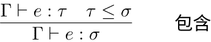
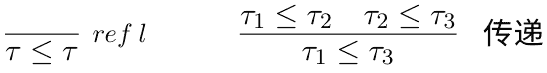
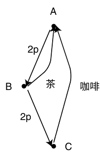
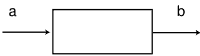
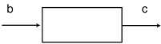
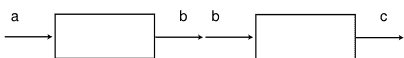
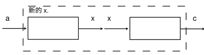
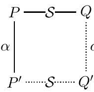

# CMU 15-312 编程语言基础讲义

# 关于归纳定义的讲义

## 15-312：编程语言基础
## Frank Pfenning
## 第二讲 2004年9月2日

这些补充说明回顾了归纳定义的概念,并给出了一些规则归纳的例子。参考罗伯特・哈珀 (Robert Harper) 的《编程语言:理论与实践》草稿书,方括号中给出了章节或部分。

考虑到我们对定义和推理编程语言的一般目标,我们将不得不处理各种描述任务。第一个任务是描述语言的语法。第二个任务是描述其静态语义,通常通过一些类型规则来实现。第三个任务是描述其动态语义,通常通过抽象机器的转换来实现。表面上看,这些任务似乎是非常不同的形式化方法(语法、类型规则、抽象机器),但事实证明它们都可以被视为归纳定义的特殊情况[第1章]。按照惯例,归纳定义将通过判断和推理规则来呈现,为判断提供证据。

第一个观察是,上下文无关文法可以重写为推理规则的形式[第3.2章]。基本判断的形式为
```
s \ A
```
其中 $s$ 是一个字符串, $A$ 是一个非终结符。这应该被理解为判断 $s \ A$ 是一个语法类别为 $A$ 的字符串。

作为一个简单的例子,我们考虑由字母表 $\Sigma = \{(,)\}$ 定义的正确匹配的括号语言。这个语言可以通过以下文法来定义
```
M ::= \varepsilon \mid (M) \mid MM
```
其中唯一的非终结符是 $M$。回想一下, $\varepsilon$ 代表空字符串。重写为推理规则,我们有:

```latex
\begin{gathered}
\frac{}{\varepsilon \ M} m_1 \quad \quad
\frac{s \ M}{(s) \ M} m_2 \quad \quad
\frac{s_1 \ M \quad s_2 \ M}{s_1 \ s_2 \ M} m_3
\end{gathered}
```

举个例子，考虑一个推导 $(()) \ M$。
```latex
\frac{\frac{\varepsilon\ M}{(\ )M}m_2 \quad \frac{\varepsilon\ M}{(\ )M}m_2}{(\ ) (\ )M} m_3
```
我们将这些推理规则解释为对于字符串 $s$ 的判断 $s \ M$ 的归纳定义，这意味着：当且仅当存在一个使用规则 $m_1$, $m_2$ 和 $m_3$ 的推导，字符串 $s \ M$ 成立。

基于这个解释，我们可以通过规则归纳来证明语法类别 $M$ 中字符串的性质。为了应用规则归纳，我们必须证明所讨论的性质被判断 $s \ M$ 的每个推理规则保持。也就是说，我们必须证明对于每个规则，如果所有前提都满足该性质，则结论也满足该性质。这是一个非常简单的例子。

### 定理1（括号计数）
如果 $s \ M$，那么 $s$ 具有相同数量的左右括号。

**证明**：通过规则归纳。我们逐个考虑每种情况。

- **(规则 $m_1$)** 那么 $s = \varepsilon$。
  - $s$ 有 0 个左括号和 0 个右括号。因为 $s = \varepsilon$。
- **(规则 $m_2$)** 那么 $s = (s')$。
  - $s' \ M$ （子推导）
  - $s'$ 有 $n'$ 个左括号和 $n'$ 个右括号（根据归纳假设）
  - $s$ 有 $n' + 1$ 个左括号和 $n' + 1$ 个右括号（因为 $s = (s')$）
- **(规则 $m_3$)** 那么 $s = s_1 \ s_2$。
  - $s_1 \ M$ （子推导）
  - $s_2 \ M$ （子推导）
  - $s_1$ 对于某些 $n_1$ 有相同数量的左右括号（通过 i.h.）
  - $s_2$ 对于某些 $n_2$ 有相同数量的左右括号（通过 i.h.）
  - $s$ 对于某些 $n_1 + n_2$ 有相同数量的左右括号（因为 $s = s_1 \ s_2$）

■

我们给出的文法很不幸是有歧义的[第3.3章]。例如，有无限多个推导可以得到 $\varepsilon \ M$，因为 $\varepsilon = \varepsilon \varepsilon = \varepsilon \varepsilon \varepsilon = \dots$。在这个文法的特定例子中，如果我们能够证明我们构造的抽象语法树[第4章]将独立于特定判断的推导而相同，我们将能够避免重写它。

另一种选择是重写文法，使得它定义相同的字符串语言，但是对于任何特定字符串的推导是唯一确定的。以下文法实现了这一点：
```
L ::= \varepsilon \mid (L) L
```
人们可以将 $L$ 看作是一个（可能为空的）由括号表达式组成的列表，以空字符串结束。这可以通过推理规则很容易地转化为一个归纳定义。

| 规则 | 形式 |
|---|---|
| $l_1$ | $\frac{}{\varepsilon \ L}$ |
| $l_2$ | $\frac{s_1 \ L \quad s_2 \ L}{(s_1) \ s_2 \ L}$ |

*(注：1 一种替代方案是在2003年的讲座中提出的，它是一个同时归纳定义的例子。它使用了两个非终结符 $L$ 和 $N$，其中类别 $L$ 对应于 $M$，而 $N$ 是一个辅助非终结符。$\begin{aligned} L & :: = \quad \varepsilon \mid N \ L \ N & :: = \quad(L) \end{aligned}$ 请注意，新的定义是通过替换掉 $N$ 的定义在替代中产生的。)*

现在有两个重要的问题需要问：（1）新的语法是否真的等价于旧的语法，即它是否生成相同的集合？（2）新的语法是否是无歧义的？第一,我们需要检查新的语法是否确实是无歧义的。后者作为一个(非平凡的!)练习留给读者。我们在这里讨论第一个问题。

从高层次上讲,我们想要证明对于任意字符串 $s$, $s \ M$ 当且仅当 $s \ L$。我们将这个问题分解为两个引理。这是因为“当且仅当”语句很少能够通过单一归纳来证明,而需要对两个方向进行不同的考虑。

我们首先考虑假设 $s \ M$ 并尝试证明 $s \ L$ 的方向。在列出各种情况时,我们注意到我们需要一个额外的引理。通常情况下,证明的呈现方式与其发现的顺序不同。为了以更自然的顺序阅读这个证明,请跳到引理2,并特别注意规则($m_3$)的最后一步。这一步推动了下面的引理。

### 引理2（连接）
如果 $s_1 \ L$ 且 $s_2 \ L$,则 $s_1 \ s_2 \ L$。

**证明**：通过对 $s_1 \ L$ 的推导进行归纳。请注意,在这种情况下,对 $s_2 \ L$ 的推导进行归纳是行不通的!

- **(规则 $l_1$)** 则 $s_1=\varepsilon$。
  - $s_2 \ L$ （假设）
  - $s_1 \ s_2 \ L$
  - 由于 $s_1 \ s_2=\varepsilon s_2=s_2$
- **(规则 $l_2$)** 则 $s_1=(s_{11})s_{12}$。
  - $s_{11} \ L$ （子推导）
  - $s_{12} \ L$ （子推导）
  - $s_2 \ L$ （假设）
  - $s_{12} \ s_2 \ L$ （通过 i.h.）
  - $(s_{11}) \ s_{12} \ s_2 \ L$ （通过规则 $l_2$）

现在我们准备证明从左到右的蕴含关系。

### 引理3
如果 $s \ M$ 则 $s \ L$。

**证明**：通过对 $s \ M$ 的推导进行归纳。

- **(规则 $m_1$)** 那么 $s=\varepsilon$。
  - $s \ L$ 根据规则 $l_1$ 因为 $s=\varepsilon$
- **(规则 $m_2$)** 那么 $s=\left(s^{\prime}\right)$。
  - $s^{\prime} \ M$ （子推导）
  - $s^{\prime} \ L$ （通过 i.h.）
  - $\varepsilon \ L$ （根据规则 $l_1$）
  - $\left(s^{\prime}\right) \ L$ （根据规则 $l_2$ 和 $\left(s^{\prime}\right) \varepsilon=\left(s^{\prime}\right)$）
- **(规则 $m_3$)** 那么 $s=s_1 s_2$。
  - $s_1 \ M$ （子推导）
  - $s_2 \ M$ （子推导）
  - $s_1 \ L$ （通过 i.h.）
  - $s_2 \ L$ （通过 i.h.）
  - $s_1 s_2 \ L$ （通过连接 引理2）

从右到左的方向更少问题。

### 引理4
如果 $s \ L$ 则 $s \ M$。

**证明**： 通过对 $s \ L$ 的推导进行规则归纳。 有两种情况需要考虑。

- **(规则 $l_1$)** 那么 $s=\varepsilon$。
  - $s \ M$ 根据规则 $m_1$，因为 $s=\varepsilon$
- **(规则 $l_2$)** 那么 $s=\left(s_1\right) s_2$。
  - $s_1 \ L$ （子推导）
  - $s_2 \ L$ （子推导）
  - $s_1 \ M$ （通过 i.h.）
  - $\left(s_1\right) \ M$ （根据规则 $m_2$）
  - $s_2 \ M$ （通过 i.h.）
  - $\left(s_1\right) s_2 \ M$ （根据规则 $m_3$）

现在我们可以将前面的引理结合起来得到我们的定理。

### 定理5
当且仅当 $s \ L$ 时，$s \ M$ 成立。

**证明**：根据引理3和引理4，立即可得。

### 关于归纳证明的一些建议
我们在课堂上进行的大多数证明都是通过归纳法进行的。. 这仅仅是因为我们研究的对象的本质是归纳定义的。 因此，当我们面对一个不直接从某些引理中得出的猜想时，我们首先尝试按照给定的归纳法来证明它。 这可能涉及到在几个不同的给定对象或推导之间进行选择，我们可以在其上应用归纳法。 如果其中一个起作用，那当然就完成了。 如果不起作用，我们尝试分析失败，以决定是否需要先证明一个引理，是否需要推广归纳假设，或者我们的猜想可能是错误的，我们应该寻找一个反例。

通常情况下，找到一个引理并不太困难，因为它可以通过你发现无法填补的证明尝试中的空缺来建议。 例如，在引理3的证明中，情况(规则 $m_3$) 下，我们通过归纳假设得到 $s_1 \ L$ 和 $s_2 \ L$，并且必须证明 $s_1 \ s_2 \ L$。 由于没有推理规则允许这样的步骤，但它似乎仍然是正确的，我们将其作为引理2进行证明。

推广归纳假设可能是一个非常棘手的平衡行为。问题在于，在归纳证明中，我们试图建立的属性出现了两次：一次作为归纳假设，一次作为我们试图证明的结论。 如果我们加强属性，归纳假设会给我们更多的信息，但结论变得更难证明。 如果我们削弱属性，归纳假设给我们的信息就更少，但结论更容易证明。 幸运的是，在相互递归判断的性质的性质中，存在一些简单的情况，这些情况提示了一种概括。

找到一个反例的难度很大。 在这门课程中，只有在归纳定义存在明显缺陷或类型安全等属性明显失败的情况下，才会出现反例。 在其他情况下，可能需要对归纳定义的本质有非常深入的洞察力。

### 特定归纳定义的反例
特定归纳定义的反例可能无法直接从失败的证明尝试中得出。这门课程的作业1的额外题目2.2给出了一个困难的反例示例。猜想可能是每个永真式都是定理。然而，在这个定理的陈述或永真式和定理的定义中，很少有东西能够提示如何证明或证伪它。

### 归纳证明中应避免的三个陷阱
避免的三个陷阱。归纳证明的困难在于常常被所提出的猜想是真实的事实所蒙蔽。.同样地，如果设置正确，每种情况下归纳假设确实暗示了所需的结论，但归纳假设可能不足以证明它。因此，你必须避免诱惑，将某些事物宣称为“显然正确”并加以证明。

在归纳证明中，我们经常遇到的第二种错误是对推理规则方向的混淆。如果你从你想要证明的结论开始向后推理，你是从底向上思考规则：“如果我能证明 $J_1$，那么我可以得出 $J_2$，因为我有一个前提为 $J_1$，结论为 $J_2$ 的推理规则。”然而，当你最终写下证明时，你必须按照正确的方向使用规则。如果你从你的假设出发，从上往下使用推理规则进行推理，就不会产生混淆。唯一的例外是反演的证明原则，只有在(a)你已经证明了给定判断 $J$ 存在的推导，以及(b)你考虑了所有结论与 $J$ 匹配的可能推理规则时，才能使用它。我们将在课程后面看到这种推理形式的例子。在其他情况下，你不能“反向”使用推理规则。

第三个要避免的错误是将归纳假设应用于不是给定推导的子推导的情况。这种推理是循环且不可靠的。你必须始终验证当你通过归纳假设声称某事是成立的时候，实际上应用它是合法的!

### 证明的详细程度
要写多少。最后，关于我们给出的证明和作业中期望你提供的证明的详细程度，还有一点要说。.这份讲义中的证明非常啰嗦，但是除非另有规定，我们要求你也同样啰嗦。特别是，在归纳证明中，你必须展示你使用的引理，并展示归纳证明中的广义假设（如果你需要一个广义假设）。

你还必须考虑所有情况，并仔细证明每一行。当我们对这类证明有一定的熟练度后，我们可能会放松这些要求，一旦我们确信你知道如何填写可能省略的步骤，例如在研究论文中。

### 规范与实现
规范与实现。我们的括号平衡语言的语法（以及其作为归纳定义的表述）必须被视为一种规范. 也就是说，我们定义了一种字符串语言（在语法的情况下）或者一个判断 $M$（在判断的情况下），但我们并没有立即提供一个实现在这种情况下，这样的实现将是一个用于识别给定字符串是否是一个正确平衡的括号字符串的算法。正如课堂上所指出的，语法中的歧义是从规范的语法中推导出解析器的一个障碍。一般来说，有很多类的语言（包括由上下文无关文法指定的语言）可以从语法中统一生成解析器。在这里，我们将追求一个不同的方向，即为这种特定语言编写一个解析器并证明它的正确性。

### 将推理规则解释为算法
将推理规则解释为算法。 要实现一个解析器，通常会选择一种编程语言，然后简单地编写一个程序。.然而，我们将面临一个问题，即证明该程序的正确性，这取决于底层实现语言的定义细节。

在这里，我们利用的是一些算法也可以以推理规则的形式呈现。 执行算法对应于寻找一个判断的推导，我们很快将看到。 在编程语言术语中，这种方法被称为逻辑编程。

但首先，我们必须决定一个算法，用于识别给定字符串是否由正确匹配的括号组成。 匹配括号的解析过程非正式思想非常简单：我们保持一个整数计数器，初始化为零，当我们看到一个开括号时增加它，当我们看到一个闭括号时减少它。我们需要检查两个条件：（a）计数器永远不会变为负数（否则会有太多的闭括号），（b）在最后计数器为零（否则会有未匹配的开括号）。

### 解析的过程对应于自底向上构建推导
解析的过程对应于底部构造 一个判断的推导
$k \rhd s$
这意味着 $k \rhd s$ 表示 $s$ 是相对于计数器 $k$ 的有效字符串。更具体地说，$s$ 是剩余待处理的字符串。我们假设 $k \geq 0$ 是一个整数。这里的符号 $\rhd$ 没有特殊的含义，只是用来分隔整数 $k$ 和字符串。现在我们来制定这个二元判断的规则。

首先，如果字符串为空，则当计数器为 $0$ 时我们接受。这对应于上面提到的条件 (b)。
```latex
\frac{}{0 \rhd \varepsilon} \rhd_1
```
其次，如果字符串以一个开括号开头，我们将计数器增加 1。更少操作性的解读是：如果 $s$ 是相对于 $k+1$ 的一个有效字符串，则 $(s)$ 是相对于堆栈 $k$ 的一个有效字符串。
```latex
\frac{k+1 \rhd s}{k \rhd (s} \rhd_2
```
最后，如果我们在字符串的开头看到一个闭括号，那么我们从计数器中减去一。检查计数器保持非负是很重要的；否则我们可能会接受错误形式的字符串。一个不太操作性的解读是：如果 $s$ 是一个有效的字符串且计数器 $k > 0$，那么 $)s$ 是一个有效的字符串且计数器 $k-1$。
```latex
\frac{k-1 \rhd s \quad(k > 0)}{k \rhd )s} \rhd_3
```
由于这些是所有的规则，自底向上构建推导将在字符串 $s$ 以闭括号开始且 $k$ 为零时停滞不前。

也就是说，无论 $s$ 是什么，我们都无法推导出 $0 \rhd )s$ 的规则。这对应于本讨论开始时提到的条件 (a)。

很容易看出，这个解析器本质上是无歧义的。也就是说，当我们开始构造 $0 \rhd s$ 的推导以解析 $s$ 时，每个阶段最多只能应用一条规则，这取决于 $s$ 是空的（规则 $\rhd_1$），以开括号开头（规则 $\rhd_2$），还是以闭括号开头（规则 $\rhd_3$）。因此，我们可以将判断看作描述解析字符串的确定性算法。

这个判断可以与一个下推自动机相关联。我们将使用一个栈 `((...( ` (由 $k$ 个开括号组成)来代替一个计数器 $k$，该栈由 $k$ 个开括号组成。很容易将上述规则重写成这种形式。顺便说一句，事实证明，每个上下文无关文法都可以被一个(可能是非确定性的)下推自动机接受，尽管从上下文无关文法构造下推自动机的一般方法比这个特定示例更复杂。

但是上述判断是否真的接受了括号正确匹配的语言?我们希望证明，当且仅当 $0 \rhd s$ 时，$s \ M$ 成立。像往常一样，我们将其分为两个独立的引理，每个引理对应一个方向。

对于第一个方向，我们需要一个进一步的引理，它捕捉了输入字符串的从左到右处理以及 $k$ 作为未匹配开括号的计数器的本质。这个引理通常只是作为对主定理证明中的漏洞的反应而被猜测(然后证明)，但在撰写时应该按相反的顺序呈现。

### 引理6（堆栈）
如果 $k_1 \rhd s_1$ 且 $k_2 \rhd s_2$ 那么 $k_1+k_2 \rhd s_1 s_2$

**证明**：根据 $k_1 \rhd s_1$ 的推导规则归纳。

- **(规则 $\rhd_1$)** 那么 $k_1=0$ 且 $s_1=\varepsilon$。
  - $k_2 \rhd s_2$ （假设）
  - $k_1+k_2 \rhd s_1 s_2$
  - 由于 $k_1=0$ 且 $s_1=\varepsilon$
- **(规则 $\rhd_2$)** 那么 $s_1=(s'_1$。
  - $k_1+1 \rhd s'_1$ （子推导）
  - $k_2 \rhd s_2$ （假设）
  - $k_1+k_2+1 \rhd s'_1 s_2$ （通过 i.h.）
  - $k_1+k_2 \rhd (s'_1 s_2)$ （根据规则 $\rhd_2$）
- **(规则 $\rhd_3$)** 那么 $s_1=)s'_1$ 且 $k_1>0$。
  - $k_1-1 \rhd s'_1$ （子推导）
  - $k_2 \rhd s_2$ （假设）
  - $k_1+k_2-1 \rhd s'_1 s_2$ （通过 i.h.）
  - $k_1+k_2 > 0$ （由于 $k_1>0, k_2\geq 0$）
  - $k_1+k_2 \rhd )s'_1 s_2$ （根据规则 $\rhd_3$）

现在我们可以证明解析器的正确性定理的第一个方向。

### 引理 7
如果 $s \ M$ 那么 $0 \triangleright s$。

**证明**：根据 $s \ M$ 的推导进行规则归纳。

- **（规则 $m_1$）** 那么 $s=\varepsilon$。
  - $0 \triangleright \varepsilon$
  - 根据规则 $(\triangleright_1)$
- **（规则 $m_2$）** 那么 $s = (s')$。
  - $s' \ M$ （子推导）
  - $0 \triangleright s'$ （通过 i.h.）
  - $0 \triangleright \varepsilon$ （根据规则 $(\triangleright_1)$）
  - $1 \triangleright )$ （根据规则 $(\triangleright_3)$）
  - $1 \triangleright s')$ （根据引理 6）
  - $0 \triangleright (s')$ （根据规则 $(\triangleright_2)$）
- **（规则 $m_3$）** 那么 $s = s_1 s_2$。
  - $s_1 \ M$ （子推导）
  - $0 \triangleright s_1$ （通过 i.h.）
  - $s_2 \ M$ （子推导）
  - $0 \triangleright s_2$ （通过 i.h.）
  - $0 \triangleright s_1 s_2$ （根据引理 6）

为了证明另一个方向（如果 $0 \triangleright s$ 那么 $s \ M$），我们首先进行泛化：如果 $k \triangleright s$ 那么 $(\cdots ($ 

这个证明（留给读者完成）需要另一个引理，这次是关于 $M$ 判断的。最后，将这两个方向结合起来证明了我们解析器的正确性。

总结。在本讲座中，我们介绍了归纳定义的概念，以推理规则的形式呈现判断。作为示例，我们使用了语法的归纳表示，并展示了如何通过规则归纳证明它们的等价性。我们还概述了如何通过推理规则来呈现算法，以解析算法为例。

这种算法的呈现形式，其中计算通过推理来建模，被称为逻辑编程。

# 关于抽象语法的讲义

15-312：编程语言基础

Frank Pfenning

第三讲

2004年9月7日

到目前为止，我们讨论的语法将形式语言定义为一组字符串。我们将其称为语言的具体语法。虽然这在完整定义编程语言时是必要的，但这只是个开始。我们还必须至少定义静态语义（通过类型规则）和动态语义（通过求值规则）。然后，我们必须推理它们之间的关系，以建立例如类型安全性。在字符串上给出这样的定义和证明非常繁琐和不合适；相反，我们希望给它一个更抽象的表示形式。我们将这个表示层称为语言的抽象语法。一个合适的表示工具是术语[第1章]。

鉴于这个区别，我们可以看到解析不仅仅是识别一个给定的字符串是否属于由语法定义的语言。相反，在我们的上下文中，解析应该将一个以具体语法给出的字符串转换为一个抽象语法律语。打印（或反解析）的相反问题是将一个抽象语法律语转换为一个字符串表示。虽然语法形式有些笨重，当涉及到将其转换为抽象语法时，但我们可以看到判断的机制非常强大，可以清晰地指定解析和反解析。

我们首先回顾算术表达式语言及其具体[第3章]和抽象[第4章]形式。首先，以其无歧义形式的语法。在这里，我们实现了加法和乘法应该是左结合的决定（所以 `1+2+3` 被解析为 `(1+2)+3`）和乘法优先于加法。这样的选择在一定程度上是任意的，并且是由惯例而不是任何科学标准所决定的。²

> ¹ 我们将非终结符大写，以避免在考虑具体和抽象语法时产生混淆。此外，术语 Terms（用 T 表示）不应与我们用来构建抽象语法的术语混淆。

具体语法可以形式化为：
```
D ::= 0 | 9
N ::= D | N D
E ::= T | E + T
T ::= F | T * F
F ::= N | ( E )
```
以五个判断的形式书写：
```
    0 ⊢ D    9 ⊢ D
  s ⊢ D    s₁ ⊢ N   s₂ ⊢ D
  ----------  ----------------
   s ⊢ N           s₁s₂ ⊢ N
  s ⊢ T    s₁ ⊢ E   s₂ ⊢ T
  ----------  ----------------
   s ⊢ E          s₁+s₂ ⊢ E
  s ⊢ F    s₁ ⊢ T   s₂ ⊢ F
  ----------  ----------------
   s ⊢ T         s₁*s₂ ⊢ T
  s ⊢ N           s ⊢ E
  ----------------------
        s ⊢ F
        (s) ⊢ F
```
语言的抽象语法要简单得多。它可以以语法的形式进行规范，我们所处理的是项而不是字符串。虽然自然数也可以通过多种方式进行归纳定义[第1.3章]，但在这里我们将其作为原始数学对象。

```
nat  ::=  0 | 1 | ···
expr ::=  num(nat) | plus(expr, expr) | times(expr, expr)
```
对于每个自然数 $k$，我们有 $k \text{ nat}$ 的判断，以及以下表达式的规则：

> ² 在[第3.2章]中给出的语法稍有不同，因为加法和乘法被假定为右结合的。

## 抽象语法

```latex
\frac{k \text{ nat}}{\operatorname{num}(k) \text{ expr}}
\frac{t_1 \text{ expr} \quad t_2 \text{ expr}}{\text{plus}(t_1, t_2) \text{ expr}}
\frac{t_1 \text{ expr} \quad t_2 \text{ expr}}{\text{times}(t_1, t_2) \text{ expr}}
```

现在我们通过几个同时归纳判断来指定具体和抽象语法之间的正确关系。也许生成这些判断的最简单方法是将相应的抽象语法项添加到定义具体语法的推理规则中。

```latex
\overline{0 \text{ D} \longleftrightarrow 0 \text{ nat}} \cdots \quad \overline{9 \text{ D} \longleftrightarrow 9 \text{ nat}}
\begin{array}{cc}
\frac{s \text{ D} \longleftrightarrow k \text{ nat}}{s \text{ N} \longleftrightarrow k \text{ nat}} & \frac{s_1 \text{ N} \longleftrightarrow k_1 \text{ nat} \quad s_2 \text{ D} \longleftrightarrow k_2 \text{ nat}}{s_1 s_2 \text{ N} \longleftrightarrow 10 k_1 + k_2 \text{ nat}} \\
\frac{s \text{ T} \longleftrightarrow t \text{ expr}}{s \text{ E} \longleftrightarrow t \text{ expr}} & \frac{s_1 \text{ E} \longleftrightarrow t_1 \text{ expr} \quad s_2 \text{ T} \longleftrightarrow t_2 \text{ expr}}{s_1 + s_2 \text{ E} \longleftrightarrow \text{plus}(t_1, t_2) \text{ expr}} \\
\frac{s \text{ F} \longleftrightarrow t \text{ expr}}{s \text{ T} \longleftrightarrow t \text{ expr}} & \frac{s_1 \text{ T} \longleftrightarrow t_1 \text{ expr} \quad s_2 \text{ F} \longleftrightarrow t_2 \text{ expr}}{s_1 * s_2 \text{ T} \longleftrightarrow \text{times}(t_1, t_2) \text{ expr}} \\
\frac{s \text{ N} \longleftrightarrow k \text{ nat}}{s \text{ F} \longleftrightarrow \operatorname{num}(k) \text{ expr}} & \frac{s \text{ E} \longleftrightarrow t \text{ expr}}{(s) \text{ F} \longleftrightarrow t \text{ expr}}
\end{array}
```
在给出上述形式的规范时，我们应该验证我们期望的基本属性是否实际成立。在这种情况下，我们希望检查相关的字符串和术语是否属于正确的（具体或抽象的）语法类别。

### 定理 1
- (i) 如果 $s \text{ D} \longleftrightarrow k \text{ nat}$，那么 $s \text{ D}$ 和 $k \text{ nat}$ 成立。
- (ii) 如果 $s \text{ N} \longrightarrow k \text{ nat}$，那么 $s \text{ N}$ 和 $k \text{ nat}$ 成立。
- (iii) 如果 $s \text{ E} \longleftrightarrow t \text{ expr}$，那么 $s \text{ E}$ 和 $t \text{ expr}$ 成立。
- (iv) 如果 $s \text{ T} \longleftrightarrow t \text{ expr}$，那么 $s \text{ T}$ 和 $t \text{ expr}$ 成立。
- (v) 如果 $s \text{ F} \longleftrightarrow t \text{ expr}$，那么 $s \text{ F}$ 和 $t \text{ expr}$ 成立。

证明：部分 (i) 通过案例进行推导（共有10种情况，每种情况对应一个数字）。部分 (ii) 通过对给定推导进行规则归纳得出，使用 (i) 在两种情况下。第 (iii)、(iv) 和 (v) 部分通过对给定推导的同时规则归纳来得到，其中在一个情况下使用了第 (ii) 部分。总共有6种情况。在每种情况下，我们可以立即利用归纳假设对所有子推导进行推理，并从结果中构造出所需判断的推导。

在实现这样的规范时，我们通常对什么被认为是我们的输入和输出做出承诺。如上所述，解析和反解析由此判断来指定。

### 定义 2（解析）
给定一个字符串 $s$，找到一个术语 $t$，使得 $s \text{ E} \longleftrightarrow t \text{ expr}$ 或者失败，如果不存在这样的 $t$。

其他语法类别存在明显的类似定义。我们还可以通过确定如果 $s \text{ E}$，那么存在一个表示它的抽象语法术语来将解析与我们对语法类别的定义进一步联系起来。

### 定理 3
- (i) 如果 $s \text{ D}$ 那么存在一个 $k$ 使得 $s \text{ D} \longleftrightarrow k \text{ nat}$ 是自然数。
- (ii) 如果 $s \text{ N}$ 那么存在一个 $k$ 使得 $s \text{ N} \longleftrightarrow k \text{ nat}$ 是自然数。
- (iii) 如果 $s \text{ E}$ 那么存在一个 $t$ 使得 $s \text{ E} \longleftrightarrow t \text{ expr}$ 是表达式。
- (iv) 如果 $s \text{ T}$ 那么存在一个 $t$ 使得 $s \text{ T} \longleftrightarrow t \text{ expr}$ 是表达式。
- (v) 如果 $s \text{ F}$ 那么存在一个 $t$ 使得 $s \text{ F} \longleftrightarrow t \text{ expr}$ 是表达式。

证明：通过情况分析或与定理 1 的证明类似的直接规则归纳。

现在我们可以改进我们对歧义的概念，以考虑构建的抽象语法。这比要求推导的唯一性稍微宽松一些，因为不同的推导仍然可能导致相同的抽象语法术语。

### 定义 4（解析的歧义）
如果对于给定的字符串 $s$ 存在两个不同的项 $t_1$ 和 $t_2$ 使得 $s \text{ E} \longleftrightarrow t_1 \text{ expr}$ 和 $s \text{ E} \longleftrightarrow t_2 \text{ expr}$，则解析问题是模糊的。

反解析只是解析的逆过程：我们给定一个项 $t$ 并且需要找到一个具体的语法表示。反解析通常是完全的（每个项都可以反解析）并且本质上是模糊的（相同的项可以写成多个字符串）。这种模糊性的一个例子是插入额外的冗余括号。因此，任何反解析器必须使用启发式方法在不同的备选字符串表示之间进行选择。

### 定义 5（反解析）
给定一个项 $t$ 使得 $t \text{ expr}$，找到一个字符串 $s$ 使得 $s \text{ E} \longleftrightarrow t \text{ expr}$。

使用判断作为实现不同任务的基础能力证明了它们的灵活性。通常，将一个判断“翻译”成高级语言（如 ML）的实现并不困难，尽管在某些情况下可能需要相当的独创性和一些高级技术。

我们的小算术表达式语言用来说明各种概念，比如具体语法和抽象语法之间的区别，但它过于简单，无法展示其他各种现象和概念。其中最重要的一个是变量的概念，以及变量绑定和作用域的概念。为了单独讨论变量，我们通过一种新的表达式形式来命名初步结果。例如：
```
let x = 2*3 in x+x end
```
应该计算为 12，但只计算 2*3 一次。

首先，具体语法，只显示更改或新增的情况：
- 变量 $X ::= \text{（任何标识符）}$
- 因子 $F ::= N \mid (E) \mid \text{let } X = E \text{ in } E \text{ end} \mid X$

在这里我们忽略了什么构成合法标识符的问题。假设它应该避免关键字（如 `let`, `in`）、特殊符号（如 `+`），并且被空格包围。在实际的语言实现中，词法分析器将输入字符串分解为关键字、特殊符号、数字和标识符，然后由解析器进行处理。

对于抽象语法的第一种方法是简单地引入一个新的抽象语法类别的变量[第5.1章]和一个带有三个参数的新操作符 `let(x, e_1, e_2)`，其中 $x$ 是一个变量，$e_1$ 和 $e_2$ 是表示表达式的术语。此外，我们允许一个变量 $x$ 作为一个术语。然而，这种方法并没有明确哪些变量的出现是绑定出现，并且变量出现引用哪个绑定器。例如，要看到
```
let x = 1 in let x = x+1 in x+x end end
```
求值为 4，我们需要知道 $x$ 的哪些出现引用哪些值。作用域解析规则[第5.1章]规定它应该被解释为与
```
let x_1 = 1 in let x_2 = x_1+1 in x_2+x_2 end end
```
一致。在这里不再存在任何潜在的歧义。也就是说，变量 $x$ 的作用域在 `let x = s_1 in s_2 end` 中是 $s_2$ 但不是 $s_1$。

一种统一的技术，用于编码关于变量作用域的信息，称为高阶抽象语法[第5章]。我们在术语的语言中添加了一个构造 $x.t$，它在术语 $t$ 中绑定了 $x$。在 $t$ 中，每个不被另一个绑定 $x.t'$ 遮蔽的 $x$ 的出现，都指的是所示的顶层抽象。这样的变量是一个新的原始概念，特别地，一个变量可以被用作一个术语（除了通常基于运算符的术语之外）。我们将通过扩展我们关于具体和抽象语法之间的判断来进行：
```latex
\frac{x \text{ X} \quad s_1 \text{ E} \longleftrightarrow t_1 \text{ expr} \quad s_2 \text{ E} \longleftrightarrow t_2 \text{ expr}}{\text{let } x = s_1 \text{ in } s_2 \text{ end} \longleftrightarrow \text{let}(t_1, x.t_2) \text{ expr}} \quad \frac{x \text{ X}}{x \text{ E} \longleftrightarrow x \text{ expr}}
```
并允许表达式：
```latex
\overline{x \text{ expr}} \quad \frac{t_1 \text{ expr} \quad t_2 \text{ expr}}{\text{let}(t_1, x.t_2) \text{ expr}}
```
请注意，我们将标识符 $x$ 翻译为同名的变量 $x$ 在高阶抽象语法中。此外，我们将高阶抽象语法中的变量视为一种新的术语，因此我们不会明确检查 $x$ 是否实际上是变量——这是暗示它们是变量的。

我们强调 `let`-表达式的作用域解析规则直接编码在高阶抽象表示中。我们在第4讲[第5.3章]中研究了这种表示背后的规则。

## 抽象语法 L3.7
我们可以用更紧凑的符号表示法将算术表达式的抽象语法语言形式化。
```
nat  ::= 0 | 1 | ···
expr ::= num(nat) | plus(expr, expr) | times(expr, expr) | variable | let(expr, x.expr)
```
作为一个具体的例子，考虑字符串
```
let x1=1 in let x2=x1+1 in x2+x2 end end
```
在抽象语法中，它将被表示为
```
let(num(1), x1.let(plus(variable(1), num(1)), x2.plus(variable(2), x2)))
```

# 关于静态和动态语义的讲义
15-312: 编程语言基础
Frank Pfenning
第4讲
2004年9月9日

在本讲中, 我们将以一个非常简单的例子来说明编程语言的静态和动态语义的基本概念: 算术表达式语言增加了变量和定义。

静态和动态语义是抽象语法(术语)的属性, 而不是具体语法(字符串)的属性。 因此, 在这里我们将专门处理抽象语法。

静态语义可以进一步分解为两个部分: 变量作用域和类型规则。它们确定如何解释变量, 并且辨别有意义的表达式。正如我们在上一节课中看到的, 变量作用域直接编码到表示抽象语法的术语中。在本讲座中, 我们进一步讨论了控制变量绑定的规律在术语中。第二步将以归纳定义的判断形式给出类型规则。对于算术表达式来说, 这并不是很有趣只包含一个类型, 但它用来说明思想。

动态语义在不同的语言和不同的抽象级别之间变化更大。我们只会在这里简要介绍一下在下一节课中继续讨论这个主题。

变量绑定的基本原则称为词法作用域是绑定变量的名称不应该有影响。换句话说, 一致地重命名程序中的变量不应该影响其含义。下面的一切都将遵循这个原则。

我们现在将“变量的一致重命名”这个概念更加明确化。[第5.3章]中的发展将同时替换视为一种原始的；我们通过一次只处理单个替换来避免繁重的符号表示。这与绑定前缀 (如 $x.t$) 只绑定单个变量而不是多个变量的决定相一致。我们使用符号 $\{y / x \} t$ 表示将 $y$ 替换为 $x$ 在 $t$ 中的结果，但尚未定义。有了这个，我们将使用等式来定义将 $x$ 重命名为 $y$：
$$x . t=_{\alpha} y .\{y / x \} t$$
这可以在一个术语中多次应用, 任何位置都可以。为了保持意义的一致性, $y$ 不能在 $x.t$ 中已经自由出现, 否则新绑定符会“捕获” $y$ 的自由出现。

以一个例子来说, 考虑这个术语
```
let (num (1), x .let (plus (x, num (1)), y .plus (y, x)))
```
它应该被计算为 `num(3)`。很明显, 将 $y$ 重命名为 $x$ 是不允许的。结果的术语
```
let (num (1), x .let (plus (x, num (1)), x.plus (x, x)))
```
意味着完全不同的东西, 并且会被计算为 `num(4)`。

为了更正式地表达这个附加条件, 我们定义了一个术语中的自由变量的集合。
| 项 $t$ | 自由变量集合 $FV(t)$ |
|---|---|
| $FV(x)$ | $= \{ x \}$ |
| $FV(o(t_1, \ldots, t_n))$ | $= \bigcup_{1 \leq i \leq n} FV(t_i)$ |
| $FV(x.t)$ | $= FV(t) \setminus \{ x \}$ |

因此, 在定义替换 $\{y / x \} t$ 之前, 我们重新陈述了定义变量重命名, 也称为 $\alpha$-转换, 带有适当的侧条件:
$$x . t=_{\alpha} y .\{y / x \} t \quad \text{假设 } y \notin FV(t)$$

回到一个变量 $y$ 替换为另一个变量 $x$ 在一个术语 $t$ 中的定义 $\{y / x \} t$。该定义递归地遍历术语的结构。¹
| 替换表达式 | 操作 | 结果 |
|---|---|---|
| $\{y / x \} x$ | $=$ | $y$ |
| $\{y / x \} z$ | $=$ | $z$ （假设 $x \neq z$） |
| $\{y / x \} o(t_1, \ldots, t_n)$ | $=$ | $o(\{y / x \} t_1, \ldots, \{y / x \} t_n)$ |
| $\{y / x \} x.t$ | $=$ | $x.t$ |
| $\{y / x \} z.t$ | $=$ | $x.\{y / x \} t$ （提供的 $x \neq z$ 且 $y \neq z$） |
| $\{y / x \} y.t$ | 未定义的 | （提供的 $x=y$） |

> ¹ 事实上, 它可以被看作是归纳定义的另一种形式, 但我们在这里不会形式化地描述它。

## 定理 1 (替换和 $\alpha$-转换)
- (i) 如果 $u =_\alpha u'$, $t =_\alpha t'$, 并且 $\{u/x\}t$ 和 $\{u'/x\}t'$ 都被定义, 则 $\{u/x\}t =_\alpha \{u'/x\}t'$。
- (ii) 给定 $u, x$ 和 $t$, 总是存在一个 $t' =_\alpha t$ 使得 $\{u/x\}t'$ 被定义。

我们概述了部分 (ii) 的证明, 该证明通过对 $t$ 的大小进行归纳来进行。如果 $\{u/x\}t$ 被定义, 我们选择 $t'$ 为 $t$。否则, 那么在替换的定义中的最后一个子句中应用, 并且存在一个绑定器。存在一个绑定器 $z.t_1$ 在 $t$ 中使得 $z \in \text{FV}(u)$。然后我们可以将 $z$ 重命名为一个新变量 $z'$, 该变量既不在 $u$ 中也不在 $z.t_1$ 中出现, 以获得 $z'.t'_1$。现在我们可以继续使用 $z'.\{u/x\}t'_1$。通过对归纳假设的引用, 我们可以得出结论。

在这个证明中描述的算法实际上是避免捕获的替换定义, 只要我们在工作时考虑到术语的 $\alpha$-等价类。幸运的是, 在本课程的其余部分中, 这总是成立的。

在理解变量绑定、重命名和替换之后, 我们现在可以为这种语言制定第一个版本的类型规则。因为只有一种类型, 即自然数, 所以规则有些琐碎。对于这种小语言, 它们的唯一目的是验证一个表达式 $e$ 是否是闭合的, 即 $\text{FV}(e)=\{\}$。

表达这个的第一个判断方式如下²:

$$
\frac{k \in \text{nat}}{\text{num}(k): \text{nat}}
$$

$$
\frac{e_1: \text{nat} \quad e_2: \text{nat}}{\text{plus}(e_1, e_2): \text{nat}} \qquad \frac{e_1: \text{nat} \quad e_2: \text{nat}}{\text{times}(e_1, e_2): \text{nat}}
$$

$$
\frac{e_1: \text{nat} \quad \{e_1/x\}e_2: \text{nat}}{\text{let}(e_1, x.e_2): \text{nat}}
$$

虽然这是完全正确的, 但它存在一个潜在的问题, 即它会重新检查每个 $e_1$ 在 $e_2$ 中出现的情况。可以通过用一个固定值, 如 $\text{num}(0)$ 替换 $x$ 并检查结果来避免这个问题。

一个更常见（也更可扩展）的替代方法是使用一个新的判断形式, 即所谓的假设判断 (hypothetical judgment)。我们将其写为

$$
J_1, \dots, J_n \vdash J
$$

这意味着 $J$ 是基于假设 $J_1, \dots, J_n$ 得出的。它最基本的性质是

$$
J_1, \dots, J_i, \dots J_n \vdash J_i
$$

始终成立, 这是显而易见的: 如果一个假设与我们试图推导的判断相同, 那么我们就完成了。尽管如此, 我们仍然会为每种情况重新陈述这个一般原则的实例。

我们考虑的假设判断的特定形式是

$$
x_1:\text{nat}, \dots, x_n:\text{nat} \vdash e:\text{nat}
$$

应该这样阅读: 在变量 $x_1, \dots, x_n$ 的假设下, 它们代表自然数, $e$ 具有自然数类型。

我们通常用字母 $\Gamma$ 来缩写整个假设序列。我们用 $\cdot$ 表示一个空的假设集合, 并且我们缩写 $\cdot, x_1:\tau_1, \dots, x_n:\tau_n$ 为 $x_1:\tau_1, \dots, x_n:\tau_n$。为了避免歧义, 我们总是假设上下文中声明的所有变量都是不同的。

类型判断由以下规则定义。

$$
\frac{x: \text{nat} \in \Gamma}{\Gamma \vdash x: \text{nat}} \qquad \frac{k \in \text{nat}}{\Gamma \vdash \text{num}(k): \text{nat}}
$$

$$
\frac{\Gamma \vdash e_1: \text{nat} \quad \Gamma \vdash e_2: \text{nat}}{\Gamma \vdash \text{plus}(e_1, e_2): \text{nat}} \qquad \frac{\Gamma \vdash e_1: \text{nat} \quad \Gamma \vdash e_2: \text{nat}}{\Gamma \vdash \text{times}(e_1, e_2): \text{nat}}
$$

$$
\frac{\Gamma \vdash e_1: \text{nat} \quad \Gamma, x: \text{nat} \vdash e_2: \text{nat}}{\Gamma \vdash \text{let}(e_1, x.e_2): \text{nat}}
$$

在最后一个规则中, 需要注意确保上下文中的变量 $x$ 没有被声明两次。如果在 $\text{let}(e_1, x.e_2)$ 中绑定的变量 $x$ 已经被声明, 我们使用假设, 即我们在 $\alpha$-等价类中工作, 并在应用规则之前将变量 $x$ 重命名为一个新的变量 $x'$。

对于这个小语言, 对类型感兴趣的重点只是为了保证术语中没有自由变量, 以便求值不会卡住。这个属性可以很容易地验证。

## 定理 2
如果 $\vdash e: \text{nat}$ 那么 $\mathrm{FV}(e)=\{\}$。

证明: 我们不能直接通过规则归纳来证明这一点, 因为 `let` 的规则的第二 个前提引入了一个假设。所以我们进行了泛化。

如果 $x_1:\text{nat}, \dots, x_n:\text{nat} \vdash e: \text{nat}$ 那么 $\mathrm{FV}(e) \subseteq\{x_1, \dots, x_n\}$。

这个泛化的陈述可以很容易地通过规则归纳来证明。

接下来, 我们想给出操作语义, 指定表达式的值。我们也将值表示为表达式, 尽管它们被限制为具有形式 $\text{num}(k)$。通常, 当我们写一个表达式 $e$ 时, 我们并不暗示它是一个值。但如果我们将表达式表示为 $v$ 时, 我们暗示它是一个值, 因此具有形式 $\text{num}(k)$ 其中 $k$ 是某个数值。

有多种方式可以指定操作语义, 例如结构化操作语义或评估语义。我们在这里给出了两种形式的评估语义, 直接将表达式与其值相关联。

第一种方式使用假设判断, 我们对变量的值进行假设。它被写成

$$
x_{1} \downarrow v_{1}, \ldots, x_{n} \downarrow v_{n} \vdash e \downarrow v.
$$

我们称之为 $x_{1} \downarrow v_{1}, \cdots, x_{n} \downarrow v_{n}$ 在环境中表示一个环境 $\eta$。重要的是环境中的所有变量 $x_{i}$ 都是不同的, 这样变量的值才能唯一确定。

$$
\frac{x \downarrow v \in \eta}{\eta \vdash x \downarrow v} \qquad \frac{}{\eta \vdash \text{num}(k) \downarrow \text{num}(k)}
$$

$$
\frac{\eta \vdash e_{1} \downarrow \text{num}(k_{1}) \quad \eta \vdash e_{2} \downarrow \text{num}(k_{2})}{\eta \vdash \text{plus}(e_1, e_2) \downarrow \text{num}(k_1 + k_2)} \qquad \frac{\eta \vdash e_{1} \downarrow \text{num}(k_{1}) \quad \eta \vdash e_{2} \downarrow \text{num}(k_{2})}{\eta \vdash \text{times}(e_1, e_2) \downarrow \text{num}(k_1 \times k_2)}
$$

$$
\frac{\eta \vdash e_{1} \downarrow v_{1} \quad \eta, x \downarrow v_{1} \vdash e_{2} \downarrow v_{2}}{\eta \vdash \text{let}(e_1, x.e_2) \downarrow v_2} \quad (x \text{ 在 } \eta \text{ 中未声明})
$$

在 let 规则中, 我们假设在评估 $e_{2}$ 时, $x$ 的值为 $v_{1}$。有人可能担心这种操作语义是不完全的, 因为在一个术语中嵌套出现了相同名称的绑定变量。然而, 由于我们正在处理术语的 $\alpha$-等价类, 我们可以始终将内部绑定变量重命名, 使得 let 规则适用。因此, 我们将不再明确提及这样的附加条件, 使用一般约定, 根据需要重命名绑定变量, 以便上下文或环境仅声明不同的变量。

另一种语义使用替换而不是环境。对于这个判断, 我们只评估闭合的术语, 因此不需要假设判断。变量 $x$ 没有规则。

$$
\frac{}{\text{num}(k) \downarrow \text{num}(k)} \qquad \frac{e_{1} \downarrow \text{num}(k_{1}) \quad e_{2} \downarrow \text{num}(k_{2})}{\text{plus}(e_1, e_2) \downarrow \text{num}(k_1 + k_2)} \qquad \frac{e_{1} \downarrow \text{num}(k_{1}) \quad e_{2} \downarrow \text{num}(k_{2})}{\text{times}(e_1, e_2) \downarrow \text{num}(k_1 \times k_2)}
$$

$$
\frac{e_{1} \downarrow v_{1} \quad \{v_{1}/x\}e_{2} \downarrow v_{2}}{\text{let}(e_1, x.e_2) \downarrow v_2}
$$

我们暂时不讨论两种语义之间的关系, 但我们将考虑类型与操作语义的关系。显然, 我们不能随意选择规则, 但类型必须反映程序的操作行为, 反之亦然, 操作语义必须反映类型。作为这种关系的第一个例子, 我们展示了类型良好且闭合的算术表达式总是求值为一个值。

如果 $\cdot \vdash e : \text{nat}$ 那么 $\cdot \vdash e \downarrow \text{num}(k)$ 对于某个 $k$ 成立。

我们无法直接通过归纳法证明这一点, 因为在 $\text{let}(e_1, x.e_2)$ 的类型规则的第二个前提中, 形式为 $\cdot, x:\text{nat} \vdash e_2 : \text{nat}$。这与归纳假设不符, 因为上下文要求为空。

如果我们将类型和求值规则并排看, 我们会发现如果我们从空上下文和环境开始, 推导中的变量集合总是对应的。我们定义 $\eta$ 与 $\Gamma$ 匹配, 如果 $\eta$ 为 $\Gamma$ 声明的相同变量定义了值。

## 引理 3 (环境中的求值)
如果 $\Gamma \vdash e : \text{nat}$ 且 $\eta$ 与 $\Gamma$ 匹配, 则 $\eta \vdash e \downarrow \text{num}(k)$ 对于某个 $k$ 成立。

证明: 通过对 $\Gamma \vdash e : \text{nat}$ 的推导进行规则归纳。

- 对于 $\text{num}(k)$ 的规则: 则 $\eta \vdash \text{num}(k) \downarrow \text{num}(k)$, 根据规则。
- 对于 $\text{plus}(e_1, e_2)$ 的规则: 则 $\Gamma \vdash e_1: \text{nat}$ (子推导), $\Gamma \vdash e_2: \text{nat}$ (子推导), $\eta$ 与 $\Gamma$ 匹配 (假设), $\eta \vdash e_1 \downarrow \text{num}(k_1)$ 对于某个 $k_1$ (通过 i.h.), $\eta \vdash e_2 \downarrow \text{num}(k_2)$ 对于某个 $k_2$ (通过 i.h.), $\eta \vdash \text{plus}(e_1, e_2) \downarrow \text{num}(k_1 + k_2)$ (根据规则)。
- 对于 $\text{times}(e_1, e_2)$ 的规则: 类似于前一个情况。
- $x: \text{nat} \in \Gamma$ (子推导), $\eta$ 与 $\Gamma$ 匹配 (假设), $x \downarrow \text{num}(k)$ 对于某个 $k$ (根据匹配的定义), $\eta \vdash x \downarrow \text{num}(k)$ (根据规则)。
- $\Gamma \vdash e_1: \text{nat}$ (子推导), $\eta$ 与 $\Gamma$ 匹配 (假设), $\eta \vdash e_1 \downarrow \text{num}(k)$ (根据归纳假设), $\eta, x \downarrow \text{num}(k)$ 匹配 $\Gamma, x: \text{nat}$ (根据匹配的定义), $\Gamma, x: \text{nat} \vdash e_2: \text{nat}$ (子推导), $\eta, x \downarrow \text{num}(k) \vdash e_2 \downarrow \text{num}(k_2)$ (通过 i.h.), $\eta \vdash \text{let}(e_1, x.e_2) \downarrow \text{num}(k_2)$ (根据规则)。


# 关于函数式语言的讲义
**15-312: 编程语言基础**
**Frank Pfenning**
**第5讲 (2004年9月14日)**

我们现在介绍 MinML, 这是 ML 的一个小片段, 用于说明其设计的关键点和验证其属性的关键技术。这里的处理方式有点粗略; 有关更多材料, 请参见[第9章]。粗略地说, MinML 是通过添加布尔值、函数和递归从算术表达式语言中得到的。函数在某种意义上是(几乎)第一类的, 它们可以出现在表达式的任何位置, 而不仅仅是像 C 语言等其他语言中的顶层。这对所需的实现技术有深远的影响(我们稍后会回到这个问题), 但它并不会对类型检查产生实质性的影响。首先, 我们给出高阶抽象语法的语法规则。有关具体语法, 请参考作业2。

### 类型
$\tau ::= \text{整数} \mid \text{布尔} \mid \text{箭头}(\tau_1, \tau_2)$

## 整数
$n ::= \dots \mid -1 \mid 0 \mid 1 \mid \dots$

### Primops
$o ::= \text{加} \mid \text{减} \mid \text{乘} \mid \text{否定} \mid \text{等于} \mid \text{小于}$

### 表达式 $e$
$e ::= \text{数字}(n) \mid \text{操作}(e_1, \dots, e_n) \mid \text{真} \mid \text{假} \mid \text{如果}(e, e_1, e_2) \mid \text{让}(e_1, x.e_2) \mid \text{函数}(\tau, x.e) \mid \text{应用}(e_1, e_2) \mid \text{递归}(\tau, x.e) \mid x$

我们的类型判断将合法表达式分类为形式 $\Gamma \vdash e : \tau$, 其中上下文 $\Gamma$ 的形式为 $\cdot, x_1:\tau_1, \dots, x_n:\tau_n$。这是一个假设判断。如前一讲所解释的, 我们的假设是所有在上下文中声明的变量 $x_i$ 必须是不同的, 这意味着规则

$$
\frac{x: \tau \in \Gamma}{\Gamma \vdash x: \tau} \text{VarTyp}
$$

是明确的, 因为在 $\Gamma$ 中对于 $x$ 的声明最多只能有一个。

我们已经讨论过算术表达式; 布尔值构成了一个类似的基本类型。与 C 语言等不同, 整数和布尔值是严格分开的类型, 避免了一些常见的混淆和错误。下面是与布尔类型相关的类型规则。

$$
\frac{\Gamma \vdash e_1: \text{int} \quad \Gamma \vdash e_2: \text{int}}{\Gamma \vdash \text{equals}(e_1, e_2): \text{bool}} \text{EqualsTyp}
$$

$$
\frac{}{\Gamma \vdash \text{true}: \text{bool}} \text{TrueTyp} \qquad \frac{}{\Gamma \vdash \text{false}: \text{bool}} \text{FalseTyp}
$$

$$
\frac{\Gamma \vdash e: \text{bool} \quad \Gamma \vdash e_1: \tau \quad \Gamma \vdash e_2: \tau}{\Gamma \vdash \text{if}(e, e_1, e_2): \tau} \text{IfTyp}
$$

也许这里唯一值得注意的是条件语句的两个分支必须具有相同的类型。这是因为在类型检查时, 我们无法知道运行时将选择哪个分支。因此, 我们是保守的, 只断言条件语句的结果肯定具有类型 $\tau$, 如果每个分支都具有类型 $\tau$。在本课程的后面, 我们将看到一个可以更准确分析条件语句的类型系统, 例如, 如果 `true then 1 else false` 可以被赋予一个类型 (这在这里是不可能的)。

从我们的第一个算术表达式语言中, 一个更重要的扩展是函数的添加。在数学中, 我们习惯于用形式 $f(x) = e$ 来描述函数, 例如 $f(x) = x^2+1$。在函数式语言中, 我们希望有一个表示函数本身的符号。这个概念的抽象 (数学) 表示是 $\lambda$-抽象, 写作 $f = \lambda x.e$。上面的例子可以写作 $f = \lambda x.x^2+1$。

在 MinML 的具体语法中, 我们将 $\lambda x: \tau.e$ 表示为 `fn x:t => e`; 在我们的抽象语法中, 它写作 `fn(\tau, x.e)`。这是一个不幸的情况的例证, 我们通常需要至少三种表达相同概念的方式。一种是数学表示法, 一种是具体语法, 还有一种是抽象语法。在研究论文中, 人们主要使用数学表示法或伪具体语法。

---
*² 由课堂上的一位学生提出的建议*
*³ 在[第6章]中, 这被写成 $\Gamma \vdash e$ ok, 其中 $\Gamma$ 是一组变量。由于只有一种类型, 这两种表述显然是等价的。*

它实际上代表抽象语法，但更容易阅读。不可避免地，我们会在不同层次的讨论之间滑动，只要我们始终知道我们真正的意思就可以接受。

回到函数，类型规则相当直观。

$$
\frac{\Gamma, x: \tau_1 \vdash e: \tau_2}{\Gamma \vdash \text{fn}(\tau_1, x.e): \text{arrow}(\tau_1, \tau_2)} \text{FnTyp}
$$

$$
\frac{\Gamma \vdash e_1: \text{arrow}(\tau_2, \tau) \quad \Gamma \vdash e_2: \tau_2}{\Gamma \vdash \text{apply}(e_1, e_2): \tau} \text{AppTyp}
$$

请记住，在规则 $\text{FnTyp}$ 中，变量 $x$ 不能已经在 $\Gamma$ 中声明。我们总是可以将 $\text{fn}(\tau, x.e)$ 中的 $x$ 重命名以满足这个条件，因为我们将抽象语法视为 $\alpha$-等价类，即变量重命名模等价。

到目前为止，用给定的语言定义的函数相当有限。例如，没有办法通过乘法和加法来定义指数函数，因为无法在定义中隐含地表达递归。

$$
\begin{aligned}
2^0 &= 1 \\
2^n &= 2 \times 2^{n-1} \quad \text{对于} \ n > 0。
\end{aligned}
$$

在下一堂课中，我们将介绍递归的概念来解决这个问题。

下面是该语言的类型规则总结。我们只展示了一个运算符的情况，其他情况类似。

$$
\frac{x: \tau \in \Gamma}{\Gamma \vdash x: \tau} \text{VarTyp} \qquad \frac{}{\Gamma \vdash \text{num}(n): \text{int}} \text{NumTyp}
$$

$$
\frac{\Gamma \vdash e_1: \text{int} \quad \Gamma \vdash e_2: \text{int}}{\Gamma \vdash \text{equals}(e_1, e_2): \text{bool}} \text{EqualsTyp}
$$

$$
\frac{}{\Gamma \vdash \text{true}: \text{bool}} \text{TrueTyp} \qquad \frac{}{\Gamma \vdash \text{false}: \text{bool}} \text{FalseTyp}
$$

$$
\frac{\Gamma \vdash e: \text{bool} \quad \Gamma \vdash e_1: \tau \quad \Gamma \vdash e_2: \tau}{\Gamma \vdash \text{if}(e, e_1, e_2): \tau} \text{IfTyp}
$$

$$
\frac{\Gamma \vdash e_1: \tau_1 \quad \Gamma, x: \tau_1 \vdash e_2: \tau_2}{\Gamma \vdash \text{let}(e_1, x.e_2): \tau_2} \text{LetTyp}
$$

$$
\frac{\Gamma, x: \tau_1 \vdash e: \tau_2}{\Gamma \vdash \mathrm{fn}(\tau_1, x.e): \operatorname{arrow}(\tau_1, \tau_2)} \text{FnTyp}
$$

$$
\frac{\Gamma \vdash e_1: \operatorname{arrow}(\tau_2, \tau) \quad \Gamma \vdash e_2: \tau_2}{\Gamma \vdash \mathrm{apply}(e_1, e_2): \tau} \text{AppTyp}
$$

我们将操作语义规定为自然语义，也称为大步语义。作为我们小型表达式语言的语义，它将一个表达式与其最终值（如果有的话）相关联，但它不直接指定每个评估步骤。为了简单起见，我们使用替换而不是环境，因此判断的形式为 $e \downarrow v$，其中我们假设 $\vdash e: \tau_0$。我们还定义了判断 $e$ value，表示 $e$ 是一个值（写作 $v$）。

整数。这很简单，就像算术表达式一样。首先，只有数字是值。

$$
\overline{\mathrm{num}(k) \text{ value}}
$$

然后是评估规则；我们只展示原始相等运算符的规则。

$$
\frac{e_1 \Downarrow \operatorname{num}(k_1) \quad e_2 \Downarrow \operatorname{num}(k_2) \quad (k_1 = k_2)}{\text{equals}(e_1, e_2) \Downarrow \text{true}}
$$

$$
\frac{e_1 \Downarrow \operatorname{num}(k_1) \quad e_2 \Downarrow \operatorname{num}(k_2) \quad (k_1 \neq k_2)}{\text{equals}(e_1, e_2) \Downarrow \text{false}}
$$

布尔值。首先，true 和 false 是值。

$$
\overline{\text{true value}} \qquad \overline{\text{false value}}
$$

然后，决定要评估条件的哪个分支是基于条件的返回值的。

定义。这与算术表达式语言中的定义保持不变。

函数。通常声称函数是“一等公民”，但事实并非如此，因为我们无法以与布尔值或整数相同的方式观察函数的结构。因此，没有必要评估函数的主体，实际上我们也无法评估，因为它不是封闭的，当遇到函数参数时会陷入困境。

因此，任何函数本身都是一个值。

第二个问题是在执行函数调用之前是否必须评估参数。两个答案都是合理的。在像 C、Java 或 ML 这样的语言中，函数参数是被评估的。这也符合数学实践。例如，从整数到整数的函数接受整数作为参数，而不是表达式。当然，我们可以进行推理来推导涉及函数的方程，但这与计算是完全不同的。在 Haskell 等其他语言中，函数参数不会被评估。我们将在本课程的后面更详细地讨论这种可能性及其应用。鉴于我们评估参数，我们将我们的语言称为按值调用，并通过以下规则进行定义。

在这个设置中，关于操作语义的定理有哪些意义？首先，我们可以声明，如果评估终止，它应该总是产生一个值。其次，我们可以声明，评估保持表达式的类型一直到它的值。最后，我们想要声明，语言是确定性的，也就是说，一个表达式的值（如果存在）是唯一确定的。

- （评估）如果 $\vdash e:\tau$ 且 $e \Downarrow v$，则 $v$ 是值。
- （保持性）如果 $\vdash e:\tau$ 且 $e \Downarrow v$，则 $\vdash v:\tau$。
- （确定性）如果 $\vdash e:\tau$ 且 $e \Downarrow v'$ 且 $e \Downarrow v''$，则 $v' = v''$。

我们将在下一堂课中回到证明这些和类似定理的问题。请注意，这并不穷尽所有可能的定理，还有许多其他在语言的实现或使用中可能感兴趣的属性。

我们以一些关于如何将这些推理规则视为算法规范的讨论来结束本讲。有趣的是，求值判断可以被视为评估表达式的算法，而类型判断可以被视为类型检查的算法。然而，并非每个判断都可以以这种方式解释，因此我们必须小心确保这种阅读是有意义的。我们在这里应用的推理方式也是将判断和规则转化为功能实现（例如使用 ML 或 Haskell 作为实现语言）所需的推理方式。这种分析对于编程语言研究人员来说是常规的，但很少被明确表达出来。

我们从评估判断开始。我们希望将评估规则作为计算表达式值的算法来阅读。因此，我们承诺在判断 $e \downarrow v$ 中，$e$ 是输入（给定的），$v$ 是输出（要计算的）。现在我们分析每个规则，看看我们是否能够计算给定 $e$ 时的 $v$。

整数。对于整数，分析完全直接。

$$
\overline{\text{num}(k) \Downarrow \text{num}(k)}
$$

给定输入 $\operatorname{num}(k)$，我们确实可以计算（相同的）输出 $\operatorname{num}(k)$。

$$
\frac{e_1 \Downarrow \operatorname{num}(k_1) \quad e_2 \Downarrow \operatorname{num}(k_2) \quad (k_1 = k_2)}{\text{equals}(e_1, e_2) \Downarrow \text{true}} \qquad
\frac{e_1 \Downarrow \operatorname{num}(k_1) \quad e_2 \Downarrow \operatorname{num}(k_2) \quad (k_1 \neq k_2)}{\text{equals}(e_1, e_2) \Downarrow \text{false}}
$$

给定输入 $\operatorname{equals}(e_1, e_2)$，我们知道 $e_1$ 和 $e_2$。根据归纳假设(1)，我们可以计算 $k_1$。从第二个前提中，我们可以得到 $k_2$。然后我们可以比较这些值，并根据适用的规则返回 true 或 false。^1

我们跳过布尔值和定义，直接进入最复杂的函数情况。

函数。函数表达式会自我评估，所以如果我们知道输入，我们可以返回输出。

$$
\frac{\overline{\mathrm{fn}(\tau, x.e) \downarrow \mathrm{fn}(\tau, x.e)}}{e_1 \downarrow \mathrm{fn}(\tau_2, x.e_1') \quad e_2 \downarrow v_2 \quad \{v_2/x\}e_1' \downarrow v}{\mathrm{apply}(e_1, e_2) \Downarrow v}
$$

对于函数应用，推理更加复杂。

我们给出 $\operatorname{apply}(e_1, e_2)$。因此我们知道 $e_1$ 和 $e_2$。根据归纳假设，我们知道 $e_1$ 求值结果为 $\mathrm{fn}(\tau_2, x.e_1')$。根据归纳假设，我们知道 $e_2$ 求值结果为 $v_2$。因此我们可以计算 $\{v_2/x\}e_1'$。根据归纳假设，我们可以计算其结果为 $v$。因此我们可以返回 $v$。

对于类型判断，我们可以进行类似的分析。但首先我们需要决定什么是输入，什么是判断的输出——项 $\Gamma \vdash e: \tau_0$。我们可以尝试同时使用 $\Gamma$、$e$ 和 $\tau$ 作为输入并判断是否成立（即成功或失败）。^2

这种推理可以形式化为归纳，表明如果给定 $e$，则可以计算出 $v$（假设它存在）。尽管我们没有形式化这一点，但在分析前提时仍然提到“归纳假设”。

^1 这种推理可以形式化为归纳，表明如果给定 $e$，则可以计算出 $v$（假设它存在）。尽管我们没有形式化这一点，但在分析前提时仍然提到“归纳假设”。
^2 在讲座中由一位学生提出的建议

不幸的是，对于函数应用 $\operatorname{apply}(e_1, e_2)$，我们无法确定参数 $e_2$ 的类型。

$$
\frac{\Gamma \vdash e_1 : \text{arrow}(\tau_2, \tau) \quad \Gamma \vdash e_2 : \tau_2}{\Gamma \vdash \text{apply}(e_1, e_2) : \tau} \text{AppTyp}
$$

我们假设 $\Gamma$、$\operatorname{apply}(e_1, e_2)$ 和 $\tau$ 是已知的。但我们无法将归纳假设应用于第一个前提，因为 $\tau_2$ 是未知的。同样地，我们无法将归纳假设应用于第二个前提，因为 $\tau_2$ 是未知的。因此，我们陷入了困境，这意味着我们无法轻松地解释用给定的表达式检查给定的类型的类型规则。

幸运的是，我们可以假设 $\Gamma$ 和 $e$ 作为输入，并生成 $\tau$ 作为输出，或者失败（如果表达式不符合类型规则）。在这种情况下，我们按照以下方式分析规则。

- 给定 $\Gamma$ 和 $\operatorname{apply}(e_1, e_2)$，我们应用。因此 $e_1$ 和 $e_2$ 是已知的。
- 根据归纳假设，我们可以计算出满足 $\Gamma \vdash e_1 : \tau_1$ 的 $\tau_1$（或者失败）。
- 根据归纳假设，我们可以从第二个前提中计算出 $\tau_2$（或者失败）。
- 现在我们检查是否存在 $\tau_1 = \operatorname{arrow}(\tau_2, \tau)$ 的 $\tau_2$。如果不存在，我们失败。
- 如果存在，我们返回 $\tau$。

最后，我们考虑函数抽象。

$$
\frac{\Gamma, x{:}\tau_1 \vdash e : \tau_2}{\Gamma \vdash \text{fn}(\tau_1, x.e) : \text{arrow}(\tau_1, \tau_2)} \text{FnTyp}
$$

- 给定 $\Gamma$ 和 $\text{fn}(\tau_1, x.e)$，我们应用。因此 $\tau_1$、$x$ 和 $e$ 是已知的。
- 通过归纳假设，$\tau_2$ 可以计算出来（或者我们可能失败）。
- 如果我们成功，我们可以构造 $\text{arrow}(\tau_1, \tau_2)$。

这种推理要求表达式中存在类型 $\tau_1$，否则我们无法应用归纳假设。这正是为什么语法中实际上需要 $\tau_1$ 的原因。ML 不需要这种类型，因为它对表达式进行了更复杂的分析，称为类型推断。简而言之，它不计算精确类型，而是创建占位符并生成一组可能很大的等式约束。

类型和占位符之间的关系必须满足表达式的良好类型。然后，它通过一种类似于高斯消元解线性算术等式的算法来解决这些约束。我们将在以后的讲座中回顾这个过程。

# 关于类型安全的讲义

**15-312：编程语言基础**
**Frank Pfenning**
**第6讲**
**2004年9月16日**

在讨论类型安全之前，我们先介绍递归到语言中。如果没有递归，可以在自然数上定义的函数集合当然非常有限。与其将递归与函数绑定在一起，就像[第9章]中所做的那样，我们在这里将其作为一个独立的概念引入。在具体语法中，我们写作 `rec x:t => e` 表示递归表达式。在抽象语法中，表示为 $\text{rec}(\tau, x.e)$，明确表示 $x$ 是一个有作用域的绑定变量，$e$ 是整个表达式。递归表达式 $\text{rec}(\tau, x.e)$ 的直观含义是它应该与其展开式“相等”，即用 $e$ 中的整个表达式替换 $x$ 后的结果。也就是说，在某种意义上，我们希望将 $\text{rec}(\tau, x.e)$ 与 $\{\text{rec}(\tau, x.e)/x\}e$ 等同起来。在操作语义中，这在规则中体现出来。

$$
\frac{\{\operatorname{rec}(\tau, x . e) / x\} e \Downarrow v}{\operatorname{rec}(\tau, x . e) \Downarrow v}
$$

以指数函数为例

$$
\begin{array}{rcl}
2^{0} & = & 1 \\
2^{n} & = & 2 \times 2^{n-1} \quad \text{对于} \ n>0
\end{array}
$$

为了用递归构造来表示这个函数，我们写成

```
rec(arrow(int, int), p.fn(int, n.
    if(equals(n, num(0)),
        num(1),
        times(num(2), apply(p, minus(x, num(1))))).
```

或者，用具体的语法表示为：

```
rec p:int -> int => fn n:int =>
  if n = 0
    then 1
    else 2 * p (x - 1)
```

你应该自己确信上面的例子展开后得到了正确的行为。至于类型规则：整个表达式必须与 $x$ 具有相同的类型，这样替换 $\{\text{rec}(\tau,x.e)/x\}e$ 才有意义。相同的类型 $\tau$ 也必须是 $e$ 的类型，因为 $e$ 的值作为递归表达式的值返回。

$$
\frac{\Gamma, x: \tau \vdash e: \tau}{\Gamma \vdash \text{rec}(\tau, x.e): \tau} \text{RecTyp}
$$

与函数表达式一样，类型 $\tau$ 在语法中记录下来，以便可以以简单的方式实现类型检查。

在 MinML 中，大多数有用的递归具有以下形式 $\text{rec}(\text{arrow}(\tau_1, \tau_2), f.\text{fn}(\tau_1, x.e))$，因为大多数其他递归表达式将不会终止（例如，尝试使用 $\text{rec}(\text{int}, x.x)$）。因此，我们引入了一种新的具体语法形式 $\text{fun } f(x:\tau_1):\tau_2 \Rightarrow e$，作为“语法糖”。在解析过程中，它会展开为 $\text{rec}(\text{arrow}(\tau_1, \tau_2), f.\text{fn}(\tau_1, x.e))$。这意味着 fun 表达式没有第一类的地位。例如，我们不给出任何类型检查或求值规则，因为我们对语法展开的结果进行类型检查和求值，而不是对原始形式进行。

在这一点上，我们可以证明以下形式的类型保持和值的正确性：

- （保持性）如果 $\vdash e : \tau$ 且 $e \Downarrow v$，则 $\vdash v : \tau$。
- （值的正确性）如果 $e \Downarrow v$，则 $v$ 是值。

还有一些其他有趣的性质，例如对于任何值 $v$，都有 $v \Downarrow v$。其他自然性质不成立。例如：

- （终止失败）存在一个 $e$，使得 $\vdash e : \tau$，但不存在 $v$ 使得 $e \Downarrow v$。
- （逆保持失败）存在值 $v$ 和表达式 $e$，使得 $\vdash v : \tau$ 且 $e \Downarrow v$，但不满足 $\vdash e : \tau$。

找到这样的反例并考虑为什么不能期望实际的编程语言具有终止性和保持性是很有启发性的。

我们不会证明我们的语言的正面或负面属性与上述形式相同。原因是，尽管保持不变肯定是期望的，但作为一种语言属性，它有些薄弱：它只涉及已知具有值的表达式。例如，如果我们省略了函数应用规则（这是我们语言的核心），那么保持不变仍然成立！此外，这个定理根本没有涉及任何非终止计算。这意味着我们应该寻找更强的属性，不仅能够描述表达式与其最终值的关系，还能够描述计算过程本身。这需要一种不同形式的操作语义，其中计算的步骤被明确表示出来。我们写作 $e \rightarrow e^{\prime}$ 来表示 $e$ 步骤到 $e^{\prime}$，但尚未定义。它与评估判断有关，因为

$$e \rightarrow e_{1} \rightarrow \cdots \rightarrow e_{n} \rightarrow v \quad \text{对于某些 } e_{1}, \ldots, e_{n} \text{ 当且仅当 } e \downarrow v$$

在我们给出规则之前，我们先陈述一下我们期望语言在最后满足的属性。这是一个有用的策略，可以防止我们走错方向，并及早发现我们的判断和规则可能存在的问题。主要的属性有：

1. **(保持性)** 如果 $\vdash e: \tau$ 且 $e \rightarrow e^{\prime}$，那么 $\vdash e^{\prime}: \tau$。
2. **(进展性)** 如果 $\vdash e: \tau$，那么要么
   - (i) $e \rightarrow e^{\prime}$ 对于某个 $e^{\prime}$，或者
   - (ii) $e$ 是值。
3. **(确定性)** 如果 $\vdash e: \tau$ 且 $e \rightarrow e^{\prime}$ 且 $e \rightarrow e^{\prime \prime}$，那么 $e^{\prime} = e^{\prime \prime}$。

通常，保持性和进展性一起被称为类型安全。并非所有这些属性都具有相同的重要性，我们可能会有设计良好的语言，其中一些属性失败。然而，我们希望根据这些属性清晰地对语言进行分类，并了解它们是否成立或失败。

**保持性**。这是最基本的属性，如果这个属性失败，很难看出一个类型系统如何被接受。

这个属性的失败意味着类型系统和操作语义之间缺少连接，我们甚至不清楚如何解释 $e: \tau$ 的语句。如果保持性成立，我们通常可以将类型判断解释为关于表达式的部分正确性断言：如果表达式 $e$ 具有类型 $\tau$ 并且 $e$ 求值为值 $v$，则 $v$ 也具有类型 $\tau$。

**进展性**。这个属性告诉我们，表达式的求值不会以任何意外的方式被卡住：要么我们有一个值（并且完成了），要么有一种继续的方式。如果一个语言要满足进展性，它不应该包含任何操作语义未定义的表达式。例如，如果我们在 MinML 中添加除法，我们可以简单地不指定适用于表达式 `divide(num(k), num(0))` 的任何转换规则。然而，不指定这样一个计算的结果是一个坏主意，因为实现可能会做些什么，但我们不再知道是什么。这意味着行为是依赖于实现的，代码将不可移植。为了描述这种部分表达式的行为，我们通常会引入错误状态或异常到语言中。

还有其他情况可能违反进展性。例如，我们可以定义一个包括失败（在零个选择之间进行非确定性选择）作为明确结果的非确定性语言。

**确定性**。有许多语言，特别是那些具有并发性或明确的非确定性选择的语言，确定性会失败，并且要求确定性是没有意义的。另一方面，我们应该意识到我们的语言是否确实是确定性的。还有一些情况下，语言语义明确违反确定性，以便给语言实现者选择方便的策略。例如，Scheme 的修订 5 定义规定函数的参数可以按任意顺序进行求值。实际上，每个过程调用的求值顺序可以选择不同！尽管符合这样规范的每个实现都是可预测的（并且语言满足保持性和进展性），但是意外或有意依赖顺序的代码对于特定编译器的评估在 Scheme 实现之间是不可移植的。¹ 此外，语言在发现这种不可取的实现依赖方面绝对没有帮助。虽然人们很容易接受并发语言的这一点，其中计算步骤的不同交错是不可避免的事实，但对于一个本可以很容易确定语言来说，这是不幸的，并且打算以确定性方式使用。

*¹ http://www.swiss.ai.mit.edu/~jaffer/r5rs_toc.html*

**小步语义**。一种逐步指定计算步骤的操作语义通常称为小步语义。我们还将其称为结构操作语义。我们保留上一讲中定义的值判断，并添加新的判断 $e \rightarrow e^{\prime}$，如上所示。在呈现操作语义时，我们按类型进行。

**整数**。这是直接的。我们从左到右评估原始操作的参数，并在所有参数都被评估后应用该操作。

$$
\begin{gathered}
\frac{e_{1} \rightarrow e_{1}^{\prime}}{\text{equals}(e_{1}, e_{2}) \rightarrow \text{equals}(e_{1}^{\prime}, e_{2})} \quad
\frac{v_{1} \text{ value} \quad e_{2} \rightarrow e_{2}^{\prime}}{\text{equals}(v_{1}, e_{2}) \rightarrow \text{equals}(v_{1}, e_{2}^{\prime})} \\
\frac{(k_{1} = k_{2})}{\text{equals}(\operatorname{num}(k_{1}), \operatorname{num}(k_{2})) \rightarrow \text{true}} \\
\frac{(k_{1} \neq k_{2})}{\text{equals}(\operatorname{num}(k_{1}), \operatorname{num}(k_{2})) \rightarrow \text{false}}
\end{gathered}
$$

我们将前两个称为搜索规则，因为它们遍历表达式以“搜索”实际计算步骤发生的子项。后两个是规约规则。

**布尔值**。对于 if-then-else，我们只有一个搜索条件的规则，因为在确定要执行哪个分支之前，我们不会在分支中进行求值。

$$
\begin{gathered}
\frac{e \rightarrow e^{\prime}}{\text{if}(e, e_{1}, e_{2}) \rightarrow \text{if}(e^{\prime}, e_{1}, e_{2})} \quad
\frac{}{\text{if}(\text{true}, e_{1}, e_{2}) \rightarrow e_{1}} \quad
\frac{}{\text{if}(\text{false}, e_{1}, e_{2}) \rightarrow e_{2}}
\end{gathered}
$$

**定义（Let）**。我们按照表达式语言中的替换语义进行处理。没有新的值，只有一个搜索规则。

$$
\frac{e_1 \rightarrow e_1'}{\text{let}(e_1, x.e_2) \rightarrow \text{let}(e_1', x.e_2)}
$$

$$
\frac{v_1 \text{ value}}{\text{let}(v_1, x.e_2) \rightarrow \{v_1/x\}e_2}
$$

函数应用从左到右进行求值，直到函数和其参数都是值。这意味着该语言是一个按值调用的语言，具有从左到右的求值顺序。

$$
\frac{e_1 \rightarrow e_1'}{\text{apply}(e_1, e_2) \rightarrow \text{apply}(e_1', e_2)} \quad
\frac{v_1 \text{ value} \quad e_2 \rightarrow e_2'}{\text{apply}(v_1, e_2) \rightarrow \text{apply}(v_1, e_2')}
$$

$$
\frac{v_2 \text{ value}}{\text{apply}(\text{fn}(\tau_2, x.e), v_2) \rightarrow \{v_2/x\}e}
$$

**递归**。递归表达式通过展开来进行求值。

$$
\overline{\text{rec}(\tau, x.e) \rightarrow \{\text{rec}(\tau, x.e)/x\}e}
$$

递归表达式永远不是一个值，但在典型的形式使用中

$$
\text{rec}(\text{arrow}(\tau_1, \tau_2), f.\text{fn}(\tau_1, x.e))
$$

在达到一个值之前，我们只能进行一步，因为展开 `rec` 会暴露出一个 `fn` 抽象，它总是一个值。在[第9章]中，对应于上述的递归表达式 $\text{fun}(\tau_1, \tau_2, f.x.e)$ 直接是一个值。这在 MinML 的情况下是合适的，但在课程的后期，当我们研究递归定义的列表、树和其他数据结构时，会遇到困难。

**保持不变**。为了证明保持性，我们需要关于替换操作的两个属性，这些属性在 let 表达式和函数应用的情况下出现。我们在这里陈述它们的形式稍微更一般一些（比我们需要的），但比可能的形式稍微不一般一些。

**定理 1（类型的性质）**

(i) **(弱化)** 如果 $\Gamma_{1}, \Gamma_{2} \vdash e^{\prime}: \tau^{\prime}$，那么 $\Gamma_{1}, x: \tau, \Gamma_{2} \vdash e^{\prime}: \tau^{\prime}$。
(ii) **(替换)** 如果 $\Gamma_{1}, x: \tau, \Gamma_{2} \vdash e^{\prime}: \tau^{\prime}$，并且 $\vdash e: \tau$，那么 $\Gamma_{1}, \Gamma_{2} \vdash\{e / x\} e^{\prime}: \tau^{\prime}$。

**证明**：性质 (i) 可以直接通过对给定推导进行规则归纳来得到：我们可以在推导中的每个假设判断中插入额外的假设而不会使任何规则应用无效。
属性 (ii) 也可以通过给定推导的规则归纳得到。$\Gamma_{1}, x: \tau, \Gamma_{2} \vdash e^{\prime}: \tau^{\prime}$。由于类型和替换都是基于术语结构的组合性，唯一有趣的情况是 $e^{\prime}$ 是变量 $x$。
**情况**：(规则 VarTyp) 且 $e^{\prime}=x$。但我们的假设是 $\vdash e: \tau$，所以我们可以通过弱化（属性 (i)）得出结论。

弱化和替换属性都直接源于从假设推理的性质。它们是假设性判断的非常一般性质的特殊情况。
弱化是一个有效的原则，因为当我们从假设推理时，并没有强制我们实际使用任何给定的假设。因此，我们可以随时添加更多的假设而不使我们的结论无效。
替换是一个有效的原则，因为我们总是可以用其推导来替换假设的使用。

下面的证明需要使用反演的证明原则。假设在证明过程中你已经证明了某个判断 $J$ 有一个推导。如果你可以纯粹从句法上看出只有一个可能的推理规则可以用来推断 $J$，那么我们知道规则的前提也必须成立。它被称为反演，因为以一种奇怪的方式，我们从结论的推导到前提的推导。下面的保持证明在每种情况下基本上都使用了反演，将其应用于给定的类型推导 $e$。由于类型判断是语法导向的，并且每种表达式都有一条规则，通常很容易应用反演。
一个警告：在证明中，由于错误地使用了反演，会产生很多错误。记住：只有在你已经知道，要么是从一个假设，要么是从归纳假设中，某个判断必须有一个推导时，才能应用它。

## 6.8 类型安全

### 定理 2（保持性）

如果 $\vdash e: \tau$ 且 $e \rightarrow e^{\prime}$，则 $\vdash e^{\prime}: \tau$。

**证明**：通过对 $e \rightarrow e^{\prime}$ 的推导进行规则归纳。在每种情况下，我们都对给定的类型推导应用反演，然后应用归纳假设或直接构造 $e^{\prime}$ 的类型推导。
在这个证明中，关键是类型规则的语法导向性：对于语言中的每个构造，都有且只有一个类型规则。对于没有这种属性的语言来说，保持性要困难得多，而且有许多高级类型系统是 a priori 语法导向的。
我们只展示布尔值和函数的情况，留下整数和 let 表达式给读者。

**情况 1**：$e_1 \rightarrow e_1^{\prime}$ 且 $\text{if}(e_1, e_2, e_3) \rightarrow \text{if}(e_1^{\prime}, e_2, e_3)$
这种情况对于搜索规则是典型的，它在某些子表达式上进行计算。
- $\vdash \text{if}(e_1, e_2, e_3): \tau$ （假设）
- $\vdash e_1: \text{bool}$ 且 $\vdash e_2: \tau$ 且 $\vdash e_3: \tau$ （通过反演）
- $\vdash e_1^{\prime}: \text{bool}$ （通过 i.h.）
- $\vdash \text{if}(e_1^{\prime}, e_2, e_3): \tau$ （根据规则）

**情况 2**：$\text{if}(\text{true}, e_2, e_3) \rightarrow e_2$
- $\vdash \text{if}(\text{true}, e_2, e_3): \tau$ （假设）
- $\vdash \text{true}: \text{bool}$ 且 $\vdash e_2: \tau$ 且 $\vdash e_3: \tau$ （通过反演）
- $\vdash e_2: \tau$ （在上一行）

**情况 3**：$\text{if}(\text{false}, e_2, e_3) \rightarrow e_3$
与前一个情况对称。

**情况 4**：$e_1 \rightarrow e_1^{\prime}$ 且 $\text{apply}(e_1, e_2) \rightarrow \text{apply}(e_1^{\prime}, e_2)$
- $e_1 \rightarrow e_1^{\prime}$ （子推导）
- $\vdash \text{apply}(e_1, e_2) : \tau$ （假设）
- $\vdash e_1 : \text{arrow}(\tau', \tau)$ 且 $\vdash e_2 : \tau'$ 对于某个 $\tau'$ （通过反演）
- $\vdash e_1^{\prime} : \text{arrow}(\tau', \tau)$ （通过 i.h.）
- $\vdash \text{apply}(e_1^{\prime}, e_2) : \tau$ （根据规则）

**情况 5**：$v_1 \text{ value}$，$e_2 \rightarrow e_2^{\prime}$ 且 $\text{apply}(v_1, e_2) \rightarrow \text{apply}(v_1, e_2^{\prime})$
类似于前一个情况。

**情况 6**：$v_2 \text{ value}$ 且 $\text{apply}(\text{fn}(\tau_2, x.e_1), v_2) \rightarrow \{v_2/x\}e_1$
- $\vdash \text{apply}(\text{fn}(\tau_2, x.e_1), v_2) : \tau$ （假设）
- $\vdash \text{fn}(\tau_2, x.e_1) : \text{arrow}(\tau', \tau)$ 且 $\vdash v_2 : \tau'$ 对于一些 $\tau'$ （通过反演）
- $x : \tau' \vdash e_1 : \tau$ 并且 $\tau_2 = \tau$ （通过反演）
- $\vdash \{v_2/x\}e_1 : \tau$ （通过替换性质）

**情况 7**：$\text{rec}(\tau', x.e') \rightarrow \{\text{rec}(\tau', x.e')/x\}e'$
- $\vdash \text{rec}(\tau', x.e') : \tau$ （假设）
- $x : \tau \vdash e' : \tau$ 并且 $\tau' = \tau$ （通过反演）
- $\vdash \{\text{rec}(\tau, x.e')/x\}e' : \tau$ （通过替换性质）

总结一下，在 MinML 中，保持性质归结为两个观察点：（1）对于搜索规则，我们只需使用归纳假设，以及（2）对于规约规则，有趣的情况依赖于替换属性。后者表明，将类型为 $\tau$ 的（闭合的）表达式替换为一个变量的类型为 $\tau$ 的表达式中，替换一个类型为 $\tau$ 的（闭合的）表达式保持该表达式的类型为 $\tau$。

在下一讲中，我们将证明进展定理，并且还将使用更多的类型构造器扩展我们的语言，这些构造器对于表示更复杂的数据类型是必要的。

# 进展定理讲义

15-312：编程语言基础
Frank Pfenning
第7讲
2004年9月21日

在本讲中，我们证明了 MinML 的进展性质，讨论了类型安全性，并考虑了在语言定义中可能需要或不需要的其他语言特性。我们还考虑了当语言中允许运行时错误时（例如除以零），我们必须如何更改操作语义和进展定理的陈述。作为提醒，类型安全性包括保持性（在上一讲中证明）和进展性。

1. **(保持性)** 如果 $\vdash e: \tau$ 且 $e \rightarrow e^{\prime}$，那么 $\vdash e^{\prime}: \tau$。
2. **(进展性)** 如果 $\vdash e: \tau$，那么要么
   - (i) $e \rightarrow e^{\prime}$ 对于某个 $e^{\prime}$，或者
   - (ii) $e$ 是值。
3. **(确定性)** 如果 $\vdash e: \tau$ 且 $e \rightarrow e^{\prime}$ 且 $e \rightarrow e^{\prime \prime}$，那么 $e^{\prime} = e^{\prime \prime}$。

确定性在顺序语言中特别重要，我们通常期望它成立。
并非所有这些属性都具有相同的重要性，我们可能会有设计良好的语言，其中一些属性失败。然而，我们希望清楚地根据这些属性对语言进行分类，并了解它们是否成立或失败。有关这些问题的进一步讨论，请参阅上一堂课的笔记。

**进展性**。现在我们将注意力转向进展定理。这个定理断言，闭合的、良类型的表达式的计算永远不会卡住，尽管它可能不会终止。例如，
```
rec(int, x.x)
```
在一步中减少到它自己。

进展定理证明背后的关键观察是，函数类型的值确实是一个函数，布尔类型的值确实是 `true` 或 `false` 等等。如果不是这样的话，那么我们可能会得到一个表达式，例如
```
apply(num(0), num(1))
```
这是一个卡住的表达式，因为 `num(0)` 和 `num(1)` 是值，所以既不能应用任何搜索规则，也不能应用应用的规约规则。我们将这些关键属性陈述为反演引理，因为它们不是立即在语法上明显的。

**引理 1（值反演）**
(i) 如果 $\vdash v: \text{int}$ 且 $v$ 是值，则 $v = \text{num}(n)$，其中 $n$ 是某个整数。
(ii) 如果 $\vdash v: \text{bool}$ 且 $v$ 是值，则 $v = \text{true}$ 或 $v = \text{false}$。
(iii) 如果 $\vdash v: \text{arrow}(\tau_1, \tau_2)$ 且 $v$ 是值，则 $v = \text{fn}(\tau_1, x.e)$ 对于某个 $x.e$ 成立。

**证明**：我们根据 $v$ 是值还是非值进行区分，并对给定的类型判断应用反演。我们只展示性质 (ii) 的证明。
**情况**：$v = \text{num}(n)$。然后我们会有 $\vdash \text{num}(n): \text{bool}$，通过检查类型规则可以知道这是不可能的。
**情况**：$v = \text{true}$。那么我们完成了，因为确实 $v = \text{true}$ 或 $v = \text{false}$。
**情况**：$v = \text{false}$。与前一个情况对称。
**情况**：$v = \text{fn}(\tau, x.e)$。与第一种情况一样，通过检查类型规则可以知道这是不可能的。

前面的值反演引理也被称为规范形式定理[第10.2章]。现在我们可以证明进展定理。

### 定理2（进展）

如果 $\cdot \vdash e : \tau$，那么
- （i）要么 $e \rightarrow e'$ 对于某个 $e'$，
- （ii）要么 $e$ 是一个值。

证明：根据给定的类型推导进行规则归纳。 同样，我们只展示布尔值和函数的情况。

**情况 VarTyp**
$$
\frac{x:\tau \in \cdot}{\cdot \vdash x : \tau} \text{VarTyp}
$$
这种情况是不可能的，因为上下文为空。

**情况 TrueTyp**
$$
\frac{}{\cdot \vdash \text{true} : \text{bool}} \text{TrueTyp}
$$
那么 $\text{true}$ 是一个值。

**情况 FalseTyp**
$$
\frac{}{\cdot \vdash \text{false} : \text{bool}} \text{FalseTyp}
$$
那么 $\text{false}$ 是一个值。

**情况 IfTyp**
$$
\frac{\cdot \vdash e_1 : \text{bool} \quad \cdot \vdash e_2 : \tau \quad \cdot \vdash e_3 : \tau}{\cdot \vdash \text{if}(e_1, e_2, e_3) : \tau} \text{IfTyp}
$$
在这种情况下，很明显 $\text{if}(e_1, e_2, e_3)$ 不能是一个值，所以我们必须证明 $\text{if}(e_1, e_2, e_3) \rightarrow e'$ 对于某个 $e'$。
- 要么 $e_1 \rightarrow e_1'$ 对于某个 $e_1'$，要么 $e_1$ 是值
  - $e_1 \rightarrow e_1'$ 第一个子情况
  - $\text{if}(e_1, e_2, e_3) \rightarrow \text{if}(e_1', e_2, e_3)$ 根据规则
  - $e_1$ 是值 第二个子情况
  - $e_1 = \text{true}$ 或者 $e_1 = \text{false}$ 通过值反演
    - $e_1 = \text{true}$ 第一个子情况
    - $\text{if}(\text{true}, e_2, e_3) \rightarrow e_2$ 根据规则
    - $e_1 = \text{false}$ 第二个子情况
    - $\text{if}(\text{false}, e_2, e_3) \rightarrow e_3$ 根据规则

**情况 FnTyp**
$$
\frac{\cdot, x:\tau_1 \vdash e_2 : \tau_2}{\cdot \vdash \text{fn}(\tau_1, x.e_2) : \text{arrow}(\tau_1, \tau_2)} \text{FnTyp}
$$
那么 $\text{fn}(\tau_1, x.e_2)$ 是值。

**情况 AppTyp**
$$
\frac{\cdot \vdash e_1 : \text{arrow}(\tau_2, \tau) \quad \cdot \vdash e_2 : \tau_2}{\cdot \vdash \text{apply}(e_1, e_2) : \tau} \text{AppTyp}
$$
- 要么 $e_1 \rightarrow e_1'$ 对于某个 $e_1'$，要么 $e_1$ 是值（通过归纳假设）
  - $e_1 \rightarrow e_1'$ 第一个子情况
  - $\text{apply}(e_1, e_2) \rightarrow \text{apply}(e_1', e_2)$ 根据规则
  - $e_1$ 是值 第二个子情况
  - 要么 $e_2 \rightarrow e_2'$ 对于某个 $e_2'$，要么 $e_2$ 是值（通过归纳假设）
    - $e_2 \rightarrow e_2'$ 第一个子子情况
    - $\text{apply}(e_1, e_2) \rightarrow \text{apply}(e_1, e_2')$ 根据规则（因为 $e_1$ 是值）
    - $e_2$ 是值 第二个子子情况
    - $e_1 = \text{fn}(\tau_2, x.e_1')$ 通过值反演
    - $\text{apply}(e_1, e_2) \rightarrow \{e_2/x\}e_1'$ 根据规则（因为 $e_2$ 是值）

**情况 RecTyp**
$$
\frac{\cdot, x:\tau \vdash e' : \tau}{\cdot \vdash \text{rec}(\tau, x.e') : \tau} \text{RecTyp}
$$
$$
\text{rec}(\tau, x.e') \rightarrow \{\text{rec}(\tau, x.e')/x\}e' \quad \text{根据规则}
$$

**确定性。** 我们将把确定性的证明留给读者，根据我们迄今为止所见到的所有例子和技巧，这并不困难。

**按值调用 vs. 按名调用。** 到目前为止，MinML语言是一种按值调用的语言，因为函数调用的参数在传递给函数之前被计算。这在以下规则中被捕获：
$$
\frac{e_1 \rightarrow e_1'}{\text{apply}(e_1, e_2) \rightarrow \text{apply}(e_1', e_2)} \text{cbv.1}
$$
$$
\frac{v_1 \text{ 是值} \quad e_2 \rightarrow e_2'}{\text{apply}(v_1, e_2) \rightarrow \text{apply}(v_1, e_2')} \text{cbv.2}
$$
$$
\frac{}{\text{apply}(\text{fn}(\tau_2, x.e_1), v_2) \rightarrow \{v_2/x\}e_1} \text{cbv.f}
$$
这是以下规则的概括。我们可以通过不允许参数的求值（规则 cbv.2 消失），而只是将其传递给函数来创建一个按需调用的变体（将 cbv.f 替换为 cbn.f）。第一条规则只是继承下来。
$$
\frac{e_1 \rightarrow e_1'}{\text{apply}(e_1, e_2) \rightarrow \text{apply}(e_1', e_2)} \text{cbn.1}
$$
$$
\frac{}{\text{apply}(\text{fn}(\tau_1, x.e_1), e_2) \rightarrow \{e_2/x\}e_1} \text{cbn.f}
$$

**求值顺序。** 我们对 MinML 的规范要求我们首先对 $e_1$ 进行求值，然后再对 $e_2$ 进行求值。我们也可以通过交换两个求值规则从右到左进行简化。最后一个保持不变。
$$
\frac{e_2 \rightarrow e_2'}{\text{apply}(e_1, e_2') \rightarrow \text{apply}(e_1, e_2')} \text{cbvr.1}
$$
$$
\frac{e_1 \rightarrow e_1' \quad v_2 \text{ 是值}}{\text{apply}(e_1, v_2) \rightarrow \text{apply}(e_1', v_2)} \text{cbvr.2}
$$
$$
\frac{}{\text{apply}(\text{fn}(\tau_2, x.e_1), v_2) \rightarrow \{v_2/x\}e_1} \text{cbvr.f}
$$
ML 的 OCaml 方言确实是从右到左进行求值，而标准 ML 是从左到右进行求值。似乎没有一个固有的理由来偏好其中之一，除非按照写入顺序对一个术语进行求值似乎更自然一些。

## 进展的扩展 1
由于类型系统的限制，无法始终避免运行时错误。为了说明如何解决这些错误，我们将要在整数上添加另一个原始操作符，即除法。与加法、减法和乘法不同，整数的除法是一个部分函数。也就是说，并非所有可能的输入都会产生结果。特别地，考虑表达式 $\text{div}(\text{num}(2), \text{num}(0))$。我们希望在我们的类型安全语言中包含除法，但到目前为止，我们还没有办法解释当我们计算除以零时会发生什么。

（一种可能性是在这样的表达式中添加一个额外的类型为 int 的值，当它出现在浮点算术的规范中时，这个值有时被称为“NaN”或“非数字”。然而，如果我们这样做，我们将面临其他问题；例如，$\text{num}(1) = \text{NaN}$ 的结果是什么？）

我们将在我们的语言中添加一个新的表达式，如下所示，以捕获表达式“未定义”的状态。（这个表达式有时也被称为“错误状态”。）
```
e ::= ... | error
```
（error 是一个值吗？为什么或为什么不是？当我们介绍一个关于错误的类型规则时，这可能会更清楚。）

有了 error，我们可以给出一个适用于上述表达式的求值规则。
```
div(num(k), num(0)) → error DivZero
```
然而，我们还没有完成求值：考虑以下表达式：
```
if(div(num(2), num(0)), ...) → if(error, ...) → ?
```
尽管我们在除法方面取得了进展，但我们仍然卡在 if 语句上。我们需要添加新的规则来将 error 传播到我们所有现有的结构中。类似于我们的求值规则，我们添加如下规则：
```
apply(error, e₂) → error
```
```
v₁ 是值
apply(v₁, error) → error
```
```
if(error, e₁, e₂) → error
```
```
let(error, x.e) → error
```
```
v₁ 是值  ...  vⱼ₋₁ 是值
o(v₁, ..., vⱼ₋₁, error, eⱼ₊₁, ..., eₙ) → error
```
在这里，$o$ 代表具有 $n$ 个参数的原始操作。

## 错误类型检查
在我们继续扩展我们的安全证明之前，我们必须为我们的新表达式给出一个类型。 由于一旦我们遇到错误，就不会执行任何实际计算，我们可以为失败的表达式分配任何类型（即，无法区分一个错误和另一个错误）。
$$
\frac{}{\Gamma \vdash \text{error} : \tau} \text{ErrorTyp}
$$

## 保留
我们之前已经通过对 $e \rightarrow e'$ 的推导进行归纳展示了这个证明，所以我们还有六个新的情况要考虑。我们只展示两个。

### 规则 DivZero: $e' = \text{error}$
这个规则没有任何假设，所以我们没有子推导需要考虑。 然而，我们只需要展示 $\cdot \vdash e' : \tau_0$。 由于 $e' = \text{error}$，这很容易。
$$
\cdot \vdash \text{error} : \tau \qquad\qquad\qquad\qquad\qquad\qquad\qquad \text{根据规则}
$$

### 规则 IfError: $e' = \text{error}$
同样，我们没有任何假设，因此也没有子推导。 事实上，这个情况看起来就像上一个情况！
$$
\cdot \vdash \text{error} : \tau \qquad\qquad\qquad\qquad\qquad\qquad\qquad \text{根据规则}
$$
则，我们的所有新情况的保留看起来都和这个情况完全一样，因为每个情况都会（一步）评估为 error 表达式。 有了这些新情况，我们对保留的扩展证明就完成了。

## 进展
在这里，我们必须扩展定理：如果 $\cdot \vdash e : \tau$ 那么要么
- （i）$e$ 是值，要么
- （ii）$e \rightarrow e'$ 对于某个 $e'$，或者
- （iii）$e$ 是错误

这个证明是通过对 $\cdot \vdash e : \tau$ 的推导进行规则归纳得到的，我们还需要考虑一个新的类型规则，所以我们有一个额外的情况。

### 规则 ErrorTyp: $e = \text{error}$
$e$ 是错误
根据假设
足够简单！我们完成了吗？不，因为我们扩展了归纳假设，每次应用它时我们都需要考虑一个额外的子情况。考虑 IfTyp 的情况：
$$
\frac{\cdot \vdash e : \text{bool} \quad \cdot \vdash e_1 : \tau \quad \cdot \vdash e_2 : \tau}{\cdot \vdash \text{if}(e, e_1, e_2) : \tau} \text{IfTyp}
$$
之前，我们将归纳假设应用于第一个子推导中得出：
要么 $e$ 是值，要么 $e \rightarrow e'$
现在必须考虑每一个：
要么 $e$ 是值，要么 $e \rightarrow e'$，要么 $e$ 是错误

前两个子情况与我们旧证明中的情况完全相同，但我们必须完成第三个情况。
$$
\frac{e \text{ 是错误}}{\text{if}(\text{error}, e_1, e_2) \rightarrow \text{error}} \text{根据 i.h. 的情况 (iii)}
$$
我们已经证明了存在一步可以进行，因此进展是保持的。

在归纳假设的每个应用中，我们将有一个新的子情况，而且（如果我们正确设置了）我们应该有一个新的规则可以应用。如果我们找到一个子情况但没有规则可以应用，那可能意味着我们忘记了一条规则；相反，如果一个新规则在任何地方都不适用，那可能是不必要的。

（现在是否清楚为什么我们不希望 error 是一个值？想想与 error 相关的值反转。）

# 关于聚合数据结构的讲义
15-312：编程语言基础
Frank Pfenning
第8讲
2004年9月23日

在本讲中，我们讨论了各种语言扩展，使得 MinML 成为一个更加现实的语言，而不改变其基本特性。 在讲座的第二部分中，我们还考虑了基于环境的语义，通过避免显式应用替换来赋予语义更加现实的特性，并讨论了语言定义中的一些常见错误。

**乘积。** 引入乘积只是在语言中添加了对偶和单位元素[第19.1章]。 我们也可以直接添加n元乘积，但我们将在后面讨论面向对象编程时再讨论记录。 MinML 是一种按值调用的语言。 为了与基本选择保持一致，对偶构造函数也会评估其参数，否则我们将处理惰性对偶。 除了对偶构造函数外，我们还可以提取对偶的第一个和第二个分量。
$$
\frac{\Gamma \vdash e_1 : \tau_1 \quad \Gamma \vdash e_2 : \tau_2}{\Gamma \vdash \text{pair}(e_1, e_2) : \text{cross}(\tau_1, \tau_2)}
$$
$$
\frac{\Gamma \vdash e : \text{cross}(\tau_1, \tau_2)}{\Gamma \vdash \text{fst}(e) : \tau_1}
$$
$$
\frac{\Gamma \vdash e : \text{cross}(\tau_1, \tau_2)}{\Gamma \vdash \text{snd}(e) : \tau_2}
$$
我们经常根据本节末尾的表格采用更数学化的符号。 然而，重要的是要记住数学简写只是这样做的：它只是一种用于缩短高阶抽象语法或使其更易读的不同方式。
如果两个组成部分都是值，那么一对就是一个值。如果不是，我们可以使用求值规则按从左到右的顺序进行简化。最后，简化规则提取一对的相应组成部分。
$$
\frac{e_1 \text{ 是值} \quad e_2 \text{ 是值}}{\text{pair}(e_1, e_2) \text{ 是值}}
$$
$$
\frac{e_1 \rightarrow e_1'}{\text{pair}(e_1, e_2) \rightarrow \text{pair}(e_1', e_2)}
$$
$$
\frac{v_1 \text{ 是值} \quad e_2 \rightarrow e_2'}{\text{pair}(v_1, e_2) \rightarrow \text{pair}(v_1, e_2')}
$$
$$
\frac{e \rightarrow e'}{\text{fst}(e) \rightarrow \text{fst}(e')}
$$
$$
\frac{e \rightarrow e'}{\text{snd}(e) \rightarrow \text{snd}(e')}
$$
$$
\frac{v_1 \text{ 是值} \quad v_2 \text{ 是值}}{\text{fst}(\text{pair}(v_1, v_2)) \rightarrow v_1}
$$
$$
\frac{v_1 \text{ 是值} \quad v_2 \text{ 是值}}{\text{snd}(\text{pair}(v_1, v_2)) \rightarrow v_2}
$$
由于它是进展属性的核心，我们明确了值反转属性。
如果 $\cdot \vdash v: \text{cross}(\tau_1, \tau_2)$ 且 $v$ 是值，则 $v=\text{pair}(v_1, v_2)$ 对于某些 $v_1$ 是值且 $v_2$ 是值。

**单元类型。** 对于单元类型，我们只有一个构造函数，但没有解构函数，因为没有要提取的组件。
$$
\frac{}{\Gamma \vdash \text{unit} : \text{unit}}
$$
单元类型不会产生任何新的搜索或规约规则，只会产生一个新的值。起初它可能看起来不太有用，但当我们向语言中添加引用时，我们将看到一个应用。
$$
\overline{\text{unit} \text{ 是值}}
$$
值反转属性也很简单。
如果 $\cdot \vdash v: \text{unit}$ 那么 $v=\text{unit}$。

**求和。** 联合体，正如人们可能从 C 编程语言中了解的那样，本质上是不安全的。它们可以被滥用以访问数据结构的底层表示，并故意违反语言提供的任何抽象。例如，考虑以下来自 C 的片段。
```c
union {
  float f;
  int   i;
} unsafe;

unsafe.f = 5.67e-5;
printf("%d", unsafe.i);
```
在这里，我们将联合体的成员设置为浮点数，然后将底层位模式打印为整数。当然，这里可以想象出更加严重的例子。

在类型安全的语言中，我们用不相交的求和替换联合体。在实现中，不相交求和类型的成员带有它们的来源标记，因此我们可以安全地区分这些情况。为了使每个表达式都有唯一的类型，我们还需要使用目标类型索引相应的注入运算符。我们在这里避免了这个复杂性，将如何执行类型检查的问题推迟到以后的讲座。
$$
\frac{\Gamma \vdash e_1 : \tau_1}{\Gamma \vdash \text{inl}(e_1) : \text{sum}(\tau_1, \tau_2)} \quad
\frac{\Gamma \vdash e_2 : \tau_2}{\Gamma \vdash \text{inr}(e_2) : \text{sum}(\tau_1, \tau_2)} \quad
\frac{\Gamma \vdash e : \text{sum}(\tau_1, \tau_2) \quad \Gamma, x_1: \tau_1 \vdash e_1 : \sigma \quad \Gamma, x_2: \tau_2 \vdash e_2 : \sigma}{\Gamma \vdash \text{case}(e, x_1.e_1, x_2.e_2) : \sigma}
$$
请注意，我们要求 case 表达式的两个分支具有相同的类型 $\sigma$，就像条件语句一样，因为我们在类型检查时无法确定我们还陈述了值反演属性。

如果 $\vdash v : \text{sum}(\tau_1, \tau_2)$，则要么 $v = \text{inl}(v_1)$ 且 $v_1$ 是值，要么 $v = \text{inr}(v_2)$ 且 $v_2$ 是值。

空类型。空类型 $\text{void}$ 可以被看作是一个零元和。它没有值，并且只能赋给不终止的表达式。例如，

$$\frac{\Gamma, x:\text{void} \vdash x:\text{void}}{\Gamma \vdash \text{rec}(\text{void}, x.x):\text{void}}$$

这里的值反转属性只是表达了没有 $\text{void}$ 类型的值。

如果 $\vdash v : \text{void}$，那么我们就有了一个矛盾。

在本讲座中，我们没有明确地重新讨论保全和进展定理的证明案例，但这些案例完全遵循了先前建立的模式。

基于环境的语义。到目前为止，我们的大多数语义规范都依赖于替换作为一个原始操作。从实现的角度来看，这是不实际的，因为程序会被复制多次。因此，我们寻求一种替代的语义，其中替换不是显式地执行，而是维护变量和它们的值之间的关联。这样的数据结构被称为环境。必须注意确保程序的预期含义（如给定的规范通过替换）没有改变。我们在第4讲中已经讨论过这样的语义，用于算术表达式。

因为我们处于按值调用的语言中，环境 $\eta$ 将变量绑定到值。

环境
$$\eta ::= \cdot \mid \eta, x=v$$

关于类型的基本直觉是，如果 $\Gamma \vdash e : \tau$，那么应该在提供适当绑定的环境中评估 $e$，以满足 $\Gamma$ 中声明的所有变量的类型。因此，我们将此形式化为一个判断，写作 $\eta : \Gamma$，如果 $\eta$ 中的变量绑定到值与 $\Gamma$ 中的上下文匹配。我们通常假设一个变量 $x$ 在环境中只绑定一次，这对应于一个变量 $x$ 在上下文中只声明一次的假设。如果需要，我们可以重命名绑定变量以保持这个不变性。

$$\frac{\eta : \Gamma \quad \cdot \vdash v : \tau \quad v \text{ value}}{(\eta, x=v) : (\Gamma, x:\tau)}$$

请注意，环境中绑定的值是封闭的，即它们不包含自由变量。这意味着表达式在环境中进行求值，但结果值必须是封闭的。当我们进行函数表达式的求值时，这就产生了困难。然而，放宽这个限制会导致更严重的问题。

> 4 这在Lisp社区被称为向上funarg问题。

我们从整数和let绑定开始，后者是引入环境的一个明确动机。在这里，我们假设有一些原始操作符 $o$（如加法和乘法）及其数学对应物 $f_o$。为了简单起见，我们只在这里写二元操作符。

$$\begin{aligned}& \frac{x \Downarrow v \in \eta}{\eta \vdash x \Downarrow v} \ e.\text{var} & \frac{}{\eta \vdash \text{num}(k) \Downarrow \text{num}(k)} \ e.\text{num} & \frac{\eta \vdash e_1 \Downarrow \text{num}(k_1) \quad \eta \vdash e_2 \Downarrow \text{num}(k_2) \quad (f_o(k_1, k_2) = k)}{\eta \vdash o(e_1, e_2) \Downarrow \text{num}(k)} \ e.o \\ & \frac{\eta \vdash e_1 \Downarrow v_1 \quad \eta, x = v_1 \vdash e_2 \Downarrow v_2}{\eta \vdash \text{let}(e_1, x.e_2) \Downarrow v_2} \ e.\text{let} \quad (x \text{在 } \eta \text{ 中未声明})\end{aligned}$$

接下来我们来讲函数。在我们陈述这些规则之前，让我们明确地陈述我们期望在最后保持的保全性质。请注意没有进展性质，因为它在大步语义中很难被很容易地表达。

保全性。如果 $\Gamma \vdash e : \tau$ 和 $\eta : \Gamma$ 和 $\eta \vdash e \Downarrow v$，那么 $\cdot \vdash v : \tau$。

特别注意这里对上述直觉的形式表达，即输出 $v$ 必须是闭合的。以下规则

$$\overline{\eta \vdash \mathbf{fn}(\tau, x.e) \Downarrow \mathbf{fn}(\tau, x.e)} \text{ e.fn}$$

这是错误的，因为 $\mathbf{fn}(\tau, x.e)$ 可能引用在 $\eta$ 中定义的变量，这将导致这些变量“泄漏”到输出值中，违反了保持定理的闭合条件。相反，我们需要创建一个所谓的闭包，将函数与其环境配对，表示一种新的值形式。我们写作

$$\langle \eta; \mathbf{fn}(\tau, x.e) \rangle$$

表示函数 $\mathbf{fn}(\tau, x.e)$ 在环境 $\eta$ 上的闭包。

闭包没有求值规则（它们是值），类型规则必须“猜测”与环境匹配的上下文。注意，我们总是在空环境中为值进行类型标注。

$$\overline{\langle \eta; \mathbf{fn}(\tau, x.e) \rangle \text{ 值}} \quad \frac{\eta : \Gamma \quad \Gamma \vdash \mathbf{fn}(\tau, x.e) : \tau'}{\cdot \vdash \langle \eta; \mathbf{fn}(\tau, x.e) \rangle : \tau'}$$

请注意，像 $\mathbf{fn}(\tau, x.e)$ 这样的函数表达式不再是值，只有函数闭包才是值。我们现在通过构建闭包来修改不正确的规则，并写下函数应用的正确求值规则。

$$\frac{}{\eta \vdash \mathbf{fn}(\tau, x.e) \Downarrow \langle \eta; \mathbf{fn}(\tau, x.e) \rangle} \text{ e.fn} \quad \frac{\eta \vdash e_1 \Downarrow \langle \eta'; \mathbf{fn}(\tau_2, x.e') \rangle \quad \eta \vdash e_2 \Downarrow v_2 \quad \eta', x = v_2 \vdash e' \Downarrow v}{\eta \vdash \text{应用 } (e_1, e_2) \Downarrow v} \text{ e.app}$$

请注意，该规则的每个方面都是关键的：对 $e_1$ 的求值返回一个闭包而不是函数表达式，并且函数体在闭包中找到的环境中求值，该环境由绑定 $x$ 扩展而来。根据我们关于变量的一般约定，$x$ 可能尚未在环境 $\eta'$ 中声明，因此新的变量是合法的。这可以通过将绑定变量隐式重命名为与 $\eta'$ 中的变量不同来实现。

在这个背景下出现的一个有趣问题是递归的处理。有很多方法可以避免显式的替换，比如创建递归环境，或者允许变量绑定到未求值的表达式，在查找时再求值。在标准ML中，解决方案是在函数表达式中语法上限制递归，并声明生成的函数 $\text{rec}(\tau_1 \to \tau_2, \text{fn}(\tau_1 \to \tau_2, x.e))$ 为值。

这是笔记中采用的解决方案 [L8.7]。

| 高阶抽象语法 | 具体语法 | 数学语法 |
| :--- | :--- | :--- |
| 箭头 $(\tau_1, \tau_2)$ | $\tau_1 \to \tau_2$ | $\tau_1 \to \tau_2$ |
| 交叉 $(\tau_1, \tau_2)$ | $\tau_1 * \tau_2$ | $\tau_1 \times \tau_2$ |
| 单元 | `()` | $\langle \rangle$ |
| 和 $(\tau_1, \tau_2)$ | $\tau_1 + \tau_2$ | $\tau_1 + \tau_2$ |
| 空 | 无 | $0$ |
| 对 $(e_1, e_2)$ | $(e_1, e_2)$ | $\langle e_1, e_2 \rangle$ |
| 第一个 $(e)$ | `#1 e` | $\pi_1 e$ |
| 第二个 $(e)$ | `#2 e` | $\pi_2 e$ |
| 单元元素 | `()` | $\langle \rangle$ |
| 左 $(e_1)$ | `左(e₁)` | $\text{inl}_{\tau_1+\tau_2}(e_1)$ |
| 右 $(e_2)$ | `右(e₂)` | $\text{inr}_{\tau_1+\tau_2}(e_2)$ |
| 情况 $(e, x_1.e_1, x_2.e_2)$ | `case e of inl(x₁) => e₁ \| inr(x₂) => e₂ end` | $\text{case}(e, x_1.e_1, x_2.e_2)$ |
| 中止 $(e)$ | `abort(e)` | $\text{abort}_\tau(e)$ |

# 关于一个抽象机的补充说明

15-312: 编程语言基础
Frank Pfenning

第9讲
2004年9月28日

在本讲中，我们以一种稍微低级的语义形式引入了对MinML的语义，即一个抽象机 [第11章]。在这个机器中，我们将控制流程明确化，而不像第一个操作语义中那样将其编码在搜索规则中。除了更接近实际实现之外，它还可以让我们轻松地定义用于捕获当前继续的构造 [第12章]。

通过Java编程语言的崛起，抽象机最近变得越来越受欢迎。标准模型是将Java源代码编译为Java字节码，然后通过Java抽象机进行解释（例如，作为“小程序”）进行传输。在这里使用抽象机有两个重要的作用：(1) 字节码可以在具有解释器的任何体系结构上移植，(2) 接收到的代码可以轻松检查是否存在非法操作。这对抽象机代码的类型检查与在解释代码时进行的一些残余检查密切相关。请注意，迄今为止我们讨论的传统类型检查需要显著增强，例如，防止通常是类型安全的操作——格式化硬盘。

我们在这里介绍的抽象机器是C-机器的一种变体 [Ch.11.1]，它有两种状态：试图评估表达式的状态和返回已计算值的状态。然而，它的主要组成部分是相同的：一个运行时堆栈，记录当前子表达式完全评估后剩余的工作。堆栈由表示抽象机器在当前表达式评估完毕后要执行的操作的帧组成。我们在这里处理的是具有对偶、函数和布尔值的片段（参见 [Ch.11.1]），用于处理原始运算符的方法。

我们首先以（抽象语法）语法的形式定义语法。正如我们之前所见，这也可以用判断的形式来写。当我们使用 $v$ 时，我们暗示 $v$ 必须是一个值。

状态 $s ::= \bullet \mid k$
堆栈 $k ::= \cdot \mid f \cdot k$
帧 $f ::= \dots$

顶部帧中的洞 $\square$ 用于保存当前表达式的求值结果。它对应于表达式中可以进行求值的位置，从而实现了结构化操作语义的搜索规则。

定义抽象机的主要判断是

$$s \rightarrow_C s'$$

表示状态 $s$ 转移到状态 $s'$ 在一步中。机器的初始状态的形式为 $\bullet > e$，最终状态的形式为 $\bullet < v$。一般来说，我们定义机器，如果

$$e = e_1 \rightarrow \cdots \rightarrow e_n = v$$

根据我们的操作语义，对于任何应该具有的堆栈 $k$，

$$k > e \rightarrow_C \cdots \rightarrow_C k < v$$

正如我们将看到的，操作语义和抽象机不会经过相同数量的步骤。这是因为操作语义对于值根本不进行步骤，而抽象机将花费一些步骤从 $k > v$ 到 $k < v$。

在给出C机器的转换之前，思考一下类型和除了上述操作之外我们希望保持的其他属性是有用的。首先，我们需要为状态进行类型标注。状态 $k > e$ 应该要求(1) $e$ 是封闭的（因为我们正在评估它），(2) $e$ 是良好类型的，比如类型 $\tau$，并且 (3) $k$ 是一个期望返回类型为 $\tau$ 的值的堆栈。当 $e$ 和 $k$ 都完成时，我们还会跟踪最终返回结果的类型。最后，一个框架接受一个值（放在它的空位上）并最终将值传递给堆栈的其余部分。这些考虑导致以下类型判断：

- $s : \sigma$ 状态 $s$ 返回一个类型为 $\sigma$ 的最终答案
- $k : \tau \Rightarrow \sigma$ 堆栈 $k$ 期望一个类型为 $\tau$ 的值，并返回一个类型为 $\sigma$ 的最终答案
- $f : \tau \Rightarrow \sigma$ 框架 $f$ 期望一个类型为 $\tau$ 的值，并计算一个类型为 $\sigma$ 的值

我们使用 $\tau \Rightarrow \sigma$ 作为一个暗示性的符号，但是你应该记住，框架 $f$ 在我们的语义中并不是形式上的函数。然而，框架和堆栈可以与函数形式上相关，但我们在这里不会明确表达这种关系。

通过这些定义，我们可以写出规则。我们添加了一些括号，以使判断的阅读更加明确。

$$\frac{k: \tau \Rightarrow \sigma \quad \cdot \vdash e: \tau}{(k > e): \sigma} \quad \quad \frac{k: \tau \Rightarrow \sigma \quad \cdot \vdash v: \tau \quad v \text{ value}}{(k < v): \sigma}$$

$$\frac{}{\bullet: \tau \Rightarrow \tau} \quad \quad \frac{k: \tau' \Rightarrow \sigma \quad f: \tau \Rightarrow \tau'}{(k \cdot f): \tau \Rightarrow \sigma}$$

我们在下面的操作语义中逐个介绍了各个帧的类型规则。

现在，我们按照语言的类型结构给出转换规则。

## 整数

$$k > \text{num}(k) \rightarrow_C k < \text{num}(k)$$

$$k > o(e_1, e_2) \rightarrow_C k \cdot o(\square, e_2) > e_1$$

$$k \cdot o(\square, e_2) < v_1 \rightarrow_C k \cdot o(v_1, \square) > e_2$$

$$k \cdot o(v_1, \square) < v_2 \rightarrow_C k < \text{num}(n) \quad (n = f_o(n_1, n_2))$$

$$\frac{\cdot \vdash e_2: \text{int}}{o(\square, e_2): \text{int} \Rightarrow \text{int}} \quad \quad \frac{\cdot \vdash v_1: \text{int} \quad v_1 \text{ value}}{o(v_1, \square): \text{int} \Rightarrow \text{int}}$$

## 乘积

$$\begin{aligned}
& k > \text{pair}(e_1, e_2) & & \rightarrow_C k \cdot \text{pair}(\square, e_2) > e_1 \\
& k \cdot \text{pair}(\square, e_2) < v_1 & & \rightarrow_C k \cdot \text{pair}(v_1, \square) > e_2 \\
& k \cdot \text{pair}(v_1, \square) < v_2 & & \rightarrow_C k < \text{pair}(v_1, v_2) \\
& & & \\
& k > \text{fst}(e) & & \rightarrow_C k \cdot \text{fst}(\square) > e \\
& k \cdot \text{fst}(\square) < \text{pair}(v_1, v_2) & & \rightarrow_C k < v_1 \\
& & & \\
& k > \text{snd}(e) & & \rightarrow_C k \cdot \text{snd}(\square) > e \\
& k \cdot \text{snd}(\square) < \text{pair}(v_1, v_2) & & \rightarrow_C k < v_2
\end{aligned}$$

$$\frac{\cdot \vdash e_2 : \tau_2}{\text{pair}(\square, e_2) : \tau_1 \Rightarrow \tau_1 \times \tau_2} \quad \frac{\cdot \vdash v_1 : \tau_1 \quad v_1 \text{ value}}{\text{pair}(v_1, \square) : \tau_2 \Rightarrow \tau_1 \times \tau_2}$$

$$\frac{}{\text{fst}(\square) : \tau_1 \times \tau_2 \Rightarrow \tau_1} \quad \frac{}{\text{snd}(\square) : \tau_1 \times \tau_2 \Rightarrow \tau_2}$$

## 函数

$$\begin{aligned}
& k > \text{fn}(\tau, x.e) & & \rightarrow_C k < \text{fn}(\tau, x.e) \\
& & & \\
& k > \text{apply}(e_1, e_2) & & \rightarrow_C k \cdot \text{apply}(\square, e_2) > e_1 \\
& k \cdot \text{apply}(\square, e_2) < v_1 & & \rightarrow_C k \cdot \text{apply}(v_1, \square) > e_2 \\
& k \cdot \text{apply}(v_1, \square) < v_2 & & \rightarrow_C k > \{v_2/x\}e \\
& & & (v_1 = \text{fn}(\tau, x.e))
\end{aligned}$$

$$\frac{\cdot \vdash e_2 : \tau_2}{\text{apply}(\square, e_2) : (\tau_2 \to \tau_1) \Rightarrow \tau_1} \quad \frac{\cdot \vdash v_1 : \tau_2 \to \tau_1 \quad v_1 \text{ value}}{\text{apply}(v_1, \square) : \tau_2 \Rightarrow \tau_1}$$

## 递归

$$k > \text{rec}(\tau, x.e) \rightarrow_C k > \{\text{rec}(\tau, x.e)/x\}e$$

## 条件语句

$$\begin{aligned}
& k > \text{true} & & \rightarrow_C k < \text{true} \\
& k > \text{false} & & \rightarrow_C k < \text{false} \\
& k > \text{if}(e, e_1, e_2) & & \rightarrow_C k \cdot \text{if}(\square, e_1, e_2) > e \\
& k \cdot \text{if}(\square, e_1, e_2) < \text{true} & & \rightarrow_C k > e_1 \\
& k \cdot \text{if}(\square, e_1, e_2) < \text{false} & & \rightarrow_C k > e_2 \\
& & & \\
& & & \frac{\cdot \vdash e_1 : \tau \quad \cdot \vdash e_2 : \tau}{\text{if}(\square, e_1, e_2) : \text{bool} \Rightarrow \tau}
\end{aligned}$$

作为一个例子，考虑评估
```
(fn x: int => x) 0
→c apply(□, num(0))
> apply(fn(int, x.x), num(0))
> fn(int, x.x)
→c apply(□, num(0))
< fn(int, x.x)
→c apply(fn(int, x.x), □)
> num(0)
→c apply(fn(int, x.x), □)
< num(0)
→c 数字(0)
→c < 数字(0)
```

请注意，在倒数第二步中，$\{数字(0)/x\}x = 数字(0)$（即代入替换）。在讨论C机器的正确性之前，我们先陈述我们期望的进展和保持定理。我们在这里不证明这些性质，因为它们没有引入新的技术。对于进展来说，关键是值反转引理，就像结构操作语义一样。

## 定理1（C机器的保持和进展）
- （i）（保持）如果 $s : \sigma$ 且 $s \rightarrow_c s'$，则 $s' : \sigma$。
- （ii）（进展）如果 $s : \sigma$，则要么
  - （a） $s = (• < v)$ 对于某个值 $v$，或者
  - （b） $s \rightarrow_c s'$ 对于某个状态 $s'$。

证明C机器的正确性变得复杂，因为两台机器的步骤速度不同。我们还需要考虑栈。然而，在正确性定理的整体陈述中，这些问题可能不明显。为了陈述定理，我们首先定义了两个转换判断的多步版本。这只是单步关系的自反和传递闭包。我们只对抽象机器形式化地定义了这一点；其他转换关系也可以类似地扩展到多步[第2章]。

$s \rightarrow_c^* s'$ 表示 $s$ 经过零个或多个步骤到达 $s'$。
```
s →c* s           refl
s →c s' 且 s' →c* s''   steps
```
我们默认某些多步转换关系的基本属性，并暗示地使用它们。我们这里只给出一个例子。

## 定理2（传递性）
如果 $s \rightarrow_c^* s'$ 且 $s' \rightarrow_c^* s''$，则 $s \rightarrow_c^* s''$。

证明：通过对 $s \rightarrow_c^* s'$ 的推导进行直接规则归纳。

## 定理3（C-Machine的正确性）
如果 $• > e \rightarrow_C^* • < v$，则 $e \rightarrow^* v$。

通常情况下，我们无法直接证明这一点，但我们需要进行推广。在这种情况下，我们还需要两个引理。

## 引理4（确定性）
如果 $s \rightarrow_C s'$ 且 $s \rightarrow_c s''$，则 $s' = s''$。

证明：通过对给定的两个判断进行情况分析。这是规则归纳的一个退化情况，因为 $\rightarrow_c$ 判断仅由公理定义。

## 引理5（值计算）
- （i）$k > v \rightarrow_c^* k < v$
- （ii）如果 $k > v \rightarrow_c^* • < a$，则计算分解为 $k > v \rightarrow_c^* k < v$ 和 $k < v \rightarrow_c^* • < a$。

证明：部分（i）根据 $v$ 的结构进行归纳得出。[^1] 部分（ii）则由部分（i）的确定性得出。我们详细展示部分（i）的证明。

情况：$v = \operatorname{num}(n)$，$v = \text{true}$，$v = \text{false}$，或 $v = \mathrm{fn}(\tau, x.e)$。然后，通过抽象机器的一步即可得出结果。

情况：$v = \text{对}(v_1, v_2)$。然后
```
k > 对(v1, v2)
→C k · 对(□, v2) > v1          根据规则
→C* k · 对(□, v2) < v1        通过 i.h. 在 v1 上
→c k · 对(v1, □) > v2         根据规则
→C* k · 对(v1, □) < v2        通过 i.h. 在 v2 上
→C k < 对(v1, v2)             根据规则
```

[^1]: 等价地，我们可以说：通过规则归纳在 $v$ value 的推导上。

## 一个抽象机器
现在我们有能力证明将原始语义中的单个步骤直接与C-机器中的可能多个步骤相关联的一般化。到达我们下面的特定推广的最简单方法是直接尝试证明我们的整体定理，然后允许一个一般的栈 $k$（而不是强制为空栈 $•$）。提前看一下这个引理（以及值计算引理）在定理7的证明中如何使用是非常有教育意义的。

我们表达的是，如果 $e \rightarrow e'$，那么在任何栈 $k$ 下，如果 $e'$ 的评估产生最终答案 $a$，那么 $e$ 的评估也产生最终答案 $a$。

## 引理6（C-Machine的完备性引理）
如果 $e \rightarrow e'$ 且 $k > e' \rightarrow_c^* • < a$，那么 $k > e \rightarrow_c^* • < a$。

证明：证明是通过对 $e \rightarrow e'$ 的推导进行规则归纳得到的。在下面，当我们声称一步遵循“通过反演”时，这是因为只有一个规则可以作为第一步应用。从技术上讲，这是对 $\rightarrow_c^*$ 的定义进行反演（必须应用规则 `steps`），然后是对可能的（单一）第一步进行反演。

我们只展示乘积的情况，因为其他情况都遵循类似的模式。

对于搜索规则，我们应用反演，直到我们发现了一个可以应用归纳假设的抽象机的子计算。然后我们重新构建完整的计算。

对于规约规则，我们直接构建所需的计算，可能会应用值计算引理的第一部分。

#### 情况：
$$
\frac{e_1 \rightarrow e_1'}{\operatorname{pair}(e_1, e_2) \rightarrow \operatorname{pair}(e_1', e_2)}
$$
```
e1 → e1'                                          子推导
k > pair(e1', e2) →c* • < a                       假设
k > pair(e1', e2) →c k · pair(□, e2) > e1'        通过反演
k · pair(□, e2) > e1 →c* • < a                    通过 i.h.
k > pair(e1, e2) →c k · pair(□, e2) > e1          根据规则
```

#### 情况：
$$
\frac{v_1 \text{ value } \quad e_2 \rightarrow e_2'}{\text{对}(v_1, e_2) \rightarrow \text{对}(v_1, e_2')}
$$
```
e1 → e1'                                          子推导
k > 对(v1, e'2) →c* • < a                         假设
k > 对(v1, e'2) →c k · 对(□, e'2) > v1            通过反演
k · 对(□, e'2) > v1 →c* k · 对(□, e'2) < v1       通过反演
                →c* • < a                          通过值计算 (ii)
k · 对(□, e'2) < v1 →c k · 对(v1, □) > e'2       通过反演
k · 对(v1, □) > e2 →c* • < a                      通过 i.h.
k · pair(□, e2) < v1 →c* • < a                    根据规则
k · 对(□, e'2) > v1 →c* • < a                     按值计算 (i)
k > 对(v1, e2) →c k · pair(□, e2) > v1            根据规则
```

#### 情况：
$$
\frac{e_1 \rightarrow e_1'}{\text{fst}(e_1) \rightarrow \text{fst}(e_1')}
$$
```
e1 → e1'                                          子推导
k > fst(e'1) →c* • < a                            假设
k > fst(e'1) →c k · fst(□) > e'1                  通过反演
k · fst(□) > e1 →c* • < a                         通过 i.h.
k > fst(e1) →c k · fst(□) > e1                    根据规则
```

#### 情况：
$$
\frac{v_1 \text{是值} \quad v_2 \text{是值}}{\text{fst}((v_1, v_2)) \rightarrow v_1}
$$
```
k < v1 →c* • < a                                  假设
k > fst((v1, v2))
→c k · fst(□) > (v1, v2)                          根据规则
fst(□) < (v1, v2)                                  按值计算 (i)
→c k < v1                                          根据规则
→c* • < a                                          根据假设
```

## 定理7（C-Machine的正确性）
- （i）如果 $e \rightarrow^* v$，则 $• > e \rightarrow_c^* • < v$。
- （ii）如果 $• > e \rightarrow_c^* • < v$，则 $e \rightarrow^* v$。

证明：我们证明部分（i），省略部分（ii）（见[第11.1章]）。部分（i）的证明通过对 $e \rightarrow^* v$ 的推导进行归纳来完成。

#### 情况：
$$
\frac{}{v \rightarrow^* v} \text{ refl}
$$
```
• > v →c* • < v                                   按值计算 (i)
```

#### 情况：
$$
\frac{e \rightarrow e' \quad e' \rightarrow^* v}{e \rightarrow^* v} \text{ steps}
$$
```
• > e' →c* • < v                                  通过 i.h.
• > e →c* • < v                                   通过完备性引理
```

# 关于延续的补充说明
## 15-312: 编程语言基础
## Frank Pfenning
## 第十讲
## 2004年9月30日

在本讲中，我们首先介绍了异常[第13章]，然后是延续[第12章]，这是函数式语言中可用的两个高级控制结构。

异常是ML和其他语言（如Java）中的标准结构。这里只给出了一个特别简单的形式；更复杂的形式在作业4中进行了探讨。现在我们的抽象机器使控制栈变得特别容易描述。

我们引入了一种新的状态形式
$k \ll \text{失败}$
这表示我们正在向上传播一个异常，寻找处理程序或停在空栈上。控制栈 $k$。这种“未捕获的异常”是实现运行时错误的一种常见形式。我们不区分不同的异常，只有失败。

我们有两种新的表达式形式 `失败`[^1] 和 `尝试($e_1, e_2$)`（具体语法为 `尝试 e1 or e2`）。非正式地说，`尝试($e_1, e_2$)` 评估 $e_1$ 并返回其值。如果 $e_1$ 的评估失败，即引发异常，则我们评估 $e_2$ 并返回其值（或传播其异常）。这些规则在C机器中形式化如下。
```
k > 尝试(e1, e2)
→C k · 尝试(□, e2) > e1

k < v1
→C k < v1

k > 失败
→C k ≪ 失败

k · 尝试(□, e2) ≪ 失败
→C k ≪ 失败

k · 尝试(□, e2) ≪ 失败
→C k > e2

其中 f = 尝试(□, ·)
```

[^1]: 在这里应该包含一个类型，以保持每个良好类型化表达式具有唯一类型的属性，但我们在这一点上更倾向于不复杂化语法。

为了验证这些规则是否合理，我们应该证明适当的进展和保持定理。为了做到这一点，我们需要引入一些用于机器状态和新形式的类型判断表达式。首先，表达式：
$$
\frac{}{\Gamma \vdash \text{失败} : \tau}
$$
$$
\frac{\Gamma \vdash e_1 : \tau \quad \Gamma \vdash e_2 : \tau}{\Gamma \vdash \text{尝试}(e_1, e_2) : \tau}
$$

我们现在可以陈述（无需证明）保持性和进展性属性。这些证明遵循之前的模式（参见[第13章]）。
1. （保持性）如果 $s : \sigma$ 且 $s \rightarrow s'$，则 $s' : \sigma$。
2. （进展性）如果 $s : \sigma$，则要么
    - （i）存在 $s'$ 使得 $s \rightarrow s'$，或者
    - （ii）$s = • < v$ 且 $v$ 是值，或者
    - （iii）$s = • \ll \text{失败}$。

C机器在处理异常方面的操作方式可能有些不太现实，因为栈是逐帧展开的。然而，在像Java这样的语言中，这并不是一种不寻常的实现方法。在ML中，通常还有一个只包含异常处理程序的第二个栈。栈顶的处理程序是最内层的，一个 `fail` 表达式可以直接跳转到它。总的来说，这样的机器应该等同于上面的异常规范，但可能更高效。通常，我们希望在几个不同的机器中描述语言构造的执行行为的各个方面，尽可能保持第一个机器的高层次。然而，我们不会进一步追求这个问题，而是继续讨论延续的问题。

延续比异常更灵活，但也更危险。

延续是Scheme的一部分，并且在Standard ML of New Jersey中作为库实现，尽管它们不是Standard ML的一部分。延续被描述为函数式语言中的 `goto`，因为它们允许非局部的控制转移。

虽然它们很强大，但利用延续的程序很难理解，并且应该尽量避免滥用。

这里给出了两个基本结构，具体和抽象语法如下。我们在具体语法中忽略了类型检查问题。[^2]

[^2]: 有关具体语法的详细信息，请参见作业4。

### 延续

```
callcc x => e   callcc(x.e)
thrown e1 to e2  throw(e1, e2)
```

简而言之，`callcc x => e` 捕获了在 `callcc` 执行时的堆栈（=延续）k，并将 `cont(k)` 替换为 `x` 在 `e` 中。我们可以通过使用 `throw(v, cont(k))` 将控制权转移到 k，并抛出一个值给 k。

请注意，我们捕获的堆栈 k 可以返回到其生效的点之前。因此，`throw` 可以实现一种“时间旅行”。虽然这可能导致非常难以理解的程序，但它有多个合法的用途。一种使用模式是作为异常的替代方案，另一种是实现协程或线程。另一种用途是实现回溯。

作为一个起始例子，我们考虑简单的算术表达式。
- (a) `1+callcc(x=>2+(throw 3 to x))→* c 4`
- (b) `1+callcc(x=>2)→* c 3`
- (c) `1+callcc(x=>if(throw 2 to x)then 3 else 4 fi)→* c 3`

例子 (a) 展示了类似于异常的上行使用延续，当我们抛出到 x 时，2+□ 的加法被绕过并丢弃。

例子 (b) 说明捕获的延续不一定要使用，在这种情况下，正常的控制流仍然有效。

例子 (c) 演示了 `throw` 表达式可以出现在任何地方；它的类型不需要与周围表达式的类型相关联。这是因为 `throw` 表达式从不正常返回，它总是将控制传递给它的延续参数。

通过这种直观理解，我们可以描述操作语义，然后是类型规则。

```
k > callcc(x.e) → c k > {cont(k)/x}e
k > throw(e1, e2) → c k.throw(v1, e2) > e1
k.throw(v1, e2) < cont(k2) → c k2 < v1
k > cont(k') → c k < cont(k')
```

类型规则可以从保持和进展的需要中推导出来。首先，这些构造可以出现在源代码中。

## 10.4

$$\frac{\Gamma, x: \tau \text{ cont} \vdash e: \tau}{\Gamma \vdash \text{callcc}(x.e): \tau}$$

$$\frac{\Gamma \vdash e_{1}: \tau_{1} \quad \Gamma \vdash e_{2}: \tau_{1} \text{ cont}}{\Gamma \vdash \text{throw}\left(e_{1}, e_{2}\right): \tau}$$

### 延续
最后,关于只能在计算过程中出现的续值的规则。尽管它们不需要用于输入的类型检查,但它们需要用于检查机器状态。

$$\frac{k: \tau \Rightarrow \sigma}{\Gamma \vdash \operatorname{cont}(k): \tau \text{ cont}}$$

看起来这里可能会有问题,因为续值的最终答案类型 σ 在结论中没有出现。幸运的是,它可以工作,但只有当所有可能出现在计算中的续值的最终答案类型 σ 相等时才可以。准确地说,如果我们想要讨论计算的中间状态的类型,我们需要通过类型判断传递最终答案类型 σ。

作为一个更高级的例子,考虑组合一个函数和一个延续的问题。这也可以被视为显式地将一个帧推入堆栈,由延续表示。尽管我们还没有讨论多态性,但我们将把它表述为一个通用问题:

## 编写一个函数

```
compose : ('a -> 'b) -> 'b cont -> 'a cont
```

使得 `compose F K` 返回一个延续 $K_1$。将值 v 抛给 $K_1$ 应该首先计算 Fv,然后将结果值 v' 抛给 K。

为了理解解决方案,我们分析 $K_1$ 的预期行为。当给定一个值 v 时,它首先应用 F 到 v。所以

$K_{1}=K_{2}$. apply $(F, \square)$

对于某个 $K_{2}$。然后,它需要将结果抛给 K。

$K_{2}=K_{3}$. throw $(\square, K)$

因此

$$K_1 = K_3 \text{ . } \text{throw}(\square, K) \text{ . } \text{apply}(F, \square)$$

对于一些 $K_3$。

我们如何创建这样的延续？表达式

```
throw (F ...) to K
```

将创建上述形式的延续。当到达“...”时，这个延续将成为堆栈的一部分。所以我们需要在那里捕获它：

```
throw (F (callcc k1 => ...)) to K
```

下一个难题是如何将 k1 作为 compose 函数的结果返回，既然我们已经捕获了它。当然，我们不能简单地用 ... 替换为 k1，因为会应用 F（这不仅是错误的，而且不符合类型正确性）。相反，我们必须将 k1 抛出到局部上下文之外！为了将其抛出到正确的位置，我们必须在调用 compose 时命名当前的延续。

```
callcc r =>
    throw (F (callcc k1 =>  throw k1 to  r)) to K
```

现在只剩下抽象化 F 和 K，我们在语言中直接写一个柯里化函数。

```
fun compose (f:'a -> 'b) (k:'b cont): 'a cont is
    callcc r =>
        throw (f (callcc k1 => throw k1 to r)) to k
end
```

为了验证这个函数的正确性，我们可以使用操作语义计算，在某个堆栈 $K_0$ 下，compose 应用于两个值 F 和 K 时会发生什么。这是一个非常有用的练习，因为许多不透明函数的正确性可以通过这种方式验证（也可以发现许多不正确的函数）。

```
K0 > apply(apply(compose, F), K)
→c* K0 > callcc(r.throw(-, apply(F, callcc(k1.throw(-, k1, r))), K))
→c K0 > throw(-, apply(F, callcc(k1.throw(-, k1, cont(K0)))), K)
→c K0 . throw(-, □, K) > apply(F, callcc(k1.throw(-, k1, cont(K0))))
→c* K0 apply(F, □) > callcc(k1.throw(, k1, cont(K0)))
```

在这一点上，我们定义

$$K_1 = K_0 \text{ . } \text{throw}(-, □, K) \text{ . } \text{apply}(F, □)$$

并继续

```
→c K1 > throw(-, K1, cont(K0))
→c K0 < K1
```

通过观察 $K_1$ 我们可以看到它完全满足我们的规范。

有趣的是，我们之前的动机中的 $K_3$ 实际上是 $K_0$，在 compose 的评估中生效的延续。请注意，如果 F 正常终止，则延续部分将被丢弃，因为按照规定，K 被安装。 然而，如果 F 引发异常，则控制将返回到调用 compose 的地方，而不是返回到调用结果延续的地方(至少在我们的语义中是如此)。 这是异常和延续之间可能发生的相当不愉快的交互的一个例子。

查看代码3以了解在新泽西标准ML中的呈现方式，其中我们有稍微不同的原语。 翻译如下。 请注意，特别是 throw 的参数是反向的，这在某些情况下可能很重要，因为它是从左到右进行评估的顺序。

| 具体的 MinML | 抽象的 MinML | SML of NJ |
|---|---|---|
| callcc x => e | callcc(x.e) | callcc (fn x => e) |
| throw e1 to e2 | throw(e1, e2) | throw e2 e1 |

关于延续使用的更简单且非常实用的示例，请参考教材中给出的线程实现[第12.3章]。可在与上述示例相同的位置找到此代码的可运行版本。

> 3http://www.cs.cmu.edu/~fp/courses/312/code/10-continuations/

# 关于参数多态的补充说明

15-312：编程语言基础
Frank Pfenning
第11讲
2003年9月30日

在深入研究高级控制结构之后，我们将在接下来的几堂课中回到类型系统的基本问题。第一堂课解决了我们目前所介绍的语言的一个弱点：每个表达式只有一个类型。一些函数（例如恒等函数 fn x => x）显然可以适用于多种类型。我们称这样的函数为多态函数。后来我们区分了两种主要形式的多态性，即参数多态性和特定多态性。

简而言之，如果一个多态构造在所有类型上的行为相同，则称其为参数多态。恒等函数就是一个在这个意义上是参数多态的函数的例子。加法这样的函数也有多个类型，至少有 + : int * int -> int 和 + : float * float -> float，但是这个函数在这两种类型上的行为是不同的：一个实现操作浮点数表示，另一个操作整数。

除了纯函数之外，还有许多数据结构（如列表）其元素类型应该是任意的。到目前为止，我们通过将列表原始化为语言中的原始类型来实现这一点，但是当我们尝试在列表上编写有趣的程序时，这个技巧无法扩展。例如，下面的映射函数显然过于专门化。

```
rec map : (int -> bool) -> int list -> bool list =>
  fn f : int -> bool =>
    fn l : int list =>
      case l
        of nil => nil[bool]
         | cons(x,l') => cons(f(x),map f l')
```

它应该适用于任何 f： τ → σ，l： τ list 并返回一个类型为 σ list 的结果。这种通用编程的重要性因语言和应用而异。在函数式编程中，它一直被认为是核心，以避免不必要的代码重复。在面向对象编程中，它似乎不是很关键，因为子类型和类层次结构允许某种形式的多态编程。尽管如此，Java 语言最近决定在其下一个版本中添加“泛型”——我们将在后面讨论这与我们在这里介绍的参数多态性的关系。

有不同的方法来处理多态性。在其内在形式中，我们允许多态函数，但我们小心地设计语言，以便每个函数仍然具有唯一的类型。这听起来可能矛盾，但事实上，通过扩展表达式语言是可能的。在其外在形式中，我们允许一个表达式具有多个类型，但我们确保存在一个主要类型，它包含（在适当的意义上）表达式可能具有的所有其他类型。ML 的多态性是外在的；尽管如此，我们首先以其内在形式呈现它。

思想是将上述的 map 函数不仅作为 f 和 l 的参数，还作为类型 τ 和 σ 的参数。幸运的是，这并不意味着我们实际上必须在运行时传递它们，我们稍后会讨论。我们将一个以类型作为参数的函数写为 Fn t => e。（绑定的）类型变量 t 在函数体 e 中代表该参数。这样一个函数的类型被写为 ∀ t.τ，其中 τ 是函数体的类型。将一个函数 e 应用于类型参数 τ（称为实例化），我们写作 e[ τ ]。我们还引入了一个简短的数学符号表示非递归函数，称为 λ-抽象。

| 具体的 | 抽象的 | 数学的 |
|---|---|---|
| 对于所有的 t. τ | 对于所有的(t,τ) | ∀t.τ |
| Fn t => e | Fn(t.e) | Λt.e |
| e [τ] | Inst(e, τ) | e[τ] |
| fn x:τ => e | fn(τ, x.e) | λx:τ.e |

使用这种符号,我们可以重写上面的例子。

```
Fn t => Fn s =>
rec map : (t -> s) -> t list -> s list =>
fn f: t -> s =>
fn l: t list =>
case l
of nil => nil[s]
| cons(x, l') => cons(f(x), map f l')
```

为了形式化类型规则,回想一下判断 `τ type`。 到目前为止,这个判断非常直观,规则如下

```
τ1 type   τ2 type
----------------
箭头(τ1,τ2)类型

τ类型
-------
τ类型

列表(τ)类型
-----------
列表(τ)类型

整数类型
--------
整数类型
```

现在,类型可以包含类型变量。一个例子是恒等函数的类型,即 ∀t.t → t,或者是映射函数的类型,即 ∀t.∀s.(t → s) →列表(t) →列表(s)。 因此,类型判断变得假设性的,也就是说,我们可以从假设 `t类型` 来推理变量 t。在上述所有规则中,它们只是被传播(我们以函数类型为例)。 此外,我们还有新的全称量词规则。

```
τ1 type   τ2 type
----------------
箭头(τ1,τ2)类型

Γ, t类型 |- τ类型
-----------
Γ |- All(t.τ)类型
```

此外,假设性判断的概念产生了类型变量的规则。

```
Γ1, t类型, Γ2 |- t类型
---------------------
Γ1, t类型, Γ2 |- t类型
```

和替换属性。

## 引理1(类型替换在类型中)
如果 Γ₁ ⊢ τ类型且 Γ₁, t类型, Γ₂ ⊢ σ类型那么 Γ₁, {τ /t}Γ₂⊢ {τ /t}σ类型。

这就是高阶抽象语法和假设判断的思想,现在应用于类型语言。请注意,尽管我们写了 Γ,但只有形式为 `t类型` 的假设才与类型的良好形式相关。

## 现在我们可以正式介绍类型推导规则。

$$\frac{\Gamma, t \text{类型} \vdash e : \sigma}{\Gamma \vdash \text{Fn}(t.e) : \text{All}(t.\sigma)}$$

$$\frac{\Gamma \vdash e : \text{All}(t.\sigma) \quad \Gamma \vdash \tau \text{类型}}{\Gamma \vdash \text{Inst}(e, \tau) : \{\tau/t\}\sigma}$$

让我们以多态身份函数的示例来理解最后一条规则中发生的替换。您应该从底向上阅读此推导以了解类型检查的过程。

$$\begin{aligned} &t \text{类型}, x:t \vdash x : t \\ &t \text{类型} \vdash \text{fn}(t, x.x) : \text{箭头}(t, t) \\ &\cdot \vdash \text{Fn}(t.\text{fn}(t, x.x)) : \text{All}(t.\text{箭头}(t, t)) \end{aligned}$$

如果我们将身份函数缩写为 id,则必须在将其应用于表达式参数之前对其进行实例化(应用)类型。
- • ⊢ id : ∀t.t → t
- • ⊢ id[int] : int → int
- • ⊢ id[int] 3 : int

- • ⊢ id : ∀t.t → t
- • ⊢ id[bool] : bool → bool
- • ⊢ id[bool] true : bool

- • ⊢ id : ∀t.t → t
- • ⊢ id[int] : int → int
- • ⊢ id[int] true : int

## 使用数学符号表示:

$$\begin{aligned} &t \text{类型}, x:t \vdash x : t \\ &t \text{类型} \vdash \lambda x:t. x : t \rightarrow t \\ &\cdot \vdash \Lambda t. \lambda x:t. x : \forall t. t \rightarrow t \end{aligned}$$

## 参数多态性 L11.5
从这些规则中可以清楚地看出，表达式的类型中也必须出现形如 `t类型` 的假设，因为表达式包含类型。

因此，我们需要第二个替换属性:

## 引理2 (表达式中的类型替换)
如果 $\Gamma_1 \vdash \tau$ 类型且 $\Gamma_1, t$ 类型, $\Gamma_2 \vdash e : \sigma$, 则 $\Gamma_1, \{\tau /t\}\Gamma_2 \vdash \{\tau /t\}e : \{\tau /t\}\sigma$。

请注意，我们必须将 $\Gamma_2$ 中的类型变量 $t$ 替换进去，因为类型变量t可能出现在某些声明 $x: \sigma$ 中的 $\Gamma_2$ 中。

在操作语义中，我们可以选择将类型抽象 Fn $t => e$ 声明为一个值，或者将其规约为 $e$。直观地说，后者不会陷入困境，因为 $t$ 是一个类型变量而不是普通变量，因此在求值中永远不会需要它。尽管它看起来是一致的，但我们知道目前没有支持在存在自由类型变量的情况下进行这种求值的语言。这个决定产生了以下规则:

$$\frac{\text{Fn}(t.e) \text{ 值}}{}$$ $$\frac{\text{Inst}(\text{Fn}(t.e), \tau) \rightarrow \{\tau /t\}e}{}$$ $$\frac{e \rightarrow e'}{\text{Inst}(e, \tau) \rightarrow \text{Inst}(e', \tau)}$$

从这个可以轻松证明进展和保全定理。

为了保留，我们需要前面在本讲义中提到的类型替换引理。为了进展，我们需要一个新的值反演属性。

## 引理3 (多态值反演)
如果 $\vdash v: \text{All}(t.\tau)$ 且 $v$ 是值，则 $v = \text{Fn}(t.e')$ 对于某个 $e'$ 成立。

## 定理4 (保留性)
如果 $\vdash e : \tau$ 且 $e \rightarrow e'$，则 $\vdash e' : \tau$。
证明: 通过对 $e$ 的转换推导进行规则归纳。在将多态函数减少为类型参数的情况下，我们需要类型替换属性。

## 定理5 (进展性)
如果 $\vdash e : \tau$，则要么
- (i) $e$ 是值，或者
- (ii) $e \rightarrow e'$ 对于某个 $e'$ 成立。

证明：通过对e的类型推导进行规则归纳。我们需要多态值反演来证明类型实例化的所有情况都被覆盖。

在我们的语言中，多态性是参数化的，这意味着多态函数的操作与其应用的类型无关。要形式化这一观察，需要一些高级技术，在本课程中我们不会讨论这些技术。

这与特殊多态性形成对比，特殊多态性意味着函数在不同类型上可能会有不同的计算方式。例如，如果函数+被重载，它既有类型int×int→int，也有类型float×float→float，那么我们需要有两个不同的函数实现。另一个例子可能是一个toString函数，其行为取决于参数的类型。

参数化多态性通常可以以一种避免在运行时携带类型的方式实现。这很重要，因为我们不希望多态函数比普通函数本质上更低效。

ML具有这样的特性，即所有的多态函数都是参数化的，唯一的例外是多态相等性。忽略多态相等性，这意味着我们可以在运行时避免携带类型信息。实际上，为了支持垃圾回收或某些优化，通常会保留一些类型信息。如何最好地实现多态语言仍然是一个活跃研究领域。

ML风格的多态性并不像这里描述的那样通用。这样做是为了使多态类型推断保持可决定性并具有主类型。有关进一步讨论，请参见[第20.2章]。我们将在本课程后期回到类型推断的问题。

参数化多态性，即使在ML中的受限形式中，当语言还具有可变引用等效果时，可能是危险的。多态性的最直接规则是其外在形式（表达式具有多个类型）的规则。

$$\frac{\Gamma, t\text{类型} \vdash e : \sigma \quad e\text{值}}{\Gamma \vdash e : \text{All}(t.\sigma)}$$

$$\frac{\Gamma \vdash e : \text{All}(t.\sigma) \quad \Gamma \vdash \tau\text{类型}}{\Gamma \vdash e : \{\tau/t\}\sigma}$$

对先前系统的唯一更改是我们不允许在表达式中使用类型，并且类型抽象的表达式e保持不变

## 参数多态性

## §11.7 应用

在这个系统中，当语言包含效果时，普遍化规则必须限制在值上，否则将不安全。典型的例子是以下ML代码：

```ml
let val r = ref (fn x => x)
in  r := (fn x => x + 1); (!r) true end
```

即使 `(fn x => x) : α → α`，我们不能得出 `r : ∀α.(α → α) ref` 的结论。如果允许这样做，那么 `r` 的赋值和解引用都将是良好类型的，尽管代码明显违反了类型安全性。在我们上面的规则中，将 `e` 限制为值将排除这种普遍化（`ref (fn x => x)` 不是一个值）。

# 关于数据抽象的讲义

## 15-312：编程语言基础
## Frank Pfenning
## 第12讲
## 2004年10月7日

编程中最重要的概念之一是数据抽象。它指的是库代码的客户端无法访问库实现的内部数据结构。实现保持抽象。数据抽象本质上是一种静态属性，也就是说，在程序运行之前必须进行验证。这是因为在执行过程中，库的内部数据结构当然是存在的，并且必须由运行的代码进行操作。因此，数据抽象与类型检查[第21章]密切相关。

现代语言，如ML和Java，支持数据抽象，尽管支持的程度（或者实现的难度）各不相同。低级语言如C不支持数据抽象，因为可以利用各种不安全的构造来暴露表示。这可能会导致广泛使用的库代码的作者无法更改其实现，因为这样的更改会破坏客户端代码。此外，行为不端的客户端可以更改数据类型的表示，可能破坏库的内部不变性。即使有一个良好文档化的应用程序员接口（API），如果由于编程语言的弱点而可以轻易规避，也没有太大帮助。

在ML中，抽象主要在模块级别上得到支持。这可以通过两种方式来证明：首先，数据抽象主要是关于程序接口的问题，因此它自然地出现在我们需要考虑程序组合和模块的地方。其次，ML核心语言经过精心设计，程序员不需要提供任何类型信息：完全的类型推断是可判定的。在数据抽象的情况下，这种做法不再有意义，因为，正如我们将要看到的那样，一个实现并不能唯一确定其接口。

那么在ML中如何实现数据抽象呢？考虑下面的骨架签名，它提供了一个非常简单的只包含整数的队列实现的接口。

```ml
signature QUEUE =
sig
  type q
  val empty : q
  val enq : int * q -> q
  val deq : q -> q * int  (* 可能引发 Empty *)
end;
```

这个签名声明了一个抽象的类型 `q`（没有给出 `q` 的实现）。然后介绍了对这种类型的三个操作。这个接口的实现是一个与签名匹配的结构。

这是一个非常低效的实现。

```ml
structure Q :> QUEUE =
struct
  type q = int list
  val empty = nil
  fun enq (x,l) = x::l
  fun deq l = deq' (rev l)
  and deq' (y::k) = (rev k, y)
    | deq' nil = raise Empty
end;
```

请注意，我们使用了不透明断言 `:>` QUEUE，这是Standard ML保证数据抽象的方式。没有客户端可以看到类型 `Q.q` 的定义。例如，以下示例中的最后一行无法通过类型检查。

```ml
val q21 = Q.enq (2, Q.enq (1, Q.empty));
val (q2, 1) = Q.deq q21;
val _ = hd q21;      (* 这里有类型错误 *)
```

这是因为 `hd` 只能操作列表，而 `q21` 只知道具有类型 `Q.q`。为了确保数据抽象，将 `Q.q` 实现为 `int list` 的实现被隐藏在类型检查器中。这意味着我们可以通过一对列表来替换 `Q` 的更高效实现：

```ml
structure Q :> QUEUE =
struct
  type q = int list * int list
  val empty = (nil, nil)
  fun enq (x, (back, front)) = (x::back, front)
  fun deq (back, x::front) = ((back, front), x)
    | deq (back as _::_, nil) = deq (nil, rev back)
    | deq (nil, nil) = raise Empty
end;
```

任何客户端代码都将继续工作（尽管可能会更快）。

为了避免完整模块系统的复杂性，我们引入了存在类型 `∃t.τ`，其中 `t` 是一个绑定的类型变量。`t` 表示抽象类型，`τ` 表示对 `t` 上的操作的类型。回到例子，签名

```ml
signature QUEUE =
sig
  type q
  val empty : q
  val enq : int * q -> q
  val deq : q -> q * int  (* 可能引发 Empty *)
end;
```

由类型表示：
`∃q. q × (int × q → q) × (q → q × int)`

除了缺少的名称 `empty`、`enq` 和 `deq` 之外，这与签名包含相同的信息。

存在类型的值是一个元组，其第一个组件是类型的实现，第二个组件是对该类型的操作的实现。我们将其写为 `pack(σ, e)`。为了简洁起见，我们只展示了示例的一部分：

```ml
structure Q :> QUEUE =
struct
  type q = int list
  val empty = nil
  ...
end;
```

表示为
`pack(int list, pair(nil, ...)) : ∃q. q × ...`

相比之下，第二个实现

```ml
structure Q :> QUEUE =
struct
  type q = int list * int list
  val empty = (nil, nil)
  fun enq (x, (back, front)) = (x::back, front)
  fun deq (back, x::front) = ((back, front), x)
    | deq (back as _::_, nil) = deq (nil, rev back)
    | deq (nil, nil) = raise Empty
end;
```

看起来像
`pack(int list × int list, pair(pair(nil, nil), ...)) : ∃q. q × ...`

从这些例子中，我们可以推断出类型规则。首先，存在类型引入了一个新的绑定类型变量。

$$\frac{\Gamma, t \text{ type} \vdash \tau \text{ type}}{\Gamma \vdash \exists t.\tau \text{ type}}$$

其次，实现存在类型的 `pack` 要求对类型的操作符遵守类型的定义。这在规则中被建模，通过在存在类型的主体中用实现类型替换类型变量。

$$\frac{\Gamma \vdash \sigma \text{ type} \quad \Gamma \vdash e : \{\sigma/t\}\tau}{\Gamma \vdash \text{pack}(\sigma, e) : \exists t.\tau}$$

例如，如果我们采用上面的第一个实现，下面的前两行证明了第三行。

```text
· ⊢ int list type
· ⊢ pair(nil, ...) : int list × ...
· ⊢ pack(int list, pair(nil, ...)) : ∃q. q × ...
```

在第二个实现中，我们需要 $q$ 的实现具有类型 `int list × int list`。

```text
· ⊢ int list × int list type
· ⊢ pair(pair(nil, nil), ...) : (int list × int list) × ...
· ⊢ pack(int list × int list, pair(pair(nil, nil), ...)) : ∃q. q × ...
```

接下来我们必须考虑如何使抽象类型的实现可用。在ML中，当一个定义 `structure S = ...` 在顶层进行时，结构是可用的。在这里，我们需要一个明确的算子来打开一个包以使其对客户端可用。给定一个包 $e : \exists t. \tau$，我们写 `open (e, t.x.e')` 来使 $e$ 对客户端 $e'$ 可用。在这里，$t$ 是一个绑定的类型变量，它指的是抽象类型（并在 $e'$ 中保持抽象），$x$ 是一个绑定变量，代表类型的实现操作。在我们的例子中，$\mathrm{fst}(e)$ 表示 `empty` 的实现，$\mathrm{fst}(\mathrm{snd}(e))$ 代表 `enq` 的实现，等等。这导致了以下规则：

$$\frac{\Gamma \vdash e : \exists t. \tau \quad \Gamma, t \text{ type}, x: \tau \vdash e' : \sigma \quad \Gamma \vdash \sigma \text{ type}}{\Gamma \vdash \text{open}(e, t.x.e') : \sigma}$$

我们已经添加了明确的前提条件 $\Gamma \vdash \sigma$ type 以强调 $t$ 不能已经出现在 $\Gamma$ 或 $\sigma$ 中：每次我们打开一个包或多个包时，我们得到一个新的类型，与已知的所有类型都不同。

这种生成性意味着即使是完全相同的结构的多个实例也不能被认为具有相同的实现类型：其中任何一个都可以被另一个替换而不影响客户端代码的正确性。

数据抽象的属性可以在上面的规则中看到：代码 $e'$ 可以使用库代码 $e$，但在类型检查期间只有一个类型变量 $t$ 可见，而不是实现类型。这意味着 $e'$ 中的代码是参数化的 $t$，这保证了数据抽象。

操作语义很直观，没有添加任何新的思想，与之前讨论的内容相同。这证实了数据抽象的重要性在于编译时类型检查，而不是语言的运行时属性。

$$\frac{e \to e'}{\operatorname{pack}(\tau, e) \to \operatorname{pack}(\tau, e')} \qquad \frac{v \text{ value}}{\operatorname{pack}(\tau, v) \text{ value}}$$

$$\frac{e_1 \to e_1'}{\operatorname{open}(e_1, t.x.e_2) \to \operatorname{open}(e_1', t.x.e_2)} \qquad \frac{v_1 \text{ value}}{\operatorname{open}(\operatorname{pack}(\tau, v_1), t.x.e_2) \to \{v_1/x\}\{\tau/t\}e_2}$$

注意，在 `open` 表达式的求值之前，我们将 $\tau$ 替换为 $t$，使抽象类型具体化。然而，我们知道在不知道 $\tau$ 的情况下对 $e_2$ 进行了类型检查，因此这不违反数据抽象。

进展和保留定理没有引入任何新的想法。对于类型替换，我们需要一个在第11讲中给出的类型替换属性，即参数多态性。

将参数多态性和数据抽象结合起来，即通用类型和存在类型可能会很有趣和富有成果。例如，假设我们希望允许队列具有任意类型的元素 $a$。这将被指定为

$$\forall a . \exists q . q \times (a \times q \rightarrow q) \times (q \rightarrow q \times a).$$

例如，使用单个列表实现队列将具有以下形式

$$\Lambda a. \operatorname{pack}(a \text{ list}, \langle \operatorname{nil}, \dots \rangle)$$

请注意类型

$$\exists q . \forall a . q \times (a \times q \rightarrow q) \times (q \rightarrow q \times a)$$

这将是不正确的，因为在我们知道类型 $a$ 之前，我们无法选择 $q$ 的实现类型。

作为另一个例子，假设我们想要扩展接口，还要导出具有一些额外操作的双端队列 $q'$，我们在这里不予说明。那么类型将具有以下形式

$$\exists q . \exists q^{\prime} . q \times q^{\prime} \times \cdots$$

实现将为 $q$ 和 $q'$ 提供定义，如下所示

```ml
pack(int list, pack(int list, ...))
```

接下来我们回到类型检查的问题。考虑¹

```ml
pack(int, pair(fn x => x + 1, fn x => x - 1))
```

这个包有16种不同的类型；我们在这里展示其中四种：

```text
∃t.(t → t) × (t → t)
∃t.(int → t) × (t → int)
∃t.(t → int) × (int → t)
∃t.(int → int) × (int → int)
```

虽然这些都不是有意义的，但它们都是不同的，类型检查器无法猜测程序员可能想要的哪一个。这是固有的：实现不确定其接口。然而，我们可以检查实现与接口是否匹配，这正是双向类型检查所实现的。我们在这些笔记中没有正式介绍这个技术，并将其讨论推迟到现在。

¹使用中缀符号表示加法和减法。

# 关于递归类型的讲义

## 15-312：编程语言基础
## Frank Pfenning
## 第13讲
## 2004年10月12日

在过去的两节课中，我们已经看到了编程语言的两个关键概念：参数化多态性（由通用类型建模）和数据抽象（由存在类型建模）。它们提供了对类型的量化，但是它们不允许我们递归地定义类型。

显然，在实际语言中这是必需的。常见的数据结构，如列表或树，是归纳定义的，这是类型定义中一种受限的递归情况[第19.3章]。

到目前为止，我们已经考虑了如何将特定的递归类型（即列表）作为原始类型添加到我们的语言中，通过给出构造函数（`nil` 和 `cons`）、一个析构函数（`listcase`）。对于一个现实的语言，这种方法是不令人满意的，因为每当我们需要一个新的数据类型时，我们都必须扩展语言本身。相反，我们希望有一种统一的构造方式，根据需要定义新的递归类型。

在ML中，可以通过数据类型构造来实现。在这里，我们使用了一个稍微低级的原语——我们在本讲座的最后回到这个问题上。

作为一个简单的非递归示例，考虑如何实现一个三元素类型。

```ml
datatype Color = Red | Green | Blue;
```

使用单位类型 `1`（在ML中为 `unit`），我们可以定义

```ml
Color          = 1 + (1 + 1)
Red : Color    = inl()
Green : Color  = inr (inl())
Blue : Color   = inr(inr())
ccase          = Λs.λc.λy1.λy2.λy3.
                 ccase c
                 of inl(c1) => y1 c1
                 | inr (c2) => ccase c2
                         of inl(z2) => y2 z2
                         | inr(z3) => y3 z3
```

回想一下符号 `λx.e` 表示非递归函数，符号 `Λt.e` 表示类型抽象。`ccase` 结构根据其参数之一调用 `y1`、`y2` 或 `y3`，取决于参数 `c` 表示 `Red`、`Green` 还是 `Blue`。

如果我们尝试应用这种技术，例如，以ML中给出的方式表示自然数，即

```ml
datatype Nat = Zero | Succ of Nat;
```

我们将得到
`Nat = 1 + (1 + (1 + ...))`

其中

$$n : \text{Nat} = \underbrace{\operatorname{inr}(\ldots(\operatorname{inr}(\operatorname{inl}())))}_{n \text{ times}}$$

为了使这个定义递归而不是无限的，我们将写成
$\text{Nat} \simeq 1 + \text{Nat}$

在这里，我们故意模糊了 $\simeq$ 的数学状态，但应该将 $\tau \simeq \sigma$ 解读为“$\tau$ 与 $\sigma$ 同构”。就像在表达式层面上的递归一样，使用递归运算符将其写成显式定义更方便。

$\text{Nat} = \mu t. 1 + t$

我们可以展开一个递归类型 $\mu t.\sigma$ 为 $\{\mu t.\sigma / t\}\sigma$ 以获得一个同构的类型。

$$\text{Nat} = \mu t. 1 + t \simeq \{\mu t. 1 + t / t\} 1 + t = 1 + \mu t. 1 + t = 1 + \text{Nat}$$

## 递归类型

为了获得一个合理的类型检查系统，我们对递归类型有构造函数和析构函数。它们可以被视为递归类型展开的“证明”。

$$\frac{\Gamma \vdash e : \{\mu t.\tau / t\}\tau \quad \Gamma \vdash \mu t.\tau \text{ type}}{\Gamma \vdash \text{roll}(e) : \mu t.\tau} \qquad \frac{\Gamma \vdash e : \mu t.\tau}{\Gamma \vdash \text{unroll}(e) : \{\mu t.\tau / t\}\tau}$$

操作语义和值是直观的；递归类型的困难完全在于递归类型展开过程中发生的替换的复杂性。

$$\begin{array}{cc}
\frac{e \to e'}{\text{unroll}(e) \to \text{unroll}(e')} & \frac{v \text{ value}}{\text{unroll}(v) \text{ value}} \\[1.5em]
\frac{e \to e'}{\text{roll}(e) \to \text{roll}(e')} & \frac{v \text{ value}}{\text{roll}(\text{unroll}(v)) \to v}
\end{array}$$

现在我们可以回到具体递归类型的定义，以从零和后继构建的自然数作为第一个例子。

$$\begin{aligned}
\text{Nat} &= \mu t. 1 + t \\
\text{Zero} : \text{Nat} &= \operatorname{inl}() \\
\text{Succ} : \text{Nat} \to \text{Nat} &= \lambda x. \operatorname{inr}(x) \\
\text{ncase} : \forall s. \text{Nat} \to (1 \to s) \to (\text{Nat} \to s) \to s &= \Lambda s. \lambda n. \lambda y_1. \lambda y_2. \\
&\qquad \text{case unroll}(n) \\
&\qquad \quad \text{of inl}(z_1) \Rightarrow y_1 z_1 \\
&\qquad \quad \mid \operatorname{inr}(z_2) \Rightarrow y_2 z_2
\end{aligned}$$

在 `ncase` 的定义中，我们可以看到 $z_1 : 1$ 和 $z_2 : \text{Nat}$，所以 $y_2$ 实际上是应用于 $n$ 的前驱，而 $y_1$ 只是应用于单位元素。

多态递归类型可以用类似的方式定义。作为一个例子，我们考虑元素类型为 $r$ 的列表。

$$\begin{aligned}
r\ \text{List} &= \mu t. 1 + r \times t \\
\text{Nil} &: \forall r. r\ \text{List} &= \Lambda r. \operatorname{inl}() \\
\text{Cons} &: \forall r. r \times r\ \text{List} \to r\ \text{List} &= \Lambda s. \lambda p. \operatorname{inr}(p) \\
\text{lcase} &: \forall s. \forall r. r\ \text{List} \to (1 \to s) \to (r \times r\ \text{List} \to s) \to s &= \Lambda s. \Lambda r. \lambda l. \lambda y_1. \lambda y_2. \\
&\qquad \text{case unroll}(l) \\
&\qquad \quad \text{of inl}(z_1) \Rightarrow y_1 z_1 \\
&\qquad \quad \mid \operatorname{inr}(z_2) \Rightarrow y_2 z_2
\end{aligned}$$

如果我们回到第一个例子，很容易看出数据类型的表示与它们在 ML 中的使用不完全匹配。这是因为我们可以看到类型的完整实现，例如，$\text{Color} = 1 + (1 + 1)$。

这导致了数据抽象的丢失和不同数据类型之间的混淆。考虑另一个 ML 数据类型：
```ml
datatype 答案 = 是 | 否 | 可能;
```
这也可以表示为：
$$ \text{答案} = 1 + (1 + 1) $$
这与 $\text{Color}$ 相同。也许这看起来并不成问题，直到我们意识到 `Yes = Red`。这显然是没有意义的，并且会导致不兼容性，例如，如果我们决定更改数据类型元素的定义顺序。

幸运的是，我们已经有了数据抽象的工具来避免这种混淆。因此，我们将递归类型与存在类型结合起来，来模拟 ML 的数据类型构造。使用第一个例子：
```ml
datatype Color = 红色 | 绿色 | 蓝色;
```
我们将表示为：
$$ \exists c. c \times c \times c \times \forall s. c \rightarrow (1 \rightarrow s) \rightarrow (1 \rightarrow s) \rightarrow (1 \rightarrow s) \rightarrow s $$
实现将采用以下形式：
```ml
pack(1 + (1 + 1), pair(inl(), pair(inr(inl()), ...)))
```
打开此类型的实现后，我们可以给其组件赋予通常的名称。通过这种策略，颜色和答案不再会混淆。

我们在本节中以递归类型的一个有趣之处作为结束。我们可以使用它们来为一个简单的、非终止的表达式进行类型标注，而不需要使用递归函数。这个函数的纯 $\lambda$-演算版本是 $(\lambda x. x x)(\lambda x. x x)$。我们的例子稍微复杂一些，因为需要滚动和展开递归类型。

我们定义：
```latex
ω = μt. t → t
x:ω ⊢ unroll(x) : ω → ω
x:ω ⊢ unroll(x) x : ω
· ⊢ λx.unroll(x) x : ω → ω
· ⊢ roll(λx.unroll(x) x) : ω
· ⊢ (λx.unroll(x) x) (roll(λx.unroll(x) x)) : ω
```
当我们执行这个表达式时，我们得到：
```latex
(λx.unroll(x) x) (roll(λx.unroll(x) x))
→ unroll(roll(λx.unroll(x) x)) (roll(λx.unroll(x) x))
→ (λx.unroll(x) x) (roll(λx.unroll(x) x))
```
所以它在两步中会规约到自身。

虽然我们可能不会在这门课程中证明这一点，但递归类型对于这样的例子是必要的。对于我们迄今为止引入的任何其他（纯）类型构造，如果我们在表达式级别上不使用递归，所有函数都是终止的。

# 关于子类型的讲义
15-312：编程语言基础
Frank Pfenning
第14讲
2004年10月19日

子类型是编程语言设计中的一个基本概念。它可以通过消除显式转换类型元素的需要来使我们编写更简洁和可读性更强的程序。它还可以用于表达程序的更多属性。最后，在面向对象编程中，它与子类的概念密切相关。

以空列表和非空列表作为列表类型的子类型的例子。这是因为空列表显然是列表，而非空列表也是列表。可以看出，通过子类型的子集解释，可以跟踪值的属性。

**强制解释。** 如果 $\tau \leq \sigma$，那么类型为 $\tau$ 的每个值都可以以唯一的方式转换（强制）为类型为 $\sigma$ 的值。

以整数作为浮点数的子类型为例。之所以可以进行这种解释，是因为我们可以以唯一的方式将整数转换为相应的浮点数表示（忽略大小限制的问题）。因此，强制子类型允许我们省略执行强制转换的函数的显式调用。然而，我们必须小心保证强制转换后的值是唯一的，否则计算的结果可能是模棱两可的。例如，如果我们想说整数和浮点数也是字符串的子类型，并且强制转换产生打印表示，则违反了唯一性保证。这是因为我们可以将 3 强制转换为 "3"（因为 $\text{int} \leq \text{string}$），或者将 3 强制转换为 $3.0$，然后再通过 $\text{int} \leq \text{float}$ 和 $\text{float} \leq \text{string}$ 的方式转换为 "3.0"。我们称满足唯一性属性的语言为一致的；不一致的语言在设计上是糟糕的，并且可能导致许多实际问题。因此，我们从一开始就要求一致性。

请注意，子类型的两种形式都满足基本原则，但是强制转换解释比子集解释更难实现，因为我们必须验证强制转换的唯一性。因为它稍微更丰富，所以在本讲座中我们将集中讨论在强制转换解释下的子类型的具体系统。

首先，一些与我们选择子集或强制转换解释无关的一般规律。子类型的定义特性可以通过子类型规则在演算中表示：

其次，我们有子类型的自反性和传递性。

让我们仔细证明这些原则。在子集解释下，对于任何值集合 $A$，都有 $\tau \leq \tau$ 成立。传递性可以从中得出子集关系的传递性。在强制解释下，恒等函数将从 $\tau$ 强制转换为 $\tau$，对于任何 $\tau$。我们可以通过函数的组合来验证传递性。

为了使后面的考虑具体化，我们在子类型判断中注释了一个强制转换，并在每种情况下计算该强制转换。我们将 $f : \tau \leq \sigma$ 写作 $f$ 是从 $\tau$ 到 $\sigma$ 的强制转换。请注意，强制转换 $f$ 始终是封闭的，即不包含自由变量，因此不需要上下文。
$$ \overline{\lambda x.x : \tau \leq \tau} \quad \text{refl} \qquad \frac{f : \tau_1 \leq \tau_2 \quad g : \tau_2 \leq \tau_3}{\lambda x.g(f(x)) : \tau_1 \leq \tau_3} \quad \text{trans} $$
我们所拥有的三个定律基本上是以这种方式可以表述的所有一般定律。一致性的陈述方式类似于替换原理。

## 一致性
如果 $f : \tau \leq \sigma$ 且 $g : \tau \leq \sigma$，则 $f \simeq g : \tau$。

在这里，对于类型 $\tau$，外延相等 $f \simeq g : \tau$ 是归纳定义的。请注意，所有强制转换应该终止且不产生任何影响。我们展示了函数、对和原始类型的情况：
- 1. $e \simeq e' : \text{int}$ 如果 $e \rightarrow^* \text{num}(n)$ 且 $e' \rightarrow^* \text{num}(n')$ 且 $n = n'$。
- 2. $e \simeq e' : \tau_1 \times \tau_2$ 如果 $\text{fst}(e) \simeq \text{fst}(e') : \tau_1$ 且 $\text{snd}(e) \simeq \text{snd}(e') : \tau_2$。
- 3. $e \simeq e' : \tau_1 \rightarrow \tau_2$ 如果对于任何 $e_1 \simeq e'_1 : \tau_1$ 我们有 $e \ e_1 \simeq e' \ e'_1 : \tau_2$。

作为子类型的一个特殊例子，考虑 $\text{int} \leq \text{float}$。我们称之为特定的强制转换 $\text{itof} : \text{int} \rightarrow \text{float}$。
$$ \overline{\text{int} \leq \text{float}} \qquad \overline{\text{itof} : \text{int} \leq \text{float}} $$
为了使用这些函数，考虑整数和浮点数的两个版本的加法操作。我们在这里避免了重载，这是另一个讲座的主题。
$$ \frac{\Gamma \vdash e_1 : \text{int} \quad \Gamma \vdash e_2 : \text{int}}{\Gamma \vdash e_1 + e_2 : \text{int}} \qquad \frac{\Gamma \vdash e_1 : \text{float} \quad \Gamma \vdash e_2 : \text{float}}{\Gamma \vdash e_1 +_f e_2 : \text{float}} $$
现在像 $2 + 3.0$ 这样的表达式是不合法的，因为第二个参数是一个浮点数，而浮点数通常不能强制转换为整数。然而，表达式 $2 +_f 3.0$ 是合法的，因为第一个参数 2 可以通过应用 `itof` 强制转换为浮点数 2.0。具体来说：
$$
\begin{array}{l}
\cdot \vdash 2 : \text{int} \quad \text{int} \leq \text{float} \\
\cdot \vdash 2 : \text{float} \quad \cdot \vdash 3.0 : \text{float} \\
\cdot \vdash 2 +_f 3.0 : \text{float}
\end{array}
$$
到目前为止，我们避免讨论操作语义，但是我们可以看到（a）在子集解释下，操作语义与无子类型时保持相同，以及（b）在强制解释下，操作语义必须应用强制函数。

也就是说，我们不能直接在表达式上定义操作语义，因为只有子类型推导中才包含必要的信息来说明如何以及在哪里应用强制。我们没有形式化地从带有强制的子类型推导到没有强制的语言的转换，但我们通过示例来展示它。在上面的情况中，我们有：
$$
\begin{array}{l}
\cdot \vdash 2 : \text{int} \quad \text{itof} : \text{int} \leq \text{float} \\
\cdot \vdash \text{itof}(2) : \text{float} \quad \cdot \vdash 3.0 : \text{float} \\
\cdot \vdash \text{itof}(2) +_f 3.0 : \text{float}
\end{array}
$$
带有注释的子类型包容规则如下：
$$
\frac{\Gamma \vdash e : \tau \quad f : \tau \leq \sigma}{\Gamma \vdash f(e) : \sigma}
$$
因此，我们将 $f : \tau \leq \sigma$ 解释为 $f : \tau \rightarrow \sigma$。然而，类型推导并不唯一。按照书写方式，它并不完全正确，因为源代码中并不包含 $f$，只有类型检查的结果。这个过程通常被称为展开，我们将在下一节中进一步讨论。

按照我们上面的方式写出强制转换，我们可以得到：
$$
\begin{array}{c}
\lambda x.x : \text{int} \leq \text{int} \quad \text{itof} : \text{int} \leq \text{float} \\
\hline
\cdot \vdash 2 : \text{int} \quad \lambda y.\text{itof}((\lambda x.x)(y)) : \text{int} \leq \text{float} \\
\hline
\cdot \vdash (\lambda y.\text{itof}((\lambda x.x)(y)))(2) : \text{float} \quad \cdot \vdash 3.0 : \text{float} \\
\hline
\cdot \vdash (\lambda y.\text{itof}((\lambda x.x)(y)))(2) +_f 3.0 : \text{float}
\end{array}
$$
这种替代编译将与第一种行为完全相同，`itof` 和 $\lambda y.\text{itof}((\lambda x.x)(y))$ 在观察上是等价的。为了看到这一点，将两边都应用到一个值 $v$。然后一边产生 $\text{itof}(v)$，另一边：
$$ (\lambda y.\text{itof}((\lambda x.x)(y)))v \rightarrow \text{itof}((\lambda x.x)v) \rightarrow \text{itof}(v) $$

## 子类型
特定选择的类型推导不会影响编译表达式的行为（其中强制转换是显式的）是语言的一致性定理的主题。这是强制子类型定义属性中所需的“唯一性”的更精确表达。

在这一点上，我们对类型（包容性）和子类型（自反性和传递性）有了一般规律。但是子类型如何与对偶、函数和其他结构相互作用呢？我们从对偶开始。如果我们可以适当地强制转换各个组件，我们可以将类型为 $\tau_1 \times \tau_2$ 的值强制转换为类型为 $\sigma_1 \times \sigma_2$ 的值。即：
$$ \frac{\tau_1 \leq \sigma_1 \quad \tau_2 \leq \sigma_2}{\tau_1 \times \tau_2 \leq \sigma_1 \times \sigma_2} $$
使用显式强制转换：
$$ \frac{f_1 : \tau_1 \leq \sigma_1 \quad f_2 : \tau_2 \leq \sigma_2}{\lambda p.\text{pair}(f_1(\text{fst}(p)), f_2(\text{snd}(p))) : \tau_1 \times \tau_2 \leq \sigma_1 \times \sigma_2} $$

函数有些棘手。我们知道 $\text{int} \leq \text{float}$。因此，很明显 $\text{int} \to \text{int} \leq \text{int} \to \text{float}$，因为我们可以将左侧函数的输出强制转换为右侧函数所需的输出。所以：
$$ \lambda h.\lambda x.\text{itof}(h(x)) : \text{int} \to \text{int} \leq \text{int} \to \text{float} $$
也许令人惊讶的是，我们有：
$$ \text{float} \to \text{int} \leq \text{int} \to \text{int} $$
因为我们可以通过强制转换参数，从左边的函数得到右边类型的函数：
$$ \lambda h.\lambda x.h(\text{itof}(x)) : \text{float} \to \text{int} \leq \text{int} \to \text{int} $$
将这两个想法结合起来，我们得到：
$$ \lambda h.\lambda x.\text{itof}(h(\text{itof}(x))) : \text{float} \to \text{int} \leq \text{int} \to \text{float} $$
在一般情况下，我们得到以下规则：
$$ \frac{\sigma_1 \leq \tau_1 \quad \tau_2 \leq \sigma_2}{\tau_1 \to \tau_2 \leq \sigma_1 \to \sigma_2} $$
使用强制转换函数：
$$ \frac{f_1 : \sigma_1 \leq \tau_1 \quad f_2 : \tau_2 \leq \sigma_2}{\lambda h.\lambda x.f_2(h(f_1(x))) : \tau_1 \to \tau_2 \leq \sigma_1 \to \sigma_2} $$
子类型关系在左前提中翻转被称为逆变。我们说函数的子类型在参数中是逆变的，在结果中是协变的。另一方面，对于对偶的子类型，两个组成部分都是协变的。

可变引用既不是协变也不是逆变。作为简单的反例，考虑以下代码片段。

首先假设 $\tau \text{ ref} \leq \sigma \text{ ref}$ 如果 $\sigma \leq \tau$，即引用子类型是逆变的。
```ml
let val r = ref 2.1 (* r : float ref *)
in
  !r
end : int (* 使用 float ref <: int ref *)
```
显然，这是不正确的，违反了保持性。

相反，如果我们假设子类型是协变的，即 $\tau \text{ ref} \leq \sigma \text{ ref}$ 如果 $\tau \leq \sigma$，那么：
```ml
let val r = ref 3 (* r : int ref *)
in
  r := 2.1; (* 使用 int ref <: float ref *)
  !r
end : int
```
为了避免这些反例，我们使可变引用变为非变的。
$$ \frac{\tau \leq \sigma \quad \sigma \leq \tau}{\tau \text{ ref} \leq \sigma \text{ ref}} $$
对于引用的更详细分析是可能的。特别是，我们可以将它们分解为我们只能读取的“源”和我们只能写入的“汇”。源是协变的，汇是逆变的。由于我们既可以从可变引用中读取，又可以写入，它们必须是非变的。我们将不在此处正式开发这一点。

请注意，引用的非变性是面向对象语言中的一个重要问题。例如，在 Java 中，数组的每个元素都像一个引用，因此应该是非变的。然而，在 Java 中，数组是协变的，因此需要对数组的赋值或可变字段的类型进行运行时检查，以保留类型。特别是，在 Java 中，每次写入对象数组时，都需要进行动态标签检查，因为数组的元素类型是协变的。幸运的是，在 Java 和其他面向对象的语言中，运行时有足够的信息来合理高效地执行此检查。

还有其他必须是非变的类型构造器。例如，在 ML 中定义：
```ml
datatype 'a func = F of 'a -> 'a
```
那么规则：
$$ \frac{\tau \leq \sigma \quad \sigma \leq \tau}{\tau \text{ func} \leq \sigma \text{ func}} $$
由于构造函数 `F` 中的参数 `'a` 在协变和逆变位置上都出现，所以被强制执行。

相反地，像这样的类型：
```ml
datatype 'a singleton = Unit of unit
```
只有一个元素，`Unit`，与 `'a` 的实例化无关。因此，我们可以对任意的 $\tau$ 和 $\sigma$ 提出以下假设：
$$ \overline{\tau \text{ singleton} \leq \sigma \text{ singleton}} $$
而不会损害完备性。

# 关于双向类型检查的讲义
15-312：编程语言基础
Frank Pfenning
第17讲
2004年10月21日

在本课程的开始，我们非常小心地保证每个良类型的表达式都有唯一的类型。当我们遇到普遍类型、存在类型和递归类型等结构时，我们放松了一些警惕，主要是因为唯一类型的问题变得不那么明显，或者在存在类型的情况下，没有过多的注释是不可能的。

在本讲座中，我们首先回顾了模式和模式正确性的概念，这使我们能够将推理规则解释为算法。然后，我们将这个想法应用到一个算法中，通过两个方向在抽象语法树中传播类型信息，从而实现更自然的类型检查算法，我们称之为双向。

在任何情况下，将类型检查视为自底向上构建类型推导的过程是方便的。通过这种方式，我们可以将一组类型规则解释为描述算法的方式，尽管对规则的一些限制是必要的（并非每组规则都自然地描述了一个算法）。

模式背后的思想是将判断的组成部分标记为输入或输出。例如，类型判断 $\Gamma \vdash e : \tau$ 应该是 $\Gamma$ 和 $e$ 作为输入，$\tau$ 作为输出（如果存在）。然后，我们需要检查每个规则，看看输入和输出的注释是否与自底向上的规则解读一致。这个过程如下进行，首先假设只有一个前提推理规则。在证明构造的特定阶段，我们将判断的组成部分称为已知或自由：
- 1. 假设每个结论的输入组成部分都是已知的。

- 2. 展示每个前提的输入成分是已知的，每个前提的输出成分仍然是自由的（未知的）。
- 3. 假设每个前提的输出成分是已知的。
- 4. 展示每个结论的输出成分是已知的。

鉴于算法的直观解释是通过自底向上的证明构造进行的，这种检查方法在直观上是有意义的。 以函数规则为例。

$$
\frac{\Gamma, x: \tau_1 \vdash e : \tau_2}{\Gamma \vdash \mathbf{fn}(\tau_1, x.e) : \tau_1 \rightarrow \tau_2}
$$
$FnTyp$

## 使用模式

$$
\Gamma^+ \vdash e^+ : \tau^-
$$

在这里，我们用 + 标记输入，用 - 标记输出。

- 1. 我们假设 $\Gamma$、 $\tau_1$ 和 $x.e$ 是已知的。
- 2. 我们展示 $\Gamma, x:\tau_1$ 和 $e$ 是已知的，而 $\tau_2$ 是自由的，这些都是从第一步的假设中得出的。
- 3. 我们假设 $\tau_2$ 也是已知的。
- 4. 我们展示 $\tau_1$ 和 $\tau_2$ 是已知的，这是从第1步和第3步的假设中得出的。

因此，我们的函数类型规则在给定模式下是正确的。 如果我们在函数抽象的语法中省略了类型 $\tau_1$，那么规则就不会是正确的：我们会在第2步失败，因为 $\Gamma, x:\tau_1$ 不是已知的，因为 $\tau_1$ 不是已知的。

对于具有多个前提的推理规则，我们从左到右分析前提。 对于每个前提，我们首先展示所有输入都是已知的并且输出是自由的，然后在检查下一个前提之前假设所有输出都是已知的。 在检查完最后一个前提之后，我们仍然需要展示结论的输出现在都是已知的。 作为一个例子，考虑函数应用的规则。

$$
\frac{\Gamma \vdash e_1 : \tau_2 \rightarrow \tau \quad \Gamma \vdash e_2 : \tau_2}{\Gamma \vdash \mathbf{apply}(e_1, e_2) : \tau}
$$
$AppTyp$

应用我们的技术，检查实际上失败了：

- 1. 我们假设 $\Gamma, e_1$ 和 $e_2$ 是已知的。
- 2. 我们证明 $\Gamma$ 和 $e_1$ 是已知的，$\tau_2$ 和 $\tau$ 是自由的，这一切都成立。
- 3. 我们假设 $\tau_2$ 和 $\tau$ 是已知的。
- 4. 我们证明 $\Gamma$ 和 $e_2$ 是已知的，$\tau_2$ 是自由的。这个后面的检查失败了，因为 $\tau_2$ 在这一点上是已知的。

因此，我们必须稍微修改规则。如果你在 ML 中实现了这个规则，这个修改应该是显而易见的：我们实际上首先生成一个类型 $\tau'_2$ 用于 $e_2$，然后将其与域类型 $\tau_2$ 进行比较。


我们将等式检查的所有组成部分都视为输入 ($\tau^+ = \sigma^+$)。现在正确地进行检查如下：

- 1. 我们假设 $\Gamma, e_1$ 和 $e_2$ 是已知的。
- 2. 我们证明 $\Gamma$ 和 $e_1$ 是已知的，$\tau_2$ 和 $\tau$ 是自由的，这一切都成立。
- 3. 我们假设 $\tau_2$ 和 $\tau$ 是已知的。
- 4. 我们证明 $\Gamma$ 和 $e_2$ 是已知的，$\tau'_2$ 是自由的，这一切都成立。
- 5. 我们假设 $\tau'_2$ 是已知的。
- 6. 我们证明 $\tau_2$ 和 $\tau'_2$ 是已知的，这是真的。
- 7. 我们假设等式的输出是已知的，但是没有输出，所以没有新的假设。
- 8. 我们证明 $\tau$（结论中的输出）是已知的，这是真的。

现在我们可以从同样的角度来检查其他语言结构和类型规则，以得到一种自底向上的类型推断系统。我们在这里放弃这个练习，而是考虑引入两个相互递归的判断：一个用于具有足够信息以合成类型的表达式，另一个用于我们知道期望的类型，所以我们将其向下传播到树中。

$$
\begin{array}{ll}
\Gamma^+ \vdash e^+ \uparrow \tau^- & e \text{ 合成} \\
\Gamma^+ \vdash e^+ \downarrow \tau^+ & e \text{ 检查} \\
\tau^+ \sqsubseteq \sigma^+ & \tau \text{ 是 } \sigma \text{ 的子类型}
\end{array}
$$

子类型判断与 $\tau \leq \sigma$ 相同，只是我们省略了不正确的传递性规则；另外两个规则与纯合成判断有明显的不同。

一般来说，对于类型的构造函数，我们可以将类型信息向下传播到术语中，这意味着它应该在检查判断中使用 $\downarrow \tau^+$。相反，析构函数从较大类型的组成部分生成较小类型的结果，因此可以用于合成，向上传播信息。

我们考虑一些例子。首先是函数。函数构造器将被检查，并且应用程序将根据上述推理进行合成。

$$
\frac{\Gamma, x: \tau_1 \vdash e \downarrow \tau_2}{\Gamma \vdash \mathrm{fn}(\tau_1, x.e) \downarrow \tau_1 \rightarrow \tau_2} \quad \frac{\Gamma \vdash e_1 \uparrow \tau_2 \rightarrow \tau_1 \quad \Gamma \vdash e_2 \downarrow \tau_2}{\Gamma \vdash \operatorname{apply}(e_1, e_2) \uparrow \tau_1}
$$

需要仔细检查与所需模式的匹配。特别要注意应用规则中前提的顺序，以便可以检查 $\tau_2$ 是否可用于检查 $e_2$。请注意，在纯合成的情况下，应用规则不需要子类型检查。相反，在 $\Gamma \vdash e_2 \downarrow \tau_2$ 的定义中，这必须隐式处理。实际上，我们需要一条通用规则来调解两个方向之间的关系。这条规则取代了通用系统中的子类型。

$$
\frac{\Gamma \vdash e \uparrow \tau \quad \tau \sqsubseteq \sigma}{\Gamma \vdash e \downarrow \sigma}
$$

请注意模式是正确的：$\Gamma$、$e$ 和 $\sigma$ 在结论中被称为输入。这意味着 $\Gamma$ 和 $e$ 是已知的，$\tau$ 是自由的，因此第一个前提是模式正确的。这将产生一个 $\tau$ 作为输出（如果成功）。这意味着我们现在可以检查 $\tau \sqsubseteq \sigma$，因为 $\tau$ 和 $\sigma$ 都是已知的。

对于求和，情况稍微复杂一些，但并不多。同样，构造函数会与给定的类型进行检查。

$$
\frac{\Gamma \vdash e \downarrow \tau_1}{\Gamma \vdash \operatorname{inl}(e) \downarrow \tau_1 + \tau_2} \quad \frac{\Gamma \vdash e \downarrow \tau_2}{\Gamma \vdash \operatorname{inr}(e) \downarrow \tau_1 + \tau_2}
$$

对于析构函数，我们从 $e \uparrow \tau_1 + \tau_2$ 到两个假设 $x_1:\tau_1$ 和 $x_2:\tau_2$ 在两个分支中。这些假设应该被视为综合，变量从 $\Gamma$ 中的声明中综合出它们的类型（这些声明是给定的）。

$$
\frac{\Gamma \vdash e \uparrow \tau_1 + \tau_2 \quad \Gamma, x_1: \tau_1 \vdash e_1 \downarrow \sigma \quad \Gamma, x_2: \tau_2 \vdash e_2 \downarrow \sigma}{\Gamma \vdash \text{case}(e, x_1.e_1, x_2.e_2) \downarrow \sigma}
$$

在这里，两个分支都与相同的类型 $\sigma$ 进行检查。这样做可以避免计算最小上界的需要，因为一个分支可能会合成 $\sigma_1$，另一个分支可能会合成 $\sigma_2$，但它们分别与 $\sigma$ 进行单独的检查。因此，$\sigma$ 必须是一个上界，但由于我们不需要合成一个主类型，所以我们永远不需要计算最小上界。

最后，我们考虑递归类型。简单的想法是构造函数（这里是 roll）应该与一个类型进行检查，而解构函数（这里是 unroll）应该合成一个类型，避免了对类型的任何注释。

$$
\frac{\Gamma \vdash e \downarrow \{\mu t.\sigma / t\} \sigma}{\Gamma \vdash \text{roll}(e) \downarrow \mu t.\sigma} \quad \frac{\Gamma \vdash e \uparrow \mu t.\sigma}{\Gamma \vdash \text{unroll}(e) \uparrow \{\mu t.\sigma / t\} \sigma}
$$

这似乎太好以至于难以置信，因为到目前为止我们在术语中没有需要任何 type 信息！然而，仍然有许多情况需要类型，即表达式需要检查类型，但我们处于综合模式。由于我们的一般原则，这正好发生在析构函数遇到构造函数的地方，也就是我们可以在操作语义中应用约简的地方！例如，在表达式

```
(fn x => x) 3
```

应用的函数部分需要综合，但 `fn x => x` 只能被检查。

一般解决方案是允许在综合和检查判断相遇的地方进行类型注释，与之前的包容规则相反。这意味着我们需要一种新的语法形式，$e:\tau$，并且这是表达式中唯一需要出现类型的地方。然后上面的例子变成

```
(fn x => x : int -> int) 3
```

从这个例子可以清楚地看出，双向检查并不一定比纯粹的综合有优势，至少在我们目前使用的简单策略中是如此。


回顾我们之前的例子，我们得到：

```
nat = \mu t.1+t
zero = roll(inl(unit())) : nat
succ = fn(x.roll(inr(x))) : nat → nat
```

这个方法在实践中似乎工作得相当好的一个原因是代码很少包含显式的 redexes。 相反，程序员倾向于将它们转化为定义，然后需要进行注释。 因此，经验法则是，在典型的程序中，需要注释最外层的函数和递归，以及局部函数和递归，但不需要太多其他的注释。

有了这些想法，我们可以证明关于原始子类型系统的一般正确性和完备性定理。 我们在这里不会做这个，而是继续讨论适合算法解释的子类型形式。 换句话说，我们想要写出一个判断 $\tau \sqsubseteq \sigma$，当且仅当 $\tau \le \sigma$ 时成立，但在给定 $\tau$ 和 $\sigma$ 时是模式正确的。

普通子类型规则的困难在于传递性。


这是一个不良模式的例子：$\sigma$ 是前提中的输入，但是未知。 因此，我们必须设计一组规则，可以在没有传递性规则的情况下进行。我们将这个新的判断写为 $\tau \sqsubseteq \sigma$。 这个想法是消除传递性和反身性，只有分解规则，除了从 int 到 float 的原始强制转换。[^1]

[^1]: 在作业6中，为了忽略类型变量，做了稍微不同的选择，在这里我们忽略它们。

## 双向类型检查

### L17.7

为了简洁起见。

| 规则 | | |
|---|---|---|
| `int ⊑ int` | `float ⊑ float` | `bool ⊑ bool` |
| `int ⊑ float` | | |
| $\frac{\sigma_1 \sqsubseteq \tau_1 \quad \tau_2 \sqsubseteq \sigma_2}{\tau_1 \rightarrow \tau_2 \sqsubseteq \sigma_1 \rightarrow \sigma_2}$ | | |
| $\frac{\tau_1 \sqsubseteq \sigma_1 \quad \tau_2 \sqsubseteq \sigma_2}{\tau_1 \times \tau_2 \sqsubseteq \sigma_1 \times \sigma_2}$ | `1 ⊑ 1` | |
| $\frac{\tau_1 \sqsubseteq \sigma_1 \quad \tau_2 \sqsubseteq \sigma_2}{\tau_1 + \tau_2 \sqsubseteq \sigma_1 + \sigma_2}$ | `0 ⊑ 0` | |

请注意，这些都是与 $\tau^+ \sqsubseteq \sigma^+$ 相匹配的。在这里，我们忽略了全局、存在和递归类型：添加它们需要一些潜在的困难选择，我们现在希望避免。现在我们需要展示子类型的算法形式 $(\tau \sqsubseteq \sigma)$ 与原始规范 $(\tau \le \sigma)$ 相一致。我们分几个步骤来做这个。

## 引理1（算法子类型的正确性）

如果 $\tau \sqsubseteq \sigma$，则 $\tau \le \sigma$。

证明：通过对给定推导的结构进行直接归纳。


接下来，我们需要算法子类型的两个性质。请注意，这些性质源于试图证明算法子类型的完备性，但仍然必须首先呈现。

## 引理2（算法子类型的自反性和传递性）

(i) 对于任何 $\tau$ 和 $\sqsubseteq$，$\tau$ 和 $\rho$ 之间存在关系。

(ii) 如果 $\tau$ 和 $\sigma$ 之间存在关系 $\tau \sqsubseteq \sigma$，$\sigma$ 和 $\rho$ 之间存在关系 $\sigma \sqsubseteq \rho$，那么 $\tau$ 和 $\rho$ 之间也存在关系 $\tau \sqsubseteq \rho$。

证明：对于 (i)，根据 $\tau$ 的结构进行归纳。
对于 (ii)，根据给定的两个推导 $D$ 和 $E$ 的结构进行同时归纳。 我们展示一个代表性的情况；其他情况类似或更简单。

### L17.8

## 双向类型检查

情况：$D = \frac{\sigma_1 \sqsubseteq \tau_1 \quad \tau_1 \rightarrow \tau_2 \sqsubseteq \sigma_1 \rightarrow \sigma_2}{\tau_1 \rightarrow \tau_2 \sqsubseteq \sigma_1 \rightarrow \sigma_2}$，$E = \frac{\rho_1 \sqsubseteq \sigma_1 \quad \sigma_1 \rightarrow \sigma_2 \sqsubseteq \rho_1 \rightarrow \rho_2}{\sigma_1 \rightarrow \sigma_2 \sqsubseteq \rho_1 \rightarrow \rho_2}$。然后

$\rho_1 \sqsubseteq \tau_1$ 通过 i.h.

$\tau_2 \sqsubseteq \rho_2$ 通过 i.h.

$\tau_1 \rightarrow \tau_2 \sqsubseteq \rho_1 \rightarrow \rho_2$ 根据规则

现在我们准备证明算法子类型的完备性。

## 引理3（算法子类型的完备性）

如果 $\tau \le \sigma$，那么 $\tau \sqsubseteq \sigma$。

证明：通过对 $\tau \le \sigma$ 的推导进行直接归纳。对于自反性，我们应用引理2的第（i）部分。对于传递性，我们引用归纳假设并应用引理2的第（ii）部分。在所有其他情况下，我们只需应用归纳假设，然后应用相应的算法子类型规则。

总结以上结果，我们得到：

## 定理4（算法子类型的正确性）

如果且仅如果 $\tau \le \sigma$，那么 $\tau \sqsubseteq \sigma$。

# 关于可变存储的讲义

15-312：编程语言基础
Frank Pfenning
第16讲
2004年10月26日

在讲解了与计算机机制无关的类型系统扩展的几节课之后，我们现在将考虑可变存储作为一种计算效果。 这是对异常和续延的研究的对应部分，它们是控制效果。

我们将从两个不同的角度来看待可变存储：一个是将 MinML 完全变成一种命令式语言，另一个是使用类型系统来隔离效果（下一节课）。 前一种方法在 ML 中采用，后一种方法在 Haskell 中采用。

为了以 ML 的风格添加效果，我们添加了一个新类型 $\tau \text{ref}$ 和三个新表达式来创建可变单元（$\operatorname{ref}(e)$），写入单元（$e_1 := e_2$）和读取单元的内容（$!e$）。 这里与标准 ML 的语义只有一个小的偏差，即更新单元返回其新值而不是单位元素。 我们还需要引入单元标签本身，以便能够唯一地标识它们。 我们用 $l$ 表示位置。

在存储类型中，位置被分配类型 $\Lambda$。

存储类型
$\Lambda ::= \cdot \mid \Lambda, l:\tau$

位置在输入程序中从不出现，但在评估过程中可能会出现，当使用 $\operatorname{ref}(e)$ 构造分配单元时。 因此，我们需要通过类型判断来传递存储类型，其形式为 $\Lambda ; \Gamma \vdash e : \tau$。 我们得到以下规则，这些规则应该对于标准 ML 来说是熟悉的。 我们在这里使用具体语法，而不是抽象语法，以便呈现赋值和解引用操作。

$$
\begin{array}{cc}
\frac{\Lambda ; \Gamma \vdash e: \tau}{\Lambda ; \Gamma \vdash \operatorname{ref}(e): \tau \text{ ref }} & 
\frac{\Lambda ; \Gamma \vdash e_1: \tau \text{ ref } \quad \Lambda ; \Gamma \vdash e_2: \tau}{\Lambda ; \Gamma \vdash e_1:=e_2: \tau} \\
\frac{\Lambda ; \Gamma \vdash e: \tau \text{ ref }}{\Lambda ; \Gamma \vdash ! e: \tau} & 
\frac{l: \tau \in \Lambda}{\Lambda ; \Gamma \vdash \operatorname{loc}(l): \tau \text{ ref }}
\end{array}
$$

重要的是要记住位置和变量之间的区别。 我们评估的表达式在变量方面总是封闭的（我们替换它们），但它们可能包含对位置的引用 $l$。

为了描述操作语义，我们需要对存储进行建模。 我们将其简单地视为从位置到值的映射，并将其表示为 $\mathcal{M}$ 表示内存。

存储 $\mathcal{M} ::= \cdot \mid \mathcal{M}, l=v$

请注意，在实际编译器中评估函数程序时，内存还有许多其他用途（例如堆和栈），而存储仅包含可变单元。 通常，我们假设存储中的所有位置都是不同的。

在这种对可变存储建模的方法中，任何表达式的求值都可能产生影响。 这意味着我们需要改变我们的基本计算模型以添加一个存储器。 我们用以下方式替换普通的转换规则 $e \rightarrow e'$：

$$
\left\langle M, e\right\rangle \mapsto\left\langle M^{\prime}, e^{\prime}\right\rangle
$$

这个规则断言表达式 $e$ 在存储器 $M$ 中经过一步转换到表达式 $e'$ 并且存储器变为 $M'$。 首先，我们必须注意修改所有之前的规则以通过存储器。 幸运的是，这是相当系统化的。 我们只展示函数的情况。

$$
\frac{\left\langle M, e_1\right\rangle \mapsto\left\langle M^{\prime}, e_1^{\prime}\right\rangle}{\left\langle M, \text{apply}\left(e_1, e_2\right)\right\rangle \mapsto\left\langle M^{\prime}, \text{apply}\left(e_1^{\prime}, e_2\right)\right\rangle}
$$

$$
\frac{v_1 \text{ 值 } \quad \left\langle M, e_2\right\rangle \mapsto\left\langle M^{\prime}, e_2^{\prime}\right\rangle}{\left\langle M, \text{apply}\left(v_1, e_2\right)\right\rangle \mapsto\left\langle M^{\prime}, \text{apply}\left(v_1, e_2^{\prime}\right)\right\rangle}
$$

$$
\frac{v_2 \text{ 值 }}{\left\langle M, \text{apply}\left(\mathrm{fn}\left(\tau_2, x \cdot e\right), v_2\right)\right\rangle \mapsto\left\langle M,\left\{v_2 / x\right\} e\right\rangle}
$$对于新的操作，我们必须小心评估顺序，并且还要考虑到评估，例如，新单元的初始化器实际上可能会改变存储。

```
<M, e> <M', e'>
<M, ref(e)> <M', ref(e')>
v value
<M, ref(v)> <M', l=v>, loc(l)
loc(l) value
<M, e1> <M', e'1>
<M, e1 := e2> <M', e'1 := e2>
v1 value <M, e2> <M', e'2>
<M, v1 := e2> <M', v1 := e'2>
M = (M1, l=v1, M2) and M' = (M1, l=v2, M2)
<M, loc(l) := v2> <M', v2>
<M, e> <M', e'>
M = (M1, l=v, M2)
<M, !e> <M', !e'>
<M, !loc(l)> <M, v>
```

为了陈述类型保持和进展，我们需要定义良好的机器状态，这又需要验证内存配置的有效性。为此，我们需要检查每个单元格是否包含存储类型规定的值。每个单元格中存储的值可以引用其他单元格，而其他单元格又可以引用回第一个单元格。换句话说，内存的指针结构可以是循环的。因此，我们需要在了解所有位置的类型的情况下检查每个单元格的内容。判断的形式为 Λ₀;·⊢M:Λ，其中我们打算 Λ₀ 在右侧验证每个单元格是否具有规定的类型。

```
Λ₀;·⊢(·):(·)
Λ₀;·⊢M:Λ Λ₀;·⊢v:τ v value
Λ₀;·⊢(M, l=v):(Λ, l:τ)
```

有了这个定义，我们可以陈述适当的类型保持和进展定理。如果 Λ' 是存储类型 Λ 的扩展，则我们写作 Λ' ≥ Λ。在这种特殊情况下，对于一个步骤，我们最多只需要一个新位置，所以如果 Λ' ≥ Λ，则要么 Λ' = Λ，要么 Λ' = Λ, l:τ，其中 l 是一个新的位置，τ 是某个类型。

## 定理1（类型保持）

如果 Λ;·⊢e:τ 和 Λ;·⊢M:Λ 和 ⟨M,e⟩ ↦ ⟨M',e'⟩，那么对于一些 Λ' ≥ Λ 和内存 M' 我们有 Λ';·⊢e':τ 和 Λ';·⊢M':Λ'。

证明：通过对计算判断的推导进行归纳，应用类型假设的反演。

### 定理2（进展）

如果 Λ;· ⊢ e : τ 和 Λ;· ⊢ M: Λ，那么要么：
- (i) e 是值（e value）；或者
- (ii) ⟨M, e⟩ ⟼ ⟨M', e'⟩ 对于一些 M' 和 e'。

证明：通过对类型判断的推导进行归纳，分析所有可能的情况。

我们假设读者已经熟悉使用引用和赋值的常见编程习惯。作为一个例子，它说明了对可能存在隐藏效果的程序进行推理的困难之一，考虑以下ML代码。

```
signature COUNTER =
sig
  type c
  val new : int -> c (* 创建一个计数器 *)
  val inc : c -> int (* 增加并返回新值 *)
end;
structure C :> COUNTER =
struct
  type c = int ref
  fun new(n) = ref(n)
  fun inc(r) = (r := !r+1; !r)
end;
val c = C.new(0);
val v1 = C.inc(c);
val v2 = C.inc(c);
```

这里对 C.inc(c) 的两次调用是相同的，但产生了不同的结果。这是预期的行为，但在涉及的表达式的类型中显然没有暴露出来。在使用短暂数据结构进行编程时存在许多陷阱，大多数程序员都非常熟悉。

我们扩展MinML与可变存储的方式有几个缺点。使用效果进行编程的主要困难在于类型系统无法正确跟踪它们。因此，当我们检查函数的类型 τ₁ → τ₂ 时，我们无法确定该函数是否仅返回类型 τ₂ 的值，还是还可能具有效果。这使得关于程序及其正确性的推理变得非常复杂。

## 可变存储

另一种选择是尝试在类型系统中表达某些函数可能具有效果，而其他函数则没有效果。这是Haskell社区中非常流行的单子的目的。Haskell是一种惰性¹的函数式语言，其中所有效果都被隔离在一个单子中。我们将看到单子编程也有其缺点。关于如何整合命令式和纯函数式编程的辩论尚未结束。

我们分两步介绍单子。第一步是通用框架，可以实例化为不同类型的效果。在本讲座中，我们将可变存储介绍为一种效果，就像我们在前一个ML中的可变存储讲座中所做的那样。

在通用框架中，我们通过添加一个新的语法范畴来扩展MinML，该范畴表示为 m 的单子表达式。相应地，有一个新的类型判断。

$\Gamma \vdash m \div \tau$

表示单子表达式 m 在上下文 $\Gamma$ 中具有类型 $\tau$。我们认为单子表达式的求值不仅返回类型为 $\tau$ 的值，还可能具有效果。我们引入这个单独的范畴，以便迄今为止我们使用的普通表达式保持纯净，即没有效果。

单子框架的任何特定使用都会添加特定的新单子表达式，还可能添加新的纯表达式。但首先，我们考虑与我们想要考虑的效果类型无关的构造。第一个原则是纯表达式 e 可以被视为一个没有效果单子表达式 e。

$\frac{\Gamma \vdash e: \tau}{\Gamma \vdash e \div \tau}$

第二个想法是我们可以引用一个单子表达式，从而将其转化为纯表达式。它没有效果，因为单子表达式不会被执行。我们将引用运算符写为 comp(m)，并且引用类型为 $\tau$ 的计算写为 $\bigcirc \tau$。

$\frac{\Gamma \vdash m \div \tau}{\Gamma \vdash \text{comp}(m) : \bigcirc \tau}$

$\text{comp}(m) \text{ value}$

---
¹ 这里的惰性意味着按需调用，并且对悬挂的记忆化。
² 在讲座中，我们没有使用单独的语法类别，但是像写 `v` 表示值一样，写 `m` 表示可能具有副作用的表达式可以更容易解释一些规则。

### L16.6 可变存储

最后，我们必须能够解包并实际执行引用的单子表达式。然而，在纯表达式中我们不能随意这样做，因为评估这样一个被认为是纯的表达式将产生效果。相反，我们只能在一个显式的单子表达式序列中这样做！这产生了以下结构。

```
Γ |- e : ○τ   Γ, x:τ |- m ÷ σ
------------------------------------
       Γ |- letcomp(e, x. m) ÷ σ
```

我们将使用具体语法 `let comp x = e in m end` 表示 `letcomp(e, x. m)`。请注意 m 和 `letcomp(e, x. m)` 是单子表达式，因此可能会产生效果，而 e 是纯的单子类型表达式。我们认为效果如下分阶段：
- （1）我们评估 e，应该得到一个值 comp(m')。
- （2）我们执行单子表达式 m'，它将产生一些效果但也返回一个值 v。
- （3）将 v 替换为 x 在 m 中，并执行结果单子表达式。

为了正确地描述这一点，我们需要能够描述执行单子表达式可能引发的效果。执行单子表达式的判断形式如下：

```
<M, m> |-|-> <M', m'>
```

其中存储从 M 变为 M'，表达式从 m 变为 m'。根据上述考虑，我们首先得到以下规则，其中我们将纯表达式作为单子表达式的（平凡的）形式。

```
e 纯      e → e'
-----------------
<M, e> |-|-> <M, e'>
```

在这里，我们使用 `e 纯` 来判断 e 是否可以按照类型规则分类为 `e:τ`。就像是一个值的属性一样，这是一个纯粹的语法属性。此外，它是浅层的：`letcomp`、分配、赋值和解引用是单子表达式，而其他所有表达式都是纯的。

我们可以看到普通表达式的转换判断与之前的相同，并且它不会产生任何影响。与此形成对比的是在前一讲中的ML情况下，我们需要改变每个转换规则以考虑可能的影响。

接下来的三个规则序列实现了上述的项目（1）、（2）和（3）。

```
\frac{e \rightarrow e'}{\langle M, \operatorname{letcomp}(e, x . m)\rangle \mapsto\left\langle M, \operatorname{letcomp}\left(e^{\prime}, x . m\right)\right\rangle}

\frac{\left\langle M, m_{1}\right\rangle \mapsto\left\langle M^{\prime}, m_{1}^{\prime}\right\rangle}{\left\langle M, \operatorname{letcomp}\left(\operatorname{comp}\left(m_{1}\right), x . m\right)\right\rangle \mapsto\left\langle M^{\prime}, \operatorname{letcomp}\left(\operatorname{comp}\left(m_{1}^{\prime}\right), x . m\right)\right\rangle}

\frac{v \text { value }}{\langle M, \operatorname{letcomp}(\operatorname{comp}(v), x . m)\rangle \mapsto\left\langle M,\{v / x\} m\right\rangle}
```

请注意最后一条规则中的替换是合适的。将纯值替换为单子表达式的原则非常简单，因为 $v$ 不能产生影响。

我们不会在这里陈述保持性和进展性定理的一般形式。它们有些被简化了，因为我们的语言虽然考虑了效果，但实际上还没有任何实际效果。

为了定义可变存储的单子，我们引入了一种新的类型形式 $\tau \text{ ref}$ 和三种新的单子表达式形式，即 $\text{ref}(e), e_1 := e_2$ 和 $!e$。此外，我们还需要一种新的纯表达式形式，即位置 $l$，它们在存储类型 $\Lambda$ 中声明了它们的类型。回想一下存储类型的形式。

存储类型
$$\Lambda::=\cdot \mid \Lambda, l: \tau$$

位置可以是纯粹的，因为创建、赋值或解引用它们是一种效果，并且类型阻止对它们进行任何其他操作。在检查在运行时创建的表达式时，必须考虑存储 typing。然而，它们在编译时不需要检查，因为程序本身在启动之前不能直接引用位置。我们只需统一地将“$\Lambda$”添加到所有的 typing judgments 中——它们只是稍微不同形式的附加假设，而不是记录在 $\Gamma$ 中的形式。

```
\frac{\Lambda ; \Gamma \vdash e: \tau}{\Lambda ; \Gamma \vdash \operatorname{ref}(e) \div \tau \text { ref }}

\frac{\Lambda ; \Gamma \vdash e_{1}: \tau \operatorname{ref} \quad \Lambda ; \Gamma \vdash e_{2}: \tau}{\Lambda ; \Gamma \vdash e_{1}:=e_{2} \div \tau}

\frac{l: \tau \text { 在 } \Lambda}{\Lambda ; \Gamma \vdash \operatorname{loc}(l): \tau \text { ref }}

\frac{\Lambda ; \Gamma \vdash e: \tau \text { ref }}{\Lambda ; \Gamma \vdash ! e \div \tau}
```

请注意，新的单子表达式的组成部分是纯粹的表达式。这保证它们不能产生效果：所有的效果必须使用 `letcomp` 形式明确地排序。

现在，对于新表达式的附加规则与我们在未封装在单子中的效果时是类似的。

```
\frac{e \rightarrow e^{\prime}}{\langle M, \operatorname{ref}(e)\rangle \mapsto\langle M, \operatorname{ref}\left(e^{\prime}\right)\rangle} \quad
\frac{v \text { value }}{\langle M, \operatorname{ref}(v)\rangle \mapsto\langle\langle M, l=v\rangle, \operatorname{loc}(l)\rangle} \quad l \text{ 值} \\
\frac{e_{1} \rightarrow e_{1}^{\prime}}{\left\langle M, e_{1}:=e_{2}\right\rangle \mapsto\left\langle M, e_{1}^{\prime}:=e_{2}\right\rangle} \quad
\frac{v_{1} \text { 值 } \quad e_{2} \rightarrow e_{2}^{\prime}}{\left\langle M, v_{1}:=e_{2}\right\rangle \mapsto\left\langle M, v_{1}:=e_{2}^{\prime}\right\rangle} \\
\frac{M=\left(M_{1}, l=v_{1}, M_{2}\right) \quad \text { and } \quad M^{\prime}=\left(M_{1}, l=v_{2}, M_{2}\right) \quad v_{2} \text { 值 }}{\left\langle M, \operatorname{loc}(l):=v_{2}\right\rangle \mapsto\left\langle M^{\prime}, v_{2}\right\rangle} \\
\frac{e \rightarrow e^{\prime}}{\langle M, ! e\rangle \mapsto\langle M, ! e^{\prime}\rangle} \quad
\frac{M=\left(M_{1}, l=v, M_{2}\right)}{\langle M, ! \operatorname{loc}(l)\rangle \mapsto\langle M, v\rangle}
```

我们用一个简单的例子来完成本讲座。在下一讲中，我们将讨论进展和保全性质以及其他形式的效果。在具有普遍效果的MinML中，我们可以编写以下代码，它分配了一个初始化为3的单元，然后对其进行递增。

```
let x = ref 3
in x := !x + 1 end;
```

在将效果封装在单子中的MinML中，我们将重写如下。

```
let comp x = comp (ref 3)  in
let comp y = comp (!x) in
let comp z = comp (x := y+1)  in
z end end end
```

请注意，赋值的参数必须是纯表达式，因此我们必须明确地将计算分为两个赋值。

经常需要进行的表达式重写可能会使以单子风格编程变得乏味（尽管一些语法糖显然可以帮助）。另一个问题是输入/输出等操作也是效果，因此必须在单子内部进行。

这意味着将打印语句插入函数会改变其类型，这可能会使调试变得复杂。

# 关于单子输入和输出的讲义

## 15-312：编程语言基础

## Frank Pfenning

## 讲义17
2004年10月28日

在回顾了效果封装的基本思想之后，我们将输入和输出作为一种特定类型的效果引入。在上一讲中介绍了存储效果后，这将是我们的第二个例子。为了简单起见，我们不同时考虑存储和输入/输出。

回顾一下，在纯函数式语言中，程序仅被评估以获得一个值。对效果的宽松描述仅仅是函数可能执行的其他一切。分配、变异和读取存储单元是效果的一个例子，输入和输出是另外两个例子。如果效果不干扰语言中纯表达式的含义，我们称其为封装的效果。标准ML不封装效果，Haskell封装效果。

通过将纯表达式(e)与可能具有副作用的表达式(m)分离来实现效果的封装。在MinML中，所有常见的结构都是纯表达式。

```
类型        τ ::= τ₁ → τ₂ | ··· | τ ref | ○τ
纯表达式    e ::= fn(x.e) | apply(e₁, e₂) | ··· | comp(m)
单子表达式  m ::= e | letcomp(e, x.m) | ref(e) | assign(e₁, e₂) | deref(e)
```

在具体语法中，我们用 `τ comp` 表示 `○τ`，用 `let comp x = e in m end` 表示 `letcomp(e, x. m)`。作为一个例子，考虑以下签名和实现。

```
signature C =
sig
```

## L17.2

## 单子输入和输出

```
sig
  type c
  val new : c comp
  val inc : c -> unit comp
  val get : c -> int comp
end;
structure C :> C =
struct
  type c = int ref
  val new = comp (ref 0)
  val inc = fn r => comp (let comp x = !r in r := x+1 end)
  val get = fn r => comp (!r)
end;
```

现在我们可以使用以下（单子）表达式创建一个单元格，增加并读取它，使用标准ML中允许多个声明的简写方式。

```
let
  comp x = C.new
  comp _ = C.inc x
  comp y = C.get x
in
  y
end;
```

当在空内存中启动时，上述单子表达式执行并评估为 $\langle(l=1), 1\rangle$ 对于某个 $l$。值得一写出这个计算步骤，以便准确地看到计算如何进行以及效果和无效果计算如何交替进行。

为了建模输入和输出，单子表达式可能引用的状态包含两个流：一个输入流和一个输出流。流是潜在的无限整数序列，$k_{1} \cdot \cdot \cdot k_{n} \cdot \cdot$。

空流用 $\epsilon$ 表示。我们用 $s$ 表示流，并写 $(s_{I}, s_{O})$ 表示输入和输出流的对。我们有以下构造 `read`、`eof` 和 `write(e)` 用于从输入流中读取、测试输入流是否为空以及将 $e$ 的值写入输出流。这些构造必须是单子表达式，因为它们具有效果。

LECTURE NOTES
OCTOBER 28, 2004

## 单子输入和输出
与可变存储的情况类似，操作语义区分了单子表达式的状态（必须包括输入和输出流）和纯表达式的状态（不包括输入和输出流）。

## 17.4 单子输入和输出
## 定理 1（进展）
- (1) 如果 $\vdash e:\tau$ 那么要么：
  - (i) $e \rightarrow e'$ 对于某个 $e'$，或者
  - (ii) $e$ 是值
- (2) 如果 $\vdash m:\tau$ 那么要么：
  - (i) $\langle (s_I, s_O), m \rangle \mapsto \langle s_I', s_O' \rangle, m' \rangle$ 对于某些 $s_I'$，$s_O'$ 和 $m'$，或
  - (ii) $m = v$ 且 $v$ 是值，或
  - (iii) $s_I = \epsilon$ 且 $m$ 被阻塞。

关于如何定义判断 $m$ 被阻塞的第一个想法是简单地写：
`read blocked BlockedRead`

然而，这还不够，因为进展定理的失败证明应该告诉你。我们还可能处于 `read` 不在顶层，而是第一个要执行的单子表达式的情况。换句话说，搜索规则可能会导致我们遇到一个 `read` 表达式。捕捉这种情况的一般方法是使用规则：
```
m_1 \text{ 被阻塞}
\frac{\text{letcomp}(\text{comp}(m_1), x.m_2) \text{ 被阻塞}}{\phantom{m_2}} \text{BlockedLet}
```
请注意，我们永远不需要查看 $m_2$，也不需要考虑 `letcomp`$(e, x.m_2)$ 的情况，其中 $e$ 不是一个值，因为一个纯表达式 $e$ 除非它位于 BlockedLet 规则中，否则不能产生影响。
通过正确定义被阻塞状态，很容易证明进展定理，就像我们在此之前进行的其他进展证明中使用的值反演一样。我们只需要确保涵盖所有可能的情况。

我们用两个简单的例子结束讲座。第一个例子是一个（非递归）计算，它读取一个整数然后写入输出。
```ocaml
val copyOne : unit comp =
  comp (let comp x = read in write x end)
```

下一个是一个递归函数，将整个输入流复制到输出流中。如果输入流是无限的，这个函数应该无限循环。
```ocaml
val copy : unit comp =
  rec copy =>
    comp (let
        comp b = eof
        comp x = if b then comp (let
                              comp _ = copyOne
                              comp _ = copy
                              in () end)
                 else comp ()
    in () end)
```

这个最后的例子有一些微妙之处。例如，条件语句是一个纯表达式（而不是一个单子表达式）。为了正确地交错纯计算和有副作用的计算，它必须本质上位于 `comp` 声明的右侧，其中两个分支都是计算。

# 记录和变体
## 15-312：编程语言基础
## Jason Reed (jcreed+@cs.cmu.edu)
## 2004年11月2日
## 1 记录
使用元组将许多数据聚合在一起的一个缺点是，它要求程序员使用可能很长——且肯定不透明——的一系列 `fst` 和 `snd` 来提取所需的组件。即使在具有模式匹配等功能的实际语言中，使用元组的程序员也需要至少记住所有元素的顺序。如果许多元素具有相同的类型，记住各个元素的含义可能特别困难。

解决这个问题的方法是引入标记记录。我们假设有无限多的标签 $\ell$（可以想象为字符串），并扩展我们的语言如下：
```
类型 $\tau ::= \dots \mid \{\bar{\ell}:\bar{\tau}\}$
值 $v ::= \dots \mid \{\bar{\ell}=\bar{v}\}$
表达式 $e ::= \dots \mid \{\bar{\ell}=\bar{e}\}$
          $\mid \#\ell(e)$
```
其中 $\bar{\ell}:\bar{\tau}$ 是 $\ell_1:\tau_1,\dots,\ell_n:\tau_n$ 的简写，以及类似地对 $\bar{\ell}=\bar{e}$ 和 $\bar{\ell}=\bar{v}$。

表达式 $\{\bar{\ell}=\bar{e}\}$ 构造了一个记录，其中对于每个 $i$，记录的 $\ell_i$ 字段被赋予了表达式 $e_i$。解构器是记录投影 $\#\ell(e)$，类似于元组的投影 `fst` 和 `snd`，不同之处在于它请求从记录表达式 $e$ 中获取指定的字段 $\ell$。记录表达式只有在它的所有字段都被赋予了恰好是值的表达式时才是一个值。

如果一个记录的所有组件都是良好类型的，那么这个记录就是良好类型的；如果一个标记投影的参数是包含该标记的记录，那么这个标记投影就是良好类型的。正式地，新构造的类型规则如下。
$$
\frac{\Gamma \vdash e_{i}:\tau_{i} \quad \text{（对于所有的 } i)}{\Gamma \vdash\{\bar{\ell}=\bar{e}\}:\{\bar{\ell}:\bar{\tau}\}} \qquad
\frac{\Gamma \vdash e:\{\bar{\ell}:\bar{\tau}\}}{\Gamma \vdash \#\ell_{i}(e):\tau_{i}}
$$

为了评估一个记录，我们按照给定的顺序评估它的所有组件。为了评估一个投影，我们评估它所投影的表达式。当一个投影应用于一个记录值时，我们返回具有投影标记的值。我们以小步形式给出正式的评估规则。
$$
\frac{e_{i} \rightarrow e_{i}^{\prime}}{\{\bar{\ell}=\bar{v}, \ell_{i}=e_{i}, \bar{\ell}^{\prime \prime}=\bar{e}^{\prime \prime}\} \mapsto\{\bar{\ell}=\bar{v}, \ell_{i}=e_{i}^{\prime}, \bar{\ell}^{\prime \prime}=\bar{e}^{\prime \prime}\}}
\qquad
\frac{e \rightarrow e^{\prime}}{\#\ell(e) \rightarrow \#\ell\left(e^{\prime}\right)}
\qquad
\frac{}{\#\ell_{i}(\{\bar{\ell}=\bar{v}\}) \rightarrow v_{i}}
$$

如何对记录进行子类型化是一个自然的问题。实际上，虽然它们在某种意义上只是元组的一种推广，但它们具有更丰富的子类型化属性。我们期望能够从元组的经验中进行的子类型化仍然存在，并且我们将其称为记录的深度子类型化。思想是，如果我们有两种具有相同标签但类型不同的记录类型，如果一个记录的类型分别是另一个记录的所有子类型，则一个记录类型作为整体是另一个记录类型的子类型。
$$
\frac{\tau_{i} \leq \tau_{i}^{\prime} \quad \text{（对于所有 } i)}{\{\bar{\ell}:\bar{\tau}\} \leq\{\bar{\ell}:\bar{\tau}^{\prime}\}}
$$

如果我们固定一个特定的记录类型 $\{\bar{\ell}:\bar{\tau}\}$ 和一个强制转换列表 $f_{1}:\tau_{1} \leq \tau_{1}^{\prime}, \dots, f_{n}:\tau_{n} \leq \tau_{n}^{\prime}$，那么证明 $\{\bar{\ell}:\bar{\tau}\} \leq \{\bar{\ell}:\bar{\tau}^{\prime}\}$ 的强制转换可以写成：
```ocaml
fn 记录：{lab1 : tau1, ..., labn: taun} =>
  {lab1 : f1(#lab1(记录)),
   lab2: f2(#lab2(记录)),
   ...
   labn : fn(#labn(记录))}
```

然而，记住 $\tau \leq \tau^{\prime}$ 通常可以解释为 $\tau$ 的表达式可以安全地替换为期望类型为 $\tau^{\prime}$ 的位置上的表达式。由于我们从记录中获取的所有信息都是通过投影其字段来实现的，如果我们得到的记录有“太多”字段，这不会对我们造成伤害。只要它具有我们想要的字段，除了这些字段之外的更多字段是可以接受的。因此，包含更多字段的记录类型，而不改变原始记录的任何类型，是其子类型。这被称为宽度子类型，因为具有更多字段的记录被视为“更宽”。
$$
\frac{}{\{\bar{\ell}:\bar{\tau}, \bar{\ell}^{\prime}:\bar{\tau}^{\prime}\} \leq \{\bar{\ell}:\bar{\tau}\}}
$$

这种子类型的强制转换函数可以写成：
```ocaml
fn 记录:
  {lab1 : tau1, ..., labn : taun,
   lab1' : tau1', ..., labm' : taum'} =>
  {lab1 : #lab1(记录),
   lab2 : #lab2(记录),
   ...
   labn : #labn(记录)}
```

最后，我们希望能够说两个记录类型是同构的，如果它们只在字段的顺序上有所不同。
$$
\frac{\pi \text{ 是 } 1 \ldots n \text{ 的排列} \quad \ell_{\pi i}=\ell_{i}^{\prime} \quad \tau_{\pi i}=\tau_{i}^{\prime} \quad \text{（对于所有的 } i)}{\{\bar{\ell}:\bar{\tau}\} \leq\{\bar{\ell}^{\prime}:\bar{\tau}^{\prime}\}}
$$
因为如果 $\pi$ 是一个排列，它的逆 $\pi^{-1}$ 也是一个排列，我们可以得出如果一个记录类型是另一个记录类型的排列，那么它们互为子类型，即同构。

强制转换函数（假设 $\mathrm{lab}1^{\prime} \ldots \mathrm{labn}^{\prime}$ 是原始标签 $\mathrm{lab}1 \ldots \mathrm{labn}$ 的一个排列）是：
```ocaml
fn 记录: {标签1 : 类型1, ..., 标签n: 类型n} =>
  {标签1' : #标签1'(记录),
   标签2' : #标签2'(记录),
   ...
   标签n' : #标签n'(记录)}
```

然而，如果我们回顾子类型的概念发展，我们会想起不需要为传递性添加单独的规则是很重要的。这是因为如果有传递性规则，那么如何编写检查子类型是否成立的算法就不清楚了，因为我们不知道在两个前提中出现但不在结论中的“中间”类型应该如何猜测。

到目前为止，我们为记录子类型给出的规则不允许传递性作为一个可接受的规则。也就是说，它们自己不允许我们推导出与我们如果还有传递性规则时能够推导出那么多的事实。例如，如果我们有传递性，我们可以通过使用深度子类型将 y 的类型从 int 改变为 float，使用宽度子类型删除字段 z，并使用置换子类型交换 x 和 y 的位置，从而得出 $\{x:\text{int}, y:\text{int}, z:\text{int}\} \leq \{y:\text{float}, x:\text{int}\}$。但是仅凭上面的三个规则我们无法展示这一点。

为了解决这个问题，我们引入了一个单一的记录子类型规则，同时包含了所有三种记录子类型的形式：

| 前提条件 | 前提条件 | 前提条件 | 说明 |
|---|---|---|---|
| $\pi$ 是 $1 \ldots n$ 的排列 | $\ell_{\pi i}=\ell_{i}^{\prime \prime}$ | $\tau_{\pi i} \leq \tau_{i}^{\prime \prime}$ | （对于所有的 $i$） |
| \multicolumn{3}{l|}{结论：$\{\bar{\ell}:\bar{\tau}, \bar{\ell}^{\prime}:\bar{\tau}^{\prime}\} \leq \{\bar{\ell}^{\prime \prime}:\bar{\tau}^{\prime \prime}\}$} | |

如果我们固定一个特定的记录类型 $\{\bar{\ell}:\bar{\tau}\}$ 和一个强制转换的列表 $f_{1}:\tau_{\pi 1} \leq \tau_{1}^{\prime \prime}, \ldots, f_{n}:\tau_{\pi n} \leq \tau_{n}^{\prime \prime}$，并假设 $\mathrm{lab}' \ldots \mathrm{lab}_{n}$ 是原始标签 $\mathrm{lab}1 \ldots \mathrm{lab}_{n}$ 通过 $\pi$ 进行排列，那么证明结果事实的强制转换可以写成：
```ocaml
fn 记录: {标签1 : 类型1, ..., 标签n : 类型n,
          标签1' : 类型1', ..., 标签n' : 类型m'} =>
  {标签1' : f1(#标签1' (记录)),
   标签2' : f2(#标签2' (记录)),
   ...
   标签n' : fn(#标签n' (记录))}
```

## 2 变体
正如二进制和类型表达了两种可能性的交替方式，我们可以将记录（将任意数量的数据组合在一起）的对偶描述为命名变体的概念，它允许在任意数量的可能性之间进行交替。

命名变体对于任何 ML 程序员来说都是熟悉的，即使不是用这个名字。在 ML 中，如果一个 datatype 声明不使用多态或递归类型，那么它只是一个命名变体的声明。我们扩展我们的语言如下：
```
类型 $\tau ::= \dots \mid \langle\vec{\ell}:\vec{\tau}\rangle$
值 $v ::= \dots \mid \langle\ell=v\rangle_{\langle\vec{\ell}:\vec{\tau}\rangle}$
表达式 $e ::= \dots \mid \langle\ell=e\rangle_{\langle\vec{\ell}:\vec{\tau}\rangle}$
          $\mid \operatorname{case}(e, \bar{x}.\bar{e})$
```
在这里，我们再次使用类似 $\vec{\ell}:\vec{\tau}$ 的简写形式，表示 $\ell_{1}:\tau_{1}, \dots \ell_{n}:\tau_{n}$ 和 $\bar{x}.\bar{e}$ 表示 $x_{1}.e_{1}, x_{2}.e_{2}, \dots, x_{n}.e_{n}$。与记录类似，变体类型通过给出一个标签和类型的列表来指定。这里的列表表示一组可能性，而不是一组字段。因此，变体类型的表达式和值只包含一个标签和一个表达式。为了使这些表达式具有唯一的类型，我们添加了类型注释，就像我们为和类型做的那样。从和类型中也可以看到析构函数，即 `case` 结构。不同之处在于 `case` 有任意多个分支，而不仅仅是两个。如果变体表达式包含一个在给定标签对应的变体类型的分支上具有良好类型的表达式，则该表达式是良好类型的。如果被 `case` 语句处理的表达式是变体类型，并且所有分支在给定分支类型的变量上具有相同的结果类型，则 `case` 语句是良好类型的。形式上，类型规则如下：
$$
\frac{\Gamma \vdash e:\tau_{i}}{\Gamma \vdash\langle\ell_{i}=e\rangle_{\langle\vec{\ell}:\vec{\tau}\rangle}:\langle\vec{\ell}:\vec{\tau}\rangle} \qquad
\frac{\Gamma \vdash e:\langle\vec{\ell}:\vec{\tau}\rangle \quad \Gamma, x_{i}:\tau_{i} \vdash e_{i}:\sigma \text{（对于所有 } i \text{）}}{\Gamma \vdash \operatorname{case}(e, \bar{x}.\bar{e}):\sigma}
$$

评估规则的工作方式与求和类型的规则非常相似。在构造函数和解构函数的第一个参数中，通常情况下，我们会对表达式进行求值，直到它们变为值。应用于变体值 $v$ 的 `case` 语句会根据 $v$ 的标签选择适当的分支，并将 $v$ 的表达式替换为该分支的变量。
$$
\frac{e \rightarrow e^{\prime}}{\langle\ell_{i}=e\rangle_{\langle\vec{\ell}:\vec{\tau}\rangle} \rightarrow\langle\ell_{i}=e^{\prime}\rangle_{\langle\vec{\ell}:\vec{\tau}\rangle}} \qquad
\frac{e \rightarrow e^{\prime}}{\operatorname{case}(e, \bar{x}.\bar{e}) \rightarrow \operatorname{case}\left(e^{\prime}, \bar{x}.\bar{e}\right)} \qquad
\frac{}{\operatorname{case}\left(\langle\ell_{i}=v\rangle, \bar{x}.\bar{e}\right) \rightarrow\{v / x_{i}\} e_{i}}
$$变体和记录之间的一个显著区别是，如上所述，变体需要在每个变体表达式上进行类型注释。

然而，如果我们引入子类型（特别是在双向类型检查系统中工作），我们可以放松每个表达式必须具有唯一类型的概念，并且可以省略类型注释。

在这种情况下，表达式和值的语法就是简单的

```
值 v ::= ... | <l = v>
表达式 e ::= ... | <l = e>
           | case(e, x̄.ē)
```

并且类型规则和求值规则通过删除类型注释来进行修改，无论它们出现在哪里。

现在，对于变体类型，子类型原则与记录类型的子类型原则相对应。对于变体类型，我们再次有深度子类型原则：

```
π 为 1...n 的排列
ℓ_πᵢ = ℓ'ᵢ
τ_πᵢ = τ'ᵢ (对于所有 i)
───────────────────────
<ℓ̄ : τ̄> ≤ <ℓ̄' : τ̄'>
```

并且还有置换的子类型原则：

```
π 为 1...n 的排列
ℓ_πᵢ = ℓ'ᵢ
τ_πᵢ = τ'ᵢ (对于所有 i)
───────────────────────
<ℓ̄ : τ̄> ≤ <ℓ̄' : τ̄'>
```

然而，宽度子类型的规则是相反的。虽然具有更多字段的记录包含更多信息（因此是具有其子集字段的记录的子类型），但具有更多分支的变体传递的信息较少：有了更多的可能性，我们对所在的分支越不确定。

因此，具有更多分支的变体是具有较少分支的变体类型的超类型。

```
<ℓ̄ : τ̄> ≤ <ℓ̄ : τ̄, ℓ̄' : τ̄'>
```

通过类似的推理，我们实际上希望将所有三个规则合并为一个规则，以便传递性是可允许的，而不是作为一个单独的规则必需的。变体子类型的单一规则如下：

```
π 为 1...n 的排列
ℓ_πᵢ = ℓ''ᵢ
τ_πᵢ ≤ τ''ᵢ (对于所有 i)
───────────────────────────────
<ℓ̄ : τ̄> ≤ <ℓ̄'' : τ̄'', ℓ̄' : τ̄'>
```

# 讲座：EML 和多方法
## 15-312: 编程语言基础
## Jason Reed (jcreed+@cs.cmu.edu)
## 2004年11月4日

## 1 面向对象编程

面向对象编程风格有几个方面，支持它的人可能会指出这些方面是非常重要的。它通过将所有数据和行为捆绑在一个可以被视为对象的东西中来实现程序的模块化；它通过继承来鼓励代码的重用；它通过使用动态分派来实现抽象。发送给对象的消息的处理方式不需要被外部世界知道：对象本身知道如何处理它。在支持ML风格模块的类型系统中编程的程序员可能对代码和数据的自然组织以及如何最好地重用代码有不同的想法。但即使不涉及关于“自然”的争论，我们至少可以指出一种（有点）不太有争议的习惯用法，许多面向对象的语言很容易支持，而在像ML这样的语言中则不太容易（或者至少不是以同样的方式）编码。

## 2 可扩展性

### 2.1 问题的核心思想是数据可扩展性

问题的核心思想是数据可扩展性。例如，在Java中，假设你声明了一个抽象类和一些具体类。

```java
abstract class Exp {
  // 在表达式中用v替换x后返回结果Exp
  Exp subst(Exp v, int x);
}
...
class Apply extends Exp {
  Apply(Exp e1, Exp e2);
  ... // 实现 subst
}
...
class Fn extends Exp {
  Fn(Exp e);
  ... // 实现 subst
}
... // 更多种类的 Exp
```

这里 `Exp` 是一个抽象类，位于描述某种语言语法的类层次结构的顶部，可能是一个编译器。它声明了客户端代码想要执行的操作的方法，例如替换。为了描述制作 `Exp` 的各种可能方式，我们创建 `Exp` 的具体子类，并实现其方法。

语言支持数据可扩展性的事实就是，如果在以后的某个时间，我们决定要用新的构造，比如 `IsHalting`，扩展旧的数据类型，那么我们只需要对旧代码进行简单的修改，添加一个新的类和新的方法实现：

```java
class IsHalting extends Exp {
  IsHalting(Exp e);
  ... // 实现 subst
}
... // 更多种类的 Exp
```

在这里需要注意的重要事项是：(a) 修改都在一个地方，一个文件中；(b) 它们不是对现有库代码的更改。作为定义数据类型 `Exp` 的库代码的客户端，我们可以通过在我们自己的代码中添加新的 `Exp` 类型来扩展它。

相比之下，ML（除了 `exn` 类型）要求变体数据类型一次性给出所有分支，并且不允许扩展。如果我们要在ML中实现上面的示例，我们将从类似以下的内容开始：

```sml
structure Syntax :> SYNTAX =
struct
  datatype exp = Apply of exp * exp
               | Fn of exp
               | ...
  val subst (e : exp, v : exp, x : int) = ...
end
```

要添加 `IsHalting`，我们需要进入并实际更改原始数据类型声明：

```sml
structure Syntax :> SYNTAX =
struct
  datatype exp = Apply of exp * exp
               | Fn of exp
               | IsHalting of exp
               | ...
  val subst (e : exp, v : exp, x : int) = ...
end
```

此外，我们还需要在函数 `subst` 和 `Syntax` 可能定义的任何其他函数中添加另一个情况。更糟糕的是，可能还有函数接受 `exp` 类型的参数，而不在 `Syntax` 结构之内！我们的代码需要进行广泛的更改，可能跨越多个文件。根据程序员（或她的同事）在消除编程项目中的所有非穷尽匹配警告方面给予的关注程度，确保所有函数都已适当扩展可能非常困难。

Java程序员可以默认数据的可扩展性，而ML程序员则需要找到解决方法，或者只是在必要时容忍更改数据类型声明，并寻找需要扩展的函数情况。但是，ML黑客们认为是理所当然的一种可扩展性，在Java黑客们对称地必须费一些力气才能实现：函数可扩展性。如果我们想要的不是向现有程序中添加新的数据类型，而是向现有数据类型添加新的行为，那么完成任务的难度取决于语言提供给我们的工具。假设我们想要将我们的编译器添加一个解释器。在ML的情况下，我们完全有能力编写一个带有函数 `eval` 的单独模块，如下所示：

```sml
structure Eval :> EVAL =
struct
  val eval (e : exp) = case e of
                           Apply(e1, e2) => ...
                         | ... => ...
end
```

再次注意我们在这里的优势：(a) 修改都在一个地方，一个文件中；(b) 它们不是对现有库代码的更改。如果我们为类型 `exp` 的每个分支编写一个 `case` 语句，那么该函数可以处理任何传入的 `exp`。编译器可以提供准确的警告，指出我们的 `case` 分析是否不完整、冗余或正确。

如果我们想在Java中做同样的事情，那么我们至少有两个明显的选择，但都不一定令人愉快。只有当我们可以访问原始库或其作者时，才能使用其中一个选项。我们可以自己添加，或者请求作者为超类 `Exp` 添加一个新方法，并在所有子类中实现它。这意味着需要在许多分散的地方进行许多更改，并且容易出现某些类型的错误。我们可能为子类 `C` of `Exp` 实现了该方法，但忘记为子类 `D` of `C` 实现它：如果继承的代码对于 `D` 不合适，那么我们没有做足够的更改，但编译器无法告诉我们。如果库的 API 因为其中一个用户的请求而发生更改，其他用户可能会突然陷入无法实现新添加的方法到抽象超类的破碎代码的困境。

另一个明显的选择是编写一个包含大量 `instanceof` 测试的静态函数。在这里，我们可以以编译器无法检测到的方式省略掉一些情况，并使自己陷入意外的运行时错误。此外，在追求函数可扩展性的过程中，我们已经放弃了方便的数据可扩展性，至少对于这个新函数来说是这样。因为如果我们以后创建一个新的类，我们无法将其 `eval` 案例实现为一个方法（编译器也不会知道），我们必须从静态 `eval` 函数中寻找大量的 `instanceof` 测试，并添加一个新的案例。

## 3 EML

### 3.1 多方法

ML在函数可扩展性上胜过Java，而Java在数据可扩展性上胜过ML。我们难道不能和平相处吗？EML是一种试图在一次性获得两种可扩展性的尝试。从某种意义上说，它既是一种函数式语言，又是一种面向对象的语言。我们将在这里讨论一个简化版本，但如果你想阅读原始论文，可以在以下网址找到：

```
http://www.cs.cmu.edu/~todd/research/icfp02.html
```

在我们讨论EML支持可扩展性之前，我们必须讨论另一个特性，因为理解EML的语法和语义的许多方面是必要的。作为一种面向对象的语言，EML具有一个在Java中不存在但在许多其他面向对象语言中存在的特性，称为多方法。它是Java中动态分派的自然推广。在Java中，方法调用 `e1.subst(e2, x)` 仅根据其输入 `e1` 的运行时标签进行分派，而具有多方法的语言中的方法调用可以同时根据一组参数的标签进行分派。如果我们希望替换根据表达式 `e2` 的类型执行不同的操作，这将非常有用。

因为多方法允许对对象列表进行调度，而不仅仅是单个对象，所以我们可以放弃方法只在单个对象上调用的想法。相反，语法更接近于函数式语言中的普通函数调用。然而，调用的语义仍然来自面向对象的范式：方法调用的结果取决于参数的运行时标签。

### 3.2 语法与声明

新语言中程序的语法（我们将其视为MinML的扩展）由声明、表达式和值组成。除了类型，我们还有类的概念。与记录字段标签一样，我们假设有无限多的类名 `C` 和方法名 `m`。每个类都是一个类型，但并非每个类型都是一个类：我们仍然有像 `int` 和 `τ₁ × τ₂` 等旧类型。在类中，有一个子类的概念，由程序员声明的类来确定。

我们有用于构建对象的新表达式，这些对象被表示为带有标记记录 `{C: l̄ = ē}`，其中标记为 `C`，字段为 `ē`，还有一种用于调用方法的解构函数，用于投影出对象字段（就像我们对记录所做的那样）。形式上，类、类型和表达式的语言如下所示：

```
类 C
类型 τ ::= ... | C
值 v ::= ... | {C: l=v}
表达式 e ::= ... | {C: l=e}
           | #l(e)
           | 调用 m(e)
```

按照通常的约定，关于 `l̄ = ē` 等等。

现在，语言的声明允许我们创建类，创建方法，并实现（即“扩展”）方法：

```
声明 d ::= ... | [abstract] class C [extends C'] of {l: τ}
           | method m(C): τ
           | extend m(x: C) = e
```

一个声明的类可以是抽象的（即不允许实例化自身，只允许子类化），也可以是扩展（即声明自身为另一个类的子类），并且具有一组具有类型 `τ` 的字段 `l`。一个方法具有一组参数类 `C`，和一个返回类型 `τ`。当我们实现一个方法的情况时，即在方法被调用时可能运行的代码片段，取决于给定参数的运行时标签，我们为其所有参数 `x` 指定名称和类型，并提供一个函数体 `e`，在其中所有变量 `x` 都被绑定。

EML程序由一系列模块和一个要进行求值的表达式组成。对于我们的目的，模块只是一组声明的容器。它的形式如下：

```
模块
  声明
  声明
  ...
  声明
end
```

### 3.3 示例代码

在我们讨论类型和求值规则之前，让我们快速看一下EML代码，它同时具有ML和Java都不敢涉足的数据和功能可扩展性。

记住，我们从表示表达式的数据类型和执行替换的函数开始。在EML中，我们会将其写成一个模块：

```eml
module
  abstract class Exp of {}
  class Apply extends Exp of {e1: Exp, e2: Exp}
  class Var extends Exp of {n: Int}
  class Fn extends Exp of {body: Exp}
  ...

  method subst(Exp, Exp): Int -> Exp
  // 调用 subst(e, v) x ==> {v/x} e

  extend subst(e: Apply, v: Exp) = fn x =>
    {Apply: e1 = 调用 subst(#e1 e, v) x,
         e2 = 调用 subst(#e2 e, v) x}

  extend subst(e: Var, v: Exp) = fn x =>
    if #n e = x then return v else return e

  extend subst(e: Fn, v: Exp) = fn x =>
    {Fn: body = 调用 subst(#body e) (x + 1)}
  ...
end
```

就像在Java中一样，我们有一个表达式的抽象（不可实例化）类，以及每种表达式的一个具体类。我们声明一个方法它接受两个 `Exp` 参数，并返回一个接受 `Int` 并返回 `Exp` 的函数。我们也可以将其视为一个部分柯里化的函数，接受三个参数。我们通过给出其参数运行时标签的特定情况来实现该方法的行为。如果第一个参数恰好是 `Apply`，而第二个参数（只要程序是类型正确的）是 `Exp`，则将执行第一段代码。类似地，如果第一个参数是 `Fn`，则将执行第二段代码。

如果我们想要数据的可扩展性，那么在另一个模块中我们可以写：

```eml
module
  class IsHalting extends Exp
  extend subst(e: IsHalting, v: Exp) = fn x =>
    ...
end
```

如果我们想要函数的可扩展性，那么在另一个模块中我们可以写：

```eml
module
  method step(Exp): Exp
  extend step(e: Apply) = ...
  extend step(e: Fn) = ...
  extend step(e: Var) = 抛出异常
  ...
end
```

如果我们同时想要这两个扩展，我们可以写一个完全独立于上述三个模块的第四个模块来填充 `IsHalting` 的评估情况：

```eml
module
  extend step(e: IsHalting) = ...
end
```

从ML的角度来看，EML给你的是在代码中与那些数据类型和函数的原始声明相距很远的地方添加新的数据类型和新的函数情况的能力。从Java的角度来看，EML允许在旧的类层次结构中添加新的方法（同样，与原始代码库相距很远），以与现有的调度机制平稳地配合。

### 3.4 类型规则

对于类型规则，我们假设 `Decls` 是现有声明的集合。每次遇到一个模块并确定其格式正确时，它的声明会被命令式地添加到集合 `Decls` 中。目前，模块的格式正确性取决于程序中此时之前的所有部分。在下一讲中，我们将讨论如何使这些检查模块化，即局限于当前模块。

如果一个对象表达式的标签表示一个已声明的类，并且其字段都是类型正确的，则它是类型正确的：

| 前提 | 结论 |
|---|---|
| `class C of {l: τ} ∈ Decls`<br>`Γ ⊢ e_i : τ_i` (对于所有的 i) | `Γ ⊢ {C: l = e} : C` |

如果类 `C` 是另一个类 `C'` 的子类，则剩余的字段必须构成类 `C'` 的一个有效对象：

| 前提 | 结论 |
|---|---|
| `class C extends C' of {l: τ} ∈ Decls`<br>`Γ ⊢ e_i : τ_i` (对于所有的 i)<br>`Γ ⊢ {C': l' = e'} : C'` | `Γ ⊢ {C: l = e, l' = e'} : C` |

如果投影表达式的主体是一个具有指定字段的类的对象，则其类型正确：

| 前提 | 结论 |
|---|---|
| `l : τ ∈ Fields(C)`<br>`Γ ⊢ e : C` | `Γ ⊢ #l(e) : τ` |

其中 `Fields` 的定义如下：

| 前提 | 结论 |
|---|---|
| `class C of {l: τ} ∈ Decls` | `Fields(C) = l:τ` |
| `class C extends C' of {l: τ} ∈ Decls` | `Fields(C) = l:τ, Fields(C')` |

只要方法调用的所有参数都是类型正确的：

| 前提 | 结论 |
|---|---|
| `method m(C) : τ ∈ Decls`<br>`Γ ⊢ e_i : C'_i` (对于所有 i)<br>`C ≤ C'` (由声明的子类关系定义) | `调用 m(e) : τ` |

其中这里 `≤` 是由声明的子类关系定义的：

| 前提 | 结论 |
|---|---|
| `class C extends C' of {l: τ} ∈ Decls` | `C ≤ C'` |
| `C ≤ C'` 且 `C' ≤ C''` | `C ≤ C''` |

由于在给定的程序中只声明了有限数量的类，因此在这里引入传递性规则是无害的。我们可以高效地计算出是直接子类关系的自反传递闭包。符号 `C ≤ C'` 表示对于所有的 `i`，都有 `C_i ≤ C'_i`。

### 3.5 操作语义

EML的操作语义依赖于对给定方法调用的最佳匹配的概念。假设我们有一个对象层次结构，由类 `Square` 和 `Rect` 组成，其中 `Square` 是 `Rect` 的子类，并且方法 `Intersect(Rect, Rect) : bool`。如果我们为所有四种 `Square` 和 `Rect` 输入的情况声明 `Intersect` 的情况：

```eml
...
extend Intersect(Rect, Rect) = ...
extend Intersect(Rect, Square) = ...
extend Intersect(Square, Rect) = ...
extend Intersect(Square, Square) = ...
...
```

然后我们可以考虑当我们调用方法时会发生什么，通过写入 `调用 Intersect(e1, e2)` 对于一些表达式 `e1, e2`。如果 `e1` 和 `e2` 都是正方形，那么虽然所有四种情况都匹配（在这种意义上方法调用给出的参数是每个情况所需参数的子类型，只有第四种情况似乎是合适的，因为它是最具体的。

我们不希望在运行时参数和情况的参数之间要求精确匹配，因为如果我们只写

```
…
扩展 Intersect(Rect, Rect)=…
…
```

我们仍然希望代码通过继承也能在正方形上工作。所以如果有更具体的情况，我们会使用它，但是任何最具体的匹配情况都是我们将执行的情况。

从形式上讲，评估规则由搜索规则组成。

```
$$\overline{\frac{e \rightarrow e^{\prime}}{\left\{C: \vec{\ell}^{\flat}=\vec{v}^{\flat}, \ell=e, \vec{\ell}^{\sharp}=\vec{e}^{\sharp}\right\} \mapsto\left\{C: \vec{\ell}^{\flat}=\vec{v}^{\flat}, \ell=e^{\prime}, \vec{\ell}^{\sharp}=\vec{e}^{\sharp}\right\}}}$$
```

```
$$\frac{e \rightarrow e^{\prime}}{\# \ell(e) \rightarrow \# \ell\left(e^{\prime}\right)} \quad \underline{e \rightarrow e^{\prime}} \text { 调用 } m(\bar{\sim} v, e, \bar{e}) \rightarrow \text { 调用 } m(\bar{\sim} v, e^{\prime}, \bar{e})$$
```

规约规则

```
$$\overline{\# \ell_{i}(\{C: \bar{\ell}=\bar{v}\} \mapsto v_{i}}$$
```

和分派规则

```
$$\begin{gathered}\text { 扩展 } \quad m\left(\bar{C}^{\prime}\right)=e \in \text { Decls } \bar{C} \leq \bar{C}^{\prime} \text { 对于任何其他 extend } m\left(\bar{C}^{\prime \prime}\right)=e^{\prime} \in \text { Decls such that } \bar{C} \leq \bar{C}^{\prime \prime} \text { we have } \bar{C}^{\prime} \leq \bar{C}^{\prime \prime} \text { call } m\left(v_{1} \text { as }\left\{C_{1}: \cdots\right\}, \ldots, v_{n} \text { as }\left\{C_{n}: \cdots\right\}\right) \rightarrow\{\bar{v} / \bar{x}\} e\end{gathered}$$
```

最后一个规则表达了如果（a）参数 $\bar{C}$ 的每个单独子类都是该情况所需参数 $\bar{C}^{\prime}$ 的子类，且（b）任何其他情况 $m\left(\bar{C}^{\prime \prime}\right)$ 也匹配参数 $\bar{C}$，则调度到方法情况。更一般（即更不具体）的情况。

给出的操作语义的问题是它可能会卡住，有两种方式之一。

一种是我们尝试调用一个没有适用情况的方法。如果我们声明了Intersect方法并且仅为一对正方形实现了它，并尝试在一对矩形（或矩形和正方形）上调用它，就会发生这种情况。

另一种情况是有多个情况适用，而没有单个情况是最具体的。如果我们只实现了

```
...扩展Intersect(Rect, Square) = ...扩展Intersect(Square, Rect) = ...
```

并尝试在两个正方形上调用Intersect，则两种情况都适用，但没有一种情况比另一种情况更具体。需要一个实现

```
扩展Intersect(Square, Square) = ...
```

为了解决这个问题。

在下一堂课中，我们将讨论EML的方法，以有效且局部的方式防止这些运行时错误。在那之前，请想象类型检查器对程序进行全局遍历，试图通过蛮力确定这些穷尽性和歧义错误是否可能出现。

对于穷尽性，我们可以简单地列举出可能合法地给定给声明方法的所有可能参数列表，并检查是否存在处理每个参数列表的情况。

对于歧义性，我们可以针对每个方法，列举出它拥有的每对声明情况。假设我们考虑的情况是 extend m(C) = e和 extend m(C') = e'。现在，对于一组参数来说，要导致这两个情况发生歧义错误，它必须同时匹配两个情况。也就是说，会有一个类的列表 C''，使得 C'' ≤ C并且 C'' ≤ C'。对于这个列表中的每个位置，如果 Cᵢ和C'ᵢ有任何共同的子类，那么就存在一个“最高级”的子类，即在层次结构中最高的子类。实际上，它必须是 Cᵢ或 C'ᵢ。这是因为我们没有多重继承。找到这个“最高级”的子类也被称为找到 $C_i$ 和 $C_i'$ 的最大下界，我们可以写成 $C_i \cap C_i'$。然而，如果 $C_i$ 和 $C_i'$ 都不是对方的后代，那么可能根本没有下界。如果这种情况发生，对于这对情况，我们是安全的，因为任何参数列表都无法同时满足两者。

否则，我们可以对列表中的所有元素执行此操作，从而找到 $\bar{C} \cap \bar{C}'$。如果存在这个类的列表，则它是可能触发我们开始考虑的两种情况的最一般的参数集。

现在我们只需检查 $\bar{C} \leq \bar{C}'$ 或 $\bar{C}' \leq \bar{C}$ 是否成立。如果其中任何一个成立，我们就安全了，因为没有歧义。一个情况比另一个更具体。否则，我们会抛出一个编译时错误，因为使用带有 $\bar{C} \cap \bar{C}'$ 标记的参数调用方法 $m$ 会导致运行时歧义错误。

# 讲座：EML 和多方法

## 15-312：编程语言基础
## Jason Reed (jcreed+@cs.cmu.edu)
## 2004年11月9日

## 1 EML中的安全性

上次我们讨论了一个不正确的EML程序可能在运行时产生的两种错误类型。我们将它们称为：

- 1. 未找到消息：程序中的方法调用（'message'）'找不到匹配'，即找不到相应的方法实现给定的参数。
- 2. 消息不明确：程序中的方法调用找不到唯一的匹配，即一些方法实现情况匹配，但没有最具体的情况。

我们希望在编译时对程序进行一些限制，以防止这些错误在运行时发生。在上一节课中，我们只是运行了一个全局分析，通过蛮力来确定我们可能调用方法的每个可能的参数集实际上确定了一个唯一的情况。在一个包含许多类、方法和方法情况的大型程序中，这可能非常昂贵。

所以我们想做的是——这就是使EML与一个天真的多方法语言相比有趣的地方——在编译时进行一些检查以以一种模块化的方式防止这些错误。也就是说，我们逐个单元地检查程序的有效性。检查的单位将是我们已经介绍过的模块…end块。

对于在模块上执行“模块化”检查的含义是，我们只依赖于当前模块在静态上依赖的模块中声明的哪些类、方法和方法扩展。以下意义上，我们说一个模块的接口是它声明的类、方法和方法扩展的集合，忽略了方法扩展的实际实现。然后，如果模块$M$的接口提到了模块$M'$中定义的名称（即类名或方法名），则称模块$M$静态依赖于另一个模块$M'$。此外，如果$M_{1}$依赖于$M_{2}$，$M_{2}$依赖于…，依次类推，直到$M_{n}$，则我们说$M_{1}$依赖于$M_{n}$。

在一天结束时，当我们检查一个模块时，我们只需要考虑当前模块和它依赖的所有模块的接口。这与Java和ML提供的封装精神类似：你依赖于一个类的接口，或者一个结构的签名，但不依赖于类或结构的实现。

### 1.1 方法的完备性

我们先来处理找不到消息的问题。想想像Java和ML这样的语言是如何处理这个问题的。

在ML中，它在运行时会出现错误消息未捕获的异常非穷尽匹配失败，但编译器也会生成一个警告消息警告：非穷尽匹配。当编写一个有缺失情况的函数时，编译器是如何知道实际上确实缺少了情况的？这涉及到在ML程序中，函数的所有情况都必须作为函数定义的一部分出现。这个事实意味着编译器所做的本质上的局部分析是正确的，也就是说，它会查看函数定义中给出的所有情况，并查看它们是否足以覆盖任何可能的输入。

在Java中，编译器可以防止在不知道如何实现它的对象上调用方法，因为它在运行时知道对象的类型，等等。如果我尝试将一个对象向下转型为 FloorWaxer并调用方法 waxFloor()，异常会在向下转型时引发，而不是在方法调用时引发。此外，编译器保证 FloorWaxer的任何子类必须继承一个实现或提供自己的实现，例如waxFloor()。因此，如果我们有一个类型为FloorWaxer的表达式，我们知道可以安全地在其上调用 waxFloor()，因为它在静态上被保证是某个实现了该方法的类。

在这个简化版本的EML中，我们将从Java中借鉴，并将每个EML方法的第一个参数视为特殊的。¹这个特殊处理方式并不改变我们现有的调度方法：调度仍然是对所有方法参数同时和对称的。我们只是为了引入编译时限制而特殊处理第一个参数。

¹真正的EML允许程序员将元组中的任何参数指定为this。

为了防止方法调用产生“找不到消息”错误，我们非正式地说：每个方法必须至少有与ML函数或Java方法相同数量的实现。它也可以有更多。

我们决定一个方法是“更像ML”还是“更像Java”的方式是基于第一个参数。如果我们的代码看起来像

```
模块
类c ...
方法m(C,D): bool
...
结束
```

然后方法 m出现在与其第一个参数的类声明相同的模块中。我们称这样的方法为内部方法。由于在Java中声明新方法总是发生在与其（隐式）第一个参数的类声明相同的文件中（即 this），我们将类似于面向对象风格的方法对待为内部方法。

限制1：内部方法需要本地默认值。假设存在一个带有参数 $C, D_1, \ldots, D_n$ 的内部方法m。如果 $C$ 是抽象的，则对于任何具体的子类 $C'$ of $C$，必须在与 $C'$ 的声明相同的模块中存在 $m$ 和 $C'$ 的本地默认情况，即在相同的模块中存在一个情况 $\operatorname{extend} m\left(C', D_1, \ldots, D_n\right) = e$。

每当声明一个具体子类时，就会检查此限制。当发生这种情况时，我们会查看声明了哪些方法其第一个参数是我们的超类之一。如果我们无法从超类继承实现，则必须编写一个本地默认情况。

另一个限制适用于那些不在其第一个参数的类所在模块中声明的方法。这些方法被称为外部方法。对于这些方法，我们需要施加更强的条件。突出显示的“所有者”位置。

限制2：外部方法需要全局默认值。假设存在一个具有参数 $C, D_1, \dots, D_n$ 的外部方法 m。那么在 m所在的同一模块中必须为m提供一个全局默认情况，即一个情况 extend m(C, D_1, \dots, D_n) = e。在这里，我们只需确保方法的最一般情况已被覆盖，因此不会出现“找不到消息”的错误。

通过相当简单的推理，我们可以看到这两个限制对于任何良好类型的程序是足够的。对于每个在运行时发生的方法调用，要么该方法是内部的，要么是外部的。如果是外部的，那么必须在某处定义了一个全局默认值，这样我们就有了保障。如果它是内部的，那么由于我们假设程序是良好类型的，我们知道给定的参数具有一个运行时标签，该标签是被调用方法的第一个参数的子类 $C'$ of的。这意味着在某个模块中，我们声明了类 $C'$，作为 C的（可能间接的）子类。在那个时候，根据限制1，我们必须检查在同一模块中是否存在一个 $C'$ 的本地默认情况。这个本地默认情况足以证明至少有一个适用的情况与我们的方法调用匹配，证毕。

请注意，尽管我们要求在方法声明时模仿面向对象编程语言中的本地默认值或函数式编程中的确保穷尽性（在这种情况下通过要求全局默认值），但这种模仿只是最低要求：我们还可以定义更具体的情况，除了本地或全局默认值之外，用于内部或外部方法，这是对ML或Java所提供的内容的严格改进。

### 1.2 方法的非歧义性

为了防止出现歧义的消息警告，我们同样借鉴熟悉的语言范例来获取灵感。

Java之所以没有歧义问题是因为虽然它采用面向对象的动态分派方式，但它只有单一分派。在调用x.method(y,z)时发生的运行时分派仅取决于x的运行时标签，而不取决于y和z的标签。这与所有方法实现都与其第一个参数的类紧密绑定的事实有关。² 你唯一可以重写方法的地方——重写方法意味着为其创建一个新的专门行为的时候——方法调用的接收者是某个类 C- 在类 C的声明范围内。

²要小心不要将其与内部与外部的定义中的概念混淆：那是关于方法声明与其第一个参数的类捆绑在一起的。

ML之所以不会出现歧义问题的一个原因是它对于案例分析的语义与EML不同。在ML中，如果有多个案例匹配，则较早的案例具有优先权。然而，即使ML具有EML的偏好最具体案例的语义（无论顺序如何）以及可能带来的歧义潜在问题，它仍然可以在警告歧义和编译时做得很好。这是因为案例分析的所有情况都必须出现在同一个地方：在EML术语中，所有的方法实现都必须与方法声明在同一个地方。

我们不希望完全强制程序员遵守这些限制，因此我们让他们选择逐个扩展的方式，决定是否将特定情况（a）以面向对象的方式（与其第一个参数的类一起保留）或（b）以函数式的方式（与方法声明一起保留）。

限制3：非歧义约束。每个方法实现 extendm( C, D_1,..., D_n ) = e必须出现在与 C的声明相同的模块中，或者出现在与 m的声明相同的模块中。

为什么这可以防止运行时的歧义匹配错误？下面是一个证明的概述。假设我们有一个方法调用call m(e_1,...,e_n)，且 e_1评估为一个对象值 {D: ...}，其类为 D。假设有两种情况匹配这个调用，即end m(C', ... ) = e'和end m(C'', ... ) = e''。特别地，我们知道 D是 C'和 C''的子类。回想一下，在检查模块的有效性时，我们可以使用该模块依赖的所有模块接口中的所有信息。这意味着如果这两个扩展中的任何一个满足了上述非歧义性约束的部分（b），那么编译器将检测到任何潜在的歧义。假设不失一般性地，第一个情况end m(C', ... ) = e'在与方法 m本身相同的模块中声明。那么第二种情况end m(C'', ... ) = e''，因为它提到了方法 m，在静态上依赖于该模块。因此，当我们检查包含第二种情况的模块时，在上一节讲义中提到的普通歧义检查中，第一个情况将可见。

然而，如果两个扩展只满足约束的一部分，我们必须采用不同的推理方法。在这种情况下，可能是这两种情况发生在不同的模块中，比如 M'和 M''，每个模块都静态依赖于声明 m的模块，但 M'和M''都不依赖于对方。如果发生一个依赖于另一个的情况，我们已经完成了，因为根据上一个情况的原因，假设M'依赖于M''，当检查M'时，我们将‘看到’M''，因此看到两个扩展并检测到它们是模棱两可的。但我们实际上必须满足每个扩展的约束（a）。这意味着C'在M'中声明，C''在M''中声明。因为假设M'和M''不依赖于彼此，这意味着C'和C''都不是彼此的子类。由于我们没有多重继承，这意味着D是C'和C''的子类是一个矛盾，证毕。

# 关于存储管理的讲义

## 15-312：编程语言基础
## 丹尼尔・斯普恩豪尔
## 由弗兰克・普芬宁修改
## 第21讲
## 2004年11月11日

在我们对可变存储的讨论中，提出了一个问题：如果我们为每个 ref 表达式分配一个新的存储单元，那么我们何时释放这些存储单元？正如我们今天将要发现的那样，在重新考虑对偶、列表和闭包的实现时，会提出一个类似的问题，或者一般地说，任何聚合数据结构都会提出这样的问题。

在设计 E 机器时，我们的目标是描述一台更准确地模拟程序在真实硬件上执行的机器（例如，通过使用环境而不是替换）。然而，大多数真实的机器会对小值（如整数）和大值（如对偶和闭包）进行不同的处理。小的值可以存储在寄存器或堆栈中，而较大的值，如对偶和闭包，必须从堆中分配。虽然与寄存器和堆栈相关的存储可以在函数调用或词法范围结束时回收，但没有“明显”的程序点可以重用从堆中分配的存储。

显然，对于运行数小时、数天或数周的程序，我们必须定期回收任何未使用的存储空间。一种可能的解决方案是要求程序员显式地管理存储空间，就像在 C 或 C++ 等语言中一样。然而，这样做不仅会使程序员面临许多新的编程错误，而且使得证明保留等语言属性变得非常困难。

另一种方法是要求语言的实现为程序员管理存储空间。自动内存管理或垃圾回收在大多数现代语言中都可以找到，包括Java、C#、Haskell和SML。在本讲座中，我们将修改和扩展E机器的语义，以解释小值和大值之间的差异，并包括新的转换规则来自动回收未使用的存储空间。

# A机器

为了扩展带有过渡规则的E机器的语义，以进行自动存储管理，我们必须丰富我们的表达式、值和程序状态的模型。为了今天的讨论目的，我们将使用包括整数、函数和列表的MinML的一个版本。正如我们上面提到的，为了提供自动存储管理的框架，A机器将区分小值和大值，如下所示。

```
小值 v ::= 数字(数字) | 空
大值 w ::= ⟨⟨η; 表达式⟩⟩ | 构造(v1, v2)
```

闭包和构造单元（即大值）将不直接存储在堆栈或环境中；而是使用位置间接引用它们。与我们对引用的表述一样，位置（在语法上表示为位置）不会出现在具体语法中。

```
位置 l
表达式 e ::= ... | 位置 l
小值 v ::= ... | 位置 l
```

我们还将维护一个从位置到大值的有限映射，称为堆。我们允许位置出现在堆栈和环境中，但是每当我们被迫使用对或闭包进行计算时，我们必须在堆中查找实际值。¹

```
堆 H ::= · | H, l = w
环境 η ::= · | η, x = v
状态 s ::= H; k > e | H; k < v
```

帧f和堆栈k与之前一样，但是将小值替换为值。

¹堆类似于我们在可变引用的讨论中出现的存储器的概念；然而，尽管存储器可以通过赋值进行更新，但从程序员的角度来看，堆是不可变的。

## 存储管理

由于机器不允许在堆栈中维护或返回小值，在以前返回大值的状态下，我们必须创建和查找位置。例如，根据以下规则引入和消除cons单元。

$$
\begin{aligned}
&H ; k > \operatorname{cons}\left(e_{1}, e_{2}\right) \rightarrow_{\mathrm{a}} H ; k \cdot \operatorname{cons}\left(\square, e_{2}\right)>e_{1} \\
&H ; k \cdot \operatorname{cons}(\square, e_{2})<v_{1} \rightarrow_{\mathbf{a}} H ; k \cdot \operatorname{cons}\left(v_{1}, \square\right)>e_{2} \\
&H ; k \cdot \operatorname{cons}\left(v_{1}, \square\right)<v_{2} \rightarrow_{\mathrm{a}} H, l=\operatorname{cons}\left(v_{1}, v_{2}\right) ; k<\operatorname{loc}(l) \\
&H ; k>\operatorname{case}\left(e_{1}, e_{2}, x . y . e_{3}\right) \rightarrow_{\mathrm{a}} H ; k \cdot \operatorname{case}\left(\square, e_{2}, x . y . e_{3}\right)>e_{1} \\
&H ; k \cdot \operatorname{case}(\square, e_{2}, x . y . e_{3})<\mathrm{nil} \rightarrow_{\mathrm{a}} H ; k>e_{2} \\
&H ; k \cdot \operatorname{case}(\square, e_{2}, x . y . e_{3})<\operatorname{loc}(l) \rightarrow_{\mathbf{a}} H ; k \blacktriangleright\left(x=v_{1}, y=v_{2}\right)>e_{3} \\
&\text { where } l=\operatorname{cons}\left(v_{1}, v_{2}\right) \text { in } H
\end{aligned}
$$

回顾一下，环境帧 $k \blacktriangleright \eta$ 在堆栈上弹出时，当值超过它们返回时，变量会从右到左在环境中查找（参见作业4和示例解决方案中的代码）。现在我们将回到一个问题，什么时候可以安全地从堆中删除值？

2 尽管我们回想起我们最初关于引用的问题，我们应该注意到这里描述的思想也可以扩展到包括可变存储。

## 垃圾和收集

我们想要声明“收集器不会改变程序的行为。”也就是说，垃圾应该恰好是程序状态中不影响评估结果的部分。 考虑以下程序：

```sml
(let p = cons(3,cons(4,nil)) in
 case p of  nil => 2
       | cons(n,k) = p   in
   fn x => n
 end
end [b]) [c];
```

如果我们按照上述描述分配了 $\mathrm{p}$ ，那么在什么时候可以安全地释放它？在点 $[a]$ 吗？我们想要释放与位置相关联的存储空间，只要对程序的正确执行不再必要，就可以删除它。事实证明，我们无法确定一个特定位置何时不再必要：这是不可判定的！

相反，我们将对一个位置是否必要做出保守的假设：我们假设任何可达的位置都可能是必要的。为了做到这一点，我们需要枚举堆、栈、环境或值的自由位置。（暂时我们将使用 $FL()$ 这个语法来非正式地指代这些自由位置；稍后我们将更加精确。）

³ “保守”也有些错误地用来描述在对栈或堆的结构存在不完全了解的情况下的垃圾收集（例如，在C的实现中）。

在这个垃圾的概念下，收集就是从堆中移除垃圾的过程。在我们讨论可变存储时，类似于以下转换规则的东西被提出：

$$
\frac{F L(H, k, \eta)=\emptyset}{H \cup H^{\prime} ; k>e \rightarrow_{a} H ; k>e}
$$

回想一下，这个规则在无法回收（不可达的）$H$ 中的循环方面存在缺陷。然而，暂时我们将解决一个更大的问题：如何将 $H$ 与 $H'$ 分开？

## 追踪收集

在最抽象的层面上，垃圾收集器必须遍历堆栈 $k$ 并跟随堆中的位置指针链，以确定哪些位置可能仍然与 $e$ 在 $k$ 的求值相关。请注意，表达式 $e$ 可能包含自由变量（将绑定到环境中的小值 $k$），但永远不会有自由位置。这意味着我们不需要遍历 $e$ 来确定当前计算中可能“活动”的堆单元。这种常规技术称为追踪。现在我们使用判断的符号描述一个追踪收集器。接下来，我们将描述更接近实际实现的具体实现。

垃圾收集器的状态具有形式 $H_{f} ; k ; H_{t}$，其中 $H_{f}$ 被称为所谓的 from-space，我们正在遍历它， $H_{t}$ 被称为所谓的 to-space，我们将在其中移动在 $H_{f}$ 中找到的可达位置。由于位置保持抽象，我们只是将它们从 $H_{f}$ 移动到 $H_{t}$。 上述判断的调用方式如下：

$$
\frac{H ; k ; \cdot \mid_{g}^{*} H_{f} ; \bullet ; H^\prime}{H ; k > e \rightarrow_{a} H^\prime ; k > e}
$$

也就是说，我们以当前堆 $H$ 作为 from-space，并以空的 to-space 开始垃圾收集。 然后我们追踪 $k$ 和 $H$，将位置移动到 to-space 直到栈为空，然后我们可以返回到正常的评估。

请注意，只要我们在评估表达式的过程中，这个规则都可以应用。 在更现实的情况下，垃圾收集器要么在我们的空间用完时启动，要么在堆上并发地进行操作。

接下来，我们使用单步转换来描述垃圾收集的规则。 我们将栈 $k$ 作为一个“堆栈”，将我们可能仍然需要跟踪的小值部分推入其中。由于栈不能直接存储值，只能存储环境，我们将使用带有匿名变量的环境。回想一下关于表达式（只有自由变量，没有位置）、环境（将变量绑定到小值）和堆（将位置绑定到大值）的不变性。

$$
\operatorname{case}\left(\square, e_{2}, x . y . e_{3}\right) ; H_{t} \rightarrow_{g} H_{f} ; k ; H_{t}
$$

$$
\begin{aligned}
&H_{f} ; k \blacktriangleright \cdot ; H_{t} \quad \rightarrow_{\mathrm{g}} \quad H_{f} ; k ; H_{t} \\
&H_{f} ; k \blacktriangleright\left(\eta, x=\mathrm{nil}\right) ; H_{t} \quad \rightarrow_{\mathrm{g}} \quad H_{f} ; k \blacktriangleright \eta ; H_{t} \\
&\left(H_{f}, l=\operatorname{cons}\left(v_{1}, v_{2}\right)\right) ; k \blacktriangleright\left(\eta, x=l\right) ; H_{t} \quad \rightarrow_{\mathrm{g}} \ H_{f} ; k \blacktriangleright\left(\eta, _{-}=v_{1},{ }_{-}=v_{2}\right) ; H_{t}, l=\operatorname{cons}\left(v_{1}, v_{2}\right) \\
&H_{f} ; k \blacktriangleright(\eta, x=l) ;\left(H_{t}, l=w\right) \quad \rightarrow_{\mathrm{g}} \quad H_{f} ; k \blacktriangleright \eta ;\left(H_{t}, l=w\right)
\end{aligned}
$$

类似的规则适用于闭包；其中一些规则在垃圾回收的第8个作业中给出，可以找到更多细节。 请注意，最后两个规则区分了堆单元仍需移动和已经移动的两种情况。 在第一种情况下，我们将 $v_{1}$ 和 $v_{2}$ 推入堆栈，因为我们还需要跟踪它们中的任何指针。 请注意，尽管在给定的语言片段中无法构造循环数据结构，但对于垃圾回收器来说并不是问题。

## L21.6

根据我们对垃圾回收器的定义，我们现在可以证明算法不仅终止，而且是安全的，并且它保留了根据我们之前对 MinML 的定义的程序的含义。第一个证明相对简单；后两个证明类似于我们对 E 机器的证明（还加入了堆 $H$ 的类型规则）的方式。

## 复制集合

现在我们给出垃圾收集的稍微低级的视角，其中 from-space 和 to-space 实际上是内存中的区域，其单元由整数寻址。在这种情况下，我们实际上将整个可用内存分为两个不相交的区域：一个供求值器使用，一个保留给我们需要调用收集器的时间。

堆单元从较低的地址分配到较高的地址，使用一个特殊的 next 指针来跟踪下一个可用地址。当我们尝试使用超过可用空间的一半时，会调用垃圾收集器。

然后我们跟踪堆栈和 from-space 中的单元，遇到它们时将单元内容移动到 to-space。当然，堆栈中对内存的引用需要更新为指向单元的新位置。

此外，我们需要考虑对同一位置的多个指针。为了保持共享，我们用一个个从 from-space 到 to-space 的转发指针来替换单元内容。当我们在跟踪堆时遇到转发指针时，我们只需将堆栈中的指针更新为转发指针的目标位置。

一旦整个堆栈被追踪，所有可达的单元都被移动到 to-space 的开头。在这一点上，我们翻转两个半空间的角色，并恢复评估。

图1中可以找到复制收集的图示示例。对于垃圾收集算法来说，空白单元的内容是无关紧要的。它们永远不会被访问，因为追踪永远不会到达它们。

有许多复制收集的改进方法。例如，为了避免在追踪过程中使用额外的堆栈空间，我们在 to-space 中使用第二个指针，这样我们始终知道我们仍然需要追踪这个第二个指针和下一个指针之间的区域。实质上，我们将堆作为一种特殊用途的堆栈。

其他改进包括增量收集，即我们不完全停止运行程序，而是交错执行垃圾收集的操作。分代收集侧重于一次性收集较小的部分而不是整个半空间。

## 标记-清除收集

垃圾收集的另一个重要算法是标记-清除，尽管最近似乎已经不受青睐。

标记-清除收集器不将堆分成两个半空间，而是为每个堆单元保留一个额外的位，称为标记。最初，所有堆单元都未标记，并且堆被排列成称为空闲列表的单元的链表。当我们从堆中分配一个元素时，我们从空闲列表中取出第一个元素，并更新空闲列表指针为其下一个元素。

当空闲列表变为空时，我们必须调用垃圾收集器。它从堆开始跟踪，从堆栈开始，方式与复制收集器相同。然而，与复制收集器不同的是，它标记堆元素为可达。

在第二阶段，垃圾收集器会扫描整个内存（不仅仅是可达的单元）。在这个扫描过程中，它会将任何未标记的单元添加到空闲列表中，并从已标记的单元中移除标记。

关于标记-清除收集的图示例子可以在图2中找到。

在第8次作业中，你有机会比较复制收集和标记-清除收集，并评估它们的相对优势，所以我们在这里不会给出详细的分析。复制收集的一个优势是你的分析可能无法揭示的局部性。当复制时，我们实际上将数据结构的元素移动到更靠近一起的位置，即 to-space 的开头。这意味着更好的缓存行为，对现代机器架构的运行时间有巨大的影响。

因此，为了应对标记-清除收集的碎片化问题，算法开发了一些方法来避免堆的自然碎片化。

## 引用计数

在引用计数垃圾收集器中，每个单元格都有一个与之关联的计数器，用于跟踪对它的引用数量。当我们分配一个单元格时，该计数器被初始化为1。（抽象）机器的操作需要维护这些计数器。一旦其中一个计数器变为0，该单元格就会被释放，并且可能导致进一步的垃圾收集，从而递减它可能指向的单元格的引用计数。

由于维护引用计数的开销以及它无法正确处理循环结构（阻止引用计数为0），引用计数对于函数式语言的堆是可疑的！然而，在许多较少一般的情况下，引用计数是合适的，例如操作系统中的文件描述符或分布式环境中的通道。

在这些情况下，维护引用计数的开销很小，而跟踪收集器可能难以实现或不可能实现，因为我们可能不知道或甚至无法访问所有可能访问资源的进程的内部。

## 图1：复制垃圾回收的示例

初始堆栈带有根节点L1和L2。所有单元格都未标记。空闲列表指针F指向空。
标记L1后的堆栈。
标记L2后的堆栈。
扫描后的堆栈。虚线表示空闲列表指针。所有单元格未标记。

## 图2：标记和扫描垃圾回收的示例

# 关于惰性求值和未来的讲义

15-312：编程语言基础
Frank Pfenning
讲义22
2004年11月16日

在本讲义中，我们首先研究了一种用于指定按需调用的操作语义的技术，有时称为惰性求值。这是一种按名称语义的实现技术，通过记忆第一次评估的结果来避免多次重新评估表达式。

然后我们使用类似的技术来指定 futures 的含义，这是一种引入并行性评估的构造。Futures最初是为Multilisp开发的，Multilisp是一种动态类型但静态作用域的Lisp版本，专门用于并行计算。关于futures的标准参考资料是：

> Robert H. Halstead, Jr. Multilisp: A language for concurrent symbolic computation. ACM Transactions on Programming Languages and Systems, 7(4):501-538, October 1985.

与按值调用相比，按名调用函数应用的一个优点是，如果参数从未被使用，则避免了评估参数的工作。

更广泛地说，惰性构造函数在数据实际使用之前避免了工作。反过来，这有几个缺点。其中一个是这种语言的效率模型比按值调用语言更难理解。第二个是惰性构造函数引入了数据类型的无限值，这使得关于程序的归纳推理变得复杂。然而，最明显的问题是，如果一个表达式被多次使用，除非我们能找到一种实现技术来避免这种情况，否则它将被计算多次。

有两种基本方法可以避免函数应用的参数重新计算。第一种方法是分析函数体以确定是否真正需要参数。如果需要，我们会急切地评估它并然后使用生成的值进行操作。这在语义上是透明的，但是在许多情况下，我们无法静态地确定参数是否需要。另一种方法是创建所谓的延迟计算，并将引用传递给实际参数。 当需要参数时，我们评估延迟计算并记忆结果值。 对延迟计算的进一步引用现在只返回值，而不再重新评估。 请注意，如果语言中没有副作用（或者如果有副作用，则封装在单子中），则此策略仅是按名称调用的正确实现。

我们可以将thunk视为一个引用，我们只能写一次（第一次访问时），之后将继续保持相同的值。因此，我们对需要调用的语义规范借鉴了可变引用的操作语义中的思想。 我们将基本判断 $e \rightarrow e'$ 推广为 $< H, e > \rightarrow < H', e' >$，其中 $H$ 和 $H'$ 包含所有的thunk，并且 $e$ 和 $e'$ 可以通过它们的标签引用它们。

```latex
H ::= · | H, l=e
```

注意，thunk可以是表达式；然而，在第一次评估后，它们将被值替换。 首先，是按名称调用的规则。

```latex
< H, e1 > \rightarrow < H', e1' >
< H, apply(e1, e2) > \rightarrow < H', apply(e1', e2) >

< H, apply(fn(x.e1), e2) > \rightarrow < <H, l=e2>, {l/x}e1 >
```

在第二条规则中，标签 $l$ 必须相对于 $H$ 是新的。 当实际访问 $l$ 的值时，我们需要强制求值延迟计算，并记录该值。

```latex
< (H1, l=e, H2), e > \rightarrow < <H1', l=e*, H2'>, e' >
< (H1, l=e, H2), l > \rightarrow < <H1', l=e', H2'>, l >

< (H1, l=v, H2), l > \rightarrow < <H1, l=v, H2>, v >  \quad (v \text{ value})
```

请注意，在第一条规则中，结果 $e^*$ 实际上必须等于 $e$。 如果不是这样的话，那意味着 $e$ 的求值实际上需要这个惰性计算 $l$，这将导致一个无限循环。 这种特殊形式的无限循环被称为“黑洞”（black hole），可以被检测到，而其他形式的非终止则仍然存在。

1 这个名字是从“之前被考虑过的东西”中派生出来的一种异想天开的过去式。

将进展和保留语义的陈述扩展留作练习，或者展示按名调用语义与按需调用语义在哪种意义上相符。 还要注意，还有其他规则可以创建thunk：基本上每次我们需要替换一个变量时。我们展示其中一种情况，即递归。

$$
\overline{\langle H, \operatorname{rec}(x . e)\rangle \mapsto \langle H, l=\{l / x\} e\rangle, l}
$$

作为一个黑洞的例子，考虑 $\operatorname{fix} f . f$。作为一个既不是黑洞又无法终止的表达式 的例子，考虑 $\left(\operatorname{fix} f . \lambda y . f(y+1)\right) 1$。模拟执行这个表达式是有教育意义的。

$$
\begin{aligned}
&\langle\cdot,\left(\text { fix } f . \lambda y . f \quad(y+1)\right) 1\rangle \\
&\rightarrow \begin{array}{ll}\left\langle(l=\lambda y . l \quad(y+1)), l 1\right\rangle \ \rightarrow & \left\langle(l=\lambda y . l(y+1) ),(\lambda y . l(y+1) \text { )1 }\right\rangle \ \rightarrow & \langle(l=\lambda y . l(y+1), l_{1}=1), l\left(l_{1}+1\right)\rangle \ \rightarrow & \left\langle(l=\lambda y . l(y+1), l_{1}=1),(\lambda y . l(y+1)\right)\left(l_{1}+1\right)\ \rightarrow & \left\langle(l=\lambda y . l(y+1), l_{1}=1, l_{2}=l_{1}+1), l\left(l_{2}+1\right)\rangle \ \rightarrow & . . .\end{array}
\end{aligned}
$$

为了检测黑洞并采取适当的行动，我们将允许形式为 $l=\bullet$ 的thunk，并将第一个规则替换为

$$
\begin{aligned}
\left\langle\left(H_{1}, l=\bullet, H_{2}\right), e\right\rangle \mapsto \langle H_{1}^{\prime}, l=\bullet, H_{2}^{\prime}\rangle, e^{\prime}\rangle \ \
\left\langle\left(H_{1}, l=e, H_{2}\right), l\right\rangle \mapsto \langle H_{1}^{\prime}, l=e^{\prime}, H_{2}^{\prime}\rangle, l\rangle \ \
\overline{\left\langle\left(H_{1}, l=\bullet, H_{2}\right), l\right\rangle \mapsto\langle H_{1}, l=\bullet, H_{2}\rangle, \text { 黑洞 }\quad}
\end{aligned}
$$

其中黑洞是一个新的错误表达式，必须像之前关于运行时异常和错误的讲座中所示一样传播到顶层。

Futures。接下来我们考虑 futures。这个想法是，一个表达式 $\text{future}(e)$ 会生成一个并行计算 $e$ 的指针，并立即返回结果值的指针。 如果结果值实际上是需要的，我们称之为 touching the future。当我们触碰到这个future时，我们会阻塞直到其值的并行计算成功。然而，在大多数情况下，我们可以传递future，构建更大的值等等。

## 按需调用和未来

在上面展示的时候，有两个主要的不同之处。第一个是将未来视为一个值。这很重要，因为与按需调用不同，我们在这里处于按值调用的环境中。其次，未来的计算可以异步进行，而不是在第一次访问时完全完成。然而，它在某种意义上是相似的，一旦未来被计算出来，它的值就可以在任何引用它的地方使用。

源程序中未来的类型规则非常简单，因为我们只考虑未来与程序的执行方式（顺序或并行）有关，而不考虑它计算什么。

$$ \frac {\Gamma \vdash e : \tau } {\Gamma \vdash \mathrm{future}(e) : \tau } $$

在计算过程中出现的进程标签 $l$ 也像存储或堆一样被赋予类型。此外，标签 $l$ 被视为值，这迫使我们重新定义值反演引理，如果我们想证明进展定理。

为了描述这样的计算，我们必须描述所有计算线程的整体状态。为此，我们只需使用 $H$，如上所定义。

$$ H ::= \cdot \mid H, l = e $$

在这种解释中，标签 $l$ 是线程标识符，$l=v$ 表示一个已完成的线程。因此，整体计算的进行方式如下：

$$ H \rightarrow H^{\prime} $$

它非确定性地选择一个可以进行的进程（即，未完成或阻塞的进程）并进行一步操作。在并行进程网络中进行一步操作的判断是：

$$ \langle H, e\rangle \mapsto\langle H^{\prime}, e^{\prime}\rangle $$

其中 $H$ 可能包含由 $e$ 的一步操作生成的新线程。与需要调用的求值不同，这个判断不能改变 $H$ 中的任何绑定；这是保留给主要判断的。我们将一个表达式 $e$ 的整体计算作为一个单一进程 $l_0=e$ 开始，当我们达到所有进程都具有 $l=v$ 的形式时，我们就完成了。

为了能够证明进展定理，我们希望维护一个反映可能依赖关系的进程顺序。

也就是说，一个进程可以引用其左侧的标签，但不能引用自身或其右侧的进程。

第一条规则非确定性地选择一个线程来执行一步。 在这种情况下，一个进程永远不能引用自身，因为我们没有递归的未来。 当然，我们可能有计算是递归的未来。

$$ \frac{\left\langle H_{1}, e\right\rangle \Downarrow \left\langle H_{1}^{\prime}, e^{\prime}\right\rangle}{\left(H_{1}, l=e, H_{2}\right) \rightarrow\left(H_{1}^{\prime}, l=e^{\prime}, H_{2}\right)} \qquad l \text{ 值} $$

判断 $\left\langle H, e\right\rangle \Downarrow \left\langle H^{\prime}, e^{\prime}\right\rangle$ 的规则是通常的按值调用规则，通过 $H$ 进行穿线。 它只在下面两个规则中被改变或引用。

$$ \frac{v \text{ val}}{\left\langle\left(H_{1}, l=v, H_{2}\right), l\right\rangle \Downarrow \left\langle H_{1}, l=v, H_{2}\right\rangle, v} \qquad \frac{\left\langle H, \text{future}(e)\right\rangle \Downarrow \left\langle H, l=e\right\rangle, l}{v \text{ val}} $$

因为 $l$ 是一个值，所以它可以被传递，或者在线程 $l$ 完成后查找。 这引入了一些局部的非确定性，例如 `apply(y, l, e)` 这样的表达式，因为 $l$ 可以被查找，或者 $e$ 可以被规约。 最后，在没有副作用的按值调用语言中，这种差异是不可观察到的。 它也可以通过一些额外的机制来移除，但我们在这里不追求这个，因为由于进程的选择，非确定性仍然存在。

请注意，像 `apply(l, v)` 这样的表达式在计算 $l$ 之前是被阻塞的。 这是因为它不是一个值，但又不能被规约。

在这个表述中，过程选择规则必须是预知的，因为我们必须遍历线程表达式以查看它是否完成、是否可以进行一步操作，或者是否被阻塞，等待另一个线程完成。 这是一个对于具有搜索规则的小步语义通常成立的特性。 在具有求值栈的语义中，可以避免这种情况，因为要评估的子表达式被隔离在状态的顶层。

请注意，进程之间的从左到右的顺序是必要的，以确保进展，因为它防止了两个进程互相等待对方完成的情况。 这种情况被称为死锁。 计算这样一个进程配置的示例是有益的。

对于进程配置的类型判断必须考虑到这一点。 它的形式为 $H: \Lambda$，其中 $\Lambda$ 为进程分配类型。 我们还将表达式的类型判断推广到允许标签出现的情况，它们只是简单地传播，除了下面所示的一个规则。

$$ \frac{\cdot}{(H, l=e) : (\Lambda, l:\tau)} \quad \text{其中 } H:\Lambda $$
$$ \frac{l:\tau \in \Lambda}{\Lambda; \Gamma \vdash l : \tau} $$

保存定理并不难表述。

### 定理1（保存）

- (i) 如果 $H: \Lambda$ 和 $\Lambda; \cdot \vdash e : \tau$ 和 $\langle H, e \rangle \mapsto \langle H', e' \rangle$，那么存在一个 $\Lambda' \supseteq \Lambda$ 使得 $H': \Lambda'$ 和 $\Lambda'; \cdot \vdash e' : \tau$。
- (ii) 如果 $H: \Lambda$ 和 $H \rightarrow H'$，那么存在一个 $\Lambda' \supseteq \Lambda$ 使得 $H': \Lambda'$。

证明：通过对步骤关系的推导进行归纳，应用类型假设的反演。

进展定理需要更多的注意。我们首先形式化终止状态的概念。

$$ H \text{ 终止} \iff \frac{v \text{ 值}}{(H, l=v) \text{ 终止}} $$

### 定理2（进展）

- (i) 如果 $H_1: \Lambda_1$，$H_1$ 终止，并且 $\Lambda_1; \cdot \vdash e : \tau$，那么要么：
  - (a) $e$ 是值，或者
  - (b) 存在 $H'_1$ 和 $e'$ 使得 $\langle H_1, e \rangle \mapsto \langle H'_1, e' \rangle$。
- (ii) 如果 $H: \Lambda$，那么要么：
  - (a) $H$ 是终止的，或者
  - (b) 存在 $H'$ 使得 $H \rightarrow H'$。

证明：对于 (i) 的归纳，根据 $\Lambda_1$ 的推导，使用允许标签的值反演的一般化。标签必须在 $H_1$ 中定义并绑定到值（因为 $H_1$ 是终端的），从而确保进展。

对于 (ii)，根据 (i) 的给定 $H = H_1, l=e, H_2$，其中 $e$ 不是一个值。如果 $H$ 不是终端的，这样的分解必须是可能的。

我们用两个使用未来构造编写的程序示例来结束本讲座。这些示例改编自Halstead的论文，但假设在ML中存在一个未来构造 `future(e)`。一个简单的顺序模拟就是将未来定义为恒等函数。

第一个示例是将节点插入有序二叉树中。

有序二叉树可以是空，一个带有数据的叶子 `(x)`，或者一个节点 `(left, y, right)`，其中 $y$ 是一个判别器，使得左子树 `left` 中的每个元素都小于等于 $y$，右子树中的每个元素都大于 $y$。

这个例子中的并行性是在每次递归调用 `insert` 时可以生成一个线程的可能性，该线程立即返回并继续子树的插入。因此，如果我们连续插入多个元素，计算可以同时向下传播到树中，几乎形成一个流水线结构（尽管没有假设操作确实是同步执行的）。

```sml
datatype Tree =
  Empty
| Leaf of int
| Node of Tree * int * Tree

fun insert (x, Empty) = Leaf(x)
  | insert (x, tree as Leaf(y)) =
    if y < x
      then Node (tree, y, Leaf(x))
      else Node (Leaf(x), x, tree)
  | insert (x, Node(left, y, right)) =
    if y < x
      then Node (left, y, future (insert (x, right)))
      else Node (future (insert (x, left)), y, right)
```

作为第二个例子，我们考虑在列表上实现的快速排序。

它首先将列表分成比枢轴元素（列表中的第一个元素）小和大的元素，然后并行地对子列表进行排序，然后将它们连接起来。下面是 `partition` 函数中的一小部分并行性。

## 按需调用和未来

```sml
fun quicksort (nil, acc) = acc
  | quicksort (x::l, acc) =
    let
      val (smaller, greater) = partition (x, l)
    in
      quicksort (smaller,
                 x::future (quicksort (greater, acc)))
    end
and partition (x, nil) = (nil, nil)
  | partition (x, y::l) =
    let
      val parts = future (partition (x, l))
    in
      if y < x
        then (y::future(#1(parts)), future (#2(parts)))
        else (future (#1(parts)), y::future (#2(parts)))
    end
```

考虑上述函数时，没有 `future` 构造，系统地寻找并行性的机会是很有启发性的。

# Curry-Howard同构的讲义

15-312：编程语言基础
Frank Pfenning
第23讲
2004年11月18日

在本讲中，我们探讨了逻辑和编程语言之间的有趣联系。简而言之，逻辑证明体现了某些构造，可以解释为程序。在这种解释下，命题变成了类型。逻辑学家 Haskell Curry [~1960] 和 William Howard [~1969] 在不同的背景下首次观察到这一点，事实上这是一个同构：在逻辑的某个片段中，每个证明都描述了一个程序，每个程序都描述了一个证明。

我们将在这里做出同样的观察，使用我们在课程中迄今为止使用的判断方法，应用于逻辑推理原则的发展。这个表述是由 Per Martin-Löf [~1983] 提出的。

命题的意义是什么？马丁-洛夫认为，理解命题的意义意味着理解它何时为真。
因此，为了解释逻辑连接词的意义，我们必须解释如何推导出具有该连接词的命题为真。

因此，逻辑中最基本的判断是“$A$ 为真”，写作 $A$ true。

作为一个最简单的连接词的例子，考虑合取。我们说如果 $A$ 为真且 $B$ 为真，则 $A \wedge B$ 为真。写作推理规则：

$$ \frac{A \text{ 为真} \quad B \text{ 为真}}{A \wedge B \text{ 为真}} \wedge I $$

我们将其称为引入规则，因为它在结论中引入了一个连接词（这里是‘$\wedge$’）。引入规则告诉我们如何得出 $A \wedge B$ 为真的结论，从而定义了它的意义。

下一个问题是我们如何使用 $A \wedge B$ 为真的信息。根据上述解释，如果我们知道 $A \wedge B$ 为真，我们应该知道两个前提，即 $A$ 为真和 $B$ 为真。

$$ \frac{A \wedge B \text{ 为真}}{A \text{ 为真}} \wedge E_1 \qquad \frac{A \wedge B \text{ 为真}}{B \text{ 为真}} \wedge E_2 $$

我们将这些称为消除规则，因为它们消除了前提中的连接词（这里是‘∧’）。

如果我们将引入规则视为定义连接词含义的方式，那么我们如何知道从中推导出的消除规则实际上是正确的？我们将在本讲座中稍后介绍规则的局部合理性和完备性的概念来考虑这个问题。现在，我们继续填充可用的逻辑连接词库。

接下来我们要考虑的是蕴含。什么时候 $A \supset B$ 为真？根据我们在证明中的经验，为了得出 $A \supset B$ 为真的结论，我们假设 $A$ 为真，并试图证明 $B$ 为真。如果我们想将其作为一个定义，我们需要一个假设判断。我们写作 $A_1$ 为真，...，对于这样的假设判断，我们有 $A_1$ 为真, …, $A_n$ 为真 $\vdash A$ 为真，其中假设为 $A_1$ 为真到 $A_n$ 为真。我们用 $H$ 来缩写一组假设。根据推理的性质，我们免费获得了一个假设规则和一个替换原则。

$$ \frac{A_i \text{ 真}, \ldots, A_i \text{ 真}, \ldots, A_n \text{ 真} \vdash A_i \text{ 真}}{Hyp^i} $$

不幸的是，这里存在一个小的歧义：可能有几个假设 $A$ 为真，根据上面规则的形式，我们无法确定是哪一个。为了消除这种歧义，我们记录使用的假设编号。

假设规则。

替换原则。

如果 $H_1 \vdash A$ 真并且 $H_1, A$ 真, $H_2 \vdash C$ 真，那么 $H_1, H_2 \vdash C$ 真。

后者被称为替换原则，因为为了获得 $C$ 真的证据，我们将 $A$ 真的推导替换为假设 $A$ 真的使用。

## Curry-Howard同构

现在我们已经有了定义蕴含的概念，可以通过其引入规则来定义它。

$$ \frac{H, A \text{ 真 } \vdash B \text{ 真}}{H \vdash A \supset B \text{ 真}} \supset I $$

消除规则基于替换原则。假设我们知道 $A \supset B$ 真。根据上述规则，这意味着在假设 $A$ 真下 $B$ 真成立。现在，如果我们有一个 $A$ 真的证明，我们可以将其替换为证明 $B$ 真中的假设使用。作为一个规则：

$$ \frac{H \vdash A \supset B \text{ 真} \quad H \vdash A \text{ 真}}{H \vdash B \text{ 真}} \supset E $$

现在我们可以证明，例如， $(A \wedge B) \supset (B \wedge A)$ 真。

$$ \frac{\frac{\frac{}{A \wedge B \vdash A \wedge B} \quad \frac{}{A \wedge B \vdash A \wedge B}}{\frac{A \wedge B \text{ 真 } \vdash B \text{ 真}}{\wedge E_{2}} \quad \frac{A \wedge B \text{ 真 } \vdash A \text{ 真}}{\wedge E_{1}}}}{\frac{A \wedge B \text{ 真 } \vdash B \wedge A \text{ 真}}{\cdot \vdash (A \wedge B) \supset (B \wedge A) \text{ 真}} \supset I} $$

注意，这对于任何命题 $A$ 和 $B$ 都成立，也就是说，它是一个类似于推理规则的原理图推导。

我们继续分析逻辑连接词的析取 $A \vee B$。如果两个析取式中的任意一个为真，则析取式为真。这意味着我们有两个引入规则。

$$ \frac{H \vdash A \text{ 真}}{H \vdash A \vee B \text{ 真}} \vee I_{1} \qquad \frac{H \vdash B \text{ 真}}{H \vdash A \vee B \text{ 真}} \vee I_{2} $$

为了确定消除规则，我们必须考虑如何使用知道 $A \vee B$ 真的知识。显然，我们不知道 $A$ 真还是 $B$ 真成立。这意味着如果我们试图证明 $C$ 真，并且我们知道 $A \vee B$ 真，则无论 $A$ 真还是 $B$ 真，我们都必须能够证明 $C$ 真。换句话说，我们必须按照情况进行证明。以消除规则的形式：

$$ \frac{H \vdash A \vee B \text{ 真} \quad H, A \text{ 真 } \vdash C \text{ 真} \quad H, B \text{ 真 } \vdash C \text{ 真}}{H \vdash C \text{ 真}} \vee E $$

作为一个示例证明，考虑以下陈述：如果 $A$ 或 $B$ 蕴含 $C$，则 $A$ 蕴含 $C$。

### L23.4

形式上:

$$ ((A \vee B) \supset C) \supset (A \supset C) \text{ 真} $$

证明:

$$ \frac{\frac{\frac{\frac{}{A \vee B \supset C \text{ 真}, A \text{ 真} \vdash A \text{ 真}}{A \vee B \supset C \text{ 真}, A \text{ 真} \vdash A \vee B \text{ 真}}{\vee I_1} \quad \frac{}{A \vee B \supset C \text{ 真}, A \text{ 真} \vdash A \vee B \supset C \text{ 真}}{\text{Hyp}^2}}{A \vee B \supset C \text{ 真}, A \text{ 真} \vdash C \text{ 真}}{\supset E}}{\supset I}{\frac{\frac{}{A \vee B \supset C \text{ 真} \vdash A \supset C \text{ 真}}{\supset I}{\vdash ((A \vee B) \supset C) \supset (A \supset C) \text{ 真}}}{\supset I}} $$

接下来我们来看一些退化情况。将真(⊤)视为一个逻辑常量。无论我们有什么假设，都应该能够证明它。

$$ \frac{}{H \vdash \top \text{ 真}} \top I $$

因为我们在证明 ⊤ 时没有提供任何信息，所以我们无法得到任何信息。因此， ⊤ 没有消除规则。我们可以观察到 ⊤ 就像是一个0元版本的合取：∧I 有两个前提条件，因此我们有两个消除规则(∧E₁ 和 ∧E₂)，而 ⊤I 没有前提条件，因此没有消除规则。

现在考虑假(⊥)。它代表了一个矛盾，因此不应该是可证明的。换句话说，没有引入规则。

相反，如果我们知道 ⊥ 真，我们应该能够得出任何结论。

$$ \frac{H \vdash \bot \text{ 真}}{H \vdash C \text{ 真}} \bot E $$

我们可以将假定义为零个选择的析取。然而，在消除规则中，∨有两个引入规则，因此有两种情况需要考虑，而⊥没有引入规则，因此在消除规则中没有分支。

图1总结了规则，以直观的方式将假设添加到关于合取的第一条规则中。我们将引入规则列在左列，消除规则列在右列。出于排版原因，我们将∨E规则的前提堆叠在一起。

一个自然的问题是，这些是否是我们可能感兴趣的所有逻辑连接词，以及如果限制在考虑的连接词上，给定的规则是否完全定义了逻辑推理。如果我们忽略全称量化和存在量化，那么主要缺失的连接词是逻辑等价-## 直觉主义命题逻辑的规则

| 规则名称 | 前提 | 结论 | 说明 |
|---|---|---|---|
| Hyp (假设) | $H, A \text{ 真}$ | $H \vdash A \text{ 真}$ | 从假设集中取出命题 |
| $\wedge I$ (合取引入) | $H \vdash A \text{ 真}, H \vdash B \text{ 真}$ | $H \vdash A \wedge B \text{ 真}$ | 组合两个证明 |
| $\wedge E_1$ (合取消除1) | $H \vdash A \wedge B \text{ 真}$ | $H \vdash A \text{ 真}$ | 提取左分量 |
| $\wedge E_2$ (合取消除2) | $H \vdash A \wedge B \text{ 真}$ | $H \vdash B \text{ 真}$ | 提取右分量 |
| $\vee I_1$ (析取引入1) | $H \vdash A \text{ 真}$ | $H \vdash A \vee B \text{ 真}$ | 包装为左析取 |
| $\vee I_2$ (析取引入2) | $H \vdash B \text{ 真}$ | $H \vdash A \vee B \text{ 真}$ | 包装为右析取 |
| $\vee E$ (析取消除) | $H, A \text{ 真} \vdash C \text{ 真}, H, B \text{ 真} \vdash C \text{ 真}, H \vdash A \vee B \text{ 真}$ | $H \vdash C \text{ 真}$ | 分情况处理 |
| $\supset I$ (蕴含引入) | $H, A \text{ 真} \vdash B \text{ 真}$ | $H \vdash A \supset B \text{ 真}$ | 抽象假设 |
| $\supset E$ (蕴含消除) | $H \vdash A \supset B \text{ 真}, H \vdash A \text{ 真}$ | $H \vdash B \text{ 真}$ | 函数应用 |
| $\top I$ (真引入) | 无前提 | $H \vdash \top \text{ 真}$ | 构造单位证明 |
| $\perp E$ (假消除) | $H \vdash \perp \text{ 真}$ | $H \vdash C \text{ 真}$ | 爆炸原理 |
| $\perp I$ (假引入) | 无规则 | 无 | 直觉逻辑中不存在 |

等价 $A \equiv B$ 和否定 $\neg A$ 可以很容易地被视为缩写，使用：
$$
\begin{array}{rcl}
A \equiv B &=& (A \supset B) \wedge (B \supset A) \\
\neg A &=& A \supset \perp
\end{array}
$$

关于这些规则的完备性问题，可以进行辩论。通过正确的证明论分析，我们可以证明在这个逻辑中，对于任意的 $A$，$A \vee \neg A \text{ 真}$ 是不可证明的，主要是因为我们既不能证明 $A \text{ 真}$ 也不能证明 $\neg A \text{ 真}$，这是我们考虑析取 ($\vee$) 的引入规则时的两种可能性。

迄今为止，我们所开发的逻辑由于历史原因被称为**直觉逻辑**。如果我们还允许使用排中律 (LEM) 的任意实例，我们就得到了所谓的经典逻辑。

请注意，经典逻辑在一个相当难以解释的规则中破坏了设计原则和对连接词含义的解释。例如，要理解析取的含义，仅仅理解其引入规则已经不够了，我们还必须理解排中律，其中包含了对否定和虚假的引用。虽然不是一无所获，但我们可以说在排中律的存在下，柯里-霍华德同构（本讲义的主题，尚未解释）将失败。

在本讲座的其余部分中，我们只对以图1中的规则定义的直觉逻辑感兴趣。第一个观察是，一个**推导**的判断 $H \vdash A \text{ 真}$ 不包含任何关于其推导的信息。当我们断言 $H \vdash A \text{ 真}$ 是可推导的时，我们的意思是它有一个推导，但我们不展示这样的推导。这使得在假设 $H$ 下说服他人 $A$ 的真实性变得困难。所以我们想要做的是用一个证明项 $M$ 来丰富判断，该项包含足够的信息来重建推导。

因此，我们想要统一地将判断 $A \text{ 真}$ 替换为 $M : A$ （读作 $M$ 是 $A$ 的证明）。对于假设 $A \text{ 真}$，我们实际上没有 $A$ 的证明，我们假设存在一个证明。我们通过使用一个变量来对此进行建模，其中每个假设都由一个不同的变量标记。

所以我们想要翻译一个判断
$$A_1 \text{ 真}, \ldots, A_n \text{ 真} \vdash A \text{ 真}$$
到形式
$$x_1:A_1, \ldots, x_n:A_n \vdash M : A$$
以这样的方式，第一个判断的推导可以直接从 $M$ 重建。首先，假设规则很简单：
$$\frac{A_1 \text{ 真}, \ldots, A_i \text{ 真}, \ldots, A_n \text{ 真} \vdash A_i \text{ 真}}{Hyp^i}$$
变成
$$\frac{x_1:A_1, \ldots, x_i:A_i, \ldots, x_n:A_n \vdash x_i : A_i}{\text{假设}}$$
由于假设是由不同的变量标记的，我们不再需要用整数注释证明，只需写 $\text{Hyp}$。

剩下的规则提到了一组假设 $H=\left(A_1 \text{ 真}, \ldots, A_n \text{ 真}\right)$，我们用不同的变量统一注释，形成一个上下文 $\Gamma=\left(x_1: A_1, \ldots, x_n: A_n\right)$。

### 证明项与 Curry-Howard 同构

我们从合取逻辑连接词开始。通过引入规则 $\wedge I$，一个对于合取 $A \wedge B$ 的证明由一对证明组成，一个是 $A$ 的证明，另一个是 $B$ 的证明。
$$\frac{\Gamma \vdash M : A \quad \Gamma \vdash N : B}{\Gamma \vdash \text{pair}(M, N) : A \wedge B} \wedge I$$
我们可以通过忽略证明项来恢复旧的规则，这立即表明该规则在真值判断方面是正确的。这两个消去规则可以被看作是提取这对证明的组成部分，这就是为什么我们使用了建议的名称 $\text{fst}$ 和 $\text{snd}$。
$$\frac{\Gamma \vdash M : A \wedge B}{\Gamma \vdash \text{fst}(M) : A} \wedge E_1 \quad \quad \frac{\Gamma \vdash M : A \wedge B}{\Gamma \vdash \text{snd}(M) : B} \wedge E_2$$

柯里-霍华德同构的主要观察结果现在应该已经可见：
- **命题即类型**：逻辑命题对应于编程语言的类型。
- **证明即程序**：逻辑证明对应于编程语言中的表达式。
- **证明检查即类型检查**：验证证明的正确性对应于对应表达式的类型检查。

我们稍后将考虑计算的解释。

现在我们回到逻辑连接词，考虑蕴含。
我们需要考虑引入规则 $(\supset I)$，它引入了一个新的假设。在证明术语中，这被处理为一个绑定构造。
为了使重构问题无歧义，我们在表达式中记录 $A$。对于 $\text{fn}(A, x.M)$ 的更标准的表示法应该是 $\lambda x: A . M$。
$$\frac{\Gamma, x:A \vdash M : B}{\Gamma \vdash \text{fn}(A, x.M) : A \supset B} \supset I$$
换句话说：$A \supset B$ 的证明是一个将 $A$ 的证明映射到 $B$ 的证明的函数。这是直觉主义逻辑中蕴含的函数解释。消除规则只是将这样的函数应用于一个参数证明项。
$$\frac{\Gamma \vdash M : A \supset B \quad \Gamma \vdash N : A}{\Gamma \vdash \text{apply}(M, N) : B} \supset E$$

总结一下，逻辑蕴含对应于函数类型，类似于逻辑合取对应于积类型的方式。
不难猜到，逻辑析取将对应于不相交的和类型。
$$\frac{\Gamma \vdash M: A}{\Gamma \vdash \operatorname{inl}(B, M): A \vee B} \vee I_1 \quad \frac{\Gamma \vdash M: B}{\Gamma \vdash \operatorname{inr}(A, M): A \vee B} \vee I_2$$
按情况证明对应于不相交和的情况构造。
$$\frac{\Gamma \vdash M: A \vee B \quad \Gamma, x: A \vdash N: C \quad \Gamma, y: B \vdash P: C}{\Gamma \vdash \operatorname{case}(M, x.N, y.P): C} \vee E$$
逻辑常量 $\top$ 只变成了单位类型，逻辑常量 $\bot$ 变成了空类型。
$$\frac{}{\Gamma \vdash \text{unit}: \top} \top I \quad \quad \frac{\Gamma \vdash M: \perp}{\Gamma \vdash \operatorname{abort}(C, M): C} \perp E$$

下表总结了在 Curry-Howard 同构下命题和类型之间的对应关系：

| 逻辑连接词 | 逻辑公式 | 类型表示 | 类型名称 |
|---|---|---|---|
| 合取 | $A \wedge B$ | $\tau \times \sigma$ | 积类型 |
| 真值 | $\top$ | $1$ | 单位类型 |
| 蕴含 | $A \supset B$ | $\tau \rightarrow \sigma$ | 函数类型 |
| 析取 | $A \vee B$ | $\tau + \sigma$ | 和类型 |
| 虚假 | $\perp$ | $0$ | 空类型 |

例如，考虑以下示例证明，现在以证明术语而不是完整推导的形式书写。我们省略了一些（在这种情况下，多余的）**类型注释**在术语中。正如在关于双向类型检查的讲座中所提到的，如果术语是正常的，并且类型在外部已知，则不需要内部类型注释。

```
fn (x.pair(snd(x), fst(x)))
fn (x.fn(y.apply(x, inl(y))))
```

在这一点上，我们可以很容易地看到，我们实际上可以让 ML 为我们做一些证明检查。例如，使用定义
```sml
fun pair(x,y) = (x,y);
fun fst(x,y) = x;
fun snd(x,y) = y;
```
上面的第一个证明项可以写成
```
- (fn x => pair (snd x, fst x));
val it = fn : 'a * 'b -> 'b * 'a
```
这构成了一个证明 $(A \wedge B) \supset (B \wedge A)$。主要的困难是效果和递归的存在破坏了同构性。例如，
```sml
fun loop(x) = loop(x);
val loop = fn : 'a -> 'b
```
但是相应的命题 $A \supset B$ 在一般情况下不能成立。这意味着在 ML 中进行类型检查并不实现证明检查；我们还必须手动验证效果和递归的缺失。

我们不会在这里进行形式化，但是通过直接的归纳，我们可以从命题 $A_1 \text{ 真}, \ldots, A_n \text{ 真} \vdash A \text{ 真}$ 的推导 $\mathcal{D}$ 出发，系统地构造一个推导 $x_1:A_1, \ldots, x_n:A_n \vdash M:A$。此外，如果 $x_1:A_1, \ldots, x_n:A_n \vdash M:A$，那么通过删除项（并适当标记假设规则），我们可以构造一个推导 $A_1 \text{ 真}, \ldots, A_n \text{ 真} \vdash A \text{ 真}$。这两个翻译是互逆的。换句话说，这个对应实际上是证明和程序之间的同构。

### 局部合理性与证明归约

我们还需要考虑计算在逻辑方面的作用。
整个结构似乎对程序的操作语义来说太美丽和优雅了，以至于它不可能是一个没有逻辑对应的简单偶然。

为了研究这个问题，我们回到了如何确定每个连接词的引入和消除规则的“正确性”的问题。
例如，显然，如果我们有一个允许我们从 $A \vee B \text{ 真}$ 推断 $A \text{ 真}$ 的消除规则，那么这将是不正确的。但是我们如何正式地拒绝这样一个错误的消除规则呢？

在这里，我们将消除规则与引入规则的正确性分解为两个问题：局部的合理性和局部的完备性。

局部的合理性意味着消除规则不会太强。我们必须验证，通过消除规则，我们不能从一个判断中获得比通过引入规则放入其中的更多知识。更正式地说，我们必须证明，如果我们引入一个连接词然后消除它，我们在没有这个绕道的情况下推导出结论。

在合取的例子中，这个性质非常容易看出来。我们考虑引入后跟消去的可能组合，其中有两种情况。
$$
\begin{aligned}
& \mathcal{D} & & \mathcal{E} \\
A \text{ 真} & & B \text{ 真} & \\
\hline
& A \wedge B \text{ 真} & & \wedge I \\
\hline
A \text{ 真} & & & \wedge E_1
\end{aligned}
\quad \quad
\begin{aligned}
& \mathcal{D} & & \mathcal{E} \\
A \text{ 真} & & B \text{ 真} & \\
\hline
& A \wedge B \text{ 真} & & \wedge I \\
\hline
& B \text{ 真} & & \wedge E_2
\end{aligned}
$$
在第一种情况下，我们可以消除这个绕道，因为 $\mathcal{D}$ 已经是结论的推导，而在第二种情况下是 $\mathcal{E}$。我们将其写为局部归约，以证明规则的局部合理性：
$$
\begin{aligned}
& & \mathcal{D} & & \\
A \text{ 真} & & B \text{ 真} & \\
\hline
& & A \wedge B \text{ 真} & & \wedge I \\
\hline
A \text{ 真} & & & & \wedge E_1 \\
\rightarrow & & \mathcal{D} \ A \text{ 真} & &
\end{aligned}
\quad \quad
\begin{aligned}
& & \mathcal{D} & & \\
A \text{ 真} & & B \text{ 真} & \\
\hline
& & A \wedge B \text{ 真} & & \wedge I \\
\hline
& B \text{ 真} & & & \wedge E_2 \\
\rightarrow & & \mathcal{E} \ B \text{ 真} & &
\end{aligned}
$$
如果我们用证明术语注释推导，我们可以看到每个局部归约都是对证明术语的计算规则。
$$
\begin{aligned}
& & \mathcal{D} & & \\
M: A & & N: B & \\
\hline
& & A \wedge B \text{ 真} & & \wedge I \\
\hline
\text{fst}(\text{pair}(M, N)): A & & & & \wedge E_1 \\
\rightarrow & & \mathcal{D} \ M: A & &
\end{aligned}
\quad \quad
\begin{aligned}
& & \mathcal{D} & & \\
M: A & & N: B & \\
\hline
& & A \wedge B \text{ 真} & & \wedge I \\
\hline
& \text{snd}(\text{pair}(M, N)): B & & & \wedge E_2 \\
\rightarrow & & \mathcal{E} \ N: B & &
\end{aligned}
$$
只使用证明术语写出来：
```
fst(pair(M, N)) → M
snd(pair(M, N)) → N
```
因此，证明简化源于展示一个“绕道”的情况，即一个连接词的引入紧接着其消除，可以被避免，从而导致一个“更直接”的结论证明。这种证明简化的逻辑上重要的特性是它证明了局部的合理性：我们不能从一个命题的真实性中获得比我们放入其中的更多信息。

在 Curry-Howard 同构下，计算是通过施加特定的简化策略而产生的。
对于 ML 语言，这个策略是由搜索规则来描述的，规定了简化可以发生的位置。似乎程序的逻辑含义并没有强制 ML 采用特定的策略，这意味着逻辑上的解读并不能决定如何评估程序，而只提供了基本的构建块，即简化。

为了将我们对证明简化的分析扩展到蕴含关系，我们需要考虑替换。回顾替换原则：
如果 $H_1 \vdash A \text{ 真}$ 并且 $H_1, A \text{ 真}, H_2 \vdash C \text{ 真}$，那么 $H_1, H_2 \vdash C \text{ 真}$。

如果我们用证明术语注释这个，我们得到：
如果 $\Gamma_1 \vdash M : A$ 且 $\Gamma_1, x:A, \Gamma_2 \vdash N : C$，那么 $\Gamma_1, \Gamma_2 \vdash \{M/x\}N : C$。

现在，对于蕴含引入后的消除，纯粹的证明简化形式如下：
$$
\frac{
\frac{\mathcal{D}}{H, A \text{ 真} \vdash B \text{ 真}}{\supset I} \quad \frac{\mathcal{E}}{H \vdash A \text{ 真}}
}{
H \vdash A \supset B \text{ 真} \quad \quad \quad \quad H \vdash B \text{ 真}
}\supset E
\quad \rightarrow \quad
\frac{\mathcal{D}'}{H \vdash B \text{ 真}}
$$
其中 $\mathcal{D}'$ 的存在由应用于 $\mathcal{E}$ 和 $\mathcal{D}$ 的替换性质来证明。带有证明术语的：
$$
\frac{
\frac{\mathcal{D}}{\Gamma, x:A \vdash M : B}{\supset I} \quad \frac{\mathcal{E}}{\Gamma \vdash N : A}
}{
\Gamma \vdash \text{fn}(A, x.M) : A \supset B \quad \Gamma \vdash N : A
}\supset E
\quad \rightarrow \quad
\frac{\mathcal{D}'}{\Gamma \vdash \{N/x\}M : B}
$$## 关于程序等价性的讲义

15-312：编程语言基础
Frank Pfenning
第24讲
2004年11月30日

补充说明 NOTES
NOVEMBER 30, 2004

只使用证明术语写出来：

```
apply(fn(A, x.M), N) → {N/x}M
```

对于求和，我们需要检查两种引入后跟消除的组合，因为存在两个析取引入规则。

我们将其留给读者来写出证明的简化，以证明局部的合理性。相应的证明项简化为：

```
case(inl(B, M), x.N, y.P) → {M/x}N
case(inr(A, M), x.N, y.P) → {M/y}P
```

对于真 (⊤) 和假 (⊥)，不会出现局部简化，因为真只有引入规则，假只有消除规则。因此，对于单位类型和空类型，不存在简化规则，这与我们在 MinML 中的定义是一致的。

关于证明简化和计算规则之间的关系，还有一个进一步的说明。证明简化将一个有效的 Γ ⊢ M : A 的证明转换为另一个有效的 Γ ⊢ M' : A 的证明，确保了编程语言中相应计算规则的类型保持性。

通常对于连接词的引入和消除规则，还有一个第二个检查，用于验证消除规则是否足够强大，能够恢复已放入命题中的所有信息。我们必须验证，如果我们假设我们有一个命题的证明，我们可以以这样的方式应用消除规则，以便通过引入规则重构原始命题的证明。我们称之为局部完备性，这是由局部扩展所证明的属性。然而，局部扩展没有直接的计算意义，而是与规范形式属性（也称为值反转）相关联。

我们不再深入探讨这个联系，只是举个例子。

```
D
H ⊢ A ∧ B 真 ⇒
D
H ⊢ A ∧ B 真      H ⊢ A ∧ B 真
H ⊢ A 真          H ⊢ B 真
H ⊢ A ∧ B 真
```

带有证明项：

```
D                  D
Γ ⊢ M : A ∧ B      Γ ⊢ M : A ∧ B
Γ ⊢ fst(M) : A     Γ ⊢ snd(M) : B
D ∧I2
Γ ⊢ M : A ∧ B ⇒ Γ ⊢ pair(fst(M), snd(M)) : A ∧ B
```

或者纯粹基于项（指示左侧的类型）：

$M : A \wedge B \implies \text{pair}(\text{fst}(M), \text{snd}(M))$

### L24.2 程序等价性

什么时候两个程序相等？ 没有多少思考，人们可能会说，如果两个程序求值结果相同，或者两个程序都永远运行，那么它们相等。这明确忽略了副作用的问题，我们将继续思考纯语言直到本讲义的后面。因此，在纯语言中，上述语句将程序的相等性简化为值的相等性。但是什么时候两个值才相等？例如，以下两个函数如何？

```
id_1 = \lambda x.x
id_2 = \lambda x.x + 0
```

第一个观察是它们都是值，所以它们肯定不会发散。

现在，当应用于整数时，`id_1` 和 `id_2` 返回相同的整数，但是 `id_1` 比 `id_2` 有更多的类型。因此我们得出结论，我们应该在类型上比较两个值。一般来说，判断的形式为：

$v \simeq v' : \tau$

在这里我们想问的是：

$(\lambda x.x) \simeq (\lambda x.x + 0) : \text{int} \rightarrow \text{int}?$

这个问题的答案取决于我们的观点。例如，如果我们关心效率，它们是不相等的，因为左边的表达式总是比右边的表达式少执行一步。如果我们关心函数的语法形式，它们也不相等。另一方面，如果我们只关心函数在所有可能的参数上应用时的结果，那么在给定的类型上，这两个函数应该被认为是相等的，因为它们都是整数上的（数学上的）恒等函数。

在本讲座中，我们关注程序之间的观察等价性：如果我们对它们的行为观察到的结果是相同的，那么我们认为这两个程序（和值）是相等的。在纯函数式语言中，你只能观察到一个程序的最终返回值。但是还有进一步的限制。例如，我们无法观察到函数的内部结构。在实现中，它们已经被编译成机器代码，我们只能看到一个类似于 `fn` 的标记，表示给定的值无法打印。

如果我们无法观察到函数的结构，那么我们能观察到函数的什么？我们可以将其应用于参数并观察其结果。但是，这个结果可能再次是一个我们无法直接看到结构的函数。

看起来我们陷入了一个恶性循环，试图通过自身来定义函数的观察等价性。

幸运的是，我们再次使用类型来从混乱中创造秩序。在我们上面的例子中，函数 $\lambda x . x$ 和 $\lambda x . x+0$ 在类型 $\text{int} \rightarrow \text{int}$ 上应该是相等的，因为将它们应用于相等的类型为 $\text{int}$ 的参数将始终产生相等的类型为 $\text{int}$ 的结果。而 $\text{int}$ 类型的值是直接可观察的，它们构成了我们语言的基本数据类型。

利用这种直觉，我们现在可以通过对我们要比较的表达式的类型结构进行同时归纳来定义纯粹的按值调用语言的两个观察等价关系。如果 $e$ 的求值不终止，我们写作 $e \uparrow$。我们还使用约定，当我们写作 $e \cong e': \tau$ 时，表示 $\vdash e: \tau$ 和 $\vdash e': \tau$，对于值也是如此，不需要每次都重新说明。

- $e \cong e' : \tau$ 当且仅当要么 $e \uparrow$ 并且 $e' \uparrow$，或者 $e \rightarrow^* v$ 并且 $e' \rightarrow^* v'$ 以及 $v \simeq v' : \tau$。
- $v \simeq v' : \text{整数}$ 当且仅当 $v = v' = n$ 为整数 $n$。
- $v \simeq v' : \text{布尔值}$ 当且仅当 $v = v' = \text{true}$ 或者 $v = v' = \text{false}$。
- $v \simeq v' : \tau_1 \rightarrow \tau_2$ 当且仅当对于所有的 $v_1 \simeq v_1' : \tau_1$，我们有 $v\,v_1 \cong v'\,v_1' : \tau_2$。

最后一个子句需要仔细分析。函数不能直接观察到，尽管我们可以将它们应用于参数来观察它们的结果。

因此，函数类型的值的情况可以总结为：“如果两个函数在类型 $\tau_1 \rightarrow \tau_2$ 上对等，则当它们应用于类型 $\tau_1$ 的相等参数时，它们会产生类型 $\tau_2$ 的相等结果。”请注意，在右侧的类型比左侧的类型小，因此定义是良好的。它也允许当给定相等参数时，两个函数都不终止。这是通过比较表达式 $v\,v_1$ 和 $v'\,v_1'$ 来得出的，这些表达式必须首先进行求值。

我们可以使用这个定义来证明我们最初的断言 $\lambda x . x \simeq \lambda x . x+0: \text{int} \rightarrow \text{int}$。

```
v_1 ≃ v'_1 : int                     假设
v_1 = v'_1 = n                       对于某个整数 n
n ≃ n                                根据 ≃ 的定义 (int)
(λx.x)n →* n                         根据 → 的定义
(λx.x+0)n →* n                       根据 → 的定义
(λx.x)n ≅ (λx.x+0)n : int            根据 ≅ 的定义 (int)
(λx.x)v_1 ≅ (λx.x+0)v'_1 : int       由于 v_1 = v'_1 = n
(λx.x) ≃ (λx.x+0) : int → int        根据 ≃ 的定义
```

在许多情况下，等价证明并不那么直接，而需要相当大的努力。作为一个稍微复杂的例子，考虑一下：

```
id_1 = λx.x
id_3 = rec f. λx. 如果 x=0 那么 0 否则 f(x-1)+1
```

我们注意到 $id_1$ 和 $id_3$ 实际上在类型 $\text{int} \rightarrow \text{int}$ 上并不相等，因为 $id_3(-1)$ 发散，而 $id_1(-1) \rightarrow^* -1$。然而，当应用于自然数，即大于或等于 0 的整数时，它们在观察上是相等的（都返回参数）。为了捕捉这一点，我们在子类型的子集解释下引入了自然数 $\leq$ 整数，并通过以下条款扩展了观察等价关系 $v \simeq v'$ : 自然数当且仅当 $v = v' = k$ 对于某个 $k \geq 0$。

在这些定义中，我们需要一个引理，可以通过对 $k$ 进行归纳证明。为此，我们引入了定义：

```
id'_3 = λx. 如果 x=0 则 0 否则 id_3 (x-1)+1
```

它具有 $id_3 \rightarrow id'_3$ 和 $id'_3$ 是一个值的属性。现在我们可以证明：

对于任意 $k \geq 0$，我们有 $id_1\ k \cong id'_3\ k: \text{nat}$。

证明：通过对 $k$ 进行归纳。

情况： $k=0$。然后 $id_1\ 0 \rightarrow 0$ 和 $id'_3\ 0 \rightarrow \text{if } 0=0 \text{ then } 0 \text{ else } id_3(0-1) + 1 \rightarrow^* 0$。

情况： $k=k'+1$。然后 $id_1\ k \rightarrow k$ 和 $id'_3\ k \rightarrow^* id_3(k-1)+1 \rightarrow^* id'_3(k')+1$。根据归纳假设，$id'_3(k') \cong id_1(k')$ 所以 $id'_3(k') \cong k'$ 和 $id'_3\ k \rightarrow^* k'+1=k$，这就是我们需要展示的内容。

由此可直接根据 $\simeq$ 的定义得出 $id_1 \simeq id_3$，因为 $v_1 \simeq v_1': \text{nat}$ 当且仅当 $v_1=v_1'=k$ 对于某个 $k$ 且 $id_3 \rightarrow id'_3$。

一般情况下，在正确定义可观察等价性时需要注意一些细节，以确保其与可观察的内容相一致。 例如，在按名调用的语言中，我们需要将函数应用于任意表达式，而不仅仅是在值上进行测试。

同时，需要明确的是，在存在效果的情况下，无论是存储效果还是控制效果，可观察等价性的定义都必须进行实质性的修改以考虑这些效果。

在本讲义的剩余部分，我们将简要探讨仅存在效果的情况下的等价性问题。 特别是，我们不再关心计算的终止或产生的值，而只关心其对外部可观察的效果。 这是对计算概念的基本转变，但在并发领域是合适的。 例如，我们可能有一个永远不会结束但会不断回答请求的服务器进程。 它不返回任何值（因为它永远不会返回），但通过接收请求和发送回复与外部世界进行交互。 在这种情况下，可观察等价性意味着服务器在相同请求下给出相等的回复。 在同时存在非确定性的情况下，这个定义有些不够精确，也就是说，一个进程可能以不同的方式演化。

为此，我们引入了顺序过程表达式的概念。 顺序过程可以以非确定性方式演化，并具有外部可观察的动作，但它们尚未集成并发性，这将在下一讲中介绍。 我们从（可观察的）动作 $\alpha$ 开始，目前它们包括名称 $a$ （最终表示输入动作）和共名 $\bar{a}$ （最终表示输出动作）。 顺序过程表达式 $P$ 由以下语法定义。

```
P ::= A | \alpha_1.P_1 + \cdots + \alpha_n.P_n
```

我们用 $0$ 表示零个元素的和；它对应于已终止的过程（无法再执行任何动作）。 请注意，“.”在这里与变量绑定无关，它只是将前缀 $\alpha$ 与过程表达式 $P$ 分隔开来。 过程标识符 $A$ 由可能是递归方程的定义。

```
A \stackrel{\text{def}}{=} P_A.
```

## 程序等价性

顺序进程表达式以一种相当直接的方式演化。我们可以展开一个进程标识符的定义，或者我们可以从一个和中非确定性地选择一个。当进行这样的操作时，结果是可观察的。我们定义了一个单步判断 $P \xrightarrow{\alpha} P'$，意味着 $P$ 在一步中过渡到 $P'$，展示出动作。

```
M + \alpha.P + N \xrightarrow{\alpha} P
```

和

```
(A \stackrel{\text{def}}{=} P_A) \quad P_A \xrightarrow{\alpha} P' \\
\hline
A \xrightarrow{\alpha} P' \ \text{(定义)}
```

规则非确定性地选择一个和的元素，并展示动作 $\alpha$。由于语言的语法，我们不能替换和的一部分。我们用 $M$ 和 $N$ 表示和。

一个例子，考虑一个茶和咖啡自动售货机，具有以下非正式行为：如果我们放入两便士$^1$，我们可以通过按适当标记的按钮来获得茶，或者我们可以再存入2便士并获得咖啡。这台机器可以被描述为



并且可以按照以下顺序进行描述：

```
A \stackrel{\text{def}}{=} 2p.(\overline{\text{茶}}.A + 2p.\overline{\text{咖啡}}.A)
```

这台自动售货机有三个状态：初始状态 $A$（只等待 2p 的输入），状态 $B$ 我们可以获取茶，或者再投入另外 2p，以及状态 $C$ 我们只能获取咖啡。我们可以使用这个替代定义来明确表示：

```
A \stackrel{\text{def}}{=} 2p.B \\
B \stackrel{\text{def}}{=} \overline{\text{茶}}.A + 2p.C \\
C \stackrel{\text{def}}{=} \overline{\text{咖啡}}.A
```

> 1这个例子来自罗宾·米尔纳的书《通信和移动过程：$\pi$演算》,剑桥大学出版社,1999年。

现在我们回到观察等价性的问题。如果我们只考虑自动售货机可以展示的动作，它们可以用正则表达式描述：

$(2p \cdot (\overline{\text{tea}} + 2p \cdot \overline{\text{coffee}}))^*.$

然而，这个正则表达式并不能完全描述自动售货机与其环境的交互。为了看到这一点，考虑下面这台（损坏的）自动售货机。


```
A' \stackrel{\text{def}}{=} 2p.B' + 2p.B'_0 \\
B' \stackrel{\text{def}}{=} \overline{\text{tea}}.A' + 2p.C' \\
B'_0 \stackrel{\text{def}}{=} \overline{\text{茶}}.A' \\
C' \stackrel{\text{def}}{=} \overline{\text{咖啡}}.A'
```

换句话说，这台机器与第一台机器的不同之处在于：当我们在状态 $A'$ 时向其提供 2p 时，它将以非确定性的方式转移到状态 $B'$，就像之前一样，或者进入一个新的状态 $B'_0$，在这个状态下我们只能得到茶，而不能再存入额外的钱。显然，这台机器坏了。然而，它能产生的动作序列，即

$(2p \cdot(\overline{\text{茶}}+2p \cdot \overline{\text{咖啡}})+2p \cdot \overline{\text{茶}})^{*}$

与第一台机器完全相同。

出错的是系统的反应行为发生了变化。但这正是我们在分析通信过程时感兴趣的内容。在这里，每个输入或输出都将被视为与环境的交互，因此这两台自动售货机显然不等价。

为了捕捉它们在什么意义上是等价的，我们定义了强模拟的概念。设 $S$ 是一个进程状态之间的关系或多个进程之间的关系。如果当 $P \xrightarrow{\alpha} P'$ 且 $P\ S\ Q$ 时，存在一个状态 $Q'$ 使得 $Q \xrightarrow{\alpha} Q'$ 且 $P'\ S\ Q'$，我们称 $S$ 为强模拟。如果存在一个强模拟 $S$ 使得 $P\ S\ Q$，我们称 $Q$ 强模拟 $P$。

例如，上面的第一个机器在某种意义上强模拟第二个机器，因为存在一个强模拟 $S$ 使得 $A'\ S\ A$。我们将这个模拟写作 $\leq_1$。它的定义如下：

```
A' \leq_1 A \\
B' \leq_1 B \\
B'_0 \leq_1 B \\
C' \leq_1 C
```

为了证明这是一个强模拟，我们必须验证第二台机器的每个转换在定义中的条件。

- 情况： $A' \xrightarrow{2p} B'$ 和 $A' \leq_1 A$。我们必须展示存在状态 $Q$ 使得 $A \xrightarrow{2p} Q$ 和 $B' \leq_1 Q$。$Q = B$ 满足这个条件。我们在以下情况下通过展示相关的转换来缩写这个论证。
- 情况： $A' \xrightarrow{2p} B'_0$ 和 $A' \leq_1 A$。然后 $A \xrightarrow{2p} B$ 和 $B'_0 \leq_1 B$。
- 情况： $B' \xrightarrow{\text{tea}} A'$ 和 $B' \leq_1 B$。然后 $B \xrightarrow{\text{tea}} A$ 和 $A' \leq_1 A$。
- 情况： $B' \xrightarrow{2p} C'$ 和 $B' \leq_1 B$。然后 $B \xrightarrow{2p} C$ 和 $C' \leq_1 C$。
- 情况： $B'_0 \xrightarrow{\text{tea}} A'$ 和 $B'_0 \leq_1 B$。然后 $B \xrightarrow{\text{tea}} A$ 和 $A' \leq_1 A$。
- 情况： $C' \xrightarrow{\text{咖啡}} A'$ 和 $C' \leq_1 C$。然后 $C \xrightarrow{\text{咖啡}} A$ 和 $A' \leq_1 A$。

这涵盖了所有情况，所以 $A$ 强烈模拟 $A'$。也许令人惊讶的事实是 $A'$ 也强烈模拟 $A$，尽管我们需要一个不同的关系。我们定义：

```
A \leq_2 A' \\
B \leq_2 B' \\
C \leq_2 C'
```

所以 $B'_0$ 与任何其他状态无关。然后 $\leq_2$ 表明 $A'$ 强烈模拟 $A$。直观上来说，这是正确的，因为第二台机器可以模拟第一台机器可以进行的每一步。它还可以展示一些额外的不希望的行为，但是当我们构建一个强模拟时，这并不重要。

现在看起来我们已经打败了我们最初的目的，因为这两台自动售货机不应该是观察等价的，但是每一台都可以强烈模拟另一台。事实证明，我们感兴趣的概念不是相互强模拟，而是强双模拟，这意味着存在一个单一关系，它在两个方向上都作为强模拟。根据这个定义，这两台自动售货机不等价，因为任何双模拟都必须将 $B'$ 和 $B'_0$ 与 $B$ 相关联，但是 $B'_0$ 永远无法模拟 $B$，因为它无法模拟到 $C$ 的转换。

总结一下，我们已经将强模拟的概念与顺序进程的行为和可观察的动作以及非确定性选择进行了比较。在下一讲中，我们将使我们的进程语言更加丰富，允许并发和交互。

# 关于并发进程的讲义
15-312：编程语言基础
Frank Pfenning
第25讲
2004年12月2日

在上一讲中，我们看到通过研究系统的反应行为，我们得到了一种非常不同的计算视角。与终止和表达式的值不同，我们对与外部世界的交互更感兴趣。作为一个例子，我们展示了一个重要的程序等价性概念，即强同步，并将其与关于值的计算的观察等价性进行了对比。

到目前为止，我们考虑的进程是非确定性的，但是顺序的。在本讲中，我们将这一概念推广到允许并发，并通过名称限制获得一种抽象形式。

为了建模并发性，我们允许进程组合 $P_1 \mid P_2$。直观地说，这意味着进程 $P_1$ 和 $P_2$ 同时执行。这样的并发进程可以在同步方式下进行交互，当一个进程想要执行输入操作，另一个进程想要执行匹配的输出操作时。作为一个非常简单的例子，考虑两个进程 $A$ 和 $B$ 以下方式连接在一起。$A$ 执行输入操作 $a$，然后想要执行输出操作 $\bar{b}$，返回到状态 $A$。进程 $B$ 执行输入操作 $b$，然后执行输出操作 $\bar{c}$，在完成后返回状态 $B$。

```
A \stackrel{\text{def}}{=} a . \bar{b} . A
B \stackrel{\text{def}}{=} b . \bar{c} . B
```

我们可以将 $A$ 看作是将输入 $a$ 转换为输出 $\bar{b}$ 的转换器，对于 $B$ 也是类似的。




我们假设我们从 $A$ 和 $B$ 同时开始运行，也就是说，它们被连接在一起，通过通道 $b$ 进行通信。



在进程表示法中，我们只需用一条竖线“|”将进程分隔开：
$A \mid B$

现在我们可以有以下一系列的转换：
$A \mid B \stackrel{a}{\longrightarrow} \bar{b} . A \mid b . \bar{c} . B \longrightarrow A \mid \bar{c} . B \stackrel{\bar{c}}{\longrightarrow} A \mid B$

我们在第一步之后明确展开了 $B$，以使得 $b$ 和 $\bar{b}$ 之间的交互变得清晰。请注意，这种同步不是外部事件，因此转换箭头没有修饰。我们将其称为内部动作或静默动作，用符号 $\tau$ 表示。

从顺序进程中的第二个泛化是允许名称隐藏（抽象）。在上面的示例中，我们将进程 $A$ 和 $B$ 连接在一起，直观地将 $A$ 的输出 $\bar{b}$ 与 $B$ 的输入 $b$ 连接起来。然而，仍然有可能将另一个进程与 $A$ 和 $B$ 并行，并使用 $b$ 与它们进行交互。为了禁止这种行为，我们可以局部绑定名称 $b$。我们用 $\text{new } x.P$ 表示具有局部绑定名称 $x$ 的进程。用 $\text{new } x.P$ 绑定的名称 $x$ 按照通常的方式进行 $\alpha$-转换（重命名绑定变量）。在图中表示如下：



我们可以尝试将其表达为 $\text{new } b.A \mid B$。然而，我们创建了一个新问题：在这个表达式中，名称 $b$ 被绑定了，但是 $b$ 的作用域不包括 $A$ 和 $B$ 的定义。为了避免这种作用域违规，我们通过使用它们所使用的所有名称来参数化过程定义，并使用适当的局部名称应用过程标识符的使用。我们可以将其看作是参数传递或重命名的一种特殊形式。

```
A(x, y) \stackrel{\text{def}}{=} x . \bar{y} . A\langle x, y\rangle
B(y, z) \stackrel{\text{def}}{=} y . \bar{z} . B\langle y, z\rangle
```

## 并发进程
### L25.3

现在，过程表达式可以在作用域安全的情况下引用局部绑定的名称。

```
\text{new } x.A\langle a, x \rangle \mid B\langle x, c \rangle
```

但是 $A$ 和 $B$ 的定义实际上是相同的，只是在 $\alpha$-转换上有所不同，所以我们也可以将其重写为：

```
\text{new } x.A\langle a, x \rangle \mid A\langle x, c \rangle
```

这导致了以下的并发进程表达式语言。

```
进程表达式 P ::= A\langle a_1, \dots, a_n \rangle \mid N \mid (P_1 \mid P_2) \mid \text{new } x.P
求和 N ::= \alpha.P \mid N_1 + N_2 \mid 0
动作前缀 \alpha ::= a \mid \overline{a} \mid \tau
```

我们使用以下规则集来定义并发进程的操作语义。在这个语义中，一个动作在转换中被明确表示，但匹配的输入/输出动作变得无声。我们使用 $\lambda$ 来表示 $\overline{a}$ 或 $a$，分别用 $\underline{\lambda}$ 表示 $\underline{a}$ 或 $\underline{\bar{a}}$。

```
$\frac{}{M + \alpha.P + N \xrightarrow{\alpha} P} \text{Sum}_t$
$\frac{P \xrightarrow{\lambda} P' \quad Q \xrightarrow{\overline{\lambda}} Q'}{P \mid Q \xrightarrow{\tau} P' \mid Q'} \text{React}_t$
$\frac{P \xrightarrow{\alpha} P'}{P \mid Q \xrightarrow{\alpha} P' \mid Q} \text{L-Par}_t$
$\frac{Q \xrightarrow{\alpha} Q'}{P \mid Q \xrightarrow{\alpha} P \mid Q'} \text{R-Par}_t$
$\frac{P \xrightarrow{\alpha} P' \quad (\alpha \notin \{a, \overline{a}\})}{\text{new } a.P \xrightarrow{\alpha} \text{new } a.P'} \text{Res}_t$
$\frac{\{a_1/x_1, \dots, a_n/x_n\}P_A \xrightarrow{\alpha} P' \quad (A(x_1, \dots, x_n) \stackrel{\text{def}}{=} P_A)}{A\langle a_1, \dots, a_n \rangle \xrightarrow{\alpha} P'} \text{标识符}_t$
```

如果我们想要研究系统与其环境的交互，我们将环境视为另一个并发运行的测试过程，我们希望检查其行为的系统。在这种情况下，我们主要关注静默转换，因为进程与其环境的交互是显式的，因此是静默的。作为上述规则的示例，考虑以下进程表达式。

```
$P = (\text{new } a.((a.Q_1 + b.Q_2) \mid \overline{a}.0)) \mid (\overline{b}.R_1 + \overline{a}.R_2)$
```

补充说明 NOTES
2004年12月2日

请注意，在 $R_2$ 之前的输出动作与作为 $Q_1$ 的输入动作的 $a$ 是不同的名称，后者是局部量化的。这意味着只有两种可能的 $\tau$ 转换：

$$
\begin{array}{r}
P \longrightarrow \left(\text{new } a . \left(Q_{1} \mid 0\right)\right) \mid\left(\bar{b} . R_{1}+\bar{a} . R_{2}\right) \\
P \longrightarrow \left(\text{new } a .\left(Q_{2} \mid \bar{a} .0\right)\right) \mid R_{1}
\end{array}
$$

作为另一个例子$^1$，这种形式的并发进程，考虑两个相同结构的双向传感器。

$$
A\left(a, a^{\prime}, b, b^{\prime}\right) \stackrel{\text { def }}{=} a . \bar{b} . A\left\langle a, a^{\prime}, b, b^{\prime}\right\rangle+b^{\prime} \cdot \bar{a}^{\prime} . A\left\langle a, a^{\prime}, b, b^{\prime}\right\rangle
$$

现在我们同时组合这两个进程实例，隐藏内部连接。

$$
\text{new } b . \text{ new } b^{\prime} \cdot\left(A\left\langle a, a^{\prime}, b, b^{\prime}\right\rangle \mid A\left\langle b, b^{\prime}, c, c^{\prime}\right\rangle\right)
$$

起初，人们可能会怀疑这与 $A\left\langle a, a^{\prime}, c, c^{\prime}\right\rangle$ 是相似的，它沿着 $b$ 和 $b^{\prime}$ 的内部同步进行了短路。虽然我们还没有在这个新的环境中正式定义相似性，但这个新的组合实际上是有问题的：当与 $\bar{a}.P, c.P', \overline{c'} . Q, a' . Q'$ 并行时，它可能会发生死锁。

$$
\begin{aligned}
& \bar{a} . P \mid c . P^{\prime} \mid \overline{c^{\prime}} . Q \mid a^{\prime} . Q^{\prime} \mid \text{new } b . \text{ new } b^{\prime} .\left(A\left\langle a, a^{\prime}, b, b^{\prime}\right\rangle \mid A\left\langle b, b^{\prime}, c, c^{\prime}\right\rangle\right) \\
& \longrightarrow P \mid c . P^{\prime} \mid \overline{c^{\prime}} . Q \mid a^{\prime} . Q^{\prime} \mid \text{new } b . \text{ new } b^{\prime} .\left(\bar{b} . A\left\langle a, a^{\prime}, b, b^{\prime}\right\rangle \mid A\left\langle b, b^{\prime}, c, c^{\prime}\right\rangle\right) \\
& \longrightarrow P \mid c . P^{\prime} \mid Q \mid a^{\prime} . Q^{\prime} \mid \text{new } b . \text{ new } b^{\prime} .\left(\bar{b} . A\left\langle a, a^{\prime}, b, b^{\prime}\right\rangle \mid \overline{b^{\prime}} . A\left\langle b, b^{\prime}, c, c^{\prime}\right\rangle\right)
\end{aligned}
$$

在这一点上，所有的交互都被阻塞了，我们陷入了僵局。这个不能发生在进程 $A\langle a, a', c, c'\rangle$。它可以以不同的方式演化，但不会像上面那样陷入僵局；这里有一个例子。

$$
\begin{array}{r}
\bar{a} . P \mid c . P^{\prime} \mid \overline{c^{\prime}} . Q \mid a^{\prime} . Q^{\prime} \mid A\langle a, a^{\prime}, c, c^{\prime}\rangle \\
\longrightarrow P \mid c . P^{\prime} \mid \overline{c^{\prime}} . Q \mid a^{\prime} . Q^{\prime} \mid \bar{c} . A\langle a, a^{\prime}, c, c^{\prime}\rangle \\
\longrightarrow P \mid P^{\prime} \mid \overline{c^{\prime}} . Q \mid a^{\prime} . Q^{\prime} \mid A\langle a, a^{\prime}, c, c^{\prime}\rangle \\
\longrightarrow P \mid P^{\prime} \mid Q \mid a^{\prime} . Q^{\prime} \mid \overline{a^{\prime}} . A\langle a, a^{\prime}, c, c^{\prime}\rangle \\
\longrightarrow P \mid P^{\prime} \mid Q \mid Q^{\prime} \mid A\langle a, a^{\prime}, c, c^{\prime}\rangle
\end{array}
$$

读者应确保理解这些转换，并重新设计组合的双向缓冲区，以防止发生死锁情况。

[^1]: 在讲座中未讨论

### 并发进程的观察等价性

接下来，我们考虑并发通信进程的观察等价性问题。

回顾上一讲中我们对强模拟 $S$ 的定义：如果 $P \ S \ Q$ 且 $P \xrightarrow{\alpha} P'$，则存在一个 $Q'$ 使得 $Q \xrightarrow{\alpha} Q'$ 且 $P' \ S \ Q'$。

图示如下：



其中实线表示给定的关系，虚线表示我们需要验证的关系（包括 $Q'$ 的存在）。如果存在这样的强模拟，我们称 $Q$ 强模拟 $P$。

此外，我们说两个状态是强同步的，如果存在一个关系 $S$ 使得该关系及其逆关系都是强模拟。

强模拟不区分静默（也称为内部或不可观察）转换 $\tau$ 和可观察转换 $\lambda$（由名称 $a$ 或共享名称 $\bar{a}$ 组成）。在考虑进程的可观察行为时，我们希望在某种程度上“忽略”静默转换。

当然，这并不完全可能，因为静默转换可以从具有许多可用动作的状态变为具有较少或不同动作的状态。然而，我们可以允许任意数量的内部动作来模拟转换。我们定义：

```
P \xrightarrow{\tau^*} P' \quad \text{当且仅当} \quad P \xrightarrow{\tau} \cdots \xrightarrow{\tau} P'
P \xrightarrow{\tau^* \lambda \tau^*} P' \text{当且仅当} \quad P \xrightarrow{\tau^*} P_1 \xrightarrow{\lambda} P_2 \xrightarrow{\tau^*} P'
```

特别地，我们总是有 $P \xrightarrow{\tau^*} P$。然后我们说 $S$ 是一个弱模拟，如果满足以下两个条件：$^2$

- (i) 如果 $P \ S \ Q$ 且 $P \xrightarrow{\tau} P'$，那么存在一个 $Q'$ 使得 $Q \xrightarrow{\tau^*} Q'$ 且 $P' \ S \ Q'$。
- (ii) 如果 $P \ S \ Q$ 且 $P \xrightarrow{\lambda} P'$，那么存在一个 $Q'$ 使得 $Q \xrightarrow{\tau^* \lambda \tau^*} Q'$ 且 $P' \ S \ Q'$。

> $^2$ 这与米尔纳的定义略有不同，但我认为不重要。

图示如下：


与之前一样，如果存在一个弱模拟 $S$ 使得 $P$ 弱模拟 $Q$，我们称 $Q$ 弱模拟 $P$。如果存在一个关系 $S$ 及其逆关系都是弱模拟，我们称 $P$ 和 $Q$ 是弱相似的。如果 $P$ 和 $Q$ 是弱相似的，我们记作 $P \approx Q$。

我们可以看到弱相似关系集中在外部可观察行为上。我们展示一些例子来证明一些进程是不弱相似的。


```
P = a.0 + b.0
Q = a.0 + \tau.b.0
R = \tau.a.0 + \tau.b.0
```

尽管 $P$、$Q$ 和 $R$ 都可以相互弱模拟，但没有两个弱等价。以 $P$ 和 $Q$ 为例。任何弱等价关系必须将 $P$ 和 $Q$ 联系起来，因为如果 $Q \xrightarrow{\tau} Q_1$，那么 $P$ 只能通过空闲（没有转换）来匹配这个步骤。但是 $P \xrightarrow{a} 0$，而 $Q_1$ 无法匹配这一步骤。因此，$P$ 和 $Q$ 不能是弱等价的。对于其他进程对，类似的论证也成立。

作为弱等价的正例，我们有：

```
a.P \approx \tau.a.P
a.P + \tau.a.P \approx \tau.a.P
a.(b.P + \tau.c.Q) \approx a.(b.P + \tau.c.Q) + a.c.Q
```

鼓励读者绘制相应的转换图。

以第二个方程为例。

```
Q_1 = a.P + \tau.a.P 和 Q_2 = \tau.a.P
```

我们将 $Q_1 \ S \ Q_2$、$a.P \ S \ a.P$ 和 $P \ S \ P$ 联系起来。在一个方向上，我们有1. Q1 → P 可以通过 Q2 → P 来模拟。
2. Q1 → a.P 可以通过 Q2 → a.P 来模拟。

在另一个方向上，我们有：

1. Q2 → a.P 可以通过 Q1 → a.P 来模拟。

这些情况一起得出了所需的结果：Q1 ≈ Q2。

作为最后一个例子，我们回到之前的简单转换器。

A(x,y) = x⟨y⟩.A(x,y)

让我们比较两个转换器 A(a,c) 和 new x.A(a,x) | A(x,c)。我们可以很容易地看出它们不是强同步的，因为后一个过程可以进行无声转换，而第一个过程不能。

但它们是弱同步的吗？看起来这两个过程只能输入 a，并产生相同数量的 c。由于中间通道 x 是局部量化的，所以不能与组合过程进行其他通信。

然而，这两个过程并不是弱同步的。为了证明这一点，考虑测试过程 a.a.0。如果我们将其与第一个过程并行，我们得到

a.a.0 | A(a,c) → a.0 | c.A(a,c)

然而，如果我们将其与第二个并行，我们可以进一步进行处理：

```
a.a.0 | new x. A(a,x) | A(x,c)
→ a.0 | x.A(a,x) | A(x,c)
→ a.0 | A(a,x) | c.A(x,c)
→ 0 | x.A(a,x) | c.A(x,c)
≈ x.A(a,x) | c.A(x,c)
```

更正式地，我们可以通过假设它们是相似的，然后推导出矛盾来证明它们不是相似的。通过构造以下图表可以看出矛盾。我们通过在左侧选择转换并在右侧模拟它们来构造这个图表。我们使用 T0 来表示空闲状态（= 没有转换），在弱相似性下是允许的。

new x . A⟨a, x⟩ | A⟨x, c⟩ ≈ A⟨a, c⟩
     |                          |
   ──a──                         ──a──
     |                          |
new x . x.A⟨a, x⟩ | A⟨x, c⟩ ≈ c.A⟨a, c⟩
     |                          |
   ──τ──                        ──τ──
     |                          |
new x . A⟨a, x⟩ | c.A⟨x, c⟩ ≈ c.A⟨a, c⟩
     |                         :
   ──a──                        ?
     |
new x . x.A⟨a, x⟩ | c.A⟨x, c⟩ ≈ ?

最后一行给出了所需的矛盾，因为过程 $c.A\langle a, c\rangle$ 无法展示出一个 $a$ 的转换。从本质上讲，左边的转换器有一个内部缓冲区，而右边的转换器没有。这表明在许多实际示例中，我们可能需要其他等价概念。

在下一讲中，我们将扩展进程演算，允许我们进行通信传输值，这将导致 $\pi$-计算。然后我们将看到 $\pi$-计算的变体如何嵌入到像标准 ML 这样的大规模语言中，除了函数式编程外，还提供了丰富的并发原语。

## 关于 $\pi$-计算和并发ML的讲义

**15-312：编程语言基础**  
**Frank Pfenning**  
**第26讲**  
**2004年12月7日**

在本讲中，我们首先将并发进程的演算进行了泛化，以便在通信过程中传输值。但是我们的语言没有原始值，所以这只是将名称沿着作为名称表示的通道传输。这意味着一个进程系统可以动态地改变其通信结构，因为与进程的连接可以作为一等值传递。这就是为什么得到的语言，即 $\pi$-计算，被称为移动和并发通信进程的演算。在讲座的第二部分中，我们展示了如何嵌入类似 $\pi$-计算的并发原语到 ML 中，从而导致并发 ML（CML）。

我们将行为进行概括，并更明确地将其区分为输入行为和输出行为，因为同步通信行为的一方必须发送，另一方必须接收一个名称。我们还通过进程复制 `! P`（下面解释）来替换原始的进程标识符和定义方程。

动作前缀 $\pi ::= a(x) \mid \overline{a}\langle b\rangle \mid \tau$
- $a(x)$：沿着通道 $a$ 接收值绑定到 $x$
- $\overline{a}\langle b\rangle$：沿着通道 $a$ 发送值 $b$
- $\tau$：不可观察的内部动作

进程表达式 $P ::= N \mid (P_1 \mid P_2) \mid \text{new } x.P \mid ! P$  
求和 $N ::= 0 \mid N_1 + N_2 \mid \pi.P$

在示例中 $\pi.0$ 经常被缩写为 $\pi$。请注意，在一个求和项中 $a(y).P$， $y$ 是一个绑定变量，其作用域是 $P$，表示接收到的值沿着 $a$。另一方面， $a\langle b\rangle.P$ 不绑定任何变量。即使语法没有正式区分，我们使用 $x$ 来绑定名称的出现（可以重命名），$a$ 和 $b$ 用于非绑定出现。

结构同余关系与之前相同，只是额外添加了 $! P \equiv P \mid ! P$，即进程 $! P$ 可以生成任意多个自身的副本。对于引用，我们在这里重复列出定律：

1. 绑定变量的重命名 ($\alpha$-转换)
2. 求和中的项重新排序
3. $P \mid 0 \equiv P,\ P \mid Q \equiv Q \mid P,\ P \mid (Q \mid R) \equiv (P \mid Q) \mid R$
4. $\begin{aligned} & \text{new } x .(P \mid Q) \equiv P \mid \text{new } x . Q \quad \text{if } x \notin \mathrm{fn}(P) \\ & \text{new } x .0 \equiv 0,\ \text{new } x \cdot \text{new } y . P \equiv \text{new } y \cdot \text{new } x . P \end{aligned}$
5. $! P \equiv P \mid ! P$

在介绍过渡语义之前，我们考虑以下示例。

$$P=\left((\bar{x}\langle y\rangle .0+z(w) . \bar{w}\langle y\rangle .0) \mid x(u) . \bar{u}\langle v\rangle .0 \mid \bar{x}\langle z\rangle .0\right)$$

中间的进程可以与第一个或最后一个进程同步和通信。与第一个进程的反应导致

$$P_{1}=(0 \mid \bar{y}\langle v\rangle .0 \mid \bar{x}\langle z\rangle .0) \equiv(\bar{y}\langle v\rangle .0 \mid \bar{x}\langle z\rangle .0)$$

无法进一步过渡。与第二个进程的反应导致

$$P_{1}^{\prime}=\left((\bar{x}\langle y\rangle .0+z(w) . \bar{w}\langle y\rangle .0) \mid \bar{z}\langle v\rangle .0 \mid 0\right)$$

可以进一步进行步骤

$$P_{2}^{\prime}=(\bar{v}\langle y\rangle .0 \mid 0 \mid 0)$$

接下来，我们以一种不显式地表达外部可观察动作并利用结构一致性的形式展示反应规则。

$$\overline{\tau . P+N \longrightarrow P} \text{ Tau}$$

$$\overline{(a(x) . P+M) \mid(\overline{a}\langle b\rangle . Q+N) \longrightarrow(\{b / x\} P) \mid Q} \text{ React}$$

$$\begin{array}{cc} \frac{P \longrightarrow P^{\prime}}{P \mid Q \longrightarrow P^{\prime} \mid Q} \text{ Par } & \frac{P \longrightarrow P^{\prime}}{\text{ new } x . P \longrightarrow \text{ new } x . P^{\prime}} \text{ Res } \\ \frac{Q \equiv P \quad P \longrightarrow P^{\prime} \quad P^{\prime} \equiv Q^{\prime}}{Q \longrightarrow Q^{\prime}} \text{ 结构 } \end{array}$$

作为一个简单的例子，我们将建模一个可以容纳值并提供读取和写入单元内容的存储单元。我们首先使用进程标识符的定义来展示它，然后使用进程复制进行重写。

$$\begin{aligned} C(x, \text{get, put}) \quad \stackrel{\text{def}}{=} & \quad \overline{\text{get}}\langle x\rangle . C\langle x, \text{get, put}\rangle \\ & \quad+\text{put}(y) . C\langle y, \text{get, put}\rangle \end{aligned}$$

我们通过将 $C$ 本身变成一个名称，将左侧变成输入动作，并将右侧的出现变成输出动作来在 $\pi$-演算中表示这一点：

`(get(x). C(x, get, put) + put(y). C(y, get, put))`

我们用 `!C` 来缩写这个过程表达式。为了在演算中，我们必须能够一次接收和发送多个名称。添加这个功能是直接的。以一个例子来说明，考虑如何创建一个初始内容为 3 的单元格，将 4 写入其中，读取单元格，然后将内容打印到某个输出设备上。打印 $a$ 表示为一个输出动作 `print⟨a⟩.0`。在这里，我们也将其 3 和 4 视为名称。

`!C(3, g, p) | new p. p⟨4⟩ | \overline{g}(x). print(x).0`

请注意，`g` 和 `print` 是这个表达式中唯一的自由名称。还要注意，我们正在创建新的名称 $g$ 和 $p$ 来代表通道，将名称放入存储单元 $C$。我们将其留给读者作为一个有教育意义的练习来模拟这个表达式的行为。然而，很明显，我们需要最初使用结构等价性来获得一个副本 $C$，我们可以移动量词 $g$ 和 $p$ 之后进行反应。

作为一个更复杂的例子，考虑以下埃拉托斯特尼筛法的规范。我们从一个流开始产生整数，假设我们对整数名称有一个原始的后继操作[^1]。想法是有一个发送连续数字的通道。

```pi
!count(in, out). out⟨in⟩. count(in+1, out)
```

其次，我们展示了一个过程，从输入流中过滤出给定素数的所有倍数，并生成输出流。我们假设一个预言机 `(x mod p = 0)` 及其否定。

```pi
(x mod p = 0)(x). filter(p, in, out). 0
+ (x mod p ≠ 0)(x). out⟨x⟩. filter(p, in, out). 0
```

最后，我们来到了一个生成素数序列的过程，从输入通道的第一项开始，该项应该是素数（通过不变量）。

```pi
!primes(in, out). in(p). out⟨p⟩.
  new mid. (filter(p, in, mid) | primes(mid, out))
```

`primes` 为每个质数建立一个新的过滤过程，并将输入流输入到过滤器中。过滤结果流的第一个元素保证是质数，因此我们可以递归地调用质数过程。

在顶层，我们从 2 开始的递增数字流开始这个过程，即最小的质数。这将为每个连续的质数生成通信请求 `out(in)`。

```pi
new nat. count(2, nat) | primes(nat, out)
```

在这个实现中，通信是完全同步的，也就是说，只有在消息交换完成后，发送方和接收方才能继续进行。在这里，这意味着质数保证按照它们的自然顺序读取。如果我们不关心顺序，我们可以重写这个过程，使其异步生成质数。为此，我们使用了一般的转换方法：

$$\overline{a}\langle b\rangle . P \quad \Longrightarrow \quad \tau .(\overline{a}\langle b\rangle .0 \mid P)$$

这意味着 $P$ 的计算可以继续进行，无论是否已经收到了消息 $b$ 沿着通道 $a$。在我们的情况下，这将是一个简单的更改 `primes` 生成器：

```pi
!primes(in, out). in(p).
  (filter(p, in, mid) | primes(mid, out))
```

异步演算的优点是它接近于现实的计算模型。另一方面，同步通信允许更短的代码，因为不需要协议来确保消息已经被接收，并按顺序接收。由于异步通信在这里非常容易编码，我们坚持使用米尔纳的原始 $\pi$-演算，它是同步的。

在本讲座的剩余部分中，我们将讨论并发 ML（CML）如何实现从 $\pi$-演算中大量借用的并发原语。在 CML 中，通道可以传递值（包括其他通道），通信是同步的，执行是并发的。然而，也存在一些差异。Standard ML 是一种完整的编程语言，因此在 $\pi$-演算中必须痛苦编码的一些习惯用法可以直接使用。此外，CML 还提供了另一种称为负确认的机制。在本讲座中，我们不讨论负确认，并集中讨论与 $\pi$-演算最直接对应的 CML 片段。这些示例摘自标准参考资料：[2]

[^1]: 假设提供后继操作。
[^2]: John H. Reppy, *Concurrent Programming in ML*, Cambridge University Press, 1999.

我们从名称的表示开始。在 CML 中，它们由类型 `'a chan` 表示，该类型携带类型为 `'a` 的值。我们展示了 CML 相关部分的签名。

```sml
type 'a chan
val channel : unit -> 'a chan
val send : 'a chan * 'a -> unit
val recv : 'a chan -> 'a
```

`send` 和 `recv` 操作是同步的，这意味着调用 `send(a, v)` 会阻塞，直到在另一个计算线程中有一个匹配的 `recv(a)` 并且两者会合。我们将在后面看到，`send` 和 `recv` 实际上是通过一些更低级的构造来定义的。

[^2]: 另请参阅 http://people.cs.uchicago.edu/~jhr/cml/。

我们在 $\pi$-演算中称之为进程的东西在 CML 中表示为计算的线程。它们被称为线程以强调它们相对轻量级的特性。此外，它们在共享内存（标准 ML 堆）中执行，尽管通信模型是通过消息传递的。这对程序员施加了一种纪律，不要求助于可能危险和低效的共享内存中的可变引用，而是使用消息传递。

CML 签名的相关部分如下所示。在本节课中，我们不会使用线程 ID，这只对其他并发编程风格才是必需的。

```sml
type thread_id
val spawn : (unit -> unit) -> thread_id
val exit : unit -> 'a
```

即使没有非确定性选择，也就是来自 $\pi$-演算的求和，我们现在可以编写一些有趣的并发程序。我们在上一节课的 $\pi$-演算中介绍的埃拉托斯特尼筛法是这里使用的示例。编写这些示例和其他相关程序在 CML 中的模式如下：一个函数将接受一个参数，生成一个进程，并返回一个或多个用于与生成的进程通信的通道。

第一个示例是一个计数器进程，它从某个数字开始逐渐递增生成一个整数序列。该实现将 `n` 作为参数，创建一个输出通道，定义一个将成为循环线程的函数，然后在返回通道之前生成该线程。

```sml
(* val counter : int -> int CML.chan *)
fun counter (n) =
let
  val outCh = CML.channel ()
  fun loop (n) = (CML.send (outCh, n); loop (n+1))
in
  CML.spawn (fn () => loop n);
  outCh
end
```

进程的内部状态不是存储在引用中，而是作为计数器线程中运行的 `loop` 函数的参数。

## π-演算和并发ML
### 第26讲 (L26.7)

接下来，我们定义一个名为 `filter` 的函数，它接受一个素数 `p` 作为参数，以及一个输入通道 `inCh`，生成一个新的过滤进程，并返回一个输出通道，该通道返回从输入通道中删除所有 `p` 的倍数的结果。

```sml
(* val filter : int * int CML.chan -> int CML.chan *)
fun filter (p, inCh) =
  let
    val outCh = CML.channel ()
    fun loop () =
      let val i = CML.recv inCh
      in
        if i mod p <> 0
        then CML.send (outCh, i)
        else ();
        loop ()
      end
  in
    CML.spawn (fn () => loop ());
    outCh
  end
```

最后，筛选函数返回一个通道，通过该通道，外部线程可以接收连续的质数。它的结构与上述函数相同。

```sml
(* val sieve : unit -> int CML.chan *)
fun sieve () =
  let
    val primes = CML.channel ()
    fun loop ch =
      let
        val p = CML.recv ch
        val _ = CML.send (primes, p)
        val mid = filter (p, ch)
      in
        loop (mid)
      end
  in
    CML.spawn (fn () => loop (counter 2));
    primes
  end
```当筛选器创建一个新的通道，然后生成一个进程将通过该通道生成质数。它还生成一个进程来枚举正整数，从2开始递增。此时，它会阻塞，直到有人尝试从其输出通道中读取第一个质数。一旦完成了该交接，它会生成一个新的线程来过滤最后生成的质数的倍数，使用 `filter(p, ch)` 作为其输入线程。

为了生成前 $n$ 个质数的列表，我们连续与由调用 `sieve` 生成的主线程通信。

```sml
(* val primes : int -> int list *)
fun primes (n) =
  let
    val ch = sieve ()
    fun loop (0, l) = List.rev l
      | loop (n, l) = loop (n-1, CML.recv(ch)::l)
  in
    loop (n, nil)
  end
```

对于同步期间的非确定性选择，我们需要 CML 中的一个新概念，称为事件。事件是我们可以进行同步的值，它将阻塞当前线程。事件组合器将允许我们表示非确定性选择。最简单的事件形式是接收事件和发送事件。当同步时，它们将阻塞直到通道上的会合发生。

```sml
type 'a event
val sendEvt : 'a chan * 'a -> unit event
val recvEvt : 'a chan -> 'a event
val never : 'a event
val alwaysEvt : 'a -> 'a event
val wrap : 'a event * ('a -> 'b) -> 'b event
val choose : 'a event list -> 'a event
val sync : 'a event -> 'a
```

使用函数 `sync` 实现同步。例如，之前的 `send` 函数可以定义为：

```sml
val send = fn (a, x) => sync (sendEvt (a, x))
```

也就是说，`val send = sync o sendEvt`。

在这里我们不使用 `alwaysEvt`，但是它的含义应该很清楚：它对应于一个没有任何通信的 $\tau$ 动作并返回一个值。

对于事件值 $v_1, \ldots, v_n$，`choose [v_1, \ldots, v_n]`。其中，`choose` 对应于一个选择和操作。特别地，`choose []` 会阻塞并且永远无法继续，而 `choose [v]` 应该等价于 `v`。

`wrap (v, f)` 提供了一个函数 `v`，用于在同步 `v` 的结果上调用。这是因为在 `choose` 的不同分支中可能会采取不同的操作。通常，非确定性选择中的每个原始接收或发送事件都会被包装在一个函数中，以指示与事件同步时要采取的操作。

我们以通过并发进程实现存储单元的实现为例。这是以下签名的实现。

```sml
signature CELL =
sig
  type 'a cell
  val cell : 'a -> 'a cell
  val get : 'a cell -> 'a
  val put : 'a cell * 'a -> unit
end;
```

在这个例子中，创建一个通道返回两个通道，用于与生成的线程进行通信：一个用于读取单元格的内容，一个用于写入单元格的内容。由客户程序负责确保 `get` 和 `put` 的调用不会在不同线程想要使用单元格的情况下创建不正确的干扰。

```sml
structure Cell' :> CELL =
struct
  datatype 'a cell =
    CELL of 'a CML.chan * 'a CML.chan

  fun cell x =
    let
      val getCh = CML.channel ()
      val putCh = CML.channel ()
      fun loop x = CML.sync (
        CML.choose [CML.wrap (CML.sendEvt (getCh, x),
                               fn () => loop x),
                    CML.wrap (CML.recvEvt putCh,
                               fn x' => loop x')])
    in
      CML.spawn (fn () => loop x);
      CELL (getCh, putCh)
    end

  fun get (CELL(getCh, _)) = CML.recv getCh
  fun put (CELL(_, putCh), x) = CML.send (putCh, x)
end;
```

这结束了我们对 CML 高级特性的讲解。接下来，我们将概述一个能够解释并发和同步的形式语义。最有用的基础是 C 机器，它将一个续延栈显式地呈现出来。这使得我们可以轻松地讨论阻塞的进程或同步。该语义是 Reppy 的书中所介绍的版本的简化版，因为我们不需要处理负面确认（negative acknowledgments）。此外，符号表示与我们之前的发展更加一致。

首先，我们需要介绍通道。我们用 $a$ 表示它们，遵循 $\pi$-演算。通道的类型为 $a : \tau \text{ chan}$，其中 $\tau$ 为类型。在评估过程中，将创建新的通道，并且必须将其作为通道环境一同携带。这类似于我们讨论过的延迟计算或其他评估模型中的内存。这些通道是全局的，即在整个进程状态中共享。最后，我们有个体线程的状态 $s$，与 C 机器中的状态相同。

通道环境 $\mathcal{N} ::= \cdot \mid \mathcal{N}, a \text{ chan}$  
机器状态 $P ::= \cdot \mid P, s$  
线程状态 $s ::= K > e \mid K < v$

为了更紧凑地编写规则，我们允许对机器状态中的线程进行静默重新排序。这并不意味着任何调度策略。

### 通道与线程的操作语义

我们对操作语义有两个判断：
$$ s \rightarrow s' \quad \text{线程从 } s \text{ 到 } s' \text{ 步骤} $$
$$ (\mathcal{N} \vdash P) \rightarrow (\mathcal{N}' \vdash P') \quad \text{机器从 } P \text{ 到 } P' \text{ 步骤} $$

在后一种情况下，我们知道 $\mathcal{N}$ 要么是空的，要么包含一个额外的通道（可能已经被创建）。第一个判断，$s \rightarrow s'$ 与 C 机器中的一样。我们有一个通用规则：
$$ \frac{s \rightarrow s'}{(\mathcal{N} \vdash P, s) \rightarrow (\mathcal{N} \vdash P, s')} $$

我们现在逐一定义新的构造。

**通道**。通道是用 `channel` 函数创建的。它们是值。
$$ \frac{a \text{ chan} \in \mathcal{N}}{(\mathcal{N} \vdash P, K > \text{channel}()) \rightarrow (\mathcal{N}, a \text{ chan} \vdash P, K < a)} $$

我们不定义 `send` 和 `recv` 函数的语义，因为它们是可定义的。

**线程**。使用 `spawn` 函数创建新线程。在这里我们忽略 `thread id` 类型，并返回一个单位元素。
$$
\begin{aligned}
  (\mathcal{N} \vdash P, K > \text{spawn } v) &\rightarrow (\mathcal{N} \vdash P, \bullet > v(), K < ()) \\
  \overline{(\mathcal{N} \vdash P, K > \text{exit}()) \rightarrow (\mathcal{N} \vdash P)}
\end{aligned}
$$

请记住，尽管我们将相关线程写在 $P$ 的最后，但根据我们线程顺序无关的约定，它实际上可以出现在任何位置。

最后，我们来到事件。我们进行了一处小改动，使它们在语法上更容易处理。不再使用 `choose` 来接受任意事件列表，而是有两个构造：

```sml
val choose : 'a event * 'a event -> 'a event
val never : 'a event
```

在这个实现中，事件必须是值，因为它们必须作为同步函数 `sync` 的参数：
$$ \overline{v \text{ value}} \quad \overline{\text{sendEvt}(a, v) \text{ value}} \quad \overline{\text{recvEvt}(a) \text{ value}} \quad \overline{\text{always}(v) \text{ value}} $$
$$ \frac{v_1 \text{ value} \quad v_2 \text{ value}}{\text{choose}(v_1, v_2) \text{ value}} \quad \frac{}{\text{never value}} \quad \frac{v_1 \text{ value} \quad v_2 \text{ value}}{\text{wrap}(v_1, v_2) \text{ value}} $$

从这些值定义中，可以直接推导出评估子表达式的规则。有趣的是，操作语义只有两个新规则：用于双向同步（对应于发送值）和单向同步（对应于带有值的 $\tau$ 动作）。这需要两个新的判断：$(v, v')$、$(e, e')$ 和 $v \Rightarrow e$。我们将单向同步作为一个练习，并展示双向同步的细节。

$$ \frac{(v, v') \quad (e, e')}{(\mathcal{N} \vdash P, K > \text{sync}(v), K > \text{sync}(v')) \rightarrow (\mathcal{N} \vdash P, K > e, K > e')} \text{R}_2 $$
$$ \frac{v \quad e}{(\mathcal{N} \vdash P, K > \text{sync}(v)) \rightarrow (\mathcal{N} \vdash P, K > e)} \text{R}_1 $$

判断 $(v, v')$ 和 $(e, e')$ 表示 $v$ 和 $v'$ 可以会合，将表达式 $e$ 返回给第一个线程，$e'$ 返回给第二个线程。我们依次展示它的规则，考虑每个事件组合器。我们预设标记为 $v$ 的子表达式确实是值，而不需要通过 `value` 判断来明确检查。

**发送和接收事件**。这是基本情况。发送线程继续使用单位元素，而接收线程继续使用沿通道传递的值 $a$。
$$ \frac{(\text{sendEvt}(a, v), \text{recvEvt}(a)) \quad ((), v)}{\text{sr}} $$
$$ \frac{(\text{recvEvt}(a), \text{sendEvt}(a, v)) \quad (v, ())}{\text{rs}} $$

**选择事件**。没有规则可以同步永不发生的事件，而二元选择事件有四条规则。
$$ \frac{(v_1, v') \quad (e, e')}{(\text{choose}(v_1, v_2), v') \quad (e, e')} \text{C}_1^l \qquad \frac{(v_2, v') \quad (e, e')}{(\text{choose}(v_1, v_2), v') \quad (e, e')} \text{C}_2^l $$
$$ \frac{(v, v_1') \quad (e, e')}{(v, \text{choose}(v_1', v_2')) \quad (e, e')} \text{C}_1^r \qquad \frac{(v, v_2') \quad (e, e')}{(v, \text{choose}(v_1', v_2')) \quad (e, e')} \text{C}_2^r $$

**包装事件**。最后，我们有构建更大表达式的包装事件，如果同步选择相应的事件，则进行评估。这就是同步返回表达式而不是值的方式，需要进一步评估。
$$ \frac{(v_1, v') \quad (e_1, e')}{(\text{wrap}(v_1, v_2), v') \quad (v_2 e_1, e')} \text{W}^l $$
$$ \frac{(v, v_1') \quad (e, e_1')}{(v, \text{wrap}(v_1', v_2')) \quad (e, v_2' e_1')} \text{W}^r $$

通过从 CML 签名和操作语义中推导出的类型规则，可以直接证明类型保持结果。唯一的复杂性是由名称引起的，因为它们是动态创建的。但是我们已经看到了解决非常相似的问题的解决方案（因为位置 $l$ 也是动态创建的），因此不需要新的概念。

进展更加困难。直接陈述进展定理将是错误的，因为类型系统无法追踪进程是否会发生死锁。此外，我们必须重新思考非终止的含义，因为一些进程可能永远运行，而其他进程终止，而另一些进程则阻塞。我们不会进一步探讨这个问题，但明显值得验证任何线程都可以进展、退出、返回最终值或在事件上阻塞。这意味着没有“意外”的进展违规。在类似的情况下，考虑跟踪并发和通信的类型系统将是非常有趣的，以至于潜在的死锁将成为类型错误！这是目前的研究热点。