# CMU 15-411 编译器设计讲义

15-411：编译器设计
Frank Pfenning
第一讲
2013年8月27日

## 1 引言

本课程是关于编译器设计的全面介绍，重点关注低层和系统方面的问题，而不是高级问题，如多态类型推断或分离编译。您将构建几个完整的端到端编译器，逐步处理更复杂的语言，最终生成一个对C编程语言的安全变体进行轻度优化的x86-64汇编语言编译器。在最后一个项目中，您将有机会进行更积极的优化，实现垃圾回收器，或将编译器重新定位到抽象机器。

在这个概述中，我们回顾了本课程的目标，并对编译器的结构进行了一般描述。更多材料可以在可选教材[App98，第1章]中找到。

## 2 目标

完成本课程后，您应该对编译器的工作原理有一定的了解。特别是，您应该了解编译器的结构，以及源语言和目标语言如何影响其设计中的各种选择。它将让您对编程语言的特性和实现挑战有新的认识，以及对实际硬件架构和运行时系统有更深入的了解。了解典型编译模型的细节也将使您成为一个更有眼光的程序员。

你还将了解编译器技术的一些特定组件，如词法分析、语法和解析、类型检查、中间表示、静态分析、常见优化、指令选择、寄存器分配、代码生成和运行时组织。所获得的知识应该足够广泛，以至于如果你面临在实际领域为一个真实的编译器实现做出贡献的任务，你应该能够自信而迅速地完成。

对于你们中的许多人来说，这将是你们第一次编写、维护和发展一个复杂的软件。你将不得不为正确性编写程序，同时关注编译器本身和生成的代码的效率。因为你将不得不从实验室到实验室重新编写编译器，并且还将与合作伙伴合作，所以你将不得不密切关注模块化和接口问题。开发这些软件工程和系统构建技能是这门课的一个重要目标，尽管我们很少明确讨论它们。

## 3 编译器要求

由于我们将实现多个编译器，了解编译器应满足的要求非常重要。我们在每种情况下讨论它在本课程中的相关性程度。

- **正确性。** 正确性是绝对重要的。有错误的编译器在实践中几乎没有用处。由于我们无法形式上证明编译器的正确性，我们使用广泛的测试。这种测试是端到端的，验证生成代码在示例输入上的正确性。我们还验证您的编译器在输入不符合规范（词法、语法或静态语义）时是否按预期拒绝程序，并且生成的代码是否按预期引发异常。我们甚至测试您的生成代码在源程序应该发散时是否无法终止（超时）。
对正确性的强调意味着我们非常仔细地定义了源语言的语义。目标语言的语义由实验室机器上的GNU汇编器以及实际机器的语义给出。
与C语言不同，我们尽量确保源语言的未定义部分尽可能少。这不仅是为了可测试性，而且也是良好的语言设计实践，因为一个明确定义的语言是可移植的。我们唯一没有完全定义的部分是关于生成的代码的精确资源约束（例如可用内存量）。

- **效率。** 在生产编译器中，生成的代码的效率以及编译器本身的效率都是重要考虑因素。在这门课程中，我们对两者都设定了非常宽松的目标，强调正确性。在课程的后期实验中，你将有机会优化生成的代码。对正确性的早期强调对你的实现设计方法有影响。代码的模块化和简洁性很重要,有两个原因:首先,你的代码更有可能是正确的;其次,你将能够更轻松地对实验中源语言规范的变化做出响应。

- **互操作性。** 程序不是独立运行的,而是在执行之前与库代码链接,或者作为库从其他代码中调用。这对编译器提出了一些额外的要求,必须遵守某些接口规范。
你生成的代码需要在实验室机器的环境中正确执行。这意味着你必须尽早遵守调用约定(例如,正确保存被调用者保存的寄存器),并在稍后遵守数据布局约定,当你的代码将调用库函数时。你需要仔细研究ABI规范[MHJM09],因为它适用于C语言和我们的目标架构。

- **可用性。** 编译器与程序员主要在程序中存在错误时进行交互。因此,它应该提供有用的错误信息。此外,编译器可以被指示在生成可执行代码时一起生成调试信息,以帮助用户调试程序中的运行时错误。
在本课程中,我们不会正式评估您的错误信息的质量或详细程度,但您应该努力达到至少最低标准,以便能够有效地使用自己的编译器。

- **可重定位性。** 一开始,我们认为编译器从一种源语言转换为一种目标语言。实际上,编译器可能需要从给定的源代码生成多个目标(例如,x86-64和ARM代码),有时在非常不同的抽象级别上(例如,x86-64汇编或LLVM中间代码)。
在本课程中,我们将不重视可重定位性,但如果您按照下一节中提出的一般概述来构建编译器,将另一个代码生成器添加到其中应该不太困难。本课程中最后一个实验的选项之一是将您的编译器重新定向以生成低级虚拟机(LLVM)中的代码。使用LLVM工具,这意味着您将能够为各种具体的机器体系结构生成高效的二进制文件。

## 4 编译器的结构

几十年来,编译器的发展产生了一些通用的结构。其中许多是基于经验和良好的工程原则,而不是任何形式的理论,尽管一些部分,如解析器,从理论上非常清楚。

### 编译器设计：概述

编译器的整体结构如图1所示。典型编译器的整体结构如图1所示。

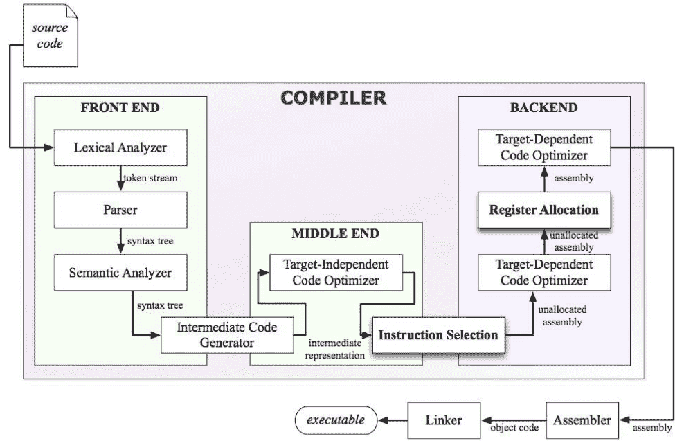

在这门课程中，我们将首先给你一个非常小的语言的前端和中间端，然后你需要编写后端，即执行指令选择和寄存器分配。因此，第2和第3讲将分别涉及指令选择和寄存器分配，以便你可以自己编写。

然后我们转向前端，并按顺序完成编译器的各个阶段，同时逐步增加需要编译的语言特性。大致上，我们将按照以下步骤进行，根据课程需要进行调整：
- 1. 一个简单的表达式语言
- 2. 循环和条件语句
- 3. 函数
- 4. 结构体和数组
- 5. 内存安全和基本优化

最后一个实验有些开放性，可以进一步实现优化、垃圾回收器，或者使用低级虚拟机（LLVM）实现新的后端。

## 参考文献

- [App98] Andrew W. Appel.现代编译器实现（ML版）.剑桥大学出版社，剑桥，英格兰，1998年。
- [MHJM09] Michael Matz, Jan Hubička, Andreas Jaeger, and Mark Mitchell. System V应用程序二进制接口，AMD64架构处理器补充。可在http://www.x86-64.org/documentation/abi.pdf找到，2009年5月。草案0.99。

1 请参阅http://llvm.org
2 感谢David Koes提供此图。

# 编译器设计讲义：第二讲

15-411：编译器设计
Frank Pfenning
第二讲
2013年8月29日

## 1 引言

在本讲中，我们讨论了指令选择的过程，通常将某种形式的中间代码转换为一个伪汇编语言，在其中我们假设有无限多个名为“temps”的寄存器。 然后，我们将寄存器分配应用于结果，将机器寄存器和堆栈槽分配给temps，然后生成实际的汇编代码。 关于指令选择的其他材料可以在教材[App98，第9章]中找到。

## 2 简单的源语言

我们使用一个非常简单的源语言，其中程序只是一系列以返回语句终止的赋值语句。 每个赋值语句的右侧是一个简单的算术表达式。 在课程的后期，我们将描述输入文本如何被解析并转换为某种中间形式。 在这里，我们假设我们已经到达了一种中间表示形式，其中表达式仍然以树的形式存在，我们必须生成伪汇编指令。 我们将这种形式称为IR树（Intermediate Representation Trees，中间表示树）

我们用一种伪语法描述可能的IR树，这不应该被看作是对具体语法的描述，而是对数据的递归结构的描述。

| 程序 | $\vec{s} ::=$ | $s_1, \ldots, s_n$ | 语句序列 |
| --- | --- | --- | --- |
| 语句 | $s ::=$ | $t = e$ | 赋值 |
|  | $|$ | return $e$ | 返回，总是最后一个 |
| 表达式 | $e ::=$ | $c$ | 整数常量 |
|  | $|$ | $t$ | 临时变量 |
|  | $|$ | $e_1 \oplus e_2$ | 二元操作 |
| 二元操作符 | $\oplus ::=$ | $+ \mid - \mid * \mid / \mid \ldots$ |  |

## 3 抽象汇编目标代码

对于我们非常简单的源代码，我们使用同样简单的目标代码。 我们的目标语言具有固定的寄存器，也有任意的临时变量，它们与IR树共享。

| 程序 | $\vec{i} ::=$ | $i_1, \ldots, i_n$ |  |
| --- | --- | --- | --- |
| 指令 $i$ | $::=$ | $d \leftarrow s$ |  |
|  | $|$ | $d \leftarrow s_1 \oplus s_2$ |  |
| 操作数 $d, s$ | $::=$ | $r$ | 寄存器 |
|  | $|$ | $c$ | 立即数（整数常数） |
|  | $|$ | $t$ | 临时变量 |

我们使用 $d$ 来表示指令的操作数，它们是操作的目的地而 $s$ 表示操作的来源。 有一些限制。 特别是，立即数操作数不能作为目的地。 当引入内存引用时，会出现更多的限制。 例如，可能不可能有多个操作数都是内存引用。

## 4 最大匹配

指令选择的最简单算法是自顶向下遍历输入树，并递归地将子树转换为指令序列。 为了使其正常工作，我们需要传递或返回一种方式来引用指令序列计算的结果。 在讲座中，建议传递一个操作的结果的目的地。 因此，我们必须实现一个函数

> $\operatorname{cogen}(d, e)$ 实现一系列指令，将结果放入目标 $d$ 。

| e | cogen(d, e) | 条件 |
|---|---|---|
| c | $d \leftarrow c$ | |
| t | $d \leftarrow t$ | |
| $e_1 \oplus e_2$ | cogen($t_1, e_1$), cogen($t_2, e_2$), $d \leftarrow t_1 \oplus t_2$ | $(t_1, t_2 \text{ new})$ |

如果我们的目标语言有更多专门的指令，我们可以通过匹配更专门的模式并首先匹配它们来轻松扩展此翻译。 例如：如果我们想要使用左移实现常数2的乘法，我们可以添加一到两个相应的模式。

| e | cogen(d, e) | 条件 |
|---|---|---|
| c | $d \leftarrow c$ | |
| t | $d \leftarrow t$ | |
| $2 * e$ | cogen($t, e$), $d \leftarrow t << 1$ | $(t \text{ new})$ |
| $e * 2$ | cogen($t, e$), $d \leftarrow t << 1$ | $(t \text{ new})$ |
| $e_1 \oplus e_2$ | cogen($t_1, e_1$), cogen($t_2, e_2$), $d \leftarrow t_1 \oplus t_2$ | $(t_1, t_2 \text{ new})$ |

由于 `*`是一个二元操作（也就是说， $\oplus$可以 `*`），现在需要匹配 $e$ 的模式，以避免歧义并获得预期的更高效实现。 如果我们总是在表达式的根部首先匹配最深的模式，这个算法被称为最大匹配。 这也是函数式编程语言内置的模式匹配能力在实现编译器时有用的第一个迹象。

现在，语句的翻译是直接的。 我们用 cogen($s$)表示实现语句 $s$ 的指令序列。 我们假设有一个特殊的返回寄存器 $r_{\text{ret}}$，使得返回指令被翻译为将结果移动到返回寄存器中。

| s | cogen($s$) |
|---|---|
| $t = e$ | cogen($t, e$) |
| return $e$ | cogen($r_{\text{ret}}, e$) |

现在，一个构成程序的语句序列只需通过将其翻译的指令序列附加在后面来进行翻译。 最大匹配在实践中很容易实现（特别是在具有模式匹配的语言中），并且可以得到可接受的结果。

## 5 最优指令选择

如果我们对指令有一个良好的成本模型，那么如果我们应用动态规划技术来构建指令序列，我们通常可以找到更好的翻译。以最小成本的方式,从树的底部向上构造。事实上,如果我们从树表达式开始,我们可以证明通过这种方式得到“最优”的指令选择。

在现代架构中,很难得出关于单个指令的实际成本模型。此外,由于现代处理器的特性(如流水线、乱序执行、分支预测、超线程等),这些成本并不是可加的。因此,当我们优化代码大小时,最优指令选择更为相关,因为指令的大小不仅是明确的,而且是可加的。由于我们在本课程中不考虑代码大小优化,因此我们不会进一步讨论最优指令选择。

## 6 x86-64 考虑因素

在 x86 或 x86-64 架构上的汇编代码并不像我们在这里假设的那样简单,即使我们只是尝试编译直线代码。

一个区别是 x86 处理器系列具有双地址指令,其中一个操作数将作为指令的源和目的地,而不是我们上面假设的三地址指令。另一个区别是一些操作与特定寄存器绑定,例如整数除法、模运算和一些移位操作。我们简要介绍如何解决这些特殊情况。

为了实现三地址指令,我们将其替换为一个移动指令和一个双地址指令。例如:

| 三地址形式 | 双地址形式 | x86-64 汇编 |
| --- | --- | --- |
| $d \leftarrow s_1+s_2$ | $d \leftarrow s_1$ | `MOVL` $s_1, d$ |
|  | $d \leftarrow d+s_2$ | `ADDL` $s_2, d$ |

在这里,我们使用GNU汇编语言约定,操作的目的地在最后,而不是Intel汇编语言格式,目的地在最前。

为了处理与特定寄存器绑定的操作,我们必须进行类似的转换。重要的是要保持这些寄存器的活跃范围尽可能短,以尽量少地干扰其他寄存器,如在寄存器分配的第3讲中所解释的。以整数除法为例。左边是简单的三地址形式。中间是一个合理的近似的二地址形式。右边是实际的x86汇编语言。

| 三地址形式 | 二地址形式(近似) | x86-64 汇编 |
| --- | --- | --- |
| $d \leftarrow s_1 / s_2$ | $\%eax \leftarrow s_1$ | `MOVL` $s_1, \%eax$ |
|  |  | `CLTD` |
|  | $\%eax \leftarrow \%eax / s_2$ | `IDIVL` $s_2$ |
|  |  | $\%edx \leftarrow \%eax \% s_2$ |
|  | $d \leftarrow \%eax$ | `MOVL` $\%eax, d$ |

在这里， `CLTD`将 `%eax`符号扩展为 `%edx`。 在英特尔指令集参考中，这个指令被称为 `CDQ`。 这是英特尔和GNU汇编器指令名称不同的相对较少的地方之一。 指令 `IDIVL` $s_2$将由 [`%edx`,`%eax`]表示的64位数除以$s_2$，商存储在 `%eax`中，余数存储在 `%edx`中。 请注意，当 $s_2$为 0时，或者存在溢出时（如果我们将补码表示的最小32位整数 $- 2^{31}$除以 $-1$）， `IDIVL`指令将引发除以零异常。

## 7 扩展

一般来说，指令选择和寄存器分配之间会存在相互依赖关系。 寄存器分配取决于执行哪些指令，特别是对于 x86-64 上的特殊指令。 此外，一些用于寄存器分配的分析可能取决于所选的指令。 然而，相反地，最佳指令可能取决于寄存器分配。 出于这些和类似的原因，最近的高级编译器，特别是那些遵循所谓的 SSA 中间表示的编译器，将寄存器分配和代码生成合并为一个联合阶段。

## 问题

- 1. 你如何实现本讲义中定义的中间表示的数据结构？
- 2. 与二地址表示相比，使用三地址中间表示有什么优势和劣势？反之亦然？
- 3. 使用宏展开进行指令选择的优势和劣势是什么？即，将每个独立的中间语言片段与一个指令序列关联起来。
- 4. 为什么许多CPU提供了如此不对称的指令集？ 为什么它们不只是提供所有有用的指令而不需要特殊的寄存器要求？

## 参考文献

- [App98] Andrew W. Appel. ML中的现代编译器实现. 剑桥大学出版社，英格兰剑桥，1998年。

# 编译器设计讲义：第三讲

15-411：编译器设计
Frank Pfenning， André Platzer
第三讲
2013年9月3日

## 1 引言

在本讲座中，我们讨论寄存器分配，这是编译器在代码发射之前的最后一步之一。它的任务是将伪汇编中的潜在无限数量的变量或“临时变量”映射到目标机器上实际可用的寄存器。如果可用的寄存器不足，一些值必须保存到堆栈中，并从堆栈中恢复，这比直接在寄存器上操作要低效得多。因此，寄存器分配在编译器中非常重要，并且已经成为许多研究的主题。寄存器分配也在教材[App98，第11章]中进行了详细介绍，但其中描述的算法很复杂，难以实现。我们在这里介绍了一种基于和弦图着色的简化算法，该算法由Hack [Hac07]和Pereira和Palsberg [PP05]提出。Pereira和Palsberg已经证明，即使干扰图不是和弦图，该算法在典型程序上的性能也很好。我们针对x86-64系列处理器，这也有助于，因为它有16个通用寄存器，所以寄存器分配比只有8个寄存器的x86“拥挤”得少（忽略浮点寄存器和其他特殊寄存器）。

> 下面的大部分材料都基于Pereira和Palsberg [PP05]¹，更多的背景、参考资料、细节、实证评估和示例可以在那里找到。
> ¹可在http://www.cs.ucla.edu/~palsberg/paper/aplas05.pdf找到

## 2 构建干扰图

如果两个变量在程序中的某个点需要保存两个不同的值，那么它们需要分配给两个不同的寄存器。这个问题对于带有循环的程序来说是不可判定的，所以在编译器的上下文中，我们将其简化为活跃性。如果一个变量在给定的程序点上被使用，那么它被称为活跃的。同样，我们将无法在编译时准确预测这种情况，但是我们可以通过下一节讲座中讨论的一种特定形式的数据流分析来近似活跃性。如果我们对变量的活跃信息进行了（正确的）近似，那么无论它们的活跃范围是否重叠，两个变量都不能在同一个寄存器中，因为它们可能同时被使用。

在我们简单的直线表达式语言中，这特别容易。我们从最后一行开始，反向遍历程序。我们注意到最后一条指令执行后，返回寄存器 `%eax` 仍然有效。如果一个变量在一行上是活跃的，那么在前一行它也是活跃的，除非在该行上对其进行了赋值。而且，在指令的右侧使用的变量在该指令中是活跃的。²作为示例，我们考虑在我们的伪汇编语言中计算第五个斐波那契数的简单直线计算。我们在每条指令旁边列出在执行该行之前是活跃的变量。这些被称为指令的活跃变量。

|  | 活跃变量 |
|---|---|
| $f_1 \leftarrow 1$ | · |
| $f_2 \leftarrow 1$ | $f_1$ |
| $f_3 \leftarrow f_2 + f_1$ | $f_2, f_1$ |
| $f_4 \leftarrow f_3 + f_2$ | $f_3, f_2$ |
| $f_5 \leftarrow f_4 + f_3$ | $f_4, f_3$ |
| $\%eax \leftarrow f_5$ | $f_5$ |
| 返回 | `%eax` 返回寄存器 |

干扰图的节点是程序的变量和寄存器。
如果相应的变量干扰并且应该分配给不同的寄存器，则两个节点之间存在（无向）边。从一个节点到自身永远没有边，因为在任何特定的使用中，变量 $x$ 被放在相同的寄存器中。我们区分两种形式的指令。

- 对于一个 $t \leftarrow s_1 \oplus s_2$ 指令，我们在 $t$ 和任何不同的变量之间创建一条边变量 $t_i$ = 这一行之后的活跃变量，即后继的活跃变量。$t$ 和 $t_i$ 应该分配给不同的寄存器，因为否则对 $t$ 的赋值可能会破坏 $t_i$ 的正确内容。
- 对于一个 $t \leftarrow s$ 指令（移动），我们在 $t$ 和任何不同于 $t$ 和 $s$ 的活跃变量之间创建一条边。我们省略了可能存在的边
²注意，我们不必在所有位置上都讲相同的变量放在相同的寄存器中，但可以在不同的指令中选择不同的寄存器（通过适当的复制）。但是SSA已经解决了这个问题，我们稍后会看到。

### 寄存器分配

t和s因为如果它们恰好被分配到相同的寄存器中，那么在这个（现在多余的）移动之后，它们仍然保持相同的值。当然，可能还有其他的t和s的出现，强制它们被分配到不同的寄存器中。

对于上面的例子，我们得到以下干扰图。

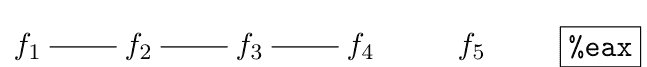

这里，寄存器%eax是特殊的，因为作为一个寄存器，它已经预定义了并且不能随意分配给另一个寄存器。在寄存器分配过程中，必须特别注意预定义寄存器；请参阅第9节中的一些附加说明。

## 3 通过图着色进行寄存器分配

一旦我们构建了干扰图，我们可以将寄存器分配问题表述为：构建一个将K个颜色（表示K个寄存器）分配给图的节点（表示变量）的分配，使得相连的两个节点不具有相同的颜色。如果不存在这样的着色，则必须将一些变量保存在堆栈上，这被称为spilling。

不幸的是，对于K ≥ 3，任意图是否可K-可着色的问题是NP-完全的。Chaitin [Cha82] 通过展示对于任何图G，都存在某个程序其干扰图为G，证明了寄存器分配也是NP-完全的。换句话说，不能指望存在一个在所有机器程序上都能工作的理论上最优和高效的寄存器分配算法。

幸运的是，在实践中情况并不那么严峻。一个特别重要的中间形式是静态单赋值（SSA）。Hack [Hac07]观察到，对于处于SSA形式的程序，干扰图总是具有一种特定的形式，称为和弦图。对于和弦图的着色可以在时间O(|V|+|E|)（因此最多二次方大小）内完成，并且在实践中非常高效。更好的是，Pereira和Palsberg [PP05] 指出，在实践中出现的程序中，有多达95%的程序具有和弦干扰图。此外，即使图形不完全是和弦的，使用为和弦图设计的算法在实践中也表现良好，这只会导致不必要的溢出，而不是错误。最后，与教科书中的复杂算法相比，用于着色和弦图的算法非常容易实现。当然，你可以选择任何你喜欢的寄存器分配算法，但我们建议你选择基于和弦图的算法，本讲义的其余部分将对此进行解释。

## 4 和弦图

如果每个具有4个或更多节点的循环都有一个弦，即连接循环上的两个节点的边不是循环的一部分，则无向图是和弦的。考虑以下三个例子：

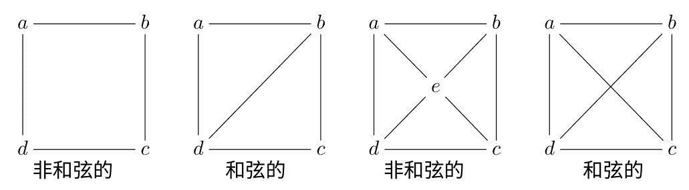

只有第二个和第四个是和弦的（需要检查多少个循环以找到弦？）。在其他两个例子中，循环abcd没有弦。特别是，非和弦性的影响是，a和c以及b和d可以安全地使用相同的颜色，而在和弦的情况下则不行。

在和弦图上，可以通过两个阶段进行最优着色，其中最优表示使用最少的颜色。在第一阶段，我们确定节点的特定顺序，在着色节点时按照这个顺序进行。

这个顺序被称为简单消除顺序。在第二阶段，我们根据这个顺序应用贪婪着色。这些将在接下来的两个部分中解释。

## 5 简单消除顺序

图中的节点v如果其邻居节点构成一个团，则称其为简单节点，即所有节点v的邻居节点互相连接，因此需要不同的颜色。对于图中节点v₁, ..., vₙ的顺序，简单消除顺序是指在子图v₁, ..., vᵢ中，每个节点vᵢ都是简单节点。有趣的是，一个图具有简单消除顺序当且仅当它是弦图。也就是说，我们不会在这些图上做出次优的决策，假装之前出现的邻居节点需要被分配不同的颜色。此外，弦图所需的颜色数量最多等于其最大团的大小。

我们可以使用最大基数搜索来找到简单消除顺序，该算法的运行时间为O(|V| + |E|)（因此在程序规模上最多为二次）。该算法为每个顶点关联一个权重wt(v)，初始值为0，并由算法进行更新。权重wt(v)表示在搜索过程中已选择了多少个节点v的邻居节点。我们用N(v)表示节点v的邻域，即所有相邻节点的集合。

这样从非弦图中得到的排序可以在着色阶段仍然正确使用，但不能保证只使用最小数量的颜色。实际上，对于非弦图，按照这里描述的方式生成消除顺序相当于假设邻域的所有节点都存在冲突，这是保守但次优的。对于弦图，这个假设实际上是合理的，并且正确分配的寄存器也是最优的。

### 算法：最大基数搜索

```
输入：G=(V, E) 其中 |V|=n
输出：一个单纯消除序列 v₁, ..., vₙ
对于所有 v ∈ V 设置 wt(v) ← 0
令 W ← V
对于 i ← 1 到 n 执行
    令 v 为 W 中的最大权重节点
    设置 vᵢ ← v
    对于所有 u ∈ W ∩ N(v)，设置 wt(u) ← wt(u) + 1
    设置 W ← W \ {v}
```

在我们的例子中，

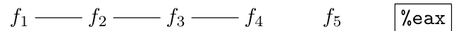

如果我们首先选择f₁，f₂的权重将变为1，并且必须第二选择，接着是f₃和f₄。只剩下f₅，它将最后出现，忽略已经着色为特殊寄存器的节点%eax。很容易看出这确实是一个简单消除顺序。

相反，f₂，f₄，f₃，...不是，因为f₃在子图f₂，f₄，f₃的邻居中不形成一个团。事实上，当按照任意（假设不同的）顺序给f₂和f₄着色时，它们会要求f₃采用第三种颜色，这是次优的。

## 6 贪婪着色

给定一个顺序，我们可以通过简单地按照这个顺序为顶点分配颜色来应用贪婪着色，始终使用最低可用的颜色。最初，节点在V中没有被分配颜色。我们用Δ(G)表示G中一个节点的最大出度。该算法将始终分配最多Δ(G) + 1个颜色。如果顺序是一个单纯消除顺序，则结果还保证是最优的，即使用最少可能的颜色。

### 算法：贪婪着色

```
输入：G=(V,E) 和有序序列 v₁,...,vₙ 的节点。
输出：分配 col: V → {0,...,Δ(G)}。
对于 i 从 1 到 n 循环执行
    令 c 为 N(vᵢ) 中未使用的最低颜色
    设置 col(vᵢ) ← c
```

在我们的例子中，我们只是交替分配颜色：


当然，%eax由其中一种颜色表示。假设这种颜色是0并且%edx是寄存器编号1，我们得到以下程序：

```
%eax ← 1
%edx ← 1
%eax ← %edx + %eax
%edx ← %eax + %edx
%eax ← %edx + %eax
%eax ← %eax // 多余的自我移动
```

显然可以进行一些优化。有些是立即的，比如将寄存器移动到自身的多余移动。我们在第8节中讨论另一个称为寄存器合并的优化。

## 7 寄存器溢出

因此，考虑到我们已经应用了上述着色算法，并且发现需要的颜色比可用的寄存器多。在这种情况下，我们需要保存一些临时值。在我们的运行时架构中，堆栈是显而易见的位置。实现这一点的一种方便的方法是将堆栈槽分配给一些颜色，而不是寄存器。选择要溢出的颜色可以对运行时间产生重大影响。Pereira和Palsberg提出了两个启发式方法：（i）溢出使用最少的颜色，（ii）溢出由贪婪算法分配的最高颜色。对于具有循环和嵌套循环的程序，变量或某些颜色在程序中的使用位置也可能很重要：在寄存器中频繁使用内部循环的变量对某些程序可能至关重要。

一旦我们为颜色分配了堆栈槽位，就很容易使用溢出的临时变量来重写代码，如果需要时，我们可以提前为堆栈和寄存器之间的移动保留一个寄存器。例如，如果在x86-64上%r11被保留用于必要时的保存和恢复，那么$t \leftarrow t + s$，其中$t$被分配给堆栈偏移8和$s$被分配给%eax可以重写为

```
%r11    ←  8(%rsp)
%r11    ←  %r11 + %eax
8(%rsp) ←  %r11
```

有时，这是不必要的，因为某些操作可以直接使用内存引用进行。因此，上述代码的汇编代码可能会更短

```
ADDL %eax, 8(%rsp)
```

尽管不清楚这比一个3指令序列更高效多少

```
MOVL 8(%rsp), %r11
ADDL %eax, %r11
MOVL %r11, 8(%rsp)
```

我们建议为溢出代码生成最简单的统一指令序列。

扩展在寄存器分配中用于打破决定将临时变量溢出到内存的平局的启发式方法包括：
- 可以轻松重新计算的值，即可以从其他寄存器轻松重新计算（例如，使用1或2条指令）或者可以从少量内存访问中加载或重新计算。当从内存重新计算时，指令的放置需要根据缓存和流水线效率的原因进行适当的调度。
- 在（可能的）控制流中不会很快再次使用的（大致）值，将循环体计算为“更近”而不是循环退出。
- 与许多其他值发生干扰的值。

特别是在SSA程序上，在最终寄存器分配之前决定寄存器溢出有时可能更高效，这可以帮助指令选择的相互作用。在SSA程序上，可以在不显式构建干扰图的情况下进行寄存器分配（基于支配树的后缀顺序）。原因是中心SSA关系由支配树表示。通过对支配树进行前序遍历顺序定义了一个单纯消除顺序，从而使寄存器分配是直接的。因此，如果您稍后选择实现SSA，则有必要重新考虑寄存器分配和干扰图构建以进行可能的简化。

## 8 寄存器合并

在寄存器分配之后，通常会使用一种称为寄存器合并的进一步优化来消除寄存器之间的移动。寄存器合并的算法通常与寄存器分配紧密集成。相比之下，Pereira和Palsberg描述了一种相对简单的方法，该方法完全在图着色之后执行，称为贪婪合并。

贪婪合并遵循以下原则：
- 1. 逐个考虑程序中发生的变量之间的移动 $t \leftarrow s$。
- 2. 如果 $t$ 和 $s$ 具有相同的颜色，则可以消除该移动而无需进一步操作。
- 3. 如果它们之间存在边，即它们干扰，它们不能合并。
- 4. 否则，如果存在一个颜色 $c$ 在 $t$ 和 $s$ 的邻域中未使用，即 $c \in N(t) \cup N(s)$，并且小于可用寄存器的数量，则将变量 $t$ 和 $s$ 合并为一个新的变量 $u$，颜色为 $c$。然后从 $u$ 到 $N(t) \cup N(s)$ 中的任何顶点创建边，并从图中删除 $t$ 和 $s$。

由于测试条件，结果图仍然是 $K$-着色的，其中 $K$ 是可用寄存器的数量。当然，我们还需要适当地重写程序，以保持与图的对应关系。

这种简单的贪心合并将消除上面示例中多余的自我移动。将优化寄存器合并问题减少为整数线性规划可以实现，但这可能会太慢。

## 9 预着色节点

x86-64上的一些指令，例如整数除法IDIV，要求它们的参数以特定的寄存器传递，并且返回结果也在特定的寄存器中。还有一些使用特定寄存器并且必须遵守调用者保存和被调用者保存寄存器约定的call和ret指令。我们将在课程后期讨论调用约定的问题。在生成直线程序的代码时，例如在第一个实验室中，必须小心保存和恢复被调用者保存寄存器，以防需要使用它们。

首先，对于代码生成，固定寄存器的活跃范围应该受限制，以避免可能的正确性问题并简化寄存器分配。

其次，对于寄存器分配，我们可以构建一个消除顺序，就好像所有预着色节点都被列在最前面一样。这相当于初始权重的普通顶点被设置为在最大基数搜索算法开始之前预着色的邻居数量。

普通顶点的结果列表可能是或可能不是一个简单消除顺序，但我们仍然可以像以前一样进行贪婪着色。这个算法的描述可能比教科书中的算法简单，并且似乎性能相当。

## 10 总结

寄存器分配是编译器中的一个重要阶段。它使用变量的活跃信息将无限多的变量映射到有限数量的寄存器，并在必要时将临时变量溢出到堆栈插槽。这里描述的算法是由Hack [Hac07]和Pereira和Palsberg [PP05]提出的。它比教科书中的算法更简单，并且似乎性能相当。它通过以下步骤进行：
- 1. 从活跃信息中构建干扰图。
- 2. 使用最大基数搜索对节点进行排序。
- 3. 根据消除顺序贪心地对图进行着色。
- 4. 如果需要的颜色超过可用的寄存器，则进行溢出。
- 5. 贪心地合并非干扰的移动相关节点。

最后一步，合并，是一种优化，不需要生成正确的代码。在上述参考文献中描述了在着色之前单独进行溢出的变体，可以进一步提高生成代码的效率。

对于来自SSA程序并经常直接出现的和弦图，寄存器分配在实践中是多项式和高效的。然而，最优的寄存器合并和最优的溢出仍然是NP完全的。即使使用启发式算法，在编译器运行期间，寄存器分配可能会消耗最多的时间。

## 问题
- 1. 为什么寄存器分配需要这么长时间？它是多项式的，不是吗？
- 2. 限制干扰图定义为指令 $t \leftarrow s_1 \oplus s_2$是否安全，仅限于该行之后 $t$ 仍然活跃的情况？
- 3. 与第2节中给出的构造相比，使用“重叠的活跃区间”直觉的优势是什么？
- 4. 寄存器分配的起始位置是否有影响，即我们从哪里开始构造一个单纯序列？
- 5. 对于具有混合数据类型的程序，寄存器分配是否比具有统一类型的程序更困难？为什么？
- 6. 为什么图的弦性对于寄存器分配很有意思？
- 7. 为什么要担心分配低数据宽度的半寄存器？访问双字等字之外的字是否低效？访问字之外的字节是否低效？
- 8. 在2地址或3地址指令形式上，寄存器合并是否更有效？

## 参考文献

[App98] Andrew W. Appel. ML中的现代编译器实现. 剑桥大学出版社，英格兰剑桥，1998年。

[Cha82] Gregory J. Chaitin. 通过图着色进行寄存器分配和溢出. 在编译器构造研讨会的论文集中，页码为98-105，马萨诸塞州波士顿，1982年6月。ACM出版社。

[Hac07] Sebastian Hack. 用于SSA形式程序的寄存器分配。博士学位论文，卡尔斯鲁厄大学，2007年10月。

[PP05] Fernando Magno Quint˜ao Pereira和Jens Palsberg. 通过和弦图的着色进行寄存器分配。在K.Yi编辑，第三届亚洲编程语言和系统研讨会（APLAS'05）的论文集中，页码为315-329，日本筑波，2005年11月。Springer LNCS 3780。

## 编译器设计讲义
### 活跃性分析
# 15-411:编译器设计
Frank Pfenning, André Platzer
## 第4讲
## 2013年9月5日

## 1 引言

在课程中，我们将看到不同类型的程序分析，其中大部分是为了进行程序优化。第一个，活跃性分析，是寄存器分配所必需的。在给定的程序点，如果一个变量在计算的剩余部分中将被使用，则该变量在该点是活跃的。我们使用这些信息来决定两个变量是否可以安全地映射到同一个寄存器，如上一讲所详细介绍的。

活跃性是否可判定？像程序的许多其他属性一样，如果我们分析的语言是图灵完备的，活跃性是不可判定的。我们在这里描述的近似方法是标准的，尽管其表达方式不同。教材[App98]的第10章有一个经典的介绍。

## 2 通过反向传播进行活跃性分析

考虑一个应用二元运算符 ⊕ 的3地址指令：

```
x ← y ⊕ z
```

一个变量在这个指令中可能是活跃的原因有两个，我们指的是在指令执行之前活跃。第一个原因很明显：如果一个变量（这里是y和z）在一个指令中被使用，它将从这里开始参与计算。第二个原因稍微微妙一些：因为我们接下来执行下一个指令，我们确定在下一个指令中是活跃的任何东西也在这里是活跃的。这个第二个规则有一个例外：因为我们给x赋值，进入这个指令的x的值无关紧要（除非它是y或z），即使它在下一个指令中是活跃的。总结起来，

1. $y$和$z$在指令 $x \leftarrow y \oplus z$中是活跃的。
2. $u$在 $x \leftarrow y \oplus z$的下一条指令中是活跃的，且 $u=x$。

类似地，对于带有常量$c$的指令 $x \leftarrow c$，如果$u$在该指令中是活跃的，那么$u$在下一条指令中也是活跃的，且$u=x$。

作为最后一个例子，在返回指令 return $x$中，$x$是活跃的，而其他变量都不是活跃的。

如果我们有一个直线程序，通过从末尾的返回指令开始，反向遍历程序可以很容易地计算活跃性信息。在这种情况下，它是精确的而不是近似的。作为一个例子，可以使用上述两个规则自下而上地构建简单程序中每行的活跃变量集合。

| 指令 | 活跃变量 |
| --- | --- |
| $x_1 \leftarrow 1$ | · |
| $x_2 \leftarrow x_1 + x_1$ | $x_1$ |
| $x_3 \leftarrow x_2 + x_1$ | $x_1, x_2$ |
| $y_2 \leftarrow x_1 + x_2$ | $x_1, x_2, x_3$ |
| $y_3 \leftarrow y_2 + x_3$ | $y_2, x_3$ |
| return $y_3$ | $y_3$ |

例如，在第4行，我们可以看到 $x_1$和 $x_2$是活跃的，因为根据第一条规则（它们被使用了），而 $x_3$是活跃的，因为它在下一条指令中是活跃的，并且与 $y_2$不同。

## 3 逻辑形式的活跃性分析

在我们推广到更复杂的指令语言之前，我们尝试以符号形式指定活跃性分析的规则，以使它们更简洁，并避免任何潜在的歧义。为此，我们为程序中的每条指令赋予一个行号或标签。如果一条指令有标签$l$，我们将下一条指令的标签写为$l+1$。

我们还引入谓词 live($l, x$)，当变量$x$在第$l$行是活跃的时，该谓词应为真。然后，我们将以英语非正式陈述的规则转化为逻辑规则。

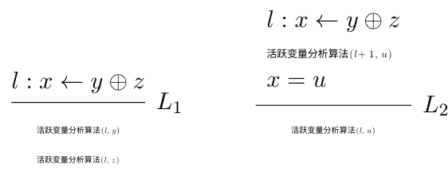

在这里，线上方的公式是推理规则的前提条件，线下方的公式是结论。如果所有前提条件都为真，我们知道所有结论必须为真。在线的右边我们写推理规则的名称。例如，我们可以将规则 $L_1$ 读作：“如果行 $l$ 具有形式 $x \leftarrow y \oplus z$，那么 $y$ 在 $l$ 处是活跃的，$z$ 在 $l$ 处也是活跃的。”

这比向后传播算法更抽象，因为它没有指定应用这些规则的顺序。现在我们可以为不同类型的指令添加更多规则。

```
l: return x
live(l, x)  L3
```

```
l: x ← c
live(l+1, u)
x = u
────────────  L4
活跃变量分析算法(l, u)
```

如果我们只有二进制运算符、常量移动到变量和返回指令，那么这四条规则构成了程序中变量何时应该活跃的完整规范。$^{1}$

这个规范也导致了一种即时但有些不确定性的实现。我们从一个初始事实数据库开始，只包含原始程序，每行都有正确的标签。然后我们按照任意顺序应用规则——只要前提条件都在数据库中，我们就将结论添加到数据库中。应用一条规则可能会使另一条规则得以应用，依此类推，但最终这个过程不会再给我们带来更多信息。在这一点上，我们仍然可以应用规则，但所有的结论都已经在事实数据库中。我们称这个数据库为饱和的。由于这些规则是我们活跃性分析的完整规范，根据定义，变量 $x$ 在行 $l$ 上被认为是活跃的，当且仅当事实 live($l, x$) 在饱和的数据库中。

这种计算活跃性的方式可能看起来昂贵，但实际上在理论和实践中都可以非常高效。

从理论上讲，我们可以查看规则并通过（a）计算所谓的前缀触发每个规则的次数，以及（b）限制完成数据库的大小来确定它们的理论复杂度。我们将在以后的讲座中回顾前缀触发的概念，这是由 McAllester [McA02] 提出的。限制完成数据库的大小很容易。我们可以推断出程序中形式为 live($l, x$) 的最多 $L \cdot V$ 个不同的事实，其中 $L$ 是行数，$V$ 是变量数。在这里计算前缀触发不会改变任何东西，到目前为止，我们得到的理论复杂度为 $O(L \cdot V)$。

在实践中，有许多方法可以高效地实现逻辑规则和饱和。其中一种方法是使用二进制决策图（BDD）。Whaley，Avots，Carbin 和 Lam [WACL05] 已经展示了全局程序的可扩展性。

$^{1}$ 正如在讲座中指出的那样，我们真的应该有一个纯粹的移动指令 $x \leftarrow y$。我们将其留给读者来写出额外的规则。

## 4 循环和条件语句

使用推理规则进行分析，转写为所谓的Datalog程序。请参阅Smaragdakis和Bravenboer关于Doop [SB10]的工作，了解不同的技术。不幸的是，我们没有一个可以轻松与我们的编译器集成的Datalog库，因此虽然我们通过使用推理规则来指定和分析程序分析的结构，但我们通常不以这种方式实现它们。相反，我们使用其他实现方式，这些实现方式通过逻辑规则精确而简洁地确定了思想。因为我们的逻辑规则确定了基本原则，所以这种表达方式更容易理解活性分析的重要内容。这也有助于捕捉不同实现风格之间的实现无关的共同性。在整个课程中，我们将看到逻辑规则可以以类似简单的方式捕捉许多其他重要概念。

当语言允许循环时，活跃性分析的性质发生了显著变化。对于大多数其他程序分析，情况也是如此。

在这里，我们添加了两种新的指令形式：无条件跳转 `l: goto l'`，和条件分支 `l: if (x ? c) goto l'`，其中“?”是一个关系运算符，如相等或不等。

现在我们讨论如何扩展这两种指令的活跃性分析。如果变量 u 在 `l: goto l'` 处是活跃的，则它在 l' 处也是活跃的。我们用以下推理规则来捕捉这一点，这是唯一与 goto 相关的规则。

```
live(l', u)
______________________  L5
活跃变量分析算法(l, u)
```

执行条件分支 `l: if (x ? c) goto l'` 时，我们有两个潜在的后继指令：如果条件为假，则可能转到下一个 l+1；如果条件为真，则可能转到 l'。一般来说，我们无法在编译时预测条件是真还是假，通常在程序执行过程中有时为真，有时为假。因此，如果变量在可能的后继 l+1 处活跃，或者在可能的后继 l' 处活跃，则我们必须考虑它在 l 处是活跃的。此外，该指令使用了变量 x，因此 x 是活跃的。总结这些规则，我们得到：

```
l: if (x ? c) goto l'                l: if (x ? c) goto l'                l: if (x ? c) goto l'
live(l, x)                          active(l+1, u)                      live(l', u)
       L6                           活跃变量分析算法(l, u) L7               活跃变量分析算法(l, u) L8
```

这些规则很直观，但是如果我们有向后的分支，我们将无法在单个向后遍历中进行分析。为了说明这一点，我们将使用一个简单的程序来计算两个正整数的最大公约数。

[PAGE 24 内容合并]

我们假设在标记为1的第一条语句中，变量 x1 和 x2 保存了输入，并且我们应该计算并返回 gcd(x1, x2)。 We assume that at the first statement labeled 1, variables $x_1$ and $x_2$ hold the input, and we are supposed to calculate and return gcd($x_1$, $x_2$).

| 指令 | 活跃变量（最初） |
| :--- | :--- |
| 1 : if (x2 = 0) goto 8 | |
| 2 : $q \leftarrow x_1/x_2$ | |
| 3 : $t \leftarrow q * x_2$ | |
| 4 : $r \leftarrow x_1 - t$ | |
| 5 : $x_1 \leftarrow x_2$ | |
| 6 : $x_2 \leftarrow r$ | |
| 7 : goto 1 | |
| 8 : return $x_1$ | |

如果我们从第8行开始，我们可以看到 $x_1$ 在那里是活跃的，但我们无法得出结论（尚未）在第7行是活跃的，因为在第1行，跳转的目标，没有任何已知的活跃变量。经过一次程序遍历，列出到目前为止已知的所有活跃变量，我们得到：

| 指令 | 活跃变量（第1次遍历后） |
| :--- | :--- |
| 1 : if (x2 = 0) goto 8 | $x_1, x_2$ |
| 2 : $q \leftarrow x_1/x_2$ | $x_1, x_2$ |
| 3 : $t \leftarrow q * x_2$ | $x_1, x_2, q$ |
| 4 : $r \leftarrow x_1 - t$ | $x_1, x_2, t$ |
| 5 : $x_1 \leftarrow x_2$ | $x_2, r$ |
| 6 : $x_2 \leftarrow r$ | $r$ |
| 7 : goto 1 | . |
| 8 : return $x_1$ | $x_1$ |

在这一点上，我们可以应用 goto 规则到第7行，一次使用变量 $x_1$ 和一次使用 $x_2$，现在已知它们都在第1行是活跃的。我们列出现在更靠右的变量，并通过程序进行另一次遍历，应用更多的规则。

### 活跃性分析

| 指令 | 第1次遍历后 | 第2次遍历后 | 饱和 |
| :--- | :--- | :--- | :--- |
| 1 : if (x2 = 0) goto 8 | $x_1, x_2$ | | |
| 2 : $q \leftarrow x_1/x_2$ | $x_1, x_2$ | | |
| 3 : $t \leftarrow q * x_2$ | $x_1, x_2, q$ | | |
| 4 : $r \leftarrow x_1 - t$ | $x_1, x_2, t$ | | |
| 5 : $x_1 \leftarrow x_2$ | $x_2, r$ | | |
| 6 : $x_2 \leftarrow r$ | $r$ | $x_1$ | |
| 7 : goto 1 | . | $x_1, x_2$ (来自 1) | |
| 8 : return $x_1$ | $x_1$ | | |

到目前为止，我们的规则已经饱和，我们已经确定了所有程序点上的活跃变量。从这个我们现在可以构建干扰图，并从那里进行寄存器分配。

饱和推理规则的算法意味着变量只有在我们有确定的理由相信它可能是活跃的时候，才会在给定行上被指定为活跃的。考虑以下程序：

```
1 : u1 ← 1
2 : y ← y * x
3 : z ← y + y (z 未使用，冗余)
4 : x ← x - u1
5 : if (x > 0) goto 2
6 : return y
```

该程序在第3行中有一个冗余的对 z 的赋值。由于 z 从未被使用，在这个程序中没有地方发现 z 是活跃的。然而，除非我们完全消除第3行，否则我们必须小心注意 z 与 x、u1 和 y 的干扰，因为这些变量在第4行是活跃的。如果不这样做，z 可能会被分配与 x、y 或 u1 相同的寄存器，并且对 z 的赋值将覆盖它们中的一个值。

在稍微不同的程序中：

```
1 : u1 ← 1
2 : y ← y * x
3 : z ← z + z (z 活着但从未被使用)
4 : x ← x - u1
5 : if (x > 0) goto 2
6 : return y
```

变量 z 实际上将被推断为在第1到第5行是活跃的。这是因为它在第3行被使用，尽管最终的值被忽略了。捕捉这种冗余是死代码消除的目标，这需要需要性分析而不是活性分析。我们将在以后的讲座中介绍这个。

## 5 重构活性分析

图1总结了规定活性分析的规则。

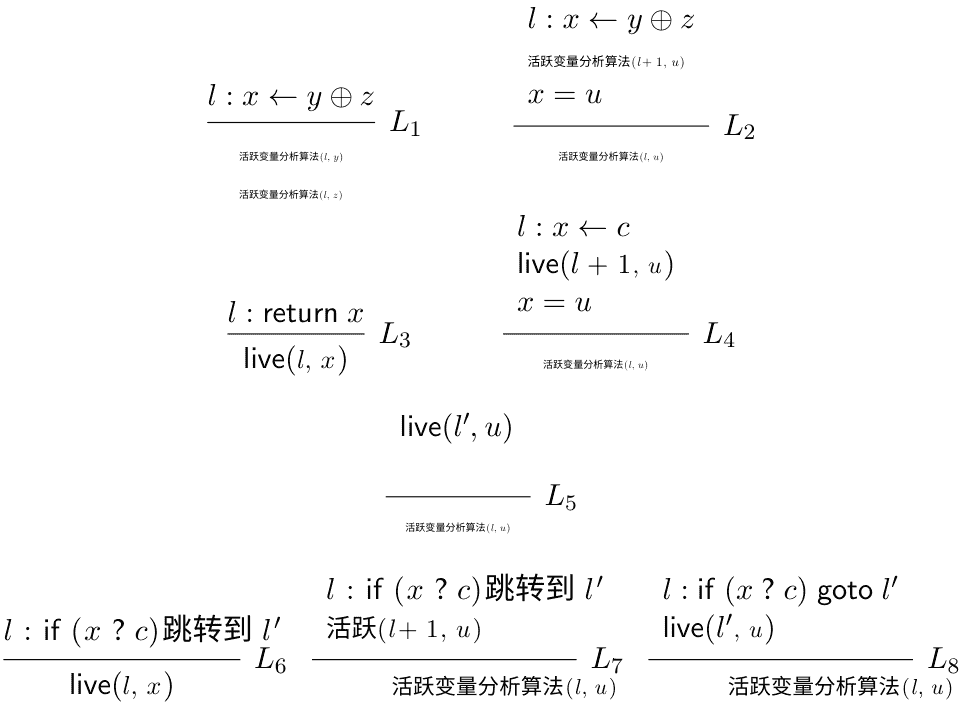

图1：总结：规定活性分析的规则（非重构）

这种规范的风格是精确且可实现的，但有些重复。例如，$L_2$和 $L_4$是相似的规则，从 $l+1$ 传播活性信息到 $l$，而 $L_1$， $L_3$和 $L_6$是相似的规则记录变量的使用。

如果我们以过程方式指定活跃性，我们将尝试通过创建新的辅助过程来抽象出常见的模式。但是，当我们通过推理规则来查看规范时，这种重构的类比是什么？这个想法是识别常见的概念并将它们提炼成新的谓词，从而抽象出指令的个体形式。

在这里，我们得到了三个新的谓词：

- 1. $\text{use}(l, x)$：位于 $l$ 的指令使用变量 $x$。
- 2. $\text{def}(l, x)$：位于 $l$ 的指令定义（即写入）变量 $x$。
- 3. $\text{succ}(l, l')$：位于 $l$ 之后执行的指令可能是 $l'$。

现在我们将规则集分为两部分。第一部分分析程序并生成 $\text{use}$、$\text{def}$ 和 $\text{succ}$ 事实。我们对这个第一部分的规则进行饱和运行。

然后，第二组规则使用这些谓词推导出关于活跃性的事实。它不直接涉及程序指令-我们已经从中抽象出来。

我们先写第二个程序。它将以下两个非正式规则翻译成逻辑语言：
1. 如果一个变量在 l 处被使用，那么它在 l 处是活跃的。
2. 如果一个变量在可能的下一条指令处是活跃的，并且在当前指令处没有被定义，那么它在当前指令处是活跃的。

```
use(l, x) / live(l, x)  K_1
live(l', u)
succ(l, l')
¬def(l, u) / K_2
```

在这里，我们使用 ¬ 来表示否定，这是一个在使用饱和逻辑规则时更加重要的运算符。为了使其定义明确，我们需要知道 def 不依赖于 live。任何实现在应用与活跃性相关的规则之前，必须首先饱和关于 def 的事实，因为形如 `def(l, -)` 的事实的缺失并不意味着在未来的推理中不可能发现这样的事实-除非我们首先饱和 def 谓词。在这里，我们可以轻松地首先应用所有可能推导出形如 `def(l, u)` 的事实的规则，直到饱和为止。如果在使用这些规则（下面的 J_1 ... J_5 ）饱和之后，仍未得出 `def(l, u)` ，那么我们知道 `¬def(l, u)` ，因为我们已经彻底应用了所有可能推导出它的规则。因此，在饱和所有关于 `def(l, u)` 的规则之后，我们可以饱和所有关于 `live(l, u)` 的规则。如果有一个推导出 `def(l, u)` 的规则依赖于形如 `live(l', v)` 的前提，那么这种简单的分阶段饱和将会失效，但实际上并非如此。

我们回到第一组规则。它必须检查每个指令并提取使用、定义、以及后继和前驱谓词。我们可以编写几个子集的规则：一个子集用于生成定义，一个子集用于生成使用等等。相反，我们只为每个指令编写一个规则，并为所有所需的谓词提供多个结论。

```
l: x ← y ⊕ z /  定义(l, x) / 使用(l, y) / 使用(l, z) / 后继(l, l+1)  J_1
l: return x /   使用(l, x)                                           J_2
l: x ← c /      定义(l, x) / 后继(l, l+1)                           J_3
l: goto l' /    后继(l, l')                                          J_4
l: if (x ? c) goto l' / 使用(l, x) / 后继(l, l') / 后继(l, l+1)      J_5
```

## 6 控制流

很容易看出，即使有任意数量的新指令，这个规范也可以模块化地扩展。在规则 $K_1$ 和 $K_2$ 中，活跃性分析的主要定义保持不变，并捕捉了活跃性分析的本质。

理论复杂度不变，因为每个阶段后数据库的大小仍然是 $O(L \cdot V)$。唯一需要注意的是，即使后继关系看起来被 $O(L \cdot L)$ 限制，任何行 $l$ 最多只能有两个后继，所以它只是 $O(L)$。

程序的控制流属性体现在前一节中引入的后继关系中。控制流图是一个图，其顶点是程序的行，如果存在后继关系 $(l, l')$，则有一条边连接 $l$ 和 $l'$。它捕捉了控制流的可能流动，而不考虑实际传递的值。

教科书[App98]建议使用显式控制流图的表示，以及使用基本块来加速分析。基本块是一段简单的直线代码片段，始终从开头进入并在结尾退出。也就是说：

- 第一条语句可能有一个标签；
- 最后一条语句终止当前块的控制流（通过goto、条件分支或返回），并且
- 中间的其他语句没有标签（入口点）和没有goto或条件分支（出口点）。

从逻辑角度来看，基本块不会改变任何东西，因为它们只是将一系列简单语句累积到一个复合代码块中。因此，从逻辑上讲，活跃性和其他程序分析是否真正从基本块表示中受益并不清楚。但是，根据实际的实现技术，基本块可以帮助得到意外的好处，因为每个分析中需要考虑的节点数量会有所减少。

基本块基本上会删除琐碎的控制流边缘，并将它们合并为一个单一的基本块，仅暴露更多的非琐碎的控制流边缘。基本块是一个看起来像无操作的工程决策的例子，但仍然可以产生回报。它们对于SSA中间语言表示和LLVM代码生成也非常有用。

如果我们分析变量可能取的值，控制流信息可以变得更精确。由于控制流对其他分析的影响类似于活跃性分析，它几乎普遍重要。我们的

## L4.10

当前分析不会受到变量实际值的影响。即使我们写：

```
l        :  x <- 0
l + 1  :  if (x < 0) goto l + 3
l + 2  :  return y
l + 3  :  return z
```

(由于值的原因,在此程序中无法到达)

我们推断出y和z在l+1时可能都是活跃的,尽管只有返回y可以实际到达。这种模式及类似的模式可能看起来不太可能,但实际上它们在实践中以至少两种方式出现:作为其他优化的结果和在数组边界检查期间。我们可以在以后的讲座中解决这个问题。

## 7 总结

活跃性分析是寄存器分配的必要组成部分。它可以通过两个逻辑规则来指定,这些规则依赖于控制流图,即succ(l,l'),以及每个程序点上使用的变量use(l,x)和定义的变量def(l,x)。这些规则可以以任意顺序运行到饱和状态,以发现所有的活跃变量。在直线程序上,活跃性分析可以在单向后向遍历中实现,在具有跳转和条件分支的程序上,需要进行一些迭代,直到没有关于活跃性的进一步事实需要被发现为止。

活跃性分析是一个反向数据流分析的例子;我们将在整个课程中看到更多具有类似规范风格的分析。

## 问题

- 1. 如果我们乱序执行活跃性分析,即不严格按照反向顺序执行,它会更快吗?
- 2. 是否存在一个程序,活跃性分析提供的信息不完全?
- 3. 是否存在一类程序,这种情况不会发生? 这样的类别中最大的是什么?

## 参考文献

- [App98] Andrew W. Appel.现代编译器实现(ML版).剑桥大学出版社,剑桥,英格兰,1998年。
- [McA02] David A. McAllester. 静态分析的复杂性分析。ACM期刊,49(4):512-537,2002.
- [SB10] Yannis Smaragdakis和Martin Bravenboer. 使用Datalog进行快速且简单的程序分析。在O. de Moor, G. Gottlob, T. Furche和A. Sellers编辑, Datalog Reloaded, 页245-251, 英国牛津, 2010年3月。Springer LNCS 6702. 修订选定论文。
- [WACL05] 约翰·惠利, Dzintars Avots, 迈克尔·卡宾和莫妮卡·S·拉姆。使用Datalog和二进制决策图进行程序分析。在K.Yi, 编辑, 第三届亚洲编程语言和系统研讨会 (APLAS'05), 第97-118页。Springer LNCS 3780, 2005年11月。

## 数据流分析讲义

## 15-411：编译器设计
## Frank Pfenning, André Platzer
## 第5讲
## 2013年9月10日

## 1 引言

在本讲座中，我们首先扩展活跃性分析以处理内存引用，然后考虑类似于活跃性的需要性分析，用于发现死代码。活跃性和需要性都是反向数据流分析。然后，我们描述了到达定义，这是一种前向数据流分析，是常量传播或复制传播等优化的重要组成部分。

## 2 内存引用

回顾上一讲中关于活跃性分析的规则。


我们不会重复从程序中提取 def, use 和 succ 的规则。它们代表以下内容：

- use(l, x)：位于 l 的指令使用变量 x。
- def(l, x)：位于 l 的指令定义（即写入）变量 x。
- succ(l, l')：位于 l 之后执行的指令可能是 l'。

为了在我们的抽象汇编语言中建模存储器，我们添加了两种新的指令形式。

- Load: $y \leftarrow M[x]$ 。
- Store: $M[x] \leftarrow y_{0}$

扩展活跃性分析所需的只是指定这两个指令的 def, use和 succ属性。

```
$l: x \leftarrow M[y]$ $J_6$
def(l, x)
use(l, y)
succ(l, l+1)$l: M[y] \leftarrow x$ $J_7$
use(l, x)
use(l, y)
succ(l, l+1)
```

存储寄存器内容到内存的规则 $J_7$ 没有定义任何值, 因为活跃性分析不跟踪内存, 只跟踪变量, 然后变成寄存器。跟踪内存确实是一项困难的任务, 并且是许多分析的主题, 其中别名分析是最重要的。我们将在以后的语言中考虑这个问题。

活跃性本身的两个规则不需要改变!这表明我们以一种良好的方式重构了原始规范。

## 3 消除死代码

编译器中的一个重要优化是消除死代码, 它从程序中删除不需要的指令。 即使原始源代码不包含不必要的代码, 在转换为低级语言后, 死代码经常出现, 这要么只是转换本身的副产品, 要么是优化的结果。我们将在第5节中看到这些现象的一个例子; 这里我们只使用一个小例子。

在这段代码中, 我们计算了变量 $x$ 的阶乘 $x$ ! 变量 $x$在第一行是活跃的。 这通常是程序的输入变量的情况。

| 指令 | 活跃变量 |
| :--- | :--- |
| 1 | $p \leftarrow 1$ | $x$ |
| 2 | $p \leftarrow p * x$ | $p, x$ |
| 3 | $z \leftarrow p + 1$ | $p, x$ ($z$ 不活跃 $\Rightarrow$ 死代码? ) |
| 4 | $x \leftarrow x - 1$ | $p, x$ |
| 5 | 如果 ($x > 0$) 跳转到 2 | $p, x$ |
| 6 | 返回 $p$ | $p$ |

循环中唯一不寻常的部分是不必要的计算 $p+ 1$。

我们可以怀疑第 3 行是死代码, 并且我们应该能够消除它, 例如, 通过用没有效果的一些 nop 指令替换它, 或者在最终生成代码时完全消除它。 怀疑第第 3 行是死代码的原因是在我们定义它的地方，$z$ 不是活跃的。虽然这可能足够的理由来消除这里的赋值，但这在一般情况下并不成立。例如，我们可能有一个赋值语句，如 $z \leftarrow p / x$，如果 $x=0$ 或者发生溢出，就需要引发异常，因为结果太大而无法适应目标架构上的分配位数（除以 $-1$）。另一个例子是内存引用，如 $z \leftarrow M[x]$，如果地址 $x$ 实际上未被分配或者不可读取执行进程，则需要引发异常。我们将在下一节回到这些异常。首先，我们讨论上述程序的以下小修改中展示的另一种现象。

| 指令 | 活跃变量 |
| :--- | :--- |
| 1 : $p \leftarrow 1$ | $x, z$ |
| 2 : $p \leftarrow p * x$ | $p, x, z$ |
| 3 : $z \leftarrow z+1$ | $p, x, z$ (活着但不需要) |
| 4 : $x \leftarrow x-1$ | $p, x, z$ |
| 5 : if $(x>0)$ goto 2 | $p, x, z$ |
| 6 : return $p$ | $p$ |

在这里我们可以看到，即使 $z$ 的值不影响最终返回的值，在循环中（以及之前）$z$ 仍然是活跃的。要自己验证这一点，请注意在第一个反向遍历中，我们发现 $z$ 在第 3 行被使用。在计算出 $p$、$x$ 和 $z$ 在第 2 行活跃之后，我们必须重新考虑第 5 行，因为 2 是它的后继之一，并且将 $z$ 作为活跃变量添加到第 5、4 和 3 行。

这个例子表明，活跃性不足以消除甚至简单的冗余指令，比如上面第 3 行的指令。

## 4 需要性

为了识别前面例子中的赋值确实是冗余的，我们需要一个不同的属性，我们称之为需要性。我们将按照与活跃性相同的方式构造规范：我们分析每条指令并提取需要性，以确定所需的属性，而无需进一步参考程序指令本身。

关键的想法是，某些变量是必需的，因为它们所涉及的指令可能具有影响。让我们称这样的变量为必要的。正式地，我们写作 $\text{nec}(l, x)$ 来表示在指令 $l$ 处 $x$ 是必要的。我们使用二元运算符的符号表示可能引发异常的运算符，例如除法或取模运算符。对于我们目前考虑的指令集，以下是适用的。

```latex
\frac{l: x \leftarrow y \quad z}{\text{nec}(l, y) \ \text{nec}(l, z)} E_1
\quad
\frac{l: \text{if } (x < c) \text{ goto } l'}{\text{nec}(l, x)} E_2
\quad
\frac{l: \text{return } x}{\text{nec}(l, x)} E_3
\quad
\frac{l: y \leftarrow M[x]}{\text{nec}(l, x)} E_4
\quad
\frac{l: M[x] \leftarrow y}{\text{nec}(l, x) \ \text{nec}(l, y)} E_5
```

由于可能产生影响，变量是必要的地方。在这里，$x$ 被标记为必要的返回语句，因为它是最终的返回值，并且是条件分支，因为测试条件是必要的。这里的效果要么是跳转，要么是没有跳转。

一种副作用：在许多体系结构中，包括 x86 和 x86-64，看似无害的指令，如 $x \leftarrow x + y$，实际上具有影响，因为它们设置了条件码寄存器。这使得优化非结构化机器代码变得非常困难。然而，在编译器设计中，我们有一个秘密武器：我们只需要优化我们生成的代码！例如，如果我们确保在编译条件语句时，在分支指令检查它们之前立即设置条件码，那么代码生成的其他指令的隐式效果是良性的，可以忽略。然而，这种“良性效果”可能潜藏在意想不到的地方，也许并不那么良性，因此重新考虑它们尤为重要，特别是在优化变得更加激进的情况下。这种约定选择的可能缺点可以在我们稍后讨论的后优化阶段中部分优化掉。

现在，我们已经提取出变量在任何给定行中立即需要的时间，我们必须利用这些信息来计算需要性。我们写 $\text{needed}(l, x)$ 当 $x$ 在 $l$ 处是必需的。第一条规则捕捉了设计必需变量规则的动机。

```latex
\frac{\text{nec}(l, x)}{\text{needed}(l, x)} N_1
```

这种基础的必需性关系，我们需要考虑如何传播它。我们的第二条规则与我们传播活跃性的方式完全相同。

```latex
\frac{\text{needed}(l', u) \ \text{succ}(l, l') \ \neg \text{def}(l, u)}{\text{needed}(l, u)} N_2
```

关键规则是最后一条。在赋值 $x \leftarrow y \oplus z$ 中，如果剩余计算中需要变量 $y$ 和 $z$，则需要变量 $x$。如果无法证明需要变量 $x$，则如果 $\oplus$ 是无副作用的操作，则不需要变量 $y$ 和 $z$。

### 数据流分析

如果我们将抽象化远离特定指令，我们得到以下内容：

```latex
\frac{\text{use}(l, y) \ \text{def}(l, x) \ \text{succ}(l, l') \ \text{needed}(l', x)}{\text{needed}(l, y)} N_3
```

我们可以看到，所需性分析比活跃性分析稍微复杂一些：它需要三个规则而不是两个，并且我们需要一个新的概念——由于效果而对指令必要的变量。我们可以稍微重组程序并且可以统一公式 $\text{nec}(l, x)$ 和 $\text{needed}(l, x)$。这主要是一种品味和模块化的问题。就个人而言，我更喜欢将指令的局部属性与分析过程中传播的属性分开，因为局部属性更容易重用。所需性的规范实际上就是一个例子：它在规则 $N_3$ 中重用了 $\text{use}(l, x)$，这个规则我们在活跃性分析中首次引入。如果我们将活跃性分析的规则直接生成 $\text{live}(l, x)$，那么它在这里就不会起作用。

我们现在可以对我们的示例程序进行必要性分析。我们已经对每个变量进行了编号，编号为可以推断出它们是必要的规则的编号（$N_1$，$N_2$，或 $N_3$）。

| 指令 | 必要的变量 |
| :--- | :--- |
| 1 : $p \leftarrow 1$ | $x^2$ |
| 2 : $p \leftarrow p * x$ | $p^3, x^{2,3}$ |
| 3 : $z \leftarrow z+1$ | $p^2, x^2$ |
| 4 : $x \leftarrow x-1$ | $p^2, x^3$ |
| 5 : 如果 $(x > 0)$ 跳转到 2 | $p^2, x^{1,2}$ |
| 6 : 返回 $p$ | $p^1$ |

在关键的第 3 行，$z$ 被定义但在第 4 行不需要，因此它在第 3 行也不需要。

由于 $z \leftarrow z+1$ 的右侧没有影响，并且 $z$ 在任何后继行中都不需要，因此这个语句是无效代码，可以进行优化。

## 5 优化示例

活跃性分析和需要性分析的自然遍历方向是向后遍历。在本节中，我们介绍另一个重要的分析，其自然遍历方向是向前遍历。作为这种分析的激励示例，我们使用带有边界检查的数组访问。

### 5.6 数据流分析

在我们的源语言 C0 中，我们将有一个赋值 $x=A[0]$ 其中 $A$ 是一个数组。我们还假设存在（汇编语言）变量 $n$ 表示数组 $A$ 的元素数量，变量 $s$ 表示数组元素的大小，以及变量 $a$ 表示数组的基地址。然后，我们可以将赋值翻译为以下代码：

```
1 : i ← 0
2 : if (i < 0) goto error
3 : if (i ≥ n) goto error
4 : t ← i * s
5 : u ← a + t
6 : x ← M[u]
7 : return x
```

最后一行只是为了创建一个活跃变量 $x$。我们注意到第 2 行是多余的，因为测试将始终为假。从计算上讲，我们可以分两步来解决这个问题。首先，我们应用常量传播来替换 $(i < 0)$ 为 $(0 < 0)$，然后应用常量折叠来评估比较结果为 0（表示假）。除非我们知道 $n > 0$，否则第 3 行是必需的。第 4 行执行了一个多余的乘法：因为 $i$ 是 0，我们知道 $t$ 也必须是 0。这是一个类似于常量折叠的算术优化的例子。现在第 5 行是一个多余的加法，可以转换为一个移动 $u \leftarrow a$，再次简化了内存访问运算。

此时，程序已经变得：

```
1 : i ← 0
2 : nop
3 : if (i ≥ n) goto error
4 : t ← 0
5 : u ← a
6 : x ← M[u]
7 : return x
```

现在我们注意到第 4 行是死代码，因为 $t$ 是不需要的。我们还可以应用复制传播来将 $M[u]$ 替换为 $M[a]$，这样 $u$ 就不再需要，所以我们可以应用死代码消除到第 4 行。最后，我们可以再次应用常量传播来将第 3 行中 $i$ 的唯一剩余出现替换为 0，然后应用死代码消除到第 1 行，得到：

```
1 : nop
2 : nop
3 : if (0 ≥ n) goto error
4 : nop
5 : nop
6 : x ← M[a]
7 : return x
```

这可以比第一段代码更高效。当然，在发出机器代码时，我们可以删除 `nop` 操作以减小代码大小。

从这个例子中，我们可以得出一个重要的教训，即许多不同类型的优化必须协同工作，才能最终产生高效的代码。我们在本讲座中感兴趣的是，为了确保优化确实适用于代码，我们需要什么属性。

我们回到常量传播的第一个优化。我们用 $(0 < 0)$ 替换了测试 $(i < 0)$。这看起来很简单，但是如果其他控制流路径可以到达测试呢？例如，我们可以插入一个增量和一个条件来质疑这个优化。

```
1 : i ← 0
2 : if (i < 0) goto error
3 : if (i ≥ n) goto error
4 : t ← i * s
5 : u ← a + t
6 : x ← M[u]

1 : i ← 0
2 : if (i < 0) goto error
3 : if (i ≥ n) goto error
4 : t ← i * s
5 : u ← a + t
6 : x ← M[u]
7 : i ← i + 1
8 : if (i < n) goto 2
9 : return x
```

尽管第 1-6 行没有改变，但是我们不能再使用 $(i < 0)$ 替换为 $(0 < 0)$，因为第二次到达第 2 行时，$i$ 是 1。通过算术推理，我们可能能够恢复第 2 行是多余的事实，但是纯粹的常量传播和常量折叠已经不再足够了。

对于复制传播，我们需要知道的是，在第 1 行中，$i$ 的定义是唯一可以到达第 2 行的定义。在左边的程序中是正确的，但在右边的程序中不正确，因为第 7 行的 $i$ 的定义也可以到达第 2 行，如果第 9 行的条件为真。

## 6 到达定义

我们说一个定义 $l: x \leftarrow \dots$ 如果在从 $l$ 到 $l'$ 的控制流路径上 $x$ 没有被重新定义，那么它就到达了 $l'$。用逻辑语言表示为：

- 如果在 $l$ 的定义中，$x$ 到达 $l'$（尤其是自从定义以来没有被重新定义）。

我们只需要两个推理规则来定义这个分析。第一个规则说明一个变量的定义到达任何直接的后继。第二个规则表明我们可以将 $l'$ 行的 $x$ 的到达定义传播到所有已经存在的后继行。

```latex
\frac{\text{def}(l, x) \quad \text{succ}(l, l')}{\text{reaches}(l, x, l')} R1
```

除非这一行也定义了 $x$，否则不会到达。

```latex
\frac{\text{reaches}(l, x, l') \quad \text{succ}(l', l'')}{\text{reaches}(l, x, l'')} R2
```

分析左边的原始程序，我们可以看到在第 1 行定义的 $i$ 到达第 2 行到第 7 行，这是（显然）唯一到达第 2 行和第 4 行的定义。因此，我们可以应用上面概述的优化方法。

- 在右边的程序中，第 7 行定义的 $i$ 也到达第 2 行到第 8 行，因此无法应用任何优化。
- 规则检查 $R_2$ 确认了沿着控制流边向前传播的定义到达的直觉。因此，一个好的实现策略从程序的开头开始，在正向方向上计算到达定义。当然，在存在向后分支的情况下，饱和意味着我们可能需要重新考虑之前的行，就像在向后分析中一样。

关于复杂度的一点说明：我们可以通过 $L^2$ 来限制到达定义的工作集的大小，其中 $L$ 是程序中的行数。这是因为每行最多定义一个变量（或者在实际的机器代码中，一个小的常数个）。计算前缀触发（我们尚未讨论）不会改变这个估计，我们得到的复杂度是 $O(L^2)$。这并不像活跃性分析或需要性分析（它们是 $O(L \cdot V)$）那样高效，所以在计算到达定义时我们可能需要有所保留。

## 7 总结

我们已经将活跃性分析的思想扩展到了需要性分析，从而使得更积极的死代码消除成为可能。需要性是程序分析的另一个例子，它自然地向后遍历程序，并在循环中迭代。

我们还看到了到达定义，这是一种向前数据流分析，对于诸如常量传播或复制传播等重要优化是必要的。到达定义可以用两个规则来指定，并且不需要任何新的原始概念，除了变量定义（$\text{def}(x, l)$）和控制流图（$\text{succ}(l, l')$），这两者在活跃性分析中已经需要了。

从数据流分析在优化过程中对信息的需求中，另一个重要观察是，在优化转换程序之后，可能需要重新运行数据流分析。在每次优化之后，耗时的方法是每次都彻底重新运行所有分析。在优化转换期间，调整数据流分析信息有时是可行的，但正确性不太明显。SSA 在一定程度上缓解了这个问题，因为一些（但不是全部）数据流分析信息可以从 SSA 中轻松获取。

有关通过数据流方程进行数据流分析的另一种方法，请参阅教材 [App98] 的第 10.1 章和第 17.1-3 章。有关数据流分析实现的注释在第 10.1-2 章和第 17.4 章中。一般来说，对于我们的目的来说，使用一个库数据结构以自然方向遍历程 序的简单迭代实现应该足够高效。我们建议不要使用位向量来表示集合。不仅集合相对稀疏，而且位向量的实现更耗时。一个有趣的替代方法是逐个变量进行分析（请参阅教材第 216 页的备注）。通过饱和引擎实现 Datalog 也很有趣，但与完整编译器的基础设施结合起来稍微困难一些。Whaley 等人 [WACL05] 注意到的效率提升仅对于程序间和整个程序分析而言才是关键，而不是我们目前所介绍的程序内分析。

## 问题

1. 为什么活跃度分析不追踪内存？应该追踪吗？
2. 为什么需要性与活跃度不同？我们能否重用一个分析的部分来进行另一个分析？应该吗？
3. 如果一个数据流分析很慢，会有什么问题？我们只运行一次，不是吗？
4. 如何在编程语言中方便地获取 $\text{def}/\text{use}/\text{succ}$ 信息？这样做会改善代码结构吗？
5. 我们的中间表示是否应该有一个明确的控制流图表示？有什么好处和坏处？
6. 为什么我们要关心死代码消除？无论如何，没有人会写死代码，因为那是浪费时间的。
7. 在编译中，这堂课中提到的算术优化在哪里发挥作用？什么时候重要？
8. 假设计算了 $x = y/z$，但 $x$ 后来没有被使用。这将使该语句不需要和死代码，如果不是除法可能有副作用的话。所以它是需要的。但是活跃度分析会怎么样？对此该怎么办？这对寄存器分配有什么影响？与整数除法的特殊寄存器要求有什么相互作用？

## 参考文献

- [App98] Andrew W. Appel. 《现代编译器实现 (ML版)》. 剑桥大学出版社，剑桥，英格兰，1998年。
- [WACL05] 约翰·惠利，Dzintars Avots，迈克尔·卡宾和莫妮卡·S·拉姆。使用 Datalog 和二进制决策图进行程序分析。在 K. Yi，编辑，第三届亚洲编程语言和系统研讨会（APLAS'05），第 97-118 页。Springer LNCS 3780，2005年11月。

# 静态单赋值形式讲义

15-411: 编译器设计
Frank Pfenning
第6讲
2013年9月12日

## 1 引言

在我们迄今讨论的抽象机器代码中，一个给定名称的变量在直线代码中甚至可以引用不同的值。例如，在以下代码片段中：

```
1 : i ← 0
k : if (i < 0) goto error
```

只有当我们知道行 1 中 $i$ 的定义是唯一到达行 $k$ 的定义时，我们才能将 0 的常量传播到条件中。可能 $i$ 在从 1 到 $k$ 的区域内重新定义，或者在程序的其余部分中的某个地方跟随一个向后跳转。在第 5 讲的到达定义分析中，我们的目的是确定是否存在这种情况。

另一种方法是在代码中重新标记变量，使得每个变量在程序文本中只被定义一次。如果程序具有这种形式，称为静态单赋值（SSA），那么我们可以立即在上面的示例中进行常量传播，而无需进一步检查。还有其他一些程序分析和优化，对于这些分析和优化来说，具有这种属性是很方便的，因此它已经成为许多编译器和编译器工具（如 LLVM）中的事实标准中间形式。

在本讲座中，我们首先为直线代码开发 SSA，然后为包含循环和条件的代码开发 SSA。我们对 SSA 的方法并不完全标准，尽管在我们编译的语言中可以得到相同的结果的控制流图上。

## 2 基本块

基本块是一系列具有一个入口点和一个出口点的指令。特别是，在程序中我们从不会跳转到基本块的中间，也不会从中间退出该块。在我们的语言中，基本块中的最后一条指令应该是一个返回、跳转或条件语句，我们接受这种模式。

作为一个例子，我们考虑左边的以下 C0 程序及其翻译结果在右边。

```c
int dist(int x, int y) {
  x = x * x;
  y = y * y;
  return isqrt(x+y);
}
```

```
dist(x,y):
  x ← x * x
  y ← y * y
  t0 ← x + y
  t1 ← isqrt(t0)
  return t1
```

这里 `isqrt` 是一个之前定义的整数平方根函数。我们假设了一种新的指令形式，参数 $x$ 和 $y$ 从生成 0 开始。它们是隐式定义的，因为它们从调用 `dist` 的参数中获得值。

```
dist(x_0, y_0):
------------- x_0, y_0
  x ← x * x
  y ← y * y
  t0 ← x + y
  t1 ← isqrt(t0)
  return t1
```

在基本块的末尾。在基本块的内部，我们有所谓的直线代码，即一系列的赋值或二进制操作。将基本块转换为 SSA 形式很容易。对于每个变量，我们保持一个生成计数器来跟踪当前生效的变量定义。对于在块开始时活跃的任何变量，我们将其初始化为 0。然后我们向前遍历该块，用当前的生成计数器替换每个变量的使用。当我们看到变量的重新定义时，我们增加其生成计数器并继续进行。

其中每个源 $s_i$ 是一个常量或变量，目标 $d$ 是另一个变量。我们还用一个带参数的标签标记了函数的开始，该标签跟踪函数体中可能存活的变量。

```
if (x < c) goto l_1; goto l_2;
d ← f(s_1, \dots, s_n)
```

### 静态单赋值形式

我们用一条线标记遍历的位置，并在那里指示每个变量的当前生成。下一行使用了 x，它变成了 x0，但也定义了 x，因此它成为了下一代的 x，即 x1。

```
dist(x0,y0):
  x1 <- x0 * x0
  ------------- x/1, y/0
  y <- y * y
  t0 <- x + y
  t1 <- isqrt(t0)
  return t1
```

下一行的处理方式相同。

```
dist(x0,y0):
  x1 <- x0 * x0
  y1 <- y0 * y0
  ------------- x/1, y/1
  t0 <- x + y
  t1 <- isqrt(t0)
  return t1
```

在下一行中，t0是一个新的临时变量。我们创建指令的方式是，临时变量只被定义一次。因此，我们不必为它们创建新的生成。如果我们这样做了，当然不会改变转换的结果。现在跳过，我们最终得到

```
dist(x0,y0):
  x1 <- x0 * x0
  y1 <- y0 * y0
  t0 <- x1 + y1
  t1 <- isqrt(t0)
  return t1
```

我们可以看到，确实，每个变量只被定义（赋值）一次，其中参数x0和y0在函数调用时隐式定义，其他变量在函数体中明确定义。很容易看出，原始程序和其SSA形式的行为是相同的。

## 3 循环

为了欣赏处理更复杂程序的困难和解决方案，我们考虑指数函数的例子，其中pow(b, e) = b^e，对于e ≥ 0。

```
int pow(int b, int e)
//@requires e >= 0;
{
    int r = 1;
    while (e > 0)
        //@loop_invariant e >= 0;
        // r*b^e remains invariant
        {
            r = r * b;
            e = e - 1;
        }
    return r;
}
```

我们将其翻译为以下抽象机器代码。

```
pow(b,e):
  r <- 1
loop:
  if (e <= 0) goto done
  r <- r * b
  e <- e - 1
  goto loop
done:
  return r
```

我们可以将其转换为基本块，但在条件分支上我们采取了一个小的捷径，不用显式地跟随 goto以节省空间。

```
pow(b,e):
  r <- 1
  goto loop
loop:
  if (e <= 0) goto done
  r <- r * b
  e <- e - 1
  goto loop
done:
  return r
```

现在我们注意到有两种方法可以到达标签 loop：当我们第一次进入循环时，或者从循环体的末尾。这意味着条件分支中的变量 e 实际上可以引用过程参数，或者是循环体中递减操作后的 e 的值。因此，我们对直线代码的SSA转换的直观想法不再适用。

关键思想是用在跟随块中活跃的变量来参数化标签（跳转目标）。^1 作为目标的标签 l 在 goto l 或 if (-) goto l 中出现时，给出相应的参数。

```
pow(b,e):
  r <- 1
  goto loop(b,e)

loop(b,e,r):
  if (e <= 0) goto done(r)
  r <- r * b
  e <- e - 1
  goto loop(b,e,r)

done(r):
  return r
```

接下来，我们使用先前的算法将每个块转换为SSA形式，但在整个过程中使用全局生成计数器。在跳转标签中的标签出现中，goto l(..., x, ...)被视为对 x 的使用，而在跳转目标中的变量出现中，target l(..., x, ...)被视为对 x 的定义。将此应用于第一个块，我们得到

```
pow(b0,e0):
  r0 <- 1
  goto loop(b0,e0,r0)

------------ b/0, e/0, r/0

loop(b,e,r):
  if (e <= 0) goto done(r)
  r <- r * b
  e <- e - 1
  goto loop(b,e,r)

done(r):
  return r
```

由于我们遇到了 b、e 和 r 的新定义，我们提升了所有三个生成计数器，并继续处理下一个块。

^1 也可以安全地，但是冗余地使用 all 变量来近似。

```
pow(b0,e0):
  r0 <- 1
  goto loop(b0,e0,r0)

loop(b1,e1,r1):
  if (e1 <= 0) goto done(r1)
  r2 <- r1 * b1
  e2 <- e1 - 1
  goto loop(b1,e2,r2)

------------- b/1, e/2, r/2

done(r):
  return r
```

通过最后一个块完成转换，我们得到：

```
pow(b0,e0):
  r0 <- 1
  goto loop(b0,e0,r0)

loop(b1,e1,r1):
  if (e1 <= 0) goto done(r1)
  r2 <- r1 * b1
  e2 <- e1 - 1
  goto loop(b1,e2,r2)

done(r3):
  return r3
```

首先，我们验证这段代码确实具有SSA属性：每个变量最多只被赋值一次，甚至包括参数化标签 pow(b0,e0), loop(b1,e1,r1), 和 done(r3)。这个程序的操作性阅读应该是明显的。例如，如果我们到达goto loop(b0,e0,r0)，我们将当前的 b0, e0 和 r0 的值传递，并将它们移动到变量 b1, e1 和 r1 中。

在第7节中，标记跳转对应于将值从参数移动到标签参数的事实，将是从SSA中间形式生成汇编代码的本质。

## 4 SSA和函数式程序

我们可以注意到，在这一点上，如果我们将赋值视为绑定，标记跳转视为函数调用，那么上面的程序可以很容易地解释为一个函数式程序。我们在右侧以类似ML的形式展示了函数式程序。

## 5 优化和最小SSA形式

到目前为止，我们已经构建了干净简单的抽象机器代码，带有参数化标签。但是所有这些参数真的都是必要的吗？让我们重新考虑一下：

```
pow(b0,e0):
  r0 <- 1
  goto loop(b0,e0,r0)

loop(b1,e1,r1):
  if (e1 <= 0) goto done(r1)
  r2 <- r1 * b1
  e2 <- e1 - 1
  goto loop(b1,e2,r2)

done(r3):
  return r3
```

例如，done(r3)只从一个位置跳转过来，使用goto done(r1)。没有必要传递 r1并将其值赋给 r3。相反，我们可以从标签 done中删除这个参数，并用 r1替换 r3。这样得到的结果是：

```
pow(b0,e0):
  r0 <- 1
  goto loop(b0,e0,r0)
```

```
loop(b1,e1,r1):
  if (e1 <= 0) goto done()
  r2 <- r1 * b1
  e2 <- e1 - 1
  goto loop(b1,e2,r2)
```

```
done():
  return r1
```

我们看到这仍然是SSA形式。接下来我们可以问一下循环的所有参数是否真的有必要。我们有两个跳转和一个定义：

- 跳转到 loop(b0,e0,r0)
- 跳转到 loop(b1,e2,r2)

```
loop(b1,e1,r1):
```

让我们考虑第一个参数。在第一次调用中，它是 b0，在第二次调用中是 b1。由于我们有SSA形式，我们知道 b1将始终保持相同的值。实际上，唯一具有不同值的调用是 b0，因此 b1实际上始终具有值 b0。这意味着循环的第一个参数是不需要的，我们可以将其擦除，并用 b0替换 b1。这样得到：

```
pow(b0,e0):
  r0 <- 1
  goto loop(e0,r0)
```

```
loop(e1,r1):
  if (e1 <= 0) goto done()
  r2 <- r1 * b0
  e2 <- e1 - 1
  goto loop(e2,r2)
```

```
done():
  return r1
```

很容易检查这仍然是SSA形式。然而，剩余的循环参数（e0 和 e2 对应 e1，r0 和 r2 对应 r1）均不相同，因此我们无法进一步优化。

从纯语法的角度来看，这段代码现在处于最小的SSA形式中，我们不能通过纯语法的考虑来删除任何标签参数。

这个优化的一般情况如下：假设我们有一个参数化的标签 l(..., x_i, ...)，其中所有的跳转都有形式 goto l(..., x_i, ...)（对于相同的生成 i）或 goto l(..., x_k, ...)（都在相同的生成 k）。那么，l 的 x 参数是多余的，x_i 可以在程序中的任何地方被 x_k 替换。

## 6 扩展基本块和条件语句

作为上一节末尾规则的特殊情况，我们可以看到如果一个标签是仅有一个跳转的目标，那么对于它的所有参数，这个条件自动满足。这在我们的例子中标签 'done' 是这种情况。在这种情况下，可以删除该标签的所有参数。

我们可以进一步，不生成仅被一个跳转目标的标签的参数。扩展基本块是一组基本块，其开头有一个标签（可能是多个跳转的目标），内部标签每个只是一个内部跳转的目标，没有外部跳转。

在转换为SSA形式时，我们可以将扩展基本块视为一个单元，因为我们不需要在其中创建新的参数化标签。我们已经默默地应用了这个想法，因为在我们的指数函数中，严格来说，循环应该被分解为基本块，如

```
loop:
  if (e <= 0) goto done
  goto body
body:
  r <- r * b
  e <- e - 1
  goto loop
```

然而，标签 'body' 只被一个跳转指令所指向，所以我们将这两个指令合并了。上述优化是对此的事后证明。

接下来，我们将条件语句作为一种新的语言特性来考虑。我们将程序改为一个“快速”幂函数，利用方程 b^{2e} = (b * b)^e 和 b^{2e+1} = b * (b * b)^e。C0程序在左侧，其抽象汇编形式在右侧。

```
int fastpow(int b, int e)
//@requires e >= 0;
{
    int r = 1;
    while (e > 0)
        // @loop_invariant e >= 0;
        // r * b^e remains invariant
        {
            if (e % 2 != 0)
                r = r * b;
            b = b * b;
            e = e / 2;
        }
    return r;
}
```

```
fastpow(b,e):
    r <- 1
    goto loop
loop:
    if (e <= 0) goto done
    t0 <- e % 2
    if (t0 == 0) goto next
    r <- r * b
    goto next
next:
    b <- b * b
    e <- e / 2
    goto loop
done:
    return r
```

我们看到编译条件创建了另一种情况，其中一个标签 (next) 是两个跳转的目标。这在条件语句中经常发生，因为控制流图从条件的每个分支到条件后的语句都有边。

```
fastpow(b,e):
    r <- 1
    goto loop(b,e,r)

loop(b,e,r):
    if (e <= 0) goto done
    t0 <- e % 2
    if (t0 == 0) goto next(b,e,r)
    r <- r * b
    goto next(b,e,r)

next(b,e,r):
    b <- b * b
    e <- e / 2
    goto loop(b,e,r)

done:
    return r
```

现在我们通过生成多个变量的多个版本来将其转换为SSA形式，就像之前的例子一样。确保你理解了这段代码的过程。

```
fastpow(b0,e0):
    r0 <- 1
    goto loop(b0,e0,r0)

loop(b1,e1,r1):
    if (e1 <= 0) goto done
    t0 <- e1 % 2
    if (t0 == 0) goto next(b1,e1,r1)
    r2 <- r1 * b1
    goto next(b1,e1,r2)

next(b2,e2,r3):
    b3 <- b2 * b2
    e3 <- e2 / 2
    goto loop(b3,e3,r3)

done:
    return r1
```

接下来我们进行最小化。我们看到以下参数化标签和标记跳转：

```
loop(b1,e1,r1):
  goto loop(b0,e0,r0)
  goto loop(b3,e3,r3)

next(b2,e2,r3):
  goto next(b1,e1,r1)
  goto next(b1,e1,r2)
```

我们看到 loop 的所有参数都是必要的，但是在对 next 的调用中，b 和 e 参数是相同的，可以被消除（用 b1 替换 b2，用 e1 替换 e2）。这样就得到了下一页顶部的SSA。

如果我们想要一个最小的SSA（我们应该这样做），现在需要重新检查对 loop 的调用，因为可能会出现 b1 替换 b2 和 e1 替换 e2 导致之前不同的参数被统一的情况。这可能会使其他参数变得多余。在这里，我们观察到我们已经达到了最小的SSA形式。

```
fastpow(b0,e0):
  r0 <- 1
  goto loop(b0,e0,r0)
```

## 7 从SSA形式生成汇编代码

当然，实际的汇编代码不允许参数化标签。为了恢复低级别代码，我们需要通过移动后跳转来实现带标签的跳转。我们再次在第一个示例中展示这一点，左边是SSA形式，右边是去SSA形式。

```
pow(b0,e0):
  r0 <- 1
  goto loop(e0,r0)

loop(e1,r1):
  if (e1 <= 0) goto done()
  r2 <- r1 * b0
  e2 <- e1 - 1
  goto loop(e2,r2)

done():
  return r1
```

```
pow(b0,e0):
  r0 <- 1
  e1 <- e0
  r1 <- r0
  goto loop

loop:
  if (e1 <= 0) goto done
  r2 <- r1 * b0
  e2 <- e1 - 1
  e1 <- e2
  r1 <- r2
  goto loop

done:
  return r1
```

在某些条件跳转的情况下，可能没有自然的位置来添加额外的移动指令，我们可能需要引入一个新的跳转目标。这在下一个示例中进行了说明，它从上面的 fastpow 继续。在这个程序中，所有变量到变量的移动都是通过解析左侧标记的跳转而产生的。

```
fastpow(b0,e0):
  r0 <- 1
  goto loop(b0,e0,r0)

loop(b1,e1,r1):
  if (e1 <= 0) goto done
  t0 <- e1 % 2
  if (t0 == 0) goto next(r1)
  r2 <- r1 * b1
  goto next(r2)

next(r3):
  b3 <- b1 * b1
  e3 <- e1 / 2
  goto loop(b3,e3,r3)

done:
  return r1
```

```
fastpow(b0,e0):
  r0 <- 1
  b1 <- b0
  e1 <- e0
  r1 <- r0

loop:
  if (e1 <= 0) goto done
  t0 <- e1 % 2
  if (t0 == 0) goto next0
  r2 <- r1 * b1
  r3 <- r2
  goto next

next0:
  r3 <- r1
  goto next

next:
  b3 <- b1 * b1
  e3 <- e1 / 2
  b1 <- b3
  e1 <- e3
  r1 <- r3
  goto loop

done:
  return r1
```

无论如何，我们在函数边界保留了参数；我们将在后面的讲座中讨论函数调用的实现方式。

右侧的新形式当然不再是SSA形式。因此，不能应用任何基于SSA的优化。因此，在代码发射之前，从SSA转换出来应该是最后一步之一。在这一点上，寄存器分配，可能还包括寄存器合并，可以很好地消除冗余移动。

## 8 Φ 函数

我们使用参数化标签来展示SSA的方式在文献中并不标准。相反，SSA形式的标准表示使用所谓的 Φ 函数。

一个 Φ 函数实际上不是一个函数，而是表示从所有跳转目标中分配标签参数。为了使这个过程准确，我们指示每个跳转在 Φ 函数中表示的参数编号。这在 fastpow 示例中可能最容易理解，左侧是参数化标签形式，右侧是 Φ 函数形式。

```
fastpow(b0,e0):
  r0 <- 1
  goto loop(b0,e0,r0)

loop(b1,e1,r1):
  if (e1 <= 0) goto done
  t0 <- e1 % 2
  if (t0 == 0) goto next(r1)
  r2 <- r1 * b1
  goto next(r2)

next(r3):
  b3 <- b1 * b1
  e3 <- e1 / 2
  goto loop(b3,e3,r3)

done:
  return r1
```

```
fastpow(b0,e0):
  r0 <- 1
  goto loop

loop:
  b1 <- phi(b0,b3)
  e1 <- phi(e0,e3)
  r1 <- phi(r0,r3)
  if (e1 <= 0) goto done
  t0 <- e1 % 2
  if (t0 == 0) goto next
  r2 <- r1 * b1
  goto next

next:
  r3 <- phi(r1,r2)
  b3 <- b1 * b1
  e3 <- e1 / 2
  goto loop

done:
  return r1
```

Φ 函数只在块的开头有意义，并且它们应该有与指向块开头的跳转完全相同的参数数量。有时，参数编号指示符会被省略，这种情况下，抽象汇编代码的文本表示没有足够的信息来明确确定其含义。然后我们需要一个全局约定，例如文本上的第一个跳转提供第一个参数给 Φ 函数，第二个跳转提供第二个参数，依此类推。

## 9 图形表示

控制流图通常以图形的形式表示，其中节点是基本块，有向边是跳转（无论是条件还是非条件）。例如，fastpow函数可以绘制为：

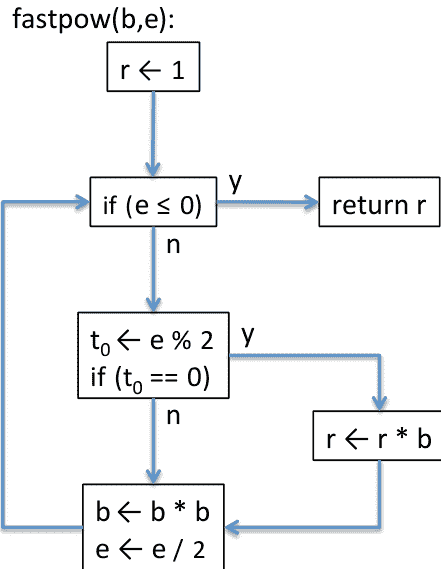

虽然不常用，但带有参数化标签的SSA形式可能如下所示：

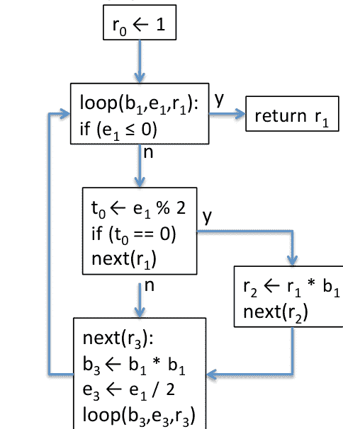

如果我们使用Φ-函数，它们将被插入到基本块的开头。

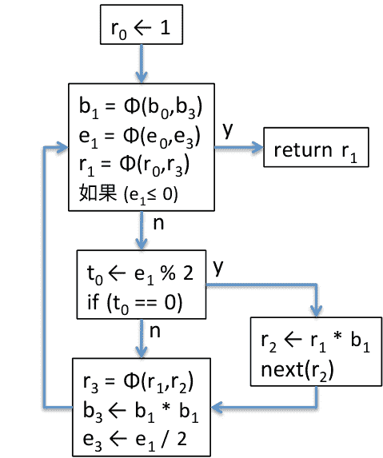

### 静态单赋值形式

当我们去除SSA时，必要的寄存器移动将添加到每个以Φ-函数开头的节点的边缘。

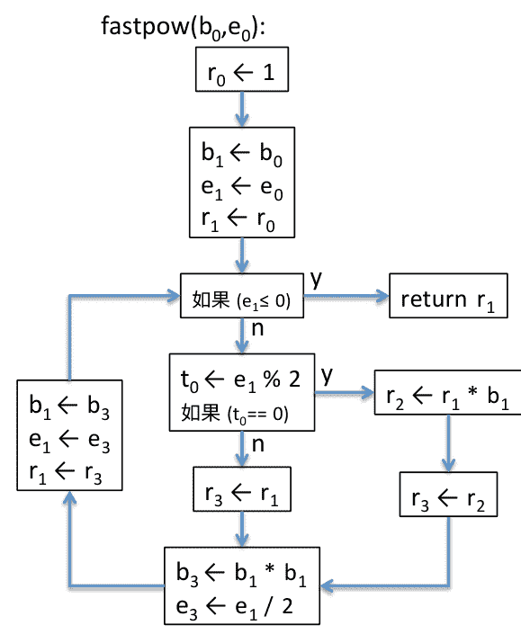

## 10 结论

静态单赋值（SSA）形式是一种准函数式的抽象机器代码形式，其中变量赋值是变量绑定，跳转是尾调用。

它是由Cytron等人[CFR+89]设计的，简化了许多程序分析和优化。当然，您必须确保程序转换保持该属性。我们在这里描述的转换为SSA形式的特定算法是由Aycocock和Horspool [AH00]提出的。Hack已经证明，SSA形式的程序生成和弦干扰图，这意味着通过图着色进行寄存器分配特别高效[Hac07]。有关SSA的进一步阅读和一些不同的算法，您还可以参考教材[App98]的第19章。

## 问题

- 你能想到一个最小的SSA的例子，但仍然有冗余的标签参数吗？
- 你能想到一个条件语句的控制流图没有后续基本块有两个入口控制流边的情况吗？

## 参考文献

- [AH00] John Aycock和R. Nigel Horspool。简单生成静态单赋值形式。在D. Watt 编辑，第9届国际编译器构造会议 (CC'00) 的论文集，第110-124页。 SpringerLNCS 1781, 2000.
- [App98] Andrew W. Appel. ML中的现代编译器实现. 剑桥大学出版社，英格兰剑桥，1998年。
- [CFR+89] Ron Cytron, Jeanne Ferrante, Barry K. Rosen, Mark N. Wegman和F. Kenneth Zadeck。一种计算静态单赋值形式的高效方法。在第16届年度编程语言原理研讨会 (POPL 1989) 的会议记录中，第25-35页，德克萨斯州奥斯汀，1989年1月。ACM出版社。
- [Hac07] Sebastian Hack. 用于SSA形式程序的寄存器分配。博士学位论文，卡尔斯鲁厄大学，2007年10月。

# 词法分析讲义

15-411: 编译器设计
André Platzer*
第7讲
2013年9月17日

## 1 引言

词法分析是编译器的第一阶段。它的任务是将源文件中的原始字节或字符输入流转换为令牌流，通过将输入切分成片段并跳过不相关的细节。这样做的主要好处是极大地简化了后续的语法分析工作，否则语法分析工作将不得不在各个地方考虑空格和注释。词法分析的工作还包括将输入令牌分类为整数、标识符、WHILE关键字或开括号等类型。词法分析阶段的另一个好处是它将输入压缩了约80%。词法分析器实质上是处理输入语言的正则语言视图的第一层。我们的演示类似于最近的一本书[wSH12，第2章]。更多的演示可以在[wM95，第7章]和[App98，第2章]中找到。

> *由Sri Raghavan于2013年秋季讲授
> 
> 1真实的词法分析器还必须处理大写字母，但在这些讲义中，我们假装对大小写不敏感，以简化事情。

## 2 词法规范

我们固定一个字母表 Σ，即一个有限的输入符号集合，例如，所有字母a-z和数字0-9以及括号和运算符+，-等。集合 Σ*的词或字符串被定义为 Σ的所有有限序列的集合。例如，如果ah5+xy-+是一个字符串，但不一定是一个非常有趣的字符串，从语法的角度来看（这是词法分析器不需要了解的，因为那是解析器的工作）。没有字符的空字符串用 ε表示，但有时也会称之为 \(\lambda\)，但我们这里不使用这个术语，以免与Church的 \(\lambda\)-演算混淆。

词法分析器规范必须说明它接受的输入类型以及将与特定输入关联的令牌类型。例如，输入字符串的片段 15411应该被标记为整数。出于表示效率的原因，通过正则表达式指定词法分析器接受的输入是一个非常好的主意。顺便提一下，正则表达式及其扩展[Sal66，Koz97，HKT00，Pla12]实际上在许多情况下非常有用。

正则表达式r，s是由以下形式递归构建的表达式：

| 正则表达式 | 匹配说明 |
| --- | --- |
| \(a\) | 匹配特定字符 \(a\) 从输入字母表中的一个字符 |
| \([a-z]\) | 匹配指定范围内的字母 \(a\) 到 \(z\) |
| \(\epsilon\) | 匹配空字符串 |
| \(r|s\) | 匹配与 \(r\) 匹配的字符串或与 \(s\) 匹配的字符串 |
| \(rs\) | 匹配可以以某种方式分成两部分的字符串，第一部分匹配 \(r\) ，第二部分匹配 \(s\) |
| \(r^*\) | 匹配由 \(n\) 个部分组成的字符串，每个部分都匹配 \(r\)，对于任何自然数 \(n \geq 0\) |

例如，使用字母表 \(\{a, b\}\) 的字符串集合，其中没有两个或更多连续的 \(a\) 的正则表达式为 \(b^*(abb^*)^*(a|\epsilon)\)。其他常见的正则表达式为

| 正则表达式 | 匹配说明 |
| --- | --- |
| \(r^+\) | \(rr^*\) 匹配由 \(n\) 个部分组成的字符串，其中每个部分都匹配 \(r\)，对于任何自然数 \(n \geq 1\) |
| \(r|\epsilon\) | 可选地匹配 \(r\)，即匹配空字符串或匹配 \(r\) 的字符串 |

为了指定词法分析器，我们可以使用一系列正则表达式以及它们识别的标记类型（例如，最后一个标记类型 LPAREN识别一个单个开括号，我们需要引用它以区分其与用于描述正则表达式的括号，对于空格也是如此）：

| 令牌类型 | 正则表达式 |
| --- | --- |
| IF | \(\equiv i f\) |
| GOTO | \(\equiv g o t o\) |
| FOR | \(\equiv f o r\) |
| 标识符 | \(\equiv [a-z]([a-z]|[0-9])^*\) |
| 整数 | \(\equiv [0-9][0-9]^*\) |
| 实数 | \(\equiv ([0-9][0-9]^*.[0-9]^*)|([0-9][0-9]^*)\) |
| 左括号 | \(\equiv "("\) |
| 赋值 | \(\equiv "="\) |
| 跳过 | \(\equiv " "^*\) |

## 3 词法分析器实现

词法分析器由正则表达式指定。然而，经典上它们是由有限自动机实现的。

定义1：一个有限自动机对于一个有限字母表Σ由以下组成：
- 一个有限状态集合 \(Q\)，
- 一个从状态到状态的边集合 \(\Delta\)，其标记为来自输入字母表Σ的字母。我们还允许在边上标记为 \(\epsilon\) 意味着 \((q, \epsilon, q')\) 是从 \(q\) 到 \(q'\) 的一个自发转换，不消耗任何输入。
- 一个初始状态 \(q_0 \in Q\)。
- 一组接受状态 \(F \subseteq Q\)。

有限自动机接受一个输入字符串 \(w= a_1 a_2 \ldots a_k \in \Sigma^*\) 当且仅当存在一个 \(n \in \mathbb{N}\) 和一系列状态 \(q_0, q_1, q_2, \ldots, q_n \in Q\)，其中 \(q_0\) 是初始状态且 \(q_n \in F\) 是一个接受状态，对于所有的 \(i=1, \ldots, n\) 都有 \((q_{i-1}, a_i, q_i) \in \Delta\)。

在图片中，这个条件对应于自动机中由适当输入标记的一组边的存在：
\(q_0 \stackrel{a_1}{\rightarrow} q_1 \stackrel{a_2}{\rightarrow} q_2 \stackrel{a_3}{\rightarrow} q_3 \stackrel{a_4}{\rightarrow} \cdots \stackrel{a_{n-1}}{\rightarrow} q_{n-1} \stackrel{a_n}{\rightarrow} q_n \in F\)

## L7.4

作为这种情况的缩写，我们也写作 \((q_0, w) \rightarrow^* (q_n, \epsilon)\)。我们的意思是，当自动机从状态 \(q_0\) 开始时，可以通过一系列的转换消耗掉单词 \(w\) 的所有输入，并最终处于状态 \(q_n\)，没有剩余的输入可读取（\(\epsilon\)）。例如，用于接受 REAL 数字的自动机是
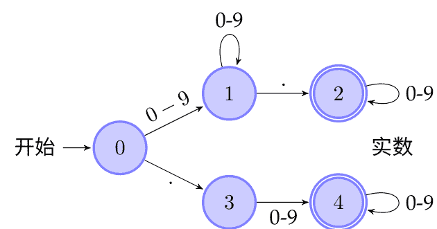

当我们使用这个有限自动机来识别输入流中的数字 3.1415926 时，我们不仅想知道已经识别出一个类型为 REAL 的标记，并且剩余的输入是 -3+x;if，还想知道类型为 REAL 的标记的值是多少，所以我们将其值与标记类型一起存储。

我们还想知道类型为 REAL 的标记的值是多少，所以我们将其值与标记类型一起存储。

上述自动机是一个确定有限自动机(DFA)。 在每个状态和每个输入上，最多只有一条边可以进行转换。 但是一般来说，有限自动机可以是非确定有限自动机(NFA)。 也就是说，对于相同的输入，一条路径可能导致接受状态，而另一条路径则失败。 当相同的输入字母从相同的状态有多个转换时，就会发生这种情况。 特别是为了能够使用最长匹配原则，我们必须跟踪最后一个接受状态，并在字符串无法被接受时返回该状态。 例如，考虑一个接受 REAL 和 INT 并在两个词法规则之间进行非确定选择的非确定性自动机。


在开始时，这个可怜的NFA需要猜测未来的输入会以哪种方式结束，而他还没有看到。这很困难。但是NFAs非常方便用于规范目的（就像正则表达式一样），因为用户不需要担心这些选择。

## 4 正则表达式与非确定有限自动机

正则表达式非常适合表示词法分析器应该读取的内容。
幸运的是，正则表达式可以转换为有限自动机（反之亦然，但我们这里不需要）。

为了将正则表达式转换为非确定有限自动机（NFA），我们定义了一个递归过程。我们从一个扩展的NFA开始，仍然在边缘上具有正则表达式作为输入标签。


然后，我们通过它们的定义自动机模式逐步转换仍然具有正则表达式作为不适当输入标签的边缘。也就是说，每当我们 在边缘上找到一个不仅仅是输入字母表中的单个字母的正则表达式时，我们使用转换规则来摆脱它。
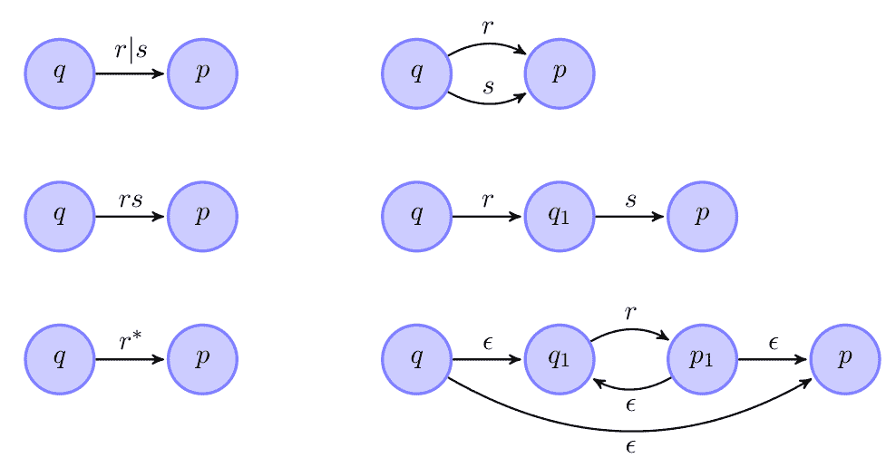

当应用规则时,我们在当前候选NFA中匹配左侧的模式,并根据需要用右侧替换它,引入新的状态\(q_1, q_2\)。

## 5 非确定有限自动机与确定有限自动机

从正则表达式到NFA的转换非常简单。NFAs对于规范目的很方便,但对于实现来说不好。然而,实现一个DFA很容易。我们只需将当前状态存储在一个程序变量中,初始化为\(q_0\),并根据下一个输入字符,根据转换表\(\triangle\)过渡到下一个状态。每当有一个接受状态时,我们注意到这将是一个我们识别出的标记。但为了找到最长的可能匹配,我们仍然继续。如果我们最终找到一个未被识别或接受的输入字符,那么我们只需回溯到我们记住的最后一个可能的匹配(并取消读取到目前为止从输入流中读取的输入字符)。但是我们如何实现一个NFA? 有太多选择,我们不知道该选择哪一个。在NFA中,甚至没有一个规范的最后接受选择。

我们可以采取的方法来实现NFA是按照DFA实现中的输入方式进行,但是每当有选择时,我们同时跟随所有选项。这将迅速分支并要求我们一次性完成大量工作,这是低效的。然而,它给了我们正确的直觉,关于我们必须做什么。我们只需要将其反转,并在预计算步骤中遵循相同的原则,而不是在运行时。我们跟随所有选项并保持我们可能存在的选择集。

这是将NFA转换为DFA的幂集构造的原理,通过同时跟随所有选项。也就是说,我们现在不再是一个单一的状态,而是同时跟随所有选项。

考虑我们可能处于的状态集合。当然，我们希望从初始幂集状态 \(\left\{q_0\right\}\) 开始，该状态只包含单个初始状态 \(q_0\)。但是，首先我们必须遵循所有可能的 \(\epsilon\)-转换，将我们从 \(q_0\) 带到其他状态。

当 \(S \subseteq Q\) 是一个状态集合时，我们定义 \(C l^{\epsilon}(S)\) 为 \(S\) 的 \(\epsilon\)-闭包，即通过从 \(S\) 的状态中按照任意多个 \(\epsilon\)-转换而到达的状态集合，这些转换不消耗任何输入。

\[
C l^{\epsilon}(S):=\bigcup_{q \in S}\left\{q^{\prime}:\left(q, \epsilon\right) \rightarrow^{*}\left(q^{\prime}, \epsilon\right)\right\}
\]

现在从一个状态集合 \(S \subseteq Q\) 开始，我们进行一次转换，假设输入字母为 \(a\)，并找出所有通过从 \(S\) 的任意状态开始按照 \(a\)-转换而到达的状态集合，再按照 \(\epsilon\)-转换继续转换:

\[
N(S, a):=C l^{\epsilon}\left(\left\{q^{\prime} \in Q:\left(q, a\right) \rightarrow\left(q^{\prime}, \varepsilon\right) \text { and } q \in S\right\}\right)
\]

条件 \((q, a) \rightarrow\left(q^{\prime}, \varepsilon\right)\) 等价于 \((q, a, q^{\prime}) \in \Delta\) 。我们可以通过从 \(S\) 到后继 \(N(S, a)\) 的单个 \(a\) 转换来总结所有这些转换。重复这个过程会得到一个与原始NFA接受相同语言的DFA。然而，算法的复杂性可能是指数级的，因为在DFA构造过程中可能会使用指数级的状态。

定义2 (NFA转DFA): 给定一个NFA有限自动机 \((Q, \Delta, q_0, F)\)，相应的接受相同语言的DFA \((Q', \Delta', q_0', F')\) 被定义为
- \(Q'\) 是 \(Q\) 的所有子集的子集，即 \(Q\) 的幂集 \(Q' \subseteq 2^{Q}\)
- \(\Delta' := \{(S, a, N(S, a)): a \in \Sigma\}\)。
- \(q_0' := Cl^{\epsilon}(q_0)\)
- \(F' := \{S \subseteq Q: S \cap F \neq \emptyset\}\)

将NFA转换为DFA后，我们可以直接实现它来识别输入流中的标记。

值得注意的是，有直接从正则表达式获取DFA的方法，而不需要经过NFA的构造。这些技术非常代数化和优雅，使用了Brzozowski导数[Brz64]。

## 6 最小化确定有限自动机

词法分析器生成工具经常执行的另一个操作是通过合并状态和减少自动机中的状态和转换来最小化结果DFA。这是一种优化，我们不会进一步追求它。

## 7 正则表达式确定有限自动机

事实证明,有一种非常优雅且纯代数的方法可以直接将正则表达式转换为DFA,而无需经过显式自动机构造、确定化和可能的最小化。这种代数方法使用了Brzozowski导数[Brz64]和Antimirov的偏导数[Ant96]。为此,我们通过它们匹配的单词集合来识别正则表达式。因此,我们不再说正则表达式r匹配单词w,而是简单地写作 \(w \in L(r)\)。导数 \(D_a(r)\) 对于正则表达式 \(r\) 和字母 \(a\) 的定义如下

\[
D_a(r)=\{w : a w \in r\}
\]

导数表示正则表达式 \(r\) 中字母 \(a\) 之后可以匹配的连续字符集。正则表达式的导数可以通过与函数的常规导数非常相似的方式进行语法计算。结果是一个正则表达式。

\[
\begin{aligned}
& D_a(\emptyset)=\emptyset \\
& D_a(\epsilon)=\emptyset \\
& D_a(a)=\epsilon \\
& D_a(b)=\emptyset \quad(b \neq a) \\
& D_a(r \mid s)=D_a(r) \mid D_a(s) \\
& D_a(r s)=D_a(r) s \mid \delta(r) D_a(s) \\
& D_a\left(r^*\right)=D_a(r) r^*
\end{aligned}
\]

如果我们稍微倾斜一下头,假装 \(\mid\) 是加法(+), 并假装 \(s\) 是乘法, 这看起来非常像标准函数的导数, 其中 \(\epsilon\) 扮演 \(1\) 的角色, 而 \(\emptyset\) 扮演 \(0\) 的角色。主要的区别在于运算符 \(\delta()\); 在 \(D()\); 中的出现, 我们仍然需要定义。运算符 \(\delta()\); 应该能够检测是否匹配空字 \(\epsilon\)。因此,\(\delta()\); 的定义如下

\[
\delta(r) = \begin{cases}
\epsilon & \text{if } \epsilon \in L(r) \\
\emptyset & \text{otherwise}
\end{cases}
\]

这个运算符也可以完全通过语法计算

\[
\begin{aligned}
& \delta(\emptyset)=\emptyset \\
& \delta(\epsilon)=\epsilon \\
& \delta(a)=\emptyset \\
& \delta(r \mid s)=\delta(r) \mid \delta(s) \\
& \delta(r s)=\delta(r) \delta(s) \\
& \delta\left(r^*\right)=\epsilon
\end{aligned}
\]

### 词法分析

对于普通函数，可以通过多次求导来定义高阶导数。对于正则表达式的导数，我们也可以类似地定义。对于一个单词 $w$，我们通过一个简单的归纳定义来逐步求导，即先对 $w$ 的下一个字母求导，然后再对 $D_w(r)$ 求导，依此类推。

```
D_ε(r) = r
D_{wa}(r) = D_a(D_w(r))
```

关于 Brzozowski 导数及其扩展，可以证明一些非常有趣的理论和实际结果。在这里，我们只展示了如何使用连续求导系统地构建一个自动机。可以证明这个过程是终止的。

思路是，$D_a(r)$ 表示在读入输入 $a$ 后，$r$ 的“剩余”正则表达式。因此，从状态 $r$ 到状态 $D_a(r)$ 存在一个输入为 $a$ 的转移。我们只是将正则表达式作为自动机的状态（而不是像第 4 节中那样作为动作）。

举个例子，考虑正则表达式 $r = 1(0|1)^*0$。因此，我们从状态 $D_ε(r)=r$ 开始，并依次跟随所有字母 $a$ 到状态 $D_a(r)$，并继续跟随所有字母到达能匹配空字的状态。$\varepsilon$ 是最终状态。状态 $s$ 是最终状态当且仅当 $\delta(s)=\varepsilon$。实际上，可以证明 $w \in r$ 当且仅当 $\delta(D_w(r))=\varepsilon$。

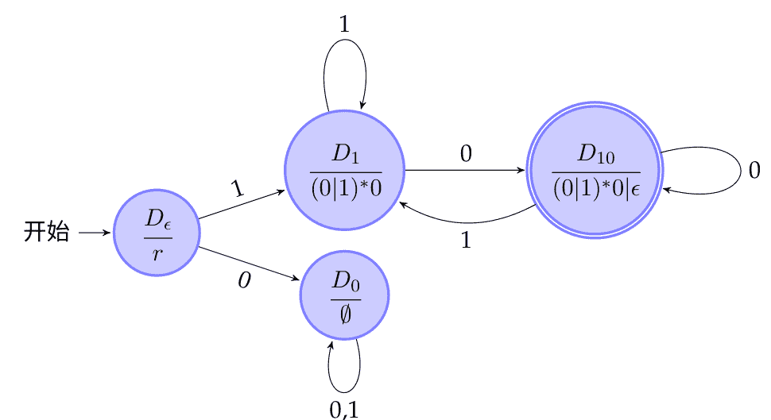

在这个自动机图中，我们使用符号 $D_w \to s$ 表示 $D_w(\text{读取}) = s$。还可以证明，每个正则表达式都可以用以下线性形式表示：

```
r = δ(ε) + ∑_{a∈Σ} aD_a(r)
```

## 8 总结

词法分析通过首先将原始输入流分割成较短的标记序列来降低后续语法分析的复杂性，每个标记都根据其类型（整数、标识符、实数、IF 等）进行分类。词法分析器还会从输入流中过滤掉不相关的空格和注释，以便解析器不再处理它们。生成词法分析器的步骤是：

1. 通过一系列正则表达式指定要从输入流中识别的标记类型。
2. 请记住，最长匹配规则适用，并且最长匹配的第一个产生式具有优先权。
3. 词法分析由 DFA 实现。
4. 将正则表达式转换为 NFA（或直接使用派生物转换为 DFA）。
5. 将它们合并成一个主 NFA，通过自发的转换在每个正则表达式的 NFA 之间进行选择。
6. 将 NFA 确定化为 DFA。
7. 可选：为了节省空间，最小化 DFA。
8. 为识别器实现 DFA。通过存储最后接受的标记并在 DFA 运行无法完成时回溯输入到此标记，遵守最长匹配规则。

## 问题

1. 为什么编译器有一个词法分析阶段？为什么不可以不用它？
2. 词法分析器是否应该返回空格和注释？
3. 为什么我们要将标记分类为标记类别，而不仅仅使用它们表示的输入字符串的特定部分？
4. 为什么有些编程语言不接受像 `x----y` 这样的输入？
5. 词法分析器对编程语言的哪些方面不了解？
6. 词法分析器工具是否与正则表达式或自动机内部一起工作？他们应该吗？
7. 为什么词法分析器不能使用非确定有限自动机工作？它们在描述方面非常有用。
8. 编程语言的保留关键字是否应该是自己的令牌类？有什么好处和坏处？

## 参考文献

- [Ant96] Valentin M. Antimirov. 正则表达式的偏导数和有限自动机构造. Theor. Comput. Sci., 155(2):291-319, 1996.
- [App98] Andrew W. Appel. ML中的现代编译器实现. 剑桥大学出版社，英格兰剑桥，1998年。
- [Brz64] Janusz A. Brzozowski. 正则表达式的导数. J. ACM, 11(4):481-494, 1964.
- [HKT00] David Harel, Dexter Kozen, and Jerzy Tiuryn. 动态逻辑。 MIT Press，剑桥，2000年。
- [Koz97] Dexter Kozen. 带测试的Kleene代数. ACM Trans. Program. Lang. Syst., 19(3):427-443, 1997.
- [Pla12] Andre Platzer. 动态系统的逻辑。在 LICS，页13-24. IEEE, 2012.
- [Sal66] Arto Salomaa. 代数的两个完备公理系统. J. ACM, 13(1):158-169, 1966.
- [WM95] Reinhard Wilhelm和Dieter Maurer。 编译器设计 . Addison-Wesley, 1995.
- [WSH12] Reinhard Wilhelm，Helmut Seidl和Sebastian Hack。 编译器设计：语法和语义分析. Addison-Wesley, 2012.

# 关于上下文无关文法的讲义

15-411: 编译器设计
Frank Pfenning*

第7讲
2013年9月19日

语法和解析在语言学中有着悠久的历史。计算机科学在设计编程语言和编译器时建立在积累的知识基础上。然而，有一些重要的差异可以归因于两个主要因素。一个是编程语言是经过设计的，而人类语言是演化的，因此语法在编程语言中起到规范的作用，而在人类语言中起到描述的作用。另一个是语法和解析的使用差异。在编程语言中，程序的含义应该是明确确定的，以便以可预测的方式执行。显然，这也适用于解析一个良好形式的表达式的结果：它应该是唯一的。

在自然语言中，我们被迫接受其固有的歧义性，正如著名的例子“时间如箭一般飞逝”。

在这个讲座中，我们回顾了一类重要的文法，称为上下文无关文法（Chomsky-2型，在 Chomsky 层次结构中[Cho59]），以及相关的解析问题。它们最终变得过于笨拙，无法直接在编译器中使用，主要是由于歧义问题，但也由于解析的潜在低效性。

关于本讲座材料的其他介绍可以在教材[App98，第3章]和Shieber等人的开创性论文[SSP95]中找到。在下一讲中，我们将考虑更受限制的文法形式，它们的定义却不太自然。

\*由André Platzer编辑

## 2 上下文无关文法

文法被设计用来描述语言，在我们的上下文中，一个语言只是一组字符串。抽象地说，我们将字符串视为一系列所谓的终结符。在编译器内部，这些终结符很可能是词法记号，通过词法分析从裸字符字符串中产生，已经将子字符串分组为适当类型的记号并跳过空白。

上下文无关文法由一组形式为 $X \rightarrow \gamma$ 的产生式组成，其中 $X$ 是一个非终结符号，$\gamma$ 是一个可能包含终结符号和非终结符号的混合序列。有时候也方便区分一个起始符号，传统上称为 $S$，表示句子。我们将用词串来指代任何终结符号和非终结符号的序列。我们用 $\alpha$、$\beta$、$\gamma$ 等来表示字符串。非终结符号通常用 $X$、$Y$、$Z$ 表示，终结符号用 $a$、$b$、$c$ 表示。例如，下面的文法生成由匹配括号组成的所有字符串。

```
S → ε
S → [S]
S → S S
```

第一条规则看起来有些奇怪，因为右侧是空字符串。为了使其更易读，我们通常将空字符串写作 $\varepsilon$。

从开始符号 $S$ 到一个句子 $w$ 的推导是一个序列 $S = \alpha_0 \rightarrow \alpha_1 \rightarrow \alpha_n = w$，其中 $w$ 只包含终结符号。在每一步中，我们选择一个非终结符号 $X$ 在 $\alpha_i$ 中的一个出现和一个产生式 $X \rightarrow \gamma$，并将 $\alpha_i$ 中的这个出现的 $X$ 替换为 $\gamma$。

通常我们给文法中的产生式标上标签，这样我们可以用名字来引用它们。在上面的例子中，我们可以写成：

```
[emp]       S → ε
[pars]      S → [S]
[dup]       S → S S
```

然后以下是一个字符串 `[[] []]` 的推导，每个转换都标有应用的产生式：

```
S  → [S]             [pars]
   → [SS]            [dup]
   → [[S]S]          [pars]
   → [[]S]           [emp]
   → [[][S]]         [pars]
   → [[][]]          [emp]
```

我们已经为每个推导步骤标记了相应的文法产生式。

推导并不唯一，因为当有多个非终结符时，我们可以以任意顺序替换字符串中的非终结符。为了避免规则顺序中的这种无害的歧义，我们喜欢构造一棵语法分析树，其中节点表示字符串中的非终结符，根节点为 $S$。在上面的例子中，我们得到以下的语法分析树：

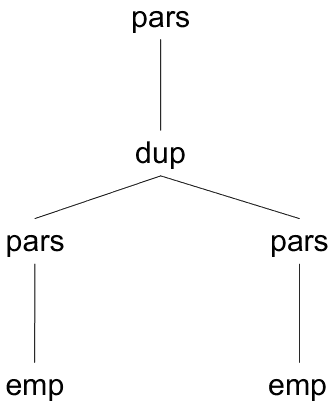

虽然语法分析树消除了一些歧义，但实际上，上述语言中存在另一种歧义。事实上，每个字符串都有无限多个语法分析树。这可以通过考虑循环看出：

```
S → SS → S
```

其中第一步是 `dup`，第二步是 `emp`，可以应用于 $S$ 的第一次或第二次出现。我们可以得到相同字符串的任意长的语法分析树。

一个语法是否模糊，即是否存在允许多个不同解析树的句子，对于语法用于编程语言规范是一个重要问题。基本问题在于在源程序中，一个特定终结符出现在哪个语法功能中变得模糊。这可能导致误解。我们很快会看到一个例子。

## 3 解析树是推导树

我们现在给出一个正式的定义，即终结符字符串 $w$ 与字符串 $\gamma$ 匹配的条件。我们写作：

```
[r] X → γ   产生式 r 将非终结符 X 映射到字符串 γ
w : γ       终结符字符串 w 与字符串 γ 匹配
```

第二个判断由以下四个简单规则定义。在这里，我们使用字符串连接，用并置表示。注意空字符串 $\varepsilon$ 满足 $\gamma \varepsilon = \varepsilon \gamma = \gamma$，并且连接是可结合的（从数学上讲，字符串形成一个幺半群，类似于没有逆元素的群）。

我们已经用文法产生式的名称标记了第四条规则，而其他规则仍然没有标记。这样我们可以在前提中省略实际的文法规则，因为可以通过名称直接在文法中查找。然后 `[[] []]` 的早期推导变成了以下推导：

被省略的子推导（标记为“…”）与其左侧的兄弟节点相同。我们观察到标签的结构与解析树相同，只是它是倒过来写的。因此，解析树只是推导树。

## 4 CYK解析

上述规则正式定义了终结符字符串何时与任意字符串匹配，可以立即给出一个解析算法。

假设我们有一个以开始符号 $S$ 和终结符字符串 $w_0$ 为输入的文法。从断言数据库 $\varepsilon : \varepsilon$ 和 $a : a$ 开始，其中 $w_0$ 中出现的任何终结符号。现在以以下方式任意应用给定的规则：如果规则的前提可以与数据库匹配，并且结论 $w : \gamma$ 满足 $w$ 是输入 $w_0$ 的子字符串，$\gamma$ 是文法中出现的字符串，则将 $w : \gamma$ 添加到数据库中。副条件用于将解析过程集中于在解析过程中可能重要的事实上（即，谈论…）。关于实际输入字符串 $w_0$ 被解析并适应语法规则的情况。

我们重复这个过程，直到达到饱和状态：任何进一步应用任何规则的结果都已经在数据库中。我们在这一点停下来并检查是否在数据库中看到 $w_0 : S$。如果我们在数据库中看到 $w_0 : S$，我们成功解析 $w_0$；否则我们失败。

这个过程必须始终终止，因为语法的子字符串只有固定数量，查询字符串的子字符串也只有固定数量。实际上，如果语法固定且 $n = |w|$，则只能推导出 $O(n^2)$ 个项。使用 Ganzinger 和 McAllester [McA02, GM02] 的元复杂性结果，我们可以得到该算法的复杂性，即饱和数据库的大小（为 $O(n^2)$）和所谓的前缀触发规则的数量的最大值。我们通过从左到右限制每个规则的前提条件实例化的方式来计算这个数量。关键规则是分割规则：

$$
\frac{w_1: \gamma_1 \quad w_2: \gamma_2}{w_1 w_2: \gamma_1 \gamma_2} P_2
$$

有 $O(n^2)$ 个子字符串，所以有 $O(n^2)$ 种方法来匹配第一个前提与数据库中的内容。由于 $w_1 w_2$ 也受到 $w_0$ 的子字符串约束，因此只有 $O(n)$ 种方法来实例化第二个前提，因为 $w_2$ 在输入字符串中的左端被确定，但其右端没有被确定。这导致了一个复杂度为 $O(n^2 \times n) = O(n^3)$ 的情况。

我们刚刚介绍的算法是上世纪 60 年代发明的 Cocke-Younger-Kasami (CYK) 解析算法的一个抽象形式。它最初假设语法处于正常形式，并通过它们在输入中的索引来表示子字符串，而不是直接表示为字符串。然而，它的一般运行时间仍然是 $O(n^3)$。

作为一个例子，我们使用一个 $n$ 元连接规则作为简写来应用这个算法。我们尝试使用我们的匹配括号语法来解析 `[[] []]`。我们从规则 $P_1$ 和 $P_3$ 推导出的三个事实开始。在向前工作时，重要的是要记住我们只推断出 $w : \gamma$ 这样的事实，其中 $w$ 是 $w_0 = [[] []]$ 的子字符串，$\gamma$ 是语法的子字符串。

| 序号 | 输入 w | : | 推导 γ | 规则/说明 |
|:----:|:------:|:-:|:------:|:---------:|
| 1    | [      | : | [      |           |
| 2    | ]      | : | ]      |           |
| 3    | ε      | : | ε      |           |
| 4    | ε      | : | S      | P₄(emp) 3 |
| 5    | []     | : | [ S ]  | P₂ 1, 4, 2|
| 6    | []     | : | S      | P₄(pars) 5|
| 7    | [] []  | : | S S    | P₂ 6, 6   |
| 8    | [] []  | : | S      | P₄(dup) 7 |
| 9    | [[] []]| : | [ S ]  | P₂ 1, 8, 2|
| 10   | [[] []]| : | S      | P₄(pars) 9|

可能还生成了一些多余的事实，例如 `[] : S S`，但在这种情况下，解析非常专注。从右侧列中的证明很容易生成我们之前看到的相同的解析树。

## 5 递归下降解析

对于用于编程语言解析器的 CYK 算法的立方复杂度是不可接受的。在语法中发现潜在的歧义并不容易（除了特定的输入），并且在解析失败时给出良好的错误消息也不容易。我们希望的算法是扫描输入从左到右（因为通常我们设计语言的方式就是这样）并在一次通过输入时工作。

不幸的是，一些具有上下文无关语法的语言无法以满足上述规范的语法的形式来指定。所以现在我们把问题转过来：考虑到我们想要的解析算法的类型，我们能否定义可以使用这种类型的算法进行解析的语法类？我们希望的另一个属性是我们以查看一个语法并决定它是否是模棱两可的，即存在一些字符串可以有多个解析树。这样的语法应该被拒绝作为编程语言的规范。幸运的是，高效解析的目标和检测语法中的歧义的目标相辅相成：一般来说，无歧义的语法更容易解析。

我们现在重新编写我们的解析规则，以从左到右的方式工作，而不是对称的方式。这意味着我们不使用任意分割的字符串的一般连接。相反，我们只考虑最左边的终结符或最左边的非终结符。我们只在字符串的开头添加一个单一的非终结符。这个左边的非终结符是唯一允许通过产生式扩展的部分。我们还必须改变非终结符的规则性质，以便它可以处理字符串左端的非终结符。

**R1**
$$ \varepsilon : \varepsilon $$

**R2**
$$ \frac{w : \gamma}{aw : a\gamma} $$

**R3(r)**
$$ \frac{[r]X \rightarrow \beta \quad w : \beta\gamma}{w : X\gamma} $$

规则 R2 比较实际输入字符串 $aw$ 的第一个终结符 $a$ 与当前解析表达式 $a\gamma$ 的第一个终结符 $a$。对于语法产生式 $[r]X \rightarrow \beta$，规则 R3(r) 生成或扩展当前解析表达式 $X\gamma$ 中最左边的非终结符 $X$ 的右侧 $\beta$。规则 R3(r) 使用语法产生式向前生成结果 $\beta$。当然，最终，解析推导只有在比较规则 R2 也能匹配输入中最终生成的终结符和生成的解析表达式时才会成功。

在这一点上，规则完全是线性的（每个规则有零个或一个前提条件，注意我们将静态语法产生式 $[r]X \rightarrow \beta$ 作为规则的一部分 R3(r) 在这里），并且从左到右分解字符串（我们只通过剥离终端符号 $a$ 来进行）。

与其盲目地使用这些规则从前提条件到结论（这样不会从左到右分析字符串），我们不如反过来从所需的结论到前提条件使用它们？毕竟，我们知道我们要达到什么目标。请记住，我们从给定的目标开始，即如果可能的话，推导 $w_0 : S$，否则明确失败。现在我们可以以目标导向的方式使用规则吗？前两个规则当然没有问题。使用比较规则 R1 和 R2 从结论到前提条件只是逐步简化字符串，通过消耗第一个标记（或 $\varepsilon$）。但是扩展规则 R3 存在问题，因为如果对于给定的非终结符 $X$ 存在多个产生式，我们可能无法确定应该使用哪个产生式。

那么困难在于第三条规则：我们如何决定使用哪个产生式？猜测哪个扩展 $\beta$ of $X$ in R3 将使我们能够将 $w$ 解析为 $\beta\gamma$ 可能很困难。然而，我们可以反过来问：对于哪些文法，我们总是可以决定使用哪个文法扩展 $r$ 来匹配 R3(r)？

我们回到一个例子来探讨这个问题。我们使用一个简单的文法来表示与实验 1 中使用的类似的表达式语言。我们使用 `id` 和 `num` 来表示词法分析器生成的标识符和数字标记。

```
[赋值]  S → id = E ; S
[返回]  S → return E
[加]    E → E + E
[乘]    E → E * E
[标识符] E → id
[数字]  E → num
[括号]  E → ( E )
```

作为一个示例字符串，考虑：

```
x = 3; 返回 x ;
```

词法分析后，$x$ 和 $3$ 被替换为标记 `id("x")` 和 `num(3)`，如第二行所示。我们简写这些标记为 `id` 和 `num`。

如果我们总是猜对，我们将从底部到顶部构造以下推导。也就是说，我们从最后一行开始，确定或猜测应用哪个规则来得到前一行，依此类推，直到达到 $\varepsilon : \varepsilon$（成功解析）或者被卡住（语法错误或错误的猜测）。

```
ε : ε
; : ;
id ; : id ;
id ; : E ; [标识符]
return id ; : return E ;
return id ; : S [返回 ]
; return id ; : ; S
num ; return id ; : num ; S
num ; return id ; : E ; S [数字 ]
= num ; return id ; : = E ; S
id = num ; return id ; : id = E ; S
id = num ; return id ; : S [赋值 ]
```

这个解析器（假设所有的猜测都是正确的）显然从左到右遍历输入字符串。它还产生了一个最左派推导（总是先展开最左边的非终结符），我们可以从这个推导中从底部向顶部读取右侧。

我们已经用所选择的文法产生式的名称标记了可能涉及选择的推理。如果我们只限于查看左侧输入字符串中的第一个标记，我们可以正确预测哪些？通过预先查看第一个输入标记，我们可以预测哪些文法产生式选择？

在最后一行（我们必须做出的第一个猜测）中，我们正在尝试解析一个 $S$，并且第一个输入标记是 `id`。只有一个产生式可以允许这样做，即 `[赋值]`。因此，我们不需要猜测，只需根据第一个标记 `id` 做出确定性选择。

在倒数第四行（我们的第二个潜在选择点）中，第一个标记是 `num`，我们正在尝试解析一个 $E$。很容易说这必须是产生式 `[数字]`。但这是错误的！例如，字符串 `num + id` 也以标记 `num` 开头，但我们必须使用产生式 `[加]` 来正确解析它。这是个坏消息，因为我们无法根据第一个标记决定使用哪个产生式规则。

事实上，没有输入令牌可以为我们消除表达式产生的歧义。问题在于规则 `[加]` 和 `[乘]` 是左递归的，也就是说，产生式的右侧以左侧的非终结符开头。但是这个非终结符可以产生很多不同的字符串。我们永远无法通过有限的令牌前瞻来决定选择哪个规则，因为任何可以以表达式 $E$ 开头的令牌都可以通过 `[加]` 和 `[乘]` 产生式产生。在我们完全理解第一个 $E$ 之前，我们无法确定是否需要 `[加]` 或 `[乘]` 产生式。然而，$E$ 的长度可能是无限的。

在我们目前的知识状态下，我们唯一能做的就是用递归下降解析器解析输入。

## 问题
- 1. 在解析器之前使用词法分析器的好处是什么？
- 2. 为什么编译器需要解析阶段？为什么不直接在没有解析阶段的情况下工作？
- 3. 解析树和抽象语法树之间有区别吗？它们应该有区别吗？
- 4. 解析器对编程语言的哪些方面不了解？它应该了解吗？
- 5. 递归下降解析在哪些编程语言和程序中较慢？
- 6. 从左到右读取输入的所有好处是什么？有什么不利之处吗？
- 7. CYK能够解析但递归下降不能解析的语言存在吗？
- 8. 规则 $P_2$ 有哪些困难？规则 $P_4$ 有哪些困难？

## 参考文献
> [App98] Andrew W. Appel. ML中的现代编译器实现. 剑桥大学出版社，英格兰剑桥，1998年。
> [Cho59] 诺姆・乔姆斯基. 关于文法的某些形式属性. Information and Control, 2(2): 137-167, 1959年。
> [GM02] 哈拉德・甘辛格和大卫・麦卡莱斯特. 逻辑算法. 在P・斯塔基主编的《第18届国际逻辑编程会议论文集》中，页码209-223，2002年7月，丹麦哥本哈根。Springer-Verlag LNCS 2401。
> [McA02] 大卫・麦卡莱斯特. 关于静态分析的复杂性分析. ACM Journal, 49(4): 512-537, 2002年。
> [SSP95] Stuart M. Shieber, Yves Schabes, 和 Fernando C. N. Pereira. 逻辑程序的原理和实现. J. Log. Program., 24(1&2): 3-36, 1995年。

# 预测分析的讲义
15-411: 编译器设计
Frank Pfenning
第9讲
2013年9月24日

## 1 引言

在这个讲座中，我们讨论了两种解析算法，两种算法都从左到右遍历输入字符串。第一种算法，LL(1)，根据输入字符串的第一个字符来决定使用哪个文法产生式。如果这种决策是模糊的，文法就必须被重写以符合这个类别，但这并不总是可能的。第二种算法，LR(1)，可以通过将输入字符推入堆栈来推迟决策，然后在稍后决定使用哪个产生式，同时考虑到第一个输入字符和堆栈。通常在现代解析器生成工具中使用的是后一种算法的变体。

> 本讲座中的材料还可以在教材[App98，第3章]和Shieber等人的论文[SSP95]中找到的其他演示。

## 2 LL(1) 分析

我们在前一节中已经看到，递归下降解析的一般思想是在没有限制的情况下，我们不得不在可能适用并且在解析卡住后需要进行回溯的几个产生式之间进行非确定性选择，甚至循环（如果语法是左递归的）。回溯不仅可能非常低效，而且在字符串不符合语法的情况下很难产生良好的错误消息。假设我们尝试三种不同的方式来解析给定的术语，但都失败了。我们如何判断哪个是错误的源头？这是因为嵌套选择会使问题变得更加复杂，可能性的数量也随之增加。因此，我们必须寻找方法来消除选择的歧义。

一种方法是要求语法在每个潜在的选择点上都可以查看下一个输入符号，并根据该符号决定采用哪个产生式。这被称为1个符号的前瞻，满足这个限制的语法被称为LL(1)语法。这里，第一个L代表从左到右；第二个L代表最左推导（递归下降解析器生成的）；1代表1个符号的前瞻。潜在地，我们还可以定义LL(2)、LL(3)等，但这些在实际应用中有限的实用性。

由于我们限制自己只能通过从左到右遍历输入字符串来进行解析，当我们限制推理规则时，我们只考虑输入字符串和语法中的后缀。简单来说，我们将说 $\gamma$ 是语法的后缀子串，或者 $w$ 是输入字符串 $w_0$ 的后缀子串。例如，在语法中

```
[emp]   S -> ε
[pars]  S -> [ S ]
[dup]   S -> S S
```

唯一的后缀子串是 $ε$, `[ S ]`, `S ]`, `]`, `S`, 和 `S S`，但不包括 `[S`。我们首先定义两种谓词（稍后我们将有机会添加第三种），其中 $\beta$ 可以是语法的非终结符或后缀子串。

| 谓词 | 含义 |
|---|---|
| `first(β, a)` | Token `a` 可以是字符串 $\beta$ 中的第一个 |
| `null(β)` | 字符串 $\beta$ 可以产生空字符串 $ε$ |

这些谓词必须在任何具体字符串被解析之前，通过对语法的完全静态分析来计算。这是因为我们希望能够告诉解析器是否可以在只看一个标记的情况下正确工作，而不考虑要解析的字符串。

我们通过以下规则来定义关系 `first(β, a)`：

```
-----------------
first(a β, a)   F1
```

这个规则种子了 `first` 谓词。然后通过以下三个规则将其传播到出现在语法中的其他字符串。

```
first(X, a)       null(X)  first(β, a)       [r]X  -> γ
----------------  ---------------------   -----------  F4(r)
first(X β, a)   F2  first(X β, a)      F3  first(X, a)
```

即使 $ε$ 可能在每个语法的后缀子字符串中，它永远不会出现在 `first` 谓词的第一个参数中。辅助谓词 `null` 也是很容易定义的。

$$\frac{\text{[r]X} \to \gamma \quad \text{null}(\gamma)}{\text{null}(X)} N_3$$

$$\frac{\text{null}(X) \quad \text{null}(\gamma)}{\text{null}(X \gamma)} N_2$$

$$\frac{\quad}{\text{null}(\epsilon)} N_1$$

我们可以对这些规则进行饱和运行，因为第一个谓词的第一个参数中只有 $O(|G|)$ 个可能的字符串，并且第二个参数中最多有文法中可能的终结符号数目，即 $O(|\Sigma|)$。Naive 方式计算前缀触发的数量（参见[GM02]）给出了一个复杂度上界为 $O(|G| \times |\Xi| \times |\Sigma|)$，其中 $|\Xi|$ 是文法中非终结符的数量。由于通常符号的数量是一个小常数，这大致相当于 $O(|G|)$，因此是相当高效的。此外，这只发生一次，在任何解析之前。

接下来，我们修改上一节课的递归下降解析规则，以考虑这些限制。前两个保持不变。

$$\frac{w : \gamma}{\text{a} \ w : \text{a} \ \gamma} R_2$$

$$\frac{\quad}{\epsilon : \epsilon} R_1$$

第三个，

$$\frac{\text{[r]X} \to \beta \quad w : \beta \ \gamma}{w : X \ \gamma} R_3(r)$$

被分成两个部分，每个部分都有额外的前提条件。

$$\frac{\text{[r]X} \to \beta \quad \text{first}(\beta, \text{a}) \quad \text{a} \ w : \beta \ \gamma}{\text{a} \ w : X \ \gamma} R_3' \qquad \frac{\text{[r]X} \to \beta \quad \text{null}(\beta) \quad w : \beta \ \gamma}{w : X \ \gamma} R_3''$$

我们想说的是，如果在匹配任意非终结符 $X$ 与以任意终结符 $a$ 开头的字符串时，这两个附加的前提条件使得所有选择都是无歧义的，那么文法就是 LL(1) 的。不幸的是，在存在可以重写为 $\epsilon$ 的非终结符的情况下，这种方法还不够完善，因为上述第二条规则甚至不考虑输入字符串。

为了进一步完善这个，我们需要一个额外的谓词，再次在语法和非终结符的后缀字符串中：

| 谓词 | 含义 |
|---|---|
| `follow(β, a)` | 令牌 `a` 可以跟随字符串 $\beta$ 在一个有效的字符串中 |

我们用规则来种子化这个关系：

```
X γ postfix
first(γ, a)
follow(X, a) W_1
```

在这里，$X \gamma \text{ postfix}$ 意味着字符串 $X \gamma$ 出现在产生式的右侧作为后缀子字符串。然后，我们应用以下规则从前提到结论传播这些信息，直到达到饱和状态。

```
follow(X \gamma, a)
[制表符]X → γ
follow(b \gamma, a) follow(X \gamma, a) null(\gamma) follow(X, a)
W_2 W_3 W_4 W_5
follow(\gamma, a) follow(\gamma, a) follow(X, a) follow(\gamma, a)
```

这里的第一个参数应该保持为非空后缀或非终结符。现在我们可以将上述提议的 $R''_3$ 规则细化为一个更不容易产生歧义的规则。

```
[r]X → β
[r]X → β
null(β)
first(β, a) follow(X, a)
aw: β γ aw: β γ
aw: X γ R'_3 aw: X γ R''_3
```

我们通过在开始解析过程之前在末尾添加一个特殊的 `$` 符号来避免创建一个明确处理空输入字符串的规则。为了完整起见，我们重复剩余的规则。

```
w : γ
R_1 R_2
ϵ : ϵ aw : a γ
```

这些规则被解释为通过证明搜索来进行解析，从结论到前提的应用。如果对于任何目标 $w : \gamma$，最多只有一个规则适用，则我们称文法为LL(1)文法。如果 $X$ 不能推导出 $ϵ$，则这相当于检查是否存在最多一个产生式 $X \to \beta$ 使得 `first(β, a)` 成立。对于可空的非终结符，条件稍微复杂一些，但仍然可以从规则中轻松读取。

我们现在使用一个非常简单的语法来说明这些规则。我们已经按照上面所示的方式进行了转换，假设一个特殊的标记 `$` 来表示输入字符串的结束。

```
[开始]   S → S' $
[临时]   S' → ϵ
[括号]   S' → [ S' ]
```

这将生成以任意数量的开括号开头，后跟相同数量的闭括号和字符串结束标记的所有字符串。

我们有：

| 谓词 | 结果 |
|---|---|
| `null(ϵ)` | $N_1$ |
| `null(S')` | $N_3$ |
| `first([S'], [)` | $F_1$ |
| `first(], ])` | $F_1$ |
| `first(S', ], )` | $F_3$ |
| `first(S', [)` | $F_4$ [括号] |
| `first(S'], [)` | $F_2$ |
| `first($, $)` | $F_1$ |
| `first(S' $, $)` | $F_3$ |
| `first(S' $, [)` | $F_2$ |
| `first(S, $)` | $F_4$ [开始] |
| `first(S, [)` | $F_4$ [开始] |

| 谓词 | 结果 |
|---|---|
| `follow(S', $)` | $W_1$ |
| `follow(S', ])` | $W_1$ |
| `follow([S'], $)` | $W_5$ |
| `follow([S'], ])` | $W_5$ |
| `follow(S'], $)` | $W_3$ |
| `follow(S'], ])` | $W_3$ |
| `follow(], $)` | $W_4$ |
| `follow(], ])` | $W_4$ |

## 3 解析器生成

解析器生成现在是一个非常简单的过程。一旦我们通过从给定的语法进行饱和计算来计算出空、第一个和跟随谓词，我们通过将前两个和三个前提与语法产生式和饱和数据库进行匹配来专门化推理规则 $R_3'(r)$ 和 $R_3''(r)$。在这种情况下，这导致了跟随专门化规则（再次重复两个初始规则）。

| 规则 | 结论 | 前提 |
|---|---|---|
| $R_1$ | $\epsilon : \epsilon$ | $w : \gamma$ |
| $R_2$ | $a w : a \gamma$ | $a w : a \gamma$ |
| $R_3'(\text{开始})$ | $[I : S' \$ \gamma$ | $[I : S' \$ \gamma$ |
|  | `$ I : S \$ \gamma$ | `$ I : S \$ \gamma$ |
| $R_3'(\text{解析})$ | $[I : [ S' ] \gamma$ | $] I : \gamma$ |
| $R_3''(\text{临时})$ |  | `$ I : \gamma$ |
|  | `[I : S' \gamma` | `] I : S'\gamma` |
|  |  | `$ I : S'\gamma$ |

回想一下，这些规则是从底向上应用的，从目标 $w_0 : S$ 开始，其中 $w_0$ 是输入字符串。通过模式匹配很容易观察到，这些规则是互斥的：如果其中一个适用，则其他规则都不适用。此外，除了 $R_1$（接受）之外，每个规则都有一个前提条件，因此输入字符串从左到右线性遍历，没有回溯。当没有规则适用时，输入字符串不符合文法定义的语言。这证明了我们的简单语言 $\left([ ]^n\right)^n$ 是 LL(1) 的。

除了效率之外，这种解析器生成方法的一个效果是在失败的情况下支持良好的错误消息。例如，如果我们看到解析目标 $(w : ) \gamma$，我们可以说明：在期望 `)` 的情况下找到了 `(`。同样，对于与规则结论不匹配的其他情况也是如此。

## 4 消除歧义

在语法中处理歧义的一种标准方法是对其进行重写，但要求它们接受相同的字符串。当设计我们自己的编程语言时，我们有时候有幸能够实际改变语法，使其更容易解析（并且希望也更容易阅读和理解）。

作为示例，我们使用以下简单的表达式语法。

- [加] $E \rightarrow E+E$
- [乘] $E \rightarrow E*E$
- [标识符] $E \rightarrow \text{标识符}$
- [数字] $E \rightarrow \text{数字}$
- [括号] $E \rightarrow (E)$

如果我们看到一个简单的表达式，例如 $3+4*5$（它变成了令牌流 $num + num * num$），由于语法的固有歧义，我们无法预测何时看到 `+` 符号时使用哪个产生式。

为了使语法树无歧义，我们必须分析如何排除意外的语法树。在表达式 $3+4*5$ 中，我们必须将所有的解析等同于 $3+(4*5)$，但是我们必须排除等同于 $(3+4)*5$ 的解析。换句话说，乘法的左侧不允许是一个求和（除非明确加上括号）。

退一步，$3+4+5$ 怎么样？我们希望加法是左结合的，所以这应该解析为 $(3+4)+5$。换句话说，我们必须排除解析 $3+(4+5)$。而不是

$E \rightarrow E+E$

我们希望

$E \rightarrow E+P$

其中 $P$ 是一个不允许求和的新非终结符。继续上面的思路，$P$ 允许是一个乘积，所以我们继续

$$P \longrightarrow P * A$$

由于乘法也是左结合的，我们创造了一个新的符号 $A$ 它不能是一个乘积。事实上，在我们的语言中，$A$ 只能是一个标识符、一个数字，或者一个带括号的（任意）表达式。

```
[加]       E  --->  E + P
[乘]       P  --->  P * A
[标识符]   A  --->  id
[数字]     A  --->  num
[括号]     A  --->  ( E )
```

这还不完整，因为它实际上是空的：它声称一个表达式必须总是一个求和。但它也可以只是一个乘积。同样，乘积 $P$ 可能只包含一个原子 $A$。这样得到的结果是：

```
[加]       E  --->  E + P
[e/p]      E  --->  P
[乘]       P  --->  P * A
[p/a]      P  --->  A
[标识符]   A  --->  id
[数字]     A  --->  num
[括号]     A  --->  ( E )
```

你应该让自己相信这个文法现在是无二义的。不幸的是，它不是LL(1)：从第一个标记我们无法确定选择哪个文法产生式。实际上，任何标记都可以开始任何产生式！

## 5 LR(1) 分析

LL(1) 分析的一个困难是，在左到右遍历期间，往往很难或不可能重写文法，使得只有一个标记的前瞻变得无二义。前面一节的例子说明了这一点：将文法重写为无二义相对容易，但要使其成为LL(1)则需要更多的工作。

我们可以通过重写文法来应对，但这会大大降低可读性，或者我们可以指定（a）加法和乘法是左结合的，以及（b）乘法比加法具有更高的优先级，`+ < *`。显然，后者更方便，但我们如何使其生效？

这个想法是推迟对使用哪个产生式的决定，只是将输入符号移到堆栈上，直到我们可以做出决定！我们写

```
\gamma \mid w    解析输入    w 在堆栈下    \gamma
```

在预测分析中，规则通常被解释为从结论到前提的转换。如果我们可以消耗所有的 $w$ 并在左侧生成起始符号 $S$，则解析尝试成功。也就是说，表示终端字符串 $w_0$ 的推导具有以下形式：

```
S \mid \epsilon      R_1
\vdots
\epsilon \mid w_0
```

解析由以下规则定义：

$$\frac{}{S \mid \epsilon} R_1(=\text{接受}) \quad \frac{\gamma \mathbf{a} \mid w}{\gamma \mid \mathbf{a} w} R_2(=\text{移进}) \quad \frac{[r] X \longrightarrow \beta \quad \gamma X \mid w}{\gamma \beta \mid w} R_3(r)(=\text{减少}(r))$$

我们恢复上面的例子，解析 $num + num * num$。经过一步（阅读这个自底向上）：

| 栈 | 输入 | 动作 |
|---|---|---|
| ε | num + num * num | 移进 |

我们已经需要做出决定：我们应该移动 `+` 还是应该减少 `num` 使用规则 `[数字]`。在这种情况下，减少的动作是被迫的，因为我们将永远没有机会再次看到这个 `num` 作为一个 $E$。

| 栈 | 输入 | 动作 |
|---|---|---|
| E | + num * num | 移进 |
| num | + num * num | 减少（数字） |
| ε | num + num * num | 移动 |

此时我们需要移动 `+`；没有其他动作可行。我们走几步，到达：

| 栈 | 输入 | 动作 |
|---|---|---|
| E + E | * num | 移进 |
| E + num | * num | 减少（数字） |
| E + | num * num | 移进 |
| E | + num * num | 移进 |
| num | + num * num | 减少（数字） |
| ε | num + num * num | 移动 |

## 6 LR(1) 解析表

在这一点上，我们有一个真正的冲突。我们可以选择规约，将 `E + E` 视为一个子表达式，或者移进并稍后将 `E * E` 视为一个子表达式。由于 `*` 比 `+` 的优先级更高，我们需要移进。

| 栈内容 | 输入 | 动作 |
|---|---|---|
| E | ε | 接受 |
| E + E | ε | 规约 (加法) |
| E + E * E | ε | 规约 (乘法) |
| E + E * num | ε | 规约 (数字) |
| E + E * | num | 移进 |
| E + E | * num | 移进 |
| E + num | * num | 规约 (数字) |
| E + | num * num | 移进 |
| E | + num * num | 移进 |
| num | + num * num | 规约 (数字) |
| ε | num + num * num | 移进 |

由于 $E$ 是这个例子中的起始符号，这就完成了推导。如果我们现在从上到下阅读这些行，忽略分隔符，我们可以看到它表示了输入字符串的最右推导。因此，我们已经解析了从左到右分析字符串，构建了一个最右推导。这种类型的解析算法被称为 LR 解析，其中 L 代表从左到右，R 代表最右。

上述决策基于栈顶的后缀和右侧的第一个标记。在这里，栈顶的后缀必须是语法产生式的前缀子串。如果不是这样，就无法以一种能够在规约步骤中应用未来的语法产生式的方式完成它：解析尝试注定失败。

## 问题

- 1. 如果我们从 LR 分析表的最后一个条目中删除 $\epsilon$ 会发生什么？$\epsilon$ 无关紧要，总是可以被删除吗？
- 2. 为什么在 C 和 C0 中解析 `x*y;` 很困难？在确定问题之后，讨论一些可能的解决方案？
- 3. 给出一个具有移位/规约冲突的非常简单的语法示例。
- 4. 给出一个在编程语言解析中出现的具有移位/规约冲突的语法示例，不易通过算符的结合性或优先级来解决。
- 5. 给出一个具有规约/规约冲突的语法的非常简单的例子。
- 6. 给出一个在编程语言解析中发生的、不容易解决的规约/规约冲突的例子。
- 7. 在规约规则中，我们使用了栈顶上的一些符号和向前看来决定要做什么。但是栈不是只能读取栈顶的一个符号吗？如果我们允许决策依赖于栈顶的 1 个符号或 10 个符号，这会对表达能力有影响吗？如果我们允许决策依赖于栈顶的 1 个符号或任意多个符号，这会对表达能力有影响吗？
- 8. 这个旨在将程序 $P$ 定义为语句 $S$ 的序列的语法有什么问题：$P \rightarrow S \mid P;P$

## 参考文献

- [App98] Andrew W. Appel. *ML中的现代编译器实现*. 剑桥大学出版社，英格兰剑桥，1998年。
- [GM02] Harald Ganzinger 和 David A. McAllester。逻辑算法。在 P. Stuckey 编辑，第 18 届国际逻辑编程会议论文集，页 209-223，丹麦哥本哈根，2002年7月。Springer-Verlag LNCS 2401。
- [SSP95] Stuart M. Shieber, Yves Schabes, 和 Fernando C. N. Pereira. 逻辑推理的原理和实现。逻辑编程杂志，24(1-2)：3-36，1995年。

## 中间表示的讲义
## 15-411: 编译器设计
## Frank Pfenning*
## 第10讲
## 2013年9月26日

*由 André Platzer 贡献

## 1 引言

在这个讲座中，我们讨论编译器的“中间部分”。在源代码被解析和详细说明之后，我们得到一个抽象语法树，我们在其上进行各种静态分析，以确定程序是否符合规范。在 L2 语言中，这包括类型检查（相当直观），检查每个有限控制流路径是否以返回语句结束，以及检查每个变量在每个控制流路径上是否在使用之前被初始化。有关更具体的信息，您可以参考实验 2 的规范。

在我们构建和检查抽象语法树之后，我们通过几种形式的中间表示将程序转换为抽象符号汇编，最终转换为实际的 x86-64 汇编形式。中间表示的数量和精确形式取决于上下文：语言的复杂性和形式，编译器在多大程度上被设计为可针对不同的机器体系结构进行重新定位，以及对实现重要的优化类型。一些最为常见的中间形式包括中间表示树（IR 树），静态单赋值形式（SSA），四元式和三元式。四元式（即三地址指令）和三元式（两地址指令）更接近编译器的后端，你可能会想使用其中之一，或者两者都使用。在本讲座中，我们将重点讨论 IR 树。

## 2 抽象语法树

我们用 BNF 形式（巴科斯-诺尔范式）描述抽象语法树，这种形式最初是用来描述语法的。抽象语法树是解析的输出，通过删除解析树中的非实质信息（例如，在树结构中不重要的标记）并转换为更规范的形式而形成。在这里，我们使用 BNF 来描述抽象语法树的递归结构。

```
表达式 e ::= n | x | e1 ⊕ e2 | ! e | e1 && e2 | e1 || e2
语句   s ::= 赋值(x, e) | 如果(e, s1, s2) | 当(e, s) | 返回(e) | 无操作 | 序列(s1, s2)
```

我们使用 $n$ 表示常量，$x$ 表示变量，$\oplus$ 表示无副作用的运算符，对于可能有副作用的运算符（例如除法，可能引发异常），我们使用 `?` 表示返回布尔值的比较运算符，`!`、`&&` 和 `||` 分别表示逻辑非、逻辑与和逻辑或。后者的含义与 C 语言中的含义相同，始终返回 0 或 1，并且如果左侧为假（对于 `&&`）或真（对于 `||`），则进行短路评估。

## 3 中间代码树

在转换为中间代码树时，我们希望实现几个目标。其中一个目标是隔离可能具有副作用的表达式，使其执行顺序明确。这简化了指令选择，并且还意味着剩余的纯表达式可以更有效地进行优化。另一个目标是以条件或无条件分支的形式明确控制流程，这更接近汇编语言目标，并允许我们应用基于明确控制流程图的标准程序分析。教科书中的处理方法实现了这一点[App98，第7章和第8章]，但它以一种稍微复杂的方式使用树转换，这对于我们的语言来说并没有动机。

我们通过纯表达式和命令来描述 IR。程序就是命令的序列；通常这些命令是函数定义的主体。一个空的命令序列用 `.` 表示，我们用 $r_1; r_2$ 表示两个命令序列的连接。

```
纯表达式 p ::= n | x | p1 ⊕ p2
命令      c ::= x ← p
             |  x ← p1 ⊕ p2
             |  x ← f(p1, . . . , pn)
             |  if (p1 ? p2) goto l
             |  goto l
             |  l :
             |  return(p)
程序      r ::= c1 ; . . . ; cn
```

纯表达式是所有没有任何副作用的表达式的子集。我们选择了一种 IR 树表示，其中可能具有副作用的操作和函数调用只能出现在赋值的顶层。逻辑运算符不再存在，必须在翻译中被消除，以条件语句取而代之。这些转换有助于优化和分析。函数调用只接受纯参数，这保证了 C0 语言语义中规定的从左到右的求值顺序。由于函数调用可能具有副作用，我们还将函数调用提升到命令级别，而不是将其嵌入到表达式评估中。

## 4 表达式翻译

第一个想法可能是将抽象语法表达式翻译为纯表达式，但这并不完全适用，因为可能具有副作用的表达式必须转换为命令，而命令不允许在纯表达式中使用。

仅返回一个命令或命令序列也是不够的，因为我们需要以纯表达式的形式引用翻译的结果，以便在条件跳转或返回命令中使用。

一种解决方案是将一个表达式 $e$ 翻译成由一系列指令 $r$ 和一个纯表达式 $p$ 组成的对。在执行完 $r$ 之后，$p$ 的值将是 $e$ 的值（假设计算不会中止）。我们写作：

```
tr(e) = <ẽ, ê>
```

其中 $\check{e}$ 是我们需要写下来计算 $e$ 的效果的一系列命令 $r$，而 $\hat{e}$ 是一个纯表达式 $p$，我们可以用它来计算 $e$ 的值。这是 $tr(e)$ 定义中的前三个子句：

```
tr(n)         = <·, n>
tr(x)         = <·, x>
tr(e1 ⊕ e2)   = <(ẽ1 ; ẽ2), ê1 ⊕ ê2>
```

常量和变量翻译为它们自身。如果我们有一个纯操作 $e_1 \oplus e_2$，可能子表达式有影响，所以我们将这些表达式的命令序列连接起来 $\check{e}_1$ 和 $\check{e}_2$。现在 $\hat{e}_1$ 和 $\hat{e}_2$ 是纯表达式分别引用 $e_1$ 和 $e_2$ 的值，所以我们可以用一个纯操作将它们组合起来得到表示结果的纯表达式。

我们可以看到任何纯表达式 $p$ 的翻译都会产生一个空的命令序列，后面跟着相同的纯表达式 $p$，即 $\operatorname{tr}(p)=\langle\cdot, p\rangle$。

有副作用的操作和函数调用需要我们引入一些命令和一个新的临时变量来引用操作或调用的结果值。

```
tr(e1 ⊕ e2)          = <(ẽ1 ; ẽ2 ; t ← ê1 ⊕ ê2), t>          (t 新)
tr(f(e1, ..., en))   = <(ẽ1 ; ... ; ẽn ; t ← f(ê1, ..., ên)), t>  (t 新)
```

我们将布尔表达式 $e_2$, $!e$, $e_1 \&\& e_2$ 和 $e_1 \mid\mid e_2$ 的翻译推迟到第 6 节。

## 5 翻译语句

翻译语句在某些方面更简单，因为我们只需要返回一系列指令。在其他方面稍微复杂一些，因为我们需要通过跳转和条件分支来管理控制流。因此，语句翻译需要三个参数：要翻译的语句和两个可选的标签。为了简单起见，我们省略了这些标签：它们在顶层不存在，在递归调用中传递并在进入 while 循环时更改。我们将 $\operatorname{tr}(s)$ 写为 $\check{s}$，其中 $\check{s}$ 是一系列命令 $r$。

赋值和条件语句很简单，给定前一节中表达式的翻译，以及 `return`、`nop` 和 `seq`。

```
tr(赋值(x, e))     = ẽ ; x ← ê
tr(返回(e))        = ẽ ; 返回(ê)
tr(nop)            = ·
tr(序列(s1, s2))   = ṡ1 ; ṡ2
```

条件语句需要标签和跳转。下面是第一次尝试，我们将标签与下一条语句（如果有的话）结合起来，以便更容易阅读。

```
tr(如果(e, s1, s2)) = ẽ ; 如果(ê == 0) 转移至 l2 ; l1 : ṡ1 ; 转移至 l3 ; l2 : ṡ2   (l1, l2, l3 新)
```

我们可以通过插入一个多余的跳转（假设它会在编译的最后被优化掉）并结合一些涉及相同行的控制命令来统一演示。

```
tr(如果(e, s₁, s₂)) = ẽ ;
                        如果 (ê == 0) 转移至 l₂ ; 转移至 l₁ ;
           l₁ : ṡ₁ ; 转移至 l₃ ;
           l₂ : ṡ₂ ; 转移至 l₃ ;
           l₃ :                                     (l₁, l₂, l₃ 新)
```

这段代码中剩下的尴尬之处来自于必须将 $e$ 计算为一个布尔值，然后将其与 0 进行比较。虽然这是正确的，但它并不会产生特别高效的机器代码。我们将在下一节中介绍改进的翻译。

这里是一个类似的简单翻译为 `当`：

```
tr(当(e, s)) = l₁ : ẽ ;
                如果 (ê == 0) 转移至 l₃ ; 转移至 l₂ ;
       l₂ : ṡ ; 转移至 l₁ ;
       l₃ :                                     (l₁, l₂, l₃ 新)
```

对于我们正在编译的处理器类型，如果条件跳转是向后的话，分支预测是有优势的。我们可以通过在进入循环体之前复制循环保护条件（通常很小）来旋转循环。

```
tr(当(e, s)) = ẽ ;
                如果 (ê == 0) 转移至 l₃ ; 转移至 l₁ ;
       l₁ : ṡ ;
                ẽ ;
                如果 (ê) 转移至 l₁ ; 转移至 l₃ ;
       l₃ :
```

## 6 翻译布尔表达式

如上所示，上述代码的翻译没有充分利用 x86 和 x86-64 中条件分支的工作方式，我们可以比较两个值，然后根据比较结果测试条件标志位来进行分支。因此，我们可以寻找将条件语句 `(if(e, s₁, s₂))` 和循环 `(while(e, s))` 翻译为更简单的代码的方法。

一个洞察是，我们主要使用布尔值来进行分支。因此，我们定义一个新函数：

```
cp(b, l, l') = r
```其中 b 是一个布尔表达式。生成的命令序列 r 应该跳转到 l 如果 b 为真，并且跳转到 l' if b 为假。这里的布尔表达式可以是比较、取反、逻辑与和逻辑或。它们还可以是返回布尔值的函数调用或常量 0 表示 false 和 1 表示 true。

我们定义

```
cp(e1 ? e2, l, l') = e1; e2;
                 if (e1 ? e2) goto l; goto l'
cp(!e, l, l')     = cp(e, l', l)
cp(e1 && e2, l, l') = cp(e1, l2, l');
                  l2: cp(e2, l, l')      (l2 new)
cp(e1 || e2, l, l') = 留给读者

cp(0, l, l') = 转到 l
cp(1, l, l') = 转到 l'
cp(e, l, l') = e;
              if (e != 0) goto l; goto l'  (e = f(e1, ..., en))
```

然后以直接的方式在语句的翻译中使用

```
cp(if(b, s1, s2)) = cp(b, l1, l2)
                  l1: cp(s1); goto l3
                  l2: cp(s2); goto l3
                  l3:              (l1, l2, l3 new)
```

我们使用 cp 翻译来离开 while 循环，留给读者。
我们仍然需要定义如何编译一个布尔表达式
(例如，作为 return 语句的一部分)

```
cp(e) = <
             cp(e, l1, l2);
             l1: t <- 1; goto l3
             l2: t <- 0; goto l3
             l3:
        , t >          (l1, l2, l3, t new)
```

## 7 语言规范中的歧义

C 标准明确地将表达式的求值顺序未指定 [KR88, p. 200]:

> 运算符的优先级和结合性是完全指定的，但是表达式的求值顺序是未定义的，即使子表达式涉及副作用也是如此。

起初，这可能看起来是一种优点：通过将求值顺序未指定，编译器可以自由地优化表达式，而不违反规范。

这个硬币的另一面是，程序几乎可以被定义为不可移植的。

它们可能在某个编译器上检查和执行得很好，但在编译器更新或使用不同的编译器编译程序时，可能会出现微妙或灾难性的错误。

对这个论点的一个可能回应是，一个依赖于评估顺序的程序是错误的，如果它出错了，程序员不应该感到惊讶。这个论点的缺陷在于，对评估顺序的依赖可能是一个非常微妙的属性，语言定义和编译器在识别程序中的这种缺陷方面并没有提供太多帮助。使用单个编译器进行任意数量的测试也无法发现这些问题，因为通常代码在为该编译器做出的决策下会正确执行。甚至可能在编写代码时所有可用的编译器都同意，例如从左到右评估表达式，但代码在将来的版本中可能会出错。

因此，我坚信语言规范应该完全没有歧义。在这门课程中，这也很重要，因为我们希望将所有编译器都按照同样的正确性标准进行评估。这也是为什么除以0和除法溢出的行为，即异常，被完全规定的原因。对于类似(1/0)*0这样的表达式被“优化”为0是不可接受的。相反，它必须引发一个异常。

因此，在这里呈现的中间代码转换必须确保任何可能具有副作用的表达式确实从左到右进行求值。

仔细检查转换结果将揭示这一点。对于结果为纯表达式，仍然可以应用许多有效的优化，否则将无法实现，例如交换律、结合律或分配律，所有这些都适用于模运算。

## 8 将C0翻译为C

在这个时间点上，C0的cc0编译器执行词法分析、语法分析和静态语义检查，然后生成相应的C代码。这种翻译必须保护C0代码免受C中某些表达式的未定义或未指定行为的影响。我们在这里列出了其中一些以及编译器的处理方法。

- 某些除法、移位和内存访问的未定义行为。这些情况通过在C中保护相应的操作并可靠地引发所需的异常来处理。
- 有符号整数算术溢出的未定义行为。目前使用gcc的 `-fwrapv` 标志来处理这个问题，它要求对有符号数量使用二进制补码整数算术。以前是通过将C变量声明为无符号的（其中模运算是指定的），然后在比较之前将它们转换为相应的有符号数量来处理的，并且在其他方向上的截断也是类似的。
- 未指定的评估顺序。这是通过类似于本讲所示的翻译来处理的，将可能具有影响的表达式隔离在赋值语句序列中。这修复了评估顺序，因为在C中，即使对于表达式而言，序列语句的评估顺序也是有保证的。
- 未指定的int和相关整数类型的大小。目前通过在调用生成的二进制文件之前检查int确实具有32位来处理此问题。在以前的某个时间点，通过将C0的int类型转换为C的int32_t来更加可移植地处理此问题。

## 问题

- 1. 在抽象语法树部分，看起来我们定义了一种语言而不是抽象语法树。两者有什么区别？为什么会有区别？语言中可以表示什么，但抽象语法树中不能表示什么？抽象语法树中可以表示什么，但语言中不能表示什么？
- 2. 在以下选择中，哪些选择的 i、j、k、l ∈ {1,2} 使得以下翻译有效？

$$ \mathbf{tr}(e_1 + e_2) = \langle (\tilde{e}_i; e_j), \hat{e}_k + \hat{e}_l \rangle $$

- 3. 你可以通过要求所有翻译将其结果放入临时变量中使用命令来使你的翻译更加统一，就像我们在指令选择的讲座中所做的那样。讨论一下区别。
- 4. 将翻译扩展到while循环下的手动中断和继续，使用它们的C语义。
- 5. C0中的每个基本块在中间表示中最多有2个前驱吗？

## 参考文献

- [App98] Andrew W. Appel. ML中的现代编译器实现. 剑桥大学出版社，英格兰剑桥，1998年。
- [KR88] Brian W. Kernighan和Dennis M. Ritchie。C编程语言。Prentice Hall，第二版，1988年。

# 调用约定讲义

15-411: 编译器设计

Frank Pfenning

讲座11

2013年10月1日

## 1 引言

在实验室3中，您将向具有循环和条件语句的算术语言添加函数。编译函数在编译器的前端和后端中引入了一些新问题。在前端，我们需要确保函数以正确数量的参数和正确类型的参数进行调用。在后端，我们需要创建符合机器体系结构的调用约定的汇编代码。严格遵守调用约定对于您的代码能够与库例程进行互操作以及环境能够调用您定义的函数至关重要。

调用约定通常是特定于机器的，并且通常相当深奥。你必须仔细阅读AMD64 ABI [MHJM09]的第3.2节¹。在Bryant & O'Hallaron的x86-64机器级编程手册的第6节中提供了示例和其他信息。

> ¹可在http://refspecs.linuxfoundation.org/elf/x86-64-abi-0.99.pdf找到

## 2 IR树

我们已经在第10讲中看到，函数调用应该采用纯参数以便轻松地保证我们语言语义所规定的从左到右的评估顺序。此外，它们应该被提升到命令级别而不是保留在表达式中，因为函数可能具有副作用。

## 3 低级中间语言

在我们本课程中迄今为止使用的四元组的低级中间语言中，添加一种新的指令形式是方便的。

```
d <- f(s1, ..., sn)
```

其中每个 $s_i$ 是一个源操作数， $d$ 是一个目标操作数。

通用 def $(l, x)$， use $(l, x)$ 和 succ $(l, l')$ 谓词很容易定义，假设简单起见，源和目标都是临时的。

$$
\frac{l : d \leftarrow f(s_1, \dots, s_n)}
{\begin{aligned}
&\operatorname{def}(l, d) \\
&\operatorname{use}(l, s_i) \quad (1 \le i \le n) \\
&\operatorname{succ}(l, l + 1)
\end{aligned}} J_8
$$

不幸的是，这过于简单化了，因为调用约定规定了使用某些固定寄存器来传递参数和接收结果，所以我们必须进一步扩展上述规则。

## 4 x86-64调用约定

在x86-64中，前六个参数通过寄存器传递，其余参数通过堆栈传递。 结果以特定的返回寄存器 %rax返回。

这些约定不包括浮点参数和结果，它们会被传递到专用的浮点寄存器 %xmm0到 %xmm7和堆栈上，只有当有超过八个浮点参数时才会传递到堆栈上。 幸运的是，我们的语言目前只有整数，所以你不必担心浮点数的约定。

在x86上，堆栈帧需要有一个帧指针 %ebp（基指针），每次函数调用都需要保存和恢复它。 它提供了一个可靠的指针，指向堆栈帧的开头，以便轻松计算帧偏移量，处理对参数和局部变量的引用。 它还允许像 gdb这样的工具打印堆栈的回溯信息。 在x86-64上，这些信息被维护在其他地方，不再需要帧指针。

在调用过程中，堆栈帧的一般组织如下。

| 位置 | 偏移 | 帧 |
| :--- | :--- | :--- |
| … | … | 调用者 |
| 16(%rsp) | 参数8 | |
| 8(%rsp) | 参数7 | |
| (%rsp) | 返回地址 | |

请注意，所有参数在堆栈上占用8个字节的空间，即使参数的类型只需要传递4个字节。

被调用的函数，即被调用者，应该设置它的堆栈帧，为局部变量、无法分配给寄存器的溢出临时变量和依次调用的函数传递的参数保留空间。 我们建议先计算所需的总空间，然后将堆栈指针 %rsp递减相应的数量。 通过仅在开始时更改堆栈指针一次，参数和局部变量的引用在整个函数执行过程中保持不变。 然后，堆栈如下所示，被调用者的堆栈帧大小为n。

| 位置 | 偏移 | 帧 |
| :--- | :--- | :--- |
| ... | ... | 调用者 |
| n + 16(%rsp) | 参数8 | |
| n + 8(%rsp) | 参数7 | |
| n + 0(%rsp) | 返回地址 | |
| | 局部变量 | 被调用者 |
| | ... | |
| | 函数调用时的参数构建区域 | |
| | ... | |
| (%rsp) | 帧结束 | |
| | 128字节 | 红区 |

请注意，在调用另一个函数之前，%rsp应该对齐为0 mod 16，并且可以假设在函数入口处对齐为8 mod 16。 这是因为call指令将64位返回地址保存在堆栈上。

栈指针下方的区域称为红区，被调用者可以将其用作临时存储数据，这些数据在函数调用之间不需要，甚至可以在函数调用之前用于构建参数。 ABI规定红区“不得被信号或中断处理程序修改。”然而，这可能会有些棘手，例如，Linux内核代码可能不尊重红区并覆盖该区域。 因此，我们建议不要使用红区。

## 5 寄存器约定

我们从[MHJM09]中提取有关寄存器使用的相关信息。 在第一列中，为了寄存器分配的目的，建议使用编号。

| 缩写 | x86-64 寄存器 | 使用 | 调用者保存 |
| :--- | :--- | :--- | :--- |
| res0 | %rax | 返回值* | 否 |
| arg1 | %rdi | 参数1 | 否 |
| arg2 | %rsi | 参数2 | 否 |
| arg3 | %rdx | 参数3 | 否 |
| arg4 | %rcx | 参数4 | 否 |
| arg5 | %r8 | 参数5 | 否 |
| arg6 | %r9 | 参数6 | 否 |
| reg7 | %r10 | 调用者保存 | 是 |
| reg8 | %r11 | 调用者保存 | 是 |
| reg9 | %rbx | 被调用者保存 | 否 |
| reg10 | %rbp | 被调用者保存* | 否 |
| reg11 | %r12 | 被调用者保存 | 否 |
| reg12 | %r13 | 被调用者保存 | 否 |
| reg13 | %r14 | 被调用者保存 | 否 |
| reg14 | %r15 | 被调用者保存 | 否 |
| | %rsp | 堆栈指针 | 否 |

星号标记的寄存器具有潜在相关的替代用途。%al（%rax的低8位）包含调用变长参数函数时栈上浮点参数的数量。%rbp是堆栈帧的帧指针，在类似x86的调用约定中（对于x86-64是可选的）。

## 6 典型的调用序列

如果我们有6个或更少的参数，32位参数的典型调用序列使用一条指令

```
d <- f(s1, s2, s3)
```

将具有以下形式：

```
arg3 <- s3
arg2 <- s2
arg1 <- s1
call f
d <- res0
```

首先，我们将临时变量移动到相应的参数寄存器中，然后我们调用函数 f（由一个符号标签表示），然后我们将结果寄存器移动到所需的目标位置。

这种组织，在寄存器分配之前，有一个优点即固定寄存器的活跃范围（在寄存器分配中称为 precolored nodes）被最小化。这对于避免潜在冲突很重要。我们已经在div和mod操作的实现中应用了类似的技术,这些操作期望它们的参数在固定寄存器中。

让我们将这个作为代码生成的基本原则,你应该努力遵守:

> 预着色寄存器的活跃范围应尽可能短!

我们现在可以看到我们之前计算 def 和 use 信息的问题:上述序列实际上会覆盖函数调用中的参数寄存器%edx,%esi,%edi以及结果寄存器%eax(返回寄存器%rax 的低32位)！实际上,任何参数寄存器、结果寄存器以及%r10(用于传递静态函数链指针的临时寄存器)和%r11(临时寄存器)都不能在函数调用之间保留,因此必须被视为调用时的定义。如果我们用低级中间语言表示这个,我们会在规则 R_8 中添加以下规则 $R'_8$:

$$
\begin{gathered}
l : d \leftarrow f(s_1, \ldots, s_n) \\
\text{caller-save}(r) \\
\hline
\text{def}(l, r)
\end{gathered} \quad J'_{8}
$$

其中 `caller-save(r)` 对于寄存器 $r$ 在 %rax, %rdi, %rsi, %rdx, %rcx, %r8, %r9, %r10 和 %r11 是真的。

在这里,我们假设寄存器别名处理正确,也就是说,寄存器分配器理解,例如,%eax 构成%rax的低32位。

请注意,所有的参数寄存器和结果寄存器都是caller-save的。这是因为我们经常计算一个值,目的是将其传递给一个函数,但之后我们不需要这个值。当然,结果寄存器必须是caller-save的,因为在返回之前被调用的函数将对其进行定义。

我们将参数寄存器更抽象地称为 $arg_1, arg_2, \ldots, arg_6$ 和 $reg_7$ 以及 $reg_8$ 用于另外两个调用者保存寄存器(即使它们不用于传递函数参数)。我们将结果寄存器%rax 称为 $res_0$。现在,如果一个临时寄存器 $t$ (除了 $d$) 在函数调用后仍然活跃,

我们必须添加一条边将 $t$ 与上述任何一个固定寄存器连接起来,因为这些寄存器的值在函数调用之间不会被保留。

参数寄存器的另一个固定用途当然是在函数的开头。同样,我们应该小心生成保持函数的活跃范围较短的代码。我们可以通过将参数寄存器移入临时寄存器来实现这一点。在寄存器分配和合并的一些启发式算法下,这些移动有时可以被消除。一个函数 $f (x, y, z)$ 可能会以此开始

$$
\begin{aligned}
f : \quad & x \leftarrow arg_1 \\
          & y \leftarrow arg_2 \\
          & z \leftarrow arg_3
\end{aligned}
$$

还有一点需要注意：如果函数 $f$ 是一个接受可变数量参数的函数，那么还需要考虑一些额外的情况。 例如，`%rax`的低8位，即 `%al`，保存了传递给函数的浮点参数的数量。 因此，有时在函数调用之前会看到 `xorl %eax, %eax`，用于定义零个可变参数。

## 7 被调用者保存寄存器

上述典型的调用顺序正确处理了调用者保存寄存器。 但是被调用者保存寄存器，即 `%rbx`、`%rbp`、`%r12`、`%r13`、`%r14` 和 `%r15` 呢？ 在编译函数时，我们要求生成的代码保留所有的被调用者保存寄存器。 我们通常将这些寄存器统称为 $reg_i$ 其中 $9 \le i \le 14$。

标准的方法是在函数序言中将需要的内容保存到堆栈中，并在函数尾声中从堆栈中恢复，就在返回之前。 当然，保存和恢复所有内容是不安全的，但对于不需要许多寄存器的小型函数来说可能有些过度。

请记住，被调用者保存的寄存器在函数体内基本上是活跃的，因为它们在返回指令处的值很重要。 这违反了我们保持预着色寄存器活跃范围短的一般规则-事实上，它们是最大的!

处理这个问题的一个简单方法是将它们列在寄存器分配的最后。 如果我们需要的调用者保存寄存器超过了可用数量，我们在回退到溢出之前先分配被调用者保存寄存器，但确保在函数开始时保存它们，并在结束时恢复它们。 这通常比通常的寄存器溢出更高效，因为这些临时寄存器在整个函数执行过程中仍然保持在寄存器中。 我们在第8节的示例中使用了这种技术。

另一种解决方案是让寄存器分配和寄存器合并一起完成工作。 我们可以在函数开始时将所有被调用者保存的寄存器的内容移动到临时寄存器中，然后在函数结束时将它们移回去。 如果这些临时寄存器被溢出，那么它们将被保存到堆栈中。 如果不是这样，它们可能会从一个寄存器移动到另一个寄存器，然后在结束时再移回来。 然而，这只有在为变量分配寄存器或使用正确的启发式算法时才能很好地工作。

寄存器合并。² 寄存器合并通过检查干扰图来确定是否可以为变量之间的移动分配相同的寄存器。另一个可以消除寄存器之间移动的优化是复制传播，在后面的讲座中介绍。然而，复制传播需要小心处理，因为它可能扩展变量的活跃范围，可能会撤销我们为保持预着色寄存器的限制所做的努力。

使用这种技术，函数 $f$ 在寄存器分配之前的代码的一般形状将是

```
f :
  t1 <- reg9
  t2 <- reg10
  ...
  函数体
  ...
  reg10 <- t2
  reg9 <- t1
  return
```

使用这种方法的一个复杂之处在于，我们需要确保溢出完整的64位寄存器，而保存和恢复32位整数值的寄存器可能只使用32位（或直接用作操作数）。展望未来，我们可以看到在下一个实验中我们将需要32位和64位寄存器以及溢出槽，所以我们可能决定现在引入这个复杂性。或者我们仍然可以特殊对待被调用者保存的寄存器，并在下一个实验中切换到更统一的处理方式。对于使用被调用者保存寄存器的任何一种技术，一个额外的规则（$R'_8$）是不够的。我们还应该注意，在返回指令处，所有的被调用者保存寄存器都应该被视为活跃的。

$$
\begin{array}{c}
l : \text{return } s \\
\hline
\text{callee-save}(r)
\end{array}
\quad
\begin{array}{c}
J'_2 \\
\hline
\text{use}(l, r)
\end{array}
$$

我们已经知道，根据之前的规则，$s$ 本身在 $l$ 处是活跃的。新规则 $J'_2$ 正确地标记了所有的被调用者保存寄存器在函数体中都是活跃的，除非它们在其他地方被赋值。上面的代码模式完全实现了这一点，将它们的活跃范围缩小到最小。

## 8 一个扩展示例

我们使用递归版本的幂函数作为示例，以说明在存在函数调用的情况下的寄存器分配。C0源代码在左侧；抽象汇编在右侧。

> ² 寄存器合并的一种技术在第3讲的第8节中简要介绍。

### 调用约定

L11.8

```cpp
int pow(int b, int e)
//@requires e >= 0;
{
	if (e == 0)
		return 1;
	else
		return b * pow(b, e-1);
}
```

```assembly
pow(b, e):
	if (e == 0) goto done
	t0 <- e - 1
	t1 <- pow(b, t0)
	t2 <- b * t1
	return t2
done:
	return 1
```

首先，我们将其转换为SSA形式。从右边看，它已经是静态单赋值形式！从左边看，我们看到一个纯函数式程序。

由于纯函数式程序不执行赋值操作，它们必须已经处于SSA形式！

接下来，我们进行活跃变量分析。我们通过程序向后计算以下信息。

| 程序 | 活跃变量 |
|:---|:---|
| `pow(b, e) :` | |
| 如果 `(e == 0)` 跳转到 `done` | `b, e` |
| `t0 ← e - 1` | `b, e` |
| `t1 ← pow(b, t0)` | `b, t0` |
| `t2 ← b * t1` | `b, t1` |
| 返回 `t2` | `t2` |
| `done:` | |
| 返回 `1` | |

接下来，我们转向稍微低级的表示，使用第6节中的代码模式将预着色寄存器显式表示。

| 程序 | 活跃变量 |
|:---|:---|
| `pow :` | |
| `b ← arg_1` | `arg_1, arg_2` |
| `e ← arg_2` | `b, arg_2` |
| 如果 `(e == 0)` 跳转到 `done` | `b, e` |
| `t0 ← e - 1` | `b, e` |
| `arg_2 ← t0` | `b, t0` |
| `arg_1 ← b` | `b, arg_2` |
| 调用 `pow` | `b, arg_1, arg_2` |
| `t_1 ← res_0` | `b, res_0` |
| `t_2 ← b * t_1` | `b, t_1` |
| `res_0 ← t_2` | `t_2` |
| 返回 | `res_0` |
| `done:` | |
| `res_0 ← 1` | |
| 返回 | `res_0` |

我们还没有显式地指定任何被调用者保存的寄存器，希望我们不需要它们。毕竟，程序中只有两个变量和三个临时寄存器，但我们有八个调用者保存的寄存器。

接下来，我们构建干扰图。对于每一行 $l$ 和每一个在 $l$ 定义的临时变量 $t$，我们在后继中的任何活跃变量 $t$ 之间创建一条边。唯一的例外是移动 $t ← s$，我们不会在 $t$ 和 $s$ 之间创建边，因为它们可以一致地分配给同一个寄存器。我们发现只有 $b$ 与其他临时寄存器和预着色寄存器发生干扰：

| 临时变量 | 干扰对象 |
|:---|:---|
| `b` | `res_0, arg_1, arg_2, t_0, t_1` |
| `e` | `b` |
| `t_0` | `b` |
| `t_1` | `b` |
| `t_2` | |

隐式地，所有预定义的寄存器之间会相互干扰。

然而，我们忘记了一个重要的信息³，即 `call` 指令必须被解释为定义所有调用者保存的寄存器。由于 $b$ 在函数调用期间仍然存在，因此它不能被分配给调用者保存的寄存器，根据我们目前的代码。

我们继续承认我们需要一个调用者保存的寄存器 `lee_9`，并在函数的开头和结尾保存和恢复它。我们使用 `push` 和 `pop`

> ³这也是我们在最后一分钟的讲座中才想起来的。

保存和恢复操作的指令。

| 程序 | 活跃变量 |
|:---|:---|
| `pow:` | |
| `push $lee_9$` | `$arg_1, arg_2, lee_9$` |
| `$b \leftarrow arg_1$` | `$arg_1, arg_2$` |
| `$e \leftarrow arg_2$` | `$b, arg_2$` |
| 如果 ($e == 0$) 跳转到 `done` | `$b, e$` |
| `$t_0 \leftarrow e - 1$` | `$b, e$` |
| `$arg_2 \leftarrow t_0$` | `$b, t_0$` |
| `$arg_1 \leftarrow b$` | `$b, arg_2$` |
| 调用 `pow` | `$b, arg_1, arg_2$` |
| `$t_1 \leftarrow res_0$` | `$b, res_0$` |
| `$t_2 \leftarrow b * t_1$` | `$b, t_1$` |
| `$res_0 \leftarrow t_2$` | `$t_2$` |
| `pop $lee_9$` | `$res_0$` |
| 返回 | `$res_0, lee_9$` |
| `done:` | |
| `$res_0 \leftarrow 1$` | |
| `pop $lee_9$` | `$res_0$` |
| 返回 | `$res_0, lee_9$` |

当被调用者保存 $lee_{10}, \ldots, lee_{14}$ 仍然（隐式地）通过这个函数活跃，重写之后 $lee_9$ 不再活跃。因此，它不再与任何临时变量干扰。

我们可以从干扰图中构造一个简单的消除顺序，例如：

- $b, e, t_0, t_1, t_2$

我们将颜色（机器寄存器）排序为：

- $res_0, arg_1, \ldots, arg_6, lee_7, lee_8, lee_9$

根据这个想法，调用者保存的寄存器首先出现（包括我们可能仍然需要的参数寄存器），然后是我们目前允许使用的唯一的被调用者保存寄存器。如果我们需要更多，我们首先必须溢出和恢复它们。

从这里我们构建赋值：

- $b \rightarrow lee_9$
- $e \rightarrow res_0$
- $t_0 \rightarrow res_1$
- $t_1 \rightarrow res_2$
- $t_2 \rightarrow res_3$

## 应用替换：

```
pow :
    push  lee_9
    lee_9 <- arg_1
    res_0 <- arg_2
    if (res_0 == 0) goto done
    res_0 <- res_0 - 1
    arg_2 <- res_0
    arg_1 <- lee_9  (多余)
    call pow        (多余)
    res_0 <- res_0  (多余)
    res_0 <- lee_9 * res_0
    res_0 <- res_0  (多余)
    pop  lee_9
    return
    done :
    res_0 <- 1
    pop  lee_9
    return
```

现在有一些多余的指令可以被消除。自移动是显而易见的，一行在复制传播后变成自移动。通常只有一个函数的收尾（恢复被调用者保存的寄存器和堆栈指针，在这里不可见）。进行这些最后的更改，我们得到：

```
pow :
    push  lee_9
    lee_9 <- arg_1
    res_0 <- arg_2
    if (res_0 == 0) goto done
    res_0 <- res_0 - 1
    arg_2 <- res_0
    call pow
    res_0 <- lee_9 * res_0
    goto epilogue
    done :
    res_0 <- 1
    epilogue :
    pop  lee_9
    return
```

使用GNU汇编器格式进行x86-64：

```asm
pow:
    pushq   %rbx

    movl    %edi, %ebx
    movl    %esi, %eax
    testl   %eax, %eax
    je L1
    subl    $1, %eax
    movl    %eax, %esi
    call    pow
    imull   %ebx, %eax
    goto L2
L1:
    movl $1, %eax
L2:
    popq %rbx
    ret
```

## 参考文献

[MHJM09] Michael Matz, Jan Hubička, Andreas Jaeger, and Mark Mitchell. System V应用程序二进制接口，AMD64架构处理器补充。可在http://refspecs.linuxfoundation.org/elf/x86-64-abi-0.99.pdf找到，2009年5月。草案0.99。

## 编译器设计讲义

### 静态语义
15-411：编译器设计
Frank Pfenning
第12讲
2013年10月3日

## 1 引言

在词法分析和语法分析之后，编译器通常会应用扩展来将解析树转换为一种常被称为抽象语法的高级中间形式。然后我们验证抽象语法是否满足静态语义的要求。

有时候，对于给定的条件，是否应该由语法、扩展还是静态语义检查来强制执行存在一些歧义。我们不关心属性的细节，而是如何描述并实现各种静态语义条件。在本课程中，需要验证C0和讨论的子语言的主要属性有：

- 初始化：变量必须在使用之前被定义。
- 正确的返回：返回值的函数必须在函数开始的每个控制流路径上有明确的返回语句。
- 类型：程序必须是良好类型的。

类型检查在文献中经常被讨论，所以我们在第9节中使用初始化作为我们的运行示例，并在最后讨论类型。

## 2 抽象语法

我们将在IR树的第10讲中使用略微受限的抽象语法形式，还增加了变量声明及其作用域。这个片段展示了本讲的所有相关特性。

```
表达式 e ::= n | x | e1 ⊕ e2 | e1 && e2
语句 s ::= assign(x, e) | if(e, s1, s2) | while(e, s) | return(e) | nop | seq(s1, s2) | decl(x, τ, s)
```

## 3 定义和使用

初始化保证每个变量在使用之前都被定义。 自然地以两个部分来指定：变量何时被定义，以及何时被使用。 如果我们无法证明程序中的每个变量在使用之前都被定义，则会发出错误信号。 通常情况下，这个属性是对实际运行时行为的近似。

首先，我们定义了一个变量在表达式中何时被使用，写作 `use(e, x)`。这完全是直接的，因为我们的语言中明确区分了表达式和语句。

没有规则适用于 `use(n, x)`
`use(x, x)`
没有规则适用于 `use(y, x)`, `y = x`
`use(e1, x)`
`use(e2, x)`
`use(e1 ⊕ e2, x)`
`use(e1 && e2, x)`

我们在这里已经看到，`use(e, x)` 是一个所谓的可能属性：$x$ 在计算 $e$ 期间可能被使用，但不能保证实际使用。 例如，表达式 `y > 0 && x > 0` 可能会或可能不会实际使用 $x$。 表达式 `false && x > 0` 实际上永远不会使用 $x$，但我们标记它可能被使用。

这是合适的：如果存在未初始化变量可能被使用的可能性，我们希望引发错误。 由于在一般情况下确定这一点是不可判定的，我们需要进行近似。我们的近似方法基本上认为任何出现在表达式中的变量都可能被使用。 上述规则更正式地表达了这一点。

为了使语言可用，重要的是程序员能够理解静态语义规则并且这些规则在内部是一致的。 虽然允许 `false && x > 0` 可能有道理，但是一般规则是什么？ 设计编程语言及其静态语义是困难的，需要对编程语言的属性有形式化的理解和程序员的直觉的良好平衡。

一旦我们定义了表达式的用途，我们应该考虑语句。赋值语句 `x = e` 是否使用了 $x$？ 我们之前在抽象机器上进行寄存器分配的活跃性分析经验会说：只有在 $e$ 中使用了 $x$ 时才是活跃的。我们保持这种直觉和术语的一致性，并写作 `live(s, x)` 来表示 $x$ 在 $s$ 中是活跃的。 这意味着 $x$ 的值与 $s$ 的执行相关。

在我们指定活跃性之前，我们应该指定何时一个变量被定义。 这是因为，例如，在语句 `x = 3` 之前，变量 $x$ 是不活跃的，因为

### 静态语义

对于这个语句或任何后续语句，其当前值并不重要。我们写 `def(s, x)` 表示执行语句 $s$ 将定义 $x$。这是一个必需要求属性的示例：我们希望确保每当 $s$ 执行（并正常完成，不从当前函数返回或引发异常），$x$ 已经被定义。

```
def(assign(x, e), x)

def(s1, x)  def(s2, x)
-------------------------
def(if(e, s1, s2), x)

没有规则适用于
def(assign(y, e), x), y = x

没有规则适用于
def(while(e, s), x)
```

最后两条规则清楚地说明了 `def(s, x)` 是一个必须要属性：只有在两个分支上都定义了变量，条件才会定义一个变量，而 `while` 循环不会定义任何变量（因为可能永远不会执行循环体）。

```
没有规则适用于
def(nop, x)

def(s1, x)               def(s2, x)
-------------------------   -------------------------
def(seq(s1, s2), x)     def(seq(s1, s2), x)

def(s, x)   y = x
-------------------------
def(decl(y, τ, s), x)
```

最后一条规则的附加条件适用于 $s$ 是 $y$ 的作用域的情况。如果我们已经检查了变量的作用域，那么在C0的特殊情况下，$y$ 不能等于 $x$，因为这将导致之前的错误。然而，即使在这种情况下，检查条件可能是多余的，但它可能会减少错误的发生。

一个奇怪的情况出现在返回语句中。由于返回语句从不正常地完成，任何后续语句都是无法访问的。因此，可以合理地假设当前作用域中的所有变量都已定义。我们通过简单地声明 `return(e)` 定义了任何变量来捕捉这一点。

```
def(return(e), x)
```

## 4 存活性

我们现在将 `use(e, x)` 属性提升到语句级别，写作 `live(s, x)`（$x$ 在 $s$ 中是存活的）。存活性再次是一个 `may` 属性。

| 前提条件 | 结论 |
|---|---|
| `use(e, x)` | `live(if(e, s1, s2), x)` |
| `use(e, x)` | `live(assign(y, e), x)` |
| `live(s1, x)` | `live(if(e, s1, s2), x)` |
| `live(s2, x)` | `live(if(e, s1, s2), x)` |

我们观察到活跃性确实是一个可能的属性，因为一个变量在条件语句中使用或在一个或多个分支中活跃。同样地，如果一个变量在循环体中活跃，那么它在循环体之前也是活跃的，因为循环体可能会被执行。

| 前提条件 | 结论 |
|---|---|
| `use(e, x)` | `live(while(e, s), x)` |
| `live(s, x)` | `live(while(e, s), x)` |
| `use(e, x)` | `live(return(e), x)` |
| `live(s, x), y = x` | `live(decl(y, τ, s), x)` |
| 没有规则适用于 `live(nop, x)` | |

在某种程度上，最有趣的情况是一系列语句 `seq(s1, s2)`。如果一个变量在 $s2$ 中活跃，那么它只有在组合中活跃，如果它在 $s1$ 中没有被定义！

| 前提条件 | 结论 |
|---|---|
| `live(s1, x)` | |
| `¬def(s1, x), live(s2, x)` | `live(seq(s1, s2), x)` |

## 5 初始化

给定活跃性，我们现在可以说何时违反了适当的初始化：如果一个变量在其声明的位置是活跃的。这意味着它的值在定义之前将被使用在某个地方。假设我们有一个程序 $p$，并且我们写 “$s \in p$” 如果 $s$ 出现在 $p$ 中。下面的规则捕捉了一般条件。

| 前提条件 | 结论 |
|---|---|
| `decl(x, τ, s) ∈ p` | |
| `live(s, x)` | 错误 |

与讲座中的先前规则不同，这个规则应该从前提到结论阅读。从这个角度来看，它与我们在第4讲中对活跃性的规则类似。

这揭示了一个重要的区别，当我们尝试将规范规则转换为实现时。我们必须决定规则是否应该被阅读

从前提到结论，或者从结论到前提。有时，相同的属性可以以不同的方向进行规定。例如，我们可以定义一个谓词 `init`，它验证所有变量是否被正确初始化，并且使用以下模式从结论到前提工作。

| 前提条件 | 结论 |
| :--- | :--- |
| `init(s1), init(s2)` | `init(seq(s1, s2))` |
| `init(nop)` | `init(nop)` |
| `init(s), ¬live(s, x)` | `init(decl(x, τ, s))` (省略其他规则) |

省略的规则只是验证每个子语句，以便在程序的最后检查所有声明。

## 6 从判断到函数

现在我们专注于推理规则需要自下而上阅读的特殊情况。

从我们最终想要验证的判断开始，考虑 `init(s)`。当我们开始这个过程时，$s$ 是已知的，我们试图确定是否存在一个基于我们所制定规则的 `init(s)` 的推导。如果存在这样的推导，我们成功。

如果不存在，我们发出一个错误消息。我们可以将此建模为一个返回布尔值的函数，或者将其建模为一个返回无趣值但在违反属性时引发异常的函数。

```haskell
init : stm -> bool
```

现在，每个规则都成为函数定义中的一个情况。

```haskell
init(nop)           = ⊤
init(seq(s1, s2))   = init(s1) ∧ init(s2)
init(decl(x, τ, s)) = init(s) ∧ ¬live(s, x)
...
```

在这里，我们假设一个布尔常量 ⊤（对于真值）和布尔运算是合取 $A ∧ B$ 和否定 $¬A$ 在函数式语言中；稍后我们可能会使用析取 $A ∨ B$ 和假值 ⊥。当我们调用 `live(s, x)` 时，我们假设它是一个类似的函数。

```haskell
live : stm × var -> bool
```

这个函数现在是对 `live` 判断规则的转录。在这个过程中，我们有时需要将多个规则组合成函数定义的一个单独情况（例如，对于 `seq(s1, s2)`）。

### 静态语义 (L12.6)

```haskell
live(nop, x)            = ⊥
live(seq(s₁, s₂), x)    = live(s₁, x) ∨ (¬def(s₁, x) ∧ live(s₂, x))
live(decl(y, τ, s), x)  = y = x ∧ live(x, s)
...
```

我们仍然需要为谓词函数 `def(s, x)` 和使用函数 `use(e, x)` 编写代码，但这些现在都是直接的练习。

```haskell
def : stm × var → bool
use : exp × var → bool
```

整个翻译相对来说比较简单，主要是因为规则设计得很好，而且我们总是有足够的信息来编写布尔函数。

## 7 变量集的维护

我们上面所做的是一个完全足够的初始化检查的实现。但我们也可以尝试重写它，以限制语句的遍历次数。例如，在

```haskell
live(seq(s₁, s₂), x) = live(s₁, x) ∨ (¬def(s₁, x) ∧ live(s₂, x))
```

我们可能要遍历两次：一次是为了检查 $x$ 是否在 $s₁$ 中活跃，一次是为了查看 $x$ 是否在 $s₁$ 中被定义。一般来说，我们可能要多次遍历语句，特别是对于每个变量声明所在的作用域。这本身并不是一个性能问题，但让我们看看如何进行改变。

通常可以通过注意到对于任意语句 $s$，可能存在多个变量 $x$ 使得 `live(s, x)` 或 `def(s, x)` 成立来解决这个问题。我们可以尝试将它们合并成一个集合。我们用 $\delta$ 表示一组变量，并定义以下两个判断：

- `init(δ, s, δ′)`：假设在达到 $s$ 时，$\delta$ 中的所有变量都已定义，则在其执行后，$\delta'$ 中的所有变量都将被定义。
- `use(δ, e)`：$e$ 只会使用在 $\delta$ 中定义的变量。

作为一个常见的约定，我们将假设隔离在转换符的左边，写成这样：

- $\delta \vdash s \Rightarrow \delta'$ 对于 `init(δ, s, δ′)`。
- $\delta \vdash e$ 对于 `use(δ, e)`。

## 8 种判断模式

从前面的规则我们得到以下结果：

$$
\frac{}{\delta \vdash \text{nop} \Rightarrow \delta} \quad 
\frac{\delta \vdash s_1 \Rightarrow \delta_1 \quad \delta_1 \vdash s_2 \Rightarrow \delta_2}{\delta \vdash \text{seq}(s_1, s_2) \Rightarrow \delta_2}
$$

$$
\frac{\delta \vdash e}{\delta \vdash \text{assign}(x, e) \Rightarrow \delta \cup \{x\}} \quad 
\frac{\delta \vdash e \quad \delta \vdash s_1 \Rightarrow \delta_1 \quad \delta \vdash s_2 \Rightarrow \delta_2}{\delta \vdash \text{if}(e, s_1, s_2) \Rightarrow \delta_1 \cap \delta_2}
$$

$$
\frac{\delta \vdash e \quad \delta \vdash s \Rightarrow \delta'}{\delta \vdash \text{while}(e, s) \Rightarrow \delta} \quad 
\frac{\delta \vdash s \Rightarrow \delta'}{\delta \vdash \text{decl}(y, \tau, s) \Rightarrow \delta' - \{y\}}
$$

$$
\frac{\delta \vdash e}{\delta \vdash \text{return}(e) \Rightarrow \{x \mid x \text{ in scope}\}}
$$

值得仔细阅读这些规则，以确保您理解它们。最后一个规则有些问题，因为我们没有足够的信息来知道我们在哪些变量声明的范围内。我们应该将我们的判断推广到 $\Gamma ; \delta \vdash s \longrightarrow \delta'$，其中 $\Gamma$ 是包含当前所有变量的上下文。通常，我们有

$$
\Gamma ::= \cdot \mid \Gamma, x{:}\tau
$$

然后最后一条规则可能变成

$$
\frac{\delta \vdash e}{\Gamma ; \delta \vdash \text{return}(e) \Rightarrow \{x \mid x \in \text{dom}(\Gamma)\}}
$$

然后我们会系统地将 $\Gamma$ 添加到所有其他判断中。我们再次将此留作练习。

在这些判断中，我们通过多次遍历语句的复杂性来交换维护变量集合的复杂性。

## 9 类型判断

如果我们考虑判断 $\delta \vdash e$ 没有什么新的要考虑的：我们会将其翻译为一个函数：

```
use : set var × exp → bool
```

另一方面，将 $\delta \vdash s \Rightarrow \delta'$ 这样的翻译是行不通的：

```
init : set var × stm × set var → bool
```

这是因为，一般情况下，我们在开始之前不知道 $\delta'$。我们需要在构建推导的过程中计算它！所以我们需要实现：

```
init : set var × stm → bool × set var
```

为了处理 `return(e)`，我们可能还应该传入第二组已声明的变量或上下文。我们也可以通过返回一组可选的已定义变量来避免返回布尔值，或者在发现使用但未定义的变量时引发异常。

检查规则表明，我们需要能够向集合中添加变量和删除变量，以及计算交集。否则，代码应该相对简单。

在实际开始编码之前，我们应该复习推理规则，以确保我们始终有足够的信息来计算输出 $\delta$ 给定输入 $\delta$ 和 $s$。这就是模式检查的目的。让我们来看一个例子：

$$
\frac{\delta \vdash s_1 \Rightarrow \delta_1 \quad \delta_1 \vdash s_2 \Rightarrow \delta_2}{\delta \vdash \text{seq}(s_1, s_2) \Rightarrow \delta_2}
$$

最初，我们知道输入 $\delta$ 和 $s = \text{seq}(s_1, s_2)$。这意味着我们也知道 $\delta_1$ 和 $\delta_2$。我们还不能计算 $\delta_2$，因为第二个前提中所需的输入 $\delta_1$ 是未知的。但是，我们可以根据第一个前提从 $\delta$ 和 $s_1$ 计算 $\delta_1$。这给了我们 $\delta_1$，现在我们可以根据第二个前提计算 $\delta_2$ 并在结论中返回它。

$$
\text{init}(\delta, \text{seq}(s_1, s_2)) = \text{let } \delta_1 = \text{init}(\delta, s_1) \text{ in } \text{init}(\delta_1, s_2)
$$

### 静态语义

可以说，对程序的最重要的判断是它们是否被良好地类型化。我们已经介绍了将类型分配给变量的上下文（或类型环境）$\Gamma$。表达式的类型判断

$$
\Gamma \vdash e : \tau
$$

验证表达式 $e$ 的类型为 $\tau$，假设变量的类型由 $\Gamma$ 指定。大多数规则都很简单；我们展示了一些。

$$
\frac{\Gamma(x) = \tau}{\Gamma \vdash x : \tau} \quad 
\frac{}{\Gamma \vdash n : \text{int}} \quad 
\frac{}{\Gamma \vdash \text{true} : \text{bool}} \quad 
\frac{}{\Gamma \vdash \text{false} : \text{bool}}
$$

$$
\frac{\Gamma \vdash e_1 : \text{int} \quad \Gamma \vdash e_2 : \text{int}}{\Gamma \vdash e_1 + e_2 : \text{int}} \quad 
\frac{\Gamma \vdash e_1 : \text{bool} \quad \Gamma \vdash e_2 : \text{bool}}{\Gamma \vdash e_1 \ \&\& \ e_2 : \text{bool}}
$$

语句的类型检查稍微复杂一些。语句被执行以产生效果，但是函数体中的语句最终也会返回一个值。我们写作

```
Γ ⊢ s : [τ]
```

来表示在上下文 $\Gamma$ 中，$s$ 是类型正确的。如果 $s$ 通过 `return(e)` 语句返回，那么 $e$ 必须是类型 $\tau$ 的。我们使用这个来检查无论函数如何返回，返回值始终是正确的类型。

$$
\frac{\Gamma(x) = \tau \quad \Gamma \vdash e : \tau}{\Gamma \vdash \text{赋值}(x, e) : [\tau]} \quad 
\frac{\Gamma \vdash e : \text{布尔类型} \quad \Gamma \vdash s_1: [\tau] \quad \Gamma \vdash s_2: [\tau]}{\Gamma \vdash \text{如果}(e, s_1, s_2) : [\tau]}
$$

$$
\frac{\Gamma \vdash e : \text{布尔类型} \quad \Gamma \vdash s: [\tau]}{\Gamma \vdash \text{当}(e, s) : [\tau]} \quad 
\frac{\Gamma \vdash e : \tau}{\Gamma \vdash \text{返回}(e) : [\tau]}
$$

$$
\frac{\Gamma \vdash \text{无操作}: [\tau]}{\Gamma \vdash \text{序列}(s_1, s_2) : [\tau]} \quad 
\frac{\Gamma \vdash s_1 : [\tau] \quad \Gamma \vdash s_2 : [\tau]}{\Gamma \vdash \text{序列}(s_1, s_2) : [\tau]}
$$

$$
\frac{\Gamma, x:\tau' \vdash s : [\tau]}{\Gamma \vdash \text{decl}(x, \tau', s) : [\tau]}
$$

在最后一个声明规则中，我们可以通过要求 $x \in \text{dom}(\Gamma)$ 来禁止变量的遮蔽。或者，我们可以规定在计算 $\Gamma(x)$ 时，$x$ 在 $\Gamma$ 中最右边的出现是被考虑的。也有可能我们已经知道不会发生冲突，因为在展开过程中可能已经排除了遮蔽的可能性。

## 10 类型的模式

在实现类型检查时，我们需要决定判断的模式。显然，我们希望上下文 $\Gamma$ 和表达式 $e$ 或语句 $s$ 是已知的，但是类型呢？

我们首先看一下表达式的类型化，$\Gamma \vdash e : \tau$。我们总是能够知道 $\tau$ 吗？也许在本讲座中的小语言片段中是可以的，但在 L3 中不行。例如，如果我们检查一个表达式 $e_1 == e_2 : \text{bool}$，我们可能知道类型 `bool`，但我们不知道 $e_1$ 或 $e_2$ 的类型（它们可以是 `bool` 或 `int`）。同样，如果我们将一个表达式用作语句，我们不知道表达式的类型。因此，我们应该实现一个函数，它以上下文 $\Gamma$ 和表达式 $e$ 作为输入，并合成一个类型 $\tau$，使得 $\Gamma \vdash e : \tau$（如果存在这样的类型，否则失败）。然后，可以将得到的类型 $\tau$ 与给定的类型进行比较。当然，你应该仔细检查规则，确保总是能够合成出一个类型。

对于语句的输入 $\Gamma \vdash s: [\tau]$ 情况略有不同。因为 $\tau$ 是函数中 $s$ 出现的返回类型，我们将知道 $\tau$ 而不是必须合成它。我们说我们对语句 $s$ 进行检查以匹配返回类型 $\tau$。

因此，如果我们假设函数在表达式或语句不符合类型时引发异常，我们可能会有以下函数：

```
syn_exp : ctx × exp → tp
chk_stm : ctx × stm × tp → unit
```

为了方便起见，我们还可以编写一个函数：

```
chk_exp : ctx × exp × tp → unit
```

其中 `chk_exp(e, τ)` 会简单地合成一个类型 $\tau'$ 用于 $e$ 并将其与 $\tau$ 进行比较。

## 问题

- 1. 写出正确返回的规则：从函数开始的每个控制流路径上，必须有一个 `return` 语句。显然，这是一个必须的属性。
- 2. 在类型检查函数中编写一些案例。

---

# 动态语义讲义

## 15-411：编译器设计
Frank Pfenning
第13讲
2013年10月8日

## 1 引言

在上一讲中，我们已经指定了一个小型命令式语言的静态语义。在本讲中，我们将继续讨论其动态语义，即程序的执行方式。语言的动态语义与编译器实际实现的关系通常比静态语义更间接。这是因为编译器实际上并不运行程序。相反，它将其从某种源语言翻译成目标语言，然后实际执行目标语言中的程序。

在我们的上下文中，编写动态语义的目的主要是精确地指定程序应该如何执行。仅仅形式化地写下这个过程应该帮助我们思考特殊情况，并确保我们的实现是正确的。

另一个重要目的是以形式化（数学）的方式验证语言本身的属性。编程语言理论的很大一部分都与此有关，并且需要操作语义。第三个目的是实际证明编译器的正确性。这至少需要两个操作规范：一个用于源语言，一个用于目标语言。

迄今为止，这仍需要大量的研究工作（而且，在任何情况下，超出了本课程的范围）。

## 2 评估表达式

当试图指定编程语言的操作语义时，关于演示方式有着令人困惑的选择。一些选择是自然语义、结构操作语义、抽象机器等。子结构操作语义等等。我自己开发了子结构操作语义(SSOS)，因此我对这种规范方式有一种自然的偏见。它的优点是，在许多情况下，可以在不必重写已经存在的规则的情况下扩展语言。

然而，它需要一些机制，即子结构逻辑，这比我想在本课程中介绍的要复杂一些。因此，我选择使用自然语义，尽管它有一些缺点。

在自然语义中，它是一种所谓的大步操作语义的形式，我们将表达式 $e$ 直接与其值 $v$ 相关联。因此，基本判断可以写作 `eval(e, v)`。虽然准确，但有点冗长，所以我们写作 $e \downarrow v$。

在这里，$e$ 是我们（详细说明的）抽象语法中的表达式，$v$ 是 32 位整数，在二进制补码表示中解释。

我们从简单的规则开始。自然语义的规则旨在从结论到前提进行自下而上的阅读。

$$
\frac{e_1 \downarrow v_1 \quad e_2 \downarrow v_2 \quad v = v_1 + v_2 \pmod{2^{32}}}{e_1 + e_2 \downarrow v}
$$

我们按照以下方式阅读：要评估 $e_1+e_2$，我们评估 $e_1$ 得到某个值 $v_1$，然后评估 $e_2$ 得到某个值 $v_2$，并返回 $v_1+v_2$ 的算术模 $2^{32}$。

我们可以沿着这条线继续，但是我们在变量上卡住了。它们的值从哪里来？我们需要添加一个环境 $\eta$，将变量映射到它们的值。我们写：

$$
\eta ::= \cdot \mid \eta, x \rightarrow v
$$

以及 $\eta[x \rightarrow v]$，用于添加 $\eta$ 或覆盖 $\eta$ 中 $x$ 的当前值 $v$（如果 $\eta(x)$ 已经定义）。上述规则现在带着 $\eta$ 一起进行，并且变量的情况会查找它。

$$
\frac{\eta \vdash e_1 \downarrow v_1 \quad \eta \vdash e_2 \downarrow v_2 \quad v = v_1 + v_2 \pmod{2^{32}}}{\eta \vdash e_1 + e_2 \downarrow v} \qquad 
\frac{\eta(x) = v}{\eta \vdash x \downarrow v}
$$

下一个问题是可能引发异常的操作。如果操作引发异常，则我们写作 $\eta \vdash e \uparrow exn$。我们只使用了一些预定义的异常，并且语言没有提供处理此类异常的方法，从而大大简化了语言的语义。我们得到了四条规则来指定除法的行为。我们写作 `trunc(x)` 用于将 $x$ 向 0 截断。

$$
\frac{e_1 \downarrow v_1 \quad e_2 \downarrow v_2 \quad -2^{31} \leq v_1 / v_2 < 2^{31}}{e_1 / e_2 \downarrow \operatorname{trunc}(v_1 / v_2)}
$$

$$
\frac{e_1 \downarrow v_1 \quad e_2 \downarrow v_2 \quad v_2=0 \text{ 或者 } (v_1=-2^{31} \text{ 且 } v_2=-1)}{e_1 / e_2 \uparrow \text{arith}}
$$

$$
\frac{e_1 \uparrow exn}{e_1 / e_2 \uparrow exn} \qquad 
\frac{e_1 \downarrow v_1 \quad e_2 \uparrow exn}{e_1 / e_2 \uparrow exn}
$$

最后两个规则遵循我们按从左到右的顺序对子表达式进行评估的一般约定。这导致了规则的不幸繁殖。我们遵循一个约定，用 $\stackrel{(+LR)}{ }$ 来注释规则，以表示我们省略了通过将收敛的前提（$\downarrow v$）替换为引发异常的前提（$\uparrow exn$）来获得的规则的其他版本，并从左到右在结论中传播异常。

剩下的表达式类型相当直观，但我们必须记住一些布尔运算符进行短路评估。我们还将 `true` 解释为 0，将 `false` 解释为 1。

$$
\frac{}{\eta \vdash \text{false} \downarrow 0} \qquad 
\frac{}{\eta \vdash \text{true} \downarrow 1}
$$

$$
\frac{\eta \vdash e_1 \downarrow 0}{\eta \vdash e_1 \ \&\& \ e_2 \downarrow 0} \qquad 
\frac{\eta \vdash e_1 \downarrow 1 \quad \eta \vdash e_2 \downarrow v_2}{\eta \vdash e_1 \ \&\& \ e_2 \downarrow v_2} \stackrel{(+LR)}{}
$$

第二条规则上的 $\stackrel{(+LR)}{\text{注释}}$ 意味着以下两条规则是隐含的：

$$
\frac{\eta \vdash e_1 \uparrow exn}{\eta \vdash e_1 \ \&\& \ e_2 \uparrow exn} \qquad 
\frac{\eta \vdash e_1 \downarrow 1 \quad \eta \vdash e_2 \uparrow exn}{\eta \vdash e_1 \ \&\& \ e_2 \uparrow exn}
$$

## 3 关于静态和动态语义的关系

静态和动态语义中的判断设计得紧密相关。我们不会证明这些关系，但它们可能有助于我们考虑规则的正确性和完整性。以下是一些表达式的关系。

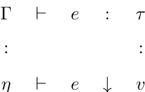

这张图片表达了环境 $\eta$ 应该匹配上下文 $\Gamma$，并且此外，$v$ 应该具有类型 $\tau$。我们说 $\eta$ 匹配 $\Gamma$（$\eta : \Gamma$），如果对于每个声明 $\Gamma, x:\tau$，我们都有一个定义 $\eta(x)=v$，其中 $v:\tau$。这里的值类型虽然有点退化，但它应该规定，例如，只有 $0:\text{bool}$ 和 $1:\text{bool}$。请注意，值是没有环境的，因为它们只是 32 位字，不能包含变量。

上述关系在我们的语义中不完全成立，因为 $\Gamma$ 中的所有变量可能都没有被初始化。但我们通过静态检查确保所有的变量：

$$
\delta \vdash e
$$

其中 $\delta \subseteq \text{dom}(\Gamma)$。因此，我们可以通过将 $\Gamma$ 限制为 $\delta$ 中定义的变量来细化上述内容：

```
δ ⊢ e
Γ|δ ⊢ e : τ
: :
η ⊢ e ↓ v
```

回顾之前的规则，我们可以看到这些关系的重要性。例如，在变量的规则中，我们永远不会遇到未初始化的变量。在逻辑连词的规则中，我们可以看到 $\eta \vdash e_1 \downarrow v_1$ 的两种情况，即 0 和 1，捕捉了所有可能性，因为 $v_1$ 的值必须是 `bool` 类型。

## 4 执行语句

在 L3 中执行语句，即我们迄今考虑的 C0 片段，既可以正常完成，也可以通过 `return` 语句从当前函数返回，或者引发异常。

- $\eta \vdash s \rightarrow \eta'$：在环境 $\eta$ 中执行 $s$ 正常完成，并返回环境 $\eta'$。
- $\eta \vdash s \downarrow [v]$：在环境 $\eta$ 中执行 $s$ 不正常完成，而是返回值 $v$。
- $\eta \vdash s \uparrow exn$：在环境 $\eta$ 中执行 $s$ 引发异常 $exn$。

我们从一些简单的情况开始：

$$
\frac{\eta \vdash s_1 \rightarrow \eta_1 \quad \eta_1 \vdash s_2 \rightarrow \eta_2}{\eta \vdash \text{seq}(s_1, s_2) \rightarrow \eta_2} \stackrel{(+LR)}{}
$$

$$
\frac{}{\eta \vdash \text{nop} \rightarrow \eta}
$$## 动态语义

第二条规则强调了语句序列从左到右执行。我们扩展了关于异常传播的约定，其中任何 $s_1$ 引发的异常都会传播，而 $s_2$ 中的异常只有在 $s_1$ 正常完成时才会传播。因此，注释 $(^{+LR})$ 表示以下两条规则: $\eta \vdash s_1 \uparrow exn$

$$
\frac{\eta \vdash s_1 \rightarrow \eta_1 \quad \eta_1 \vdash s_2 \uparrow exn}{\eta \vdash \operatorname{seq}(s_1, s_2) \uparrow exn}
$$

因为 $s_1$ 或者 $s_2$ 也可能执行返回语句，我们还需要以下附加规则：

$$
\frac{\eta \vdash s_1 \downarrow [v]}{\eta \vdash \operatorname{seq}(s_1, s_2) \downarrow [v]} \quad
\frac{\eta \vdash s_1 \rightarrow \eta_1 \quad \eta_1 \vdash s_2 \downarrow [v]}{\eta \vdash \operatorname{seq}(s_1, s_2) \downarrow [v]}
$$

这些判断与我们的静态语义相符吗?

| $\Gamma \mid \delta$ | $\vdash$ | $s$ | $:$ | $[\tau]$ |
| :--- | :--- | :--- | :--- | :--- |
| $\delta$ | $\vdash$ | $s$ | $\Rightarrow$ | $\delta'$ |
| $:$ | | | | $:$ |
| $\eta$ | $\vdash$ | $s$ | $\rightarrow$ | $\eta'$ |

这个图表试图表达的是，如果 $\eta$ 匹配 $\Gamma \mid \delta$ ，那么 $\eta'$ 匹配 $\Gamma \mid \delta'$ 。换句话说，如果 $s$ 正常完成，则它将定义静态语义所要求的那些变量，即 $\delta'$ 中的变量。此外，所有的值都具有正确的类型。

对于返回值，我们有一个相关的图表：

| $\delta$ | $\vdash$ | $s$ | $\Rightarrow$ | $\delta'$ |
| :--- | :--- | :--- | :--- | :--- |
| $\Gamma \mid \delta$ | $\vdash$ | $s$ | $:$ | $[\tau]$ |
| $:$ | | | | $:$ |
| $\eta$ | $\vdash$ | $s$ | $\downarrow$ | $[v]$ |

也就是说，如果 $s$ 返回一个值 $v$ ，那么它必须具有类型 $\tau$ 。右侧的规则显然应该满足这一点。

$$
\frac{\eta \vdash e \downarrow v}{\eta \vdash \operatorname{return}(e) \downarrow [v]} \quad
\frac{\eta \vdash e \uparrow exn}{\eta \vdash \operatorname{return}(e) \uparrow exn}
$$

赋值直接更新环境，传播异常。

$$
\frac{\eta \vdash e \downarrow v}{\eta \vdash \operatorname{assign}(x, e) \rightarrow \eta[x \rightarrow v]} \quad (^{+LR})
$$

## 5 函数调用

最后，在本讲座中，我们来谈谈语句和表达式之间的另一个联系：函数调用。我们将前提条件堆叠在一起，以便规则不会变得太宽。

$$
\frac{
  \eta \vdash e_1 \downarrow v_1 \quad \dots \quad \eta \vdash e_n \downarrow v_n \\
  f(x_1, \dots, x_n) = s \\
  x_1 \rightarrow v_1, \dots, x_n \rightarrow v_n \vdash s \downarrow [v]
}{
  \eta \vdash f(e_1, \dots, e_n) \downarrow v \quad (+LR)
}
$$

在函数体中，这里的 $\eta$ 完全被忽略，因为 $s$ 只能访问函数参数 $x_1, \dots, x_n$。如果一切顺利，我们知道 $s$ 必须引发一个异常或返回一个值，它不能正常完成。这是因为我们在静态语义中检查到 $s$ 的每个控制流路径上都有一个 return 语句。我们可以提供这个规则的另一个版本，以防我们有一个不返回值 (void) 的函数，或者我们可以将 void 扩展为返回一个特殊值，比如 0。

回想一下，根据我们的约定，如果 $e_1$ 引发异常，或者如果 $e_1$ 返回一个值并且 $e_2$ 引发异常等等，函数调用会引发异常。最后，任何来自 $s$ 的异常都会传递下去。

# 可变存储讲义

15-411：编译器设计
Frank Pfenning
第14讲
2013年10月10日

## 1 引言

在本讲中，我们扩展了我们的语言，使其能够在所谓的堆上分配数据结构。堆元素的地址作为指针，可以被解引用以读取存储的值，或者用作写操作的目标。

类似地，数组存储在堆上[^1]，并通过适当的地址计算进行访问。添加可变存储需要对动态语义规则的结构进行重大更改。相比之下，静态语义相对容易扩展。

## 2 指针

我们将类型语言扩展为 $\tau^*$，其中 $\tau$ 是一种类型。
$\tau ::= \text{int} \mid \text{bool} \mid \alpha \mid \tau^*$

在表达式语言中，我们可以在堆上分配一个可以容纳 $\tau$ 类型值的单元，我们有一个特殊的空指针，并且我们可以解引用指针以获取存储的值。

$e ::= \dots \mid \text{alloc}(\tau) \mid *e \mid \text{null}$

它们具有以下类型规则：

乍一看它们可能是无害的，但第三条规则应该引起警觉：我们之前在类型分析中声称，给定 $\Gamma$ 和 $e$，我们可以合成 $e$ 的类型（如果存在）。然而，在 null 的规则中不是这样的。

[^1] C0没有堆栈分配的数组

### 3 详细信息: 类型 * null

我们无法为 null 合成一个明确的类型。不幸的是，我们通常也无法知道要将表达式与哪种类型进行检查。因此，我们将合成一个不确定的类型，称之为 $any^*$，它是指向可能是任何类型的数据的指针的类型。

现在我们必须遍历语言中的所有结构，以查看是否可以解决 $any^*$，假设它只能出现为 null。让我们首先考虑指针相等，即表达式 $p == q$，其中 $p$ 和 $q$ 是指针。如果 $p$ 和 $q$ 都有明确的类型 $\tau^*$，我们将其视为类型正确。如果一个具有类型 $\tau^*$，另一个具有类型 $\tau'^*$，其中 $\tau \neq \tau'$，我们将拒绝比较，因为类型不正确。如果一个是明确的 $\tau^*$，另一个是不明确的，我们允许比较，因为不明确的类型只有一个值(null)，可以与任何明确类型的指针进行比较。如果两者都是不明确的，我们将比较 null 和 null，这也是可以的。

捕捉这一点的一种方法是使用所谓的类型包容规则允许一个“静默”转换：

$$
\frac{\Gamma \vdash e : \text{any}^*}{\Gamma \vdash e : \tau^*}
$$

然后我们的重载相等性只需要三条规则：[^2]

$$
\frac{\Gamma \vdash e_1 : \tau^* \quad \Gamma \vdash e_2 : \tau^*}{\Gamma \vdash e_1 == e_2 : \text{bool}} \quad
\frac{\Gamma \vdash e_1 : \text{int} \quad \Gamma \vdash e_2 : \text{int}}{\Gamma \vdash e_1 == e_2 : \text{bool}} \quad
\frac{\Gamma \vdash e_1 : \text{bool} \quad \Gamma \vdash e_2 : \text{bool}}{\Gamma \vdash e_1 == e_2 : \text{bool}}
$$

[^2] 实际上，在这个语言片段中只需要一个就足够了，因为所有类型的元素都可以进行相等比较。

解引用运算符存在一个困难：$*null$ 会有任意类型，这意味着它可以出现在任何地方。当然，运行时，它将始终引发异常，因为解引用一个 null 指针是不允许的。因此，我们重写我们之前的规则，不允许解引用具有不确定类型的值。

$$
\frac{\Gamma \vdash e : \tau^*}{\Gamma \vdash *e : \tau}
$$

特别是 $*null$ 是不允许的，以及 $*(b \text{ ? null : null})$ 和其变体，因为条件仍然具有不确定的类型 $any^*$。当然，不确定的类型不是源语言的一部分，只在类型检查期间内部使用。

## 4 指针的动态语义

类型为 $\tau^*$ 的值只是存储类型为 $\tau$ 的值的地址，或者特殊地址 0。分配返回一个未使用的地址，解引用指针检索存储的值。但是存储在哪里？我们目前只携带一个环境 $\eta$ 将变量映射到它们的值。我们现在还携带一个堆 $H$，将地址映射到存储的值。

表达式的评估可能会改变堆的状态，因为它可能调用改变状态的函数。所以表达式的评估现在看起来是：[^3]

$H ; \eta \vdash e \downarrow v ; H'$

这里的分号 “;” 只是堆和环境之间的分隔符，左边是堆和环境，右边是值和新的堆。我们将其读作

> 给定堆 $H$ 和环境 $\eta$，对于 $e$ 的评估返回值 $v$ 在新的堆状态 $H'$ 中。

当我们引发异常时，不需要携带新的堆 $H'$，因为 C0 没有捕获异常的机制。

$H ; \eta \vdash e \uparrow exn$

现在，所有之前的规则都通过堆传递线程，始终按照从左到右的评估顺序。例如，

$$
\frac{
  H ; \eta \vdash e_1 \downarrow v_1 ; H' \quad
  H' ; \eta \vdash e_2 \downarrow v_2 ; H'' \quad
  v = v_1 + v_2 \pmod{2^{32}}
}{
  H ; \eta \vdash e_1 + e_2 \downarrow v ; H''
} \quad (+\uparrow)
$$

指针的新规则应该不会特别令人惊讶。我们在我们的架构中用 $a$ 表示地址，一个64位的字。分配返回一个新的地址 $a$，并将其映射到新堆中的适当默认值。

$$
\frac{
  (a, a + |\tau|) \cap \operatorname{dom}(H) = \emptyset \quad
  a \notin \operatorname{dom}(H)
}{
  H ; \eta \vdash \operatorname{alloc}(\tau) \downarrow a ; H[a \rightarrow \operatorname{default}(\tau)]
} \quad (+\uparrow)
$$

新分配的单元格以类型 $\tau$ 的默认值进行初始化。在实现中，这总是被安排为 0（根据 $\tau$ 的大小所需的字长）。对于布尔值，这意味着 false，对于整数是 0，对于指针是源语言中的 null。

为了实现这个规则，我们需要知道每种类型的大小。当然，这在很大程度上取决于处理器架构和约定。在这门课程中，我们编译成 x86-64，这种情况下我们有：

| 类型 | 大小 |
| :--- | :--- |
| int | 4 |
| bool | 4 |
| $\tau^*$ | 8 |
| $\tau[]$ | 8 |

[^3] 这与讲座有些不同，在讲座中，我们试图将堆 $H$ 和环境 $\eta$ 合并为一个单一的内存 $M$。然而，某些操作，如函数调用，在那种表述中很难描述。

解引用指针只是从地址中检索，假设它不是 0。如果它是 0，我们会引发内存异常 mem，实际上是信号 SIGSEGV (11) 在我们的架构上。

$$
\frac{
  H ; \eta \vdash e \downarrow a ; H' \quad
  a \neq 0
}{
  H ; \eta \vdash *e \downarrow H(a) ; H'
} \quad (+\uparrow) \quad
\frac{
  H ; \eta \vdash e \downarrow 0 ; H'
}{
  H ; \eta \vdash *e \uparrow \text{mem}
}
$$

当然，空指针的评估结果就是 0。

$$
\frac{}{H ; \eta \vdash \text{null} \downarrow 0}
$$

在我们的架构中，尝试访问地址为0的内存位置将会引发适当的内存异常。

这给我们留下了一个谜题：我们如何写入内存？在 C0（和 C）中，通过赋值来实现这一点，其中左侧决定了写操作的目标。这些有时被称为 l-values，其中 l 代表左侧(side)。

## 5 写入堆目标

我们定义目标（或 l-values）

$$
d ::= x \mid *d
$$

添加数组和结构将增加更多种类的目标。每种目标也是一个有效的表达式，因此我们可以将目标视为表达式。

$$
\frac{\Gamma \vdash d : \tau \quad \Gamma \vdash e : \tau}{\Gamma \vdash \operatorname{assign}(d, e)}
$$

在操作语义中，我们现在区分变量和其他目标，因为变量在堆栈（或寄存器）上，而目标 $*d$ 在堆上。

为此，我们需要修复描述语句如何执行的新判断。类似于评估表达式的判断，我们有

$$
\begin{aligned}
& H ; \eta \vdash s \rightarrow \eta' ; H' && s \text{ 正常完成，具有新的环境 } \eta' \text{ 和堆 } H' \\
& H ; \eta \vdash s \downarrow [v] ; H' && s \text{ 调用 return 并返回值 } v \\
& H ; \eta \vdash s \uparrow exn && s \text{ 引发异常 } exn
\end{aligned}
$$## 详细信息：评估赋值

对于赋值，我们得到：

根据上述规则，在以下代码片段中应该发生什么。

```c
int* p = NULL;
*p = 1/0;
```

首先，我们将 `p` 定义为 0。然后，我们从左到右评估赋值。这意味着我们首先将 `p` 评估为 0。其次，我们评估 `1/0`。这将引发算术异常，因此是执行的结果。

```c
int** p = NULL;
**p = 1/0;
```

首先我们定义 `p` 为 0。然后我们从左到右评估赋值。这意味着我们首先评估 `*p`。由于 `p` 的值为 0，这引发了一个内存异常，因此这是执行的结果。

### 6 数组

数组在很多方面与指针相似，但没有空数组。我们将在下面讨论默认数组。不过，现在这是一个简化，因为类型规则更直观。

### 可变存储

分配的动态语义获得了一段新的内存，并用类型 $\tau$ 的默认值初始化了数组的所有 $n$ 个元素。

$$
\frac{
  H ; \eta \vdash e \downarrow n ; H' \qquad
  n \ge 0 \qquad
  [a, a + n|\tau|) \cap \text{dom}(H') = \{ \}, \ a = 0
}{
  H'' = H'[a \mapsto \text{default}(\tau), \dots, a + (n - 1)|\tau| \mapsto \text{default}(\tau)]
  \\
  H ; \eta \vdash \text{分配数组 } (\tau, e) \downarrow a ; H''
}
$$

数组访问从左到右进行计算，并计算出正确的内存地址以获取值。

$$
\frac{
  H ; \eta \vdash e_1 \downarrow a ; H' \qquad
  H' ; \eta \vdash e_2 \downarrow i ; H'' \qquad
  a = 0, 0 \le i < \text{数组长度}(a), e_1 : \tau[]
}{
  v = H''(a + i|\tau|)
  \\
  H ; \eta \vdash e_1[e_2] \downarrow v ; H''
}
$$

这里有两个重要的复杂问题：我们从哪里获取数组存储在地址 $a$ 的长度，以及我们从哪里获取类型 $\tau$？

第二个实际上更容易：当我们编译数组访问时，我们将知道 $e_1$ 的类型。它必须是 $\tau[]$ 的形式，其中 $\tau$ 是某种类型。然后我们在编译时计算其大小并生成代码将其乘以索引 $i$。

找到数组的长度实际上更难，因为它在编译时是未知的。这是因为数组分配的形式是 `alloc array(e)`，其中 $e$ 是应该求值为数组中元素数量的任意表达式。

### 细节：存储数组长度

一种可能性是分配一些额外的字节来存储数组的长度。

它可以布局如下，其中 $a$ 是数组 $A$ 的地址，其元素类型为 $\tau$。

| 内容 | $n$ | $A[0]$ | $\dots$ | $A[n-1]$ |
|---|---|---|---|---|
| 地址 | $a$ | $a+4$ | $a+8$ | $a+8+(n-1)|\tau|$ |

或者，我们可以用地址 $a$ 指向第一个数组元素。这简化了地址运算，并且还可以直接将此指针传递给 C（它不关心长度信息）。

| 内容 | $n$ | $A[0]$ | $\cdots$ | $A[n-1]$ |
|---|---|---|---|---|
| 地址 | $a-8$ | $a-4$ | $a$ | $a+(n-1)|\tau|$ |

我们将长度 $n$ 定位在 $a-8$ 而不是 $a-4$ 的原因是，如果整个内存块从 `calloc` 返回时对齐在 8 的倍数上，$a$ 本身将对齐在 8 的倍数上。

在这种第二种情况下，$e_1[e_2]$ 的代码模式为 $e_1: \tau[]$ 和 $|\tau|=k$ 可能是这样的：

```text
cogen(e₁, a)
编码生成(e₂, i)
a₁ ← a - 8
t₂ ← M[a₁]
如果(i < 0)跳转到错误
如果(i ≥ t₂)跳转到错误
a₃ ← i * $k$
a₄ ← a + a₃
t₅ ← M[a₄]
```

在这里，$a, a_1, a_3, a_4$ 将是 64 位临时变量，$t_2$ 将是 32 位，而 $t_5$ 将是 $k$ 字节。我们写 $k$ 来表示这是一个立即操作数（即编译时常量）。在 x86-64 上可以使用一些复合内存操作数来避免一些中间计算，例如 $a_1$ 或 $a_4$。此外，我们可以利用二进制补码算术的特性，将两个比较合并为一个无符号比较 $i$ 和 $t_2$。

当然，与 C 的互操作性仍然存在限制：如果 C 将一个数组传递给 C0 程序，我们需要找到它的长度并将其编组到其他地方，以便我们可以添加长度信息。或者，我们可以在不检查数组边界的不安全模式下编译代码，这正是 C 所做的。

执行带有新目标的赋值与读取非常相似。

$$
\frac{
  H;\eta\vdash d_1\downarrow a;H' \quad
  H';\eta\vdash e_2\downarrow i;H'' \quad
  a=0, 0\le i<\text{length}(a), d_1:\tau[] \quad
  a'=a+i|\tau| \quad
  H'';\eta\vdash e_3\downarrow v;H'''
}{
  H;\eta\vdash d_1[e_2]=e_3\rightarrow\eta;H'''[a'\rightarrow v]
} (+\uparrow)
$$

如果边界检查不满足，则引发内存异常。

$$
\frac{
  H ; \eta \vdash d_1 \downarrow a ; H' \quad
  H' ; \eta \vdash e_2 \downarrow i ; H'' \quad
  a=0 \text{ 或 } i < 0 \text{ 或 } i \geq \text{length}(a)
}{
  H ; \eta \vdash d_1[e_2] = e_3 \uparrow \text{内存}
}
$$

## 7 详细信息：数组类型的默认值

每种类型都有一个默认值。对于整数，它是 0，对于布尔值是 0（表示假），对于指针是 0（表示空）。数组的默认值也是 0，表示大小为 0 的数组。我们永远无法合法地访问默认数组的任何元素，因为索引必须在边界内的条件永远无法满足。尽管如此，数组可以进行相等性和不相等性的比较（这是它们地址的比较），因此大小为零的数组并不完全无用。特别地，`分配数组 (0)` 必须返回一个与已分配的所有其他数组不同且与大小为 0 的默认数组不同的新的大小为零的数组。

当我们尝试访问 `M[a-8]` 以获取其大小时，$a=0$ 是一个有效的数组地址，这会引发问题。我们可以依赖操作系统引发一个内存异常，尽管这可能不是可靠的。为了确保，我们应该在进行地址计算之前检查 $a$ 是否为 0。当我们关闭边界检查时（我们将在实验 5 中实现），如果我们处于不安全模式下，这是不必要的。

### 详细信息：复合赋值运算符

以前，我们可以将 `x+=e` 展开为 `x=x+e`。然而，随着数组的添加，这变得有问题。困难在于 $d_1[e_2] += e_3$。在语法扩展之后，我们得到 $d_1[e_2] = d_1[e_2] + e_3$，其中 $d_1$ 和 $e_2$ 都会被评估两次。由于表达式和目标的评估现在可能会产生影响，这种影响将被意外地重复。

相反，我们不得不多次重复赋值的规则。例如：

$$
\frac{
  H ; \eta \vdash d_1 \downarrow a ; H' \quad
  H' ; \eta \vdash e_2 \downarrow i ; H'' \quad
  a = 0, 0 \leq i < \text{length}(a), d_1 : \tau[] \quad
  a' = a + i|\tau| \quad
  H'' ; \eta \vdash e_3 \downarrow v ; H''' \quad
  v' = H'''[a'] \oplus v
}{
  H ; \eta \vdash d_1[e_2] \oplus= e_3 \to \eta ; H'''[a' \to v']
} (++)
$$

这应该以系统化的方式进行修改，以处理数组越界访问和二进制操作的可能影响，如除法、取模或移位操作可能发生的情况。

# 结构体讲义

15-411: 编译器设计 Frank Pfenning  
讲义15 2013年10月15日

## 1 引言

指针允许访问存储在堆中的数据。数组允许我们聚合相同类型的数据。结构体提供了聚合不同类型数据的方式。这在 C0 语言定义以及其实现中创建了一些额外的挑战（当然，本课程中使用的语言片段 L4 也是如此）。

## 2 结构体声明和定义

C0（和 L4）支持 C 中与结构体相关的构造的子集。结构体可以通过以下方式进行声明：

```c
struct s;
```

或者可以通过指定结构体的字段 $f_1, \dots, f_n$ 来定义结构体及其类型。

```c
struct s {τ_1 f_1; ... τ_n f_n; };
```

我们将详细阐述这一点，以便于输入目的，我们知道 $s.f_i : \tau_i$。为了编译目的，我们还计算 `offset(s, f_i)`；请参见本讲后面的备注。

因为结构体可能需要任意数量的内存，我们规定它们不能被保存在变量中，而必须在堆上分配。为了简洁地指定这一点，我们区分 small types 和 large types。小类型的值适合于寄存器，而大类型的值必须在堆上。在 L4 中，我们有：

- small types: `int`, `bool`, $\tau*$, $\tau[]$
- large types: `struct s`

对于类型，我们有以下重要限制：

- 局部变量、函数参数和返回值必须具有小类型。
- 赋值的左手和右手必须具有小类型。
- 条件表达式必须具有小类型。
- 相等和不相等必须比较小类型的表达式。
- 用作语句的表达式必须具有小类型。

对结构体有一些作用域要求，但它们出人意料地宽松。原因是未定义的结构体提供了一种非常弱的多态形式。例如，我们可以将类型为 `struct s *` 的值作为指针传递，而不需要知道 `struct s` 的定义，只要我们不尝试访问其字段即可。以下静态语义规则适用：

1. 字段名占用自己的命名空间，因此它们不能与变量、函数或类型名冲突（但它们必须与关键字不同）。相同的字段名可以在不同的结构体定义中使用。
2. 在给定的结构定义中，所有字段名必须是不同的。
3. 一个结构最多只能定义一次。
4. 尚未定义的类型 `struct s` 可以被引用，只要它们的大小无关紧要。在表达式 `alloc(struct s)`、`alloc array(struct s, e)` 和作为字段类型的结构定义中，结构的大小是相关的。
5. 在结构的大小无关紧要的上下文中，`struct s` 的出现作为 `struct s` 类型的隐式声明。实际上，这意味着显式的 `struct` 声明是可选的（但鼓励作为良好的风格）。

## 3 表达式和类型

表达式和目标语言的扩展非常经济。

```
e ::= ... | e.f
d ::= ... | d.f
```

我们还定义（通常在详细说明期间）：

```
e → f ≡ (*e).f
```

它也可以作为目标在形式上使用 `d → f`。

$$
\frac{
  \Gamma \vdash e : \operatorname{struct } s \quad
  s.f : \tau
}{
  \Gamma \vdash e.f : \tau
}
$$

为了应用这个规则，`struct s` 必须已经被定义。仅仅声明是不够的，因为我们无法确定字段 $f$ 的类型。

因为目标也是表达式，所以不需要额外的类型规则用于目标。但是请回想一下第 2 节中的限制，之前的规则只允许使用小类型。

## 4 动态语义

正如可能会怀疑的那样，结构体的动态语义更加困难。这是因为我们将程序写成结构体适应变量的样子；实际上我们主要操作的是它们的地址。例如，在定义下方：

```c
struct point {
	int x;
	int y;
};
```

之后

```c
struct point* p = alloc(struct point);
```

表达式 `(*p).y` 应该评估为 0。但是 `*p` 的值是多少？我们不能只是解引用 `p`，因为它只是保存在内存中的结构体开头的地址。相反，我们必须使用这个地址本身，然后计算从结构体开始计算的字段 `y` 的偏移量（在我们使用的 x86-64 ABI 下为 4），将其加到 `p` 上，然后检索存储在该位置的整数。

因此，在这种情况下（当表达式具有较大的类型时），我们评估 `*e`，实质上只是获取 $e$ 的值而不是解引用它。这与 `*d` 在赋值的左侧作为 1-value 出现时我们必须做的非常相似。为了统一这些，我们引入了一个新的判断：

$$H ; \eta \vdash e \Downarrow a ; H' \quad e \text{ 表示地址 } a$$

只有当 $e$ 具有大型类型时，我们才真正需要它。我们用它来评估 $e.f$ 并且还有 $d.f$ 以下。

$$
\frac{
  \begin{array}{l}
  e : \operatorname{struct } s \\
  \operatorname{small}(s.f) \\
  H ; \eta \vdash e \Downarrow a ; H' \\
  a \neq 0
  \end{array}
}{
  H ; \eta \vdash e.f \downarrow H'(a + \operatorname{offset}(s, f)) ; H'
} \quad (+\uparrow)
$$

判断本身只由三个规则定义，因为这是大型表达式的唯一可能性：字段引用、指针引用或数组访问。

$$
\frac{e : \text{struct } s}{\text{large}(s.f)} \qquad
\frac{H ; \eta \vdash e \downarrow a ; H'}{a \neq 0} \qquad
\frac{H ; \eta \vdash e.f \downarrow a + \text{offset}(s, f) ; H'}{}
$$

$$
\frac{H ; \eta \vdash e \downarrow a ; H'}{H ; \eta \vdash *e \downarrow a ; H'} \quad (+\uparrow)
$$

$$
\frac{
  \frac{H ; \eta \vdash e_1 \downarrow a ; H'}{H' ; \eta \vdash e_2 \downarrow i} \quad
  a = 0, 0 \le i < \text{length}(a) \quad
  e_1 : \tau[]
}{
  H ; \eta \vdash e_1[e_2] \downarrow a + i|\tau| ; H'
} \quad (+\uparrow)
$$

同样，在赋值语句的左侧，我们得到：

$$
\frac{d : \text{struct } s}{H ; \eta \vdash d.f \downarrow a ; H'} \qquad
\frac{H' ; \eta \vdash e \downarrow v ; H''}{H ; \eta \vdash \text{assign}(d.f, e) \to \eta'; H''[a \to v]} \quad (+\uparrow)
$$

我们也可以重新审视之前的赋值规则，或许简化它们。

当结构体在内存中分配时，所有字段都会被初始化为它们的默认值。正如在前一讲中提到的，这意味着用 0 填充内存，这正是 C 库函数 `calloc` 所做的。

## 处理不同数据大小

在 L2 和 L3 中，我们只有整数和布尔值，但在 L4 中，我们有不同大小的数据。对于小类型，我们有以下表格：

| L4类型 | 字节大小 | C类型 |
|---|---|---|
| $|\text{int}|$ | $= 4$ | `int` |
| $|\text{bool}|$ | $= 4$ | `int` |
| $|\tau*|$ | $= 8$ | `t *` |
| $|\tau[]|$ | $= 8$ | `t *` |
| $|\text{struct } s|$ | $= \text{size}(s)$ | `struct s` |

请注意，我们决定将 L3 布尔值表示为 C 中的整数，而不是作为 `bool` 类型的成员（定义为 `_Bool` 的别名）。这是因为布尔值在 C 中，根据 x86-64 ABI，宽度为 1 字节的布尔值不需要对齐。¹ 实际上，引入类型 `bool` 到 C 中似乎相对较新，因此仅使用类型 `int` 来表示真值与 C 的哲学并不矛盾。在完整的 C0 中，我们决定将 C0 布尔值表示为 C 布尔值，因为我们还有宽度为 1 字节的字符，因此无法避免处理大小为 1 的数据。

结构体类型的大小通过从左到右在内存中布局结构体来计算，插入填充以确保每个字段都正确对齐。每个整数和布尔值必须在 0 模 4 对齐，每个指针或数组引用必须在 0 模 8 对齐，每个封闭的结构体必须根据其最严格的字段要求对齐。此外，我们在结尾处添加填充，以使整个结构体的大小对其最严格的字段要求为 0 模。这样可以通过知道其类型的大小来简单地布局数组。C 库函数 `calloc` 应始终返回 0 模 8 的指针，因此适用于我们可能想要分配的任何结构体。

## 6 详细信息：寄存器大小

处理不同大小的数据可能需要在编译器中维护额外的信息，以便您可以选择正确的加载/存储和寄存器移动指令（`movl` vs. `movq`），正确的比较（`cmpl` vs. `cmpq`），保留适当数量的堆栈空间，分配适当数量的堆空间，并进行正确的地址计算。

好消息是，在 L3 和 L4 中，寄存器只需要容纳 4 字节或 8 字节的值。然而，当您没有明确地调节数据大小时，很容易引入错误。例如，对于我们推荐的中间形式，不允许以下形式的指令：

$d^{64} \leftarrow s^{32}$

其中 $s$ 和 $d$ 是指定大小的寄存器，但写一个：

```
d^{64}  ←  zeroextend s^{32}
d^{64}  ←  signextend s^{32}
```

这应该确保在“移动”的目标和源具有不同大小时，不会意外应用错误的转换，例如复制传播。这样可以确保您不会意外应用错误的转换，如果“移动”的目标和源具有不同的大小。

在 x86-64 架构上，针对 32 位寄存器的移动和算术指令具有将值零扩展为整个 64 位寄存器的特殊效果。

---
¹ 这在编写 L3 编译器时产生了一些重要的复杂性，我们希望避免。

MOVL %EAX, %EAX

有一个效果：它将 %RAX 的第 32-63 位替换为 0。类似地，

```
XORL %EAX, %EAX
```

将会将 %RAX 的所有 64 位设置为 0，而不仅仅是最低的 32 位。关于这个问题，我们推荐布莱恩特和奥哈拉伦关于 x86-64 机器级编程的笔记，特别是第 9 页上的信息。

## 编译器设计讲义
## 基本优化
15-411：编译器设计
Frank Pfenning
第16讲
2013年10月17日

## 1 引言
编译器生成的代码中，优化的机会很多。一般来说，这些机会更多地来自高级源语言和低级目标语言之间的紧张关系，而不是源代码本身的固有低效性。一种常见的优化机会，有时被估计为优化机会的70%，是地址算术，因此与结构体和数组相关联。

在本讲中，我们将讨论在编译过程中广泛应用的基本优化。在接下来的两节课中，我们将专门讨论循环的优化。另一类优化与函数调用有关，例如尾调用优化和内联。你有机会在作业3中考虑这些问题。

> [1] 在编译器中，很少有东西是真正的最优的，所以“优化”应该被解释为“效率改进”。

## 2 消除死代码
优化有两个组成部分：（1）适用条件和（2）代码转换本身。适用条件可以采用各种形式，但通常需要进行数据流分析。

作为一个热身练习，我们重新考虑了第5讲中关于死代码消除的内容。我们在那里定义了一个谓词 `needed(l, x)`，它通过向后的数据流分析来定义。指令的形式如下：

```
l : x <- s1 ⊕ s2
l : x <- s
```

如果在后继 $l+1$ 中不需要 $x$，则具有纯（无副作用）右侧的代码被视为死代码。我们可以通过说明给定的行受到的影响以及可能需要添加哪些新行来描述转换。我们使用符号

```
$\frac{P_{1} \ldots P_{m}}{\ldots \ldots \ldots \ldots \ldots \ldots \ldots \ldots \ldots \ldots \ldots \ldots \ldots \ldots \ldots \ldots \ldots \ldots \ldots \ldots \ldots \ldots \ldots \ldots} \ L_{1} \ldots L_{n}$
```

用 $L_{1} \ldots L_{n}$ 替换 $P_{1} \ldots P_{m}$，适用条件也列在前提条件中。这是一个线性推理的例子，其中推理过程消耗前提条件并添加结论。[2] 在这种表示法中，死代码消除可以描述为

```
$\begin{aligned} & l: x \leftarrow s_{1} \oplus s_{2} \quad \operatorname{succ}\left(l, l^{\prime}\right) \quad \neg \text { needed }\left(l^{\prime}, x\right) \ & \text { ---------------------------- } \ & \quad l: \text { nop } \ & \quad l: x \leftarrow s \quad \operatorname{succ}\left(l, l^{\prime}\right) \quad \neg \text { needed }\left(l^{\prime}, x\right) \ & \text { ---------------------------- } \ & l: \text { nop } \end{aligned}$
```

其中 $\oplus$ 是一个无副作用的操作。我们用一个 `nop` 来替换指令，而不是只删除它，这样，例如，跳转到行 $l$ 的指令将继续保持值。在优化的后期阶段，可以从代码中删除无用的空操作。

> [2] 线性推理引出了一种相对较新的逻辑，称为线性逻辑。我们在课堂上不再讨论。关于线性推理和线性逻辑的一些资料可以在 http://www.cs.cmu.edu/~fp/courses/15816-s12/

## 3 常量传播
另一个直接的优化是常量传播。如果我们有一个常量 $c$ 的定义 $l: x \leftarrow c$，我们可能希望在代码中用 $c$ 替换 $x$ 的出现，希望能够消除赋值（和 $x$）的情况。此外，我们还可以在用 $c$ 替换 $x$ 的情况下应用其他优化，比如常量折叠。

关键问题是这是否是一种正确的优化。例如，在以下代码中：

```
$\begin{array}{cc} l & : \quad x \leftarrow c \ & \ldots \ k & : \quad y \leftarrow x+1\end{array}$
```

这取决于 $l$ 和 $k$ 之间发生的情况。跳转可能会指向 $l$ 和 $k$ 之间的行，或者 $x$ 可能会有另一个赋值，导致在执行到达 $k$ 时 $x$ 不再具有值 $c$。

与其给出这个问题的一般解决方案，我们更简化我们的假设，假设代码已经转换成静态单赋值(SSA)形式。在这种形式中，任何变量都只定义一次，因此对于 $x$ 的引用必须是正确的。我们使用符号 $l': \text{instr}(x)$ 表示使用 $x$ 的指令（即使用 $(l', x)$），$\text{instr}(c)$ 表示将 $x$ 替换为 $c$ 的结果。

```
l : x <- c       l' : instr(x)
--------------------------
l : x <- c       l' : instr(c)
```

请注意，在结论中我们需要重复 $l: x \leftarrow c$，因为当推理规则应用时前提被消耗。

## 4 复制传播
复制传播与常量传播非常相似，只是一个变量是以另一个变量为定义的。

```
l : x <- y       l' : instr(x)
--------------------------
l : x <- y       l' : instr(y)
```

同样，我们应该问一下，如果程序处于SSA形式，这是否是正确的。我们知道在第 $l$ 行有且只有一个 $y$ 的定义可用。由于在第 $l'$ 行 $x$ 可用，$y$ 也必须可用，所以替换是正确的。

## 5 终止
在应用代码转换时，我们应该始终考虑转换是否终止。显然，每一步死代码消除都会减少代码中的赋值次数。因此，我们可以任意应用它，直到达到静止状态，即不再适用任何死代码消除规则。

静止是普通推理的线性推理对应物，正如我们在之前的讲座中讨论过的那样。饱和意味着我们可能应用的任何推理都只有已知的结论。静止意味着我们不能再应用任何线性推理。

常量传播的单次应用会减少程序中变量出现的次数，因此必须达到静止状态。它也不会增加代码中的定义数量，因此可以自由地与死代码消除混合使用。

很难确定复制传播是否总是会终止，因为变量出现的次数保持不变，变量的数量也保持不变。

实际上，在一个代码模式中：

```
l   :  x <- y
k   :  w <- x
m   :  instr(w)
m'  :  instr(x)
```

我们可以通过从行 $l$ 复制传播来减少出现次数为 $x$ 的次数，然后通过从行 $k$ 复制传播来增加它。然而，如果我们考虑变量之间的支配部分顺序 $x \succ y$，如果 $x$ 的定义使用了 $y$（传递闭包），那么复制传播会将变量的出现次数减少到一个严格较小的值。这个顺序是良基的，因为在SSA中我们不能有循环的定义。如果 $x$ 是以 $y$ 为基础定义的，那么 $y$ 不能以 $x$ 为基础定义，因为在控制流图中 $y$ 的单一定义必须在 $x$ 之前。

## 6 常量折叠
常量折叠在编译时评估常量表达式。在三地址形式中，这很简单：

```
l : x <- c1 ⊕ c2   c1 ⊕ c2 = c
------------------------------
     l : x <- c
```

其中 $\oplus$ 作为一个语法二元操作符和它的算术对应物。我们需要确保 $c_1$ 和 $c_2$ 在这种情况下被定义（并且不应在运行时引发异常）。这个转换没有其他前提条件。

## 7 常见的子表达式消除
自然而然地，我们尝试应用类似于复制或常量传播的转换形式：

```
l   :  x <- s1 ⊕ s2
        ...
k   :  instr(x)
```

在这里，我们将 $x$ 替换为 $s_1 \oplus s_2$。然而，大多数情况下这种方法不起作用，因为结果可能甚至不是一个有效的指令（例如，如果 $\text{instr}(x) = (y \leftarrow x \oplus 1)$）。此外，程序变得更大，而且我们计算一个表达式不止一次，而是多次，所以这很可能使代码变慢而不是更快。

然而，我们可以考虑相反的情况：在某种情况下：

```
l   :   x ← s1 ⊕ s2
...
k   :   y ← s1 ⊕ s2
```

我们可以通过引用 $x$（在某些条件下）来替换对 $s_1 \oplus s_2$ 的第二次计算，从而节省计算量。这被称为公共子表达式消除（CSE）。

为了正确性，我们需要知道当执行到达行 $k$ 时，$x$ 将具有正确的值。因为我们处于SSA形式，如果它们在语法上相同，那么右侧将始终具有相同的含义。但是，在 $k$ 处是否可用 $x$？

我们想知道的是，从代码开始（即我们正在编译的函数的开始）到行 $k$ 的每个控制流路径都经过行 $l$。然后，我们可以确保当我们到达 $k$ 时，$x$ 具有正确的值。这是代码行之间的支配关系的定义。如果 $l$ 支配 $k$，则我们写作 $l \ge k$，如果 $l$ 严格支配 $k$，则我们写作 $l > k$。我们将在下一节中看到如何定义它；一旦定义了它，我们将按以下方式使用它：

```
l : x ← s1 ⊕ s2
k : y ← s1 ⊕ s2
l > k
---------
l : x ← s1 ⊕ s2
k : y ← x
```

## 8 支配
在一般的控制流图中，支配是一种有趣的关系，有几种算法可以计算这种关系。我们可以将其视为一种前向数据流分析的形式。其中一种方法利用我们语言的简单性，直接生成支配关系作为代码生成的一部分。我们在这里简要讨论一下。缺点是，如果你的代码生成稍有不同或更高效，或者如果你的转换改变了控制流图的基本结构，那么你需要更新这种关系。Cooper等人[CHK06]描述了一种简单快速的算法，该算法在我们的简单语言中表现特别好，实证上比传统的Lengauer-Tarjan算法[LT79]（在渐近意义上更快）更快。在本讲座中，我们只考虑基本情况。

对于直线代码，每行的前驱是其直接支配者，而任何前面的行都是支配者。

对于条件语句，请考虑 `if (e, s1, s2)`。我们将其翻译为以下代码，$e$ 或 $s$ 分别是 $e$ 和 $s$ 的代码，而 $\hat{e}$ 是我们可以通过它引用评估 $e$ 的结果的临时变量。

```
l0 : e
l0' : if (\hat{e} != 0) 跳转到 l1; 跳转到 l2
l1 : s1; l1': 跳转到 l3
l2 : s2; l2': 跳转到 l3
l3 :
```

[图片]
右边是相应的控制流图。现在，$l_1$ 的直接支配者应该是 $l_0'$，$l_2$ 的直接支配者也应该是 $l_0'$。现在对于 $l_3$，我们不知道是从 $l_1'$ 到达还是从 $l_2'$ 到达。因此，这些节点都不会支配 $l_3$。相反，直接支配者是 $l_0$，我们在到达 $l_3$ 之前一定会经过的最后一个节点。

> 用虚线表示直接支配者，

下面是结果 (L16.7)。
[图片]

例如，在这个例子中，如果 $s_1$ 是一个返回语句或者已知会引发错误的语句，那么情况就不同了：这种情况下，我们有：
[图片]
在这种情况下，$l_1' : \text{goto } l_3$ 是无法到达的代码，可以进行优化。当然，$l_2$ 无法到达的情况是对称的。

对于循环来说，很容易看出循环的开始支配所有循环中的语句。再次考虑右侧控制流图上的一个 `while` 循环的直接编译。

```
l_0 : \check{e}
l_0' : if (\hat{e} == 0) goto l_2 ; goto l_1
l_1 : \check{s}
l_1' : goto l_0
l_2 :
```

[图片]
有趣的是，在循环头 $l_0$ 之前的节点 $p'$ 确实是 $l_0$ 的直接支配者，即使 $l_0$ 有另一个前驱 $l'_1$。这个定义很明显：当我们进入循环时，我们必须通过节点 $p'$，而在后续的迭代中，我们从 $l'_1$ 来。所以我们不能保证通过 $l'_1$，但我们保证通过节点 $p'$ 在去往 $l_0$ 的路上。
[图片]

## 9 实现公共子表达式消除
为了实现公共子表达式消除，我们遍历程序，寻找定义 $l : x \leftarrow s_1 \oplus s_2$。如果 $s_1 \oplus s_2$ 已经在表中，定义变量 $y$ 在 $k$，我们用 $l : x \leftarrow y$ 替换 $l$，如果 $k$ 支配 $l$。否则，我们将表达式、行和变量添加到哈希表中。

如果我们维护一个支配树，每行都有一个指向其直接支配者的指针，支配关系通常可以很快地检查。我们只需沿着这些指针前进，直到我们到达 $k$（因此 $k > l$），或者到达控制流图的根（在这种情况下，$k$ 不支配 $l$）。

## 10 强度降低
一般情况下，强度降低会用一个更简单的操作替换一个昂贵的操作。有时，根据模运算和二进制补码算术的法则，它还可以完全消除一个操作。回想一下，对于加法、减法、乘法，我们有模 $2^{32}$ 的常规算术法则，但是比较操作更为复杂。难以转换[3]。

常见的简化（以及一些对称的对应）：

| 简化规则 |
| :--- |
| $a + 0 = a$ |
| $a - 0 = a$ |
| $a * 0 = 0$ |
| $a * 1 = a$ |

但是人们很容易想到其他涉及位级运算的进一步算术运算。对于优化数组访问可能有趣的一个是分配律：

| 分配律 |
| :--- |
| $a * (b + c) = a * b + a * c$ |

其中 $a$ 可以是数组元素的大小，而 $(b + c)$ 可以是一个索引计算。

## 11 一个简单的例子
让我们考虑一个相当无害的 C0 代码片段：

```
A [i] = A [i] + 1
```

假设我们不进行空指针或数组边界检查，并且 `a` 保存了数组的地址，我们将得到以下结果。C0 的语义要求从左到右进行评估，所以我们首先获取 `A[i]` 在 $t_1$ 行中的地址，然后评估右侧（$t_1$ 行到 $t_5$ 行），然后写入内存地址 $t_3$（行 $l_6$）。数字 4 是 `int` 的大小，它是数组元素的类型。

```
l_0 : t_0 <- 4 * i # cse
l_1 : t_1 <- a + t_0
l_2 : t_2 <- 4 * i # cse
l_3 : t_3 <- a + t_2
l_4 : t_4 <- M[t_3]
l_5 : t_5 <- t_4 + 1
l_6 : M[t_1] <- t_5
```

> [3] 例如，$x + 1 > x$ 在一般情况下是错误的，因为 $x$ 可能是最大的整数，$2^{31} - 1$。

我们注意到 $l_0$ 和 $l_2$ 都计算 $4*i$，所以我们得到左边的代码。现在可以从 $l_2$ 复制传播到 $l_3$ 以得到右边的代码。

```
l0 : t0 <- 4*i       l0 : t0 <- 4*i
l1 : t1 <- a+t0      l1 : t1 <- a+t0 # cse
l2 : t2 <- t0        l2 : t2 <- t0
l3 : t3 <- a+t2      l3 : t3 <- a+t0 # cse
l4 : t4 <- M[t3]     l4 : t4 <- M[t3]
l5 : t5 <- t4+1      l5 : t5 <- t4+1
l6 : M[t1] <- t5     l6 : M[t1] <- t5
```

右侧的代码为第 $l_1$ 行和第 $l_3$ 行的常见子表达式消除提供了另一个机会。左侧是结果，右侧再次进行了复制传播。

```
l0 : t0 <- 4*i       l0 : t0 <- 4*i
l1 : t1 <- a+t0      l1 : t1 <- a+t0
l2 : t2 <- t0        l2 : t2 <- t0   # 死代码
l3 : t3 <- t1        l3 : t3 <- t1   # 死代码
l4 : t4 <- M[t3]     l4 : t4 <- M[t1]
l5 : t5 <- t4+1      l5 : t5 <- t4+1
l6 : M[t1] <- t5     l6 : M[t1] <- t5
```

死代码消除的一次通过只计算一次 `A[i]` 的地址。

```
l0 : t0 <- 4*i
l1 : t1 <- a+t0
l2 : nop
l3 : nop
l4 : t4 <- M[t1]
l5 : t5 <- t4+1
l6 : M[t1] <- t5
```

这个例子说明了优化的级联效果：最初，我们只有两个公共子表达式，但在一些优化后发现了更多。全局值编号等技术可以通过将多个迭代合并为一个来避免对代码的多次遍历。需要性分析是另一个例子，可以一次性声明多行代码为死代码，而不是在序列中进行新的分析。

## 参考文献
> [CHK06] Keith D. Cooper, Timothy J. Harvey 和 Ken Kennedy。一个简单快速的支配算法。技术报告 TR-06-33870，计算机科学系，莱斯大学，2006年。
>
> [LT79] Thomas Lengauer 和 Robert Endre Tarjan。一个快速算法用于在流图中找到支配者。ACM Transactions on Programming Languages and Systems, 1(1):115–120, 1979年7月。

# 循环优化讲义

15-411：编译器设计
Frank Pfenning
第17讲
2013年10月22日

## 1 引言

在编译中，优化循环特别重要，因为循环（尤其是内部循环）占据了许多程序的执行时间。由于尾递归函数通常也被转换为循环，循环优化的重要性进一步增加。在本讲座中，我们将讨论两个主要的优化方法：将循环不变计算提取出循环以及基于归纳变量的优化。

## 2 什么是循环？

在我们讨论循环优化之前，我们应该讨论一下我们如何定义循环。在我们的源语言中，这相当简单，因为循环是由 `while` 或 `for` 形成的，在这种情况下，将 `for` 循环展开为相应的 `while` 形式是方便的。

循环的关键是控制流图中的反向边，从一个节点 `l` 到一个节点 `h`，该节点 `l` 支配。我们称之为循环的头节点。循环本身由从 `h` 到 `l` 的路径上的节点组成。方便起见，我们将代码组织成循环可以通过其头节点来识别。然后，如果行 `l` 在以头节点 `h` 为头的循环中，我们写作 `loop(h, l)`。

当循环嵌套时，我们通常优化内部循环先于外部循环。首先，内部循环可能会被执行更频繁。另外，它可以将计算移动到外部循环中，当外部循环被优化时，进一步提升。

## 3 提升循环不变计算

如果一个（纯）表达式在整个循环中的值不会改变，则称其为循环不变的。然后，我们可以定义谓词 `inv(h,p)`，其中 `p` 是一个纯表达式，如下所示：

```
p   ::= c常量 | def(l,x) | ¬loop(h,l) | inv(h,s₁) | inv(h,s₂)
inv ::= inv(h,c) | inv(h,x) | inv(h,s₁⊕s₂)
```

由于我们只关注 SSA 形式的程序，很容易看出如果变量不是头标签的参数，则它们是循环不变的。然而，上述定义并没有完全捕捉到这一点，对于定义 `t ← p` 其中 `p` 是循环不变的但 `t` 不是标签参数的一部分。因此，我们添加了第二个传播规则：

```
l: t ← p     inv(h,p)     loop(h,l)
-----------------------------
        inv(h,t)
```

请注意，我们不认为函数调用的内存引用是循环不变的，尽管在一些额外条件下它们也可以被提升。

为了将循环不变计算提升出循环，我们应该在控制流图中有一个循环前导块，它立即支配循环头。然后将所有循环不变计算移到前导块中。

在进行这种优化时需要小心。例如，当循环体从未执行时，代码可能变得非常慢。另一个问题是，如果循环体中有条件语句：只在一个分支上计算的值或者另一个分支上计算的值都是循环不变的，但是根据布尔条件的不同，可能永远不会执行其中一个分支。

在某些情况下，当循环保护条件廉价且无副作用，但循环不变代码昂贵时，我们可以考虑复制测试，以便生成以下代码：

```
seq(pre, while(e,s))
```

我们为其生成以下代码：

```
seq(if(e, seq(pre, while(e,s)), nop))
```

在循环前导中，`pre` 是被提升的计算位置。

提升循环不变计算的典型例子是用循环来初始化二维数组的所有元素：

```c
for (int i=0; i<width*height; i++)
    A[i] = 1;
```

我们在左边展示了相关的抽象汇编代码。在右边是乘法的提升结果，因为 `width` 和 `height` 都是循环不变的，所以它们的乘积也是循环不变的。

```assembly
i_0 <- 0
goto loop(i_0)
loop(i_1) :
  t <- width * height
  if (i_1 >= t) goto exit
  ...
  i_2 <- i_1 + 1
  goto loop(i_2)
exit :
```

```assembly
i_0 <- 0
t <- width * height
goto loop(i_0)
loop(i_1) :
  if (i_1 >= t) goto exit
  ...
  i_2 <- i_1 + 1
  goto loop(i_2)
exit :
```

## 4 归纳变量

提升循环不变计算是重要的；优化每次循环中变化恒定的计算可能更重要。我们称这样的变量为基本归纳变量。优化的机会来自派生归纳变量，即从基本归纳变量计算得到的变量。

作为示例，我们将使用一个函数来检查给定数组是否按升序排序。

```c
bool is_sorted(int[] A, int n)
//@requires 0 <= n && n <= length(A);
{
  for (int i = 0; i < n-1; i++)
    //@loop_invariant 0 <= i && i <= n-1;
    if (A[i] > A[i+1]) return false;
  return true;
}
```

下面是这段代码可能的编译后的 SSA 版本，假设我们没有进行数组边界检查（或已经消除了它们）。

```ssa
is_sorted(A, n):
    i_0 <- 0
    goto loop(i_0)
loop(i_1):
    t_0 <- n - 1
    if (i_1 >= t_0) goto rtrue
    t_1 <- 4 * i_1
    t_2 <- A + t_1
    t_3 <- M[t_2]
    t_4 <- i_1 + 1
    t_5 <- 4 * t_4
    t_6 <- A + t_5
    t_7 <- M[t_6]
    if (t_3 > t_7) goto rfalse
    i_2 <- i_1 + 1
    goto loop(i_2)
rtrue: return 1
rfalse: return 0
```

在这里，$i_1$ 是基本归纳变量，而 $t_1 = 4 * i_1$ 和 $t_4 = i_1 + 1$ 是派生归纳变量。一般来说，如果一个变量具有形式 $a * i + b$，我们将其视为派生归纳变量，其中 $a$ 和 $b$ 是循环不变的。

让我们先考虑 $t_4$。我们可以看到公共子表达式消除适用。然而，我们希望保留基本归纳变量 $i_1$ 及其版本 $i_2$，因此我们进行代码移动，然后消除 $i_1+1$ 的第二次出现。

```ssa
is_sorted(A, n):
  i_0 <- 0
  goto loop(i_0)
loop(i_1):
  t_0 <- n - 1
  if (i_1 >= t_0) goto rtrue
  t_1 <- 4 * i_1
  t_2 <- A + t_1
  t_3 <- M[t_2]
  t_4 <- i_1 + 1
  t_5 <- 4 * t_4
  t_6 <- A + t_5
  t_7 <- M[t_6]
  if (t_3 > t_7) goto rfalse
  i_2 <- i_1 + 1
  goto loop(i_2)
```

```ssa
is_sorted(A, n):
  i_0 <- 0
  goto loop(i_0)
loop(i_1):
  t_0 <- n - 1
  if (i_1 >= t_0) goto rtrue
  t_1 <- 4 * i_1
  t_2 <- A + t_1
  t_3 <- M[t_2]
  i_2 <- i_1 + 1
  t_4 <- i_2
  t_5 <- 4 * t_4
  t_6 <- A + t_5
  t_7 <- M[t_6]
  if (t_3 > t_7) goto rfalse
  goto loop(i_2)
```

接下来，我们看看派生归纳变量 $t_1 \leftarrow 4 * i_1$。这个想法是看看我们如何可以从前一次迭代中的 $t_1$ 计算出后续迭代中的 $t_1$。为了实现这个效果，我们添加一个新的归纳变量来表示 $4 * i_1$。我们称之为 $j$，并将其添加到我们的循环变量中，以 SSA 形式表示。

```ssa
is_sorted(A, n):
  i_0 <- 0
  j_0 <- 4 * i_0   @ensures j_0 = 4 * i_0
  goto loop(i_0, j_0)
loop(i_1, j_1):   @requires j_1 = 4 * i_1
  t_0 <- n - 1
  if (i_1 >= t_0) goto rtrue
  t_1 <- j_1   @assert j_1 = 4 * i_1
  t_2 <- A + t_1
  t_3 <- M[t_2]
  i_2 <- i_1 + 1
  j_2 <- 4 * i_2   @ensures j_2 = 4 * i_2
  t_4 <- i_2
  t_5 <- 4 * t_4
  t_6 <- A + t_5
  t_7 <- M[t_6]
  if (t_3 > t_7) goto rfalse
  goto loop(i_2, j_2)
```

关键是当标签 `loop(i_1, j_1)` 被触发时，不变量 `j_1 = 4 * i_1` 成立。现在我们计算：
$j_2 = 4 * i_2 = 4 * (i_1 + 1) = 4 * i_1 + 4 = j_1 + 4$
所以我们可以用 $j_2$ 来表示 $j_1$ 而不用乘法。这是一个强度降低的例子，因为加法比乘法快。回想一下，我们使用的所有定律都适用于模运算。同样地：
`$j_0 = 4 * i_0 = 0$`
因为 `i_0 = 0`，这是常量传播后常量折叠的一个例子。

```ssa
is_sorted(A, n):
  i_0 <- 0
  j_0 <- 0
  goto loop(i_0, j_0)
loop(i_1, j_1): @requires j_1 = 4 * i_1
  t_0 <- n - 1
  if (i_1 >= t_0) goto rtrue
  t_1 <- j_1
  t_2 <- A + t_1
  t_3 <- M[t_2]
  i_2 <- i_1 + 1
  j_2 <- j_1 + 4
  t_4 <- i_2
  t_5 <- 4 * t_4
  t_6 <- A + t_5
  t_7 <- M[t_6]
  if (t_3 > t_7) goto rfalse
  goto loop(i_2, j_2)
```

> @ensures `j_0 = 4 * i_0`
> @requires `j_1 = 4 * i_1`
> @assert `j_1 = 4 * i_1`
> @ensures `j_2 = 4 * i_2`

通过一些复制传播，并注意到 `n-1` 是循环不变量，我们接下来得到：

```ssa
is_sorted(A, n):
  i_0 <- 0
  j_0 <- 0           @ensures j_0 = 4 * i_0
  t_0 <- n - 1
  goto loop(i_0, j_0)
loop(i_1, j_1): @requires j_1 = 4 * i_1
  if (i_1 >= t_0) goto rtrue
  t_2 <- A + j_1
  t_3 <- M[t_2]
  i_2 <- i_1 + 1
  j_2 <- j_1 + 4   @ensures j_2 = 4 * i_2
  t_5 <- 4 * i_2
  t_6 <- A + t_5
  t_7 <- M[t_6]
  if (t_3 > t_7) goto rfalse
  goto loop(i_2, j_2)
```

通过公共子表达式消除（注意我们知道的额外断言），我们可以用 $j_2$ 替换 $4*i_2$。我们将这个与复制传播结合起来。

```ssa
is_sorted(A, n):
  i_0 <- 0
  j_0 <- 0           @ensures j_0 = 4 * i_0
  t_0 <- n - 1
  goto loop(i_0, j_0)
loop(i_1, j_1): @requires j_1 = 4 * i_1
  if (i_1 >= t_0) goto rtrue
  t_2 <- A + j_1
  t_3 <- M[t_2]
  i_2 <- i_1 + 1
  j_2 <- j_1 + 4   @ensures j_2 = 4 * i_2
  t_6 <- A + j_2
  t_7 <- M[t_6]
  if (t_3 > t_7) goto rfalse
  goto loop(i_2, j_2)
```

我们观察到另一个派生的归纳变量，即 $t_2 = A + j_1$。我们给它一个新名字 $k_1 = A + j_1$，并将其引入我们的函数中。再次我们只计算：
$k_{2} = A + j_{2} = A + j_{1} + 4 = k_{1} + 4$ 且 $k_{0} = A + j_{0} = A$。

```ssa
is_sorted(A, n):
  i_0 <- 0
  j_0 <- 0           @ensures j_0 = 4 * i_0
  k_0 <- A + j_0     @ensures k_0 = A + j_0
  t_0 <- n - 1
  goto loop(i_0, j_0, k_0)
loop(i_1, j_1, k_1): @requires j_1 = 4 * i_1 ∧ k_1 = A + j_1
  if (i_1 >= t_0) goto rtrue
  t_2 <- k_1
  t_3 <- M[t_2]
  i_2 <- i_1 + 1
  j_2 <- j_1 + 4           @ensures j_2 = 4 * i_2
  k_2 <- k_1 + 4           @ensures k_2 = A + j_2
  t_6 <- A + j_2
  t_7 <- M[t_6]
  if (t_3 > t_7) goto rfalse
  goto loop(i_2, j_2, k_2)
```

经过更多的常量传播、公共子表达式消除和无用代码消除后，我们得到：

```ssa
is_sorted(A, n):
  i_0 <- 0
  j_0 <- 0               @ensures j_0 = 4 * i_0
  k_0 <- A               @ensures k_0 = A + j_0
  t_0 <- n - 1
  goto loop(i_0, j_0, k_0)
loop(i_1, j_1, k_1): @requires j_1 = 4 * i_1 ∧ k_1 = A + j_1
  if (i_1 >= t_0) goto rtrue
  t_3 <- M[k_1]
  i_2 <- i_1 + 1
  j_2 <- j_1 + 4         @ensures j_2 = 4 * i_2
  k_2 <- k_1 + 4         @ensures k_2 = A + j_2
  t_7 <- M[k_2]
  if (t_3 > t_7) goto rfalse
  goto loop(i_2, j_2, k_2)
```

通过必要性分析，我们可以说 $j_0, j_1$ 和 $j_2$ 不再需要，可以被消除。

```ssa
is_sorted(A, n):
  i_0 <- 0
  k_0 <- A               @ensures k_0 = A + 4 * i_0
  t_0 <- n - 1
  goto loop(i_0, k_0)
loop(i_1, k_1): @requires k_1 = A + 4 * i_1
  if (i_1 >= t_0) goto rtrue
  t_3 <- M[k_1]
  i_2 <- i_1 + 1
  k_2 <- k_1 + 4         @ensures k_2 = A + 4 * i_2
  t_7 <- M[k_2]
  if (t_3 > t_7) goto rfalse
  goto loop(i_2, k_2)
```

不幸的是，$i_1$ 仍然是必需的，因为它控制了一个条件跳转。为了消除这个问题，我们需要观察到：
$i_{1} \ge t_{0}$ 当且仅当 $A+4 * i_{1} \ge A+4 * t_{0}$
这是成立的，因为这里的加法是在 64 位的数上进行的，而第二个操作数是 32 位的，所以不会发生溢出。如果我们利用这一点，我们可以得到：

```ssa
is_sorted(A, n):
  i_0 <- 0
  k_0 <- A               @ensures k_0 = A + 4 * i_0
  t_0 <- n - 1
  goto loop(i_0, k_0)
loop(i_1, k_1): @requires k_1 = A + 4 * i_1
  if (k_1 >= A + 4 * t_0) goto rtrue
  t_3 <- M[k_1]
  i_2 <- i_1 + 1
  k_2 <- k_1 + 4         @ensures k_2 = A + 4 * i_2
  t_7 <- M[k_2]
  if (t_3 > t_7) goto rfalse
  goto loop(i_2, k_2)
```

现在 $i_0$、$i_1$ 和 $i_2$ 不再需要，可以被消除。此外，$A+4 * t_{0}$ 是循环不变量，可以提升。

```ssa
is_sorted(A, n):
  k_0 <- A
  t_0 <- n - 1
  t_8 <- 4 * t_0
  t_9 <- A + t_8
  goto loop(k_0)
loop(k_1):
  if (k_1 >= t_9) goto rtrue
  t_3 <- M[k_1]
  k_2 <- k_1 + 4
  t_7 <- M[k_2]
  if (t_3 > t_7) goto rfalse
  goto loop(k_2)
rtrue: return 1
rfalse: return 0
```

有人建议我们可以通过展开循环一次来避免每次迭代两次内存访问。这是有道理的，但这种优化超出了本讲的范围。

我们在具体的程序和值上进行了优化，但是很容易将它们推广到任意的归纳变量 $x$，它们通过常数 $c$ 进行更新（其中 $c$ 是一个常数），以及通过常数乘法或加法与基本归纳变量相关的派生变量。

# 内存优化讲义

## 15-411：编译器设计

## Frank Pfenning

## 第19讲

## 2013年10月29日

## 1 引言

即使在具有分层内存缓存的现代架构上，内存访问的平均开销仍然显著高于寄存器访问甚至大多数算术操作。因此，内存优化在生成快速代码方面起着重要作用。正如我们将看到的，某些内存优化是否可行取决于整个语言的属性。例如，我们是否可以获得指向堆分配对象中间的指针将是一个关键问题需要回答。

## 2 简单示例

我们将使用一个简单的运行示例来说明内存优化及其适用条件。在这个示例中，`mult(A, p, q)`将矩阵 A与向量 p相乘，并将结果存储在向量 q中。

```c
struct point {
  int x;
  int y;
};
typedef struct point pt;

void mult(int A[], pt* p, pt* q) {
  q->x = A[0] * p->x + A[1] * p->y;
  q->y = A[2] * p->x + A[3] * p->y;
  return;
}
```

下面是抽象汇编的翻译，稍有变化的是我们允许内存引用的形式为 `M[base + offset]`。我们研究的内存优化问题是是否可以避免一些加载指令 $t \leftarrow M[s]$，因为相应的值已经保存在一个临时变量中。

```asm
mult(A, p, q) :
t_0 <- M[A+0]
t_1 <- M[p+0]
t_2 <- t_0+t_1
t_3 <- M[A+4]
t_4 <- M[p+4]
t_5 <- t_3 * t_4
t_6 <- t_2+t_5
M[q+0] <- t_6
t_8 <- M[A+8]
t_9 <- M[p+0]          # 多余的加载?
t_10 <- t_8+t_9
t_11 <- M[A+12]
t_12 <- M[p+4]         # 多余的加载?
t_13 <- t_11 * t_12
t_14 <- t_10+t_13
M[q+4] <- t_14
return
```

我们可以看到源代码两次引用了 `p->x` 和 `p->y`，这在上面的两个可能多余的加载中反映出来。在继续阅读之前，请考虑是否可以用 $t_9 \leftarrow t_1$ 和 $t_{12} \leftarrow t_4$ 来替换这些行。如果我们可以确保地址 $p+0$ 和 $p+4$ 上的内存在之前的加载指令之后没有改变，我们就可以这样做。

事实证明，在C0中，第二次加载肯定是多余的，但第一次加载可能不是。

第一次加载不是多余的，因为当调用这个函数时，指针p和q可能是相同的（它们可能是别名）。当这种情况发生时，对 `M[q+0]` 的存储很可能会改变 `M[p+0]` 中存储的值，导致第二行的结果与预期不同。

另一方面，对于第一行来说，这种情况是不可能发生的，因为 `M[q+0]` 和 `M[p+4]` 永远不会相同，因为一个访问结构体的x字段，另一个访问y字段。

当 $p = q$ 时，当然，答案很可能是错误的。可以选择重写代码，或者要求在函数的前提条件中 $p \neq q$。

在C语言中，这个问题更加微妙，因为使用取地址（&）运算符可以获得对象中间的指针。例如，参数 `int A[]` 在C语言中将变为 `int* A`，并且这样的指针可能是通过 `&q->x` 获得的。

## 3 使用别名分析的结果

在C0语言中，指针的类型是别名分析的强大基础。别名分析通常被称为 may-alias 分析，因为我们试图推断程序中哪些指针可能是别名。然后我们可以为了优化目的知道，如果两个指针不在 may-alias关系中，它们必须是不同的。在一个地址上的写入不会改变另一个地址存储的值。

让我们考虑一下我们如何使用别名分析的结果，用于判断两个地址a和b的谓词 `may-alias(a, b)`。我们假设我们有一个加载指令

$l: t \leftarrow M[a]$

我们想要推断出这个指令是否在其他行 $l': t' \leftarrow M[a]$ 中可用，以便我们可以用 $l': t' \leftarrow t$ 来替换它。我们的优化规则（根据第16讲的线性推理符号表示）：

```text
l : t <- M[a]
l' : t' <- M[a]
l > l'
avail(l, l')
--------------
l : t <- M[a]
l' : t' <- t
```

在SSA形式下，l支配l'足以保证t和a的含义保持不变。`reaches`应该检查 `M[a]` 是否也保持不变。

内存引用的到达分析是一种简单的前向数据流分析。如果我们有一个节点有两个或更多的控制流入边，它必须在所有这些边上都可用。

对于遍历循环的目的，我们假设可用性，本质上是在循环中寻找反例。为了简洁地表达这一点，我们的分析规则传播不可用性：$t \leftarrow M[a]$ 和其他被l支配的指令l'。

对于不可用性，我们在左边使用种子规则，右边使用通用传播规则 `unavail(l, l')`。因为我们处于SSA中，我们知道在种子规则中 $l > l''$，其中 $l''$ 是 $l'$ 的（唯一）后继。

```text
l: t <- M[a]      l: t <- M[a]
l > l'            l > l'
l': M[b] <- s     ¬unavail(l, l')
may-alias(a, b)   ---------------------   unavail(l, l')
succ(l', l'')                      unavail(l, l'')
---------------------  ------------------
unavail(l, l'')        unavail(l, l'')
```

右侧的规则包括跳转或条件跳转的情况。这确保在具有多个前驱节点的节点中，如果一个值在其中一个节点中不可用，则在该节点中也不可用。从这里我们可以推断出仍然可用的内存值，即那些非不可用的值（限制注意力在被加载支配的值上，否则问题就不会被提出）。

```text
l: t <- M[a]
l > l'
¬unavail(l, l')
----------------
avail(l, l')
```

## 4 基于类型的别名分析

最简单的别名分析形式是基于地址的类型和偏移量。我们将其称为别名类，意思是不同别名类中的指针不能别名。这里的基本谓词是 `类(a, τ, offset)`，它表示a是从类型τ和偏移量offset的内存起始位置派生的地址。然后 `may-alias` 关系被定义为

```text
类 (a, τ, k)   类 (b, τ, k)
--------------------------------
        may-alias(a, b)
```

有一些特殊情况我们没有明确处理。例如，数组长度的位置（至少在安全模式下存储）可能在偏移量-8处。但是这样的位置永远不会被写入（数组长度一旦确定就不会改变），所以数组长度的加载在所有被支配的位置都可用。

类关系的种子来自编译器，它用这些信息注释一个地址。在我们的例子中，编译器将生成

- `类(A, int[], 0)`
- `类(p, struct point*, 0)`
- `类(q, struct point*, 0)`

现在我们通过前向数据流分析传播信息。例如：

| 指令 | 前提 | 结论 |
| :--- | :--- | :--- |
| `l: b \leftarrow a` | `类(a, \tau, k)` | `类(b, \tau, k)` |
| `l: b \leftarrow a + n` | `类(a, \tau, k)` | `类(b, \tau, k + n)` |

在第二种情况下，我们写 $n$ 以强调第二个加数是一个常数 $n$。不幸的是，如果它是一个变量，我们无法精确计算偏移量。这可能发生在数组中，但不会发生在指针中，包括指向结构体的指针。因此，我们需要将类的第三个参数泛化为变量或 $\top$，表示任何值都可能。例如，我们有

```text
l : b ← a + t    类 (a, τ, k)
-------------------------
             类 (b, τ, ⊤)
```

现在 $\top$ 行为像一个信息汇。例如，$\top + k = k + \top = \top$。

由于在SSA形式中，一个变量a只被定义一次，我们不应该改变对变量的类别的看法。然而，在参数化的跳转目标（相当于 $\Phi$-函数）中，我们需要“分离”信息，以便如果参数在一个前驱中被确定为 $k$，而在另一个前驱中未知，则结果应为 $\top$。

由于循环的存在，我们需要进一步推广并引入 $\bot$，这意味着我们（目前）认为该变量永远不会被使用。由于编译器的种子，这通常发生在循环变量中。这些值被按照一个格子的方式排列


在底部我们有更多的信息，在顶部则是最少的。格子元素之间的运算找到其两个参数的最小上界。

例如，$0 \sqcup 4 = \top$ 和 $\bot \sqcup 2 = 2$。我们在SSA形式中使用它来组合关于偏移量的信息。用 $\Phi$-函数写，我们将有

```latex
\frac{\text{类}(a_0, \tau, k_0) \quad a_0 \leftarrow \Phi(a_1, \dots, a_n) \quad \text{类}(a_i, \tau, k_i) \quad (1 \le i \le n)}{\text{类}(a_0, \tau, k_0 \sqcup k_1 \sqcup \dots \sqcup k_n)}
```

由于循环，我们可能需要多次执行此计算，直到达到一个固定点。在这种情况下，固定点是我们计算的所有偏移类的上界，这与我们之前考虑的饱和格有些不同。

这是一个抽象解释的例子，可能是未来讲座的主题。如果细化抽象域，可以获得更精确的别名分析，上面显示了格。

## 5 基于分配的别名分析

推断指针可能不别名的另一种技术是基于它们的分配点。简而言之，如果两个指针是通过不同的调用 `alloc` 或 `alloc array` 进行分配的，则它们不能别名。因为分配可能发生在我们当前编译（并希望优化）的不同函数中，这是一个跨过程分析的示例。

# 反编译讲义

## 15-411：编译器设计

## Maxime Serrano

## 第20讲

## 2013年10月31日

## 1 引言

在本讲座中，我们考虑了从编译后的二进制文件转换为其原始源代码的问题。解决这个问题将涉及对我们的标准数据流分析的重要考虑，以及对代码内部表示的良好选择的讨论。

虽然编译器存在的动机相当明确，但反编译器存在的动机则不太明确。然而，在现代世界存在许多原始源代码已丢失的遗留系统，这些系统需要修复错误或迁移到更现代的架构。反编译器极大地促进了这个过程。此外，在恶意软件分析中，通常不提供源代码。因此，有一种从二进制代码到原始代码的合理近似的方法非常有用。

在本讲座中，我们将重点讲解将符合CABI的机器代码（最初是C0代码）反编译为带有指针算术和 `goto` 的C0版本。这远远不能作为对任意二进制文件进行反编译的处理（实际上，这里描述的算法在任意二进制文件上经常无法正常工作!），尽管相同思想的更复杂变体将继续工作。

## 反编译的两个步骤

大致上，反编译包括以下几个步骤：

- 反汇编 - 将机器代码转换为汇编等效代码。这里有许多意想不到的陷阱。
- 提升和数据流分析 - 将结果的汇编代码转换为更高级的内部表示，例如我们的三操作数汇编。这里的一个棘手部分是识别不同的变量，并将变量与寄存器或地址分离。我们还恢复表达式、函数返回值和参数。
- 控制流分析 - 恢复控制流结构信息，例如 `if` 和 `while` 语句，以及它们的嵌套级别。
- 类型分析 - 恢复变量、函数和其他数据片段的类型。

## 3 反汇编

编写一个好的反编译器的第一步是编写一个好的反汇编器。尽管各个反汇编器的细节可能非常复杂，但总体思路相对简单。汇编和机器码之间的映射在理论上是一对一的，因此直线翻译应该是可行的。

然而，反汇编器很快遇到一个问题：很难可靠地区分代码和数据。为了解决这个问题，通常反汇编器会采取以下两种策略之一：

- 1. 反汇编通常填充代码的部分（如 `.plt`、`.text` 等），并将其余部分视为数据。一个遵循这种策略的工具是 `objdump`。尽管这在大多数现代编译器生成的代码上效果还不错，但存在（或曾经存在！）将数据放入这些可执行部分的编译器，这会使反汇编器感到困惑。此外，任何对齐不明确的指令也会使这些反汇编器感到困惑。
- 2. 考虑二进制头部给出的起始地址，并递归地反汇编从该地址可达的所有代码。尽管大多数使用此方法的反汇编器都有额外的启发式方法来处理间接跳转，但这种方法经常被间接跳转所打败。一个遵循此策略的示例工具是 Hex-Ray 的交互式反汇编器。

尽管反汇编是一个充满许多陷阱的困难问题，但从实现的角度来看，它并不特别有趣。许多程序的“混淆器”有许多步骤是针对愚弄反汇编器的，然而，如果没有正确的反汇编，就不可能进行后续步骤。

## 4 提升和数据流分析

在正确的反汇编给出后，另一个问题出现了。正如您在编写编译器时可能已经注意到的那样，在 x86_64 上进行任何形式的合理分析都是徒劳的。大多数汇编语言的结构不适合进行任何形式的复杂分析。

为了处理这个问题，反编译器通常会做一些类似于反向指令选择的操作。然而，反编译器不能仅仅将汇编指令序列与抽象指令序列进行匹配，因为不同的编译器可能会为相同的抽象指令序列产生完全不同的汇编代码。此外，一个单独的抽象指令可能会扩展成一个非常长的“真实”指令序列，其中许多指令在编译器后期被优化掉。

处理这个问题有两种主要方法。第一种方法是将我们复杂的 x86_64 转换为一个更简单的 RISC 指令集。Zynamics 的工具经常采用这种方法。另一种方法是将其转换为一个完全保持语义的、可能更复杂的指令集，该指令集具有更多的跨平台分析方式。这是 CMU 的 BAP 研究项目以及 Hex-Rays 反编译器采用的方法。

内部表示的选择非常重要。为了我们的目的，我们将考虑一个修改过的 3 操作数 IR 版本，这个版本我们在整个学期中一直在使用。我们将考虑一个扩展版本，允许形如 `s <- e` 的指令，其中 e 是一个表达式。

我们将通过反向有效地进行指令选择来总结从 x86_64 到我们的 IR 的转换。这里的困难通常在于 IR 的设计，我们很可能没有时间详细讨论。了解 IR 的一些地方包括 BAP 网站（bap.ece.cmu.edu）和 Thomas Dullien 和 Sebastian Porst 的 Zynamics 论文《REIL：一种独立于平台的反汇编代码的中间表示》。

一旦我们获得了 IR，我们现在希望尽可能地消除关于底层机器的许多细节。通常使用一种形式的数据流分析来恢复变量、表达式和直线语句。

回顾一下在过去的讲座中介绍过的数据流分析。这些分析中的许多将可用于帮助我们“重构”直接翻译产生的 IR。我们将进行两个初步分析，这两个分析都是基于活跃变量分析的：

- 1. 死寄存器消除。这是为了高效处理诸如 `idiv` 之类的指令，以及注意 `void` 函数。需要注意的是，与你们的编译器不同，有时候可以消除带有附加状态的指令。例如，如果 `idiv %ecx` 翻译成：

```text
t <- %edx:%eax
%eax <- t / %ecx
%edx <- t % %ecx
```

并且 `%eax` 在后继中不活跃，那么可以删除结果的第二行，因为在 `%ecx` 为零时，第三行将导致除以 0。死寄存器消除遵循与作业中死代码消除相同的规则，但有一些特殊情况，如上述情况。

- 2. 死标志消除。我们的翻译直接使用条件标志，并跟踪它们在哪个时间被定义和使用。我们有效地将标志视为它们自己的寄存器。在这种情况下，如果一个标志 f 在行 l 被定义，并且在 l+1 中不是活跃的，则我们从行 l 中删除对 f 的定义。这将极大地简化我们后续的分析，使我们能够更有效地合并条件。

- 3. 条件合并。在这个阶段，我们将形式为比较-跳转的序列合并为一个表达式的条件跳转。例如，在标志消除之后，我们合并：

```text
zf <- cmp(%eax,0)
jz label
```

为

```text
jcond (%eax == 0) label
```

在 C0 中，通常每个条件都具有这种形式。然而，足够聪明的优化编译器可能能够更有效地优化一些条件链。有关转换更优化条件的讨论可以在 Cristina Cifuentes 的论文中找到。

在分析到这一点时，我们希望丢失寄存器。因此，我们可以简单地用适当的临时变量替换每个寄存器，同时注意保持参数和结果寄存器固定。然后，我们以相反的方式进行函数调用展开步骤，用参数化的调用替换一系列移动到参数寄存器的操作，然后进行调用。我们注意到，为了这样做，我们必须首先对所有函数进行一次遍历，以确定它们需要多少个参数，以处理某些移动被优化掉的可能性。

在这个阶段，可以对结果代码进行稍微修改的 SSA 分析。因此，对于未来，我们将假设已经执行了这个 SSA 分析，并在 SSA 代码上定义我们的进一步分析。现在我们可以执行扩展的复制传播过程来折叠表达式。这足以执行分析的下一阶段。然而，许多反编译器在这个阶段应用了更复杂的技术。Cristina Cifuentes 的论文中包含了许多这样的算法的描述。

## 5 控制流分析

到达这个阶段，我们现在有一个合理的控制流图，其中包含“真实”的变量。此时，我们可以生成与原始机器代码在语义上等效的 C 代码。然而，这通常是不可取的。很少有程序像这种方法那样滥用 `goto` 关键字。大多数控制流图是由结构化程序生成的，使用 `if`、`for` 和 `while`。因此，反编译器应该尝试恢复这个原始结构，并得到对原始代码的公平近似。

这种形式的分析主要依赖于图形转换。这种分析的一个主要元素是考虑支配节点。给定一个起始节点 a，节点 b 被称为支配节点 c，如果图中从 a 到 c 的每条路径都经过 b。节点 c 的直接支配者是节点 b，对于每个节点 d，如果 d 支配 c，则要么 d = b，要么 d 支配 b。

### 5.1 循环结构

我们将考虑三种主要的循环类别。虽然在反编译代码中可能会出现其他循环,但对这些更复杂的循环进行分析更加困难。更多阅读材料可以在Cristina Cifuentes的论文“反编译的结构算法”中找到。我们的三个主要类别如下:

- While循环: 循环开始的节点是条件节点, 循环的封闭节点是无条件节点。
- Repeat循环: 循环的封闭节点是条件节点。
- 无限循环: 循环的封闭节点和开始节点都是无条件节点。

这里的封闭节点是指具有回边到开始节点的节点。我们注意到在我们的语言中, 每个循环最多只有一个这样的节点, 因为没有break和continue语句。
为了实现这一点, 我们将在有向图上考虑区间。如果h是G中的一个节点, 则I(h)是包含h的唯一入口节点并且所有闭合路径都包含h的最大子图。有一个定理, 即存在一个头节点集合{h1, ...hk}, 使得集合{I(h1), ...I(hk)}是图的一个划分, 并且存在一种算法来找到这个划分。

然后我们定义G的派生图序列如下:

- G^1=G.
- G^{n+1}是由将G^n的每个区间合并为一个节点形成的图。

这个过程最终会达到一个不可约的状态, 此时得到的图是不可约的。
注意, 对于任意区间I(h), 如果存在一条从某个节点z∈I(h)到h的反向边, 则存在以h为根的循环。
找到这样一个节点的一种方法是对该区间执行深度优先搜索(DFS)。然后, 为了找到循环中的节点, 我们将h标记为循环的一部分, 然后观察到一个节点k在循环中当且仅当它的直接支配者在循环中且从k可达h。然后, 找到图中循环的算法如下所示。计算G的派生图直到达到不可约状态, 并找到每个派生图中的循环。注意, 如果某个节点被发现是两个循环的锁定节点, 则其中一个循环需要使用goto语句标记。虽然存在可以恢复更复杂结构的算法, 但本算法不是其中之一。

### 5.2 If结构

if语句是一个具有共同结束节点的二分条件分支。最终结束节点被称为跟随节点, 并且立即由头节点支配。
首先, 计算图的后序遍历, 并按照该顺序遍历。这样可以确保我们在分析外部if之前分析内部嵌套的if。
现在我们按照以下方式找到if语句:

- 对于每个条件节点a, 找到立即被a支配的节点集合。
- 通过反转所有箭头, 从G生成G'。从上述集合中过滤掉在G'中不支配a的节点。
- 通过考虑具有最高后序编号的节点, 找到与a最接近的节点。

结果节点是a的跟随节点。
我们注意到, 该算法在处理布尔短路时效果不是特别好。
任何不符合上述模式的控制流都将被替换为带有goto的if语句。

## 6 类型分析

给定控制流和一些关于变量的信息，能够确定各个变量的类型通常是非常有用的。虽然可能会产生每个变量都是 void *类型的结果，但实际上没有人会以这种方式编写程序。因此，我们希望能够为变量和函数分配类型，并且希望能够恢复结构布局。

在这方面，编译器比反编译器具有显著优势。编译器知道结构的哪些部分是填充的，哪些是实际有用的；它还知道函数可以接受哪些东西。编译器注意到下面的函数是不同的，因此将它们分别编译；反编译器可能无法在没有更复杂的分析的情况下注意到这些函数接受不同的类型。特别是在32位机器上，这些函数将产生相同的汇编代码。

```
结构体 s1 { int a; };
int s1_get(struct s1 *s) { return s->a; }
结构体 s2 { struct s1 *a; };
struct s1 *s2_get(struct s2 *s) { return s->a; }
```

在面对这个问题时，类型分析是如何工作的？

简而言之，答案是：这是一个开放性问题。 CyLab的TIE论文声称解决了许多这样的情况，但远未完成。 Hex-Rays反编译器完全无法识别结构体，并且通常默认为int，即使变量实际是指针。

我们可以将简单的类型分析建模如下：

- 乘法、减法、移位、异或、二进制与、二进制或和除法会将它们的“参数”强制转换为整数。
- 解引用会将其参数强制转换为指针。
- 标准库函数的返回值会被保留。
- 任何在分支语句中使用的变量都是布尔类型。
- 如果两个变量相加，其中一个是指针，另一个是整数。
- 如果两个变量相加，其中一个是整数，另一个是指针或整数。
- 如果两个变量使用 <, >, >=或 <=进行比较，它们都是整数。
- 如果两个变量使用 ==或 !=进行比较，它们具有相同的类型。
- 如果从 main() 返回了某个值，它是一个整数。
- 如果将一个变量的值移动到另一个变量中，它们具有相同的类型。
- 如果指针的解引用值具有类型 $\tau$，则指针具有类型 $\tau^*$。
- 类型为 $\tau^*$ 的指针与整数相加得到的是指针，但不一定是类型为 $\tau^*$ 的指针。

我们注意到为了获得高质量的类型，我们经常需要在函数之间进行分析。我们还注意到，这种分析无法区分结构和数组。

在参考部分的TIE论文中描述了更复杂的类型分析。然而，在这个领域有很多研究正在进行中！

## 7 其他问题

这里没有讨论的其他问题包括自动检测漏洞、检测和可能折叠别名、恢复作用域信息、提取内联函数或处理尾调用优化。许多这些问题（实际上，上面讨论的许多问题！）没有令人满意的解决方案，仍然是开放的研究问题。首先，CMU的CyLab包含一个积极从事这些主题研究的团队。他们最近（几天前！）发布了一篇论文，描述了他们对这些问题的解决方案。由于他们反编译任意本机代码，而不仅仅关心特定语言，他们遇到了一些非常有趣和困难的问题。

作为一个整体，反编译是一个非常开放的研究课题，几乎没有合理的反编译器。其中一个较为知名的是Hex-Rays反编译器，可惜它完全是闭源的。据我所知，目前没有针对x86或x86 64的高质量开源反编译器。

## 8 参考文献

本讲义的材料几乎全部来自以下内容：

- Cifuentes, Cristina. “A Structuring Algorithm for Decompilation.” XIX Conferencia Latinoamericana de Informática, 1993年8月2日至6日, 267-276页。
- Cifuentes, Cristina. “Reverse Compilation Techniques.” 博士论文, Queensland University of Technology, 1994年。
- Dullien, Thomas, and Sebastian Porst. “REIL: A platform-independent intermediate representation of disassembled code for static code analysis.” CanSecWest, 2009年。
- Lee, JongHyup, Thanassis Avgerinos, and David Brumley. “TIE: Principled Reverse Engineering of Types in Binary Programs.” NDSS Symposium, 2011年。
- Schwartz, Edward J., JongHyup Lee, Maverick Woo, and David Brumley. “Native x86 Decompilation using Semantics-Preserving Structural Analysis and Iterative Control-Flow Structuring.” Usenix, 2013年。

## 编译器设计讲义
### 垃圾回收

15-411:编译器设计
Frank Pfenning
第21讲
2013年11月5日

这些简要笔记只包含了一个简短的概述,一些指向详细描述文献的指针,以及一些与C0特别相关的备注。

## 1 引言

到目前为止,在C0中,我们只有用于堆内存分配的原始操作。内存从未被释放。在C中,使用free函数来完成这个操作,但是这样做很容易出错。可能不会释放不再需要的内存(内存泄漏),或者更糟糕的是,在计算中稍后可能会引用的内存可能被释放。在类型安全的语言中,可以通过使用自动回收不再可引用的存储空间的垃圾回收机制来避免这个问题。由于无法确定内存是否仍然可能被引用,垃圾回收器使用一种保守的近似方法,不同的技术可能以不同的方式进行近似。

有三种基本的垃圾回收技术。

引用计数。每个堆对象都维护一个额外的字段,其中包含对该对象的引用数。编译器必须生成正确维护这个引用计数的代码。当计数达到0时,对象将被释放,可能触发其他引用计数的减少。引用计数很难维护,特别是在优化的情况下。另一个问题是,引用计数对于循环数据结构效果不好,因为循环中的引用计数可能仍然为正,即使该结构不可达。尽管如此,引用计数似乎仍然在像Perl、PHP或Python这样的脚本语言中很受欢迎。引用计数的另一个用途是在操作系统的某个部分中,我们知道不会出现循环引用。

标记-清除。标记-清除收集器遍历堆栈以找到指向堆的指针,并跟踪每个指针,标记所有可达对象。然后，在清除阶段, 它遍历内存, 将未标记的对象收集到一个空闲列表中, 同时保留标记的对象在原地。如果没有足够的空间进行请求的分配, 通常会调用它。由于对象一旦分配就不会移动, 标记-清除收集器存在内存碎片化的风险, 这可能导致性能下降。标记-清除收集器的另一个困难是, 收集的成本与所有可用内存成正比 (在清除阶段将触及所有可用内存) 。

复制收集。复制收集器也遍历堆, 从堆栈上的所谓根指针开始。它不是标记对象, 而是将可达对象从堆移动到一个称为to-space的新区域。当所有可达对象都被移动后, 旧堆 (即from-space) 和to-space交换角色。复制阶段将压缩内存, 从而实现良好的引用局部性。此外, 成本仅与可达内存成正比, 而不是与所有已分配内存成正比。另一方面, 复制收集器通常需要比标记-清除收集器多两倍的内存运行。

标记-清除和复制收集器被称为追踪收集器, 因为它们通过跟随指针来确定堆上可达 (或活跃的) 对象。它们在进行垃圾回收时往往会出现长时间的暂停。已经提出了许多变体和改进来克服各种形式的垃圾收集器中的一些困难和缺点。关于垃圾收集的一篇有些过时但仍然很好的调查报告由威尔逊¹ [Wil92]提供。

对于这门课程和C0语言, 我们建议实现一个简单的复制收集器。经验表明, 与标记-清除或复制收集器相比, 它更少出错且更容易实现。由于关于垃圾收集有大量且易于获取的文献, 在本讲义的剩余部分中, 我们将重点关注追踪收集器所需的编译器支持。标记-清除和复制收集器的问题非常相似。

我们明确不讨论基本方案的许多优化和改进。其中一些是常识, 其他可以在文献中找到。

## 2 分配

在标记-清除收集器中, 分配是通过一个自由列表处理的, 通常是双向链接的。这类似于C语言中的malloc/free实现维护的数据结构。当调用分配时, 我们遍历自由列表, 直到找到足够大的块来存储请求的有效负载加上头信息。我们返回指向该对象的指针 (通常指针左侧是头部) , 该指针应该以0模8对齐。如果块的一部分足够大，未使用的内存将返回给空闲列表以供进一步分配。如果我们找不到足够大的块，我们就会用完空间。在复制收集器中，没有空闲列表。相反，我们有一个当前使用的半空间和一个指向半空间当前使用部分末尾的下一个指针。我们返回指向其开头的指针（可能在添加固定偏移量以允许标头的情况下）并推进下一个指针。在复制收集器中，分配通常比标记-清除收集器快得多。

¹修订版本在 http://www.cs.cmu.edu/~fp/courses/15411-f13/misc/wilson94-gc.pdf

## 3 寻找根指针

假设要么调用alloc，要么调用alloc_array，并且我们已经用完了空间。现在我们需要在堆栈上找到指向堆的根指针。在C0中，这个任务变得简化，因为我们没有指向堆栈的指针，除非编译器优化以在堆栈上分配一些数据。编译器布局每个堆栈帧，因此它知道在哪里找到指针以及它们的类型。在函数计算过程中，仍然活动的指针（甚至它们在堆栈上的位置）可能会发生变化。因此，我们最好将这些信息与每个返回地址关联起来。

在堆栈帧的快照中，我们需要的信息是指针的位置。这可以保存在堆栈帧的指针映射中。指向指针映射的引用可以保存在单独的数据结构中，或者保存在堆栈帧本身中（例如，在堆栈帧的底部或顶部）。

由于需要遍历堆栈，为每个帧保留基指针非常方便，这些基指针被推入堆栈中，就像在x86调用约定中一样。对于x86-64来说，这是可选的，但对于垃圾收集器非常有用。因此，一旦我们处理完当前帧中的指针，我们就会找到返回地址，以获取上一帧的指针映射，直到我们到达堆栈上的第一个帧为止。

关于寄存器有一些微妙之处。由于最后一次调用总是调用 alloc或alloc_array，我们不必担心寄存器，除了被调用者保存的寄存器。被调用的函数将无法确定任何被调用者保存的寄存器是否包含根指针。处理此类被调用者保存的寄存器的一种简单策略是，调用者（知道它们是什么）只需将包含活动根指针的被调用者保存的寄存器推入堆栈，并将这些位置添加到指针映射中。由于被调用者保存协议，它们不需要被恢复。如果调用者保存和参数寄存器是活动的，它们已经在堆栈上（和指针映射中）了。

## 4 派生指针

一些计算和优化将计算堆对象中数据的地址。重要的是我们不要跟随这样的指针，因为例如，对象的头部不会与这样的派生指针有固定的偏移量。相反，编译器应该安排将相应的基指针标记为活动，并将其保留在被识别为根指针的某个位置。这种情况的典型例子是计算数组元素的地址，它将是一个派生指针。

## 5 遍历堆

当我们遍历堆时，无论是仅标记还是复制可达对象，我们都需要识别所达到的对象中的指针。实现这一点的传统方法是在对象头部保留指向指针映射的引用。与堆栈帧一样，堆对象中的每个指针在指针映射中都有一个带有其偏移量的条目，对于数组有一个特殊的指示器。此外，头部应该有一个位，可以在访问时标记（用于标记-清除算法）或在复制时标记（用于复制收集器）。对于复制收集器，我们需要确保对象足够大，以容纳在移动到目标空间时的转发指针。

在标记-清除收集器的情况下，对象的大小必须足够大，以容纳双向链表的下一个和上一个指针。

## 6 无标签垃圾回收

在像C0这样的安全的静态类型语言中，只要我们能确定根指针的类型，堆对象就不需要严格的指针映射。之后，我们完全可以根据结构体的类型和计算出的偏移量来确定我们所达到的每个堆对象的类型和组件的类型。

正如Goldberg2[Gol91]所建议的，实现这一点的一种高效而方便的方法是让编译器为每种可能在堆上分配的类型生成一个结构遍历函数。对于每个根指针，我们只需要知道调用哪个垃圾回收遍历函数。这是编译器可以知道的事情（因为类型在编译时已知），并且可以在适当的位置存储，无论是在堆栈帧、文本段中，还是在全局变量的初始化阶段分配。

## 参考文献

> [Gol91] Benjamin Goldberg. 面向强类型编程语言的无标记垃圾回收。在编程语言设计与实现会议, PLDI'91, 第165-176页。ACM，1991年6月。

²和一位学生在讲座期间

[Wil92] Paul R. Wilson. 单处理器垃圾回收技术。 在内存管理国际研讨会, IWMM'92, 第1-42页, 伦敦, 英国, 1992年。Springer-Verlag。

# 多态性讲义

15-411: 编译器设计
Frank Pfenning
讲座24
2013年11月14日

## 1 引言

编程语言中的多态性指的是函数或数据结构能够适应不同类型的数据的可能性。 多态性有两种主要形式：特定多态性和参数多态性。 特定多态性允许函数根据参数的类型进行不同的计算。 参数多态性意味着函数在不同类型之间表现一致[Rey74]。

在C0中, 相等 == 和不相等 != 运算符是特殊多态的: 它们可以应用于小类型 (int, bool, τ*, τ[], 以及 char, 我们在L4中没有这个类型), 并且它们在不同类型上的行为不同 (32位与64位比较)。 其他语言中的一个常见例子是算术运算符, 使得 $e_1 + e_2$ 可以是整数的加法、浮点数的加法, 甚至是字符串的连接。 类型检查应该解决这些歧义, 并将表达式转换为正确的内部形式。

我们在第4次作业中讨论的 void*的语言扩展是参数多态的一个 (有点边缘的) 例子, 只要我们不在语言中添加一个构造函数 hastype(τ, e)或者 eqtype(e1, e2), 并且只要执行过程不引发动态标签异常。 因此, 它应该被视为有点边缘的参数化, 因为实现必须统一对待它, 但动态标签错误取决于多态值的运行时类型。

通常, 多态性是否是参数化的取决于语言定义的所有细节。 在语言实现中, 参数性的重要性不可高估。 参数性的失败通常意味着数据抽象的失败: 一个通用数据结构的实现不能被另一个 (即使它是正确的!) 替换而不破坏客户端。

## 2 参数化多态性

参数化函数的原型示例是恒等函数，\( \lambda x . x : \alpha \rightarrow \alpha \)。在C0中，我们可以这样写

```
a id(a x) {
  return x;
}
```

它将未定义的类型名 a解释为一个类型变量，其作用域是当前函数。投影函数忽略其第二个参数，将会是

```
a proj(a x, b y) {
  return x;
}
```

同时具有 a和 b作为类型变量。从中我们提取出一个抽象的定义形式

```
id : ∀a.(a) → a
proj : ∀a, b.(a, b) → a
```

在对函数体进行类型检查时，函数定义中的自由变量被视为新的基本类型。特别地，它们不受实例化的影响，因为最终函数必须适用于所有类型。为了解决这个问题，我们在类型上下文 \( \Gamma \) 中允许一种新的声明形式类型：类型。

在对多态函数的使用进行类型检查时，我们可以将类型变量实例化为其他类型。例如，

```
if (id(true)) return id(id(4));
```

应该是类型正确的。为了形式化这一点，我们需要一个替换 \( \theta \) 来替换函数定义中的（量化的）类型变量，使用具体类型和上下文中声明的其他类型变量。我们写作

```
\( \Gamma \vdash \theta: (\alpha_1, \dots, \alpha_k) \)
```

如果 \( \theta \) 替换了在 \( \Gamma \) 中良好形成的类型变量 \( \alpha_1, \dots, \alpha_k \)。此外，我们将 \( \theta(\tau) \) 写作应用替换 \( \theta \) 到类型 \( \tau \) 的结果。

我们的类型规则如下：

```
f : ∀\alpha_1, \dots, \alpha_k. (\tau_1, \dots, \tau_n) → \tau
\( \Gamma \vdash \theta: (\alpha_1, \dots, \alpha_k) \)
\( \Gamma \vdash e_1 : \theta(\tau_1) \)
...
\( \Gamma \vdash e_n : \theta(\tau_n) \)
------------------------------
\( \Gamma \vdash f(e_1, \dots, e_n) : \theta(\tau) \)
```

### 多态性

请注意，有一个单一的替换 $\theta$，所以类型变量 $\mathrm{a}_{1}, \ldots, \mathrm{a}_{n}$ 必须一致地实例化为所有参数和结果。例如：

```
id: \forall a .(a) \rightarrow a
\cdot \vdash(\text { int } / a):(a)
\cdot \vdash 4: \text { int }
\hline
\cdot \vdash i d(4): \text { int }
```

其中 $4: \operatorname{int}$ 来自于 $4:(\operatorname{int} / a)(a)$。

## 3 通用数据结构

在一阶命令式语言中，多态的主要用途是用于通用的数据结构。例如，我们可能希望有一个元素类型为任意类型 $a$ 的堆栈。

```c
struct list_node<a> {
  a data;
  struct list_node<a>* next;
};
```

```c
typedef struct list_node<a> list<a>;
```

在编译过程中，我们希望创建参数化的代码，它可以独立于类型 $a$ 而工作。如果我们限制类型变量只能实例化为小类型，则可以为结构体的多态字段分配 8 个字节，这应该总是足够的空间。在分配过程中，多态字段将被初始化为 0，这代表了所有类型的默认值。

在其他语言中，我们可以包装多态数据（用实际数据的引用替换它们），或者单态化整个程序并编译多个版本的函数。

结构的类型参数在尖括号内指示。操作该结构的函数将相应地具有多态性。例如：

```c
list<a>* cons(list<a>* p, a elem) {
  list<a>* q = alloc(list<a>);
  q->data = elem;
  q->next = p;
  return q;
}
```

## 4 对

我们可以轻松地定义一个乘积类型，在函数式语言中通常写作 `a * b`。

```c
struct prod<a,b> {
  a fst;
  b snd;
};

typedef struct prod<a,b>* prod<a,b>;

a fst(prod<a,b> p) {
  return p->fst;
}

b snd(prod<a,b> p) {
  return p->snd;
}

prod<a,b> pair(a x, b y) {
  prod<a,b> p = alloc(struct prod<a,b>);
  p->fst = x;
  p->snd = y;
  return p;
}
```

## 5 函数指针

除非我们能够存储函数指针，否则数据结构中的多态性会受到严重限制。例如，哈希表可以通过类型 `key` 来参数化键和类型 `a` 来存储在表中的元素。我们在头部存储了用于哈希键值、比较键和从元素中提取键的函数。

```c
struct ht_header<key,a> {
  int size;
  int capacity;
  list<a>*[] table;
  int (*hash)(key k);
  bool (*key_equal)(key k1, key k2);
  key (*elem_key)(a elem);
};
/* size >= 0 */
/* capacity > 0 */
/* \length(table) == capacity */
/* 哈希函数 */
/* 键比较 */
/* 从元素中提取键 */
```

```c
typedef struct ht_header<key,a> ht<key,a>;

a* ht_lookup(ht<key,a> H, key k)
//@requires is_ht(H);
{
    int i = (*H->hash)(k);
    list<a*>* p = H->table[i];
    while (p != NULL) {
        //@assert p->data != NULL;
        if ((*H->key_equal)((*H->elem_key)(*p->data), k))
            return p->data;
        else
            p = p->next;
    }
    /* not in list */
    return NULL;
}
```

## 6 与其他语言特性的交互

参数化和特定多态之间的交互通常很棘手。在带有参数化多态的 C0 中，主要问题出现在相等性上。如果我们有 $e_1 == e_2$ 其中 $e_1$ 和 $e_2$ 的类型是 $a$？如果 $a$ 代表一个小类型，这可能是可行的，但是 32 位和 64 位比较仍然存在差异。

或者，我们可以简单地排除这种情况。这在特定情况下会显得合理，例如在 C0 中，使用类型 `string` 时，它就不受等式测试的限制。

一种处理特定多态和参数多态之间交互的一般方法是类型类，就像它们在 Haskell 中使用的那样。在讲座中，学生们提出了一些扩展，以便多态性可以限制在类型类中。

由于当时我没有拍下黑板上的照片，这些扩展就无法传承给后人，除非有人给我一些建议。

## 7 类型推断

与参数多态相关的常常是类型推断的想法。对于语言的多态部分，这实际上并没有太多问题，因为类型变量的范围自然地由函数定义界定。然而，在 C0 中存在一个问题，即字段选择 `e.f`。由于字段是全局的，并且可以自由地在不同的结构体之间共享，将很难消除对字段名 `f` 的使用的歧义，因此也难以确定 `e` 的类型。

## 8 类型转换和一致性

特定的多态性通常与类型之间的（隐式）转换相关联。例如，在表达式 $3 + x$ 中，其中 $x$: 浮点数，我们可能会将整数 3 提升为浮点数，因为另一个加数是浮点数。

在 C [KR88] 的定义中，关于这种类型之间的转换（包括不同大小的整数类型、指针和其他数值类型，如浮点数或双精度）存在一套复杂的规则。

在编译器内部，这种提升应该转换为显式操作符，例如 `itof(3) + x`，其中 `itof` 将整数转换为其浮点数表示。

这种隐式转换的问题在于它很容易导致错误。语言定义中规则越复杂，导致错误的可能性就越大，而这些错误通常很难找到。特别恶劣的是由于将较宽类型截断为较窄类型而引起的错误，因为它们们在较小的输入上可能长时间保持未被发现。如果各种合法的插入类型转换的方式始终得到相同的答案，则语言满足一致性 [Rey91]。

在这种语言中，表达式的含义与晦涩的细节关系较小。然而，重载和隐式转换应该被视为可疑的。

## 参考文献

- [KR88] Brian W. Kernighan 和 Dennis M. Ritchie。C 编程语言。Prentice Hall, 第二版, 1988 年。
- [Rey74] 约翰・C・雷诺兹。朝着类型结构理论的发展。在 B・罗宾内特（编者）的《编程研讨会》中, 第 19 卷《计算机科学讲义》的 408-425 页, 1974 年, 柏林。斯普林格出版社。
- [Rey91] 约翰・C・雷诺兹。具有交叉类型的语言的一致性。在伊藤隆康和阿尔伯特・R・迈耶（编辑）的《计算机软件理论方面》中, 第 526 卷《计算机科学讲义》的 675-700 页, 1991 年, 柏林。斯普林格出版社。

# 会话类型并发讲义

15-411: 编译器设计

Frank Pfenning

讲座 25

2013 年 11 月 19 日

## 1 引言

一般来说，向语言中添加并发性并保留类似 C0 中的静态类型的强保证是困难的。对于顺序语言，类型安全通常包括保持（程序在执行过程中仍然是良好类型的）和进展（总是有一个明确定义的操作）。在并发存在的情况下，我们希望添加无死锁（类似于进展）和无竞争条件（以保证结果是良好定义的）。

为了实现这些属性，我们在以下条件下工作：

- 进程之间的通信是通过消息传递而不是共享内存进行的。在具体实现中，消息传递可能通过共享内存来实现，但计算模型本身处于更高的抽象级别。
- 进程沿着只有两个端点的通道相互通信。
- 一个进程在唯一的通道上提供服务，并在可能的许多其他通道上使用服务。这使我们能够将一个进程与它提供服务的通道进行关联。

在这些假设下，我们设计了一个类型系统，可以保证保持和进展，包括无死锁和竞争条件的缺失 [CP10]。它使用了线性类型的思想，这与我们用来指定程序转换的线性推理概念密切相关。它是会话类型思想的一个特定实例 [Hon93]，该思想规定了进程之间沿着私有通道的交互。先前工作的设置是进程演算 [CPT13] 和函数式语言 [TCP13]；在这里，我们引入了（一阶）命令式环境中的一些思想。需要强调的是，我们没有证明关于 C0 扩展的任何东西，因此上述属性对于这种语言实例可能是错误的。

## 2 进程定义

我们必须通过会话类型 $\sigma$ 来扩展我们的类型语言。我们继续使用 $\tau$ 来表示普通值类型。我们将逐步引入各种形式的会话类型，并在最后进行总结。

会话类型 $\sigma$ 用于规定沿着通道的通信行为，通道写作 $c$。因此，通道声明的形式为 $\sigma \$$c$（在具体语法中）和 $c: \sigma$（在类型判断中）。

进程定义 $p$ 的原型如下，它生成沿着通道 $c$ 提供会话类型 $\sigma$ 服务的进程，并使用会话类型 $\sigma_1, \ldots, \sigma_n$ 沿着通道 $d_1, \ldots, d_n$ 提供服务：

```
σ $c p(σ_1 $d_1, ..., σ_n $d_n);
```

一个进程还可以接受原始类型的值参数，我们很快将利用这个特性。进程定义的主体包含了进程在生成时要执行的计算和通信操作。

作为第一个例子，我们考虑一个产生（可能是无限的）整数流的进程。协议要求消费者通过发送标签“next”来请求一个新的整数，进程将以下一个整数作为响应。此外，消费者可以通过发送标签“stop”来停止进程。这种行为由类型表示：

```
choice natstream {
  int /\ choice natstream next;
  void stop;
};
```

关键字 `choice` 表示客户端通过发送标签来选择要执行的操作。`natstream` 是这个特定选择的名称。从语法上讲，这类似于 `struct s`，其中 `s` 是结构的名称。

会话类型 $\tau \land \sigma$（这里 $\tau = \text{int}$ 和 $\sigma = \text{choice natstream}$）表示进程需要发送一个类型为 $\tau$ 的值，然后按照会话类型 $\sigma$ 进行下一步操作。`next` 是第一个选择的标签，`stop` 是第二个选择的标签。会话类型 `void` 表示进程应该在没有进一步交互的情况下终止。

我们不再写出 `choice natstream`，而是创建一个同义词 `nats` 来代替它：

```
typedef choice natstream nats;
```

接下来，我们想要定义一个根据上述协议输出整数流的进程，从一个整数 `n` 开始。

### 会话类型并发

```c
nats $c from(int n) {
	switch ($c) {
case next:
	send($c, n);
	$c = from(n+1);
case stop:
	close($c);
	}
}
```

```
/* $c : nats */
/* 接收标签和 $c */
/* $c : int /\ nats */
/* $c : nats */
/* 尾调用，在当前进程中继续 */
/* $c : 空 */
```

这个结构 `switch ($c) {case l_i : seq_i}_i` 等待接收一个标签 $l_i$ 通过通道 $c$，然后在 switch 语句的主体中执行相应的 case。为了正确，通道 $c$ 必须是标签 $l_i$ 的选择之一。如果接收到标签 `next`，我们有命令 `send($c, n)`，其一般形式为：

```
send($c, e);
```

它将 `e` 的值发送到通道 $c$。为了正确，通道 $c$ 必须具有类型 $\tau \land \sigma$，其中 $\sigma$ 是会话类型，`e` 必须具有类型 $\tau$。对于 `e` 的类型可能还会有一些限制，以避免执行潜在复杂的编组和解组操作。基本类型 `int`、`bool`、`char` 和 `string` 似乎是一个合理的选择。

有趣的是，switch 语句需要 $c$ 来表示选择，而后续的 send 命令需要 $c$ 作为连接词。这反映了通道类型在进程与环境交互过程中必须发生变化的事实。如果一个通道 $c$ 具有类型 `choice name {σ_i : l_i}_i`，那么在接收到标签 $l_i$ 后，它将具有类型 $\sigma_i$。类似地，如果一个通道 $c$ 具有类型 $\tau \land \sigma$，那么在发送 $\tau$ 后，通道将具有类型 $\sigma$。

接下来我们来看：

```
$c = from(n+1);
```

其中当前进程通过 $c$ 和 `from(n + 1)` 进行进程调用。这是函数的尾调用的进程对应物，意味着当前进程将继续执行 `from(n + 1)`。这也是 switch 语句分支的最后一条语句，因为这个进程调用将永远不会返回。

注意，值参数 `n` 对于进程来说本质上起到一个变量的作用，局限于该进程。

在停止分支中，通道 $c$ 的类型为 `void`。这意味着我们必须关闭通道，这是 `from` 进程将执行的最后一个动作。

## 3 类型

由于通道在通信过程中会改变其类型，类型判断有点不寻常。除了上下文 $\Gamma$ 来类型化值变量之外，我们还有一个第二个上下文：

$$\Delta = (c_1 : \sigma_1, \ldots, c_n : \sigma_n)$$

通道类型的一般形式。由于通道在判断中通过其位置进行区分，我们省略了名称前的 $ 前缀。判断的一般形式是：

$$\Gamma ; \Delta \vdash P :: (c : \sigma)$$

它表示 $P$ 是一个进程表达式，提供了会话类型 $\sigma$ 的服务通过通道 $c$，使用 $\Gamma$ 中的值变量和 $\Delta$ 中的通道。像往常一样，我们不关心 $\Gamma$ 或 $\Delta$ 中声明的顺序。

$$
\frac{
  \{\Gamma ; \Delta \vdash P_i :: c : \sigma_i\}_i
}{
  \Gamma ; \Delta \vdash \text{switch}(c, \{l_i : P_i\}_i) :: c : \text{choice}\{l_i : \sigma_i\}_i
}
\quad
\frac{
  \Gamma \vdash e : \tau \quad \Gamma ; \Delta \vdash P :: c : \sigma
}{
  \Gamma ; \Delta \vdash \text{send}(c, e) ; P :: c : \tau \wedge \sigma
}
\quad
\frac{
  {}
}{
  \Gamma ; \cdot \vdash \text{close}(c) :: c : \text{void}
}
\quad
\frac{
  p : (\sigma_1, \ldots, \sigma_n \vdash \sigma) \quad \Delta \sim (d_1:\sigma_1, \ldots, d_n:\sigma_n)
}{
  \Gamma ; \Delta \vdash c = p(d_1, \ldots, d_n) :: c : \sigma
}
$$

在最后一个规则中，$\Delta \sim \Delta'$ 表示 $\Delta'$ 是 $\Delta$ 的一个排列。因此，我们对所有通道都有一个精确的说明：它们只被使用一次（即使这种使用可能是在递归过程调用中）。为了简单起见，我们省略了值参数，但它们只是普通类型 $\tau_j$ 的表达式 $e_j$，与进程声明相匹配。例如，当我们关闭一个通道 $c$ 时，上下文中可能没有任何未使用的通道。在 switch 结构中，我们检查相同上下文 $\Delta$ 中的每个分支。这是正确的，因为在程序执行时只会选择其中一个分支。

## 4 流转换器

本讲座的总体目标是编写一个产生素数流的素数筛（或埃拉托斯特尼筛法）的代码。筛法被实现为一系列过滤器，每个过滤器都过滤掉一个特定素数的所有倍数。这在下图中有所说明。

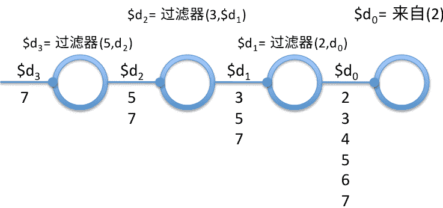

每个圆圈代表一个进程，其中的子弹表示沿着通道提供的方向。在每个通道下面是从右到左流动的整数序列，省略了从左到右的请求标签。

我们已经在最右边实现了 `from` 进程。接下来我们实现过滤器进程。过滤器使用一个进程 ($d$)，并沿着另一个进程 ($c$) 提供。它从 $d$ 中删除所有 $p$ 的倍数，并将其余部分转发到 $c$。它首先接收沿着 $c$ 的标签，该标签必须是 `next` 或 `stop` 之一。

```c
nats $c 过滤器(int p, nats $d) {
switch ($c) {
case next:
...
case stop:
...
}
}
```

如果是 `next`，我们现在需要请求下一个整数。这意味着我们必须发送标签 `next` 沿着 $d$。我们正在使用通道 $d$，并且 $d$ 具有类型 `choice natstream`，因此这符合协议。通过通道 $d$ 发送标签 $l$ 的语法是 $d.l$，类似于结构体中的字段选择。

```c
nats $c 过滤器(int p, nats $d) {
switch ($c) {
case next:
$d.next;
...
case stop:
...
}
}
```

```c
nats $c 过滤器(int p, nats $d) {
switch ($c) {
case next:
$d . next ;
int k = recv($d);
/* d : nats | c : int /\ nats */
...
case stop:
}
}
```

我们已经在计算过程中指出了 $d$ 和 $c$ 的类型。现在我们需要检查 $p$ 是否能整除 $k$。如果是这样，我们会不断从 $d$ 请求整数，直到收到一个不是 $p$ 的倍数的值。然后我们将第一个这样的值发送给 $c$ 并进行递归。我们可以用两个相互递归的函数或者一个循环来实现这个目标。为了说明的目的，我们使用了一个循环。

```c
nats $c 过滤器(int p, nats $d) {
switch ($c) {
case next:
$d . next ;
int k = recv($d);
/* d : nats | c : int /\ nats */
while (k % p == 0) {
$d . next ;
k = recv($d) ;
}
/* d : nats | c : int /\ nats */
send($c, k);
$c = filter(p, $d);
case stop:
...
}
}
```

因为我们不知道循环将被遍历多少次，所以通道类型在整个循环中必须保持不变。我们在循环之前的注释中指出了这些类型。这也将是循环之后通道的类型。

### 会话类型并发 L25.7

在我们收到 stop 标签的情况下，我们不能只关闭通道 $c，因为通道 $d 将被忽略。相反，我们依次发送一个 stop 标签并等待它完成。当然，如果我们相信它会完成，等待就不是严格必要的，但出于类型的目的，我们希望消耗那个通道。

```
nats $c filter(int p, nats $d) {
    switch ($c) {
    case next:
        $d.next;
        int k = recv($d);
        /* $d : nats |- $c : int /\ nats */
        while (k % p == 0) {
            $d.next;
            k = recv($d);
        }
        /* $d : nats |- $c : int /\ nats */
        send($c, k);
        $c = filter(p, $d);
    case stop:
        $d.stop;
        wait($d);
        close($c);
    }
}
```

## 5 创建新进程

我们现在已经编写了 from 和 filter。假设我们想要编写一个名为 primes 的封闭进程，该进程应该在通道 $c 上产生递增的素数序列。让我们回顾一下图表。

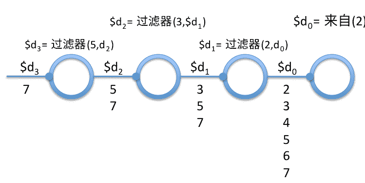

我们想要编写一个最外层的进程

```
nats $c primes(nats $d);
```

它使用 $d_3$（如上图所示）并按照扩展图中的方式生成 $c。

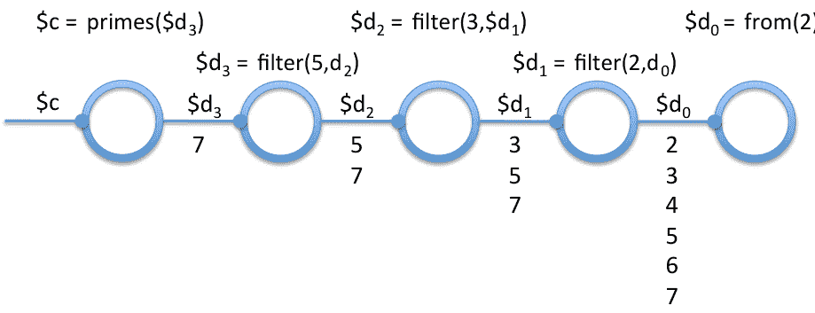

如果我们被要求产生一个数字（通过接收沿着 $c 的下一个），我们向 $d 请求下一个整数。由于这已经被所有更小的质数过滤，它应该是一个质数，我们可以将其发送 $c。

```
nats $c primes(nats $d) {
    switch ($c) {
    case next:
      $d.next;
      int p = recv($d);
      send($c, p);
      ...
```

```
case stop:
  ...
}
}
```

在我们可以递归之前，我们需要生成一个新的进程，该进程过滤出倍数。我们只需调用进程定义并将一个（新的！）通道分配给输出即可。然后我们使用这个新通道进行递归。很容易看出，对于我们发送的每个质数，都有一个对应的过滤通道 $c。在我们被要求停止的情况下，我们只需停止我们使用的进程（这将向右级联）。

```
nats $c primes(nats $d) {
  switch ($c) {
    case next:
      $d.next;
      int p = recv($d);
      send($c, p);
      nats $e = filter(p, $d);      /* 生成新进程 */
      $c = primes($e);
    case stop:
      $d.stop; wait($d);
      close($c);
  }
}
```

我们还可以重用通道名称 $d，因为 $d 不再在上下文中使用，因为它在 filter 的调用中被消费了。

```
$d = filter(p, $d);                /* 生成新进程 */
$c = primes($d);
```

为了模糊进程调用和函数调用之间的界限，我们也可以将这两行缩写为

```
$c = primes(filter(p, $d)); /* 生成新进程 */
```

这将被解析为第一种表达方式。

现在我们可以创建一个仅生成素数流的进程，方法是在最右边创建进程（生成 2, 3, 4, 5, 6, ...），然后将其提供给 primes。

```
nats $c prime_stream() {
  nats $d = from(2);
  $c = primes($d);
}
```

尽管它不是递归调用，但尾调用保留了进程（从通道 $c 中识别）。

现在我们可以将其嵌入到一个顶层函数中，该函数创建一个新的素数流，并在终止流之前请求前 $n$ 个素数：

```
void print_primes(int n) {
  nats $c = prime_stream();
  /* $c : nats | - */
  for (int i = 0; i < n; i++) {
    $c.next;
    int p = recv($c);
    printint(p);
  }
  $c.stop; wait($c);
  return;
}
```

## 6 附加的类型规则

我们展示了另外几个示例规则来补充之前展示的规则。第一个是进程调用。

$$\frac{p : (\sigma_1, \ldots, \sigma_n \vdash \sigma') \quad \Delta \sim (d_1:\sigma_1, \ldots, d_n:\sigma_n) \quad \Delta', e:\sigma' \vdash P :: c : \sigma}{\Gamma ; \Delta, \Delta' \vdash e = p(d_1, \ldots, d_n); P :: c : \sigma}$$

隐含的是，$e$ 与 $c$ 以及在 $\Delta'$ 中声明的所有通道都不同。如果 $e$ 是之前声明的变量，则必须已经被使用过（不在 $\Delta'$ 中），并且其新类型 $\sigma'$ 应该是一致的（这是我们在这些规则中没有明确跟踪的事情）。

$$\frac{\Gamma ; \Delta, d:\sigma_i \vdash P :: c : \sigma}{\Gamma ; \Delta, d:\text{choice}\{l_i : \sigma_i\}_i \vdash c.l_i ; P :: c : \sigma}$$

$$\frac{\Gamma, x:\tau ; \Delta, d:\sigma' \vdash P :: c : \sigma}{\Gamma ; \Delta, d:\tau \wedge \sigma' \vdash x = \text{recv}(d) ; P :: c : \sigma}$$

$$\frac{\Gamma ; \Delta \vdash P :: c : \sigma}{\Gamma ; \Delta, d:\text{void} \vdash \text{wait}(d) ; P :: c : \sigma}$$

我们看到每个类型构造在提供通道时都有一个规则，并且在使用通道时也有一个规则。一个对应于发送，而另一个对应于接收，反映了进程在通道的两端上的互补角色。

### 会话类型并发

## 7 内部选择和转发

我们将迄今为止介绍的选择构造称为外部选择。这是因为如果我们在通道 $c$ 上提供 choice $\{l_i: \sigma_i\}_i$，那么客户端可以选择标签。我们写作

```
branch $\{l_i: \sigma_i\}_i$
```

对于相反的内部选择，提供者可以选择标签，而消费者必须考虑所有可能性。

一个例子是堆栈的简单实现，每个进程都持有一个堆栈元素。在没有对堆栈元素进行进一步操作的情况下，这不会展示任何并发性，但它同时说明了内部选择和转发（稍后解释）。

堆栈的操作包括推入（push）、弹出（pop）和释放（deallocation）。当客户端指示要将元素推入堆栈时，我们需要通过相同的通道接收一个元素。为此，我们有类型

```
$\tau \Rightarrow \sigma$
```

（接收类型为 $\tau$ 的值，然后根据 $\sigma$ 的行为）与

（发送类型为 $\tau$ 的值，然后根据 $\sigma$ 的行为）对称。当客户端想要从堆栈中弹出一个元素时，我们发送两个标签之一：如果堆栈上没有元素，则发送 none；如果有一个元素，则发送 some。在后一种情况下，我们还会发送元素本身。这是我们上面提到的内部选择的一个例子。我们定义：

```
choice stack_node {
  int => choice stack_node push;
  branch opt_int pop;
  void dealloc;
};
```

```
/* 从 pop 中可选的结果 */
branch opt_int {
  int /\ choice stack some;
  choice stack_node none;
};
```

```
typedef choice stack_node stack;
```

我们现在将栈构造器 empty 和 node 简单地表示为进程。我们从空栈开始。在进行 push 操作时，我们调用一个新的 empty 进程并以新元素作为节点进行递归。在进行 pop 操作时，我们表示栈为空并进行递归。释放操作只需关闭通道并终止进程。

```
stack $c empty();
stack $c node(int k, stack $d); /* 顶部元素为k的栈 */

stack $c empty() {
  switch ($c) {
    case push:
      int k = recv($c);
      stack $d = empty();
      $c = node(k, $d);          /* 尾调用：继续作为非空栈 */
    case pop:
      $c.none;                   /* 没有可用的元素 */
      $c = empty();              /* 尾调用：继续为空 */
    case dealloc:
      close($c);
  }
}
```

其次，栈非空且顶部元素为 k 的情况。当我们接收到一个 push 时，我们只需生成一个新进程并递归。有趣的操作是 pop。我们首先发送标签 some，表示栈非空，然后发送顶部元素。

```
stack $c node(int k, stack $d) {
  switch ($c) {
    case push:
      int n = recv($c);
      stack $e = node(k, $d);      /* 生成新进程 */
      $c = node(n, $e);            /* 当前进程中的新栈顶 */
    case pop:
      $c.some; send($c, k);         /* 发送当前元素 */
      ...
    case dealloc:
      ...
  }
}
```

此时，我们希望终止当前进程并将任何交互转移到 $d。这是一个通道转发的示例。我们将其写为

```
$c = $d;
```

它使 $c 和 $d 等价。这可以用几种方式实现。也许最干净的方式是当前进程向其客户端发送 $d，基本上告诉它“沿着 $d 进行通信，从现在开始，我们将使用 $c 代替。然后，与 $c 标识的进程可以终止，因为通道 $c 实际上不再使用。以极大的效率代价，我们还可以保持与 $c 标识的进程处于活动状态，不断地在两个方向上转发消息，直到通道关闭。释放内存是直接的，导致以下最终进程定义。”

```
/* 非空栈 */
stack $c node(int k, stack $d) {
  switch ($c) {
    case push:
      int n = recv($c);
      stack $e = node(k, $d);      /* 生成新进程 */
      $c = node(n, $e);            /* 当前进程中的新栈顶 */
    case pop:
      $c.some; send($c, k);         /* 发送当前元素 */
      $c = $d;                    /* 标识 $c 和 $d；或：将 $d 转发给 $c */
    case dealloc:
      $d.dealloc; wait($d);
      close($c);
  }
}
```

我们不展示分支结构的任何额外类型规则，因为它们与选择结构对称，只是交换了 offer 和 use。对于转发，我们只需要记住在转发后没有继续执行，所以转发的通道必须是上下文中唯一的通道。

$$\Gamma; d:\sigma \vdash c = d :: c : \sigma$$

## 8 进一步的构造

[TCP13] 中的类型语言包含了更重要的构造。其中一种允许在通道上发送和接收通道。另一种允许持久通道，它们不会改变类型，但允许生成持久服务的新实例。我们完全省略了持久通道，并简要展示了在通道上发送或接收通道的规则，因为它们在下一个示例中使用。我们有类型 $\sigma_1 \otimes \sigma_2$（具体语法为 s1 ** s2）用于发送和 $\sigma_1 -\circ \sigma_2$（具体语法为 s1 -o s2）用于接收通道。

$$\frac{\Gamma \vdash \Delta, d: \sigma' \vdash P::c: \sigma}{\Gamma \vdash \Delta, d: \sigma' \vdash \operatorname{send}(c, d); P::c: \sigma' \otimes \sigma} \quad \frac{\Gamma \vdash \Delta, d: \sigma' \vdash P::d: \sigma}{\Gamma \vdash \Delta \vdash d = \operatorname{recv}(c); P::c: \sigma' \multimap \sigma}$$

## 9 进一步示例：归并排序

在下面的归并排序程序中，发送和接收通道得到了示例化。^{1} 这个实现中的主要复杂性在于设置和拆除进程，最终实现原地排序。为了简洁起见，我们在这里不再进行进一步评论。

```
/* 归并排序 */
/* Henry DeYoung，从SILL转录，由fp翻译 */

choice list {
    int /\ branch list cons;
    void nil;
};
typedef choice list list;

choice forest {
    int /\ (list** forest) cons; /* int nl = 列表1中的元素数量 */
    void nil;
};
typedef choice forest forest;

/* $c = nil() */
list $c nil() {
    $c.nil;
    close($c);
}

/* $c = cons(k, $d) */
list $c cons(int k, list $d) {
    $c.cons;
    send($c, k);
    $c = $d;
}

/* $c = merge($l, $r) 在 $c 上提供 $l 和 $r 的排序合并 */
```

1 在讲座中由学生提出

### 会话类型并发

```
list $c merge(list $l, list $r) {
    switch ($l) {
    case cons:
        int x = recv($l);
        switch ($r) {
        case cons:
            int y = recv($r);
            if (x < y) {
                list $r2 = cons(y, $r); /* 将y推回r */
                list $d = merge($l, $r2); /* 生成新进程 */
                $c = cons(x, $d);
            } else {
                list $l2 = cons(x, $l); /* 将x推回到l */
                list $d = merge($l2, $r); /* 生成新进程 */
                $c = cons(y, $d);
            }
        case nil:                 /* $r为空 */
            wait($r);
            $c = cons(x, $l);      /* 将x推回到l */
        }
    case nil:                     /* $l为空 */
        wait($l);
        $c = $r;                   /* 将$r转发到$c */
    }
}

/* $f = fnil() */
forest $f fnil() {
    $f.nil;
    close($f);
}

/* $g = fcons(nl, $l, $f), 将列表连接到森林 */
/* 不变量: nl = $l中的元素数量 */
forest $g fcons(int nl, list $l, forest $f) {
    $g.cons;
    send($g, nl);
    send($g, $l);                /* 将通道$l沿着$g发送 */
    $g = $f;
}

/* $g = join(nl, $l, $f), 将列表连接到森林 */
/* 如果需要，重新平衡 */
/* 不变量: nl = $l中的元素数 */
forest $g join(int nl, list $l, forest $f) {
    switch ($f) {
    case cons:
        int nr = recv($f);
```

### 会话类型并发

```
list $r = recv($f);
if (nl >= nr) {                   /* $l 比 $r 大，在 $f 中的第一个列表 */
    list $m = merge($l, $r); /* 合并 $l 和 $r */
    $g = join(nl+nr, $m, $f); /* 将合并的列表连接到森林 */
} else {
    forest $f1 = fcons(nr, $r, $f); /* 将$r推回$f中 */
    $g = fcons(nl, $l, $f1);          /* 连接 $l */
}
case nil:
    wait($f);
    $f1 = fnil();                    /* 重新创建空森林 */
    $g = fcons(nl, $l, $f1);
}
}
```

```
/* $m = compress($f)，将 $f 线性化得到列表 $m */

list $m compress(forest $f) {

    switch ($f) {
    case cons:
        int nl = recv($f);
        list $l = recv($f);
        list $r = compress($f);          /* 生成新进程 */
        $m = merge($l, $r);
    case nil:
        wait($f);
        $m = nil();
    }
}
```

```
/* $g = load(A, n) */

/* length(A) = n, 将 A[0..n] 加载到森林 $g */

/* 此处应该是只读的 A; 也许这应该
 * 内联到 sort 中 */

forest $g load(int [] A, int n) {

    forest $f = fnil();
    for (int i = 0; i < n; i++) {
        list $l = nil();
        list $l1 = cons(A[i], $l);
        $f = join(1, $l1, $f);
    }
    $g = $f;
}
```

```
/* unload($f, A, n) */

/* length(A) = n, load $f onto A[0..n] */

/* 由于unload是一个函数而不是进程，我们可以在这里写A */

void unload(forest $f, int [] A, int n) {

    list $m = compress($f);
```

```
for (int i = 0; i < n; i++)
switch ($m) {
case cons:
int k = recv($m);
A[i] = k;
/* case nil should be impossible */
}
switch ($m) {
/* case cons should be impossible */
case nil:
wait($m);
}
return;
}
```

```
/* sort(A, n), sort A[0..n] in ascending order */
void sort(int[] A, int n) {
forest $f = load(A, n);			/* create $f */
unload($f, A, n);			/* consume $f */
return;
}
```

## 参考文献

> [CP10] Luís Caires和Frank Pfenning。会话类型作为直觉线性命题。在第21届国际并发理论会议（CONCUR 2010）上，第222-236页，法国巴黎，2010年8月。Springer LNCS 6269。

> [CPT13] Luís Caires, Frank Pfenning和Bernardo Toninho。线性逻辑命题作为会话类型。计算机科学中的数学结构，2013年。即将出版。行为类型专题。

> [Hon93] Kohei Honda。二元交互类型。在第4届国际并发理论会议（CONCUR'93）上，第509-523页。Springer LNCS 715，1993年。

> [TCP13] Bernardo Toninho, Luís Caires和Frank Pfenning。高阶过程，函数和会话：一种单子集成。在M.Felleisen和P.Gardner编辑，欧洲编程研讨会（ESOP'13）上，第350-369页，意大利罗马，2013年3月。Springer LNCS 7792。

## 第26讲: 混淆

15411: 编译器设计

罗比·哈伍德和马克西姆·塞拉诺

2013年11月21日

## 1 引言

我们之前（第20讲）已经考虑过“反向”编译的问题（即从编译后的代码中提取出原始源代码的合理近似）。然而，我们不仅仅分析我们的数据流，还要进一步分析我们对数据流的分析。

代码混淆、数字版权管理（DRM）等伦理问题是一个复杂的话题，我们不会在这里讨论它。无论一个人对模糊性的伦理立场如何，作为一个支持者，了解实现模糊性背后的基本思想是重要的；作为一个反对者，了解它足够强大以打败它是重要的；作为一个知识分子，从中学习是重要的。

如上所述，代码混淆最大、最具争议的应用之一是作为实施副本保护和数字版权管理方案（DRM）的手段。然而，有时混淆可能更有机地出现。手写汇编语言，尽管今天被视为不受欢迎的软件开发过程，但在工业界仍然非常普遍。有点不幸的是，不太容易理解的代码片段往往是最难以替换的，因为编写执行相同功能的代码是困难的。

最后，值得注意的是，这些讲义绝不是混淆的最终解决方案。混淆取决于用于逆向工程的工具的工作原理，因此随着它们的变化，混淆的方法也会发生变化。本讲座将特别关注如何击败IDA Pro、objdump和gdb。

## 2 反汇编

这两个反汇编工具在某种程度上都能完成非常相似的工作（将机器代码直接转换为汇编语言），但它们对于如何完成这项工作有着非常不同的理念。这很可能是由于IDA中存在的极高复杂性以及IDA作者为了击败混淆编译器所做的努力。

在完美的世界中，反汇编非常相似。就像汇编器可以将每个助记符转换为一系列字节，使用相对简单的一对一映射，反汇编器应该能够读取字节序列并决定哪些指令映射到这些字节。例如，ret映射到C3，因此当反汇编器注意到以C3开头的指令时，它应该生成一个ret指令。

然而，有一些问题出现了。首先，在现代可执行文件格式中，包含程序代码的 `.text` 部分也允许包含程序数据。虽然大多数程序代码很容易被反汇编，只要没有努力使其变得困难，程序数据很可能被反汇编为有效代码——更少的代码使任何意义。因此，现代反汇编器必须能够区分代码和数据，即使整个块都标记为代码。

这里是工具之间的主要区别所在。IDA试图解决这个问题；objdump假设你的数据在各个数据部分，并且 `.text` 完全由代码组成。需要注意的是，虽然一般情况下，IDA会做出正确的选择，但也有办法欺骗它。特别是，由于 `0000` 字节形成了一个有效的指令（尽管是 `add %al, (%eax)`），IDA认为它是数据。可以利用这一点轻松欺骗objdump，将数据放在 `.text` 部分。

这两个工具都假设一串字节只会以唯一的方式执行。这对于 objdump来说是一个很好的效率提升：它不需要进行递归下降反汇编并“假装”执行程序，而是可以直接进行一次线性反汇编并完成。

然而，一旦程序不再遵守这个限制，就会出现非常严重的问题。特别是，考虑以下指令序列：

```
push %rax
xor %rax, %rax
.byte 0x74
.byte 0x01
.byte 0x0f
pop %rax
mov $3, %rax
```

给定这段代码，gcc愉快地生成了以下字节序列：

```
50 48 31 c0 74 01 0f 58 48 c7 c0 03 00 00 00
```

然后我们可以在这些字节上运行 objdump，并注意到产生了以下结果：

```
0000000000000000 <.text>
0:	50 	push %rax
1:	48 31 c0 	xor %rax, %rax
4:	74 01 	je 0x07
6:	0f 58 48 c7 	addps -0x39(%rax), %xmm1
a:	c0 03 00 	rolb $0x0, (%rbx)
```

这里发生的情况是：字节 `74 01` 导致跳过下一个字节（这里是 `0f`），这恰好是所有双字节操作码的第一个字节。然而，`0f` 的存在导致 objdump决定跳过跳转后面的字节，这些字节必须是具有双字节操作码的指令的映射（在这种情况下是 `addps`，一条SIMD指令）。随着对齐错误的继续（`48 c7` 字节是原始汇编中mov指令的前两个字节，但已被SIMD指令“吃掉”），我们继续产生无意义的汇编代码。

现在，一个人类读取汇编代码可以通过前三条指令注意到有些可疑的地方，但是除非他们能够读取机器代码，否则他们仍然需要将 `0f` 字节修改为更像 `90` 的东西才能正确读取反汇编代码。

人们可能期望IDA不会被这个技巧所愚弄，因为IDA不执行直线反汇编，而是使用递归下降算法。然而，IDA的递归下降在跟随未被采取的分支之前，会跟随被采取的分支，并且它还假设每个字节序列只能有一种反汇编方式。因此，当它跟随被采取的分支（这将产生正确的输出！）时，它注意到跳转的目标已经标记为已反汇编，因此不再费心正确地反汇编它。

然而，需要注意的是，处理器执行这段代码没有问题。由于 `xor %rax, %rax` 总是会触发跳转，而且它不执行潜在致命的SIMD指令（它会解引用 `-0x39(%rax)`，这可能不是一个好地方）。

## 3 反分析

这里描述的反分析技术主要针对IDA Pro，尽管也可以将它们适应于CMU的BAP系统。¹

IDA的分析能力非常强大。实际上，对于32位代码，它通常（虽然不总是）能够生成保留编译的原始代码语义的C代码。虽然64位版本的IDA尚未具备反编译支持，但它确实具有各种其他分析技巧。

特别有用于逆向工程的一件事是IDA能够识别函数边界。然而，不同的编译器往往会产生截然不同的函数边界代码！

在32位代码中，差异相对较小。特别是，许多Microsoft编译器生成的代码遵循stdcall调用约定，而不是更标准的cdecl调用约定，这导致函数结束代码更加复杂。类似地，fastcall调用约定根据平台和编译器而异。

然而，在64位代码中，遵循Microsoft调用约定的编译器和遵循System V调用约定的编译器（如gcc、clang等）生成的代码之间存在显著差异。

为了支持所有这些不同的约定，IDA作为IDA的用户所期望的，使用各种启发式方法来确定函数的起始和结束位置。

IDA执行的其他分析涉及堆栈变量。为了在这里混淆IDA，可以暂时混淆堆栈指针。由于IDA依赖于对被分析代码的符号执行，并且期望堆栈指针保持在“合理”的值上，这导致分析步骤完全失败。即使反汇编步骤成功，也有可能生成无法被IDA重新编译的32位代码。

通过伪造一系列与函数返回类似的指令，并将堆栈指针和IDA的函数边界检测混淆，可以实现。例如，伪造的序列：

```
push %rcx
push %rbx
push %rdx
.byte 0xe8
.byte 0x00
.byte 0x00
.byte 0x00
.byte 0x00
pop %rdx
add $08, %rdx
push %rdx
```

¹更多关于BAP的信息可以在http://bap.ece.cmu.edu/找到

```
ret
.byte 0x0f
pop %rdx
pop %rbx
pop %rcx
```

这些字节 `e8 00 00 00` 解码为 `call $+0`，或者简单地说“push %rip”（如果允许这样的话）。这会使IDA的堆栈指针混乱，因为在执行call指令时，它会重置 `%rsp` 的“相对”值（这是它跟踪的所有内容）。接着使用 `pop` 会导致IDA无法理解堆栈指针调整的符号。

此外，`ret` 指令紧接着 `pop` 指令的存在会导致IDA的某些版本错误地认为这是一个函数的结尾。不幸的是（或者幸运的是，取决于你的观点），并没有一个适用于所有版本的这样的序列。

之后，可以微调真实的返回序列。与其用 `ret` 指令结束函数，不如用以下方式结束函数：

```
pop %r15
pop %r14
pop %r13
pop %r12
pop %rbx
pop %r11
pop %r10
pop %rdi
jmp *%rdi
```

IDA试图确定它认为的间接跳转，并经常将该函数标记为“块”，而不是完整的函数，并且不在函数列表中列出。

要理解这意味着什么，需要对IDA的内部有一定的了解。函数检测的工作方式似乎如下：

- 1. 注意标准的函数开头序列。
- 2. 从开始处（除了反向边）“评估”代码，直到每个控制流都到达函数结束序列。
- 3. 如果函数的片段分散在内存中，并且没有以返回语句结束，将它们标记为“块”。

如果可以让IDA识别给定的代码片段作为没有对应函数的块，则分析它并立即丢弃其分析结果。

## 4 反调试

通常，当逆向工程师无法静态地弄清程序的细节（无论是由于庞大的程序规模、难以阅读的汇编代码还是其他各种因素），他或她会尝试动态地观察程序运行时的行为。调试器（如gdb）是这一努力的关键部分。因此，任何完整的反逆向工程努力都需要具备一些反调试的组件。

反调试的主要方法是滥用每个程序只能由一个调试器调试的事实。为了使用这个，我们在程序中插入了一个 `ptrace()` 调用，导致程序的父进程附加自身作为调试器。如果程序已经附加了调试器，此调用将失败并导致程序段错误。

这可能是最简单的反调试机制，可以通过对二进制文件进行简单修改、非常谨慎地使用调试器或者插入 `ptrace()` 调用来对抗。然而，与反反汇编结合使用时，通常足以延迟逆向工程师相当长的时间，特别是因为 `ptrace()` 调用可以很好地隐藏起来。

一个更复杂的技巧如下：

- 1. 程序开始之前，在调用 `main()` 之前，调用一个构造函数 `c()`。这样的函数列表保存在 `ctors` 部分中，并且可以由用户控制。
- 2. 这个构造函数分叉程序。一个分叉被标记为子进程，另一个被标记为父进程。
- 3. 父进程 `ptrace()` 子进程，子进程 `ptrace()` 父进程。
- 4. 每个进程将一个关键结构插入到另一个进程的内存中，或修改另一个进程的代码，或将 `main()` 函数改为无操作，同时将“真正”的 `main` 函数的地址插入到 `dtors` 部分，在退出时调用。
- 5. 其中一个进程以“正常”方式运行程序。

这个技巧（循环调试）非常难以绕过。然而，在编译器层面上实现它也非常困难。一般来说，缓解这种反调试技术需要编写一个自定义的加载器来加载目标程序，并自己将结构加载到内存中。一般来说，理解这个结构需要对原始程序进行全面的静态分析，从根本上破坏了调试的目的。

最后一种技术在实现和缓解方面都是微不足道的：强制断点。在大多数平台上，`int 3` 指令会强制产生一个断点。在程序的各个位置插入 `int 3` 会导致逆向工程师需要手动处理比预期多得多的断点（尤其是在紧密循环中），从而阻碍他或她的调试工作。然而，简单地将所有该指令替换为一个 `nop` 指令就可以轻松地击败这种技术，因此它主要只是对任何逆向工程师的一种麻烦。

## 5 其他技术

(本节在讲座中未涉及，因为我们进行了演示。)

### 5.1 SSA

混淆与SSA（和基本块分析）非常配合，因为可以使用它来在IR级别隐藏信息。为了做到这一点，可以添加额外的不必要的控制流节点，而不会在性能上损失太多。此外，根据基本块信息，还可以重新排序二进制块，使得阅读反汇编输出成为一个滚动的练习。

### 5.2 打包器

近年来，一种越来越普遍的技术是使用打包器。这里的基本思想是，在磁盘上保留一个压缩或加密版本的二进制文件（“打包”），以及一个小的加载器stub，然后可以在内存中解密/解压缩（“解包”）二进制文件的其余部分。高级打包器甚至可以逐个解包单个函数或基本块，然后在它们不再运行时重新打包它们。这完全击败了静态分析，因为组成目标程序的字节在解包之前根本无法解读。

打包通常通过在运行时转储内存内容来击败，尽管该技术的具体实现可以使内存转储变得更加困难。打包可能是反向工程技术中回报最高的技术之一，但编写它本身非常耗时。

### 5.3 调用约定

每个函数的调用约定是使人类分析变得困难的极端情况，因为人类需要跟踪哪个函数采用哪个约定。然而，从实现的角度来看，它需要在编译时和指令选择时传递大量信息，使其可行性低于其他一些技术。

### 5.4 程序错误

在objdump和IDA中使用错误会使它们完全无用。例如，在编写我们的混淆编译器时，我们成功地生成了一个二进制文件，导致objdump在尝试反汇编时崩溃。（据我们所知，它没有可利用性。）然而，这种转换在实现中可能不可靠，因为它们需要构造明显奇怪的边界情况。

## 6 想要更多吗?

编写混淆编译器的最大问题是调试编译器本身。实际上，作者试图通过阻止调试来自残，同时要求正确性，因为确定为什么没有保持正确性需要调试。实际上，它要求作者在逆向工程自己的程序时减轻他们自己的反逆向工程转换。

最后，我们应该提到，如果逆向和代码混淆是你感兴趣的主题，PPP安全研究小组和Hacking Team可能适合你。有关更多信息，请访问我们的网站http://pwning.net，订阅我们的邮件列表，或加入我们的IRC频道irc://freenode.net/#pwning。我们的教师顾问是David Brumley教授；有关他的项目的更多信息，请访问他的网站https://users.ece.cmu.edu/~dbrumley/。
```