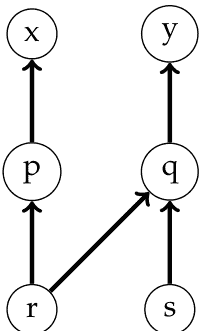
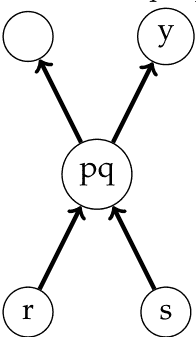
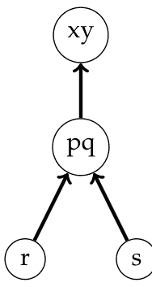
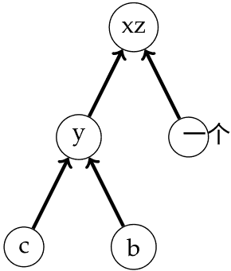
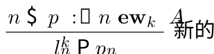
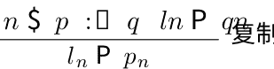
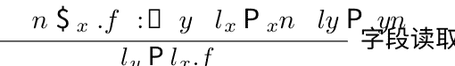
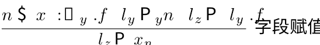
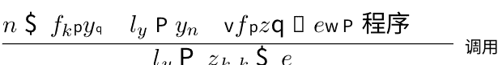
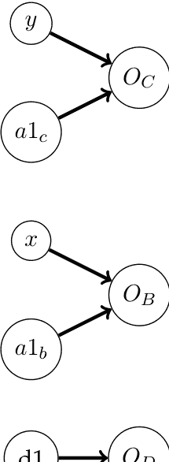

# CMU 15-819O 程序分析讲义

# 讲义笔记：WHILE语言和WHILE 3ADDR表示

15-819O：程序分析
乔纳森·奥尔德里奇
jonathan.aldrich@cs.cmu.edu

第二讲

## 1 WHILE语言

在这门课程中，我们将学习使用一种名为WHILE的简单编程语言以及各种扩展的分析理论。WHILE语言至少与Hoare在1969年关于证明程序属性的逻辑的论文一样古老（将在后面的讲座中讨论）。它是一种简单的命令式语言，具有对局部变量的赋值、if语句、while循环以及简单的整数和布尔表达式。

我们将使用以下元变量来描述几个不同的语法类别。左边的字母将被用作表示程序的一部分的变量，而右边，我们描述变量表示的程序部分的类型：

- `S`：语句
- `a`：算术表达式
- `x, y`：程序变量
- `n`：数字字面量
- `P`：布尔谓词

WHILE语言的语法如下所示。语句 `S` 可以是一个赋值语句 `x := a`，一个什么也不做的跳过语句（类似于C或Java中的单个分号或大括号），以及条件为布尔谓词 `P` 的if和while语句。算术表达式 `a` 包括变量 `x`、数字 `n`，以及几个算术运算符，抽象地说由 $op_a$ 表示。布尔表达式包括true、false、另一个布尔表达式的否定、布尔运算符 $op_b$ 应用于其他布尔表达式，以及关系运算符 $op_r$ 应用于算术表达式。

```
S    ::= x := a
     |   skip
     |   S_1; S_2
     |   if P then S_1 else S_2
     |   while P do S

a    ::= x
     |   n
     |   a_1 op_a a_2

op_a ::= + | - | * | /

P    ::= true
     |   false
     |   ¬ P
     |   P_1 op_b P_2
     |   a_1 op_r a_2

op_b ::= ∧ | ∨
op_r ::= < | ≤ | = | > | ≥
```

## 2 WHILE 3ADDR: 分析的一种表示

我们可以直接定义WHILE的语义，当然，在学习Hoare逻辑时我们会这样做。[1] 然而，对于程序分析来说，WHILE的源代码定义有些不方便。即使是像WHILE这样简单的语言也很难定义。例如，WHILE有三种不同的语法形式——语句、算术表达式和布尔谓词——我们需要分别定义每个语法的语义。更简单、更规则的程序表示将有助于简化我们的形式化过程。

作为起点，我们将消除递归算术和布尔表达式，并用简单的原子语句形式替换它们，这些语句形式在类似于汇编语言指令之后被称为指令。例如，一个形如 $w = x * y + z$ 的赋值语句将被重写为一个乘法指令，后面跟着一个加法指令。乘法指令将结果赋给一个临时变量 $t_1$，然后在后续的加法指令中使用该变量：

```
t_1 = x * y
w = t_1 + z
```

正如从表达式到指令的翻译所示，程序分析通常使用比源WHILE语言更简单、更低级的程序表示进行研究。通常，高级语言具有众多复杂的特性，但可以简化为一组更简单的原语。在更低的抽象级别上工作也支持编译器的简洁性。

控制流结构，如if和while，同样被转换为更简单的goto和条件分支结构，跳转到特定的（编号的）指令。例如，形如 `if P then S_1 else S_2` 的语句将被转换为：

- `1: if P then goto 4`
- `2: S_2`
- `3: goto 5`
- `4: S_1`
- `5: 程序的其余部分...`

形如 `while P do S` 的语句的转换类似：

- `1: if not P goto 4`
- `2: S`
- `3: goto 1`
- `4: 程序的其余部分...`

这种形式的代码通常被称为3地址代码，因为每条指令都是一个简单的形式，最多有两个源操作数和一个结果操作数。现在我们定义从WHILE语言产生的3地址代码的语法，我们将其称为WHILE3ADDR。这种语言包括一组简单的指令，用于将常量加载到变量中，从一个变量复制到另一个变量，从两个变量计算出一个变量的值，或者跳转（可能有条件地）到一个新地址 $n$。程序只是从地址到指令的映射：

```
I      ::= x := y
         | x := y op z
         | goto n
         | if x op_r y goto n

op     ::= + | - | * | /
op_r   ::= < | ≤ | = | > | ≥
```

正式地定义从源语言（如WHILE）到较低级中间语言（如WHILE3ADDR）的翻译是可能的，但对于编译器课程的范围来说，这更合适。对于本课程的目的，上述示例应该足够直观。我们将首先在WHILE3ADDR中形式化程序分析，然后更详细地研究其语义，以验证程序分析的正确性。

# 讲座笔记：用于数据流分析的框架

WHILE 3ADDR
15-819O：程序分析
乔纳森·奥尔德里奇
jonathan.aldrich@cs.cmu.edu
第二讲

## 1 定义数据流分析

为了使数据流分析的定义准确，我们需要先研究数据流分析如何表示程序的信息。分析将在每个程序点计算一些数据流信息 $\sigma$。通常 $\sigma$ 会告诉我们关于程序中每个变量的一些信息。例如，$\sigma$ 可能是从变量到某个集合 $L$ 中的抽象值的映射：

$\sigma : \text{Var} \rightarrow L$

这里，L代表我们在分析中感兴趣的抽象值集合。这会因不同的分析而有所不同。考虑零分析的例子，我们想要追踪每个变量是否为零。对于这个分析，L可以表示集合 $\{Z, N, ?\}$。在这里，抽象值 $Z$ 表示值0，$N$ 表示所有非零值。我们使用 $?$ 用于我们不知道一个变量是否为零的情况。

从概念上讲，每个抽象值都代表了程序执行时可能出现的一个或多个具体值的集合。为了理解抽象值代表的含义，我们定义了一个抽象函数 $\alpha$，将每个可能的具体值映射到一个抽象值：

$\alpha : V \rightarrow L$

[1] Nielson等人的补充文本还定义了这里给出的WHILE语言的语义。

对于零分析，我们简单地定义函数，使得0映射到 $Z$，而其他整数映射到 $N$：

$\alpha_Z(0) = Z$
$\alpha_Z(n) = N \quad \text{其中 } n \neq 0$

任何程序分析的核心是如何分析程序中的单个指令。我们使用流函数来定义这个过程，它将指令之前的数据流信息映射到指令之后的数据流信息。流函数应该以抽象的方式表示指令的语义，以跟踪分析所使用的抽象值。当我们讨论数据流分析的正确性时，我们将更详细地描述指令的语义。作为一个例子，我们可以将零分析的流函数 $f_Z$ 定义如下：

$f_Z(x := 0)(\sigma) = [x \mapsto Z]\sigma$
$f_Z(x := n)(\sigma) = [x \mapsto N]\sigma \quad \text{where } n \neq 0$
$f_Z(x := y)(\sigma) = [x \mapsto \sigma(y)]\sigma$
$f_Z(x := y \ op \ z)(\sigma) = [x \mapsto ?]\sigma$
$f_Z(\text{goto } n)(\sigma) = \sigma$
$f_Z(\text{if } x = 0 \text{ goto } n)(\sigma) = \sigma$

上面的第一个流函数是用于将值赋给常量的。在这种表示法中，我们将指令的形式表示为函数的隐式参数，后面是显式的数据流信息参数，形式为 $f_Z(I)(\sigma)$。如果我们将0赋给变量 $x$，则应更新输入数据流信息 $\sigma$，使得 $x$ 现在映射到抽象值 $Z$。符号 $[x \mapsto Z]\sigma$ 表示与 $\sigma$ 完全相同的数据流信息，只是映射中 $x$ 的值被更新为引用 $Z$。

下一个流函数是用于从一个变量 $y$ 复制到另一个变量 $x$。在这种情况下，我们只是复制数据流信息：我们在 $\sigma$ 中查找 $y$，写入 $\sigma(y)$，并更新 $\sigma$，使 $x$ 映射到与 $y$ 相同的抽象值。我们为算术指令定义了一个通用的流函数。一般来说，算术指令可以返回零或非零值，因此我们使用抽象值 $? $ 表示我们的不确定性。当然，我们可以在这里编写一个更精确的流函数，可以为某些指令或操作数返回更具体的抽象值。例如，如果指令是减法且操作数相同，我们知道结果是零。或者，如果指令是加法，并且分析信息告诉我们一个操作数是零，那么我们可以推断出这个加法实际上是一个复制，并且我们可以使用类似于复制指令的流函数。这些示例可以写成如下形式（对于不符合这些特殊情况的指令，我们仍然需要上面的通用情况）：

$f_Z(x := y - y)(\sigma) = [x \mapsto Z]\sigma$
$f_Z(x := y + z)(\sigma) = [x \mapsto \sigma(y)]\sigma \quad \text{where } \sigma(z) = Z$

练习1. 为某些算术指令定义另一个流函数和某些条件，您还可以提供更精确的结果比 $? $。

条件和无条件分支的流函数是微不足道的：分析结果不受此指令的影响，该指令不会改变除了改变程序计数器之外的机器状态。

如果我们区分分支被执行和未被执行时产生的分析信息，我们可以为条件分支提供更好的流函数。为了做到这一点，我们再次扩展我们的符号，以定义分支的流函数，使用下标来指示指令是否为真条件 $(T)$ 或假条件 $(F)$。例如，在测试变量与零相等的真条件下定义流函数，我们使用符号 $f_Z^T(\text{if } x = 0 \text{ goto } n)(\sigma)$。在这种情况下，我们知道 $x$ 为零，因此我们可以使用 $Z$ 格值更新 $\sigma$。相反，在假条件下，我们知道 $x$ 不为零：

$f_Z^T(\text{if } x = 0 \text{ goto } n)(\sigma) = [x \mapsto Z]\sigma$
$f_Z^F(\text{if } x = 0 \text{ goto } n)(\sigma) = [x \mapsto N]\sigma$

练习2. 为条件分支定义一个流函数，测试变量 $x$ 是否小于零。

## 2 运行数据流分析

开发数据流分析的目的是在程序的每个点计算可能的程序状态信息。例如，在零分析的情况下，每当我们 将某个表达式除以一个变量 $x$ 时，我们想知道 $x$ 是否必须为零（用抽象值 $Z$ 表示）或者可能为零（用 $? $ 表示），以便我们可以警告开发人员存在除以零的错误。

直线代码可以以直接的方式进行分析，就像我们预期的那样。在分析中，我们模拟运行程序，使用流函数来计算每个指令后的数据流分析信息，根据我们在指令之前的信息。我们可以使用一个表格来跟踪分析信息，表格的每一列对应程序中的一个变量，每一行对应一个指令，这样，单元格中的信息告诉我们该列变量在该行指令之后的抽象值。例如，考虑以下程序：

```
1: x := 0
2: y := 1
3: z := y
4: y := z + x
5: x := y + z
```

我们将按照以下方式计算数据流分析信息：

|   | x | y | z |
|---|---|---|---|
| 1 | Z |   |   |
| 2 | Z | N |   |
| 3 | Z | N | N |
| 4 | Z | N | N |
| 5 | ? | N | N |

请注意，在关于变量 $x$ 的值的末尾，分析是不精确的。我们能够通过指令 4 很好地跟踪哪些值是零和非零的，使用了（在最后一种情况下）知道将一个已知为零的变量相加等同于复制的流函数。然而，在指令 5 中，分析不知道 $y$ 和 $z$ 是否相等，因此无法确定 $x$ 是否为零。因为分析不是跟踪变量的确切值，而是近似值，所以在某些情况下必然会不精确。然而，在实践中，设计良好的近似方法通常可以使数据流分析计算出相当有用的信息。

## 3 备选路径与数据流连接

在表示if语句的WHILE3ADDR代码中，情况变得更加有趣。在这种情况下，程序有两条可能的路径。考虑以下简单示例：

```
1: if x = 0 goto 4
2: y := 0
3: goto 6
4: y := 1
5: x := 1
6: z := y
```

我们可以从分析程序的一条路径开始，例如不执行分支的路径：

|   | x       | y | z |
|---|---------|---|---|
| 1 | $Z_T, N_F$ |   |   |
| 2 | N       | Z |   |
| 3 | N       | Z |   |
| 4 |         |   |   |
| 5 |         |   |   |
| 6 | N       | Z | Z |

在上表中，第1行的x的条目表示分支的真条件和假条件产生的不同抽象值。我们在分析指令2时使用假条件（x非零）。执行继续到指令3，此时我们跳转到指令6。第4行和第5行的条目为空，因为我们还没有分析通过执行此行的程序路径。

在分析指令1时，一个次要问题是我们应该假设关于x的值是什么？在这个例子中，我们将假设x是一个输入变量，因为它在定义之前被使用。对于输入变量，我们应该从程序的开始处做出一些合理的假设。如果我们对x的值一无所知，最好的选择是假设它可以是任何值。也就是说，在初始环境 $\sigma_0$ 中，x被映射为 $? $。

现在我们转向一个更有趣的问题：如何在我们的分析中考虑通过程序的另一条路径。第一步是将指令 4 和指令 5 分析为如果我们在指令 1 处选择了真分支。将此添加到程序开始时对 x 的初始值的假设（我们将假设为第 0 行），我们有：

|   | x       | y | z |
|---|---------|---|---|
| 0 | ?       |   |   |
| 1 | $Z_T, N_F$ |   |   |
| 2 | N       | Z |   |
| 3 | N       | Z |   |
| 4 | Z       | N |   |
| 5 | N       | N |   |
| 6 | N       | ? | (注意：此处不正确) |

现在我们在分析指令 6 时遇到了一个困境。我们已经根据先前路径对其进行了分析，假设我们从指令 3 计算得到的数据流分析中，x 是非零且 y 是零。然而，我们现在从指令 5 得到了冲突的信息：在这种情况下，x 也是非零，但 y 在这种情况下也是非零。因此，我们先前计算的指令 6 的结果对通过指令 4 的路径是无效的。

解决这个困境的一个简单而安全的方法是选择一个抽象值来组合沿着两条路径计算得到的抽象值，对于 x 和 y 都是如此。y 的传入抽象值是 N 和 Z，这告诉我们 y 可能是非零或零。我们可以用抽象值 $? $ 来表示这一点。这表明我们不知道在这个指令中 y 是否为零，因为我们不确定我们是如何到达这个程序位置的。在 x 的情况下，我们可以应用类似的逻辑，但是因为 x 在两个传入路径上都是非零的，所以我们可以保持 x 是非零的知识。因此，我们应该重新分析指令 6，假设数据流分析信息为 $\{x \mapsto N, y \mapsto ?\}$。我们最终分析的结果如下所示：

|   | x       | y | z |
|---|---------|---|---|
| 0 | ?       |   |   |
| 1 | $Z_T, N_F$ |   |   |
| 2 | N       | Z |   |
| 3 | N       | Z |   |
| 4 | Z       | N |   |
| 5 | N       | N |   |
| 6 | N       | ? | (已更正) |

我们可以通过使用连接操作符 $\sqcup$ 来将多个路径上的分析结果进行泛化处理。这个想法是，在获取两个抽象值 $l_1, l_2 \in L$ 时，$l_1 \sqcup l_2$ 的结果总是一个泛化了 $l_1$ 和 $l_2$ 的抽象值 $l_j$。

为了定义泛化的含义，我们可以定义一个抽象值上的偏序关系 $\sqsubseteq$，并说 $l_1$ 和 $l_2$ 至少和 $l_j$ 一样精确，记作 $l_1 \sqsubseteq l_j$。回想一下，偏序关系是任何关系都满足以下条件的关系：

- 自反性：$\forall l : l \sqsubseteq l$
- 传递性：$\forall l_1, l_2, l_3 : l_1 \sqsubseteq l_2 \land l_2 \sqsubseteq l_3 \implies l_1 \sqsubseteq l_3$
- 反对称：$\forall l_1, l_2 : l_1 \sqsubseteq l_2 \land l_2 \sqsubseteq l_1 \implies l_1 = l_2$

一组具有偏序关系的值 L，且对于该排序中任意两个值的最小上界 $l_1 \sqcup l_2$ 是唯一的，并且也在 L 中，称为一个 join-semilattice。任何一个 join-semilattice 都有一个最大元素 $\top$。我们要求在数据流分析中使用的抽象值形成一个 join-semilattice。我们将简称为 lattice；正如我们将在下面看到的，对于大多数数据流分析来说，这是正确的术语。

对于零分析，我们使用偏序关系定义为 $Z \sqsubseteq ?$ 和 $N \sqsubseteq ?$，其中 $Z \sqcup N \sqsubseteq ?$。而 lattice 最大元素是 $? $。为了强调 lattice 的概念，我们将在以下笔记中使用 $\top$ 代替 $? $。用于零分析。

我们现在已经考虑了定义数据流分析所需的所有元素。这些元素包括：

- 一个格 $\langle L, \sqsubseteq \rangle$
- 一个抽象函数 $\alpha$
- 初始数据流分析假设 $\sigma_0$
- 一个流函数 $f$请注意, 根据格理论, 我们现在可以提出一个通用的初始数据流信息的自然默认值: 一个 $\sigma$, 它将程序开始时处于作用域内的每个变量映射到 $J$, 表示对该变量的值不确定。

## 4 循环的数据流分析

现在我们考虑表示循环控制流的 WHILE3ADDR 程序。虽然 if 语句产生两条分支路径, 它们会分开然后再合并, 但循环会产生一个可能无限多的路径进入程序。尽管如此, 我们希望在有限的时间内分析循环程序。让我们通过以下简单的循环示例来进行分析:

```
1: x := 10
2: y := 0
3: z := 0
4: if x = 0 跳转 8
5: y := 1
6: x := x - 1
7: 跳转 4
8: x := y
```

让我们首先考虑程序路径的直线分析, 进入循环并运行一次:

|   | x       | y   | z   |
|---|---------|-----|-----|
| 1 | N       |     |     |
| 2 | N       | Z   |     |
| 3 | N       | Z   | Z   |
| 4 | Z_T, N_F| Z   | Z   |
| 5 | N       | N   | Z   |
| 6 | J       | N   | Z   |
| 7 | J       | N   | Z   |
| 8 |         |     |     |

到目前为止, 事情都很简单。现在我们必须再次分析指令 4 。然而, 这种情况并不令人惊讶; 它类似于在 if 指令之后合并路径的情况。为了确定指令 4 的分析信息, 我们应该合并数据流分析从指令 3 中流入的信息与数据流分析信息从指令 7 中流入的信息。对于 $x$ 我们有 $N \sqcup J \sqcap N$。对于 $y$ 我们有 $Z \sqcap N \sqcup J$。对于 $z$ 我们有 $Z \sqcap Z \sqcup Z$。因此, 从指令 4 中出来的信息与之前相同, 只是对于 $y$ 我们现在有 $J$。

我们现在可以再次选择两条路径: 留在循环内部或者退出到指令 8。我们将（暂时地）选择留在循环内部并考虑指令 5。这是我们第二次访问指令 5, 并且我们有新的信息需要考虑: 特别是, 由于我们已经执行了循环, 赋值 $y := 1$ 已经被执行, 并且我们必须假设 $y$ 在进入指令 5 时可能是非零的。

这是根据指令 4 的分析信息的最新更新来解释的, 在该更新中, $y$ 被映射到 $J$。因此, 指令 4 的信息描述了两条可能的路径。我们必须更新指令 5 的分析信息, 使其也这样做。然而, 在这种情况下, 该指令将 1 赋值给 $y$, 因此我们仍然知道在指令执行后 $y$ 是非零的。实际上, 使用更新后的输入数据再次分析该指令不会改变该指令的分析结果。

快速检查显示, 通过剩余的指令循环, 甚至回到指令 4, 分析信息不会改变。这是因为流函数是确定性的: 给定相同的输入分析信息和相同的指令, 它们将产生相同的输出分析信息。例如, 如果我们分析指令 6, 那么来自指令 5 的输入分析信息将是我们上次分析指令 6 时使用的相同输入分析信息。因此, 指令 6 的输出信息不会改变, 因此指令 7 的输入信息也不会改变, 依此类推。无论我们在循环中的哪个指令上运行分析（实际上是在循环之前）, 分析信息都不会改变。我们说数据流分析已经达到了一个固定点。在数学中, 函数的固定点是一个被函数映射到自身的数据值 $v$。在这种情况下, 数学函数是流函数, 固定点是程序中每个点（包括循环）的数据流分析值的元组。如果我们在固定点上调用流函数, 我们将得到相同的固定点。

[^1] 有时缩写为固定点

一旦我们达到了这个循环的函数的固定点, 很明显进一步分析循环将没有用处。因此, 我们将继续分析语句 8。最终的分析结果如下:

|   | x       | y   | z   |          |
|---|---------|-----|-----|----------|
| 1 | N       |     |     |          |
| 2 | N       | Z   |     |          |
| 3 | N       | Z   | Z   |          |
| 4 | Z_T, N_F| J   | Z   | 已更新   |
| 5 | N       | N   | Z   | 已经达到固定点 |
| 6 | J       | N   | Z   | 已经达到固定点 |
| 7 | J       | N   | Z   | 已经达到固定点 |
| 8 | Z       | J   | Z   |          |

快速模拟程序运行显示这些结果正确地近似了实际执行。在指令 6 和 7 处, $x$ 的值的不确定性是真实的: 除了最后一次循环时为零, $x$ 在这些指令之后都不为零。在最后, $y$ 的值的不确定性显示了分析的不精确性; 在这个程序中, 循环总是至少执行一次, 所以 $y$ 将不为零。然而, 目前的分析不能判断循环是否执行了至少一次, 所以它报告无法确定 $y$ 是否为零。这个报告是安全的——说分析不确定总是正确的, 但不如人们希望的那样精确。

然而, 分析的好处在于我们可以通过有限的工作量获得关于程序所有可能执行的正确信息。例如, 在这种情况下, 我们只需要分析循环语句最多两次, 就能识别出我们已经达到了一个固定点。由于实际程序运行循环 10 次 - 并且如果我们将 $x$ 初始化为更高的值, 可能运行更多次 - 这是一个重要的好处。我们为了覆盖所有可能的执行而牺牲了一些精确性, 这是静态分析中的一个经典权衡。

我们如何确信分析结果是正确的呢? 毕竟, 在更复杂的程序中可能有许多这样的运行情况, 例如当程序的行为取决于输入数据时。正确性背后的直觉是不变量: 在每个程序点, 分析结果近似于该点可能存在的所有可能程序值。如果程序开始时的分析信息正确地近似了程序参数, 那么不变量在程序执行开始时是正确的。然后可以通过归纳论证来证明不变量在程序执行过程中是保持不变的。特别是, 当程序执行到一个程序点时, 分析结果近似于该点可能存在的所有可能程序值。

当程序执行一条指令时, 该指令会修改程序的状态。只要流函数考虑了指令可能修改程序状态的所有可能方式, 那么在分析的固定点上, 它们将产生对实际程序执行该指令后的正确近似。我们将在以后的讲座中更加精确地阐述这个论点。

## 5 一个便利：抽象值和完全格

当我们考虑更加精确地定义数据流分析算法时, 关于如何分析上面示例中的第 4 条指令, 会出现一个自然的问题。在第一次遍历中, 我们使用了来自第 3 条指令的数据流信息进行分析, 但在第二次遍历中, 我们不仅需要考虑来自第 3 条指令的数据流信息, 还需要考虑来自第 7 条指令的数据流信息。

如果我们可以说分析第 4 条指令总是使用来自执行它之前的所有指令的传入数据流分析信息, 那将更加一致。这样我们就不必担心在分析过程中遵循特定的路径。然而, 要实现这一点, 需要有来自第 7 条指令的数据流值, 即使第 7 条指令尚未被分析。如果我们有一个数据流值, 在与任何其他数据流值结合时总是被忽略, 我们就可以做到这一点。换句话说, 我们需要一个抽象数据流值 $K$, 当与任何其他数据流值结合时都起到被忽略的作用。对于所有的 $l$, 我们有 $K \sqcap l = K$, 并且 $J \sqcup l = J$。存在一个最大下界运算符 meet（$\sqcap$）, 它是 $\sqcup$ 的对偶, 所有数据流值的 meet 是 $K$。

一组配备了偏序 $\leqslant$ 的值 $L$, 并且对于该集合, 最小上界 $\sqcup$ 和最大下界 $\sqcap$ 在 $L$ 中都存在且唯一, 被称为（完全）格。

关于 $K$ 和完全格的理论提供了一个优雅的解决方案来解决上述问题。我们可以初始化程序中的每个数据流值（除了程序入口处）为 $K$, 表示该指令尚未被分析。然后, 我们始终可以合并所有输入值到一个节点, 无论这些输入的来源是否已经被分析, 因为我们知道来自未分析来源的任何 $K$ 值都将被合并操作符 $\sqcup$ 忽略。

## 6 分析执行策略

上述非正式执行策略通过考虑程序中的所有路径进行操作, 直到数据流分析信息达到一个固定点。实际上, 这个策略可以简化。上述正确性论证暗示了对于正确的流函数, 我们达到数学固定点的方式并不重要。这似乎是合理的: 如果分析的正确性取决于我们首先探索 if 语句的哪个分支, 那将是令人惊讶的。

事实上, 我们可以按照任何顺序对程序指令进行分析。只要我们一直这样做, 直到分析达到一个固定点, 最终结果就会是正确的。因此, 执行数据流分析的最简单正确算法可以如下所述:

```
对于程序中的指令 i:
    input[i] = K
input[firstInstruction] = 初始数据流信息
当未达到固定点时:
    选择程序中的指令 i
    output = flow(i, input[i])
    对于 i 的后继指令 j:
        input[j] = input[j] ⊔ output
```

尽管在之前的演示中, 我们一直在跟踪每条指令之后的分析信息, 但在编写算法时, 跟踪每条指令之前的分析信息更方便。这样可以避免在程序开始之前需要一个特殊的位置。

在上面的代码中, 终止条件是以抽象的方式表达的。然而, 通过在程序的每条指令上运行流函数, 可以轻松地进行检查。如果分析的结果在分析任何指令后不发生变化, 则分析已经达到了一个固定点。

我们如何知道算法会终止? 直觉如下。我们依赖于选择一个公平的指令, 以便最终考虑到每个指令。只要分析没有达到一个固定点, 就可以分析某个指令以产生新的分析结果。如果我们的流函数表现良好（技术上讲, 如果它们是单调的, 如在未来的讲座中讨论的那样）, 那么每次流函数在给定的指令上运行时, 要么结果不变, 要么变得更加近似（即它们在格子中更高）。直觉是后续运行的流函数考虑程序中更多可能的路径, 因此产生一个更近似的结果, 考虑所有这些可能性。如果格子的高度是有限的——意味着从格子中的任何位置向上走最多有有限步数到达 $J$ 值——那么这个过程最终必须终止, 因为分析信息无法再变得更高。

虽然上述简单算法总是终止并得出正确答案, 但它并不总是最高效的。通常, 例如, 按顺序分析程序指令是有益的, 这样可以使用早期指令的结果来更新后续指令的结果。还有一个有用的功能是跟踪一份指令列表, 其中有一些指令的数据流信息发生了变化, 自上次分析以来。只有那些指令需要被分析; 重新分析其他指令是无用的, 因为输入没有改变, 它们将产生与之前相同的结果。Kildall 通过他的工作列表算法捕捉了这种直觉, 下面是伪代码描述:

```
对于程序中的指令 i:
    input[i] = K
input[firstInstruction] = 初始数据流信息
工作列表 = { firstInstruction }
当工作列表不为空时:
    从工作列表中取出一条指令 i
    output = flow(i, input[i])
    对于指令 j 在 i 的后继中:
        如果 output ≠ input[j]:
            input[j] = input[j] ⊔ output
            将 j 添加到工作列表中
```

上述算法与之前声明的通用算法非常接近, 只是使用了工作列表来选择下一个要分析的指令, 并确定何时达到固定点。

我们可以通过以下方式推理出该算法的性能。只有当某个节点的输入数据发生变化时, 我们才将指令添加到工作列表中, 并且给定节点的输入只能变化 $h$ 次, 其中 $h$ 是格的高度。因此, 我们最多将 $n$ 个节点添加到工作列表中, 其中 $n$ 是程序中的指令数。然而, 在运行节点的流函数之后, 我们必须测试其所有后继节点以确定其输入是否发生了变化。每次测试都只需执行一次。对于每次将边的源节点添加到工作列表, 边的数量最多为 $e$ 次, 其中 $e$ 是指令之间的后继图中控制流边的数量。如果每个操作（例如流函数、$\sqcup$ 或 $\neq$ 测试）的成本为 $O(p)$, 则总体成本为 $O(p \cdot e \cdot h)$, 因为 $n$ 受 $e$ 的限制。

上述算法仍然是抽象的, 因为我们还没有定义从工作列表中添加和删除指令的操作。我们希望将一个集合添加操作添加到工作列表中, 这样就不会出现多次出现同一指令的情况。理由是, 如果我们刚刚分析了程序中的一条指令, 再次分析它将不会产生不同的结果。

这就留下了从工作列表中删除哪个指令的选择。我们可以选择多种策略, 包括后进先出 (LIFO) 顺序或先进先出 (FIFO) 顺序。在实践中, 最有效的方法是识别控制流图中的强连通分量（即循环）, 并按照拓扑顺序处理它们, 这样嵌套的循环或按程序顺序出现的循环会在后面的循环之前解决。这样做的好处是, 我们不希望在程序的后期将一个循环带到一个固定点时做很多工作, 然后当来自前面循环的数据流信息发生变化时, 不得不重新做这些工作。

在每个循环中, 指令应按照逆序处理。逆序后序遍历是指在遍历树时, 每个节点最后访问的顺序的逆序。考虑来自第 4 节的例子: 指令 1 是一个条件测试, 指令 2-3 是 then 分支, 指令 4-5 是 else 分支, 指令 6 在 if 语句之后。树的遍历可能如下进行: 1, 2, 3, 6, 3（再次）, 2（再次）, 1（再次）, 4, 5, 4（再次）, 1（再次）。树中的一些指令被多次访问: 一次向下, 一次在访问子节点之间, 一次向上。后序遍历, 即每个节点最后访问的顺序, 是 6, 3, 2, 5, 4, 1。逆序后序遍历是其逆序: 1, 4, 5, 2, 3, 6。现在我们可以看到为什么逆序后序遍历很有效: 在探索节点 6 之前, 我们先探索 if 语句的两个分支（4-5 和 2-3）。这确保在这个无循环的代码中, 当其中一个输入发生变化后, 我们不需要重新分析节点 6。

尽管使用强连通分量和逆后序启发式算法可以在实践中显著提高性能, 但它并不改变上述最坏情况性能结果。

## 讲座笔记：
数据流分析示例
15-819: 程序分析
乔纳森·奥尔多里奇
jonathan.aldrich@cs.cmu.edu
第三讲

## 1 常量传播

尽管零分析对于简单地跟踪给定变量是否为零很有用, 但常量传播分析试图在可能的情况下跟踪程序中变量的常量值。常量传播长期以来一直被用于编译器优化过程, 以便在可能的情况下将变量读取和计算转换为常量。然而, 它通常也对程序正确性分析有用: 任何从了解程序值中受益的客户端分析（例如数组边界分析）都可以利用它。

对于常量传播, 我们希望跟踪每个程序变量的常量值（如果有的话）。因此, 我们将使用一个格子, 其中集合 $L_{CP} = \{K, J\} \cup \mathbb{Z}$。偏序关系是 $\forall l \in L_{CP}: K \sqsubseteq l \sqsubseteq J$。换句话说, $K$ 在每个格子元素下方, $J$ 在每个元素上方, 但除此之外, 格子元素是不可比较的。

在上面的格子中, 以及我们之前对零分析的讨论中, 我们考虑了一个格子来描述单个变量值。我们可以将格子的概念扩展到覆盖程序点上的所有数据流信息。这被称为元组格子, 其中元组的每个变量都有一个元素。对于常量传播, 集合 $\sigma$ 的元素是从 Var 到 $L_{CP}$ 的映射, 其他运算符 $\sqcup$、$\sqcap$ 和 $J$、$K$ 的扩展如下:

$$
\begin{aligned}
& \sigma \in \text{Var} \to L_{CP} \\
& (\sigma_1 \sqcup_{\text{lift}} \sigma_2)(x) = \sigma_1(x) \sqcup \sigma_2(x) \quad (\forall x \in \text{Var}) \\
& (\sigma_1 \sqcap_{\text{lift}} \sigma_2)(x) = \sigma_1(x) \sqcap \sigma_2(x) \quad (\forall x \in \text{Var}) \\
& \top_{\text{lift}}(x) = \top \quad (\forall x \in \text{Var}) \\
& \bot_{\text{lift}}(x) = \bot \quad (\forall x \in \text{Var})
\end{aligned}
$$

我们还可以为常量传播定义一个抽象函数, 以及一个接受环境 $E$ 映射变量到具体值的提升版本。我们还定义了初始分析信息, 保守地假设初始变量值是未知的。注意, 在一个将所有变量初始化为零的语言中, 我们可以做出更精确的初始数据流假设:

$$
\begin{aligned}
& \alpha^{\text{prog}}_{\text{CP}}(n) = n \\
& \alpha^{\text{env}}_{\text{lift}}(E) = \lambda x \in \text{Var}.\ \alpha^{\text{CP}}(E(x)) \\
& \sigma_0 = \top_{\text{lift}}
\end{aligned}
$$

我们现在可以为常量传播定义流函数:

$$
\begin{aligned}
& f_{\text{CP}}^{\text{assign } x \leftarrow n}(\sigma) = [x \mapsto n] \circ \sigma \\
& f_{\text{CP}}^{\text{assign } x \leftarrow y}(\sigma) = [x \mapsto \sigma(y)] \circ \sigma \\
& f_{\text{CP}}^{\text{assign } x \leftarrow y \text{ op } z}(\sigma) = [x \mapsto \sigma(y) \ op_{\text{lift}} \sigma(z)] \circ \sigma \\
& \quad \quad \text{其中 } n \ op_{\text{lift}} \ m = n \ op \ m \\
& \quad \quad \text{且 } J \ op_{\text{lift}} \ n = J \quad (\text{以及对称}) \\
& \quad \quad \text{且 } K \ op_{\text{lift}} \ n = n \quad (\text{以及对称})
\end{aligned}
$$

$$
\begin{aligned}
& f_{CP}^{\text{goto } n}(\sigma) = \sigma \\
& f_{CP}^{\text{if } x=0 \text{ goto } n}(\sigma_T) = [x \mapsto 0] \circ \sigma \\
& f_{CP}^{\text{if } x=0 \text{ goto } n}(\sigma_F) = \sigma \\
& f_{CP}^{\text{if } x \neq 0 \text{ goto } n}(\sigma) = \sigma
\end{aligned}
$$

现在我们可以看一个常量传播的例子:

- 1: x := 3
- 2: y := x + 7
- 3: if z = 0 goto 6
- 4: z := x + 2
- 5: goto 7
- 6: z := y + 5
- 7: w := z + 2

我们将按照以下方式计算数据流分析信息。在这个表中，我们将使用工作列表来跟踪并使用额外的行来显示算法的操作更新:

| 语句 | 工作列表 | x | y | z | w |
|---|---|---|---|---|---|
| 0 | 1 | ⊤ | ⊥ | ⊤ | ⊤ |
| 1 | 2 | 3 | ⊤ | ⊤ | ⊤ |
| 2 | 3 | 3 | 10 | ⊤ | ⊤ |
| 3 | 4,6 | 3 | 10 | {∅, ⊤, ⊥}, ⊥ | |
| 4 | 5,6 | 3 | 10 | 5 | ⊤ |
| 5 | 6,7 | 3 | 10 | 5 | ⊤ |
| 6 | 7 | 3 | 10 | 5 | ⊤ |
| 7 | H | 3 | 10 | 5 | 3 |

## 2 到达定义

到达定义分析确定了对于每个变量的使用，哪些对该变量的赋值可能设置了该使用处所见的值。考虑以下程序:

```
1: y := x
2: z := 1
3: if y ≠ 0 goto 7
4: z := z * y
5: y := y - 1
6: goto 3
7: y := 0
```

在这个例子中，定义1和定义5到达了语句4处的y的使用。

- 1. 哪些定义到达了语句4处的z的使用?

到达定义可以用作更简单但不太精确的常量传播、零分析等的版本，其中我们只需查找到达定义并查看其是否为常量值，而不是跟踪实际的常量值。我们还可以使用到达定义来识别未定义的使用变量，例如，如果程序中没有定义到达使用。对于到达定义，我们将使用一种新的格子：一个集合格子。

在这里，数据流格元素将是到达当前程序点的定义集合。假设 DEFS 是程序中所有定义的集合。该程序的格中的元素集合是 DEFS 的所有子集，即 DEFS 的幂集，写作 $\mathcal{P}(\text{DEFS})$。

为了到达定义，应该 $\sqsubseteq$ 是什么？直觉是我们的分析在给定程序点计算的定义集越小，越精确。这是因为我们想要尽可能准确地知道程序点上的值来自哪里。所以 $\sqsubseteq$ 应该是子集关系 $\subseteq$：子集比其超集更精确。这自然意味着 $\sqcup$ 应该是并集，而 ⊤ 和 ⊥ 分别应该是全集 DEFS 和空集 ∅。

总结一下，我们可以正式定义我们的格子和初始数据流信息如下：

```
⊤ = DEFS
σ₁ ⊑ σ₂ 当且仅当 σ₁ ⊆ σ₂
σ₁ ⊔ σ₂ 是 σ₁ ∪ σ₂
⊥ = ∅
σ₀ = ∅
```

与其使用空集合作为 $\sigma_0$，我们可以为每个程序变量使用人工的到达定义（例如，$x_0$ 作为 $x$ 的人工到达定义）来表示该变量未初始化，或者作为参数传入。如果有必要跟踪一个变量在使用时是否可能未初始化，或者如果我们想要将参数视为一个定义，那么这是很方便的。

我们现在将定义流函数来达到定义。符号最后，我们将写作 $x_n$ 来表示程序指令编号为 $n$ 的变量 $x$ 的定义。由于我们的格是一个集合，我们可以根据每个语句添加的元素（称为 GEN）和删除的元素（称为 KILL）来推理出对它的变化。这种 GEN/KILL 模式在许多数据流分析中很常见。流函数可以如下形式地进行正式定义：

```
$f_{RD}(\sigma) = KILL_{RD}(w) \cup GEN_{RD}(w)$
w ∈ t x_m | x_m ∈ P(DEFS) \ {x_q}
KILL_{RD}(I) = ∅     如果 I 不是一个赋值语句
GEN_{RD}(n : x := ...) = {x_n}
GEN_{RD}(I) = ∅     如果 I 不是一个赋值语句
```

我们将按照以下方式计算程序中的数据流分析信息：

| 语句 | 工作列表 | 定义 |
|---|---|---|
| 0 | 1 | $\emptyset$ |
| 1 | 2 | $\{y_1\}$ |
| 2 | 3 | $\{y_1, z_1\}$ |
| 3 | 4,7 | $\{y_1, z_1\}$ |
| 4 | 5,7 | $\{y_1, z_4\}$ |
| 5 | 6,7 | $\{y_5, z_4\}$ |
| 6 | 3,7 | $\{y_5, z_4\}$ |
| 3 | 4,7 | $\{y_1, y_5, z_1, z_4\}$ |
| 4 | 5,7 | $\{y_1, y_5, z_4\}$ |
| 5 | 7 | $\{y_5, z_4\}$ |
| 7 | H | $\{y_7, z_1, z_4\}$ |

## 3 活跃变量

活跃变量分析确定每个程序点在重新定义之前可能再次使用的变量。再次考虑以下程序：

```
1: y := x
2: z := 1
3: if y != 0 goto 7
4: z := z * y
5: y := y - 1
6: goto 3
7: y := 0
```

在这个例子中，在指令1之后，y是活跃的，但是x和z不是。活跃变量分析通常需要知道哪个变量保存了程序计算的主要结果。在上面的程序中，假设z是程序的结果。那么在程序结束时，只有z是活跃的。

活跃变量分析最初是为了优化目的而开发的：如果一个变量在定义后不再活跃，我们可以删除该定义指令。例如，上面代码中的指令7可以被优化掉，根据我们的假设，z是唯一感兴趣的程序结果。

当然，我们必须小心语句的副作用。将不再活跃的变量赋值为 null 可能会产生有益的副作用，允许垃圾回收器回收不再可达的内存，除非 GC 本身考虑了哪些变量是活跃的。有时候警告用户一个赋值没有效果对软件工程目的可能是有用的，即使这个赋值不能安全地被优化掉。例如，eBay 发现 FindBugs 检测到对无效变量的赋值的分析对于识别不必要的数据库调用是有用的。

对于活跃变量分析，我们将使用一个集合格来跟踪每个程序点的活跃变量集合。这个格类似于到达定义的格：

| σ | ℘(变量) |
|---|---|
| σ₁ ⊑ σ₂ 当且仅当 σ₁ ⊑ σ₂ |
| σ₁ ⊔ σ₂ □ σ₁ ∪ σ₂ |
| ⊤ | 变量 |
| ⊥ | ∅ |

初始数据流信息是什么？这是一个棘手的问题。为了确定程序开始时活跃的变量，我们必须推理程序的执行方式。但这实际上是数据流分析的目的。另一方面，很明显在程序结束时哪些变量是活跃的：只有保存程序结果的变量。

考虑如何使用这些信息来计算其他活跃变量。假设程序中的最后一条语句将程序结果 z 赋值给某个其他变量 x。直观上，该语句应该使得在该语句上方立即活跃的变量 x，因为它被用于计算程序结果 z，但是 z 现在不再活跃。我们可以对倒数第二条语句使用类似的逻辑，以此类推。实际上，我们可以看到活跃变量分析是一种反向分析：我们从程序结束时的数据流信息开始，并使用流函数来计算较早语句的数据流信息。

因此，对于我们的“初始”数据流信息——注意“初始”意味着程序分析的开始，但是程序的结束——我们有：

> 1参见 Ciera Jaspan，I-Chin Chen 和 Anoop Sharma，理解程序分析工具的价值，OOPSLA 从业者报告，2007年

$$
\sigma_{\text{结束}} = \{ x \mid x \text{ 保存程序结果的一部分} \}
$$

现在我们可以为活跃变量分析定义流函数。我们可以简单地使用 GEN 和 KILL 集合来实现这一点：

$$
\begin{aligned}
KILL_{LV}(I) &= \{ x \mid I \text{ 定义 } x \} \\
GEN_{LV}(I) &= \{ x \mid I \text{ 使用 } x \}
\end{aligned}
$$

我们将按照以下方式计算所示程序的数据流分析信息。请注意，我们以反向方式迭代程序，即反转指令之间的控制流边缘。对于每条指令，我们表中对应的行将保存在应用流函数之后的信息——即在语句执行之前立即活跃的变量：

| 语句 | 工作列表 | 定义 |
|---|---|---|
| 结束 | 7 | $\{z\}$ |
| 7 | 3 | $\{z\}$ |
| 3 | 6,2 | $\{z, y\}$ |
| 6 | 5,2 | $\{z, y\}$ |
| 5 | 4,2 | $\{z, y\}$ |
| 4 | 3,2 | $\{z, y\}$ |
| 3 | 2 | $\{z, y\}$ |
| 2 | 1 | $\{y\}$ |
| 1 | H | $\{x\}$ |

## 讲座笔记:
### 程序分析正确性
### 15-819O: 程序分析
乔纳森·奥尔德里奇
jonathan.aldrich@cs.cmu.edu
### 第5讲

## 1 终止

当我们思考程序分析的正确性时，让我们首先更加仔细地思考程序分析将在哪些情况下终止。我们将在讲座的后面回来确保分析的最终结果是正确的。

在之前的讲座中，我们分析了 Kildall 的工作列表算法的性能。性能分析的一个关键部分是观察到运行流函数总是要么保持数据流分析信息不变，要么使其更加近似——也就是说，它将当前的数据流分析结果向上移动到格子中。每个程序点的数据流值描述了一个升链:

**定义（升链）**。如果序列 $\sigma_k$ 是一个升链，那么当 $n \leqslant m$ 时，$\sigma_n \sqsubseteq \sigma_m$。

我们可以定义升序链的高度和格的高度，以限制我们可以在每个程序点计算的新分析值的数量:

**定义（升序链的高度）**。如果一个升序链 $\sigma_k$ 具有有限的高度 $h$，并且包含 $h$ 个不同的元素，则其具有有限的高度 $h$。

**定义（格的高度）**。如果格 $L$ 中存在一个高度为 $h$ 的升序链，并且格中没有高度大于 $h$ 的升序链，则格 $L$ 具有有限的高度 $h$。

现在我们可以证明对于具有有限高度的格，工作列表算法保证终止。我们通过展示每个程序点的数据流分析信息遵循一个升序链来证明这一点。考虑以下版本的工作列表算法:

```
对于所有的指令 i ∈ program, σ_i = ⊥
工作列表 = {第一条指令}
当工作列表不为空时
  从工作列表中移除指令 i
  变量 thisInput = ⊥
  对于所有 (指令 j ∈ successors(i))
    thisInput = thisInput ⊔ σ_j
    newOutput = flow(i, thisInput)
    如果 (σ_i ≠ newOutput)
      σ_i = newOutput
      工作列表 = 工作列表 ∪ successors(i)
```

我们可以通过归纳法证明终止性。在分析开始时，除了起始点外，每个程序点的分析信息为 ⊥。因此，第一次运行每个流函数时，结果至少与之前的格中的值一样高 (⊥)。只有在数据流分析信息在给定指令之前发生变化时，我们才会在程序点上再次运行给定指令的流函数。

假设上一次运行流函数时，我们有输入信息 $\sigma_i$ 和输出信息 $\sigma_o$。现在我们再次运行它，因为输入的数据流分析信息已经改变为新的 $\sigma_i^1$——根据归纳假设，我们假设它在格中比之前更高，即 $\sigma_i \sqsubseteq \sigma_i^1$。我们需要证明的是输出信息 $\sigma_o^1$ 至少与旧的输出信息 $\sigma_o$ 在格中一样高，即我们必须证明 $\sigma_o \sqsubseteq \sigma_o^1$。如果我们的流函数是单调的，那么这将成立:

**定义（单调性）**。一个函数 $f$ 是单调的当且仅当 $\sigma_1 \sqsubseteq \sigma_2$ 意味着 $f(\sigma_1) \sqsubseteq f(\sigma_2)$。

现在我们可以陈述终止定理:

**定理1（数据流分析终止）**。如果一个数据流格 $(L, \sqsubseteq)$ 具有有限高度，并且相应的流函数是单调的，那么工作列表算法将终止。

证明。遵循上述单调性的逻辑。

单调性意味着每个程序点 $i$ 的数据流值每次 $\sigma_i$ 被赋值时都会增加。对于每个程序点，这最多可以发生 $h$ 次，其中 $h$ 是格的高度。这限制了添加到工作列表中的元素数量为 $h \times e$，其中 $e$ 是程序控制流图中的边数。由于我们每次循环时从工作列表中移除一个元素，所以在工作列表为空之前，我们最多会执行循环 $h \times e$ 次。因此，算法将终止。

## 2 用于WHILE3ADDR的抽象机器

为了推理程序分析的正确性，我们需要一个明确的程序含义定义。有很多种方式来给出这样的定义；在工业界最常见的技术是使用英文文档来定义语言，比如 Java 语言规范。然而，自然语言规范虽然对所有程序员都可访问，但通常不够准确。这种不准确性可能导致许多问题，比如不正确或不兼容的编译器实现，但对于我们的目的来说，更重要的是给出错误结果的分析。

从精确推理程序的角度来看，一个更好的选择是对程序语义进行形式化定义。在这门课程中，我们将处理操作语义，因为它们展示了程序的运行方式。特别是，我们将使用一种称为抽象机器的操作语义形式，其中语义在高层次上模拟了执行程序的计算机的操作，包括程序计数器、程序变量的值和（最终）堆的表示。这样的语义也反映了数据流分析或 Hoare 逻辑等技术推理程序的方式，因此对我们的目的很方便。

我们现在定义一个抽象机器，用于评估 WHILE3ADDR 中的程序。抽象机器的一个配置 $c$ 包括存储的程序 $P$（我们通常会隐式处理），以及定义变量到值的映射（目前仅为数字）的环境 $E$ 和表示下一条要执行的指令的程序计数器 $n$。

$$
E \in \text{Var} \to \mathbb{N}
$$
$$
c \in E \times \mathbb{N}
$$

抽象机器一次执行一步，执行程序计数器指向的指令，并根据该指令的语义更新程序计数器和环境。我们将使用数学判断来表示抽象机器的执行，形式为 $P \vdash E, n \to E', n'$。该判断的含义如下：“当执行程序 $P$ 时，在环境 $E$ 中执行指令 $n$，步骤到一个新的环境 $E'$ 和程序计数器 $n'$。”

我们现在可以定义抽象机器如何执行一系列推理规则。如下所示，推理规则由一组位于上方的判断（前提）和位于下方的判断（结论）组成。推理规则的含义是，如果所有前提都成立，则结论成立。

$$
\frac{\text{前提 1} \quad \text{前提 2} \quad \dots \quad \text{前提 n}}{\text{结论}}
$$

现在我们考虑在常量赋值指令的情况下，定义 WHILE3ADDR 的抽象机器的语义:

$$
\frac{P(n) = x := m}{P \vdash E, n \to E[x \mapsto m], n+1} \text{ step-const}
$$

这个规则说明，在程序 $P$ 的第 $n$ 条指令（使用 $P(n)$ 查找）是一个常量赋值 $x := m$ 的情况下，抽象机器会执行一步，将环境 $E$ 更新为将 $x$ 映射到常量 $m$，写作 $E[x \mapsto m]$，并且程序计数器现在指向下一个地址的指令 $n+1$。

我们同样定义剩余的规则:

$$
\frac{}{P \vdash E, n \to E[x \mapsto E[y]], n+1} \text{ step-copy}
$$

$$
\frac{P(n) = x := y \text{ op } z \quad E[y] \text{ op } E[z] = m}{P \vdash E, n \to E[x \mapsto m], n+1} \text{ step-arith}
$$

$$
\frac{P(n) = \text{goto } m}{P \vdash E, n \to E, m} \text{ step-goto}
$$

$$
\frac{P(n) = \text{if } x \text{ op } r \text{ 0 goto } m \quad E[x] \text{ op } r = \text{true}}{P \vdash E, n \to E, m} \text{ step-iftrue}
$$

$$
\frac{P(n) = \text{if } x \text{ op } r \text{ 0 goto } m \quad E[x] \text{ op } r = \text{false}}{P \vdash E, n \to E, n+1} \text{ step-iffalse}
$$

## 3 正确性

现在我们对于 WHILE3ADDR 的程序执行模型有了一个了解，我们可以更加准确地思考一个 WHILE3ADDR 程序分析的正确性意味着什么。直观上，我们希望程序分析的结果能够准确地描述程序的每一次实际执行。

我们将程序执行形式化为一个追踪：

**定义（程序追踪）**。一个程序 $P$ 的追踪 $T$ 是一个可能是无限序列 $c_0, c_1, \dots$ 程序配置的序列，其中 $c_0 = (E_0, 1)$ 被称为初始配置，对于每一个 $i \neq 0$ 我们有 $P \vdash c_i \to c_{i+1}$。

根据这个定义，我们可以正式定义正确性：

**定义（数据流分析的正确性）**。如果在程序 $P$ 上运行的程序分析的结果 $\sigma_i \mid_{i \in P}$ 是 sound 的，当且仅当，对于 $P$ 的所有追踪 $T$，对于所有满足 $0 < i < \text{length}(T)$ 的 $i$，有 $\alpha(c_i) \sqsubseteq \sigma_i$。

在这个定义中，就像 $c_i$ 是在执行指令 $n_i$ 之前的程序配置一样，$\sigma_i$ 是在指令 $n_i$ 之前的数据流分析信息。

## 练习 1. 考虑以下（不正确的）零分析的流函数：

`f_Z vx : σ ⊔ rx ↦ 0 s(σ)`

给出一个程序和一个具体的跟踪示例，说明这个流函数是不正确的。

设计一个有效的分析的关键是确保流函数在每个指令之前将抽象信息映射到指令之后的抽象信息，以与指令的具体语义相匹配。换句话说，分析对抽象状态的操作应该反映执行指令对具体机器状态的操作。我们可以将其形式化为局部正确性属性。

定义（局部正确性）。如果流函数 $f$ 满足 $c_i \rightarrow c_{i+1}$ 和 $α(c_i) ⊑ σ_i$ 以及 $f_V r c_i s(σ_i) ⊑ σ_{i+1}$ 蕴含 $α(c_{i+1}) ⊑ σ_{i+1}$，则 $f$ 是局部正确的。

直观地说，如果我们对程序指令的任何具体执行，使用抽象函数将输入机器状态映射到抽象域，发现抽象化的输入状态由分析输入信息描述，并应用流函数，我们应该得到一个正确反映实际输出机器状态映射到抽象域的结果。

## 练习 2. 再次考虑上述不正确的零分析流函数描述。

指定一个输入状态 $c_i$ 并展示使用该输入状态，流函数不是局部正确的。

我们现在可以证明零分析的流函数是局部正确的。尽管从技术上讲，抽象函数 $α$ 接受一个完整的程序配置 $⟨E, n⟩$，但对于零分析，我们忽略了 $n$ 分量，因此在下面的证明中，我们将只关注环境 $E$。我们展示了一些有趣语法形式的情况；其余情况要么是平凡的，要么是类似的：

**情况 $f_Z vx : σ ⊔ rx ↦ Z s(σ_i)$：**
假设 $c_i = (E, n)$ 和 $α(E) ⊑ σ_i$。
因此 $σ_{i+1} ⊑ f_Z vx : σ ⊔ rx ↦ Z s(α(E))$。
$c_{i+1} = rx ↦ 0 s(E, n+1)$ 通过规则 `step-const`。
现在 $α(rx ↦ 0 s(E)) ⊑ rx ↦ Z s(α(E))$ 根据 $α$ 的定义。
因此 $α(c_{i+1}) ⊑ σ_{i+1}$，这样就完成了这个案例。

**情况 $f_Z vx : σ ⊔ rx ↦ N s(σ_i)$ 其中 $m = 0$：**
假设 $c_i = (E, n)$ 和 $α(E) ⊑ σ_i$。
因此 $σ_{i+1} ⊑ f_Z vx : σ ⊔ rx ↦ N s(α(E))$。
$c_{i+1} = rx ↦ m s(E, n+1)$ 根据规则 `step-const`。
现在 $α(rx ↦ m s(E)) ⊑ rx ↦ N s(α(E))$ 根据 $α$ 的定义和假设 $m = 0$。
因此 $α(c_{i+1}) ⊑ σ_{i+1}$，这样就完成了这个案例。

**情况 $f_Z vx : σ ⊔ rx ↦ σ(py) s(σ_i)$：**
假设 $c_{i+1} = rx ↦ k s(E, n+1)$ 对于一些 $k$。
通过规则 `step-const`，现在 $α(rx ↦ k s(E)) ⊑ rx ↦ ? s(α(E))$ 因为映射是相等的，对于除了 $x$ 之外的所有键，以及对于 $x$ 我们有 $simple(k) ⊑ simple(⊤)$ 对于所有的 $k$，其中 $simple$ 和 $⊑_{simple}$ 是 $α$ 和 $⊑$ 的非提升版本，即它们操作的是单个值而不是映射。
因此 $α(c_{i+1}) ⊑ σ_{i+1}$，这样就完成了这个案例。

## 练习 3. 证明对于 $f_Z vx : σ ⊔ rx ↦ σ(py) s(σ)$，流函数是单调的。

我们还可以证明零分析是单调的。同样，我们给出一些更有趣的情况：

**情况 $f_Z vx : σ ⊔ rx ↦ Z s(σ)$：**
假设我们有 $σ_1 ⊑ σ_2$。
由于 $⊑$ 是逐点定义的，我们知道 $rx ↦ Z s(σ_1) ⊑ rx ↦ Z s(σ_2)$。

**情况 $f_Z vx : σ ⊔ rx ↦ σ(py) s(σ)$：**
假设我们有 $σ_1 ⊑ σ_2$。
由于 $⊑$ 是逐点定义的，我们知道 $σ_1(py) ⊑_{simple} σ_2(py)$。
因此，使用逐点定义的 $⊑$ 再次，我们也得到 $rx ↦ σ_1(py) s(σ_1) ⊑ rx ↦ σ_2(py) s(σ_2)$。

---

# 讲座笔记：扩展运算符和收集语义

**15-819：程序分析**
乔纳森·奥尔多里奇
jonathan.aldrich@cs.cmu.edu
第 7 讲

## 1 区间分析

让我们考虑一种可能适用于数组边界检查的程序分析，即区间分析。正如其名称所示，区间分析跟踪每个变量可能持有的值的区间。我们可以定义一个格子、初始数据流信息和抽象函数如下：

```
L = [-∞, ∞] = {-∞, ∞} ∪ ℤ
[l₁, h₁] ⊑ [l₂, h₂] \text{ iff } l₂ ≤ l₁ \land h₁ ≤ h₂
[l₁, h₁] ⊔ [l₂, h₂] = [\min(l₁, l₂), \max(h₁, h₂)]
⊥ = [-∞, ∞]
⊤ = [0, -∞]
α(x) ⊑ [x, x]
```

在上面，我们已经扩展了 $≤$ 运算符和 $\min$ 和 $\max$ 函数，以处理表示正无穷大和负无穷大的哨兵。例如，对于所有的 $[-∞, ∞]$ 和 $n \in \mathbb{Z}$。为了方便起见，我们将空区间 $⊤$ 写为 $[0, -∞]$。

上面的格子被定义为捕捉单个变量的范围。

像往常一样，我们可以将这个格子提升为从变量到区间格子元素的映射。因此，我们有数据流信息 $σ \in Var \to L$。我们还可以定义一组流函数。

这里我们提供了一个用于加法的流函数；其余的对于读者来说应该很容易开发：

```
f_⊕ vx : y + z wp(σ) ⊑ rx ↦ [l, h] s(σ) where l = σ(py).low ⊔ σ(pz).low
                                               and h = σ(py).high ⊔ σ(pz).high
f_⊕ vx : y + z wp(σ) ⊑ σ where σ(py) = ⊤ ∨ σ(pz) = ⊤
```

在上面的例子中，我们扩展了数学 $\min$ 和 $\max$ 以便在标记上进行操作，例如对于 $-\infty$ 和 $+\infty$。我们定义了流函数的第二种情况，用于处理一个参数为 $⊤$ 的情况，可能导致未定义的情况 $\min_{-\infty, +\infty}$。

如果我们在程序上运行这个分析，每当我们遇到一个数组解引用时，我们可以检查分析产生的数组索引变量的区间是否在数组的边界内。如果不在，我们可以发出关于潜在数组越界的警告。

只剩下一个实际问题。考虑一下，上面定义的格子的高度是多少，这对我们的分析有什么后果？

## 2 Widening 运算符

就像区间分析的例子一样，有时候定义一个无限高度的格子是有用的。我们仍然希望找到一种机制来确保分析会终止。一种方法是找到格子在给定程序点可能正在上升一个无限链的情况，并将链有效地缩短到有限高度。我们可以通过使用一个扩展运算符来实现。

为了理解扩展运算符，考虑将区间分析应用于下面的程序：

```
1: x := 0
2: if x > y goto 5
3: x := x + 1
4: goto 2
5: y := 0
```

如果我们使用工作列表算法，首先解决强连通分量，分析将按照以下方式运行：

| 语句 | 工作列表 | x | y |
|---|---|---|---|
| 0 | 1 | ⊥ | ⊥ |
| 1 | 2 | [0, 0] | ⊥ |
| 2 | 3, 5 | [0, 0] | ⊥ |
| 3 | 4, 5 | [1, 1] | ⊥ |
| 4 | 2, 5 | [1, 1] | ⊥ |
| 2 | 3, 5 | [0, 1] | ⊥ |
| 3 | 4, 5 | [1, 2] | ⊥ |
| 4 | 2, 5 | [1, 2] | ⊥ |
| 2 | 3, 5 | [0, 2] | ⊥ |
| 3 | 4, 5 | [1, 3] | ⊥ |
| 4 | 2, 5 | [1, 3] | ⊥ |
| 2 | 3, 5 | [0, 3] | ⊥ |
| ... | | | |

让我们考虑语句 2 之后的区间格元素序列。将原始格值计为 $⊥$（在上面的跟踪中没有明确显示），我们可以看到它是升序链 $⊥, [0, 0], [0, 1], [0, 2], [0, 3], \ldots$。回想一下，升序链意味着序列中的每个元素在格中都比前一个元素更高。

在区间分析的情况下，$[0, 2]$（例如）在格子中比 $[0, 1]$ 更高，因为后者的区间包含在前者内。给定数学整数，这个链条显然是无限的；因此我们的分析不能保证终止（实际上在实践中不会终止）。

扩展运算符的目的是将这样的无限链条压缩为有限长度。扩展运算符考虑链条中最近的两个元素。如果第二个元素比第一个元素更高，扩展运算符可以选择跳到格子中更高的位置，可能跳过链条中的元素。

例如，将上述升序链条削减到有限高度的一种方法是观察上限 $x$ 的增加，因此假设 $x$ 的最大可能值为 $+\infty$。因此，我们将得到新的链条 $⊥, [0, 0], [0, +\infty], [0, +\infty], \ldots$。在序列的第三个元素之后，该链条已经收敛。

扩展运算符之所以被称为上界运算符，是因为在许多格中，较高的元素代表了更宽范围的程序值。

我们可以如下更正式地定义上述示例的扩展运算符：

```
W(⊥, l_current) = l_current
W([l₁, h₁], [l₂, h₂]) = [min_W(l₁, l₂), max_W(h₁, h₂)]
    其中 min_W(l₁, l₂) = l₁          如果 l₁ ≤ l₂
    并且 min_W(l₁, l₂) = -∞           否则
    其中 max_W(h₁, h₂) = h₁          如果 h₁ ≥ h₂
    并且 max_W(h₁, h₂) = +∞          否则
```

每次在分析指令 2 之前应用这个扩展运算符，我们得到以下序列：

| 语句 | 工作列表 | x | y |
|---|---|---|---|
| 0 | 1 | ⊥ | ⊥ |
| 1 | 2 | [0, 0] | ⊥ |
| 2 | 3, 5 | [0, 0] | ⊥ |
| 3 | 4, 5 | [1, 1] | ⊥ |
| 4 | 2, 5 | [1, 1] | ⊥ |
| 2 | 3, 5 | [0, +∞] | ⊥ |
| 3 | 4, 5 | [1, +∞] | ⊥ |
| 4 | 2, 5 | [1, +∞] | ⊥ |
| 2 | 5 | [0, +∞] | ⊥ |
| 5 | H | [0, +∞] | [0, 0] |

在我们第一次分析指令 2 之前，我们使用 $W$ 的定义的第一种情况计算 $W(⊥, [0, 0]) = [0, 0]$。在我们第二次分析指令 2 之前，我们计算 $W([0, 0], [0, 1]) = [0, +\infty]$。

特别地，下界 $0$ 没有改变，但是由于上界从 $0$ 增加到 $1$，$\max_W$ 辅助函数将最大值设置为 $+\infty$。在我们第二次循环后，我们观察到迭代已经收敛到一个不动点。因此，我们分析语句 5 并完成了。

让我们更加全面地考虑扩展运算符的属性。一个扩展运算符 $W(l_{previous}: L, l_{current}: L) \rightarrow L$ 接受两个格元素，程序位置上的先前格值 $l_{previous}$ 和相同程序位置上的当前格值 $l_{current}$。它返回一个新的格值，将用于替代当前格值。

我们对扩展运算符有两个要求。第一个要求是扩展运算符必须返回其操作数的上界。直观上讲，这是为了保持单调性：如果将运算符应用于一个升序链，结果应该是一个升序链。形式上，我们有：
$$\forall l_{previous}, l_{current} : l_{previous} \sqcup l_{current} \sqsubseteq W(l_{previous}, l_{current})$$
第二个要求是当扩展运算符应用于一个升序链 $l_i$ 时，结果升序链 $l_i^W$ 必须是有限高度的。形式上，我们定义 $l_0^W = \sqcup l_0$ 和 $\forall i \ge 0 : l_i^W \sqsubseteq W(l_{i-1}^W, l_i)$。这个属性确保当我们应用扩展运算符时，它将确保分析终止。

我们在哪里可以应用扩展运算符？显然，可以安全地应用在任何地方，因为它必须是一个上界，因此只能提高格子中的分析结果，从而使分析结果更加保守。然而，扩展运算符本质上会导致精度损失。因此，最好只在必要时应用它。一个解决方案是只在循环的头部应用扩展运算符，就像上面的例子一样。

循环头部（或者在非结构化控制流中等效的部分）可以从低级三地址代码中推断出来——参考像 Appel 和 Palsberg 的《现代编译器实现（Java版）》这样的编译器教材。我们可以使用一个稍微更智能的版本的扩展运算符，因为格子的边界通常与程序中的常量相关联。因此，如果我们有一个升序链 $⊥, [0, 0], [0, 1], [0, 2], [0, 3], \ldots$ 并且常数 $10$ 在程序中，我们可能会将链改为 $⊥, [0, 0], [0, 10], \ldots$。如果我们很幸运，链将停止在那个点上升：$⊥, [0, 0], [0, 10], [0, 10], \ldots$。如果我们不那么幸运，链将继续并最终稳定在 $[0, +\infty]$ 之前：$⊥, [0, 0], [0, 10], [0, +\infty]$。如果程序有常数集合 $K$，我们可以定义一个扩展运算符如下：

```
W(⊥, l_current) = l_current
W([l₁, h₁], [l₂, h₂]) = [min_K(l₁, l₂), max_K(h₁, h₂)]
    其中 min_K(l₁, l₂) = l₁            如果 l₁ ≤ l₂
    并且 min_K(l₁, l₂) = \max \{k \in K \mid k ≤ l₂\} 否则
    其中 max_K(h₁, h₂) = h₁            如果 h₁ ≥ h₂
    并且 max_K(h₁, h₂) = \min \{k \in K \mid k ≥ h₂\} 否则
```

我们现在可以分析一个带有一对常数的程序，并看看这种方法如何工作：

```
1: x := 0
2: y := 1
3: if x > 10 goto 7
4: x := x + 1
5: y := y + 1
6: goto 3
7: goto 7
```

这里程序中的常数是 $0$, $1$ 和 $10$。分析结果如下：

| 语句 | 工作列表 | x | y |
|---|---|---|---|
| 0 | 1 | ⊥ | ⊥ |
| 1 | 2 | [0, 0] | ⊥ |
| 2 | 3 | [0, 0] | [1, 1] |
| 3 | 4, 7 | [0, 0]_F, ⊤_T | [1, 1] |
| 4 | 5, 7 | [1, 1] | [1, 1] |
| 5 | 6, 7 | [1, 1] | [-∞, 0] |
| 6 | 3, 7 | [1, 1] | [-∞, 0] |
| 3 | 4, 7 | [0, 1]_F, [-∞, 1]_T | [-∞, 1] |
| 4 | 5, 7 | [1, 2] | [-∞, 1] |
| 5 | 6, 7 | [1, 2] | [-∞, 0] |
| 6 | 3, 7 | [1, 2] | [-∞, 0] |
| 3 | 4, 7 | [0, 9]_F, [10, 10]_T | [-∞, 1] |
| 4 | 5, 7 | [1, 10] | [-∞, 1] |
| 5 | 6, 7 | [1, 10] | [-∞, 0] |
| 6 | 3, 7 | [1, 10] | [-∞, 0] |
| 3 | 7 | [0, 9]_F, [10, 10]_T | [-∞, 1] |
| 7 | H | [10, 10] | [-∞, 1] |

应用扩展运算符第一次到达语句 3 时，没有效果，因为先前的分析值为 $⊥$。第二次到达语句 3 时，$x$ 和 $y$ 的范围都已扩展，但仍受程序中的常量限制。第三次到达语句 3 时，我们对 $x$ 应用扩展运算符，其抽象值从 $[0, 1]$ 变为 $[0, 2]$。扩展的抽象值为 $[0, 10]$，因为 $10$ 是程序中最小的大于等于 $2$ 的常量。对于 $y$，我们必须扩展为 $[-\infty, 1]$。再经过一次迭代，分析稳定下来。

在这个例子中，我假设了一个 if 指令的流函数根据是否采取分支来传播不同的区间信息。

在表中，我们列出了关于 $x$ 的分支采取信息作为 $K$，直到 $x$ 达到可以采取分支的范围为止。$K$ 可以看作是沿着一条不可行路径传播的数据流值的自然表示。

## 3 收集语义用于到达定义

在前两节课中概述的数据流分析正确性方法，在我们有一个可以直接从程序配置中抽象出来的格上，自然地推广。从我们的执行语义中，……

然而，有时我们无法直接从程序执行的特定状态中获取所需的信息。一个例子是到达定义。

当我们观察一条指令 $I$ 的特定执行时，我们无法看到变量的值在 $I$ 中最后被定义的位置。

为了解决这个问题，我们需要通过附加信息来捕捉所需的信息。例如，对于到达定义分析，我们需要知道在执行的任何时刻，在作用域内的每个程序变量的当前位置到达的定义。

我们称为程序语义的一个版本，该版本已经通过附加信息来增强，以满足某个特定分析的需求。对于到达定义，我们可以定义一个带有环境版本 $E_{RD}$ 的收集语义，该版本已经通过索引 $n$ 扩展，指示每个变量最后定义的位置。

$E_{RD} : \text{Var} \to \mathbb{N} \cup \{\bot\}$

现在我们可以扩展语义以跟踪这些信息。我们仅展示与之前讲座描述的规则不同的规则：

$$
\frac{P \vdash e \mapsto m}{P \vdash s \rightsquigarrow (E[x \mapsto m], n+1)} \text{ step-const}
$$

$$
\frac{P \vdash e_x \mapsto m_x \quad P \vdash e_y \mapsto m_y}{P \vdash s \rightsquigarrow (E[x \mapsto m_x, y \mapsto m_y], n+1)} \text{ step-copy}
$$

$$
\frac{P \vdash e_y \mapsto m_y \quad P \vdash e_z \mapsto m_z}{P \vdash s \rightsquigarrow (E[x \mapsto m_y \text{ op } m_z], n+1)} \text{ step-arith}
$$

基本上，定义变量的每个规则都将当前位置记录为该变量的最新定义。

现在我们可以为从这个收集语义中到达定义定义一个抽象函数：

$\alpha_{RD}(E_{RD}, n) = \{ (x, m) \mid x \in \text{domain}(E_{RD}) \text{ s.t. } E_{RD}(x) = (i, m) \}$

从这一点开始，关于到达定义正确性的推理与前几节课中的抽象分析推理类似。

对于一些分析来说，制定收集语义甚至更加棘手，但是只需稍加思考就可以完成。考虑活跃变量分析。收集语义要求我们在程序的每次执行中，知道哪些当前作用域的变量将在程序的剩余部分中被定义之前使用。我们可以通过假设程序运行的（可能是无限的）轨迹，然后根据从该点开始的轨迹向前推导，来计算这种语义下的活跃变量集合。这种语义是通过轨迹而不是一组推理规则来指定的，然后可以用于定义抽象函数并用于推理活跃变量分析的正确性。

# 讲座笔记：过程间分析

15-819: 程序分析
乔纳森·奥尔多里奇
jonathan.aldrich@cs.cmu.edu
第八讲

## 1 过程间分析

过程间分析涉及分析具有多个过程的程序，理想情况下要考虑信息在这些过程之间的流动方式。

### 1.1 默认假设

我们的第一种方法假设所有参数的默认格值为 $\bot$ 和过程结果的默认值为 $\bot$。

我们在分析调用指令或返回指令时检查该假设是否成立（如果 $\bot \sqsubseteq \bot \sqsubseteq \bot$）

我们在分析调用指令的结果或开始分析方法时使用该假设。例如，我们有 $\sigma_0 [x \mapsto \bot \mid x \in \text{Var}]$。

下面是一个用于调用和返回指令的示例流函数：

```
fv_x : [g] → σ, x ↦ ⊥, σ'  其中 σ[y] = ⊥
fv_return x(σ) = σ        其中 σ[x] = ⊥
```

我们可以对以下函数应用抽象分析，使用 $L_a \sqsubseteq L_r \sqsubseteq \bot$：

```
1: 过程 divByX(x: 整数): 整数
2:   y : ⊥ 10 * x
3:   返回 y
4: 过程 main()
5:   z : ⊥ 5
6:   w : ⊥ divByX(z)
```

我们可以通过使用更乐观的假设来避免错误 $L_a \sqsubseteq L_r \sqsubseteq \text{NZ}$。但是然后我们会遇到以下程序的问题：

```
1: 过程 double(x: 整数): 整数
2:   y : ⊥ 2 * x
3:   返回 y
4: 过程 main()
5:   z : ⊥ 0
6:   w : ⊥ double(z)
```

### 1.2 本地变量与全局变量

上述分析假设我们只有局部变量。如果我们有全局变量，我们也必须对它们做保守的假设。假设全局变量始终由某个格值 $L_g$ 在过程边界处描述。我们可以扩展流函数如下：

```
fv_x : [g] → σ, x ↦ ⊥, r_x ↦ L_r, z ↦ L_g | z ∈ Globals, σ
        其中 σ[y] = ⊥ ^ ∀z ∈ Globals : σ[z] = L_g
fv_return x(σ) = σ
          在 σ[x] = L_r ^ ∀z ∈ Globals : σ[z] = L_g
```

### 1.3 注解

另一种方法是使用注解。这样我们可以为不同的过程选择不同的参数和结果假设。流函数可能如下所示：

```
fv_x : [g] → σ → r_x ↦ annotate(gw).r, σ  其中 σ[y] = annotate(gw).a
fv_return x(σ) = σ                        在 σ[x] = annotate(gw).r
```

现在我们可以验证以上两个程序都是安全的。但是一些程序仍然很困难：

```
1: 过程 double(x: int @ ⊥): int @ ⊥
2:   y : ⊥ 2 * x
3:   返回 y
4: 过程 main()
5:   z : ⊥ 5
6:   w : ⊥ double(z)
7:   z : ⊥ 10 * w
```

注解可以自然地扩展以处理全局变量。

### 1.4 过程间控制流图

一种避免注解负担的方法，可以捕捉程序中实际使用的过程的操作，是为整个程序构建控制流图，而不仅仅是一个过程。为了使这个方法起作用，我们特别处理调用和返回指令，如下所示：

- 我们在控制流图中添加额外的边。对于每个对函数 $g$ 的调用，我们从调用点添加一条边到 $g$ 的第一条指令，并从 $g$ 的每个返回语句添加一条边到该调用后的指令。
- 当分析一个过程的第一条语句时，通常我们像往常一样从每个前驱中收集分析信息。然而，我们删除与调用者的局部变量相关的所有数据流信息。此外，我们为被调用者的参数添加数据流信息，并根据每个调用点传递的实际参数初始化它们的数据流值。
- 当分析调用后的指令时，我们从前一个语句中获取关于局部变量的数据流信息。关于全局变量的信息来自于被调用的函数的返回位置。关于函数调用结果所赋值的变量的信息来自于返回值的数据流信息。

现在可以成功分析上述示例。然而，其他程序仍然会引起问题：

```
1: 过程 double(x: int @ ⊥): int @ ⊥
2:   y : ⊥ 2 * x
3:   返回 y
4: 过程 main()
5:   z : ⊥ 5
6:   w : ⊥ double(z)
7:   z : ⊥ 10 * w
8:   z : ⊥ 0
9:   w : ⊥ double(z)
```

### 1.5 上下文敏感分析

上下文敏感分析多次分析一个函数，或者通过参数化分析，使得返回到不同调用位置的分析结果反映出在这些调用位置传递的不同分析结果。

通过复制所有被调用者，我们可以获得上下文敏感性。但这仅适用于非递归程序。

一个简单的解决方案是构建每个函数的摘要，将数据流输入信息映射到数据流输出信息。我们将为每个上下文分析每个函数一次，其中上下文是对该函数的一组调用的抽象。至少，每个上下文必须跟踪函数的输入数据流信息。

让我们来看看这种方法如何通过抽象分析来证明上述程序的安全性。

> [课堂上给出的例子]

在递归函数的存在下，或者更一般地说，在相互递归的情况下，事情变得更具挑战性。让我们考虑上下文敏感的函数间常量传播分析，该分析针对由主函数调用的阶乘函数。我们不关注分析的函数内部部分，所以我们只展示函数的 Java 或 C 源代码形式：

```java
int fact(int x) {
    if (x == 1)
        return 1;
    else
        return x * fact(x - 1);
}

void main() {
    int y = fact(2);
    int z = fact(3);
    int w = fact(getInputFromUser());
}
```

我们可以使用以下算法分析前两个对 `fact` 的调用：

```
begin()
  // 初始上下文是带有参数假设的 main()
  context = getInitialProgramContext()
  analyze(context)

analyze(context)
  newResults = intraprocedural(context)
  resultsMap.put(context, newResults)
  return newResults

// 由 intraprocedural 分析 “context” 调用
analyzeCall(context, callInfo) : AnalysisResult
  calleeContext = computeCalleeContext(context, callInfo)
  results = getResultsFor(calleeContext)
  return results

getResultsFor(context)
  results = resultsMap.get(context)
  if (results != bottom)
    return results
  else
    return analyze(context)

computeCalleeContext(callingContext, callInfo)
  // calling context is just the input information
  return callInfo.inputInfo
```

`resultsMap` 和函数 `getResultsFor()` 作为分析的缓存。

分析结果，这样当 `fact(3)` 调用 `fact(2)` 时，可以重用之前调用 `fact(2)` 的结果。

对于对 `fact` 的第三次调用，参数在运行时确定，因此常量传播使用 $\bot$ 作为调用上下文。在这种情况下，对 `fact()` 的递归调用也具有 $\bot$ 作为调用上下文。但是我们还不能在缓存中查找结果，因为对带有 $\bot$ 的 `fact()` 的分析尚未完成。因此，上述算法将尝试再次分析带有 $\bot$ 的 `fact()`，因此不会终止。

我们可以通过应用与函数内部分析相同的思想来解决这个问题。递归调用是一种循环。我们可以做出初始假设，即递归调用的结果是 $\bot$，这在概念上等同于来自循环的反向边的信息。当我们发现结果比 $\bot$ 更高时，我们重新分析调用上下文（以及递归地，所有依赖于它的调用上下文）。执行此操作的算法可以表示如下：`begin()`

```
// 初始上下文是带有参数假设的 main()
context = getInitialProgramContext()
analyze(context)
while context ← worklist.remove()
  analyze(context)

analyze(context)
  oldResults = resultsMap.get(context)
  newResults = intraprocedural(context)
  if (newResults != oldResults)
    resultsMap.put(context, newResults)
    for ctx in callingContextsOf(context)
      worklist.add(ctx)
  return newResults

// called by intraprocedural analysis of "context"
analyzeCall(context, callInfo) : AnalysisResult
  calleeContext = computeCalleeContext(context, callInfo)
  results = getResultsFor(calleeContext)
  add context to callingContextsOf(calleeContext)
  return results

getResultsFor(context)
  if (context is currently being analyzed)
    return bottom
  results = resultsMap.get(context)
  if (results != bottom)
    return results
  else
    return analyze(context)
```

下面的例子显示算法自然地推广到互递归函数的情况下：

```c
bar() { if (*) return 2; else return foo(); }
foo() { if (*) return 1; else return bar(); }

main() { foo(); }
```

上述描述通过输入数据流信息区分不同的调用上下文。历史上的另一种选择是通过调用字符串来区分上下文：调用位置，它的调用位置，等等。在极限情况下，考虑任意长度的调用字符串，这提供了完全的上下文敏感性。

基于任意长度调用字符串的上下文数据流分析结果与基于分离分析每个不同输入数据流信息的上下文一样精确。然而，后一种策略可能更高效，因为当一个函数被两个不同的调用字符串但相同的输入数据流信息调用两次时，它会重用分析结果。

然而，在实践中，无论是任意长度的调用字符串还是输入数据流信息的两种策略都可能导致每个函数被重新分析多次，从而导致性能不可接受。因此，必须以某种方式组合多个上下文，以减少每个函数被分析的次数。调用字符串方法提供了一种简单但天真的方法来实现这一点：可以在某个长度处截断调用字符串。例如，如果我们有调用字符串“abc”和“dec”（其中 c 是最近的调用点），并且截断长度为 2，则这两个调用字符串的输入数据流信息将被合并，并且分析将仅运行一次，对应于字符串的公共长度为 2 的后缀“bc”。我们可以通过重新分析斐波那契示例来说明这一点。算法与上述相同；然而，我们使用了一个不同的 `computeCalleeContext` 实现，它计算调用字符串后缀，并且如果已经被分析过，则将传入的数据流分析信息与已有的信息合并：

```
computeCalleeContext(callingContext, callInfo)
  let oldCallString = callingContext.callString
  let newCallString = suffix(oldCallString ++ callInfo.site, CALL_STRING_CUTOFF)
  let newContext = new Context(newCallString, callInfo.inputInfo)

// 寻找具有相同调用字符串的先前分析
// 上下文标识(和映射查找)由调用字符串确定
// 通过调用字符串
if (resultsMap.containsKey(newContext))
  let oldContext = resultsMap.findKey(newContext);
  if (newContext.inputInfo ⊑ oldContext.inputInfo)
    // 强制使用合并的输入信息进行重新分析
    resultsMap.removeKey(newContext)
    newContext.inputInfo = newContext.inputInfo ⊓ oldContext.inputInfo

return newContext
```

尽管这种策略减少了总体分析次数，但它在某种程度上是盲目的。如果一个函数被多次调用，但我们只想分析几次，我们希望将这些调用分组为分析上下文，以使它们的输入信息相似。调用字符串上下文是一种启发式的方法，有时效果很好。但这可能是浪费的：如果给定长度的两个不同调用字符串恰好具有完全相同的输入分析信息，我们将进行不必要的额外分析，而更好的做法是将额外的分析用于具有不同分析信息的更长调用字符串的区分。

在有限的分析预算下，使用直接基于输入信息的启发式方法更加明智。不幸的是，这些启发式方法设计起来更加困难，但它们有可能比基于调用字符串的方法更好。我们将在课程后面的文献中举一些例子来说明这一点。

# 讲座笔记：指针分析

### 指针分析

15-819: 程序分析
乔纳森·奥尔德里奇
jonathan.aldrich@cs.cmu.edu
第9讲

### 指针分析的动机

在带有指针的程序中，程序分析变得更具挑战性。

考虑以下程序的常量传播分析：

```
1: z : ⊥ 1
2: p : ⊥ &z
3: *p : ⊥ 2
4: 打印 z
```

为了正确分析这个程序，我们必须意识到在第 3 条指令中，`p` 指向 `z`。如果有这个信息，我们可以在流函数中使用它，如下所示：

```
f_CP(v_f(c), σ) = λz ↦ σ'(z) 其中 must-point-to(p, z)
```

当我们确切地知道一个变量 `x` 指向什么时，我们说我们有必须指向信息，并且我们可以对目标变量 `z` 进行强制更新，因为我们有信心知道将 `*p` 赋值给 `z`。规则中的一个技术细节是量化所有 `z`，使得 `p` 必须指向 `z`。这怎么可能？在 C 或 Java 中是不可能的；然而，在一种具有按引用传递的语言中，例如 C++，可能存在两个指向同一位置的名称在作用域内。

当然，也有可能我们不确定 `p` 指向几个不同的位置。例如：```
1: z := 1
2: if p == cond then p := &y else p := &z
3: p := 2
4: 打印 z
```

现在常量传播分析必须保守地假设 z 可能是 1 或 2。我们可以用一个流函数来表示这个，它使用可能指向信息：

$f_{CP}: \sigma(y) \leftarrow \sigma(p) \Rightarrow \dots \text{ where } may\text{-}point\text{-}to(p, z)$

## 2 安德森的指向分析

指针分析有两种常见的类型：别名分析和指向分析。别名分析计算一个包含变量对 $(p, q)$ 的集合 $S$，其中 $p$ 和 $q$ 可能（或必须）指向相同的位置。另一方面，如上所述，指向分析计算一个关系 $points\text{-}to\ (p, x)$，其中 $p$ 可能（或必须）指向变量 $x$ 的位置。在本讲座中，我们将重点研究指向分析，并从 Andersen 最初提出的一种简单但有用的方法开始。

我们的初始设置将是 C 程序。我们对程序中与指针相关的指令感兴趣。暂时忽略内存分配和数组，我们可以将所有指针操作分解为四种指令类型：取变量的地址，将一个指针从一个变量复制到另一个变量，通过指针赋值，以及解引用指针：

```
i :: □ ...
   | p := &x
   | p := q
   | □p := q
   | p := □q
```

Andersen 的指向分析是一种上下文无关的过程间分析。它也是一种 flow-insensitive 分析，即一种不考虑程序语句顺序的分析（与数据流分析不同）。上下文和流不敏感性用于提高分析的性能，因为精确的指针分析在实践中可能非常昂贵。

我们将通过生成一组约束条件来制定 Andersen 的分析，这些约束条件可以在后续使用多种技术的约束求解器中进行处理。每个语句的约束生成按照以下一组规则进行。由于分析是 flow-insensitive 的，我们不关心程序中指令的顺序；我们只需生成一组约束条件并解决它们。

- $p: \&x \Rightarrow l_x \mapsto p$ 地址
- $p: q \Rightarrow p \mapsto q$ 复制
- $\square p: q \Rightarrow \square p \mapsto q$ 分配
- $p: \square q \Rightarrow p \mapsto \square q$ 解引用

生成的约束都是集合约束。第一条规则说明了一个常量位置 $l_x$，表示 $x$ 的地址，位于由 $p$ 指向的位置集合中。第二条规则说明了由 $p$ 指向的位置集合必须是由 $q$ 指向的位置集合的超集。最后两条规则说明了当其中一个指针被解引用时，它们是相同的。

存在许多专门的集合约束求解器，可以将上述形式的约束转化为这些求解器的输入。解引用操作（在 $p$ 中）在集合约束中不是标准的，但可以进行编码——请参阅 Fahndrich 的博士论文，了解如何为 BANE 约束求解引擎编码 Andersen 的指向分析的示例。我们将抽象地处理约束求解，使用以下约束传播规则：

$$
\frac{p \mapsto q \quad l_x \mapsto q}{l_x \mapsto p} \text{ 复制}
$$

$$
\frac{\square p \mapsto q \quad l_x \mapsto p \quad l_x \mapsto r}{l_x \mapsto r} \text{ 分配}
$$

$$
\frac{p \mapsto \square q \quad l_x \mapsto q \quad l_x \mapsto r}{l_x \mapsto p} \text{ 解引用}
$$

现在我们可以将 Andersen 的指向分析应用于上面的程序。请注意，在这个例子中，如果 Andersen 的算法说集合 $p \mapsto$ 只指向一个位置 $l_z$，我们有 must-指向信息，而如果集合 $p$ 包含多个位置，我们只有 may-指向信息。

我们还可以将 Andersen 的分析应用于具有动态内存分配的程序，例如：

```
1: q := &p
2: p := malloc_2(p)
3: p := □q
4: r := □&p
5: s := □malloc_3(p)
6: □r := s
7: t := □&tmp
8: tab := □□t
```

在这个例子中，分析的方式是相同的，但是我们将每个 malloc 或 new 语句分配的内存单元视为一个由分配点的位置标记的抽象位置。我们可以使用以下规则：

$\forall p: \text{malloc}_n(p) \Rightarrow l_n \mapsto p \text{ malloc}$

我们必须小心，因为 malloc 语句可以执行多次，每次执行时都会分配一个新的内存单元。除非我们有其他方法证明 malloc 只执行一次，否则我们必须假设如果某个变量 $p$ 只指向一个抽象的 malloc'd 位置 $l_n$，那么这仍然是 may-alias 信息（即 $p$ 只指向给定程序位置分配的许多实际单元之一）而不是 must-alias 信息。

分析 Andersen 算法的效率，我们可以看到所有约束都可以在程序上进行线性 $O(n)$ 遍历生成。解决方案的大小为 $O(n^2)$，因为程序中定义的每个 $O(n)$ 变量都可能指向 $O(n)$ 其他变量。

我们可以从 David McAllester 在 SAS'99 年发表的定理中推导出执行时间。生成的流约束的形式有 $O(n)$ flow 约束，$p \mapsto q$，或 $\square p \mapsto q$，或者 $p \mapsto \square q$。每个流约束可以触发多少次约束传播规则？对于一个 $p \mapsto q$ 约束，规则最多可以触发 $O(n)$ 次，因为合适形式的前提最多有 $O(n)$ 个。然而，一个 $p \mapsto \square q$ 形式的约束可能导致 $O(n^2)$ 次规则触发，因为形式为 $l_x \mapsto p$ 和 $l_r \mapsto q$ 的前提各有 $O(n)$ 个。对于形式为 $\square p \mapsto q$ 和 $O(n^2)$ 次触发的约束，总共有 $O(n^3)$ 次约束触发。对于形式为 $\square p \mapsto q$ 的约束，类似的分析适用。McAllester 的定理表明，具有 $O(n^3)$ 次规则触发的分析可以在 $O(n^3)$ 时间内实现。因此，我们推导出 Andersen 算法在程序大小方面是立方级的，最坏情况下。

### 2.1 字段敏感分析

上述算法适用于指向单个内存单元的 C 语言指针。然而，当我们在 C 语言中有一个指向结构体或面向对象语言中的对象的指针时，该怎么办？在这种情况下，我们希望指针分析告诉我们结构体或对象中的每个字段指向什么。一个简单的解决方案是字段不敏感，将结构体中的所有字段视为等价。因此，如果 $p$ 指向一个具有两个字段 $f$ 和 $g$ 的结构体，并且我们进行赋值：

```
1: p.f := □&x
2: p.g := □&y
```

字段不敏感分析会（不精确地）告诉我们 $p.f$ 可能指向 $y$。

为了更精确，我们可以单独跟踪每个抽象位置的每个字段的内容。在下面的讨论中，我们假设不能获取字段的地址；这个假设对于 Java 是正确的，但对于 C 语言不正确。我们可以为字段定义一种新的约束条件：

- $v_p: \square q \Rightarrow p \leftarrow q$ field-read
- $v_p . f: \square q \Rightarrow p . f \leftarrow q$ field-assign

现在假设对象（例如在 Java 中）由抽象位置 $l$ 表示。我们可以使用以下规则处理字段约束：

$$
\frac{p \mapsto q . f \quad l_q \mapsto q \quad l_f \mapsto q . f}{l_f \mapsto p} \text{ 字段读取}
$$

$$
\frac{p . f \mapsto q \quad l_p \mapsto p \quad l_q \mapsto q}{l_q \mapsto l_p . f} \text{ 字段赋值}
$$

如果我们对上面的代码运行此分析，我们发现它可以区分出 $p.f$ 指向 $x$ 和 $p.g$ 指向 $y$。

## 3 Steensgaard 的指向分析

对于大型程序，立方算法效率太低。Steensgaard 提出了一种几乎线性时间运行的指针分析算法，在实践中支持几乎无限的可扩展性。

设计近线性时间指向分析的第一个挑战是找到一种在线性空间中表示结果的方法。这是非平凡的，因为在程序执行过程中，任何给定的指针 $p$ 都可能指向任何其他变量或指针 $q$ 的位置。显式表示所有这些指针将固有地占用 $O(n^2)$ 的空间。

Steensgaard 找到的解决方案是基于在程序中为每个变量使用常量空间。他的分析将每个变量 $p$ 与以变量命名的抽象位置相关联。然后，它跟踪该抽象位置 $p$ 与另一个可能指向它的位置 $q$ 之间的单一指向关系。现在，在某些实际程序中，$p$ 可能同时指向 $q$ 和另一个变量 $r$。在这种情况下，Steensgaard 的算法将 $q$ 和 $r$ 的抽象位置统一起来，创建一个表示它们两个的单一抽象位置。现在我们可以通过单一的指向关系跟踪 $p$ 可能指向任一变量的事实。

例如，考虑下面的程序：

```
1: p := □&x
2: r := □&p
3: q := □&y
4: s := □&q
5: r := □s
```

Andersen 的指向分析将产生以下图形：


但在 Steensgaard 的设置中，当我们发现 $r$ 既可以指向 $q$ 也可以指向 $p$ 时，我们必须将 $q$ 和 $p$ 合并为一个节点：


请注意，我们失去了精度：通过合并 $p$ 和 $q$ 的节点，我们的图表现出了 $s$ 可能指向 $p$ 的情况，而实际上并非如此。但我们还没有完成。现在 $pq$ 有两个出箭头，所以我们必须合并节点 $x$ 和 $y$。Steensgaard 算法产生的最终图形如下：


现在让我们更准确地定义 Steensgaard 的分析。我们将研究一个不考虑函数指针的简化版本的分析。分析可以如下指定：

$$
\frac{\overline{v\ p: \square\ q\ w \tilde{N}}}{\joinpjo, \square\ qq} \quad \text{copy}
$$

$$
\frac{\overline{v\ p: \square\ \&x\ w \tilde{N}}}{\joinpjo, x\ q} \quad \text{address-of}
$$

$$
\frac{\overline{v\ p: \square\ \square\ q\ w \tilde{N}}}{\joinpjo, \square\ \square\ q\ q} \quad \text{dereference}
$$

$$
\frac{\overline{v\ \square p: \square\ q\ w \tilde{N}}}{\joinpjo p, \square\ qq} \quad \text{assign}
$$

对于每个抽象位置 $p$，我们关联一个抽象位置 $p$ 指向的位置，表示为 $\square p$。抽象位置被实现为一个并查集¹数据结构，以便我们可以高效地合并两个抽象位置。在上述规则中，在调用 `join` 之前，我们隐式地调用 `find` 来查找抽象位置指向的位置。

`join` 操作在抽象位置上实现了一个并集操作。然而，由于我们正在追踪每个抽象位置指向的内容，我们也必须更新这些信息。更新算法如下：

```
join(e1, e2)
  if (e1 == e2) return
  e1.next = *e1
  e2.next = *e2
```

¹参考任何算法教材

```
unify(e1, e2)
  join(e1.next, e2.next)
```

再次强调，在比较抽象位置是否相等、查找它指向的抽象位置或递归调用 `join` 之前，我们隐式地调用 `find`。

作为优化，Steensgaard 在右侧不是指针的情况下不执行 `join` 操作。例如，如果我们有一个赋值语句 $v\ p: \square\ q\ w$，并且在分析中 $q$ 到目前为止还没有被赋予任何指针值，我们会忽略这个赋值语句。如果后来我们发现 $q$ 可能保存一个指针，我们必须重新访问这个赋值语句以得到准确的结果。

Steensgaard 使用以下程序说明了他的算法：

```
1: a := □&x
2: b := □&y
3: if (p) then
4:   y := □&z
5: else
6:   y := □&x
7: c := □&y
```

他的分析为该程序产生了以下图形：


Rayside 举例说明了 Andersen 必须做更多工作的情况：

```
1: q := □&x
2: q := □&y
3: p := □q
4: q := □&z
```

处理完前三个语句后，Steensgaard 算法将统一变量 $x$ 和 $y$，$p$ 和 $q$ 都指向统一的节点。相比之下，Andersen 算法将 $p$ 和 $q$ 都指向 $x$ 和 $y$ 都是的。当第四个语句被处理时，Steensgaard 的算法只需要做一定量的工作，将 $z$ 与已经合并的 $xy$ 节点合并在一起。另一方面，Andersen 的算法不仅需要从 $q$ 到 $z$ 创建一个指向关系，还必须将这种关系传播到 $p$。正是这个额外的传播步骤导致了这些算法之间的显著性能差异。

分析 Steensgaard 的指针分析的效率，我们观察到程序中的每个语句都只被处理一次。处理过程是线性的，除了对并查集数据结构上的查找操作（可能需要摊销时间 $O(n \alpha(n))$ each）和连接操作。我们注意到在连接算法中，短路测试最多会失败 $O(n)$ 次——对于程序中的每个变量最多只会失败一次。每次短路失败时，两个抽象位置被统一，代价为 $O(n \alpha(n))$。统一操作确保了这两个变量中的一个不会再次导致短路失败。

因为我们最多有 $O(n)$ 个操作，并且每个操作的摊销成本最多为 $O(n \alpha(n))$，算法的整体运行时间接近线性：$O(n \alpha(n))$。空间消耗是线性的，因为除了用于表示程序文本中所有变量的抽象位置所使用的空间外，不使用额外的空间。

基于这种渐近效率，Steensgaard 的算法在 1996 年对一个 100 万行的程序（Microsoft Word）进行了运行；这比当时已知的其他指针分析方法具有更大的可扩展性。

Steensgaard 的指针分析是不敏感于字段的；如果使其敏感于字段，则不再是线性的。

## 4 将上下文敏感性添加到 Andersen 的算法中

我们可以定义 Andersen 的指向算法的一个上下文敏感版本。在下面的方法中，我们为每个调用点单独分析每个函数。该分析跟踪当前上下文，即当前过程的调用点 $n$。在约束条件中，我们根据定义变量的过程的调用上下文 $n$，为每个变量 $x$ 分别跟踪不同的值，并根据在 `new` 指令 $k$ 时分配该位置的调用上下文 $n$，为每个内存位置 $l$ 跟踪不同的值。规则如下：







为了说明这个分析，想象一下我们有以下代码：

```java
interface A { void g(); }
class B implements A { void g() { ... } }
class C implements A { void g() { ... } }

class D {
    A f(A a1) { return a1; }
}

// 在 main() 中
D d1 = new D();
if (...) {
    A x = d1.f(new B());
    x.g(); // 哪个 g 被调用了?
} else {
    A y = d1.f(new C());
    y.g(); // 哪个 g 被调用了?
}
```

分析产生以下别名图：


在这个例子中，跟踪变量 $a$ 的两个不同版本足以区分通过方法 $f$ 传递的类型为 $B$ 和 $C$ 的对象，这意味着分析可以准确地跟踪每个程序位置调用的 $g$ 的版本。

然而，调用字符串上下文敏感性是有限的。考虑以下示例，改编自 Ryder 的笔记：

```java
interface X { void g(); }
class Y implements X { void g() { ... } }
class Z implements X { void g() { ... } }

class A {
    X x;
    void setX(X v) { helper(v); }
    void helper(X vh) { x = vh; }
    X getX() { return x; }
}

// 在 main() 函数中
A a1 = new A();   // 分配 Oa1
A a2 = new A();   // 分配 Oa2
a1.setX(new Y()); // 分配 OY
a2.setX(new Z()); // 分配 OZ
X x1 = a1.getX();
X x2 = a2.getX();
x1.g();  // 调用了哪个 g() 方法?
x2.g();  // 调用了哪个 g() 方法?
```

如果我们使用 1-CFA 风格的调用字符串敏感指针分析来分析这个例子，我们得到以下分析结果：

| 上下文 | 变量 | 位置 | 注释 |
|---|---|---|---|
| | a1 | Oa1 | |
| | a2 | Oa2 | |
| Y | this | Oa1 | |
| Y | v | OY | |
| h | this | Oa1 | |
| h | vh | OY | |
| Oa1 | x | OY | |
| Z | this | Oa2 | |
| Z | v | OZ | |
| h | this | Oa1, Oa2 | 更新 |
| h | vh | OY, OZ | 更新 |
| Oa1 | x | OY, OZ | 更新 |
| Oa2 | x | OY, OZ | |
| | x1 | OY, OZ | |
| | x2 | OY, OZ | |

基本上，由于辅助方法（helper）的存在，一个函数调用的上下文敏感性不足以区分对 Oa1 和 Oa2 对象的 `setX` 和 `helper` 的调用。然而，在实践中，通过增加上下文敏感性来修复这个问题，例如采用长度为 2 的调用字符串的 2-CFA 分析，代价非常高；2-CFA 在大型面向对象程序中不具备良好的可扩展性。

更好的解决方案来自于以下洞察力：在上面的例子中，调用字符串实际上是追踪错误类型的上下文。我们需要做的是区分 Oa1 和 Oa2。换句话说，调用链并不重要；我们希望对接收对象敏感。

基于这个想法的另一种方法被称为对象敏感分析。它使用接收对象而不是调用点作为上下文。在这种情况下，我们将所有内容都索引为接收对象 $l$，而不是调用点 $n$。规则如下：## 讲座笔记：函数式语言的控制流分析

15-819: 程序分析

乔纳森·奥尔德里奇
jonathan.aldrich@cs.cmu.edu

第十讲

## 1. 函数式程序的分析

我们现在考虑函数式程序的分析。考虑一个理想化的函数式语言，类似于 Scheme 或 ML 的核心，基于 lambda 演算。我们可以定义该语言中表达式的语法如下：

```
e ::= \lambda x. e
    | x
    | e_1 e_2
    | n
    | e + e
    | ...
```

该语法包括一个匿名函数的定义 \(\lambda x.e\)，其中 \(x\) 是函数的参数，\(e\) 是函数的主体。该函数可以包含变量 \(x\) 或函数调用 \(e_1 e_2\)，其中 \(e_1\) 是要调用的函数，\(e_2\) 作为参数传递给该函数。（在命令式语言中，这通常会写成 \(e_1(e_2)\)，但我们在这里遵循函数式的约定）。我们通过将参数 \(v\) 替换函数主体 \(e\) 中的所有出现的 \(x\) 来评估函数调用 \((\lambda x. e) v\)。例如，\((\lambda x. x + 1) \ 3\) 的评估结果是 \(3 + 1\)，当然还可以进一步评估为 \(4\)。

一个更有趣的执行示例将是 \((\lambda f. f \ 3) \ (\lambda x. x + 1)\)。这首先通过将参数 \(f\) 替换为 \((\lambda x. x + 1)\) 来进行评估，得到 \((\lambda x. x + 1) \ 3\)。然后我们调用函数得到 \(3 + 1\)，这再次评估为 \(4\)。

让我们考虑一种应用于这个语言的常量传播分析。因为函数式语言不是基于语句而是表达式，所以考虑变量的值以及表达式的值是合适的。我们可以将每个表达式标记为一个标签 \(l \in \text{Lab}\)。因此，我们的分析信息 \(\sigma\) 将每个变量和标签映射到一个格值。常量传播的定义如下：

\[
\begin{aligned}
\sigma & : \text{Var} \mapsto L \\
L & = J \cup \mathcal{P}(\lambda x.e)
\end{aligned}
\]

我们现在可以通过定义推理规则来定义我们的分析，这些规则生成稍后解决的约束条件：

\[
\frac{\alpha(n) \subseteq \sigma(l)}{\delta \mapsto n \rightsquigarrow^l} \quad \text{常量}
\]

\[
\frac{\delta \mapsto x \rightsquigarrow^l \quad \alpha(n) \subseteq \sigma(x) \subseteq \sigma(l)}{\text{变量}}
\]

在上述规则中，常量或变量值流向程序位置 \(l\)。函数调用的规则稍微复杂一些。在函数式语言中，函数作为一等值传递，因此我们并不总是清楚调用哪个函数。虽然不明显，但我们仍然需要一些方法来弄清楚，因为函数返回的值（我们希望通过常量传播分析来跟踪）必然取决于调用的函数以及参数。

这样做的结果是，在函数式编程语言中，要做好常量传播（实际上是任何程序分析），我们必须确定程序中每个应用可能调用哪些函数。这个过程被称为控制流分析。

为了在常量传播的同时执行控制流分析，我们扩展了我们的格点如下：

\[
L = J \cup \mathcal{P}(\lambda x.e)
\]

因此，在任何给定的程序点上的分析信息，或者对于任何程序变量，可以是一个整数 \(n\)，或 \(J\)（表示所有可能值），或者是一个可以存储在变量中或在该程序点计算的函数集合。现在我们可以使用以下函数定义和应用的规则来生成和使用这些信息：

**应用规则**

第一个规则只是说明，如果在程序位置 \(l\) 声明了一个文字函数，那么该函数是由该位置的分析计算得到的格值 \(\sigma(l)\) 的一部分。因为我们想要分析函数内部的数据流，所以我们还会从函数体中生成一组约束 \(C\)，并将这些约束作为返回值。

应用规则首先分析函数和参数，提取出两组约束 \(C_1\) 和 \(C_2\)。然后我们生成一个条件约束，表示对于每个文字函数 \(\lambda x.e_0\)，分析（最终）确定函数可能求值的情况下，我们必须生成额外的约束来捕获形式函数参数到实际参数变量的值流动，以及从函数结果到调用表达式的值流动。

让我们考虑上面给出的第二个示例程序的分析。我们首先给每个子表达式打上标签，如下所示：

| 变量/标签 | L | 应用规则 |
|---|---|---|
| e | \(\lambda f. f \ 3\) | lambda |
| j | \(\lambda x. x + 1\) | lambda |
| f | \(\lambda x. x + 1\) | 应用 |
| \(\to\) | \(\lambda x. x + 1\) | 变量 |
| b | 3 | 常量 |
| x | 3 | 应用 |
| g | 3 | 变量 |
| h | 1 | 常量 |
| i | 4 | 加 |
| c | 4 | 应用 |
| k | 4 | 应用 |

## 2. m-调用上下文敏感控制流分析（m-CFA）

上述简单的控制流分析，也称为 0-CFA，其中 CFA 代表控制流分析，0 表示上下文不敏感，对于简单的程序（如上面的示例）效果很好，但在更有趣的程序中，它很快变得不准确，因为这些程序在多个调用上下文中重用函数。下面的代码说明了问题：

```
let add = \lambda x. \lambda y. x + y
let add5 = (add 5) 5
let add6 = (add 6) 6
let main = (add5 2)
```

这个例子说明了函数式编程中的柯里化概念，即一个函数（如 `add`）接受两个参数 \(x\) 和 \(y\)，可以只传入一个参数（例如在标记为 \(a_5\) 的调用中传入 \(5\)），从而得到一个稍后可以用第二个参数调用的函数（在本例中，在标记为 \(m\) 的调用中传入 \(2\)）。在这个例子中，第一个参数 \(5\) 与函数一起存储在闭包 \(add5\) 中。因此，当第二个参数传递给 \(add5\) 时，闭包保存了 \(x\) 的值，以便计算出和 \(x + y = 5 + 2 = 7\)。

闭包的使用使程序分析变得复杂。在这种情况下，我们在程序中创建了两个闭包，add5 和 add6，分别绑定了 5 和 6 以及 \(x\) 的相应值。但不幸的是，程序分析无法区分这两个闭包，因为它只计算了 \(x\) 的一个值。

由于传入了两个不同的值，我们只知道 \(x\) 的值是 \(J\)。这在下面的分析中有所说明。我们提供的跟踪信息已经缩短，只关注变量（当然，实际分析还会为每个程序点计算信息）：

| 变量/标签, δ | L | 笔记 |
|---|---|---|
| add | \(\lambda x. \lambda y. x + y\) | |
| x | 5 | 在分析第一个调用时 |
| add5 | \(\lambda y. x + y\) | |
| x | J | 在分析第二个调用时 |
| add6 | \(\lambda y. x + y\) | |
| main | J | |

我们可以使用上下文敏感分析来增加精度。原则上，可以使用函数式方法或调用字符串方法进行上下文敏感性分析，如前所述。然而，在实践中，函数式方法似乎更常用于函数式编程语言中的控制流分析，可能是因为在函数式方法中，每个函数可能有许多上下文，而在调用字符串方法中更容易对分析进行限制。

我们将通过使我们的分析信息 \(\sigma\) 分别跟踪不同的调用字符串，用 \(\Delta\) 表示，来增加上下文敏感性。这里一个调用字符串是一个标签序列，每个标签表示一个函数调用点，其中序列的长度可以是 \(0\) 到某个界限 \(m\) 之间的任意值（在实践中，为了可扩展性，\(m\) 的范围通常是 \(0-2\)）：

\[
\begin{aligned}
\sigma & : (\text{Var} \mapsto \text{Lab}) \times \Delta \mapsto L \\
\Delta & = \text{Lab}^{0 \dots m} \\
L & = J \cup \mathcal{P}(\{(\lambda x.e, \delta)\})
\end{aligned}
\]

当分析一个 lambda 表达式时，我们现在考虑其自由变量被捕获时的调用字符串上下文 \(\delta\) 作为格的一部分。

然后，我们可以定义一组生成约束的规则，当解决这些约束时，可以提供控制流分析的答案，以及（在这种情况下）常量传播：

\[
\frac{\alpha(n) \subseteq \sigma(l, \delta)}{\delta \mapsto n \rightsquigarrow^l} \quad \text{常量}
\]

\[
\frac{\delta \mapsto x \rightsquigarrow^l \quad \sigma(x, \delta) \subseteq \sigma(l, \delta)}{\text{变量}}
\]

\[
\frac{}{\delta \mapsto \lambda x.e^{l_0} \rightsquigarrow^l \quad \text{lambda}}
\]

\[
\frac{
\begin{gathered}
\delta \mapsto e_1 \rightsquigarrow^{l_1} \quad C_1 \qquad \delta \mapsto e_2 \rightsquigarrow^{l_2} \quad C_2 \\
\delta^1 = \text{suffix}(\delta l, m) \\
C_3: (\lambda x.e^{l_0}, \delta_0) \in \sigma(l_1, \delta) \\
C_4: \delta^1 \mapsto e_0 \rightsquigarrow^{l_0} \quad C
\end{gathered}
}{
\delta \mapsto e_1 e_2 \rightsquigarrow^l \quad C_1 \cup C_2 \cup C_3 \cup C_4
} \quad \text{应用}
\]

这些规则包含一个调用字符串上下文 \(\delta\)，在代码的每一行进行分析。规则 `const` 和 `var` 除了通过当前上下文 \(\delta\) 进行索引 \(\sigma\) 之外，没有改变。`lambda` 规则现在捕获了上下文 \(\delta\) 以及 lambda 表达式，这样当 lambda 表达式被调用时，分析就知道在哪个上下文中查找自由变量。

最后，`apply` 规则变得更加复杂。通过将当前调用点 \(l\) 附加到旧的调用字符串上，形成一个新的上下文 \(\delta\)，然后取长度为 \(m\)（或更少）的后缀。我们现在考虑所有可能被调用的函数，由分析最终确定（我们的符号稍微有些宽松，因为量词必须连续地评估更多的匹配项，随着分析的进行）。对于这些函数中的每一个，我们生成捕获从形式参数到实际参数的值流以及从结果表达式到调用表达式的约束。我们还生成绑定新上下文中的自由变量的约束：在被捕获闭包的点 \(\delta_0\) 处，所有自由变量在被调用函数中流动。最后，在 \(C_4\) 中，我们收集从分析新上下文 \(\delta^1\) 中的每个可能被调用函数得到的约束。

最后的技术说明：由于应用规则导致对被调用函数的分析，如果存在递归调用，则推导可能是无限的。因此，我们以共归方式解释规则。现在我们可以重新分析之前的例子，观察到上下文敏感性的好处。在下表中，\(\epsilon\) 表示空的调用上下文（例如，在分析 `main` 过程时）：

| 变量/标签, δ | L | 笔记 |
|---|---|---|
| add, \(\epsilon\) | \((\lambda x. \lambda y. x + y, \epsilon)\) | |
| x, a5 | 5 | |
| add5, a5 | \((\lambda y. x + y, \text{a5})\) | |
| x, a6 | 6 | |
| add6, a6 | \((\lambda y. x + y, \text{a6})\) | |
| main, \(\epsilon\) | 7 | |

关于这个分析有三个要点。首先，我们可以区分两个调用上下文中的变量 \(x\) 的值：在上下文 a5 中，\(x\) 为 \(5\)，但在上下文 a6 中，\(x\) 为 \(6\)。其次，返回给变量 `add5` 和 `add6` 的闭包记录了在捕获闭包时绑定自由变量 \(x\) 的作用域。这意味着，第三，当我们在程序点 `m` 调用闭包 `add5` 时，我们将知道 \(x\) 是在调用上下文 a5 中捕获的，因此当分析执行加法时，它知道在这个上下文中 \(x\) 保存着常数 \(5\)。这使得常量传播能够计算出一个精确的答案，得知变量 `main` 的值为 \(7\)。

### 3. 一致的k-调用上下文敏感控制流分析（k-CFA）

最近由 Might、Smaragdakis 和 Van Horn 提出的 m-CFA 作为原始 k-CFA 分析的一个更可扩展的版本，现在似乎是在可扩展性和精确性之间更好的权衡，k-CFA 出于历史原因和因为它展示了一种更精确的追踪闭包中绑定的变量值的方法而具有趣味性。

下面的例子说明了 m-CFA 可能过于不精确的情况：

```
let adde = \lambda x.
           let h = \lambda y. \lambda z. x + y + z
           let r = h 8
           in r
let t = (adde 2) t
let f = (adde 4) f
let e = (t 1) e
```

当我们用 m-CFA 进行分析时，我们得到以下结果：

| 变量/标签, δ | L | 笔记 |
|---|---|---|
| adde, \(\epsilon\) | \((\lambda x...)\) | |
| x, t | 2 | |
| y, r | 8 | |
| x, r | 2 | 在分析第一个调用时 |
| t, r | \((\lambda z. x + y + z, \text{r})\) | |
| x, f | 4 | |
| x, r | J | 在分析第二个调用时 |
| f, r | \((\lambda z. x + y + z, \text{r})\) | |
| t, \(\epsilon\) | J | |

k-CFA 分析类似于 m-CFA，不同之处在于分析不仅跟踪闭包被捕获的作用域，还跟踪闭包中每个变量的定义作用域。我们使用环境 \(\eta\) 来跟踪这一点。请注意，由于 \(\eta\) 可以表示每个变量的单独调用上下文，而不仅仅是所有变量的单一上下文，因此它具有更高的准确性，但也更加昂贵。我们可以将分析信息表示如下：

\[
\begin{aligned}
\sigma & : (\text{Var} \mapsto \text{Lab}) \times \Delta \mapsto L \\
\Delta & = \text{Lab}^{0 \dots k} \\
L & = J \cup \mathcal{P}(\{(\lambda x.e, \eta)\}) \\
\eta & : \text{Var} \mapsto \Delta
\end{aligned}
\]

让我们简要分析一下这个分析的复杂性。在最坏的情况下，如果一个闭包捕获了 \(n\) 个不同的变量，我们可能会为每个变量都有一个不同的调用字符串。对于一个大小为 \(n\) 的程序，有 \(O(2^n)\) 个不同的调用字符串，因此如果我们为每个变量都跟踪一个调用字符串，那么对于每个闭包捕获的变量，我们将有 \(O(n^{k \cdot c})\) 个不同的上下文表示。这种指数级的增长是为什么 k-CFA 的扩展性如此糟糕的原因。相比之下，m-CFA 是相对便宜的——对于每个闭包捕获的变量，有“只有” \(O(n^{k \cdot c})\) 个不同的上下文——对于固定的 \(k\) 来说是指数量级的，但对于一个固定（通常很小）的 \(n\) 来说是多项式级的。

现在我们可以定义 k-CFA 的规则了。它们与 m-CFA 的规则类似，只是现在我们有两个上下文：调用上下文 \(\delta\) 和环境上下文 \(\eta\)，跟踪每个变量绑定的上下文。当我们分析一个变量 \(x\) 时，我们不是在当前的上下文 \(\delta\) 中查找它，但上下文 \(\eta(x)\) 在其绑定的情况下。当分析一个 lambda 时，我们跟踪当前环境 \(\eta\) 与 lambda 一起，因为这是确定捕获变量绑定位置所需的信息。

应用规则实际上要简单一些，因为我们不会将绑定变量复制到被调用过程的上下文中：

\[
\frac{\alpha(n) \subseteq \sigma(l, \delta)}{\delta, \eta \mapsto n \rightsquigarrow^l} \quad \text{常量}
\]

\[
\frac{\sigma(x, \eta(x)) \subseteq \sigma(l, \delta)}{\delta, \eta \mapsto x \rightsquigarrow^l} \quad \text{变量}
\]

\[
\frac{}{\delta, \eta \mapsto \lambda x.e^{l_0} \rightsquigarrow^l \quad \text{lambda}}
\]

\[
\frac{
\begin{gathered}
\delta, \eta \mapsto e_1 \rightsquigarrow^{l_1} \quad C_1 \qquad \delta, \eta \mapsto e_2 \rightsquigarrow^{l_2} \quad C_2 \\
\delta^1 = \text{suffix}(\delta l, k) \\
C_3: (\lambda x.e^{l_0}, \eta_0) \in \sigma(l_1, \delta) \\
C_4: \delta^1, \eta_0 \mapsto e_0 \rightsquigarrow^{l_0} \quad C
\end{gathered}
}{
\delta, \eta \mapsto e_1 e_2 \rightsquigarrow^l \quad C_1 \cup C_2 \cup C_3 \cup C_4
} \quad \text{应用}
\]

现在我们可以看到 k-CFA 分析如何更精确地分析最新的示例程序。在下面的模拟中，我们提供了两个表格：一个显示函数分析的顺序，以及每个分析的调用上下文 \(\delta\) 和环境 \(\eta\)，另一个通常显示计算程序中变量的分析信息：

| 函数 | δ | η |
|---|---|---|
| main | \(\epsilon\) | \(\{\}\) |
| adde | t | \(\{x \mapsto t\}\) |
| h | r | \(\{x \mapsto t, y \mapsto r\}\) |
| adde | f | \(\{x \mapsto f\}\) |
| h | r | \(\{x \mapsto f, y \mapsto r\}\) |
| \(\lambda z...\) | e | \(\{x \mapsto t, y \mapsto r, z \mapsto e\}\) |

| 变量/标签 | δ | 笔记 |
| :--- | :--- | :--- |
| adde | ⟨λx..., q⟩ | |
| x, t | 2 | |
| y, r | 8 | |
| t | ⟨λz. x y z, x → t, y → q⟩ | |
| x, f | 4 | |
| f | ⟨λz. x y z, x → f, y → q⟩ | |
| z, e | 1 | |
| t | 11 | |

追踪每个变量的定义点是足够恢复精度的。然而，具有这种结构的程序——即使对于最终调用的函数，分析程序也依赖于不同的调用上下文绑定变量的情况——在实践中似乎很少见。Might等人在他们测试的真实程序中没有观察到任何例子，其中k-CFA比m-CFA更准确，但k-CFA的成本往往更高。因此，在这一点上，m-CFA分析似乎是效率和精度之间更好的权衡，与k-CFA相比。

## 讲座笔记

## 面向对象调用图构建
15-819O: 程序分析
乔纳森·奥尔德里奇
jonathan.aldrich@cs.cmu.edu
第11讲

## 1 类层次分析
分析面向对象的程序与分析函数式程序一样具有挑战性：在给定的调用点上，很难确定调用哪个函数。为了构建精确的调用图，分析必须确定每个调用点上接收对象的类型。因此，面向对象调用图构建算法必须同时构建调用图并计算别名信息，描述每个变量可能指向的对象（从而隐含地指向哪些类型）。

最简单的方法是类层次分析。该分析使用变量的类型和类层次结构来确定变量可能指向的对象类型。不出所料，这种分析非常不精确，但可以非常高效地计算：该分析需要 $O(n t)$ 时间，因为它访问 $n$ 个调用点，并在每个调用点上遍历大小为 $t$ 的类层次子树。

## 2 快速类型分析
对类层次结构分析的改进是快速类型分析，它从层次结构中消除从未实例化的类。分析迭代地构建一组实例化类型、调用的方法名称和具体调用的方法。最初，它假设只调用了 main 方法，并且没有实例化任何对象。然后逐个分析已知被调用的具体方法。当调用一个方法名称时，它被添加到列表中，并且所有在已知实例化的类型中定义（或继承）的具有该方法名称的具体方法被添加到调用列表中。当实例化一个对象时，它的类型被添加到实例化类型的列表中，并且所有具有被调用的方法名称的具体方法被添加到调用列表中。这个过程迭代进行，直到达到一个固定点，此时分析知道在运行时可能实际创建的所有对象类型。

在使用定义了许多类型的库的程序中，快速类型分析比类层次分析更精确，因为只有程序使用的类型中的一部分。它仍然非常高效，因为它只需要遍历程序一次（在 $O(n)$ 时间内），然后通过访问每个调用点并考虑类层次结构的大小为 $t$ 的子树来构建调用图，总共需要 $O(n t)$ 时间。

## 3 0-CFA风格的面向对象调用图构建
也可以使用指针分析（如Andersen算法）构建面向对象的调用图，可以是上下文无关的或上下文相关的。上下文相关版本被称为 k-CFA，类似于函数式程序的控制流分析。上下文无关版本被称为 0-CFA，原因相同。基本上，分析过程与Andersen算法相同，但是调用图是逐步构建的，因为分析发现了程序中每个变量可以指向的对象的类型。

即使 0-CFA 分析比快速类型分析更精确，例如在下面的程序中，RTA 会假设 foo() 的任何实现都可以在任何程序位置调用，但是 0-CFA 可以区分两个调用点：

```java
class A {
    A foo(A x) { return x; }
}
class B extends A {
    A foo(A x) { return new D(); }
}
class D extends A {
    A foo(A x) { return new A(); }
}
class C extends A {
    A foo(A x) { return this; }
}

// 在main()函数中
A x = new A();
while (...) {
    x = x.foo(new B()); // 可能调用 A.foo, B.foo 或 D.foo
}
A y = new C();
y.foo(x);             // 只调用 C.foo
```

## 讲座笔记

## 霍尔逻辑
15-819O: 程序分析 乔纳森·奥尔德里奇
jonathan.aldrich@cs.cmu.edu
修订于2013年3月

## 1 霍尔逻辑
霍尔逻辑的目标是提供一个形式系统来推理程序的正确性。霍尔逻辑基于规范作为函数实现和客户端之间的合同的思想。规范由前置条件和后置条件组成。前置条件是描述函数正确运行所依赖的条件的谓词；客户端必须满足这个条件。后置条件是描述函数正确运行后所建立的条件的谓词；客户端可以在调用函数后依赖这个条件为真。

如果一个函数的实现与其规范部分正确，则假设在函数执行之前前提条件为真，则如果函数终止，则后置条件为真。如果一个函数的实现完全正确，则再次假设在函数执行之前前提条件为真，则函数保证终止，并且在终止时后置条件为真。因此，总正确性是部分正确性加上终止性。

请注意，如果客户端在不满足前提条件的情况下调用函数，则函数可以以任何方式行为，并且仍然是正确的。因此，如果希望函数对错误具有鲁棒性，则前提条件应包括可能的错误输入，并且后置条件应描述在出现该输入时应该发生的情况（例如，抛出特定异常）。

Hoare逻辑使用Hoare三元组来推理程序的正确性。Hoare三元组的形式为 $\{ P \} S \{ Q \}$，其中 $P$ 是前提条件，$Q$ 是后置条件，而 $S$ 是实现函数的语句。一个三元组 $\{P\} S \{Q\}$ 的（总正确性）意义是，如果我们从一个 $P$ 为真的状态开始执行 $S$，那么 $S$ 将在一个 $Q$ 为真的状态下终止。

考虑到 Hoare 三元组 $\{x=5\}\ x:=x*2\ \{x>0\}$。这个三元组显然是正确的，因为如果 $x=5$ 并且我们将 $x$ 乘以 2，我们得到 $x=10$，这显然意味着 $x>0$。然而，尽管正确，这个 Hoare 三元组并不是我们所希望的那么精确。具体来说，我们可以写一个更强的后置条件，即一个暗示 $x>0$ 的后置条件。例如，$x>5 \wedge x<20$ 更强，因为它更具信息性；它比 $x>0$ 更精确地确定了 $x$ 的值。可能的最强后置条件是 $x=10$；这是最有用的后置条件。形式上，如果 $\{P\} S \{Q\}$ 并且对于所有 $Q'$ 使得 $\{P\} S \{Q'\}$，$Q' \Rightarrow Q$，则 $Q'$ 是相对于 $P$ 的 $S$ 的最强后置条件。

我们可以使用函数 $sp(S, P)$ 计算给定语句和预条件的最强后置条件。考虑一个形如 $x:=E$ 的语句。如果条件 $P$ 在语句之前成立，我们现在知道 $P$ 仍然成立，并且 $x=E$——其中 $P$ 和 $E$ 现在是关于旧的、预分配的 $x$ 值的。例如，如果 $P$ 是 $x+y=5$，而 $S$ 是 $x:=x+z$，则我们应该知道 $x'+y=5$ 和 $x=x'+z$，其中 $x'$ 是 $x$ 的旧值。程序语义不跟踪 $x$ 的旧值，但我们可以通过引入一个新的、存在量化的变量 $x'$ 来表示它。这给出了赋值语句的最强后置条件如下：
$$[x'/x]P \wedge x=[x'/x]E$$
如前面的讲座中所述，操作 $[x'/x]E$ 表示将 $x'$ 替换为 $x$ 的捕获-避免替换；我们在进行替换时重命名绑定变量，以避免冲突。

虽然这种方案可行，但在每个语句中存在存在量化一个新变量是很笨拙的；产生的公式变得不必要地复杂，如果我们想使用自动定理证明器，额外的量化往往会引起问题。Dijkstra 提出了用最弱前置条件来推理，这种方法更加清晰。如果 $\{P\} S \{Q\}$，并且对于所有的 $P'$ 使得 $\{P'\} S \{Q\}$，$P' \Rightarrow P$，则 $P$ 是相对于 $Q$ 的最弱前置条件 $wp(S, Q)$。我们可以定义一个函数，根据赋值语句、语句序列和 if 语句的后置条件，生成最弱前置条件，如下所示：
$$
\begin{aligned}
wp(x:=E, P) &= [E/x]P \\
wp(S; T, Q) &= wp(S, wp(T, Q)) \\
wp(\text{if } B \text{ then } S \text{ else } T, Q) &= B \Rightarrow wp(S, Q) \wedge \neg B \Rightarrow wp(T, Q)
\end{aligned}
$$
验证形式为 `while b do S` 的循环语句更加困难。因为循环执行的次数可能不明显，并且甚至可能无法限制执行次数，所以我们不能以上述方式机械地生成最弱前置条件。

相反，我们必须通过归纳推理来思考循环。

直观地说，任何试图计算结果的循环必须逐步建立该结果。我们需要的是一种归纳证明，证明每次循环执行时，我们离最终结果更近一步，并且当循环完成（即循环条件为假）时，已经获得了该结果。这种推理方式要求我们在任意次迭代后写下我们已经计算出的内容；这将作为归纳假设。文献将这种归纳假设称为循环不变式，因为它表示在每次循环执行之前和之后始终为真（即不变）。

为了在循环的归纳证明中使用，循环不变式必须满足以下条件：
- $P \Rightarrow I$：不变式最初为真。这个条件是必要的，作为基本情况，以建立归纳假设。
- $\{Inv \wedge B\} S \{Inv\}$：每次循环执行都保持不变。这是证明的归纳情况。
- $(Inv \wedge \neg B) \Rightarrow Q$：不变式和循环退出条件暗示后置条件。这个条件只是证明我们选择的归纳假设/循环不变式足够强大，可以证明我们的后置条件 $Q$。

上述的过程只验证了部分正确性，因为它没有考虑循环可能执行的次数。为了验证完全正确性，我们必须对剩余的循环体执行次数设置一个上界。这个上界通常被称为变量函数 $v$，因为它是变量的：我们必须证明每次通过循环时它都会减少。如果我们还能证明每当 $v$ 等于（或小于）零时，循环条件将为假，然后我们已经验证了循环将终止。

更正式地说，我们必须提出一个整数值的变量函数 $v$，满足以下条件：
- $Inv \wedge v \leq 0 \Rightarrow \neg B$：如果我们进入循环体（即循环条件 $B$ 为 true）并且不变量成立，则 $v$ 必须严格为正。
- $\{Inv \wedge B \wedge v = V\} S \{v < V\}$：每次循环体执行时，变量函数的值都会减少（这里 $V$ 是一个占位符常数，表示 $v$ 的“旧”值）。

### 使用Hoare逻辑进行两个证明
考虑前面讲座笔记中使用的 WHILE 程序：
```
r := 1;
i := 0;
while i < m do
    r := r * n;
    i := i + 1
```
我们希望证明这个函数计算 $n$ 的 $m$ 次方，并将结果保存在 $r$ 中。我们可以用后置条件来陈述这一点，即 $r = n^m$。接下来，我们需要确定适当的前置条件。我们不能简单地使用 $wp$ 计算它，因为我们还不知道正确的循环不变量是什么，实际上，不同的循环不变量可能导致不同的前置条件。然而，一点推理会有所帮助。我们必须有 $m \geq 0$，因为我们没有除以 0 的规定，并且我们通过假设 $n > 0$ 来避免 $0^0$ 的问题。因此，我们的前置条件将是 $m \geq 0 \wedge n > 0$。

我们需要选择一个循环不变量。选择一个循环不变量的一个好的启发是将循环的后置条件修改为依赖于循环索引而不是其他变量。由于循环索引从 $i$ 到 $m$，我们可以猜测我们应该将 $m$ 替换为 $i$ 在后置条件 $r = n^m$ 中。这给了我们一个第一次猜测，循环不变量应该包括 $r = n^i$。

然而，这个循环不变量不够强（没有足够的信息），因为循环不变量与循环退出条件的合取应该蕴含后置条件。循环退出条件是 $i \geq m$，但我们需知道 $i = m$。如果我们添加 $i \leq m$ 到循环不变量中，我们可以得到这个。此外，为了证明循环体的正确性，我们还需要添加 $0 \leq i$ 和 $n > 0$ 到循环不变量中。因此，我们完整的循环不变量将是 $r = n^i \wedge 0 \leq i \leq m \wedge n > 0$。

为了证明完全正确性，我们需要为循环声明一个变量函数，该函数可用于证明循环将终止。在这种情况下，$m - i$ 是一个自然的选择，因为它在每次进入循环时都是正的，并且随着每次循环迭代而减少。

我们的下一个任务是使用最弱的前提条件生成证明义务，以验证规范的正确性。我们首先确保在达到循环时不变式最初为真，通过将该不变式传播到程序中的前两个语句之后：
```
{ m ≥ 0 ∧ n > 0 }
r := 1;
i := 0;
{ r = n^i ∧ 0 ≤ i ≤ m ∧ n > 0 }
```
我们将循环不变式传播到 $i:=0$ 以获得 $r = n^0 \wedge 0 \leq 0 \leq m \wedge n > 0$。我们将其传播到 $r:=1$ 以获得 $1 = n^0 \wedge 0 \leq 0 \leq m \wedge n > 0$。因此我们的证明义务是要证明：
```
m ≥ 0 ∧ n > 0
⇒ 1 = n^0 ∧ 0 ≤ 0 ≤ m ∧ n > 0
```
我们用以下逻辑来证明这一点：
- $m \geq 0 \wedge n > 0$ 根据假设
- $1 = n^0$ 因为对于所有的 $n > 0$，有 $n^0 = 1$，并且我们知道 $n > 0$
- $0 \leq 0$ 根据 $\leq$ 的定义
- $0 \leq m$ 因为根据假设 $m \geq 0$
- $n > 0$ 根据上述假设
- $1 = n^0 \wedge 0 \leq 0 \leq m \wedge n > 0$ 根据上述条件的连接

现在我们将最弱前置条件应用于循环体。我们将首先证明不变量得到保持，然后证明变量函数递减。为了证明不变量得到保持，我们有：
```
{ r = n^i ∧ 0 ≤ i ≤ m ∧ n > 0 ∧ i < m }
r := r * n;
i := i + 1;
{ r = n^i ∧ 0 ≤ i ≤ m ∧ n > 0 }
```
我们传播不变量过去 $i := i+1$ 以得到 $r = n^{i+1} \wedge 0 \leq i+1 \leq m \wedge n > 0$。我们传播这个过去 $r := r * n$ 以得到：$r * n = n^{i+1} \wedge 0 \leq i+1 \leq m \wedge n > 0$。因此我们的证明义务是：
$$r = n^i \wedge 0 \leq i \leq m \wedge n > 0 \wedge i < m \Rightarrow r * n = n^{i+1} \wedge 0 \leq i+1 \leq m \wedge n > 0$$
我们可以通过以下方式证明这一点：
- $r = n^i \wedge 0 \leq i \leq m \wedge n > 0 \wedge i < m$ 根据假设
- $r * n = n^i * n$ 乘以 $n$
- $r * n = n^{i+1}$ 指数运算的定义
- $0 \leq i + 1$ 因为 $0 \leq i$
- $i + 1 < m + 1$ 通过不等式中加 1
- $i + 1 \leq m$ 根据 $\leq$ 的定义
- $n > 0$ 根据假设
- $r * n = n^{i+1} \wedge 0 \leq i + 1 \leq m \wedge n > 0$ 通过上述条件的结合

我们有一个证明义务，即在进入循环时证明变量函数是正的。义务是要证明循环不变式和进入条件暗示了这一点：
$$r = n^i \wedge 0 \leq i \leq m \wedge n > 0 \wedge i < m \Rightarrow m - i > 0$$
证明是微不足道的：
- $r = n^i \wedge 0 \leq i \leq m \wedge n > 0 \wedge i < m$ 根据假设
- $i < m$ 根据假设
- $m - i > 0$ 从两边减去 $i$

我们还需要证明变量函数的减少。我们使用最弱前提生成证明义务：
$$
\{r = n^i \wedge 0 \leq i \leq m \wedge n > 0 \wedge i < m \wedge m - i = V\}
r := r * n;
i := i + 1;
\{m - i < V\}
$$
我们将条件传播到 $i := i+1$ 以得到 $m - (i+1) < V$。传播到下一个语句没有影响。因此我们的证明义务是：
$$
r = n^i \wedge 0 \leq i \leq m \wedge n > 0 \wedge i < m \wedge m - i = V
\Rightarrow m - (i + 1) < V
$$
再次，证明很容易：
- $r = n^i \wedge 0 \leq i \leq m \wedge n > 0 \wedge i < m \wedge m - i = V$ 根据假设
- $m - i = V$ 根据假设
- $m - i - 1 < V$ 根据 $<$ 的定义
- $m - (i+1) < V$ 根据算术规则

最后，我们需要证明当我们退出循环时，后置条件成立。当我们选择循环不变式时，我们已经暗示了为什么会这样。然而，我们可以正式陈述证明义务：
$$
r = n^i \wedge 0 \leq i \leq m \wedge n > 0 \wedge i \geq m
\Rightarrow r = n^m
$$
我们可以如下证明：
- $r = n^i \wedge 0 \leq i \leq m \wedge n > 0 \wedge i \geq m$ 根据假设
- $i = m$ 因为 $i \leq m$ 且 $i \geq m$
- $r = n^m$ 在假设中用 $m$ 替换 $i$