# CMU 15-819 同伦类型论讲义

Henry DeYoung 和 Stephanie Balzer

2013年9月9日和11日

# 1 目录

这些笔记总结了CMU教授Robert Harper于2013年9月9日和11日关于同伦类型理论（HoTT）的讲座。它们从介绍HoTT开始，概括了其主要思想及其与其他相关类型理论的联系。然后，它们介绍直觉命题逻辑(IPL)，同时给出了证明论的形式化和序论的形式化。

# 2 同伦类型理论简介

同伦类型理论(HoTT)是一个非常活跃的研究领域，2012年在高级研究院(IAS)举办了同伦基础计划，吸引了众多研究人员参与。该计划的结果最近在HoTT Book [1]中发表。

## 2.1 HoTT 简介

HoTT基于Per Martin-Löf的直觉类型理论，为直觉主义数学提供了基础，并扩展了Brouwer的计划。

Brouwer将数学推理视为一种人类活动，数学是用来传达数学概念的语言。因此，Brouwer认为执行逐步过程或算法来进行构造的能力是一种基本的人类能力。

采用布劳尔的建设性观点，直觉主义类型理论将证明视为构造的基本形式。因此，证明相关性的概念是直观主义（或建设性¹）方法的特征。在HoTT的背景下，证明相关性意味着证明变成了数学对象[3]。要完全理解这个观点，有必要区分一个证明的概念和一个形式证明的概念[3,2]。形式证明是在一个固定的形式系统中给出的证明，例如公理集合论，并且是通过在该系统中应用归纳定义的规则而产生的。虽然每个形式证明也是一个证明（假设系统的健全性），但反之则不成立。

这个事实立即可以从哥德尔的不完备性定理推导出来，该定理明确地说明存在真命题（有证明），但不能用形式系统的规则给出形式证明。与传统的形式定义系统不同，同伦类型理论并不假设所有可能的证明都可以完全地由其规则限定，而是接受不能在同伦类型理论中形式化的证明。这些正是被认为是相关的证明，并且作为数学对象进行处理，它们可以在类型理论中内部表述。

同伦类型理论基于直觉主义类型理论，有助于某种形式的公理自由。这特别意味着存在较少的适用于全局的假设。例如，在直觉主义解释中缺少的典型假设是排中律。正如布劳尔所提出的，像排中律这样的假设不需要完全排除，但可以在需要时在证明中引入。是否需要特定的局部假设主要取决于实际的证明（即，构造）。对全局假设的节约使用导致基于较少假设的证明，从而获得更强的整体结果。

同伦类型理论的另一个区别特点是它采用了一种综合的推理方法，而不是分析的推理方法。这种区别可以追溯到布劳尔，并且最好通过一个例子来解释。例如，欧几里得几何代表了一种综合的几何方法，它将几何图形（如三角形、直线和圆）视为“事物”本身，而不是点的集合。另一方面，在基于笛卡尔坐标系的分析方法中，几何图形被视为平面上的点集，因此基于实数。传统的同伦理论表述是分析的，而同伦类型理论是综合的。综合推理方法和分析推理方法之间的区别主要与这种方法对机械化推理的适应性相关。事实证明，综合方法比分析方法更容易机械化推理。

这在HoTT中特别成立：因为HoTT中的等式证明对应于空间中的路径，它们更加清晰、更短，并且完全可机械化。

[^1]: 在这门课程中，直觉主义和构造主义可以互换使用。

## 2.2 HoTT在类型理论背景下

HoTT通过体现Brouwer的直觉主义并借鉴Gentzen的证明论（见第3节）将同伦理论与类型理论结合起来。它基于这样的观察：类型分类了可接受的构造形式，因此在程序上足以包含所有已知的数学构造。本节简要概述了HoTT与其他现有类型理论的关系。

### 2.2.1 强内涵类型理论

强内涵类型理论（ITT）是直觉主义类型理论，它作为其他类型理论的核心理论。其他类型理论只是ITT的扩展。

### 2.2.2 外延类型理论

外延类型理论（ETT）通过等式反射（ER）和唯一性证明（UIP）扩展了ITT：

$$ETT = ITT + ER + UIP$$

由于在ETT中类型被视为集合，因此ETT产生了一种直观的集合理论。

### 2.2.3 同伦类型理论

HoTT通过高阶归纳类型（HIT）和同构公理（UA）扩展了ITT：

$$HoTT = ITT + HIT + UA$$

由于在HoTT中类型被视为抽象空间，因此HoTT产生了一种直观的弱无穷群胚论。

# 3 直观命题逻辑

什么是直观逻辑？它是一种证明相关的逻辑。可以说它的口号是“逻辑如同人们的事情”，暗指布劳威尔的原则，即数学是一个对于交流至关重要的社会过程。每当提出一个命题的真实性主张时，必须附带一个证明。

## 3.1 IPL的否定片段

### 3.1.1 合取

一个熟悉的命题形式是合取。如果$A$和$B$是良好形成的命题，那么它们的合取也是良好形成的，我们将其写作$A \wedge B$。这是合取的形成规则的内容：它作为判断$A \wedge B$ 命题的证据，前提是存在判断$A$ 命题和$B$ 命题的证据。

| 前提 | 结论 | 规则 |
| :--- | :--- | :--- |
| $A$ 命题, $B$ 命题 | $A \wedge B$ 命题 | $\wedge F$ |

然而，我们还没有给合取引入判断的意义；为了这样做，我们必须说明如何引入$A \wedge B$为真的判断。正如下面的规则所示，$A \wedge B$的验证由$A$为真的证明和$B$为真的证明组成。

$$\frac{A\text{ 真} \qquad B\text{ 真}}{A \wedge B\text{ 真}} \wedge I$$

从$A \wedge B$为真的知识中我们可以推断出什么？因为$A \wedge B$为真的每个证明最终都是从$A$为真和$B$为真的证明对中引入该判断，所以我们有理由从$A \wedge B$为真的任何证明中推断出$A$为真和$B$为真。

这导致了合取的消除规则。

$$\frac{A \wedge B\text{ 真}}{A\text{ 真}} \wedge E_1 \qquad \frac{A \wedge B\text{ 真}}{B\text{ 真}} \wedge E_2$$

**内部一致性**。如前所述，内部一致性原则指的是引入和消除规则的正确配合：消除规则足够强大，但不过于强大。

如果我们错误地省略了$\wedge E_2$消除规则，那么就没有办法提取用于引入$A \wedge B$ 真的$B$ 真的证明——消除规则将会过于弱。

另一方面，如果我们错误地将$\wedge I$引入规则写成

$$\frac{A\text{ 真}}{A \wedge B\text{ 真}},$$

那么就没有$B$ 真的证明来证明用$\wedge E_2$规则推导$B$ 真——消除规则将会过于强大。

### 3.1.2 真理

另一个熟悉且简单的命题是真理，我们将其写作$\top$。它的形成规则作为$\top$ 命题判断的直接证据，证明了$\top$确实是一个良好形成的命题。

| 前提 | 结论 | 规则 |
| :--- | :--- | :--- |
| (无) | $\top$ 命题 | $\top F$ |

再次，为了给真理赋予意义，我们必须说明如何引入判断$\top$为真。$\top$是一个显然为真的命题，因此它的引入规则使得判断$\top$为真立即显而易见。

$$\frac{}{\top\text{ 真}} \top I$$

我们还应考虑一个消去规则：从一个证明$\top$为真，我们能推导出什么？由于$\top$是显然为真的，任何这样的消去规则都不会增加我们的知识——当我们引入$\top$为真时，我们没有提供任何信息，因此根据证明保持原则，我们不应该得到任何信息。因此，$\top$没有消去规则，我们可以看到它的缺失与引入规则是一致的。

**零元合取**。关于$\top$的一个有用的观察是，$\top$的行为类似于零元合取——它是对空集合的合取，而不是对两个合取项的合取。

这个观察反映在推理规则中。就像二元连词的引入规则有两个前提（每个连词一个），真理的引入规则没有前提（没有连词）：

$$\frac{A\text{ 真} \qquad B\text{ 真}}{A \wedge B\text{ 真}} \wedge I \qquad \qquad \frac{}{\top\text{ 真}} \top I$$

同样地，就像二元连词有两个消除规则一样，真理没有消除规则：

$$\frac{A \wedge B\text{ 真}}{A\text{ 真}} \wedge E_1 \qquad \frac{A \wedge B\text{ 真}}{B\text{ 真}} \wedge E_2 \qquad \qquad (\text{没有 } \top E \text{ 规则})$$

### 3.1.3 蕴涵

IPL否定片段中命题的最后形式是蕴涵。然而，为了定义蕴涵，需要一种不同形式的判断：蕴涵（也称为逻辑推论或假设判断）。蕴涵的写法为

$$\underbrace{A_1\text{ 真},\ldots,A_n\text{ 真}}_{n\geq 0} \vdash A\text{ 真},$$

并表达了判断$A$ 真从$A_1$ 真，…，$A_n$ 真推导出来的思想。你可以将$A_1$ 真，…，$A_n$ 真看作是从中可以推导出结论$A$ 真的假设。$A_n$ 真可以被推导出的结论，可以将其看作是假设的前提条件。通常使用元变量$\Gamma$代表这样的假设上下文。

需要注意的是，到目前为止，推理规则都是以局部形式呈现的，假设的上下文被省略了。也可以将这个上下文明确地表示出来。例如，合取的引入规则有两种不同的形式：

$$\frac{A\text{ 真} \qquad B\text{ 真}}{A \wedge B\text{ 真}} \wedge I \qquad \qquad \frac{\Gamma \vdash A\text{ 真} \qquad \Gamma \vdash B\text{ 真}}{\Gamma \vdash A \wedge B\text{ 真}} \wedge I$$

在这些笔记的剩余部分，我们将尽可能以局部形式书写推理规则。

作为一个蕴含关系，判断形式满足几个结构性质：自反性、传递性、弱化性、收缩性和置换性。

**自反性**。如果蕴含关系判断要表达逻辑推理的结果，即从一些假设中可以得出结论，那么你必须接受自反性原则。

$$A\text{ 真} \vdash A\text{ 真}^R$$

假设足以得出相同的判断。如果你试图否认这个原则，假设的意义将不清楚。

**传递性**。对称性的对偶是传递性原则，它声明一个结论的证明满足相同判断的假设。

$$\frac{A\text{ 真} \qquad A\text{ 真} \vdash C\text{ 真}}{C\text{ 真}} T$$

传递性是一个引理规则。如果你证明了一个引理（$A$ 真），那么你有权使用它来证明一个明确依赖于它的定理（$A\text{ 真} \vdash C\text{ 真}$）；综合起来，它们被视为定理（$C$ 真）的直接证明。

传递性也可以被看作是证明内联。与其将引理与依赖于它的定理配对，我们可以在定理引用引理的每个点上内联引理的证明。结果是一个真正的直接证明定理。

**弱化**。反身性和传递性是蕴涵的不可否认的属性，因为它们赋予了假设的意义：假设足够强大以证明结论（反身性），但只有与其所代表的证明一样强大的证明（传递性）。但也有一些可以被否认的结构性质：弱化、收缩和置换。否认这些属性的逻辑被称为子结构逻辑。

弱化原则表明我们可以在不使证明无效的情况下添加假设到证明中：

$$\frac{A\text{ 真}}{B\text{ 真} \vdash A\text{ 真}} W$$

当然，新的证明是对一个更弱的陈述的证明，但它仍然是一个有效的证明。

否认弱化在一定程度上导致相关逻辑。它被称为相关逻辑，因为证明中可能不包含弱化允许的不必要的、无关的假设。在这门课程中，我们始终遵循弱化原则。

**收缩**。收缩原则表明我们不关心假设$A$ 真的副本数量；一个副本和两个副本一样好：

$$\frac{A\text{ 真}, A\text{ 真} \vdash C\text{ 真}}{A\text{ 真} \vdash C\text{ 真}} C$$

否认收缩（以及弱化）会导致线性逻辑，我们希望推理关于假设的副本数量。这是一种表达可消耗资源的强大方式。在这门课程中，我们将始终遵循收缩原则。

**置换**。置换原则，或交换原则，表示假设的顺序不重要；我们可以对假设应用任何置换$\pi$，并仍然得到一个有效的证明：$\Gamma \vdash C\text{ 真}$

$$\frac{\Gamma \vdash C\text{ 真}}{\pi(\Gamma) \vdash C\text{ 真}} P$$

（请注意，很难以局部规则形式陈述置换原则。）否认置换（以及弱化和收缩）会导致有序或非交换逻辑。这是一种表达有序结构的强大方式，比如列表或者形式语法。在这门课程中，我们将始终遵循置换原则。

### 3.1.4 蕴涵

有了蕴涵判断，我们可以给出蕴涵的规则。

和合取一样，如果$A$和$B$是良构的命题，那么它们的蕴涵也是良构的，我们用$A \supset B$来表示。

| 前提 | 结论 | 规则 |
| :--- | :--- | :--- |
| $A$ 命题, $B$ 命题 | $A \supset B$ 命题 | $\supset F$ |

再次强调，为了给蕴涵赋予意义，我们必须说明如何引入判断$A \supset B$ 真。为了证明$A \supset B$ 真，我们假设$A$ 真并证明$B$ 真。

$$\frac{A\text{ 真} \qquad \vdash B\text{ 真}}{A \supset B\text{ 真}} \supset I$$

这样，蕴涵将蕴涵判断内化为一个命题，同时我们仍然保持命题和判断之间的区别。（对于熟悉范畴论的人来说，蕴涵与蕴涵之间的关系类似于将映射和一组映射内化为某些范畴中的对象的关系。）

这个蕴含的引入规则是Gentzen风格自然推理演算和Hilbert风格公理演算之间的关键区别。在Hilbert的IPL表述中，没有独立的蕴含概念，这使得假设推理变得困难。相反，人们必须扭曲证明以利用关于蕴含的几个看似没有动机的公理。

幸运的是，我们将使用自然推理，并能够使用引入规则进行假设推理。但是，$A \supset B$的消去规则是什么样的？因为每个$A \supset B$的证明最终都是从一个$A\text{ 真} \vdash B\text{ 真}$的蕴含证明中引入的，所以我们可能希望将消去规则写成

$$\frac{A \supset B\text{ 真}}{A\text{ 真} \vdash B\text{ 真}}$$

这是一条有效的推理原则，但事实证明，采用非柯里化形式作为实际的消去规则更有用：

$$\frac{A \supset B\text{ 真} \qquad A\text{ 真}}{B\text{ 真}} \supset E$$

这个规则有时被称为**演绎法则**。

**内部一致性**。这些引入和消除规则是一致的。消除规则足够强大，可以恢复任何证明$A \supset B$ 真最终在引入中使用的蕴含关系，如下面的推导所示。

$$\frac{\frac{A \supset B\text{ 真}}{A\text{ 真}} \vdash A \supset B\text{ 真}^W \qquad \frac{\frac{A\text{ 真}}{A\text{ 真} \vdash A\text{ 真}}^R}{\supset E}}{A\text{ 真} \vdash B\text{ 真}}$$

另一方面，消除规则并不太强大，因为它只是一个反转引入规则的过程。

## 3.2 IPL的正片段

### 3.2.1 析取

对于合取和蕴含，如果$A$和$B$都是良构的命题，那么析取$A \vee B$也是一个良构的命题。

| 前提 | 结论 | 规则 |
| :--- | :--- | :--- |
| $A$ 命题, $B$ 命题 | $A \vee B$ 命题 | $\vee F$ |

析取$A \vee B$可以通过两种方式引入：如果$A$为真或者$B$为真，则$A \vee B$为真。

$$\frac{A\text{ 真}}{A \vee B\text{ 真}} \vee I_1 \qquad \frac{B\text{ 真}}{A \vee B\text{ 真}} \vee I_2$$

为了设计消除规则，考虑我们可以从知道$A \vee B$为真的信息中推导出什么。要使$A \vee B$为真，它必须最终使用两个引入规则之一引入。因此，要么$A$为真，要么$B$为真（或可能两者都为真）。消除规则允许我们通过这两种情况进行推理：如果$C$为真既可以从$A$为真中推导出来，也可以从$B$为真中推导出来，那么$C$在任何情况下都为真。

$$\frac{A \vee B\text{ 为真} \qquad A\text{ 真} \vdash C\text{ 为真} \qquad B\text{ 真} \vdash C\text{ 为真}}{C\text{ 真}} \vee E$$

### 3.2.2 虚假

析取的单位是虚假，这是一个显然永远不为真的命题，我们将其写作$\bot$。它的形成规则是$\bot$是一个良构命题的直接证据。

| 前提 | 结论 | 规则 |
| :--- | :--- | :--- |
| (无) | $\bot$ 命题 | $\bot F$ |

因为$\bot$永远不应该为真，所以它没有引入规则。消除规则捕捉到*ex falso quodlibet*：从一个$\bot$ 真的证明中，我们可以推断出任何命题$C$都是真的，因为没有办法引入$\bot$ 真。

$$\frac{\bot\text{ 真}}{C\text{ 真}} \bot E$$

再次强调，这些规则是一致的。消除规则非常强大，但由于虚假命题没有任何引入规则，它仍然是合理的。

**零元析取**。我们之前指出$\top$行为类似于零元合取。同样地，$\bot$行为类似于零元析取。对于二元析取，有两个引入规则$\vee I_1$和$\vee I_2$，分别对应两个析取项；对于虚假命题，没有引入规则：

$$\frac{A\text{ 真}}{A \vee B\text{ 真}} \vee I_1 \qquad \frac{B\text{ 真}}{A \vee B\text{ 真}} \vee I_2 \qquad (\text{没有 } \bot I \text{ 规则})$$

同样地，对于二元析取，有一个消去规则，其中一个前提是析取，另一个前提是每个析取项；对于虚假，只有一个前提的消去规则：

$$\frac{A \vee B\text{ 为真} \qquad A\text{ 为真} \vdash C\text{ 为真} \qquad B\text{ 为真} \vdash C\text{ 为真}}{C\text{ 真}} \vee E \qquad \frac{\bot\text{ 真}}{C\text{ 真}} \bot E$$

## 4 IPL的序论制定

由于蕴含是一个偏序关系（自反和传递），因此也可以给出IPL的序论制定。我们希望$A \leq B$ 恰好在$A\text{ 真} \vdash B\text{ 真}$时成立。因此，我们可以制定这个序论制定，以实现这些完备性和一致性目标。

## 4.1 作为meet的合取

合取的消去规则（以及蕴含的自反性）确保$A \wedge B\text{ 真} \vdash A\text{ 真}$和$A \wedge B\text{ 真} \vdash B\text{ 真}$。为了确保序论制定的完备性，我们包括以下规则：

$$A \wedge B \leq A \qquad \overline{A \wedge B \leq B}$$

它们表明$A \wedge B$是$A$和$B$的一个下界。

合取的引入规则确保$C\text{ 真} \vdash A \wedge B\text{ 真}$当且仅当$C\text{ 真} \vdash A\text{ 真}$且$C\text{ 真} \vdash B\text{ 真}$。从偏序的角度来看，这可以表示为规则

$$\frac{C \leq A \qquad C \leq B}{C \leq A \wedge B}$$

它表明$A \wedge B$是$A$和$B$的任何下界中最大的。综上所述，这些规则表明$A \wedge B$是$A$和$B$的最大下界，或者meet。

从图形上来看，这些偏序规则可以用一个交换的乘积图表示，箭头从较小的元素指向较大的元素：


## 4.2 真作为最大元素

真引入规则确保 $C \text{ true} \vdash \top \text{ true}$。从偏序的角度来看，我们有

$C \le \top$，

它表明 $\top$ 是最大的，或者说是终端的元素。

在 IPL 的证明论式中，我们看到真 $\top$ 是零元合取。我们应该期望这个类比在 IPL 的偏序论式中也成立，而且确实如此——最大元素确实是空集的最大下界。

## 4.3 析取作为并集

析取的引入规则（连同蕴涵的自反性）确保了 $A$ 为真时 $\vdash A \lor B$ 为真且 $B$ 为真时 $\vdash A \lor B$ 为真。为了确保序理论的完备性，我们包括以下规则

$A \le A \lor B$

$B \le A \lor B$，

规则表明 $A \lor B$ 是 $A$ 和 $B$ 的上界。

析取的消去规则（连同蕴涵的自反性）确保了如果 $A$ 为真时 $\vdash C$ 为真且 $B$ 为真时 $\vdash C$ 为真，则 $A \lor B$ 为真时 $\vdash C$ 为真。从序理论的角度来看，我们有相应的规则

$$\frac{A \le C \quad B \le C}{A \lor B \le C}$$，

规则表明 $A \lor B$ 是 $A$ 和 $B$ 的任何上界中最小的。综上所述，这些规则表明 $A \lor B$ 是 $A$ 和 $B$ 的最小上界，或并集。

从图形上看，这可以用一个交换的余积图来表示：

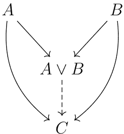

## 4.4 谬误作为最小元素

谬误的消除规则（连同蕴涵的自反性）确保 $⊥ \text{ true} \vdash C \text{ true}$。在偏序理论中，对应的规则是

```
⊥ ≤ C ,
```

它说 $⊥$ 是最小的，或者说是初始的元素。

再次强调，因为我们看到谬误是在证明论的形式中的零元析取，我们应该期望这个类比能够延续到偏序理论的形式中。事实上，最小元素是空集的最小上界。

## 4.5 偏序的IPL作为格

迄今为止，IPL 的偏序形式产生了一个格，因为它建立了一个具有有限交和并的偏序关系。在本课程中，对格的定义可能与文献中通常的定义有所不同，后者通常将格视为具有有限交和并的偏序关系。在本课程中，我们有意忽略了反对称性的属性。如果我们将蕴涵定义的偏序关系加上反对称性的属性，那么我们需要引入命题的等价类，这需要满足结合律。正如我们将在本课程后面看到的，唯一性公理提供了一种处理命题等价性的优雅方式。

## 4.6 蕴含作为指数

蕴含的消除规则（连同蕴涵的自反性）确保了如果 $A$ 为真，则 $A \supset B$ 为真 $\vdash B$ 为真。为了使偏序理论的表述完备，我们包括以下规则

$A \wedge (A \supset B) \leq B$

蕴含的引入规则确保了如果 $C \vdash A \supset B$ 为真，则 $C \wedge A \vdash B$ 为真。再次强调，为了使偏序理论的表述完备，我们有

$$A \wedge C \le B \quad C \leq A \supset B,$$

综上所述，这些规则表明 $A \supset B$ 是 $A$ 和 $B$ 的指数。正如我们之前所看到的，IPL 的偏序理论表述导致了一个格。现在我们刚刚看到它也支持指数。因此，IPL 的偏序理论表述导致了一个 Heyting 代数。Heyting 代数是一个具有指数的格。正如我们将在本课程中看到的，Heyting 代数的概念在证明 IPL 的完备性中是基本的。该证明还依赖于格中的互补概念。在格中，$A$ 的补 $\bar{A}$ 满足以下条件：

1. $⊤ \le A \lor \bar{A}$；
2. $\bar{A} \wedge A \le ⊥$。

由此可见，如果存在补集，则补集是否定的合适概念，但是通过指数定义的否定不一定是补集。

# 参考文献

[1] 高等研究院。同伦类型理论：一价数学基础。一价基础计划，2013年。 http://homotopytypetheory.org/book/。

[2] 罗伯特·哈珀。外延性，内涵性，以及布劳尔的格言。 http://existentialtype.wordpress.com/2012/08/11/extensionality-intensionality-and-brouwers-dictum/，2012年8月。

[3] 罗伯特·哈珀。 构造性数学不是元数学。 http://existentialtype.wordpress.com/2013/07/10/constructive-mathematics-is-not-meta-mathematics/，2013年7月。

[4] 弗兰克·普芬宁。和谐讲义。 http://www.cs.cmu.edu/~fp/courses/15317-f09/lectures/03-harmony.pdf，2009年9月。

[5] Frank Pfenning. 自然演绎讲义。 http://www.cs.cmu.edu/~fp/courses/15317-f09/lectures/02-natded.pdf，2009年8月。

## 15-819同伦类型理论

# 第2周讲义

Clive Newstead 和 Enoch Cheung

2013年9月16日和9月18日

## 前言

这些将在接下来的一周中进行大幅修订和扩展。

回顾上次，我们可以将判断“A为真”理解为‘A有一个证明’，将“A为假”理解为‘A有一个反驳’，或者等价地理解为‘¬A有一个证明’。

这些原子判断引出了形式为

$$A_1 \text{ true}, A_2 \text{ true}, \dots, A_n \text{ true} \vdash A \text{ true}$$

的直觉命题逻辑推理规则，引出了一个称为 Lindenbaum 代数的 Heyting 代数的结构。

# 1 林登鲍姆代数

回忆一下，IPL 具有一个预序结构，其中我们声明 $A \le B$ 当且仅当 $A \text{ true} \vdash B \text{ true}$。假设 $T$ 是直觉命题逻辑中的某个理论，并且通过以下方式定义 $T$ 中的命题之间的关系 $\simeq$：当且仅当 $A \le B$ 且 $B \le A$ 时，我们有 $A \simeq B$。

事实上，$\simeq$ 是一个等价关系，这是因为更一般的事实是，如果 $(P, \le)$ 是一个预序并且在 $P$ 上定义了一个关系 $\equiv$，通过声明 $p \equiv q$ 当且仅当 $p \le q$ 且 $q \le p$，那么 $\equiv$ 是 $P$ 上的一个等价关系。

**定义。** 林登鲍姆代数 of $T$ 被定义为 $T$ 中命题的 $\simeq$-等价类的集合。记作 $A^* = [A]_\simeq$。林登鲍姆代数上的排序是从 $\le$ 继承而来的。

# 2 可判定性和稳定性

**定理。** 判断 $\Gamma \vdash A \text{ true}$ 成立当且仅当在每个 Heyting 代数中 $\Gamma \vdash A$ 成立。

**证明。** 练习。

**定义。** 一个命题是可判定的，当且仅当 $A \lor \neg A \text{ true}$ 成立。

可判定性是将构造逻辑与经典逻辑区分开的因素：在经典逻辑中，每个命题都是可判定的（这正是排中律），但在构造逻辑中，情况并非如此。

一个合理的第一个问题可能是：“可判定的命题是否存在？”幸运的是，答案是肯定的。

- $T$ 和 $⊥$ 是可判定的命题；
- 我们期望 $m =_\mathbb{N} n$ 是一个可判定的命题，其中 $=_\mathbb{N}$ 表示自然数上的相等；
- 我们不期望 $x =_\mathbb{R} y$ 是一个可判定的命题，其中 $=_\mathbb{R}$ 表示实数上的相等，因为实数不是有限对象。

**定义。** 如果一个命题 $A$ 满足 $(\neg\neg A) \supset A \text{ true}$，则称 $A$ 是稳定的命题。

再次，在经典逻辑中，每个命题都是稳定的；事实上，命题 $(\neg\neg A) \supset A \text{ true}$ 经常被视为经典命题逻辑处理的公理！现在一个自然的问题是“是否存在不稳定的命题？”考虑以下引理。

### 引理。$\neg\neg (A \lor \neg A) \text{ true}$

**证明。** 我们必须证明 $\neg (A \lor \neg A) \supset ⊥ \text{ true}$。

假设 $A \text{ true}$。那么我们有：
$A \text{ true}$
$\neg (A \lor \neg A) \text{ true}$
$A \lor \neg A \text{ true} \quad (\lor I_1)$
$⊥$
所以实际上 $\neg A \text{ true}$。但是再次：
$\neg A \text{ true}$
$\neg (A \lor \neg A) \text{ true}$
$A \lor \neg A \text{ true} \quad (\lor I_2)$
$⊥$

因此

$$\frac{\neg(A \lor \neg A) \text{ true} \vdash ⊥}{\neg(A \lor \neg A) \supset ⊥ \text{ true}} \supset I$$

我们可以将这个引理理解为“排中律是不可反驳的”。假设存在不可判定的命题，我们得到以下推论。

**推论。** 在直觉主义命题逻辑中，并不是每个命题都是稳定的。

# 3 析取性质

如果一个理论 $T$ 具有析取性质 (DP)，那么 $T \vdash A \lor B$ 蕴含 $T \vdash A$ 或 $T \vdash B$。

**定理。** 在 IPL 中，如果 $\varnothing \vdash A \lor B \text{ true}$，则 $\varnothing \vdash A \text{ true}$ 或 $\varnothing \vdash B \text{ true}$。

**证明的朴素尝试。** 思路是对所有可能的推导 $\nabla \in \varnothing \vdash A \lor B \text{ true}$ 进行归纳，希望在其中找到 $A \text{ true}$ 或 $B \text{ true}$ 的推导。我们的归纳假设是，在 $\nabla$ 内有足够的信息来推导出 $\varnothing \vdash A \text{ true}$ 或 $\varnothing \vdash B \text{ true}$。

由于 $\varnothing \vdash A \lor B \text{ true}$ 不能通过假设或规则获得，$\land I$，$\supset I$ 或 $\top I$，我们只需要考虑 $\lor I_1$，$\lor I_2$ 和消除规则。如果 $\varnothing \vdash A \lor B \text{ true}$ 是由 $\lor I_1$ 得到的话

$$\frac{\frac{\nabla}{A \text{ true}}}{\varnothing \vdash A \lor B \text{ true}} \lor I_1$$

那么存在一个推导 $\nabla \vdash A \text{ true}$，我们就完成了。同样，如果 $\varnothing \vdash A \lor B \text{ true}$ 是由 $\lor I_2$ 得到的话，存在一个推导 $B \text{ true}$。

如果 $\varnothing \vdash A \lor B \text{ true}$ 是由 $\supset E$ 得到的话，推导的形式为

$$\frac{\frac{\nabla_1}{\varnothing \vdash C \supset (A \lor B) \text{ true}} \quad \frac{\nabla_2}{\varnothing \vdash C \text{ true}}}{\varnothing \vdash A \lor B \text{ true}} \supset E$$

我们（有争议地$^1$）假设 $\varnothing \vdash C \supset (A \lor B) \text{ true}$ 必须以某种方式从 $C \text{ true} \vdash (A \lor B) \text{ true}$ 推导出来。假设这种情况发生，并且 $\nabla_1'$ 是一个推导

> $^1$ 事实上，在构造逻辑中，这个‘可疑’的假设是正确的。

我们可以将 $\nabla_2$“替换”为出现在 $\nabla_1'$ 中的所有假设 $C \text{ true}$ 的实例，从而得到一个更小的推导 $\nabla_3$，其中 $\varnothing \vdash A \lor B \text{ true}$。然后，我们的归纳假设告诉我们，在 $\nabla_3$ 中有足够的信息来推导出 $\varnothing \vdash A \text{ true}$ 或 $\varnothing \vdash B \text{ true}$。

类似的方法（我们希望）也适用于 $\land E$，$\lor E$ 和 $⊥E$，从而得到结果。

# 4 可接受的属性

前一个定理的草图证明依赖于 $\vdash$ 的传递性；即以下规则为真：

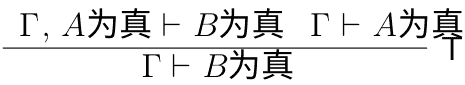

这自然地引导我们讨论 $\vdash$ 的结构特性。

**定义。** 如果在 IPL 的现有规则中添加了一个推导规则，而没有发生任何变化，则该推导规则在 IPL 中是可接受的。

为了明确我们使用的逻辑系统，我们可以写作 $\vdash_\text{IPL}$ 来表示在 IPL 中的推导，而不是在某个新的逻辑系统中。

现在的目标是证明蕴涵的结构规则（自反性、传递性、弱化性、收缩性、交换性）是可接受的。

**定理。** IPL 的结构特性是可接受的。

**证明。** R, C, X：自反性、收缩性和交换性都是原始概念，因为它们立即成立。例如：

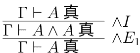

所以如果我们引入

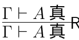

作为一个新规则，那么什么都不会改变。（对于收缩和交换也是如此。）

**W：** 对于弱化，我们使用结构规则在 $\Gamma$ 中是单调的事实。因此，我们可以通过归纳证明弱化是可允许的：如果以下规则是可允许的 $\Gamma \vdash B_1 \text{ true}$

$$\begin{array}{cc} \Gamma, A \text{ true} \vdash B_1 \text{ true} & \text{和} \quad \frac{\Gamma \vdash B_2 \text{ true}}{\Gamma, A \text{ true} \vdash B_2 \text{ true}} \end{array}$$

那么我们得到

$$\begin{array}{cc} \frac{\Gamma \vdash B_1 \land B_2 \text{ true}}{\Gamma \vdash B_1 \text{ true}} & \land E_1 \quad \frac{\Gamma \vdash B_1 \land B_2 \text{ true}}{\Gamma \vdash B_2 \text{ true}} \land E_2 \Gamma, A \text{ true} \vdash B_1 \text{ true} \text{ Ind } \quad \Gamma, A \text{ true} \vdash B_2 \text{ true} \text{ Ind } \quad \Gamma, A \text{ true} \vdash B_1 \land B_2 \text{ true} \quad \land I \end{array}$$

同样适用于其他引入规则。

**T：** 可传递性的可接受性可以留作练习。

# 5 证明术语

我们希望将命题及其证明作为数学对象进行研究。在类型论框架中，我们可以使用符号 $M:A$ 表示 $A$ 是一个命题，$M$ 是 $A$ 的证明。我们将看到这对应于范畴论中的映射概念 $M: A \rightarrow B$。另一个重要概念是证明的等同性，用 $M \equiv N:A$ 表示 $M, N$ 是 $A$ 的等价证明。这在范畴论上对应于从 $A$ 到 $B$ 的两个映射相等 $M=N: A \rightarrow B$。

## 5.1 证明术语作为变量

我们可以将跟踪证明的想法与我们之前的蕴含概念相结合。如果 $A_1, \ldots, A_n$ 蕴含 $A$ 意味着 $A_1, \ldots, A_n \vdash A$，将会有一个使用命题 $A_1, \ldots, A_n$ 的证明 $M$。因此，我们将写作

$$x_1: A_1, \ldots, x_n: A_n \vdash M: A$$

其中每个 $x_i: A_i$ 都是一个证明项。我们可以将证明项 $x_1, \ldots$ 视为假设，但我们真正想要的是让它们表现得像变量一样。$M$ 然后使用变量 $x_1, \ldots$ 来证明 $A$，所以 $M$ 将封装一个使用变量 $x_1, \ldots, x_n$ 的证明。

与其从无中证明一个命题 $A$，大部分时间 $A$ 会依赖于其他命题 $A_1, \ldots, A_n$。现在我们有了证明项，我们可以通过研究它们与蕴含的结构性质的相互作用来看它们如何作为变量。

我们还将跟踪其他假设/上下文 $\Gamma, \Gamma'$ 以证明结构性质在存在假设的情况下仍然成立。

## 5.2 带有证明项的蕴含的结构性质

现在我们有了证明项，我们可以通过研究它们与蕴含的结构性质的相互作用来看它们如何作为变量。我们还将跟踪其他假设/上下文 $\Gamma, \Gamma'$ 以证明结构性质在存在假设的情况下仍然成立。

**自反性/变量规则** 自反性告诉我们 $A$ 应该蕴含 $A$，所以我们现在有一个变量 $x: A$ 证明 $A$，这个变量应该被保留。我们可以将其视为变量规则。

$$\frac{\Gamma, x: A, \Gamma' \vdash x: A}{\quad} \text{R/V}$$

**传递性/替换** 传递性告诉我们如果 $A$ 是真的且 $B$ 从 $A$ 推导出来，那么 $B$ 也是真的。从证明的角度来看，如果我们有一个证明 $M: A$ 和一个使用变量 $x$ 来证明 $A$ 的证明 $N: B$，那么我们可以将证明 $M: A$ 替换到 $N: B$ 中来证明 $B$。由于我们将 $M$ 替换到 $N$ 中的 $x$ 位置，我们将这个替换表示为 $[M/x]N: B$。

$$\frac{\Gamma, x: A, \Gamma' \vdash N: B \quad \Gamma \vdash M: A}{\Gamma, \Gamma' \vdash [M/x]N: B} \text{T/S}$$

**弱化**

$$\frac{\Gamma \vdash M: A}{\Gamma, \Gamma' \vdash M: A} \text{W}$$

**收缩** 如果 $N: B$ 从 $A$ 使用两个不同的证明 $x: A, y: A$ 推导出来，我们可以只选择一个 $z=x$ 或 $z=y$ 作为 $z: A$ 的证明，并在变量 $x, y$ 的实例中使用它在 $N: B$ 中。

$$\frac{\Gamma, x: A, y: A, \Gamma' \vdash N: B}{\Gamma, z: A, \Gamma' \vdash [z, z/x, y]N: B} \text{C}$$

**交换**

$$\frac{\Gamma, x: A, y: B, \Gamma' \vdash N: C}{\Gamma, y: B, x: A, \Gamma' \vdash N: C} \text{X}$$

真值引入：真值是显然成立的，所以我们有

```
$\overline{\Gamma \vdash \langle \rangle : \top}$

$\top I$
```

合取消除：我们可以从证明 $M: A \land B$ 中恢复出 $A$ 和 $B$ 的证明

```
$\frac{\Gamma \vdash M: A \land B}{\Gamma \vdash \text{fst}(M): A} \land E_1$
```

```
$\frac{\Gamma \vdash M: A \land B}{\Gamma \vdash \text{snd}(M): B} \land E_2$
```

```
$\frac{\Gamma, x: A \vdash M: B}{\Gamma \vdash \lambda x.M: A \supset B} \supset I$
```

```
$\frac{\Gamma \vdash M: A \supset B \quad \Gamma \vdash N: A}{\Gamma \vdash M(N): B} \supset E$
```

证明规则，表示为 $M \equiv M' : A$。我们希望定义相等性 $\equiv$ 成为包含（封闭于）$\beta$ 规则的最小同余关系。我们将定义这是什么意思：一个同余关系是一个尊重我们的运算符的等价关系。作为一个等价关系，它是自反的（$M \equiv M : A$），对称的（$M \equiv N : A$ 意味着 $N \equiv M : A$），以及传递的（$M \equiv N : A$ 和 $N \equiv M' : A$ 意味着 $M \equiv M' : A$）。

对于等价关系来说，要使其保持我们的运算符，基本上意味着如果 $M \equiv M' : A$，那么它们在任何运算符下的映射应该是等价的。换句话说，我们应该能够在任何地方用 $M'$ 替换 $M$。例如

$$ \frac{\Gamma \vdash M \equiv M' : A \wedge B}{\Gamma \vdash \text{fst}(M) \equiv \text{fst}(M') : A} $$

可以有许多包含 $\beta$ 规则的同余关系。给定两个同余关系 $\equiv$ 和 $\equiv'$，如果 $M \equiv' N : A$ 意味着 $M \equiv N : A$，则我们说 $\equiv$ 比 $\equiv'$ 更精细。包含证明规则的最小同余关系是包含 $\beta$ 规则的最精细同余关系。我们将在下一节中定义 $\beta$ 规则。

我们将在后面给出更明确的定义来定义等同性。

## 6.2 甘茨的倒置原理

甘茨的倒置原理捕捉了“消去是逆向的引入”的概念，即消去规则应该在定义等价的情况下取消引入规则。以下是 IPL 负片段的 $\beta$ 规则：

## 合取
当我们引入一个合取时，我们将证明 $M : A$ 和 $N : B$ 组合成一个证明 $\langle M, N \rangle : A \land B$。当我们消去一个合取时，我们恢复 $M : A$ 或 $N : B$。我们不希望这个过程改变我们的原始 $M$ 或 $N$。

$$ \frac{\Gamma \vdash M : A \quad \Gamma \vdash N : B}{\Gamma \vdash \text{fst}(\langle M, N \rangle) \equiv M : A} \quad \beta\land_1 $$

$$ \frac{\Gamma \vdash M : A \quad \Gamma \vdash N : B}{\Gamma \vdash \text{snd}(\langle M, N \rangle) \equiv N : B} \quad \beta\land_2 $$

## 蕴涵
当我们引入一个蕴涵时，我们将一个使用某个变量 $x : A$ 的证明 $M$ 转化为一个使用变量 $x$ 的函数，用来产生一个证明

B。当我们消去蕴涵时，我们将 $A \supset B$ 的证明 $M : A$ 应用于 $N$ 来产生一个 $B$ 的证明。

$$ \frac{\Gamma, x: A \vdash M: B \quad \Gamma \vdash N: A}{\Gamma \vdash (\lambda x . M)(N) \equiv [N / x] M: B} \beta_\supset $$

## 6.3 甘茨的唯一性原则

甘茨的唯一性原则则捕捉了“引入是消去的逆过程”的思想。另一种思考方式是，只有一种通过定义等价来证明某个命题的方式，这就是我们所描述的方式。它们是 $\eta$ 规则，如下所示：

## 真
$$ \frac{\Gamma \vdash M: \top}{\Gamma \vdash M \equiv\langle\rangle: \top} \eta_\top $$

## 合取
$$ \frac{\Gamma \vdash M: A \wedge B}{\Gamma \vdash M \equiv\langle\text { fst }(M), \text { snd }(M)\rangle: A \wedge B} \eta_\wedge $$

## 蕴涵
$$ \frac{M: A \supset B}{\Gamma \vdash M \equiv \lambda x . M x: A \supset B} \eta_\supset $$

# 7 命题即类型

命题和类型之间存在一种对应关系：

| 命题 | 类型 |
| --- | --- |
| ⊤ | 1 |
| A ∧ B | A × B |
| A ⊃ B | 函数 A → B 或 B^A |
| ⊥ | 0 |
| A ∨ B | A + B |

暂时先注意，像 ⊤ 和 A ∧ B 这样的 meet 对应于像 1 和 A × B 这样的积，而像 ⊥ 和 A ∨ B 这样的 join 对应于像 0 和 A + B 这样的余积。随着我们的学习，这种对应关系会变得更加明显。现在我们将介绍右列上的对象。

# 8 范畴论方法

在 Heyting 代数中，当 A 蕴涵 B 时，我们有一个预序关系 $A \le B$。然而，我们现在希望跟踪证明，所以如果 M 是从 A 到 B 的证明，我们希望将其视为一个映射 $M : A \to B$。

## 恒等映射
应该存在一个恒等映射
id : A → A

## 组合
我们应该能够组合映射
f : A → B   g : B → C
-----------------------
  g o f : A → C

## 一致性条件
恒等映射和映射的组合应该像函数一样行为
id_B o f = f : A → B
f o id_A = f : A → B
h o (g o f) = (h o g) o f : A → D

现在我们可以思考与命题对应的范畴中的对象。

## 终对象
1 是终对象，也称为最终对象，它对应于 ⊤。对于任何对象 A，存在唯一的映射 A → 1。这对应于 ⊤ 在 Heyting 代数中是最大的对象，意味着对于所有的 A，$A \le 1$。

存在性：
⟨ ⟩ : A → 1

唯一性：
M : A → 1
--------- η^⊤
M = ⟨ ⟩ : A → 1

# 同伦类型理论

## 积
对于任何对象 A 和 B，存在一个对象 C = A \times B，它对应于并 A \wedge B。积 A \times B 具有以下普适性质：


其中图表是可交换的。

首先，存在条件意味着存在映射

```
fst : A \times B \rightarrow A
snd : A \times B \rightarrow B
```

通用性质表明对于每个对象 D 使得 $M : D \rightarrow A$ 和 $N : D \rightarrow B$ 成立，存在唯一的映射 $\langle M, N \rangle : D \rightarrow A \times B$ 使得

```
\frac{M : D \rightarrow A \quad N : D \rightarrow B}{\text{映射}\langle M, N \rangle : D \rightarrow A \times B}
```

图表可交换意味着

```
fst \circ \langle M, N \rangle = M : D \rightarrow A \quad (\beta \times_1)
snd \circ \langle M, N \rangle = N : D \rightarrow B \quad (\beta \times_2)
```

此外，映射 $\langle M, N \rangle : D \rightarrow A \times B$ 在以下意义上是唯一的

```
\frac{P : D \rightarrow A \times B \quad fst \circ P = M : D \rightarrow A \quad snd \circ P = N : D \rightarrow B}{P = \langle M, N \rangle : D \rightarrow A \times B} \quad \eta^\times
```

换句话说 $\langle fst \circ P, snd \circ P \rangle = P$。

另一种说法是

```
\langle fst, snd \rangle = id
\langle M, N \rangle \circ P = \langle M \circ P, N \circ P \rangle
```

## 指数
给定对象 $A$ 和 $B$，指数 $B^A$（对应于 $A \supset B$）是具有以下普适性质的对象：

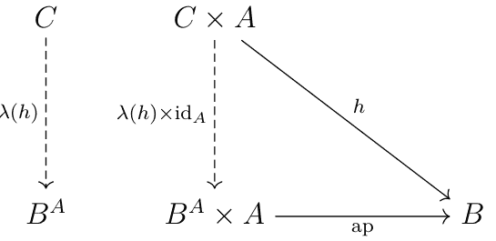

使得图表可交换。

这意味着存在一个映射 $\text{ap}: B^A \times A \to B$（应用映射），它对应于蕴含消去。

普适性质是对于所有具有映射 $h: C \times A \to B$ 的对象 $C$，存在唯一的映射 $\lambda(h): C \to B^A$，使得

```
ap \circ (\lambda(h) \times \text{id}_A) = h : C \times A \to B
```

这意味着图表是可交换的。另一种表示诱导映射的方式是 $\lambda(h) \times \text{id}_A = \langle \lambda(h) \circ \text{fst}, \text{snd} \rangle$。

映射 $\lambda(h): C \to B^A$ 是唯一的，意味着

```
\begin{aligned} \text{ap} \circ (g \times \text{id}_A) = h : C \times A \to B \\ g = \lambda(h) : C \to B^A \end{aligned} \eta
```

# 参考文献

# 第三周讲座笔记

Enoch Cheung 和 Clive Newstead

2013年9月30日和10月2日

# 1 β 和 η 规则

#### 1.1 Gentzen的倒置原则（β规则）

回顾 β 规则：

- ∧₁: fst⟨M, N⟩ ≡ M
- ∧₂: snd⟨M, N⟩ ≡ N
- ⊃₁: (λx.M)(N) ≡ [N/x]M
- ∨₁: case(inl(M); x.P, y.Q) ≡ [M/x]P
- ∨₂: case(inr(M); x.P, y.Q) ≡ [M/y]Q

β 规则可以非常简洁地表达，并告诉我们消除规则应该“抵消”引入规则。这里使用的符号是 inl(x)（左侧注入）表示使用证明 x 证明 A 证明 A ∨ B，而 inr(x)（右侧注入）表示使用证明 x 证明 B 证明 A ∨ B。case(x, y, z)表示“如果 x，则 y，否则 z。”这也表达了证明动态的思想，即证明可以被视为程序。

#### 1.2 甘茨的唯一性原则（η规则）

回顾我们迄今为止给出的 η 规则：

真
$$\frac{\Gamma \vdash M : \top}{\Gamma \vdash M \equiv \langle \rangle : \top}$$ η⊤

合取
$$\frac{\Gamma \vdash M: A \wedge B}{\Gamma \vdash M \equiv\langle\operatorname{fst}(M), \operatorname{snd}(M)\rangle: A \wedge B} \eta^{\wedge}$$

蕴涵
$$\frac{M: A \supset B}{\Gamma \vdash M \equiv \lambda x . M x: A \supset B} \eta^{\supset}$$

另一方面，η 规则需要更多的表述，并且表达了某些类型的证明的唯一性（在等价的情况下）。

另一种表达 η 合取规则的方式是：

$$\frac{\Gamma \vdash M: A \wedge B \quad \Gamma \vdash \mathrm{fst}(M) \equiv P: A \quad \Gamma \vdash \operatorname{snd}(M) \equiv Q: B}{\Gamma \vdash\langle P, Q\rangle \equiv M: A \wedge B} \eta^{\wedge}$$

这次我们给出了等价的证明项 $P, Q$ 对 $\mathrm{fst}(M)$ 和 $\operatorname{snd}(M)$。这对应于乘积图表（其中 $A \wedge B$ 对应于乘积 $A \times B$）：

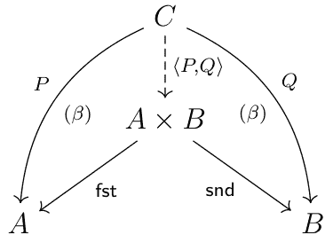

它表示对于给定的任何对象 $C$，具有映射 $P: C \rightarrow A$ 和 $Q: C \rightarrow B$，存在一个唯一的映射 $\langle P, Q\rangle: C \rightarrow A \times B$，使得 β 规则使得每个单元格都是可交换的，即 $P \equiv \mathrm{fst}(\langle P, Q\rangle)$ 和 $Q \equiv \operatorname{snd}(\langle P, Q\rangle)$。

另一方面，η 规则给出了 $\langle P, Q\rangle$ 映射的唯一性，表示为

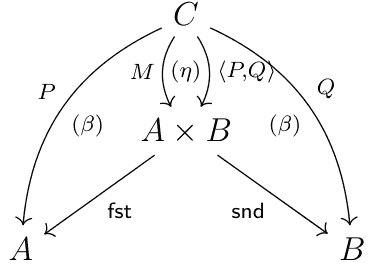

其中 η 规则使得中心细胞可交换，意味着对于任意的映射 $M$：$C \rightarrow A \times B$，使得 $\mathrm{fst} \circ M \equiv P$ 和 $\mathrm{snd} \circ M \equiv Q$，我们有 $M \equiv\langle P, Q\rangle$，表示 $\langle P, Q\rangle$ 映射的唯一性。

虽然 η 规则给出了乘积映射的唯一性，但人们可以问乘积对象 $A \times B$ 是否唯一。在一个 Heyting 代数中，我们可以证明如果 $A \wedge^\prime B$ 具有与 $A \wedge B$ 相同的性质（作为 A 和 B 的最大下界），那么：

```
$A \wedge B \leq A \wedge^\prime B \qquad A \wedge B \geq A \wedge^\prime B$
```

如果我们将它们视为对象，那么我们就有映射 $F: A \times B \rightarrow A \times^\prime B$ 和 $G: A \times B \rightarrow A \times^\prime B$，使得 $F \circ G=\mathrm{id}$ 和 $G \circ F=\mathrm{id}$，这就给出了 $A \times B \cong A \times^\prime B$。通过同伦等价公理，我们将等价的事物视为相等，因此我们可以说 $A \times B=A \times^\prime B$。

## 1.3 η 析取（∨）的规则

我们希望为 ∨ 的 η 规则提供定义，但是如果我们像之前为 $M: A \vee B$ 定义的那样，那么我们可能会强制 $M$ 成为 $A$ 或 $B$ 的证明，因为 $A$ 的证明也证明了 $A \vee B$，但是强制 $A$ 或 $B$ 的证明与 $A \vee B$ 的证明等同是没有意义的。

我们将从 Shannon 扩展中获得灵感，具体来说是对案例进行分析以给出两个不同的证明。作为一个玩具例子，我们考虑一个证明

```
⌜ ∨ ⌝

\operatorname{inl}(\langle\rangle)=\text { true }
\operatorname{inr}(\langle\rangle)=\text { false }
\langle\rangle: \ulcorner \vee \urcorner
\operatorname{case}(M ; P, Q)=\text { “如果 } M \text { 则 } P \text { 否则 } Q^{\prime}: T \vee T
```

在这里，我们看变量 $M$ 并决定使用 $P$ 或 $Q$（这里 $P, Q$ 没有输入，因为无论如何都没有证明的数据）。这是一个二进制决策图（BDD）的例子，因为我们在检查变量 $M$ 时做出决策并分支到两种情况。

一般来说，我们可以想象一个更大的 BDD，按顺序检查许多变量，并在某个变量 $M$ 处查看 Shannon 扩展。这里的思想是 $M=$ true 和 $M=$ false 将导致两个不同的子树。我们写

```
$[M / z] P \equiv \operatorname{if} M \text { then }[\text { true } / z] P \text { else }[\text { false } / z] P$
```

## 1.4 余积

当我们观察变量 M 使用的 P 时，有两种情况：当 M 为真时，得到 $[\text{true}/z]P$；当 M 为假时，得到 $[\text{false}/z]P$。关键是 $[\text{true}/z]P$ 和 $[\text{false}/z]P$ 不包含变量 M，所以 M 被固定为一个值。

这个的另一种表示方法是


为了写出 ∨ 的 η 规则，我们将描述当证明 $P:C$ 使用一个证明项 $z:A\vee B$ 时，即 C 从 $A\vee B$ 推导出来的情况。现在假设我们有一个证明 $M:A\vee B$，并且我们想要观察当我们通过替换 $[M/z] P:C$ 使 $P:C$ 包含 $M:A\vee B$ 时会发生什么。


这可以被看作是一个“广义的香农展开”，其中香农展开可以作为一个特殊情况恢复出来


## 1.4 余积

在范畴论观点中，析取 $A\vee B$ 对应于余积 $A+B$，其中 $\text{inl}: A\to A+B$ 和 $\text{inr}: B\to A+B$ 是规范的注入。

为了对余积给出一些直观理解，如果我们处于集合范畴中，我们可以将 $A+B = A \sqcup B = (\{0\} \times A) \cup (\{1\} \times B)$ 看作是一个不相交的并集，然后 inl, inr 将是规范嵌入 $\text{inl}: a \to (0, a)$ 和 $\text{inr}: b \to (1, b)$。如果 A, B 已经是不相交的，那么我们可以让 $A+B = A \cup B$，inl, inr 将是包含映射 $\text{inl}: a \to a$ 和 $\text{inr}: b \to b$。

对于 ∨ 的 β 规则，给出了以下交换图：


给定任意对象 $C$ 和映射 $P: A \rightarrow C$ 以及 $Q: B \rightarrow C$，存在唯一的映射 $\{P, Q\}: A + B \rightarrow C$，它是映射 $P, Q$ 的并对，对应于我们的上下文中

$\{P, Q\} \approx \operatorname{case}(-; x.P, y.Q)$

$\beta$ 规则使得图表成立，意味着映射的组合 $P \equiv \{P, Q\} \circ \text{inl}$ 和 $Q \equiv \{P, Q\} \circ \operatorname{inr}$。另一种写法是：

$\begin{aligned} & \text{case}(\operatorname{inl}(-); x.P, y.Q) \equiv [-/x]P \\ & \text{case}(\text{inr}(-); x.P, y.Q) \equiv [-/x]Q \end{aligned}$

$\eta$ 规则表达了唯一性，如下图所示


给定一个映射 $M: A+B \rightarrow C$，使得 $M \circ \text{inl} \equiv P$ 和 $M \circ \text{inr} \equiv Q$，则该映射实际上等价于 $M \equiv\{P, Q\}$，因此 $\eta$ 规则使中心细胞可交换。

就像我们对于 $\eta_\wedge$ 所做的那样，我们可以通过明确命名 $P: A \rightarrow C$ 和 $Q: B \rightarrow C$ 来重写 $\eta_\vee$ 规则，如下所示：

$\frac{
\begin{aligned}
& \Gamma, z: A+B \vdash M: C \\
& \Gamma, x: A \vdash[\operatorname{inl}(x) / z] M \equiv P: C \\
& \Gamma, y: B \vdash[\operatorname{inr}(y) / z] M \equiv Q: C
\end{aligned}
}{
\Gamma, z: A+B \vdash M \equiv \operatorname{case}(z ; x.P, y.Q): C
} \eta^{\vee}$

我们对 $\beta$ 规则和 $\eta$ 规则的不同处理表明了通过 $\beta$ 规则给出的等价性和通过 $\eta$ 规则给出的等价性之间存在根本的不同。事实上，我们将在稍后更清楚地说明这一区别。目前，注意到可以将 $\beta$ 规则视为不言自明的，或者分析性的，因为它只是说我们的符号，如 $\text{fst}, \text{snd}, \langle-, -\rangle, \text{inl}, \text{inr}, \text{case}$ 应该按照我们的期望行为。另一方面，$\eta$ 规则并不那么明显，并且表达了两个行为相同的事物的等价性，因此它们是合成的，或者需要证明而不是不言自明的。

$\beta$ 规则产生的等同概念被称为定义等同或判断等同，这是更基本的。$\eta$ 规则产生的等同概念被称为命题等同，必须通过类型来表示（因此是典型的）。

# 2 自然数

我们希望通过递归来捕捉定义的概念。我们将以两种方式实现。

首先，我们将把自然数在语法上实现为一种类型，表示为 $\text{Nat}$——它是一个归纳定义类型的典型示例。然后，我们将在范畴论的背景下实现自然数，作为所谓的自然数对象（NNO），表示为 $\mathbb{N}$。

## 2.1 语法定义：Nat

类型 $\text{Nat}$ 有两个引入规则：

$$\frac{\overline{\Gamma \vdash 0: \text{Nat}} \text{Nat-}I_0, \quad \frac{\Gamma \vdash M: \text{Nat}}{\Gamma \vdash s(M): \text{Nat}} \text{Nat-}I_s}{}$$

还有一个消除规则，可以看作是一个 for 循环或递归：

$$\frac{\Gamma \vdash M: \text{Nat} \quad \Gamma \vdash P: A \quad \Gamma, x: A \vdash Q: A}{\Gamma \vdash \text{rec}(P, x.Q)(M): A} \text{Nat-}E$$

我们称之为 $\text{rec}$ 这个递归器。

我们可以将 $0$ 看作是零，将 $s$ 看作是后继操作，它将一个自然数 $n$ 转换为它的后继 $n+1$。

对于 $\text{Nat}$ 的 $\beta$-规则，它们应该是这样的：

$$\frac{\Gamma \vdash P: A \quad \Gamma \vdash Q: A}{\Gamma \vdash \text{rec}(P, Q)(0) \equiv P: A} \beta\text{-Nat}_0$$

$$\frac{\Gamma \vdash P: A \quad \Gamma \vdash Q: A}{\Gamma \vdash \text{rec}(P, Q)(s(M)) \equiv [\text{rec}(P, Q)(M) / x] Q: A} \beta\text{-Nat}_s$$

$\text{NNO}$ 的 $\eta$ 规则有点丑陋：

$$\frac{
\begin{aligned}
& \Gamma, z: \text{Nat} \vdash M:A \\
& \Gamma, z: \text{Nat} \vdash [s(z)/z]M \equiv [M/x]Q \\
& \Gamma \vdash [0/z]M \equiv P:A
\end{aligned}
}{
\Gamma, z: \text{Nat} \vdash M \equiv \text{rec}(P, Q)(z):A
} \eta\text{-Nat}$$

它说的是“如果某个东西的行为类似于递归器，那么它就是递归器”。

给定 $n \in \mathbb{N}$，定义数字 $\bar{n} = s(s(\cdots s(0)\cdots))$。稍微滥用一下符号，我们可以从 $\beta$ 中得知

$$\text{rec}(P, Q)(\bar{n}) \equiv \underbrace{Q(Q(\cdots Q(P)\cdots))}_{n\text{次}}$$

也就是说，$\text{rec}(P, Q)(0) \equiv P$ 并且 $\text{rec}(P, Q)(\overline{n+1}) \equiv Q(\text{rec}(P, Q)(\bar{n}))$。这正是通过递归进行定义的方式。

这一的特殊情况是当 $P=0$ 并且 $Q$ 是后继操作。那么

$$z: \text{Nat} \vdash \text{rec}(0, s)(z) \equiv z: \text{Nat}$$

这是我们期望的：如果你将后继操作应用于 $0$ 次，那么你得到的是 $0$。

## 2.2 范畴论定义：NNO

固定一个范畴 $\mathcal{C}$ 并假设 $\mathcal{C}$ 有一个终对象 $1$。在 $\mathcal{C}$ 中的自然数对象是一个带有箭头 $0: 1 \to \mathbb{N}$ 和 $s: \mathbb{N} \to \mathbb{N}$ 满足以下普适性质的对象：


也就是说，对于任何态射 $P: 1 \rightarrow A$ 和 $Q: A \rightarrow A$，存在唯一的态射 $r = \text{rec}(P, Q): \mathbb{N} \rightarrow A$，使得

$$\text{rec}(P, Q) \circ 0 = P \text{ 和 } \text{rec}(P, Q) \circ s = Q \circ \text{rec}(P, Q)$$

这两个方程与 $\text{Nat}$ 的 $\beta$ 规则完全对应。

$\eta$ 规则与唯一性相对应：如果 $M: \mathbb{N} \rightarrow A$ 满足 $M \circ s = Q \circ M$ 和 $M \circ 0 = P$，则 $M = \text{rec}(P, Q)$。

### 具体例子

在集合范畴中，取 $\mathbb{N}$ 为自然数集。终对象是任意单元素集合 $\{\ast\}$，我们可以定义 $0:\{\ast\} \to \mathbb{N}$ 为 $0(\ast)=0 \in \mathbb{N}$，并定义 $s: \mathbb{N} \to \mathbb{N}$ 为 $s(n)=n+1$。那么三元组 $(\mathbb{N}, 0, s)$ 定义了一个自然数对象：如果 $P \in A$ 且 $Q: A \to A$，我们可以定义 $\text{rec}(P, Q): \mathbb{N} \to A$ 为

$$\text{rec}(P, Q)(0)=P \text{ 且 } \text{rec}(P, Q)(n+1)=Q(\text{rec}(P, Q)(n))$$

很明显上述图表是可交换的，并且我们可以通过对其参数进行归纳来证明 $\text{rec}(P, Q)$ 是唯一的这样的函数。

### NNO 作为一个初始代数

存在一个等价的自然数对象的定义，即作为一个初始代数。

给定一个自函子（即从一个范畴 $\mathcal{C}$ 到自身的函子 $F$），一个 $F$-代数是一个二元组 $(A, \alpha)$，其中 $A$ 是范畴中的一个对象，$\alpha: F(A) \to A$ 是一个态射。

一个 $F$-代数的同态 $f: (A, \alpha) \to (B, \beta)$ 是一个映射 $f: A \to B$，使得下面的方形图交换：

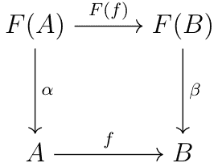

也就是说，$f$ 以唯一的方式保持 $\alpha$ 和 $\beta$。

一个 $F$-代数的初始对象是一个 $F$-代数 $(I, \iota)$，满足对于任意的 $F$-代数 $(A, \alpha)$，存在唯一的 $F$-代数同态 $(I, \iota) \to (A, \alpha)$。

在明确了这些定义之后，自然数对象就是一个精确的初始 $F$-代数，其中 $F$ 是函子 $1+(-)$。

为了看到这个函子在态射上的作用，考虑更一般的情况，具有态射 $f: A \to A'$ 和 $g: B \to B'$ 的情况。然后我们有态射 $\text{inl} \circ f: A \to A'+B'$ 和 $\text{inr} \circ g: B \to A'+B'$。然后余积的普遍性质导致了一个映射

$$f+g = \{\text{inl} \circ f, \text{inr} \circ g\}: A+B \to A'+B'$$

更具体地说，这意味着以下内容。自然数对象是一个对象 $\mathbb{N}$ 配备有一个态射 $\{0, s\}: 1+\mathbb{N} \to \mathbb{N}$，使得如果 $\{P, Q\}: 1+A \to A$ 是另一个态射，则存在一个唯一的态射 $\text{rec}(P, Q): \mathbb{N} \to A$，使得 $\{P, Q\} \circ (1+\text{rec}(P, Q)) = \text{rec}(P, Q) \circ \{0, s\}$。

# 3 内涵和外延相等性

我们可以通过

$p=\lambda x \lambda y \operatorname{rec}(x, z.s(z))(y)$

给定数字 $\bar{m}$ 和 $\bar{n}$，很明显 $p \bar{m} \bar{n}=m+n$，因此这个定义实现了加法。

我们可以递归在 $x$ 上而不是 $y$ 上。实际上，我们可以定义 $q=\lambda x \lambda y p y x$。同样我们可以证明 $q \bar{m} \bar{n}=m+n$，所以 $q$ 是另一种加法的实现。

尽管如此，我们通常不能证明

$x: \text{Nat}, y: \text{Nat} \vdash p x y \equiv q x y$

这看起来很奇怪：对于每个 $m, n \in \mathbb{N}$（在“真实世界”中），我们可以证明 $p \bar{m} \bar{n}= q \bar{m} \bar{n}$。如果我们有归纳原理，那么我们将能够推导出 $p x y=q x y$ 的普遍性。然而，我们没有这样的原理！

从道义上讲，这不应该是这样的：也就是说，$p$ 和 $q$ 在定义上不相等。这说明了内涵相等（也称为定义上相等）和外延相等之间的区别。这个区别在计算机科学和哲学中非常重要：它捕捉了两个程序具有相同的输入-输出行为但算法不同的概念。

**外延相等**。我们可以将函数的外延理解为它的图形，即形式为（输入, 输出）的有序对的集合。两个程序可能具有相同的输入/输出行为，但并不是同一个程序。根据弗雷格的术语，如果两个类型具有相同的引用，则它们在外延上是相等的。

我们不能期望外延相等是可计算的；例如，类型 $(\mathbb{N} \rightarrow \mathbb{N}) \rightarrow(\mathbb{N} \rightarrow \mathbb{N})$ 的元素的外延相等已经具有很高的量词复杂度。

**内涵相等**。我们可以将函数的内涵看作是其描述，或者是计算函数的算法。因此，内涵相等的两个函数必须是外延相等的，但反之不成立。

内涵相等是综合的。按照弗雷格的术语，如果两个类型具有相同的意义，则它们在内涵上相等。

## 3.1 类型理论中的相等性

回顾马丁-洛夫对判断和命题的区分。有了这个理解：

- 内涵相等是一个归纳定义的判断；
- 外延相等是一个命题：它可能受到判断的影响。

例如，以下是一个命题：

$$p x y =_{\mathrm{Nat}} q x y$$

它需要证明。我们将尝试开发一种说法，即要证明这一点，只需证明对于每个 $m, n \in \mathbb{N}$，有 $p \bar{m} \bar{n}=q \bar{m} \bar{n}$。

根据我们的命题即类型对应，我们得出外延相等性“是”一族类型。例如，

$$x: \text{自然数}, y: \text{自然数} \vdash x=_{\text{自然数}} y \quad (1)$$

我们将类型 $x=_{\text{自然数}} y$ 写作 $\text{Id}_{\text{自然数}}(x, y)$ 以强调我们真正想将其视为类型而不是命题。

通过从 $1$ 进行替换实例化得到

$$\frac{\Gamma \vdash M: \text{自然数} \quad \Gamma \vdash N: \text{自然数}}{\Gamma \vdash \text{Id}_{\text{自然数}}(M, N) \text{ 类型}}$$

但我们不必止步于自然数；我们可以用任意类型 $A$（它本身可能是一个恒等类型！）来替换它。例如，给定 $x$: 自然数，我们可以得到一个新类型 $\text{Seq}(x)$，它可以被视为长度为 $x$ 的自然数序列：

$$\frac{\Gamma \vdash x: \text{自然数}}{\Gamma \vdash \text{Seq}(x): \text{类型}}$$

观察以下事实：给定 $m, n \in \mathbb{N}$，它是真的

$$\text{Seq}(p \bar{m} \bar{n}) \equiv \text{Seq}(q \bar{m} \bar{n})$$

因为 $p \bar{m} \bar{n} \equiv q \bar{m} \bar{n}$。然而我们不能推广到

$$\text{Seq}(p x y) \equiv \text{Seq}(q y x)$$

因为 $\text{Seq}(pxy)$ 和 $\text{Seq}(qyx)$ 不是定义上等价的。但它们在某种程度上是相关的。稍后，我们将定义在这里所说的“相关”的含义。一个好的猜测可能是“同构”，但这将被证明太过强大。我们需要一种“等价”的方式。这种等价将与同伦的概念和范畴等价的概念联系在一起。

# 4 依赖类型：设置

依赖类型是类型的族。原子判断的形式为

- 上下文 / 闭合类型: $\Gamma \text{ ctx}$
- $\Gamma \equiv \Gamma'$
- 开放类型 / 类型族: $\Gamma \vdash A \text{ 类型}$
- $\Gamma \vdash A \equiv A'$
- 类型的元素: $\Gamma \vdash M : A$
- $\Gamma \vdash M \equiv M' : A$

符号 $\equiv$ 表示我们将解释为定义相等。当需要时，我们用 $\cdot$ 表示空上下文。上下文的引入规则为：

| $\cdot \text{ ctx}$ | $\frac{\Gamma \text{ ctx} \quad \Gamma \vdash A \text{ 类型}}{\Gamma, x : A \text{ ctx}}$ |
| :--- | :--- |

因此，我们有了一些“依赖”的概念；它使我们能够理解以前不可能的表达式像 $x: \text{Nat}, y: \text{Seq}(x) \vdash \cdots$。

| $\cdot \equiv \cdot \text{ ctx}$ | $\frac{\Gamma \equiv \Gamma' \quad \Gamma \vdash A \equiv A'}{\Gamma, x : A \equiv \Gamma', x : A'}$ |
| :--- | :--- |

以下规则对应于反射性：

$\overline{\Gamma, x : A, \Delta \vdash x : A}$

以下规则（每个判断 $J$ 对应一个）对应于弱化：

$\frac{\Gamma, \Delta \vdash J \quad \Gamma \vdash A \text{ 类型}}{\Gamma, x : A, \Delta \vdash J}$

练习。交换和收缩的对应规则是什么？

以下规则，称为替换或实例化，对应于传递性：

$\frac{\Gamma, x : A, \Delta \vdash J \quad \Gamma \vdash M : A}{\Gamma[M/x]\Delta \vdash [M/x]J}$

以下规则一起称为功能性

$\frac{\Gamma, x : A, \Delta \vdash N : B \quad \Gamma \vdash M \equiv M' : A}{\Gamma[M/x]\Delta \vdash [M/x]N \equiv [M'/x]N : [M/x]B}$

$\frac{\Gamma, x: A, \Delta \vdash B \text{类型} \quad \Gamma \vdash M \equiv M': A}{\Gamma[M / x] \Delta \vdash [M / x] B \equiv [M' / x] B}$

最后，以下规则是类型相等的，告诉我们定义上相等的类型分类相同的事物：

$\begin{array}{cc}\frac{\Gamma \vdash M: A \quad \Gamma \vdash A \equiv A'}{\Gamma \vdash M: A'} & \frac{\Gamma \vdash M \equiv M': A \quad \Gamma \vdash A \equiv A'}{\Gamma \vdash M \equiv M': A}\end{array}$

### 恒等类型

给定一个类型 $A$ 和元素 $M: A$ 和 $N: A$ 我们可以构造一个恒等类型 $\text{Id}_A(M, N)$。因此，$\text{Id}$ 的形成规则如下：

$\frac{\Gamma \vdash A \text{类型} \quad \Gamma \vdash M: A \quad \Gamma \vdash N: A}{\Gamma \vdash \text{Id}_A(M, N) \text{ 类型}} \text{Id-}F$

在 HoTT 中，考虑 $A$ 本身是一个恒等类型的情况将会很有用，即我们有类型

$\text{Id}_{\text{Id}_A(A, B)}(\alpha, \beta)$

这可以扩展到任何（有限）维度。

我们还有一个 $\text{Id}$-引入规则，告诉我们类型 $A$ 的任何元素 $M$ 与其自身以某种方式“相关”。形式上如下：

$\frac{\Gamma \vdash M: A}{\Gamma \vdash \text{refl}_A(M): \text{Id}_A(M, M)} \text{Id-}I$

$\text{Id}$-消除将在下周进行。

# 第4周讲座笔记

Jason Koenig

2013年10月7日和10月9日

# 1 依赖类型

## 1.1 结构基础

依赖类型是类型的族。回顾上周的结构设置，与 IPL 不同的是，我们需要在上下文和前面的项中表达项和类型之间的依赖关系。原子判断的形式为上下文/封闭类型：

$\Gamma \text{ ctx}$

$\Gamma \equiv \Gamma'$

开放类型/类型族：

$\Gamma \vdash A \text{ 类型}$

$\Gamma \vdash A \equiv A'$

类型的元素：

$\Gamma \vdash M : A$

$\Gamma \vdash M \equiv M' : A$

符号 $\equiv$ 表示我们将解释为定义相等。当需要时，我们用 $\cdot$ 表示空上下文。上下文的引入规则为：

$$
\frac{\hline \text{ } \cdot \text{ ctx } \text{ }}{} \qquad \frac{\Gamma \text{ ctx} \quad \Gamma \vdash A \text{ 类型}}{\Gamma, x: A \text{ ctx}}
$$

因此，我们有了依赖的概念；它使我们能够理解以前不可能的表达式，像 $x: \text{Nat}, y: \text{Seq}(x) \vdash \cdots$。

$$
\frac{\hline \text{ } \cdot \equiv \cdot \text{ ctx } \text{ }}{} \qquad \frac{\Gamma \equiv \Gamma' \quad \Gamma \vdash A \equiv A'}{\Gamma, x: A \equiv \Gamma', x: A'}
$$

以下规则对应于自反性：

$$
\frac{}{\Gamma, x: A, \Delta \vdash x: A}
$$

以下规则（每个判断 $J$ 对应一个）对应于弱化：

$$
\frac{\Gamma, \Delta \vdash J \quad \Gamma \vdash A \text{ 类型}}{\Gamma, x: A, \Delta \vdash J}
$$

练习。交换和收缩的对应规则是什么？

以下规则，称为替换或实例化，对应于传递性：

$$
\frac{\Gamma, x: A, \Delta \vdash J \quad \Gamma \vdash M: A}{\Gamma[M/x], \Delta \vdash [M/x]J}
$$

以下规则一起称为功能性规则：

$$
\frac{\Gamma, x: A, \Delta \vdash N: B \quad \Gamma \vdash M \equiv M': A}{\Gamma[M/x], \Delta \vdash [M/x]N \equiv [M'/x]N: [M/x]B}
$$

$$
\frac{\Gamma, x: A, \Delta \vdash B \text{ 类型} \quad \Gamma \vdash M \equiv M': A}{\Gamma[M/x], \Delta \vdash [M/x]B \equiv [M'/x]B}
$$

最后，以下规则是类型相等规则，告诉我们定义上相等的类型具有相同的分类：

$$
\frac{\Gamma \vdash M \equiv M': A \quad \Gamma \vdash A \equiv A'}{\Gamma \vdash M \equiv M': A'}
$$

## 1.2 负依赖类型

在依赖类型理论中，负类型需要被推广以表达依赖性。类型 $\top$ 不会改变。然而，$\wedge$ 和 $\vee$ 有新的形式：

| IPL | 类型论表示 | 依赖类型对应 |
|---|---|---|
| $A \wedge B$ | $A \times B$ | $\Sigma x: A.B$ / $\exists x: A.B$ |
| $A \supset B$ | $B^A$ 或 $A \rightarrow B$ | $\Pi x: A.B$ / $\forall x: A.B$ |

在我们介绍这些类型的规则之前，了解一些它们代表的直觉是很好的。依赖类型 $\Sigma x: A.B$，称为和、依赖乘积或 sigma-类型。不幸的是，这里的术语变得混乱，因为 $\Sigma$ 正确地推广了乘积。$\Sigma$ 类型对应于（构造性的）存在量化 $\exists x: A.B$。

类型 $\Pi x: A.B$ 被称为依赖乘积（与上面的重复），或者 pi-类型。这个概念推广了从 $A$ 到 $B$ 的函数，因为应用的结果类型可以依赖于函数被应用到的具体值。这对应于全称量化 $\forall x: A.B$。

例子：我们可以从这些连接词和我们已经看到的类型中构建复杂的类型。例如，我们可以构建类型 $\Pi x: \text{Nat}. \Sigma y: \text{Nat}. \text{Id}_{\text{Nat}}(y, \text{succ}(x))$。根据类型-命题对应，这是命题 $\forall x: \text{Nat}. \exists y: \text{Nat}. y =_{\text{Nat}} \text{succ}(x)$，即对于每个自然数，存在一个后继。我们可以将其视为证明该命题为真的证据。我们还可以将这个类型的元素视为项，它接受一个自然数 $x$，并生成一个证明该特定自然数具有后继的项。

例子：一个不太逻辑的例子是类型 $\Pi x: \text{Nat}. \text{Seq}(x)$。这表示当应用于值 $n$ 时，函数的类型会产生一个长度为 $n$ 的序列，就像“分配”序列一样。这在编程时可能很有用，因为类型编码了关于值的更多信息，而非依赖类型则不能。

这些类型的量词视图的一个重要方面是，它们在合并量词和命题的域方面推广了经典逻辑。在经典逻辑中，尤其是一阶逻辑中，它们是完全不同的。通过将 $A$ 作为类似于“命题”的类型，我们可以量化不仅仅是数据（如 $\text{Nat}$），还可以通过证明命题来量化。

只有在将量词视为构造性的时候，才能将依赖类型与量词等同起来。类型 $\Sigma x: A.B$ 的元素由一对 $\langle x, y \rangle$ 组成，其中 $x$ 是存在性的证明，$y$ 是证明该元素满足条件的证明。构造性存在性要求实际上存在一个明确的元素，证明必须自己提供。这意味着不能使用某些来自经典逻辑的证明。其中一些证明大致显示：$(\forall x. P) \supset \bot$，因此它们得出 $\exists x. P$ 的结论，但在证明中我们无法找到这样的 $x$。类似地，但不太直观的是，全称量词的证明是从元素到针对那些特定元素的证明的映射，即一个函数。我们不能通过显示 $(\exists x. P) \supset \bot$ 来证明 $\forall x. P$。

构造性的想法是，如果你证明了 $(\forall x. P) \supset \bot$，那么就让它成为证明。构造性意味着一种谨慎，我们避免了经典的约定 $\neg\exists \Leftrightarrow \forall$ 和 $\neg\forall \Leftrightarrow \exists$。通过做出这种区分，我们不仅能够将证明视为程序，还能获得否则会崩溃的 HoTT 的丰富结构。

### 1.2.1 乘积类型

乘积类型的形成和引入规则为：

$$
\frac{\Gamma \vdash A \text{ 类型} \quad \Gamma, x: A \vdash B \text{ 类型}}{\Gamma \vdash \Pi x: A.B \text{ 类型}} \ \Pi\text{-F} \qquad \frac{\Gamma, x: A \vdash M: B}{\Gamma \vdash \lambda x: A.M: \Pi x: A.B} \ \Pi\text{-I}
$$

注意，引入形式几乎相同，只是在形成类型 $B$ 时，$x$ 被绑定。引入规则与 IPL 中完全相同，只是类型 $B$ 像 $M$ 一样依赖于 $x$。这种 $B$ 的依赖性激发了消除规则：

$$
\frac{\Gamma \vdash M: \Pi x: A.B \quad \Gamma \vdash N: A}{\Gamma \vdash M\ N: [N/x]B} \ \Pi\text{-E}
$$

这与 IPL 相同，只是将 $N$，即实际参数，替换为结果类型。因此，结果类型可以随实际参数变化，这在常规类型理论中是不可能的。

我们还有 $(\beta)$ 和 $(\eta)$ 规则：

$$
(\lambda x. M)\ N \equiv [N/x]M \quad (\beta)
$$
$$
(\lambda x. M\ x) \equiv M \quad (\eta) \quad \text{（当 $x$ 在 $M$ 中不是自由变量时）}
$$

### 1.2.2 Sigma类型

Sigma 类型的形成和引入规则为：

$$
\frac{\Gamma \vdash A \text{ 类型} \quad \Gamma, x: A \vdash B \text{ 类型}}{\Gamma \vdash \Sigma x: A.B \text{ 类型}} \ \Sigma\text{-F} \qquad \frac{\Gamma \vdash M: A \quad \Gamma, x: A \vdash N: [M/x]B}{\Gamma \vdash \langle M, N \rangle: \Sigma x: A.B} \ \Sigma\text{-I}
$$

这里的加法是第二个组件可以依赖于第一个组件。消除规则是符合预期的，还加上了第二个组件类型的依赖：

$$
\frac{\Gamma \vdash M: \Sigma x: A.B}{\Gamma \vdash \text{fst}(M): A} \ \Sigma\text{-E}_1 \qquad \frac{\Gamma \vdash M: \Sigma x: A.B}{\Gamma \vdash \text{snd}(M): [\text{fst}(M)/x]B} \ \Sigma\text{-E}_2
$$

$(\beta)$ 和 $(\eta)$ 规则是熟悉的：

$$
\begin{aligned}
\text{fst}(\langle M, N \rangle) &\equiv M & (\beta_1) \\
\text{snd}(\langle M, N \rangle) &\equiv N & (\beta_2) \\
\langle \text{fst}(M), \text{snd}(M) \rangle &\equiv M & (\eta)
\end{aligned}
$$

## 1.3 正依赖类型

对于正类型，依赖不会影响类型的形式，而是影响它们的消除形式。这个问题的出现是因为我们需要在消除中有一个“连接点”。例如，在 IPL 中，$C$ 是 $\lor$ 的消除中的连接点，因为它需要在两种情况下都成立：

$$
\frac{\Gamma, x: A \vdash N: C \quad \Gamma, y: B \vdash P: C \quad \Gamma \vdash M: A+B}{\Gamma \vdash \text{case}(M, x.N, y.P): C} \ \lor\text{-E}_{\text{IPL}}
$$

在 IPL 中，不需要使 $C$ 成为依赖类型是没有问题的，因为类型是固定的：在任何分支中，$C$ 都不会有任何变化。在依赖类型理论中，情况就不同了。

### 1.3.1 和类型

为了激发我们为什么需要依赖于 $C$，我们考虑求和（即析取）。首先，我们介绍布尔类型，这是 $(+)$ 类型的一个简单情况。让我们将布尔类型 $2$ 定义为 $1+1$，其中 $1$ 是单位类型，而值 $\text{tt} = \text{inl}(\langle\rangle): 2$ 和 $\text{ff} = \text{inr}(\langle\rangle): 2$。

考虑一个相当平凡的命题（以类型形式书写）$\Pi x: 2. (\text{Id}_2(x, \text{ff})) + (\text{Id}_2(x, \text{tt}))$。为了证明这一点，我们需要对 $x$ 进行情况分析。特别地，在每种情况下我们实际证明的命题是不同的：
- 假设为真的情况：通过右侧注入的自反性证明 $(\text{Id}_2(\text{tt}, \text{tt})) + (\text{Id}_2(\text{tt}, \text{ff}))$
- 假设为假的情况：通过左侧注入的自反性证明 $(\text{Id}_2(\text{ff}, \text{ff})) + (\text{Id}_2(\text{ff}, \text{tt}))$

我们可以看到，如果我们对 $x$ 进行案例分析，那么我们需要在每种情况下证明的实际命题就是我们试图证明的目标，专门针对特定情况。以下规则对此进行了编码：

$$
\frac{\Gamma, x: A \vdash N: [\text{inl}(x)/z]C \quad \Gamma, y: B \vdash P: [\text{inr}(y)/z]C \quad \Gamma \vdash M: A+B \quad \Gamma, z: A+B \vdash C \text{ 类型}}{\Gamma \vdash \text{case}[z.C](M, x.N, y.P): [M/z]C} \ \lor\text{-E}
$$

在 case 构造中，部分 $[z.C]$ 被称为动机，因为这是进行情况分析的动机。与 IPL 不同的是，这里的 $C$ 是参数化的 $z: A+B$。这是必要的原因是我们需要能够将我们正在分析的实际情况（$\text{inl}$ 或 $\text{inr}$）替换到类型中的每个分支中，以便我们的证明可以变化。情况分析证明了 $C$ 特化为 $M$，这是流入类型 $C$ 的项 $M$。在 $z$ 的参数性允许这种依赖关系。

$$
\frac{\Gamma \vdash N: [\text{tt}/z]C \quad \Gamma \vdash P: [\text{ff}/z]C \quad \Gamma \vdash M: 2 \quad \Gamma, z: 2 \vdash C \text{ 类型}}{\Gamma \vdash \text{if}[z.C](M, N, P): [M/z]C} \ \vee\text{-E}
$$

我们可以将此规则特化为布尔值，以获得一个新的构造 $\text{if}$。其中术语 $N$ 和 $P$ 不绑定任何变量，因为根据 $(\eta)$，$\vee\text{-E}$ 规则中的变量都是空元组，因此实际上不需要绑定。

这种表达方式在逻辑解释中似乎是合理的，但在编程中可能会导致一些意外的结果。在大多数编程语言中，$\text{if }(x, 17, \text{tt})$ 是不合法的，因为真分支的类型是 $\text{Nat}$，而假分支的类型是 $2$。然而，借助依赖类型理论的工具，我们可以给这个术语一个类型。如果我们假设类型层面上存在条件语句，这一点我们尚未形式化，我们可以想象其类型为：

$\text{if }(M, \text{Nat}, 2)$

对于一些适当的类型层次结构，注意 “$2$” 是一个类型名称，而不是其他。尽管这两个分支具有不同的简单类型，$\text{if }(M, \text{Nat}, 2)$ 表示这两个表达式的连接点。在普通的编程语言中，连接点类型不允许依赖于任何项，更不用说实际选择的分支了。然后，这个例子似乎是类型不正确的，但实际上 $17: \text{if }(\text{tt}, \text{Nat}, 2)$ 和 $\text{tt}: \text{if }(\text{ff}, \text{Nat}, 2)$，这是 $\vee\text{-E}$ 规则中的关键前提。当使用 sigma 类型编码 $A+B$ 时，这种构造非常重要。

最后，我们还可以使用一些 $(\beta)$ 和 $(\eta)$ 规则，这些规则与非依赖情况相对应。在这里，我们省略了动机，因为它在规则中没有起作用：

$$
\begin{aligned}
\text{case}(\text{inl}(M), x.N, y.P) &\equiv [M/x]N & \beta_1 \\
\text{case}(\text{inr}(M), x.N, y.P) &\equiv [M/y]P & \beta_2 \\
\text{case}(M, x.[\text{inl}(x)/z]P, y.[\text{inr}(y)/z]P) &\equiv [M/z]P & \eta
\end{aligned}
$$

### 1.3.2 自然数

与和类型类似，对于自然数，存在一个相对简单的消除规则的推广，其中使用了一个增强的递归器：

$$
\frac{\Gamma \vdash M: \text{Nat} \quad \Gamma, z: \text{Nat} \vdash C \text{ 类型} \quad \Gamma \vdash N: [0/z]C \quad \Gamma, x: \text{Nat}, y: [x/z]C \vdash P: [s(x)/z]C}{\Gamma \vdash \text{rec}[z.C](M, N, x.y.P): [M/z]C} \ \text{自然数-E}
$$

就像在求和情况下一样，我们可以将递归器解释为对于特定的自然数 $M$ 的 $C$ 的证明，给定了对于零的证明 $N$ 和对于后继的证明 $P$。

在 Gödel 的 T 中，我们可以证明在存在积的情况下，可以省略变量 $x: \text{Nat}$，如果有必要，我们可以添加它。然而，在这个表述中，$y$ 的类型是对于某个自然数 $C$ 的证明，所以我们需要给这个自然数一个名称来构成类型。

我们也有预期的 $(\beta)$ 和 $(\eta)$ 规则：

$$
\begin{gathered}
\text{rec}[z.C](0, N, x.y.P) \equiv N & \beta_1 \\
\text{rec}[z.C](s(M), N, x.y.P) \equiv [M, \text{rec}[z.C](M, N, x.y.P) / x, y] P & \beta_2 \\
\underline{[0/w]M \equiv N \quad [s(w)/w]M \equiv [w, M / x, y]P} \\
M \equiv \text{rec}[z.C](w, N, x.y.P) & \eta
\end{gathered}
$$

### 1.3.3 Sigma 消除

我们可以使用“退化形式”的模式匹配来表征 sigma 类型的消除，其中我们只有一个情况：$\Gamma \vdash M: \Sigma x: A.B$，$\Gamma, z: \Sigma x: A.B \vdash C$ 类型，$\Gamma, x: A, y: B \vdash P: [\langle x, y\rangle/z]C$。

$$
\frac{\Gamma \vdash M: \Sigma x: A.B \quad \Gamma, z: \Sigma x: A.B \vdash C \text{ 类型} \quad \Gamma, x: A, y: B \vdash P: [\langle x, y\rangle/z]C}{\Gamma \vdash \text{split}[z.C](M, x.y.P): [M/z]C} \ \Sigma\text{-E}
$$

我们可以使用以下 $\beta$ 规则：

$$
\text{split}[z.C](\langle M_1, M_2\rangle, x.y.P) \equiv [M_1, M_2 / x, y] P \quad (\beta)
$$

我们留作练习，展示可以实现 $\text{split}$ 从 $\text{fst}$ 和 $\text{snd}$。我们还可以证明相反，即 $\text{fst}$ 和 $\text{snd}$ 可以通过 $\text{split}$ 来定义。

# 2 身份类型

有了这个背景，我们可以开始有意义地讨论身份类型。

我们说类型 $\text{Id}_{A}(M, N)$ 是 $M$ 和 $N$ 在 $A$ 中的身份类型，其中 $A$ 是一个类型，$M$ 是 $A$ 的一个元素，而 $N$ 是 $A$ 的另一个元素。我们可以将这个类型的项看作是 $M$ 和 $N$ 作为 $A$ 的元素相等的证明。关键是，我们需要依赖性来形成这个类型。形成规则是：

$$
\frac{\Gamma \vdash A \text{ 类型} \quad \Gamma \vdash M: A \quad \Gamma \vdash N: A}{\Gamma \vdash \text{Id}_{A}(M, N) \text{ 类型}} \ \text{Id-F}
$$

这个类型也可以写作 $M =_A N$。令人困惑的是，它也可以被称为“命题等同”，以区别于定义等同。最简单的这种类型的元素是反身性的证明，它具有引入规则：

$$ \frac{\Gamma \vdash M: A}{\Gamma \vdash \operatorname{refl}_{A}(M): \mathrm{Id}_{A}(M, M)} \text{ Id-I } $$

消除规则是：

$$ \frac{\Gamma \vdash P: \mathrm{Id}_{A}(M, N) \quad \Gamma, x: A, y: A, z: \mathrm{Id}_{A}(x, y) \vdash C \text{ type } \quad \Gamma, x: A \vdash Q: [x, x, \operatorname{refl}_{A}(x) / x, y, z] C}{\Gamma \vdash \mathrm{J}[x . y . z . C](P, x . Q):[M, N, P / x, y, z] C} \text{ Id-E } $$

对于特定的 $A$，可以将身份类型视为一组归纳生成的类型，其中归纳同时针对两个术语和它们相等的证明（对应于规则中的 $x, y$ 和 $z$）。

这个观点使我们称之为消除规则**路径归纳**，其中类型为 $\mathrm{Id}$ 的元素被称为“路径”。然后 $M$ 和 $N$ 是这条路径的端点。我们称之为归纳是因为如果我们可以通过 $Q$ 来证明某个端点的 $C$，那么我们可以为任意两个端点和它们的相等性证明 $C$。我们需要考虑一个通用的 $x$ 在 $Q$ 中，因为整个 $\mathrm{Id}_{A}$ 的族一次性地归纳生成，所以我们不能在证明“归纳步骤”时固定端点 $M$ 和 $N$。此外，因为我们只有一个引入规则，我们可以根据每条路径都是自反性的事实进行推理，所以 $Q$ 可以做出这个假设。

J 还接受一个类似于 $\beta$ 的规则：

$$ \mathrm{J}[x . y . z . C]\left(\operatorname{refl}_{A}(M) ; x . Q\right) \equiv [M / x] Q: \left[M, M, \operatorname{refl}_{A}(M) / x, y, z\right] C \quad (\beta) $$

## 2.1 身份类型作为等价关系

如果 $\mathrm{Id}$ 被假设为等同性，则我们希望它满足等价关系的三个条件：自反性、对称性和传递性。自反性已经是定义的一部分，但另外两个性质不是定义的一部分。我们希望证明恒等类型满足这些性质。因为我们在一个证明相关的系统中工作，这些证明也可以被视为丰富的函数程序。对称性表明 $x=y \Longrightarrow y=x$，因此对称性的证明是从 $\mathrm{Id}_{A}(x, y)$ 到 $\mathrm{Id}_{A}(y, x)$ 的简单映射。我们可以形式化地将这样一个映射的类型写为 $\Pi x, y: A . \mathrm{Id}_{A}(x, y) \rightarrow \mathrm{Id}_{A}(y, x)$（这是 $\Pi x, y: A . \Pi p: \mathrm{Id}_{A}(x, y) . \mathrm{Id}_{A}(y, x)$ 的简写）。对称性的证明只是一个具有这种类型的程序：

$$ \operatorname{sym}_{A}:=\lambda x: A . \lambda y: A . \lambda p: \mathrm{Id}_{A}(x, y) . \mathrm{J}[x . y . z . \mathrm{Id}_{A}(y, x)](p ; x . \operatorname{refl}_{A}(x)) $$

对称性的构造是一个函数（使用三个 $\lambda$），其主体立即调用路径归纳。动机只是陈述了总体结论，以及证明 $Q$ 只是我们生成 $\mathrm{Id}_A$ 元素的唯一方式。这个证明之所以简单，是因为任何路径都是自反的。由身份类型定义的关系实际上是对角线关系，它只将事物与自身相关联，关于这一点很容易证明对称性。

传递性更加复杂。在这里，我们不只有一个，而是两个相等的证明，但是 $\mathrm{J}$ 只允许我们一次检查一个。像对称性一样，我们将 $\operatorname{trans}_A$ 写成一个映射，从元素和它们的相等性证明到另一个相等性证明：

$$ \operatorname{trans}_{A} := \lambda x, y, z: A . \lambda u : \mathrm{Id}_{A}(x, y) . \lambda v: \mathrm{Id}_{A}(y, z) . (\mathrm{J}[m.n.u.\mathrm{Id}_{A}(n, z) \rightarrow \mathrm{Id}_{A}(m, z)](u; m.\lambda v.v))(v) $$

理解：这个方法的思路是我们需要归纳地定义一个函数，它将展示如果 $y$ 等于 $z$，那么 $x$ 等于 $z$。然后我们可以将这个函数应用于证明 $v$，并获得所需的结果。对于 $Q$，我们可以看到动机退化为 $\mathrm{Id}_A(m, z) \rightarrow \mathrm{Id}_A(m, z)$，因此我们可以直接写出恒等函数。

这些对称性和传递性的具体证明引发了一种类似于 $\beta$ 规则的行为，对于定义相等性。特别地，由于 $\mathrm{J}$ 的 $\beta$ 规则，我们可以看到：

$$ \operatorname{sym}_{A}(M)(M)(\operatorname{refl}_{A}(M)) \equiv \operatorname{refl}_{A}(M) $$

此外，

$$ \operatorname{trans}_{A}(X)(X)(Z)(\operatorname{refl}_{A}(X))(Q) \equiv Q $$

因为归纳 $\mathrm{J}$ 在 $u$ 上被定义，因此当 $u$ 是一个反射性时，整个 $\mathrm{J}$ 项会简化为恒等函数。这个定义等价性取决于我们如何证明 $\operatorname{trans}_A$。例如，不同的证明可能不会进行相同的等价性，这可能会在证明和其引理的确切定义之间引入依赖关系。从编程的角度来看，这是反模块化的。

## 2.2 简单函数

除了是一个等价关系，我们可能希望映射保持相等。

假设我们有一个从 $A$ 到 $B$ 的映射 $f$（所以 $x: A \vdash f: B$）。在非依赖情况下，$B$ 不会依赖于 $x$，所以我们可以要求某个项满足： $x, y: A, u: \mathrm{Id}_A (x, y) \vdash \operatorname{ap}_f(u) : \mathrm{Id}_B (fx, fy)$。我们引入术语 $\operatorname{ap}_f(u)$ 作为从项之间的映射到路径之间的映射的提升。$\operatorname{ap}$ 也可以被称为“函子作用”。我们可以使用路径归纳来定义 $\operatorname{ap}$ 如下：

$$ \operatorname{ap}_f(u) := \mathrm{J}[x.y.\mathrm{Id}_B(fx, fy)](u; x.\operatorname{refl}_B(fx)) $$

## 2.3 运输

如果我们有一个依赖映射，那么上述方法就不再足够。在这种情况下，我们有 $z: A \vdash B \text{ type}$ 和 $x: A \vdash F : B$ 与之前一样。关键的不同之处在于 $B$ 可能依赖于 $x$，因此 $Fx$ 和 $Fy$ 甚至可能没有相同的类型！因此，我们甚至不能形成 $\mathrm{Id}_B(Fx, Fy)$。如果 $x \equiv y$，那么通过替换我们会知道两个目标类型是相同的，但我们只知道 $x$ 在命题上等于 $y$。我们期望 $B[x]$ 和 $B[y]$ 在某种程度上相关，但我们并没有说这两个空间是相同的。

我们要做的是，如果两个元素 $x$ 和 $y$ 之间有一条路径 $p$ 在 $A$ 中（即 $p : \mathrm{Id}_A(x, y)$），那么就存在一条路径的提升 $p_*$，作为一个传输映射在 $[x/z]B$ 和 $[y/z]B$ 之间。这里 $A$ 是“基空间”，而取自 $A$ 的每个元素的 $B$ 被称为“总空间”。对于某个 $z$ 的 $B$ 被称为一个纤维。

我们引入传输 $\operatorname{tr}$，具体规范如下：

$$ x, y: A, p:\mathrm{Id}_A(x, y) \vdash \operatorname{tr}[z.B](p) : [x/z]B \to [y/z]B $$

非正式地说，这意味着传输，由一个总空间 $(z.B)$ 和一条路径 $p$ 指定，将元素从路径起点的纤维传输到路径终点的纤维。我们可以定义传输为：

$$ \operatorname{tr}[z.B](p) := \mathrm{J}[m.n.\lambda [m/z]B \to [n/z]B](p; m.\lambda w.w) $$

因为动机是 $[m/z]B \to [n/z]B$，我们可以在 $\mathrm{J}$ 中使用恒等函数作为动机，因为动机将变成 $[m/z]B \to [m/z]B$。然而，在外部，因为 $p : \mathrm{Id}_A(x, y)$，这将变成 $[x/z]B \to [y/z]B$。这里的直觉是，因为两个元素 $x$ 和 $y$ 是“相等的”，我们不需要比一个光荣的恒等函数更多的东西来在引发的纤维之间传输。

# 15-819 同伦类型理论讲义
## Nathan Fulton
## 2013年10月9日和11日

这些笔记总结并扩展了 Bob Harper 的同伦类型理论课程中的两个讲座。介绍了类型宇宙的累积层次结构、外延类型理论、类型的 $\infty$-群结构和迭代的恒等类型。

回顾之前的讲座中关于功能性和传输的定义。功能性表明函数保持恒等性；也就是说，域中相等的元素在映射到余域中也是相等的。传输对于类型族也是一样的。传统上，这意味着如果 $a=_A a'$，那么 $B[a]$ 成立当且仅当 $B[a']$ 成立。

在证明相关的数学中，这个逻辑等价性被推广为关于族中恒等性的陈述：如果 $a = _A a'$，那么 $B[a] =_B B[a']$。

传输可以从功能性外延性的角度来思考。不幸的是，内延性在 ITT 中失败了。恢复外延性的一种方式，与传统数学相一致，是将所有恒等性都归约为自反性。这种方法被称为外延类型理论（ETT），为集合水平的数学提供了一个自然的环境。

HoTT 对 ETT 的观点是类型的路径结构不必局限于严格集合的路径结构。$\infty$-群 体的更丰富的路径结构是由于恒等类型的归纳原理引起的。找到一个类型论描述这种行为的方法（即，引入、消去和计算规则与 Gentzen 的逆转原理相一致）是一个未解决的问题。

# 1 目录

# 2 动机和概述

# 3 宇宙的累积层次结构

在以前的 ITT 表述中，我们在形成类型时使用了判断 $A \text{ type}$。

在这种情况下，许多类型是自然写下来的，但是无法形成。作为本节的一个运行示例，考虑以下内容：`if M then Nat else Bool`。

假设类型的良好形式，消去规则的行为如预期所示：`if tt then Nat else Bool ≡ Nat` 和 `if ff then Nat else Bool ≡ Bool`。

使用当前的 if 形成规则无法形成这种类型。类型宇宙通过推广类型形成规则来解决这个缺点。引入了一个递归生成的宇宙累积层次结构（$\mathcal{U}_i$）。形成规则不再以判断 $A \text{ type}$ 为基础，而是以相关类型在层次结构中的相对位置为基础；也就是说，判断 $A \text{ type}$ 的语句被替换为 $A : \mathcal{U}_i$ 的语句。

类型宇宙的定义包括三条新规则[^1]：

$$ \frac{\Gamma \text{ 上下文}}{\Gamma \vdash \mathcal{U}_i : \mathcal{U}_{i+1}} \mathcal{U}\text{-intro} \quad \frac{\Gamma \vdash A : \mathcal{U}_i}{\Gamma \vdash A : \mathcal{U}_{i+1}} \mathcal{U}\text{-cumul} \quad \frac{A \equiv B : \mathcal{U}_i}{A \equiv B : \mathcal{U}_{i+1}} \mathcal{U}\text{-}\equiv $$

$\mathcal{U}$-intro 规则引入了一个无限层次的宇宙，每个宇宙都属于下一个宇宙。第二条规则说明这些宇宙是累积的，第三条规则确保在更高的宇宙中保持相等性。在 HoTT 书的表述中，$\mathcal{U}$-规则是一个派生规则。

除了这些规则之外，每个类型形成规则都确定了相关类型的相对位置[^2]：

$$ \frac{A : \mathcal{U}_i \quad M, N : A}{Id_A(M, N) : \mathcal{U}_i} \mathcal{U}Id\text{-F} \quad \frac{A : \mathcal{U}_i \quad x : A \vdash B : \mathcal{U}_i}{\Pi_{x:A} B : \mathcal{U}_i} \mathcal{U}\Pi\text{-F} \quad \frac{\Gamma \text{ ctx}}{1 : \mathcal{U}_i} \mathcal{U}1\text{-F} \quad \frac{\Gamma \text{ 上下文}}{0 : \mathcal{U}} \mathcal{U}0\text{-F} \quad \frac{A : \mathcal{U} \quad B : \mathcal{U}}{A + B : \mathcal{U}} \mathcal{U}+ \text{-F} $$

将宇宙添加到 ITT 中解决了运行示例中的问题。正如示例所示，这些层次结构增加了 ITT 的表达能力。这是通过确定一个只有在存在宇宙的情况下才无法证明的陈述来建立的。

[^1]: 请参阅 HOTT 书的 A1.1 和 A2.3 进行讨论。
[^2]: 请参阅 [2] 的附录 2 进行全面阐述

示例：Jan Smith 证明了没有宇宙的情况下，无法证明 $\operatorname{succ}(n) = 0$ [5]。然而，在 Martin-Löf 的类型理论中，可以证明 $n: \mathrm{Nat}, \operatorname{succ}(n) \equiv 0$ [^3]。事实上，Smith 证明了任何等价的否定都无法在没有宇宙的情况下被证明。

练习：证明可以从 `split` 定义 `fst` 和 `snd` 操作符。

## 3.1 类型歧义

在上面的例子中，每个宇宙的下标都会产生很大的符号负担。因此，只要意图明确，这些索引就会被省略。当用纸和笔实现时，这被称为**类型歧义**（Classical Ambiguity）。在 Coq 中的机械化被称为宇宙多态。

## 3.2 层次结构的替代方案

引入无限层次的宇宙使理论变得复杂。一个不熟悉的读者可能会想知道是否真的需要一个无限的累积层次。本节介绍了三种替代方案。第一种替代方案可行，但有一些缺点。另外两种替代方案存在重大问题，这表明类型宇宙引起的复杂性对于一致和足够表达 $\mathrm{ITT}$ 的定义是必要的。

### 3.2.1 大消除

内涵类型理论可以在没有层次结构的情况下一致地表述。这种被称为**大消除**的方法通过手动将正确的类型规则添加到理论中。

在运行示例的情况下，规则将是：

$$ \frac{\Gamma \vdash M: \text{Bool} \quad \Gamma \vdash A, B: \mathcal{U}_i}{\Gamma \vdash \text{if } M \text{ then } A \text{ else } B: \mathcal{U}_i} \mathcal{U}\text{-if} $$

类似的规则必须为每个类型形成规则提供。普遍的方法更受欢迎，因为它不那么特定。大消除需要为每个受影响的类型添加新规则。

[^3]: 参见 Martin-Löf 类型理论编程的第 86 页 [1]。

### 3.2.2 单一宇宙

可以在不引入递归定义的层次结构的情况下解决运行示例。一种替代方案是用一个单一的宇宙替换上述 $\mathcal{U}$ 规则。在这种情况下，重要的选择是 $\mathcal{U} : \mathcal{U}$ 是否成立。

如果宇宙不是自包含的，上述讨论的问题会重新出现。例如，类型 `if M, U, U → U` 没有递归定义的层次结构是无法形成的。同样的观察也适用于任何有限层次结构的顶部。

### 3.2.3 不一致的方法

一个有洞察力的读者可能会观察到，这个问题可以通过给单一宇宙系统打补丁的方式来解决，允许宇宙包含自身：

$$ \overline{\Gamma \vdash \mathcal{U} : \mathcal{U}} \quad \mathcal{U} \text{ 不一致} $$

这个系统允许形成 `if M, U, U → U`。然而，它也破坏了理论的一致性。

练习：在一个配备了 $\mathcal{U}$-cumul-inconsistent 的系统中重现 Burali-Forte 悖论。

# 4 证明相关性和外延性

Martin-Löf 的类型理论之所以重要，是因为它引入了 **proof relevance**（证明相关性）的概念。直观上，这表达了证明可以被视为数学对象的想法。

## 4.1 选择公理

众所周知，选择公理与集合论公理是独立的。然而，在同伦类型理论中可以推导出选择公理。这个推导提供了一个很好的证明相关性的例子。

选择定理表明，如果 $x C y$ 是全的，那么必须存在一个函数 $f$，它将每个 $x$ 与一个选择的 $y = f(x)$ 相关联。我们可以在同伦类型理论中正式地陈述这一点。

证明（见 [4]），涉及找到一个推导：

```
snd(F(x)) >: Σ_{f:A→B}.Π_{x:A} C(x, f(x))
```

在证明中，$F$ 既是一个假设，也是一个数学对象（即一个乘积）。因此，证明不仅可以依赖于 $F$ 的类型的存在，还可以依赖于 $F$ 本身。

注意：在以后的讲座中，香蕉括号将用于恢复更传统的对 $F$ 的阅读，通过抑制将其用作证明中的数据片段的能力。目前，重要的观察是在 ITT 中可以恢复证明的不相关性。

## 4.2 扩展性的失败

Martin-Löf 证明了在 ITT 中，外延性公理是不成立的。在 ITT 中，如果对于闭合的 $M$、$N$、$A$，有 $p: \mathrm{Id}_A(M, N)$，那么 $M \equiv N : A$ 并不成立。外延类型理论（ETT）通过赋予该理论等同反射原则来解决 ITT 中外延性的失败。具体而言，ETT 引入了两个新规则，将等同关系简化为等价关系。因此，类型上的所有等同路径都是自反路径。

```
Γ ⊢ p : Id_A(M, N)
------------------------- Eq-Refl
Γ ⊢ M ≡ N : A
```

```
p : Id_A(M, N)
--------------------------- UIP
Γ ⊢ p ≡ refl(M) : Id_A(M, M)
```

第一个规则，等同反射性，说明了对于一个标识的证明足以展示类型中的判断等同。第二个规则，唯一性等同证明，说明了任何路径都是自反路径。

虽然在 ITT 中普遍不成立，但对于一大类类型，可以恢复出唯一性的身份证明。

**Hedberg 定理**：任何具有可判定恒等类型的集合都具有折叠的恒等类型结构 [3]。

### 4.2.1 ETT vs ITT

ETT 和 ITT 之间的本质区别在于类型的代数结构。ETT 将所有身份路径简化为自反性。因此，类型的路径结构在 ETT 中是同伦离散的。ITT 在类型上具有更丰富的路径结构：两条路径 $p: \mathrm{Id}_A(x, y)$ 和 $q: \mathrm{Id}_A(y, z)$ 可能相等但不是平凡相等。ETT 和 ITT 之间的另外两个主要区别是类型检查的可判定性和适用于集合级数学。

UIP 规则将证明搜索引入类型检查器的有效操作模式。因此，在 ETT[^6] 中，类型检查是不可判定的。可判定性不是两个重要标准的原因之一。首先，在机械化的 ETT（例如 NuPRL）中，标准操作模式不会导致证明搜索。其次，在 ITT 中进行类型检查很快变得难以处理。

ETT 和 ITT 之间更重要的次要区别是适用于集合级数学。ETT 中的类型具有 $h$-set 的结构；因此，在 NuPRL 中进行集合级数学比在 Coq 中更好。而在 NuPRL 中，外延性和传输是免费的，Coq 用户必须通过在 `setoid` 的术语中进行编程来引入这种结构。然而，ETT 的便利性是有代价的：由于 Hedberg 定理的限制，其类型的路径结构是有限的。正如证明相关的数学将证明无关的数学作为一种特殊情况，ITT 中类型的 $\infty$-群 结构可能被遗忘，从而将 ETT 恢复为一种特殊情况。实际上，这基本上就是 Coq 中 `Setoid` 的情况。

# 5 同一性类型的代数结构

回想一下，同一性类型的归纳原理表明对于 $x, y: A$，存在一个同一性类型 $x =_A y$。此外，证明这些元素和路径 $p: x =_A y$ 的属性包括在自反情况下证明属性（即对于 $x, x, \operatorname{refl}_x$）。

当首次引入该原理时，人们并没有完全理解其全部含义。同伦类型理论的一个核心观点是，同一性类型的归纳原理导致了一个完整的迭代同一性类型的层次结构。

也就是说，由于 $\mathrm{J}$，我们可以构造类型 $p =_{\mathrm{Id}_A(x,y)} q$ 等等。同伦类型理论之所以被称为如此，部分原因是这些类型与迭代同伦的结构相同：即一个 $\infty$-群。

尽管宇宙提供了一种关于大小的迭代推理机制，但迭代的等同性提供了一个关于维度的解释。在上面的例子中，$x$ 和 $y$ 是起点和终点。第一个等同性对应于两点之间的路径。

# 同伦类型理论

这些元素。路径 $p, q: \operatorname{Id}_A$ 之间每次迭代都对应于维度的增加^7。

- 1. $\operatorname{id}_A(M) := \operatorname{refl}_A(M) : \operatorname{Id}_A(M, M)$
- 2. $p : \operatorname{Id}_A(M, N) \vdash p^{-1} : \operatorname{Id}_A(N, M)$
- 3. $p : \operatorname{Id}_A(M, N), q : \operatorname{Id}_A(N, P) \vdash p \cdot q : \operatorname{Id}_A(M, P)$

第二和第三个定理可以通过路径归纳来证明，因为复合和逆都是通过 $J$ 来定义的。因此，我们可以将恒等类型从命题上理解为等价的证明，从计算上理解为可以操作的抽象数据类型。恒等类型有两种表示方法，$x =_A y$ 和 $\operatorname{Id}_{A(x, y)}$，通常可以阐明其预期的解读。前一种解读与更传统的相等解释相符，而后一种解读则引出了迭代的恒等类型。

备注：尽管与经典（解析）同伦理论相对应，但应将映射视为综合性的。因此，路径连接不是通过函数组合来定义的；因此，使用 $\cdot$ 作为记号。

## 5.1 群结构律

群结构律可以通过使用 $J$ 进行路径归纳来证明，每个定理都是一致性定理：

| 定理 | 等式 |
|---|---|
| $\operatorname{inv-right}$ | $p \cdot p^{-1} =_{\operatorname{Id}_{A(N,N)}} \operatorname{id}(N)$ |
| $\operatorname{inv-left}$ | $p^{-1} \cdot p =_{\operatorname{Id}_{A(M,M)}} \operatorname{id}(M)$ |
| $\operatorname{unit-right}$ | $p \cdot \operatorname{id}(N) =_{\operatorname{Id}_{A(M,N)}} p$ |
| $\operatorname{unit-left}$ | $\operatorname{id}(M) \cdot p =_{\operatorname{Id}_{A(M,N)}} p$ |
| $\operatorname{assoc}$ | $(p \cdot q) \cdot r =_{\operatorname{Id}_{A(M,P)}} p \cdot (q \cdot r)$ |

在继续之前，解释一下这些是如何被证明的，可能会有所帮助。考虑下面的关于结合性定理的图表：

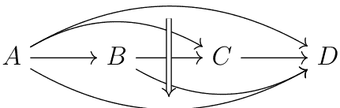

这个图表揭示了路径结构的弱性：结合性只是因为它在更高的类型中成立。通过这种更高的一致性，迭代的恒等类型被赋予了结构。

> 维度也被称为同伦级别。

## 5.2 映射保持结构

鉴于这种结构，自然会问映射是否保持群结构。回想一下 $\operatorname{ap}$ 保持恒等性。

### 定理 2
如果 $f: A \to B$ 和 $p: M =_A M'$，那么 $\operatorname{ap}_f(p) : fM =_B fM'$。

映射不仅保持恒等性，还保持整个群结构。证明这一点需要证明 $\operatorname{ap}$ 保持恒等性、逆和组合。也就是说，

### 定理 3
对于函数 $f: A \to B$ 和路径 $p: x =_A y$, $q: y =_A z$：

- 1. $\operatorname{ap}_f(\operatorname{refl}(x)) = \operatorname{refl}(f(x))$
- 2. $\operatorname{ap}_f(p^{-1}) = \operatorname{ap}_f(p)^{-1}$
- 3. $\operatorname{ap}_f(p \cdot q) = \operatorname{ap}_f(p) \cdot \operatorname{ap}_f(q)$

练习：证明映射保持函子性。正式证明将在这些笔记的下一次修订中包含。

## 5.3 同伦类型理论是否有计算解释?

在群结构证明的草图中，$p$ 的一般情况被简化为 $\operatorname{refl}$ 的情况。目前，这仅仅是通过一个范畴模型来证明的。这不是自然的或可取的，因为类型理论的区别特征在于其计算内容，由 Gentzen 的倒置原理所描述。基于模型的证明是不充分的，部分原因是它没有提供一种运行 HoTT 程序的方式。同伦类型理论的可构造性很重要，因为 Hedberg 的定理使得本节中发展的维度塔崩溃了。然而，确定同伦类型理论是否有计算解释是一个尚未解决的重要问题。

# 参考文献

- [1] Jan M. Smith, Bengt Nordström, Kent Petersson. 《Martin-Löf 类型理论中的编程》. http://www.cse.chalmers.se/research/group/logic/book/book.pdf, 1990年。
- [2] 高级研究院. 《同伦类型理论：一阶基础数学》. 一阶基础计划, 2013年. http://homotopytypetheory.org/book/
- [3] 迈克尔·赫德伯格. 马丁-洛夫类型理论的一致性定理. *J. Funct. Program.*, 8(4): 413-436, 1998年7月。
- [4] 佩尔·马丁-洛夫. 直觉类型理论. http://intuitionistic.files.wordpress.com/2010/07/martin-lof-tt.pdf, 1980年。
- [5] 简·M·史密斯. 在无类型理论中对马丁-洛夫类型理论的解释. *J. Symb. Log.*, 49(3): 730-753, 1984年。

# 15-819 同伦类型理论讲义

罗伯特 · 刘易斯 和 约瑟夫 · 塔萨罗蒂

2013年10月21日和23日

# 1 路径-覆盖-路径

回顾一下，上次我们探讨了类型的更高群结构，并且证明了对于非依赖映射，它保持了这种结构。现在，在我们有一个依赖函数 $f: \Pi x:A.B$ 的情况下，我们希望类似地陈述 $f$ 将等同映射到等同。这样给定一个路径 $p: \operatorname{Id}_A(M, N)$，存在某个映射，它接受 $p$ 并给出 $fM$ 和 $fN$ 之间的路径。然而，由于 $f$ 是依赖的，$fM : [M/x]B$ 和 $fN : [N/x]B$。尽管这些类型有关联，但它们并不相等，因此我们不能谈论 $fM$ 和 $fN$ 之间的命题等同。在早期的讲座中，我们定义了 $\operatorname{tr}[x.B] p : [M/x]B \to [N/x]B$，通常写作 $p_*$，它将路径 $p$ 提升为一个在纤维 $[M/x]B$ 和 $[N/x]B$ 之间的映射。

由于 $p_*(fM)$ 和 $fN$ 具有相同的类型，我们可以有意义地讨论它们之间的相等性。现在我们可以定义一个映射 $\operatorname{apd}_f: \Pi p:\operatorname{Id}_A(M, N).\operatorname{Id}_{[N/x]B}(p_*(fM), fN)$。定义如下：

```latex
\operatorname{apd}_f p := \mathrm{J}[\lambda m\,n\,z.\,\operatorname{Id}_{[n/x]B}(z_*(f m), f n)](p)(m)(\lambda m.\,\operatorname{refl}_{[m/x]B}(f m))
```

这具有适当的类型，因为当路径简单地为 $\operatorname{refl}_A(M)$ 时，我们有 $(\operatorname{refl}_A(M))_* \equiv \operatorname{refl}_{[M/x]B}(fM)$。参见图 1 以获得此的图示表示。

现在，由于 $p_*^{-1}$ 给出了一个在纤维之间反向的映射，我们可以同样地定义一个类似的项 $\operatorname{apd}_f': \operatorname{Id}_A(M, N) \to \operatorname{Id}_{[M/x]B}(fM, p_*^{-1}(fN))$。此外，我们有：

```latex
\begin{aligned}
& \operatorname{ap}_{p_*^{-1}}(\operatorname{apd}_f p) \quad: \quad \operatorname{Id}_{[M/x]B}(p_*^{-1}(p_*(f M)), p_*^{-1}(f N)) \\
& \qquad \equiv \operatorname{Id}_{[M/x]B}(f M, p_*^{-1}(f N)) \\
& \operatorname{ap}_{p_*}(\operatorname{apd}_f p^{-1}) \quad: \quad \operatorname{Id}_{[N/x]B}(p_*(f M), p_*(p_*^{-1}(f N))) \\
& \qquad \equiv \operatorname{Id}_{[N/x]B}(p_*(f M), f N)
\end{aligned}
```

这表明这两个定理互相蕴含。

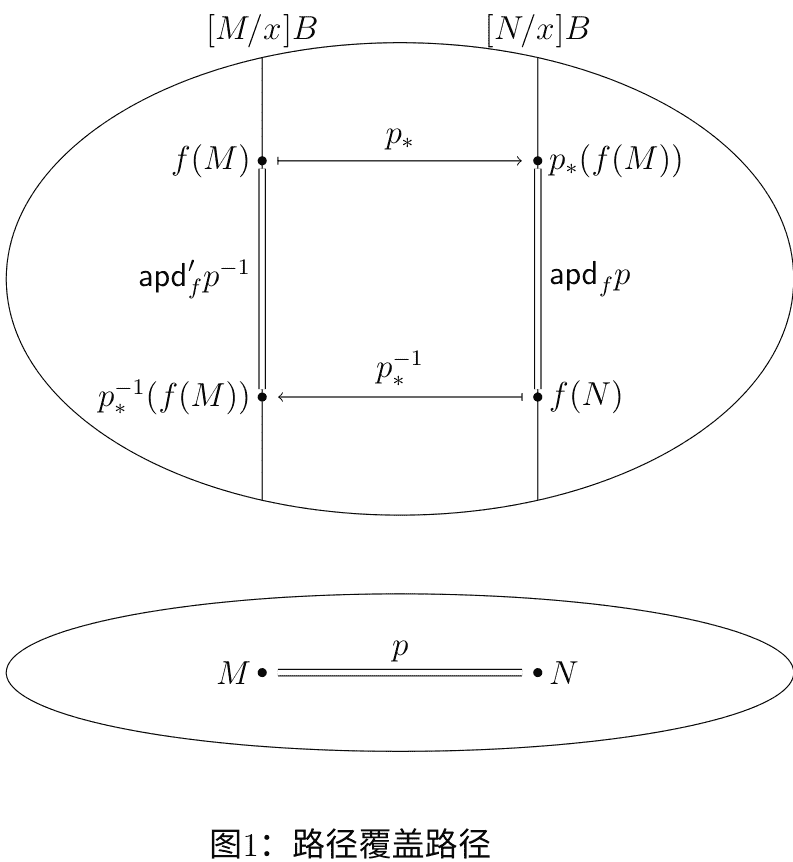

图 1：路径覆盖路径

当开发机器验证的证明时，$\operatorname{apd}_f$ 和 $\operatorname{apd}_f'$ 的类型缺乏对称性，有些尴尬。更方便的做法是定义一个对称的符号表示：$f(M) =^{x:B}_p f(N) := \operatorname{Id}_{[N/x]B}(fM, fN)$，我们将其读作“$f(M)$ 和 $f(N)$ 由 $p$ 相关联”。这对应于路径 $p$ 上的路径类型。使用这种表示法，我们可以证明关于这种类型的定理，例如：

```haskell
symcorr : Q =_P R → R =_P Q
transcorr: Q =_P R → R =_Q S → Q =_P S
```

# 2 类型的等价性

## 2.1 动机

我们首先非正式地回顾一些在数学中常用的等价性概念：

- 1. **双条件命题**：给定两个命题 $p$ 和 $q$，使得 $p \supset q$ 和 $q \supset p$，我们可能希望说 $p = q$，因为这两个命题在逻辑上等价。在经典逻辑中，这是有意义的，因为 $p$ 和 $q$ 都是真或假。引用怀特海德和罗素[3, p.115]的话：

> 当两个命题互相蕴含时，我们说它们是等价的，记作“$p \equiv q$”... 很明显，当且仅当两个命题都为真或都为假时，它们是等价的。...

我们将给一个真值函数的名字，这个函数 $f(p)$ 的参数是一个命题，其真值仅取决于其参数的真值。我们将特别关注的所有命题函数都是真值函数，即我们将有：
$$ p \equiv q \supset f(p) \equiv f(q) $$
这意味着对于怀特海德和罗素来说，如果 $p$ 和 $q$ 在逻辑上等价，则它们是无法区分的。然而，在类型理论的证明相关设置中，情况并非如此，因为这些类型对应特定的数据片段。虽然类型 $f: p \to q$ 和 $g: q \to p$ 给我们提供了将 $p$ 和 $q$ 的证明互相转换的方法，但是 $p$ 的证明本身并不能直接证明 $q$。此外，甚至不一定是 $f$ 和 $g$ 彼此的逆。

- 2. **同构集合**：在集合论中，如果存在一个双射，我们说两个集合 $A$ 和 $B$ 是同构的。也就是说，存在函数 $f: A \to B$ 和 $g: B \to A$ 使得 $g(f(a)) = a$ 和 $f(g(b)) = b$。在许多情况下，我们无需区分同构的集合。然而，在 ZF 集合论中，两个集合同构并不意味着它们是无法区分的，因此我们不能将它们视为相等。

这是一个更大的症状：尽管 ZF 集合论可以编码数学的结构，但它不支持抽象。像 $0 \in 1$ 这样的命题是完全合法的，对于大多数将自然数编码为集合的方式甚至是真实的。正如 de Bruijn 指出的[1]，这些特定编码的人为产物与我们在概念上思考数学的方式相矛盾。在我们的数学文化中，我们已经学会了将事物分开。如果我们有一个有理数和一个欧几里得平面上的点集，我们甚至无法想象形成交集的含义。这两者都可能已经用一个非常疯狂的编码方式编码在 ZF 中，以至于交集非空似乎是荒谬的…

在希尔伯特的几何公理化中，可以找到一个非常明确的类型思维案例。他首先假设存在某些被称为点的东西和某些被称为线的东西。关于这些事物的性质没有任何说明。类型理论排除了像 $0 \in 1$ 这样的不合法陈述。正如我们将看到的，这种抽象的能力使我们能够更适当地处理等价关系。

现在，我们转向类型的等价问题。根据我们对类型作为集合的直觉，我们可以说当且仅当它们之间存在双射时，类型是同构的。在 ITT 中，这对于对应于一阶数据的类型是有效的，但是在考虑函数时会遇到问题。更准确地说，要显示 $A \to B$ 与 $C \to D$ 同构，我们需要构造函数 $F: (A \to B) \to (C \to D)$ 和 $G: (C \to D) \to (A \to B)$，使得对于所有 $f: A \to B$ 和 $g: C \to D$，$G(F(f))=f$ 和 $F(G(g))=g$。在集合论的设置中，只需显示对于所有的 $x \in A$，$G(F(f))(x)=f(x)$，以及类似的对于 $F \circ G$。然而，在 ITT 中我们缺乏函数外延性，这还不够。我们需要显示 $G \circ F$ 将 $f$ 精确地映射回自身。有人可能尝试通过引入外延性公理或添加外延性的商集来解决这个问题。

然而，当考虑到宇宙时，问题变得更加困难。我们需要证明对于宇宙中的每个类型 $A$，有 $G(F(A))=A$。就像函数一样，我们真正感兴趣的是要证明 $G \circ F$ 将一个函数映射到一个在外延上等价的东西，这里我们希望 $G(F(A))$ 本身与 $A$ 不同构。

## 2.2 同伦等价

我们现在引入同伦的概念。给定两个函数 $f, g: A \to B$，从 $f$ 到 $g$ 的同伦是一个类型为 $\Pi x:A.\operatorname{Id}_B(fx, gx)$ 的项。我们引入记号 $f \sim_{A \to B} g$ 表示从 $f$ 到 $g$ 的同伦类型。如果这个类型有元素，我们说 $f$ “同伦于” $g$。

现在，给定 $H: f \sim_{A \to B} g$，我们有对于所有 $x:A, fx =_B gx$。但实际上还有更多的事情发生：$H$ 在 $x:A$ 中是依赖函数的。也就是说，$H$ 尊重 $A$ 和 $B$ 中元素之间的路径。这个性质也被称为自然性；我们可以说 $H$ 是 $x:A$ 中的一种多态性。这意味着以下图表是可交换的：

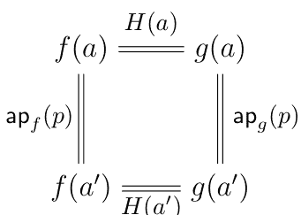

这段文字的一部分在[2]中引用，其中包含了关于类型和集合的一些有趣讨论的优缺点。

## 2.3 等价的基本性质

对于函数 $f: A \to B$，我们通过定义 $A$ 和 $B$ 之间的等价来定义一个等价。

$$ \operatorname{isEquiv}(f) := (\Sigma (g: B \to A).\, f \circ g \sim \operatorname{id}_B) \times (\Sigma (h: B \to A).\, h \circ f \sim \operatorname{id}_A) $$

表达两个类型 $A$ 和 $B$ 等价的命题，写作 $A \simeq B$，即：

$$ A \simeq B := \Sigma (f: A \to B).\, \operatorname{isEquiv}(f) $$

由于我们处于一个证明相关的环境中，$A \simeq B$ 的信息包括五个部分：

- 一个函数 $f: A \to B$
- 一个函数 $g: B \to A$
- 一个证明 $\alpha: \Pi y:B.\, f(g(y)) =_B y$
- 一个函数 $h: B \to A$
- 一个证明 $\beta: \Pi x:A.\, h(f(x)) =_A x$

为了证明 $A \simeq B$，我们需要提供所有这些作为证据，并且从证据中，我们可以提取所有这些。

我们还对准逆的概念感兴趣：

$$ \operatorname{qinv}(f) := \Sigma (g: B \to A).\, (f \circ g \sim \operatorname{id}_B) \times (g \circ f \sim \operatorname{id}_A) $$

正如人们所希望的那样，等价和准逆的概念非常密切相关。我们可以证明以下性质：

1. 对于每个 $f: A \to B$，存在一个函数 $\operatorname{qinv}(f) \to \operatorname{isEquiv}(f)$。
2. 对于每个 $f: A \to B$，存在一个函数 $\operatorname{isEquiv}(f) \to \operatorname{qinv}(f)$。

这意味着这两个概念在逻辑上是等价的：一个函数是一个等价关系，当且仅当它有一个准逆。此外，我们可以证明 $\operatorname{isEquiv}(f)$ 表达了一个 HProp：也就是说，高阶同伦上，只有一个关于这个事实的证明。这将在后面变得重要。

## 2.4 函数外延性

函数外延性公理允许我们展示 $(f =_{A \to B} g) \simeq (f \sim_{A \to B} g)$。即使没有这个公理，我们仍然可以定义这个映射：

```haskell
happly : f =_{A→B} g → f ~_{A→B} g
```

现在，这个公理说上述映射是一个等价关系：如果我们有一个证明 $f \sim_{A \to B} g$，我们可以假设我们有一个证明 $f =_{A \to B} g$。没有这个公理的情况下，这是不可证明的。例如，在自然数类型中，$\lambda x.0 + x \sim_{\mathbb{N} \to \mathbb{N}} \lambda x.x$，但是由于加法在第二个参数上归纳定义，我们无法找到它们之间的路径。

## 2.5 练习

以下命题作为练习留下，第一个命题是为了解释的目的而开始的：

- 1. 证明 $\operatorname{id}_A: A \to A$ 是一个等价关系。
  为了证明这一点，我们需要四个信息：
  (a) $g: A \to A$。将其取为 $\operatorname{id}_A$。
  (b) 证明 $\alpha: \Pi y:A.\, \operatorname{id}_A(g(y)) =_A y$。将其取为 $\operatorname{id}_A$。
  (c) 证明 $h: B \to A$（此处应为 $A \to A$）。将其取为 $\operatorname{id}_A$。
  (d) 证明 $\beta: \Pi x:A.\, h(\operatorname{id}_A(x)) =_A x$。将其取为 $\operatorname{id}_A$。
- 2. 如果 $f: A \to B$ 是一个等价关系，则存在 $f^{-1}: B \to A$（由 $f$ 的准逆给出），它也是一个等价关系。
- 3. 如果 $f: A \to B$ 和 $g: B \to C$ 是等价的，那么 $g \circ f: A \to C$ 也是等价的。

# 3 类型中路径的结构

我们想要研究某些类型中的路径。对于负类型，这将会相对简单。对于正类型，这将会更加困难。在正类型中有许多未解决的问题。

## 3.1 乘积类型

我们首先研究 $\mathrm{Id}_{A \times B}(-, -)$ 中的路径。

存在一个函数 $f$ 使得
$$f : \mathrm{Id}_{A \times B}(x, y) \rightarrow (\mathrm{Id}_A(\pi_1 x, \pi_1 y) \times \mathrm{Id}_B(\pi_2 x, \pi_2 y)).$$

具体来说，
$$f := \lambda p.\langle \mathrm{ap}_{\pi_1}(p), \mathrm{ap}_{\pi_2}(p)\rangle.$$

大致来说，如果 $x =_{A \times B} y$，那么 $\pi_1 x =_A \pi_1 y$ 且 $\pi_2 x =_B \pi_2 y$。

**命题。** $f$ 是一个等价关系：$\mathrm{Id}_{A \times B}(x, y) \simeq \mathrm{Id}_A(\pi_1 x, \pi_1 y) \times \mathrm{Id}_B(\pi_2 x, \pi_2 y)$。

**证明。** 如第2节所述，我们只需为 $f$ 产生一个准逆。我们需要构造三个对象：
- $g : (\mathrm{Id}_A(\pi_1 x, \pi_1 y) \times \mathrm{Id}_B(\pi_2 x, \pi_2 y)) \rightarrow \mathrm{Id}_{A \times B}(x, y)$
- $\alpha : g(f(p)) =_{\mathrm{Id}_{A \times B}(x, y)} p$
- $\beta : f(g(q)) =_{\mathrm{Id}_A(\pi_1 x, \pi_1 y) \times \mathrm{Id}_B(\pi_2 x, \pi_2 y)} q$

我们按如下方式构造这些对象：

1. 我们定义两个辅助函数
$$\text{pair} := \lambda x \lambda y \langle x, y \rangle : A \rightarrow B \rightarrow A \times B$$
和
$$\mathrm{ap2\_f} : \mathrm{Id}(x, x') \rightarrow \mathrm{Id}(y, y') \rightarrow \mathrm{Id}(f x y, f x' y')$$
利用这些，我们可以定义
$$g := \lambda \langle p, q \rangle . \mathrm{ap2\_pair} \ p \ q$$

2. 为了定义 $\alpha$，我们只需（通过 FUNEXT）展示：
- $\eta : \Pi p (\mathrm{ap2\_pair}(\mathrm{ap}_{\pi_1}(p), \mathrm{ap}_{\pi_2}(p)) = p)$
- $\beta_1 : \Pi p \Pi q (\mathrm{ap}_{\pi_1}(\mathrm{ap}_2(p, q)) = \text{refl})$
- $\beta_2 : \Pi p \Pi q (\mathrm{ap}_{\pi_2}(\mathrm{ap}_2(p, q)) = \text{refl})$

通过路径归纳，我们需要找到 $R$ 使得
$$x : A \times B \vdash R : \langle \pi_1(\text{refl}(x)), \pi_2(\text{refl}(x)) \rangle = \text{refl}(x)$$
然后，
$$\eta := \mathrm{J}[\_](p; x.R).$$

根据我们之前对 $\mathrm{ap}_2$ 的定义，我们有
$$
\begin{aligned}
\mathrm{ap}_{\pi_1}(\text{refl}(x)) &\equiv \text{refl}(\pi_1(x)) \\
\mathrm{ap}_{\pi_2}(\text{refl}(x)) &\equiv \text{refl}(\pi_2(x)) \\
\text{从这些中，} \quad \mathrm{ap2\_on}(\text{refl}(\pi_1(x)))(\text{refl}(\pi_2(x))) &\equiv \text{refl}\langle \pi_1(x), \pi_2(x) \rangle \equiv \text{refl}(x)
\end{aligned}
$$
- 3. 构造 $\beta_1$ 和 $\beta_2$ 是相似的，并留作练习。

## 3.2 余积类型

类似地，我们可以研究 $\mathrm{Id}_{A+B}(x, y)$。直观地说，我们希望说在空间 $A+B$ 中的任何路径要么是 $A$ 中的路径，要么是 $B$ 中的路径；我们永远不会期望在 $\text{inl}(a)$ 和 $\text{inr}(b)$ 之间有一条路径。
我们希望证明以下事实：
$$
\begin{aligned}
\mathrm{Id}_{A+B}(\text{inl}(a), \text{inl}(a')) &\simeq \mathrm{Id}_A(a, a') \\
\mathrm{Id}_{A+B}(\text{inr}(b), \text{inr}(b')) &\simeq \mathrm{Id}_B(b, b') \\
\mathrm{Id}_{A+B}(\text{inl}(a), \text{inr}(b)) &\simeq 0 \\
\mathrm{Id}_{A+B}(\text{inr}(a), \text{inl}(b)) &\simeq 0
\end{aligned}
$$
证明这需要一点技巧。
假设我们只想证明第一个等价关系。从右到左的方向很简单。对于从左到右的方向，我们需要展示
$$p : \mathrm{Id}_{A+B}(\text{inl}(a), \text{inl}(a')) \vdash R : \mathrm{Id}_A(a, a').$$
$R$ 必须是一个关于 $p$ 的路径归纳，形式为 $R = \mathrm{J}[C](p, \cdot)$，其中 $C$ 是某个动机。这个路径归纳的结论将是 $C(\text{inl}(a), \text{inl}(a'), p)$ 的形式。但是我们需要的是 $\mathrm{Id}_A(a, a')$（注意没有 $\text{inl}$）。有人可能尝试定义类似 $D(u, v) = \mathrm{Id}_A(\text{outl}(u), \text{outl}(v))$ 的东西，但这是不可能的，因为 $\text{outl}$ 不能是一个全函数。

> 这是一个引人注目的反模块化的例子。没有理由期望这个等式在定义上成立；它主要取决于 $\mathrm{ap}$ 的定义方式，而不仅仅取决于它的类型。如果能够避免这种代码对代码的依赖，那将是很好的，因为“证明不应该知道计算的细节。”

因此，这种方法不起作用。相反，我们必须采取不同的方法。
我们将找到一个动机 $F: (A+B) \times (A+B) \rightarrow \mathcal{U}$，使得：
$$
\begin{aligned}
F(\operatorname{inl}(a), \operatorname{inl}(a')) &\equiv \operatorname{Id}_A(a, a') \\
F(\operatorname{inr}(b), \operatorname{inr}(b')) &\equiv \operatorname{Id}_B(b, b') \\
F(\operatorname{inl}(a), \operatorname{inr}(b)) &\equiv 0 \\
F(\operatorname{inr}(a), \operatorname{inl}(b)) &\equiv 0
\end{aligned}
$$
这样的 $F$ 表达了所有所需的性质。
练习。通过“双重归纳”来定义这样的 $F$。

以下引理表达了我们的路径归纳的子目标，其动机为 $F$：
**引理。** $x: A+B \vdash \_ F(x, x)$。

**证明。** 我们对此的证明将是一个 case 语句：
$$\mathsf{case}[z. F(z, z)](x; m:A.\operatorname{refl}_A(m), n:B.\operatorname{refl}_B(n)) : F(x, x)$$
注意 $\operatorname{refl}_A(m): [\operatorname{inl}(m) / z] F(z, z)$，因为 $\mathrm{Id}_{A+B}(m, n) \equiv F(\operatorname{inl}(m), \operatorname{inl}(m)) \equiv [\operatorname{inl}(m) / z] F(z, z)$。

为了完成证明，我们必须定义一个类型为 $\Pi x: A+B \Pi x': A+B(\mathrm{Id}_{A+B}(x, y) \rightarrow F(x, x'))$ 的东西。这是我们下次的任务！

# 15-819 同伦类型理论讲义
Joseph Lee 和 Kristina Sojakova
2013年10月28日和30日

# 1 余积的路径空间
回顾上周，我们打算通过展示来表征余积中的路径
$$\prod_{x:A+B} \prod_{x':A+B} \mathrm{Id}_{A+B}(x, x') \simeq F(x, x')$$
其中 $F: (A+B) \times (A+B) \rightarrow \mathcal{U}$ 由嵌套的情况分析定义，使得
$$F(\text{inl}(a), \text{inl}(a')) \equiv \mathrm{Id}_A(a, a')$$
$$F(\text{inr}(a), \text{inr}(a')) \equiv \mathrm{Id}_B(b, b')$$
$$F(\text{inl}(a), \text{inr}(b)) \equiv 0$$
$$F(\text{inr}(a), \text{inl}(b)) \equiv 0$$
为此，我们定义一个函数
$$f : \prod_{x:A+B} \prod_{x':A+B} \mathrm{Id}_{A+B}(x, x') \rightarrow F(x, x')$$
通过
$$f := \lambda x. \lambda x'. \lambda p. \mathrm{J}[F](p; z. \mathsf{case}(z; a.\operatorname{refl}_A(a); b.\operatorname{refl}_B(b)))$$
接下来我们需要定义一个函数
$$g : \prod_{x:A+B} \prod_{x':A+B} F(x, x') \rightarrow \mathrm{Id}_{A+B}(x, x')$$
使得 $g(x, x')$ 是 $f(x, x')$ 的准逆。我们定义
$$g := \lambda x. \lambda x'. \mathsf{case}(x; a. \mathsf{case}(x'; a'. \lambda z : F(\text{inl}(a), \text{inl}(a')). \mathrm{ap}_{\text{inl}}(z); b'. \lambda z : F(\text{inl}(a), \text{inr}(b')). \mathsf{abort}_{(z)}); b. \mathsf{case}(x'; a'. \lambda z : F(\text{inr}(b), \text{inl}(a')). \mathsf{abort}_{(z)}; b'. \lambda z : F(\text{inr}(b), \text{inr}(b')). \mathrm{ap}_{\text{inr}}(z)))$$
然后我们需要展示术语
$$\alpha : \prod_{x:A+B} \prod_{x':A+B} \prod_{u:F(x, x')} f(g(u)) =_{F(x, x')} u$$
$$\beta : \prod_{x:A+B} \prod_{x':A+B} \prod_{v:\mathrm{Id}_{A+B}(x, x')} g(f(v)) =_{\mathrm{Id}_{A+B}(x, x')} v$$
这些术语作为家庭作业留下来。

练习。描述空类型 $0$ 的路径空间。

# 2 同一性类型的路径空间
对于给定的类型 $A$，我们想要描述类型 $\mathrm{Id}_A(-, -)$、$\mathrm{Id}_{\mathrm{Id}_A(-, -)}(-, -)$ 等以此类推。虽然对于某些特定类型如 $0, 1, A \times B, A \rightarrow B, A+B$ 和 $\mathrm{Nat}$，这是可能的，但对于其他类型，甚至看似简单的类型，这可能非常困难。例如，确定 $n$-球的回路空间（即以单个点为基点的路径空间，表示为 $\Omega(S^n)$）是代数拓扑学中一个著名的开放问题。

然而，我们可以说的是，如果两个类型是等价的，那么它们的路径空间也是等价的：
**引理。** 如果 $f: A \rightarrow B$ 是一个等价映射，那么 $\mathrm{ap}_f: \mathrm{Id}_A(a, a') \rightarrow \mathrm{Id}_B(f(a), f(a'))$ 也是一个等价映射。

**证明。** 因为 $f$ 是一个等价映射，它有一个准逆映射 $f^{-1}: B \rightarrow A$，我们有以下的一致性：
- $\alpha : \prod_{a:A} f^{-1}(f(a)) =_A a$
- $\beta : \prod_{b:B} f(f^{-1}(b)) =_B b$

为了证明 $\mathrm{ap}_f$ 是一个等价映射，我们只需要给出一个准逆映射 $\mathrm{ap}_f^{-1}: \mathrm{Id}_B(f(a), f(a')) \rightarrow \mathrm{Id}_A(a, a')$，我们通过以下方式定义：
$$\mathrm{ap}_f^{-1}(q) := \alpha(a)^{-1} \cdot \mathrm{ap}_{f^{-1}}(q) \cdot \alpha(a')$$
我们现在需要构造一致性
$\gamma : \prod_{p: \mathrm{Id}_A(a, a')} \mathrm{ap}_f^{-1}(\mathrm{ap}_f(p)) =_{\mathrm{Id}_A(a, a')} p$
$\delta : \prod_{q: \mathrm{Id}_B(f(a), f(a'))} \mathrm{ap}_f(\mathrm{ap}_f^{-1}(q)) =_{\mathrm{Id}_B(f(a), f(a'))} q$
这将意味着 $\mathrm{ap}_f^{-1}$ 确实是 $\mathrm{ap}_f$ 的一个准逆映射，因此两者都是等价映射。我们将这些作为练习留给读者。

练习。通过路径归纳，定义上述证明中的一致性 $\gamma$。
练习。通过以下方式定义上述证明中的一致性 $\delta$：
- 1. 使用 $\beta$ 的自然性来展示 $\beta(f(a))^{-1} \cdot \mathrm{ap}_f(\mathrm{ap}_{f^{-1}}(q)) \cdot \beta(f(a')) =_{\mathrm{Id}_B(f(a), f(a'))} q$
- 2. 使用 $\alpha$ 的自然性来展示 $\alpha(f^{-1}(f(a)))^{-1} \cdot \mathrm{ap}_{f^{-1}}(\mathrm{ap}_f(\mathrm{ap}_{f^{-1}}(q))) \cdot \alpha(f^{-1}(f(a'))) =_{\mathrm{Id}_A(f^{-1}(f(a)), f^{-1}(f(a')))} \mathrm{ap}_{f^{-1}}(q)$
- 3. 使用 $\alpha$ 的自然性来展示 $\alpha(f^{-1}(f(a))) = \mathrm{Id}_A((f^{-1}(f(f^{-1}(f(a))))), f^{-1}(f(a))) \cdot \mathrm{ap}_{f^{-1}}(\mathrm{ap}_f(\alpha(a)))$
类似地，对于 $a'$ 也是如此。
- 4. 使用 1)、2)、3) 和 $\beta$ 的自然性来得出所需的结论 $\mathrm{ap}_f(\alpha(a)^{-1} \cdot \mathrm{ap}_{f^{-1}}(q) \cdot \alpha(a')) =_{\mathrm{Id}_B(f(a), f(a'))} q$

# 3 身份的传输属性
类型 $A$ 上的身份类型族可以被看作是一个函数 $\mathrm{Id}_A(-, -): A \rightarrow A \rightarrow \mathcal{U}$。保持第一个参数 $x: A$ 固定，得到一个类型族 $\mathrm{Id}_A(x, -): A \rightarrow \mathcal{U}$。对于任意路径 $q: y =_A y'$，纤维 $\mathrm{Id}_A(x, y)$ 和 $\mathrm{Id}_A(x, y')$ 通过传输函数相关。
$$\operatorname{tr}[z \cdot \mathrm{Id}_A(x, z)](q) : \mathrm{Id}_A(x, y) \rightarrow \mathrm{Id}_A(x, y')$$
我们能否给出这个函数的明确描述？显然，我们可以通过手动方式构造一个所需类型的函数，即通过取一个 $p: x =_A y$ 并将其与 $q$ 连接起来得到 $p \cdot q: x =_A y'$。幸运的是，事实证明这恰好描述了传输函数的行为，除了命题等式之外：
**引理。** 对于任意项 $x: A$ 和路径 $q: y =_A y'$ 以及路径 $p: x =_A y$，我们有 $\operatorname{tr}[z \cdot \mathrm{Id}_A(x, z)](q)(p) =_{\mathrm{Id}_A(x, y')} p \cdot q$。

当第二个参数固定时，我们对传输也有类似的描述：
**引理。** 对于任意项 $y: A$ 和路径 $q: x =_A x'$ 以及路径 $p: x =_A y$，我们有 $\operatorname{tr}[z \cdot \mathrm{Id}_A(z, y)](q)(p) =_{\mathrm{Id}_A(x', y)} q^{-1} \cdot p$。

我们注意到，在第一种情况下，我们直接使用路径 $q$，而在第二种情况下，我们首先需要将其反转。这可以用范畴论术语来描述，即类型族 $\mathrm{Id}_A$ 在第二个参数上是协变的，在第一个参数上是逆变的。

最后，我们可以考虑基点允许变化的回路情况：
**引理。** 对于任意路径 $q: x =_A y$，$p: x =_A x$，我们有 $\operatorname{tr}[z \cdot \mathrm{Id}_A(z, z)](q)(p) =_{\mathrm{Id}_A(y, y)} q^{-1} \cdot p \cdot q$。

所有这些引理都可以通过直接路径归纳得出。

# 4 证明恒等消去规则

回顾恒等消去规则：

$$
\begin{gathered}
\Gamma \vdash P: \mathrm{Id}_{A}(M, N) \quad \Gamma, x: A, y: A, z: \operatorname{Id}_{A}(x, y) \vdash C \mathrm{type} \quad \Gamma, x: A \vdash Q: [x, x, \operatorname{refl}_{A}(x) / x, y, z] C \\
\Gamma \vdash \mathrm{J}[x . y . z . C](P, x . Q): [M, N, P / x, y, z] C
\end{gathered}
$$

在外延类型理论（ETT）中，这个规则是恒等反射和UIP规则的结果，因此没有特殊的地位。

在内涵类型理论（ITT）中，这个规则可以理解为归纳原理：由于我们只能通过自反性来构造等式证明 $P: M =_A N$，所以为了证明 $C[M, N, P]$，只需证明对任意的 $x: A$，$C[x, x, \operatorname{refl}_A(x)]$ 成立。这个直觉被以下非常重要（且高度非平凡）的定理所证明：

**定理 1.** 在空上下文中，两个术语在命题上相等当且仅当它们在定义上相等，且任何等式证明必然是自反的。换句话说，如果 $\vdash P: \mathrm{Id}_A(M, N)$，那么 $\vdash M \equiv N: A$ 且 $\vdash P \equiv \operatorname{refl}_A(M, M): \mathrm{Id}_A(M, N)$。

在同伦类型理论中，不再是每个等式的证明都是自反的。例如，我们有以下非平凡的恒等证明：
- $\operatorname{funext}(H) : f =_{A \to B} g$，其中 $H : \prod_{a:A} f(a) =_B g(a)$
- $\operatorname{ua}(E) : A =_U B$，其中 $E : \sum_{f: A \to B} \operatorname{isequiv}(f)$
- $\operatorname{seq} : 0 =_{\mathbb{I}} 1$，其中 $\mathbb{I}$ 是区间类型
- $\operatorname{loop} : b =_{S^1} b$，其中 $S^1$ 是圆类型

这表明在同伦类型理论中，恒等类型的项不应该仅仅被看作是恒等的证明，而应该被看作是项之间的路径。由于两个项之间可能存在多个不同的路径，恒等消去规则不再被看作是归纳原理。

然而，非平凡路径的存在对于 HoTT 的计算解释提出了一个严重的问题：例如，$\mathrm{J}[\dots](\operatorname{funext}(H); x.Q)$，$\mathrm{J}[\dots](\operatorname{ua}(E))$ 或 $\mathrm{J}[\dots](\operatorname{seq})$ 应该计算为什么？

即使不考虑同伦等价和高阶归纳类型，将函数外延公理添加到 ITT 中也会导致计算问题。在 ETT 中，我们可以从恒等反射规则中免费获得函数外延性。在观察型理论（OTT）中，它结合了内涵和外延的特点，我们可以通过一些特殊安排获得函数外延性。ETT 和 OTT 都可以通过不同的方式进行计算解释。

HoTT 的计算解释目前是一个主要的未解决问题。
那么，我们如何将 J 规则作为适当的恒等消去规则进行证明？给定

$C: \prod_{x: A} \prod_{y: A}, \mathrm{Id}_{A}(x, y) \rightarrow \mathcal{U}$

$M, N: A$ 和 $P: M =_A N$

$x: A \vdash Q: C[x, x, \operatorname{refl}_{A}(x)]$

为什么应该存在一个术语 $\mathrm{J}[x . y . z . C](P ; x . Q): C[M, N, P]$？

将 $M$ 插入 $Q$，我们得到一个术语 $Q[M]: C[M, M, \operatorname{refl}_{A}(M)]$。类似地，将 $M$ 插入 $C$ 会产生一个类型族 $C[M]: \prod_{y: A}(p: M=_{A} y) \rightarrow \mathcal{U}$，这可以等价地理解为函数：
```
$\lambda z . C\left[M, \pi_{1}(z), \pi_{2}(z)\right]:\left(\sum_{y: A} \operatorname{Id}_{A}(M, y)\right) \rightarrow \mathcal{U}$
```
由于函数应该是函子性的，我们可以在类型 $\Sigma$ 中构造一条路径 $\gamma$ 从 $(M, \operatorname{refl}_{A}(M))$ 到 $(N, P)$，将给我们一个术语：
```
$\mathbf{a p}_{\lambda z . C\left[M, \pi_{1}(z), \pi_{2}(z)\right]}(\gamma): C[M, M, \operatorname{refl}_{A}(M)]=_{\mathcal{U}} C[M, N, P]$
```
因此，我们可以得到我们所需的 J 规则的结论：
```
$\operatorname{tr}[x: \mathcal{U} . x]\left(\operatorname{ap}_{\lambda z . C\left[M, \pi_{1}(z), \pi_{2}(z)\right]}(\gamma)\right)(Q[M]): C[M, N, P]$
```
为了构造一个路径 $\gamma:\left(M, \operatorname{refl}_{A}(M)\right)=\sum_{y: A \mathbf{I d}_{A}(M, y)}(N, P)$，我们需要一个特征化 $\Sigma$ 类型的路径空间，以下练习中概述了这一点：

**练习。** 通过构造一个类型为...的术语，来描述类型 $\sum_{x: A} B$ 的路径空间：
```
$\prod_{p, p^{\prime}: \sum_{x: A} B(x)}\left(\operatorname{Id}_{\sum_{x: A} B(x)}\left(p, p^{\prime}\right) \simeq \sum_{q: \pi_{1}\left(p\right)={ }_{A} \pi_{1}\left(p^{\prime}\right)} \pi_{2}(p)={ }_{q}^{x, B} \pi_{2}\left(p^{\prime}\right)\right)$
```
上述练习告诉我们，为了在类型 $\sum$ 中构造从 $(M, \operatorname{refl}_{A}(M))$ 到 $(N, P)$ 的路径，我们需要 $M=_{A} N$，构造一个类型的元素就足够了：
$\sum_{q: M=_A N} \operatorname{refl}_{A}(M)=_{q}^{y, M=_{A} y} P$。对于配对的第一个分量，自然的选择是路径 $P: M =_A N$ 本身。因此，我们需要证明 $\operatorname{refl}_{A}(M)=^{y . M=_{A} y} P$。特别地，这意味着需要证明：
```
$\operatorname{tr}[y . M=_{A} y](P)\left(\operatorname{refl}_{A}(M)\right)=\mathrm{Id}_{A(M, N)} P$
```
根据第三节的第一个引理，我们有 $\operatorname{tr}[y . M =_{A} y](P)\left(\operatorname{refl}_{A}(M)\right)=\mathrm{Id}_{A(M, N)} P$。由于左边的表达式求值为 $P$，我们完成了。

# 5 引言同伦类型

理解 HoTT 的一种方式是将同伦类型理论视为一种类型理论。也就是说，HoTT 可以被看作是同伦类型的理论。我们已经遇到了几个同伦类型集合的例子，有时也被称为 h-set 或 0-type；但是，我们没有明确地标记它们。我们有以下定义：

**定义。** 如果对于所有的 $x, y: A$ 和 $p, q: x =_A y$，我们有 $p = q$，则类型 $A$ 被称为集合（或 0-type）。换句话说，以下类型是有元素的：
$$
\begin{aligned}
& \operatorname{isSet}(A) \equiv \prod_{x, y: A} \prod_{p, q: \mathrm{Id}_{A}(x, y)} p=\mathrm{Id}_{A(x, y)} q
\end{aligned}
$$
直观地，类型 A 可以被视为“同伦上离散的”。熟悉的自然数类型 $\mathbb{N}$（不出所料）被证明是一个集合。下周将更多地讨论这个和其他同伦类型！

# 1 目录

这些笔记涵盖了 Robert Harper 关于同伦类型理论的讲座，时间是 2013 年 11 月 4 日和 6 日。讨论包括区间类型和经典同伦理论，某些类型的分类为集合，证明的不相关性，以及经典逻辑嵌入到构造性逻辑中。

## 2 区间

### 定义

同伦类型理论通过添加新路径充分利用了 ITT 的恒等类型的潜在 $\infty$-群结构。我们添加路径的一种方式是通过等价公理，它在类型之间引入新的路径。我们还可以直接假设存在具有更高路径结构的类型。

我们最终将发展出关于这些高阶归纳类型的一般理论。
目前，我们考虑一个简单的例子，即区间类型。

区间 $I$ 通过两个传统构造器 $0_I$ 和 $1_I$ 进行归纳定义。我们将其视为一个连续区间的两个端点，类似于经典分析中的区间 $[0,1]$。仅有这些点，区间与类型 $\mathbf{2}$ 没有区别。为了完成定义，我们还定义了连接两个端点的路径 $\mathrm{seg}$。
因此，我们有以下引入规则：

$$
\frac{}{\Gamma \vdash 0_I : I} \text{ I-I-0} \quad \quad 
\frac{}{\Gamma \vdash 1_I : I} \text{ I-I-1} \quad \quad 
\frac{}{\Gamma \vdash \mathrm{seg} : \mathrm{Id}_I(0_I, 1_I)} \text{ I-I-seg}
$$

为了找到这种类型的正确消除规则，我们提出了与定义余积时相同的问题：我们如何从这种类型中映射出来？对于任何类型 $A$，映射 $f: \Pi_{z:I} A$ 的形式是什么？为了简单起见，让我们首先考虑如何定义一个映射 $f: I \rightarrow A$。我们期望递归器的形式为 $\Gamma \vdash M: A \ \Gamma \vdash N: A$？

$$
\frac{\Gamma, x: I \vdash \mathbf{rec}_I[\_ .A](x; M; N; ?): A}{\text{带有计算规则}}
$$

带有计算规则：
$$
\begin{array}{rlr}
\operatorname{rec}_{I}[\ldots A]\left(0_{I} ; M ; N ; ?\right) & \equiv & M \\ 
\operatorname{rec}_{I}[\ldots A]\left(1_{I} ; M ; N ; ?\right) & \equiv & N
\end{array}
$$

到目前为止，这只是 $\mathbf{2}$ 的递归器。为了看到我们需要什么额外的信息，注意到对于任何映射 $f: I \rightarrow A$，我们有 $\mathrm{ap}_f(\mathrm{seg}): \mathrm{Id}_A(f(0_I), f(1_I))$。$f(0_I)$ 和 $f(1_I)$ 必须以某种方式相关联。换句话说，我们需要指定 $f$ 在路径 $\mathrm{seg}$ 上的作用方式。因此，完整的（非依赖）递归器的形式为

$$
\frac{\Gamma \vdash M: A \quad \Gamma \vdash N: A \quad \Gamma \vdash P: \mathrm{Id}_A(M, N)}{\Gamma, x: I \vdash \mathbf{rec}_I[\_ .A](x ; M ; N ; P): A}
$$

带有计算规则：
$$
\begin{array}{rlr}
{\operatorname{rec}_{I}[\ldots A]\left(0_{I} ; M ; N ; P\right)} & {\equiv} & {M} \\ 
{\operatorname{rec}_{I}[\ldots A]\left(1_{I} ; M ; N ; P\right)} & {\equiv} & {N} \\ 
{\mathrm{ap}_{\operatorname{rec}_{I}[\ldots A]\left(0_{I} ; M ; N ; P\right)}(\mathrm{seg})} & {\equiv} & {P}
\end{array}
$$

对于一个依赖函数 $f: \Pi_{z:I} A$，值 $f(0_I)$ 和 $f(1_I)$ 可能具有不同的类型。在这里，我们有 $\operatorname{apd}_f(\mathrm{seg}): 0_I =^{z. A}_{\mathrm{seg}} 1_I$，所以依赖消除器的形式为

$$
\frac{\Gamma \vdash M: A \quad \Gamma \vdash N: A \quad \Gamma \vdash P: 0_{I} =_{\text {seg }}^{z . A} 1_{I}}{\Gamma, x: I \vdash \operatorname{rec}_{I}[z . A](x ; M ; N ; P): A[x / z]}
$$

### 带有计算规则

$$
\begin{aligned}
& \operatorname{rec}_{I}[z . A]\left(0_{I} ; M ; N ; P\right) \quad \equiv \quad M \\ 
& \operatorname{rec}_{I}[z . A]\left(1_{I} ; M ; N ; P\right) \quad \equiv \quad N \\ 
& \operatorname{apd}_{\operatorname{rec}_{I}[z . A]\left(0_{I} ; M ; N ; P\right)}(\mathrm{seg}) \quad \equiv \quad P
\end{aligned}
$$

我们应该问自己的一个问题是，最后这个计算规则是否应该是定义性的。假设一个涉及内部定义函数的定义性等式，是非常不自然的。另一方面，添加新的命题会破坏理论的计算解释。目前为止，我们对这个问题还没有令人满意的答案。我们将使用定义性等式；HoTT 书使用命题等式。Coq 和 Agda 中的形式化开发都使用命题等式，但这在很大程度上是技术限制的产物：在这些语言中无法添加定义性等式的公理。

### 用区间描述路径

在经典同伦理论中，空间 $A$ 中的路径被定义为连续映射 $f: I \rightarrow A$，其中 $I$ 是区间 $[0,1]$。$f(0)$ 是路径的左端点，$f(1)$ 是右端点，函数提供了从一个端点连续旅行到另一个端点的方式。在同伦类型理论中，路径是一个原始概念，但我们可以证明它与经典定义等价。对于任意类型 $A$，路径空间 $\sum_{x: A} . \sum_{y: A} . \mathrm{Id}_{A}(x, y)$ 等于 $I \rightarrow A$，如下等价关系所示：

$$
\begin{gathered}
f:\left(\sum_{x: A} . \sum_{y: A} . \mathrm{Id}_{A}(x, y)\right) \rightarrow(I \rightarrow A) \\
f\langle x,\langle y, p\rangle\rangle:=\lambda z . \operatorname{rec}_{I}[\_. A](z ; x ; y ; p) \\
g:(I \rightarrow A) \rightarrow\left(\sum_{x: A} . \sum_{y: A} . \operatorname{Id}_{A}(x, y)\right) \\
g h:=\left\langle h\left(0_{I}\right),\left\langle h\left(1_{I}\right), \mathrm{ap}_{h}(\mathrm{seg})\right\rangle\right\rangle \\
\alpha: \Pi s:\left(\sum_{x: A} . \sum_{y: A} . \operatorname{Id}_{A}(x, y)\right) . f(g(s))=s \\
\alpha s:=\operatorname{refl}_{\sum_{x: A} . \sum_{y: A} . \operatorname{Id}_{A}(x, y)}(s) \\
\beta: \Pi h:(I \rightarrow A) . f(g(h))=h \\
\beta h:=\text { funext }(\lambda x: I . \operatorname{rec}[z . f(g(h))(x)=h(x)](x ; \operatorname{refl}_{A}\left(h\left(0_{I}\right)); \operatorname{refl}_{A}\left(h\left(1_{I}\right)); \operatorname{refl}_{\operatorname{Id}_{A}\left(h\left(0_{I}\right), h\left(1_{I}\right)\right)}\left(\mathrm{ap}_{h}(\mathrm{seg})\right))}
\end{gathered}
$$

### 从区间到函数外延性

有趣的是，如果我们假设存在区间类型，我们可以在 ITT 中证明函数外延性。设 $f, g: A \rightarrow B$ 是两个函数，并假设 $h: \prod_{x:A} \mathrm{Id}_B(f(x), g(x))$；我们想要证明 $\mathrm{Id}_{A \to B}(f, g)$。为了做到这一点，我们将定义一个函数 $k: I \rightarrow (A \rightarrow B)$。为了做到这一点，我们首先需要另一个函数 $k̃: A \rightarrow (I \rightarrow B)$。这个函数对于每个 $x: A$ 通过对 $I$ 的归纳来定义：

```
\begin{aligned}
& \tilde{k}(x)(0_I) \quad:= \quad f(x) \\
& \tilde{k}(x)(1_I) \quad:= \quad g(x) \\
& \operatorname{ap}_{\tilde{k}(x)}(\mathrm{seg}) \quad:= \quad h(x)
\end{aligned}
```

函数 $k$ 然后由 $k(t)(x) := k̃(x)(t)$ 定义。观察到 $k(0_I) \equiv f$ 和 $k(1_I) \equiv g$。因此，$\operatorname{ap}_k(\mathrm{seg}) : \mathrm{Id}_{A \to B}(f, g)$。

## 3 ITT 是集合的理论

没有等价性或高阶归纳类型，我们无法构造除了自反性之外的路径。因此，我们预期 ITT 的类型是同伦离散的——它们没有更高的路径结构。

回顾一下 isSet 的定义：

```
\operatorname{isSet}(A):=\prod_{x, y: A} \prod_{p, q: \mathrm{Id}_A(x, y)} p =_{\mathrm{Id}_A(x, y)} q
```

我们将能够证明 ITT 中的大多数基本类型都是集合，并且大多数类型构造器都保持集合的性质。根据我们如何定义宇宙 $\mathcal{U}$，可能有可能或不可能证明 $\mathcal{U}$ 是一个集合。为了证明 $\Pi$ 保持集合性质，我们将需要函数外延性，这在纯粹的 ITT 中是不存在的。然而，纯粹的 ITT 肯定与所有类型都是集合是一致的。然而，在 HoTT 中，我们将能够找到可以被证明不是集合的类型。

### 基本构造

- 1: 通过一道作业练习，我们知道 $\mathrm{Id}_1(x, y) \simeq \mathbf{1}$，因此对于任意的 $x, y: 1$，我们有一个映射 $f: \mathrm{Id}_1(x, y) \rightarrow \mathbf{1}$，它是一个等价。让 $x, y: 1$## 同伦类型理论

并且 $p, q: \operatorname{Id}_{A}(x, y)$ 被给定。我们知道 $f(p)$ 和 $f(q)$ 都在 $\operatorname{Id}_{f(x), f(y)}$ 中，所以 $f(p) = f(q)$。然后通过 $\mathrm{ap}_f$ 得到 $f(p) = f(q)$，并且逆元的性质给出了 $p = q$。

### 0
给定 $x, y: \mathbf{0}$ 并且 $p, q: \operatorname{Id}_{\mathbf{0}}(x, y)$，我们可以简单地使用 $x$ 中止来证明。

### $\Pi$
我们假设函数外延性。为了证明 $\Pi x:A. B_x$ 是一个集合，我们只需要知道对于每个 $x:A$, $B_x$ 是一个集合。假设这是正确的，并且让 $f, g: \Pi x:A. B_x$。我们想要证明任意两个 $p, q: \operatorname{Id}_{\Pi x:A. B_x}(f, g)$ 是相等的。通过函数外延性，类型 $\operatorname{Id}_{\Pi x:A. B_x}(f, g)$ 等价于 $\Pi_{x:A} \operatorname{Id}_{B_x}(f(x), g(x))$ 中的任意两条路径相等。再次应用函数外延性，只需证明 $h(x): \operatorname{Id}_{B_x}(f(x), g(x))$ 中的任意路径相等。这是由于我们假设 $B_x$ 是集合。

### $\Sigma$
类似于积类型 $A \times B$，可以证明
$\operatorname{Id}_{\Sigma_{x:A} B_x}(a, b) \simeq \Sigma_{p:\operatorname{fst}(a)=\operatorname{fst}(b)} (\operatorname{transport}^B(p, \operatorname{snd}(a)) = \operatorname{snd}(b))$。因此，$\Sigma_{x:A} B_x$ 中的路径可以分解为 $A$ 中的路径和 $B_x$ 中的路径（对于某些 $x$）；如果 $A$ 和 $B_x$ 是集合，所有这样的路径将相等，因此我们可以证明 $\Sigma_{x:A} B_x$ 中的所有路径都相等。

### $+$
为了证明 $A+B$ 是一个集合，我们需要假设 $A$ 和 $B$ 都是集合。给定 $x, y: A+B$，我们想要证明 $\operatorname{Id}_{A+B}(x, y)$ 中的任意两个元素是相等的。我们可以通过对 $x$ 和 $y$ 进行情况分析来实现这一点。如果 $x \equiv \operatorname{inl}(a)$ 和 $y \equiv \operatorname{inl}(a')$，那么 $\operatorname{Id}_{A+B}(x, y) \simeq \operatorname{Id}_A(a, a')$，所以我们的定理可以从 $A$ 是一个集合的事实中得出。当 $x \equiv \operatorname{inr}(b)$ 和 $y \equiv \operatorname{inr}(b')$ 时，情况是对称的。如果 $x \equiv \operatorname{inl}(a)$ 和 $y \equiv \operatorname{inr}(b)$（或者反过来），那么从 $x$ 和 $y$ 到路径的空间是空的，所以当然任意两条路径都是相等的。

### $\mathbb{N}$ (Nat)
我们稍后将讨论 Hedberg 的定理，该定理表明任何具有可判定相等性的类型都是一个集合。我们将其留给读者作为练习，来证明 $\mathbb{N}$ 具有可判定相等性。

## 宇宙

我们没有详细讨论宇宙是一个集合的细节，但其要点是我们可以通过为宇宙中的每个类型提供“代码”或抽象语法树来展示它，使它们映射到自然数。例如，对于像 $\mathbb{N}$ 这样的基本类型，我们只需给出一个终止代码 $\mathrm{Nat}$；对于复杂类型，我们可以连接（归纳编码）它们的代码。然后我们给出一个解释函数来表达适当的内容，例如 $T(\mathrm{Nat})=\mathrm{Nat}$ 和 $T(a \to b)=T(\dot{a}) \to T(\dot{b})$。

Martens 和 Cavallo 2013/11/04 和 2013/11/06

## 恒等类型

我们可以证明如果 $A$ 是一个集合，那么 $\operatorname{Id}_A(x, y)$ 也是一个集合。
假设：$A$ 是一个集合，即存在一个项 $H$ 使得

```
H : \prod_{x,y:A} \prod_{p,q:\operatorname{Id}_A(x,y)} \operatorname{Id}_{\operatorname{Id}_A(x,y)}(p, q)
```

为了使深度嵌套的标识类型更易读，让我们引入一些定义：

```
\mathrm{id}_A(x, y) := \operatorname{Id}_A(x, y)
\mathrm{id}_A(x, y, r, s) := \operatorname{Id}_{\mathrm{id}_A(x, y)}(r, s)
\mathrm{id}_A(x, y, r, s, \alpha, \beta) := \operatorname{Id}_{\mathrm{id}_A(x, y, r, s)}(\alpha, \beta)
```

我们需要证明对于任意的 $x, y$，$\operatorname{Id}_A(x, y)$ 是一个集合，即构造一个证明项的类型

```
\prod_{r, s:\mathrm{id}_A(x, y)} \prod_{\alpha, \beta:\mathrm{id}_A(x, y, r, s)} \mathrm{id}_A(x, y, r, s, \alpha, \beta)
```

假设：
- $u, v : A$
- $r, s : \mathrm{id}_A(u, v)$
- $\alpha, \beta : \mathrm{id}_A(u, v, r, s)$

需要构造一个类型为 $\mathrm{id}_A(u, v, r, s, \alpha, \beta)$ 的项。
首先，将 $H$ 特化为 $H'(q) : H(u, v, r, q)$。我们利用 $H'$ 的函子性来得到

```
\mathrm{Id}_-(\gamma_*(H'(r)), H'(s))
apd_{H'}(r, s, \alpha) : \mathrm{Id}_-(\alpha_*(H'(r)), H'(s))
apd_{H'}(r, s, \beta) : \mathrm{Id}_-(\beta_*(H'(r)), H'(s))
```

通过恒等式的对称性和传递性，我们可以构造一个类型的项

```
\mathrm{Id}_-(\alpha_*(H'(r)), \beta_*(H'(r)))
```

因此我们可以得到恒等式中的传输

```
\mathrm{Id}_-(H'(r) \cdot \alpha, H'(r) \cdot \beta)
```

## 4 ITT + UA 不是一个集合论

因为群结构告诉我们我们得到了一个消去性质，这意味着 $\alpha = \beta$。将这个术语构造成正式符号留给读者作为练习。

换句话说，在同伦类型理论中，并不是所有的类型都是集合。特别地，$\mathcal{U}$ 是一个适当的群胚。在 $\mathcal{U}$ 的元素之间存在非平凡的路径。

举个例子，我们可以展示两个不同的路径，连接了布尔值 $2$。一个基于恒等映射 $\mathrm{id}$，将 $\mathrm{tt}$ 映射到 $\mathrm{tt}$，将 $\mathrm{ff}$ 映射到 $\mathrm{ff}$。另一个基于 $\mathrm{not}$，将 $\mathrm{tt}$ 映射到 $\mathrm{ff}$，将 $\mathrm{ff}$ 映射到 $\mathrm{tt}$。$\mathrm{not}$ 和 $\mathrm{id}$ 是从 $2$ 到 $2$ 的两个函数，我们可以证明它们是等价的（练习）。用 $\mathrm{ua}$ 表示将我们从等价关系转化为路径的 UA 映射。那么 $\mathrm{ua}(\mathrm{id})$ 和 $\mathrm{ua}(\mathrm{not})$ 是从 $2$ 到 $2$ 的两个路径。

我们现在可以反驳这些路径是可识别的，即实现
$\operatorname{Id}_2(\mathrm{ua}(\mathrm{id})(x), \mathrm{ua}(\mathrm{not})(x)) \to \mathbf{0}$。
通过 $\mathrm{refl}_{\mathrm{tt}} : \mathrm{tt} =_2 \mathrm{tt}$ 以及假设的 $\mathrm{id}$ 和 $\mathrm{not}$ 之间的恒等，我们可以传输以得到 $\mathrm{tt} =_2 \mathrm{ff}$ 的证明。这可以通过前面一节中关于和类型的路径特征来反驳，得到矛盾类型 $\mathbf{0}$。

## 5 n-类型

为了预示即将到来的内容：我们最终将考虑 $\mathrm{isSet}(A)$ 作为更一般的 $\mathrm{is}\text{-}n\text{-}\mathrm{type}(A)$ 的特殊情况，具体来说是：

| 原定义 | n-类型对应 |
| :--- | :--- |
| $\mathrm{isSet}(A)$ | $\mathrm{is}\text{-}0\text{-}\mathrm{type}(A)$ |
| $\mathrm{isGpd}(A)$ | $\mathrm{is}\text{-}1\text{-}\mathrm{type}(A)$ |
| $\mathrm{is2Gpd}(A)$ | $\mathrm{is}\text{-}2\text{-}\mathrm{type}(A)$ |

对于满足条件的类型 $A$，我们将其称为 $n$-类型。大致上，这意味着“在一个层次上”，我们有一个集合（在 $n$ 次同一性上被认为是相同的）。

但在我们开始向上攀登之前，让我们朝相反的方向走一走，考虑一下（在某种意义上） $n = -1, -2$，即如果我们去除结构，即去除同一性证明的差异。

## 6 证明不相关性

到目前为止，我们已经深入理解了证明相关性的概念，并且看到它对于命题的证据是有用的，即将命题视为类型，而居住在该类型中的术语是有用的、有意义的数据。例如，自然数形成了一个类型 $\mathbb{N}$，并且不同的“证明”$\mathbb{N}$ 的方式对应不同的数字，因此我们当然关心它们的区别。

现在我们将考虑证明不相关的特殊情况：我们可以将某些命题视为等价的，即我们可以认为对于该类型 $A$ 的任何 $M, N: A$ 的证明是相同的。我们将称之为 $\mathrm{isProp}$（对应于上表中的 $\mathrm{is}\text{-}(-1)\text{-}\mathrm{type}$）的属性，并且我们形式上定义 $\mathrm{isProp}(A)$ 为该类型：

```
\prod_{x, y: A} \operatorname{Id}_A(x, y)
```

用于描述具有此属性的 $A$ 的另一个词是“子单子集”。它是一个最多只有一个元素的类型，高阶同伦上等价（即如果存在多个元素，则它们之间存在路径）。考虑到依赖类型编程的领域，我们希望将类型（命题）视为代码的规范，这是考虑此类型的动机之一。例如，考虑指定一个函数，该函数接受一个（可能是无限的）序列，并返回包含元素 $0$ 的序列的第一个索引。给出这个规范的类型可能看起来像

```
\Sigma_{i:\mathbb{N}} s(i) =_{\mathbb{N}} 0
```

...除非我们希望函数是 total 的，我们需要一些额外的信息关于输入流，即它实际上包含一个 $0$ 元素：

```
\prod_{s:(\Sigma_{t:\mathbb{N} \to \mathbb{N}} \Sigma_{i:\mathbb{N}} t(i) =_{\mathbb{N}} 0)} \Sigma_{i:\mathbb{N}} (\pi_1 s)(i) =_{\mathbb{N}} 0
```

但事实证明，我们现在要求的信息太多了。上述规范具有常数时间算法：输入包含一个证明，即它有一个 $0$ 元素的证明，这正是我们应该返回的。该函数是

```
\lambda s. \langle \pi_1(\pi_2 s), \pi_2(\pi_2 s) \rangle
```

这不是我们想要指定的函数：我们想要的是一个对序列进行归纳遍历的函数，在找到 $0$ 元素时停止，并返回一个跟踪的索引。

解决这个难题的问题是“如何在类型中抑制信息”。我们希望仍然要求输入具有 $0$ 元素，而不会在计算中提供该信息；也就是说，我们只对规范的命题内容感兴趣。

在类型中抑制信息的一种方法是使用布劳威尔的双重否定的想法，即在 $s$ 的类型前面加上 $\neg\neg$。
（插曲：如果流是无限的，实际上并不清楚我们是否能够决定它是否包含 $0$；我们可能担心通过双重否定，我们不再能够访问该信息。马尔可夫原理，来自俄罗斯建构主义学派，规定如果图灵机不能不停机，它必须停机；即它采用了一种特殊化的 DNE 形式，适用于图灵机。或者，我们可以采取 NuPRL 的方法，并指定一个序列的界限 $k$，以便我们知道如果存在 $0$，我们将找到它。）

双重否定在我们想要的方式中“消除了计算内容”，我们可以正式陈述如下事实：对于任何 $A$，$\mathrm{isProp}(\neg\neg A)$。$\neg\neg A$ 被定义为 $(A \to \mathbf{0}) \to \mathbf{0}$。需要一个居住的术语在讲座中提到，这是一个使用 $\mathrm{abort}$ 的简单证明。如果我们有函数外延性可用，那么实际上任何否定类型 $A \to \mathbf{0}$ 都是一个命题：
使用函数外延性，我们可以将其转化为

```
\prod_{x, y:(\neg\neg A)} \operatorname{Id}_{\neg\neg A}(x, y)
f, g: \neg C, x: C \vdash \mathrm{abort}_C(f x) : \operatorname{Id}_{\mathbf{0}}(f x, g x)
f, g: \neg C \vdash \mathrm{funext}(\lambda x. \mathrm{abort}_C(f x)) : \operatorname{Id}_{\neg C}(f, g)
```

### 6.1 哥德尔的双重否定翻译

布劳威尔关于双重否定的洞察力导致了哥德尔对将经典逻辑嵌入构造逻辑的发现。这个想法是定义 $\|-\|$，使得如果 $A$ 在经典逻辑中可证明，则 $\|A\|$ 在构造逻辑中可证明。我们可以给出这个翻译如下：

$$
\begin{aligned}
\| \mathbf{1} \| &= \mathbf{1} & \| A \wedge B \| &= \|A\| \wedge \|B\| \\
\| \mathbf{0} \| &= \mathbf{0} & \| A \vee B \| &= \neg \neg(\|A\| \vee \|B\|)
\end{aligned}
$$

对于蕴含，我们有两种选择。我们可以“只是压缩”类型，这对于信息抹除来说足够了：

```
\|A \supset B\| = \|A\| \supset \|B\|
```

...或者我们可以通过翻译来正确嵌入经典逻辑

$$
\|A \supset B\| = \|A\| \supset \neg \neg \|B\|
$$

我们需要后一种定义来恢复对经典逻辑的完备性，因为要记住经典逻辑可以被表述为“构造逻辑加上 DNE（一般可用的双重否定消除规则）”，我们有

$$
\|\neg \neg A \supset A\| = \neg \neg A \supset A
$$

通过“just squash”原则，但是

$$
\|\neg \neg A \supset A\| = \neg \neg A \supset \neg \neg A
$$

通过经典嵌入，这是可以构造证明的（它只是一个恒等式的实例）。

通过将 $\neg A$ 解释为接受类型为 $A$ 的项的延续，这个翻译与编译器中的“传递延续变换”一致。

## 7 Hedberg定理

最后，我们简要介绍 Hedberg 定理。Hedberg 定理是证明某个东西是一个集合的另一种方法：它声明具有可判定相等性的类型是一个集合。换句话说，如果

$$
\prod_{x, y: A} (\operatorname{Id}_A(x, y) \vee \neg \operatorname{Id}_A(x, y))
$$

那么 $A$ 是集合。

证明概要：可判定相等性意味着稳定相等性，即 $\neg \neg \operatorname{Id}_A(x, y) \supset \operatorname{Id}_A(x, y)$，而稳定相等性意味着集合性。

# 15-819 同伦类型理论 讲义
Robert Lewis 和 Joseph Tassarotti
2013年11月11日和13日

# 1 目录

这些笔记涵盖了罗伯特·哈珀 (Robert Harper) 关于同伦类型理论的讲座，时间为 2013 年 11 月 11 日和 13 日。讨论内容包括 Hedberg 定理、可缩性、命题截断和“选择公理”。

# 2 复习: 集合和命题

回顾之前的讲座中，在 HoTT 中集合和命题的定义。如果一个类型中的任意两个元素只有“一种方式”相等，则该类型被称为集合：

```
\mathrm{isSet}(A) := \prod_{x,y:A} \prod_{p,q:x=_A y} (p =_{x=_A y} q)
```

类似地，如果一个类型是“子单子集”，则称其为命题：即最多只有一个元素。

```
\mathrm{isProp}(A) := \prod_{x,y:A} (x =_A y)
```

我们可以通过命题来定义集合：如果一个类型的相等性是命题性的，则该类型是一个集合。

```
\mathrm{isSet}(A) \equiv \prod_{x,y:A} \mathrm{isProp}(x =_A y)
```

一个类型成为一个集合意味着类型的元素之间没有非平凡的关系。我们在之前的几周中看到的更高阶同伦结构在集合中是不存在的，因为元素之间的唯一路径是平凡的，这使得更高阶结构变得平凡。

从这个意义上说，集合（和命题）“重新获得”了一些经典数学的性质。

命题 1. 对于任意类型 $A$，我们有 $\mathrm{isProp}(\neg A)$，其中 $\neg A \equiv A \to \mathbf{0}$。
证明。我们想要找到

$$
- : \prod_{x,y:\neg A} (x =_{\neg A} y).
$$

由于 $\neg A$ 是一个函数类型，通过 $\mathrm{funext}$ 它足够找到

$$
- : \prod_{u:A} (x(u) =_{\mathbf{0}} y(u)).
$$

我们有 $\lambda u. \mathrm{abort}_{x(u)=y(u)}$ 这种类型的项。$\square$

从这个可以推导出（也许令人惊讶的）结果 $\neg \neg (\neg A) \to \neg A$，即使我们不一定有 $\neg \neg A \to A$。

# 3 Hedberg定理

这些考虑使我们得出以下重要定理。

定义 1. 如果可以证明 $A$ 的任意两个成员是相等的或不相等的，则类型 $A$ 具有可判定的相等性。

$$
\prod_{x,y:A} (\operatorname{Id}_A(x, y) \vee \neg \operatorname{Id}_A(x, y)).
$$

如果其身份类型中具有双重否定消除，则类型 $A$ 具有稳定的相等性：

$$
\prod_{x,y:A} (\neg \neg \operatorname{Id}_A(x, y) \to \operatorname{Id}_A(x, y))
$$

定理 1. 具有可判等性的类型是一个集合。

证明。Hedberg 定理的证明分为两部分：
1. 可判等性意味着稳定等同性。事实上，我们可以一般地证明对于任意类型 $A$，$(A + \neg A) \to \neg \neg A \to A$。这部分很简单，留作练习。
2. 稳定等同性意味着集合性。这是 Hedberg 定理的核心。

我们证明 2. 假设 $h : \prod_{x, y : A.} (\neg \neg x =_A y) \to (x =_A y)$ 是等同性在 $A$ 中稳定的证据。要证明 $\mathrm{isSet}(A)$，只需证明 $x:A, p:x=_A x \vdash p =_{x=_A x} \mathrm{refl}_A(x)$，因为我们可以将 $p, q:x=_A y$ 的恒等式简化为 $p \cdot q^{-1} = \mathrm{refl}_A(x)$ 的证明。

然后我们有 $h(x) : \prod_{y:A} (\neg \neg x =_A y) \to (x =_A y)$。使用依赖函数应用 $\mathrm{apd}$（之前定义过），我们可以看到
$\mathrm{apd}_{h(x)}(p) : p_*(h(x)(x)) =_{(\neg \neg x=_A x) \to (x=_A x)} h(x)(x)$
根据 [1] 中的引理 2.9.6，对于任意的 $r:\neg \neg(x=_A x)$，成立
$p_*(h(x)(x))(r) =_{x=_A x} h(x)(x)(p * r)$。

接下来，根据恒等类型中传输的已证明属性，我们有
$p_*(h(x)(x))(r) =_{x=_A x} h(x)(x)(r) \cdot p$
并且因为否定类型是命题（来自上面的论述），
$h(x)(x)(p * r) =_{x=_A x} h(x)(x)(r)$
所以我们通过传递性得到
$h(x)(x)(r) \cdot p =_{x=_A x} h(x)(x)(r)$
并且通过消去得到 $p =_{x=_A x} \mathrm{refl}_A(x)$ 如所需。

作为 Hedberg 定理威力的一个例子，注意它暗示了 $\mathrm{isSet}(\mathbb{N})$。使用双归纳法，我们可以证明
$\prod_{x, y: \mathbb{N}} (x =_{\mathbb{N}} y) \vee \neg(x =_{\mathbb{N}} y)$。
这留作练习。

### 关于命题和集合的4个更多结果

定理 2. 每个命题都是一个集合：
如果 $\prod_{x, y: A} (x =_A y)$，那么 $\prod_{x, y: A} \prod_{p, q: x=_A y} p =_{x=_A y} q$。

证明。假设 $f : \prod_{x,y:A} x =_A y$。给定 A 的两个元素，$f$ 返回一个路径连接它们。

对于 $p : y =_A y'$，我们有

$$apd_g(p) : p_*(g(y)) =_{x_0=_A y'} g(y')$$

并且根据传输在恒等类型内的性质，

$$p_*(g(y)) =_{x_0=_A y'} g(y) \cdot p.$$

因此，通过传递性，我们有

$$g(y) \cdot p =_{x_0=_A y'} g(y')$$
$$p =_{x_0=_A y'} g(y)^{-1} \cdot g(y)$$

对于 $q : y =_A y'$，这些相同的计算给出

$$q =_{x_0=_A y'} g(y)^{-1} \cdot g(y).$$

因此，$p =_{x_0=_A y'} q$，如所需。$\square$

**定理 3.** $isProp(isProp(A))$ —— 也就是说，$A$ 只有一个证明。

证明。给定 $f, g : isProp(A)$。要证明 $f =_{isProp(A)} g$，只需（通过 $funext$）证明对于 $x, y : A$，$f(x, y) =_{isSet(A)} g(x, y)$。$\square$

我们可以类似地证明 $isProp(isSet(A))$。对于 $f : A \to B$，使用适当的 $isEquiv(f)$ 概念，我们很快就能证明 $isProp(isEquiv(f))$。然而，如果我们将等价定义为具有拟逆的情况，则不是这样。

# 5 可缩性

为了接下来的内容，我们定义可缩性的概念：

$$isContr(A) :\equiv \sum_{x:A} \prod_{y:A} x =_A y$$

也就是说，如果存在某个元素，所有其他元素都等于它，则该类型是可缩的。这等价于说 $A$ 是一个命题，并且它是有元素的。或者，如果 $A$ 类型等价于 $1$，则它是可缩的。

**图 1：** 一个可缩的类型。存在一些元素 $x$，并且存在路径连接 $x$ 和其他所有元素。

注意对于任意类型 $A$，给定 $a:A$，我们有 $isContr(\sum_{x:A} a = x)$。特别地，$(a, \mathsf{refl}_A(a))$ 是这个类型的一个元素，其他所有元素都等于它。

收缩和截断的概念与 $(n)$-类型层次结构相关：具体来说，收缩位于层次结构的底部。出于历史原因，我们从 $(-2)$-类型开始，并递归定义：

$$\begin{aligned} is\text{-}(-2)\text{-type}(A) &:\equiv isContr(A) \\ is\text{-}(n+1)\text{-type}(A) &:\equiv \prod_{x,y:A} is\text{-}n\text{-type}(x =_A y) \end{aligned}$$

现在，我们有：

$$isProp(A) \leftrightarrow \prod_{x,y:A} isContr(x =_A y).$$

这意味着

$$isProp(A) \leftrightarrow is\text{-}(-1)\text{-type}(A).$$

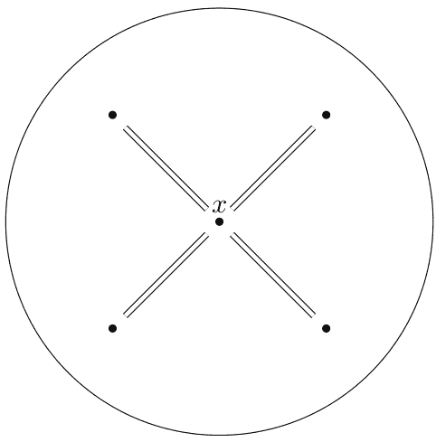

我们还可以进一步证明以下内容：

- $isSet(A) \leftrightarrow is\text{-}0\text{-type}(A)$
- $isGpd(A) \leftrightarrow is\text{-}1\text{-type}(A)$
- $is\text{-}2\text{-Gpd}(A) \leftrightarrow is\text{-}2\text{-type}(A)$
- $\vdots$

以及

$$\prod_{A: \mathcal{U}}(\text{is-}n\text{-type}(A) \rightarrow \text{is-}(n+1)\text{-type}(A)).$$

然而，并不是每个类型都是某个 $n$-类型，考虑 $\mathcal{U}$。

# 6 命题截断（压缩）

上周介绍的“压缩”概念可能过于武断：它被用于实现多个目标，其中之一是在构造逻辑中恢复经典逻辑。我们现在引入更一般的抽象截断概念，它暂时被视为 HoTT 的原始概念。截断用于将类型缩减为集合，而不带有双重否定翻译的所有副产品。

令 $\|A\|_{-1}$ 被读作 $A$ 的 $(-1)$-截断。当上下文清楚时，我们省略下标。当类型 $\|A\|$ 被构造时，我们说 $A$ 是“仅被构造的”，以强调这是一个与证明无关的设置。我们有以下 $\|\cdot\|$ 引入规则：

$$\frac{\Gamma \vdash M: A}{\Gamma \vdash \|M\|: \|A\|} \quad \frac{}{\Gamma, x: \|A\|, y: \|A\| \vdash \text{squash}(x, y): \text{Id}_{\|A\|}(x, y)}$$

正如我们所预期的那样，$isProp(\|A\|)$ 是因为 $squash(\cdot, \cdot)$ 的规则。相应的消除规则如下：

$$\frac{\Gamma \vdash M: \|A\| \quad \Gamma, x: A \vdash N: B \quad \Gamma \vdash P: \text{isProp}(B)}{\operatorname{elim}[B](M ; x . N ; P): B} \quad \|\cdot\| E$$

我们需要一个 $isProp(B)$ 的证明，以确保 $N$ 的行为不依赖于代表性的 $x : A$。还有其他方法可以确保这一属性：例如，我们可以要求 $u, v : A \vdash [u/x]N =_B [v/x]N$。注意 $isProp(B)$ 意味着这种情况。$\beta$ 规则的工作方式如人们所预期的那样：

$$elim(\|M\|; x.N; P) \equiv [M/x]N$$

类似地，人们希望一些类似于 $\beta$ 的规则适用于 1-细胞 $squash$。例如，形式为

$$ap(\lambda z.elim(z; x.N; P))(squash(\|M\|, \|M'\|)) \equiv P([M/x]N)([M'/x]N)$$

这对应于 $P$ 是一个证明，即在类型 $A$ 的不同项的替换下，$N$ 相等的想法，因为 $B$ 是一个命题。然而，就像 $seg$ 的情况一样，我们没有这个。

# 7 重新审视选择公理

之前，我们探讨了选择公理在 ITT 中是可证明的。也就是说，存在一个项 $AC_\infty$ 使得

$$AC_\infty :\equiv \prod_{A:\mathcal{U}} \prod_{B:A\to\mathcal{U}} \prod_{C:\Pi_{x:A}.B\to\mathcal{U}} \left( \left(\prod_{x:A} \sum_{y:B(x)} C(x, y)\right) \to \left(\sum_{f:\Pi_{x:A}.B} \prod_{x:A} C(x, f(x))\right) \right)$$

事实上，我们可以加强这一点，并说这两种类型是等价的。

回想一下，这种类型是有居住者的，因为关系 $C$ 是满的证明了我们应该做出的选择，因为规范是证明相关的。情况类似于激发我们引入命题截断的例子：我们想要编写一个返回无限序列中第一个 $0$ 的索引的总函数。实际上，证明无限序列实际上包含一个 $0$ 也立即告诉我们 $0$ 在哪里。

现在我们已经发展出了命题截断的概念，我们可以陈述一个更接近其典型陈述的选择公理版本：

$$\prod_{A:\mathcal{U}} \prod_{B:A\to\mathcal{U}} \prod_{C:\Pi_{x:A}.B\to\mathcal{U}} \left( isSet(A) \to \left(\prod_{x:A} isSet(B(x))\right) \to \left(\prod_{x:A} \prod_{y:B(x)} isProp(C(x, y))\right) \to \left( \left(\prod_{x:A} \|\sum_{y:B_x} C(x, y)\|\right) \to \|\sum_{f:\Pi_{x:A}.B} \prod_{x:A} C(x, f(x))\| \right) \right)$$

# 同伦类型理论

这个重新陈述的形式是不可证明的。现在我们说对于每个 $x$，存在某个 $y$ 使得 $C(x, y)$。这个公理说的是，给定这样的较弱证据，仅仅存在这样一个函数 $f$，对于每个 $x$ 满足 $C(x, f(x))$。我们可以称这样一个类型的公理为 $AC_{-1}$，以强调它涉及 $-1$-截断。

现在，等价类型的截断是等价的。由于选择公理的非截断形式 $AC_\infty$ 给了我们等价性

$$\left(\left(\prod_{x: A} \sum_{y: B(x)} C(x, y)\right) \simeq\left(\sum_{f: \Pi x: A . B} \prod_{x: A} C(x, f(x))\right)\right)$$

以便 $AC_{-1}$ 的类型等同于

$$\begin{aligned} & \prod_{A: \mathcal{U}} \prod_{B: A \rightarrow \mathcal{U}} \prod_{C: \Pi x: A . B \rightarrow \mathcal{U}}\left(\operatorname{isSet}(A) \rightarrow\left(\prod_{x: A} \operatorname{isSet}(B(x))\right) \rightarrow\left(\prod_{x: A} \prod_{y: B(x)} \operatorname{isProp}(C(x, y))\right) \rightarrow\left(\left(\prod_{x: A}\left\|\sum_{y: B(x)} C(x, y)\right\|\right) \rightarrow\left\|\sum_{f: \Pi x: A . B} \prod_{x: A} C(x, f(x))\right\|\right)\right) \end{aligned}$$

现在，对于所有 $Y: A \to \mathcal{U}$，我们有 $\Pi_{x:A} Y(x) \simeq \Pi_{x:A} (\Sigma_{a:Y(x)} 1)$，因此我们可以简化上述类型为：

$$\prod_{A: \mathcal{U}} \prod_{Y: A \rightarrow \mathcal{U}}\left(\operatorname{isSet}(A) \rightarrow\left(\prod_{x: A} \operatorname{isSet}(Y(x))\right) \rightarrow\left(\left(\prod_{x: A}\|Y(x)\|\right) \rightarrow\left\|\prod_{x: A} Y(x)\right\|\right)\right)$$

以这种形式，我们可以看到这个公理是在说一个仅有居住者的集合的乘积也是仅有居住者的，这在经典数学中已经是众所周知的等同于选择公理。这里非常重要的是 $isSet(A)$，因为如果 $A$ 不是一个集合，就会有一个反例（见引理 3.8.5 [1]）。

# 8 等价和命题

几周前，我们定义了一个映射 $f: A \to B$ 是 $A$ 和 $B$ 之间的等价关系，记作 $isequiv(f)$。我们给出的定义是：

$$\operatorname{isequiv}(f): \equiv\left(\Sigma g: B \rightarrow A . f \circ g \sim \operatorname{id}_B\right) \times\left(\Sigma h: B \rightarrow A . h \circ f \sim \operatorname{id}_A\right) .$$

我们还给出了相关的拟逆概念，记作 $qinv(f)$，其定义如下：

$$\text{qinv}(f) := \Sigma g : B \rightarrow A . (f \circ g \sim \text{id}_B \times g \circ f \sim \text{id}_A).$$

在某种程度上，$qinv$ 的定义可能比 $isequiv$ 的定义更自然，因为它说明存在一个函数 $g$，它是 $f$ 的左右逆。这就是范畴论中同构的定义。当然，我们解释过 $isequiv(f) \to qinv(f)$ 和 $qinv(f) \to isequiv(f)$，这使我们能够在过去几周中使用更方便的定义。

为什么我们选择了上述对 $isequiv$ 的定义，而不是使用我们对 $qinv$ 给出的定义？问题在于我们希望对于给定的函数 $f$ 只有一个证明它是等价的。也就是说，我们希望对于所有的 $f$ 都成立 $isProp(isequiv(f))$。这对于我们给出的定义是成立的，但并不是对于每个 $f$ 都成立 $isProp(qinv(f))$。我们可以通过建立两个引理来证明这一点：

**命题 2.** 如果 $f : A \to B$ 且 $e : qinv(f)$，则 $qinv(f) \simeq \Pi_{x:A} (x = x)$。

**命题 3.** 存在某个类型 $X$ 使得 $\Pi_{x:X} (x = x)$ 不是一个命题。

参见 [1] 中 4.1 节的讨论以证明这些引理。这使得 $qinv$ 不适合作为 $isequiv$ 的定义。然而，我们仍然希望 $isequiv$ 的定义与 $qinv$ 是可互证的，同时也是一个命题。有三个候选者满足这些性质，它们都是等价的：

1. $biquequiv(f) :\equiv (\Sigma_{g:B\to A} f \circ g \sim \mathsf{id}_B) \times (\Sigma_{h:B\to A} h \circ f \sim \mathsf{id}_A)$。
我们说 $f$ 是 $bi\text{-}invertible$，这意味着 $f$ 有一个左逆和一个右逆。这是我们一直在使用的定义。

2. $isContr(f) :\equiv \Pi_{y:B} isContr(fib_f(y))$，其中 $fib_f(y) :\equiv \Sigma_{x:A} f(x) = y$。
这意味着如果给定任何 $B$ 中的 $y$，则 $f$ 映射到 $y$ 的所有元素（纤维）是可缩的。也就是说，对于目标域中的每个点，存在一个定义域中的元素 $x$，使得 $f(x) = y$，并且如果 $f(x') = y$，则 $x = x'$。但这恰好意味着 $f$ 是同伦意义下的双射。

3. $ishae(f) :\equiv \Sigma_{g:B\to A} \Sigma_{\alpha:f \circ g \sim \mathsf{id}_B} \Sigma_{\beta:g \circ f \sim \mathsf{id}_A} \Pi_{x:A} f(\beta(x)) = \alpha(f(x))$。
我们将其解读为 $f$ 是一个半伴随等价。我们在课堂上没有讨论过这个定义，但可以在第 4.2 节中找到相关讨论。

[1] 高等研究院。同伦类型理论：一致基础数学。粗略地说，我们可以通过注意到它与 $qinv$ 的定义类似（其中同伦 $\alpha$ 和 $\beta$ 没有命名），并且有一个额外的相容性条件来解释这个定义，该条件涉及这些同伦如何与 $f$ 交互。

# 参考文献

[1] 高等研究院。同伦类型理论：一致基础数学。 The Univalent Foundations Program, 2013.
http://homotopytypetheory.org/book/.

# 15-819 同伦类型理论

## 讲义

Evan Cavallo 和 Stefan Müller

2013年11月18日和20日

# 1 重新考虑自然数在简单类型中

作为对归纳类型讨论的热身，我们首先回顾了课程中早先见过的自然数的几种等价表示方式。自然数的引入形式是 $0$ 和 $succ(M)$，其中 $M$ 是任意的 $Nat$ 类型的表达式。消除形式是递归器 $rec$。

## 1.1 传统形式

$$\frac{\Gamma \vdash 0: \mathrm{Nat}}{\operatorname{Nat} I_{z 1}} \quad \frac{\Gamma \vdash M: \mathrm{Nat}}{\Gamma \vdash \operatorname{succ}(M): \mathrm{Nat}} \operatorname{Nat} I_{s 1} \quad \frac{\Gamma \vdash M: \mathrm{Nat} \quad \Gamma \vdash M_0: A \quad \Gamma, x: A \vdash M_1: A}{\Gamma \vdash \operatorname{rec}[A]\left(M ; M_0 ; x . M_1\right): A} \text { 自然数 } E_1$$

我们在递归器中包含动机 $A$ 以表达依赖类型，尽管在简单类型的情况中并不是必需的。递归器的动态行为由以下 $\beta$ 规则定义：

$$\begin{aligned} rec[A](0; M_0; x.M_1) &\equiv M_0 \\ rec[A](succ(M); M_0; x.M_1) &\equiv [rec[A](M; M_0; x.M_1)/x]M_1 \end{aligned}$$

递归器在 $0$ 上返回基本情况 $M_0$。在 $succ(M)$ 上，它将递归结果替换为 $M$ 中的 $x$ 在 $M_1$ 中。$\eta$ 规则表明，任何“行为类似于”递归器的对象在定义上等于适当参数的递归器。

$$\frac{[0 / y] N \equiv M_0 \quad \Gamma, z: \text { 自然数 } \vdash[\operatorname{succ}(z) / y] N \equiv[[z / y] N / x] M_1: A}{\Gamma, y: \text { 自然数 } \vdash N \equiv \operatorname{rec}[A]\left(y ; M_0 ; x . M_1\right)} \eta$$

## 1.2 作为指数的元素

在没有上下文的情况下，可以将自然数的引入形式视为指数。

$\cdot \vdash 0: 1 \rightarrow Nat$ (自然数 $I_{z 3}$) 
$\cdot \vdash succ: Nat \rightarrow Nat$ (自然数 $I_{s 3}$)

注意，类型 $1 \to Nat$ 等同于类型 $Nat$。有两种方式来呈现这种格式的消除形式。第一种方式是将递归所作用的自然数移到参数位置，暗示了 $rec$ 具有指数类型。

$$\frac{\vdash M_{0}: A \quad x: A \vdash M_{1}: A}{z: Nat \vdash \operatorname{rec}[A]\left(M_{0} ; x . M_{1}\right)(z): A} \text { 自然数 } E_{3 a}$$

这可以通过省略参数来更直接地表示：

$$\frac{\vdash M_{0}: A \quad x: A \vdash M_{1}: A}{\vdash \operatorname{rec}[A]\left(M_{0} ; x . M_{1}\right): Nat \rightarrow A} \text { 自然数 } E_{3 b}$$

我们可以推导出规则 自然数 $I_{z 1}$，自然数 $I_{s 1}$ 和自然数 $E_{1}$。例如， 

$$\frac{\Gamma, M: Nat \vdash M: Nat \quad \Gamma, M: Nat \vdash succ : Nat \rightarrow Nat}{\Gamma, M: Nat \vdash succ(M) : Nat}$$

# 2 自然数-代数

我们现在来解释 $Nat$-代数的概念，它是形如 $1+A \to A$ 的映射。从名字上看，人们会期望存在一个 $Nat$-代数，其中 $A$ 是 $Nat$。事实上，确实存在这样的代数。

$z: 1+\operatorname{Nat} \vdash \operatorname{case}(z ; \_ .0 ; x . \operatorname{succ}(x)): \operatorname{Nat}$

我们可以将 $case(z; \_ . 0; x. succ(x))$ 写成 $\{\_ . 0; x. succ(x)\}(z)$，或者有点滥用地写成 $\{0, succ\}(z)$。这给出了

$\cdot \vdash\{0, succ\}: 1+Nat \rightarrow Nat$

如所需。更一般地，我们可以将任何 $Nat$-代数写成 $\alpha=\{\alpha_{0}, \alpha_{1}\}$，其中 $\alpha_{0}: 1 \rightarrow Nat$（或者等价地，$\alpha_{0}: Nat$），而 $\alpha_{1}: Nat \rightarrow Nat$。我们将 $\alpha_{0}$ 称为基础或者伪零，而将 $\alpha_{1}$ 称为归纳步骤或者伪后继者。

事实上，$\{0, succ\}$ 在 $Nat$-代数中占据着特殊的位置。自然数代数形成了一个范畴，而 $\{0, succ\}$ 是该范畴中的初始对象。回想一下，这意味着它对该范畴中的任何其他对象都有唯一的态射。这要求我们定义自然数代数之间的态射，我们将其称为自然数同态。给定两个自然数代数， $\alpha: 1+A \rightarrow A$ 和 $\beta: 1+B \rightarrow B$，如果存在 $h: A \rightarrow B$ 使得以下图表成立，则 $h$ 是一个自然数同态。

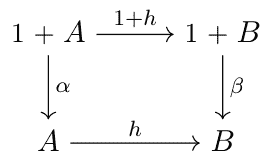

映射 $1+h: 1+A \rightarrow 1+B$ 以自然的方式定义：

```
1+h := {_.inl <> | a.inr (h a)}
```

为了证明 Nat 是一个初始代数，我们必须证明对于每个 Nat-代数 $\alpha: 1+A \rightarrow A$，存在一个唯一的 Nat-同态 $!: \text{Nat} \rightarrow A$，使得以下图表是可交换的（注意，前面一句话中表示的量词的顺序在图表中并不明确，必须考虑才能完全理解图表。）

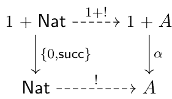

让我们考虑使图表可交换的 $!$ 的要求。

$$
\begin{aligned}
!0 &= \alpha_0 \\
! \text{succ}(x) &= \alpha_1(!x)
\end{aligned}
$$

左边对应于沿着路径 $! \circ \{0, \text{succ}\}$ 的跟随，右边对应于沿着 $\alpha \circ 1+!$ 的跟随。注意这两个方程与 $\text{rec}$ 的 $\beta$ 规则匹配，所以我们可以定义 $! := \text{rec}[A](\alpha_0; \alpha_1)$ 或者简单地定义 $! := \text{rec}[A](\alpha)$。正如我们在上面看到的，$\text{rec}$ 的 $\beta$ 规则意味着图表的交换。唯一性 $!$ 的推导来自于 $\text{rec}$ 的 $\eta$ 规则。值得注意的是，交换图表恰好隐藏了在 HoTT 中讨论的等式类型，这在 HoTT 中非常重要。例如，对于 Nat，唯一性 $!$ 在字面上成立，而一般情况下，唯一性可能只是高阶同伦。

# 3 F-代数

上述讨论可以推广到任何函子 F。函子是从范畴 C 到 D 的映射。函子作用于范畴中的对象和态射之间，对于所有的对象 $X \in C$，$F(X) \in D$，以及对于所有的态射 $f: X \rightarrow Y$ 在 C 中的对象 $X$ 和 $Y$ 之间，$F(f): F(X) \rightarrow F(Y)$。函子尊重恒等和组合性质：
- 1. 对于每个对象 $X \in C$，$F(\text{id}_X) = \text{id}_{F(X)}$
- 2. 对于所有的态射 $f: X \rightarrow Y$ 和 $g: Y \rightarrow Z$，$F(g \circ f) = F(g) \circ F(f)$ [1]

例如，$F_{\text{Nat}}(C) \equiv 1 + C$ 是一个函子。我们检查 $F_{\text{Nat}}$ 保持恒等性质和组合性质。设 $X$ 是 C 的一个对象。

$$F_{\text{Nat}}(\text{id}_X) = 1 + \text{id}_X = \{ \langle \rangle, \text{id}_X \}$$

这确实是 $1 + X$ 上的一个恒等映射。设 $f: X \rightarrow Y$，$g: Y \rightarrow Z$ 是 C 中对象之间的态射。

$$F_{\text{Nat}}(g \circ f) = 1 + g \circ f = \{ \langle \rangle, g \circ f \} = \{ \langle \rangle, g \} \circ \{ \langle \rangle, f \} = (1 + g) \circ (1 + f) = F(g) \circ F(f)$$

对于任何函子 $F$，一个 $F$-代数是一个映射 $F(X) \rightarrow X$。因此，一个 Nat-代数是一个 $F_{\text{Nat}}$-代数。$F$-代数形成了范畴，就像 Nat-代数一样。对于一个函子 $F$，对象 $A$ 和 $B$，两个 $F$-代数 $\alpha: F(A) \rightarrow A$ 和 $\beta: F(B) \rightarrow B$，以及一个态射 $h: A \rightarrow B$，下面的图表是可交换的。

```
F(A) ---F(h)---> F(B)
 |                 |
α |                 | β
 v                 v
A ----h------>   B
```

一个初始的 $F$-代数是一个 $F$-代数 $i: F(I) \rightarrow I$，对于所有其他的 $F$-代数 $\alpha: F(A) \rightarrow A$，存在一个唯一的映射 $!: I \rightarrow A$ 使得下面的图形是可交换的。

```
F(I) ---F(!)---> F(A)
 |                 |
i |                 | α
 v                 v
I ----!------>   A
```

还存在一个 $F$-余代数的概念，它是上述概念的对偶，即一个映射 $\alpha: A \rightarrow F(A)$。一个终结的 $F$-余代数是一个映射 $j: J \rightarrow F(J)$，对于所有其他的 $F$-余代数 $\alpha: A \rightarrow F(A)$，存在一个唯一的映射 $!: A \rightarrow J$ 使得下面的图形是可交换的。

```
A ----!------>   J
 |                 |
α |                 | j
 v                 v
F(A) --F(!)-->   F(J)
```

## 引理 1 (Lambek)

如果 $i: F(I) \to I$ 是一个初始的 $F$-代数，则 $i$ 是一个同构。

也就是说，$F(I) \equiv I$。

证明。为了证明 $i$ 是一个同构，我们必须展示一个逆 $i^{-1} : I \to F(I)$，使得 $i \circ i^{-1} = \text{id}_I$ 且 $i^{-1} \circ i = \text{id}_{F(I)}$。考虑 $F$-代数 $F(i) : F(F(I)) \to F(I)$。我们现在将 $i$ 视为 $F$-代数 $F(i)$ 和 $i$ 之间的同态，使得这个图表成立。

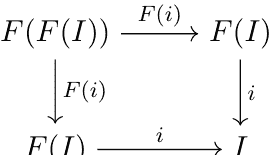

然而，由于 $i$ 是一个初始 $F$-代数，我们还有一个唯一的映射 $! : I \to F(I)$ 使得这个图表的上半部分成立。

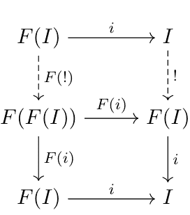

从 $I$ 到 $I$ 也有一个唯一的映射，它必须是恒等映射。这表明图表右侧的映射 $i \circ !$ 必须等于 $\text{id}_I$：

```
i ∘ ! = id_I
```

我们还有

```
! ∘ i = F(i) ∘ F(!) = F(i ∘ !) = F(id_I) = id_{F(I)}
```

其中第一个等式来自于图的上半部分的可交换性，第二个和第四个等式来自于函子的性质，第三个等式来自于上述结果。

□

这表明对于任何函子 $F$，初始 $F$-代数 $I$ 是 $F$ 的一个不动点。可以证明一个对偶的结果，即如果 $J$ 是函子 $F$ 的最终 $F$-余代数，则 $F(J) \equiv J$。

# 4 内部化 Nat-代数

在类型理论中，我们可以定义 Nat-代数的概念，如下所示：

$$\text{NatAlg} \equiv \Sigma (A:\mathcal{U}). ((1+A) \rightarrow A)$$

我们可以定义两个 Nat-代数 $(A, \alpha)$ 和 $(B, \beta)$ 之间的 Nat-同态类型，如下所示：

$$\text{NatHom}(\alpha, \beta) \equiv \Sigma (h: A \rightarrow B). (\beta \circ (1 + h) = h \circ \alpha)$$

事实上，$\nu \equiv (\text{Nat}, \{0, \text{succ}\})$ 是 Nat-代数范畴中的初始对象，这意味着对于所有的 $\alpha$，$\text{NatHom}(\nu, \alpha)$ 都是可缩的，这意味着存在一个从 $\nu$ 到 $\alpha$ 的 Nat-同态，它在更高的同伦意义下是唯一的。

# 5 W-类型

我们希望能够对一个函子 F 进行操作，并在 HoTT 中定义初始的 F-代数（如果存在的话）。对于多项式函子的范畴，我们可以使用布劳威尔序数（也称为 W-类型）来实现这一点。

W 类型受到数学中良基归纳的启发。在经典数学中，偏序集 $\langle A, < \rangle$ 被称为良基的，如果 A 的每个子集都有 $<$ 最小元素（等价地说，不存在无限下降链）。良基集合很有用，因为它们具有归纳原理：

## 命题（良基归纳）：

设 $\langle A, < \rangle$ 是一个良基集合，$P(x)$ 是一个命题。如果对于任意的 $a \in A$，我们可以通过假设对于所有 $b < a$ 都有 $P(b)$ 来证明 $P(a)$，那么 $P(a)$ 对于所有的 $a \in A$ 成立。

自然数集 $\langle \mathbb{N}, < \rangle$ 连同其通常的排序是良基集合的一个例子，归纳原理就是熟知的数学归纳法。

经典上，归纳的证明是通过反证法进行的，所以这个定义对于构造性理论来说是不令人满意的。相反，我们将以（构造性的）归纳原理来表征良基集合。

为了更好地理解我们所说的，我们将定义 W-类型。要形成一个 W-类型，我们需要一个类型 A 和一个类型族 B 在 A 上：

$$\frac{\Gamma \vdash A:\mathcal{U} \quad \Gamma, x:A \vdash B:\mathcal{U}}{\Gamma \vdash \mathbb{W}x:A.B:\mathcal{U}} \text{WF}$$

A 是节点排序的类型。每个节点排序代表了形成 $\mathbb{W}x:A.B$ 元素的不同方式。例如，在自然数的情况下，节点排序是 0 和 succ。我们可以将自然数的每个元素看作是由这两种节点排序构建的树。例如，数字 0 到 2 可以表示为

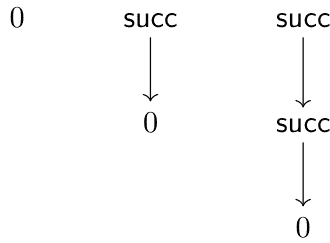

另一个自然的例子是二叉树的类型。这种类型可以通过两种节点排序 `node` 和 `leaf` 来定义，元素采用这种形式的树：

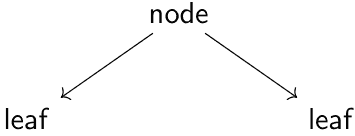

为了完全指定这两种类型，我们需要有一些关于节点度数的概念。这由类型族 B 给出。对于每个节点排序 $a:A$，B(a) 描述了 a 的分支因子，索引类型用于指定 a 的前驱节点。例如，排序为 0 或 leaf 的分支因子为 0，succ 的分支因子为 1，而 node 的分支因子为 $1+1$。因此，我们可以将 Nat 写成 $\mathbb{W}x:2.\text{if}(x;0;1)$，其中 tt 表示 0，ff 表示 succ。

现在我们已经了解了 A 和 B 的目的，我们可以看到如何定义 $\mathbb{W}x:A.B$ 的引入规则。

$$\frac{a:A \quad x:B(a) \vdash w:\mathbb{W}x:A.B}{\Gamma \vdash \sup[a](x.w):\mathbb{W}x:A.B} \text{WI}$$

换句话说，为了构造一个类型为 a 的节点，我们必须为每个前驱指定的分支因子 B(a) 给出一个元素 $\mathbb{W}x:A.B$。请注意，当 B(a) 为 0 时，我们可以构造一个没有任何前驱信息的新节点。例如，我们可以按以下方式构造自然数的元素：

$$
\begin{aligned}
\bar{0} &:= \sup[\text{tt}](x.\text{abort}_{\mathbb{W}x:2.\text{if}(x;0;1)}(x)) \\
\bar{1} &:= \sup[\text{ff}](\_.\bar{0}) \\
\bar{2} &:= \sup[\text{ff}](\_.\bar{1})
\end{aligned}
$$

对于 $\mathbb{W}x:A.B$ 的递归器遵循良基递归的思想：为了定义函数 f 在元素 $w:\mathbb{W}x:A.B$ 上的结果，我们可以假设我们已经计算出了 w 的所有前驱的 f 的值。

$$\frac{\Gamma \vdash C:\mathcal{U} \quad \Gamma, a:A, r:B(a) \rightarrow C \vdash M:C}{\Gamma, z:\mathbb{W}x:A.B \vdash \text{wrec}[C](a, r.M)(z):C} \text{WR}$$

在假设中，我们假设我们正在处理一个类型为 a 的节点，并且我们有每个索引为 $b : B(a)$ 的前驱的值 $r(b)$。我们利用这些信息来构造当前节点上递归器的值 M。递归器带有计算规则：

```
wrec[C](a, r.M)(sup[a](w)) ≡ [a, λz.wrec[C](a, r.M)(w(z))/a, r]M
```

这是预期的计算规则，它给出了 $\text{wrec}[C](a, r.M)$ 在 $\sup[a](w)$ 上的值，以每个前驱 $w(z)$ 的值为基础，其中 $z : B(a)$。

依赖消除器具有类似的形式，表达了良基归纳的思想。

$$\frac{\Gamma, z : \mathbb{W}x:A.B \vdash P : \mathcal{U} \quad \Gamma, a:A, p : B(a) \to \mathbb{W}x:A.B, h : \prod_{b:B(a)} P(p(b)) \vdash M : P(\sup[a](p))}{\Gamma, z : \mathbb{W}x:A.B \vdash \text{wind}[x.P](a, p, h.M) : P(z)} \text{WE}$$

在这里，为了提出假设，我们需要假设额外的数据 $p : B(a) \to Wx:A.B$，这给出了我们正在考虑的元素的前驱。计算规则的形式为：

```
wind[x.P](a, p, h.M)(sup[a](w)) = [a, w, λz.wind[x.P](a, p, h.M)(w(z))/a, p, h]M
```

一般来说，我们只能断言这个计算规则在命题上成立。

每个 W-类型确定一个函子，特别是一个多项式函子。这是一个形式为 $F(X) = \Sigma (a:A). (B(a) \rightarrow X)$ 的函子，其中 A 和 B 是一些类型。我们可以看到 W-类型 $\mathbb{W}x:A.B$ 定义了一个 F-代数，其中 $F(X) :\equiv \Sigma (a:A). (B(a) \rightarrow X)$：我们有 $\lambda(a, w).\sup[a](w)$ 实际上是一个等价映射，而 $\mathbb{W}x:A.B$ 是一个同伦初始 F-代数。

在我们对 Nat 的 W-类型定义的情况下，观察到由 $\mathbb{W}x:2.\text{if}(x; 0; 1)$ 确定的函子是 $F(X) = \Sigma (b:2).(\text{if}(b; 0; 1) \rightarrow X)$。可以验证 $\Sigma (b:2).(\text{if}(b; 0; 1) \rightarrow X) \simeq 1 + X$。因此，这个类型满足方程 $F(X) = 1 + X$，即我们原始的 Nat 代数定义。

# 参考文献

[1] 维基百科。函子。 http://en.wikipedia.org/wiki/Functor，2013年。

# 15-819 同伦类型理论讲义

Kristina Sojakova 和 Joseph Lee

2013年11月25日

# 1 高阶归纳类型

回顾上周我们讨论了（低阶）归纳类型及其定义。本周，我们继续讨论高阶归纳类型。直观上，高阶归纳类型（即 HIT）可以被看作是具有归纳定义和等式法则的类型。高阶类型则是自由代数结构的一般化，其中包括生成元和应满足的等式法则。例如，给定一组生成元和关系（例如交换性），可以得到一个群。

这给出了一个完整的高维结构，允许我们在多个维度上引入关系。在证明相关的环境中，这意味着我们获得了生成元和满足的关系。换句话说，由于证明相关性，等式法则可以被看作是更高维度上的生成元。

例如，在 0-类型层面上，生成元是元素或点。这些被称为 0-细胞。0-细胞之间的等同关系是 1-细胞，1-细胞之间的等同关系是 2-细胞，依此类推。这允许通过使用 n-细胞在多个维度上定义类型。

# 2 区间类型 I

回想一下，区间类型 I 由两个点 $0_I$ 和 $1_I$ 定义，以及一个恒等路径 $\text{seg}$。也就是说， I 由 0-细胞定义

$$0_I : I$$
$$1_I : I$$

以及 1-细胞

$$\text{seg} : 0_I =_I 1_I$$

## 递归器定义为


其中应该满足的 $\beta_0$ 规则（即 0-细胞的 $\beta$ 规则）为


而 $\beta_1$ 规则为


也就是说，上面的命题等式是成立的。

从这里，我们可以定义归纳原理，它类似于递归器：


回想一下， $a_0 =_{\text{seg}}^{z.A} a_1$ 被定义为这是因为 $A \mid (\text{seg})(w_0) \vdash_A (\dots)$ 不再必须具有相同的类型，所以我们需要使用 “路径上的” 来表示所需的等式法则。归纳的 $\beta_0$ 规则是


而 $\beta_1$ 规则是


还有一个唯一性规则，或 $\eta$ 规则，它声明 “如果一个函数的行为类似于 I 的递归器，那么它必须是递归器。”对于 I 的归纳原理也有类似的规则。

练习。定义 $Irec$ 和 $Iind$ 的 $\eta$ 规则。

# 3 圆类型


另一个高阶归纳类型的例子是圆类型 $\mathbb{S}^1$。该 $\mathbb{S}^1$ 类型由 0-细胞（点）定义


和 1-细胞（路径）


递归器定义为：

```
$$\frac{\Gamma \vdash M : \mathbb{S}^1 \quad \Gamma \vdash a_0 : A \quad \Gamma \vdash l : a_0 =_A a_0}{\Gamma \vdash \text{rec}[A](a_0; l)(M) : A} \mathbb{S}^1\text{rec}$$
```

带有 $\beta_0$ 规则的：

```
$$\text{rec}[A](a_0; l)(\text{base}) \equiv a_0$$
```

和 $\beta_1$ 规则是：

```
$$\text{ap}_{\text{rec}[A](a_0; l)}(\text{loop}) = l$$
```

归纳原理被定义为：

```
$$\frac{\Gamma, z : \mathbb{S}^1 \vdash P(z) : \mathcal{U} \quad \Gamma \vdash M : \mathbb{S}^1 \quad \Gamma \vdash b : P(\text{base}) \quad \Gamma \vdash l : b =^{z.P}_{\text{loop}} b}{\Gamma \vdash \text{ind}[z.P](b; l)(M) : P(M)} \mathbb{S}^1\text{ind}$$
```

使用 $\beta_0$ 规则：

```
$$\text{ind}[z.P](b; l)(\text{base}) \equiv b$$
```

和 $\beta_1$ 规则：

```
$$\text{dap}_{\text{ind}[z.P](b; l)}(\text{loop}) = l$$
```

小心 $l$ 的类型，因为很容易写出“类型检查”但不正确的类型。$l$ 应该表示将 $b$ 沿着 loop 路径绕一圈后返回到 $b$。练习。为 $\mathbb{S}^1\text{rec}$ 和 $\mathbb{S}^1\text{ind}$ 定义 $\eta$ 规则。

## 4 环的总空间作为从 $\mathbb{S}^1$ 到 $A$ 的函数

回顾一下，我们之前对路径的总空间进行了描述：

```
$$\int \text{Id}_A := \sum_{x,y:A} x =_A y$$
```

等价于从 $I$ 到 $A$ 的函数类型，即：

```
$$(I \rightarrow A) \simeq \int \text{Id}_A$$
```

同样地，我们可以对环的总空间进行描述：

```
$$\int \Omega_A := \sum_{x:A} x =_A x$$
```

等价于从 $\mathbb{S}^1$ 到 $A$ 的函数类型，即：

```
$$(\mathbb{S}^1 \rightarrow A) \simeq \int \Omega_A$$
```

证明。定义 $f: (\mathbb{S}^1 \to A) \to \int \Omega_A$ 为：

```
$$f = \lambda g .\langle g(\text{base}), \operatorname{ap}_g(\text{loop})\rangle$$
```

练习。证明 $f$ 有一个准逆。

# 5 悬挂

另一个高阶归纳类型的例子是 suspension type，它包含了区间和圆类型（在同伦意义下）。对于类型 $A : \mathcal{U}$，$A$ 的悬挂，记作 $\operatorname{susp}(A) : \mathcal{U}$，是由两个 $0$-细胞构造子给出的高阶归纳类型：

```
$$N : \text{susp}(A) \qquad S : \text{susp}(A)$$
```

分别称为北极和南极，并且有一个 $1$-细胞构造器的族：

```
$$\operatorname{mer} : A \rightarrow (N =_{\text{susp}(A)} S)$$
$$\operatorname{mer}(x) : (N =_{\text{susp}(A)} S)$$
$$x : \text{susp}(A) \vdash B(x) : \mathcal{U}$$
$$n : B \quad s : B \quad x : A \vdash m(x) : n =_B s$$
$$z : \text{susp}(A) \vdash \operatorname{rec}[B](n; s; x.m)(z) : B$$
$$z : \text{susp}(A) \vdash B(z) : \mathcal{U} \quad n : B(N) \quad s : B(S) \quad x : A \vdash m(x) : n =^{z.B(z)}_{\operatorname{mer}(x)} s$$
$$z : \text{susp}(A) \vdash \operatorname{ind}[B](n; s; x.m)(z) : B(z)$$
$$\operatorname{rec}[B](b_N; b_S; x.m(x))(N) \equiv b_N : B \quad \operatorname{rec}[B](b_N; b_S; x.m(x))(S) \equiv b_S : B$$
$$\operatorname{ap}_{\operatorname{rec}[B](b_N; b_S; x.m(x))(-)}(\operatorname{mer}(a)) =_{b_S =_B b_N} m(a)$$
$$\operatorname{ind}[z.E(z)](e_N; e_S; x.m(x))(N) \equiv e_N : E(N)$$
$$\operatorname{ind}[z.E(z)](e_N; e_S; x.m(x))(S) \equiv e_S : E(S)$$
$$\operatorname{dap}_{\operatorname{ind}[z.E(z)](e_N; e_S; x.m(x))(-)}(\operatorname{mer}(a)) =^{z.E(z)}_{e_N =_{\operatorname{mer}(x)} e_S} m(a)$$
```

前两个计算规则可以看作是 $0$-细胞的 $\beta$-规则，最后一个是 $1$-细胞的 $\beta$-规则。由于我们不关心最后一个规则结论中命题等式的具体证明项，我们简单地省略了证明项。

我们有一个类似的归纳模式，其中不再是简单类型 $B : \mathcal{U}$，而是考虑依赖类型 $E : \operatorname{susp}(A) \to \mathcal{U}$。归纳规则表明为了构造一个将 $z : \operatorname{susp}(A)$ 映射到 $E(z)$ 元素的依赖函数，只需提供元素 $e_N : E(N)$ 和 $e_S : E(S)$，使得对于每个 $x : A$，$e_N$ 和 $e_S$ 在路径 $\operatorname{merid}(x)$ 上相关联。形式上，这意味着我们有以下归纳规则：$\Gamma, z : \operatorname{susp}(A) \vdash E(z) : \mathcal{U}$，$\Gamma \vdash M : \operatorname{susp}(A)$：

```
$$\frac{\Gamma \vdash e_N : E(N) \qquad \Gamma \vdash e_S : E(S) \quad \Gamma, x : A \vdash m(x) : e_N =^{z.E(z)}_{\operatorname{mer}(x)} e_S}{\Gamma \vdash \operatorname{ind}[z.E(z)](e_N; e_S; x.m(x))(M) : E(M)}$$
$$\operatorname{ind}[z.E(z)](e_N; e_S; x.m(x))(N) \equiv e_N : E(N)$$
$$\operatorname{ind}[z.E(z)](e_N; e_S; x.m(x))(S) \equiv e_S : E(S)$$
$$\operatorname{dap}_{\operatorname{ind}[z.E(z)](e_N; e_S; x.m(x))(-)}(\operatorname{mer}(a)) =^{z.E(z)}_{e_N =_{\operatorname{mer}(x)} e_S} m(a)$$
```

其中最后一个规则的结论涉及到对一个路径应用一个依赖函数，表示为 $\operatorname{dap}$。我们可以陈述并证明一个有用的唯一性原则，也被称为 $\eta$-规则，它断言“如果一个函数的行为类似于归纳器，那么它必须是归纳器”。我们将确切的陈述和证明这个原则作为一个练习留给读者。

我们为什么对悬挂感兴趣？有趣的是，许多熟悉的（也有一些不太熟悉的）归纳类型可以被描述为悬挂。例如：练习。证明类型 $\operatorname{susp}(0)$ 等价于类型 $\mathbf{2}$。

练习。证明类型 $\operatorname{susp}(1)$ 等价于区间类型 $I$。$\operatorname{susp}(2)$ 是什么？由于类型 $\mathbf{2}$ 只包含两个元素（在同伦意义下），我们可以将 $\operatorname{susp}(2)$ 想象成由两个点 $N$ 和 $S$ 生成的类型，它们之间有两条不同的路径，分别称为 $w$ 和 $e$：


当然，这看起来非常像一个圆圈——实际上就是一个圆圈！练习。证明类型 $\operatorname{susp}(2)$ 等价于圆圈类型 $\mathbb{S}^1$。现在我们可以问一个问题，$\operatorname{susp}(\operatorname{susp}(2))$ 是什么？类型 $\operatorname{susp}(\operatorname{susp}(2))$ 当然必须包含两个点 $N$ 和 $S$。从 $\operatorname{susp}(2)$ 到路径空间 $N = S$ 的函数可以被看作是一个四元组 $(w, e, \gamma, \delta)$，其中 $w, e$ 是从 $N$ 到 $S$ 的两条不同路径，而 $\gamma, \delta$ 是从 $w$ 到 $e$ 的两条不同路径。由所有这些数据生成的类型 $\operatorname{susp}(\operatorname{susp}(2))$ 可以如图 1 所示进行可视化：

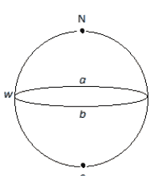

这看起来非常像一个球体——因此我们可以简单地定义 $\mathbb{S}^2 \equiv \operatorname{susp}(\mathbb{S}^1)$。我们可以迭代这个过程，并设置 $\mathbb{S}^{n+1} \equiv \operatorname{susp}(\mathbb{S}^n)$。

## 图 1: $\mathbb{S}^2$

# 15-819 同伦类型理论讲义
Matthew Maurer 和 Stefan Müller
2014年1月1日

# 1 目录

# 2 复习

回顾上周对类型的悬挂构造。请注意，我们使用的符号与书中不同，即 $\operatorname{susp}(A)$ 而不是 $\Sigma A$。类型 $A$ 的悬挂 $\operatorname{susp}(A)$ 包含两个 $0$-细胞：$N : \operatorname{susp}(A)$ 和 $S : \operatorname{susp}(A)$，以及 $N$ 和 $S$ 之间的路径 $\operatorname{merid}(a)$，其中 $a : A$。

```
$$\operatorname{merid} : \Pi_{x:A} N =_{\operatorname{susp}(A)} S$$
$$z : \operatorname{susp}(A) \vdash B(z) : \mathcal{U}$$
```

我们还定义了对 $\operatorname{susp}(A)$ 的递归和归纳：

```
$$n : B \quad s : B \quad x : A \vdash m(x) : n =_B s$$
$$z : \operatorname{susp}(A) \vdash \operatorname{rec}[B](n; s; x.m)(z) : B$$
$$z : \operatorname{susp}(A) \vdash B(z) : \mathcal{U} \quad n : B(N) \quad s : B(S) \quad x : A \vdash m(x) : n =^{z.B(z)}_{\operatorname{merid}(x)} s$$
$$z : \operatorname{susp}(A) \vdash \operatorname{ind}[B](n; s; x.m)(z) : B(z)$$
```

## 3 $\operatorname{susp}(2)$ 和 $\mathbb{S}^1$ 的等价性

- 命题 1. $\operatorname{susp}(2) \simeq \mathbb{S}^1$
- 证明.
- 定义为 $f : \operatorname{susp}(2) \to \mathbb{S}^1$：
  - $N \mapsto \text{base}$
  - $S \mapsto \text{base}$
  - $\operatorname{merid}(\texttt{tt}) \mapsto \text{loop}$
  - $\operatorname{merid}(\texttt{ff}) \mapsto \operatorname{refl}(\text{base})$
- 在悬挂的高阶部分上，我们定义了一维胞的行为，例如 $\operatorname{ap}$ 的作用。$\operatorname{ap}_f(\operatorname{merid}(\texttt{tt})) = \text{loop}$，$\operatorname{ap}_f(\operatorname{merid}(\texttt{ff})) = \operatorname{refl}(\text{base})$。为了证明等价性，我们现在定义了 $g : \mathbb{S}^1 \to \operatorname{susp}(2)$ 的准逆：其中我们将 $\text{base}$ 映射为任意值，但必须保持一致：
  - $\text{base} \mapsto N$
  - $\text{loop} \mapsto \operatorname{merid}(\texttt{tt}) \cdot \operatorname{merid}(\texttt{ff})^{-1}$
- 现在需要证明它们是互逆的 $\alpha : \Pi_{x:\operatorname{susp}(2)} g(f(x)) = x$。通过归纳法：
  - $(x = N)$ $\operatorname{refl}(N) : N = N$
  - $(x = S)$ $\operatorname{merid}(\texttt{ff}) : N = S$
  - $\operatorname{merid}(y)$ $? : \operatorname{refl}(N) =^{z.f(g(z))=z}_{\operatorname{merid}(y)} \operatorname{merid}(\texttt{ff})$
- 我们可以对此进行分析，
  $$\operatorname{ap}_g(\operatorname{ap}_f(\operatorname{merid}(\texttt{tt}))^{-1} \cdot \operatorname{refl}(N) \cdot \operatorname{merid}(\texttt{tt})) = \operatorname{merid}(\texttt{ff})$$
  $$\operatorname{ap}_g(\operatorname{ap}_f(\operatorname{merid}(\texttt{ff}))^{-1} \cdot \operatorname{refl}(N) \cdot \operatorname{merid}(\texttt{ff})) = \operatorname{merid}(\texttt{ff})$$

逐步评估：

```
$$\operatorname{ap}_g(\text{loop})^{-1} \cdot \operatorname{merid}(\texttt{tt}) = \operatorname{merid}(\texttt{ff})$$
$$\left(\operatorname{merid}(\texttt{tt}) \cdot \operatorname{merid}(\texttt{ff})^{-1}\right)^{-1} \cdot \operatorname{merid}(\texttt{ff}) = \operatorname{merid}(\texttt{ff})^{-1-1} \cdot \operatorname{merid}(\texttt{tt})^{-1} \cdot \operatorname{merid}(\texttt{tt}) = \operatorname{merid}(\texttt{ff})$$
```

我们对反演的另一个证明：

$\beta : \Pi_{x:\mathbb{S}^1} f(g(x)) = x$

通过对 $\mathbb{S}^1$ 的归纳进行：

- $(x = \text{base})$ $\operatorname{refl}(\text{base}) : f(g(\text{base})) = \text{base}$
- $(x = \text{loop})$ $\operatorname{ap}_f(\operatorname{ap}_g(\text{loop}))^{-1} \cdot \operatorname{refl}(\text{base}) = \operatorname{refl}(\text{base})$

# 4 有指向的类型

有指向的类型是指有一个示例成员的类型。如果 $A$ 是一个有指向的类型，那么在我们的表示法中，我们有 $a_0 : A$。

例如，$\Omega(A, a_0) = (a_0 =_A a_0)$，“环空间”，由 $\operatorname{refl}(a_0)$ 指向。$\operatorname{susp}(A)$ 由 $N$（或 $S$）指向，是另一个有指向的类型的示例。

有指向的映射，也称为严格映射，是两个有指向的类型之间的映射，将一个类型的众所周知的点映射到另一个类型的众所周知的点，如下所示：

$$(X, x_0) \rightharpoonup (Y, y_0) := \Sigma_{f: X \to Y} f(x_0) = y_0$$

我们开始证明：

- 命题 2. $\operatorname{susp}(A) \rightharpoonup B \simeq (A \rightharpoonup \Omega B)$
- 证明. 给定 $f : \operatorname{susp}(A) \rightharpoonup B$，定义 $g : A \rightharpoonup \Omega B$ 为：
  $$g(a) = p_0^{-1} \cdot \operatorname{ap}_f(\operatorname{merid}(a) \cdot \operatorname{merid}(a_0)^{-1}) \cdot p_0$$
  其中 $f_0$ 是原始映射，而 $p_0$ 是一个保留显著点的证明，例如 $p_0 : f_0(N) = b_0$，并且 $f = \langle f_0, p_0 \rangle$，$q = \operatorname{refl}(b_0)$。
  另一方面，给定 $g : A \rightharpoonup \Omega B$，定义 $f : \operatorname{susp}(A) \rightharpoonup B$：
  - $f_0(N) = b_0$
  - $f_0(S) = b_0$
  - 我们再次定义 HIT 中的一维元素的行为：$\operatorname{ap}_f(\operatorname{merid}(a)) = g_0(a)$
  其中 $g_0$ 是原始映射，$q_0$ 是一个保留特殊点的证明，例如 $q_0 : g_0(N) = b_0$ 和 $f = \langle g_0, q_0 \rangle$。

# 5 推出

我们暂时回到传统的集合数学中来定义一个推出，它是一个对偶于回拉的、在等式约束下的乘积的子集。

另一方面，一个推出本质上是两个集合的不相交并集，其中一些元素被“粘”在一起。具体来说，假设我们有集合 $A, B$ 和 $C$，以及从 $C$ 到 $A$ 和 $B$ 的映射 $f$ 和 $g$。推出 $A \sqcup^C B$ 是 $A$ 和 $B$ 的不相交并集，其中 $f(C)$ 和 $g(C)$ 的图像通过合并 $f(c)$ 和 $g(c)$ 来合并，其中 $c \in C$。在类型理论的符号表示中，我们将 $A$ 和 $B$ 的不相交并集表示为 $A + B$，并使用映射 $\operatorname{inl} : A \to A + B$ 和 $\operatorname{inr} : B \to A + B$。然后我们可以定义推出为：

$$A \sqcup^C B = (A + B) / R$$

其中 $R$ 是包含 $\forall c \in C . R(\operatorname{inl}(f(c)), \operatorname{inr}(g(c)))$ 且 $A \sqcup^C B$ 的最小等价关系。

$A \sqcup^C B$ 是“最小的”对象，因为它对于具有相同属性的任何其他对象 $D$ 都有唯一的映射：

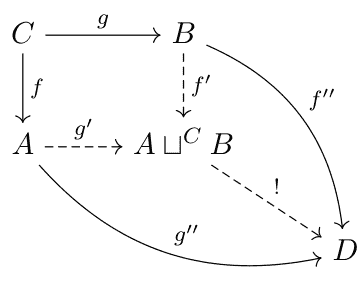

其中 $f'$ 和 $g'$ 由 $f$ 和 $g$ 确定。

## 5.1 $A \xleftarrow{f} C \xrightarrow{g} B$ 的推出

回到同伦类型理论，我们可以将推出定义为一个高阶归纳类型，其元素是由映射 $f$ 将 $A$ 和 $g$ 将 $B$ 映射到推出 $A \sqcup^C B$ 的不相交和 $A+B$ 生成的。

```latex
\text{inl}: A \rightarrow A \sqcup^C B
```

```latex
\text{inr}: B \rightarrow A \sqcup^C B
```

并且它的 1-细胞连接 $\text{inl}(f(c))$ 和 $\text{inr}(g(c))$ 对于每个元素 $c \in C$。

```latex
\text{glue}: \Pi_{c: C} . \text{Id}_{A \sqcup^C B}(\text{inl}(f(c)), \text{inr}(g(c)))
```

像往常一样，我们可以定义一个递归器 $\text{rec}[D](\cdots): A \sqcup^C B \rightarrow D$（由上面的图表所暗示的映射）。注意，对于每个元素 $u \in C$，递归器要求存在一个路径来证明 $[f(u)/x]l$ 和 $[g(u)/y]r$ 的相等性，这表示递归器对 $\text{glue}$ 的作用，并确保在推出中“粘合在一起”的元素的图像也在 $D$ 中被粘合在一起。

$$
\frac{x: A \vdash l: D \quad y: B \vdash r: D \quad u: C \vdash q: [f(u)/x]l =_D [g(u)/y]r}{z: A \sqcup^C B \vdash \text{rec}[D](x.l; y.r; u.q)(z): D}
$$

我们有通常的 $\beta$ 规则。

```latex
\begin{aligned}
\text{rec}(x.l; y.r; u.q)(\text{inl}(a)) &\equiv [a/x]l \\
\text{rec}(x.l; y.r; u.q)(\text{inr}(b)) &\equiv [b/y]r \\
\text{ap}_{\text{rec}(x.l; y.r; u.q)}(\text{glue}(c)) &= [c/u]q
\end{aligned}
```

将高阶归纳类型的元素与给定类型的每个元素的路径粘合在一起的想法似乎非常类似于截断。事实上，悬挂可以定义为 $A$ 与单点类型及平凡映射的推出：

```latex
\text{悬挂}(A) = 1 \sqcup^A 1
```

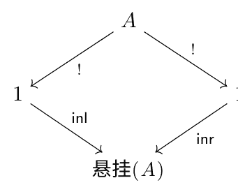

这立即导致以下结果：

**推论 1.** 两个集合的推出不一定是一个集合。

这是因为 $\mathbb{S}^1 = \text{悬挂}(2)$，但是 $\mathbb{S}^1$ 已知不是一个集合。

# 6 商作为 HITs

集合的推出定义是基于商的，因此我们可以考虑使用 HITs 定义集合的商。

考虑 $A/R$ 的类型理论表示，即一个由关系 $R$ 商化的类型 $A$。我们定义这个类型具有商的标准性质。我们必须能够将 $A$ 的元素投影到 $A/R$ 中，例如通过计算其商映射 $q: A \rightarrow A/R$。

如果我们有两个元素 $a$ 和 $b$ 属于 $A$，它们之间有关系 $R$，也就是说 $R(a, b)$，那么我们必须有一个相等的证明：

```latex
\text{wd}: \Pi_{a, b: A} . R(a, b) \rightarrow q(a) =_{A/R} q(b)
```

以上是期望的性质。然而，我们还希望 $A/R$ 是一个集合。这要求 $A/R$ 中的所有相等证明本身也是相等的。我们通过添加所需的相等证明来将 $A/R$ 截断为一个集合：对于 $A/R$ 中任意元素 $x$ 和 $y$ 之间的任意两条路径 $p$ 和 $q$，我们引入压缩操作。

```latex
\text{trunc}: \Pi_{x, y: A/R} . \Pi_{p, q: x =_{A/R} y} . p =_{x=y} q
```

该定义表明，存在一个从 $A/R$ 到某个类型 $B$ 的函数，等同于说存在一个从 $A$ 到 $B$ 的函数，它通过将 $R$-相关元素映射到在 $B$ 中（命题相等）的元素来保持 $R$ 的关系。

## 命题 3.
$$ (A / R) \rightarrow B \simeq \sum_{f: A \rightarrow B} \Pi_{a, b: A} . R(a, b) \rightarrow f(a) =_B f(b) $$

教科书中给出了详细证明。

### 6.1 例子： $\mathbb{Z}$

我们可以将整数表示为自然数对 $(a, b)$（表示整数 $a-b$）。由于每个整数对应于（无限多个）对，我们通过适当的关系进行商集。

$$ \mathbb{Z} = (\mathbb{N} \times \mathbb{N}) / R $$

这种表示在第 8 节中证明 $\pi_{1}(\mathbb{S}^1) \simeq \mathbb{Z}$ 时非常重要。

# 7 截断作为 HITs

我们之前已经见过命题截断 $|A|$，它通过强制所有值的相等证明将类型 $A$ 截断为命题。

现在我们将命题截断重新定义为一个高阶归纳类型。

由于我们将这个概念推广到所有 $\mathrm{h}$-层级的截断 $n$，我们现在将命题截断写作 $|A|_{-1}$。

高阶归纳类型 $|A|_{-1}$ 有一个简单的构造器：
$$ |\cdot|_{-1}: A \rightarrow |A|_{-1} $$

为了添加 1-细胞，我们引入压缩操作来生成任意两个值的相等证明：
$$ \text{压缩}: \Pi_{a, b: |A|_{-1}} . a =_{|A|_{-1}} b $$

其归纳原理如下：
$$
\frac{
  \begin{aligned}
  & z: |A|_{-1} \vdash P(z): \mathcal{U} \\
  & x: A \vdash p: P(|x|_{-1}) \\
  & x, y: |A|_{-1}, u: P(x), v: P(y), z, P \vdash q: u =_{\text{Squash}(x,y)}^{z,P} v
  \end{aligned}
}{
  z: |A|_{-1} \vdash \text{ind}[z.P](x.p; x,y,u,v.q)(z): P(z)
}
$$

我们现在可以使用相同的方法来定义集合截断作为一个 HIT：
$$ |\cdot|_{0}: A \rightarrow |A|_{0} $$

与商的定义类似，集合截断提供了所有路径的相等性证明。
$$
\frac{x, y: |A|_{0}, p, q: x =_{|A|_0} y \vdash \text{压缩}(x, y, p, q): p =_{x=y} q}{\text{且我们给出归纳原理: } z: |A|_{0} \vdash P(z): \mathcal{U}}
$$
归纳原理的具体形式为：
$$
\frac{
  \begin{aligned}
  & x: A \vdash g: P(|x|_0) \\
  & x, y: |A|_0, z: P(x), w: P(y), p, q: x=y, r: z=_p w, s: z=_q w \vdash ip: p =_{\text{Squash}(x,y,p,q)}^{z,P} q \\
  & z: |A|_0 \vdash \text{ind}[z.P](x.g; x,y,z,w,p,q,r,s.ip)(z): P(z)
  \end{aligned}
}{}
$$

**命题 4.** 如果 $A$ 是一个集合，它等价于它自己的集合截断，即 $\text{isSet}(A) \rightarrow |A|_0 \simeq A$。

## 8 $\mathbb{S}^1$ 的基本群

回顾 $\mathbb{S}^1$ 是由以下构造器定义的：
$$
\begin{aligned}
\text{base} &: \mathbb{S}^1 \\
\text{loop} &: \text{base} =_{\mathbb{S}^1} \text{base}
\end{aligned}
$$

回顾环路空间定义为 $\Omega(A, a_0) := (a_0 =_A a_0)$。
基本群 $\pi_1(A, a_0)$ 定义为 $|\Omega(A, a_0)|_0$。

**定理 1.** 我们想要证明 $\pi_1(\mathbb{S}^1) \simeq \mathbb{Z}$。

**证明.** 展示 $\Omega(\mathbb{S}^1, \text{base}) \simeq \mathbb{Z}$（根据命题 4）。
我们定义一个映射 $\operatorname{loop}^{(-)}: \mathbb{Z} \rightarrow \Omega(\mathbb{S}^1)$ 如下：
$$
\begin{aligned}
\operatorname{loop}^{(0)} &= \operatorname{refl}(\text{base}) \\
\operatorname{loop}^{(-n)} &= \operatorname{loop}^{(-n+1)} \cdot \operatorname{loop}^{-1} \\
\operatorname{loop}^{(+n)} &= \operatorname{loop}^{(n-1)} \cdot \operatorname{loop}
\end{aligned}
$$
这可以通过 $\mathbb{Z}$ 的递归器来定义。

定义映射 $winding: \Omega(\mathbb{S}^1) \rightarrow \mathbb{Z}$。
我们取 $succ: \mathbb{Z} \simeq \mathbb{Z}$，并且 $pred = succ^{-1}$，通过将整数上下移动一个来定义。所以，我们有：
$$ ua(succ) : \mathbb{Z} =_{\mathcal{U}} \mathbb{Z} $$

通过 $\mathbb{S}^1$ 的递归原理（而非归纳原理）定义：
$$
\begin{aligned}
code &: \mathbb{S}^1 \to \mathcal{U} \\
code(\text{base}) &= \mathbb{Z} \\
code(\text{loop}) &= ua(succ)
\end{aligned}
$$
$$ \text{ap}_{code} : \Omega(\mathbb{S}^1) \to (\mathbb{Z} = \mathbb{Z}) $$
卷绕数定义为：
$$ \text{绕}(p) := \operatorname{tr}_{code}(ap_{code}(p))(0) $$

**命题 5.** $\Pi_{n: \mathbb{Z}} . \text{绕}(\operatorname{loop}^{(n)}) =_{\mathbb{Z}} n$。

**证明.** 通过归纳很容易证明。

**命题 6.** $\Pi_{l: \Omega(\mathbb{S}^1)} . \operatorname{loop}^{-\text{绕}(l)} =_{\Omega(\mathbb{S}^1)} l$。

我们无法直接通过对路径 $l$ 进行归纳进行推导，因为 $\Omega(\mathbb{S}^1)$ 中的路径并非自由生成的。

定义编码与解码函数：
$$
\begin{aligned}
encode &: \Pi_{x: \mathbb{S}^1} (\text{base} = x) \to code(x) \\
encode(x, p) &:= \operatorname{tr}_{code}(p)(0) \\
decode &: \Pi_{x: \mathbb{S}^1} code(x) \to \text{base} = x \\
decode(x) &:= \text{rec}_{\mathbb{S}^1}[z. \text{base}=z](\lambda z. \operatorname{refl}(\text{base}), \lambda n. \operatorname{loop}^{(n)})(x)
\end{aligned}
$$

为了完成证明，需要路径归纳与圆的性质。