# MIT 18.S996：科学家的范畴论

大卫·斯皮瓦克

2013 年 9 月 17 日


数学如何使这个图表有意义？

# 前言

这本书的早期版本于 2013 年 2 月上线，作为我在 MIT 春季学期教授的科学家的范畴论课程的教材。在那个学期，学生们给我提供了数百条评论和问题，这导致了原始文档的大幅改进（并增加了 50 页）。

2013 年夏天，我与 MIT 出版社签订了一份合同，出版了这部作品的新版本，标题为“科学家的范畴论”。因为我致力于开源开发模式，所以我坚持让这本书的一个版本，也就是你正在阅读的版本，保持免费在线提供。当然，MIT 出版社的版本将不免费。

除了标题之外，目前版本与 MIT 出版社版本之间有两个主要区别。第一个区别是我将与出版社的专业编辑一起进行全面编辑。第二个区别是我将编写这本书的（大约 280 个）练习题的解答；其中一部分将包含在出版版本中，而其余部分将通过密码保护的页面提供，仅供教授该科目的教授访问。

# 目录

- 1 引言
- 1.1 范畴论的简要历史
- 1.2 本书的意图
- 1.3 学生需要什么
- 1.4 范畴论参考资料
- 1.5 致谢
- 2 集合的范畴
- 2.1 集合和函数
- 2.2 可交换图
- 2.3 Olog
- 2.4 积和余积
- 2.5 集合中的有限极限
- 2.6 集合中的有限余极限
- 2.7 集合中的其他概念
- 3 范畴和函子，不承认它
- 3.1 幺半群
- 3.2 群
- 3.3 图
- 3.4 顺序
- 3.5 数据库：模式和实例
- 4 基础范畴论
- 4.1 范畴和函子
- 4.2 在数学中常见的范畴和函子
- 4.3 自然变换
- 4.4 范畴和模式等价，Cat ≃ Sch.
- 4.5 极限和余极限
- 4.6 范畴论中的其他概念
- 5 工作中的范畴
- 5.1 伴随函子
- 5.2 函子的范畴
- 5.3 幺半群
- 5.4 操作符

# 1 引言

本书的封面包含一个图形，我们在这里复制。

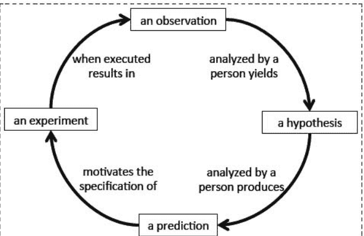

它旨在唤起对科学方法的思考。

一个人分析的假设会产生一个预测，这激发了一个实验的具体规定，当执行实验时会产生一个观察结果，一个人分析这个结果会得出一个假设。

这听起来是有效的，一个好的图形可以在引导读者阅读作者希望讲述的故事方面非常有用。

有趣的是，图形有能力唤起理解的感觉，而不真正意味着很多。对于文本也是如此：可以使用英语这样的语言来表达从未被严谨或清晰地阐明的思想。当有人说“我相信自由意志”，她相信什么？我们可能对她所说的有一些概念，我们可以在概念上进行工作、讨论或争论。但我们所有人是否都在讨论同一件事，她想要传达的东西？

科学是关于一致的。当我们提供一个令人信服的论证时，这个令人信服的结果就是一致。当在实验中观察与假设相符时，这就是一致。当我的方法对你来说是有意义的时候，那就是一致。当实践与理论不一致时，那就是不一致。一致是科学中的好东西；这是高五。

但是很容易认为我们是一致的，而实际上我们并不是。将我们的思想建模为启发式和图像可能对快速前进很方便，但我们很可能在第一英里错过转弯。危险在于将我们方便的概念化误认为实际存在的东西。我们必须随时有能力与现实接触。那是什么意思？

数据。确凿的证据。物理世界。科学在这里着陆，启发式消失。所以让我们再次看一下封面上的图表。它旨在唤起科学是如何进行的想法。是否有确凿的证据和数据来支持这个理论？我们能够设置一个实验来找出科学是否实际按照这样的协议进行吗？为了做到这一点，我们必须摆脱图表唤起的昏迷，并问这个问题：“这个图表打算传达什么？”在这门课程中，我将使用一种数学工具，称为 ologs，或本体日志，为经常以图像形式传达的思想类型提供一些结构。每个本体日志本质上提供了一个记录主题数据的框架。更准确地说，它包含一个数据库模式，这意味着一个最初为空的但可以输入数据的相互连接的表系统。例如，考虑下面的本体日志


这个图表代表了一个框架，用于记录物体离地面的高度、质量以及它们触地所需的秒数和与其高度相关的某个实值函数之间的比较（中间的问号）。我们将在本课程中详细讨论图表。

图（1.1）看起来像一个图表，但它不符合我们在 2.3 节中规定的图表规则。在一个图表中，每个箭头都代表一个数学函数。很难想象一个接受预测并输出实验结果的函数，但这样的函数对于箭头来说是必要的。


在（1.1）中有意义。要从一个预测中产生一个实验设计可能需要一个专家，即使是专家也可能在星期二和星期一—有不同的动机来指定一个不同的实验。但也许我们的批评已经引导我们前进的方向：如果我们说每个箭头在具体的时间和具体的科学家实际进行科学研究的背景下代表一个函数，那么图（1.1）开始变得有意义。事实上，我们将在第 5.3 节（具体地说是例子 5.3.3.10）中回到这个图中，其中认真讨论了背景方法论的背景。

## 1.1 范畴论的简要历史

这门课程试图赞扬一种新的数学分支，称为范畴论，它被发明用于在数学的不同领域和子领域之间进行强大的思想交流。通过强大的思想交流，我实际上指的是一些精确的东西。数学的不同分支可以形式化为范畴。然后，这些范畴可以通过函子连接在一起。而这些函子提供强大的思想交流的意义在于，一个范畴中证明的事实和定理可以通过连接的函子传递到另一个范畴中，从而得到类似定理的证明。函子就像数学真理的指挥者。

我相信范畴论的语言和工具集在整个科学领域都是有用的。我们通过发展模型来建立科学理解，而范畴论则是研究基本概念构建块以及它们如何干净地组合在一起以构建这样的模型。某些结构和概念框架在我们对现实的理解中一再出现。没有人会质疑向量空间的无处不在。

但是层次结构、对称性、代理人对对象的作用、数据模型、全局行为作为局部行为的总和、自相似性以及方法论背景的影响也是如此。

有些观念是如此常见，以至于我们几乎察觉不到，比如集合论的交集。例如，当我们谈论一个既轻便又韧性的材料时，我们是在求两个集合的交集。但是提到这个集合论事实有什么用呢？答案是，当我们形式化我们的观念时，我们的理解几乎总是更加清晰。我们与他人沟通的能力得到增强，发展新的洞察的可能性也扩大了。而且，如果我们要将我们的观念输入计算机，我们首先需要能够形式化这些观念。

我希望这门课程能够为科学家提供一种新的思考和交流的词汇，并为存在且在数学中被认为非常强大的各种定理提供一条新的渠道。这些定理尚未在科学界广泛应用，但它们直接适用于科学领域。层次结构是偏序，对称性是群元素，数据模型是范畴，代理人的行为是幺半群作用，从局部到全局的原则是层，自相似性由操作符模拟，上下文可以由单子模型化。

爱因斯坦的相对论带来了范式转变，使人们意识到没有一个单一的视角来看待世界。我们不需要找到一个背景框架；有无限多种不同的框架和视角，真正的力量在于能够在它们之间进行翻译。

正是在这个历史背景下，范畴论开始发展。¹

范畴论是由塞缪尔·艾伦伯格和桑德斯·麦克莱恩于 20 世纪 40 年代初发明的。它被专门设计用来连接看起来可能完全不同的两个领域：拓扑学和代数学。拓扑学是研究抽象形状（如 7 维球体）的学科；代数学是研究抽象方程（如 y²z = x³ - xz²）的学科。

人们已经在这些领域之间建立了重要而有用的联系（例如上同调理论），但艾伦伯格和麦克莱恩需要精确比较不同的联系。彼此之间。为了这样做，他们首先需要概括并提取出这两个领域的基本本质。但他们提出的思想构成了一个适用于拓扑学和代数学，以及许多其他数学学科的框架。

起初，范畴论只是对现有复杂数学思想的一种深入澄清的语言。然而，1957 年，亚历山大·格罗滕迪克 (Alexander Grothendieck) 使用范畴论构建了新的数学工具 (新的同调理论)，为代数方程的行为提供了前所未有的洞察力。从那时起，范畴论被专门构建用于聚焦数学主题的特定特征，并以一种其他地方无法比拟的敏锐程度对其进行研究。

比尔·劳维尔将范畴论视为所有数学思想的新基础。19 世纪数学家一直在寻找基础，并且对集合论作为基础感到相当满意。但劳维尔表明，集合的范畴只是具有某些良好性质的范畴，不一定是数学宇宙的中心。他解释了整个代数理论如何被视为单一系统的示例。他和其他人继续展示了高阶逻辑在范畴论 (更具体地说是拓扑学) 的框架中被完美地捕捉到。

在这里，格罗滕迪克和他的学派在代数几何中取得了重要的成果。

1980 年，约阿希姆·兰贝克证明了计算机科学中使用的类型和程序形成了一种特定类型的范畴。这为谈论程序提供了新的语义，使人们能够研究程序如何组合和组成其他程序，而不关心具体的实现细节。尤金尼奥·莫吉将范畴论中的单子概念引入计算机科学，以封装到那时被认为超出该理论范畴的思想。

很难解释丹尼尔·坎和安德烈·乔亚尔等人为范畴论带来的清晰和美感。他们每个人都反复提取了整个数学学科的本质，揭示并形式化了一种令人惊叹的简单而极其强大的思维模式，彻底改变了数学的做法。

然而，长期以来，范畴论一直被数学界的很多人视为荒谬的抽象。但在 21 世纪，它终于开始在纯数学的更大社区中获得健康的尊重。它是研究生水平的代数和拓扑课程的首选语言，在我看来，它将继续确立自己作为数学进行的基本框架。

如上所述，范畴论也已经扩展到某些科学领域。贝兹和多兰已经展示了它在理解量子物理学方面的价值，它在计算机科学中得到了很好的应用，并且在其他几个领域也有支持者。但在我看来，我们才刚刚开始将其应用于科学方法论。范畴论是作为一座桥梁而发明的，它将继续在这个角色中发挥作用。

¹范畴论的历史概述太过简略，也许更多地反映了作者的审美观，而不是客观真理，无论那意味着什么。以下是一些更好的参考资料：[Kro]，[Mar1]，[LM]。

## 1.2 本书的意图

应用数学的世界比适用数学的世界要小得多。正如上面所提到的，这门课程旨在建立数学概念与科学学科 (如物理学、计算机科学和神经科学) 之间的桥梁，以描述我们研究中出现的各种现象。

对于纯数学家，我将尝试证明范畴、函子、自然变换、极限、余极限、函子范畴、层、单子等概念 (这些概念通常被认为对于数学专业的学生来说过于抽象) 可以被没有线性代数以外数学背景的科学家理解。操作符概念——这些概念通常被认为对于数学专业的学生来说过于抽象——可以被没有线性代数以外数学背景的科学家理解。如果我认为这些材料是可以教授的，那么这意味着范畴论并不是神秘的，而是与科学思维已经理解的思想相吻合。然而，请注意，本书以示例为基础，而不是以证明为基础，因此可能不适合作为纯数学学生的参考书。

对于科学家，我将尝试证明范畴论包括对概念结构的形式化处理，科学家经常看到这些结构，也许没有意识到可以使用精密的数学工具。我们将研究信息的结构；数据如何通过内部和外部的连接变得有意义。然而，请注意，这本书绝对不能作为科学问题的参考。人们应该假设物理学、材料科学、化学等的任何描述都过于简化。本书的目的是让人们了解范畴论如何帮助我们建模科学思想，而不是以严肃的方式解释这些思想。

数据收集在科学中无处不在。目前正在挖掘巨大的数据库中的未知模式，但实际上有许多已知模式尚未被归类。考虑医疗记录的典型案例。一个患者的病史通常由各个医生办公室知晓，但在它们之间共享得非常不充分。共享医疗记录通常意味着在办公室之间传真手写的便条或填写的自制表格。

同样，在科学中存在着大量的专业知识，可以建立起精彩的概念之间的联系，但这些知识被传达在被称为期刊文章的英文散文的孤立领域中。每篇科学期刊文章都有一个方法部分，但几乎不可能通过阅读方法部分然后重复实验——英语无法准确而简洁地传达正在进行的工作。

在这门课程中，首先要理解的是可重复使用的方法可以被形式化，并且这样做本身就具有价值。考虑以下类比。
假设你想要计算空间中一个区域的面积（或者曲线下的面积）。
你将区域分成小方块，每个方块的面积为 A；然后你计算方块的数量，假设为 n，结果是该区域的面积约为 nA。如果你想要更精确和准确的结果，你可以用更小的方块重复这个过程。这种方法可以用于任何面积计算问题（超过大多数一年级微积分学生所意识到的），因此它值得被形式化。但是一旦我们将这种方法形式化，它可以被推到极限，从而得到黎曼和的积分。

我打算展示范畴论作为一种实验设计模式语言的非凡效率，引入形式性同时保持灵活性。它构成了一个丰富而紧密编织的概念框架，使科学家能够在需要时在不同的视角之间操纵。一旦一个人为自己建立了这个框架，他或她就有了一种思考模型的能力，这种能力在没有它的情况下根本不会出现。此外，将思想用范畴论的语言表达出来迫使一个人澄清他们的假设。这对研究人员和他或她的观众都非常有价值。

为了在这门课程中找到价值，必须认识到概念混乱是一个重大问题。创造力要求思维的清晰，而要清晰地思考一个主题，就需要对其各个部分如何相互配合有组织的理解。组织和清晰还能带来与他人更好的沟通。学者们经常说他们是为了思考和理解而受薪水，但这是不正确的。他们是为了思考、理解并传达他们的发现。科学的通用语言——如微积分和微分方程、矩阵，或者简单的图表和饼图——已经存在，并且它们赋予我们一种凝聚力，使科学研究变得有价值。在这本书中，我将尝试展示范畴论在描述复杂科学理解方面同样有用。

## 1.3 学生需要什么

我将尽力清楚地表明范畴论在科学中的价值，但我不是科学家。为此，我请求您的帮助，探索范畴论在您特定领域中可能有用的方式。

我还希望您认识到数学的价值通常并不明显。一个好学生在有好老师教授的好学科中几乎立即会看到一些引人注目的东西，但可能不知道它在现实生活中如何有用。这将在以后体现出来。我希望您努力去理解，即使还不知道它在您的生活和研究中的实际价值是什么。就像一个足球学生被鼓励花几个小时来玩弄球，而不是练习点球一样，熟练掌握您将使用的材料非常重要。做练习对于学习数学是必不可少的。

## 1.4 范畴论参考资料

我写这本书是因为关于范畴论的可用书籍几乎都是为数学家写的（其余的是为计算机科学家写的）。有一本书叫做《概念数学》[LS]，由劳维尔和沙纽尔合著，面向更广泛的读者介绍范畴论，但它的风格不适合本课程。不过，它写得非常好，很清晰。

范畴论的“圣经”是麦克莱恩的《工作数学家的范畴论》[Mac]。但正如标题所示，它是为工作的数学家而写的，对我的目标读者来说可能会很难理解。然而，一旦一个人读过我的书，麦克莱恩的书可能会成为一本有价值的参考书。

其他好书包括史蒂夫·阿沃迪的《范畴论》[Awo] 和巴尔和韦尔斯的《计算科学的范畴论》[BW]。布朗和波特的一篇论文《范畴论：类比和比较的抽象框架》[BP1] 更符合本书的风格，只是篇幅更短。在网上，我发现维基百科和一个叫做"nLab"的网站非常有用。

这本书试图通过例子和练习来解释范畴论，而不是通过定理和证明。我希望这种方法对于从事科学研究的人员是有价值的。

## 1.5 致谢

我想对我在过去五年里与之合作的许多科学家表示深深的感谢。一切都始于 Paea LePendu，他在我还天真地敲开俄勒冈大学计算机科学系的门时，首次教给了我关于数据库的知识。如果不是 Tristan Nguyen 和 Dave Balaban 注意到我的工作并鼓励我继续下去，这本书就不会被写出来。Dave Balaban 和 Peter Gates 从一开始就是我的科学伙伴，他们努力工作，以理解我所提供的内容，并努力帮助我理解我所缺少的一切。

Peter Gates 以深入的方式加深了我对数据的理解。

我非常幸运地认识了 Haynes Miller，他在 Clark Barwick 和 Jacob Lurie 的帮助下，使我有可能在麻省理工学院进行研究。我知道麻省理工学院将是我追求这种类型研究的最佳场所，它确实做到了。像 Markus Buehler 和他的研究生 Tristan Giesa 和 Dieter Brommer 这样的研究人员是我很愿意合作的人，这本书中散布的许多材料科学例子证明了我们的合作对我的思考有多大影响。

我还要感谢与我讨论本书内容的合作者和对话伙伴们。除了上面提到的人，还包括 Steve Awodey, Allen Brown, Adam Chlipala, Carlo Curino, Dan Dugger, Henrik Forsell, David Gepner, Jason Gross, Bob Harper, Ralph Hutchison, Robert Kent, Jack Morava, Scott Morrison, David Platt, Joey Perricone, Dylan Rupel, Guarav Singh, Sam Shames, Nat Stapleton, Patrick Schultz, Ka Yu Tam, Ryan Wisnesky, Jesse Wolfson 和 Elizabeth Wood。

我要感谢 Peter Kleinhenz 和 Peter Gates 在我 2013 年春季在 MIT 教授 18-S996 课程之前阅读本书并提供宝贵的反馈。特别是封面图片是 Gates 给我的一张稍作修改的图片，用来激励科学家阅读本书。我还要非常感谢 18-S996 课程的助教 Darij Grinberg，他不仅是我在教学 14 年中遇到的最好的助教，而且对本书本身给出了比任何人都多的评论。我还要感谢 MIT 的 18-S996 课程的学生们，他们帮助我找到了错别字，指出了不清楚的解释，并在许多方面帮助我改进了本书。

除了上面列出的人员外，还包括 Aaron Brookner, Leon Dimas, Dylan Erb, Deokhwan Kim, Taesoo Kim, Owen Lewis, Yair Shenfeld 和 Adam Strandberg。我要感谢我的老师 Peter Ralston，他教会我反复质疑显而易见的事情。自从和他学习以来，我在承诺并完成这个项目方面的能力显然得到了提高。

最后，我要感谢美国海军研究办公室的支持，没有他们，这本书将不可能问世。我相信他们对基础研究的资助是确保美国在未来几年保持全球领导地位的一个极好的方式。

# 2 集合的范畴

集合论的理论是为了作为数学的基础而发明的。集合和函数的概念为我们建立关于范畴的直觉提供了基础。在本章中，我们将给出集合和函数的例子，然后继续讨论可交换图。在这一点上，我们可以引入 ologs，它将允许我们使用范畴论的语言来谈论现实世界的概念。然后，我们将介绍极限和余极限以及它们的普遍性质。所有这些材料都是基本集合论，但它也可以被看作是对我们的第一个范畴——集合范畴 Set 的研究。我们将以一些在 Set 中无法适应前面章节的其他有趣构造结束本章。

## 2.1 集合和函数

### 2.1.1 集合

在这门课程中，我将假设你知道什么是集合。我们可以将一个集合 $X$ 看作是一组事物的集合，每个事物 $x \in X$ 都可以被识别为属于 $X$，并且对于每一对命名的元素 $x, x' \in X$，我们可以判断 $x = x'$ 还是不是。$^1$ 振子的集合是我们约定称为振子的事物的集合，每个振子都可以被识别为振子，并且对于任何两个指向振子的人，我们可以判断他们是否指向同一个振子。

符号 $\varnothing$ 表示没有元素的集合。符号 $\mathbb{N}$ 表示自然数的集合，我们可以写作

$\mathbb{N} := \{0, 1, 2, 3, 4, \ldots, 877, \ldots\}$.

符号 $\mathbb{Z}$ 表示整数的集合，其中包括自然数及其负数。

$\mathbb{Z} := \{\ldots, -551, \ldots, -2, -1, 0, 1, 2, \ldots\}$.

如果 $A$ 和 $B$ 是集合，我们说 $A$ 是 $B$ 的子集，并写作 $A \subseteq B$，如果 $A$ 的每个元素都是 $B$ 的元素。所以我们有 $\mathbb{N} \subseteq \mathbb{Z}$。检查定义，人们会发现

$^1$ 注意符号 $x'$，读作"$x$-prime"，与微积分或导数无关。这只是我们用来命名一个被认为与 $x$ 有某种相似之处的符号的表示法。这种 $x$ 和 $x'$ 之间的亲缘关系的暗示仅仅是对人类认知的一种辅助，而不是数学的一部分。

## 2.1 集合和函数

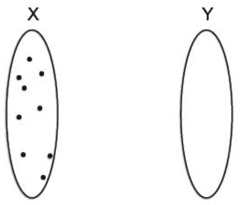

图 2.1: 一个有 9 个元素的集合 X 和一个没有元素的集合 Y，Y 表示空集。

对于任何集合 A，我们有 (可能无趣的) 子集 $\emptyset \subseteq A$ 和 $A \subseteq A$。我们可以使用集合构建符号来表示子集。例如，偶数的集合可以写作 $\{n \in \mathbb{Z} \mid n \text{ 是偶数}\}$。大于 2 的整数的集合可以用多种方式表示，比如

```
$$ \{n \in \mathbb{Z} \mid n > 2\} \quad \text{或者} \quad \{n \in \mathbb{N} \mid n > 2\} \quad \text{或者} \quad \{n \in \mathbb{N} \mid n \geqslant 3\}. $$
```

符号 $\exists$ 表示“存在”。因此，我们可以将偶数集写为

```
$$ \{n \in \mathbb{Z} \mid n \text{ 是偶数}\} \quad = \quad \{n \in \mathbb{Z} \mid \exists m \in \mathbb{Z} \text{ 使得} 2m = n\}. $$
```

符号 $\exists!$ 表示“存在唯一”。因此，语句“$\exists! x \in \mathbb{R}$ 使得 $x^2 = 0$”表示只有一个数的平方是 0。最后，符号 $\forall$ 表示“对于所有”。因此，语句“$\forall m \in \mathbb{N} \exists n \in \mathbb{N}$ 使得 $m < n$”表示对于每个数都存在一个更大的数。

正如你可能已经注意到的，我们使用冒号等号符号“$A := XYZ$”来表示类似“定义 A 为 XYZ”的意思。也就是说，冒号等号声明并不表示自然界的事实 (例如 $2 + 2 = 4$)，而是说话者的选择。恰好上面的表示法，例如 $\mathbb{N} := \{0, 1, 2, \dots\}$，是一个广泛接受的选择。

**练习 2.1.1.2.** 令 $A = \{1, 2, 3\}$。$A$ 的所有子集是什么？提示：有 8 个。

### 2.1.2 函数

如果 X 和 Y 是集合，那么从 X 到 Y 的函数 $f$，表示为 $f: X \rightarrow Y$，是一个映射将 X 中的每个元素 $x \in X$ 映射到 Y 中的一个元素，表示为 $f(x) \in Y$。我们称 X 为函数 $f$ 的定义域，称 Y 为 $f$ 的值域。


请注意，对于 X 中的每个元素 $x \in X$，都有一条箭头从 $x$ 发出，但对于 Y 中的元素 $y \in Y$，可能有多条箭头指向 $y$，也可能没有箭头指向 $y$。

**应用 2.1.2.1.** 在研究材料力学时，人们希望了解材料对拉力的响应。例如，橡皮筋对拉力的响应与弹簧不同。对于每种材料，我们可以关联一个力 - 伸长曲线，记录材料在不同长度下承载的力量。一旦我们确定了进行实验的方法论，找到材料的力 - 伸长曲线理想上应构成从材料集合到曲线集合的函数。²

**练习 2.1.2.2.** 这是大脑接收光线的简化描述。眼睛中含有约 1 亿个光感受器 (PR) 细胞。每个细胞连接到一个视网膜神经节 (RG) 细胞。没有 PR 细胞连接到两个不同的 RG 细胞，但通常多个 PR 细胞可以连接到一个 RG 细胞。

令 PR 表示光感受器细胞的集合，令 RG 表示视网膜神经节细胞的集合。

- a.) 根据上述描述，连接模式是否构成一个函数 $RG \rightarrow PR$，一个函数 $PR \rightarrow RG$ 或者两者都不是？
- b.) 你是否猜测大脑其他区域之间存在的连接模式是“类似函数”的？

**例子 2.1.2.3.** 假设 $X$ 是一个集合，$X' \subseteq X$ 是一个子集。那么我们可以考虑将每个 $X'$ 的元素发送到“它自己”作为 $X$ 的元素的函数 $X' \rightarrow X$。例如，如果 $X$ 为 $\{a, b, c, d, e, f\}$，$X'$ 为 $\{b, d, e\}$，那么 $X' \subseteq X$，我们可以将其转化为函数 $X' \rightarrow X$，其中 $b \rightarrow b, d \rightarrow d, e \rightarrow e$。³

作为一种符号表示，我们有时会说类似以下的话：令 $X$ 是一个集合，令 $i: X' \subseteq X$ 是一个子集。在这里，我们明确指出 $X'$ 是 $X$ 的一个子集，但 $i$ 是相关函数的名称。

² 实际上，同一材料的不同样本，比如不同尺寸或不同温度的样本，可能具有不同的力 - 伸长曲线。如果我们希望将其视为一个真正的函数，其值域是曲线，那么它的定义域应该是类似于材料样本集合的东西。

³ 这种箭头，$\rightarrow$，读作“映射到”。一个函数 $f: X \rightarrow Y$ 意味着一种规则，用于将每个元素 $x \in X$ 映射到一个元素 $f(x) \in Y$。我们说“$x$ 映射到 $f(x)$”，并写作 $x \rightarrow f(x)$。

**练习 2.1.2.4.** 令 $f: \mathbb{N} \rightarrow \mathbb{N}$ 成为一个函数，它将每个自然数映射到它的平方，例如 $f(6) = 36$。首先填写下面的空白，然后回答一个问题。

- a.) $2 \rightarrow$ _________
- b.) $0 \rightarrow$ _________
- c.) $-2 \rightarrow$ _________
- d.) $5 \rightarrow$ _________
- e.) 考虑符号 $\rightarrow$ 和符号 $\to$。这两个符号在本书中的使用有什么区别？

给定一个函数 $f: X \rightarrow Y$，至少有一个箭头指向它们的 $Y$ 的元素被称为 $f$ 的图像；即我们有

$$ \text{im}(f) := \{ y \in Y \mid \exists x \in X \text{ such that } f(x) = y \}. \quad (2.3) $$

**练习 2.1.2.5.** 如果 $f: X \rightarrow Y$ 由上面的 (2.2) 表示，将其图像 $\text{im}(f)$ 写成一个集合。

给定一个函数 $f: X \rightarrow Y$ 和一个函数 $g: Y \rightarrow Z$，其中 $f$ 的余域与 $g$ 的定义域相同 (即 $Y$)，我们说 $f$ 和 $g$ 是可组合的

$$ X \xrightarrow{f} Y \xrightarrow{g} Z. $$

$f$ 和 $g$ 的复合表示为 $g \circ f: X \rightarrow Z$。

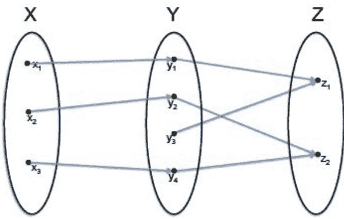

图 2.4：函数 $f: X \rightarrow Y$ 和 $g: Y \rightarrow Z$ 组合成一个函数 $g \circ f: X \rightarrow Z$；只需按照箭头的方向即可。

设 $X$ 和 $Y$ 为集合。我们用 $\text{Hom}_{\text{Set}}(X, Y)$ 表示函数集 $X \rightarrow Y$。注意，两个函数 $f, g: X \rightarrow Y$ 相等当且仅当对于 $X$ 中的每个元素 $x$，我们有 $f(x) = g(x)$。

**练习 2.1.2.6.** 设 $A$ 为集合 $\{1, 2, 3, 4, 5\}$ 和 $B$ 为集合 $\{x, y\}$。

4 奇怪的符号 $\text{Hom}_{\text{Set}}(-, -)$ 在后面看起来会更有意义，因为它是一个更大故事的一部分。

- a.) $\text{Hom}_{\text{Set}}(A, B)$ 有多少个元素？
- b.) $\text{Hom}_{\text{Set}}(B, A)$ 有多少个元素？

**练习 2.1.2.7.**

- a.) 找到一个集合 $A$，使得对于所有的集合 $X$，$\text{Hom}_{\text{Set}}(X, A)$ 中恰好有一个元素。提示：画出所提议的 $A$ 和 $X$ 的图像。
- b.) 找到一个集合 $B$，使得对于所有的集合 $X$，$\text{Hom}_{\text{Set}}(B, X)$ 中恰好有一个元素。

对于任意集合 $X$，我们定义 $X$ 上的恒等函数为 $\text{id}_X: X \rightarrow X$，它满足对于所有的 $x \in X$，我们有 $\text{id}_X(x) = x$。

**定义 2.1.2.8 (同构)。**

令 $X$ 和 $Y$ 是集合。函数 $f: X \rightarrow Y$ 被称为同构，记作 $f: X \cong Y$，如果存在一个函数 $g: Y \rightarrow X$，使得 $g \circ f = \text{id}_X$ 和 $f \circ g = \text{id}_Y$。我们也说 $f$ 是可逆的，而且我们说 $g$ 是 $f$ 的逆。如果存在一个同构 $X \cong Y$，我们说 $X$ 和 $Y$ 是同构的集合，可以写作 $X \cong Y$。

**例子 2.1.2.9。**

如果 $X$ 和 $Y$ 是集合，$f: X \rightarrow Y$ 是一个同构，那么图 2.2 的类比将看起来像一个完美匹配，更常被称为一一对应。这意味着没有两个箭头会指向 $Y$ 的同一个元素，并且 $Y$ 的每个元素都在 $f$ 的像中。例如，下面的图表示一个同构 $X \cong Y$。

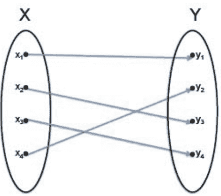

**应用 2.1.2.10。**

在 DNA 中发现的核苷酸集合 $\text{Nuc}_{\text{DNA}}$ 和在 RNA 中发现的核苷酸集合 $\text{Nuc}_{\text{RNA}}$ 之间存在同构。实际上，这两个集合都有四个元素，所以存在 24 个不同的同构。但只有一个是实用的。在我们说出哪一个是有用的之前，让我们说一下还有一个同构 $\text{Nuc}_{\text{DNA}}$ 到 A、C、G、T 和一个同构 $\text{Nuc}_{\text{RNA}}$ 到 A、C、G、U，我们将使用这些字母作为核苷酸的缩写。

方便的同构 $\text{Nuc}_{\text{DNA}}$ 到 $\text{Nuc}_{\text{RNA}}$ 是通过 RNA 转录给出的；它发送

```
A \rightarrow U, C \rightarrow G, G \rightarrow C, T \rightarrow A.
```

(另请参见应用 4.1.2.19。) 还有一个同构 $\text{Nuc}_{\text{DNA}}$ 到 $\text{Nuc}_{\text{DNA}}$(双螺旋中的匹配) 给出的是

```
$A \rightarrow T, C \rightarrow G, G \rightarrow C, T \rightarrow A.$
```

蛋白质的产生可以被建模为从 3 核苷酸序列的集合到真核氨基酸的集合的函数。然而，它不能是同构，因为有 $4^3 = 64$ 个 RNA 核苷酸三联体，但只有 21 个真核氨基酸。

**练习 2.1.2.11。** 令 $n \in \mathbb{N}$ 是一个自然数，令 $X$ 是一个恰好有 $n$ 个元素的集合。

- a.) 从 $X$ 到自身有多少个同构？
- b.) 当 $n=0$ 时，你的公式是否成立？

**引理 2.1.2.12。** 关于同构，以下事实成立。

- 1. 任何集合 $A$ 与自身同构；即存在一个同构 $A \stackrel{\cong}{\rightarrow} A$。
- 2. 对于任何集合 $A$ 和 $B$，如果 $A$ 与 $B$ 同构，则 $B$ 与 $A$ 同构。
- 3. 对于任意的集合 $A$、$B$ 和 $C$，如果 $A$ 与 $B$ 同构且 $B$ 与 $C$ 同构，则 $A$ 与 $C$ 同构。

**证明。**
- 1. 恒等函数 $\text{id}_A: A \rightarrow A$ 是可逆的；它的逆函数是 $\text{id}_A$，因为 $\text{id}_A \circ \text{id}_A = \text{id}_A$。
- 2. 如果 $f: A \rightarrow B$ 是可逆的，其逆函数为 $g: B \rightarrow A$，则 $g$ 是一个同构，且其逆函数为 $f$。
- 3. 如果 $f: A \rightarrow B$ 和 $f': B \rightarrow C$ 都是可逆的，其逆函数分别为 $g: B \rightarrow A$ 和 $g': C \rightarrow B$，则以下计算表明 $f' \circ f$ 是可逆的，且其逆函数为 $g \circ g'$:

```
$\begin{gathered}\left(f' \circ f\right) \circ\left(g \circ g'\right)=f' \circ(f \circ g) \circ g'=f' \circ \mathrm{id}_B \circ g'=f' \circ g'=\mathrm{id}_C \\(g \circ g') \circ\left(f' \circ f\right)=g \circ\left(g' \circ f'\right) \circ f=g \circ \mathrm{id}_B \circ f=g \circ f=\mathrm{id}_A\end{gathered}$
```

**练习 2.1.2.13。** 令 $A$ 和 $B$ 表示如下图所示的集合:


注意集合 $A$ 和 $B$ 是同构的。假设 $f: B \rightarrow \{1, 2, 3, 4, 5\}$ 将“Bob”映射到 1，将 ♣ 映射到 3，将 $r8$ 映射到 4，是否存在一个对应于 $f$ 的规范函数 $A \rightarrow \{1, 2, 3, 4, 5\}$？

5 规范意味着“最佳选择”，一种明显是唯一合理的选择。

**练习 2.1.2.14。** 找到一个集合 $A$，使得对于任何集合 $X$，存在一个集合同构

$$ X \cong \text{Hom}_{\text{Set}}(A, X). $$

提示：画出所提议的 $A$ 和 $X$ 的图像。

对于任何自然数 $n \in \mathbb{N}$，定义一个集合

$$ \underline{n} := \{1, 2, 3, \dots, n\}. \quad (2.6) $$

因此，特别地，$\underline{2} = \{1, 2\}$，$\underline{1} = \{1\}$，以及 $\underline{0} = \varnothing$。

令 $A$ 为任意集合。函数 $f: \underline{n} \rightarrow A$ 可以写成一个序列

$$ f = (f(1), f(2), \dots, f(n)). $$

**练习 2.1.2.15.**

- a.) 令 $A$ 为集合 $\{a, b, c, d\}$。如果给定函数 $f: \underline{10} \rightarrow A$ 为 $(a, b, c, c, b, a, d, d, a, b)$，那么 $f(4)$ 是多少？
- b.) 令 $s: \underline{7} \rightarrow \mathbb{N}$ 为 $s(i) = i^2$。将 $s$ 写成一个序列。

**定义 2.1.2.16. 有限集的基数**

令 $A$ 为一个集合，$n$ 为自然数。我们说 $A$ 的基数是 $n$，记作 $|A| = n$，如果存在一个集合同构 $A \cong \underline{n}$。如果存在某个自然数 $n$ 使得 $A$ 的基数是 $n$，则我们说 $A$ 是有限的。否则，我们说 $A$ 是无限的，并写作 $|A| \geqslant \infty$。

**练习 2.1.2.17.**

- a.) 令 $A$ 等于 $\{5, 6, 7\}$。什么是 $|A|$？
- b.) 什么是 $|\mathbb{N}|$？
- c.) 什么是 $|\{n \in \mathbb{N} \mid n \leqslant 5\}|$？

**引理 2.1.2.18。** 令 $A$ 和 $B$ 是有限集合。如果存在集合同构 $f: A \rightarrow B$，则这两个集合具有相同的基数，$|A|$ 等于 $|B|$。

**证明。** 假设 $f: A \rightarrow B$ 是一个同构。如果存在自然数 $m, n \in \mathbb{N}$ 和同构 $a: \underline{m} \xrightarrow{\cong} A$ 和 $b: \underline{n} \xrightarrow{\cong} B$，则 $\underline{m} \xrightarrow{a^{-1}} A \xrightarrow{f} B \xrightarrow{b} \underline{n}$ 是一个同构。通过归纳法可以证明，如果集合 $\underline{m}$ 和 $\underline{n}$ 是同构的，那么只有当 $m = n$ 时才是同构的。

## 2.2 可交换图

在这一点上，精确定义图表或交换图表在一般情况下是困难的，但我们可以给出启发式的想法。6 考虑以下图片:


(2.7)

如果 A, B, C 都是集合，f, g, h 都是函数，那么我们称这是一个集合的图表。

如果 $g \circ f = h$，我们称这个图表是可交换的。在这种情况下，我们将其称为集合的可交换三角形。

**应用 2.2.1.1。** 分子生物学的中心法则是“DNA 编码 RNA 编码蛋白质”。也就是说，存在一个从 DNA 三联体到 RNA 三联体的函数，以及一个从 RNA 三联体到氨基酸的函数。但有时我们只想讨论从 DNA 到氨基酸的翻译，这是其他两个函数的复合。可交换图表是这个事实的一个图示。

考虑以下图片:


如果每个 A、B、C、D 都是一个集合，每个 f、g、h、i 都是一个函数，我们称这是一个集合的图表。如果 $g \circ f = i \circ h$，我们称这个图表是可交换的。在这种情况下，我们将其称为集合的可交换方形。

**应用 2.2.1.2。** 给定一个物理系统 S，可能有两种数学方法 $f: S \rightarrow A$ 和 $g: S \rightarrow B$ 可以应用于它。其中任何一种都会导致相同类型的预测，$f': A \rightarrow P$ 和 $g': B \rightarrow P$。例如，在力学中，我们可以使用拉格朗日方法或哈密顿方法来预测未来状态。如果说这个图表


是可交换的，那就意味着这些方法给出了相同的结果。

6 我们将在第 4.5.2 节中准确地定义可交换图表。

## 2.3 Olog

以下是:


### 2.3.1 类型

类型是一个抽象的概念，是作者所做的区分。我们将每个类型表示为包含一个不定名词短语的方框。以下四个方框都是类型:


在 (2.9) 中，四个方框分别代表一种事物，一整类事物，方框上的标签是应该称呼该类事物的每个例子的名称。因此，『一个人』并不代表一个单独的人，而是代表一组人，其中每个例子都被称为“一个人”。同样，右下方的方框代表一种抽象的事物。

它可能有超过一百万个例子，但方框上的标签表示每个例子的通用名称。

在文本行中书写文本框时会出现排版问题，例如，

文本框「一个人」在这里显得不合适，而且行内的文本框越多，问题就越多越糟糕。为了解决这个问题，我将在文本行中出现的类型用角标符号表示；例如，我会写成「一个人」而不是

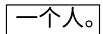

#### 2.3.1.1 具有复合结构的类型

许多类型具有复合结构；即它们由较小的单元组成。例子包括

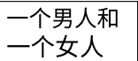

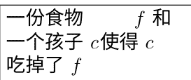

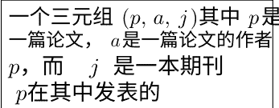

(2.10)

在 (2.10) 的最后两种情况中，声明变量为“复合类型”是一个好的做法。换句话说，最好用下面的方式替换上面的第一个方框

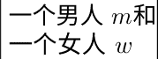

或者

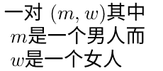

以便变量 (m, w) 清晰可见。

**良好实践规则 2.3.1.2。** 类型以文本框的形式呈现。该框中的文本应该

- (i) 以单词"a"或"an"开头；
- (ii) 涉及到作者所做的可辨认的区分；
- (iii) 涉及到可以记录实例的区分；
- (iv) 在复合结构中声明所有变量。

第一、第二和第三条规则确保每个框所代表的事物类别对作者来说是一个明确定义的集合。第四条规则鼓励箭头的良好“可读性”，下面将在第 2.3.2 节中讨论。

在本文档中，我不总是遵循良好实践的规则。我认为这些规则在“背景”中被遵循，但我给各种框起了“绰号”。因此，「史蒂夫」可以作为「被分类为史蒂夫」的事物的绰号，「精氨酸」可以作为「精氨酸分子」的绰号。然而，当需要时，应始终能够根据良好实践的规则重新命名每个类型。

换句话说，通过方面我们只是指一个函数。函数 f 的定义域 A 是我们要测量的东西，而值域是可能的“答案”或测量结果的集合。


因此，对于 (2.11) 中的箭头，定义域是女人的集合 (可能有 30 亿个元素的集合); 值域是人的集合 (可能有 60 亿个元素的集合)。我们可以想象从“女人”集合中的每个点到“人”集合中的一个唯一点画一条箭头，就像 (2.2) 中一样。没有女人指向两个不同的人，也没有指向零个人-每个女人都是一个人-因此满足函数的规则。

现在让我们简要地集中讨论 (2.12) 中的箭头。定义域是分子的集合，余域是正实数集合 R > 0。我们可以想象从“分子”集合中的每个点画一条箭头到“正实数”集合中的一个点。没有分子指向两个不同的质量，也不能没有质量的分子：每个分子都有且只有一个质量。但请注意，两个不同的分子可以指向相同的质量。

### 2.3.2 方面

一件事情的一个方面 x 是一种观察它的方式，一种特定的方式，x 可以被看作或测量。例如，一个女人可以被看作一个人；因此，“作为一个人”的是一个女人的一个方面。一个分子有一个分子质量（以达尔顿为单位），所以“具有分子质量”是一个分子的一个方面。

#### 2.3.2.1 无效的方面

我在上面试图澄清一个方面“有效”的原因，即它必须是一个“功能关系”。在本小节中，我将展示两个箭头，它们表面上可能是方面，但仔细检查后发现它们不是功能关系 (因此不是有效的方面)。考虑以下两个箭头:


一个人可能没有孩子，也可能有多个孩子，所以第一个箭头是无效的：它不是一个函数。同样，如果我们从每个自动铅笔到它使用的每块铅芯画一个箭头，那也不是一个函数。

**警告 2.3.2.2。** 一个 olog 的作者有一个世界观，其中的一部分被捕捉在 olog 中。当 A 人检查 B 人的 olog 时，A 人可能会或者不会“同意它”。例如，B 人可能有以下的 olog


它将每个婚姻与一个男人和一个女人联系起来。A 人可能认为一些婚姻涉及两个男人或两个女人，因此认为 B 的 olog 是“错误的”。

这样的争议不是 A 的 olog 或 B 的 olog 的“问题”，而是世界观之间的差异。因此，在本文中，读者 R 可能会看到一个显示的 olog 并注意到 R 的世界观与我的世界观之间存在差异，但 R 不必担心这是一个问题。这并不是说 olog 不需要遵循规则，而是规则是为了确保 olog 在结构上是健全的，而不是“正确反映现实”，不管那意味着什么。

考虑一个对象 `⟪ has ⟫` 的方面 `⟪ a weight ⟫`。在历史的某个时刻，这被认为是一个有效的函数。现在我们知道，同一个对象在月球上的重量与在地球上的重量不同。因此，随着世界观的改变，我们经常需要向我们的 olog 中添加更多信息。即使是地球上的一个对象的有效性 `⟪ has ⟫` -> `⟪ a weight ⟫` 也是有问题的。然而，为了建立一个模型，我们需要选择一个粒度级别，并尽量保持在其中，否则整个模型将消失在真理的虚无中!

**备注 2.3.2.3。** 根据警告 2.3.2.2，箭头 (2.13*) 和 (2.14*) 可能不是错误，而只是反映了作者有一种奇怪的世界观或奇怪的词汇。也许作者认为每支自动铅笔只使用一支铅芯。如果是这样的话，那么「一个自动铅笔 `⟪ uses ⟫` -> `⟪ a piece of lead ⟫`」确实是一个有效的方面！类似地，假设作者的意思是每个人曾经是一个孩子，或者一个人有一个内在的孩子。由于每个人只有一个内在的孩子（根据作者的说法），映射「一个人」有一个内在的孩子——————— `⟪ a child ⟫` 是一个有效的方面。如果作者有观点，我们不能责怪 olog，但请注意我们已经更改了标签的名称，以使他或她的意图更明确。

#### 2.3.2.4 将方面和路径读作英语短语

每个箭头 (方面) $X \xrightarrow{f} Y$ 可以通过首先阅读其源框上的标签 (定义域) $X$，然后阅读箭头上的标签 $f$，最后阅读其目标框上的标签 (值集合) $Y$ 来阅读。例如，箭头


读作“一本书的第一作者是一个人”。

**备注 2.3.2.5。** 请注意，(2.15) 中的映射是一个有效的方面，但是类似的看似无害的映射「一本书」—有作者————— `->` 「a person」would not be valid, because it is not functional. The authors of an olog must be vigilant about this type of mistake because it is easy to miss and it can corrupt the olog.

有时，箭头上的标签可以缩短或完全省略，如果从上下文中很明显的话。我们将在第 2.3.3 节中更详细地讨论这个问题，但这里是一个常见的例子。

我写 olog 的方式提供一个例子。


根据上述协议，两个箭头都无法阅读 (例如，“一对 (x,y) 其中 x 和 y 是整数 x 一个整数”不是一个英语句子)，但是很明显每个映射的含义。例如，给定 (8,11) 在 A，箭头 x 将产生 8，箭头 y 将产生 11。标签 x 可以被看作是全名“通过 x 的值产生”，y 也是如此。我通常不使用全名，因为担心 olog 会变得杂乱无章。

一个人也可以通过在每个中间框后插入"which”一词来阅读 olog 中的路径。7. 例如，以下 olog 有两条长度为 3 的路径 (计算链中的箭头):


顶部路径的阅读方式是“一个孩子是一个人，他的父母是一对 (w,m) 其中 w 是一个女人和 m 是一个男人，通过 w 的值，得到一个女人。”读者应该阅读并理解底部路径的内容，它将每个孩子与一个年份相关联。

#### 2.3.2.6 将非功能关系转换为方面

有许多关系是非功能的，这些关系不能被视为方面。通常，“有”一词表示一种关系 - 有时它是功能性的，如『a person』→『a stomach』，有时它不是，如『a father』→『a child』。

显然，一个父亲可能有多个孩子。通过意识到箭头应该朝另一个方向，这个问题很容易解决：有一个函数『a 孩子』→『a 父亲』。

那么『a 人』-拥有→『a 车』呢？同样，一个人可能没有车或者拥有多辆车，但是这次一辆车也可以被多个人拥有。一个快速的解决方法是将其替换为『a 人』-拥有→『a 一组车』。这是可以的，但是『a 车』和『a 一组车』之间的关系将成为以后需要处理的问题。

7 如果中间框的意图元素是人类，使用“who”而不是“which”是礼貌的，如果有需要，可以遵守其他类似的约定。

另一种表示这种“非功能性”关系的方式。在这种情况下，它会像这样：


这种设置将确保一切都被正确组织。一般来说，关系可以涉及多于两种类型，一般情况如下所示


例如，


**练习 2.3.2.7。** 在第 25 页上，我们指出了一个所谓的无效方面，即


(2.13*)

创建一个捕捉父子关系的（有效）olog；你的 olog 仍然应该有盒子「一个人」和「一个孩子」但可能有一个额外的盒子。

**良好实践的规则 2.3.2.8。** 一个方面被呈现为一个带有标签的箭头，从源盒子指向目标盒子。箭头文本应该

(i) 以动词开头;

(ii) 当源框文本后跟箭头文本，再跟目标框文本时，形成一个英文句子; 并且

(iii) 涉及到一个功能关系：源类型的每个实例都应该产生一个特定的目标类型实例。

### 2.3.3 事实

在本节中，我将讨论事实，它们只是一个 olog 中的“路径等价关系”。正是路径等价关系的概念使得范畴论如此强大。

olog 中的路径是一系列从头到尾的箭头。也就是说，任何路径都从某个框 B₀开始，然后沿着从 B₀发出的箭头（按照适当的方向）前进，然后落在另一个框 B₁上，然后沿着从 B₁发出的任意箭头前进，依此类推，最终落在一个框 Bₙ上并停止。箭头的数量就是路径的长度。因此，长度为 1 的路径只是一个箭头，长度为 0 的路径只是一个框。我们称 B₀为路径的源， Bₙ为路径的目标。

给定一个图表，作者可能想要声明两条路径是等价的。例如，在图表中考虑从 A 到 C 的两条路径


作为英语使用者，我们知道女性父母被称为母亲，所以这两条路径 A → C 应该是等价的。更数学化地说，就是在 Olog (2.18) 中的三角形是可交换的。也就是说，路径等价性就是简单的可交换图表，就像第 2.2 节中所示。在上面的例子中，我们简洁地说“女性父母等价于母亲”。我们通过定义 (2.18) 中的对角线映射为水平映射和垂直映射的组合来声明这一点。

通常，我更喜欢通过在两条路径之间的区域内画一个勾号， √，来表示一个可交换图表，就像 Olog (2.18) 中那样。然而，有时在二维页面上无法明确地做到这一点。在这种情况下，我会通过写一个方程来表示可交换图表（事实）。例如，要表示这个图表


如果两个图形相互对应，则可以在正方形内画一个勾号或写一个方程

$A f g \simeq A h i$ 在其上方 ${}^8$ 无论哪种方式，它都意味着“$f$ 然后 $g$”等同于“$h$ 然后 $i$”

这里是另一个更科学的例子：

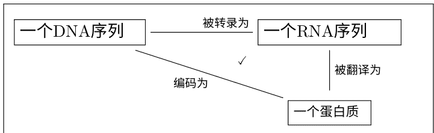

请注意，这个图表为我们提供了在这个背景下 DNA、RNA 和蛋白质之间关系的已建立术语。

**练习 2.3.3.1。** 创建一个包括人、男人、女人、父母、父亲、母亲和孩子概念的人类核生物家族的 olog。. 确保标记所有箭头，并确保每个箭头表示 2.3.2.1 节中的有效方面。用勾号（✓）表示意图相符的图表。如果页面的二维性使得勾号不明确，请用方程表示意图的相容性。

**示例 2.3.3.2（非交换图）。** 在我对世界的构想中，以下图表不可交换：

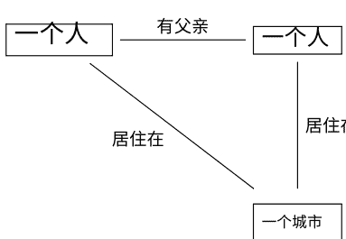

(2.19)

图表（2.19）的非交换性并不意味着在我的构想中没有人住在与他或她的父亲相同的城市。相反，它意味着在我的构想中，并不是每个人都住在与他或她的父亲相同的城市。

**练习 2.3.3.3。** 创建一个关于科学主题的 olog，最好是你经常思考的一个。. 该 olog 应该有至少五个框，五个箭头和一个可交换图。

#### 2.3.3.4 将事实写成英语的公式

每个事实由两条路径组成，称为 $P$ 和 $Q$，它们被声明为等价的。路径 $P$ 和 $Q$ 必然具有相同的源，称为 $s$，和目標，称为 $t$，但它们的长度可能不同，比如 m 和 n。^{9}我们将这些路径绘制为

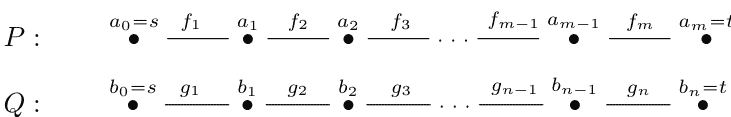

(2.20)

olog 的每个部分 (即每个框和每个箭头) 都有一个相关的英语短语，我们将其写作“l”。使用一个虚拟变量 x，我们也可以将一个事实转化为英语。下面的一般公式有点难以理解，请参见示例 2.3.3.5，但是这里是。从 (2.20) 中得到的事实 P≃Q 可以用以下方式转化为英语:

给定 x，“s”，考虑以下内容。我们知道 x 是“s”，

(2.21)

其中“f1”是“a1”，“f2”是“a2”，以此类推。“fm-1”是“am-1”，我们将其称为 P(x)。

我们还知道 x 是“s”，“gn-1”是“bn-1”，我们将其称为 Q(x)。

事实：每当 x 是“s”时，我们将有 P(x)“Q(x)。

**例子 2.3.3.5。** 考虑这个图表

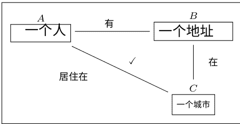

(2.22)

为了将图表 2.22 的可交换性表达为英语，我们首先将两条路径转化为英语：F=“一个人有一个地址，地址在一个城市中”和 G=“一个人住在一个城市中”。

两者的源是 S=“一个人”，两者的目标是 T=“一个城市”。写出:

给定 x，一个人，考虑以下情况。我们知道 x 是一个人，它有一个地址，地址在一个我们称之为 P(x) 的城市中。我们还知道 x 是一个人，它住在一个我们称之为 Q(x) 的城市中。

事实：每当 x 是一个人时，我们将有 P(x)=Q(x)。

^9 如果源等于目标，则可能存在 m=0 或 n=0，并且以下的想法仍然有意义。

**练习 2.3.3.6。** 这个图表来自于 [Sp1]。


(2.23) 它表示一个固定电话在其电话号码所分配的地区物理上位于该地区。使用 2.21 中的公式将这个事实翻译成英语。

2.3.3.7。在上述图表 (2.23) 中，假设盒子「一个操作性的固定电话」被替换为盒子「一个操作性的移动电话」。图表仍然保持连贯吗？

#### 2.3.3.8 图像

在本节中，我们讨论由任何方面生成的特定类型的事实。回想一下，每个函数都有一个图像，意思是在值域中被函数“命中”的元素的子集。例如，函数 $f(x)=2 * x: \mathbb{Z} \rightarrow \mathbb{Z}$ 的图像是所有偶数的集合。

同样，母亲的集合是“有母亲”函数的图像，如下所示


**练习 2.3.3.9.** 对于以下每种类型，写出一个它是图像的函数，或者说“不明确是图像类型”a.)「一本书」

+ b.)「通过类型 T 制造的材料」
c.)「自行车所有者」
d.)「一个孩子」
e.)「一本二手书」
f.)「一个有人居住的住所」

## 2.4 积和余积

在本节中，我们介绍了两个概念，可能会很熟悉，尽管可能不是以范畴论的名称来称呼，即积和余积。每个都是一种超出集合领域存在的一大类思想。

### 2.4.1 积

**定义 2.4.1.1.** 设 X 和 Y 为集合。X 和 Y 的积，表示为 $X \times Y$，定义为有序对 ((, x, y) 的集合，其中 $x \in X$ 且 $y \in Y$。符号上，

$X \times Y = \{(x, y) \mid x \in X, \ y \in Y\}$.

有两个自然投影函数 $\pi_1: X \times Y \to X$ 和 $\pi_2: X \times Y \to Y$.

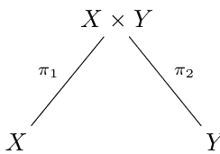

**例子 2.4.1.2. [点阵]**

然后我们可以将 $X \times Y$ 绘制为一个 6 \times 4 的点阵，并将投影绘制为投影

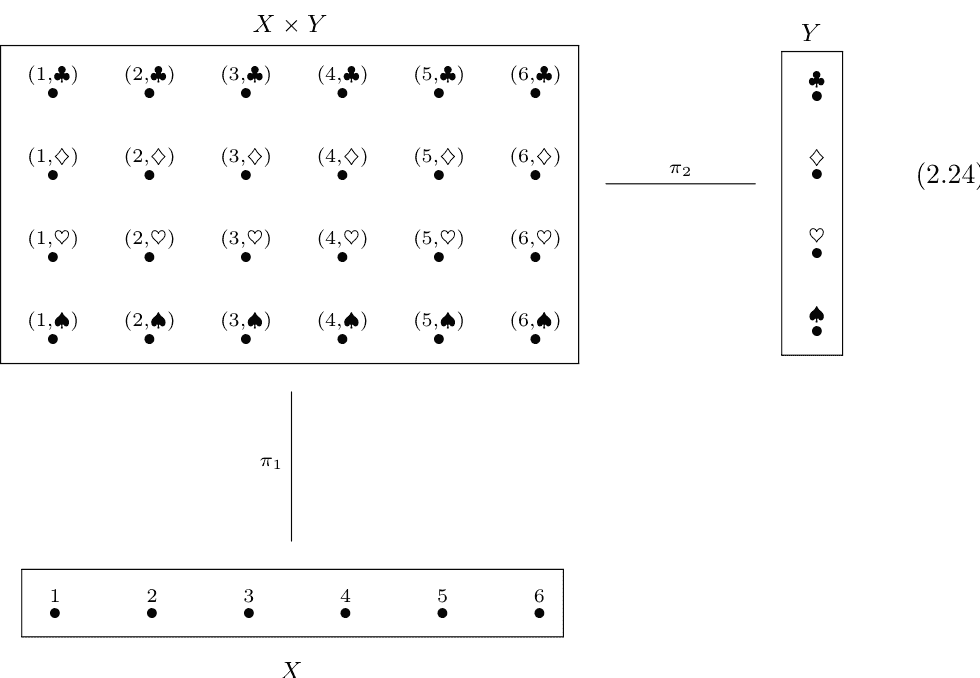

**应用 2.4.1.3.** 传统的（孟德尔）预测后代的基因型的方法是使用庞尼特方格。. 如果 F 是母亲可能的基因型集合，而 M 是父亲可能的基因型集合，则 $F \times M$ 被绘制为一个称为庞尼特方格的正方形，其中绘制了每个组合。

**练习 2.4.1.4.** 集合 $\{a, b, c, d\} \times \{1, 2, 3\}$ 有多少个元素？

## 2.4. 积和余积

应用 2.4.1.5. 假设我们正在进行有关材料力学性质的实验，就像应用 2.1.2.1 中所述。对于每个材料样本，我们将在集合 `extension` $\times$ `force` $\cong \mathbb{R} \times \mathbb{R}$ 中产生多个数据点。

**备注 2.4.1.6.** 也可以将多个集合进行乘积运算。例如，如果 $A, B,$ 和 $C$ 是集合，那么 $A \times B \times C$ 是三元组的集合，

$$
A \times B \times C := \{(a, b, c) \mid a \in A, b \in B, c \in C\}.
$$

这种广义性在理解多维空间时很有用，例如物理学家所说的 10 维空间。这属于极限的范畴，我们将在第 4.5.3 节中看到。

示例 2.4.1.7. 让 $\mathbb{R}$ 是实数集。通过 $\mathbb{R}^2$ 我们指的是 $\mathbb{R} \times \mathbb{R}$（但请参见练习 2.7.2.6）。同样地，对于任何 $n \in \mathbb{N}$，我们定义 $\mathbb{R}^n$ 为 $\mathbb{R}$ 的 $n$ 个乘积。

根据 [Pen]，亚里士多德似乎将空间看作是类似于 $S := \mathbb{R}^3$ 和时间类似于 $T := \mathbb{R}$。时空，如果他构想过的话，可能是 $S \times T \cong \mathbb{R}^4$。当然，他没有接触到这种抽象，这可能是由于笛卡尔的原因。

**练习 2.4.1.8.** 让 $\mathbb{Z}$ 表示整数集，让 $+: \mathbb{Z} \times \mathbb{Z} \rightarrow \mathbb{Z}$ 表示加法函数， $\cdot: \mathbb{Z} \times \mathbb{Z} \rightarrow \mathbb{Z}$ 表示乘法函数。以下哪个图表是可交换的？

- a.)
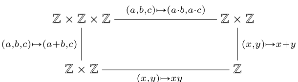

- b.)
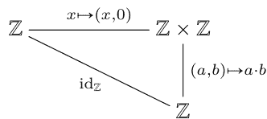

- c.)
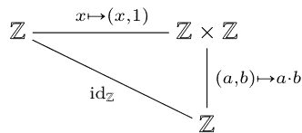

#### 2.4.1.9 产品的普适性质

引理 2.4.1.10 (产品的普适性质). 设 $X$ 和 $Y$ 为集合。对于任意集合 $A$ 和函数 $f: A \rightarrow X$ 和 $g: A \rightarrow Y$，存在唯一的函数 $A \rightarrow X \times Y$ 使得下图交换：

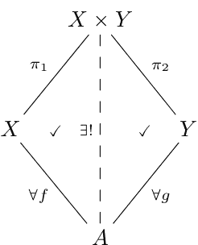

$$
(2.25)
$$

我们可以将这个唯一的函数表示为：

```
\langle f, g \rangle: A \rightarrow X \times Y
```

证明。假设给定 $f, g$ 如上。提供一个函数 $\ell: A \rightarrow X \times Y$ 等价于为每个 $a \in A$ 提供一个元素 $\ell(a) \in X \times Y$。我们需要这样一个函数，使得 $\pi_1 \circ \ell = f$ 和 $\pi_2 \circ \ell = g$。一个 $X \times Y$ 的元素是一个有序对 $(x, y)$，我们可以使用 $\ell(a) = (x, y)$ 当且仅当 $x = \pi_1(x, y) = f(a)$ 和 $y = \pi_2(x, y) = g(a)$。因此，定义如下是必要且充分的：

```
\langle f, g \rangle(a) := (f(a), g(a))
```

对于所有的 $a \in A$。


10 符号 $\forall$ 读作“对于所有”；符号 $\exists$ 读作“存在”，符号 $\exists!$ 读作“存在唯一”。因此，这个图表旨在表达这样一个观念：对于任何函数 $f: A \rightarrow X$ 和 $g: A \rightarrow Y$，存在一个唯一的函数 $A \rightarrow X \times Y$ 使得这两个三角形是可交换的。

例子 2.4.1.11 (点阵，继续)。我们需要将乘积的普适性视为完全直观。回想一下，如果 $X$ 和 $Y$ 是集合，分别具有基数 $|X| = m$ 和 $|Y| = n$，那么 $X \times Y$ 是一个 $m \times n$ 的点阵，并且它带有两个自然投影 $X \xleftarrow{\pi_1} X \times Y \xrightarrow{\pi_2} Y$。这使我们能够从每个点阵元素 $z \in X \times Y$ 中提取出它的列 $\pi_1(z) \in X$ 和它的行 $\pi_2(z) \in Y$。假设教室里的每个人都选择了 $X$ 的一个元素和 $Y$ 的一个元素。因此，我们有函数 $f: C \rightarrow X$ 和 $g: C \rightarrow Y$。但是选择一列和一行不就等于在点阵中选择一个元素吗？这两个函数 $f$ 和 $g$ 诱导出一个唯一的函数 $C \rightarrow X \times Y$。这个函数 $C \rightarrow X \times Y$ 与原始函数 $f$ 和 $g$ 相比如何？交换图 (2.25) 总结了明显的联系。

示例 2.4.1.12. 设 $R$ 为实数集。在 $R$ 中，原点是 $R$ 的一个元素。正如你在练习 2.1.2.14 中所展示的，我们可以将 $R$ 的这个（或任何）元素视为一个函数 $z: \odot \rightarrow R$，其中 $\odot$ 是任何具有一个元素的集合。我们的函数 $z$“挑选出”原点。因此，我们可以画出函数

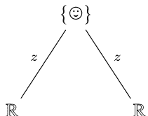

乘积的通用性质保证了一个函数 $\{\odot\} \to \mathbb{R} \times \mathbb{R}$，它将成为 $\mathbb{R}^2$ 中的原点。

**备注 2.4.1.13。** 给定集合 $X, Y$ 和 $A$，以及函数 $f: A \to X$ 和 $g: A \to Y$，存在一个唯一的函数 $A \to X \times Y$ 与 $f$ 和 $g$ 相符。我们称之为诱导函数 $A \to X \times Y$，意味着它是在 $f$ 和 $g$ 的光下产生的。对于每个集合 $A$，以下三个集合之间存在一些良好的关系：

$$
\text{Hom}_{\text{Set}}(A, X) \quad \text{Hom}_{\text{Set}}(A, Y) \quad \text{和} \quad \text{Hom}_{\text{Set}}(A, X \times Y).
$$

它是什么？

提示：不要惊慌：这个问题有点“递归”，因为你将在公式中使用乘积。

**练习 2.4.1.15。**

- a.) 让 $X$ 和 $Y$ 是集合。只使用乘积的通用性质构造“交换映射” $s: X \times Y \to Y \times X$。如果 $\pi_1: X \times Y \to X$ 和 $\pi_2: X \times Y \to Y$ 是投影函数，用符号“$\pi_1$”、“$\pi_2$”、“$($，$)$”和“$\circ$”来写 $s$。

- b.) 你能证明只使用乘积的普遍性质来证明 $s$ 是一个同构吗？

例子 2.4.1.16. 假设给定集合 $X, X', Y, Y'$ 和函数 $m: X \to X'$ 和 $n: Y \to Y'$。我们可以使用乘积的普遍性质来构造一个函数 $s: X \times Y \to X' \times Y'$。这是如何做到的。

普遍性质（引理 2.4.1.10）说，要从任何集合 $A$ 到 $X' \times Y'$ 得到一个函数，我们需要两个函数，即某个 $f: A \to X'$ 和某个 $g: A \to Y'$。这里 $A = X \times Y$。

我们现有的是两个投影 $\pi_1: X \times Y \to X$ 和 $\pi_2: X \times Y \to Y$。但我们还有 $m: X \to X'$ 和 $n: Y \to Y'$。组合起来，我们设 $f := m \circ \pi_1$ 和 $g := n \circ \pi_2$。

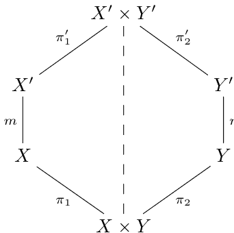

点箭头通常被称为 $m: X \to X'$ 和 $n: Y \to Y'$ 的乘积，且被简单地标记为：

```
m \times n: X \times Y \to X' \times Y'。
```

#### 2.4.1.17 产品的 Olog

给定 Olog 中的两个对象 $c, d$，它们的乘积 $c \times d$ 有一个规范标签"$c \times d$"，用标签"$c$"和"$d$"来表示。

```
c \times d := \text{a pair } (x, y) \text{ where } x \text{ is “}c\text{” and } y \text{ is “}d\text{”}.
```

投影 $c \leftarrow c \times d \rightarrow d$ 可以标记为“产出，作为 $x$，”和“产出，作为 $y$，”分别。

假设 $e$ 是另一个对象， $p: e \rightarrow c$ 和 $q: e \rightarrow d$ 是两个箭头。根据乘积的普遍性质（引理 2.4.1.10）， $p$ 和 $q$ 引出了一个唯一的箭头 $e \rightarrow c \times d$ 使得明显的图表相符。这个箭头可以标记为

> 产出，就像"$p$"、"$c$"和"$q$"、"$d$"一样

例子 2.4.1.18. 每个汽车所有者至少拥有一辆汽车，但没有明显的函数⌈一个汽车所有者⌉ → ⌈一辆汽车⌉ 因为他或她可能拥有多辆汽车。一个很好的选择将是这个人最常开的汽车，我们称之为他或她的主要汽车。此外，给定一个人和一辆汽车，经济学家可以问这个人从汽车中获得多少效用。从所有这些我们可以组合以下涉及产品的 Olog：

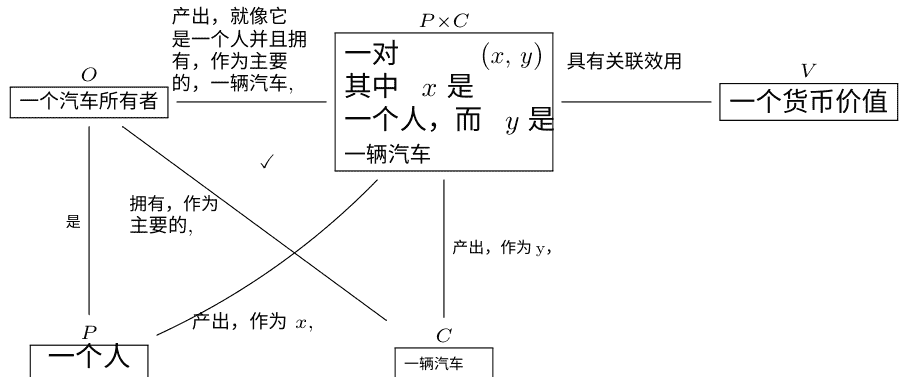

### 2.4.2 余积

定义 2.4.2.1. 设 $X$ 和 $Y$ 为集合。 $X$ 和 $Y$ 的余积，记作 $X \sqcup Y$，被定义为 $X$ 和 $Y$ 的“不相交并集”，即一个元素要么是 $X$ 的元素，要么是 $Y$ 的元素。如果某个元素同时属于 $X$ 和 $Y$，则在 $X \sqcup Y$ 中包含两个副本，并加以区分。见例子 2.4.2.2。有两个自然包含函数 $i_1: X \rightarrow X \sqcup Y$ 和 $i_2: Y \rightarrow X \sqcup Y$。

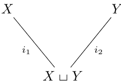

例子 2.4.2.2。$X$ 为 $= \{a, b, c, d\}$ 和 $Y$ 为 $= \{1, 2, 3\}$ 时， $X \sqcup Y$ 的余积为

$$
X \sqcup Y \cong \{a, b, c, d, 1, 2, 3\}.
$$

$X$ 和它自己的余积是

$$
X \sqcup X \cong \{i_1 a, i_1 b, i_1 c, i_1 d, i_2 a, i_2 b, i_2 c, i_2 d\}
$$

$X \sqcup Y$ 中元素的名称并不重要。重要的是包含映射 $i_1, i_2$，它们确保我们知道每个元素来自哪里。

#### 例子 2.4.2.3（飞机座位）

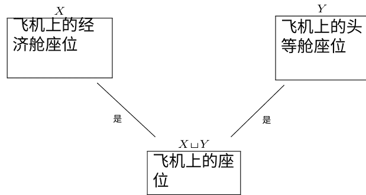

$$
(2.26)
$$

练习 2.4.2.4. 你认为手机和座机的余积是手机吗？

#### 例子 2.4.2.5（不相交的点的并集）

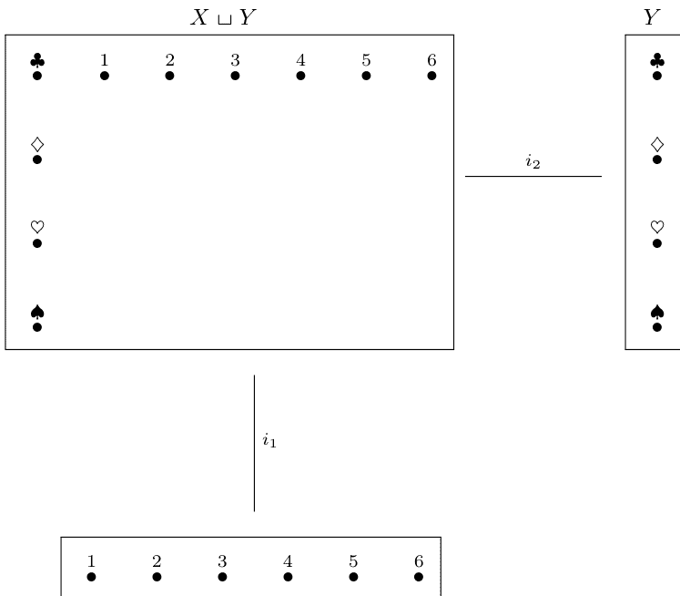

$$
(2.27)
$$

#### 2.4.2.6 余积的通用性质

引理 2.4.2.7（余积的通用性质）。让 $X$ 和 $Y$ 是集合。对于任何集合 $A$ 和函数 $f: X \rightarrow A$ 和 $g: Y \rightarrow A$，存在唯一的函数 $X \sqcup Y \rightarrow A$ 使得以下图表可交换：


我们可以将唯一函数写作：

```
\begin{cases} f & g \end{cases} : X \sqcup Y \to A.
```

证明。假设给定 $f, g$ 如上所述。提供一个函数 $\ell: X \sqcup Y \rightarrow A$ 等价于提供一个元素 $\ell(m) \in A$ 对于每个 $m \in X \sqcup Y$。我们需要这样一个函数，使得 $\ell \circ i_1 = f$ 和 $\ell \circ i_2 = g$。但是每个元素 $m \in X \sqcup Y$ 要么是 $i_1 x$ 的形式，要么是 $i_2 y$ 的形式，不能同时具备两种形式。因此我们分配：

```
\left\{ \begin{matrix} f & g \end{matrix} \right. (m) = \begin{cases} f(x) & \text{if } m = i_1 x, \\ g(y) & \text{if } m = i_2 y. \end{cases}
```

这个分配是使得所有相关图表可交换的必要且充分条件。

例子 2.4.2.8（飞机座位，续）。余积的普遍性质如下所述。每当我们有一个函数 $X \rightarrow A$ 和一个函数 $Y \rightarrow A$，我们得到一个唯一的函数 $X \sqcup Y \rightarrow A$。例如，飞机上的每个经济舱座位和每个头等舱座位实际上都在一个特定的飞机上。每个经济舱座位都有一个价格，每个头等舱座位也有一个价格。


$$
(2.28)
$$

余积的普遍性形式化了以下直观明显的事实：

11 我们将要使用一个有点不寻常的两行符号。在接下来的内容中，某个函数 $X \sqcup Y \rightarrow A$ 用符号表示 $\begin{cases} f & g \end{cases}$。

如果我们知道经济舱座位的定价方式，我们也知道头等舱座位的定价方式，并且我们知道每个座位要么是经济舱要么是头等舱，那么我们自动知道所有座位的定价方式。

换句话说（并使用另一个诱导映射）：

如果我们追踪每个经济舱座位所在的飞机，以及我们追踪每个头等舱座位所在的飞机，并且我们知道每个座位要么是经济舱要么是头等舱，那么我们对任何飞机座位都不需要额外追踪。

应用程序 2.4.2.9（分段定义的曲线）。在科学中，曲线通常被分段定义或考虑。例如，在测试材料的力学性质时，我们可能对变形的各个区域感兴趣，如弹性区、塑性区或断裂后区。这些是材料显示不同性质的三个区间。

对于实数 $a < b \in \mathbb{R}$, 让 $[a, b] := \{x \in \mathbb{R} \mid a \leqslant x \leqslant b\}$ 表示闭区间。给定函数 $[a, b] \rightarrow \mathbb{R}$ 和函数 $[c, d] \rightarrow \mathbb{R}$, 余积的通用性质意味着它们唯一地扩展为函数 $[a, b] \sqcup [c, d] \rightarrow \mathbb{R}$, 这将出现为分段定义的曲线。

通常我们会给出一条曲线在 $[a, b]$ 和另一条曲线在 $[b, c]$, 其中这两条曲线在点 $b$ 处相等。这种情况可以用推出来描述，推出是余积的温和推广；参见第 2.6.2 节。

练习 2.4.2.10。用以下三个集合之间的关系来写出余积的普遍性：

$$
\text{Hom}_{\text{Set}}(X, A), \quad \text{Hom}_{\text{Set}}(Y, A), \quad \text{和} \quad \text{Hom}_{\text{Set}}(X \sqcup Y, A).
$$

例子 2.4.2.11。在下面的图表中，类型 $A$ 和 $B$ 是不相交的，所以余积 $C = A \sqcup B$ 就是它们的并集。


例子 2.4.2.12。在下面的图表中，$A$ 和 $B$ 不是不相交的，所以必须小心区分共同的元素。


由于鸭子既能够游泳又能够飞行，所以每只鸭子在 $C$ 中出现两次，一次标记为飞行者，一次标记为游泳者。在 $C$ 中，类型 $A$ 和类型 $B$ 是不相交的，这解释了“不相交并集”的名称。

练习 2.4.2.13. 理解例子 2.4.2.12，并思考是否可以将类似的思想应用于粒子和波。. 创建一个图表，并根据规则 2.3.1.2 选择措辞。光子如何适应既具有波动性质又具有粒子性质的情况？

◊

练习 2.4.2.14. 在上面的章节“Olog 产品”第 36 页的基础上，为余积、包含映射和普遍映射设计一个命名系统。. 通过制作一个包含余积的 Olog（讨论.wav 文件和.mp3 文件都可以在现代计算机上播放的想法），来尝试一下。请注意，你的箭头在 2.3.2.1 节的意义上是有效的。

◊

## 2.5 集合中的有限极限

在本节中，我们讨论了各种形状的集合图表的极限。

当我们在第 4.5.3 节中讨论任意范畴中的极限时，我们将使所有这些更加精确。

### 2.5.1 拉回

定义 2.5.1.1（拉回）。假设给定以下的集合和函数图表。

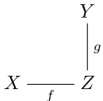

$$
(2.29)
$$

它的纤维积是集合

$$
X \times_Z Y := \{(x, w, y) \mid f(x) = w = g(y)\}.
$$

有明显的投影 $\pi_1: X \times_Z Y \to X$ 和 $\pi_2: X \times_Z Y \to Y$（例如 $\pi_2(x, w, y) = y$）。请注意，如果 $W = X \times_Z Y$，则该图表

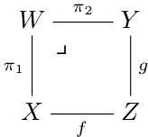

$$
(2.30)
$$

是可交换的。给定图表 2.29 的设置，我们定义 $X$ 和 $Y$ 关于 $Z$ 的拉回为任何集合 $W$，其中我们有一个同构 $W \cong X \times_Z Y$。图表 2.30 中的角符号 $\lrcorner$ 表示 $W$ 是拉回。

练习 2.5.1.2。让 $X, Y, Z$ 如图所示，$f: X \to Z$ 和 $g: Y \to Z$ 是指定的函数。

什么是图 X 的拉回，其中$f$是 X 到 Z 的映射，$g$是 Y 到 Z 的映射？

#### 练习 2.5.1.3

- a.) 画一个有五个元素的集合 X 和一个有三个元素的集合 Y。将 X 和 Y 的每个元素都涂上红色、蓝色或黄色，并以一种“看起来随机”的方式进行涂色。将 X 的着色视为一个函数 X 到 C，其中 C 是红色、蓝色、黄色的集合，类似地获得一个函数 Y 到 C，画出纤维积 $X \times_C Y$，并确保它被适当地着色。
- b.) 产品的普遍性保证了一个函数 $X \times_C Y$ 到 $X \times Y$，我可以告诉你这将是一个单射。这意味着你所画的纤维积可以嵌入到 5×3 的网格中，请画出网格并指示这个子集。

> **备注 2.5.1.4。** 有些人可能更喜欢用 $f \times_Z g$ 来表示这个纤维积，而不是用 $X \times_Z Y$。前者在数学上是更好的表示法，但后者在人类可读性方面通常更好，而且在文献中更常见。我们使用更方便的那个。

#### 练习 2.5.1.5

- a.) 假设 $Y = \emptyset$；你能说出关于 $X \times_Z Y$ 的什么吗？
- b.) 现在假设 $Y$ 是任意集合，但 $Z$ 只有一个元素；你能说出关于 $X \times_Z Y$ 的什么吗？

#### 练习 2.5.1.6

设 $S = \mathbb{R}^3, T = \mathbb{R}$，并将它们视为（亚里士多德式的）空间和时间，其中 $S \times T$ 的原点是 MIT 创立时的质心。设 $Y = S \times T$，设 $g_1: Y \rightarrow S$ 为一个投影，设 $g_2: Y \rightarrow T$ 为另一个投影。设 $X = \{\odot\}$ 为一个只有一个元素的集合，设 $f_1: X \rightarrow S$ 和 $f_2: X \rightarrow T$ 分别由两种情况下的原点给出。

- a.) 纤维积 $W_1$ 和 $W_2$ 是什么：

- b.) 用 MIT 成立时的质心来解释这些集合。

*注 12：如果着色会很烦人，可以使用阴影。*

#### 2.5.1.7 使用拉回从旧的概念中定义新的概念

在本节中，我们将看到一个图的纤维积可以用来定义一个新的概念。例如，在 (2.33) 中，我们根据手机的电池续航时间来定义电池是否好。通过明确说明，我们减少了不同群体之间的误解的可能性。这在审计和试图重用或理解他人收集的数据等情况下非常有用。

#### 示例 2.5.1.8

考虑以下两个 olog。右边的一个是左边的拉回图。

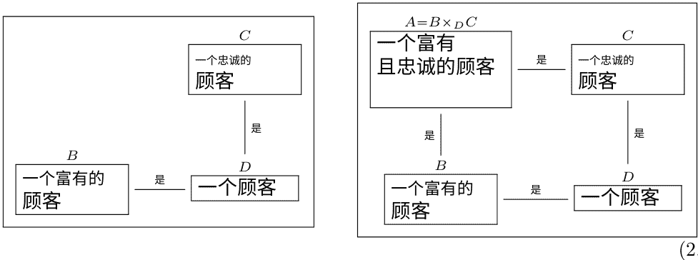

从定义 2.5.1.1 检查标签“一个富有且忠诚的顾客”作为纤维积 $A = B \times_D C$ 的标签是否公平且直观，给定 B, C 和 D 的标签。

#### 备注 2.5.1.9

注意，在图（2.31）中，左上角的框可以是（非规范命名的）「一个好顾客」。如果它被视为纤维积，那么作者实际上将定义一个好顾客为富有且忠诚的。

#### 练习 2.5.1.10

对于以下每个案例，作者提出右边的图是一个拉回图。你认为他们的标签是否合适或具有误导性；也就是说，左上角的标签是否合理，给定 olog 的其余部分，或者在某种程度上是可疑的？

- a.)
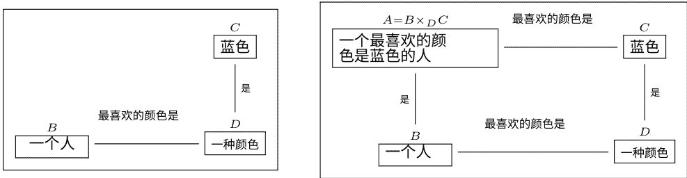

## 第 2 章 集合的范畴

- b.)
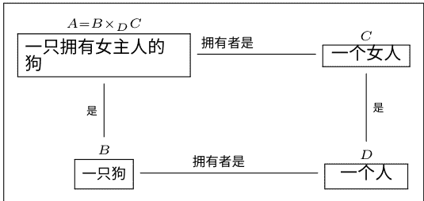
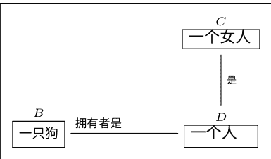
- c.)
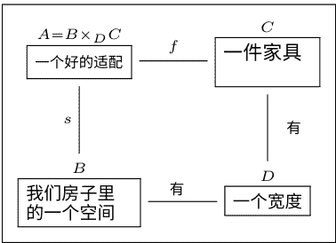
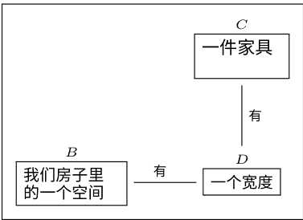

#### 练习 2.5.1.11

- a.) 考虑你在练习 2.3.3.1 中的 olog。那里的任何一个可交换的正方形实际上是拉回正方形吗？
- b.) 现在使用具有乘积和拉回的 olog 来定义兄弟和姐妹 (再次以人类生物核家庭为例)，涉及类型如「一个交配对的后代 (a, b)」，「一个人」，「一个男性」，「一个女性」，等等。

#### 定义 2.5.1.12 (原像)

让 $f: X \to Y$ 是一个函数，$y \in Y$ 是一个元素。$y$ 的原像在 $f$ 下的表示为 $f^{-1}(y)$，是子集 $f^{-1}(y): \{t \in X \mid f(t)=y\}$。如果 $Y_I \subseteq Y$ 是任意子集，则 $Y_I$ 在 $f$ 下的原像表示为 $f^{-1}(Y_I)$，是子集 $f^{-1}(Y_I): \{t \in X \mid f(t) \in Y_I\}$。

#### 练习 2.5.1.13

设 $f: X \to Y$ 是一个函数，$y \in Y$ 是一个元素。画一个拉回图，其中纤维积同 $f$ 的原像 $f^{-1}(y)$ 同构。

#### 引理 2.5.1.14 (拉回的通用性质)

假设给定以下集合和函数的图表。

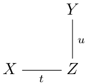

## 2.5. 集合中的有限极限

对于任意集合 $A$ 和下面的可交换实心箭头图（即函数 $f: A \to X$ 和 $g: A \to Y$ 使得 $t \circ f = u \circ g$），

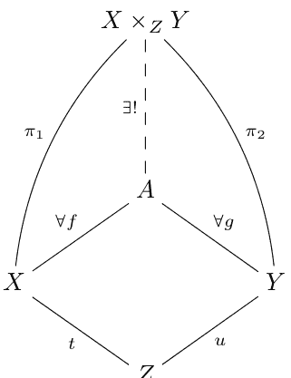

存在唯一的箭头 $\langle f, f \rangle_Z: A \to X \times_Z Y$ 使得所有图形都可交换，即

$f = \pi_1 \circ \langle f, f \rangle_Z$ 和 $g = \pi_2 \circ \langle f, f \rangle_Z$. 

#### 练习 2.5.1.15

创建一个底层形状为可交换正方形的 olog。现在添加纤维积，使得形状与图表 (2.32) 相同。为投影 $\pi_1, \pi_2$ 和虚线映射 $A \xrightarrow{\langle f, f \rangle_Z}$ 分配英文标签

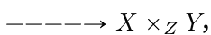

#### 2.5.1.16 拼贴图用于拉回

考虑下面绘制的图表，其中包括一个左手方块，一个右手方块和一个大矩形。

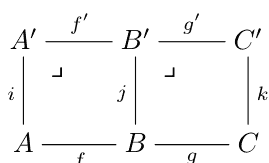

右手方块有一个角标记，表示 $B' \cong B \times_C C'$ 是一个拉回。但左边的角标记是含糊的；它可能表示左手方块是一个拉回，也可能表示大矩形是一个拉回。事实证明，如果 $B' \cong B \times_C C'$，那么它是不含糊的，因为左手方块是一个拉回当且仅当大矩形是一个拉回。

#### 命题 2.5.1.17

考虑下面绘制的图表


其中 $B' \cong B \times_C C'$ 是一个拉回。那么存在一个同构 $A \times_B B' \cong A \times_C C'$。

换句话说，

$A \times_B (B \times_C C') \cong A \times_C C'$。

证明。我们首先提供一个映射 $\phi: A \times_B (B \times_C C') \to A \times_C C'$。$A \times_B (B \times_C C')$ 的元素的形式为 $(a, b, (b, c, c'))$，其中 $f(a) = b, g(b) = c$，以及 $k(c') = c$。但是，这意味着 $g \circ f(a) = c = k(c')$，因此我们定义 $\phi(a, b, (b, c, c')) := (a, c, c') \in P A \times_C C'$。现在我们提供一个候选的逆映射 $\psi: A \times_C C' \to A \times_B (B \times_C C')$。给定 $(a, c, c')$，其中 $g \circ f(a) = c = k(c')$，令 $b = f(a)$，注意 $(b, c, c')$ 是 $B \times_C C'$ 的一个元素。因此，我们可以定义 $\psi(a, c, c') = (a, b, (b, c, c'))$。很容易看出 $\phi$ 和 $\psi$ 是互逆的。

命题 2.5.1.17 在编写 ologs 时很有用。例如，具有坏电池的手机 $\gamma$ 是模糊的，但我们可以通过拉回来准确地说明它的含义：

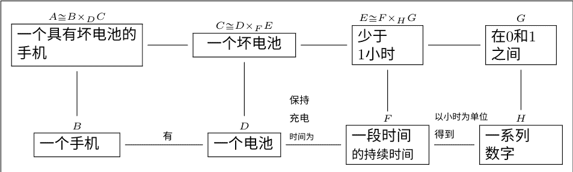

上述范畴论事实表明，由于 $A \cong B \times_D C$ 和 $C \cong D \times_F E$，因此 $A \cong B \times_F E$。也就是说，我们可以推断出“一个具有坏电池的手机的定义是指一个具有保持充电时间少于一小时的电池的手机。”

#### 练习 2.5.1.18

- a.) 创建一个 olog，如果且仅当两个人的身高差小于半英寸时，将它们定义为“大致相同的身高”，使用一个拉回。你的 olog 可以包括一个盒子，一个实数 $x$，以及一个 $|x| < 0.5$ 的条件。
- b.) 在同一个 olog 中，为那些身高与名为“圣母玛利亚”的人大致相同的人创建一个盒子。你可能需要使用图像，就像 2.3.3.8 节中一样。

#### 练习 2.5.1.19

考虑下面左边的图表，其中两个正方形都是可交换的。

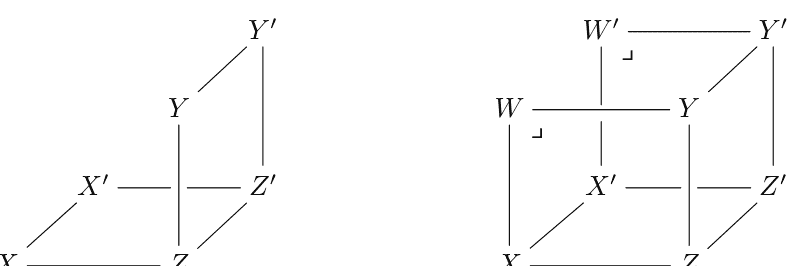

令 $W = X \times_Z Y$ 和 $W' = X' \times_{Z'} Y'$，并形成右边的图表。使用纤维积的普遍性质构造一个映射 $W \to W'$，使得所有的正方形都是可交换的。

### 2.5.2 跨度、实验和矩阵

#### 定义 2.5.2.1

给定集合 $A$ 和 $B$，一个跨度是一个集合 $R$，连同函数 $f: R \to A$ 和 $g: R \to B$。

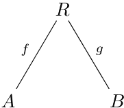

#### 应用 2.5.2.2

将 $A$ 和 $B$ 看作可观察量，将 $R$ 看作对这两个变量进行的一组实验。例如，假设 $T$ 是一个固定容器中可能的气体温度集合，假设 $P$ 是可能的气体压力集合。我们进行了 1000 次实验，改变和记录温度，同时也记录压力；这是一个跨度 $T \leftarrow_f E \to_g P$。结果可能如下所示：

| ID | 温度 | 压力 |
| :---: | :---: | :---: |
| 1 | 100 | 72 |
| 2 | 100 | 73 |
| 3 | 100 | 72 |
| 4 | 200 | 140 |
| 5 | 200 | 138 |
| 6 | 200 | 141 |
| ⋮ | ⋮ | ⋮ |

#### 定义 2.5.2.3

让 $A, B$ 和 $C$ 为集合，且让 $A$ 到 $R$ 到 $B$ 和 $B$ 到 $R'$ 到 $C$ 为跨度。它们的复合跨度由纤维积 $R \times_B R'$ 给出，如下图所示：

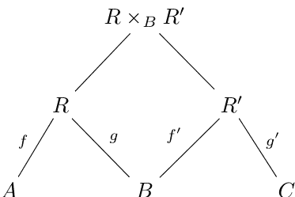

#### 应用 2.5.2.4

让我们回顾一下我们实验室在应用 2.5.2.2 中的实验，结果得到一个跨度 $T$ 到 $E$ 到 $P$。假设我们注意到有些地方看起来有点不对劲。压力应该与温度成线性关系，但似乎并非如此。我们假设容器的体积在压力下增加。我们在网上查找了这个容器，并发现已经进行了实验来测量内部压力变化时的体积。这些数据慷慨地在网上提供，给出了一个跨度 $P \leftarrow E' \xrightarrow{g'} V$。

我们实验室的跨度与在线数据跨度的复合得到一个跨度 $T \leftarrow E'' \to V$，其中 $E'' := E \times_P E'$。这个跨度给我们提供了什么信息？在解释它时，一个可能会说“每当我们实验室的实验产生与他们记录的相同的压力时，我们称之为一个数据点。每个数据点都有一个相关的温度（来自我们的实验室）和一个相关的体积（来自他们的实验）。这是我们能做到的最好的。”

我们通过这种方式获得的信息可能被一些人视为非科学的，但它肯定是人们在商业和日常生活计算中使用的一种信息 - 我们从多个来源获取数据并将其整合在一起。此外，它在可重复性方面是科学的。我们获取 $T-V$ 数据的方式是完全透明的。

我们可以将跨度与自然数矩阵相关联，并看到矩阵加法和矩阵乘法的自然“范畴化”。如果我们的跨度来自实验，如应用 2.5.2.2 和 2.5.2.4 中所述，涉及的矩阵将看起来像巨大但稀疏的矩阵。让我们来看一下。

设 $A$ 和 $B$ 为集合，设 $A \leftarrow R \to B$ 为一个跨度。根据积的通用性质，我们有一个唯一的映射 $R \xrightarrow{p} A \times B$。

我们根据这些数据制作一个自然数矩阵，方法如下。行的集合是 $A$，列的集合是 $B$。对于元素 $a \in A$ 和 $b \in B$，$(a, b)$ 的条目是其原像的基数，即 $p^{-1}(a, b)$ 的元素数量，即由 $p$ 发送到 $(a, b)$ 的 $R$ 中的元素数量。

假设我们有两个 $(A, B)$-跨度，即 $A \leftarrow R \to B$ 和 $A \leftarrow R' \to B$；我们可以认为它们具有相同的维度，即它们都是 $|A| \times |B|$-矩阵。我们可以取不相交的并集 $R \sqcup R'$，并且根据余积的通用性质，我们有一个唯一的跨度 $A \leftarrow R \sqcup R' \to B$ 使所需的图表交换。$^{13}$ 对应于这个新跨度的矩阵将是由它组成的两个先前跨度的矩阵的和。

给定一个跨度 $A \leftarrow R \to B$ 和一个跨度 $B \leftarrow S \to C$，可以按照定义 2.5.2.3 中的方式形成复合跨度。它将对应于矩阵的常规乘法。

#### 构造 2.5.2.5

给定一个跨度 $A \xleftarrow{f} R \xrightarrow{g} B$，可以绘制一个二分图，其中 $A$ 的每个元素在左边绘制为一个点，$B$ 的每个元素在右边绘制为一个点，每个元素 $r \in R$ 在左边的顶点上绘制为连接顶点 $(r)$ 到右边的顶点 $(r)$ 的箭头。

#### 练习 2.5.2.6

- a.) 绘制与应用 2.5.2.2 中的跨度 $T \xleftarrow{f} E \xrightarrow{g} P$ 相对应的二分图（如构造 2.5.2.5 所示）。
- b.) 现在自己构造一个跨度 $P \xleftarrow{f'} E' \xrightarrow{g'} V$ 并绘制它。最后，绘制下面的复合跨度。
- c.) 你能说出复合跨度图与其因子图之间的关系吗？

$^{13}$
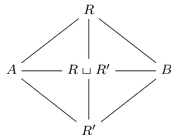

### 2.5.3 等值器和终端对象

#### 定义 2.5.3.1

假设给定两个平行箭头

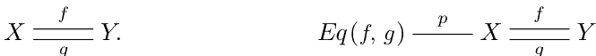

$f$ 和 $g$ 的等值器是右侧的交换图 (2.34)，我们定义

$\text{Eq}(f, g) := \{x \in X \mid f(x) = g(x)\}$

其中 $p$ 是规范的包含。

#### 例子 2.5.3.2

假设已经设计了一个实验来测试一个理论预测。问题变成了“理论何时与实验相符？”答案由以下图表的等值器给出：


等值器是所有使得理论和实验产生相同输出的输入的集合。

#### 练习 2.5.3.3

想出一个使用等值器的有趣的 olog。或者使用等值器来指定那些只发表了一篇论文的作者。提示：找到一个从作者到论文的函数；然后找到另一个。

#### 练习 2.5.3.4

找到两个箭头的等值器所享有的普遍性质，并以引理 2.4.1.10、2.4.2.7 和 2.5.1.14 的风格呈现。

#### 练习 2.5.3.5

- a.) 终端集是一个集合 $S$，对于每个集合 $X$，存在一个唯一的函数 $X \to S$。找到一个终端集。
- b.) 你认为概念终端集是否属于本节（第 2.5 节）？为什么这样？如果积、拉回和等值器都是极限，那么极限有什么共同之处？

## 2.6 集合中的有限余极限

本节将与第 2.5 节平行——我将介绍几种有限余极限的类型，并希望这给读者一些直觉，尽管还没有正式定义它们。在此之前，我必须定义等价关系和商集。

### 2.6.1 背景：等价关系

#### 定义 2.6.1.1（等价关系和等价类）

设 $X$ 为一个集合。在 $X$ 上的等价关系是 $X$ 的一个子集 $R$，满足以下性质对于所有的 $x, y, z$ 属于 $X$：

- 自反性：如果 $(x, x)$ 属于 $R$，则 $(x, x)$ 属于 $R$；
- 对称性：如果 $(x, y)$ 属于 $R$ 当且仅当 $(y, x)$ 属于 $R$，则 $(y, x)$ 属于 $R$；
- **传递性**：如果 $(x, y)$ 属于 $R$ 且 $(y, z)$ 属于 $R$，则 $(x, z)$ 属于 $R$。

如果 $R$ 是一个等价关系，我们经常用 $x \sim_R y$，或者简单地用 $x \sim y$，表示 $(x, y)$ 属于 $R$。为了方便起见，我们可以用符号 $\sim$ 来表示等价关系，说 $\sim$ 是 $X$ 上的一个等价关系。

一个等价类 $\sim$ 是一个子集 $A \subseteq X$，使得

- 一个非空的 $A \neq \varnothing$;
- 如果 $x \in A$ 并且 $x' \in A$，则 $x \sim x'$；并且
- 如果 $x \in A$ 并且 $x \sim y$，则 $y \in A$。

假设 $\sim$ 是 $X$ 上的一个等价关系。通过 $\sim$ 的商集 $X/ \sim$ 是 $\sim$ 的等价类的集合。

#### 例子 2.6.1.2

让 $\mathbb{Z}$ 表示整数集。定义一个关系 $R \subseteq \mathbb{Z} \times \mathbb{Z}$，使得

$R= \{(x, y) \mid \exists n \in \mathbb{Z}，使得 $x + 7n = y\}$。

那么 $R$ 是一个等价关系，因为 $x + 7 \cdot 0 = x$（自反性）； $x + 7 \cdot n = y$ 当且仅当 $y + 7 \cdot (-n) = x$（对称性）；并且 $x + 7n = y$ 和 $y + 7m = z$ 同时意味着 $x + 7(m + n) = z$（传递性）。

#### 练习 2.6.1.3

设 $X$ 为地球上的人的集合；定义一个二元关系 $R \subseteq X \times X$ 对于 $X$ 上的人的一对 $(x, y)$ 来说，如果 $x$ 花很多时间思考关于 $y$ 的事情，则说 $(x, y) \in R$。
- a.) 这个关系是自反的吗？
- b.) 它是对称的吗？
- c.) 它是传递的吗？

#### 例 2.6.1.4 (划分)

在集合 $X$ 上的等价关系可以被看作是一种划分 $X$ 的方式。一个 $X$ 的划分由一个集合 $I$，称为部分集合，以及对于每个元素 $i \in I$ 的子集 $X_i \subseteq X$ 的性质组成，满足以下两个条件：

- 每个元素 $x \in X$ 都在某个部分中（即对于所有的 $x \in X$ 都存在 $i \in I$ 使得 $x \in X_i$）；并且
- 没有元素可以在两个不同的部分中找到（即如果 $x \in X_i$ 和 $x \in X_j$ 那么 $i = j$）。

## 2.6.1 等价关系

给定一个 $X$ 的划分，我们通过说 $x \sim x'$ 来定义 $X$ 上的等价关系 $\sim$ (即如果存在 $i \in I$ 使得 $x, x' \in X_i$)。这些部分成为这个关系的等价类。相反地，给定一个等价关系，可以通过将 $I$ 作为等价类的集合，并且对于每个 $i \in I$，让 $X_i$ 成为该等价类中的元素来划分 $X$。

#### 练习 2.6.1.5
设 $X$ 和 $B$ 为集合，$f: X \to B$ 为一个函数。通过以下方式定义 $R \subseteq X \times X$ 的子集：
```
R = \{(x, y) \mid f(x) = f(y)\}.
```
- a.) $R$ 是一个等价关系吗？
- b.) 所有在 $X$ 上的等价关系都可以通过这种方式获得 (作为某个函数的纤维) 吗？
- c.) 这种对等类的观点与例 2.6.1.4 中的观点有关吗？

#### 练习 2.6.1.6
取一个集合族 $I$；即，假设对于每个元素 $i \in I$ 都有一个集合 $X_i$。对于任意两个元素 $i, j \in I$，如果 $X_i$ 和 $X_j$ 是同构的，则称 $i \sim j$。这个关系在 $I$ 上是一个等价关系吗？

#### 引理 2.6.1.7 (生成等价关系)
设 $X$ 是一个集合，$R \subseteq X \times X$ 的一个子集。存在一个关系 $S \subseteq X \times X$，使得
- $S$ 是一个等价关系，
- $R \subseteq S$，和
- 对于任何等价关系 $S'$，使得 $R \subseteq S'$，我们有 $S \subseteq S'$。

关系 $S$ 将被称为由 $R$ 生成的等价关系。

**证明**。设 $L_R$ 是包含 $R$ 的所有等价关系的集合；换句话说，每个元素 $\ell \in L_R$ 都是一个等价关系，$\ell \subseteq X \times X$。集合 $L_R$ 是非空的，因为 $X \times X \subseteq X \times X$ 是一个等价关系。设 $S$ 表示出现在 $L_R$ 的每个元素中的一对 $(x_1, x_2) \in X \times X$ 的集合。注意，根据定义，$R \subseteq S_0$，我们只需要证明 $S$ 是一个等价关系。显然，它是自反的，因为每个 $\ell \in L_R$ 都是自反的。如果 $(x, y) \in S$，那么 $(x, y) \in \ell$ 对于所有 $\ell \in L_R$。但是，由于每个 $\ell$ 都是一个等价关系，$(y, x) \in \ell$ 也是如此，所以 $(y, x) \in S$。这表明 $S$ 是对称的。它是传递的证明类似：如果 $(x, y) \in S$ 和 $(y, z) \in S$，那么它们都在每个 $\ell$ 中，这将使得 $(x, z)$ 在每个 $\ell$ 中，从而使其属于 $S$。

#### 备注 2.6.1.8
设 $X$ 为一个集合，$R$ 为一个关系。引理 2.6.1.7 的证明的好处是即使当 $|X| \geqslant \infty$ 时也能工作，但代价是它不太直观，在 $X$ 是有限集时实际上不太有用。关于由 $R$ 生成的等价关系的直观思考方式如下。
- 1. 首先根据自反性添加到 $R$ 中，$R_1 := R \cup \{(x, x) \mid x \in X\}$。
- 2. 然后根据对称性添加到 $R_1$ 中，$R_2 := R_1 \cup \{(x, y) \mid (y, x) \in R_1\}$。
- 3. 最后根据传递性添加到 $R_2$ 中，$R_3 := R_2 \cup \{(x, z) \mid \exists y \in X, (x, y) \in R_2 \land (y, z) \in R_2\}$。以此类推，得到 $S = \bigcup_{n \ge 1} R_n$。

#### 2.6.1.9
考虑实数集 $\mathbb{R}$。画出坐标平面 $\mathbb{R} \times \mathbb{R}$，并给出坐标 $x$ 和 $y$。在 $\mathbb{R}$ 上的二元关系是 $\mathbb{R} \times \mathbb{R}$ 的一个子集 $S$，可以在平面上表示为一组点。
- a.) 画出关系 $\{ (x,y) \mid y \leqslant x^2 \}$。
- b.) 画出关系 $\{ (x,y) \mid y \geqslant x^2 \}$。
- c.) 令 $S_0$ 为 $\mathbb{R}$ 上由空集生成的等价关系 (根据引理 2.6.1.7 的意义)。将 $S$ 画在平面上作为一个子集。
- d.) 考虑由 $t_{(1,2)}$ 和 $t_{(1,3)}$ 生成的等价关系 $S_1$。在平面上画出 $S_1$，并突出显示包含 $t_{(1,2)}$ 的等价类。
- e.) 反射性质和对称性质在 $\mathbb{R} \times \mathbb{R}$ 中有令人愉悦的可视化效果；它们是什么？
- f.) 有没有一个好的启发式方法来可视化传递性质？

#### 练习 2.6.1.10
考虑二元关系 $R = \{ (n, n+1) \mid n \in \mathbb{Z} \} \subseteq \mathbb{Z} \times \mathbb{Z}$。
- a.) 由 $R$ 生成的等价关系是什么？
- b.) 有多少个等价类？

#### 练习 2.6.1.11
假设 $N$ 是一个网络 (或图)。令 $X$ 为网络的节点，并且令 $R \subseteq X \times X$ 表示关系，使得 $(x, y) \in R$ iff 存在一条箭头连接 $x$ 到 $y$。<sup>14</sup>
- a.) 由 $R$ 生成的等价关系 $\sim$ 是什么？
- b.) 商集 $X / \sim$ 是什么？

<sup>14</sup>“当且仅当”一词的意思是“if and only if”。在这种情况下，我们说如果存在一条连接 $x$ 和 $y$ 的箭头，那么对偶 $(x, y)$ 在 $R$ 中。

### 2.6.2 推出

#### 定义 2.6.2.1 (推出)
假设给定以下集合和函数的图表:

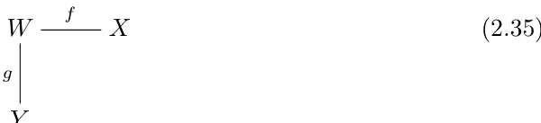

它的纤维和，表示为 $X \sqcup_W Y$，定义为 $X \sqcup W \sqcup Y$ 通过等价关系 $\sim$ 生成的商集 $w \sim f(w)$ 和 $w \sim g(w)$ 对于所有 $w \in W$。

$$
X \sqcup_W Y := (X \sqcup W \sqcup Y) / \sim \qquad \text{其中 } \forall w \in W, \ w \sim f(w) \text{ 和 } \ w \sim g(w).
$$

有明显的包含 $i_1: X \to X \sqcup_W Y$ 和 $i_2: Y \to X \sqcup_W Y$。<sup>15</sup> 注意，如果 $Z = X \sqcup_W Y$ 那么图表

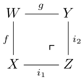

可交换。给定图 2.35 的设置，我们定义 $X$ 和 $Y$ 到 $W$ 的推出为任何满足 $Z \cong X \sqcup_W Y$ 的集合 $Z$ 的同构。图 2.36 中的角符号 $\lrcorner$ 表示 $Z$ 是推出的。

#### 例子 2.6.2.2
让 $X=\{x \in \mathbb{R} \mid 0 \leqslant x \leqslant 1\}$ 为 0 到 1 之间的数字集合，让 $Y=\{y \in \mathbb{R} \mid 1 \leqslant y \leqslant 2\}$ 为 1 到 2 之间的数字集合，并且让 $W=\{1\}$。.然后推出 $X \xleftarrow{f} W \xrightarrow{g} Y$，其中和是“显然”的函数 $(1 \to 1)$，结果是 $X \sqcup_W Y \cong \{z \in \mathbb{R} \mid 0 \leqslant z \leqslant 2\}$，正如预期的那样。当我们最终到达一般的余极限时，可以通过将这些区间拼接在一起来得到整个实数线。

#### 示例 2.6.2.3 (推出)
在下面的每个示例中，右侧的图表意味着是左侧图表的推出。新对象 $D$ 是 $B$ 和 $C$ 的并集，但 $A$ 的实例等同于它们的 $B$ 和 $C$ 方面。这将在两个图表之后讨论。

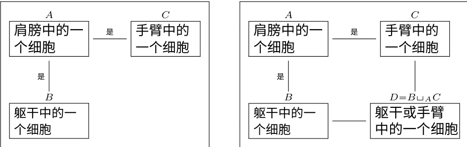

在左手的 Olog (2.37) 中，两个箭头都是包含关系：作者认为肩膀中的每个细胞既属于手臂又属于躯干。然后推出就是并集，其中肩膀中的细胞不会被重复计算。

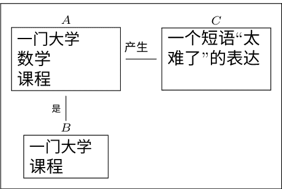

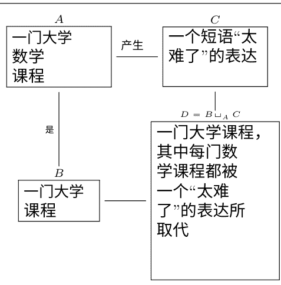

(2.38)

在 Olog (2.37) 中，肩膀被视为手臂和躯干的一部分。当将这两部分取并集时，我们不希望“重复计数”肩膀 (如在余积 $B \sqcup C$ 中所做的，参见示例 2.4.2.12)。因此，我们为肩膀中的细胞创建一个新类型 $A$，无论是将其视为手臂中的细胞还是将其视为躯干中的细胞，它们都被视为相同。一般来说，如果想要将两个东西粘合在一起，以 $A$ 作为粘合剂，以 $B$ 和 $C$ 作为要粘合的两个东西，那么并集就是推出 $B \sqcup_A C$。(在拓扑空间的设置中可以看到这个很好的图像，参见示例 4.5.3.30。)

在 Olog (2.38) 中，如果每门数学课都太难，那么在读出课程列表时，每门数学课都不会被读出，而只会被读为“太难”。为了形成 $D$，我们首先取 $B$ 和 $C$ 的并集，然后我们认为 $A$ 中的所有内容无论是作为课程还是作为短语“太难”来看，都是相同的。数学课程都被模糊地合并在一起。因此，我们看到可以通过推出来等同不同的事物。

#### 练习 2.6.2.4
让 $W, X, Y$ 如图所示，并且 $f: W \to X$ 和 $g: W \to Y$ 是指定的函数。

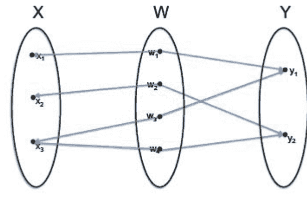

图 $X \leftarrow W \to Y$ 的推出是一个集合 $P$。写下 $P$ 的基数减去 $n$ 作为一个自然数 $\in \mathbb{N}$。

#### 练习 2.6.2.5
假设 $W = \emptyset$；你能说出关于 $X \sqcup_W Z$ 的什么吗？

#### 练习 2.6.2.6
$\mathbb{N}$ 表示自然数的集合，让 $X = \mathbb{Z}$ 表示整数的集合，并让 $Y = \{.\}$ 表示一个单元素集合。定义 $f: W \to X$ 通过 $f(w) = -(w + 1)$，并定义 $g: W \to Y$ 为唯一的映射。描述集合 $X \sqcup_W Y$。

#### 练习 2.6.2.7
让 $i: R \subseteq X \times X$ 是一个等价关系 (参见示例 2.1.2.3 的符号)。通过与投影 $\pi_1, \pi_2: X \times X \to X$ 的组合，我们得到两个映射 $\pi_1 \circ i: R \to X$ 和 $\pi_2 \circ i: R \to X$。
- a.) 什么是推出 $X \Leftarrow R \to X$?
- b.) $X$ 不被假定为等价关系，我们仍然可以定义上述的推出。推出 $X$ 到 $X$ 的关系与由 $R$ 生成的等价关系之间是否存在关系？

#### 引理 2.6.2.8 (推出的通用性质)
假设给定以下集合和函数的图示如下。


$A$ 和 $g: Y$


(2.39)

存在一个唯一的箭头 $\{f, g\}_A$ 使得所有图示都成立。
$$f = \{f, g\} \circ i_1 \text{ 和 } g = \{f, g\} \circ i_2.$$

### 2.6.3 其他有限余极限

#### 定义 2.6.3.1 (余等化子)
假设给定两个平行箭头


$f$ 和 $g$ 的余等化子是右侧的交换图 (2.40)，其中我们定义

$$
\text{Coeq}(f, g) := Y / f(x) \sim g(x)
$$

即 $f$ 和 $g$ 的余等化子是由 $Y$ 通过生成的等价关系商集
由 $\{ (f(x), g(x)) \mid x \in X \} \subseteq Y \times Y$

#### 练习 2.6.3.2
让 $X$ 为实数集合 $=\mathbb{R}$。两个映射 $X \to X$ 的余等化子是什么，分别由 $x \to x$ 和 $x \to (x + 1)$ 给出？
$\diamond$ 练习

#### 练习 2.6.3.3
找到两个箭头的余等化子所享有的普遍性质。
$\diamond$ 练习

#### 练习 2.6.3.4 (初等对象)
一个初等集合是一个集合 $S$，对于每个集合 $A$，存在一个唯一的函数 $S \to A$。
- a.) 寻找一个初始集合。
- b.) 你认为初始集合的概念是否属于这个部分 (第 2.6 节)？为什么？如果余积、推出和等化器都是余极限，那么余极限有什么共同点？

## 2.7 集合中的其他概念

在这一部分中，我们讨论集合范畴中的一些剩余概念。

### 2.7.1 重缩

如果存在 $f: X \to Y$ 和一个函数 $g: Y \to X$ 在这种情况下，我们称 $f$ 为重缩截面，称 $g$ 为重缩投影。

### 练习 2.7.1.2
设 $f: X \to Y$ 和 $g: Y \to X$。

### 2.7.2 柯里化

柯里化是一个想法，当一个函数接受多个输入时，我们可以逐个输入它们或一次性输入它们。例如，考虑一个函数，它接受一个材料 $M$ 和一个扩展 $E$，并返回当材料被拉伸到该扩展时传递的力。这是一个函数 $e: \ulcorner \text{一个材料} \urcorner \times \ulcorner \text{一个扩展} \urcorner \to \ulcorner \text{一个力} \urcorner$。这个函数一次接受两个输入，但是将第二个输入“柯里化”是方便的。回想一下

### 2.7. 其他集合中的概念

$\text{Hom}_{\text{Set}} (\ulcorner \text{一个扩展} \urcorner, \ulcorner \text{一个力} \urcorner)$ 是理论力 - 扩展曲线的集合。

柯里化将 $e$ 转换为一个函数
$$
e': \ulcorner \text{一个材料} \urcorner \to \text{Hom}_{\text{Set}} (\ulcorner \text{一个扩展} \urcorner, \ulcorner \text{一个力} \urcorner).
$$
这是一种更方便的打包相同信息的方式。

实际上，重新包装这些信息可能更方便。对于任何扩展，我们可能希望有一个函数，它接受一个材料并返回它在该扩展上能传递多少力。这是一个函数。
$$
e'': \ulcorner \text{一个扩展} \urcorner \to \text{Hom}_{\text{Set}} (\ulcorner \text{一个材料} \urcorner, \ulcorner \text{一个力} \urcorner).
$$

#### 符号 2.7.2.1
让 $A$ 和 $B$ 是集合。有时我们用以下方式表示从 $A$ 到 $B$ 的函数集合
$$
B^A := \text{Hom}_{\text{Set}} (A, B). \quad \text{(2.41)}
$$

#### 练习 2.7.2.2
对于一个有限集合 $A$，用 $|A| \in \mathbb{N}$ 表示 $A$ 的基数 (元素个数)。如果 $A$ 和 $B$ 都是有限的 (包括可能为空的情况)，是否总是成立 $|B^A| = |B|^{|A|}$?

#### 命题 2.7.2.3 (柯里化)
让 $A$ 表示一个集合。对于任意的集合 $X, Y$ 存在一个双射
$$
\phi: \text{Hom}_{\text{Set}} (X \times A, Y) \xrightarrow{\cong} \text{Hom}_{\text{Set}} (X, Y^A). \quad \text{(2.42)}
$$
**证明**。假设给定 $f: X \times A \to Y$。定义 $\phi(f): X \to Y^A$ 如下：对于任意的 $x \in X$ 令 $\phi(f)(x): A \to Y$ 定义如下：对于任意的 $a \in A$，令 $\phi(f)(x)(a) := f(x, a)$。现在我们构造逆映射，$\psi: \text{Hom}_{\text{Set}} (X, Y^A) \to \text{Hom}_{\text{Set}} (X \times A, Y)$。假设给定 $g: X \to Y^A$。定义 $\psi(g): X \times A \to Y$ 如下：对于任意的二元组 $(x, a) \in X \times A$，令 $\psi(g)(x, a) := g(x)(a)$。

对于任意的 $f \in \text{Hom}_{\text{Set}} (X \times A, Y)$ 我们有 $\psi \circ \phi(f)(x, a) = \phi(f)(x)(a) = f(x, a)$，并且对于任意的 $g \in \text{Hom}_{\text{Set}} (X, Y^A)$ 我们有 $\phi \circ \psi(g)(x)(a) = \psi(g)(x, a) = g(x)(a)$，因此我们可以看到 $\phi$ 是一个所需的同构。

#### 练习 2.7.2.4
令 $X = \{1, 2\}, A = \{a, b\}$，并且 $Y = \{x, y\}$。
- a.) 写下 $L$ 的三个不同元素 $:= \text{Hom}_{\text{Set}}(X \times A, Y)$。
- b.) 写下 $M$ 的所有元素 $:= \text{Hom}_{\text{Set}}(A, Y)$。
- c.) 对于你在 (a) 部分选择的三个元素 $\ell \in L$，写出对应的函数 $\phi(\ell): X \to M$ (由命题 2.7.2.3 保证)。

#### 练习 2.7.2.5
让 $A$ 和 $B$ 是集合。我们知道 $\text{Hom}_{\text{Set}} (A, B) = B^A$，所以我们有一个函数 $\text{id}_{B^A}: \text{Hom}_{\text{Set}} (A, B) \to B$。看看命题 2.7.2.3，进行以下替换 $X = \text{Hom}_{\text{Set}} (A, B)$，$Y = B$，和 $A = A$。考虑函数
$$
\phi^{-1}: \text{Hom}_{\text{Set}} (\text{Hom}_{\text{Set}} (A, B), B^A) \to \text{Hom}_{\text{Set}} (\text{Hom}_{\text{Set}} (A, B) \times A, B)
$$
obtained as the inverse of (2.42). We have a canonical element $\text{id}_{B^A}$ in the domain of $\phi^{-1}$。我们可以应用函数 $\phi^{-1}$ 并获得一个元素 $ev = \phi^{-1}(\text{id}_{B^A}) \in \text{Hom}_{\text{Set}} (\text{Hom}_{\text{Set}} (A, B) \times A, B)$，它本身是一个函数，
$$
ev: \text{Hom}_{\text{Set}} (A, B) \times A \to B.
$$

### 2.7.3 集合的算术

a.) 描述函数 ev 在其定义域中对元素的操作方式。
b.) 为什么人们会倾向于用 ev 表示这个函数？

如果 n 是一个自然数，根据 (2.6) 的记法，存在一个很好的集合 $\{1, 2, \dots, n\}$。如果 A 是一个集合，我们经常使用缩写

$A^n := A^{\underline{n}}$. (2.43)

练习 2.7.2.6. 在例子 2.4.1.7 中，我们说 $\mathbb{R}^2$ 是 $\mathbb{R} \times \mathbb{R}$ 的缩写，但是在 (2.43) 中，我们说 $\mathbb{R}^2$ 是 $\mathbb{R}^2$ 的缩写。使用练习 2.1.2.14、命题 2.7.2.3、练习 2.4.2.10，以及 $1+1=2$ 这个事实，证明它们是同构的，即 $\mathbb{R}^2 \cong \mathbb{R} \times \mathbb{R}$

（练习 2.1.2.14 的答案是 $A = \{\odot\}$: 即 $\operatorname{Hom}_{\mathbf{Set}}(\{\odot\}, X) \cong X$ 对于所有的 X。）

命题 2.7.3.1 总结了积、余积和指数的性质，并以熟悉的方式展示了它们，即算术。事实上，人们可以将自然数视为有限集合的同构类别，这就是它们在计数中的用途。考虑一下计算集合 S 中元素的标准过程，比如一个牧场中的牛：指向 S 中的一个元素，同时说"1"，指向 S 中的另一个元素，同时说"2"，依此类推，直到完成。这个过程实际上就是在 S 和某个集合 n 之间创建一个同构（一一映射）关系。

再次，自然数是有限集合的同构类。它们的行为，即自然数的算术，反映了集合的行为。例如，乘法分配于加法的事实是关于点阵的事实，如示例 2.4.1.2 所示。以下命题列出了集合的这种算术性质。

在这个命题中，我们用 $A+B$ 表示两个集合 A 和 B 的余积，而不是 $A \sqcup B$。这是一个通常使用的合理符号。

命题 2.7.3.1. 对于任意集合 A、B 和 C（除了一个例外，见练习 2.7.3.2），存在以下同构。

- $A + 0 \cong A$
- $A + B \cong B + A$
- $(A + B) + C \cong A + (B + C)$
- $A \times 0 \cong 0$
- $A \times 1 \cong A$
- $A \times B \cong B \times A$
- $(A \times B) \times C \cong A \times (B \times C)$
- $A \times (B + C) \cong (A \times B) + (A \times C)$

- $A^0 \cong \underline{1}$
- $A^1 \cong A$
- $\underline{0}^A \cong \underline{0}$
- $\underline{1}^A \cong \underline{1}$
- $A^{B+C} \cong A^B \times A^C$
- $(A^B)^C \cong A^{B \times C}$

练习 2.7.3.2。命题 2.7.3.1 中的一切都是正确的，除了一个情况，即 $0^0$。

在这种情况下，我们得到了矛盾的答案，因为对于任何集合 A，包括 $A=\emptyset=0$，我们既声称 $A^0 \cong 1$ 又声称 $0^A \cong 0$。

根据 (2.6) 中给出的 0 和 1 的定义以及 (2.41) 中给出的 $A^B$ 的定义，$0^0$ 的正确答案是什么？

练习 2.7.3.3。对于自然数来说，如果 $a, b \in \mathbb{N}$ 且 $ab=0$，则要么 $a=0$，要么 $b=0$。类似的陈述对所有集合都成立吗？

命题 2.7.3.1 在某种意义上涉及同构。它表明理解集合的同构归结为理解自然数。但请注意，Set 中发生的事情远不止同构；特别地，存在不可逆的函数。

在小学时，你可能从未见过像这样的东西：

$5^3 \times 3 \to 5$

然而，在练习 2.7.2.5 中，我们发现了一个函数 $\operatorname{ev}: B^A \times A \to B$，它适用于任何集合 A, B。这个函数 ev 不是一个同构，所以它在自然数的方程中并没有出现。但它仍然具有重要的意义。 ^16 从纯粹的数字角度来看，它看起来像是在告诉我们一个重要的函数 $5^3 \times 3 \to 5$，这很奇怪。这里的问题正是你在练习 2.1.2.13 中遇到的问题。

练习 2.7.3.4。解释为什么存在一个规范函数 $5^3 \times 3 \to 5$，但不存在一个规范函数 $5^5 \to 5$。

## 口号 2.7.3.5。

> “确实，一个集合与具有相同元素数量的任何其他集合是同构的，但不要被误导以为集合的研究可以归结为数字的研究。不是同构的函数无法在数字的框架内捕捉到。”

^16 大致上，存在性质 $\operatorname{ev}: 5^3 \times 3 \to 5$ 表示在一个 $5 \times 5 \times 5$ 的点阵中，给定一个点和其中的三个轴之一，你可以告诉我该点在该轴上的坐标。

### 2.7.4 子对象和特征函数

**定义 2.7.4.1**. 对于任意集合 B，定义 B 的幂集，记作 $\mathbb{P}(B)$，为 B 的子集的集合。

练习 2.7.4.2。
- a.) $\mathbb{P}(\emptyset)$ 有多少个元素？
- b.) $\mathbb{P}(\{\odot\})$ 有多少个元素？
- c.) $\mathbb{P}(\{1, 2, 3, 4, 5, 6\})$ 有多少个元素？
- d.) 你有没有想过为什么他们把它命名为“幂集”？

#### 2.7.4.3 单纯复合体

定义 2.7.4.4. 令 V 是一个集合，令 $\mathbb{P}(V)$ 是它的幂集。一个子集 $X \subseteq \mathbb{P}(V)$ 如果对于每个 $u \in X$ 和每个 $u' \subseteq u$，我们有 $u' \in X$，那么它被称为向下闭合的。我们说如果对于每个 $v \in V$，单元素集合 $\{v\}$ 是 X 的一个元素。一个单纯复合体是一个对 $(V, X)$，其中 V 是一个集合，$X \subseteq \mathbb{P}(V)$ 是一个下降闭合的子集，它包含所有的原子。X 的元素被称为单纯形（单数：单纯形）。任何子集 $u \subseteq V$ 都有一个基数 $|u|$，所以我们有一个函数 $X \to \mathbb{N}$ 将每个单纯形映射到它的基数。具有基数 $n+1$ 的单纯形集合被记为 $X_n$，每个元素 $x \in X_n$ 被称为一个 n-单纯形。^17 由于 X 包含所有的原子（基数为 1 的子集），我们也可以称之为 0-单纯形（顶点）。我们有时称 1-单纯形为边。^18

由于 $X_0 \cong V$，我们可以简单地用 $X$ 表示一个单纯复合体。

例子 2.7.4.5。设 $n \in \mathbb{N}$ 是一个自然数，设 $V$ 为 $\underline{n}$ 的集合。定义 n-单形，记作 $\Delta^n$，为包含所有原子的下闭单纯复合体 $\mathbb{P}(V)$。

我们可以通过将所有顶点放在页面上作为点来绘制一个单纯复合体 X。然后对于每个 $X_1$ 中的 $x$，我们可以看到 $x = \{v, v'\}$ 由 2 个顶点组成，因此我们绘制一条连接 $v$ 和 $v'$ 的边。对于每个 $X_2$ 中的 $y$，我们可以看到 $y = \{w, w', w''\}$ 由 3 个顶点组成，因此我们绘制一个（填充的）三角形连接它们。由于 X 被假定为下闭的，所以所有三条边也会被绘制出来。

因此，这里绘制了 0-单形 $\Delta^0$，1-单形 $\Delta^1$，2-单形 $\Delta^2$ 和 3-单形 $\Delta^3$：


^17 一开始，将基数为 1 的子集表示为 $X_0$ 等等可能会让人烦恼。但这是标准约定，因为正如我们将看到的那样，$X_n$ 将是 n 维的。
^18 我们之所以写成 $X_0 \cong V$ 而不是 $X_0 = V$ 是因为 $X_0$ 是 V 的 1 元素子集的集合。因此，如果 $V = \{a, b, c\}$，那么 $X_0 = \{\{a\}, \{b\}, \{c\}\}$。这只是纠结而已。

## 2.7. 其他集合中的概念

对于不同的 n，n-单形绝不是所有单纯复合体的全部。一般来说，单纯复合体是以规定的方式将单纯形联合或“粘合”在一起。例如，考虑具有顶点 $X_0 = \{1, 2, 3, 4\}$ 的单纯复合体 X，边 $X_1 = \{\{1, 2\}, \{2, 3\}, \{2, 4\}\}$，没有更高的单纯复合体 $X_2 = X_3 = \cdots = \emptyset$。我们可以将 X 绘制如下：


练习 2.7.4.6. 令 X 是以下单纯复合体，使得 $X_0 = \{A, B, \dots, M\}$。


在这种情况下，$X_1$ 由像 $\{A, B\}$ 和 $\{D, K\}$ 这样的元素组成，但不包括 $\{D, J\}$。写出 $X_2$ 和 $X_3$（提示：X 的绘图表明 $X_3$ 应该有一个元素）。

练习 2.7.4.7. 2-单形 $\Delta^2$ 被绘制为一个填充的三角形，顶点为 $V = \{1, 2, 3\}$。有一个单纯复合体 $X = \partial \Delta^2$，它将被绘制为一个空的三角形，具有相同的顶点集。
- a.) 将 $\Delta^2$ 和 X 并排绘制，并清楚地显示它们之间的区别。
- b.) 将 X 的数据写成一个单纯复合体。换句话说，集合 $X_0, X_1, X_2, X_3, \dots$ 是什么？

#### 2.7.4.8 子对象分类器

定义 2.7.4.9. 定义集合 Set 的子对象分类器为 $\Omega$，表示为 $\Omega := \{\text{真}, \text{假}\}$，以及函数 $\{\odot\} \to \Omega$ 将唯一元素发送到真。

命题 2.7.4.10. 设 $B$ 是一个集合。存在一个同构

$\phi: \operatorname{Hom}_{\mathbf{Set}}(B, \Omega) \xrightarrow{\cong} \mathbb{P}(B).$

证明。给定一个函数 $f \colon B \to \Omega$，令 $\phi(f) = \{b \in B \mid f(b) = \text{真}\} \subseteq B$。我们现在构造一个函数 $\psi \colon \mathbb{P}(B) \to \operatorname{Hom}_{\mathbf{Set}}(B, \Omega)$ 作为 $\phi$ 的逆函数。给定一个子集 $B' \subseteq B$，定义 $\psi(B') \colon B \to \Omega$ 如下：

$\psi(i)(b)=\begin{cases}\text{True} & \text { if } b \in B' \\ \text{False} & \text { if } b \notin B'.\end{cases}$

很容易验证，$\phi$ 和 $\psi$ 是互逆的。

$\square$

定义 2.7.4. （特征函数）。给定一个子集 $B_l \subseteq B$，我们称 $B_l$ 在 $B$ 中的特征函数为 $B_l$ 到 $\Omega$ 的函数。

设 $B$ 是任意集合，$\mathbb{P}(B)$ 是其幂集。根据命题 2.7.4.10，$\mathbb{P}(B)$ 和 $\Omega(B)$ 之间存在一个双射。由于 $\Omega$ 的基数为 2，$\mathbb{P}(B)$ 的基数为 $2^{|B|}$，这解释了习题 2.7.4.2 的正确答案。

习题 2.7.4.
- a.) 什么是 $A'' \subseteq A$ 的特征函数？
- b.) 你能用一些函数 $\Omega \to \Omega$ 来表达它吗？

$\diamond$

### 2.7.5 满射，单射

满射和单射的经典定义涉及元素，我们现在给出。但更强大的概念涉及所有映射，并将在命题 2.7.5.4 中给出。

定义 2.7.5.1. 设 $f \colon X \to Y$ 是一个函数。我们说 $f$ 是满射的，如果对于所有 $y \in Y$ 都存在一些 $x \in X$，使得 $f(x)=y$。我们说 $f$ 是单射的，如果对于所有 $x \in X$ 和所有 $x' \in X$ 满足 $f(x)=f(x')$，则有 $x=x'$。

既是单射又是满射的函数称为双射。

备注 2.7.5.2. 事实证明，一个双射函数总是同构的，而所有同构都是双射的。我们在这里不会展示，但并不太难；例如参见 [Big, 定理 5.4]。

定义 2.7.5.3 (单态射，满态射)。设 $f \colon X \to Y$ 是一个函数。

我们说 $f$ 是一个单态射，如果对于所有集合 $A$ 和函数对 $g, g': A \to X$， $A \xrightarrow{g} X \xrightarrow{f} Y$， $A \xrightarrow{g'} X$

如果 $f \circ g=f \circ g'$，则 $g=g'$。

我们说 $f$ 是一个满态射，如果对于所有集合 $B$ 和函数对 $h, h': Y \to B$，


如果 $h \circ f = h' \circ f$，则 $h = h'$。

命题 2.7.5.4. 令 $f: X \to Y$ 是一个函数。那么，如果 $f$ 是单射，当且仅当它是单态射；如果 $f$ 是满射，当且仅当它是满态射。

证明。如果 $f$ 是单态射，通过取 $A$ 为 $1$ 和 $\{\odot\}$，它显然是单射的。假设 $f$ 是单射，并且令 $g, g': A \to X$ 是满足 $f \circ g = f \circ g'$ 的函数，但假设反证法，假设 $g$ 不等于 $g'$。那么存在一个元素 $a \in A$，使得 $g(a) \neq g'(a) \in X$。但是由于单射性，$f(g(a)) \neq f(g'(a))$，与 $f \circ g = f \circ g'$ 矛盾。

假设 $f: X \to Y$ 是一个满射，并选择一些 $y_0 \in Y$（注意如果 $Y$ 为空，则命题是空洞的）。令 $h: Y \to \Omega$ 表示子集 $\{y_0\} \subseteq Y$ 的特征函数，令 $h': Y \to \Omega$ 表示 $\emptyset \subseteq Y$ 的特征函数；注意 $h \le h'$ 对于所有 $y \in y_0$ 成立。由于 $f$ 是满射且 $h \le h'$，我们必须有 $h \circ f \le h' \circ f$，因此存在 $x \in X$ 使得 $h(f(x)) \le h'(f(x))$，这意味着 $f(x) \le y_0$。这证明了 $f$ 是满射。

最后，假设 $f$ 是满射，并且令 $h, h': Y \to B$ 是具有 $h \circ f = h' \circ f$ 的函数。对于任意的 $y \in Y$，存在某个 $x \in X$ 使得 $f(x) = y$，因此 $h(y) = h(f(x)) = h'(f(x)) = h'(y)$。这证明了 $f$ 是一个满射。

命题 2.7.5.5. 假设 $f: X \to Y$ 是一个单射。那么对于任意的函数 $g: A \to Y$，图表中的顶部映射 $f': X \times_Y A \to A$


是一个单射。

证明。为了证明 $f'$ 是一个单射，我们取一个任意的集合 $B$ 和两个映射 $m, n: B \to X \times_Y A$ 使得 $f' \circ m = f' \circ n$，将该函数记为 $p := f' \circ m: B \to A$。

现在令 $q = g' \circ m$ 和 $r = g' \circ n$。图表如下所示：


我们有

```
f ○ q = f ○ g' ○ m = g ○ f' ○ m = g ○ f' ○ n = f ○ g' ○ n = f ○ r
```

但我们假设 $f$ 是单态射，所以这意味着 $q=r$。根据拉回的普遍性质，引理 2.5.1.14，我们有 $m=n$。

练习 2.7.5.6。类似于命题 2.7.5.5，证明推出保持单态射。

例子 2.7.5.7。假设一个图有一个纤维积方块


使得 $f$ 被设计为一个单射，$g$ 是任意映射。19 在这种情况下，对于 $f'$，$g'$ 和 $X \times_Z Y$ 有一个良好的标记系统。具体来说：
- “是”是 $f'$ 的适当标签，
- $g$ 的标签是 $g'$ 的适当标签，
- $(X \text{的标签}, \text{然后是} g \text{的标签}, \text{然后是} Y \text{的标签})$ 是 $X \times_Z Y$ 的适当标签。给出一个明确的例子，


推论 2.7.5.8. 设 $i: A \to X$ 为单射。那么存在一个形如的纤维积方块


证明。设 $X' \subseteq X$ 表示 $i$ 的像，并设 $f: X \to \Omega$ 为 $X' \subseteq X$ 的特征函数。很容易验证图 2.44 是一个回拉图。

练习 2.7.5.9。考虑子对象分类器 $\Omega$，单元素 $\{\odot\}$ 和映射 $\{\odot\} \to \Omega$，根据定义 2.7.4.9，观察图 2.44，并按照练习 2.7.5.7 的精神，为 $\Omega$，$\{\odot\}$ 和 $\text{True}$ 给出一个标签。给定 $X$ 的一个标签和 $f$ 的一个标签，为 $A, i$ 和 $f'$ 给出一个标签，使得英语与数学相吻合。

### 2.7.6 多重集合、相对集合和集合索引集

在这一节中，我们准备考虑与 Set 不同的范畴，通过研究一些与 Set 相关的范畴。

#### 2.7.6.1 多重集合

考虑给定文档中的单词集合 X。如果 $\operatorname{WC}(X)$ 是文档的单词计数，通常我们不会有 $\operatorname{WC}(X) = |X|$。原因是集合不能包含相同的元素超过一次，所以像"the"这样的单词在 $|X|$ 中可能被低估。多重集合是一种可以为元素分配多重性（即计数的次数）的集合。

但是，如果 X 和 Y 是多重集合，从 X 到 Y 的适当类型的映射是什么？由于每个集合都是一个多重集合（其中每个元素的多重性为 1），让我们将自己限制在与集合上的常规映射一致的映射概念上。也就是说，如果多重集合 X 和 Y 恰好是集合，那么我们的映射 $X \to Y$ 应该只是函数。

练习 2.7.6.2.
- a.) 提出一些关于多重集映射的概念，当限制在集合上时，它可以推广函数的概念。
- b.) 假设 $X=(1,1,2,3)$ 和 $Y=(a,b,b,b)$，即 $X=\{1,2,3\}$，其中 1 的重数为 2，$Y=\{a,b\}$，其中 b 的重数为 3。在你的概念中，所有的映射 $X \to Y$ 是什么？

在第 4 章中，我们将给出范畴的定义，并且你可以测试你的映射概念是否确实定义了一个范畴。这是我对多重集映射的定义。

定义 2.7.6.3. 多重集是一个序列 $X := (E, B, \pi)$，其中 E 和 B 是集合，$\pi: E \to B$ 是一个满射函数。我们将 E 称为 X 的元素实例集，将 B 称为 X 的元素名称集，将 $\pi$ 称为 X 的命名函数。给定一个元素名称 $x \in B$，令 $\pi^{-1}(x) \subseteq E$ 为其原像；$\pi^{-1}(x)$ 中元素的个数称为 x 的重数。

假设 $X = (E, B, \pi)$ 和 $X' = (E', B', \pi')$ 是多重集合。从 X 到 Y 的映射，表示为 $f: X \to Y$，由一对 $(f', f_0)$ 组成，其中 $f': E \to E'$ 和 $f_0: B \to B'$ 是函数，并且满足以下图表交换：


(2.45)

练习 2.7.6.4。假设伪多重集合与多重集合几乎相同，只是 $\pi$ 不需要是满射。
- a.) 写下一个伪多重集合，它不是一个多重集合。
- b.) 用重数的术语描述两个概念之间的区别。
- c.) 除了名称的复杂性之外，你认为哪个概念更有用：多重集还是伪多重集？

练习 2.7.6.5. 考虑练习 2.7.6.2 中描述的多重集。
- a.) 按照定义 2.7.6.3 的形式写出每个多重集，如 $(E, B, \pi)$。
- b.) 根据相同的定义，映射 $X \to Y$ 是什么？
- c.) 如果我们取消图 2.45 必须满足的交换条件，有多少个映射 $X \to Y$ 存在？

#### 2.7.6.6 相对集合

让我们继续从多重集的思想出发，但现在假设我们有一个固定的名称集合 $B$，我们想要一劳永逸地保留它们。每当有人讨论一个集合时，每个元素都必须有一个 $B$ 中的名称。而每当有人讨论一个映射时，它必须保留这些名称。例如，如果 $B$ 是英文单词的集合，那么每个文档都由一个映射到 $B$ 的有序集合组成（例如 $1 \to \text{假设}, 2 \to \text{那}, 3 \to \text{我们}$ 等）。从文档 $A$ 到文档 $B$ 的映射将把在 $A$ 中找到的每个单词发送到在 $B$ 中找到的相同单词。这个概念在下面被仔细定义。

定义 2.7.6.7 (相对集合). 令 $B$ 是一个集合。一个相对于 $B$ 的集合，或者简称为 $B$ 上的集合，是一个由 $(E, \pi)$ 组成的对，其中 $E$ 是一个集合，$\pi: E \to B$ 是一个函数。一个相对于 $B$ 的集合映射，表示为 $f: (E, \pi) \to (E', \pi')$，是一个函数 $f: E \to E'$，使得下面的三角形可交换，即 $\pi = \pi' \circ f$，


练习 2.7.6.8. 给定集合 $X, Y, Z$ 和函数 $f: X \to Y$ 和 $g: Y \to Z$，我们可以将它们组合起来得到一个函数 $X \to Z$。如果 $B$ 是一个集合，如果 $(X, p), (Y, q)$ 和 $(Z, r)$ 是相对于 $B$ 的集合，如果 $f: (X, p) \to (Y, q)$ 和 $g: (Y, q) \to (Z, r)$ 是映射，那么是否有一个合理的组合概念，使得我们得到一个相对集合的映射 $(X, p) \to (Z, r)$？提示：画图。

练习 2.7.6.9.
- a.) 令 $\{\odot\}$ 表示一个只有一个元素的集合。在 $\{\odot\}$ 和普通集合之间有什么区别？
- b.) 描述相对于 $\emptyset$ 的集合。有多少个？

#### 2.7.6.10 索引集合

令 $A$ 是一个集合。假设我们想要为每个元素 $a \in A$ 分配一个集合 $S_a$。这被称为一个 $A$-索引集合。在范畴论中，我们总是对相同类型的两个不同结构之间的合法映射感兴趣，因此我们需要一个 $A$-索引映射的概念；我们做“显而易见的事情”。

## 2.7. 其他集合中的概念

例子 2.7.6.11。设 $C$ 是一个教室的集合。对于每个 $c \in C$，设 $P_c$ 表示教室 $c$ 中的人的集合，设 $S_c$ 表示教室 $c$ 中的座位（椅子）的集合。那么 $P$ 和 $S$ 是 $C$-索引集合。它们之间的适当类型的映射尊重索引。也就是说，多重集合 $P \to S$ 的映射应该对于每个教室 $c \in C$ 是一个函数 $P_c \to S_c$。$^{20}$

定义 2.7.6.12。设 $A$ 是一个集合。一个 $A$ 索引集合是一组集合 $S_a$，每个元素 $a \in A$ 对应一个；暂时我们用 $(S_a)_{a \in A}$ 表示。如果 $(S'_a)_{a \in A}$ 是另一个 $A$ 索引集合，从 $(S_a)_{a \in A}$ 到 $(S'_a)_{a \in A}$ 的映射，表示为

$$ (f_a)_{a \in A} : (S_a)_{a \in A} \to (S'_a)_{a \in A} $$

是一组函数 $f_a : S_a \to S'_a$，每个元素 $a \in A$ 对应一个。

练习 2.7.6.13。设 $\{\odot\}$ 表示一个单元素集合。什么是 $\{\odot\}$ 索引集合和它们之间的映射？

练习 2.7.6.14。$A$ 索引集合和相对集合之间有着紧密的关系。是什么关系？

> $^{20}$如果我们想让来自任何教室的人只能选择来自任何教室的椅子，范畴论会告诉我们重新考虑 $P$ 和 $S$ 作为集合，忽略它们的索引。请参见第 5.1.4.7 节。

## 第 2 章 集合的范畴

# 第三章 范畴和函子（未察觉）

在本章中，我们开始利用我们对集合的理解来构建更有趣的数学工具，每个工具都可以组织我们对某种领域的理解。例如，幺半群组织了我们关于作用于对象的代理的思考；群是幺半群，只允许代理人可逆地行动。然后我们将研究图形，它们是由节点和箭头组成的系统，可以捕捉网络中的信息流动或模拟构建块之间的连接的思想。我们将讨论序，它可以用来研究分类或层次结构。

最后，我们以数学的角度来看待数据库，实际上它包含了本章中的所有内容。数据库是用于构造信息结构的连接模式。

我们将在第 4 章中看到，我们在本章中研究的一切都是一个范畴的例子。在第 2 章中研究的集合也是一个范畴。一种思考范畴的方式是将其视为一组对象和它们之间的连接模式；集合是对象（如果你愿意，可以将其想象为充满点的椭圆）通过函数连接起来。但是每个集合本身也是一个范畴：其中的对象只是不相连的！就像一个集合有内部视图和外部视图一样，本章中的所有范畴也是如此。每个幺半群都是一个范畴，但也有一个幺半群的范畴。

然而，在本章中我们几乎不会说“范畴”这个词。在解释一切都适用于一个框架之前，让这些想法自然而然地形成有趣的结构似乎更好。这将是第 4 章中令人愉快的回报。

## 3.1 幺半群

解释我们周围现象的一种常见方式是说代理人对物体进行操作。例如，在计算机绘图程序中，用户以特定的方式对画布进行操作。可以按顺序从可用列表中选择操作，将一个图像转换为另一个图像。另一个例子是，我们可以研究时间对时钟上的指针位置的影响。一个行动的第一个规则是：执行一系列行动本身就是一种行动，虽然更复杂，但仍然是一种行动。

数学对象称为幺半群和群被赋予了编码代理人的任务。在这一角度下，即代理人可以做什么，以及不同行动连续进行时会发生什么。幺半群可以被看作是一组行动，以及一个公式，它编码了一系列行动本身被视为一种行动。群与幺半群相同，只是要求每个行动都是可逆的。在本节中，我们集中讨论幺半群；我们将在第 3.2 节讨论群。

### 3.1.1 定义和例子

定义 3.1.1.1 (幺半群)。一个幺半群是一个序列 $(M, e, \star)$，其中 $M$ 是一个集合，$e \in M$ 是一个元素，而 $\star: M \times M \rightarrow M$ 是一个函数，满足以下条件，对于所有的 $m, n, p \in M$：

- $m \star e = m$，
- $e \star m = m$，并且
- $(m \star n) \star p = m \star (n \star p)$。

我们将 $e$ 称为单位元素，并将 $\star$ 称为乘法运算。$^{1}$ 我们称前两个规则为单位律，第三个规则为结合律。

备注 3.1.1.2。严谨地说，应该陈述从定义 3.1.1.1 中得到的条件：

- $\star(m, e) = m$，
- $\star(e, m) = m$，和
- $\star(\star(m, n), p) = \star(m, (\star(n, p)))$。

它们在定义 3.1.1.1 中的书写方式被称为中缀表示法，我们经常使用中缀表示法而不提及它。也就是说，给定一个函数 $\cdot: A \times B \rightarrow C$，我们可以写成 $a \cdot b$ 而不是 $\cdot(a, b)$。

例子 3.1.1.3 (自然数的加法幺半群)。设 $M = \mathbb{N}$ 为自然数的集合。设 $e = 0$，并且设 $\star: M \times M \rightarrow M$ 表示加法，使得 $\star(4, 18) = 22$。

那么方程 $m \star 0 = m$ 和 $0 \star m = m$ 成立，并且 $(m \star n) \star p = m \star (n \star p)$。通过以这种方式赋予 $e$ 和 $\star$ 的值，我们“给出了自然数 $\mathbb{N}$ 的幺半群结构”。

备注 3.1.1.4。有时候我们在处理一个幺半群 $(M, e, \star)$，以及单位元 $e$ 和乘法 $\star$ 时，从上下文中可以清楚地知道它们的含义。在这种情况下，我们可能会把集合 $M$ 称为整个幺半群。例如，如果我们讨论的是示例 3.1.1.3 中的幺半群，我们可能会称之为 $\mathbb{N}$。危险在于集合可能有多个幺半群结构，正如我们在练习 3.1.1.6 中所看到的。

例子 3.1.1.5 (非幺半群)。如果 $M$ 是一个集合，我们可以称函数 $f: M \times M \rightarrow M$ 为 $M$ 上的一个操作。例如，如果 $M = \mathbb{N}$ 是自然数的集合，我们可以考虑名为 $f: \mathbb{N} \rightarrow \mathbb{N}$ 的操作，称为指数运算。这确实是一个操作，但它不是任何幺半群的一部分。首先，它没有可能的单位元。尝试显而易见的选择 $e = 1$，我们会发现 $a^1 = a$（好），但是 $1^a = 1$（不好：我们希望它是 $a$）。另外，这个操作不满足结合律，因为一般来说 $a^{b^c} \neq (a^b)^c$。例如，$2^{1^2} = 2$，但是 $(2^1)^2 = 4$。

$^{1}$ 虽然函数 $\star: M \times M \rightarrow M$ 被称为乘法运算，但它可能与乘法无关。它只是一个接受两个输入并返回一个输出的运算；称其为“乘法”只是暗示其起源，而不是规定其行为。

人们也可以尝试考虑一个操作 $f: M \times M \rightarrow M$，但仔细检查后发现它甚至不是一个操作。例如，如果 $M = \mathbb{Z}$，那么指数运算甚至不是一个操作。事实上，$f(2, -1) = 2^{-1} = \frac{1}{2}$，这不是一个整数。为了有一个函数 $f: M \times M \rightarrow M$，我们需要确保域中的每个元素，也就是每个整数对，都有一个 $f$ 的输出。所以不存在这样的函数 $f$。

练习 3.1.1.6。设 $M = \mathbb{N}$ 为自然数集。取 $e=1$，找出一个给 $\mathbb{N}$ 赋予幺半群结构的 $\star$ 运算。

- 练习 3.1.1.7。想出一个对集合 $M$ 进行操作的方法 $M = \{1, 2, 3, 4\}$，即一个合法的函数 $f: M \times M \rightarrow M$，使得 $f$ 不能成为 $M$ 上的幺半群的乘法运算。也就是说，要么它不满足结合律，要么 $M$ 中没有元素可以作为单位元。

- 练习 3.1.1.8。在例子 3.1.1.3 和练习 3.1.1.6 中，幺半群 $(M, e, \star)$ 满足了一个额外的规则，称为交换性，即对于每个 $m, n \in M$，都有 $m \star n = n \star m$。在线性代数教材中存在一个不满足交换性的幺半群；如果你有线性代数的背景，请尝试回答这个问题：我指的是什么 $M, e$ 和 $\star$？

- 练习 3.1.1.9。回顾练习 3.1.1.8 中对幺半群的交换性的概念。
    - a.) 你能给出一个非交换幺半群的最小集合 $M$ 的结构吗？
    - b.) 你能给出一个幺半群的最小集合 $M$ 的结构吗？

例子 3.1.1.10 (平凡幺半群)。存在一个只有一个元素的幺半群，$M = (\{e\}, e, \star)$ 其中 $\star: \{e\} \times \{e\} \rightarrow \{e\}$ 是唯一的函数。我们称这个幺半群为平凡幺半群，有时候用符号 $1$ 表示它。

例子 3.1.1.11。假设 $(M, e, \star)$ 是一个幺半群。给定元素 $m_1, m_2, m_3, m_4$ 有五种不同的方式来括号化乘积 $m_1 \star m_2 \star m_3 \star m_4$，以及结合律将证明它们都是相同的。我们有

$$ ((m_1 \star m_2) \star m_3) \star m_4 = (m_1 \star m_2) \star (m_3 \star m_4) $$
$$ = (m_1 \star (m_2 \star m_3)) \star m_4 $$
$$ = m_1 \star (m_2 \star (m_3 \star m_4)) $$
$$ = m_1 \star ((m_2 \star m_3) \star m_4) $$

事实上，任何单子元素列表的乘积都是相同的，无论括号的使用如何。因此，我们可以明确地写成 $m_1 m_2 m_3 m_4 m_5$ 而不是给定的任何括号使用方式。这被称为结合性定理，可以在 [Mac] 中找到。

#### 3.1.1.12 自由幺半群和有限表示幺半群

定义 3.1.1.13。设 $X$ 为一个集合。在 $X$ 中的列表是一个由一对 $(n, f)$ 组成的，其中 $n \in \mathbb{N}$ 是一个自然数（称为列表的长度），$f: n \rightarrow X$ 是一个函数，其中 $n = \{1, 2, \dots, n\}$。我们可以用以下方式表示这样的列表

$$ (n, f) = [f(1), f(2), \dots, f(n)]。 $$

空列表是唯一的列表，在其中 $n = 0$；我们可以用 $[]$ 表示它。给定元素 $x \in X$，$x$ 的单例列表是列表 $[x]$。给定列表 $L = (n, f)$ 和数字 $i \in \mathbb{N}$，其中 $i \le n$，$L$ 的第 $i$ 个元素是元素 $f(i) \in X$。

给定两个列表 $L = (n, f)$ 和 $L' = (n', f')$，定义 $L$ 和 $L'$ 的连接为列表 $(n+n', f+f')$，其中 $f+f': n+n' \rightarrow X$ 在 $i \le n+n'$ 上给出。

$$ (f+f')(i) := \begin{cases} f(i) & \text{if } i \le n \\ f'(i-n) & \text{if } i > n \end{cases} $$

例子 3.1.1.14。设 $X = \{a, b, c, \dots, z\}$。以下是列表 $X$ 的元素：

- $[a, b, c]$，$[p]$，$[p, a, a, a, p]$，$[]$，...

连接 $[a, b, c]$ 和 $[p, a, a, a, p]$ 得到 $[a, b, c, p, a, a, a, p]$。任何列表 $A$ 与 $[ ]$ 的连接结果仍为 $A$。

定义 3.1.1.15。设 $X$ 为一个集合。由 $X$ 生成的自由幺半群是序列 $M := (\text{List}(X), [], ++)$，其中 $\text{List}(X)$ 是 $X$ 中元素的列表集合，$[ ] \in \text{List}(X)$ 是空列表，$++$ 是列表的连接操作。我们将 $X$ 称为幺半群 $M$ 的生成元集合。

练习 3.1.1.16。设 $\{\odot\}$ 表示一个单元素集合。

- a.) 由 $\{\odot\}$ 生成的自由幺半群是什么？
- b.) 由 $\emptyset$ 生成的自由幺半群是什么？

在下面的定义中，我们将通过指定一些生成元和一些关系来定义一个幺半群 $M$。生成元的列表为我们提供了写 $M$ 的所有可能方式。这些关系允许我们有两种写同一个元素的方式。下面的定义有点复杂，请参考例子 3.1.1.19 以获得一个具体的例子。

定义 3.1.1.17 (表示幺半群)。设 $G$ 是一个有限集合，设 $n \in \mathbb{N}$ 是一个自然数，$^{2}$ 对于每个 $1 \le i \le n$，设 $m_i$ 和 $m'_i$ 是 $\text{List}(G)$ 的元素。$^{3}$ 由生成元 $G$ 和关系 $\{(m_i, m'_i) \mid 1 \le i \le n \}$ 生成的幺半群是如下定义的幺半群 $M = (M, e, \star)$。设 $\sim$ 表示由 $\{x m_i y \sim x m'_i y \mid x, y \in \text{List}(G), 1 \le i \le n\}$ 生成的 $\text{List}(G)$ 上的等价关系。并且定义 $M = \text{List}(G) / \sim$。设 $e = []$，设 $a \star b$ 通过连接表示列表获得。

备注 3.1.1.18。每个自由幺半群都是一个给定的幺半群，因为我们可以将关系集合设为空。

例子 3.1.1.19。设 $G = \{a, b, c, d\}$。将它们看作可以按下的按钮。自由幺半群 $\text{List}(G)$ 是按下按钮的所有方式的集合，例如按下 $a$ 然后按下 $a$ 然后按下 $c$ 然后按下 $c$ 然后按下 $d$ 对应于列表 $[a, a, c, c, d]$。给定幺半群的想法是你注意到按下 $[a, a, c]$ 总是得到与按下 $[d, d]$ 相同的结果。你还注意到按下 $[c, a, c, a]$ 与什么都不做是一样的。

在这种情况下，我们有 $m_1 = [a, a, c]$，$m'_1 = [d, d]$，和 $m_2 = [c, a, c, a]$，$m'_2 = []$ 和关系 $\{(m_1, m'_1), (m_2, m'_2)\}$。实际上，这意味着我们将 $m_1$ 等同于 $m'_1$ 和 $m_2$ 等同于 $m'_2$，为了方便起见，我们将其写出：

$$ [a, a, c] = [d, d] \quad \text{和} \quad [a, c, a, c] = [] $$

$^{2}$ 这个数字 $n \in \mathbb{N}$ 将代表我们声明的关系的数量。
$^{3}$ 每个 $m_i$ 和 $m'_i$ 在集合 $M$ 中将被等同。

为了看清楚这个过程，我们给出了一个在 $M$ 中的计算的例子：$= \text{List}(G) / \sim$。具体来说，

$$ [b, c, b, d, d, a, c, a, a, c, d] = [b, c, b, a, a, c, a, c, a, a, c, d] $$
$$ = [b, c, b, a, a, a, c, d] $$
$$ = [b, c, b, a, d, d, d] $$

应用 3.1.1.20 (缓冲区)。设 $G = \{a, b, c, \dots, z\}$。假设我们有一个长度为 32 的缓冲区，并且我们想要将长度最多为 32 的列表集合视为一个幺半群。我们只需要决定当有人输入长度超过 32 的列表时会发生什么。

一种选择是说最后一个字符覆盖第 32 个条目，

$$ [a_1, a_2, \dots, a_{31}, a_{32}, b] \sim_1 [a_1, a_2, \dots, a_{31}, b] $$

另一种选择是说在输入 32 个条目之后输入的任何字符都会被丢弃，

$$ [a_1, a_2, \dots, a_{31}, a_{32}, b] \sim_2 [a_1, a_2, \dots, a_{31}, a_{32}] $$

这两种选择都会产生有限表示的幺半群，由 $G$ 生成。（如果有用的话，在这两种情况下所需的关系数量是 $26^{33}$。）

练习 3.1.1.21。让我们再次考虑缓冲概念（参见应用 3.1.1.20），但这次只有大小为 3 而不是 32。使用定义 3.1.1.17 证明，通过 $\sim_1$ 给出的关系，我们确实有 $[a, b, c, d, e, f] = [a, b, f]$，并且通过 $\sim_2$ 给出的关系，我们确实有 $[a, b, c, d, e, f] = [a, b, c]$。

练习 3.1.1.22。设 $K := \{\text{BS}, a, b, c, \dots, z\}$，一个有 27 个元素的集合。假设你想把 $\text{BS} \in K$ 看作“退格键”，而元素 $a, b, \dots$ 看作键盘上的字母键。把 $z \in K$ 看作键盘上的字母键。然后，自由幺半群 $\text{List}(K)$ 作为一个模型并不完全适合，因为我们希望 $[a, b, d, \text{BS}] = [a, b]$。

- a.) 选择一组关系，使得由生成元 $K$ 和选择的关系所呈现的幺半群适用于这个应用。
- b.) 在你的关系下，$[\text{BS}]$ 与 $[]$ 相比如何？这合适吗？

#### 3.1.1.23 循环幺半群

定义 3.1.1.24。如果一个幺半群的表示只涉及一个生成元，则称其为循环的。

例子 3.1.1.25。设 $Q$ 是一个符号；我们来看一些由 $\{Q\}$ 生成的循环幺半群。如果没有关系，该幺半群将是一个只有一个生成元的自由幺半群，并且具有底层集合 $\{[], [Q], [Q, Q], [Q, Q, Q], \dots\}$，其单位元为 $[]$，乘法由连接给出（例如 $[Q, Q, Q] ++ [Q, Q] = [Q, Q, Q, Q, Q]$）。这只是自然数的加法幺半群 $\mathbb{N}$。

通过非常强的关系 $Q^{12} = []$，我们将得到平凡的幺半群，一个只有一个元素的幺半群（参见例子 3.1.1.10）。

另一个可能性在例子 3.1.2.3 的第一部分中给出，其中使用了关系 $Q^{12} \sim []$，其中 $Q^{12}$ 是 $[Q, Q, Q, Q, Q, Q, Q, Q, Q, Q, Q, Q]$ 的简写。

例子 3.1.1.26。考虑带有生成元 $Q$ 和关系 $Q^7 = Q^4$ 的循环幺半群。

这个幺半群有七个元素，它们是 $Q^0, Q^1, Q^2, Q^3, Q^4, Q^5, Q^6$，并且我们知道 $Q^6 \star Q^5 = Q^7 = Q^4 = Q^5$。可以将这个幺半群描述如下


要查看这个直观描述的数学来源，请参见示例 5.2.1.17。

练习 3.1.1.27 (对循环幺半群进行分类)。对所有循环幺半群进行同构分类。也就是说，提出一个命名系统，使得每个循环幺半群都可以在你的系统中被赋予一个名称，这样就不存在两个非同构的循环幺半群具有相同的名称，并且除非它指的是一个循环幺半群，否则系统中不存在该名称。

提示：可以看到一个模式，即示例 3.1.1.25 中的三个幺半群分别对应于 $\infty$，1 和 12，然后思考“循环幺半群可以通过集合 $\mathbb{N} \sqcup \{\infty\}$ 的元素进行分类（即按照元素进行系统命名）”。这个想法是正确的方向，但并不正确。

### 3.1.2 幺半群作用

定义 3.1.2.1 (幺半群作用)。设 $(M, e, \star)$ 是一个幺半群，$S$ 是一个集合。一个对于 $(M, e, \star)$ 在 $S$ 上的作用，或者简称为 $M$ 在 $S$ 上的作用，是一个函数

$$ \alpha: M \times S \to S $$

满足以下条件对于所有的 $m, n$ 属于 $M$ 和所有的 $s$ 属于 $S$：

- $e \cdot s = s$
- $m \cdot (n \cdot s) = (m \star n) \cdot s$。

备注 3.1.2.2。为了严谨起见（并且因为有时候很有用），我们可以将 $\alpha$ 重写为 $M \times S$ 到 $S$ 的映射，并且根据定义 3.1.2.1 重新表述条件为

- $\alpha(e, s) = s$，并且
- $\alpha(m, \alpha(n, s)) = \alpha(m \star n, s)$。

例子 3.1.2.3。设 $S$ 为集合 $\{0, 1, 2, \dots, 11\}$，$\mathbb{N}$ 为自然数的加法幺半群（参见例子 3.1.1.3）。我们定义一个函数 $\alpha: \mathbb{N} \times S \to S$，通过将一对 $(n, s)$ 映射为 $n + s$ 除以 12 的余数。例如，$4 \cdot 2$ 为 6，$8 \cdot 9$ 为 5。这个函数具有幺半群作用的结构，因为满足定义 3.1.2.1 中的两个规则。

$^{4}$ 定义 3.1.2.1 实际上定义了一个左作用 of $(M, e, \star)$ on $S$。一个右作用与左作用类似只是操作的顺序有所不同。在本文中我们不会真正使用右作用，但是为了完整起见，我们在这里简要定义一下。与上述符号一样，唯一的区别在于第二个条件。我们用对于所有的 $m, n \in M$ 和所有的 $s \in S$，我们有的条件来替换它

$$ m \cdot (n \cdot s) = (n \star m) \cdot s $$

## 3.1. 幺半群

类似地，让 $T$ 表示一个圆上的点的集合，其中的元素用区间内的实数表示 $[0, 12)$，即

$$T = \{x \in \mathbb{R} \mid 0 \leqslant x < 12\}$$

并且让 $\mathbb{R} = (\mathbb{R}, 0, +)$ 表示实数的加法幺半群。然后存在一个作用 $\mathbb{R} \times T \to T$，类似于上面的一个（见练习 3.1.2.4）。

可以将其看作是时间对时钟的作用。

**练习 3.1.2.4.**

- a.) 将集合 $T := [0, 12) \subseteq \mathbb{R}$ 实现为一对箭头 $\mathbb{R} \rightrightarrows \mathbb{R}$ 的共等化器。
- b.) 对于任意的 $x \in \mathbb{R}$，使用共等化器的通用性质，实现由示例 3.1.2.3 暗示的映射 $x \cdot -: T \to T$。
- c.) 证明它是一个作用。

**练习 3.1.2.5.** 让 $B$ 表示一个视频游戏控制器的按钮（或位置）的集合（除了“开始”和“选择”之外），并考虑自由幺半群 $\text{List}(B)$ on $B$。

- a.) 对于 $\text{List}(B)$ 在某个游戏的状态集合上的作用意味着什么？想象一个使用该控制器的视频游戏 $G'$，但 $\text{List}(B)$ 不被认为作用于 $G'$ 的状态上。现在想象一个简单的游戏 $G$，其中 $\text{List}(B)$ 被认为作用。
- b.) 你能想到一个状态 $s$ 在 $G$ 中，以及两个不同的元素 $l, l' \in \text{List}(B)$ 使得 $l \rightharpoonup s = l' \rightharpoonup s$ 吗？在视频游戏术语中，你会如何称呼一个元素 $b \in B$ 使得，对于每个状态 $s \in G$，都有 $b \rightharpoonup s = s$？
- c.) 在视频游戏术语中，你会如何称呼一个状态 $s \in S$ 使得，对于每个按钮序列 $l \in \text{List}(B)$，都有 $l \rightharpoonup s = s$？

**应用 3.1.2.6.** 设 $f: \mathbb{R} \to \mathbb{R}$ 是一个可微函数，我们想要找到它的根（满足 $f(x) = 0$ 的点 $x \in \mathbb{R}$）。设 $x_0 \in \mathbb{R}$ 是一个起始点。对于任意的 $n \in \mathbb{N}$，我们可以将牛顿法应用于 $x_n$ 以获得

$$x_{n+1} = x_n - \frac{f(x_n)}{f'(x_n)}.$$

这是一个幺半群（即 $\mathbb{N}$，一个生成元的自由幺半群）对一个集合（即 $\mathbb{R}$）的作用。

然而，牛顿法可能会遇到麻烦。例如，在临界点处，它会导致除以 0，有时会出现振荡或超调。在这些情况下，我们希望稍微向左或向右扰动一下。为了使这些操作对我们可用，我们将向我们的幺半群中添加“扰动”元素。现在，在任何点上，我们有更多可用的操作，但代价是使用一个更复杂的幺半群。

在发布实验结果时，可能有一些深层次的方法论问题没有被认为足够重要而被提及。例如，一个人可能不会公开使用的解法方法（例如牛顿法或龙格 - 库塔法），也不会公开可用的操作集合，例如研究人员使用了哪些类型的扰动。然而，这些实际上可能会影响结果的可重复性。

注 3.1.2.7. 幺半群对于理解代理如何作用于对象的状态集合很有用，但只有一种类型的作用。在任何时候，所有的动作都是可用的。实际上，情境经常会发生变化，不同的动作在不同的时间可用。例如，在计算机上，一个应用程序中可用的命令在另一个应用程序中没有意义。这将在下一章中引入我们到范畴。

#### 3.1.2.8 幺半群作为 ologs

如果将幺半群理解为它们在集合上的作用方式，那么以 ologs 的方式来思考它们是合理的。事实上，与幺半群相关联的 ologs 恰好是那些只有一个类型（可能有许多箭头和可交换图表）的 ologs。

示例 3.1.2.9. 在这个例子中，我们展示如何将一个 olog 与一个幺半群作用关联起来。考虑由集合 $\{u, d, r\}$ 生成的幺半群 $M$，代表着“上、下、右”，并且受到以下关系的约束

$$[u, d] \sim [ ], \quad [d, u] \sim [ ], \quad [u, r] = [r, u], \quad \text{和} \quad [d, r] = [r, d].$$

我们可以想象 $M$ 作用于一个旧视频游戏中角色的位置集合。在这种情况下，与此作用对应的 olog 应该类似于以下内容：


给定一个字符位置 $x$，考虑以下内容。我们知道 $x$ 是一个字符位置，向上移动后得到一个字符位置，向下移动后得到一个字符位置，我们将其称为 $P(x)$。我们还知道 $x$ 是一个字符位置，我们将其称为 $Q(x)$。事实：无论 $x$ 是一个字符位置，我们都有 $P(x) = Q(x)$。总结：$[上，下] = []$。

给定一个字符位置 $x$，考虑以下内容。我们知道 $x$ 是一个字符位置，向下移动后得到一个字符位置，向上移动后得到一个字符位置，我们将其称为 $P(x)$。我们还知道 $x$ 是一个字符位置，我们将其称为 $Q(x)$。事实：无论 $x$ 是一个字符位置，我们都有 $P(x) = Q(x)$。总结：$[下，上] = []$。

给定 $x$，一个字符位置，考虑以下情况。我们知道 $x$ 是一个字符位置，当向上移动时，会得到一个字符位置，当向右移动时，会得到一个我们称之为 $P(x)$ 的字符位置。我们还知道 $x$ 是一个字符位置，当向右移动时，会得到一个字符位置，当向上移动时，会得到一个我们称之为 $Q(x)$ 的字符位置。事实：无论 $x$ 是一个字符位置，我们都有 $P(x) = Q(x)$。总结：$[上，右] = [右，上]$。

给定 $x$，一个字符位置，考虑以下情况。我们知道 $x$ 是一个字符位置，当向下移动时，会得到一个字符位置，当向右移动时，会得到一个我们称之为 $P(x)$ 的字符位置。我们还知道 $x$ 是一个字符位置，当向右移动时，会得到一个字符位置，当向下移动时，会得到一个我们称之为 $Q(x)$ 的字符位置。事实：无论 $x$ 是一个字符位置，我们都有 $P(x) = Q(x)$。摘要：$[下，右] = [右，下]$。

#### 3.1.2.10 有限状态机

根据维基百科，确定性有限状态机是一个五元组 $(\Sigma, S, s_0, \delta, F)$，其中

- 1. $\Sigma$ 是一个有限非空符号集，称为输入字母表，
- 2. $S$ 是一个有限非空集合，称为状态集，
- 3. $\delta: \Sigma \times S \to S$ 是一个函数，称为状态转移函数，以及
- 4. $s_0 \in S$ 是一个元素，称为初始状态，
- 5. $F \subseteq S$ 是一个子集，称为最终状态集。

在本书中，我们不关心初始状态和最终状态集，而更关注通过 $\delta$ 对字母表 $\Sigma$ 在状态集 $S$ 上的交互。


图 3.1: 一个带有字母表 $\Sigma = \{a, b\}$ 和状态集合 $S = \{\text{状态 0}, \text{状态 1}, \text{状态 2}\}$ 的有限状态机。如果按下，我们将把状态 0 设为初始状态，并将 $\{\text{状态 2}\}$ 设为终态集合。

以下命题用自由幺半群及其对有限集合的作用来表达有限状态自动机的概念。

命题 3.1.2.11. 设 $\Sigma, S$ 为有限非空集合。给定一个函数 $\delta: \Sigma \times S \to S$ 等价于给定自由幺半群 $\text{List}(\Sigma)$ 在 $S$ 上的作用。

证明。根据定义 3.1.2.1，我们知道函数 $\epsilon: \text{List}(\Sigma) \times S \to S$ 构成了自由幺半群 $\text{List}(\Sigma)$ 在集合 $S$ 上的作用，当且仅当对于所有的 $s \in S$，我们有 $\epsilon([ ], s) = s$，并且对于任意的两个元素 $m, m' \in \text{List}(\Sigma)$，我们有 $\epsilon(m, \epsilon(m', s)) = \epsilon(m \star m', s)$，其中 $m \star m'$ 是列表的连接。让

$$A = \{\epsilon: \text{List}(\Sigma) \times S \to S \mid \epsilon \text{ 构成一个动作}\}.$$
我们需要证明存在一种集合的同构

$$\phi: A \xrightarrow{\cong} \text{Hom}_{\text{Set}}(\Sigma \times S, S).$$

给定一个元素 $\epsilon: \text{List}(\Sigma) \times S \to S$ 在 $A$ 中，定义 $\phi(\epsilon)$ 对于一个元素 $(\sigma, s) \in \Sigma \times S$ 的作用为 $\phi(\epsilon)(\sigma, s) := \epsilon([\sigma], s)$，其中 $[\sigma]$ 是一个单元素列表。我们现在定义 $\psi: \text{Hom}_{\text{Set}}(\Sigma \times S, S) \to A$.

给定一个元素 $f \in \text{Hom}_{\text{Set}}(\Sigma \times S, S)$，定义 $\psi(f): \text{List}(\Sigma) \times S \to S$ 对于一个对 $(L, s) \in \text{List}(\Sigma) \times S$，其中 $L = [\epsilon_1, \dots, \epsilon_n]$ 如下。通过归纳，如果 $n=0$，那么将 $\psi(f)(L, s) = s$；如果 $n \ge 1$，那么令 $L' = [\epsilon_1, \dots, \epsilon_{n-1}]$ 并且将 $\psi(f)(L, s) = \psi(f)(L', f(\epsilon_n, s))$。

很容易验证 $\psi(f)$ 满足上述两个规则，使其成为 $S$ 上的一个动作。很容易验证 $\phi$ 和 $\psi$ 是互逆的，从而完成了证明。

我们总结本节的思想如下:

**口号 3.1.2.12.**

> “有限状态机是一个自由幺半群在有限集合上的作用。”

**练习 3.1.2.13.** 考虑上面的函数 $\varphi$ 和 $\psi$.

a.) 证明对于任意的 $f: \Sigma \times S \rightarrow S$，映射 $\psi(f): \text{List}(\Sigma) \times S \rightarrow S$ 构成一个作用.
b.) 证明 $\varphi$ 和 $\psi$ 是互逆函数 (即 $\varphi \circ \psi = \text{id}_{\text{Hom}(\Sigma \times S, S)}$ 和 $\psi \circ \varphi = \text{id}_A.$ )

### 3.1.3 作用表

设 $M$ 是由集合 $G$ 生成的幺半群，其中 $g_1, \dots$ 是 $G$ 的元素，并且假设 $\alpha: M \times S \to S$ 是 $M$ 对集合 $S$ 的作用。我们可以使用一个作用表来表示作用 $\alpha$，其中列是 $G$ 的元素，行是 $S$ 的元素。在每个单元格 (行, 列)，其中行 $\in S$，列 $\in G$，我们将元素 $\alpha(\text{col}, \text{row}) \in S$ 放入其中。

例 3.1.3.1（作用表） 如果 $\Sigma$ 和 $S$ 是图 3.1 中的集合，则列表 $\Sigma$ 上对 $S$ 的显示作用将由作用表给出：

| 操作 | **a** | **b** |
|---|---|---|
| 状态 0 | 状态 1 | 状态 2 |
| 状态 1 | 状态 2 | 状态 1 |
| 状态 2 | 状态 0 | 状态 0 |

示例 3.1.3.2（乘法操作表）。每个幺半群通过其乘法公式对自身进行作用， $M \times M \to M$。如果 $G$ 是 $M$ 的一个生成集，我们可以将 $G$ 的元素写为列，将 $M$ 的元素写为行，并称之为乘法表。

例如，让 $(\mathbb{N}, 1, *)$ 表示自然数的乘法幺半群。乘法表如下:

| **N** | **0** | **1** | **2** | **3** | **4** | **5** | **···** |
|---|---|---|---|---|---|---|---|
| 0 | 0 | 0 | 0 | 0 | 0 | 0 | ··· |
| 1 | 1 | 1 | 2 | 3 | 4 | 5 | ··· |
| 2 | 2 | 2 | 4 | 6 | 8 | 10 | ··· |
| 3 | 3 | 3 | 6 | 9 | 12 | 15 | ··· |
| 4 | 4 | 4 | 8 | 12 | 16 | 20 | ··· |
| · | · | · | · | · | · | · | ··· |
| 21 | 21 | 21 | 42 | 63 | 84 | 105 | ··· |
| · | · | · | · | · | · | · | ··· |

试着理解这句话的意思：“应用第 2 列，然后再应用第 2 列返回的结果与应用第 4 列相同。”

在上面的表中，我们隐含地将 $\mathbb{N}$ 的每个元素都作为生成元（因为我们为每个自然数都有一列）。实际上，幺半群 $(\mathbb{N}, 0, *)$ 有一个最小的生成集 $\{1\}$（注意原文此处似乎混淆了加法和乘法，通常 $\mathbb{N}$ 加法幺半群生成元是 1，乘法幺半群是素数）。以便幺半群的每个元素都是这些生成元的某种组合的乘积，即素数和 0。

| $\mathbb{N}$ | 0 | 2 | 3 | 5 | 7 | 11 | ... |
|---|---|---|---|---|---|---|---|
| 0 | 0 | 0 | 0 | 0 | 0 | 0 | ... |
| 1 | 1 | 2 | 3 | 5 | 7 | 11 | ... |
| 2 | 2 | 4 | 6 | 10 | 14 | 22 | ... |
| 3 | 3 | 6 | 9 | 15 | 21 | 33 | ... |
| 4 | 4 | 8 | 12 | 20 | 28 | 44 | ... |
| ... | ... | ... | ... | ... | ... | ... | ... |
| 21 | 21 | 42 | 63 | 105 | 147 | 231 | ... |
| ... | ... | ... | ... | ... | ... | ... | ... |

**练习 3.1.3.3。** 设 $\mathbb{N}$ 为自然数的加法幺半群，设 $S = \{0, 1, 2, ..., 11\}$，并且设 $\cdot: \mathbb{N} \times S \to S$ 是示例 3.1.2.3 中给出的作用。使用一个好的小生成集为幺半群编写相应的作用表。

### 3.1.4 幺半群同态

幺半群 $(M, e, \star)$ 涉及一个集合、一个单位元素和一个乘法公式。为了比较两个幺半群，它们的集合、单位元素和乘法公式应该适当可比。例如，加法幺半群 $\mathbb{N}$ 和 $\mathbb{Z}$ 应该是可比的，因为 $\mathbb{N} \subseteq \mathbb{Z}$ 是一个子集，两种情况下的单位元素都是相同的 0，并且乘法公式都是整数加法。

定义 3.1.4.1. 让 $\mathcal{M} := (M, e, \star)$ 和 $\mathcal{M}' := (M', e', \star')$ 是幺半群。从 $\mathcal{M}$ 到 $\mathcal{M}'$ 的幺半群同态 $f: \mathcal{M} \to \mathcal{M}'$，表示为 $f: M \to M'$，是满足两个条件的函数：

- 对于所有的 $m_1, m_2 \in M$，有 $f(m_1 \star m_2) = f(m_1) \star' f(m_2)$。
- $f(e) = e'$。

从 $\mathcal{M}$ 到 $\mathcal{M}'$ 的幺半群同态的集合表示为 $\text{Hom}_{\text{Mon}}(\mathcal{M}, \mathcal{M}')$。

例子 3.1.4.2 (从 $\mathbb{N}$ 到 $\mathbb{Z}$)$. \mathbb{Z}$ 包含一个幺半群同态 $i: \mathbb{N} \to \mathbb{Z}$，因为 $i(0) = 0$ 并且 $i(n_1) + i(n_2) = i(n_1 + n_2)$。

$\mathbb{Z}$ 表示函数 $i_5(n) = 5 \cdot n$，所以 $i_5(0) = 0$。这也是一个幺半群同态，因为 $i_5(0) = 5 \cdot 0 = 0$ 并且 $i_5(n_1) + i_5(n_2) = 5 \cdot n_1 + 5 \cdot n_2 = 5 \cdot (n_1 + n_2) = i_5(n_1 + n_2)$。

应用 3.1.4.3. 令 $R$ 为包含 $a, c, g, t$ 和 $t$ 的集合。令 $\mathcal{R}$ 为 $R$ 上的自由幺半群，令 $\mathcal{T}$ 为 $R$ 上的三元组自由幺半群。存在一个幺半群同态 $F: \mathcal{T} \rightarrow \mathcal{R}$，将 $t=(r_1, r_2, r_3)$ 映射为列表 $[r_1, r_2, r_3]$。如果 $A$ 是氨基酸的集合，$\mathcal{A}$ 为 $A$ 上的自由幺半群，翻译过程给出了一个幺半群同态 $G: \mathcal{T} \rightarrow \mathcal{A}$，将 RNA 三元组列表转化为多肽链。但是我们如何从 RNA 核苷酸列表转化为多肽链呢？

答案是数学上没有好的方法。那么问题出在哪里呢？

答案是因为不应该存在一个幺半群同态 $\mathcal{R} \rightarrow \mathcal{A}$，因为并不是所有的核苷酸序列都能产生多肽；例如，如果序列只有两个元素，它就不能编码成多肽。对于这个问题，有几种可能的解决方法。其中一种方法是取 $F$ 的像，它是一个子幺半群 $\mathcal{R}' \subseteq \mathcal{R}$。很容易看出存在一个幺半群同态 $F': \mathcal{R}' \rightarrow \mathcal{T}$，我们可以将其与 $G$ 组合起来得到我们想要的幺半群同态 $G \circ F': \mathcal{R}' \rightarrow \mathcal{A}$。

例子 3.1.4.4。对于任意的幺半群 $\mathcal{M}$，存在一个唯一的幺半群同态从 $\mathcal{M}$ 到平凡幺半群 $\mathcal{1}$（参见例子 3.1.2.0）。还存在一个唯一的同态从 $\mathcal{1}$ 到 $\mathcal{M}$。这些事实一起有一个结论：在任意两个幺半群 $\mathcal{M}$ 和 $\mathcal{M}'$ 之间，我们总是可以构造一个同态。

$$\mathcal{M} \xrightarrow{!} \underline{1} \xrightarrow{!} \mathcal{M}'$$

我们称之为平凡同态 $\mathcal{M} \rightarrow \mathcal{M}'$。一个不平凡的同态被称为非平凡同态。

命题 3.1.4.5. 设 $\mathcal{M}=(\mathbb{Z}, 0, +)$ 和 $\mathcal{M}'=(\mathbb{N}, 0, +)$。唯一的幺半群同态 $f: \mathcal{M} \rightarrow \mathcal{M}'$ 将每个元素 $m \in \mathbb{Z}$ 映射到 $0 \in \mathbb{N}$。

证明。设 $f: \mathcal{M} \rightarrow \mathcal{M}'$ 是一个幺半群同态，令 $n=f(1)$ 和 $n'=f(-1)$ 在 $\mathbb{N}$ 中。由于 $0=1+(-1)$ 在 $\mathbb{Z}$ 中，我们必须有 $0=f(0)=f(1+(-1))=f(1)+f(-1)=n+n' \in \mathbb{N}$。但是如果 $n \geqslant 1$，则这是不可能的，所以 $n=0$。类似地，$n'=0$。任意元素 $m \in \mathbb{Z}$ 可以写成 $m=1+1+\cdots+1$ 或者 $m=-1+-1+\cdots+-1$，很容易看出 $f(1)+f(1)+\cdots+f(1)=0=f(-1)+f(-1)+\cdots+f(-1)$。因此，$f(m)=0$ 对于所有 $m \in \mathbb{Z}$。

**练习 3.1.4.6.** 对于任何 $m \in \mathbb{N}$，让 $i_m: \mathbb{N} \rightarrow \mathbb{Z}$ 是函数 $i_m(n)=m \cdot n$。所有这样的函数都是幺半群同态 $(\mathbb{N}, 0, +) \rightarrow (\mathbb{Z}, 0, +)$。有没有幺半群同态 $(\mathbb{N}, 0, +) \rightarrow (\mathbb{Z}, 0, +)$ not come in this way? 例如，使用 $n \rightarrow 5 \cdot n-1$ 或 $n \rightarrow n^2$，或者其他一些函数怎么样？

**练习 3.1.4.7.** 让 $\mathcal{M}:=(\mathbb{N}, 0, +)$ 是自然数的加法幺半群，让 $\mathcal{N}=(\mathbb{R}_{\geqslant 0}, 0, +)$ 是非负实数的加法幺半群，让 $\mathcal{P}:=(\mathbb{R}_{>0}, 1, *)$ 是正实数的乘法幺半群。你能想到以下类型的非平凡幺半群同态吗?

$$\mathcal{M} \rightarrow \mathcal{N}, \quad \mathcal{M} \rightarrow \mathcal{P}, \quad \mathcal{N} \rightarrow \mathcal{P}, \quad \mathcal{N} \rightarrow \mathcal{M}, \quad \mathcal{P} \rightarrow \mathcal{N}$$

#### 3.1.4.8 从自由幺半群的同态

回忆一下 $(\mathbb{N}, 0, +)$ 是一个生成元的自由幺半群。事实证明，对于任何其他的幺半群 $M = (M, e, \star)$，幺半群同态的集合 $\text{Hom}_{\text{Mon}}(\mathbb{N}, M)$ 与集合 $M$ 是一一对应的。这是以下命题的一个特殊情况（其中 $G$ 是一个只有一个元素的集合）。

**命题 3.1.4.9.** 设 $G$ 是一个集合，设 $F(G) := (\text{List}(G), [], ++)$ 是一个关于 $G$ 的自由幺半群，设 $M := (M, e, \star)$ 是任意的幺半群。存在一个自然的一一对应
$$ \text{Hom}_{\text{Mon}}(F(G), M) \cong \text{Hom}_{\text{Set}}(G, M). $$

**证明。** 我们提供一个函数 $\phi: \text{Hom}_{\text{Mon}}(F(G), M) \to \text{Hom}_{\text{Set}}(G, M)$ 和一个函数 $\psi: \text{Hom}_{\text{Set}}(G, M) \to \text{Hom}_{\text{Mon}}(F(G), M)$ 并证明它们互为逆函数。首先，让我们构建 $\phi$。给定一个幺半群同态 $f: F(G) \to M$，我们需要提供 $\phi(f): G \to M$。给定任意 $g \in G$，我们定义 $\phi(f)(g)$ 为 $f([g])$。

现在让我们构建 $\psi$。给定一个映射 $p: G \to M$，我们需要提供一个映射 $\psi(p): \text{List}(G) \to M$，使得 $\psi(p)$ 是一个幺半群同态。对于一个列表 $L = [g_1, \dots, g_n] \in \text{List}(G)$，定义 $\psi(p)(L)$ 为 $p(g_1) \star \dots \star p(g_n) \in M$。特别地，$\psi(p)([]) = e$。很容易看出这是一个幺半群同态。很容易看出 $\phi \circ \psi(p) = p$ 对于所有 $p \in \text{Hom}_{\text{Set}}(G, M)$。我们证明 $\psi \circ \phi(f) = f$ 对于所有 $f \in \text{Hom}_{\text{Mon}}(F(G), M)$。选择 $L = [g_1, \dots, g_n] \in \text{List}(G)$。然后
$$ \psi(\phi f)(L) = (\phi f)(g_1) \star \dots \star (\phi f)(g_n) = f[g_1] \star \dots \star f[g_n] = f([g_1, \dots, g_n]) = f(L). $$

**练习 3.1.4.10.** 设 $G=\{a, b\}$，设 $M := (M, e, \star)$ 为任意幺半群，设 $f: G \to M$ 给定为 $f(a) = m$ 和 $f(b) = n$，其中 $m, n \in M$。如果 $\psi: \text{Hom}_{\text{Set}}(G, M) \to \text{Hom}_{\text{Mon}}(F(G), M)$ 是命题 3.1.4.9 证明中的函数，且 $L = [a, a, b, a, b]$，那么 $\psi(f)(L)$ 是什么？

#### 3.1.4.11 标量的限制

一个幺半群同态 $f: M \to M'$（见定义 3.1.4）确保 $M$ 的元素在 $M'$ 中有合理的解释；它们在 $M'$ 中的作用方式与在 $M$ 中的作用方式相同。如果我们有这样的同态 $f$，并且我们有一个作用 $\alpha: M' \times S \to S$ 在集合 $S$ 上的，那么我们有一种方法让 $M$ 也能在 $S$ 上起作用。也就是说，我们取 $M$ 的一个元素，将其发送到 $M'$，并在 $S$ 上起作用。从函数的角度来看，我们将 $\alpha$ 与函数 $f \times \text{id}_S: M \times S \to M' \times S$ 组合，得到一个函数我们将其表示为
$$ \Delta_f(\alpha): M \times S \to S. $$
在命题 3.1.4.12 之后，我们将知道 $\Delta_f(\alpha)$ 确实是一个幺半群作用，并且我们说它是沿着 $f$ 的标量约束给出的。

**命题 3.1.4.12.** 设 $M := (M, e, \star)$ 和 $M' := (M', e', \star')$ 是幺半群，$f: M \to M'$ 是幺半群同态，$S$ 是一个集合，假设 $\alpha: M' \times S \to S$ 是 $M'$ 在 $S$ 上的一个作用。那么 $\Delta_f(\alpha): M \times S \to S$，如上所定义，也是一个幺半群作用。

**证明。** 参考备注 3.1.2.2；我们假设 $\alpha$ 是一个幺半群作用，并且希望证明 $\Delta_f(\alpha)$ 也是。我们有 $\Delta_f(\alpha)(e, s) = \alpha(f(e), s) = \alpha(e', s) = s$。我们还有
$$
\begin{aligned}
\Delta_f(\alpha)(m, \Delta_f(\alpha)(n, s)) &= \alpha(f(m), \alpha(f(n), s)) \\
&= \alpha(f(m) \star' f(n), s) \\
&= \alpha(f(m \star n), s) \\
&= \Delta_f(\alpha)(m \star n, s).
\end{aligned}
$$

**例子 3.1.4.13.** 设 $\mathbb{N}$ 和 $\mathbb{Z}$ 分别表示自然数和整数的加法幺半群，并且让 $i: \mathbb{N} \to \mathbb{Z}$ 是包含映射，正如我们在例子 3.1.4.2 中看到的，它是一个幺半群同态。在实数集合 $\mathbb{R}$ 上，存在一个由幺半群 $\mathbb{Z}$ 对 $\mathbb{R}$ 的作用 $\alpha: \mathbb{Z} \times \mathbb{R} \to \mathbb{R}$，给定为 $\alpha(n, x) = n + x$。显然，如果我们将标量限制为 $\mathbb{N} \subseteq \mathbb{Z}$，只允许我们将自然数加到实数上，这个作用同样有效。作用 $\Delta_i\alpha: \mathbb{N} \times \mathbb{R} \to \mathbb{R}$ 在 $(n, x) \in \mathbb{N} \times \mathbb{R}$ 上的定义为 $\Delta_i\alpha(n, x) = \alpha(i(n), x) = \alpha(n, x) = n + x$，正如预期的那样。

**示例 3.1.4.14.** 假设 $V$ 是一个复向量空间。特别地，这意味着复数（乘法下的幺半群）的幺半群 $\mathbb{C}$ 对 $V$ 的元素有作用。如果 $i: \mathbb{R} \to \mathbb{C}$ 是实数线在 $\mathbb{C}$ 中的包含映射，则 $i$ 是一个幺半群同态。上述意义下的标量限制将 $V$ 转化为一个实向量空间，因此“标量限制”的名称很合适。

**练习 3.1.4.15。** 设 $N$ 是一个生成元为 1 的自由幺半群，设 $\Sigma = \{a, b\}$，设 $S = \{\text{State } 0, \text{State } 1, \text{State } 2\}$。考虑幺半群之间的映射 $f: N \to \text{List}(\Sigma)$，通过将 1 映射为 $[a, b, b]$。在示例 3.1.3.1 中给出的幺半群作用 $\alpha: \text{List}(\Sigma) \times S \to S$ 可以通过沿着 $f$ 的标量限制转化为一个作用 $\Delta_f(\alpha)$ 的 $N$ 在 $S$ 上。写出它的作用表。

## 3.2 群

群是每个元素都有逆元的幺半群。如果我们从集合的作用角度来思考这些结构，群和幺半群的区别在于每个群元素的作用可以被撤销。关于群的一种思考方式是对称性。例如，正方形的旋转和翻转形成一个群。

另一种区分幺半群和群的思考方式是时间。在考虑扩散时，幺半群可能有用，其中时间起到了作用，事物无法被撤销。在考虑力学时，群更有用，其中的动作是可逆的。

### 3.2.1 定义和例子

**定义 3.2.1.1。** 设 $(M, e, *)$ 是一个幺半群。元素 $m \in M$ 被称为具有逆元，如果存在 $m' \in M$，使得 $mm' = e$ 和 $m'm = e$。群是一个幺半群 $(M, e, *)$，其中每个元素 $m \in M$ 都有逆元。

**命题 3.2.1.2。** 假设 $M$ 是一个幺半群，设 $m$ 是 $M$ 的一个元素。那么 $m$ 最多有一个逆元。

^7 如果 $M$ 是一个群，那么每个元素 $m$ 都有一个逆元。

**证明。** 假设 $m'$ 和 $m''$ 都是 $m$ 的逆元；我们想要证明 $m'$ 等于 $m''$。这可以通过幺半群的结合律得到：
$$ m' = m'(mm'') = (m'm)m'' = m''. $$

**例子 3.2.1.3。** 加法幺半群 $(\mathbb{N}, 0, +)$ 不是一个群，因为除了 0 之外，它的元素都没有逆元。然而，整数的幺半群 $(\mathbb{Z}, 0, +)$ 是一个群。

**例子 3.1.1.2 中的时钟位置的幺半群也是一个群。** 例如，$Q^5$ 的逆元是 $Q^3$，因为 $Q^5 \star Q^3$ 等于 $e$，而 $Q^3 \star Q^5$ 等于 $Q^3$（应为 $e$）。

**示例 3.2.1.4。** 考虑一个以原点为中心的正方形在 $\mathbb{R}^2$ 中。它具有旋转和镜像对称性。有八个这样的正方形，我们称之为
$$ \{e, \rho, \rho^2, \rho^3, \phi, \phi\rho, \phi\rho^2, \phi\rho^3\}, $$
其中 $\rho$ 代表 $90^\circ$ 逆时针旋转，$\phi$ 代表水平翻转（通过垂直轴）。因此，关系包括 $\rho^4 = e$，$\phi^2 = e$，以及 $\rho^3\phi = \phi\rho$。

**示例 3.2.1.5。** $3 \times 3$ 矩阵的集合可以被赋予一个幺半群的结构，其中单位元是 $3 \times 3$ 单位矩阵，乘法是矩阵乘法。可逆矩阵的子集形成一个群，称为 $GL_3$ 的广义线性群。在 $GL_3$ 中有所谓的正交群，表示为 $O_3$，其中矩阵 $M$ 满足 $M^{-1} = M^{\top}$。这些矩阵对应于以原点为中心的球体的对称性。

另一个有趣的群体是欧几里得群 $E(3)$，它由所有保持距离不变的 $\mathbb{R}^3$ 到 $\mathbb{R}^3$ 的函数组成。

**应用 3.2.1.6。** 在晶体学中，人们经常关注分子中原子的对称性。为了从群的角度思考对称性，我们首先定义一个原子排列为有限子集 $i: A \subseteq \mathbb{R}^3$。在这种情况下，对称性是 $\mathbb{R}^3$ 的等距变换（参见示例 3.2.1.5），即存在一个虚线箭头使得下面的图表成立：


也就是说，它是 $\mathbb{R}^3$ 的等距变换，使得 $A$ 的每个原子都被发送到 $A$ 中当前被占据的位置。很容易证明这样的等距变换构成一个群，称为晶体的空间群。

**练习 3.2.1.7。** 设 $S$ 为一个有限集合。$S$ 的置换是一个同构 $f: S \xrightarrow{\cong} S$。


- a.) 想出一个恒等式和一个乘法公式，使得 $S$ 的置换集合形成一个幺半群。
- b.) 它是一个群吗？

**练习 3.2.1.8。** 在练习 3.1.1.27 中，你对循环幺半群进行了分类。其中哪些是群？

**定义 3.2.1.9（群作用）。** 设 $(G, e, \star)$ 为一个群，$S$ 为一个集合。$G$ 对 $S$ 的作用是一个函数 $\curvearrowright: G \times S \rightarrow S$，对于所有的 $s \in S$ 和 $g, g' \in G$，我们有
- $e \curvearrowright s = s$ 和
- $g \curvearrowright (g' \curvearrowright s) = (g \star g') \curvearrowright s$.

换句话说，考虑 $G$ 作为一个幺半群，它是根据定义 3.1.2.1 的一个动作。

**例子 3.2.1.10。** 当一个群在一个集合上起作用时，它具有对称性的特征。例如，考虑其元素为角度 $\theta$ 的群。这个群可以表示为 $U(1)$，并且通常被形式化为复数 $\mathbb{C}$ 中的单位圆 $z = a + bi$，使得 $|z| = a^2 + b^2 = 1$。这样的点集被赋予了一个群的结构 $(U(1), e, \star)$，通过定义单位元为 $1 + 0i$，群运算为复数乘法。但对于那些不熟悉复数的人来说，这只是角度相加，我们理解 $360^\circ = 0^\circ$。用复数的语言来说，$z = e^{i\theta}$。

群 $U(1)$ 对任何我们可以想象成具有旋转对称性的集合（如地球绕南北轴旋转）进行作用。我们将定义 $S$ 为 $= \{(x, y, z) \in \mathbb{R}^3 \mid x^2 + y^2 + z^2 = 1\}$，即单位球，并理解 $U(1)$ 对 $S$ 的旋转作用。

我们首先证明 $U(1)$ 对 $\mathbb{R}^3$ 的作用是 $\theta \curvearrowright (x, y, z) = (x \cos \theta + y \sin \theta, -x \sin \theta + y \cos \theta, z)$，或者用矩阵表示为


三角恒等式确保这确实是一种作用。

从作用表的角度来看，我们需要无限多列来表示这种作用。这是一个示例：

| $\mathbb{R}^3$ | $\theta=45^\circ$ | $\theta=90^\circ$ | $\theta=100^\circ$ |
|---|---|---|---|
| (0,0,0) | (0,0,0) | (0,1,0) | (-0.17,0.98,0) |
| (1,0,0) | (0.71,0.71,0) | (0,1,0) | (-0.17,0.98,0) |
| (0,1,-4.2) | (-0.71,0.71,-4.2) | (-1,0,-4.2) | (-0.98,-0.17,-4.2) |
| (3,4,2) | (4.95,0.71,2) | (-4,3,2) | (3.42,-3.65,2) |
| $\vdots$ | $\vdots$ | $\vdots$ | $\vdots$ |

最后，我们希望看到这个动作保持长度，即如果 $(x, y, z) \in S$ 那么 $\theta \curvearrowright (x, y, z) \in S$；这样我们就确认了 $U(1)$ 确实作用于 $S$ 上。计算开始时假设 $x^2+y^2+z^2=1$ 并检查
$$ (x \cos \theta + y \sin \theta)^2 + (-x \sin \theta + y \cos \theta)^2 + z^2 = x^2 + y^2 + z^2 = 1. $$

**练习 3.2.1.11。** 设 $X$ 是一个集合，并考虑置换群 $X$（见练习 3.2.1.7），我们将其表示为 $\Sigma_X$。找到 $\Sigma_X$ 对 $X$ 的一个规范作用。

**定义 3.2.1.12。** 设 $G$ 是作用于集合 $X$ 的群。对于任意点 $x \in X$，其轨道记为 $Gx$，是集合
$$ G x := \left\{x' \in X \mid \exists g \in G \text{ such that } g x = x'\right\}. $$

**应用 3.2.1.13。** 设 $S$ 是地球的表面，理解为一个球体，设 $G=U(1)$ 是作用于 $S$ 上的角度群，就像例子 3.2.1.10 中那样。任何点 $p=(x, y, z) \in S$ 的轨道是与 $p$ 在同一纬线上的点的集合。也可以考虑地球周围的一个小带，即集合 $A = \{(x, y, z) \mid 1.0 \leqslant x^2+y^2+z^2 \leqslant 1.05\}$。作用 $U(1)$ 对 $S$ 的作用扩展到对 $A$ 的作用。轨道是纬线高度。在气候学中的一个简化假设可能是假设 $U(1)$ 以适当的方式作用于大气中的所有气流。这样，我们不再考虑在整个空间 $A$ 内的运动，而只允许在群作用的每个轨道上表现相同的运动。

**练习 3.2.1.14.**
- a.) 考虑在示例 3.2.1.10 中给出的 $U(1)$ 作用在 $\mathbb{R}^3$ 上。描述这个作用的轨道集合。
- b.) 置换群 $\Sigma_{\{1,2,3\}}$ 对集合 $\{1, 2, 3\}$ 的作用的轨道是什么？（见练习 3.2.1.11。）

**练习 3.2.1.15。** 设 $G$ 是一个群，$X$ 是一个 $G$ 作用的集合，作用由 $\curvearrowright: G \times X \rightarrow X$ 定义。“在同一个轨道上”是 $X$ 上的等价关系吗？

**定义 3.2.1.16。** 设 $G$ 和 $G'$ 是群。群同态 $f: G \rightarrow G'$ 被定义为幺半群同态 $G \rightarrow G'$，其中 $G$ 和 $G'$ 根据定义 3.2.1.1 被视为幺半群。

## 3.3 图

在本课程中，除非另有规定，当我们谈论图时，我们不是指平面上的曲线，如抛物线，或者一般函数的图像。我们在谈论顶点和箭头的系统。

我们将图形视为有方向的，这意味着每个箭头都指向一个顶点，而不仅仅是连接顶点，箭头具有方向。如果 $a$ 和 $b$ 是顶点，可能有许多从 $a$ 到 $b$ 的箭头，也可能没有箭头。可能有从 $a$ 到自身的箭头。以下是用集合和函数的形式定义。

### 3.3.1 定义和例子

**定义 3.3.1.1.** 一个图 $G$ 由一个序列 $G := (V, A, \text{src}, \text{tgt})$ 组成，其中
- $V$ 是一个集合，称为 $G$ 的顶点集（单数：顶点），
- $A$ 是一个集合，称为 $G$ 的箭头集，
- $\text{src}: A \to V$ 是一个函数，称为 $G$ 的源函数，
- $\text{tgt}: A \to V$ 是一个函数，称为 $G$ 的目标函数。

给定一个箭头 $a \in A$，我们将 $\text{src}(a)$ 称为箭头的源顶点，将 $\text{tgt}(a)$ 称为箭头的目标顶点。

要绘制一个图，首先为 $V$ 中的每个元素绘制一个点。然后对于每个元素 $a \in A$，绘制一条连接点 $\text{src}(a)$ 和点 $\text{tgt}(a)$ 的箭头。

**例子 3.3.1.2（图）。** 这是一个图 $G=(V, A, \text{src}, \text{tgt})$ 的图片：


(3.4)
我们有 $V = \{v, w, x, y, z\}$ 和 $A = \{f, g, h, i, j, k\}$。源和目标函数 $\text{src}, \text{tgt}: A \to V$ 可以在下面的表格中捕获：

| A | src | tgt |
|---|---|---|
| f | v | w |
| g | w | x |
| h | w | x |
| i | y | y |
| j | y | z |
| k | z | y |

| V |
|---|
| v |
| w |
| x |
| y |
| z |

实际上，图 $G$ 的所有数据都被捕获在上面的两个表格中——它们一起告诉我们集合 $A$ 和 $V$ 以及函数 $\text{src}$ 和 $\text{tgt}$。

**例子 3.3.1.3。** 每个 olog 都有一个基础图。olog 中的附加信息与声明等价的路径对有关，以及具有某些英语可读性规则的文本。

**练习 3.3.1.4.**
- a.) 绘制与以下表格对应的图：

| A | src | tgt |
|---|---|---|
| f | v | w |
| g | v | w |
| h | v | w |
| i | x | w |
| j | z | w |
| k | z | z |

| V |
|---|
| u |
| v |
| w |
| x |
| y |
| z |

- b.) 写下两个与以下图对应的表格，如上所示：


**练习 3.3.1.5。** 画出它们并选择一个任意函数 $f: A \to B$ 并画出它。让 $A \sqcup B$ 是 $A$ 和 $B$ 的余积（定义 2.4.2.1），让 $A \xrightarrow{i_1} A \sqcup B \xleftarrow{i_2} B$ 是两个包含映射。考虑两个函数 $\text{src}, \text{tgt}: A \to A \sqcup B$，其中 $\text{src} = i_1$ 并且 $\text{tgt}$ 是复合 $A \xrightarrow{f} B \xrightarrow{i_2} A \sqcup B$。画出相关的图 $(A \sqcup B, A, \text{src}, \text{tgt})$。

**练习 3.3.1.6.**
- a.) 设 $V$ 是一个集合。假设我们只是将 $V$ 的元素绘制为顶点，并且它们之间没有箭头。这是一个图吗？
- b.) 给定 $V$，是否有任何其他“规范”或某种自动非随机过程来生成具有这些顶点的图？

**例子 3.3.1.7。** 回顾一下 2.5.2.5 构造中的二分图概念，我们将其定义为一个跨度（即一对函数，参见定义 2.5.2.1） $A \xleftarrow{f} R \xrightarrow{g} B$。现在我们对图有了一个正式的定义，我们可能希望二分图适应其中，并且它们确实适应。设 $V = A \sqcup B$，并且让 $i: A \to V$ 和 $j: B \to V$ 是包含映射。设 $\text{src} = i \circ f: R \to V$，并且让 $\text{tgt} = j \circ g: R \to V$ 是复合映射。


设 $(V, A, \text{src}, \text{tgt})$ 是一个图，它将按照我们在构造 2.5.2.5 中指定的方式绘制出来。

例 3.3.1.8. 设 $n \in \mathbb{N}$ 是一个自然数。长度为 $n$ 的链图，表示为 $[n]$ 如下所示：


一般来说，$[n]$ 有 $n$ 个箭头和 $n+1$ 个顶点。特别地，当 $n=0$ 时，我们有 $[0]$ 是由一个单个顶点和没有箭头组成的图。

例 3.3.1.9. 设 $G = (V, A, \text{src}, \text{tgt})$ 是一个图；我们想要将其分散到离散的时间上，使得每个箭头不在给定的时间片段内出现，而是在一个量子时间单位内出现。

设 $N = (N, N, n \to n, n \to n + 1)$ 是所描述的图


当我们在一个范畴中达到极限时，我们将理解在图的范畴中可以进行乘积运算（参见例 4.5.1.5），而 $N \times G$ 将有意义。目前，我们手动构建它。

设 $T(G) = (V \times N, A \times N, \text{src}', \text{tgt}')$ 是一个新的图，其中对于 $a \in A$ 和 $n \in \mathbb{N}$ 我们有 $\text{src}'(a, n) := (\text{src}(a), n)$ 和 $\text{tgt}'(a, n) = (\text{tgt}(a), n + 1)$。这可能有点难以理解，所以尽量简单理解以下示例中所做的事情。

设 $G$ 是下面绘制的图


则 $T(G)$ 将是图


正如你所看到的，$f$-箭头仍然将 $a$ 映射到 $a$，$g$-箭头仍然将 $a$ 映射到 $b$，但它们总是向前推进时间。

练习 3.3.1.10. 设 $G$ 是下面描绘的图：


绘制（如有必要，使用椭圆“$\cdots$”）在例 3.3.1.9 中定义的图 $T(G)$。 $\diamond$

练习 3.3.1.11. 考虑下面所示的无限图 $G = (V, A, \text{src}, \text{tgt})$，


- a.) 写下集合 $A$ 和 $V$。
- b.) 源函数和目标函数 $A \to V$ 是什么？

练习 3.3.1.12. 图是一对函数 $A \rightrightarrows V$。这建立了等值器和余等值器的概念（参见定义 2.5.3.1 和 2.6.3.1）。

- a.) 图的源函数和目标函数的等值器捕捉到了图的哪个特征？
- b.) 图的源函数和目标函数的余等值器捕捉到了图的哪个特征？

### 3.3.2 图中的路径

我们都知道图中的路径是什么，尤其是如果我们理解路径必须始终遵循箭头的方向。下面的定义使这个想法变得明确。

特别地，一个图中可以有任意有限长度的路径 $n \in \mathbb{N}$，甚至长度为 0 或 1。此外，我们希望能够讨论路径的源顶点和目标顶点，以及路径的连接。

定义 3.3.2.1. 设 $G = (V, A, \text{src}, \text{tgt})$ 是一个图。长度为 $n$ 的路径在 $G$ 中，表示为 $p \in \text{Path}_G^{(n)}$，是一个从头到尾的序列。

$$p = (v_0 \xrightarrow{a_1} v_1 \xrightarrow{a_2} v_2 \xrightarrow{a_3} \dots \xrightarrow{a_n} v_n) \tag{3.5}$$

在 $G$ 中的箭头的集合，我们用 $v_0 a_1 a_2 \dots a_n$ 来表示。特别地，我们有规范同构 $\text{Path}_G^{(1)} \cong A$ 和 $\text{Path}_G^{(0)} \cong V$；我们将长度为 0 的路径称为顶点 $v$ 上的平凡路径，并简单地用 $v$ 表示。我们用 $\text{Path}_G$ 表示路径的集合在 $G$ 中，

$$\text{Path}_G := \bigcup_{n \in \mathbb{N}} \text{Path}_G^{(n)}.$$

每条路径 $p \in \text{Path}_G$ 都有一个起始顶点和一个目标顶点，我们可以用 $\text{src}, \text{tgt}: \text{Path}_G \to V$ 来表示。如果 $p$ 是一条路径，且 $\text{src}(p) = v$ 和 $\text{tgt}(p) = w$，我们可以表示为给定两个顶点 $v, w \in V$，我们用 $\text{Path}_G(v, w)$ 表示所有路径 $v \to w$ 的集合。

路径上有一个连接操作。给定路径 $p: v \to w$ 和 $q: w \to x$，我们以明显的方式定义连接，表示为 $pq: v \to x$。如果 $p = v a_1 \dots a_m$ 和 $q = w b_1 b_2 \dots b_n$ 那么 $pq = v a_1 \dots a_m b_1 \dots b_n$。特别地，如果 $p$（分别是 $q$）是顶点 $v$（分别是顶点 $w$）上的平凡路径，则对于任何路径 $q: v \to w$，我们有 $pq = q$（分别为 $qr = q$）。

例 3.3.2.2. 在图 (3.4) 的第 86 页中，从 $v$ 到 $y$ 没有路径，从 $v$ 到 $w$ 有一条路径 ($f$)，从 $v$ 到 $x$ 有两条路径 ($fg$ 和 $fh$)，以及无限多条路径。

$$\{y (i^{p_1}(jk)^{q_1} \dots i^{p_n}(jk)^{q_n} \mid n, p_1, q_1, \dots, p_n, q_n \in \mathbb{N}\}$$

从 $y$ 到 $y_0$。还有其他路径，包括五条平凡路径。

练习 3.3.2.3. 以下图中有多少条路径？


练习 3.3.2.4. 设 $G$ 是一个图，并考虑 $G$ 中的路径集合 $\text{Path } G$。假设有人声称路径集合 $\text{Path}_G$ 上存在一个幺半群结构，其中乘法公式由路径的连接给出。他们正确吗？为什么或为什么不？

> 提示：什么是单位元素？

### 3.3.3 图同态

一个图 $(V, A, \text{src}, \text{tgt})$ 涉及两个集合和两个函数。为了使两个图可比较，它们的两个集合和两个函数应该适当可比较。

定义 3.3.3.1. 设 $G=(V, A, \text{src}, \text{tgt})$ 和 $G'=(V', A', \text{src}', \text{tgt}')$ 是图。图同态 $f$ 从 $G$ 到 $G'$，表示为 $f: G \to G'$，由两个函数 $f_0: V \to V'$ 和 $f_1: A \to A'$ 组成，使得下面的两个图表是可交换的：


备注 3.3.3.2. 上述条件 (3.6) 一开始可能看起来晦涩，但它们编码了一个非常重要的思想，粗略地说“箭头与它们的顶点绑定在一起”。在图的映射 $G \to G'$ 下，不能随意地将 $G$ 的箭头发送到 $G'$ 的任意箭头：它仍然必须连接它之前连接的顶点。下面是一个不符合这个条件的映射示例：$a$ 在之前连接 1 和 2，但之后不连接：


图 (3.6) 中的图表的可交换性正是确保所提出的图同态以预期方式处理箭头所需的。

例 3.3.3.3 (图同态). 令 $G=(V, A, \text{src}, \text{tgt})$ 和 $G'=(V', A', \text{src}', \text{tgt}')$ 分别为下面左边和右边绘制的图：


颜色表示我们选择的函数 $f_0: V \to V_1$。在这种情况下，给定选择，条件 (3.6) 要求存在唯一的图同态 $f: G \to G_1$。

练习 3.3.3.4.
- a.) 在图 (3.7) 中，$a$、$b$、$c$、$d$、$e$ 经过 $f_1: A \to A_1$ 后的位置在哪里？
- b.) 选择 $A$ 的一对元素，并检查它们是否按照图 (3.6) 中指定的方式行为。

练习 3.3.3.5. 设 $G$ 是一个图，$n$ 是一个自然数，$|n$ 是长度为 $n$ 的链图，如例 3.3.1.8 所示。在 $G$ 中，长度为 $n$ 的路径和图同态 $|n \to G$ 是相同的，还是存在微妙的差异？更准确地说，图同态 $|n \to G$ 的集合和 $G$ 中长度为 $n$ 的路径集合 $\text{Path}^{(n)}(G)$ 之间总是存在同构吗？

练习 3.3.3.6. 给定一个图的态射 $f: G \to G'$，存在一个诱导函数 $\text{path}(f): \text{Path}(G) \to \text{Path}(G')$。
- a.) 对于每个 $n \in \mathbb{N}$，函数 $\text{path}(f)$ 是否将 $\text{Path}^{(n)}(G)$ 转换为 $\text{Path}^{(n)}(G')$，或者在这个过程中路径长度是否会改变？
- b.) 假设 $f_0$ 和 $f_1$ 是单射的（意味着在 $G$ 中没有两个不同的顶点被映射到同一个顶点（对于箭头也是如此））。这是否意味着 $\text{path}(f)$ 也是单射的（意味着没有两个不同的路径被映射到同一个路径下 $f$）？
- c.) 假设 $f_0$ 和 $f_1$ 是满射的（意味着 $G'$ 中的每个顶点和每个箭头都在 $f$ 的映像中）。这是否意味着 $\text{path}(f)$ 也是满射的？提示：这三个问题中至少有一个答案是“不”。

练习 3.3.3.7. 给定一个图 $(V, A, \text{src}, \text{tgt})$，设 $i: A \to V \times V$ 是由于乘积的普遍性质应用于 $\text{src}, \text{tgt}: A \to V$ 而保证的函数。人们可能希望通过单个正方形的可交换性来总结图同态的条件 (3.6)


在图 (3.8) 中的可交换性是否确实等价于图 (3.6) 中的可交换性？

#### 3.3.3.8 二元关系和图

定义 3.3.3.9. 设 $X$ 是一个集合。在 $X$ 上的二元关系是 $X$ 的子集 $R \subseteq X \times X$。

如果 $X = \mathbb{N}$ 是整数集合，则通常的 $\le$ 定义了 $X$ 上的关系：给定 $(m, n) \in \mathbb{N} \times \mathbb{N}$，我们有 $(m, n) \in R$ 当且仅当 $m \le n$。作为一个表格，它可以写在左边

| m ≤ n |
|---|---|
| m | n |
| 0 | 0 |
| 0 | 1 |
| 1 | 1 |
| 0 | 2 |
| 1 | 2 |
| 2 | 2 |
| 0 | 3 |
| ⋮ | ⋮ |

| $n = 5m$ |
|---|---|
| m | n |
| 0 | 0 |
| 1 | 5 |
| 2 | 10 |
| 3 | 15 |
| 4 | 20 |
| 5 | 25 |
| 6 | 30 |
| ⋮ | ⋮ |

| $|n - m| \le 1$ |
|---|---|
| m | n |
| 0 | 0 |
| 0 | 1 |
| 1 | 0 |
| 1 | 1 |
| 1 | 2 |
| 2 | 1 |
| 2 | 2 |
| ⋮ | ⋮ |

> (3.9)

中间的表是关系 $\{(m, n) \in \mathbb{N} \times \mathbb{N} \mid n = 5m\} \subseteq \mathbb{N} \times \mathbb{N}$ 而右边的表是关系 $\{(m, n) \in \mathbb{N} \times \mathbb{N} \mid |n - m| \le 1\} \subseteq \mathbb{N} \times \mathbb{N}$。

练习 3.3.3.10. 关系 $\mathbb{R}$ 是平面上的一个子集 $\mathbb{R} \times \mathbb{R}$，可以通过阴影来表示。选择一个误差界 $\varepsilon > 0$，并绘制可能称为“$\varepsilon$-近似”的关系。换句话说，绘制关系“$x$ 在 $\varepsilon$ 内的 $y$”。

练习 3.3.3.11（从二元关系到图形）.
- a.) 如果 $R \subseteq S \times S$ 是一个二元关系，找到一种自然的方法将其转化为一个图形，其中顶点为 $S$。
- b.) 什么是箭头的集合 $A$？
- c.) 源函数和目标函数是什么 $\text{src}, \text{tgt}: A \to S$？
- d.) 取 (3.9) 中的左侧表格，并考虑其前 7 行（即忽略 :）。绘制相应的图形（你看到一个四面体吗？）.
- e.) 对于右侧的表格做同样的操作。

练习 3.3.3.12（图形到二元关系）.
- a.) 如果 $(V, A, \text{src}, \text{tgt})$ 是一个图形，找到一种自然的方法将其转化为二元关系 $R \subseteq V \times V$。
- b.) 从 (3.7) 中取左侧图形 $G$，并以表格形式写出相应的二元关系。

练习 3.3.3.13（绕着循环走）.
- a.) 给定一个二元关系 $R \subseteq S \times S$，你从练习 3.3.3.11 中知道如何构建一个图形，并从练习 3.3.3.12 中知道如何从中生成一个新的二元关系。结果关系与原始关系相比如何？
- b.) 给定一个图 $(V, A, \text{src}, \text{tgt})$，根据练习 3.3.3.12，你知道如何从中生成一个新的二元关系，并根据练习 3.3.3.11 构建一个新的图形。结果图形与原始图形相比如何？

$\diamond$

## 3.4 顺序

人们通常认为某些集合只是有序的，例如自然数只是有序的。字母表中的字母只是有序的。但实际上，我们对集合进行排序，有些排序在文化中更常用。可以按照字母使用频率对字母表中的字母进行排序，e 会排在 a 之前。根据不同的目的，我们可以对同一个集合进行不同的排序。例如，在练习 4.5.1.4 中，我们将给出一个在初等数论中有用的自然数的不同排序。

在科学中，我们可以以两种不同的方式对材料进行排序。在第一种方式中，如果 A 是 B 的成分或部分，我们认为材料 A 在材料 B 之前，所以水会在混凝土之前。但是我们也可以根据材料的导电性对其进行排序，这样混凝土会在水之前。本节介绍不同类型的排序。

### 3.4.1 前序、偏序、线序的定义

定义 3.4.1. 设 $S$ 为一个集合，$R$ 是 $S$ 上的二元关系；如果 $(R)$，我们将写作 $(\le)$。那么我们说 $R$ 是一个前序，如果对于所有的 $s, s', s'' \in S$，我们有

- 自反性：$s \le s$，以及
- 传递性：若 $s \le s'$ 并且 $s' \le s''$，那么 $s \le s''$。

如果对于所有的 $s, s' \in S$，我们说 $R$ 是一个偏序关系，则它是一个预序关系，并且另外，我们有

- 反对称性：如果 $s \le s'$ 并且 $s' \le s$，那么 $s = s'$。

如果对于所有的 $s, s' \in S$，我们说 $R$ 是一个线性关系，则它是一个偏序关系，并且另外，我们有

- 可比性：要么 $s \le s'$，要么 $s' \le s$。

我们用 $(S, \le)$ 来表示这样的预序关系（或偏序关系或线性关系）。

练习 3.4.1.2.
- a.) 决定左侧显示中的表格是否构成线性顺序。
- b.) 显示其他表格都不是偏序。

$\diamond$

例 3.4.1.3 (偏序不是线性顺序)。我们将为玩牌绘制一个有序图。


(3.10)

我们可以通过说 $A \le B$ 在这里的盒子集合上放置一个二元关系，如果存在一条路径 $A \to B$。我们可以立即看到这是一个偏序，因为长度为 0 的路径给出了自反性，路径的连接给出了传递性。要看到它是一个偏序，我们只需要注意没有循环。但是这个偏序不是一个线性顺序，因为在例如“a 4 of diamonds”和“a black queen”之间没有路径（无论是正向还是反向），所以它违反了可比性条件。

备注 3.4.1.4. 请注意，在例 3.4.1.3 中的有序图 (3.10) 是一个好的有序图，因为对于任何一组卡片（例如，从 7 副牌中随机选择 45 张卡片并将它们扔在一堆中），它们可以根据 (3.10) 中的方框进行分类，以便每个箭头确实构成一个函数（恰好是单射函数）。例如，箭头“a heart”是 $\to$ “a red card”是从所选心脏的集合到所选红牌的集合的函数。

例 3.4.1.5 (预序而非偏序)。每个等价关系都是一个预序，但它们很少是偏序。例如，如果 $S=\{1,2\}$ 并且我们将 $R=S \times S$，则这是一个等价关系。它是一个预序但不是一个偏序（因为 $1 \le 2$ 并且 $2 \le 1$，但 $1 \ne 2$，所以反对称性失败）。

应用程序 3.4.1.6. 经典上，我们将时间视为线性有序的。一个好的模型是 $(\mathbb{R}, \le)$，实数集上的通常线性顺序。但根据相对论的理论，宇宙中的事件实际上没有一个单一的顺序。不同的观察者正确地观察到事件集上的不同顺序，因此在某种意义上也是对时间本身的观察。

$\diamond\diamond$

例 3.4.1.7 (有限线性顺序). 设 $n \in \mathbb{N}$ 为一个自然数。按照标准方式在集合 $\{0, 1, 2, \dots, n\}$ 上定义一个线性顺序。图示表示，


每个有限线性顺序，即有限集上的线性顺序，都具有上述形式。也就是说，尽管标签可能会改变，但图像是相同的。当我们有一个顺序态射的概念时，我们可以明确这一点（参见定义 3.4.4.1）。

练习 3.4.1.8. 令 $S = \{1, 2, 3, 4\}$。
- a.) 找到一个预序关系 $R \subseteq S \times S$ 使得集合 $R$ 尽可能小。它是一个偏序吗？它是一个线序吗？
- b.) 找到一个预序关系 $R' \subseteq S \times S$ 使得集合 $R'$ 尽可能大。它是一个偏序吗？它是一个线序吗？

练习 3.4.1.9.
- a.) 列出可能在集合 $\{1, 2\}$ 上的所有预序关系。
- b.) 对于任意的 $n \in \mathbb{N}$，集合 $\{1, 2, 3, \dots, n\}$ 上存在多少个线序？
- c.) 当 $n=0$ 时，你的公式是否有效？

备注 3.4.1.10. 我们可以将任何预序关系 $(S, \le)$ 绘制成具有顶点 $S$ 和箭头 $a \to b$ 的图形，如果 $a \le b$。这些正是具有以下两个性质的图形，对于任意的顶点 $a, b \in S$：
- 1. 存在最多一个箭头 $a \to b$，且
- 2. 如果存在从 $a$ 到 $b$ 的路径，则存在箭头 $a \to b$。

如果 $(S, \le)$ 是一个偏序，则相关的图具有额外的“无环”属性，
- 3. 如果 $n \in \mathbb{N}$ 是一个大于等于 2 的整数，则不存在从 $a$ 到 $a$ 的长度为 $n$ 的路径。

如果 $(S, \le)$ 是一个线性序，则存在额外的“可比较性”属性，对于任意两个顶点 $a$, $b$，存在箭头 $a \to b$ 或箭头 $b \to a$。给定一个图 $G$，我们可以按照以下方式在其顶点集合 $S$ 上创建一个二元关系 $\le$。

如果在 $G$ 中存在从 $a$ 到 $b$ 的路径，则说 $a \le b$。这个关系是自反的和传递的，因此它是一个预序。如果图满足属性 3，则预序将是一个偏序，如果图还满足属性 4，则偏序将是一个线性序。因此，图给我们提供了一种很好的可视化顺序的方式。

口号 3.4.1.11.

> “一个图生成一个预序：$v \le w$ 如果存在一条路径 $v \to w$。这是一种很好的描述预序的方式。”

练习 3.4.1.12. 让 $G = (V, A, \text{src}, \text{tgt})$ 是下面的图。


在相应的预序中，以下哪些是真的：

## 第 3 章 范畴和函子，虽然不承认

- a.) $a \leqslant b$?
- b.) $a \leqslant c$?
- c.) $c \leqslant b$?
- d.) $b = c$?
- e.) $e \leqslant f$?
- f.) $f \leqslant d$?

**练习 3.4.1.13。**

- a.) 设 $S = \{1, 2\}$。集合 $S$ 的子集构成一个偏序；画出相关的图。
- b.) 对于 $Q = \emptyset$, $R = \{1\}$, 和 $T = \{1, 2, 3\}$, 重复此过程。
- c.) 你看到了 $n$ 维立方体吗？

**定义 3.4.1.14。** 设 $(S, \leqslant)$ 是一个预序。一个团是 $S' \subseteq S$ 的一个子集，使得对于每个 $a, b \in S'$, 都有 $a \leqslant b$。

**练习 3.4.1.15。** 真或假：偏序是没有团的预序。（如果假的话，是否有一个“附近”的真陈述？）

**例子 3.4.1.16。** 设 $X$ 是一个集合，$R$ 是 $X$ 到 $X$ 的关系。对于元素 $x, y$ 属于 $X$ 我们将说存在一个 $R$-路径从 $x$ 到 $y$ 如果存在一个自然数 $n \in \mathbb{N}$ 和元素 $x_0, x_1, \dots, x_n$ 使得：
1. $x_0 = x$
2. $x_n = y$
3. 对于所有 $i \in \mathbb{N}$, 如果 $0 \leqslant i \leqslant n - 1$, 则 $(x_i, x_{i+1}) \in R$。

设 $\overline{R}$ 表示关系，如果存在一条 $R$ 路径从 $x$ 到 $y$, 则 $(x, y) \in \overline{R}$。我们称之为 $\overline{R}$ 由 $R$ 生成的偏序关系。我们注意到一些关于 $R$ 的事实。

**包含性。** 如果 $(x, y) \in R$, 则 $(x, y) \in \overline{R}$。也就是说 $R \subseteq \overline{R}$。

**自反性。** 对于所有的 $x \in X$, 我们有 $(x, x) \in \overline{R}$。

**传递性。** 对于所有的 $x, y, z \in X$, 如果 $(x, y) \in \overline{R}$ 并且 $(y, z) \in \overline{R}$, 那么 $(x, z) \in \overline{R}$。

要检查包含性质，只需使用 $n = 1$ 所以 $x_0 = x$ 和 $x_n = y$。要检查自反性质，使用 $n = 0$ 所以 $x_0 = x = y$, 条件 3 是虚假满足的。要检查传递性，假设给定 $R$ 路径 $x = x_0, x_1, \dots, x_n = y$ 和 $y = y_0, y_1, \dots, y_p = z$; 那么 $x = x_0, x_1, \dots, x_n, y_1, \dots, y_p = z$ 将从 $x$ 到 $z$ 的 $R$ 路径。

关键是我们可以以一种规范的方式将任何关系转化为一个预序关系。这里是上述想法的一个具体案例。

设 $X$ 为集合 $\{a, b, c, d\}$, 并假设给定关系 $(a, b), (b, c), (b, d), (d, c), (c, c)$。这个关系既不是自反的，也不是传递的，因此它不是一个预序关系。为了使其成为一个预序关系，我们遵循上述规定。从 $R$ 中的长度为 0 的路径开始，我们将 $(a, a), (b, b), (c, c), (d, d)$ 添加到 $R$ 中。长度为 1 的 $R$ 路径添加了我们的原始元素。

## 3.4 序

我们不介意冗余（例如，$(c, c)$），但在这个例子中，我们只会写下新的元素。长度为 2 的 $R$ 路径将 $\{(a, c), (a, d)\}$ 添加到 $R$ 中。可以验证长度为 3 及以上的 $R$ 路径不会对 $R$ 添加任何新元素，因此我们完成了。该关系

$$ \overline{R} = \{(a, a), (b, b), (c, c), (d, d), (a, b), (b, c), (b, d), (d, c), (a, c), (a, d)\} $$

是自反且传递的，因此是一个偏序关系。

**练习 3.4.1.17。** 设 $X$ 为集合 $\{a, b, c, d, e, f\}$, $R$ 为关系 $\{(a, b), (b, c), (b, d), (d, e), (f, a)\}$。
- a.) 由 $R$ 生成的偏序关系 $\overline{R}$ 是什么？
- b.) 它是一个偏序关系吗？

◊

**练习 3.4.1.18。** 设 $X$ 为人的集合，$R$ 为关系 $\subseteq X \times X$, 如果 $x$ 是 $y$ 的子女，则 $(x, y) \in R$。描述由 $R$ 生成的偏序关系。

◊

### 3.4.2 交和并

设 $X$ 为任意集合。回顾定义 2.7.4.9，$X$ 的幂集，记作 $\mathbb{P}(X)$，是 $X$ 的所有子集构成的集合。对于 $\mathbb{P}(X)$ 上有一个自然的序关系，即子集关系，如练习 3.4.1.13 所示。给定两个元素 $(a, b) \in \mathbb{P}(X)$，我们可以将它们看作 $X$ 的子集，并将它们的交集作为 $\mathbb{P}(X)$ 的一个元素，记作 $a \land b$。

我们也可以将它们视为 $X$ 的子集，并将它们的并集作为 $\mathbb{P}(X)$ 的一个元素，我们将其表示为 $a \lor b$。交集和并集的操作在下面的定义中被推广。

**定义 3.4.2.1。** 设 $(S, \leqslant)$ 是一个预序，$s, t \in S$ 是元素。一个 $s$ 和 $t$ 的 meet 是一个满足以下普遍性质的元素 $w \in S$:
- $w \leqslant s$ 和 $w \leqslant t$，
- 对于任意的 $x \in S$，如果 $x \leqslant s$ 和 $x \leqslant t$，则 $x \leqslant w$。

如果 $w$ 是 $s$ 和 $t$ 的 meet，我们将其表示为 $w \cong s \land t$。

一个 $s$ 和 $t$ 的 join 是一个满足以下普遍性质的元素 $w \in S$:
- $s \leqslant w$ 和 $t \leqslant w$。
- 对于任意的 $x \in S$，如果 $s \leqslant x$ 并且 $t \leqslant x$，则 $w \leqslant x$。

如果 $w$ 是 $s$ 和 $t$ 的并，则我们写作 $w \cong s \lor t$。

也就是说，$s$ 和 $t$ 的 meet 是比它们都小的最大元素，即最大下界，而 join 是比它们都大的最小元素，即最小上界。请注意，$s$ 和 $t$ 的 meet 可能是 $s$ 或 $t$ 本身。请注意，$s$ 和 $t$ 可能有多个 meet（或多个 join）。然而，$s$ 和 $t$ 的任意两个 meet 必须在同一个 clique 中，根据通用性质（join 也是如此）。

**练习 3.4.2.2。** 考虑来自示例 3.4.1.3 的偏序。
- a.) 「a diamond」和「a heart」的 join 是什么？
- b.) 「a black card」和「a queen」的 meet 是什么？
- c.) 什么是「a 钻石」和「a 纸牌」的交集？

在一个偏序中，并不是每两个元素都有交集，也不一定有并集。

**练习 3.4.2.3。**
- a.) 如果可能的话，在示例 3.4.1.3 中找到两个没有交集的元素。
- b.) 如果可能的话，在该偏序中找到两个没有并集的元素。

**练习 3.4.2.4。** 正如本节引言中提到的，任何集合 $X$ 的幂集 $S := \mathbb{P}(X)$ 自然地具有偏序结构。它的元素 $s \in S$ 对应于 $X$ 的子集 $s \subseteq X$，我们将 $s \leqslant t$ 当且仅当 $s \subseteq t$ 作为 $X$ 的子集。两个元素的交集是它们作为 $\cap$ 的子集的交集，$s \wedge t = s \cap t$，而两个元素的并集是它们作为 $X$ 的子集的并集，$s \vee t = s \cup t$。
- a.) 是否可能在集合 $S$ 上放置一个幺半群结构，其中乘法公式由 meet 操作给出？如果是这样，单位元将是什么？
- b.) 是否可能在集合 $S$ 上放置一个幺半群结构，其中乘法公式由 join 操作给出？如果是这样，单位元将是什么？

**例子 3.4.2.5 (树)。** 一棵树，即节点和分支的系统，所有这些都起源于一个称为根的单个节点，是一个偏序，但通常不是一个线性顺序。一棵树 $T$ 可以朝向根（使根是最大元素）或远离根（使根是最小元素）；让我们只考虑后者。

下面是一棵树，以图形方式呈现。根节点标记为 $e$。


(3.11)

在一棵树中，每对元素 $s, t \in T$ 都有一个 meet $s \wedge t$（它们的最近公共祖先）。另一方面，如果 $s$ 和 $t$ 有一个 join $c = s \vee t$，那么要么 $c = s$，要么 $c = t$。

**练习 3.4.2.6。** 考虑图 (3.11) 中绘制的树。
- a.) meet $i \wedge h$ 是什么？
- b.) meet $h \wedge b$ 是什么？
- c.) join $b \vee a$ 是什么？
- d.) 什么是 join $b \vee g$？

使用显示的前序，而不是任何一种“完成已有内容”的方式。

### 3.4.3 相反的顺序

**定义 3.4.3.1。** 设 $S := (S, \leqslant)$ 是一个预序。相反的预序，表示为 $S^{\mathrm{op}}$ 是具有相同元素集合的预序 $(S, \leqslant^{\mathrm{op}})$，其中 $s \leqslant^{\mathrm{op}} s'$ 当且仅当 $s' \leqslant s$。

**例子 3.4.3.2。** 回顾一下来自练习 4.5.1.4 的预序 $\mathbb{N} := (\mathcal{N}, \text{divides})$。然后 $\mathcal{N}^{\mathrm{op}}$ 是自然数集合，但其中 $m \leqslant n$ 当且仅当 $m$ 是 $n$ 的倍数。所以 $6 \leqslant 2$ 和 $6 \leqslant 3$。

**练习 3.4.3.3。** 假设 $S := (S, \leqslant)$ 是一个预序关系。
- a.) 如果 $S$ 是一个偏序关系，那么 $S^{\mathrm{op}}$ 也是一个偏序关系吗？
- b.) 如果 $S$ 是一个线序关系，那么 $S^{\mathrm{op}}$ 也是一个线序关系吗？

**练习 3.4.3.4。** 假设 $S := (S, \leqslant)$ 是一个预序关系，并且 $s_1, s_2 \in S$ 有一个上界 $t$ 在 $S$ 中。预序关系 $S^{\mathrm{op}}$ 和 $S$ 具有相同的元素。在 $S^{\mathrm{op}}$ 中，$s_1$ 和 $s_2$ 的上界 $t$ 是它们的最小上界、最大下界，还是既不是最小上界也不是最大下界？

### 3.4.4 有序关系的态射

一个有序关系 $(S, \leqslant)$，无论是预序关系、偏序关系还是线序关系，都涉及一个集合和一个二元关系。为了使两个有序关系可比较，它们的集合和关系应该适当可比较。

**定义 3.4.4.1。** 设 $S := (S, \leqslant)$ 和 $S' := (S', \leqslant')$ 为预序（或偏序或全序）。一个预序的态射（即偏序或全序的态射）$f$ 从 $S$ 到 $S'$，表示为 $f: S \rightarrow S'$，是一个函数 $f: S \rightarrow S'$，使得对于每一对元素 $s_1, s_2 \in S$，如果 $s_1 \leqslant s_2$，则 $f(s_1) \leqslant' f(s_2)$。

**例子 3.4.4.2。** 设 $X$ 和 $Y$ 为集合，让 $f: X \rightarrow Y$ 为一个函数。那么对于每一个子集 $X' \subseteq X$，它的像 $f(X') \subseteq Y$ 是一个子集（见第 2.7.2 节）。因此我们有一个函数 $F: \mathbb{P}(X) \rightarrow \mathbb{P}(Y)$，通过取像得到。这是一个偏序的态射 $(\mathbb{P}(X), \subseteq) \rightarrow (\mathbb{P}(Y), \subseteq)$。实际上，如果 $a \subseteq b$ 在 $\mathbb{P}(X)$ 中，则 $f(a) \subseteq f(b)$ 在 $\mathbb{P}(Y)$ 中。

**应用 3.4.4.3。** 常常说“一个团队的强弱取决于最弱的成员”。这对材料来说是真的吗？材料的假设是，材料的强度取决于最薄弱的成分。

回顾一下本节介绍中提到的（见 3.4，第 93 页），我们可以对材料集合 $M$ 上进行几种不同的排序。其中一个例子是由成分给出的排序 ($m \leqslant_C m'$ 如果 $m$ 是 $m'$ 的成分或组成部分)。另一种排序是根据强度给出的（$m \leqslant_S m'$ 如果 $m'$ 在某个固定环境中比 $m$ 强）。

如果材料 $m$ 是材料 $m'$ 的成分，那么 $m'$ 的强度是否小于或等于 $m$ 的强度？这就是我们上面引用的内容的实质。从数学上讲，问题可以表述为“是否存在一个偏序的态射 $(M, \leqslant_C) \rightarrow (M, \leqslant_S^{\mathrm{op}})$？”

**练习 3.4.4.4。** 设 $X$ 和 $Y$ 为集合，设 $f: X \rightarrow Y$ 为一个函数。那么对于每个子集 $Y' \subseteq Y$，它的原像 $f^{-1}(Y') \subseteq X$ 是一个子集（见定义 2.5.1.12）。因此我们有一个函数 $F: \mathbb{P}(Y) \rightarrow \mathbb{P}(X)$，通过取原像得到。它是偏序的一个态射吗？

**例子 3.4.4.5。** 设 $S$ 为一个集合。可以给 $S$ 上最小的预序结构，即说如果 $a \leqslant b$ 则 $a = b$。这确实是自反和传递的，被称为 $S$ 上的离散预序。

可以放在 $S$ 上的最大预序结构是说 $a \leqslant b$ 对于所有的 $a, b \in S$。这再次是自反和传递的，被称为 $S$ 上的不连续预序。

**练习 3.4.4.6。** 让 $S$ 是一个集合，让 $(T, \leqslant_T)$ 是一个预序。让 $\leqslant_D$ 是离散的 $S$ 上的预序。给定预序的态射 $(S, \leqslant_D) \rightarrow (T, \leqslant_T)$ 我们得到一个函数 $S \rightarrow T$。
- a.) 哪些函数 $S \rightarrow T$ 是这样产生的？
- b.) 给定预序的态射 $(T, \leqslant_T) \rightarrow (S, \leqslant_D)$，我们得到一个函数 $T \rightarrow S$。用 $\leqslant_T$ 来描述，哪些函数 $T \rightarrow S$ 是这样产生的？

**练习 3.4.4.7。** 设 $S$ 为一个集合，设 $(T, \leqslant_T)$ 为一个偏序。设 $\leqslant_I$ 为 $S$ 上的不连续偏序。给定一个偏序的态射 $(S, \leqslant_I) \rightarrow (T, \leqslant_T)$ 我们得到一个函数 $S \rightarrow T$。
- a.) 从 $\leqslant_T$ 的角度来看，哪些函数 $S \rightarrow T$ 可以这样产生？
- b.) 给定一个偏序的态射 $(T, \leqslant_T) \rightarrow (S, \leqslant_I)$，我们得到一个函数 $T \rightarrow S$。从 $\leqslant_T$ 的角度来看，哪些函数 $T \rightarrow S$ 可以这样产生？

### 3.4.5 其他应用

#### 3.4.5.1 生物分类

生物分类是将生物组织分为不同的类别，称为分类单元的方法。事实上，这样的分类，比如系统发育树，可以被理解为分类单元集合上的偏序 $C$。这些分类单元的典型排名，包括界、门等，可以被理解为偏序的态射 $f: C \rightarrow [n]$，其中 $n \in \mathbb{N}$。

例如，我们可能有一个树（参见示例 3.4.2.5），它看起来像这样


我们还有一个线性顺序，看起来像这样：


将真核生物放在域上，人类放在种上的排名系统是从上面的点到下面的点的保序函数；也就是说，它是一个偏序的态射。

**练习 3.4.5.2。** 由于系统发生树是一棵树，它具有所有的 meet（最大下界）。
- a.) 确定狗和人的 meet（最大下界）。
- b.) 如果我们不要求系统发生偏序是一棵树，那么如果两个分类单元（系统发生偏序中的节点），比如 $a$ 和 $b$，有一个 join $c$，其中 $c \neq a$ 和 $c \neq b$，这意味着什么？

**练习 3.4.5.3。**
- a.) 在你最喜欢的科学领域中，是否存在一些有趣的分类系统，实际上是有序的？
- b.) 选择一个；在那个环境中，meet 和 join 会意味着什么？

#### 3.4.5.4 安全

安全，比如敏感信息的安全，基于两个因素：安全许可和“需要知道”。前者，安全许可可能有像“机密”、“秘密”、“绝密”这样的级别。但也许我们还可以加入“总统”和其他一些人，比如“新兵”。

**练习 3.4.5.5。** 看起来安全许可是一个前序关系、偏序关系还是线序关系？

需要知道是另一种人员分类。对于每一条信息，我们不一定希望每个指定安全许可的人都知道它。只有那些需要知道的人才能传播。

**练习 3.4.5.6。** 让 $P$ 是所有人的集合，让 $I$ 是政府所知道的所有信息的集合。对于每个子集 $I \subseteq I$，让 $K(I) \subseteq P$ 是需要知道 $I$ 中每个信息的人的集合。让 $S = \{K(I) \mid I \subseteq I\}$ 是所有“需要知道的群体”的集合，其中子集关系用 $\leqslant$ 表示。
- a.) $(S, \leqslant)$ 是一个偏序关系吗？如果不是，找一个附近的偏序关系。
- b.) 如果 $I_1 \subseteq I_2$，我们总是有 $K(I_1) \subseteq K(I_2)$ 或 $K(I_2) \subseteq K(I_1)$ 或者可能两者都不是？
- c.) 偏序关系
- d.) 如果 $(S, \leqslant)$ 有所有的 joins?

#### 3.4.5.7 空间，例如地理学

考虑可以在平面 $\mathbb{R}^2$ 中绘制的闭曲线，例如圆、椭圆和肾形曲线。这些闭曲线的内部（不包括边界本身）被称为 $\mathbb{R}^2$ 中的基本开集。这样一个内部 $U$ 的好处是任何点 $p \in U$ 都不在边界上，所以无论 $p$ 离边界有多近对于 $U$，总会有一个小的基本开集围绕 $p$ 并完全包含在 $U$ 中。事实上，任何一组基本开集的并集仍然具有这个性质。在 $\mathbb{R}^2$ 中，开集是指可以表示为一组基本开集的并集的任意子集 $U \subseteq \mathbb{R}^2$。

**示例 3.4.5.8。** 为了看到 $U$ 是开放的，定义以下集合：对于任意的 $a, b \in \mathbb{R}$，让 $S(a, b)$ 是平行于坐标轴的正方形，边长为 1，左上角为 $(a, b)$。让 $S'(a, b)$ 是 $S(a, b)$ 的内部。然后，每个 $S'(a, b)$ 都是开放的，而 $U$ 是所有 $a > 0$ 和所有 $b$ 的 $S'(a, b)$ 的并集。

$$ U = \bigcup_{\substack{a, \ b \in \mathbb{R}, \ a \ > \ 0}} S'(a, \ b). $$

开放集的概念扩展到了 $\mathbb{R}^2$ 之外的空间。例如，在地球上，可以将基本开放集定义为可以“画一个圆圈围绕”的任何区域的内部，并将开放集定义为基本开放集的并集。

**练习 3.4.5.9。** 让 $S$ 是地球上的开放子集的集合，如上段所定义。
- a.) 如果 $\leqslant$ 是子集关系，那么 $(S, \leqslant)$ 是一个偏序还是一个全序？
- b.) 它有交集吗？它有并集吗？

**练习 3.4.5.10。** 让 $S$ 是如上所定义的地球上的开放子集的集合。对于每个地球上的开放子集，我们假设我们知道该区域内记录的温度范围。因此，对于每个元素 $s \in S$，我们分配一个区间 $T(s) := \{x \in \mathbb{R} \mid a \leqslant x \leqslant b\}$。如果我们按子集关系对 $\mathbb{R}$ 的区间集 $V$ 进行排序，它会给出 $V$ 上的一个偏序。
- a.) 我们的分配 $T: S \to V$ 是否等同于一个序的态射？
- b.) 它是否保持 meet 或 join？（提示：它不能同时保持两者。）

**练习 3.4.5.11。**
- a.) 你能想到一个与你最喜欢的科学领域相关的空间，使得对每个开集分配一个实数区间在某种意义上是有意义的，类似于练习 3.4.5.10 吗？例如，对于受力的一些材料样本，也许每个开集上的应变在某种程度上是一个区间？
- b.) 重复练习 3.4.5.10 中的问题。

## 3.5 数据库：模式和实例

本章的前三节讨论了数学中的经典对象。本节讨论的是数据库，它们是计算机科学中的经典对象。这些都是真正的“范畴和函子，只是不承认而已”（见定理 4.4.2.3）。

### 3.5.1 数据库是什么？

数据，特别是在实验过程中所观察到的一系列观测结果，在任何科学研究中都起着主要的作用。为了有用，数据必须经过组织，通常以行和列的形式展示在表格中。存在于不同表格中的列可以引用相同的数据。

数据库是一组表格的集合，每个表格 T 由一组列和一组行组成。我们大致解释表格、列和行的作用如下。

表格 T 的存在暗示着观察某种类型的对象或事件的固定方法。表格 T 中的每个列 c 都规定了一种单一的观察类型或方法，因此在列 c 中的任何单元格中的数据都是对该类型观察的结果。表格 T 中的每一行 r 都有一个固定的来源事件或对象，可以使用列所规定的方法进行观察。单元格 (r,c) 表示对事件 r 进行类型为 c 的观察。表格 T 中的所有行都应该引用唯一可识别的同一类型的对象或事件，并且表格 T 的名称应该指代该类型。

示例 3.5.1.1. 当石墨烯被拉伸 (长度增加了 $x \ge 1$ 倍)，它会变得受力 (在拉伸方向上承受力量)。以下是一个虚构的数据集。

| ID | 来源 | 应力 | 应变 |
| :--- | :--- | :--- | :--- |
| A118-1 | C Smkt | 0 | 0 |
| A118-2 | C Smkt | 0.02 | 20 |
| A118-3 | C Smkt | 0.05 | 40 |
| A118-4 | AC | 0.04 | 37 |
| A118-5 | AC | 0.1 | 80 |
| A118-6 | C Plat | 0.1 | 82 |

| ID | 全名 | 电话 |
| :--- | :--- | :--- |
| C Smkt | 碳超市 | (541)781-6611 |
| AC | 先进化学 | (410)693-0818 |
| C Plat | 碳平台 | (510)719-2857 |
| 麦当劳 | 麦当劳汉堡 | (617)244-4400 |
| APP | Acme 笔和纸 | (617)823-5603 |

(3.12)

在第一个名为“石墨烯样本”的表中，行指的是石墨烯样本，并且表格以此命名。根据来源供应商、施加的应变和承载的应力，可以观察每个石墨烯样本。这些观察结果是列。在第二个表中，行指的是各种物品的供应商，并且表格以此命名。每个供应商都可以根据其全名和电话号码进行观察；这些是列。

在左侧的表格中，要么每个石墨烯样本只使用一次，要么记录数据的人没有记录哪些样本被重复使用。如果这些细节以后变得重要，实验室可能需要通过添加适当的列来更改第一个表格的布局。这可以通过使用模式的态射来实现，这将在第 4.4.1 节中讨论。

[^9]: 数据一词通常被认为是 data 一词的复数形式。然而，只有当数据被组织成结构时 (例如，如果在电子表格中洗牌单元格，大多数人会认为数据被破坏了)，单个数据元素才有用。真正承载信息的是整个有组织的结构；数据必须处于形成状态才能有用。因此，我将使用 data 一词作为集体名词 (类似于“沙子”一词)；它连接了单个数据元素 (类似于沙粒) 和数据集 (类似于沙堆) 之间的分歧。特别是，我经常将 data 一词用作单数名词。

#### 3.5.1.2 主键、外键和数据列

上述表格（示例 3.12）中有更多的结构，可能首次见到时并不明显。每个表格都有一个左侧的主要 ID 列，以及一些数据列和一些外键列。主键列的任务是唯一标识不同的行。每个数据列都包含某种类型的基本数据。

从结构角度来看，最有趣的可能是外键列，因为它们将一个表格与另一个表格连接起来，创建了表格之间的连接模式。每个外键列都包含需要进一步解析的数据。因此，它将我们引用到另一个外键表格，特别是该表格的主要 ID 列。在示例 3.12 中，Source 列是指向 Supplier 表格的外键。

这是另一个例子，引用自 [Sp2]。

例子 3.5.1.3。考虑经营百货商店所需的记账工作。我们跟踪一组员工和一组部门。对于每个员工 e，我们跟踪

- E.1 员工的名字，它是一个 FirstNameString，
- E.2 员工的姓氏，它是一个 LastNameString，
- E.3 员工的经理，它是一个 Employee，以及
- E.4 员工所在的部门，它是一个 Department。

对于每个部门 d，我们跟踪

- D.1 部门的名称，它是一个 DepartmentNameString，以及
- D.2 部门的秘书，它是一个 Employee。

上面我们可以假设 E.1、E.2 和 D.1 是数据列（指各种名称），而 E.3、E.4 和 D.2 是外键列（指经理、秘书等）。

显示（3.13）展示了数据库在特定时刻的样子。

| ID | 第一个 | 最后一个 | 经理 | 工作于 |
| :--- | :--- | :--- | :--- | :--- |
| 101 | 大卫 | 希尔伯特 | 103 | q10 |
| 102 | 贝特朗 | 罗素 | 102 | x02 |
| 103 | 艾米 | 诺特 | 103 | q10 |

| ID | 名称 | 秘书 |
| :--- | :--- | :--- |
| q10 | 销售 | 101 |
| x02 | 生产 | 102 |

(3.13)

#### 3.5.1.4 业务规则

从示例 3.5.1.3 的表中可以注意到一些模式。首先，每个员工都在与他或她的经理相同的部门工作。其次，每个部门的秘书都在该部门工作。也许企业依赖这些规则来组织自己。在这种情况下，数据库应该强制执行这些规则，即在数据更新时应该检查其是否符合规则：

1. 规则 1 对于每个员工 e，e 的经理工作在与 e 相同的部门中。
2. 规则 2 对于每个部门 d，d 的秘书工作在 d 部门中。

(3.14)

在例子 3.5.1.3 中，陈述 E.1、E.2、E.3、E.4、D.1 和 D.2 以及规则 1 和规则 2 构成了我们 所称的数据库模式。我们将在第 3.5.2 节中对这个想法进行形式化。

#### 3.5.1.5 数据列作为外键

为了使一切保持一致，我们甚至可以说数据列是特定类型的外键。也就是说，每个数据列构成了指向某个非分支叶表的外键，该表没有额外的数据。

例子 3.5.1.6。再次考虑例子 3.5.1.3。注意，名字和姓氏有一个特定的类型，在上面我们 几乎忽略了它们。通过添加三个表，我们可以停止忽略它们，如下所示。

| ID |
| :--- |
| 艾伦 |
| 爱丽丝 |
| 贝特朗 |
| 卡尔 |
| 大卫 |
| 艾米 |

| ID |
| :--- |
| 阿登 |
| 希尔伯特 |
| 琼斯 |
| 诺特 |
| 罗素 |

| ID |
| :--- |
| 市场营销 |
| 生产 |
| 销售 |

(3.15)

结合显示 (3.13) 和 (3.15)，形成了一组具有以下属性的表格：每一列都是主键或 外键。数据列的概念现在被包含在外键列的概念之下。一切都是主键 (每个表格一个，标记为 ID) 或外键列 (其他所有列)。

## 3.5 数据库：模式和实例

上面的部分在某种程度上可能都很直观或合理，但也可能有些难以完全理解。总结一下 正在发生的事情会很好，用一张图片来说明。这样一张图片，基本上是一个图表，应该 能够捕捉到数据符合的概念布局，而不必关心可能填充表格的个别数据。我们首先通过 示例进行，给出了定义 3.5.2.6 的精确定义。

示例 3.5.2.1. 在示例 3.5.1.3 和 3.5.1.6 中，给出了一个部门的概念布局，并展示了一些示例 表格。我们被要求跟踪员工、部门和六种类型的数据 (E.1、E.2、E.3、E.4、D.1 和 D.2)，并遵循两个规则 (规则 1、规则 2)。所有这些都总结在以下图片中：


从 (3.13) 和 (3.15) 中看到的五个表格被视为五个顶点；这也是主要 ID 列的数量。从 (3.13) 和 (3.15) 中看到的六个外键列被视为六个箭头；每个箭头从一个表指向一个外部表。从 (3.14) 中看到的两个规则被视为在显示 (3.16) 顶部的语句。我们将在定义 3.5.2.3 中解释路径等价性。

练习 3.5.2.2. 提出一个模式 (由点和箭头组成) 来描述示例 3.5.1.1 中呈现的信息的概念布局。

为了定义模式，我们必须首先定义图 G 的路径的模式等价关系的概念 (参见第 3.3.2 节)。这样的等价关系 (除了是自反的、对称的和传递的) 还具有两种额外的属性：等价路径必须具有相同的起点和终点，并且与其他等价路径的组合必须产生等价路径。正式地，我们有定义 3.5.2.3。

#### 定义 3.5.2.3。

设 $G=(V, A, src, tgt)$ 是一个图，$\mathrm{Path}_G$ 表示 G 中的路径的集合 (参见定义 3.3.2.1)。路径等价声明 (或 $PED$) 是一个形式为 $p \simeq q$ 的表达式，其中 p, $q \in \mathrm{Path}_G$ 具有相同的起点和终点，$src(p) = src(q)$ 和 $tgt(p) = tgt(q)$。

对于 G 上的同余关系是一个关于路径 G 的关系，具有以下属性：

- 1. 该关系是一个等价关系。
- 2. 如果 $p \simeq q$，则 $src(p) = src(q)$。
- 3. 如果 $p \simeq q$，则 $tgt(p) = tgt(q)$。
- 4. 假设 $p, q: b \rightarrow c$ 是路径，$m: a \rightarrow b$ 是一个箭头。如果 $p \simeq q$，则 $mp \simeq mq$。
- 5. 假设 $p, q: a \rightarrow b$ 是路径，$n: b \rightarrow c$ 是一个箭头。如果 $p \simeq q$，则 $pn \simeq qn$。

任何路径等价声明 (PEDs) 的集合都会生成一个同余关系。我们倾向于忽略同余关系和生成它的 PEDs 集合之间的差异。

练习 3.5.2.4. 考虑图 (3.16) 中显示的图形和顶部显示的两个声明。它们生成一个同余关系。

a.) 以下 PED 是否是该同余的元素?

员工 $\rightarrow$ 经理 $\rightarrow$ 经理 $\rightarrow$ 工作在 $\simeq$? 员工 $\rightarrow$ 工作在

b.) 这个呢?

员工 $\rightarrow$ 工作在 $\rightarrow$ 秘书 $\simeq$? 员工

c.) 这个呢?

部门 $\rightarrow$ 秘书 $\rightarrow$ 经理 $\rightarrow$ 工作在 $\rightarrow$ 名字 $\simeq$? 部门 $\rightarrow$ 名字

引理 3.5.2.5. 假设 G 是一个图，$\simeq$ 是 G 上的同余。假设 $p \simeq q: a \rightarrow b$ 且 $r \simeq s: b \rightarrow c$。那么 $pr \simeq qs$。

证明。心中应有的图像是这样的：


对路径 p 中的每个箭头应用定义 3.5.2.3 中的条件 (3)，通过归纳可得 $pr \simeq ps$。类似地，对路径 s 中的每个箭头应用条件 (4)，可得 $ps \simeq qs$。因为 $\simeq$ 是一个等价关系，所以 $pr \simeq qs$。

#### 定义 3.5.2.6.

一个数据库模式 (或简称为模式) C 由一对 $C := (G, \simeq)$ 组成，其中 G 是一个图，$\simeq$ 是 G 上的一个同余关系。

例子 3.5.2.7。在 (3.16) 中绘制的图片具有模式的特征。图中显示了一个具有两个 PEDs 的图；这些生成了一个同余关系，如练习 3.5.2.4 中所讨论的。一个模式可以转换为一组具有主键和一些引用其他表的外键的表，如 3.5.1 节中所讨论的。定义 3.5.2.6 给出了对模式的精确概念理解，以下规则描述了如何将这样的东西转换为表布局。

#### 良好实践规则 3.5.2.8.

将模式转换为表格布局应按以下方式进行：

- (i) 对于 G 中的每个顶点，应有一个表格，如果顶点有名称，则表格应具有该名称；
- (ii) 每个表格应有一个最左边的列称为 ID，与其他列通过双竖线分隔；
- (iii) 对于 G 中的每个具有源顶点 S 和目标顶点 T 的箭头 A：= source(A) 和 target(A)，表格 S 中应有一个外键列 A，引用表格 T；如果箭头 A 有名称，则列 A 应具有该名称。

示例 3.5.2.9（离散动力系统）。考虑模式


其中同余关系是平凡的（即由空的 PED 集合生成）。这个模式非常有趣。它编码了一个集合 $s$ 和一个函数 $f: s \to s$。这种东西被称为离散动力系统。人们将 $s$ 想象为状态的集合，并且对于任何状态 $x \in s$，都有一个“下一个状态”的概念 $f(x) \in s$。例如

| ID | f |
| :--- | :--- |
| A | B |
| B | C |
| C | C |
| D | B |
| E | C |
| F | G |
| G | H |
| H | G |

... 描绘 ...


应用 3.5.2.10。想象一个量子时间宇宙，其中存在离散的时间步长。我们将其建模为离散动力系统，即形式为 (3.18) 的表格。对于宇宙的每种可能状态，我们在表格中包含一行。下一个瞬间的状态记录在第二列中。

例子 3.5.2.11（有限层次结构）。模式 $\mathcal{Loop}$ 也可以用于编码层次结构，例如来自示例 3.5.1.3 和 3.5.2.1 的管理关系。


然而，这样做的一个问题是，如果一个模式中有一个循环，那么它可以有无限多的路径（例如，对应于雇员的经理的经理的经理的...经理）。

有时候我们知道在一个给定的公司，这个过程最终会结束，一个著名的例子是本和杰里的冰淇淋公司，只有七个层级。在这种情况下，我们知道一个员工的第八级经理等于他或她的第七级经理。这可以通过 PED 进行编码

$E \text{ mgr } \text{ mgr } \text{ mgr } \text{ mgr } \text{ mgr } \text{ mgr } \text{ mgr } \text{ mgr } \simeq E \text{ mgr } \text{ mgr } \text{ mgr } \text{ mgr } \text{ mgr } \text{ mgr } \text{ mgr }$

或者更简洁地说，$\text{mgr}^8 = \text{mgr}^7$。

练习 3.5.2.12. 在示例 3.5.2.9 中，是否存在任何非平凡的 PED on Loop? 如果是这样，那么在你施加这个关系之后，Loop 中有多少个等价类的路径？

练习 3.5.2.13. 设 P 为一个下棋程序。给定任何一个位置 (包括游戏的历史和轮到谁下棋的选择)，P 会进行一步棋。a.) 这是一个离散动力系统的例子吗？b.) 在这个模型中，如何根据规则结束游戏并决定胜负或平局？(如果你不知道，请上网查找。)

#### 3.5.2.14 Olog 模式

很明显，数据库模式只是一个伪装成 olog 的东西。它们之间的区别基本上是 olog 的可读性要求。在这一节中，有一个重要的新内容，即我们可以用数据填充 olog。相反，我们已经看到数据库并不比 olog 难理解。

例子 3.5.2.15. 考虑 olog


我们可以使用以下表格来记录这种关系的一些实例:

| 绕轨道 |
| :--- |
| 一个月亮 | 一个行星 |
| 月球 | 地球 |
| 火卫一 | 火星 |
| 火卫二 | 火星 |
| 木卫三 | 木星 |
| 土卫六 | 土星 |

显然，这个实例表格可以随着作者 (无论是通过望远镜、对话还是研究) 发现更多的卫星而更新。

练习 3.5.2.16. 事实上，例子 3.5.2.15 没有遵循规则 3.5.2.8。严格遵循这些规则，将 (3.20) 中的数据复制到符合模式 (3.19) 的表格中。

练习 3.5.2.17.

a.) 写下一个模式，用盒子『我拥有的东西』和『一个地方』以及一个额外的箭头，可能会帮助人们记住他们决定把“随机”的东西放在哪里。
b.) 这个箭头的一个好标签是什么？
c.) 为你自己的情况填写相应表格的一些行。

练习 3.5.2.18. 考虑这个图谱


a.) 对于这个图谱，哪些路径等价声明是合适的？如果你愿意，你可以使用 $f: F \rightarrow C, t: F \rightarrow C, 和 h: C \rightarrow F$。
b.) 这个同余中有多少个 PEDs？

### 3.5.3 实例

给定一个数据库模式 $(G, \simeq)$，它的一个实例只是一堆符合指定布局的表的数据。这些可以在前一节中看到，最明显的是模式 (3.16) 和表 (3.13) 和 (3.15) 之间的关系，以及模式 (3.17) 和表 (3.18) 之间的关系。下面是数学定义。

#### 定义 3.5.3.1.

让 $C = (G, \simeq)$ 其中 $G = (V, A, src, tgt)$。在 C 上的一个实例，表示为 $(PK, FK): C \rightarrow \mathbf{Set}$，定义如下：宣布一些组成部分（A. 主键部分，B. 外键部分），并断言它们符合一个法则（1. 保持同余）。具体来说，一个宣布

- A. 一个函数 $PK: V \rightarrow \mathbf{Set}$; 即对于每个顶点 $v \in V$，提供一个集合 $PK(v)$; [^10] 并且
- B. 对于每个箭头 $a \in A$，其中 $v = src(a)$ 且 $w = tgt(a)$，一个函数 $FK(a): PK(v) \rightarrow PK(w)$。[^11]

一个断言是对于任何顶点 v，w 和路径 p，以下定律成立：$p = v a_1 a_2 \dots a_m$ 和 $q = v a'_1 a'_2 \dots a'_n$ 从 v 到 w:

- 1. 如果 $p \simeq q$，那么对于所有的 $x \in PK(v)$，我们有
  ```
  FK(a_m) \circ \dots \circ FK(a_2) \circ FK(a_1)(x) = FK(a'_n) \circ \dots \circ FK(a'_2) \circ FK(a'_1)(x)
  ```
  在 $PK(w)$ 中。

练习 3.5.3.2。考虑下面的 olog:


$C :=$ 给定 x，一个自我邮件，考虑以下情况。
我们知道 x 是一个自我邮件，它是一封邮件，由一个我们称之为 P(x) 的人发送。
我们还知道 x 是一个自我邮件，它是一封邮件，由一个我们称之为 Q(x) 的人接收。
事实：无论何时 x 是一个自我邮件，我们都有 $P(x) = Q(x)$

[^10]: PK 的元素 (v) 将被列为表的行 v，更准确地说是这些行的最左边的单元格。
[^11]: 箭头 a 将对应于一列，并且对于每一行 $r \in PK(v)$ 中的每个 (r, a) 单元格将包含数据 $FK(a)(r)$。

## 3.5. 数据库：模式和实例

| 一个自我邮件 |
| --- |
| **ID** | **是** |
| SEm1207 | Em1207 |
| SEm1210 | Em1210 |
| SEm1211 | Em1211 |

| 一封邮件 |
| --- |
| **ID** | **被发送者** | **被接收者** |
| Em1206 | 鲍勃 | 苏 |
| Em1207 | 卡尔 | 卡尔 |
| Em1208 | 苏 | 玛莎 |
| Em1209 | 克里斯 | 鲍勃 |
| Em1210 | 克里斯 | 克里斯 |
| Em1211 | 朱莉娅 | 朱莉娅 |
| Em1212 | 玛莎 | 克里斯 |

| 一个人 |
| --- |
| **ID** |
| 鲍勃 |
| 卡尔 |
| 克里斯 |
| 朱莉娅 |
| 玛莎 |
| 苏 |

(3.21)

- a.) PK 集合是什么 (⊤一个电子邮件⊤)?
- b.) PK 集合是什么 (⊤一个人 ⊤)?
- c.) 函数 FK(由) 发送：PK(⊤一个电子邮件⊤) → PK(⊤一个人⊤)?
- d.) 解释 C 底部的句子作为一个简单路径等价声明的英文化。它是否满足实例（3.21）；也就是说，是否满足法则 1。从定义 3.5.3.1 成立吗?

**例子 3.5.3.3（幺半群作用表）**

在例子 3.1.2.9 中，我们看到一个幺半群 M 可以被捕捉为一个只有一个对象的 olog。. 作为数据库模式，这意味着只有一个表。每个 M 的生成元将成为表的一列。对于这样的模式，数据库实例的概念正是来自于第 3.1.3 节的作用表的概念。注意，一个幺半群可以作用于自身，这种情况下，作用表就是幺半群的乘法表，如例子 3.1.3.2 所示，但它也可以作用于任何其他集合，如例子 3.1.3.1 所示。如果 M 作用于集合 S，则作用表中的行集将是 S。

**练习 3.5.3.4.** 绘制（作为图形）表 3.2 的模式实例。

**练习 3.5.3.5.** 假设 M 是一个幺半群，并且它的某个实例以表格形式写出。. 可能 M 是一个群。在 M 的实例表中，有什么证据表明 M 是一个群？

#### 3.5.3.6 数据库中的路径

让 C := (G, ≃) 是一个模式，让 (PK, FK): C → Set 是在 C 上的一个实例。那么对于 G 中的每个箭头 a: v → w，我们得到一个函数 FK(a): PK(v) → PK(w)。函数可以组合，因此实际上对于 G 中的每条路径，我们得到一个函数。也就是说，如果 p = v0a1, a2, ..., an 是从 v0 到 vn 的路径，那么该实例提供了一个函数。

```
FK(p) := FK(aₙ) ∘ ··· FK(a₂) ∘ FK(a₁): PK(v₀) → PK(vₙ),
```

它首次出现在定义 3.5.3.1 的法则 1 中。

**例子 3.5.3.7。** 考虑例子 3.5.2.1 中的百货商店模式，在（3.16）中的路径 [worksIn, secretary, last] 指向 Employee 到 LastNameString。这个实例将让我们将这个路径解释为从员工集合到姓氏集合的函数；这可能是一个有用的函数。从（3.13）的实例将产生以下函数

| 员工 |
| --- |
| **ID** | **秘密姓名** |
| 101 | 希尔伯特 |
| 102 | 罗素 |
| 103 | 希尔伯特 |

**练习 3.5.3.8.** 考虑路径 $p: = [f, f]$ on the $Loopschema$ from (3.17). 使用 (3.18) 中的实例，其中$\text{PK}(s) = \{A, B, C, D, E, F, G, H\}$, 将 $p$ 解释为一个函数$\text{PK}(s) \to \text{PK}(s)$，并将其写成一个两列的表格，如上面的例子 3.5.3.7 所示。

#### 练习 3.5.3.9.

- a.) 给定一个实例 (PK, FK) on a schema $\mathcal{C}$, 并给定一个平凡路径 $p$ (即 $p$ has length 0; it starts at some vertex but doesn't go anywhere), $p$ 会产生什么函数?
- b.) $p$ 的定义域和值域是什么?

# 第四章
> "...我们只知道很少的、因此非常宝贵的方案，它们的统一力量跨越了许多领域。”—马文·明斯基。1

范畴，或者等价的概念，已经被秘密地引入为 ologs。人们可以将范畴看作是一个图（如 3.3 节中所述），其中某些路径被声明为等价的。（ologs 要求在视野中的一切都能用自然语言阅读，这不能成为范畴的数学定义的一部分。）范畴的形式定义在定义 4.1.1.1 中给出，但它显然不同于“图 + 路径等价”概念；后者在定义 3.5.2.6 中作为模式的定义给出。一旦我们讨论了如何使用函子（定义 4.1.2.1）比较不同的范畴，以及如何使用模式映射（定义 4.4.1.2）比较不同的模式，我们将证明这两个概念是等价的（定理 4.4.2.3）。

## 4.1 范畴和函子

在这一部分中，我们给出了范畴和函子的标准定义。这些，连同自然变换（第 4.3 节），构成了范畴论的基础。我们还给出了一些例子。

### 4.1.1 范畴

在日常语言中，我们将范畴视为一种事物。一个范畴由一组事物组成，这些事物在某种程度上相关。在数学中，一个范畴也可以被看作是一组事物和这些事物之间的一种关系类型。为了使这种事物 - 关系二元组成为一个范畴，我们需要检查两个规则，具体如下：每个事物必须通过简单地成为它自己与自己相关，如果一个事物与另一个事物相关，并且第二个事物与第三个事物相关，则第一个事物与第三个事物相关。在一个范畴中，“事物”被称为对象，“关系”被称为态射。

在本书的各个地方，我们已经讨论了各种各样的事物，例如集合、幺半群、图形。在每种情况下，我们讨论了这些事物应该如何适当地进行比较。在每种情况下，“事物”将作为对象，“适当的比较”将作为范畴中的态射。以下是定义。

**定义 4.1.1.1.** 范畴 C 的定义如下：宣布一些组成部分 (A.对象，B.态射，C.同一性，D.组合)，并断言它们符合某些规律（1.同一性法则，2.结合性法则）。具体而言，宣布：
A. Ob 是集合 C 的元素，称为对象；
B. 对于每一对$x,y\in\text{Ob}(\mathcal{C})$，一个集合 $\text{Hom}_{\mathcal{C}}(x,y)\in\text{Set}$。它被称为从$x$到$y$的同态集合；它的元素被称为从$x$到$y$的态射；²
C. 对于每一个对象 $x \in \text{Ob}$ ($\mathcal{C}$)，有一个特定的同态被表示为 $\text{id}_x \in \text{Hom}_{\mathcal{C}}(x,x)$，称为$_x$上的单位同态；以及
D. 对于每三个对象$x,y,z\in\text{Ob}(\mathcal{C})$，有一个函数$\circ:\text{Hom}_{\mathcal{C}}(y,z)\times\text{Hom}_{\mathcal{C}}(x,y)\to\text{Hom}_{\mathcal{C}}(x,z)$，称为复合公式。

给定对象$x,y\in\text{Ob}(\mathcal{C})$，我们可以用$f\in\text{Hom}_{\mathcal{C}}(x,y)$表示一个同态 $f:x\to y$；我们说 $x$ 是 $f$ 的定义域，$y$ 是 $f$ 的值域。还给定 $g:y\to z$，复合公式使用中缀表示法写成 $g\circ f$：$x\to z$表示 $\circ(g,f)\in\text{Hom}_{\mathcal{C}}(x,z)$。

一个断言以下定律成立：

- 1. 对于每个 $x,y\in\text{Ob}(\mathcal{C})$ 和每个态射 $f:x\to y$，我们有 $f\circ\text{id}_x=f$ 和 $\text{id}_y\circ f=f;$ 和；
- 2. 如果$w,x,y,z\in\text{Ob}(\mathcal{C})$是任意对象， $f:w\to x,\ g:x\to y,$ 和 $h:y\to z$ 是任意态射，则两种组合方式相同： $(h\circ g)\circ f = h\circ(g\circ f)\in\text{Hom}_{\mathcal{C}}(w,z).$

**备注 4.1.1.2.** 关于定义 4.1.1.1，可能有很多不熟悉的地方，但是有一件事很奇怪。对象 Ob($\mathcal{C}$) of $\mathcal{C}$ 被称为“集合”而不是集合。这是因为我们有时想讨论所有集合的范畴，在这个范畴中，每个可能的集合都是一个对象，如果我们试图说集合的集合是它自己，我们会遇到罗素悖论。. 对于范畴论的基础来说，这是一个难点，但最终通过 Grothendieck 的扩展宇宙概念得到解决。大致的想法是选择一个巨大的集合 $\kappa$（具有某些使其成为宇宙的属性），在可能的情况下完全在其中工作，并将该世界中的任何东西称为 $\kappa$-小（如果 $\kappa$ 从上下文中清楚，则只称为小）。当我们需要看 $\kappa$ 本身时，我们选择一个更大的宇宙 $\kappa'$ 并在其中完全工作。在这个范畴中，Ob($\mathcal{C}$) 的集合是一个集合（或者用上面的术语，是一个小集合），被称为一个小范畴。从现在开始，我们不再关心差异，将 Ob($\mathcal{C}$) 称为一个集合。我们认为这不会对使用范畴论的科学家造成任何伤害，至少在他们学习的初期不会。

²Hom 和 hom-set 的符号是因为态射经常被称为同态，例如在群论中。

**例子 4.1.1.3 (集合范畴 Set)。** 第 2 章是关于集合范畴的，表示为 Set。对象是集合，态射是函数；我们甚至使用了当前的符号，将函数集合 X → Y 表示为 HomSet (X, Y)。组合公式。由函数组合给出，对于每个集合 X，恒等函数 idX: X → X 作为 X 的恒等态射，属于 Ob(Set)。这两个法则显然成立，所以 Set 确实是一个范畴。

**示例 4.1.1.4 (有限集合范畴 Fin of finite sets)。** 在范畴 Set 内有一个子范畴 Fin ⊆ Set，称为有限集合范畴。而对象 S ∈ Ob(Set) 是一个集合 它可以具有任意的基数，我们定义 Fin 使得它的对象包括所有 (且仅) 具有有限个元素的集合 S，即 |S| = n 对于某个自然数 n ∈ N。Fin 的每个对象都是 Set 的对象，但反之不成立。虽然 Fin 和 Set 有不同的对象集合，它们的态射在某种意义上是“相同的”。对于任意两个有限集合 S, S' ∈ Ob(Fin)，我们也可以考虑 S, S' ∈ Ob(Set)，并且我们有

```
HomFin (S, S') = HomSet (S, S').
```

在 Fin 之间的一个态射是指在有限集合 S 和 S' 之间的一个函数 f: S → S'.

**例子 4.1.1.5 (幺半群范畴 Mon 的例子)。** 我们在定义 3.1.1.1 中定义了幺半群，以及在定义 3.1.4.1 中定义了幺半群同态。每个幺半群 M := (M, e, *M) 都有一个恒同态射 idM: M → M，由 恒等函数 idM: M → M 给出。. 要组合两个幺半群同态 f: M → M'和 g: M' → M'', 我 们组合它们的底层函数 f: M → M'和 g: M' → M'', 并检查结果 g o f 是否是一个幺半群 同态。确实，

```
g o f(e) = g(e') = e''
```

```
g o f(m1 *M m2) = g(f(m1) *M' f(m2)) = g o f(m1) *M'' g o f(m2).
```

很明显这两个定律成立，所以 Mon 是一个范畴。

**练习 4.1.1.6 (群的范畴 Grp of groups)。** 假设我们开始定义一个范畴 Grp，以群为对象，群同态为态射，参见定义 3.2.1.16。展示 (与示例 4.1.1.5 的详细程度相同) Grp 满足范畴的其他条件。

**练习 4.1.1.7 (偏序的范畴 PrO of preorders)。** 假设我们开始定义一个范畴 PrO，以偏序为对象，偏序同态为态射 (参见 定义 3.4.4.1)。展示 (与示例 4.1.1.5 的详细程度相同) PrO 满足范畴的其他条件。

**示例 4.1.1.8 (非范畴 1)。** 那么什么不是一个范畴？有两种情况可能出错：要么没有指定 所有相关的组成部分 (来自定义 4.1.1.1 的 A、B、C、D)，要么组成部分不遵守规则 (1、2)。让 G 是以下图形，


假设我们尝试通过准确记录顶点作为对象和箭头作为态射来定义一个范畴 G。那会是一个范畴吗？按照这个方案，我们将 Ob(G) 定义为$= \{a, b, c\}$”。对于所有 9 对对象，我们需要一个同态集合。假设

| | | |
|---|---|---|
| $\text{Hom}_G(a, a)$ 定义为 $\emptyset$ | $\text{Hom}_G(a, b)$ 定义为 $\{f\}$ | $\text{Hom}_G(a, c)$ 定义为 $\emptyset$ |
| $\text{Hom}_G(b, a)$ 定义为 $\emptyset$ | $\text{Hom}_G(b, b)$ 定义为 $\emptyset$ | $\text{Hom}_G(b, c) = \{g\}$ |
| $\text{Hom}_G(c, a) = \emptyset$ | $\text{Hom}_G(c, b) = \emptyset$ | $\text{Hom}_G(c, c) = \emptyset$ |

如果我们说我们完成了，听众应该反对我们既没有给出恒等元素，也没有给出组合公式。事实上，在我们的方案下不可能给出恒等元素，因为例如 $\text{Hom}_G(a, a) = \emptyset$。

假设我们解决了这个问题，为我们的“对角线”中的每个元素添加一个元素，这样

$\text{Hom}_G(a, a) = \{\text{id}_a\}, \qquad \text{Hom}_G(b, b) = \{\text{id}_b\}, \qquad \text{和} \qquad \text{Hom}_G(c, c) = \{\text{id}_c\}.$

那么组合公式呢？ 我们需要一个函数 $\text{Hom}_G(a, b) \times \text{Hom}_G(b, c) \to \text{Hom}_G(a, c)$，但是定义域非空而值域为空；不存在这样的函数。

再次，我们必须做出改变，添加一个元素

$\text{同态}_G(a, c) = \{h\}。$

我们现在会说 $g \circ f = h$。 最后，这就是诀窍，我们有一个范畴。 计算机可以快速检查这一点，对于对范畴有良好直觉的人来说也可以；对于其他人来说，这可能是一个费时的过程，需要确定每个 27 对同态集合是否有唯一的组合公式，并确定 81 个必要情况下是否满足结合律。 幸运的是，这个计算是“稀疏”的（有很多 $\emptyset$），所以并没有看起来那么糟糕。

将所有态射重绘为箭头后，我们的图形变成了：


**例子 4.1.1.9（非范畴 2）。** 在这个例子中，我们将创建一个伪范畴 $\mathcal{F}$，其中只有一个对象和许多态射。问题在于我们的组合公式。

将$\mathcal{F}$定义为具有一个对象 Ob($\mathcal{F}$) = $\{\odot\}$, 和 Hom$\mathcal{F}(\odot, \odot) = \mathbb{N}$。定义 id$_{\odot}$ = 1 $\in \mathbb{N}$。 通过 $m \circ n = m^n$来定义复合公式 $\circ: \mathbb{N} \times \mathbb{N} \to \mathbb{N}$。 这是一个完全有效的函数，但作为复合公式却不能正常工作。 事实上，为了满足恒等律，我们需要 $m^1 = m = 1^m$，而这一方面是错误的。 为了满足结合律，我们需要 $(m^n)^p = m^{(n^p)}$，但这也不是事实。

为了解决这个问题，我们必须完全改进我们的复合公式。 使用乘法 $m \circ n = m * n$ 可以解决这个问题。 然后恒等律将变为$1 * m = m = m * 1$，这是成立的；结合律将变为 $(m * n) * p = m * (n * p)$，这也是成立的。

**示例 4.1.1.10（具有连接的偏序集的范畴）。** 假设我们只对具有连接的偏序集 $(X, \leqslant)$ 感兴趣。. 我们在练习 3.4.2.3 中看到，并非所有偏序集都具有这个性质。 然而，我们可以创建一个范畴 $\mathcal{C}$，其中每个对象都具有这个性质。 首先，我们将 Ob($\mathcal{C}$) 定义为=$(X, \leqslant) \in \text{Obp}\mathbf{PrO}) \mid (X, \leqslant)\text{具有所有连接}$。 但是，关于态射呢？

## 4.1. 范畴和函子

一种选择是不引入除了恒等态射之外的任何态射，并且只将这个对象集合视为除了集合之外没有其他结构的集合。另一种选择是引入与 PrO 中完全相同的态射：对 于任意的对象 a,b∈Ob(C)，我们将 a 和 b 视为常规的旧偏序集，并将 HomC(a,b) 定义为=HomPrO(a,b)。具有连接的偏序集的结果范畴称为由具有连接的偏序集 PrO 张成的全子范畴。3

第三个选择，也许是对范畴论者来说最明显的选择，是将我们如何定义对象的选择作为我们如何定义态射的线索。也就是说，如果我们对并集非常感兴趣，也许我们希望并集在态射下保持不变。x⩽x)→(因此，C 的态射的第三种可能性是

HomC(a,b):={f∈Hom∈PO(a,b)∣f 保持并集}。

可以轻松验证恒等态射保持并集，并且保持并集的态射的复合仍然保持并集，因此这种版本的同态构成了一个良定义的范畴。

**例子 4.1.1.11 (有限线性序的范畴 FLin)。** 我们有一个预序范畴 PrO，其中一些对象是有限（非空）线性序。. 让 FLin 是由线性序张成的预序范畴的全子范畴。也就是说，根据定义 3.4.4.1，给定线性序 X,Y，每个预序范畴的态射 X→Y 都算作 FLin 中的一个态射:

HomFLin(X,Y)=HomPrO(X,Y).

**练习 4.1.1.12.** 让 FLin 是有限线性序的范畴，定义如例子 4.1.1.11。对于 N 中的每个ϵ，让[n] 是例子 3.4.1.7 中定义的线性序。以下集合的基数是多少:

- a.) HomFLin([0],[3]);
- b.) HomFLin([3],[0]);
- c.) HomFLin([2],[3]);
- d.) HomFLin([1],[n])?
- e.) (挑战) HomFLin([m],[n])?

事实证明，线性序范畴 FLin 非常丰富，以至于大部分代数拓扑学（例如，莫比乌斯带和 7 维球体的研究）都可以用它的术语来理解。参见例子 4.6.1.6。

**示例 4.1.1.3（图的范畴）**。我们在定义 3.3.′.′中定义了图，定义 3.3.3.′中定义了图同态。看到这些足以构成一个范畴对于经验丰富的范畴论者来说是很常见的，所以让我们看看为什么。由于从 G=(V,A,src,tgt) 到 G′=(V′,A′,src′,tgt′) 的态射涉及两个函数 f0:V→V′和 f′:A→A1，恒等和复合公式将简单地从集合的恒等和复合公式中得出。.结合性也将类似地得出。实际上，唯一需要检查的是两个满足（3.6）的事物的复合本身是否满足（3.6）。为了完整起见，我们现在进行检查。

3 全子范畴的定义将在定义 4.6.3.1 中给出。

# 第 4 章。基本范畴论

假设 $f = (f_0, f_1): \mathcal{G} \to \mathcal{G}'$ 和 $g = (g_0, g_1): \mathcal{G}' \to \mathcal{G}''$ 是图同态，其中 $\mathcal{G}'' = (V'', A'', src'', tgt'')$。然后在下面的每个图表中


左边的方块是可交换的，因为 $f$ 是图同态，右边的方块是可交换的，因为 $g$ 是图同态。因此整个矩形是可交换的，这意味着 $g \circ f$ 是图同态，正如所期望的那样。

我们用 Grph 表示图和图同态的范畴。

**备注 4.1.1.14**。当一个人在努力理解基本定义、符号和风格时，这通常发生在学习新数学（或任何新语言）时，上面的例子可能会显得冗长和乏味。当上面的例子真的变得简单明了时，我会说你已经掌握了基础知识。在这个时候，我想你会开始感受到范畴思维的非凡组织潜力。

**练习 4.1.1.15**。设 $F$ 是 $\mathbb{R}^2$ 上的一个向量场。回顾一下，对于两个点 $x, x' \in \mathbb{R}^2$，任意一条曲线 $C$ 的端点为 $x$ 和 $x'$，以及任意的参数化 $r: [a, b] \to C$，线积分


返回一个实数。它不依赖于 $r$，除了它的方向（方向）。因此，如果我们将 $C$ 视为具有方向，从 $x$ 到 $x'$，那么 $\int_C F$ 是一个良定义的实数。如果 $C$ 从 $x$ 到 $x'$，让我们暗示地写作 $C: x \to x'$。在 $\mathbb{R}^2$ 中的有向曲线集合上定义一个等价关系 $\sim$，如果 $C \sim C'$，则说

- $C$ 和 $C'$ 从同一点开始，
- $C$ 和 $C'$ 在同一点结束，并且
- $\int_C F = \int_{C'} F$.

假设我们尝试构建一个范畴 $\mathcal{C}_F$ 如下。将 $\text{Ob}(\mathcal{C}_F)$ 定义为 $\mathbb{R}^2$，对于每一对点 $x, x' \in \mathbb{R}^2$，让 $\text{Hom}_{\mathcal{C}_F}(x, x')$ 定义为 $\{C: x \to x'\} / \sim$，其中 $C: x \to x'$ 是一个有向曲线，而 $\sim$ 表示“相同的线积分”，如上所述。是否存在一个恒等态射和一个组合公式，使 $\mathcal{C}_F$ 成为一个范畴？

#### 4.1.1.16 同构

在任何范畴中，我们都有对象之间的同构概念。

**定义 4.1.1.17**。设 $\mathcal{C}$ 是一个范畴，$X, Y \in \text{Ob}(\mathcal{C})$ 是对象。从 $X$ 到 $Y$ 的同构态射 $f$ 是一个在 $\mathcal{C}$ 中的态射 $f: X \to Y$，使得存在一个在 $\mathcal{C}$ 中的态射 $g: Y \to X$，满足


在这种情况下，我们说态射 $f$ 是可逆的，并且 $g$ 是 $f$ 的逆。我们也可以说对象 $X$ 和 $Y$ 是同构的。

## 4.1. 范畴和函子

**例子 4.1.1.18**。如果 $\mathcal{C} = \mathbf{Set}$ 是集合的范畴，则上述定义与定义 2.1.2.8 中给出的定义完全一致。

**练习 4.1.1.19**。假设 $G = (V, A, src, tgt)$ 和 $G_1 = (V', A', src', tgt')$ 是图，并且 $f = (f_0, f_1): G \to G_1$ 是图同态（如定义 3.3.3.1 中所述）。

a.) 如果在 Grph 中 $f$ 是一个同构，这是否意味着 $f_0: V \to V$ 和 $f_1: A \to A'$ 也是同构在 Set 中？

b.) 如果是，为什么；如果不是，请给出一个反例（其中 $f$ 是同构但 $f_0$ 或 $f_1$ 不是）。


**练习 4.1.1.20**。假设 $G = (V, A, src, tgt)$ 和 $G' = (V', A', src', tgt')$ 是图，并且 $f = (f_0, f_1): G \to G'$ 是图同态（如定义 3.3.3.1 中所述）。

a.) 如果 $f_0: V \to V'$ 和 $f_1: A \to A'$ 在 Set 中是同构的，这是否意味着 $f$ 在 Grph 中也是同构的？

b.) 如果是，为什么；如果不是，请给出一个反例（其中 $f_0$ 和 $f_1$ 是同构的，但 $f$ 不是）。


**引理 4.1.1.21**。让 $\mathcal{C}$ 是一个范畴，让 $\sim$ 是 $\text{Ob}(\mathcal{C})$ 上的关系，如果说 $X \sim Y$ iff $X$ 和 $Y$ 是同构的。那么 $\sim$ 是一个等价关系。

证明。这个更一般的情况下，引理 2.1.2.12 的证明可以模仿。


#### 4.1.1.22 范畴的另一种观点

这是一个替代的范畴定义，使用我们在第二章中做的工作。

**练习 4.1.1.23**。假设我们从以下开始定义范畴。

一个范畴，$\mathcal{C}$ 由一个序列 $(\text{Ob}(\mathcal{C}), \text{Hom}_{\mathcal{C}}, dom, cod, ids, \circ)$ 组成，其中

- 1. $\text{Ob}(\mathcal{C})$ 是一个集合，⁴
- 2. $\text{Hom}_{\mathcal{C}}$ 是一个集合，且 $dom, cod: \text{Hom}_{\mathcal{C}} \to \text{Ob}(\mathcal{C})$ 是函数，
- 3. $ids: \text{Ob}(\mathcal{C}) \to \text{Hom}_{\mathcal{C}}$ 是一个函数，且
- 4. c 是一个如下所示的交换图中的函数，见备注 4.1.1.2。


- a.) 用函数 id, dom, cod 来表达对于任意的 $x \in \text{Ob}(\mathcal{C})$，态射 $\text{id}_x$ 从 $x$ 指向 $x$ 的事实。
- b.) 表达将态射 $f$ 与适当的恒等态射组合得到 $f$ 的条件。
- c.) 用这些术语表达结合律（提示：命题 2.5.1.17 可能有用）。

**例子 4.1.1.24**（一个范畴的部分 olog）。下面是一个捕捉范畴的一些基本结构的 olog。


在 (4.3) 中缺少恒等态射的概念（作为从 C 的一个对象到 C 中的一个态射的箭头）以及相关的路径等价性，以及恒等性和结合律。

所有这些都可以添加到 olog 中，但会增加一些混乱。

**备注 4.1.1.25**。也许已经很明显，范畴论非常相互关联。

你可能感觉一切都与一切相关，而且随着你的学习，这种感觉可能会加强。然而，不同概念之间的关系是严格定义的，而不是随机的。此外，本书中几乎所有的内容都可以在像 Coq 这样的证明系统中形式化（最明显的例外是类似 ologs 的可读性要求和科学应用的建模）。

每当你感到认知晕眩时，可以依靠形式化定义作为你理解的基础。确保你所发展的直觉实际上“接触到”这个基础，也就是说，你的思维方式可以从基础定义中稳固地建立起来，这是一个很好的实践。

### 4.1.2 函子

一个范畴 $\mathcal{C} = (\text{Ob}(\mathcal{C}), \text{Hom}_{\mathcal{C}}, dom, cod, ids, \circ)$，涉及一组对象，一组态射，一个定义域和值域的概念，一个恒等态射的概念，以及一个组合公式。为了比较两个范畴，这些不同的组成部分应该适当地可比较。

**定义 4.1.2.1**。让 $\mathcal{C}$ 和 $\mathcal{C}'$ 是范畴。从 $\mathcal{C}$ 到 $\mathcal{C}'$ 的函子 $F$，表示为 $F: \mathcal{C} \to \mathcal{C}'$，定义如下：声明一些组成部分（A. 对象部分，B. 态射部分），并断言它们符合一些规律（1. 保持恒等态射，2. 保持态射的复合）。具体来说，声明

- A. 一个函数 $\text{Ob}(F): \text{Ob}(\mathcal{C}) \to \text{Ob}(\mathcal{C}')$，有时我们简单地表示为 $F: \text{Ob}(\mathcal{C}) \to \text{Ob}(\mathcal{C}')$；以及
- B. 对于每一对对象 $c, d \in \text{Ob}(\mathcal{C})$，一个函数 $\text{Hom}_F(c, d): \text{Hom}_{\mathcal{C}}(c, d) \to \text{Hom}_{\mathcal{C}'}(F(c), F(d))$，有时我们简单地用 $F$ 表示 $\text{Hom}_{\mathcal{C}}(c, d) \to \text{Hom}_{\mathcal{C}'}(F(c), F(d))$。

我们断言以下定律成立：

- 1. 恒等性质被 $F$ 保留。也就是说，对于任意对象 $c \in \text{Ob}(\mathcal{C})$，我们有 $F(\text{id}_c) = \text{id}_{F(c)}$；并且
- 2. 复合性质被 $F$ 保留。也就是说，对于任意对象 $b, c, d \in \text{Ob}(\mathcal{C})$ 和态射 $g: b \to c$ 和 $h: c \to d$，我们有 $F(h \circ g) = F(h) \circ F(g)$。

**例子 4.1.2.2**（幺半群有底层集合）。回顾一下定义 3.1.1.1，如果 $M = (M, e, *)$ 是一个幺半群，那么 $M$ 是一个集合。并且回顾一下定义 3.1.4.1，如果 $f: M \to M'$ 是一个幺半群同态，那么 $f: M \to M'$ 是一个函数。因此我们有一个函子

$U: \mathbf{Mon} \to \mathbf{Set}$

它将每个幺半群映射到其底层集合，并将每个幺半群同态映射到其底层函数。

给定两个幺半群 $M = (M, e, *)$ 和 $M' = (M', e', *')$，可能存在许多从 $M$ 到 $M'$ 的函数，这些函数不是由幺半群同态产生的。经常有必要提及这样的函数。例如，可以为一个视频中的每个命令分配一个值。

游戏 $V$ 到另一个视频游戏中的命令 $V'$，但在执行一系列命令时，“单子方式”可能不起作用。通过能够将 $M$ 视为一个集合，或者将 $\mathcal{M}$ 视为一个幺半群，并理解它们之间的关系 $U$，我们可以清楚地知道我们在讨论中的立场。

**示例 4.1.2.3**（群具有底层幺半群）。回想一下，群只是一个幺半群 $(M, e, \star)$ 具有额外的性质，即每个元素 $m \in M$ 都有一个逆元 $m' \star m = e = m \star m'$。因此，对于每个群，我们可以分配其底层幺半群。同样，群同态就是其底层幺半群的幺半群同态。这意味着存在一个函子

$U: \mathbf{Grp} \to \mathbf{Mon}$

它将每个群或群同态发送到其底层幺半群或幺半群同态。显然，恒等性和组合性得到保留。

**口号 4.1.2.4**。

> “在我们所有可用的动作中，有些是可逆的。”

**应用 4.1.2.5**。假设你是一个研究对称性的科学家。但是然后假设对称性在某个地方被打破，或者你添加了一些在对称性下不可逆的额外可观察量。你希望在不改变其他任何东西的情况下无缝地放松每个动作都可逆的要求。你想知道你可以去哪里，或者什么是允许的。答案就是简单地从群（或群作用）的范畴过渡到幺半群（或幺半群作用）的范畴。

我们也可以反转这种观点的改变。回想一下，在示例 3.1.2.9 中，我们讨论了一个控制视频游戏角色动作的幺半群 $M$。角色位置（$P$）可以向上移动（$u$），向下移动（$d$）或向右移动（$r$）。路径等价关系 $P.u.d = P$ 和 $P.d.u = P$ 意味着这两个动作是互逆的，而向右移动没有逆操作。这个，加上等价关系 $P.r.u = P.u.r$ 和 $P.r.d = P.d.r$，定义了一个幺半群 $M$。

在 $M$ 中有一个子幺半群 $G$，它只包括向上和向下移动。它有一个对象，就像 $M$ 一样，即 $\text{Ob}(M) = \{P\} = \text{Ob}(G)$。但它的态射较少。实际上，存在一个幺半同构 $G \cong \mathbb{Z}$，因为我们可以将 $G$ 中的任何移动赋予一个向上的数量，例如 $P.u.u.u.u.u$ 被赋予整数 5， $P.d.d.d$ 被赋予整数 3，$P.d.u.u.d.d.u$ 被赋予整数 $0 \in \mathbb{Z}$。但是 $\mathbb{Z}$ 是一个群，因为每个整数都有一个逆元。

因此，我们可以将 $G$ 视为一个群 $G_1 \in \text{Ob}(\mathbf{Grp})$ 或者作为一个幺半 $G_2 \in \text{Ob}(\mathbf{Mon})$。将 $G$ 视为一个群更好，因为群比幺半更有结构。这就好像将 $G$ 放入 $\mathbf{Grp}$ 中给予它比放入 $\mathbf{Mon}$ 中更多的“势能”——我们总是可以从 $\mathbf{Grp}$ “降低”到 $\mathbf{Mon}$，但反之则不行。要精确地描述这一点，我们可以利用示例 4.1.2.3 中的函子 $U: \mathbf{Grp} \to \mathbf{Mon}$，并找到 $U(G_1) = G_2$。但是要找到一个函子 $F: \mathbf{Mon} \to \mathbf{Grp}$，使得 $F(G_2) = G_1$ 则要更加特殊。

结论是我们可以使用函子来比较群和幺半群。

$\diamond \diamond$

**例子 4.1.2.6**。回想一下，我们有一个集合的范畴 $\mathbf{Set}$ 和一个有限集合的范畴 $\mathbf{Fin}$。我们说 $\mathbf{Fin}$ 是 $\mathbf{Set}$ 的一个子范畴。实际上，我们可以将这种“子范畴”关系看作是函子的一种形式，就像我们在例子 2.1.2.3 中将“子集”关系看作是函数的一种形式一样。也就是说，如果我们有一个子集 $S \subseteq S1$，那么 $S$ 中的每个元素 $s$ 都是 $S1$ 的元素，所以我们可以构造一个函数 $f: S \to S1$，使得 $f(s) = s \in S1$。

为了给出一个函子 $i: \mathbf{Fin} \to \mathbf{Set}$，我们需要声明它在对象上的作用和在态射上的作用。

我们首先声明一个函数 $i: \text{Ob}(\mathbf{Fin}) \to \text{Ob}(\mathbf{Set})$。但这很容易，因为 $\text{Ob}(\mathbf{Fin}) \subseteq \text{Ob}(\mathbf{Set})$，所以我们可以按照上述方式进行：$i(S) = S$，对于任何 $S \in \text{Ob}(\mathbf{Fin})$。对于每一对对象 $S, S' \in \text{Ob}(\mathbf{Fin})$，我们还需要声明一个函数声明

$i: \text{Hom}_{\mathbf{Fin}}(S, S') \to \text{Hom}_{\mathbf{Set}}(S, S')$.

但是再次，这很容易，因为我们根据定义（见例子 4.1.1.4）知道这两个集合是相等的，$\text{Hom}_{\mathbf{Fin}}(S, S') = \text{Hom}_{\mathbf{Set}}(S, S')$。因此，我们可以简单地将 $i$ 取为态射上的恒等函数。很容易看出恒等态射和复合是被 $i$ 保持的。因此，我们已经定义了一个函子 $i$。

**练习 4.1.2.7**（遗忘函子在排序类型之间的应用）。偏序就是具有特殊属性的预序。线序就是具有特殊属性的偏序。

- a.) 是否存在一个“明显”的函子 $F: \mathbf{Lin} \to \mathbf{PrO}$?
- b.) 是否存在一个“明显”的函子 $\mathbf{PrO} \to \mathbf{Lin}$?

**命题 4.1.2.8**（从偏序到图）。让 $\mathbf{PrO}$ 成为偏序的范畴，$\mathbf{Grph}$ 成为图的范畴。$\mathbf{Grph}$，对于任意偏序 $X = (X, \leq)$，图 $P(X)$ 的顶点是 $X$ 的图 $F(X)$，其中 $x \leq x'$，如备注 3.4.10 所述。更准确地说，偏序 $\leq_X$ 是一个关系，即一个子集 $R_X \subseteq X \times X$，我们将其视为一个函数 $i: R_X \to X \times X$，我们将其视为一个函数。我们将其视为一个函数。我们将其视为一个函数 $i: R_X \to X \times X$。

src$_X := \pi_1 \circ i: R_X \to X$ 和 tgt$_X := \pi_2 \circ i: R_X \to X$.

然后我们将 $F(X)$ 放入 $(X, R_X, \text{src}_X, \text{tgt}_X)$。这给我们提供了一个函数 $F: \text{Ob}(\mathbf{PrO}) \to \text{Ob}(\mathbf{Grph})$。

现在假设 $f: X \to Y$ 是一个预序态射（其中 $Y = (Y, \leq_Y)$）。这是一个函数 $f: X \to Y$ 使得对于任何 $(x, x') \in X \times X$，如果 $x \leq_X x'$ 那么 $f(x) \leq_X f(x')$。但是这就等同于说存在一个带点的箭头使得以下集合图表交换


（注意，不能有两个不同的带点箭头使得该图表交换因为 $R_Y \to Y \times Y$ 是单态射。）我们的交换正方形正是图同态所需，如练习 3.3.3.7 所示。因此，我们已经在对象和态射上定义了 $F$。很明显 $F$ 保留恒等和复合。

**练习 4.1.2.9**。在命题 4.1.2.8 中，我们给出了一个函子 $P: \mathbf{PrO} \to \mathbf{Grph}$。

- a.) 每个图 $G \in \text{Ob}(\mathbf{Grph})$ 是否都在 $P$ 的像中（更准确地说，函数 $\text{Ob}(P): \text{Ob}(\mathbf{PrO}) \to \text{Ob}(\mathbf{Grph})$ 是满射的）？
- b.) 如果是，为什么；如果不是，给出一个不在像中的图。
- c.) 假设 $G, H \in \text{Ob}(\mathbf{Grph})$ 是两个在 $P$ 的像中的图。每个图同态 $f: G \to H$ 是否都在 $\text{Hom}_P$ 的像中？换句话说，每个 $G$ 和 $H$ 之间的图同态都来自一个预序同态吗？

**备注 4.1.2.10**。存在一个函子 $W: \mathbf{PrO} \to \mathbf{Set}$ 将 $(X, \leqslant)$ 发送到 $X$。存在一个函子 $T: \mathbf{Grph} \to \mathbf{Set}$ 将 $(V, A, src, tgt)$ 发送到 $V$。当我们理解范畴的范畴（第 4.1.2.27 节）时，命题 4.1.2.8 可以被总结为一个在 $\mathbf{Cat}$ 中的可交换三角形。


**练习 4.1.2.11**（图到偏序关系）。回顾一下（2.3）中的每个函数 $f: A \to B$ 都有一个像，$\text{im}_f(A) \subseteq B$。利用这个思想和示例 3.4.1.16 构造一个函子 $\text{Im}: \mathbf{Grph} \to \mathbf{PrO}$，使得对于任何图 $G = (V, A, src, tgt)$，偏序关系的元素由 $G$ 的顶点给出（即我们有 $\text{Im}(G) = (V, \leqslant_G)$，对于某个排序 $\leqslant_G$）。

**练习 4.1.2.12**。当 $G \in \text{Ob}(\mathbf{Grph})$ 是以下图时，偏序关系 $\text{Im}_P G$ 是什么？


**练习 4.1.2.13**。考虑在练习 4.1.2.11 中构造的函子 $\text{Im}: \mathbf{Grph} \to \mathbf{PrO}$。

- a.) 每个预序 $\mathcal{X} \in \text{Ob}(\mathbf{PrO})$ 是否都在 $\text{Im}$ 的图像中（或者更准确地说，在 $\text{Ob}(\text{Im}): \text{Ob}(\mathbf{Grph}) \to \text{Ob}(\mathbf{PrO})$ 的图像中）？
- b.) 如果是，为什么；如果不是，请给出一个不在图像中的预序的名称。
- c.) 假设 $\mathcal{X}, \mathcal{Y} \in \text{Ob}(\mathbf{PrO})$ 是两个在 $\text{Im}$ 的图像中的预序。每个预序态射 $f: \mathcal{X} \to \mathcal{Y}$ 是否都在 $\text{Hom}_{\text{Im}}$ 的图像中？换句话说，每个 $\mathcal{X}$ 和 $\mathcal{Y}$ 之间的预序同态是否都来自一个图同态？

练习 4.1.2.14. 我们有函子 $P: \text{PrO} \to \text{Grph}$ 和 $Im: \text{Grph} \to \text{PrO}$。

- a.) 关于 $Im \circ P: \text{PrO} \to \text{PrO}$，你能说些什么？
- b.) 关于 $P \circ Im: \text{Grph} \to \text{Grph}$，你能说些什么？

练习 4.1.2.15. 考虑函子 $P: \text{PrO} \to \text{Grph}$ 和 $Im: \text{Grph} \to \text{PrO}$。并考虑链图 $[n]$ of 长度 $n$ 从示例 3.3.1.8 和线性顺序 $[n]$ of 长度 $n$ 从示例 3.4.1.7。为了区分这两者，让我们将它们重命名为 $[n]_{\text{Grph}} \in \text{Ob}_{\text{Grph}}$ 和 $[n]_{\text{PrO}} \in \text{Ob}_{\text{PrO}}$。我们看到 $[n]_{\text{Grph}}$ 和 $[n]_{\text{PrO}}$ 之间的相似之处，我们可能希望我们的函子能帮助我们形式化这个相似之处。也就是说，我们可能希望以下其中之一成立：

$$P([n]_{\text{PrO}}) \cong^? [n]_{\text{Grph}}$$ 或者 $$Im([n]_{\text{Grph}}) \cong^? [n]_{\text{PrO}}$$

这两个命题都成立吗？

注 4.1.2.16. 在 18-S996 的课程公告中，我写道：

> 经常将个体或一组事物视为孤立存在是很有用的。然而，能够严格改变我们的观点，从不同的角度看待我们的研究对象，往往会带来意想不到的洞察力。此外，这种改变视角的能力对于与他人有效沟通和学习至关重要。在物理、信息和数学世界中，产生我们观察到的丰富现象的是事物之间的关系，而不是事物本身。

这适用于许多不同的层次。例如，可以孤立地研究一个群（根据定义 3.2.1.1 的意义），试图理解其子群或自同构，这在数学上是有趣的。但也可以将其视为其他某物的商群或子群。可以将群视为幺半群，并研究到它的幺半群同态或从它到幺半群的同态。可以通过观察其在集合上的作用来看待群在对称性方面的情况。这些视角的变化在范畴论中都可以明确而形式化地表达。我们知道不同视角的变化如何组合以及它们如何在更大的背景下相互配合。

练习 4.1.2.17.

- a.) 上述引文在你的科学专业中是否也成立？为什么？
- b.) 你能想象范畴论如何帮助分类存在于你的学科中的关系或观点的变化吗？
- c.) 你经常使用的哪些结构真正值得更好地形式化？

记住这种问题，以备你的最终项目。

例子 4.1.2.18（自由幺半群）。设 $G$ 是一个集合。我们在 3.1.1.15 中看到 $\text{List}(G)$ 是一个称为 $G$ 上的自由幺半群的幺半群。给定一个函数 $f: G \to G'$，存在一个诱导函数 $\text{List}(f): \text{List}(G) \to \text{List}(G')$，它保持单位元和列表的连接，因此 $\text{List}(f)$ 是一个幺半群同态。很容易检查 $\text{List}: \text{Set} \to \text{Mon}$ 是一个函子。

应用 4.1.2.19. 在应用 2.1.2.10 中，我们讨论了一个由 RNA 转录给出的核酸 DNA $\cong$ 核酸 RNA 的同构。应用函子 List，我们得到一个函数

$$ \text{List}(\text{DNA}) \stackrel{\cong}{\rightarrow} \text{List}(\text{RNA}), $$

它将 DNA 核苷酸序列发送到 RNA 核苷酸序列，反之亦然。这是由聚合酶执行的。

练习 4.1.2.20. 设 $G = \{1, 2, 3, 4, 5\}, G' = \{a, b, c\}$，并且给定 $f: G \rightarrow G'$ 的序列 $(a, c, b, a, c)$.$^5$ 那么如果 $L = [1, 1, 3, 5, 4, 5, 3, 2, 4, 1]$，那么 $\text{List}(f)(L)$ 是什么？ $\diamond$

练习 4.1.2.21. 我们可以用与练习 4.1.1.23 兼容的术语重新表达我们对函子的概念。我们可以开始说一个函子 $F: \mathcal{C} \rightarrow \mathcal{C}'$ 由两个函数组成，

$$ \text{Ob}(F): \text{Ob}(\mathcal{C}) \rightarrow \text{Ob}(\mathcal{C}') \quad \quad \text{和} \quad \quad \text{Hom}_F: \text{Hom}_{\mathcal{C}} \rightarrow \text{Hom}_{\mathcal{C}'}, $$

分别称为对象部分和态射部分。它们必须遵循一些规则，由以下在 Set 中的方块的可交换性来表示：


$$ (4.4) $$


$$ (4.5) $$

在右下方的图表中，(未标记的) 左手函数来自哪里？

提示：使用练习 2.5.1.19。

考虑图表 (4.2)，并将其想象为包含在一个玻璃窗格中。然后，想象一个平行的玻璃窗格，其中涉及 $C'$ 代替 $C$ everywhere。

- a.) 从 $C$ 窗格到 $C'$ 窗格绘制箭头，每个箭头标记为 $\text{Ob}(F)$ 或 $\text{Hom}_F$，根据需要。
- b.) 如果 $F$ 是一个函子（即满足 (4.4) 和 (4.5)），你的图中的所有正方形都是可交换的吗？
- c.) 函子的定义是否涉及到这个设置中没有捕捉到的任何内容？

例子 4.1.2.22（路径图）. 设 $G = (V, A, src, tgt)$ 是一个图。那么对于任意一对顶点 $v, w \in G$，存在一组从 $v$ 到 $w$ 的路径集合 $\text{Path}_G(v, w)$；参见定义 3.3.2.1。

$^5$ 请参阅练习 2.1.2.15，以防有任何困惑。

## 4.1. 范畴和函子

实际上，存在一个集合 $\text{Path}_G$ 和函数 $\overline{src}, \overline{tgt}: \overline{\text{Path}_G} \to V$。这些信息足以定义一个新的图，

$$ \text{Path}(G) := (V, \text{Path}_G, \overline{src}, \overline{tgt}). $$

此外，给定一个图同态 $f: G \to G'$，G 中的每条路径都会被 $f$ 映射到 G'中的一条路径。因此，$\text{Path}: \text{Grph} \to \text{Grph}$ 是一个函子。

练习 4.1.2.23.

- a.) 考虑例子 3.3.3.3 中的图 $G$。画出路径图 $\text{Paths}(G)$。
- b.) 对于相同例子中的 $G'$，重复上述练习将会很困难，因为路径图 $\text{Paths}(G')$ 有无限多个箭头。然而，图同态 $f: G \to G'$ 确实诱导了路径图 $\text{Paths}(f): \text{Paths}(G) \to \text{Paths}(G')$，可以说明它对路径图 $\text{Paths}(G)$ 的顶点和箭头的作用。请这样做。
- c.) 给定一个图同态 $f: G \to G'$ 和两条路径 $p: v \to w$ 和 $q: w \to x$ 在 $G$ 中，$\text{Path}(f)$ 是否保持连接？这是什么意思？

练习 4.1.2.24. 假设 $C$ 和 $D$ 是范畴，$c, c' \in \text{Ob}(C)$ 是对象，而 $F: C \to D$ 是一个函子。假设 $c$ 和 $c'$ 在 $C$ 中是同构的。证明这意味着 $F(c)$ 和 $F(c')$ 在 $D$ 中是同构的。

例子 4.1.2.25. 对于任何图 $G$，我们可以像练习 3.3.1.12 中那样给它分配其环的集合 $\text{Eq}(G)$。这个分配是函子性的，即给定一个图同态 $G \to G'$ 就有一个诱导函子 $\text{Eq}(G) \to \text{Eq}(G')$。类似地，我们可以函子性地分配图的连通分量的集合 $\text{Coeq}(G)$。换句话说，$\text{Eq}: \text{Grph} \to \text{Set}$ 和 $\text{Coeq}: \text{Grph} \to \text{Set}$ 是函子。顶点集和箭头集的分配是另外两个函子 $\text{Grph} \to \text{Set}$。

假设你想要判断两个图 $G$ 和 $G'$ 是否同构。假设这些图有成千上万个顶点和箭头，这可能需要很长时间。然而，上述函子与练习 4.1.2.24 的结合给了我们一些尝试的方法。

首先要做的是计算每个图的回路数量，因为这些数字通常很小。如果 $G$ 中的回路数量与 $G'$ 中的回路数量不同，那么由于函子保持同构，$G$ 和 $G'$ 不能同构。

类似地，可以计算连接组件的数量，这也通常是一个小数字；如果 $G$ 中的组件数量与 $G'$ 中的组件数量不同，那么 $G \not\cong G'$。同样，可以简单地计算 $G$ 和 $G'$ 中的顶点或箭头的数量。这些都是同构不变量。

所有这些有点像通过检查一个数字是否是偶数，是否其数字之和是 3 的倍数，或者是否以 5 结尾来确定一个数字是否是质数；这些测试不能确定答案，但它们提供了一定程度的辨别力。

注 4.1.2.26. 在介绍中，我说函子允许将一个领域中的思想严谨地引入另一个领域。例子 4.1.2.25 是第一次尝试。因为函子保持同构，我们可以通过在一个更简单的范畴 Set 中观察它们来区分图形。在范畴 Set 中有一个相对简单的定理，它说对于不同的自然数 $m$、$n$，集合 $m$ 和 $n$ 永远不是同构的。通过我们的四个函子，这个定理被转化为关于区分图形的四个不同定理。

#### 4.1.2.27 范畴的范畴

回顾一下备注 4.1.1.2，一个小范畴 $\mathcal{C}$ 是指 $\text{Ob}(\mathcal{C})$ 是一个集合。我们之前并没有真正关注这个问题，到目前为止我们所说的一切都适用于 $\mathcal{C}$ 是小范畴还是非小范畴。在下面的定义中，我们真的应该更加小心一些。

命题 4.1.2.28. 存在一个称为小范畴的范畴，记作 $\mathbf{Cat}$，其中对象是小范畴，态射是函子。

$$ \operatorname{Hom}_{\mathbf{Cat}}(\mathcal{C}, \mathcal{D})=\{F: \mathcal{C} \rightarrow \mathcal{D} \mid F \text { 是一个函子 }\} 。 $$

也就是说，存在恒等函子，函子可以组合，且满足恒等性和结合性定律。

证明。我们遵循定义 4.1.1.1。我们已经指定了 $\text{Ob}(\mathbf{Cat})$ 和 $\text{Hom}_{\mathbf{Cat}}$。

给定一个小范畴 $\mathcal{C}$，存在一个恒等函子 $\mathrm{id}_{\mathcal{C}}: \mathcal{C} \rightarrow \mathcal{C}$，它在对象集合和态射集合上是恒等的。而给定一个函子 $F: \mathcal{C} \rightarrow \mathcal{D}$ 和一个函子 $G: \mathcal{D} \rightarrow \mathcal{E}$，很容易验证 $G \circ F: \mathcal{C} \rightarrow \mathcal{E}$，它由函数的复合定义 $\mathrm{Ob}(G) \circ \mathrm{Ob}(F): \mathrm{Ob}(\mathcal{C}) \rightarrow \mathrm{Ob}(\mathcal{E})$ 和 $\operatorname{Hom}_{G} \circ \operatorname{Hom}_{F}: \operatorname{Hom}_{\mathcal{C}} \rightarrow \operatorname{Hom}_{\mathcal{E}}$（见练习 4.1.2.21）是一个函子。出于同样的原因，很容易证明函子满足恒等律和复合公式。因此，这个 $\mathbf{Cat}$ 的规范满足了范畴的定义。

例子 4.1.2.29（范畴具有底层图）。设 $C$ 为一个范畴（见练习 4.1.1.23）。那么 $C$ 的底层图是一个图，我们将其称为 $C$ 的底层图，并用 $U(C) \in \operatorname{Ob}(\mathbf{Grph})$ 表示。函子 $F: C \rightarrow \mathcal{D}$ 导致了一个图态射 $U(F): U(C) \rightarrow U(\mathcal{D})$，如（4.4）所示。因此我们有一个函子，

$$U: \text { Cat } \rightarrow \text { Grph } 。$$

例子 4.1.2.30（图的自由范畴）。在例子 4.1.2.22 中，我们讨论了一个函子 $\text{Paths}: \text{Grph} \to \text{Grph}$，它将图 $G$ 中的所有路径视为一个新图 $\text{Paths}(G)$ 的箭头。事实上，$\text{Paths}(G)$ 可以被看作是一个范畴，我们将其表示为 $F(G) \in \mathrm{Ob}(\mathbf{Cat})$ 并称之为由 $G$ 生成的自由范畴。

在这里，范畴的对象 $F(G)$ 是 $G$ 的顶点。对于任意两个顶点 $v、v'$，$\text{Hom}(F(G), (v, v'))$ 是 $G$ 中从 $v$ 到 $v'$ 的路径的集合。恒等元素由平凡路径给出，组合公式由路径的串联给出。

为了看到 $F$ 是一个函子，我们需要看到图同态 $f: G \rightarrow G'$ 诱导了一个函子 $F(f): F(G) \rightarrow F(G')$。但这在练习 4.1.2.23 中已经证明了。因此我们有一个函子。

$$F: \text { Grph } \rightarrow \text { Cat }$$

称为自由范畴函子。

练习 4.1.2.31. 设 $G$ 为所示的图


并且让 $[1] \in \text{Ob}(\mathbf{Cat})$ 表示 $G$ 上的自由范畴（参见例子 4.1.2.30）。我们称 $[1]$ 为自由箭头范畴。

- a.) 它的对象是什么？
- b.) 对于每一对对象 $[1]$，在同态集中写下。

练习 4.1.2.32. 让 $G$ 是一个图，其顶点是美国的所有城市，箭头是连接城市的飞机航班。自由范畴对 $G$ 捕捉了什么思想？

练习 4.1.2.33. 让 $F: \text{Grph} \to \text{Cat}$ 表示来自例子 4.1.2.30 的自由范畴函子，让 $U: \text{Cat} \to \text{Grph}$ 表示来自例子 4.1.2.29 的底层图函子。我们之前见过组合 $U \circ F: \text{Grph} \to \text{Grph}$；它被称为什么？

练习 4.1.2.34. 回想一下例子 3.3.1.2 中的图 $G$。让 $C = F(G)$ 是 $G$ 上的自由范畴。
- a.) $\text{Hom}_C(v, x)$ 是什么？
- b.) $\text{Hom}_C(x, v)$ 是什么？

例子 4.1.2.35（离散图，离散范畴）。存在一个函子 $\text{Disc}: \text{Set} \to \text{Grph}$ 将一个集合 $S$ 映射到图形

```
Disc(S) := (S, ∅, !, !),
```

其中 $! : ∅ \to S$ 是唯一的函数。我们称 $\text{Disc}(S)$ 为集合 $S$ 上的离散图。显然，一个函数 $S \to S'$ 会诱导出离散图的态射。现在应用自由范畴函子 $F: \text{Grph} \to \text{Cat}$，我们得到所谓的集合 $S$ 上的离散范畴，我们也可以称之为 $\text{Disc}: \text{Set} \to \text{Cat}$。

练习 4.1.2.36. 回顾一下 (2.6) 中对于任意自然数 $n \in \mathbb{N}$ 的集合 $n$ 的定义，并且让 $D_n := \text{Disc}(n) \in \text{Ob}(\text{Cat})$。

- a.) 列出 $D_4$ 中的所有态射。
- b.) 列出所有的函子 $D_3 \to D_2$。

练习 4.1.2.37（终端范畴）。让 $C$ 是一个范畴。有多少个函子 $C \to D_1$，其中 $D_1 := \text{Disc}(1)$ 是一个离散范畴，只有一个元素？

我们有时将 $\text{Disc}(1)$ 称为终端范畴（原因将在第 4.5.3 节中解释），为了简便起见，我们用 $1$ 表示它。

练习 4.1.2.38. 如果有人说"$\text{Ob}$ 是从 $\mathbf{Cat}$ 到 $\text{Set}$ 的一个函子"，他们可能是指什么？

## 4.2 在数学中常见的范畴和函子

### 4.2.1 幺半群、群、偏序和图

我们在第 4.1.1 节中看到，有一个范畴 $\text{Mon}$ 的幺半群，一个范畴 $\text{Grp}$ 的群，一个范畴 $\text{Poset}$ 的偏序，以及一个范畴 $\text{Grph}$ 的图。在本节中，我们证明每个幺半群 $\mathcal{M}$，每个群 $\mathcal{G}$ 和每个预序 $\mathcal{P}$ 都可以被视为它自己的范畴。如果 $\text{Mon}$ 中的每个对象都是一个范畴，我们可能希望每个 $\text{Mon}$ 中的态射都只是一个函子，这是正确的。对于 $\text{Grp}$ 和 $\text{PrO}$ 也是一样。我们将在第 4.2.1.20 节中处理图形。

#### 4.2.1.1 幺半群作为范畴

在例子 3.1.2.9 中，我们说要对幺半群建一个 olog，我们应该只使用一个框。而且在例子 3.5.3.3 中，我们说一个幺半群作用可以通过只使用一个表格来捕捉。这些想法源于一个幺半群可以完美地建模为一个只有一个对象的范畴。

每个幺半群作为一个只有一个对象的范畴。让 $(M, \text{e}, \star)$ 是一个幺半群。我们将其视为一个只有一个对象的范畴 $\mathcal{M}$，$\text{Ob}(\mathcal{M}) = \{\blacktriangle\}$，和

$$\text{Hom}_{\mathcal{M}}(\blacktriangle, \blacktriangle) := M.$$

恒等态射 $\text{id}_\blacktriangle$ 作为幺半群的单位元 $e$，并且组合公式

$$\circ: \text{Hom}_{\mathcal{M}}(\blacktriangle, \blacktriangle) \times \text{Hom}_{\mathcal{M}}(\blacktriangle, \blacktriangle) \rightarrow \text{Hom}_{\mathcal{M}}(\blacktriangle, \blacktriangle)$$

由 $\star$ 给出： $M \times M \rightarrow M$。幺半群的结合律和单位元律与范畴的结合律和单位元律完全一致。

如果幺半群是具有一个对象的范畴，是否有任何范畴化的方式来表达幺半群同态的概念？假设 $\mathcal{M}=(M, e, \star)$ 和 $\mathcal{M}'=(M', e', \star')$。我们知道幺半群同态是一个函数 $f: M \rightarrow M'$，使得 $f(e) = e'$ 并且对于每一对 $m_0, m_1 \in M$，我们有 $f(m_0 \star m_1) = f(m_0) \star' f(m_1)$。什么是函子 $\mathcal{M} \rightarrow \mathcal{M}'$？

每个幺半群同态都可以看作是一个一对象范畴之间的函子。假设 $\text{Ob}(\mathcal{M}) = \{\blacktriangle\}$ 和 $\text{Ob}(\mathcal{M}') = \{\blacktriangle'\}$；我们知道 $\text{Hom}_{\mathcal{M}}(\blacktriangle, \blacktriangle) = M$ 和 $\text{Hom}_{\mathcal{M}'}(\blacktriangle', \blacktriangle') = M'$。一个函子 $F: \mathcal{M} \rightarrow \mathcal{M}'$ 首先由一个函数 $\text{Ob}(\mathcal{M}) \rightarrow \text{Ob}(\mathcal{M}')$ 组成，但是这些集合每个只有一个元素，所以在这方面没有什么可说的。它还由一个函数 $\text{Hom}_{\mathcal{M}} \rightarrow \text{Hom}_{\mathcal{M}'}$ 组成，但这只是一个函数 $M \rightarrow M'$。

函子的恒等和复合公式与幺半群同态的恒等和复合公式完全匹配，如上所述。因此，幺半群同态不过是一个一对象范畴之间的函子而已。

## 口号 4.2.1.2.

> “一个幺半群是一个具有一个对象的范畴 $\mathcal{M}$。一个幺半群同态就是一个在单对象范畴之间的函子。”

我们将其形式化为以下定理。

定理 4.2.1.3. 存在一个函子 $i : \text{Mon} \rightarrow \text{Cat}$，具有以下性质：

- 对于每个幺半群 $\mathcal{M} \in \text{Ob}(\text{Mon})$，范畴 $i(\mathcal{M}) \in \text{Ob}(\text{Cat})$ 本身只有一个对象，

$$|\text{Ob}(i(\mathcal{M}))| = 1$$

## 4.2. 数学中常见的范畴和函子

- 对于每对幺半群 $\mathcal{M}, \mathcal{M}' \in \text{Ob}(\text{Mon})$, 函数
$$\text{Hom}_{\text{Mon}}(\mathcal{M}, \mathcal{M}') \xrightarrow{\cong} \text{Hom}_{\text{Cat}}(i(\mathcal{M}), i(\mathcal{M}')),$$
由函子 $i$ 诱导，是一个双射。

证明。这基本上是前面段落的内容。函子 $i$ 将一个幺半群映射到具有一个对象的对应范畴，并将一个幺半群同态映射到对应的函子；很容易验证它保持恒等和组合。

□

定理 4.2.1.3 将幺半群的理论很好地置于范畴的世界中。但我们还有其他思考幺半群的方式，即它们在集合上的作用。
因此，如果我们也能将幺半群的作用纳入范畴论中，那将极大地加强这个故事，而我们可以做到。

每个幺半群作用都可以看作是一个集合值函子。从定义 3.1.2.1 中回忆，如果 $(M, e, \star)$ 是一个幺半群，一个作用由一个集合 $S$ 和一个函数 $\circlearrowright: M \times S \to S$ 组成，使得 $e \circlearrowright s = s$ 和 $m_0 \circlearrowright (m_1 \circlearrowright s) = (m_0 \star m_1) \circlearrowright s$ 对于所有的 $s \in S$ 成立。我们如何将幺半群作用的概念与函子的概念联系起来？一个想法是尝试问一个函子 $F: \mathcal{M} \to \text{Set}$ 是什么；这个想法是可行的。

由于 $\mathcal{M}$ 只有一个对象，我们得到一个集合 $S := F(\blacktriangle) \in \text{Ob}(\text{Set})$。我们还获得一个函数 $\text{Hom}_F: \text{Hom}_{\mathcal{M}}(\blacktriangle, \blacktriangle) \to \text{Hom}_{\text{Set}}(F(\blacktriangle), F(\blacktriangle))$, 或者更简洁地说，一个函数

$$H_F: M \to \text{Hom}_{\text{Set}}(S, S)$$

通过柯里化（见命题 2.7.2.3），这与一个函数 $\circlearrowright: M \times S \to S$ 是相同的。规则 $e \circlearrowright s = s$ 变成了函子保持恒等性的规则，即 $\text{Hom}_F(\text{id}_{\blacktriangle}) = \text{id}_S$。另一个规则等价于函子的组合公式。

#### 4.2.1.4 群作为范畴

群只是一个幺半群 $M, e, \star$，其中每个元素 $m \in M$ 都是可逆的，意味着存在某个 $m' \in M$ 使得 $m \star m' = e = m' \star m$。如果一个幺半群与一个只有一个对象的范畴 $M$ 相同，那么群必须是一个只有一个对象的范畴，并且具有与可逆性相关的附加属性。$M$ 的元素是范畴 $\mathcal{M}$ 的态射，因此我们需要一种关于态射可逆性的概念。

幸运的是，我们已经有了这样的概念，即同构。我们有以下内容：

> 口号 4.2.1.5.
> “一个群是一个范畴 $\mathcal{G}$，它只有一个对象，并且 $\mathcal{G}$ 中的每个态射都是同构。群同态就是这样的一个函子，它在这样的范畴之间进行映射。”

定理 4.2.1.6. 存在一个函子 $i: \text{Grp} \to \text{Cat}$，具有以下性质：

- 对于每个群 $\mathcal{G} \in \text{Ob}(\text{Grp})$, 范畴 $i(\mathcal{G}) \in \text{Ob}(\text{Cat})$ 本身只有一个对象，并且 $i(\mathcal{G})$ 中的每个态射都是同构；并且

- 对于每对群 $\mathcal{G}, \mathcal{G}' \in \text{Ob}(\text{Grp})$，函数

由函子 $i$ 诱导，是一个双射。

就像幺半群一样，一些群 $(G, e, \star)$ 在集合 $S \in \text{Ob}(\text{Set})$ 上的作用是与函子 $\mathcal{G} \to \text{Set}$ 将 $\mathcal{G}$ 的唯一对象映射到集合 $S$ 是一样的。

#### 4.2.1.7 在范畴中每个对象上驻扎的幺半群和群

如果幺半群只是一个只有一个对象的范畴，我们可以在任何范畴 $C$ 中定位幺半群，将我们的视线缩小到 $C$ 中的一个对象。类似地，对于群也是如此。

**示例 4.2.1.8（自同态幺半群）。** 让 $C$ 是一个范畴， $x \in \text{Ob}(C)$ 是一个对象。注意对于任意两个元素 $f,g \in \text{Hom}_C(x, x)$，我们有 $f \circ g: x \to x$。很容易检查 $\text{Hom}_C(x, x)$ 是一个幺半群；它被称为 $C$ 中的自同态幺半群。

**示例 4.2.1.9（自同构群）。** 让 $C$ 是一个范畴， $x \in \text{Ob}(C)$ 是一个对象。

让 $G=\{f: \ x \to x \mid f \text{ 是一个同构}\}$。很容易检查出 $G$ 是一个群；它被称为 $C$ 中 $x$ 的自同构群。

**练习 4.2.1.10。** 让 $S=\{1, 2, 3, 4\} \in \text{Ob}(\text{Set})$。

- a) 在 $\text{Set}$ 中， $S$ 的自同构群是什么，这个群有多少个元素？
- b) 在 $\text{Set}$ 中， $S$ 的自同态幺半群是什么，这个幺半群有多少个元素？
- c) 回顾一下示例 4.1.2.3，每个群都有一个底层幺半群 $U(G)$； $S$ 的自同态幺半群是不是 $S$ 的自同构群的底层幺半群？

**练习 4.2.1.11.** 考虑下面所示的图 $G$。

它的自同构群是什么？提示： $G$ 的每个自同构都会诱导出集合 $\{1, 2, 3, 4\}$ 的一个自同构；哪些会保持箭头不变？

#### 4.2.1.12 偏序关系作为范畴

偏序关系 $(X, \leq)$ 由集合 $X$ 和一个反身性和传递性的二元关系 $\leq$ 组成。我们可以从 $(X, \leq) \in \text{Ob}(\text{PrO})$ 构造一个范畴 $\mathcal{X} \in \text{Ob}(\text{Cat})$ 如下。

定义 $\text{Ob}(\mathcal{X})$ 为 $= X$，对于每对对象 $x, y \in X$ 定义


澄清一下：如果 $x \leqslant y$，我们将 $\text{Hom}_{\mathcal{X}}(x, y)$ 分配为只包含一个元素的集合，即字符串“$x \leqslant y$”。如果 $(x, y)$ 不在关系 $\leqslant$ 中，则我们将 $\text{Hom}_{\mathcal{X}}(x, y)$ 分配为空集。组合公式

$$\circ: \text{Hom}_{\mathcal{X}}(x, y) \times \text{Hom}_{\mathcal{X}}(y, z) \rightarrow \text{Hom}_{\mathcal{X}}(x, z) \quad (4.6)$$

完全确定，因为有两种可能性之一发生。一种可能性是左边为空（如果 $x \nless y$ 或 $y \nless z$）；在这种情况下，存在一个唯一的函数 $\circ$（如（4.6）中所示）。另一种可能性是左边不为空，即在情况 $x \leqslant y$ 和 $y \leqslant z$ 下，这意味着 $x \leqslant z$，因此右边恰好有一个元素“$x \leqslant z$”，在这种情况下，也存在一个唯一的函数 $\circ$（如（4.6）中所示）。

另一方面，如果 $\mathcal{C}$ 是一个具有以下性质的范畴：每一对对象 $x, y \in \text{Ob}(\mathcal{C})$ 的集合 $\text{Hom}_{\mathcal{C}}(x, y)$ 要么为空，要么只有一个元素，那么我们可以从 $\mathcal{C}$ 中构建一个预序。也就是说，取 $X = \text{Ob}(\mathcal{C})$，如果存在一个态射 $x \to y$ 在 $\mathcal{C}$ 中。

**练习 4.2.1.13。** 我们已经看到，预序可以被看作是一个范畴 $\mathcal{P}$。回顾一下，根据定义 3.4.1.1，偏序是一个具有额外属性的预序。用范畴 $\mathcal{P}$ 中的同构来表述偏序的定义属性。

**练习 4.2.1.14。** 假设 $\mathcal{C}$ 是一个预序（被视为一个范畴）。设 $x, y \in \text{Ob}(\mathcal{C})$ 是对象，使得 $x \leqslant y$ 和 $y \leqslant x$。证明存在一个在 $\mathcal{C}$ 中的同构 $x \to y$。

**示例 4.2.1.15.** 例 3.4.1.3 中的描述了一个偏序，称为 $\mathcal{P}$。在其中，我们有

$$\text{Hom}_{\mathcal{P}}(\lceil \text{一个钻石}\rceil, \lceil \text{一张红牌}\rceil) = \{\text{是}\}$$

并且我们有

$$\text{Hom}_{\mathcal{P}}(\lceil \text{一个黑皇后}\rceil, \lceil \text{一张牌}\rceil) \cong \{\text{是} \circ \text{是}\};$$

这两个集合都只包含一个元素，名称不重要。集合 $\text{Hom}_{\mathcal{P}}(\lceil \text{一个}4\rceil, \lceil \text{一张方块}4\rceil) = \varnothing.$

**练习 4.2.1.16.** 每个线性序都是一个具有特殊属性的偏序。你能用同态集的术语来表达这个属性吗？

命题 4.2.1.17. 存在一个函子 $i: \mathbf{PrO} \to \mathbf{Cat}$，具有以下性质对于每个预序 $(X, \leqslant)$:

- 范畴 $\mathcal{X} := i(X, \leqslant)$ 有对象 $\text{Ob}(\mathcal{X}) = X$; 并且
- 对于每一对元素 $x, x' \in \text{Ob}(\mathcal{X})$ 集合 $\text{Hom}_{\mathcal{X}}(x, x')$ 最多有一个元素。

此外，任何具有性质 2 的范畴都在函子 $i$ 的图像中。

证明。要指定一个函子 $i: \mathbf{PrO} \to \mathbf{Cat}$，我们需要说明它在对象和态射上的作用。 对于一个对象 $(X, \leqslant)$ 在 $\mathbf{PrO}$ 中，我们将其赋予范畴 $\mathcal{X}$，其中对象为 $\mathcal{X}$ 并且如果 $x \leqslant x'$，则存在唯一的态射从 $x$ 到 $x'$；这在 4.2.1.12 节的开头已经讨论过。对于一个态射 $f: (X, \leqslant X) \to (Y, \leqslant Y)$ 在预序中，我们必须赋予一个函子 $i(f): \mathcal{X} \to \mathcal{Y}$。 同样，要指定一个函子，我们需要说明它在对象和 $\mathcal{X}$ 的态射。对于一个对象 $x \in \text{Ob}(\mathcal{X}) = X$，我们将对象 $f(x) \in Y = \text{Ob}(\mathcal{Y})$ 分配给它。给定一个态射 $f: x \to x'$ in $X$，我们知道 $x \leqslant x'$，所以根据定义 3.4.4.1，我们有 $f(x) \leqslant f(x')$，我们将 $f$ 分配给唯一的态射 $f(x) \to f(x')$ in $\mathcal{Y}$. 检查函子的规则（保持恒等态射和组合）是否被遵守是例行公事。


> 口号 4.2.1.18.
> “一个预序是一个范畴，其中每个态射集合要么有 0 个元素，要么有 1 个元素。一个预序同态就是这样的范畴之间的函子。”

**练习 4.2.1.19。** 回顾命题 4.1.2.8 中的函子 $P: \text{PrO} \to \text{Grph}$，例子 4.1.2.33 中的函子 $F: \text{Grph} \to \text{Cat}$ 和 $U: \text{Cat} \to \text{Grph}$，以及命题 4.2.1.17 中的函子 $i: \text{PrO} \to \text{Cat}$。

- a) 以下两个范畴图是否可交换？


- b) 我们还有一个函子 $\text{Grph} \to \text{PrO}$。以下范畴图是否可交换？


#### 4.2.1.20 图作为函子

让 $\mathcal{C}$ 表示如下所示的范畴


然后，一个函子 $G: \text{GrIn} \to \text{Set}$ 就是两个集合 $G(Ar)$，$G(Ve)$ 和两个函数 $G(src): G(Ar) \to G(Ve)$ 和 $G(tgt): G(Ar) \to G(Ve)$。这正是图所需要的；参见定义 3.3.1.1。我们称之为 GrIn 的图索引范畴。

**练习 4.2.1.21。** 考虑终端范畴，1，也被称为离散范畴（参见练习 4.1.2.37）。让 GrIn 如 (4.7) 所示，并考虑函子 $i_0$: 1 $\to$ GrIn 将 1 的对象发送到 $V \in \text{Ob}(\text{GrIn})$ 的对象。 如果 $G$: GrIn $\to$ Set 是一个图，那么复合 $G \circ i_0$ 是什么？ 它只包含一个集合；它是什么集合？例如，当 $G$ 是来自示例 3.3.3.3 的图时，它是什么集合？


如果一个图是一个函子 GrIn $\to$ Set，那么什么是图同态？我们将在例子 4.3.1.17 中看到，图同态是函子之间的同态，被称为自然变换。（自然变换是普通范畴论中出现的最高“级别”结构。）

**示例 4.2.1.22。** 让 $\mathcal{D}$ 是下面所示的范畴

具有以下的组合公式:

$$\rho \circ \rho = \text{id}_A; \quad src \circ \rho = tgt; \quad \text{和} \quad tgt \circ \rho = src$$

这里的

注意，态射 $\rho: A \to A$ 反转箭头。$\rho \circ \rho = \text{id}_A$ 强制了箭头的反向的反向得到原始箭头的事实。注意 $src \circ \rho = tgt$ 和 $tgt \circ \rho = src$ 强制了当我们反转箭头时，它的源和目标交换角色。

这个范畴 $\mathcal{D}$ 是对称图索引范畴。就像任何图可以被理解为一个函子 $\text{GrIn} \to \text{Set}$，其中 $\text{GrIn}$ 是图索引范畴 (见 4.7)，任何对称图都可以被理解为一个函子 $\mathcal{D} \to \text{Set}$，其中 $\mathcal{D}$ 是上面绘制的范畴。给定一个函子 $G: \mathcal{D} \to \text{Set}$，我们将有一组箭头，一组顶点，一个源操作，一个目标操作和一个“反向”操作，它们都按预期工作。

习惯上，对称图中的连接被绘制为线段，而不是顶点之间的箭头。然而，更好的启发是认为每个顶点之间的连接由两个箭头组成，一个指向每个方向。

> 口号 4.2.1.23。
> “在对称图中，每个箭头都有一个相等且相反的箭头。”

**练习 4.2.1.24。** 以下哪些图是对称的：

- a) 来自 (3.4) 的图 G？
- b) 来自练习 3.3.1.10 的图 G？
- c) 来自 (3.7) 的图 G'？
- d) 图 (3.17) 中的图 Loop，即只有一个顶点和一条箭头的图？
- e) 练习 4.2.1.11 中的图 G？

**练习 4.2.1.25。** 设 GrIn 为图示索引范畴 (4.7)，设 $\mathcal{D}$ 为对称图示索引范畴 (4.8)。a) 形如 $\text{GrIn} \to \mathcal{D}$ 的函子有多少个？ b) 是否有一个更“合理”？
c) 选择最合理的一个，并称之为 $i$: GrIn $\to$ $\mathcal{D}$。如果对称图是一个函子 $S$: $\mathcal{D} \to \text{Set}$，你可以与 $i$ 组合得到一个函子 $S \circ i$: $\text{GrIn} \to \text{Set}$。这是一个图；它是什么图？发生了什么变化？

### 4.2.2 数据库模式呈现范畴

回想一下，根据定义 3.5.2.6，数据库模式（或简称模式）由一个图和其路径上的某种等价关系组成。在第 4.4.1 节中，我们将定义一个类别 Sch，其中模式是对象，适当修改的图同态是态射。在第 4.4.2 节中，我们证明了模式的类别（根据定义 4.3.4.1 的意义）与类别的类别等价。

$\text{Sch} \simeq \text{Cat}$。

模式和类别之间的区别就像生成器和关系在定义 3.1.1.17 中给出的幺半体表示与幺半体本身之间的区别。同一个幺半体有 (无限) 多个不同的表示，类别也是如此：许多不同的模式可以表示相同的类别。计算机科学家可能会将模式视为语法，将其表示的类别视为相应的语义。模式是一种紧凑的形式，可以在有限的空间和时间生成无限的东西。

#### 口号 4.2.2.1

> “数据库模式是一个范畴表达。”

我们将在第 4.4.2 节中正式展示如何将模式转化为一个范畴 (它所呈现的范畴)。目前来说，教学上最好不要太正式，因为这个概念相当直观。假设给定一个模式 $S$，它由一个图 $G=(V, A, src, tgt)$ 和一个同余 $\sim$ (参见定义 3.5.2.3) 组成。它呈现了一个范畴 $C$ 的定义如下。在 $C$ 中，对象的集合被定义为顶点 $V$；态射的集合被定义为商集合路径 $(G)/\sim$；而组合律是路径的连接。构成 $\sim$ 的路径等价关系在 $C$ 中成为交换图。

**示例 4.2.2.2.** 下面所示的模式 $\mathcal{L}oop$ 没有路径等价声明。作为一个图，它有一个顶点和一个箭头。


然而，它生成的范畴是一个自由幺半群，其生成元为 $\mathbb{N}$。它有一个对象 $\blacktriangle$，但对于每个自然数 $n \in \mathbb{N}$，它有一个态射 $f_n: \blacktriangle \rightarrow \blacktriangle$，被认为是“绕环 $f$ 多少次”。显然，这个模式比它生成的无限范畴更紧凑。

**练习 4.2.2.3.** 考虑练习 3.5.2.18 中的 olog，它说对于任何父亲 $x$，他的第一个孩子的父亲是 $x$。它被重新绘制为一个模式 $S$，并且我们包括所需的路径等价声明 $F \circ f = F$，


由 $S$ 生成的范畴中有多少个态射 (总共)?

**练习 4.2.2.4.** 假设 $G$ 是一个图形，并且 $\mathcal{G}$ 是由 $G$ 生成的模式，没有 PEDs。由 $\mathcal{G}$ 生成的范畴与自由范畴 $F(G) \in \text{Ob}(\text{Cat})$ 之间有什么关系，如示例 4.1.2.30 中所定义的?

#### 4.2.2.5 模式上的实例 $C$

如果模式类似于范畴，那么实例是什么？回想一下，一个模式 $S$ 上的实例 $I=(G, \simeq)$ 为每个顶点 $v$ 在 $G$ 中分配一组行，称为 $I(v) \in \text{Ob}(\text{Set})$。对于每个箭头 $a: v \to v'$ 在 $G$ 中，实例分配一个函数 $I(a): I(v) \to I(v')$。规则是，对于两条等价路径，它们的组合必须给出相同的函数。简洁地说，一个实例是一个函子 $I: S \to \text{Set}$。

**示例 4.2.2.6.** 我们现在已经看到，幺半群只是一个具有一个对象的范畴 $\mathcal{M}$，并且幺半群作用是一个函子 $\mathcal{M} \to \text{Set}$。根据我们对数据库模式作为范畴的理解，$\mathcal{M}$ 是一个模式，因此一个动作成为该模式的一个实例。示例 ex:action table 中的幺半群作用表只是根据规则 3.5.2.8 对数据库实例的一种表现形式。

**练习 4.2.2.7。** 在第 4.2.1.20 节中，我们讨论了每个图都是一个函子 $\text{GrIn} \to \text{Set}$ 的情况，下面是图索引范畴的表示：


但是现在我们知道，如果一个图是一个集合值函子，那么我们可以将 $\text{GrIn}$ 视为一个数据库模式。

- a.) 如果不确定，应该有多少个表，每个表应该有多少列（请参考规则 3.5.2.8）？
- b.) 写出图 $G$ 的表格视图，来自示例 3.3.3.3.

### 4.2.3 空间

范畴论是为了在代数拓扑中使用而发明的，特别是用来讨论某些函子之间的自然变换。我们将在第 4.3 节更正式地介绍自然变换。目前，它们是关联函子的方式。在最初的使用中，Eilenberg 和 Mac Lane 对连接拓扑空间（如球体等）与代数系统（群等）的函子感兴趣。

例如，有一个函子将每个空间 $X$ 分配给其圆形往返（从某个选定点 $x \in X$ 开始和结束），模一些等价关系。还有一个函子，将每个空间分配给其在 $X$ 上放置一些（正数或负数）圆圈的方式的 $H_1(X, \mathbb{Z})$ 群。这两个函子是相关的，但它们并不相等。

函子 $\pi_1$ 和函子 $H_1$ 之间存在关系。例如，当 $X$ 是一个 figure-8 空间（两个圆在一个点相连）时，群 $\pi_1(X)$ 比群 $H_1(X)$ 要大得多。实际上，群 $\pi_1(X)$ 包含了关于循环顺序和方向的信息；而群 $H_1(X, \mathbb{Z})$ 只包含了关于每个循环绕行次数的信息。然而，存在一个自然变换 $\pi_1(-) \to H_1(-, \mathbb{Z})$，称为 Hurewicz 变换，它“忘记”了额外的信息，从而简化了问题。

**例子 4.2.3.1。** 给定一个集合 $X$，记 $\mathbb{P}(X)$ 为 $X$ 的子集的集合。对于 $X$ 上的拓扑，选择哪些子集 $U \in \mathbb{P}(X)$ 被称为开集。任意数量的开集的并集必须被认为是一个开集，而交集任何有限数量的开集的并集必须被认为是开集。简洁地说，拓扑空间 $X$ 上的拓扑是一个子序 $\text{Open}(X) \subseteq \mathbb{P}(X)$，它在有限交和无限并下是封闭的。

拓扑空间是一个二元组 $(X, \text{Open}(X))$，其中 $X$ 是一个集合，$\text{Open}(X)$ 是 $X$ 上的一个拓扑。集合 $X$ 的元素被称为点。拓扑空间之间的态射（也称为连续映射）是一个函数 $f: X \to Y$，对于每个 $V \in \text{Open}(Y)$，原像 $f^{-1}(V) \in \mathbb{P}(X)$ 实际上在 $\text{Open}(X)$ 中。也就是说，存在一个虚线箭头使得下面的图表成立：


拓扑空间的范畴，表示为 $\text{Top}$，具有上述对象和态射。

**练习 4.2.3.2。**
- a.) 解释“观察点”如何构成一个函子 $\text{Top} \to \text{Set}$。
- b.) “观察开集”是否构成一个函子 $\text{Top} \to \text{Poset}$？

**例子 4.2.3.3 (连续动力系统)。** 集合 $\mathbb{R}$ 可以以标准方式给出一个拓扑。但是 $(\mathbb{R}, 0, +)$ 也是一个幺半群。此外，对于每个 $x \in \mathbb{R}$，幺半群操作 $+: \mathbb{R} \times \mathbb{R} \to \mathbb{R}$ 是连续的。因此我们说 $\mathbb{R} := (\mathbb{R}, 0, +)$ 是一个拓扑幺半群。

回顾第 4.2.1.1 节，幺半群作用是一个函子 $M \to \text{Set}$，其中 $M$ 是一个幺半群。相反，想象一个函子 $a: \mathbb{R} \to \text{Top}$？由于 $\mathbb{R}$ 是一个只有一个对象的范畴，这相当于一个对象 $X \in \text{Ob}(\text{Top})$，一个空间。对于每个实数 $t \in \mathbb{R}$，我们得到一个连续映射 $a(t): X \to X$。如果我们将 $X$ 视为某个系统的状态集合，将 $\mathbb{R}$ 视为时间线，我们就捕捉到了所谓的连续动力系统。

**示例 4.2.3.4.** 回顾（见 [Axl]）一个实数向量空间是一个集合 $X$，其中的元素被称为向量，它在加法和标量乘法下封闭。例如，$\mathbb{R}^3$ 是一个向量空间。从 $X$ 到 $Y$ 的线性变换是一个函数 $f: X \to Y$，适当地保持加法和标量乘法。实数向量空间的范畴，表示为 $\mathrm{Vect}_{\mathbb{R}}$，其对象是实数向量空间，其态射是线性变换。

存在一个函子 $\mathrm{Vect}_{\mathbb{R}} \to \text{Grp}$ 将一个向量空间映射到其底层的向量群，其中群操作是向量的加法，群单位元是 0-向量。

**练习 4.2.3.5。** 每个向量空间都有向量子空间，按包含关系排序（原点在任意线的内部，在某些平面的内部等等，所有这些都 在整个空间 $V$ 的内部）。如果你了解这个主题，请回答以下问题。

7 拓扑由以下方式给出：对于每个 $x \in U$，存在一个 $\epsilon > 0$，使得对于每个 $\{y \in \mathbb{R} \mid |y - x| < \epsilon\} \subseteq U\}$ 的情况下，$\mathbb{R}$ 是开集。有人说，“如果 $U \subseteq \mathbb{R}$ 中的每个点都有一个完全包含在 $U$ 中的 $\epsilon$-邻域，则 $U$ 是开集”。

8 $\mathbb{R} \times \mathbb{R}$ 上的拓扑类似；对于每个点 $x \in U$，存在一个 $\epsilon$-邻域（以某个正半径围绕 $x$ 的圆盘），完全包含在 $U$ 中，则 $U$ 是开集。

- a.) 一个线性变换 $V \to V'$ 是否引起这些序数的态射？换句话说，是否存在一个函子 $\mathrm{Vect}_{\mathbb{R}} \to \text{Poset}$?
- b.) 你会猜到是否存在一个漂亮的函子 $\mathrm{Vect}_{\mathbb{R}} \to \text{Top}$ 吗？通过“漂亮的函子”我指的是那些不会让人翻白眼的函子 (例如，存在一个函子 $\mathrm{Vect}_{\mathbb{R}} \to \text{Top}$，它将每个向量空间映射为空空间，这并不是一个“漂亮”的函子。如果有人要求一个函子 $\mathrm{Vect}_{\mathbb{R}} \to \text{Top}$ 作为生日礼物，这个函子会让他们伤心。我们正在寻找一个能让他们开心的函子。)

#### 4.2.3.6 群体

群体类似于群，但群体可以有多个对象。

**定义 4.2.3.7.** 一个群体是一个范畴 $C$，其中每个态射都是同构态射。如果 $C$ 和 $\mathcal{D}$ 是群体，一个群体的态射，记作 $F: C \to \mathcal{D}$，就是一个函子。群体的范畴记作 $\text{Grpd}$。

**示例 4.2.3.8.** 存在一个函子 $\mathbf{Grpd} \to \mathbf{Cat}$，将一个群体论映射到其底层范畴。还存在一个函子 $\mathbf{Grp} \to \mathbf{Grpd}$，将一个群映射为“它自身作为一个只有一个对象的群体论”。

**应用 4.2.3.9.** 设 $M$ 为某个原始状态下的材料 $\mathcal{S}_0$。构造一个范畴 $S_M$，其对象是 $M$ 的不同状态，例如通过不同方式拉伸 $M$ 或加热 $M$ 等方式获得这些状态。如果存在从状态 $S$ 到状态 $S'$ 的物理变换，则在状态 $S$ 和状态 $S'$ 之间存在一个态射。物理变换可以依次进行，因此我们可以组合态射，也许我们可以认为这个组合是结合的。注意，对于任何状态 $S$，存在一个态射 $i_s: s_0 \to s_0$。还要注意，这个范畴是一个偏序集，因为存在物理变换或不存在物理变换。

材料的弹性变形区域是状态集合 $S_s$，使得存在一个态射 $s \to s_0$，因为任何这样的态射都将是 $i_s: s_0 \to s$ 的逆。如果没有变换回来的变换，那么变换是不可逆的。如果 $s$ 不在弹性变形区域内，我们仍然可以谈论与 $s$ “弹性等价”的区域。它是 $S_M$ 中与 $s$ 同构的所有对象。如果我们只考虑弹性等价，我们正在看一个嵌入更大范畴 $S_M$ 的群体。

**例子 4.2.3.10。** Alan Weinstein 通过浴室地板上的平铺图案来解释群体，参见 [WeA]。

**例子 4.2.3.11。** 让 $I = \{x \in \mathbb{R} \mid 0 \leqslant x \leqslant 1\}$ 表示单位区间。它可以以标准方式给出拓扑，作为 $\mathbb{R}$ 的子集 (参见例子 4.2.3.3)。

对于任意空间 $X$，一个 $X$ 中的路径是一个连续映射 $I \to X$。如果一个路径可以连续变形成另一个路径，则它们被称为同伦，其中变形完全发生在 $X$ 内。可以证明同伦是路径上的一个等价关系。

在 $X$ 中的路径可以依次组合，并且组合是结合的（在同伦意义下）。此外，对于 $X$ 中的任意点 $x \in X$，存在一个平凡路径（保持在 $x$ 上）。最后，每个路径都是可逆的（通过反向穿越它）（在同伦意义下）。这意味着对于任何空间 $X \in \text{Ob}(\text{Top})$，我们可以关联一个群体，称为 $X$ 的基本群体，记为 $\Pi_1(X) \in \text{Ob}(\text{Grpd})$。$\Pi_1(X)$ 的对象是 $X$ 的点；$\Pi_1(X)$ 的态射是 $X$ 中的路径（在同伦意义下）。连续映射 $f: X \to Y$ 可以与任意路径 $I \to X$ 组合，得到一条路径 $I \to Y$，并且这保持同伦。因此，实际上 $\Pi_1: \text{Top} \to \text{Grpd}$ 是一个函子。

**练习 4.2.3.12.** 让 $T$ 表示一个甜甜圈的表面，即一个环面。选择两个点 $p, q \in T$。由于 $\Pi_1(T)$ 是一个群体，它也是一个范畴。对于范畴 $\Pi_1(T)$，$(p, q)$ 代表什么？

**练习 4.2.3.13.** 让 $U \subseteq \mathbb{R}^2$ 是平面的一个开子集，让 $F$ 是一个无旋向量场在 $U$ 上（即旋度 $(F) = 0$）。根据练习 4.1.1.5，我们有一个范畴 $C_F$。如果两条曲线 $C, C'$ 在 $U$ 上同伦，则它们具有相同的线积分，

$$ \int_C F = \int_{C'} F $$

我们还有一个范畴 $\Pi_1 U$，由基本群体给出，就像例子 4.2.3.11 中那样。这两个范畴具有相同的对象，$\text{Ob}(C_F) = |U| = \text{Ob}(\Pi_1 U)$，即 $U$ 中的点的集合。

- a.) 是否存在一个函子 $C_F \to \Pi_1 U$ 或者一个函子 $\Pi_1 U \to C_F$ 在底层对象上是恒等的？
- b.) 如果 $F$ 是一个保守向量场，那是什么？

**练习 4.2.3.14.** 考虑所有（良构的）算术表达式的集合 $A$，其中包含符号 $\{0, \dots, 9, +, -, *, /\}$。例如，以下是 $A$ 的一些元素：

52, 52 - 7, 50 + 3 * (6 - 2).

我们可以说，两个算术表达式之间的等价关系是它们给出相同的“最终答案”的证明，例如 $52 + 60$ 等价于 $10 * (5 + 6) + (2 + 0)$，它又等价于 $10 * 11 + 2$。我基本上描述了一个群体。它的对象是什么，它的态射是什么？

9 这个例子可能有点粗糙，与我对材料科学的理解粗糙相符。

10 有人可以选择将这个范畴扩展到包括状态之间的物理过程集合作为同态集。这样得到的范畴不是一个偏序关系。但是他们的范畴到我们的范畴之间存在一个函子。

11 令 $I^2 = \{(x, y) \in \mathbb{R}^2 \mid 0 \leq x \leq 1 \text{ 且 } 0 \leq y \leq 1\}$ 表示正方形。有两个包含关系 $i_0, i_1: I \to S$ 将区间放在正方形的左边和右边。如果存在一个连续映射 $f: I \times I \to X$ 使得 $f \circ i_0 = f \circ i_1$，则两条路径 $f_0, f_1: I \to X$ 是同伦的。

$$ I \xrightarrow{i_0} I \times I \xrightarrow{f} X \underbrace{\phantom{I}}_{i_1} $$

### 4.2.4 逻辑、集合论和计算机科学

#### 4.2.4.1 命题的范畴

给定一个论域，逻辑命题是在该论域的任何模型中被评估为真或“不总是真”的陈述。例如，在实数的论域中，我们可能有以下命题

对于所有的实数 $x \in \mathbb{R}$ 存在一个实数 $y \in \mathbb{R}$ 使得 $y > 3x$。

我们说一个逻辑命题 $P$ 蕴含另一个命题 $Q$，记作 $P \Rightarrow Q$，如果对于每个使 $P$ 为真的模型，$Q$ 也为真。存在一个范畴 $\text{Prop}$，其对象是逻辑命题，其态射是证明一个陈述蕴含另一个陈述的证明。

粗略地说，如果存在一个态射 $A \to B$（意味着每当 $A$ 成立时，$B$ 也成立），则可以说 $B$ 至少与 $A$ 一样频繁。因此命题"$x \neq x$"很少成立，而"$x = x$"总是经常成立。

**例子 4.2.4.2。** 我们可以将这个想法应用于非数学陈述。将所有可以通过实验证实的陈述作为一个范畴的对象。给定两个这样的陈述，可能存在一个蕴含另一个的关系（例如，“如果光速是固定的，则存在相对论效应”）。每个陈述都蕴含自身（恒等态射），而且蕴含关系是传递的，因此我们有一个范畴。

让我们将证明中的差异视为无关紧要，因此范畴 $\text{Prop}$ 成为一个预序：要么 $A$ 蕴含 $B$，要么不蕴含。然后讨论交和并是有意义的。事实证明，交是“与”操作，而并是“或”操作。也就是说，给定命题 $A, B$，交 $A \land B$ 被定义为尽可能频繁地成立的命题，同时满足 $A$ 和 $B$ 的约束；命题"$A$ 成立且 $B$ 成立”符合要求。类似地，并 $A \lor B$ 由"$A$ 成立或 $B$ 成立”给出。

**练习 4.2.4.3。** 考虑可能的法律集合（很可能是一个无限集合），这些法律可以被规定在整个司法管辖区内生效。将每个法律视为命题（“某某是（被规定为）事实”），即我们预序 $\text{Prop}$ 的一个对象。给定一个司法管辖区 $V$，以及一组在 $V$ 内生效的法律 $\{l_1, l_2, \dots, l_n\}$ 的交 $L(V) := l_1 \land l_2 \land \dots \land l_n$ 被视为该地区的唯一法律。假设 $V$ 是一个司法管辖区，$U$ 是一个子管辖区（例如，$U$ 是一个县，$V$ 是一个州）；写作 $U \leq V$。显然，大管辖区（州）规定的任何法律也必须在小管辖区（县）内生效。

- a.) 在 $\text{Prop}$ 中，$L(U)$ 和 $L(V)$ 之间的关系是什么？
- b.) 考虑给定的预序 $J$ 上的司法管辖权，由 $\leq$ 表示。“土地法”是预序 $J \to \text{Prop}$ 的态射吗？稍微高级一点，考虑 $J$ 和 $\text{Prop}$ 都是范畴（根据命题 4.2.1.17），我们有一个函数 $L: \text{Ob}(J) \to \text{Ob}(\text{Prop})$；这个问题问的是 $L$ 是否延拓为一个函子 $J \to \text{Prop}$。

12 提示：练习 4.2.4.3 和 4.2.4.4 将提出类似的是/否问题，其中至少一个问题的回答是正确的。

**练习 4.2.4.4。** 再次考虑练习 4.2.4.3 中的司法管辖权 $J$ 和法律是命题的观点。但这一次，让 $R(V)$ 是实际上被所有人遵守的所有可能法律的集合（不仅仅是被强制执行的法律）。这将为每个司法管辖区分配一个集合。

- a.) 由于预序关系可以被视为范畴，我们的“受尊重法律的集合”函数 $R: \text{Ob}(J) \to \text{Ob}(\text{Set})$ 可以成为一个函子 $J \to \text{Set}$ 吗？
- b.) 如果我们取所有这些法律的 meet，并将每个司法管辖区分配给最大的受尊重法律，这个分配 $\text{Ob}(J) \to \text{Ob}(\text{Prop})$ 是否成为一个函子 $J \to \text{Prop}$？

#### 4.2.4.5 集合的范畴特征

集合范畴 Set 在数学中是基础的，但是我们不必将其视为给定的或者特殊的，可以证明它只是一个具有某些性质的范畴，每个性质都可以纯粹地用范畴论的方式表达。这是由 Lawvere [Law] 证明的。在 [Le2] 中提供了一个非常易读的解释。

#### 4.2.4.6 计算机科学中的范畴

计算机科学广泛使用树、图、序、列表和幺半群。我们已经看到，所有这些概念在范畴论的背景下自然地被看待，尽管在计算机科学教材中很少明确提到这些事实。

然而，范畴论也被显式地应用于编程语言理论 (PL)。该领域的研究人员试图理解程序的预期行为 (它们的指示) 与实际发生的行为 (它们的操作) 之间的联系。范畴论提供了一个有用的数学形式化方法来研究这个问题。

PL 研究人员最常考虑的一种范畴是所谓的笛卡尔闭范畴 (CCC)，它意味着一个具有积 (如 A×B 在 Set 中) 和指数对象 (如 B^A 在 Set 中) 的范畴 T。Set 是 CCC 的一个例子，但还有其他更适合实际计算的范畴。

PL 人的 CCC 中的对象代表语言的类型，例如整数、字符串、浮点数。态射代表可计算的函数，例如长度：字符串 → 整数。乘积允许讨论一对 (a,b) 其中 a 是一种类型，b 是另一种类型。指数对象允许将可计算的函数视为可以输入到函数中的东西 (例如，给定任何可计算函数 浮点数 → 整数，可以一致地将其结果乘以 2 并得到一个新的可计算函数 浮点数 → 整数。我们将在第 4.5.1.8 节中介绍乘积，第 4.3.2 节中介绍指数对象。

但范畴论不仅为思考程序提供了一种语言，还提供了一个名为单子的意外工具。上述类型的 CCC 模型只允许研究函数，从而引出了函数式编程语言的概念；然而，计算机所做的并不都是函数。例如，读取输入和输出、改变内部状态等都是破坏程序的函数性的操作。单子是在 1989 年由 Moggi[Mog] 发现的。它提供了一个强大的抽象，打开了这些非函数式操作的大门，而不需要开发人员离开范畴论的伊甸园。

我们将在第 5.3 节讨论单子。

我们还在第 4.2.2 节中看到，数据库可以很好地用范畴的语言来描述。我们将在第 4.4 节中对此进行形式化。在本书的其余部分中，我们将继续使用数据库来阐明标准范畴论中的概念。

### 4.2.5 科学中的应用范畴

范畴论被广泛应用于数学中，以关联各种学科，并揭示这些学科中的基本结构。例如，目前正在积极研究将传统理论 (如结、链和辫子理论) 进行“范畴化”[Kho]。它同样被应用于科学中，以阐明复杂的学科。以下是一些科学学科的简要描述，其中应用了范畴论。

量子场论在 20 世纪 80 年代末被 Atiyah [Ati] 范畴化，并取得了很大的成功（至少在产生有趣的数学方面）。在这个领域中，我们将一个合理的空间（称为流形）作为对象，将连接两个流形的流形（如圆柱连接两个圆）作为态射。这样的连接流形被称为边界流形，因此人们将该范畴称为 Cob。拓扑量子场论是研究从每个流形到一个向量空间的函子 Cob→Vect 的学科。

信息论 [13] 是研究如何理想地压缩消息，以便在嘈杂的信道上快速准确地发送的学科。 [14] 克劳德·香农于 1948 年发明，其主要关注的数量是编码一条信息所需的比特数。例如，英语句子中的信息量可以大大减少。事实上，'t' 后面经常跟着 'h'，或者 'e' 比 z 更常见，这意味着字母的使用不够高效。编码一条消息所需的比特数被称为其熵，并与物理学中常用的同名概念相关联。

在 [BFL] 中，Baez、Fritz 和 Leinster 展示了如何使用范畴论来清晰地捕捉熵的概念。他们构建了一个名为 FinProb 的范畴，其对象是配备概率测度的有限集合，其态射是保概率的函数。他们将信息损失定义为对这样的态射赋予数值的一种方式，受到一定明确约束的限制。然后他们展示了在 FinProb 中，对象的熵是在唯一映射到单元素集合 {⊙} 下丢失的信息量。这种方法通过信息损失函数的明确约束，阐明了香农信息论的核心思想，使其能够推广到除了 FinProb 之外的其他范畴。因此，Baez 和 Leinster 有效地将信息论范畴化。

罗伯特·罗森在 1970 年代提出范畴论可以在生物学中起重要作用。这个故事现在才开始展开。有一个关于进化和记忆的范畴论解释，称为记忆进化系统 [EV]。还有一篇由布朗和波特撰写的论文 [BP2]，涉及神经科学的应用。

13 对我来说，“信息论”这个学科的命名是不准确的。这个学科致力于寻找在嘈杂的信道上快速准确传输消息的理想压缩方案。它故意不关心消息的含义。在我看来，这应该被称为压缩理论或冗余理论。信息本质上是意义的，这就是它的目的，任何不关心含义的理论实际上并不真正研究信息本身。决定道路和高速公路的限速的人们可能关心人类健康，但是一项仅限于确定理想限速的研究不应该被称为“人类健康理论”。

14 尽管上面所说的，信息论在包括计算机科学 [Mack]、神经科学 [Bar]、[Lin] 和物理学 [Eve] 在内的各个领域都非常重要。我并不是在贬低这个领域；我只是对它的名称感到沮丧。

## 4.3 自然变换

在本节中，我们通过定义自然变换来结束对“大三”的讨论。范畴论最初是为了讨论自然变换而发明的。这些概念上的挑战足够大，以至于需要形式化，从而发明了范畴论。如果我们将范畴视为领域（论述、互动、可比性等），将函子视为不同领域之间的转换，那么自然变换就是比较不同转换的工具。

自然变换一开始可能会显得有些深奥，但希望一些例子和练习能有所帮助。

### 4.3.1 定义和例子

让我们从一个例子开始。有一个函子 List: Set → Set，它将一个集合 X 发送到由 X 的元素组成的列表集合 List(X)。给定一个态射 f: X → Y，我们可以通过将 f 应用于每个元素，将一个在 X 中的列表转换为一个在 Y 中的列表（这在练习 4.1.2.20 中已经解决了）。

这可能看起来很奇怪，但是还有一个函子 List ∘ List: Set → Set，它将一个集合 X 发送到 X 中的列表的列表集合。如果 X = {a, b, c}，那么 List ∘ List(X) 中包含像 [[a, b], [a, c, a, b, c], [c]] 和 [[ ]] 和 [[a], [ ], [a, a, a]]。

我们可以通过连接来自然地将一个列表的列表转换为一个列表。换句话说，对于任何集合 X，存在一个函数 μX：List ∘ List(X) → List(X)，它将我们上面的列表发送到 [a, b, a, c, a, b, c, c] 和 [ ] 和 [a, a, a, a]。事实上，即使我们使用一个函数 f: X → Y 将 X 的列表转换为 Y 的列表（或将 X 的列表的列表转换为 Y 的列表的列表），连接操作也是正确的。为了准确地陈述，让我们深呼吸一下，将其表述为一个口号。

> 口号 4.3.1.1.
> “自然性的工作方式如下：使用函数 f：X → Y 将一个列表的列表的 X 转换为一个列表的列表的 Y，然后连接起来得到一个简单的 Y 的列表，与先将我们的列表的列表的 X 连接成一个简单的 X 列表，然后使用我们的函数 f 将其转换为 Y 的列表的方式相同。”

让我们具体化这个问题。设 X 为 = {a, b, c}，设 Y 为 = {1, 2, 3}，设 f 为 X 到 Y 的映射则 f(a) 为 = 1，f(b) 为 = 1，f(c) 为 = 2。我们的自然性条件对于任何列表的列表的 X 都有以下要求，特别是对于 [[a, b], [a, c, a, b, c], [c]]:


在下面的定义中，请记住这些 μX- 它们作为自然变换的“组成部分” List ∘ List → C → D 的函子，其中 C = D = 集合.

定义 4.3.1.2. 让 C 和 D 是范畴，F: C → D 和 G: C → D 是函子。从 F 到 G 的一个自然变换 α，表示为 α: F → G，定义如下：宣布一些组成部分（A. components），并声明它们符合一些规律（1. 自然性方块）。具体来说，宣布

- A. 对于每个对象 c ∈ Ob(C) 一个称为 αc: F(c) → G(c) 的 D 中的态射，称为 α 的 c-组件。

一个断言以下定律成立：

- 1. 对于每个态射 h: c → c' 在 C 中，以下方形，称为自然性

### 4.3. 自然变换

对于 h 的方形，必须交换：


#### 例子 4.3.1.3

考虑下面绘制的范畴 $\mathcal{C} \cong [1]$ 和 $\mathcal{D} \cong [2]$ ：

$\mathcal{C} := \boxed{\begin{array}{c} {0} \ {\bullet} \end{array} \xrightarrow{p} \begin{array}{c} {1} \ {\bullet} \end{array}} \qquad \mathcal{D} := \boxed{\begin{array}{c} {A} \ {\bullet} \end{array} \xrightarrow{f} \begin{array}{c} {B} \ {\bullet} \end{array} \xrightarrow{g} \begin{array}{c} {C} \ {\bullet} \end{array}} .$

考虑函子 $F, G: [1] \to [2]$ 其中 $F(0) = A, F(1) = B, G(0) = A$, 和 $G(1) = C$. 下图中的橙色点和箭头表示 $\mathcal{C}$ 在 $F$ 和 $G$ 下的像。


事实证明，只有一个可能的自然变换 $F \to G$；我们称之为 $\alpha$ 并探索其自然性方形。我们已经绘制了 $\alpha: F \to G$ 的分量，用绿色表示。对于 $(\cdot: 0 \to_1)$ 的自然性方形，以下两次写出，一次是按照 (4.9) 中的符号，一次是按照局部符号。

$\begin{array}{ccc} & F(0) \xrightarrow{\alpha_0} & G(0) \\ F(p) \Big| & & \Big| G(p) \\ & F(1) \xrightarrow{\alpha_1} & G(1) \end{array} \qquad \begin{array}{ccc} & A \xrightarrow{\text{id}_A} & A \\ f \Big| & & \Big| g \circ f \\ & B \xrightarrow{g} & C \end{array}$

很明显，这个图表是可交换的，所以我们的组件 $\alpha_0$ 和 $\alpha_1$ 满足定义 4.3.1.2 的定律，使得 $\alpha$ 成为一个自然变换。

#### 引理 4.3.1.4

设 $\mathcal{C}$ 和 $\mathcal{D}$ 是范畴，$F$、$G$ 是从 $\mathcal{C}$ 到 $\mathcal{D}$ 的函子，对于每个对象 $c \in \text{Ob}(\mathcal{C})$，设 $\alpha_c: F(c)) \to G(c))$ 是 $\mathcal{D}$ 中的一个态射。假设给定一条路径 $c_0 \xrightarrow{f_1} c_1$ 存在 ${}^f: {}^2 \to {}^n$ 的箭头 $f$，使得这个自然性方块成立


对于每个 $1 \leqslant i \leqslant n$，这个方块都是可交换的。那么对于复合态射 $p: f_2 \to f1: c_0 \to cn$ 的自然性方块也成立


也是可交换的。特别地，对于每个恒等态射 $\text{id}_c$，自然性方形都是可交换的。

证明。当 $n=0$ 时，我们有从每个 $c \in \text{Ob}(\mathcal{C})$ 开始的长度为 0 的路径。它满足条件，因此我们需要看到它的自然性方形是可交换的。


是显然的，因为函子保持恒等态射。证明的其余部分通过对 n 的归纳得到。

假设 $q = f_{n-1} \circ \cdots \circ f_2 \circ f_1 \colon c_0 \to c_{n-1}$ 和 $p = f_n \circ q$ 以及 $q$ 和 $f_n$ 的自然性方形是可交换的；我们只需要展示 $p$ 的自然性方形也是可交换的。也就是说，我们假设下面的两个小方形是可交换的；但是由此可得到大矩形也是可交换的，从而完成了证明。这意味着我们假设下面的两个小方形是可交换的；但是由此可得到大矩形也是可交换的，从而完成了证明。


#### 例子 4.3.1.5

让 C = D = [1] 是长度为 1 的线性顺序，可以看作是一个范畴 (根据命题 4.2.1.17)。有三个函子 C → D，我们可以写成 (0, 0), (0, 1) 和 (1, 1); 它们如下所示从左到右。


到目前为止，这些只是函子。那么，自然变换 α: (0, 0) → (0, 1) 是什么意思？要指定一个自然变换，我们必须为 C 中的每个对象指定一个分量。在我们的情况下，α0: 0→0 和 α1: 0→1。只有一种可能的选择：α0 是 = id0，α1 是 = f。现在我们已经选择了分量，我们需要检查自然性方块。

在 C 中有三个态射，即 id_0, f, id_1。根据引理 4.3.1.4，我们只需要检查 f 的自然性方块。我们在下面写两次，一次是抽象符号，一次是具体符号：


这个交换图可交换，所以 α 确实是一个自然变换。

#### 练习 4.3.1.6

如同例子 4.3.1.5 中的记号，

- a.) 有多少个自然变换 (0, 0) → (1, 1)?
- b.) 有多少个自然变换 (0, 0) → (0, 0)?
- c.) 有多少个自然变换 (0, 1) → (0, 0)?
- d.) 有多少个自然变换 (0, 1) → (1, 1)?

#### 练习 4.3.1.7

设 List: Set → Set 为将集合 X 映射到由 X 中的列表组成的集合 List ( X) 的函子。我们之前看到，存在一个由连接操作给出的自然变换 List ○ List → List。

- a.) 如果有人说“单元素列表给出了从 id_Set 到 List 的自然变换 σ”，他们可能意味着什么？也就是说，对于一个集合 X，他们可能在暗示哪个分量 σ_X?
- b.) 这些分量是否满足函数 f: X → Y 的必要自然性方块？

#### 练习 4.3.1.8

设 C 和 D 为范畴，并假设 d ∈ Ob(D) 是一个终对象。. 考虑函子 {d}^C: C → D，它将每个对象 c ∈ Ob(C) 映射到 d，并将 C 中的每个态射映射到 d 上的恒等态射 id d。

- a.) 对于任何其他函子 F: C → D，有多少个自然变换 F → {d}^C?
- b.) 让 D = Set，并让 d = {,}。如果 C = [1] 是长度为 1 的线性顺序，并且 F: C → Set 是任何函子，给出自然变换 {d}^C → F 的含义是什么？


#### 应用 4.3.1.9

在图 3.1 中，我们绘制了一个在字母 Σ={a, b} 上的有限状态机，并且在示例 3.1.3.1 中，我们展示了相关的动作表。它将在下面复制。想象一下，这是你对某个系统在接受命令 a 和 b 时行为的理解模型。假设一个合作者告诉你她有一个更精细的概念，与相同的数据相匹配。她的概念有 6 个状态，而不是 3 个，但是它是“兼容的”。这可能意味着什么？

让我们称原始状态机为 X，新模型为 Y。


这两个机器的动作表如下：

| 原始模型 X |
| :--- | :--- | :--- |
| ID | a | b |
| 状态 0 | 状态 1 | 状态 2 |
| 状态 1 | 状态 2 | 状态 1 |
| 状态 2 | 状态 0 | 状态 0 |

| 提议的模型 Y |
| :--- | :--- | :--- |
| ID | a | b |
| 状态 0 | 状态 1A | 状态 2A |
| 状态 1A | 状态 2A | 状态 1B |
| 状态 1B | 状态 2B | 状态 1C |
| 状态 1C | 状态 2B | 状态 1B |
| 状态 2A | 状态 0 | 状态 0 |
| 状态 2B | 状态 0 | 状态 0 |

这些模型如何兼容？观察 Y 的表格，如果去除状态 1A、1B、1C 之间的区别以及状态 2A 和 2B 之间的区别，那么就得到了 X 的表格。表格 Y 更加具体，但与表格 X 完全兼容。兼容的意义正是通过存在自然变换来定义的。

回想一下，M = (List(Σ), [], ++) 是一个幺半群，而幺半群简单地说就是一个只有一个对象的范畴，记作 Ob(M) = {▲}（见第 4.2.1 节）。用 Σ = {a, b}，幺半群 M 可以可视化如下：


还要记住，在 $M$ 上的状态机只是一个函子 $M \to \text{Set}$。因此，我们有两个这样的函子，$X$ 和 $Y$。自然变换 $\alpha: Y \to X$ 将包括每个对象 $m \in \text{Ob}(\mathcal{M})$ 的一个分量 $\alpha_m$, 使得某些图形可交换。但是由于 $\mathcal{M}$ 只有一个对象，我们只需要一个函数 $\alpha_\blacktriangle: Y(\blacktriangle) \to X(\blacktriangle)$, 其中 $Y(\blacktriangle)$ 是 $Y$ 的 (6) 个状态的集合，$X(\blacktriangle)$ 是 $X$ 的 (3) 个状态的集合。

为了使函数 $\alpha_\blacktriangle$ 特别容易猜测，$Y$ 的状态已经被命名。我们需要检查两个正方形是否可交换：


这只能通过逐个检查并确保某些事物匹配来进行检查，如 (4.10) 所规定的；我们详细说明。应该匹配的列是那些用蓝色书写的条目。

| 自然性方块对于 | $a: \blacktriangle \to \blacktriangle$ | | | | |
| :--- | :--- | :--- | :--- | :--- | :--- |
| $Y(\blacktriangle)$ [ID] | $Y(a)$ | $\alpha_\blacktriangle \circ Y(a)$ | $\alpha_\blacktriangle$ | $X(a) \circ \alpha_\blacktriangle$ | |
| 状态 0 | 状态 1A | 状态 1 | 状态 0 | 状态 1 | |
| 状态 1A | 状态 2A | 状态 2 | 状态 1 | 状态 2 | (4.11) |
| 状态 1B | 状态 2B | 状态 2 | 状态 1 | 状态 2 | |
| 状态 1C | 状态 2B | 状态 2 | 状态 1 | 状态 2 | |
| 状态 2A | 状态 0 | 状态 0 | 状态 2 | 状态 0 | |
| 状态 2B | 状态 0 | 状态 0 | 状态 2 | 状态 0 | |

| 自然性方块对于 | $b: \blacktriangle \to \blacktriangle$ | | | | |
| :--- | :--- | :--- | :--- | :--- | :--- |
| $Y(\blacktriangle)$ [ID] | $Y(b)$ | $\alpha_\blacktriangle \circ Y(b)$ | $\alpha_\blacktriangle$ | $X(b) \circ \alpha_\blacktriangle$ | |
| 状态 0 | 状态 2A | 状态 2 | 状态 0 | 状态 2 | |
| 状态 1A | 状态 1B | 状态 1 | 状态 1 | 状态 1 | (4.12) |
| 状态 1B | 状态 1C | 状态 1 | 状态 1 | 状态 1 | |
| 状态 1C | 状态 1B | 状态 1 | 状态 1 | 状态 1 | |
| 状态 2A | 状态 0 | 状态 0 | 状态 2 | 状态 0 | |
| 状态 2B | 状态 0 | 状态 0 | 状态 2 | 状态 0 | |

实际上，我们需要检查对于 $\mathcal{M}$ 中的每个态射，例如 $[a, a, b]$，一个类似的图表是否可交换。但这是自动成立的。例如 (出于排版原因，将自然性方块旋转)


15 函数 $\alpha_\blacktriangle: Y(\blacktriangle) \to X(\blacktriangle)$ 做出以下分配：State 0 → State 0, State 1A → State 1, State 1B → State 1, State 1C → State 1, State 2A → State 2, State 2B → State 2.

由于上面的每个小方块都可交换（通过表 4.11 和 4.12 进行检查），所以大的外部矩形也可交换。

回顾一下，兼容性的概念是指 Y 和 X 之间的兼容性，这是可以由人类检查和达成一致的，但是这样做是隐含的，并且可能很难向外行解释到底达成了什么协议，特别是在更复杂的情况下。

简单地声称“从 Y 到 X 存在一个自然变换”是非常方便的。

练习 4.3.1.10。设 $F: \mathcal{C} \to \mathcal{D}$ 是一个函子。假设有人说“对于 F 来说，恒等变换是从 F 到自身的自然变换。”
- a.) 它们可能意味着什么？
- b.) 如果它在某种程度上是真的，这个自然变换的组成部分是什么？

例子 4.3.1.11。让 $[1] \in \text{Ob}(\text{Cat})$ 是在练习 4.1.2.31 中描述的自由箭头范畴，让 D 是任意范畴。要指定一个函子 $F: [1] \to \mathcal{D}$ 需要指定两个对象，$F(v_1), F(v_2) \in \text{Ob}(\mathcal{D})$ 和一个态射 $F(e): F(v_1) \to F(v_2)$ 在 $\mathcal{D}$ 中。一旦指定了这些，恒等式和组合式就会被处理。

回顾一下，一个函子 $F: [1] \to \mathcal{D}$ 就是 $\mathcal{D}$ 中的一个态射。因此，选择两个函子 $F, G: [1] \to \mathcal{D}$ 实际上就是选择两个 $\mathcal{D}$ 中的态射。让我们称它们为 $f: a_0 \to a_1$ 和 $g: b_0 \to b_1$，在这里我们要明确一下 $f = F(e)$，$a_0 = F(v_0)$，$a_1 = F(v_1)$ 和 $g = G(e)$，$b_0 = G(v_0)$，$b_1 = G(v_1)$。一个自然变换 $\alpha: F \to G$ 由两个分量组成，$h_0 := \alpha_{v_0}: a_0 \to b_0$ 和 $h_1 := \alpha_{v_1}: a_1 \to b_1$，用虚线表示如下：


$\alpha$ 成为一个自然变换的条件是上述正方形可交换。

换句话说，一个函子 $[1] \to \mathcal{D}$ 是 $\mathcal{D}$ 中的一个箭头，而两个这样的函子之间的自然变换就是 $\mathcal{D}$ 中的一个可交换正方形。

例子 4.3.1.12。回想一下，对于任何图 G，我们可以关联一个所谓的路径图 Path(G)，如例子 4.1.2.22 所述。这是一个函子 $\text{Paths}: \text{Grph} \to \text{Grph}$。还有一个恒等函子 $\text{id}_{\text{Grph}}: \text{Grph} \to \text{Grph}$。一个自然变换 $\eta: \text{id}_{\text{Grph}} \to \text{Paths}$ 将对于每个图 G，包括一个图同态 $\eta_G: \text{id}_{\text{Grph}}(G) \to \text{Paths}(G)$。但是 $\text{id}_{\text{Grph}}(G) = G$ 根据定义，所以我们需要 $\eta_G: G \to \text{Paths}(G)$。回想一下，$\text{Paths}(G)$ 有与 G 相同的顶点，并且 G 中的每个箭头都计为一条路径（长度为 1）。因此，从 G 到 $\text{Paths}(G)$ 存在一个明显的图同态。很容易看出，必要的自然性正方形可交换。

例子 4.3.1.13。对于任何图 G，我们可以关联路径图 $\text{Paths}(G)$，并且没有任何限制阻止我们对其进行两次操作以得到新的图 $\text{Paths}(\text{Paths}(G))$。让我们思考一下在 G 中的路径路径是什么。它是 $\text{Paths}(G)$ 中的箭头的头到尾的序列，也就是 G 中路径的头到尾的序列。这些可组合的路径序列（或者称为“路径的路径”）是 $\text{Paths}(\text{Paths}(G))$ 中的单个箭头。（$\text{Paths}(G)$ 和 $\text{Paths}(\text{Paths}(G))$ 中的顶点与 G 中的顶点相同，并且所有的源和目标函数都符合预期。）

## 4.3. 自然变换

显然，给定 G 中的这样一系列路径，我们可以将它们组合成具有相同端点的大路径。换句话说，存在图态射 $\mu_G: \text{Paths}(\text{Paths}(G)) \to \text{Paths}(G)$，可以称之为“连接”。事实上，这种连接可以扩展为一个自然变换。

$\mu: \text{Paths} \circ \text{Paths} \to \text{Paths}$

在函子 $\text{Grph} \to \text{Grph}$ 之间。在例子 4.3.1.12 中，我们使用自然变换 $\text{id}_{\text{Grph}} \to \text{Paths}$ 将一个图与其路径图进行了比较；在这里，我们进行了类似的比较。

备注 4.3.1.14。在例子 4.3.1.12 中，我们看到存在一个自然变换，将每个图发送到其路径图中。从形式上讲，范畴不过是一种反向映射的一种形式。也就是说，指定一个范畴与指定一个图 G 以及一个图同态 $\text{Paths}(G) \to G$ 是一样的事情。这些形式上的细节涉及到单子，我们将在第 5.3 节中讨论。

练习 4.3.1.15。设 X 和 Y 为集合，且设 $f: X \to Y$。存在一个函子 $C_X: \text{Grph} \to \text{Set}$，它将每个图发送到集合 X，并将每个图的态射发送到恒等态射 $\text{id}_X: X \to X$。这个函子被称为 X 的常函子。类似地，存在一个常函子 $C_Y: \text{Grph} \to \text{Set}$。
- a.) 使用 f 构建一个自然变换 $C_X \to C_Y$。
- b.) 它的组成部分是什么？

◇

练习 4.3.1.16。对于任何图 $(V, A, \text{src}, \text{tgt})$，我们可以提取箭头集合或顶点集合。由于图的每个态射都包括它们的箭头集合之间的函数和它们的顶点集合之间的函数，我们实际上有函子 $\text{Ar}: \text{Grph} \to \text{Set}$ 和 $\text{Ve}: \text{Grph} \to \text{Set}$。
- a.) 如果有人说“取源顶点会得到从 Ar 到 Ve 的自然变换”，他们可能指的是哪个自然变换？
- b.) 它的组成部分是什么？
- c.) 如果来自完全不同国家的另一个人说“取目标顶点也会得到从 Ar 到 Ve 的自然变换”，他们也正确吗？

◇

示例 4.3.1.17（图同态是自然变换）。如上所述（见图 4.7），存在一个类别 $\text{GrIn}$，其中一个函子 $G: \text{GrIn} \to \text{Set}$ 就是一个图。换句话说，我们有
```
GrIn := | Ar src Ve |
   • ————• |
      tgt  |
```
两个这样的函子的自然变换 $\alpha: G \to G'$ 包括两个分量，$\alpha_{\text{Ar}}: G(\text{Ar}) \to G'(\text{Ar})$ 和 $\alpha_{\text{Ve}}: G(\text{Ve}) \to G'(\text{Ve})$，以及两个自然性正方形，一个用于 src，一个用于 tgt。这恰好就是图同态，如定义 3.3.3.1 中所定义的。

### 4.3.2 垂直和水平组合

在本节中，我们讨论自然变换的两种组合类型。术语垂直和水平用于描述它们；这些术语来自于以下图片：


我们通常使用 $\circ$ 来表示两种组合，但如果我们想要非常清楚，我们将会区分如下： $\beta \circ \alpha: F \to H$ 表示垂直组合， $\gamma_2 \diamond \gamma_1: F_2 \circ F_1 \longrightarrow G_2 \circ G_1$ 表示水平组合。当然，文本页面上的实际排列与垂直或水平无关——这只是名称。

我们将在下面更仔细地定义它们。

#### 4.3.2.1 自然变换的垂直组合

以下命题证明了函子和自然变换（使用垂直组合）构成了一个范畴。

命题 4.3.2.2。设 $\mathcal{C}$ 和 $\mathcal{D}$ 为范畴。存在一个称为从 $\mathcal{C}$ 到 $\mathcal{D}$ 的函子范畴，记作 $\text{Fun}(\mathcal{C}, \mathcal{D})$，其对象是从 $\mathcal{C}$ 到 $\mathcal{D}$ 的函子，其态射是自然变换。

$\text{Hom}_{\text{Fun}(\mathcal{C}, \mathcal{D})}(F, G) = \{\alpha: F \to G \mid \alpha \text{ 是一个自然变换}\}$。

也就是说，存在单位自然变换，自然变换可以组合，并且满足单位和结合律。

证明。我们在练习 4.3.1.10 中证明了对于任意函子 $F: \mathcal{C} \to \mathcal{D}$，存在一个单位自然变换 $\text{id}_F: F \to F$（其在 $c \in \text{Ob}(\mathcal{C})$ 处的分量是 $\text{id}_{F(c)}: F(c) \to F(c)$）。

给定一个自然变换 $\alpha: F \to G$ 和一个自然变换 $\beta: G \to H$，我们提出复合 $\beta \circ \alpha$ 的变换 $\gamma: F \to H$，其分量为 $\beta_c \circ \alpha_c$ 对于每个 $c \in \text{Ob}(\mathcal{C})$。要证明 $\gamma$ 确实是一个自然变换，只需将 $\alpha$ 和 $\beta$ 的自然性正方形组合起来，得到 $\beta \circ \alpha$ 的自然性正方形。

对于 $\text{Fun}(\mathcal{C}, \mathcal{D})$ 的结合性和单位元律，可以从在 $\mathcal{D}$ 中保持的那些性质推导出来。

□

记号 4.3.2.3。我们有时用 $\mathcal{D}^{\mathcal{C}}$ 表示范畴 $\text{Fun}(\mathcal{C}, \mathcal{D})$。

例子 4.3.2.4。回顾练习 4.1.2.38，存在一个函子 $\text{Ob}: \textbf{Cat} \to \textbf{Set}$ 将一个范畴映射到其对象的集合。并且回顾例子 4.1.2.35，存在一个函子 $\text{Disc}: \textbf{Set} \to \textbf{Cat}$ 将一个集合映射到具有该对象集合的离散范畴（$\text{Disc}(S)$ 中的所有态射都是恒等态射）。设 $P: \textbf{Cat} \to \textbf{Cat}$ 是复合函子 $P = \text{Disc} \circ \text{Ob}$。那么 $P$ 接受一个范畴并生成一个具有相同对象但没有态射的新范畴。这就像范畴的骨架一样。

让 $\text{id}_{\text{Cat}}: \textbf{Cat} \to \textbf{Cat}$ 成为恒等函数。存在一个自然变换 $i: P \to \text{id}_{\text{Cat}}$。对于任意范畴 C，组分 $i_C: P(C) \to C$ 很容易理解。它是范畴之间的态射，即一个函子。这两个范畴 $P(C)$ 和 $C$ 具有相同的对象集，即 $\text{Ob}(C)$，因此我们的函子在对象上是恒等的；而且 $P(C)$ 没有非恒等态射，因此不需要指定其他内容。

练习 4.3.2.5。让 $C = \begin{array}{c} A \ \bullet \end{array}$ 是具有 $\text{Ob}(C) = \{A\}$，以及 $\text{Hom}_C(A, A) = \{\text{id}_A\}$。$\text{Fun}(C, \text{Set})$ 是什么？特别地，描述对象和态射。

练习 4.3.2.6。设 $n \in \mathbb{N}$，令 $n$ 为具有 $n$ 个元素的集合，将其视为离散范畴。[^16] 换句话说，我们写作 $n$ 来表示实际上应该称为 $\text{Disc}(n)$ 的内容。描述范畴 $\text{Fun}(3, 2)$。

练习 4.3.2.7。令 1 表示具有一个对象的离散范畴，令 $C$ 为任意范畴。
- a.) $\text{Fun}(1, C)$ 的对象是什么？
- b.) $\text{Fun}(1, C)$ 的态射是什么？

例子 4.3.2.8。令 1 表示具有一个对象的离散范畴（也称为平凡幺半群）。对于任意范畴 $C$，我们研究范畴 $D := \text{Fun}(C, 1)$。它的对象是从 $C$ 到 1 的函子。这样的函子 $F$ 将 $C$ 中的每个对象分配给 1 中的一个对象，因此 $F$ 在对象上的操作没有选择。而且 1 中只有一个态射，因此 $F$ 在态射上的操作也没有选择。总之，$D$ 中只有一个对象，我们称之为 $F$，所以 $D$ 是一个幺半群。它的态射是什么？

一个态射 $\alpha: F \to F$ 在 $D$ 中是一个函子的自然变换。对于每个 $c \in \text{Ob}(C)$，我们需要一个分量 $\alpha_c: F(c) \to F(c)$，它是一个态射 $1 \to 1$ 中的态射。但是在 1 中只有一个态射，即 $\text{id}_1$，所以关于这些分量我们没有选择：它们都是 $\text{id}_1$。必要的自然性方块是可交换的，所以 $\alpha$ 确实是一个自然变换。因此，幺半群 $D$ 是平凡的幺半群；也就是说，对于任何范畴 $C$，$\text{Fun}(C, 1) \cong 1$。

练习 4.3.2.9。让 0 表示没有对象和态射的离散范畴。让 $C$ 是任意的范畴。$\text{Fun}(0, C)$ 是什么？

练习 4.3.2.10。让 $[1]$ 表示练习 4.1.2.31 中的自由箭头范畴，让 $C$ 是来自 (4.7) 的图索引范畴。绘制范畴 $\text{Fun}([1], C)$ 的底层图，然后指定该图中哪些路径对应于 $\text{Fun}([1], C)$ 中的可交换图。

[^16]: 当我们有一个函子，例如 $\text{Disc}: \text{Set} \to \text{Cat}$ 时，我们有时会说类似“让 S 是一个集合，被视为一个范畴”（或者一般情况下，给定一个函子 $F: \mathcal{C} \to \mathcal{D}$，我们可以说“将 $c \in \text{Ob}(\mathcal{C})$，看作是 $\mathcal{D}$ 中的一个对象”）。这意味着我们想要将 $\text{Cat}$ 中可用的思想和方法应用于我们的集合 S。有了我们的函子 $\text{Disc}$，我们可以将 S 移入 $\text{Cat}$，即 $\text{Disc}(S) \in \text{Ob}(\text{Cat})$，然后我们可以使用我们打算使用的方法。然而，我们的人类思维会因为 $\text{Disc}(S)$ 而变得混乱，因为它很庞大（例如，$\text{Fun}(\text{Disc}(3), \text{Disc}(2))$ 比 $\text{Fun}(3, 2)$ 更难阅读）。因此，我们滥用符号，用 S 代替 $\text{Disc}(S)$。更让人恼火的是，我们谈论 S 时仍然将其视为一个集合，例如讨论其元素而不是对象。这种概念上的缩写是数学讨论中的标准做法，因为它减轻了专家的思维负担，但是当有人说“让 S 是一个 X，被视为一个 Y”时，其他人可能会问，“你是如何将 X 视为 Y 的？”并期望一个函子。

#### 4.3.2.11 自然同构

设 $\mathcal{C}$ 和 $\mathcal{D}$ 为范畴。我们定义了一个范畴 $\text{Fun}(\mathcal{C}, \mathcal{D})$，其对象是从范畴 $\mathcal{C}$ 到范畴 $\mathcal{D}$ 的函子，其态射是自然变换。在这个范畴中有哪些同构？

引理 4.3.2.12。设 $\mathcal{C}$ 和 $\mathcal{D}$ 为范畴，$F, G: \mathcal{C} \to \mathcal{D}$ 为函子。自然变换 $\alpha: F \to G$ 在 $\text{Fun}(\mathcal{C}, \mathcal{D})$ 中是一个同构，当且仅当每个对象 $c \in \text{Ob}(\mathcal{C})$ 的分量 $\alpha_c: F(c) \to G(c)$ 是一个同构。在这种情况下，$\alpha$ 被称为一个自然同构。

证明。首先假设 $\alpha$ 是一个有逆 $\beta: G \to F$ 的同构，并且设 $\beta_c: G(c) \to F(c)$ 表示其分量。我们知道 $\alpha \circ \beta = \text{id}_G$ 并且 $\beta \circ \alpha = \text{id}_F$。根据命题 4.3.2.2 中给出的复合和单位元的定义，这意味着对于每个 $c \in \text{Ob}(\mathcal{C})$，我们有 $\alpha_c \circ \beta_c = \text{id}_{G(c)}$ 和 $\beta_c \circ \alpha_c = \text{id}_{F(c)}$；换句话说 $\alpha_c$ 是一个同构。

其次，假设每个 $\alpha_c$ 是一个具有逆 $\beta_c$ 的同构： $G(c) \to F(c)$。我们需要看到这些组件如何组成一个自然变换；即对于每个在 $\mathcal{C}$ 中的态射 $h: c \to c'$，右侧的方形


是可交换的。我们知道左侧的方形是可交换的，因为 $\alpha$ 是一个自然变换；我们已经用？或 $\vee$ 标记了每个方形。在下面的图表中，我们想要展示左侧的方形是可交换的。我们知道中间的方形是可交换的。


为了完成证明，我们只需要展示 $F(h) \circ \beta_c = \beta_{c'} \circ G(h)$。这可以通过“追踪图表”来展示。我们通过符号演示。

$$F(h) \circ \beta_c = \beta_{c'} \circ \alpha_{c'} \circ F(h) \circ \beta_c = \beta_{c'} \circ G(h) \circ \alpha_c \circ \beta_c = \beta_{c'} \circ G(h)$$

练习 4.3.2.13。回顾一下，根据应用程序 4.3.1.9，字母表 $\Sigma$ 上的有限状态机可以理解为是一个函子 $\mathcal{M} \to \text{Set}$，其中 $\mathcal{M} = \text{List}(\Sigma)$ 是自由幺半群。由 $\Sigma$ 生成。在那个例子中，我们还讨论了自然变换如何提供一种改变状态机的好语言。描述自然同构所做的改变的种类。

◊

#### 4.3.2.14 自然变换的水平组合

示例 4.3.2.15（Whiskering）。假设 $\mathcal{M} = \text{List}(a, b)$ 和 $\mathcal{M}' = \text{List}(m, n, p)$ 是自由幺半群，并且给定 $F: \mathcal{M}' \to \mathcal{M}$，通过发送 $[m] \mapsto [b], [n] \mapsto [b]$，以及 $[p] \mapsto [b, a, a]$。这个的一个应用可能是如果序列 $[b, a, a]$ 在实践中经常使用，并且想要添加一个新的按钮来表示该序列。

回顾应用 4.3.1.9。让 $X: \mathcal{M} \to \text{Set}$ 和 $Y: \mathcal{M} \to \text{Set}$ 是函子，让 $\alpha: Y \to X$ 是在那里找到的自然变换。我们在这里重现它们：

| 原始模型 $X: \mathcal{M} \to \text{Set}$ |
| --- |
| ID | a | b |
| 状态 0 | 状态 1 | 状态 2 |
| 状态 1 | 状态 2 | 状态 1 |
| 状态 2 | 状态 0 | 状态 0 |

| 提出的模型 $Y: \mathcal{M} \to \text{Set}$ |
| --- |
| ID | a | b |
| 状态 0 | 状态 1A | 状态 2A |
| 状态 1A | 状态 2A | 状态 1B |
| 状态 1B | 状态 2B | 状态 1C |
| 状态 1C | 状态 2B | 状态 1B |
| 状态 2A | 状态 0 | 状态 0 |
| 状态 2B | 状态 0 | 状态 0 |

我们可以像下面的图表一样，用 $F$ 将 $X$ 和 $Y$ 组合起来


得到类型为 $\mathcal{M}' \to \text{Set}$ 的函子 $Y \circ F$ 和 $X \circ F$。这些将是什么？

| $X \circ F$ |
| --- |
| ID | m | n | p |
| 状态 0 | 状态 1 | 状态 2 | 状态 1 |
| 状态 1 | 状态 2 | 状态 1 | 状态 0 |
| 状态 2 | 状态 0 | 状态 0 | 状态 2 |

| $Y \circ F$ |
| --- |
| ID | m | n | p |
| 状态 0 | 状态 1A | 状态 2A | 状态 1A |
| 状态 1A | 状态 2A | 状态 1B | 状态 0 |
| 状态 1B | 状态 2B | 状态 1C | 状态 0 |
| 状态 1C | 状态 2B | 状态 1B | 状态 0 |
| 状态 2A | 状态 0 | 状态 0 | 状态 2A |
| 状态 2B | 状态 0 | 状态 0 | 状态 2A |

映射 $\alpha$ 将 $Y$ 中的状态 1A 和状态 1B 发送到 $X$ 中的状态 1，以此类推。我们可以看到“相同的 $\alpha$ 现在也起作用”：表格的 $p$ 列保持了这种映射关系。但 $\alpha$ 是从 $Y$ 到 $X$ 的自然变换，而我们需要一个从 $Y \circ F$ 到 $X \circ F$ 的自然变换。这被称为 whiskering。它是一种自然变换的水平组合方式。

[^17]: $p$ 列来自于按照上述 $F$ 的规定应用 $b$ 然后 $a$ 然后 $a$。

## 第 4 章。基本范畴论

## 4.3. 自然变换

### **定义 4.3.2.16 (Whiskering)**。设 $\mathcal{B}, \mathcal{C}, \mathcal{D}$ 和 $\mathcal{E}$ 为范畴，设 $G_1, G_2: \mathcal{C} \to \mathcal{D}$ 为函子，设 $\alpha: G_1 \to G_2$ 为自然变换。假设 $F: \mathcal{B} \to \mathcal{C}$ (以及 $H: \mathcal{D} \to \mathcal{E}$) 是函子，如下所示：


分别，


那么 $\alpha$ 的前 whiskering 由 $F$ 定义，记作 $\alpha \diamond F: G_1 \circ F \to G_2 \circ F$ (分别，$\alpha$ 的后 whiskering 由 $H$ 定义，记作 $H \diamond \alpha: H \circ G_1 \to H \circ G_2$)。具体定义如下。对于每个 $b \in \text{Ob}(\mathcal{B})$，分量 $(\alpha \diamond F)_b: G_1 \circ F(b) \to G_2 \circ F(b)$ 定义为 $\alpha_{F(b)}$。(分别，对于每个 $c \in \text{Ob}(\mathcal{C})$，分量 $(H \diamond \alpha)_c: H \circ G_1(c) \to H \circ G_2(c)$ 定义为 $H(\alpha_c)$。) 验证自然性方块（每种情况下）是直接的。

本节的其余部分可以安全地跳过；我只是为了完整性而包含它。

### **定义 4.3.2.17**（自然变换的水平组合）。让 $\mathcal{B}, \mathcal{C}$ 和 $\mathcal{D}$ 是范畴，让 $F_1, F_2: \mathcal{B} \to \mathcal{C}$ 和 $G_1, G_2: \mathcal{C} \to \mathcal{D}$ 是函子，让 $\alpha: F_1 \to F_2$ 和 $\beta: G_1 \to G_2$ 是自然变换，如下所示：


通过按照一种顺序进行前后 whiskering，我们得到以下图表


很容易证明这个图表是可交换的，所以我们可以将组合作为水平组合的定义

```
$\beta \diamond \alpha: G_1 \circ F_1 \to G_2 \circ F_2.$
```

### **备注 4.3.2.18**。用函子 $F$ whiskering 一个自然变换 $\alpha$ 与水平组合 $\alpha$ 与恒等自然变换 $\text{id}_F$ 是一样的。这对于前 whiskering 和后 whiskering 都是正确的。例如，在定义 4.3.2.16 的符号中，我们有

```
$\alpha \diamond F = \alpha \diamond \text{id}_F \quad \text{和} \quad H \diamond \alpha = \text{id}_H \diamond \alpha.$
```

### **备注 4.3.2.19**。以上所有内容在某种程度上类似于数据库模式内路径的世界，如定义 3.5.2.3 所示。实际上，路径的 $S$ 上的同余是一个在组合下封闭的等价关系。等价关系部分类似于自然变换可以垂直组合的事实。组合封闭部分（定义 3.5.2.3 中的属性（3）和（4））类似于前后 whiskering。另请参见引理 3.5.2.5。

这只是作为一种好奇和读者进行联系的方式，目前没有任何额外的目的。

#### 定理 4.3.2.20。


给定上述的范畴、函子和自然变换的设置，我们有

$$(\beta_2 \circ \beta_1) \diamond (\alpha_2 \circ \alpha_1) = (\beta_2 \diamond \alpha_2) \circ (\beta_1 \diamond \alpha_1).$$

**证明。** 只需观察以下图表中的每个正方形都是可交换的，所以沿着外部路径 $$(\beta_2 \circ \beta_1) \diamond (\alpha_2 \circ \alpha_1)$$得到的同态与沿着对角线路径得到的同态相同；$$(\beta_2 \diamond \alpha_2) \circ (\beta_1 \diamond \alpha_1)$$：


### 4.3.3 数据库模式上的实例范畴

在 4.2.2 节中，我们展示了模式是范畴的表示，并且在 4.4 节中我们将展示模式的范畴实际上等价于范畴的范畴。因此，在本节中，我们允许模糊模式和范畴之间的区别。

如果 $\mathcal{C}$ 是一个模式，即一个范畴，那么如我们在 4.2.2.5 节中讨论的那样，$\mathcal{C}$ 上的一个实例是一个函子 $$I: \mathcal{C} \to \mathbf{Set}$$。但现在我们有了超越范畴和函子的概念，即自然变换的概念。因此，我们给出以下定义。

### 定义 4.3.3.1。让 $\mathcal{C}$ 成为一个模式（或范畴）。在 $\mathcal{C}$ 上的实例范畴，表示为 $\mathcal{C}$-集合，是从 $\mathcal{C}$ 到集合的函子 ($\mathcal{C}$, Set)。它的对象是 $\mathcal{C}$ 实例（即从 $\mathcal{C}$ 到集合的函子）和它的态射是自然变换。

### 备注 4.3.3.2。有人可能对定义 4.3.3.1 提出异议，认为数据库实例不应该是无限的。这是一个合理的观点，所以令人愉快的是上述定义可以很容易地修改以适应它。有限集合的子范畴 $\mathbf{Fin}$（见例 4.1.1.4）可以替代定义 4.3.3.1 中的集合。可以将 $\mathcal{C}$ 上的有限实例范畴定义为 $$\mathcal{C} - \mathbf{Fin} = \text{Fun}(\mathcal{C}, \mathbf{Fin})$$。本书中几乎所有的思想在 $\mathcal{C} - \mathbf{Fin}$ 中都是完全合理的。

自然变换应该作为同一模式上实例之间的某种态射。我们如何解释一个自然变换 $$\alpha: I \to J$$ 在数据库实例 $$I, J: \mathcal{C} \to \mathbf{Set}$$ 之间的意义？

我们的第一个线索来自于应用 4.3.1.9。在那里，我们考虑了一个幺半群 $M$，并思考了两个函子之间的自然变换 $X, Y: M \to \text{Set}$，将其视为不同的有限状态机。自然变换的概念捕捉了一个模型是另一个模型的细化的想法。这种想法对于具有多个表格的数据库 (具有多个对象的范畴) 也适用，但整个过程有点晦涩。让我们慢慢来理解它。

| 葡萄 ($I$) |
| :--- |
| ID |
| 葡萄 1 |
| 葡萄 3 |
| 葡萄 4 |

| 葡萄 ($J$) |
| :--- |
| ID |
| 1 月 1 日 -01 |
| 1 月 1 日 -02 |
| 1 月 1 日 -03 |
| 1 月 1 日 -04 |
| 1 月 3 日 -01 |
| 1 月 4 日 -01 |
| 1 月 4 日 -02 |

有 343 个从 $I$ 到 $J$ 的自然变换。也许其中一些比其他的更有意义; 例如，我们可以希望 $I$ 中的数字对应 $J$ 中破折号后面的数字，或者对应一月份中似乎是日期的内容。但也可能是 $J$ 中的行对应批次，而 $I$ 中的三个葡萄是 1 月 1 日第一批次的一部分。自然变换的概念是一个数学概念。

### 练习 4.3.3.4。回顾一下从定义 2.7.6.12 中的集合索引集合的概念。让 $A$ 是一个集合，并提出一个模式 $A$，使得 $A$ 上的实例是 $A$-索引集合。我们当前的实例之间的态射的概念（即自然变换）是否与上述“$A$-索引集合的映射”定义相吻合？

对于一个一般的模式（或范畴）$\mathcal{C}$，让我们思考一个态射 $\alpha: I \to J$，其中 $I$ 和 $J$ 是 $\mathcal{C}$ 到 $\text{Set}$ 的实例。对于每个对象 $c \in \text{Ob}(\mathcal{C})$，都有一个分量 $\alpha_c: I(c) \to J(c)$。这意味着就像例子 4.3.3.3 中一样，对于每个表 $c$，都有一个从 $I$ 的 $c$ 的表现到 $J$ 的 $c$ 的表现的行的函数。因此，要创建一个自然变换，这样的函数必须逐个表进行指定。

但是我们必须处理自然性正方形，对于 $\mathcal{C}$ 中的每个箭头都有一个。$\mathcal{C}$ 中的箭头对应于数据库中的外键列。自然性要求已经在应用 4.3.1.9 中涵盖（特别是看看如何在 (4.11) 和 (4.12) 中检查 (4.10)）。

### 示例 4.3.3.5。我们在 4.2.1.20 节中看到，图可以被看作是函子 $\mathcal{G} \to \text{Set}$ 的一种表示，其中 $\mathcal{G} \cong \text{Grl}$ 是这里显示的“图模式”:


数据库实例 $I: \mathcal{G} \to \text{Set}$ 在 $\mathcal{G}$ 上由两个表组成。这是一个例子

### 实例：


| 箭头 ($I$) |
| :--- |
| ID | src | tgt |
| f | v | w |
| g | w | x |
| h | w | x |

| 顶点 ($I$) |
| :--- |
| ID |
| v |
| w |
| x |

为了讨论自然变换，我们需要两个实例。这是另一个实例，$J: \mathcal{G} \to \text{Set}$，


| 箭头 ($J$) |
| :--- |
| ID | src | tgt |
| i | q | r |
| j | r | s |
| k | s | r |
| \ell | s | t |

| 顶点 ($J$) |
| :--- |
| ID |
| q |
| r |
| s |
| t |
| u |

为了给出一个自然变换 $\alpha: I \to J$，我们需要给出两个组件：一个用于箭头和一个用于顶点。我们需要说明 $I$ 中的每个顶点在 $J$ 中的位置，并且我们需要说明 $I$ 中的每个箭头在 $J$ 中的位置。自然性方块要求，如果我们指定例如 $g \to j$，那么我们最好指定 $w \to r$ 和 $x \to s$。计算机非常擅长但人类相对较慢的是检查给定的一对组件（箭头和顶点）是否真的是自然的。

有 8000 种方法可以得到组件函数 $\alpha_{\text{arrow}}$ 和 $\alpha_{\text{vertex}}$，但是确切地说有四个自然变换，即四个图同态 $I \to J$; 其他 7996 种是随意将箭头投射到箭头和顶点投射到顶点，而不考虑源和目标。我们简要描述这四个。

首先，不能将任何东西发送到 $u$，因为箭头必须发送到箭头，而 $u$ 不接触任何箭头。如果我们发送 $v \to q$，那么 $f$ 必须映射到 $i$，$w$ 必须映射到 $r$，$g$ 和 $h$ 都必须映射到 $j$，$x$ 必须映射到 $s$。如果我们发送 $v \to r$，那么对于 $g$ 和 $h$ 有两种选择。如果我们发送 $v \to s$，那么有一种方法可以得到图同态。如果我们尝试发送 $v \to t$，我们失败了。所有这些都可以通过盯着表格看而不是图形表示来看到; 人眼更容易理解这些图片，但计算机更容易理解表格。

### 练习 4.3.3.6。如果 $I, J: \mathcal{G} \to \text{Set}$ 如同例子 4.3.3.5 中所示，有多少个自然变换 $J \to I$?

### 练习 4.3.3.7。让 $Y_A: \mathcal{G} \to \text{Set}$ 表示下面的实例:

| 箭头 ($Y_A$) |
| :--- |
| ID | src | tgt |
| $a$ | $v_0$ | $v_1$ |

| 顶点 ($Y_A$) |
| :--- |
| ID |
| $v_0$ |
| $v_1$ |

让 $I: \mathcal{G} \to \text{Set}$ 如同例子 4.3.3.5 中所示。a.) 有多少个自然变换 $Y_A \to I$? b.) 以 $J$ 如上所述，有多少个自然变换 $Y_A \to J$? c.) 对于任意的图 $X: \mathcal{G} \to \text{Set}$，你有关于自然变换 $Y_A \to X$ 行为的猜想吗?

从数据库的角度来看，实例态射 $I \rightarrow J$ 是相当温和的。对于每个表，它是从 $I$ 版本的表中的行集合到 $J$ 版本的表中的映射，使得所有外键都得到尊重。我们将看到这个态射的概念具有很好的形式特性，因此投影、并集和连接操作（典型的数据库操作）将被一个范畴论者预测为“显然有趣”，即使他不知道什么是数据库。

然而，自然变换图中也缺少了一些东西。在数据库世界中，一个非常重要的事件是更新。每个人都可以通过理解这一点：一个人在其中一个表格中进行了更改，比如将地址从剑桥，马萨诸塞州更改为英国赫里福德。大多数这样的任意数据库实例的更改都是“非自然的”，因为新的链接模式与旧的不兼容。有趣的是如何从范畴论的角度理解 $\mathcal{C}$-实例的更新。我们可能希望有一个范畴 $\text{Upd}_{\mathcal{C}}$，其对象是 $\mathcal{C}$-实例，其态射是更新。但是

那么组合公式是什么？是否存在一个唯一的态射 $I \rightarrow J$，只要 $J$ 可以作为 $I$ 的更新获得？因为在这种情况下，我们将定义 $\text{Upd}_{\mathcal{C}}$ 为 $\mathcal{C}$-实例集上的不离散范畴（参见例 4.3.4.3）。

### 练习 4.3.3.8。研究项目：你能想出一种令人满意的方式来范畴论地建模数据库更新吗？让 $\mathbb{N}$ 成为范畴


代表一个离散的时间线。一个起点可能是使用类似于切片范畴 $\text{Cat}/[\mathbb{N}]$ 其中每个对象在 $\mathbb{N}$ 上的纤维是数据库在时间上的一个快照。你能让这个工作吗？

### 4.3.4 范畴的等价

我们有一个范畴 $\text{Cat}$ 的范畴，并且在每个范畴中都有对象之间的同构概念：每个方向上的一个态射，使得每个往返组合都是恒等态射。因此，在 $\text{Cat}$ 中的同构发生在两个范畴之间，比如 $\mathcal{C}$ 和 $\mathcal{D}$：它是一个函子 $F: \mathcal{C} \rightarrow \mathcal{D}$ 和一个函子 $G: \mathcal{D} \rightarrow \mathcal{C}$，使得 $G \circ F=\operatorname{id}_{\mathcal{C}}$ 和 $F \circ G=\operatorname{id}_{\mathcal{D}}$.

事实证明，范畴通常足够相似，可以被视为等价的，而不是同构的。因此，同构的概念被认为是“过于强大”，在范畴中并不实用。对于范畴论者来说，这种感觉可能类似于说如果两个材料样本的每个原子都匹配，或者如果两个单词是以相同的字体、相同的大小、相同的人写成的，那么它们就是相同的。

尽管同构在大多数范畴中是合理的概念，但它并不是关于范畴的“正确概念”。原因在于，在范畴中存在对象和态射，而当我们谈论范畴时，我们有范畴和函子，以及自然变换。这些作为映射之间的映射，不是普通范畴的结构的一部分。在范畴 $\mathcal{C}$ 具有这种映射之间的映射的情况下，如果我们考虑这个额外的内容，通常会有一个“更好的概念”。

18 更准确地说，给定模式之间的函子 $F: \mathcal{C} \rightarrow \mathcal{D}$，其拉回 $\Delta_{F}: \mathcal{D}-\mathbf{Set} \rightarrow \mathcal{C}-\mathbf{Set}$，其左 $\Sigma_{F}$ 和右伴随 $\Pi_{F}$ 构成了这些重要的查询。见第 5.1.4 节。

考虑到结构，就像我们对于范畴一样。这整个主题引导我们进入对 2-范畴（或 n-范畴，或 $\infty$-范畴）的研究，这在本书中不讨论。例如，参见 [Le1] 进行介绍。

无论如何，我们现在的目的是解释范畴的“良好概念”即范畴的等价性，适当地考虑自然变换。与其说是“来回旅行等于恒等”的函子，这是范畴同构所要求的，更准确地说，范畴的等价性要求“来回旅行与恒等同构”。

### 定义 4.3.4.4（范畴的等价）。让 $\mathcal{C}$ 和 $\mathcal{C}'$ 是范畴。一个函子 $F: \mathcal{C} \to \mathcal{C}'$ 被称为范畴的等价，并且表示为 $F: \mathcal{C} \cong \mathcal{C}'$，如果存在一个函子 $F': \mathcal{C}' \to \mathcal{C}$ 和自然同构 $\alpha: \text{id}_{\mathcal{C}} \cong F' \circ F$ 和 $\alpha': \text{id}_{\mathcal{C}'} \cong F \circ F'$。在这种情况下，我们说 $F$ 和 $F'$ 是互逆的等价。

稍微展开一下，假设我们有函子 $F: \mathcal{C} \to \mathcal{C}'$ 和 $F': \mathcal{C}' \to \mathcal{C}$。我们想要了解 $\mathcal{C}$ 和 $\mathcal{C}'$ 上的往返信息；我们想要了解每个往返的相同类型的信息，所以让我们集中在 $\mathcal{C}$ 方面。我们想要了解 $F' \circ F: \mathcal{C} \to \mathcal{C}$ 的信息，所以让我们将其命名为 $i: \mathcal{C} \to \mathcal{C}$；我们想要知道 $i$ 是一个自然同构。也就是说，对于每个 $c \in \text{Ob}(\mathcal{C})$，我们想要一个同构 $\alpha_c: c \cong i(c)$，并且我们想要知道这些同构是足够仔细地选择的，以至于对于 $\mathcal{C}$ 中的给定 $g: c \to c'$，$c$ 和 $c'$ 的同构的选择是兼容的。


要成为一个等价关系，另一个往返也必须成立，$i' = F \circ F': \mathcal{C}' \to \mathcal{C}'$.

### 练习 4.3.4.2。设 $\mathcal{C}$ 和 $\mathcal{C}'$ 是范畴。假设 $F: \mathcal{C} \to \mathcal{C}'$ 是范畴的同构映射。

+   a.) 它是范畴的等价关系吗？
+   b.) $\alpha$ 和 $\alpha'$ 的组成部分是什么（符号与定义 4.3.4.1 中的符号相同）？

### 例子 4.3.4.3。设 $S$ 是一个集合，$S \times S \subseteq S \times S$ 是 $S$ 上的完全关系，它是一个预序 $K_S$。回顾命题 4.2.1.17，我们有一个函子 $i: \text{PrO} \to \text{Cat}$，得到的范畴 $i(K_S)$ 被称为 $S$ 上的不可分离范畴；它有对象 $S$ 和每对对象之间的单个态射。这是一个图片 of $K_{1,2,3}$:


19 符号 $\sim$ 已经被用于模式中路径的等价关系。我们并不是要等同这些概念；我们只是重新使用了这个符号。希望不会引起混淆。

很容易验证 $K_1$，即只有一个元素的不离散范畴，与 1，即只有一个对象的离散范畴（也称为终结范畴，见练习 4.1.2.37）是同构的。范畴 1 由一个对象、其恒等态射和没有其他东西组成。$K_S$ 与 1 同构的唯一方式是 $S$ 只有一个元素。20 另一方面，存在范畴的等价关系

$$K_S \simeq \underline{1}$$

对于每个集合 $S \neq \varnothing$。

事实上，存在许多这样的等价关系，每个 $S$ 的元素对应一个。为了看到这一点，让 $S$ 是一个非空集合，并选择一个元素 $S_0 \in S$。对于每个 $s \in S$，存在一个唯一的同构 $k_s: s \cong_{S_0}$ 在 $K_S$ 中。让 $F: K_S \to 1$ 是唯一可能的函子（见练习 4.1.2.37），并且让 $F': 1 \to K_S$ 将 1 中的唯一对象映射到对象 $S_0$。

注意 $F' \circ F = \text{id}_1: 1 \to 1$ 是恒等态，但 $F \circ F': K_S \to K_S$ 将一切发送到 $S_0$。令 $\alpha = \text{id}_1$ 并定义 $\alpha': \text{id}_{K_S}$。注意到对于每个 $s \in \text{Ob}(K_S)$，$\alpha'_s$ 是一个同构，注意到 $\alpha'$ 是一个自然变换（因此是自然同构），因为每个可能的方块都是可交换的 $K_S$。

这完成了在上面段落中开始的证明，即范畴 $K_S$ 对于每个非空集合 $S$ 等价于 1，并且这个事实可以由任何元素 $S_0 \in S$ 来证明。

### 例子 4.3.4.4。考虑描述在例子 4.3.4.7 中的有限非空线性序的范畴 $\text{FLin}$。对于每个自然数 $n \in \mathbb{N}$，令 $[n] \in \text{Ob}(\text{FLin})$ 表示在例子 3.4.1.7 中显示的线性序。定义一个范畴 $\Delta$，其对象由 $\text{Ob}(\Delta) = \{[n] \mid n \in \mathbb{N}\}$ 和 $\text{Hom}_{\Delta}([m], [n]) = \text{Hom}_{\text{FLin}}([m], [n])$ 给出。在 $\text{FLin}$ 和 $\Delta$ 之间的区别仅在于 $\text{FLin}$ 中的对象可能具有“奇怪的标签”，例如。


而在 $\Delta$ 中的对象都有标准标签，例如


显然，FLin 是一个更大的范畴，但感觉上它“几乎和”$\Delta$ 是一样的。公正地说，它们是等价的，$\text{FLin} \simeq \Delta$。

函子 $F': \Delta \to \text{FLin}$ 是包含函子；函子 $F: \text{FLin} \to \Delta$ 将每个有限非空线性序 $X \in \text{Ob}(\text{FLin})$ 映射到对象 $F(X) := [n] \in \Delta$，其中 $\text{Ob}(X) \cong \{0, 1, \dots, n\}$。对于每个这样的 $X$，存在唯一的同构 $\alpha_X: X \cong [n]$，并且它们组合成所需的自然同构 $\text{id}_{\text{FLin}} \to F' \circ F$。另一个自然同构 $\alpha': \text{id}_{\Delta} \to F \circ F'$ 是恒等同态。

### 练习 4.3.4.5。从定义 2.1.2.16 中回忆起，如果存在一个自然数 $n \in \mathbb{N}$ 和一个集合同构 $X \to n$，那么集合 $X$ 被称为有限集。让 $\mathbf{Fin}$ 表示对象为有限集合，态射为函数的范畴。让 $S$ 表示对象为集合 $\mathbb{N}$，态射为函数的范畴。对于每个对象 $X \in \text{Ob}(\mathbf{Fin})$，存在一个唯一的对象 $n \in \text{Ob}(S)$，使得存在一个同构 $X \cong n$。找到一个范畴的等价 $\mathbf{Fin} \cong S$。

20 一种看待这个问题的方法是，根据练习 4.1.2.38，我们有一个函子 $\text{Ob}: \text{Cat} \to \text{Set}$，而根据练习 4.1.2.24，函子保持同构，所以范畴之间的同构必须限制为对象集合之间的同构。唯一与 1 同构的集合只有一个元素。

21 短语“这些组件可以拟合在一起”是一个暗示性的简写，因此可以用短语“这些组件的自然性方块是可交换的，因此它们一起构成”来替代。

## 4.3. 自然变换

练习 4.3.4.6。我们说两个范畴 $\mathcal{C}$ 和 $\mathcal{D}$ 是等价的，如果它们之间存在一个范畴等价。证明“等价”的关系是 $\text{Ob}(\text{Cat})$ 上的一个等价关系。

例子 4.3.4.7。考虑群 $\mathbb{Z}_2 := (\{0, 1\}, 0, +)$，其中 $1+1=0$。作为一个范畴，$\mathbb{Z}_2$ 有一个对象 $\blacktriangle$ 和两个态射，即 $0, 1$，其中 $0$ 是恒等态射。由于 $\mathbb{Z}_2$ 是一个群，态射 $1: \blacktriangle \to \blacktriangle$ 必须有一个逆元素 $x$，意味着 $1+x=0$，而 $x=1$ 是唯一的解。

关键在于态射在 $\mathbb{Z}_2$ 中是一个同构。设 $\mathcal{C}$ 是终结范畴，如练习 4.2.37 所示。人们可能错误地认为 $\mathcal{C}$ 等价于 $\mathbb{Z}_2$，但事实并非如此！支持这种错误观点的论证是我们有唯一的函子 $F: \mathbb{Z}_2 \to \mathcal{C}$ 和 $F': \mathcal{C} \to \mathbb{Z}_2$（这是真的）；往返 $F \circ F': \mathcal{C} \to \mathcal{C}$ 是恒等的（这是真的）；而对于往返 $F' \circ F: \mathbb{Z}_2 \to \mathbb{Z}_2$ 中的两个态射，它们都是同构的，因此对于任何选择的态射 $\alpha_\blacktriangle: \blacktriangle \to F' \circ F(\blacktriangle)$，它都是同构的（这是真的）。问题在于没有这样的 $\alpha_\blacktriangle$ 会是一个自然变换。

当我们往返 $F' \circ F: \mathbb{Z}_2 \to \mathbb{Z}_2$ 时，$1$ 的图像为 $\blacktriangle \to \blacktriangle$ 是 $F' \circ F(1) = 0 = \text{id}_\blacktriangle$。因此，对于态射 $1$ 的自然性方块如下所示：


在这里，我们仍然没有决定我们想要 $\alpha_\blacktriangle$ 是 $0$ 还是 $1$。不幸的是，无论选择哪个都不起作用（即对于任何选择，图表都不会交换），因为 $x+1 \neq x+0$ in $\mathbb{Z}_2$。

定义 4.3.4.8（骨架）。让 $\mathcal{C}$ 是一个范畴。我们在引理 4.1.1.21 中看到，“同构”的关系是一个等价关系 $\cong$ on $\text{Ob}(\mathcal{C})$。在 $\mathcal{C}$ 中，一个选举是以下类型的选择 $E$:
- 对于每个 $\cong$-等价类 $S \subseteq \text{Ob}(\mathcal{C})$ 一个被选中的对象 $s_E \in S$，称为 $S$ 的选定对象，和
- 对于每个对象 $c \in \text{Ob}(\mathcal{C})$ 一个选定的同构 $i_c: s_E \to c$ 和 $j_c: c \to s_E$，其中 $i_c \circ j_c = \text{id}_c$ 和 $j_c \circ i_c = \text{id}_{s_E}$，其中 $s_E$ 是一个选定的对象（取决于 $c$）。

给定一个选举 $E$ 在 $\mathcal{C}$ 中，有一个称为 $E$-选定的 $\mathcal{C}$ 的骨架 $\text{Skel}_E(\mathcal{C})$ 的范畴，其对象是选定的对象，其态射 $s \to t$ 对于任何选定的对象 $s, t \in \text{Ob}(\mathcal{C})$ 由 $\text{Hom}_{\text{Skel}}$ 给出。任何对象 $c \in \text{Ob}(\mathcal{C})$ 都与一个唯一的选定对象 $s_E$ 同构；我们将 $s_E$ 称为 $c$ 的选定代表；我们将同构 $i_c$ 和 $j_c$ 称为 $c$ 的代表同构。

命题 4.3.4.9。设 $\mathcal{C}$ 为一个范畴，$E$ 为 $\mathcal{C}$ 中的选举。存在范畴的等价关系 $\text{Skel}_E(\mathcal{C}) \simeq \mathcal{C}$。

证明。函子 $F': \text{Skel}_E(\mathcal{C}) \to \mathcal{C}$ 是包含函子。函子 $F: \mathcal{C} \to \text{Skel}_E(\mathcal{C})$ 将 $\mathcal{C}$ 中的每个对象映射到其选定的代表。给定对象 $c, c' \in \text{Ob}(\mathcal{C})$ 和选定的代表分别为 $s, t$，并给定 $\mathcal{C}$ 中的态射 $g: c \to c'$，定义 $F(g)$ 为复合
$$s \xrightarrow{i_c} c \xrightarrow{g} c' \xrightarrow{j_{c'}} t.$$
这是函子性的，因为它将恒等态射映射为恒等态射，且 $F(g \circ g') = F(g) \circ F(g')$。复合 $F \circ F': \text{Skel}_E(\mathcal{C}) \to \text{Skel}_E(\mathcal{C})$ 是恒等函子。给定 $g: c \to c'$，所需的自然性方块如下所示：

根据 $F$ 和 $F'$ 的定义，右侧部分是可交换的；即 $j' \circ g \circ i_c = F' \circ F(g)$。左侧的正方形是可交换的，因为 $i_c \circ j_c = \text{id}_c$。

**定义 4.3.4.10.** $\mathcal{C}$ 的一个骨架是一个与 $\mathcal{C}$ 等价的范畴 $\mathbf{S}$，对于任意两个对象 $\mathbf{S}, \mathbf{S}' \in \text{Ob}(\mathbf{S})$，如果 $\mathbf{S} \cong \mathbf{S}'$，则 $\mathbf{S} = \mathbf{S}'$。

练习 4.3.4.11。设 $\mathcal{P}$ 为一个预序（视为一个范畴）。
- a.) 如果 $\mathcal{P}'$ 是 $\mathcal{P}$ 的一个骨架，它是一个偏序吗？
- b.) 每个偏序都是某个预序的骨架吗？

**定义 4.3.4.12（全且忠实函子）。** 设 $\mathcal{C}$ 和 $\mathcal{D}$ 为范畴，设 $F: \mathcal{C} \to \mathcal{D}$ 为一个函子。对于任意两个对象 $c, c' \in \text{Ob}(\mathcal{C})$，我们有一个函数 $\text{Hom}_F(c, c'): \text{Hom}_{\mathcal{C}}(c, c') \to \text{Hom}_{\mathcal{D}}(F(c), F(c'))$ 由函子的定义保证。我们说如果对于每个 $c, c'$，$\text{Hom}_F(c, c')$ 是满射，那么 $F$ 是一个全函子。我们说如果对于每个 $c, c'$，$\text{Hom}_F(c, c')$ 是单射，那么 $F$ 是一个忠实函子。我们说如果对于每个 $c, c'$，$\text{Hom}_F(c, c')$ 是双射，那么 $F$ 是一个全忠实函子。

练习 4.3.4.13。让 $1$ 和 $2$ 分别表示一个对象和两个对象的离散范畴。只有一个函子 $2 \to 1$。
- a.) 它是满的吗？
- b.) 它是忠实的吗？

练习 4.3.4.14。让 $0$ 表示空范畴，让 $\mathcal{C}$ 是任意范畴。存在唯一的函子 $F: 0 \to \mathcal{C}$。
- a.) 对于一般的 $\mathcal{C}$， $F$ 是满的吗？
- b.) 对于一般的 $\mathcal{C}$， $F$ 是忠实的吗？
- c.) 对于一般的 $\mathcal{C}$， $F$ 是否是范畴的等价关系？

## 4.4. 范畴和模式是等价的，Cat $\simeq$ Sch

**命题 4.3.4.15.** 设 $\mathcal{C}$ 和 $\mathcal{C}'$ 是范畴，$F: \mathcal{C} \to \mathcal{C}'$ 是范畴的等价关系。那么 $F$ 是完全忠实的。

证明。假设 $F$ 是一个等价关系，因此我们可以找到一个函子 $F': \mathcal{C}' \to \mathcal{C}$ 和自然同构 $\alpha: \text{id}_\mathcal{C} \stackrel{\cong}{\longrightarrow} F' \circ F$ 和 $\alpha': \text{id}_{\mathcal{C}'} \stackrel{\cong}{\longrightarrow} F \circ F'$。我们需要知道对于任何对象 $c, d \in \text{Ob}(\mathcal{C})$，这个映射 $\operatorname{Hom}_F(c, d): \operatorname{Hom}_{\mathcal{C}}(c, d) \rightarrow \operatorname{Hom}_{\mathcal{C}'}(F c, F d)$ 是双射的。考虑下面的图表

事实上，$\alpha$ 是双射的意味着垂直函数是满射的。事实上，$\alpha'$ 是双射的意味着垂直函数是单射的，所以它是双射的。这意味着 $\operatorname{Hom}_{F}(c, d)$ 也是双射的。

练习 4.3.4.16。让 $\mathbb{Z}_2$ 是来自示例 4.3.4.7 的群（作为范畴）。是否存在任何全忠实函子 $\mathbb{Z}_2 \to 1$？

也许直观上可以清楚地看出模式在某种程度上等价于范畴，在本节中我们将准确地阐明这一点。这个基本思想已经在第 4.2.2 节中提出了。

### 4.4.1 模式范畴 Sch

回顾一下定义 3.5.2.6，模式由一对 $\mathcal{C} := (G, \simeq)$ 组成，其中 $G =(V, A, \text{src}, \text{tgt})$ 是一个图，$\simeq$ 是一个等价关系，即路径在 $G$ 中的一种等价关系（参见定义 3.5.2.3）。如果我们将模式类比为范畴，那么什么应该扮演函子的角色呢？也就是说，在 $\text{Sch}$ 中的态射是什么？

不幸的是，如果我们想要一个等价关系 $\text{Sch} \simeq \text{Cat}$，第一个猜测可能会得出错误的概念。由于 $\text{Sch}$ 中的对象是具有附加结构的图，所以人们可能会想象，在 $\text{Sch}$ 中，一个态射 $\mathcal{C} \to \mathcal{C}'$ 应该是一个图同态（如定义 3.3.3.1）它保持了所述结构。但是图同态要求箭头被发送到箭头，而我们更关注路径而不是单个箭头——箭头仅仅用于表示的方便。

如果我们将模式之间的态射定义为将 $\mathcal{C}$ 中的路径映射到 $\mathcal{C}'$ 中的路径，同时满足路径的端点、路径的连接和路径的等价性的要求，那么这将得到正确的概念。而且，由于路径是箭头的连接，只需要给出一个从 $\mathcal{C}$ 的箭头到 $\mathcal{C}'$ 的路径的函数 $F$，这自动处理了上述的前两个要求；我们只需要确保 $F$ 保持路径的等价性。路径是其箭头的连接，因此只需给出一个从 $\mathcal{C}$ 的箭头到 $\mathcal{C}'$ 的路径的函数 $F$，这自动处理了上述的前两个要求；我们只需要确保 $F$ 保持路径的等价性。

从示例 4.1.2.22 和 4.3.1.13 中回忆起，路径图函子 $\text{Paths}: \text{Grph} \to \text{Grph}$，路径的路径函子 $\text{Paths} \circ \text{Paths}: \text{Grph} \to \text{Grph}$，以及任意图 $G$ 的自然变换，
$$ \eta_{G}: G \rightarrow \operatorname{Paths}(G) \quad \text { 和 } \quad \mu_{G}: \text { 路径 (路径 }(G)) \rightarrow \text { 路径 }(G) . $$ (4.13)
函数 $\eta_G$ 阐明了在 $G$ 中每个箭头都被视为一条路径的事实，而函数 $\mu_G$ 阐明了在 $G$ 中路径的头到尾的序列（路径的路径）可以连接成一条单一的路径。

练习 4.4.1.1. 让 $[2]$ 表示图 $\stackrel{0}{\bullet} \rightarrow \stackrel{1}{\bullet} \rightarrow \stackrel{2}{\bullet}$，让 $\text{Loop}$ denote 唯一的图有一个顶点和一条箭头（在图（3.17）中显示）。
- a.) 找到一个图同态 $f: [2] \to \text{Paths}(\text{Loop})$，它在箭头上是单射的（即，图 $[2]$ 中的任意两个箭头都不会被 $f$ 映射到路径 $\text{Paths}(\text{Loop})$ 中的同一条箭头）。
- b.) 图 $[2]$ 有 6 条路径，所以 $\text{Paths}([2])$ 有 6 个箭头。这些箭头在图同态 $\text{Paths}(f)$ 下的图像是什么？

我们几乎可以给出模式态射的定义了，但在此之前，让我们回到我们最初的想法。给定图 $G, G'$（底层模式 $\mathcal{C}, \mathcal{C}'$），我们最初希望从 $G$ 中的路径到 $G'$ 中的路径的函数，但我们意识到从 $G$ 中的箭头到 $G'$ 中的路径的函数更加简洁。我们如何从简洁版本中得到我们最初想要的结果？给定图同态 $f: G \to \text{Paths}(G')$，我们使用（4.13）来形成以下组合，我们简单地表示为 $\text{Paths} f: \text{Paths}(G) \to \text{Paths}(G')$：
$$ \text { 路径 }(G) \xrightarrow{\text { 路径 }(f)} \text { 路径 }(\text { 路径 }\left(G^{\prime}\right)) \xrightarrow{\mu_{G^{\prime}}} \text { 路径 }\left(G^{\prime}\right) $$ (4.14)
这意味着给定一个从 $G$ 中的箭头到 $G'$ 中的路径的函数，$G$ 中的路径变成了 $G'$ 中的路径的路径，可以连接成 $G'$ 中的路径。这简单而明确地阐述了我们的直觉。

**定义 4.4.1.2 (模式态射)。** 设 $G=(V, A, \text{src}, \text{tgt})$ 和 $G'=(V', A', \text{src}', \text{tgt}')$ 是图，而 $\mathcal{C}=(G, \simeq_G)$ 和 $\mathcal{C}'=(G', \simeq_{G'})$ 是模式。从 $\mathcal{C}$ 到 $\mathcal{D}$ 的模式态射 $F$，表示为 $F: \mathcal{C} \to \mathcal{D}$，是一个图同态
$$F: G \rightarrow \text { 路径 }\left(G^{\prime}\right)$$
满足以下条件的是：
如果 $p \simeq_G q$ 那么 $\text{Paths}F (p) \simeq_{G'} \text{Paths}F (q)$。 (4.15)
如果两个模式态射 $E, F: \mathcal{C} \to \mathcal{C}'$ 在顶点上是相同的 (i.e. $E_0 = F_0$) 并且对于每个箭头 $f$ 在 $G$ 中，存在一个路径等价于 $G'$
$$ E_{1}(f) \simeq_{G^{\prime}} F_{1}(f) .$$
22 根据定义 3.3.3.1，图同态 $F: G \rightarrow \text{路径}(G')$ 将包括一个顶点部分 $F_0: V \to V'$ 和一个箭头部分 $F_1: E \to \text{路径}(G')$。另请参见定义 3.3.2.1。

### 4.4.2 证明等价性

构造 4.4.2.1（从模式到范畴）。我们将定义一个函子 $L: \text{Sch} \to \text{Cat}$。设 $\mathcal{C}= (G, \simeq)$ 是一个范畴模式，其中 $G= (V, A, \text{src}, \text{tgt})$。定义 $L(\mathcal{C})$ 为具有 $\text{Ob}(L(\mathcal{C})) = V$ 的范畴，并且具有 $\text{Hom}_{L(\mathcal{C})}(v_1, v_2)$ 为 $\text{Path}_G(v, w) / \simeq$ 的集合，即 $G$ 中路径的等价关系。通过路径的连接定义了态射的组合，引理 3.5.2.5 确保了这样的组合是良定义的。因此，我们已经在 $\text{Sch}$ 的对象上定义了 $L$。给定一个模式态射 $F: \mathcal{C} \to \mathcal{C}'$，其中 $\mathcal{C}' = (G', \simeq')$，我们需要构造一个函子 $L(F): L(\mathcal{C}) \to L(\mathcal{C}')$。 $L(\mathcal{C})$ 和 $L(\mathcal{C}')$ 的对象是 $G$ 和 $G'$ 的顶点，$F$ 提供了对象上的必要函数。图 (4.4) 提供了一个函数 $\text{Paths}_F: \text{Paths}(G) \to \text{Paths}(G')$ 将为态射提供所需的函数。

在 $L$ 范畴中，一个态射是 $\mathcal{C}$ 中路径的等价类。对于任意代表路径 (在 $G$ 中的路径 $p$)，我们有 $\text{Paths}_F(p)$ 在 $G'$ 中，并且如果 $p \simeq p'$，则 $\text{F}(p) \simeq \text{F}(p')$ 通过条件 4.15。因此，$\text{Paths}_F$ 确实为我们提供了一个从 $\text{Hom}_{L(\mathcal{C})}$ 到 $\text{Hom}_{L(\mathcal{C}')}$ 的函数。这定义了 $\text{Sch}$ 中的态射。很明显，它保持组合和恒等性，因此它是一个函子。

构造 4.4.2.2（从范畴到模式）。我们将定义一个函子 $R: \text{Cat} \to \text{Sch}$。设 $\mathcal{C}$ 为一个范畴（参见练习 4.1.1.23），其中 $\text{Ob}(\mathcal{C})$ 是对象集合，$\text{Hom}(\mathcal{C})$ 是态射集合，$\text{dom}$ 和 $\text{cod}$ 是态射的定义域和值域，$\text{ids}$ 是恒等态射集合，$\circ$ 是范畴的合成。
```
G = (Ob(C), Hom_C, dom, cod),
```
并且 $\simeq$ 定义为以下路径等价声明生成的同余：对于任何可组合的态射序列 $f_1, f_2, \dots, f_n$（其中 $\text{dom}(f_{i+1}) = \text{cod}(f_i)$ 对于每个 $1 \leq i \leq n-1$），我们有
```
[f1, f2, ..., fn] ≃ [fn ○ ... ○ f2 ○ f1]. (4.16)
```
这在 $\text{Cat}$ 的对象上定义了 $R$。

函子 $F: \mathcal{C} \to \mathcal{D}$ 引发了模式态射 $R(F): R(\mathcal{C}) \to R(\mathcal{D})$，因为顶点被发送到顶点，箭头被发送到箭头（作为长度为 1 的路径），并且路径等价由（4.16）和 $F$ 保留的合成公式。

这定义了 $R$ 在 $\text{Cat}$ 中的态射。很明显 $R$ 保持组合，所以它是一个函子。

## 4.5. 极限和余极限

定理 4.4.2.3. 这些函子

$$L: \text{Sch} \to \text{Cat}: R$$

是相互逆的范畴等价关系。

证明概要。很明显存在一个自然同构 $\alpha: \text{id}_{\text{Cat}} \xrightarrow{\cong} L \circ R$；即对于任意范畴 $\mathcal{C}$，存在一个同构 $\mathcal{C} \cong L(R(\mathcal{C}))$。

在给出同构 $\beta: \text{id}_{\text{Sch}} \xrightarrow{\cong} R \circ L$ 之前，我们简要描述 $R(L(\mathcal{S})) =: (G', \sim')$ 为一个模式 $\mathcal{S} = (G, \sim)$。记 $G= (V, A, src, tgt)$ 和 $G' = (V', A', src', tgt')$。在顶点上，我们有 $V = V'$。在箭头上，我们有 $A' = \text{Path}_G / \sim$。在 $R(L(\mathcal{S}))$ 中，我们在 (5.4) 中施加了同余。在 $\sim'$ 下，$G$ 中的每个路径都等同于其连接，被视为 $G'$ 中长度为 1 的路径。

存在一个自然变换 $\beta: \text{id}_{\text{Sch}} \to R \circ L$，其 $\mathcal{S}$-分量将 $G$ 中的每个箭头映射到 $G'$ 中长度为 1 的某条路径。我们需要看到 $\beta_S$ 存在逆。但这很直观：$R \circ L$ 中的每个箭头 $f$ 都是 $S$ 中路径的等价类；选择任意一个并将 $f$ 发送到那里；根据定义 4.4.1.2，任何其他选择都会给出相同的模式态射。很容易证明这些往返是恒等的（再次根据定义 4.4.1.2 中给出的恒等概念）。

□

## 4.5. 极限和余极限

极限和余极限是通用构造，意味着它们代表范畴中某些行为的理想。当涉及到映射到 $A$ 和 $B$ 的集合时，$(A \times B)$-网格是理想的——它可以尽可能直接地投影到 $A$ 和 $B$ 上。当涉及到可以解释 $A$ 和 $B$ 元素的集合时，不相交并集 $A \sqcup B$ 是理想的——它包含了 $A$ 和 $B$ 而没有混淆或多余。 这些是 $\text{Set}$ 中的极限和余极限。极限和余极限也存在于其他范畴中。

在预序中，极限是交，余极限是并。数据库实例和幺半群作用也存在极限和余极限，这使我们能够讨论不同状态机的乘积或并集。空间中存在极限和余极限，从而产生乘积和并集，以及商集。

并不是每个范畴都存在极限和余极限；当 $\mathcal{C}$ 相对于极限（或余极限）是完备的时候，这些极限似乎总是对人类直觉有价值的。例如，在范畴化 $\mathcal{C}$ 中，当一个主题在范畴论出现之前已经被研究了很长时间，通常会发现主题中经典有趣的构造对应于极限和余极限。例如，集合论中的乘积、并集、等价关系等都是集合范畴 $\text{Set}$ 中通过极限和余极限自然捕捉到的经典思想。

### 4.5.1 范畴中的乘积和余乘积

在第 2.4 节中，我们讨论了集合范畴 $\text{Set}$ 中的积和余积。 现在我们将在任意范畴中讨论相同的概念。对于积和余积，我们将从示例开始，然后写出一般概念，但我们将首先处理积。

#### 4.5.1.1 积

两个集合的积是一个网格，它向下投影到两个集合中的每一个。这对于一般的积是很好的直觉。

示例 4.5.1.2。给定两个偏序集合 $\mathcal{X}_1 := (X_1, \leq_1)$ 和 $\mathcal{X}_2 := (X_2, \leq_2)$，我们可以取它们的积得到一个新的偏序集合 $\mathcal{X}_1 \times \mathcal{X}_2$。$\mathcal{X}_1$ 和 $\mathcal{X}_2$ 都有底层集合（即 $X_1$ 和 $X_2$），所以我们可能希望 $\mathcal{X}_1 \times \mathcal{X}_2$ 的底层集合是集合 $X_1 \times X_2$ 的有序对，这是正确的。我们有一个关于小于的概念

$\mathcal{X}_1$ 我们对 $\mathcal{X}_2$ 上有一个小于的概念；我们需要构建一个关于 $\mathcal{X}_1 \times \mathcal{X}_2$ 的小于的概念。因此，给定两个有序对 $(x_1, x_2)$ 和 $(x_1', x_2')$，我们何时说 $(x_1, x_2) \leq (x_1', x_2')$？显而易见的猜测是当且仅当 $x_1 \leq_1 x_1'$ 和 $x_2 \leq_2 x_2'$ 都成立时，它成立，这是正确的：

```
$\mathcal{X}_1 \times \mathcal{X}_2 := (X_1 \times X_2, \leq_{1,2})$
```

注意，投影函数 $X_1 \times X_2 \to X_1$ 和 $X_1 \times X_2 \to X_2$ 诱导出偏序的态射。也就是说，如果 $(x_1, x_2) \leq_{1,2} (x_1', x_2')$ 则特别是 $x_1 \leq_1 x_1'$。所以我们有前序态射


练习 4.5.1.3. 假设你有一个偏序 $(S, \leq_S)$ 定义在歌曲集合上（所以你知道有些歌曲比其他歌曲更好，但有时你无法比较）。并且假设你有一个偏序 $(A, \leq_A)$ 定义在艺术品上。你将要得到一对 $(s, a)$ 包括一首歌和一件艺术品。乘积偏序 $S \times A$ 是否为你对这些对的偏好提供了一个合理的猜测？

练习 4.5.1.4. 考虑标准“小于或等于”给出的偏序 $\leq$ 在 $\mathbb{N}$ 上，所以 $5 \leq 9$ 等等。再考虑另一个偏序，`divides`（整除）在 $\mathbb{N}$ 上，其中 $a$ `divides` $b$ 如果"$a$ 可以整除 $b$"，即如果存在 $n \in \mathbb{N}$ 使得 $a * n = b$，所以 $5$ `divides` $35$。如果我们称乘积偏序 $(X, \leq) := (\mathbb{N}, \leq) \times (\mathbb{N}, \text{divides})$，以下哪些是真的：

- $(2, 4) \leq (3, 4)?$
- $(2, 4) \leq (3, 5)?$
- $(2, 4) \leq (8, 0)?$
- $(2, 4) \leq (0, 0)?$

示例 4.5.1.5。给定两个图 $G_1 = (V_1, A_1, src_1, tgt_1)$ 和 $G_2 = (V_2, A_2, src_2, tgt_2)$，我们可以取它们的乘积得到一个新的图 $G_1 \times G_2$。顶点将是顶点网格 $V_1 \times V_2$，因此 $G_1 \times G_2$ 中的每个顶点都由一对顶点标记，一个来自 $G_1$，一个来自 $G_2$。什么时候应该连接一个箭头 $(v_1, v_2)$ 到 $(v_1', v_2')$？只要我们可以在 $G_1$ 中找到一条连接 $v_1$ 到 $v_1'$ 的箭头，并且我们可以在 $G_2$ 中找到一条连接 $v_2$ 到 $v_2'$ 的箭头。事实证明，在 $G_1 \times G_2$ 中，箭头集合有一个简单的公式，即 $A_1 \times A_2$。

让我们写 $G := G_1 \times G_2$ 并说 $G = (V, A, src, tgt)$。我们现在知道 $V = V_1 \times V_2$ 并且 $A = A_1 \times A_2$。源函数和目标函数 $A \to V$ 应该是什么？给定一个函数 $src_1: A_1 \to V_1$ 和一个函数 $src_2: A_2 \to V_2$，在 $\text{Set}$ 中的乘积的普遍性（引理 2.4.1.10 或更好的例子 2.4.1.16）提供了一个唯一的函数

```
$src := src_1 \times src_2: A_1 \times A_2 \to V_1 \times V_2$
```

即箭头 $(a_1, a_2)$ 的源将是顶点 $(src_1(a_1), src_2(a_2))$。类似地，我们有一个现成的目标函数的选择 $tgt := tgt_1 \times tgt_2$。我们现在已经定义了乘积图。

这是一个具体的例子。让 $I$ 和 $J$ 如下所示：


| 箭头 (I) | | |
|---|---|---|
| ID | src | tgt |
| f | v | w |
| g | w | x |
| h | w | x |

| 顶点 (I) | |
|---|---|
| ID | |
| v | |
| w | |
| x | |


| 箭头 (J) | | |
|---|---|---|
| ID | src | tgt |
| i | q | r |
| j | r | s |
| k | s | r |
| l | s | t |

| 顶点 (J) | |
|---|---|
| ID | |
| q | |
| r | |
| s | |
| t | |

下面绘制的乘积 $I \times J$ 有如预期的 3*4 = 12 个顶点和 3*4 = 12 个箭头：


| 箭头 (I × J) | | |
|---|---|---|
| ID | src | tgt |
| (f, i) | (v, q) | (w, r) |
| (f, j) | (v, r) | (w, s) |
| (f, k) | (v, s) | (w, r) |
| (f, l) | (v, s) | (w, t) |
| (g, i) | (w, q) | (x, r) |
| (g, j) | (w, r) | (x, s) |
| (g, k) | (w, s) | (x, r) |
| (g, l) | (w, s) | (x, t) |
| (h, i) | (w, q) | (x, r) |
| (h, j) | (w, r) | (x, s) |
| (h, k) | (w, s) | (x, r) |
| (h, l) | (w, s) | (x, t) |

| 顶点 (I × J) | |
|---|---|
| ID | |
| (v, q) | |
| (v, r) | |
| (v, s) | |
| (v, t) | |
| (w, q) | |
| (w, r) | |
| (w, s) | |
| (w, t) | |
| (x, q) | |
| (x, r) | |
| (x, s) | |
| (x, t) | |

这里最重要的是要注意。查看 $I \times J$ 的箭头表格，对于每个有序对，只查看三列中的第二个条目；你会看到与 $J$ 的箭头表格相匹配的内容。对于 $I$，也做同样的操作你会看到完全匹配。这些“匹配”是在 $\text{Grph}$ 中可见的图同态 $I \times J \to I$ 和 $I \times J \to J$。

练习 4.5.1.6。让 $[1]$ 是长度为 1 的线性顺序图，让 $P = \text{Path}([1])$ 是它的路径图，如示例 4.1.2.22 中所示（所以 $P$ 应该有三个箭头和两个顶点）。画出图 $P \times P$。


练习 4.5.1.7。回顾一下示例 3.5.2.9，离散动力系统（DDS）是一个集合 $S$ 和一个函数 $f: S \to S$。现在应该清楚，如果

$$\mathcal{Loop} := $$

是循环模式图，则 DDS 只是一个实例（一个函子） $I: \mathcal{Loop} \to \textbf{Set}$。我们还没有讨论 DDS 的乘积，但也许你可以猜到它们应该如何工作。例如，考虑下面的实例 $I, J: \mathcal{Loop} \to \textbf{Set}$：

| s (I) | |
| :--- | :--- |
| **ID** | **f** |
| A | C |
| B | C |
| C | C |

| s (J) | |
| :--- | :--- |
| **ID** | **f** |
| x | y |
| y | x |
| z | z |

- a.) 猜测并制表 $I \times J$。然后画出来。
- b.) 回想一下函子之间的自然变换的概念（见例子 4.3.3.5），在函子 $\mathcal{Loop} \to \textbf{Set}$ 的情况下，它们是实例的态射。你能清楚地看到有一个实例的态射 $I \times J \to I$ 和 $I \times J \to J$ 吗？只需检查一下，如果你只看你的 $I \times J$ 中的左坐标，你会看到与 $I$ 兼容的东西。

在上述每种情况下，最重要的是要认识到有投影映射 $I \times J \to I$ 和 $I \times J \to J$，并且 $I \times J$ 的构造似乎是尽可能简单的，前提是有这些投影。是时候给出定义了。

**定义 4.5.1.8.** 让 $\mathcal{C}$ 是一个范畴，$X, Y \in \text{Ob}(\mathcal{C})$ 是对象。一个 $X$ 和 $Y$ 的跨度由三个组成部分 $(Z, p, q)$ 组成，其中 $Z \in \text{Ob}(\mathcal{C})$ 是一个对象，且 $p: Z \to X$ 和 $q: Z \to Y$ 是范畴 $\mathcal{C}$ 中的态射。


一个 $X$ 和 $Y$ 的积是一个跨度 $X \xleftarrow{\pi_1} X \times Y \xrightarrow{\pi_2} Y$，使得对于任何其他的跨度 $X \xleftarrow{p} Z \xrightarrow{q} Y$ 存在一个唯一的态射 $t_{p,q}: Z \to X \times Y$ 使得下面的图表是可交换的：


**备注 4.5.1.9。** 定义 4.5.1.8 赋予了两个对象的积一个被称为 *universal property* 的东西。它说两个对象 $X$ 和 $Y$ 的积映射到这两个对象，并为所有做同样事情的人提供了一个入口。“除了通过我，没有任何东西可以映射到 $X$ 和 $Y$！”这个宏伟的特性在我们迄今讨论的各种范畴中都成立。这就是我说“$X \times Y$ 同时映射到 $X$ 和 $Y$，并且尽可能直接”的意思。两个集合的乘积所得到的点阵具有这样的性质，正如示例 2.4.1.11 所示。

示例 4.5.1.10。在示例 4.5.1.2 中，我们讨论了偏序集的乘积。在这个示例中，我们将讨论一个个别偏序集中的乘积。也就是说，根据命题 4.2.1.17，存在一个函子 $\text{PrO} \to \text{Cat}$，将每个偏序集实现为一个范畴。如果 $\mathcal{P} = (P, \le)$ 是一个偏序集，那么 $\mathcal{P}$ 中的乘积是什么？给定两个对象 $a, b \in \text{Ob}(\mathcal{P})$，我们首先考虑关于 $a$ 和 $b$ 的跨度，即 $a \leftarrow z \to b$。这将是一个 $z$，使得 $z \le a$ 和 $z \le b$。乘积将是这样一个跨度 $a \ge a \times b \le b$，但是除此之外的任何其他跨度对象 $z$ 都小于或等于 $a \times b$。换句话说，$a \times b$ 尽可能大，但仍然小于 $a$ 和 $b$ 的条件。这正是 $a$ 和 $b$ 的 $meet$（见定义 3.4.2.1）。

示例 4.5.1.11. 注意，在范畴 $C$ 中，两个对象的乘积可能不存在。让我们回到偏序关系来看这个现象。考虑集合 $\mathbb{R}^2$，并且说 $(x_1, y_1) \le (x_2, y_2)$ 如果存在 $l \ge 1$ 使得 $x_1 l = x_2$ 和 $y_1 l = y_2$；换句话说，点 $p$ 小于点 $q$ 如果为了沿着一条直线从 $q$ 到原点，必须经过 $p$。我们已经给出了一个完全良好的偏序关系，但是 $p := (1, 0)$ 和 $q := (0, 1)$ 没有乘积。事实上，它必须是一个与 $p$ 和 $q$ 在同一条直线上的非零点，而这样的点不存在。

示例 4.5.1.12. 请注意，在一个范畴 $C$ 中，两个对象的乘积可能不止一个，但是任意两个选择都是规范同构的。让我们再次回到偏序关系，来看看这个现象。

考虑集合 $\mathbb{R}^2$，并假设 $(x_1, y_1) \le (x_2, y_2)$ 如果 $x_1^2 + y_1^2 \le x_2^2 + y_2^2$，换句话说，如果前者在一个比后者更小的圆（我指的是“以原点为中心的圆”）上。

对于任意两个点 $p, q$，都会有很多作为乘积的点：它们的两个圆中较小的那个上的任何点都可以。对于这个较小的圆上的任意两个点 $a, b$，我们会有一个唯一的同构 $a \cong b$，因为 $a \le b$ 并且 $b \le a$，在偏序关系中所有的态射都是唯一的。

练习 4.5.1.13. 考虑一副牌的预序 $\mathcal{P}$，如示例 3.4.1.3 所示；它并不是一副完整的牌，但我们就当它是。换句话说，就像一台计算机一样，直接接受那里的内容。将预序 $\mathcal{P}$ 视为一个范畴（通过函子 $\text{PrO} \to \text{Cat}$）。

- a.) 对于以下每对，它们在 $\mathcal{P}$ 中的乘积是什么（如果存在）？
  - 「一个方块」x「一个红心」?
  - 「一个皇后」x「一张黑牌」?
  - 「一张牌」x「一张红牌」?
  - 「一张花牌」x「一张黑牌」?
- b.) 如果将 $\mathcal{P}$ 扩展为“整副牌”偏序，这些答案会有什么不同？

## 4.5. 极限和余极限

练习 4.5.1.14。让 X 是一个集合，并将其视为离散范畴。给定两个对象 x, y ∈ Ob(X)，在什么条件下会存在一个积 x × y？

练习 4.5.1.15。让 f: R → R 是一个函数，就像你在六年级时看到的那样（也许 f(x) = x + 7）。一个典型的做法是将 f 作为一条曲线绘制在平面上 R² := R × R。这条曲线可以理解为一个函数 F: R → R²。

- a.) 给定一些 x ∈ R，F(x) ∈ R² 的坐标是什么？
- b.) 使用定义 4.5.1.8 中给出的通用性质获得 F: R → R²。

练习 4.5.1.16。考虑练习 4.5.1.4 中讨论的偏序关系 (N, 被整除)，例如 5 ≤ 15 但 5 ≰ 6。

- a.) 在这个范畴中，9 和 12 的乘积是多少？
- b.) 这个范畴中的乘积有一个标准名称吗？

例子 4.5.1.17。在范畴 Cat 中，所有的乘积都存在。给定两个范畴 C 和 D，存在一个乘积范畴 C × D。我们有 Ob(C × D) = Ob(C) × Ob(D) 以及对于任意两个对象 (c, d) 和 (c', d')，我们有

Hom_{C×D}((c,d), (c', d')) = Hom_C(c, c') × Hom_C(d, d').

组合公式是“显而易见的”。

设 [1] ∈ Ob(Cat) 表示长度为 1 的线性顺序范畴，绘制

[1] := 0 --f--> 1 (Diagram)

作为一个模式，它有一个箭头，但作为一个范畴，它有三个态射。所以我们期望 [1] × [1] 有 9 个态射，这是正确的。事实上，[1] × [1] 看起来像一个可交换的正方形：


(4.17)

我们在这里只看到四个态射，但也有四个恒等态射和一个态射 (0,0) → (1,1) 通过任一方向的组合给出。令人惊讶的是，范畴积“知道”这个正方形应该是可交换的；然而，这不仅仅是人的偏好，而是上帝的命令！我的意思是，这从我们已经给出的 Cat 和积的定义中严格地推导出来。

### 4.5.1.18 余积

两个集合的余积是它们的不相交并集，其中包括两个集合的非重叠副本。这对于一般的余积是很好的直觉。

例子 4.5.1.19。给定两个预序，$\mathcal{X}_1 := (X_1, \leqslant_1)$ 和 $\mathcal{X}_2 := (X_2, \leqslant_2)$，我们可以取它们的余积并得到一个新的预序 $\mathcal{X}_1 \sqcup \mathcal{X}_2$。两者 $\mathcal{X}_1$ 和 $\mathcal{X}_2$ 都有底层集合（即 $X_1$ 和 $X_2$），所以我们可能希望 $\mathcal{X}_1 \times \mathcal{X}_2$ 的底层集合是不相交的并集 $X_1 \sqcup X_2$，而事实证明确实如此。我们在 $\mathcal{X}_1$ 上有一个小于的概念，我们在 $\mathcal{X}_2$ 上也有一个小于的概念。

给定一个元素 $x \in X_1 \sqcup X_2$ 和一个元素 $x' \in X_1 \sqcup X_2$，我们如何使用 $\leqslant_1$ 和 $\leqslant_2$ 来比较 $x$ 和 $x'$？关系 $\leqslant_1$ 只知道如何比较 $X_1$ 的元素，关系 $\leqslant_2$ 只知道如何比较 $X_2$ 的元素。但是 $x$ 和 $x'$ 可能来自不同的集合；例如 $x \in X_1$ 和 $x' \in X_2$，在这种情况下，$\leqslant_1$ 和 $\leqslant_2$ 都无法提供关于哪个更大的线索。

那么我们何时说 $x \leqslant_{1 \sqcup 2} x'$ 成立？显而易见的猜测是，如果有人说 $x$ 小于 $x'$，那么就是如此；也就是说，如果 $x$ 和 $x'$ 来自同一个集合，并且局部排序有 $x \leqslant x'$。准确地说，我们说 $x \leqslant_{1 \sqcup 2} x'$ 当且仅当以下条件之一成立时：

- $x \in X_1$ 且 $x' \in X_1$ 且 $x \leqslant_1 x'$，或者
- $x \in X_2$ 且 $x' \in X_2$ 且 $x \leqslant_2 x'$.

通过 $\leqslant_{1 \sqcup 2}$ 的定义，我们可以验证它不仅是一个预序，而且它是 $\mathcal{X}_1$ 和 $\mathcal{X}_2$ 的余积：

$$\mathcal{X}_1 \sqcup \mathcal{X}_2 := (X_1 \sqcup X_2, \leqslant_{1 \sqcup 2})。$$

注意到包含函数 $X_1 \to X_1 \sqcup X_2$ 和 $X_2 \to X_1 \sqcup X_2$ 诱导出预序的态射。也就是说，如果 $x, x' \in X_1$ 是元素，使得 $x \leqslant_1 x'$ 在 $\mathcal{X}_1$ 中成立，则在 $\mathcal{X}_1 \sqcup \mathcal{X}_2$ 中也成立。因此我们有预序的态射


练习 4.5.1.20。假设你有一个偏序 $\mathcal{A} := (A, \leqslant_A)$ 在苹果上（所以你知道有些苹果比其他苹果更好，但有时你无法比较）。并且假设你有一个偏序 $\mathcal{O} := (O, \leqslant_O)$ 在橙子上。你将从一个装满苹果和橙子的篮子中拿到两个水果。对于你的偏好来说，余积偏序 $\mathcal{A} \sqcup \mathcal{O}$ 是一个合理的猜测，还是看起来有偏见？

◇

例 4.5.1.21。给定两个图 $G_1 = (V_1, A_1, src_1, tgt_1)$ 和 $G_2 = (V_2, A_2, src_2, tgt_2)$，我们可以取它们的余积并得到一个新的图 $G_1 \sqcup G_2$。顶点将是顶点的不相交并集 $V_1 \sqcup V_2$，所以 $G_1 \sqcup G_2$ 中的每个顶点被标记为 $G_1$ 中的一个顶点或者 $G_2$ 中的一个顶点（如果有任何共享的标签，则必须采取措施加以区分）。什么时候应该将箭头连接到 $v'$？只要两者来自同一个分量（即 $v, v' \in V_1$ 或 $v, v' \in V_2$），并且我们可以在该分量中找到连接它们的箭头。事实证明，在 $G_1 \sqcup G_2$ 中，箭头的集合有一个简单的公式，即 $A_1 \sqcup A_2$。

让我们写作 $G := G_1 \sqcup G_2$ 并且称之为 $G = (V, A, src, tgt)$。我们现在知道 $V = V_1 \sqcup V_2$ 和 $A = A_1 \sqcup A_2$。源函数和目标函数 $A \to V$ 应该是什么？给定一个函数 $src_1: A_1 \to V_1$ 和一个函数 $src_2: A_2 \to V_2$，在 Set 中，余积的普遍性质可以用来指定一个唯一的函数

$$src := src_1 \sqcup src_2: A_1 \sqcup A_2 \to V_1 \sqcup V_2。$$

也就是说，对于任意的箭头 $a \in A$，我们知道要么 $a \in A_1$，要么 $a \in A_2$（而不是两者都有），所以 $a$ 的源将是顶点 $src_1(a)$ 如果 $a \in A_1$，而 $src_2(a)$ 如果 $a \in A_2$。同样地，我们有一个现成的目标函数选择 $tgt = tgt_1 \sqcup tgt_2$。我们现在已经定义了余积图。

这是一个真实的例子。让 $I$ 和 $J$ 如示例 4.3.3.5 中所示，如下图所示：

| ID | src | tgt |
|---|---|---|
| $f$ | $v$ | $w$ |
| $g$ | $w$ | $x$ |
| $h$ | $w$ | $x$ |

| ID |
|---|
| $v$ |
| $w$ |
| $x$ |

| ID | src | tgt |
|---|---|---|
| $i$ | $q$ | $r$ |
| $j$ | $r$ | $s$ |
| $k$ | $s$ | $r$ |
| $\ell$ | $s$ | $t$ |

| ID |
|---|
| $q$ |
| $r$ |
| $s$ |
| $t$ |
| $u$ |

所期望的余积 $I \sqcup J$ 如下图所示，有 $3+5=8$ 个顶点和 $3+4=7$ 个箭头：

| ID | src | tgt |
|---|---|---|
| $f$ | $v$ | $w$ |
| $g$ | $w$ | $x$ |
| $h$ | $w$ | $x$ |
| $i$ | $q$ | $r$ |
| $j$ | $r$ | $s$ |
| $k$ | $s$ | $r$ |
| $\ell$ | $s$ | $t$ |

| ID |
|---|
| $v$ |
| $w$ |
| $x$ |
| $q$ |
| $r$ |
| $s$ |
| $t$ |
| $u$ |

这里最重要的事情要注意。看看箭头表 $I$ 并注意到有一种方法可以将每一行发送到 $I \sqcup J$ 中的一行，使得所有外键匹配。同样，在 $J$ 的箭头表和两个顶点表中也是如此。这些“匹配”是可见的图同态 $I \to I \sqcup J$ 和 $J \to I \sqcup J$ 在 Grph 中。

练习 4.5.1.22。回顾一下例子 3.5.2.9，离散动力系统（DDS）是一个集合 $s$ 和一个函数 $f: s \to s$；如果

是循环模式图，则 DDS 只是一个实例（一个函子） $I: \mathcal{L}oop \to \text{Set}$。我们还没有讨论 DDS 的余积，但也许你可以猜到它们应该如何工作。例如，考虑下面的实例 $I, J: \mathcal{L}oop \rightarrow \mathbf{Set}$：

| s (I) |
| --- |
| **ID** | **f** |
| A | C |
| B | C |
| C | C |

| s (J) |
| --- |
| **ID** | **f** |
| x | y |
| y | x |
| z | z |

猜测并制表 $I \sqcup J$。然后画出来。

在上述每种情况中（偏序，图，DDS），最重要的是要认识到存在包含映射 $I \rightarrow I \sqcup J$ 和 $J \rightarrow I \sqcup J$，并且构造 $I \sqcup J$ 似乎尽可能简单，前提是有这些包含映射。是时候给出定义了。

**定义 4.5.1.23。** 让 $\mathcal{C}$ 是一个范畴，让 $X, Y \in \mathrm{Ob}(\mathcal{C})$ 是对象。一个余链在 $X$ 和 $Y$ 上由三个组成部分 $(Z, i, j)$ 组成，其中 $Z \in \mathrm{Ob}(\mathcal{C})$ 是一个对象，而 $i: X \rightarrow Z$ 和 $j: Y \rightarrow Z$ 是 $\mathcal{C}$ 中的态射。

$X$ 和 $Y$ 的余积是一个余并 $X \xrightarrow{\iota_1} X \sqcup Y \xleftarrow{\iota_2} Y$，$^{26}$ 这样的余并对于任何其他余并 $X \xrightarrow{i} Z \xleftarrow{j} Y$ 都存在一个唯一的态射 $_{i,j}: X \sqcup Y \rightarrow Z$ 使得图下方交换：


备注 4.5.1.24。定义 4.5.1.8 赋予两个对象的余积以一个通用的性质。它说一个对象 $X$ 和 $Y$ 的余积接收来自这两个对象的映射，并为所有做同样事情的人提供了一个入口。“除了通过我，没有人能从 $X$ 和 $Y$ 接收映射！”这个宏伟的性质被我们讨论过的所有余积所拥有。这就是我说“$X \sqcup Y$ 从 $X$ 和 $Y$ 接收映射，并且以尽可能直接的方式这样做”的意思。作为两个集合的余积所得到的不相交的点的并具有这样的性质，这可以通过思考示例 2.4.2.5 来看出。

示例 4.5.1.25。根据命题 4.2.1.17，存在一个函子 $\mathbf{PrO} \rightarrow \mathbf{Cat}$，将每个预序关系实现为一个范畴。如果 $\mathcal{P}=(\mathrm{P}, \le)$ 是一个预序关系，那么 $\mathcal{P}$ 中的余积是什么？给定两个对象 $a, b \in \mathrm{Ob}(\mathcal{P})$，我们首先考虑关于 $a$ 和 $b$ 的余梁，即 $a \rightarrow z \leftarrow b$。

$^{26}$ 这些名字 $X \sqcup Y$ 和 $\iota_1, \iota_2$ 在数学上并不重要，它们只是教学上的暗示。

关于 $a$ 和 $b$ 的余梁是任何 $z$，使得 $a \leqslant z$ 且 $b \leqslant z$。余积将是这样一个余梁 $a \leqslant a \sqcup b \geqslant b$，但是除此之外，每个其他的余梁对象 $z$ 都大于或等于 $a \sqcup b$。换句话说，$a \sqcup b$ 尽可能小，同时满足大于 $a$ 和大于 $b$ 的条件。这恰好是 $a$ 和 $b$ 的并集（参见定义 3.4.2.1）。

就像对于乘积一样，在一个范畴 $C$ 中，两个对象的余积可能不存在，或者可能不唯一。非唯一性要好得多，因为给定两个候选的余积，它们将是规范同构的。它们可能不相等，但它们是同构的。但是在某些范畴中，余积可能根本不存在。我们将在下面稍微探讨一下。

例子 4.5.1.26。考虑集合 $\mathbb{R}^2$ 和来自例子 4.5.1.11 的偏序关系，其中如果存在 $l \geqslant 1$，使得 $x_1 l = x_2$ 和 $y_1 l = y_2$，则有 $(x_1, y_1) \leqslant (x_2, y_2)$。同样，点 $p := (1,0)$ 和 $q := (0,1)$ 没有余积。实际上，它必须是一个非零点，它在与 $p$ 相同的经过原点的直线上，以及与 $q$ 相同的经过原点的直线上，但这样的点不存在。

练习 4.5.1.27。考虑一副牌的预序 $\mathcal{P}$，如示例 3.4.1.3 所示；它并不是一副完整的牌，但我们就当它是。换句话说，就像一台电脑一样，按照表面价值来处理。将预序 $\mathcal{P}$ 视为一个范畴（通过函子 $\mathbf{PrO} \to \mathbf{Cat}$）。对于以下每对对象，在 $\mathcal{P}$ 中它们的余积是什么（如果存在）？

- a.)
  - 「一个方块」⊔「一个红心」？
  - 「一个皇后」⊔「一张黑牌」？
  - 「一张牌」⊔「一张红牌」？
  - 「一张面牌」⊔「一张黑牌」？
- b.) 如果将 $\mathcal{P}$ 扩展为“整个故事”偏序，这些答案会有什么不同？

练习 4.5.1.28。让 $X$ 是一个集合，并将其视为一个离散范畴。给定两个对象 $x, y \in \text{Ob}(X)$，在什么条件下会存在一个余积 $x \sqcup y$？

练习 4.5.1.29。考虑练习 4.5.1.4 中讨论的预序关系 $(\mathbb{N}, |)$ 的除法，例如 $5 \leqslant 15$ 但 $5 \nleqslant 6$。

- a.) 在该范畴中，9 和 12 的余积是什么？
- b.) 在该范畴中，余积有一个标准名称吗？

## 4.5.2 范畴中的图表

从本书开始我们一直在画图表。我们一直在画什么的图片？答案是我们一直在画函子。

定义 4.5.2.1。设 $C$ 和 $I$ 为范畴。$^{27}$ 一个 $I$ 形状的图表在 $C$ 中就是一个函子 $d: I \to C$。在这种情况下，$I$ 被称为图表的索引范畴。

$^{27}$ 事实上，索引范畴 $I$ 通常被假定为小集合，如备注 4.1.1.2 所述，意味着其对象的集合是一个集合。

假设给定一个索引范畴 $I$ 和一个 $I$-形状的图 $X: I \to C$。画法如下。对于 $q \in I$ 中的每个对象，在标有 $X(q)$ 的点上画一个点；如果 $I$ 中的几个对象指向 $C$ 中的同一个对象，则几个点将以相同的方式标记。通过在 $X(q)$ 和 $X(q')$ 之间画箭头，并用图像态射 $X(f)$ 在 $C$ 中标记每个箭头。同样，如果 $I$ 中的几个态射被发送到 $C$ 中的同一个态射，则几个箭头将以相同的方式标记。可以通过不画出 $I$ 中的每个态射来简化这个过程，只要 $I$ 中的每个态射都由 $C$ 中的唯一路径表示，即只要绘图足够明确地表示 $X: I \to C$。

例子 4.5.2.2。考虑下面绘制在 Set 中的交换图：


这是一个函子的图示 $d: [1] \times [1]^s \to \text{Set}$（见例子 4.5.1.17）。用 $[1] \times [1]$ 的对象和态射的符号表示如图 (4.17) 所示，我们有 $d(0,0) = d(0,1) = d(1,0) = N$ 和 $d(1,1) = Z$（由于某种原因..），以及 $d(\text{id}_0, f): N \to N$ 给出的 $n \to n+1$ 等。

函子 $d$ 必须遵守组合公式，这意味着图 (4.18) 是可交换的。回顾第 2.2 节，不是所有的图表都会交换；如果一个给定的图表是可交换的，那么必须明确指定。那么一个不可交换的图表如何理解为一个函子呢？

让 $G, \in, \text{Ob}, (\,, \text{Gr(h)}, d)$ 表示以下图形


回顾例 4.1.2.30 中的自由范畴函子 $F: G[h \to \text{Cat}$。自由范畴 $F(G) \in \text{Ob}(\text{Cat})$ 在 $G$ 上看起来几乎与 $[1] \times [1]$ 相同，只是因为 $[f, g]$ 是 $G$ 中的不同路径，它们在 $F(G)$ 中成为不同的态射。一个函子 $F(G): \text{Set} \to \text{Set}$ 可能与 (4.18) 相同的方式绘制，但它不被认为是一个可交换的图表。

我们称 $[1] \times [1]$ 为可交换方块索引范畴。$^{28}$

练习 4.5.2.3。考虑长度为 2 的线性顺序范畴 $[2]$。

- a.) 是否是交换三角形的适当索引范畴？
- b.) 如果不是，那是什么？

$^{28}$ 我们可以称之为 $F(G)$ 非交换方形索引范畴。

## 第 4 章 基本范畴论

例子 4.5.2.4. 回想一下，在 Set 中，等值器是一个看起来像这样的集合图:


(4.19)

这样的图的索引范畴是什么？它是具有 PED \( [f, g_1] \simeq [f, g_2] \) 的模式 (4.19)。也就是说，在某种意义上，你看到了索引范畴，但是需要声明 PED。

**练习 4.5.2.5.** 让 \( \mathcal{C} \) 是一个范畴，\( A \in \text{Ob}(\mathcal{C}) \) 是一个对象，\( f: A \rightarrow A \) 是 \( \mathcal{C} \) 中的一个态射。考虑下面在 \( \mathcal{C} \) 中绘制的两个图:


- a.) 这两个图表应该有相同的索引范畴吗？
- b.) 如果它们应该有相同的索引范畴，是什么导致或允许了这些图片的不同之处？
- c.) 如果它们不应该有相同的索引范畴，是什么巧合使得这两个图片有如此多的共同之处？

**定义 4.5.2.6.** 让 \( I \in \text{Ob}(\text{Cat}) \) 是一个范畴。在 \( I \) 上的左锥体，表示为 \( I^\triangleleft \)，定义如下。对于对象，我们将 \( \text{Ob}(I^\triangleleft) \) 放置为 \( = \{-\infty\} \sqcup \text{Ob}(I) \)。


在某种意义下，组合公式是显而易见的。要组合两个在 \( I \) 中的态射，按照 \( I \) 的规定进行组合；如果一个态射的源是 \( -\infty \)，则会有一个唯一的选择组合的对象。

有一个明显的范畴包含关系，


(4.20)

**备注 4.5.2.7。** 注意，在定义 4.5.2.6 中给出的 \( I^\triangleleft \) 的规范同样适用于将 \( I \) 视为模式并构造模式 \( I^\triangleleft \)：为每个 \( b \in \text{Ob}(I) \) 添加新对象 \( -\infty \) 和新箭头 \( s_b: -\infty \rightarrow b \)，对于每个 \( I \) 中的态射 \( f: b \rightarrow b' \)，添加一个 PED \( [s_{b'}] \simeq [s_b, f] \)。通常我们不会区分范畴和模式，因为它们是等价的。

**示例 4.5.2.8.** 对于自然数 \( n \in \mathbb{N} \)，我们定义 \( n \)-叶星型模式，表示为 \( \text{Star}_n \)，作为范畴 (或模式，参见备注 4.5.2.7) \( n^\triangleleft \)，其中 \( n \) 是离散对象上的范畴。下面我们画出 \( \text{Star}_0, \text{Star}_1, \text{Star}_2 \) 和 \( \text{Star}_3 \)。


**练习 4.5.2.9。** 让 \( \mathcal{C}_0 := 0 \) 表示空范畴，对于任何自然数 \( n \in \mathbb{N} \)，让 \( \mathcal{C}_{n+1} = (\mathcal{C}_n)^\triangleleft \)。画出 \( \mathcal{C}_4 \)。

**练习 4.5.2.10。** 让 \( \mathcal{C} \) 作为索引模式，如 (4.7) 所示。\( \mathcal{C}^\triangleleft \) 是什么，与 (4.19) 相比如何？

**定义 4.5.2.11.** 让 \( I \in \text{Ob}(\text{Cat}) \) 是一个范畴。右锥 \( I \) 的记号为 \( I^\triangleright \)，定义如下。对于对象，我们将 \( \text{Ob}(I^\triangleright) \) 定义为 \( = \text{Ob}(I) \sqcup \{\infty\} \)，我们称之为 \( \infty \) 的锥点。对于态射，我们为每个对象 \( b \in \text{Ob}(I) \) 添加一个新的态射 \( t_b: b \to \infty \)；更准确地说，


组合公式在某种意义上是显而易见的。要组合两个在 \( I \) 中的态射，按照 \( I \) 的规定进行组合；如果一个态射的目标是 \( \infty \)，则将有一个唯一的组合选择。

存在明显的范畴包含关系 \( I \to I^\triangleright \)。

**练习 4.5.2.12。** 设 \( \mathcal{C} \) 为范畴 \( (2^\triangleleft)^\triangleright \)，其中 2 是两个对象的离散范畴。那么 \( \mathcal{C} \) 在某种程度上是方形的，但它到底是哪个范畴？看一下例子 4.5.2.2，\( \mathcal{C} \) 是交换图索引范畴 \( [1] \times [1] \)，还是非交换图索引范畴 \( F(G) \)，还是其他什么？

## 4.5. 极限和余极限

## 4.5.3 范畴中的极限和余极限

设 \( \mathcal{C} \) 为一个范畴，\( I \) 为一个索引范畴（这意味着 \( I \) 将作为一个图表的索引范畴），\( D: I \to \mathcal{C} \) 是一个 \( I \) 形状的图表（这只是一个函子的意思）。在这个设置下，我们可以讨论极限或余极限。一般来说，图表 \( D: I \to \mathcal{C} \) 的极限将是一个 \( I^\triangleleft \) 形状的图表 \( \lim D: I^\triangleleft \to \mathcal{C} \)。在乘积的情况下，\( I=2 \) 和 \( I^\triangleleft = \text{Star}_2 \) 看起来像一个跨度（见例子 4.5.2.8）。但在所有 \( I^\triangleleft \) 形状的图表中，哪一个是 \( D \) 的极限？答案：具有通用“门户”属性的那个，见注记 4.5.1.9。

### 4.5.3.1 通用对象

**定义 4.5.3.2.** 设 \( \mathcal{C} \) 为一个范畴。一个对象 \( a \in \text{Ob}(\mathcal{C}) \) 被称为初始对象，如果对于所有的对象 \( c \in \text{Ob}(\mathcal{C}) \) 存在唯一的态射 \( a \to c \)，即 \( |\text{Hom}_{\mathcal{C}}(a, c)| = 1 \)。一个对象 \( z \in \text{Ob}(\mathcal{C}) \) 被称为终结对象，如果对于所有的对象 \( c \in \text{Ob}(\mathcal{C}) \) 存在唯一的态射 \( c \to z \)，即 \( |\text{Hom}_{\mathcal{C}}(c, z)| = 1 \)。

在一个范畴中，如果一个对象既是初始对象又是终结对象，则称其为通用对象，但在实践中我们很少使用这个术语，更倾向于明确指出对象是初始对象还是终结对象。词语最终与终结是同义词，但我们会尽量使用终结这个词。

余极限将被定义为某种类型的初始物体，而极限将被定义为某种类型的终止物体。但我们将在第 4.5.3.15 节中讨论这个问题。

**警告 4.5.3.3。** 一个范畴 C 可能有多个初始物体；同样，一个范畴 C 可能有多个终止物体。我们在例子 4.5.3.5 中看到，任何一个只有一个元素的集合，例如 {*}或{⊙}，在 Set 中都是一个终止物体。这些终止集合具有相同数量的元素，但它们并不是完全相同的集合；两个具有相同基数的集合意味着它们之间存在一个同构。

事实上，下面的命题 4.5.3.4 表明，在任何一个范畴 C 中，任何两个终止物体都是同构的（同样，任何两个初始物体在 C 中也是同构的）。虽然在 Set 中存在许多同构，例如 1, 2, 3}和 {a, b, c}之间，但在 {*}和 ⊙之间只有一个同构。这对于普遍对象总是成立的：在任何范畴中，任意两个终对象（或者初对象）之间存在唯一的同构。

因此，人们经常谈论 C 中的初始对象或者终对象，好像只有一个。这种所谓的定冠词 the 而不是不定冠词 a 的使用是因为“它是唯一的同构！”是这种说法的理由。这种说法并不是非常误导人，因为就像今天的总统和昨天的总统不包含完全相同的原子一样，这种差异是不重要的。

但我们仍然提醒一下：如果 C 有一个终对象，我们可以把它当作唯一的对象来谈论，称之为终对象，对于初对象也是类似的。

我们将在本文中始终使用定冠词，例如在示例 4.5.3.5 中，我们将讨论 Set 中的初对象和 Set 中的终对象。这在数学文献中也很常见。

**命题 4.5.3.4.** 设 C 是一个范畴，\( a_1, a_2 \in \text{Ob}(\mathcal{C}) \) 都是初对象。

那么存在唯一的同构 \( a_1 \cong a_2 \)。（类似地，对于 \( C \) 中的任意两个终对象，它们之间存在唯一的同构。）

证明。假设 \( a_1 \) 和 \( a_2 \) 是初对象。由于 \( a_1 \) 是初对象，存在唯一的态射 \( f: a_1 \to a_2 \)；还存在唯一的态射 \( a_1 \to a_1 \)，它必须是 \( \text{id}_{a_1} \)。由于 \( 2 \) 是初始对象，存在唯一的态射 \( g: 2 \to 1 \)；还存在唯一的态射 \( 2 \to 2 \)，它必须是 \( \text{id}_{2_2} \)。所以 \( g \circ f = \text{id}_1 \) 和 \( f \circ g = \text{id}_2 \)，这意味着 \( f \) 是所需的（唯一的）同构。

终结对象的证明是适当的“对偶”。

**例子 4.5.3.5.** 在 Set 中，初始对象是集合，对于任何其他对象，总有一种方式从映射到它。给定 \( c \in \text{Ob}(\text{Set}) \)，存在唯一的函数 \( \emptyset \to c \)，因为没有选择要做，所以空集 \( \varnothing \) 是 Set 中的初始对象。在 Set 中，终结对象是集合，总有一种方式从任何其他对象映射到。

给定 \( c \in \text{Ob}(\text{Set}) \)，存在唯一的函数 \( c \to \{ \} \)，其中 \( \{ \} \) 是任何具有一个元素的集合，因为没有选择要做：Set 中的每个元素都必须被发送到 t 中的单个元素。在 Set 中有很多终结对象，它们都同构于 1。

**示例 4.5.3.6.** 在 Grph 中，初始对象是图 \( \emptyset \)，对于任何其他对象都有一种映射方式。给定 \( c \in \text{Ob}(\text{Grph}) \)，存在唯一的函数 \( \emptyset \to c \)，其中 \( \emptyset \in \text{Grph} \) 是空图；因此 \( \emptyset \) 是初始对象。

在 Grph 中，终结对象更有趣。它是一个 Loop，一个顶点和一条箭头的图。实际上，在 Grph 中有无限多个终结对象，但它们都同构于 Loop。

**练习 4.5.3.7。** 让 X 是一个集合，让 P(X) 是 X 的子集的集合（参见定义 2.7.4.9）。我们可以将 P(X) 看作是根据子集的包含关系构成的偏序关系（例如参见 3.4.2 节）。并且我们可以使用一个函子 Pos → Cat 将偏序关系看作是范畴（参见命题 4.2.1.17）。

- a.) 在 P(X) 中，初始对象是什么？
- b.) 在 P(X) 中，终结对象是什么？

**示例 4.5.3.8。** 在幺半群范畴 Mon 中，初始对象是平凡幺半群，1。对于任何幺半群 M，幺半群态射 \( 1 \to M \) 是一个从 1-对象范畴到幺半群范畴的函子，它们由它们发送态射的位置决定。由于 1 只有恒等态射，而函子必须保持恒等态射，所以在寻找幺半群态射 \( 1 \to M \) 时没有选择。

类似地，在幺半群范畴 Mon 中，终结对象也是平凡幺半群，1。对于任何幺半群 M，幺半群态射 \( M \to 1 \) 将一切都发送到恒等态射；没有选择。

**练习 4.5.3.9.**
- a.) 在群范畴 Grp 中，初始对象是什么？
- b.) 在群范畴 Grp 中，终结对象是什么？

**示例 4.5.3.10.** 回顾第 4.2.4.1 节中的逻辑命题的预序 Prop。初始对象是一个蕴含所有其他对象的命题。事实证明，“FALSE”是这样一个命题。命题“FALSE”类似于“1 ≠ 1”；在逻辑形式化中，可以证明如果“FALSE”为真，则一切都为真。

在 Prop 中，终结对象是一个被所有其他对象蕴含的命题。事实证明，“TRUE”是这样一个命题。在逻辑形式化中，一切都蕴含着“TRUE”为真。

**示例 4.5.3.11。** 离散范畴 2 没有初始对象和终结对象。原因是它有两个对象 1, 2，但没有从一个对象到另一个对象的映射，因此 \( \text{Hom}_2(1, 2) = \text{Hom}_2(2, 1) = \emptyset \)。

**练习 4.5.3.12.** 回顾练习 4.5.1.4 中的整除偏序关系，其中 5 整除 15。
- a.) 将这个偏序关系视为一个范畴，它有一个初对象吗？
- b.) 它有一个终对象吗？

**练习 4.5.3.13.** 让 \( M = (\text{List}(\{a, b\}), [], ++) \) 表示自由幺半群 \( \{a, b\} \) (见定义 3.1.1.15)，将其视为一个范畴（通过定理 4.2.1.3）。
- a.) 它有一个初对象吗？
- b.) 它有一个终对象吗？
- c.) 哪些幺半群有初 (分别终) 对象？

**练习 4.5.3.14.** 让 S 是一个集合，并考虑不可分离范畴 \( K_S \in \text{Ob}(\text{Cat}) \) on objects S (见例子 4.3.4.3)。
- a.) 对于什么 S, \( K_S \) 有一个初始对象？
- b.) 对于什么 S, \( K_S \) 有一个终结对象？

### 4.5.3.15 极限的例子

设 C 是一个范畴，X, Y ∈ Ob(C) 是对象。定义 4.5.1.8 定义了 X 和 Y 的积为一个跨 \( X \leftarrow X \times Y \to Y \)，使得对于每个其他的跨 \( X \leftarrow Z \to Y \) 存在一个唯一的态射 \( Z \to X \times Y \) 使得三角形可交换。事实证明，我们可以用我们新形成的通用对象语言来表述这一点，即跨 \( X \leftarrow X \times Y \to Y \) 本身是跨 X 和 Y 范畴中的一个终结对象。以这种方式表述积的定义将可以推广到定义任意极限。

**构造 4.5.3.16 (乘积).** 设 C 为一个范畴，设 \( X_1, X_2 \) 为对象。我们可以将这个设置看作是一个图 \( X: 2 \to \mathcal{C} \)，其中 \( X(1) = X_1 \)，\( X(2) = X_2 \)。考虑范畴 \( 2^\triangleleft = \text{Star}_2 \)，它在例子 4.5.2.8 中被绘制出来；包含映射 \( i: 2 \to 2^\triangleleft \)，如同 (4.20)；以及函子范畴 \( \text{Fun}(2^\triangleleft, \mathcal{C}) \)。\( \text{Fun}(2^\triangleleft, \mathcal{C}) \) 中的对象是 C 中的跨度，而态射是它们之间的自然变换。给定一个函子 \( S: 2^\triangleleft \to \mathcal{C} \)，我们可以与映射 \( i: 2 \to 2^\triangleleft \) 进行合成，得到一个函子 \( 2 \to \mathcal{C} \)。我们希望它是 X。


所以我们准备定义在 \( X_1 \) 和 \( X_2 \) 上的范畴的跨度。

定义在 X 上的跨度的范畴，记作 \( \mathcal{C}_{/X} \)，其对象和态射如下:

$$
\begin{aligned}
\operatorname{Ob}(\mathcal{C} / X) &= \{S: I^{\triangleleft} \rightarrow \mathcal{C} \mid S \circ i=X\} \\
\operatorname{Hom}_{\mathcal{C}_{/X}}(S, S') &= \{\alpha: S \rightarrow S' \mid \alpha \circ i=\operatorname{id}_{X}\}.
\end{aligned}
$$

\( X_1 \) 和 \( X_2 \) 的积在定义 4.5.1.8 中已经定义过了；现在我们可以将 \( X_1 \times X_2 \) 重新表述为 \( \mathcal{C}_{/X} \) 中的终对象。

为了更具体地说明，\( \mathcal{C}_{/X} \) 中的对象可以被表示为以下形式的图表:


## 4.5. 极限和余极限

换句话说，\( C_{/X} \) 的对象是跨度，我们可以将其内联写为 \( X_1 \) 从对象 \( X_1 \xleftarrow{p} Z \xrightarrow{q} X_2 \) 到对象 \( X_1 \xleftarrow{p'} Z' \xrightarrow{q'} X_2 \) 的 \( C_{/X} \) 中的态射 \( \to X_2 \) 由一个态射 \( \ell: Z \to Z' \) 组成，使得 \( p' \circ \ell = p \) 和 \( q' \circ \ell = q \)。因此，在 \( C_{/X} \) 中，这样的态射的集合是使右手图表交换的所有 \( \ell \)。(29)


在 \( C_{/X} \) 中，每个对象都是 \( X_1 \) 和 \( X_2 \) 上的一个跨度，每个态射都是 C 中锥点的“态射，使得视野中的一切都交换”。在 \( C_{/X} \) 中，终对象是 \( X_1 \) 和 \( X_2 \) 的积；参见定义 4.5.1.8。

在一个范畴中，对象是另一个范畴中的跨度，可能有些奇怪。但是一旦你接受了这种可能性，跨度之间的态射的概念就完全合理。或者如果不合理的话，就看着 (4.22) 30 秒，对自己说：“入乡随俗..！”这些是范畴论的引水渠，它们起到了奇迹般的作用。

**示例 4.5.3.17.** 考虑下面绘制的任意 6 个对象范畴 C，其中

(29) 要完全严谨，根据 (4.21)，范畴 C 中的态射应该绘制如下：


但这有点过分。关键是，集合 \( \text{Hom}_{\mathcal{C}} / X \) 是充当 \( \alpha_{-\infty}: Z \to Z' \) 角色的态射集合。

可以交换的三个图示如下:


给定 \( X: \underline{2} \rightarrow \mathcal{C} \)，其中 \( X(1) = X_1 \) 和 \( X(2) = X_2 \)。那么关于 X 的跨度范畴可以绘制如下:


### 4.5.3.18 极限的定义

**定义 4.5.3.19.** 让 \( \mathcal{C} \) 是一个范畴，让 \( I \) 是一个范畴；让 \( I^\triangleleft \) 是 \( I \) 上的左锥体，让 \( i: I \rightarrow I^\triangleleft \) 是包含映射。假设 \( X: I \rightarrow \mathcal{C} \) 是一个 \( I \) 形状的图示在 C 中。范畴 C over X 的切片范畴记作 \( \mathcal{C}_{/X} \)，其对象和态射如下:

$$
\begin{aligned}
\operatorname{Ob}(\mathcal{C} / X) &= \{S: I^{\triangleleft} \rightarrow \mathcal{C} \mid S \circ i=X\} \\
\operatorname{Hom}_{\mathcal{C}_{/X}}(S, S') &= \{\alpha: S \rightarrow S' \mid \alpha \circ i=\operatorname{id}_{X}\}.
\end{aligned}
$$

A limit of X, denoted \( \lim_I X \) or \( \lim X \), is a terminal object in \( \mathcal{C}_{/X} \).

**Pullbacks** The relevant indexing category for pullbacks is the cospan, \( I = \underline{2}^\triangleright \) drawn as to the left below:


A \( I \)-shaped diagram in \( \mathcal{C} \) is a functor \( X: I \rightarrow \mathcal{C} \)，which we might draw as to the right above (e.g. \( X_0 \in \operatorname{Ob}(\mathcal{C}) \)).

(30) We use a dash box here because we're not drawing the whole category but merely a diagram existing inside \( \mathcal{C} \)。

## 4.5. 极限和余极限

一个对象 $S$ 在切片范畴 $\mathcal{C}_{/X}$ 中是一个在 $X$ 上的交换图表 $S \colon I^{\triangleleft} \to \mathcal{C}$，其外观如下左侧的方框所示：


在 $\mathcal{C}$ 中，一个态射绘制如上方虚线框中所示。在 $\mathcal{C}$ 中，一个终对象 $_X$ 恰好是我们想要的“入口”，即 $X$ 的极限是 $X_0 \times_X X_1$。

**练习 4.5.3.20。** 让 $I$ 是图索引范畴（见 4.7）。
- a.) $I^{\triangleleft}$ 是什么？
- b.) 现在让 $G \colon I \to \textbf{Set}$ 是来自示例 3.3.1.2 的图。给出一个 $\textbf{Set}_{/G}$ 中的对象的例子。
- c.) 我们已经给出了 $G \colon I \to \textbf{Set}$ 的极限的名称；它是什么？

**练习 4.5.3.21。** 让 $\mathcal{C}$ 是一个范畴，让 $I = \varnothing$ 是空范畴。存在一个唯一的函子 $X \colon \varnothing \to \mathcal{C}$。
- a.) 什么是切片范畴 $\mathcal{C}_{/X}$?
- b.) 什么是 $X$ 的极限？

**例子 4.5.3.22。** 通常人们想要取某个奇怪图表的极限。我们现在已经构造出了任意形状图表的极限。例如，如果我们想要取超过两个对象的积，比如 $n$，我们可以使用图表形状 $I = n$，其锥体是来自例子 4.5.2.8 的 Star $n$。

**例子 4.5.3.23。** 我们现在已经在任意范畴中定义了极限，所以我们在 $\textbf{Cat}$ 中也定义了极限。让 $[1]$ 表示所描绘的范畴


并且让 $\mathcal{C}$ 是一个范畴。命名两个范畴与命名一个函子 $X \colon 2 \to \textbf{Cat}$ 是一回事，所以我们现在有了这样一个函子。它的极限表示为 $\mathcal{C} \times [1]$。事实证明 $\mathcal{C} \times [1]$ 看起来像一个“$\mathcal{C}$ 形的棱柱”。它由两个面板组成，前面和后面，每个面板的形状与 $\mathcal{C}$ 相同（相同的对象，相同的箭头，相同的组合），并且从前面的面板到后面的面板的态射构成了所有前后方块。这些方块是交换的。例如，如果 $\mathcal{C}$ 是由左侧模式生成的范畴，则 $\mathcal{C} \times [1]$ 是由右侧模式生成的范畴：

![]

事实证明，自然变换 $\alpha \colon F \to G$ 之间的函子 $F, G \colon \mathcal{C} \to \mathcal{D}$ 就是一个函子 $\mathcal{C} \times [1] \to \mathcal{D}$，使得前面的窗格通过 $F$ 发送，后面的窗格通过 $G$ 发送。组件由前到后的态射捕获，自然性由前后的方块在 $\mathcal{C} \times [1]$ 中的可交换性捕获。

**备注 4.5.3.24。** 回顾第 2.7.6.6 节中我们描述了相对集合。事实上，定义 2.7.6.7 基本上定义了一个相对于任意固定集合 $B$ 的相对集合范畴。让 $1$ 表示一个离散范畴的一个对象，并注意提供一个函子 $1 \to \text{Set}$ 等同于简单地提供一个集合，因此考虑 $B \colon 1 \to \text{Set}$。然后，正如在定义 4.5.3.19 中所定义的那样，切片范畴 $\text{Set}_{/B}$，就是相对于 $B$ 的相对集合范畴：它具有与定义 2.7.6.7 中描述的相同的对象和态射。

### 4.5.3.25 极限的定义

极限的定义与余极限的定义是相应的“对偶”的。不再关注左锥体，而是关注右锥体；不再关注终对象，而是关注始对象。

**定义 4.5.3.26。** 让 $\mathcal{C}$ 是一个范畴，$I$ 是一个范畴；让 $I^\rhd$ 是 $I$ 上的右锥体，$i$ 是包含映射。假设 $X \colon I \to \mathcal{C}$ 是一个 $I$ 形状的图表在 $\mathcal{C}$ 中。$\mathcal{C}$ 关于 $X$ 的余切范畴，记作 $\mathcal{C}_{X/}$，其对象和态射如下：

```
\begin{align*}
\text{Ob}(\mathcal{C}_{X/}) &= \{S: I^\rhd \to \mathcal{C} \mid S \circ i = X\} \\
\text{Hom}_{\mathcal{C}_{X/}}(S, S') &= \{\alpha: S \to S' \mid \alpha \circ i = \text{id}_X\}.
\end{align*}
```

$X$ 的余极限，记作 $colim_I X$ 或 $colim X$，是 $\mathcal{C}_{X/}$ 中的一个初对象。

## 4.5. 极限和余极限

推 出的相关索引范畴是跨度，用 $I=2^{\triangleleft}$ 表示，如下图所示：

![]

![]

在 $\mathcal{C}$ 中，一个 $I$ 形状的图表是一个函子 $X \colon I \to \mathcal{C}$，我们可以将其画在上方右侧（例如 $X_0 \in \text{Ob}(\mathcal{C})$）。

在余切范畴 $\mathcal{C}_{X/}$ 中的对象 $S$ 是一个交换图表 $S \colon I^{\triangleright} \to \mathcal{C}$ 在 $X$ 上的余极限，它看起来像左侧的方框：

![]

![]

在 $\mathcal{C}_{X/}$ 中的态射在上方的虚线框中表示。在 $\mathcal{C}_{X/}$ 中的一个初对象正是我们想要的“通道”；即 $X$ 的余极限是推出， $X_1 \amalg_X X_2$。

**练习 4.5.3.27。** 令 $I$ 为图索引范畴（见 4.7）。
- a.) 什么是 $I^{\triangleright}$?
- b.) 现在令 $G \colon I \rightarrow \mathbf{Set}$ 为例 3.3.1.2 中的图。给出一个 $\mathbf{Set}_{G/}$ 中的对象的例子。
- c.) 我们已经给出了 $G \colon I \rightarrow \mathbf{Set}$ 的余极限的名称；它是什么？

**练习 4.5.3.28。** 令 $\mathcal{C}$ 为一个范畴，令 $I=\varnothing$ 为空范畴。存在唯一的函子 $X \colon \varnothing \rightarrow \mathcal{C}$。
- a.) 余切范畴 $\mathcal{C}_{X/}$ 是什么？
- b.) $X$ 的余极限是什么（假设存在）？

**例 4.5.3.29 (锥作为余极限)。** 我们现在已经在任何范畴中定义了余极限，因此我们已经在 $\textbf{Cat}$ 中定义了余极限。令 $\mathcal{C}$ 为一个范畴，并回顾例 4.5.3.23 中的范畴 $\mathcal{C} \times [1]$。前面板的包含是一个函子 $i_0 \colon \mathcal{C} \to \mathcal{C} \times [1]$（类似地，后面板的包含是一个函子 $i_1 \colon \mathcal{C} \to \mathcal{C} \times [1]$）。最后，令 $t \colon \mathcal{C} \to 1$ 为到终端范畴的唯一函子（见练习 4.1.2.37）。现在我们有一个形式为 $\textbf{Cat}$ 的图表


这个图表在 $\textbf{Cat}$ 中的余极限（即推出）将整个前面板从 $\mathcal{C} \times [1]$ 滑动到一个点，并且得到的范畴同构于 $\mathcal{C}^\triangleleft$。图 4.23 是这种现象的绘图。


图 4.23：让 $\mathcal{C}$ 是绘制在左上角的范畴。左锥体 $\mathcal{C}^\triangleleft$ 在 $\mathcal{C}$ 中是通过在 $\textbf{Cat}$ 中进行推出得到的。我们首先制作一个棱柱 $\mathcal{C} \times [1]$，然后将前面板与一个点标识为相同。

（类似地，对于 $i_1$ 的类似图表的推出将给出 $\mathcal{C}^\triangleright$。）

**例子 4.5.3.30。** 考虑拓扑空间范畴 $\textbf{Top}$。（空心）圆圈是一个人们经常表示为 $S^1$（“一维球体”）的拓扑空间。填充的圆圈，也称为二维圆盘，表示为 $D^2$。圆圈到圆盘的包含映射是连续的，因此我们在 $\textbf{Top}$ 中有一个形如 $i \colon S^1 \to D^2$ 的态射。在 $\textbf{Top}$ 中，终对象是单点空间 $\{ \bullet \}$，因此存在唯一的态射 $t \colon S^1 \to \{ \bullet \}$。图表 $D^2 \leftarrow^i S^1 \to^t \{ \bullet \}$ 的推出同构于二维球体（网球外部），$S^2$。原因是我们将整个边界圆圈滑动到一个点，并且拓扑空间范畴具有适当的态射以确保得到的空间确实是一个球体。

**应用 4.5.3.31。** 考虑由一串 $n$ 个顶点组成的对称图 $G$。

![]

可以将其视为地铁线路的建模。有 $n$ 个由不同顶点给出的图同态 $G_1 \to G_n$。可以使用余极限创建交通图。例如，左侧图表的余极限是右侧绘制的对称图。

![]

## 4.6 范畴论中的其他概念

在本节中，我们讨论一些关于范畴的其他概念。例如，在第 4.6.1 节中，我们解释了一种范畴的对偶性，其中箭头被翻转。例如，将预序中的顺序反转就是这种对偶性的一个例子，极限和余极限之间的相似性也是如此。在第 4.6.2 节中，我们讨论了所谓的 Grothendieck 构造，它在某种意义上将图形转换为函子，并且我们展示了它在将数据库转换为用于从网页上获取数据的格式（RDF）方面的实用性。我们在第 4.6.4 节中定义了一种创建范畴的通用构造。最后，在第 4.6.5 节中，我们展示了与第 2.7.3 节中对集合成立的完全相同的算术性质对于范畴也成立。

### 4.6.1 对偶范畴

人们过去常常讨论范畴之间的两种不同类型的函子：所谓的协变函子和所谓的逆变函子。协变函子就是我们一直称之为函子的那种。读者可能在考虑练习 4.2.3.2.3 时遇到了逆变性的概念。在那里，我们看到拓扑空间之间的连续映射 $f \colon X \to Y$ 不会诱导出开集 $\text{Open}(X) \to \text{Open}(Y)$ 上的一个序态射；这并不符合连续性的概念要求。

相反，拓扑空间之间的态射 $f \colon X \to Y$ 诱导出一个序态射 $\text{Open}(Y) \to \text{Open}(X)$，向后进行。因此，我们不能以这种方式得到一个函子 $\textbf{Top} \to \textbf{PrO}$，但它非常接近。过去常说 $\text{Open}$ 是一个逆变函子 $\textbf{Top} \to \textbf{PrO}$。

尽管逆变性很重要且常见，但人们发现跟踪哪些函子是协变的，哪些是逆变的非常麻烦。幸运的是，有一个简单的解决办法，简化了一切：对偶范畴的概念。

**定义 4.6.1.1。** 设 $\mathcal{C}$ 是一个范畴。对偶范畴 $\mathcal{C}^{\text{op}}$ 的对象与 $\mathcal{C}$ 相同，即 $\text{Ob}(\mathcal{C}^{\text{op}})$ 等于 $\text{Ob}(\mathcal{C})$，对于任意的两个对象 $c, c'$，定义

$\text{Hom}_{\mathcal{C}^{\text{op}}}(c, c') := \text{Hom}_{\mathcal{C}}(c', c)$。

**例子 4.6.1.2。** 如果 $N$ 是一个自然数且对应的离散范畴为 $N$，则 $N^{\text{op}}$ 等于 $N$。回顾一下跨度范畴 $\underline{I}=2^{\triangleleft}$ 的定义 4.5.1.8。它的对偶是余跨度范畴 $I^{\text{op}}=2^{\triangleright}$，来自定义 4.5.1.23。

**练习 4.6.1.3。** 让 $\mathcal{C}$ 是例子 4.5.3.17 中的范畴。画出 $\mathcal{C}^{\text{op}}$。

**引理 4.6.1.4。** 让 $\mathcal{C}$ 和 $\mathcal{D}$ 是范畴。有 $(\mathcal{C}^{\text{op}})^{\text{op}} = \mathcal{C}$。同时我们有 $\text{Fun}(\mathcal{C}, \mathcal{D}) \cong \text{Fun}(\mathcal{C}^{\text{op}}, \mathcal{D}^{\text{op}})$。这意味着一个函子 $\mathcal{C}^{\text{op}} \to \mathcal{D}$ 可以被认为是一个函子 $\mathcal{C} \to \mathcal{D}^{\text{op}}$。

**证明。** 这直接从定义中得出。

**练习 4.6.1.5。** 在练习 4.2.3.2，4.2.4.3，和 4.2.4.4 中有关于一个特定函数 $\text{Ob}(\mathcal{C}) \to \text{Ob}(\mathcal{D})$ 是否扩展为一个函子 $\mathcal{C} \to \mathcal{D}$ 的问题。在每种情况下，看看提议的函数是否扩展为一个“逆变函子”，即一个函子 $\mathcal{C}^{\text{op}} \to \mathcal{D}$。

**示例 4.6.1.6（单纯集）。** 回顾例子 4.3.4.4 中的范畴 $\Delta$ 线性顺序 $[n]$。例如，$[1]$ 是线性顺序 $0 \leqslant 1$，而 $[2]$ 是线性顺序 $0 \leqslant 1 \leqslant 2$。两者 $[1]$ 和 $[2]$ 都是 $\Delta$ 的对象。从 $[1]$ 到 $[2]$ 有 6 个态射，我们可以表示为

$\text{Hom}_{\Delta}([1], [2]) = \{(0, 0), (0, 1), (0, 2), (1, 1), (1, 2), (2, 2)\}$。

这可能看起来很奇怪，但是范畴 $\Delta$ 在代数拓扑中非常有用。它是空间同伦论的组合方法的索引范畴。也就是说，我们可以使用函子范畴 $\text{sSet} := \text{Fun}(\Delta^{\text{op}}, \text{Set})$ 来表示类似于空间和连续映射的范畴，这被称为单纯集的范畴。

与我们之前做的简单复合体相比，这可能看起来非常复杂。但是单纯集具有优秀的形式属性，简单复合体没有。我们在这里不会进一步讨论这个问题，但是通过丹·坎、安德烈·乔亚尔、雅各布·卢里和许多其他人的工作，单纯集使范畴论深入到拓扑领域，反之亦然。

### 4.6.2 格罗滕迪克构造

让 $\mathcal{C}$ 成为一个数据库模式（或范畴），让 $J \colon \mathcal{C} \to \text{Set}$ 成为一个实例。我们一直在以表格形式绘制这个，但还有另一种标准的数据布局方式在 $J$ 中，称为资源描述框架 (RDF)。RDF 是为网络开发的一种有用的格式，在没有模式的情况下使用，例如在抓取信息时从网站上获取信息时，人们不知道哪种模式最好。在这些情况下，信息存储在所谓的 RDF 三元组中，其形式为

〈主语，谓语，宾语〉

例如，一个人可能会看到类似的东西

| 主语 | 谓语 | 宾语 |
| :--- | :--- | :--- |
| A01 | 发生于 | D13114 |
| A01 | 执行者 | P44 |
| A01 | 动作描述 | 告诉国会提高债务上限 |
| D13114 | 具有年份 | 2013 |
| D13114 | 具有月份 | 一月 |
| D13114 | 具有日期 | 14 |
| P44 | 名字 | 巴拉克 |
| P44 | 姓氏 | 奥巴马 |

类别论上，将数据库实例 $J \colon \mathcal{C} \to \text{Set}$ 转换为 RDF 三元组存储是相当简单的。为此，我们使用 $Grothendieck$ 构造，更恰当地称为元素范畴构造，如下所定义。$^{32}$

**定义 4.6.2.1。** 设 $\mathcal{C}$ 是一个范畴，$J \colon \mathcal{C} \to \text{Set}$ 是一个函子。元素范畴 $J$ 的范畴，表示为 $\int_{\mathcal{C}} J$，定义如下：

$\operatorname{Ob}\left(\int_{\mathcal{C}} J\right):=\{(C, x) \mid C \in \operatorname{Ob}(\mathcal{C}), x \in J(C)\}$. $\operatorname{Hom}_{\int_{\mathcal{C}} J}\left((C, x),\left(C^\prime, x^\prime\right)\right):=\left\{f: C \rightarrow C^\prime \mid J(f)(x)=x^\prime\right\}$.

存在一个自然函子 $\pi_{J}$：它将每个对象 $C \in \operatorname{Ob}(\mathcal{C})$ 映射到 $\mathcal{C}$ 中。它将每个态射 $f \colon (C, x) \to (C^\prime, x^\prime)$ 映射到态射 $f \colon C \to C^\prime$。我们称 $\pi_{J}$ 为投影函子。

**示例 4.6.2.2。** 让 $A$ 是一个集合，并将其视为一个离散范畴。我们在练习 4.3.3.4 中看到，函子 $S \colon A \to \text{Set}$ 与一个 $A$-索引集合是相同的，如第 2.7.6.10 节中讨论的那样。我们将遵循定义 2.7.6.12，并为每个 $A$ 中的 $a$ 写作 $S_a := S(a)$。

函子 $S \colon A \to \text{Set}$ 的元素范畴是什么？对象是 $\int_A S$ 的对象是一对 $((a, s)$，其中 $a \in A$ 且 $s \in S(a)$。由于 $A$ 只有恒等态射，只有恒等态射；即它是一个集合上的离散范畴。实际上，该集合是不相交的并集

$\int_{A} S=\bigsqcup_{a \in A} S_{a}$

函子 $\pi_{S} \colon \int_{A} S \rightarrow A$ 将 $S$ 中的每个元素发送到元素 $A \in \mathbf{A}$ 中。

> 32 显然，亚历山大 - 格罗滕迪克并没有发明这个构造，它在格罗滕迪克之前就已经被讨论过了，例如，由麦克莱恩。但更重要的是，术语“格罗滕迪克构造”在语法上并不合适，因为以下两种表达在英语中都很尴尬：“$J$ 的格罗滕迪克构造是…”（因为 $J$ 并没有被构造，而是在一个构造中被使用）和“$J$ 的格罗滕迪克构造是…”（因为它只是存在）。术语“元素的范畴”更具描述性，语法上更容易使用。

## 4.6. 范畴中的其他概念

人们可以将其视为一种直方图。例如，让 $A = \{ \text{BOS}, \text{NYC}, \text{LA}, \text{DC} \}$，让 $S: A \to \text{Set}$ 分配

$S_{\text{BOS}} = \{ \text{艾比}, \text{鲍勃}, \text{卡桑德拉} \}$,
$S_{\text{纽约}} = \emptyset$,
$S_{\text{洛杉矶}} = \{ \text{约翰}, \text{吉姆} \}$, 和
$S_{\text{华盛顿特区}} = \{ \text{艾比}, \text{卡拉} \}$.

那么 $S$ 的元素范畴看起来像顶部的（离散）范畴：


我们还看到元素范畴的构造将一个 $A$-索引集转换为相对于 $A$ 的集合，就像定义 2.7.6.7 中所示。

上面的例子根本没有展示 Grothendieck 构造如何将数据库实例转换为 RDF 三元组存储。原因是我们的数据库模式是 $A$，一个不指定数据之间连接的离散范畴（它只是将数据收集到容器中）。所以让我们来看一个更有趣的数据库模式和实例。这是从 [Sp2] 中引用的。

### 应用 4.6.2.3

考虑下面的模式，我们在示例 3.5.2.1 中首次遇到：


考虑实例 $J: \mathcal{C} \to \text{Set}$，我们在 (3.13) 和 (3.15) 中首次遇到

| ID | 第一个 | 最后一个 | 经理 | 工作于 |
|---|---|---|---|---|
| 101 | 大卫 | 希尔伯特 | 103 | q10 |
| 102 | 贝特朗 | 罗素 | 102 | x02 |
| 103 | 艾米 | 诺特 | 103 | q10 |

| ID | 名称 | 秘书 |
|---|---|---|
| q10 | 销售 | 101 |
| x02 | 生产 | 102 |

| ID |
|---|
| 艾伦 |
| 贝特朗 |
| 卡尔 |
| 大卫 |
| 艾米 |

| ID |
|---|
| 阿登 |
| 希尔伯特 |
| 琼斯 |
| 诺特 |
| 罗素 |

| ID |
|---|
| 市场营销 |
| 生产 |
| 销售 |

元素范畴 $J: \mathcal{C} \to \text{Set}$ 的样子如下：


在上面的图 (4.27) 中 $\int_C J$，为了易读性，我们省略了 10 个箭头，例如，我们省略了一个箭头 $102 \longrightarrow^{\text{first}} \text{Bertrand}$。

例如，我们如何看待元素的范畴 $\int_C J$ 作为 RDF 三元组存储？对于每个箭头，我们取源顶点、箭头名称和目标顶点组成的三元组。因此，我们的三元组存储将包括诸如〈102 第一 贝特兰〉和〈101 经理 103〉之类的三元组。

**练习 4.6.2.4.** 提出一个模式和实例，其元素的范畴包含 (至少) 来自 (4.24) 的数据。

**口号 4.6.2.5.**

> “Grothendieck 构造将结构化的、装箱的数据扁平化，将其全部放入一个大空间中。然后，投影函子负责记住每个数据最初来自哪个盒子。”

**练习 4.6.2.6.** 回顾第 3.1.2.10 节，有限状态机是一个自由幺半群 $(\text{List}(\Sigma), [], ++)$ 在一个集合 $X$ 上的作用。还记得我们可以将幺半群视为一个范畴 $\mathcal{M}$，其中只有一个对象，并将幺半群作用视为一个集合值函子 $F: \mathcal{M} \to \text{Set}$ (参见第 4.2.1.1 节)。在图 3.1 的情况下，所讨论的幺半群是 $\text{List}(a, b)$，可以绘制为模式


而函子 $F: \mathcal{M} \to \text{Set}$ 在示例 3.1.3.1 中的动作表中记录。什么是 $\int_{\mathcal{M}} F$？它与图 3.1 中的图片有什么关系？

### 4.6.3 完全子范畴

**定义 4.6.3.1.** 让 $\mathcal{C}$ 是一个范畴，让 $X \subseteq \text{Ob}(\mathcal{C})$ 是 $\mathcal{C}$ 中的一组对象。$\mathcal{C}_{\text{Ob}=X}$ 所张成的完全子范畴是一个范畴，我们用 $\mathcal{C}_{\text{Ob}=X}$ 表示，其对象为 $X$，其态射为 $\text{Hom}_{\text{Ob}=X}(x, x') = \text{Hom}_{\mathcal{C}}(x, x')$。

**例子 4.6.3.2。** 以下是完全子范畴的例子。我们将以"$X$ 在 $Y$ 内部”这种形式命名它们，每次我们指的是 $X$ 和 $Y$ 是范畴的名称，范畴 $X$ 可以被认为是范畴 $Y$ 的某种意义上的子范畴，并且它是完全的。换句话说，$Y$ 中的所有态射都被视为 $X$ 中的态射。

- 有限集合在集合内部，$\text{Fin} \subseteq \text{Set}$;
- 形式为有限集合的 $n$ 在 $\text{Fin}$ 内部;
- 形式为线性顺序的 $[n]$ 在所有有限线性顺序内部，$\Delta \subseteq \text{FLin}$;
- 群在幺半群内部，$\text{Grp} \subseteq \text{Mon}$;
- 幺半群在范畴内部，$\text{Mon} \subseteq \text{Cat}$;
- 集合在图内部，$\text{Set} \subseteq \text{Grph}$;
- 偏序 (或线性顺序) 在 $\text{PrO}$ 内部;
- 离散范畴（或不可分范畴）在 $\text{Cat}$ 内部;

**备注 4.6.3.3.** 一个子范畴 $\mathcal{C} \subseteq \mathcal{D}$（在同构意义下）就是一个恰好是对象和箭头上的单射的函子 $i: \mathcal{C} \to \mathcal{D}$。如果且仅当 $i$ 是根据定义 4.3.4.12 中的全函子的时候，子范畴是全的。

**示例 4.6.3.4.** 设 $\mathcal{C}$ 为一个范畴，设 $X \subseteq \text{Ob}(\mathcal{C})$ 为一组对象的集合，设 $\mathcal{C}_{\text{Ob}=X}$ 表示由 $X$ 张成的全子范畴。我们可以将其实现为范畴的纤维积。事实上，回想一下，对于任何集合，我们可以构造该集合上的不可分范畴；参见示例 4.3.4.3。实际上，我们有一个函子 $\text{Ind}: \mathbf{Set} \to \mathbf{Cat}$。因此，我们的函数 $X \to \text{Ob}(\mathcal{C})$ 可以转化为不可分范畴之间的函子 $\text{Ind}(X) \to \text{Ind}(\text{Ob}(\mathcal{C}))$。还有一个函子 $\mathcal{C} \to \text{Ind}(\text{Ob}(\mathcal{C}))$ 将每个对象映射到其自身。那么由 $X$ 张成的全子范畴就是范畴的纤维积。


**练习 4.6.3.5.** 包括所有的恒等和所有的组合，在由对象 $\{0,1,2\}$ 张成的 $\text{Set}$ 的全子范畴中，有多少个态射？写出它们。 $\diamond$

### 4.6.4 逗号范畴

范畴论包括一个高度发展和互操作的材料和生产技术目录。其中之一是逗号范畴。

**定义 4.6.4.1.** 让 $\mathcal{A}, \mathcal{B}$，和 $\mathcal{C}$ 是范畴，让 $F: \mathcal{A} \to \mathcal{C}$ 和 $G: \mathcal{B} \to \mathcal{C}$ 是函子。从 $F$ 到 $G$ 的 $\mathcal{C}$ 态射的逗号范畴，记作 $(F \downarrow_{\mathcal{C}} G)$ 或者简单地 $(F \downarrow G)$，是具有以下对象的范畴

$\text{Ob}(F \downarrow G) = \{(a, b, f) \mid a \in \text{Ob}(\mathcal{A}), b \in \text{Ob}(\mathcal{B}), f: F(a) \to G(b) \text{ in } \mathcal{C}\}$

对于任意两个对象 $(a, b, f)$ 和 $(a', b', f')$，态射集合 $(F \downarrow G)((a, b, f), (a', b', f'))$ 到态射 $(a, b, f) \longrightarrow (a', b', f')$ 是

$\{(q, r) \mid q: a \to a' \text{在 } \mathcal{A} \text{中}, r: b \to b' \text{在 } \mathcal{B} \text{中}, \text{使得 } f' \circ F(q) = G(r) \circ f\}$

以图片形式，


我们将图 $\mathcal{A} \xrightarrow{F} \mathcal{C} \xleftarrow{G} \mathcal{B}$ (在 Cat 中) 称为逗号范畴的设置 $(F \downarrow G)$。

存在一个称为左投影的规范函子 $(F \downarrow G) \to \mathcal{A}$，将 $(a, b, f)$ 映射到 $a$，以及一个称为右投影的规范函子 $(F \downarrow G) \to \mathcal{B}$，将 $(a, b, f)$ 映射到 $b$。

一个设置 $\mathcal{A} \xrightarrow{F} \mathcal{C} \xleftarrow{G} \mathcal{B}$ 是可逆的；即我们可以翻转它以得到 $\mathcal{B} \xrightarrow{G} \mathcal{C} \xleftarrow{F} \mathcal{A}$。然而，请注意 $(F \downarrow G)$ 与 $(G \downarrow F)$ 不同，除非 $\mathcal{C}$ 中的每个箭头都是同构的。

**口号 4.6.4.2.**

> “当两个范畴 $\mathcal{A}, \mathcal{B}$ 可以在一个共同的环境 $\mathcal{C}$ 中解释时，逗号范畴通过记录如何从 $\mathcal{A}$ 移动到 $\mathcal{B}$ 在 $\mathcal{C}$ 内部来整合它们。”

**例子 4.6.4.3。** 让 $\mathcal{C}$ 是一个范畴，$I: \mathcal{C} \to \mathbf{Set}$ 是一个函子。在这个例子中，我们展示了逗号范畴构造捕捉了取元素范畴的概念。

$\int_{\mathcal{C}} I$；见定义 4.6.2.1。

考虑集合 1，范畴 $\text{Disc}(1)$，以及函子 $\underline{F}: \text{Disc}(1) \to \mathbf{Set}$ 将唯一对象发送到集合 1。我们使用逗号范畴设置 $1 \xrightarrow{F} \mathbf{Set} \xleftarrow{I} \mathcal{C}$。

这里有一个范畴的同构

$\int_{\mathcal{C}} I \cong (F \downarrow I) .$

实际上，$(F \downarrow I)$ 中的对象是一个三元组 $(a, b, f)$ 其中 $a \in \text{Ob}(1)$，$b \in \text{Ob}(\mathcal{C})$，以及 $f: F(a) \to I(b)$ 是 $\text{Set}$ 中的一个态射。在 1 中只有一个对象，因此这可以简化为一对 $(b, f)$ 其中 $b \in \text{Ob}(\mathcal{C})$ 和 $f: \{ \odot \} \to I(b)$。函数集合 $\{ \odot \} \to I(b)$ 与 $I(b)$ 同构，正如我们在练习 2.1.2.14 中所看到的。因此，我们将 $\text{Ob}(F \downarrow I)$ 简化为一组对 $(b, x)$ 其中 $b \in \text{Ob}(\mathcal{C})$ 和 $x \in I(b)$；这是 $\text{Ob}(\int_{\mathcal{C}} I)$。因为只有一个函数 $1 \to 1$，一个态射 $(b, x) \to (b', x')$ 在 $(F \downarrow I)$ 中就变成了一个态射 $r: b \to b'$，使得图表


是可交换的。但是这样的图表与在 $\int_{\mathcal{C}} I$ 中所需的图表一一对应。

**练习 4.6.4.4.** 让 $\mathcal{C}$ 是一个范畴，让 $c, c' \in \text{Ob}(\mathcal{C})$ 是对象。将它们视为函子 $c, c': 1 \to \mathcal{C}$，并考虑设置 $1 \xrightarrow{c} \mathcal{C} \xrightarrow{c'} 1$。逗号范畴 $(c \downarrow c')$ 是什么？

### 4.6.5 范畴的算术

在第 2.7.3 节中，我们总结了一些关于集合的乘积、余积和指数的性质，试图表明它们与自然数的熟知算术性质完全一致。令人惊讶的是，我们可以对范畴做同样的事情。

在以下命题中，我们用 $A$ 和 $B$ 表示两个范畴的余积，而不是 $\mathcal{A} \sqcup \mathcal{B}$。我们还用 $\mathcal{B}^{\mathcal{A}}$ 表示函子范畴 $\text{Fun}(\mathcal{A}, \mathcal{B})$。最后，我们用 0 和 1 分别表示离散范畴上的 0 个对象和 1 个对象。

#### 命题 4.6.5.1

对于任意小范畴 $\mathcal{A}, \mathcal{B}$ 和 $\mathcal{C}$，存在以下同构。

- $\mathcal{A} + \underline{0} \cong \mathcal{A}$
- $\mathcal{A} + \mathcal{B} \cong \mathcal{B} + \mathcal{A}$
- $(\mathcal{A} + \mathcal{B}) + \mathcal{C} \cong \mathcal{A} + (\mathcal{B} + \mathcal{C})$
- $\mathcal{A} \times \underline{0} \cong \underline{0}$
- $\mathcal{A} \times \underline{1} \cong \mathcal{A}$
- $\mathcal{A} \times \mathcal{B} \cong \mathcal{B} \times \mathcal{A}$
- $(\mathcal{A} \times \mathcal{B}) \times \mathcal{C} \cong \mathcal{A} \times (\mathcal{B} \times \mathcal{C})$
- $\mathcal{A} \times (\mathcal{B} + \mathcal{C}) \cong (\mathcal{A} \times \mathcal{B}) + (\mathcal{A} \times \mathcal{C})$
- $\mathcal{A}^{\underline{0}} \cong \underline{1}$
- $\mathcal{A}^{\underline{1}} \cong \mathcal{A}$
- $\underline{0}^{\mathcal{A}} \cong \underline{0}$, if $\mathcal{A} \neq \underline{0}$
- $\underline{1}^{\mathcal{A}} \cong \underline{1}$
- $\mathcal{A}^{\mathcal{B} + \mathcal{C}} \cong \mathcal{A}^{\mathcal{B}} \times \mathcal{A}^{\mathcal{C}}$
- $\left(\mathcal{A}^{\mathcal{B}}\right)^{\mathcal{C}} \cong \mathcal{A}^{\mathcal{B} \times \mathcal{C}}$

证明。这些是标准结果；参见 [Mac]。

## 第 5 章

# 工作中的范畴

我们现在已经建立了范畴论的基本概念的理解：范畴、函子、自然变换和泛性质。我们讨论了许多例子的来源：序、图、幺半群和数据库。我们从伴随函子（也称为伴随）的概念开始本章，它们就像在不同范畴之间来回翻译的词典。

## 5.1 伴随函子

就在本章引言中，我说过伴随函子就像在不同范畴之间来回翻译的词典。我们能够将这个类比推到多远呢？

在常见的词典理解中，我们假设两种语言（比如法语和英语）具有相同的表达能力，并且一个好的词典应该是一个平等的交流。但是在范畴论中，我们经常遇到两个不在同一概念层次上的范畴。这在所谓的自由 - 遗忘伴随函子的情况下最为明显。在 5.1.1 节中，我们将探讨每个伴随函子在两个不一定处于平等地位的范畴之间提供的词典意义。

#### 5.1.1 讨论和定义

考虑幺半群范畴和集合范畴。一个幺半群 $(M, e, \star)$ 是一个带有单位元和满足结合律的乘法公式的集合。一个集合就是一个集合。在 $\text{Mon}$ 和 $\text{Set}$ 之间的词典不需要进行平等的交流，而是适合所涉及结构的交流。这将以两个函子的形式呈现，一个我们将用 $L$ 表示：$\text{Set} \to \text{Mon}$，另一个我们将用 $R$ 表示：$\text{Mon} \to \text{Set}$。但是要说“适合”的意思需要更多的工作。

让我们用一个类比来将其具体化。一岁的孩子可以发出可重复的声音，成年人也可以发出可重复的声音。有人可能会说“毕竟，说话只不过是发出可重复的声音。”但是成年人的可重复的声音被称为词语，它们组成句子，这些句子可以引发核战争。成年人的语言中有比可重复的声音更多的东西。同样，网球比赛可以被视为物理学，但你看不到比赛。因此，我们在这里有两个类别的类似之处：“可重复的声音”和“有意义的词语”。

我们正在寻找来回移动的伴随函子，作为适当类型的词典。

要将婴儿说话翻译成成人语言，我们会将每个可重复的声音都视为一种词语，从而赋予它意义。我们不知道给定的可重复的声音应该意味着什么，但我们在我们的概念空间中给它一个位置，一直思考“我想知道她用 Konnen 这个词是什么意思”。另一方面，从有意义的词语翻译成可重复的声音很容易。我们只是将这个词听作为一个可重复的声音，这也是婴儿可能听到的方式。

伴随函子通常以“自由”和“遗忘”形式出现。在这里，我们自由地将 Konnen 添加到我们的概念空间中，而不知道它如何与孩子的其他噪音或感觉相一致。但对我们来说，它不像声音，而像一个词；我们不知道它的意思，但我们觉得它有意义。相反，反向翻译是“遗忘”，忘记我们的词语的意义，只将它们听作声音。婴儿听到我们的话，将它们视为纯粹的声音，不知道有任何额外的含义。

回到集合和幺半群，集合就像我们故事中的婴儿：它们是充满不相关点的简单对象。幺半群就像成年人，形成词语并执行动作。在幺半群中，每个元素都有意义，并以某种方式与其他元素结合。有许多不同的集合和许多不同的幺半群，就像有许多婴儿和许多成年人一样，但每种行为都有模式，并将它们放入不同的类别中。

将自由函子 $L: \mathbf{Set} \to \mathbf{Mon}$ 应用于集合 $X$ 会使得每个元素 $x \in X$ 成为一个单词，这些单词可以串联起来形成更复杂的单词。（我们在第 3.1.1.12 节中讨论了自由函子。）由于像 $X$ 这样的集合不包含关于其各个元素的含义或结构的信息，自由幺半群 $F(X)$ 并不以任何方式关联不同的单词。将遗忘函子 $R: \mathbf{Mon} \to \mathbf{Set}$ 应用于一个幺半群，即使是一个有结构的幺半群，就是简单地忘记其元素只是普通的集合元素而已。它将一个幺半群 $(M, 1, *)$ 发送到集合 $M$ 中。

类比是完整的。然而，这只是一些想法而已。让我们给出一个定义，然后回到我们的集合、幺半群、声音和单词。

### 定义 5.1.1.1。 让 $\mathcal{B}$ 和 $\mathcal{A}$ 是范畴。$^1$ $\mathcal{B}$ 和 $\mathcal{A}$ 之间的自由是一个 函子对

$$ L: \mathcal{B} \to \mathcal{A} \quad \text{和} \quad R: \mathcal{A} \to \mathcal{B} $$

连同一个自然同构$^2$其分量对于任意对象 $A \in \mathrm{Ob}(\mathcal{A})$ 和 $B \in \mathrm{Ob}(\mathcal{B})$ 是：

$$ \alpha_{B,A}: \mathrm{Hom}_{\mathcal{A}}(L(B), A) \xrightarrow{\cong} \mathrm{Hom}_{\mathcal{B}}(B, R(A)). \quad (5.1) $$

这个同构被称为伴随同构对于 $(L, R)$ 伴随，和对于任意态射 $f$: $L(B) \to A$ 在 $\mathcal{A}$ 中，我们称 $\alpha_{B,A}(f)$: $B \to R(A)$ 为 $f$ 的伴随$^3$

**1** 在这个定义中，请注意 $\mathcal{B}$ 在 $\mathcal{A}$ 之前出现，特别是在（5.1）中，这可能会令人困惑。这是一种风格选择，以配合上述和下方的 Babies 和 Adults 讨论。

**2** 自然同构 $\alpha$ (见引理 4.3.2.12) 是两个函子 $\mathcal{B}^{\text{op}} \times \mathcal{A} \to \mathbf{Set}$ 之间的同构，即 函子 $(B, A) \mapsto \mathrm{Hom}_{\mathcal{A}}(L(B), A)$ 和函子 $(B, A) \mapsto \mathrm{Hom}_{\mathcal{B}}(B, R(A))$。

**3** 反过来，对于任何 $g$: $B \to R(A)$ 在 $\mathcal{B}$ 中，我们称 $\alpha_{B,A}^{-1}(g)$: $L(B) \to A$ 为 $g$ 的伴随映射。

## 5.1. 伴随函子

函子 $L$ 被称为左伴随，而函子 $R$ 被称为右伴随。我们可以说 $L$ 是 $R$ 的左伴随，或者 $R$ 是 $L$ 的右伴随。$^4$ 我们经常用 $L: \mathcal{B} \to \mathcal{A}$ 和 $R: \mathcal{A} \to \mathcal{B}$。

函子 $L$ 是将 $X \in \mathrm{Ob}(\mathbf{Set})$ 映射到自由幺半群 $L(X) := (\mathrm{List}(X), [], \mathbin{++})$，如同定义 3.1.1.15 中所述。让 $R: \mathbf{Mon} \to \mathbf{Set}$ 是将 $X \in \mathrm{Ob}(\mathbf{Set})$ 映射到自由幺半群 $L(X)$ 的遗忘函子。（注：此处原文为描述具体函子 $L$ 和 $R$ 在命题 5.1.1.2 中的实现）。

**证明。** 如果我们能找到一个集合的自然同构

$$ \mathrm{Hom}_{\mathbf{Set}}(X, R(M)) \cong \mathrm{Hom}_{\mathbf{Mon}}(L(X), M) $$

我们就成功地证明了这些函子是伴随的。$M$ 将 $[]$ 映射到 $1$，将列表连接映射到 $\star$。那么特别地，我们可以将 $f$ 应用于任意 $x \in X$ 的单元素列表 $[x]$。通过 $x$ 映射到 $f([x])$，这就是 $\alpha_{X,M}(f): X \to \mathrm{Hom}_{\mathbf{Mon}}(L(X), M)$。

假设给定一个元素 $g \in \mathrm{Hom}_{\mathbf{Set}}(X, R(M))$，即一个函数 $g: X \to M$。然后对于任何列表 $\ell = [x_1, x_2, \dots, x_n] \in \mathrm{List}(X)$ 我们可以赋值 $\beta_{X,M}(\ell) := g(x_1) \star g(x_2) \star \dots \star g(x_n)$（如果 $\ell = []$ 是空列表，则赋值 $\beta_{X,M}([]) := 1$）。现在我们有一个函数 $\mathrm{List}(X) \to M$。它是一个幺半同态，因为它尊重单位元和组合。很容易检查 $\beta$ 和 $\alpha$ 是互逆的，从而完成了证明。

□

### 例子 5.1.1.3。 我们需要以一些具体的数学为基础来讨论。在命题 5.1.1.2 中，我们提供了我们期待已久的集合和幺半群之间的伴随关系。通过考虑 $X$ 中的列表，一个集合 $X$ 被转化为一个幺半群；通过忘记乘法规则，一个幺半群 $M$ 被转化为一个集合。因此，我们有一个从一个方向到另一个方向的函子：

- $L$: 集合 $\to$ 幺半群，
- $R$: 幺半群 $\to$ 集合，

但是一个伴随不仅仅是这样：它还包括关于这两个函子之间关系的保证。$L$ 和 $R$ 之间的关系是什么？考虑一个任意的幺半群 $M = (M, 1, *)$。

如果我想从集合 $M$ 中选择出 3 个元素，那就相当于给出一个从 $\{a, b, c\} \to M$ 的函数。但是这个函数存在于集合的范畴中；实际上它是 $\mathrm{Hom}_{\mathbf{Set}}(\{a, b, c\}, M)$ 的一个元素。但是由于 $M = R(M)$ 是我们幺半群的底层集合，我们可以通过我们的伴随方程式（5.1）来看待当前段落。

同态集合 $\mathrm{Hom}_{\mathbf{Mon}}(\{a, b, c\}, \mathcal{M}) \cong \mathrm{Hom}_{\mathbf{Mon}}(\mathrm{List}(\{a, b, c\}), \mathcal{M}) \cong \mathrm{Hom}_{\mathbf{Set}}(\{a, b, c\}, R(\mathcal{M}))$。

这个集合分类了从我们的幺半群 $M$ 的底层集合中选择三个元素的所有方式。它完全是从范畴集合内构建的。

现在我们问什么是方程（5.1）的意思。这个方程告诉我们我们可以从幺半群的范畴内完全回答相同的问题。实际上，它告诉我们如何做到这一点，即作为 $\mathrm{Hom}_{\mathbf{Mon}}(\mathrm{List}(\{1, 2, 3\}), \mathcal{M})$。练习 5.1.1.4 研究了应该如何进行。答案“隐藏”在命题 5.1.1.2 的证明中。

### 练习 5.1.1.4。 设 $X = \{a, b, c\}$，并设 $\mathcal{M} = (\mathbb{N}, 1, \times)$ 的乘法幺半群（见例子 3.1.3.2）。设 $f$ 为函数 $X \to \mathbb{N}$，满足 $f(a) = 7$，$f(b) = 2$，$f(c) = 2$，并设 $\beta_{X,\mathcal{M}}: \mathrm{Hom}_{\mathbf{Set}}(X, R(\mathcal{M})) \to \mathrm{Hom}_{\mathbf{Mon}}(L(X), \mathcal{M})$ 如命题 5.1.1.2 的证明中所述。求 $\beta_{X,\mathcal{M}}(f)([b, b, a, c])$ 的值？

让我们再次看一下成人和婴儿之间的对应关系。使用定义 5.1.1.1 的符号，$\mathcal{A}$ 是“有意义的单词的成人范畴”，$\mathcal{B}$ 是“重复的噪音的婴儿范畴”。左伴随将每个重复的声音转化为一个有意义的单词（具有“自由”意义），而右伴随则“忘记”了任何单词的意义，将其仅仅视为声音。

冒着把这个简单的类比推得太远的风险，让我们来看看同构（5.1）的概念：如何构思 $\mathrm{Hom}$ 的同构。一旦我们为宝宝重复的声音中的每个声音分配了一个位置，我们就试图找到从这些新词的词汇表 $L(B)$ 到我们自己的有意义的词汇表 $\mathcal{A}$ 中的映射；这些是成人类别 $\mathcal{A}$ 中的映射 $L(B) \to A$。而（伸展一下）宝宝试图找到从她的可重复声音集合 $B$ 到成人似乎重复的声音集合 $R(A)$ 的映射（我们可能看作是模拟）。如果有一个全局系统来进行这些转换，将建立（5.1）和因此伴随关系。

请注意，伴随关系的方向性是有区别的。如果 $L: \mathcal{B} \to \mathcal{A}$ 是 $R: \mathcal{A} \to \mathcal{B}$ 的左伴随，我们很少有同构 $\mathrm{Hom}_{\mathcal{A}}(A, L(B)) \cong \mathrm{Hom}_{\mathcal{B}}(R(A), B)$ 的同构。在婴儿和成人的情况下，我们看到在有意义的词类别中从成人词汇到宝宝声音的词汇化中寻找映射几乎没有意义，因为大部分词汇都没有合适的候选词。

也就是说，我们会把我们孩子反复发出的声音中的哪一个归为“工作日”的概念？

再次强调，上述只是一个类比，几乎肯定不能形式化。下一个例子在数学上展示了我们在前一段中试图阐明的观点，即伴随的方向性并不是任意的。

### 例子 5.1.1.5。 让 $L: \mathbf{Set} \to \mathbf{Mon}$ 和 $R: \mathbf{Mon} \to \mathbf{Set}$ 是从命题 5.1.1.2 中的自由和遗忘函子。我们知道 $L$ 是 $R$ 的左伴随；然而 $L$ 不是 $R$ 的右伴随。换句话说，我们可以证明必要的自然同构不存在。

让 $X = \{a, b\}$ 并且让 $\mathcal{M} = (\{1\}, 1, *)$ 是平凡幺半群。那么必要的自然同构将需要给我们一个双射。

$$ \mathrm{Hom}_{\mathbf{Mon}}(\mathcal{M}, L(X)) \cong \mathrm{Hom}_{\mathbf{Set}}(\{1\}, X) $$

但是左边只有一个元素，因为 $\mathcal{M}$ 是 $\mathbf{Mon}$ 中的初始对象（见例子 4.5.3.8），而右边有两个元素。因此不存在同构。

### 例子 5.1.1.6。 偏序集有底层集合，产生一个函子 $U: \mathbf{PrO} \to \mathbf{Set}$。函子 $U$ 既有一个左伴随也有一个右伴随。函子 $U$ 的左伴随是 $D: \mathbf{Set} \to \mathbf{PrO}$，将一个集合 $X$ 发送到离散偏序集上（具有最少可能的 $\leqslant$）。

函子 $U$ 的右伴随是 $I: \mathbf{Set} \to \mathbf{PrO}$，将一个集合 $X$ 发送到不连续偏序集上（具有最多可能的 $\leqslant$）。见例子 3.4.4.5。

### 练习 5.1.1.7。 让 $U: \mathbf{Grph} \to \mathbf{Set}$ 表示将图发送到其底层顶点的函子。这个函子既有左伴随函子又有右伴随函子。

- a.) 什么函子 $\mathbf{Set} \to \mathbf{Grph}$ 是 $U$ 的左伴随函子？
- b.) 什么函子 $\mathbf{Set} \to \mathbf{Grph}$ 是 $U$ 的右伴随函子？

### 例子 5.1.1.8。 这里还有一些其他的伴随关系：

- $\mathrm{Ob}: \mathbf{Cat} \to \mathbf{Set}$ 有一个左伴随函子 $\mathbf{Set} \to \mathbf{Cat}$，由离散范畴给出。
- $\mathrm{Ob}: \mathbf{Cat} \to \mathbf{Set}$ 有一个右伴随函子 $\mathbf{Set} \to \mathbf{Cat}$，由不连续范畴给出。
- 底层图函子 $\mathbf{Cat} \to \mathbf{Grph}$ 有一个左伴随函子 $\mathbf{Grph} \to \mathbf{Cat}$，由自由范畴给出。
- 函子 $\mathbf{PrO} \to \mathbf{Grph}$，通过为 $\leqslant$ 绘制边缘来给出，有一个左伴随函子，由路径的存在给出。
- 从偏序集到预序集的遗忘函子具有由同构关系给出的左伴随。
- 给定一个集合 $A$，函子 $(- \times A): \mathbf{Set} \to \mathbf{Set}$ 具有右伴随 $\operatorname{Hom}(A, -)$（在 2.7.2 节中称为柯里化）。

### 练习 5.1.1.9。 设 $F: \mathcal{C} \to \mathcal{D}$ 和 $G: \mathcal{D} \to \mathcal{C}$ 是相互逆的范畴等价（见定义 4.3.4.1）。它们在一个方向上是伴随的还是另一个方向上是伴随的？

### 练习 5.1.1.10。 离散范畴函子 $\mathrm{Disc}: \mathbf{Set} \to \mathbf{Cat}$ 具有左伴随 $p: \mathbf{Cat} \to \mathbf{Set}$。

- a.) 对于任意对象 $X \in \mathrm{Ob}(\mathbf{Set})$ 和任意对象 $\mathcal{C} \in \mathrm{Ob}(\mathbf{Cat})$，写下伴随同构。
- b.) 让 $\mathcal{C}$ 成为图 $G$ 上的自由范畴：
    
    集合 $\operatorname{Hom}_{\mathbf{Set}}(\mathcal{C}, \mathrm{Disc}(X))$ 有多少个元素？
- c.) 你可以对任意范畴 $\mathcal{C}$ 做什么来构造一个集合 $p(\mathcal{C})$ 使得伴随同构成立？即，函子 $p$ 在对象上的行为是怎样的？

以下命题说明给定函子的所有伴随函子彼此同构。

### 命题 5.1.1.11。 让 $\mathcal{C}$ 和 $\mathcal{D}$ 是范畴，让 $F: \mathcal{C} \to \mathcal{D}$ 是一个函子，让 $G, G': \mathcal{D} \to \mathcal{C}$ 也是函子。如果 $G$ 和 $G'$ 都是 $F$ 的右伴随（或左伴随），那么存在一个自然同构 $\phi: G \to G'$。

**证明。** 假设 $G$ 和 $G'$ 都是 $F$ 的右伴随（左伴随的情况类似证明）。我们首先给出 $\phi$ 的分量的公式：$G \to G'$ 及其逆 $\psi: G' \to G$。给定一个对象 $d \in \mathrm{Ob}(\mathcal{D})$，我们使用 $c = G(d)$ 来获得两个自然同构，一个来自每个伴随：

$$ \mathrm{Hom}_{\mathcal{C}}(G(d), G(d)) \cong \mathrm{Hom}_{\mathcal{D}}(F(G(d)), d) \cong \mathrm{Hom}_{\mathcal{C}}(G(d), G'(d)) $$

恒等分量 $\mathrm{id}_{G(d)}$ 然后被发送到某个态射 $G(d) \to G'(d)$，我们将其取为 $\phi_d$。类似地，我们使用 $c' = G'(d)$ 来获得两个自然同构，一个来自每个伴随：

$$ \mathrm{Hom}_{\mathcal{C}}(G'(d), G'(d)) \cong \mathrm{Hom}_{\mathcal{D}}(F(G'(d)), d) \cong \mathrm{Hom}_{\mathcal{C}}(G'(d), G(d)) $$

再次，恒等分量 $\mathrm{id}_{G'(d)}$ 被发送到某个态射 $G'(d) \to G(d)$，我们将其取为 $\psi_d$。同构的自然性意味着 $\phi$ 和 $\psi$ 是自然变换，并且很容易验证它们是互逆的。

## 5.1.1.12 量词作为伴随

伴随最简单但最巧妙的应用之一是在原像和逻辑量词 $\exists$ 和 $\forall$ 之间，我们首先在符号 2.1.1.1 中讨论过。讨论的背景是集合及其幂集的偏序关系。也就是说，如果 $X$ 是一个集合，则根据第 3.4.2 节的回顾，幂集 $\mathbb{P}(X)$ 通过子集的包含关系具有自然的排序。

给定一个函数 $f: X \to Y$ 和一个子集 $V \subseteq Y$ 则原像是 $f^{-1}(V) := \{x \in X \mid f(x) \in V\}$。如果 $V' \subseteq V$ 那么 $f^{-1}(V') \subseteq f^{-1}(V)$，所以实际上 $f^{-1}: \mathbb{P}(Y) \to \mathbb{P}(X)$ 可以被看作一个函子（当然我们将偏序关系看作范畴）。量词出现为 $f^{-1}$ 的伴随。

让我们从 $f^{-1}$ 的左伴随开始：$\mathbb{P}(Y) \to \mathbb{P}(X)$。它是一个函子 $L_f: \mathbb{P}(X) \to \mathbb{P}(Y)$。选择一个对象 $U \subseteq X$ 在 $\mathbb{P}(X)$ 中。结果发现

$$ L_f(U) = \{y \in Y \mid \exists x \in f^{-1}(y) \text{ such that } x \in U\} $$

而右伴随 $R_f: \mathbb{P}(X) \to \mathbb{P}(Y)$，当应用于 $U$ 时

$$ R_f(U) = \{y \in Y \mid \forall x \in f^{-1}(y), x \in U\} $$

事实上，函子 $L_f$ 通常表示为 $\exists_f: \mathbb{P}(X) \to \mathbb{P}(Y)$，而 $R_f$ 通常表示为 $\forall_f: \mathbb{P}(X) \to \mathbb{P}(Y)$


我们将在下一个例子中看到为什么这种表示法是合适的。

## 5.1. 伴随函子

**例子 5.1.1.13.** 在逻辑或计算机科学中，量词 $\exists$ 和 $\forall$ 用于询问集合中的任何元素是否具有某种属性。例如，可以有一个自然数集合，并想知道其中任何一个或全部是偶数还是奇数。令 $Y = \{\text{even}, \text{odd}\}$，并且令 $p: \mathbb{N} \to Y$ 是一个函数，它将每个自然数分配给其奇偶性（偶数或奇数）。因为 $\mathcal{P}(\mathbb{N})$ 和 $\mathcal{P}(Y)$ 的元素是按“子集包含”排序的，我们可以将这些顺序构建为范畴（根据命题 4.2.1.17）。这都是老的；新的是我们在这些范畴之间有伴随关系。


给定一个子集 $U \subseteq \mathbb{N}$，即一个对象 $U \in \text{Ob}(\mathcal{P}(\mathbb{N}))$，我们研究对象 $\exists_p(U)$ 和 $\forall_p(U)$。这两个都是 $\{\text{偶数}, \text{奇数}\}$ 的子集。集合 $\exists_p(U)$ 包含元素偶数，如果 $U$ 中存在一个偶数；它包含元素奇数，如果 $U$ 中存在一个奇数。同样，集合 $\forall_p(U)$ 包含元素偶数，如果每个偶数都在 $U$ 中，它包含奇数，如果每个奇数都在 $U$ 中。$^5$ 我们根据定义只解释其中一个。

令 $V = \{\text{偶数}\} \subseteq Y$。然后 $f^{-1}(V) \subseteq \mathbb{N}$ 是偶数的集合，只有当 $U$ 包含所有偶数时，才存在一个态射 $f^{-1}(V) \to U$ 在 $\mathcal{P}(\mathbb{N})$ 中。因此，伴随同构 $\text{Hom}_{\mathcal{P}(\mathbb{N})}(f^{-1}(V), U) \cong \text{Hom}_{\mathcal{P}(Y)}(V, \forall_p U)$ 说明 $V \subseteq \forall_p U$，即 $\forall_p(U)$ 包含元素偶数当且仅当 $U$ 包含所有偶数，正如我们之前所说的。

**练习 5.1.1.14.** 全国童子军大会是来自美国各部队的童子军的聚会。令 $X$ 是美国的童子军集合，令 $Y$ 是美国的童子军部队集合。令 $t: X \to Y$ 是将每个童子军分配到他所在的部队的函数。令 $U \subseteq X$ 是今年童子军大会上参加的童子军的集合。

对象 $\exists_t U$ 和 $\forall_t U$ 的含义是什么？

**练习 5.1.1.15.** 令 $X$ 是一个集合，$U \subseteq X$ 是一个子集。找到一个集合 $Y$ 和一个函数 $f: X \to Y$，使得 $\exists_f(U)$ 以某种方式告诉你 $U$ 是否非空，并且使得 $\forall_f(U)$ 以某种方式告诉你 $U$ 是否 $= X$。

事实上，“量词作为伴随”是一个更大故事的一部分。假设我们将集合 $X$ 的元素看作是箱子或存储区域。集合 $\mathcal{P}(X)$ 中的元素可以被解释为一种注入 $U \hookrightarrow X$，即将每个 $U$ 的元素分配给一个箱子，每个箱子中最多只能有一个 $U$ 的元素。放宽这个限制，我们可以考虑任意集合 $U$ 和分配 $U \to X$ 将每个元素 $u \in U$ 分配给一个箱子。给定一个函数 $f: X \to Y$，我们可以推广 $\exists_f$ 和 $\forall_f$ 到记作 $\Sigma_f$ 和 $\Pi_f$ 的函子，它们将参数化不相交的并集和积（分别）在 $y \in Y$ 上。这将在第 5.1.4 节中讨论。

$^5$ 到这一点可能不清楚的是，我们也处理了问题“$U$ 的每个元素都是偶数吗？”只需检查奇数是否不是 $\exists_p U$ 的元素。

### 5.1.2 通过伴随表示的通用概念

在本节中，我们将讨论如何用伴随函子的语言来表达通用概念，即初始对象和终止对象、余极限和极限。如果存在一个函子 $G: \mathcal{D} \to \mathcal{C}$ 使得 $F$ 是 $G$ 的左伴随，则我们将说函子 $F: \mathcal{C} \to \mathcal{D}$ 是一个左伴随。我们在命题 5.1.1.11 中证明了如果 $F$ 是 $G$ 的左伴随，则它与 $G$ 的任何其他左伴随同构，而 $G$ 与 $F$ 的任何其他右伴随同构。

**例子 5.1.2.1。** 设 $\mathcal{C}$ 是一个范畴，$t: \mathcal{C} \to \mathbf{1}$ 是到终端范畴的唯一函子。那么 $t$ 是一个左伴随当且仅当 $\mathcal{C}$ 有一个终端对象，$t$ 是一个右伴随当且仅当 $\mathcal{C}$ 有一个初始对象。这些证明是对偶的，所以让我们专注于第一个。

如果函子 $t$ 有一个右伴随 $R: \mathbf{1} \to \mathcal{C}$，那么存在一个同构

$$
\text{Hom}_{\mathcal{C}}(c, r) \cong \text{Hom}_{\mathbf{1}}(t(c), 1)
$$

但是 $\text{Hom}_{\mathbf{1}}(t(c), 1)$ 只有一个元素。因此，$t$ 有一个右伴随当且仅当存在一个唯一的态射 $c \to r$ 在 $\mathcal{C}$ 中。这就是 $r$ 是终端对象的定义。

当我们在定义 4.5.3.26 和 4.5.3.19 中定义余极限和极限时，我们是为了个别的 $I$ 形状图 $X: I \to \mathcal{C}$。使用伴随，我们可以一次性定义 $\mathcal{C}$ 中每个 $I$ 形状图的极限。

令 $t: \mathcal{C} \to \mathbf{1}$ 表示到终端范畴的唯一函子。给定一个对象 $c \in \text{Ob}(\mathcal{C})$，将其视为一个函子 $c: \mathbf{1} \to \mathcal{C}$。然后 $c \circ t: I \to \mathcal{C}$ 是常量函子，将 $I$ 中的每个对象映射到相同的 $\mathcal{C}$ 对象 $c$，并将 $I$ 中的每个态射映射到 $\text{id}_C$。这引出了一个我们用 $\Delta_t$ 表示的函子：$\mathcal{C} \to \text{Fun}(I, \mathcal{C})$。

假设我们想要取 $X$ 的余极限或极限。我们有一个对象 $X \in \text{Ob}(\text{Fun}(I, \mathcal{C}))$，并且我们希望得到一个 $\mathcal{C}$ 中的对象。我们可以希望，并且事实证明是正确的，$\Delta_t$ 的伴随是极限和余极限。实际上，令 $\Sigma_t: \text{Fun}(I, \mathcal{C}) \to \mathcal{C}$ 成为 $\Delta_t$ 的左伴随，令 $\Pi_t: \text{Fun}(I, \mathcal{C}) \to \mathcal{C}$ 成为 $\Delta_t$ 的右伴随。那么 $\Sigma_t$ 是取余极限的函子，$\Pi_t$ 是取极限的函子。

我们将在第 5.1.4 节中使用余极限和极限的一般化。但是现在，让我们通过一个具体的例子来解释。

**例子 5.1.2.2。** 令 $\mathcal{C}$ 为 $\mathbf{Set}$，令 $I$ 为 $3$。范畴 $\text{Fun}(I, \mathbf{Set})$ 是 $\{1, 2, 3\}$-索引集合的范畴，例如 $(\mathbb{Z}, \mathbb{N}, \mathbb{Z}) \in \text{Ob}(\text{Fun}(I, \mathbf{Set}))$ 是其中的一个对象。函子 $\Delta_t: \mathbf{Set} \to \text{Fun}(I, \mathbf{Set})$ 的作用如下。给定一个集合 $c \in \text{Ob}(\mathbf{Set})$，将其视为一个函子 $c: \mathbf{1} \to \mathbf{Set}$，而复合函子 $c \circ t: I \to \mathbf{Set}$ 是一个常值函子。也就是说，$\Delta_t(c): I \to \mathbf{Set}$ 是一个 $\{1, 2, 3\}$-索引集合 $(c, c, c)$。

说 $\Delta_t$ 有一个被称为 $\Pi_t$ 的右伴随：$\text{Fun}(I, \mathbf{Set}) \to \mathbf{Set}$，并且它“保持极限”的意思是，如果我们查看右伴随的定义，我们会发现公式会以某种方式产生适当的极限。固定一个函子 $D: I \to \mathbf{Set}$，所以 $D(1), D(2)$，和 $D(3)$ 是集合。极限 $\lim D$ 是 $D$ 的乘积 $D(1) \times D(2) \times D(3)$。例如，如果 $D = (\mathbb{Z}, \mathbb{N}, \mathbb{Z})$，那么 $\lim D = \mathbb{Z} \times \mathbb{N} \times \mathbb{Z}$。这个事实 在伴随的定义中是如何出现的？

$\Pi_t$ 作为 $\Delta_t$ 的右伴随的定义表明，存在一种集合的自然同构：

$$
\text{Hom}_{\text{Fun}(I, \text{Set})}(\Delta_t(c), D) \cong \text{Hom}_{\text{Set}}(c, \Pi_t(D)). \quad (5.2)
$$

左边的元素 $f \in \text{Hom}_{\text{Fun}(I, \text{Set})}(\Delta_t(c), D)$ 看起来像左边的图示，但是拥有这三个映射等价于拥有右边的图示：


同构 (5.2) 表明选择这三个映射 $f(1), f(2), f(3)$ 等同于选择一个函数 $c \to \Pi_t(D)$。但这非常接近极限的普遍性：存在唯一的映射 $\ell: c \to D(1) \times D(2) \times D(3)$，因此这个乘积很好地起到了 $\Pi_t$ 的作用，正如我们所说的。我们在这里没有给出正式的证明，但此时缺少的是某些图示必须满足交换的事实。这归结为同构 (5.2) 的自然性。映射 $\ell$ 引发了一个自然性方块


它说以下图表是可交换的：


很容易证明，左伴随的组合是左伴随，右伴随的组合是右伴随。在下面的例子中，我们展示了柯里化（如 2.7.2 和 5.1.1.8 节中所述）是如何由某种数据迁移函子的组合产生的。

**例子 5.1.2.3（通过 $\Delta, \Sigma, \Pi$ 进行柯里化）。** 令 $A, B$ 和 $C$ 是集合。考虑唯一的函子 $a: A \to 1$，并将 $B$ 和 $C$ 视为函子 $\mathbf{1} \xrightarrow{B} \mathbf{Set}$ 和 $\mathbf{1} \xrightarrow{C} \mathbf{Set}$。


注意，$1 \text{-Set} \cong \mathbf{Set}$，我们将忽略这种差异。我们的目标是看到柯里化是由 $\Sigma_a \circ \Delta_a$ 和 $\Pi_a \circ \Delta_a$ 之间的伴随产生的，这告诉我们存在一个同构。

$$
\text{Hom}_{\mathbf{Set}}(\Sigma_a \Delta_a(B), C) \cong \text{Hom}_{\mathbf{Set}}(B, \Pi_a \Delta_a(C)).
$$

根据定义，$\Delta_a(B): A \to \mathbf{Set}$ 将每个元素 $a \in A$ 映射到集合 $B$。由于 $\Sigma_A$ 采用不相交并集，我们有一个双射：

$$
\Sigma_a(\Delta_a(B)) = \left( \coprod_{a \in A} B \right) \cong A \times B.
$$

类似地，$\Delta_a(C): A \to \mathbf{Set}$ 将每个元素 $a \in A$ 映射到集合 $C$。由于 $\Pi_A$ 采用乘积，我们有一个双射：


柯里化同构 $\mathrm{Hom}_{\mathbf{Set}}(A \times B, C) \cong \mathrm{Hom}_{\mathbf{Set}}(B, C^A)$ 由 (5.3) 得出。

### 5.1.3 余极限或极限的保持

关于伴随的一个有用事实是，左伴随保持所有的余极限，右伴随保持所有的极限。

**命题 5.1.3.1.** 令 $L: \mathcal{B} \rightleftarrows \mathcal{A}: R$ 是一个伴随。对于任何索引范畴 $I$ 和函子 $D: I \to \mathcal{B}$，如果 $D$ 在 $\mathcal{B}$ 中有一个余极限，那么存在一个唯一的同构


同样，对于任何 $I \in \text{Ob}(\mathbf{Cat})$ 和函子 $D: I \to \mathcal{A}$，如果 $D$ 在 $\mathcal{A}$ 中有一个极限，那么存在一个唯一的同构


**证明。** 如果你知道 Yoneda 引理（第 5.2.1.12 节），证明就很简单。我决定跳过它以使书籍更短。参见 [Mac]。

**例子 5.1.3.2。** 由于 $\text{Ob}: \mathbf{Cat} \to \mathbf{Set}$ 既是左伴随又是右伴随，它必须同时保持极限和余极限。这意味着如果你想知道一些范畴的纤维积中的对象集合，你可以简单地取这些范畴中对象的纤维积。


虽然右边看起来令人生畏，但它只是在 $\mathbf{Set}$ 中的一个纤维积，这是相当容易理解的。

这大大简化了。如果人们仔细思考一下在 $\mathbf{Cat}$ 中定义极限的含义，就会被引入到切片范畴和其中的终对象的概念中。这些切片范畴在 $\mathbf{Cat}$ 中，所以它们涉及到几个范畴和函子，对于初学者来说变得复杂甚至无望。知道对象由一个简单的纤维积给出，使得在 $\mathbf{Cat}$ 中寻找极限变得简单得多。

例如，如果 $[n]$ 是长度为 $n$ 的线性序范畴，那么 $[n] \times [m]$ 有 $nm + n + m + 1$ 个对象，因为 $[n]$ 有 $n+1$ 个对象，而 $[m]$ 有 $m+1$ 个对象。

**例子 5.1.3.3。** “路径偏序”函子 $L: \mathbf{Grph} \to \mathbf{PrO}$ 通过路径的存在性给出（见练习 4.1.2.1 1），它是函子 $R: \mathbf{PrO} \to \mathbf{Grph}$ 的左伴随，通过替换 $\leqslant$ 的箭头。这意味着 $L$ 保持余极限。因此，取图 $G$ 和 $H$ 的并集会得到一个图，其路径偏序 $L(G \sqcup H)$ 是 $G$ 和 $H$ 的路径偏序的并集。但对于积来说并非如此。

令 $G=H=\begin{array}{|c|} a \quad f \quad b \\ \bullet \_\_\_\_ \bullet \end{array}$。那么 $L(G)=L(H)=[1]$，长度为 1 的线性顺序。

但是在 $\mathbf{Grph}$ 中，乘积 $G \times H$ 看起来像是图形：


它的预序 $L(G \times H)$ 没有 $(a, a) \leqslant (a, b)$，而在 $L(G) \times L(H)$ 中是这样的。

### 5.1.4 数据迁移

正如我们在 4.2.2 和 4.2.2.5 节中所看到的，数据库模式是一个类别 $C$，而实例是一个函子 $I: C \to \text{Set}$。

**符号 5.1.4.1。** 令 $C$ 是一个类别。在本节中，我们用 $C$-$\mathbf{Set}$ 表示从 $C$ 到 $\mathbf{Set}$ 的函子的范畴 $\text{Fun}(C, \mathbf{Set})$，即 $C$ 上的实例的范畴。

在这一部分中，我们讨论了当不同的模式通过一个函子连接时，结果实例会发生什么变化，比如 $F: C \to D$。事实证明，有三个伴随函子出现：$\Delta_F: D$-$\mathbf{Set} \to C$-$\mathbf{Set}$, $\Sigma_F: C$-$\mathbf{Set} \to D$-$\mathbf{Set}$, 和 $\Pi_F: C$-$\mathbf{Set} \to D$-$\mathbf{Set}$，其中 $\Delta_F$ 同时是伴随的。

$$
\Sigma_F : C\text{-Set} \rightleftarrows D\text{-Set} : \Delta_F \quad \Delta_F : D\text{-Set} \rightleftarrows C\text{-Set} : \Pi_F
$$

事实证明，几乎所有基本的数据库操作都可以通过这三个函子来实现。例如，$\Delta_F$ 负责复制或删除表，以及在单个表中复制或删除列。函子 $\Sigma_F$ 负责取并集，而函子 $\Pi_F$ 负责将表连接在一起，匹配列，或选择具有特定属性的行（例如，所有名字为玛丽的人）。

#### 5.1.4.2 拉回 : $\Delta$

给定一个函子 $F: C \to D$ 和一个函子 $I: D \to \text{Set}$，我们可以将它们组合起来得到一个函子 $I \circ F: C \to \text{Set}$。换句话说，$F$ 的存在提供了一种将 $D$-实例转换为 $C$-实例的方法。事实上，这种转换是函子性的，意味着 $D$-实例的态射被发送到 $C$-实例的态射。我们用 $\Delta_F$ 来表示得到的函子：$D$-$\mathbf{Set} \to C$-$\mathbf{Set}$，并称之为沿着 $F$ 的拉回。

我们之前在例子 4.3.2.15 中看到了这个例子，其中我们展示了一个幺半群同态 $F: \mathcal{M}' \to \mathcal{M}$ 如何为有限状态机添加功能。

更一般地，我们可以使用拉回来重新组织数据，复制和删除表格和列。

**备注 5.1.4.3。** 给定一个函子 $F: C \to D$，我们将其视为一个模式转换，函子 $\Delta_F: D$-$\mathbf{Set} \to C$-$\mathbf{Set}$“反向运行”。这种推理对于任何解释（函子的组合）来说都很简单，但对于人们来说，其中的某些内容通常非常奇怪，起初很难理解。这种“逆变性”的粗略概念可以通过以下口号中的角色反转来捕捉：

**口号 5.1.4.4。**

> “如果我从你那里获取信息，那么你的信息就成为我的信息。”

考虑以下函子 $F: \mathcal{C} \to \mathcal{D}$: $^6$


让我们花一点时间回顾如何“读取”模式。在模式 $C$ 中，有叶子表 SSN、First、Last、Salary，它们代表不同类型的基本数据。更有趣的是，有两个事实表。第一个称为 T1，它关联 SSN、First 和 Last。第二个称为 T2，它关联 First、Last 和 Salary。函子 $F: \mathcal{C} \to \mathcal{D}$ 将 $C$ 与一个包含所有四个属性的单个事实表相关联：SSN、First、Last 和 Salary。我们对 $\Delta_F: \mathcal{D}\text{-Set} \to \mathcal{C}\text{-Set}$ 感兴趣。假设给定以下数据库实例 $I: \mathcal{D} \to \text{Set}$ 在 $\mathcal{D}$ 上：

| ID | 社会安全号码 | 名字 | 姓氏 | 薪水 |
|:---|:---|:---|:---|:---|
| XF667 | 115-234 | 鲍勃 | 史密斯 | $250 |
| XF891 | 122-988 | 苏 | 史密斯 | $300 |
| XF221 | 198-877 | 爱丽丝 | 琼斯 | $100 |

| **社会安全号码** |
|:---|
| **ID** |
| 115-234 |
| 118-334 |
| 122-988 |
| 198-877 |
| 342-164 |

| **名字** |
|:---|
| **ID** |
| 亚当 |
| 爱丽丝 |
| 鲍勃 |
| 卡尔 |
| 山姆 |
| 苏 |

| **姓氏** |
|:---|
| **ID** |
| 琼斯 |
| 米勒 |
| 普拉特 |
| 理查兹 |
| 史密斯 |

| **薪水** |
|:---|
| **ID** |
| $100 |
| $150 |
| $200 |
| $250 |
| $300 |

你如何得到实例 $\Delta_F(I): \mathcal{C} \to \text{Set}$？公式如上所示：compose $I$ with $F$。从表格的角度来看，它感觉像是将表格 $T$ 复制为 $T1$ 和 $T2$，但是根据 $C$ 在 (5.4) 中的定义，从每个表格中删除一列。这是结果，$\Delta_F(I)$，以表格形式呈现：

# 5.1. 伴随函子

| **ID** | **社会安全号码** | **名字** | **姓氏** |
|---|---|---|---|
| XF667 | 115-234 | 鲍勃 | 史密斯 |
| XF891 | 122-988 | 苏 | 史密斯 |
| XF221 | 198-877 | 爱丽丝 | 琼斯 |

| **ID** | **名字** | **姓氏** | **薪水** |
|---|---|---|---|
| XF221 | 爱丽丝 | 琼斯 | $100 |
| XF667 | 鲍勃 | 史密斯 | $250 |
| XF891 | 苏 | 史密斯 | $300 |

| **社会安全号码 (ID)** |
|---|
| 115-234 |
| 118-334 |
| 122-988 |
| 198-877 |
| 342-164 |

| **名字 (ID)** |
|---|
| 亚当 |
| 爱丽丝 |
| 鲍勃 |
| 卡尔 |
| 山姆 |
| 苏 |

| **姓氏 (ID)** |
|---|
| 琼斯 |
| 米勒 |
| 普拉特 |
| 理查兹 |
| 史密斯 |

| **薪水 (ID)** |
|---|
| $100 |
| $150 |
| $200 |
| $250 |
| $300 |

练习 5.1.4.5。让 $\mathcal{C}=(G, \simeq)$ 成为一个模式。叶表是一个没有出箭头的对象 $c \in \operatorname{Ob}(\mathcal{C})$。

- a.) 用三种不同的语言数学地写出“叶表”的条件：图的语言（使用符号 $V, A, src, tgt$），范畴的语言（使用 $\operatorname{Hom}_{\mathcal{C}}$ 等），表格的语言（使用列、表格、行等）。
- b.) 在范畴的语言中，终端对象和叶表之间有区别吗？请解释。

练习 5.1.4.6。考虑模式

| [1] = |
|---|
| 0 f 1 |
| • → • |

和

| [2] = |
|---|
| 0 g 1 h 2 |
| • → • → • |

和函子 $F: [1] \to [2]$ 通过将 $0 \to 0$ 和 $1 \to 2$ 来给出。

- a.) 对于 $F(f)$ 有多少种可能性？
- b.) 现在假设 $I: [2] \to \mathbf{Set}$ 由以下表给出。

| 0 |
|---|
| **ID** | **g** |
| 是 | 作为动词 |
| 巴尔的摩 | 地点 |
| 卡拉 | 人 |
| 发展 | 动作动词 |
| 爱德华 | 人 |
| 愚蠢的 | 形容词 |
| 绿色的 | 形容词 |

| 1 |
|---|
| **ID** | **h** |
| 动作动词 | 动词 |
| 形容词 | 形容词 |
| 地点 | 名词 |
| 人 | 名词 |
| 作为动词 | 动词 |

| 2 |
|---|
| **ID** |
| 形容词 |
| 名词 |
| 动词 |

写出与 [1] 实例 $\Delta_F(I): [1] \to \mathbf{Set}$ 相关的两个表。

## 5.1.4.7 左推前：$\Sigma$

设 $F: \mathcal{C} \rightarrow \mathcal{D}$ 为一个函子。函子 $\Delta_F: \mathcal{D}\text{-Set} \rightarrow \mathcal{C}\text{-Set}$ 有一个左伴随函子，$\Sigma_F: \mathcal{C}\text{-Set} \rightarrow \mathcal{D}\text{-Set}$。大致的想法是 $\Sigma_F$ 执行参数化余极限。给定一个实例 $I: \mathcal{C} \rightarrow \text{Set}$，我们得到一个在 $\mathcal{D}$ 上的实例，其作用如下。对于每个对象 $d \in \operatorname{Ob}(\mathcal{D})$，集合 $\Sigma_F(I)(d)$ 是某个在 $\mathcal{C}$ 中的图的余极限（可以理解为并集）。

左推前（也称为左 Kan 扩张）在 [Sp1] 中有详细讨论；这里我们从那篇论文中给出一些例子。

**例子 5.1.4.8。** 我们再次使用下面所示的函子 $F: \mathcal{C} \rightarrow \mathcal{D}$


我们将对以下实例应用左推前 $\Sigma_F: \mathcal{C}\text{-Set} \rightarrow \mathcal{D}\text{-Set}$：

| **ID** | **社会安全号码** | **名字** | **姓氏** |
|---|---|---|---|
| T1-001 | 115-234 | 鲍勃 | 史密斯 |
| T1-002 | 122-988 | 苏 | 史密斯 |
| T1-003 | 198-877 | 爱丽丝 | 琼斯 |

| **ID** | **名字** | **姓氏** | **薪水** |
|---|---|---|---|
| T2-001 | 爱丽丝 | 琼斯 | $100 |
| T2-002 | 山姆 | 米勒 | $150 |
| T2-004 | 苏 | 史密斯 | $300 |
| T2-010 | 卡尔 | 普拉特 | $200 |

| **社会安全号码 (ID)** |
|---|
| 115-234 |
| 118-334 |
| 122-988 |
| 198-877 |
| 342-164 |

| **名字 (ID)** |
|---|
| 亚当 |
| 爱丽丝 |
| 鲍勃 |
| 卡尔 |
| 山姆 |
| 苏 |

| **姓氏 (ID)** |
|---|
| 琼斯 |
| 米勒 |
| 普拉特 |
| 理查兹 |
| 史密斯 |

| **薪水 (ID)** |
|---|
| $100 |
| $150 |
| $200 |
| $250 |
| $300 |

函子 $F: \mathcal{C} \rightarrow \mathcal{D}$ 将表 T1 和 T2 都映射到表 T。应用 $\Sigma_F$ 将会将 T1 和 T2 中的内容取并集放入 T 中。结果 $\Sigma_F I: \mathcal{D} \rightarrow \text{Set}$ 如下所示：

| | T | | | |
| :--- | :--- | :--- | :--- | :--- |
| **ID** | **社会安全号码** | **名字** | **姓氏** | **薪水** |
| T1-001 | 115-234 | 鲍勃 | 史密斯 | T1-001.工资 |
| T1-002 | 122-988 | 苏 | 史密斯 | T1-002.工资 |
| T1-003 | 198-877 | 爱丽丝 | 琼斯 | T1-003.工资 |
| T2-001 | T2-A101.社会安全号码 | 爱丽丝 | 琼斯 | $100 |
| T2-002 | T2-A102.社会安全号码 | 山姆 | 米勒 | $150 |
| T2-004 | T2-004.社会安全号码 | 苏 | 史密斯 | $300 |
| T2-010 | T2-A110.社会安全号码 | 卡尔 | 普拉特 | $200 |

| **社会安全号码 (ID)** |
|---|
| 115-234 |
| 118-334 |
| 122-988 |
| 198-877 |
| 342-164 |
| T2-001.社会安全号码 |
| T2-002.社会安全号码 |
| T2-004.社会安全号码 |
| T2-010.社会安全号码 |

| **名字 (ID)** |
|---|
| 亚当 |
| 爱丽丝 |
| 鲍勃 |
| 卡尔 |
| 山姆 |
| 苏 |

| **姓氏 (ID)** |
|---|
| 琼斯 |
| 米勒 |
| 普拉特 |
| 理查兹 |
| 史密斯 |

| **薪水 (ID)** |
|---|
| $100 |
| $150 |
| $200 |
| $250 |
| $300 |
| T1-001.工资 |
| T1-002.工资 |
| T1-003.工资 |

正如你所看到的，来自表格 T1 的数据没有设置工资信息，来自表格 T2 的数据也没有设置社会安全号码信息。但是，定义 5.1.1.1 中给出的伴随定义产生了通用的响应：自由添加新的变量来代替缺失的信息。事实证明，这个想法在逻辑学中已经有一个名字，叫做 Skolem 变量，在数据库理论中有一个名字，叫做标记为 null 的值。

练习 5.1.4.9。考虑函数 $F: 3 \rightarrow 2$，将 $1 \rightarrow 1$，$2 \to 2$，$3 \rightarrow 2$。

- a.) 写下一个实例 $I: 3 \rightarrow \text{集合}$。
- b.) 根据“$\Sigma_F$ 执行参数化余极限”的描述，猜测 $\Sigma_F(I)$ 将是什么。用已经写下的三个集合组成的两个集合形式给出你的答案。

我们现在简要介绍计算左推前的实际公式。假设 $F: \mathcal{C} \rightarrow \mathcal{D}$ 是一个函子，让 $I: \mathcal{C} \rightarrow \text{集合}$ 是 $\mathcal{C}$ 上的一个集合值函子。然后，$\Sigma_F(I): \mathcal{D} \rightarrow \text{集合}$ 的定义如下。给定一个对象 $d \in \operatorname{Ob}(\mathcal{D})$，我们首先构造该设置的逗号范畴（见定义 4.6.4.1）。


并将其记为 $(F \downarrow d)$。存在一个自然投影函子 $\pi: (F \downarrow d) \rightarrow \mathcal{C}$，我们可以将其与 $I: \mathcal{C} \rightarrow \text{集合}$ 组合，得到一个函子 $(F \downarrow d) \rightarrow \text{集合}$。我们准备将 $\Sigma_F(I)(d)$ 定义为其余极限。

$$
\Sigma_F(I)(d) := \underset{(F\downarrow d)}{\mathrm{colim}} I \circ \pi.
$$

我们已经在对象上定义了 $\Sigma_F(I): \mathcal{D} \rightarrow \mathbf{Set}$ $d \in \operatorname{Ob}(\mathcal{D})$。至于态射，我们将更加简洁，但是可以参考 [Sp1] 了解详情。给定一个态射 $g: d \rightarrow d'$，注意到存在一个诱导函子 $(F \downarrow g): (F \downarrow d) \rightarrow (F \downarrow d')$ 以及一个交换图表的范畴：


根据余极限的泛性质，这个诱导了所需的函数

$$
\underset{(F \downarrow d)}{\text{余极限 } I \circ \pi} \xrightarrow{\Sigma_F(I)(g)} \underset{(F \downarrow d')}{\text{colim } I \circ \pi'}.
$$

## 5.1.4.10 右推前：$\Pi$

设 $F: \mathcal{C} \rightarrow \mathcal{D}$ 是一个函子。我们在 5.1.4.7 节中听说过函子 $\Delta_F: \mathcal{D}\text{-Set} \rightarrow \mathcal{C}\text{-Set}$ 有一个左伴随。这里我们解释一下它也有一个右伴随，$\Pi_F: \mathcal{C}\text{-Set} \rightarrow \mathcal{D}\text{-Set}$。大致的想法是 $\Pi_F$ 执行参数化极限。给定一个实例 $I: \mathcal{C} \rightarrow \text{Set}$，我们得到一个在 $\mathcal{D}$ 上的实例，其作用如下。对于每个对象 $d \in \operatorname{Ob}(\mathcal{D})$，集合 $\Pi_F(I)(d)$ 是在 $\mathcal{C}$ 中某个回家的图表的极限（想象为纤维积）。右推前（也称为右 Kan 扩张）在 [Sp1] 中有详细讨论；这里我们从该论文中给出一些例子。

**示例 5.1.4.11。** 我们再次使用从示例 5.1.4.8 中的函子 $F: \mathcal{C} \rightarrow \mathcal{D}$。我们将对该示例中的实例 $I: \mathcal{C} \rightarrow \text{Set}$ 应用右推前 $\Pi_F$。实例 $\Pi_F(I)$ 将在 $\mathcal{D}$ 中填充数据到所有 5 个表中。

$^7$ 为了方便起见，重复一遍，


$I: \mathcal{C} \rightarrow \text{Set}$ 是

| ID | 社会安全号码 | 名字 | 姓氏 |
|---|---|---|---|
| T1-001 | 115-234 | 鲍勃 | 史密斯 |
| T1-002 | 122-988 | 苏 | 史密斯 |
| T1-003 | 198-877 | 爱丽丝 | 琼斯 |

| ID | 名字 | 姓氏 | 薪水 |
|---|---|---|---|
| T2-001 | 爱丽丝 | 琼斯 | $100 |
| T2-002 | 山姆 | 米勒 | $150 |
| T2-004 | 苏 | 史密斯 | $300 |
| T2-010 | 卡尔 | 普拉特 | $200 |

它将完全复制叶子表，所以我们不在这里显示它们；以下是 $\Pi_F(I)$ 的表 T：

| T |
| :--- |
| **ID** | **社会安全号码** | **名字** | **姓氏** | **薪水** |
| T1-002T2-A104 | 122-988 | 苏 | 史密斯 | $300 |
| T1-003T2-A101 | 198-877 | 爱丽丝 | 琼斯 | $100 |

观察 T1 和 T2，只有两种方式可以匹配名字和姓氏。

- 练习 5.1.4.12。考虑函数 $F: 3 \to 2$ 将 $1 \to 1$，$2 \to 2$，$3 \to 2$ 发送到。
  - a.) 写下一个实例 $I: 3 \to \text{集合}$。
  - b.) 根据“$\Pi_F$ 执行参数化极限”的描述，猜测 $\Pi_F(I)$ 将是什么。用已经写下的三个集合组成的两个集合形式给出你的答案。

我们现在简要介绍计算右推前的实际公式。假设 $F: \mathcal{C} \rightarrow \mathcal{D}$ 是一个函子，让 $I: \mathcal{C} \rightarrow \text{Set}$ 是 $\mathcal{C}$ 上的一个集合值函子。然后，$\Pi_F(I): \mathcal{D} \rightarrow \text{Set}$ 的定义如下。给定一个对象 $d \in \operatorname{Ob}(\mathcal{D})$，我们首先构造该设置的逗号范畴（参见定义 4.6.4.1）。

$$
\underline{1} \xrightarrow{d} \mathcal{D} \xleftarrow{F} \mathcal{C}
$$

并将其表示为 $(d \downarrow F)$。存在一个自然的投影函子 $\pi: (d \downarrow F) \rightarrow \mathcal{C}$，我们可以将其与 $I: \mathcal{C} \rightarrow \text{Set}$ 组合以获得一个函子 $(d \downarrow F) \rightarrow \text{Set}$。我们准备好定义 $\Pi_F(I)(d)$ 为其极限，

$$
\Pi_F(I)(d) := \lim_{(d \downarrow F)} I \circ \pi.
$$

我们已经在对象 $d \in \operatorname{Ob}(\mathcal{D})$ 上定义了 $\Pi_F(I): \mathcal{D} \rightarrow \text{Set}$。至于态射，我们将更加简洁，但可以参考 [Sp1] 了解详细信息。给定一个态射 $g: d \rightarrow d'$，可以注意到存在一个诱导函子 $(g \downarrow F): (d' \downarrow F) \rightarrow (d \downarrow F)$ 和一个交换图：


| ID |
|---|
| 115-234 |
| 118-334 |
| 122-988 |
| 198-877 |
| 342-164 |

| 名字 (ID) |
|---|
| 亚当 |
| 爱丽丝 |
| 鲍勃 |
| 卡尔 |
| 山姆 |
| 苏 |

| 姓氏 (ID) |
|---|
| 琼斯 |
| 米勒 |
| 普拉特 |
| 理查兹 |
| 史密斯 |

| 薪水 (ID) |
|---|
| $100 |
| $150 |
| $200 |
| $250 |
| $300 |

通过极限的普适性，这引出了所需的函数

$$
\lim _{(d \downarrow F)} I \circ \pi \xrightarrow{\Pi_{F}(I)(g)} \lim _{\left(d^\prime \downarrow F\right)} I \circ \pi^\prime
$$

# 5.2 函子的范畴

对于任意两个范畴 $C$ 和 $D$，我们讨论了函子范畴 $\operatorname{Fun}(C, D)$ 以及它们之间的自然变换。在本节中，我们将更详细地讨论函子范畴，并给出一些在数学中的重要应用（层）扩展到现实世界。

## 5.2.1 集合值函子

设 $C$ 是一个范畴。那么我们一直在写 $C\text{-Set}$ 来表示函子范畴 $\operatorname{Fun}(C, \text{Set})$。这里有一个关于这些范畴的有趣结果。

**命题 5.2.1.1。** 设 $C$ 是一个范畴。范畴 $C\text{-Set}$ 在余极限和极限下是封闭的。

**证明概要。** 设 $J$ 是一个索引范畴，$D: J \rightarrow \mathcal{C}\text{-Set}$ 是一个函子。对于每个对象 $c \in \operatorname{Ob}(\mathcal{C})$，我们有一个函子 $D_c: J \rightarrow \mathbf{Set}$ 定义为 $D_c(j) = D(j)(c)$。定义一个函子 $L: C \rightarrow \mathbf{Set}$ 为 $L(c) = \lim _J D_c$，并注意对于每个 $f: c \rightarrow c'$ 在 $C$ 中，存在一个诱导函数 $L(f): L(c) \rightarrow L(c')$。可以验证 $L$ 是 $J$ 的极限，因为它满足相关的普适性质。

对于余极限，双重证明成立。

**应用 5.2.1.2。** 当接收关于科学主题的数据时，人们经常发现自己对问题的思考方式随着时间的推移而改变。我们用数据库的语言来理解这一现象，用一系列模式 $C_1, C_2, \ldots$ 来描述。$C_n$ 可能按时间顺序进行索引。问题在于旧数据保存在旧模式中，而我们希望在当前理解中查看它。第一步是以最自由的方式将所有旧数据转移到我们的新模式中，即不对如何填充新字段做任何假设。如果我们从每个模式 $C_i$ 到下一个模式创建函子 $F_i: \mathcal{C}_i \rightarrow \mathcal{C}_{i+1}$，那么我们可以使用 $\Sigma_F$ 将数据向前推进。

通过这样做，我们将在 $D$ 上有 $n$ 个数据集，即每个“理解时期”一个。由于范畴 $D\text{-Set}$ 具有所有余极限，我们可以将这些数据集合并成一个。它将由许多 Skolem 变量（参见示例 5.1.4.8），并且需要以一种连贯的方式处理这些变量。然而，左伴随的普遍性可以被解释为任何合理的处理旧数据的公式都可以应用于我们的结果。

练习 5.2.1.3。根据命题 5.2.1.1，范畴 $C\text{-Set}$ 在取极限时是封闭的。根据练习 4.5.3.21 和 4.5.3.28，这特别意味着 $C\text{-Set}$ 有一个初始对象和一个终结对象。

- a.) 让 $A \in \operatorname{Ob}(\mathcal{C}\text{-Set})$ 是初始对象，被视为一个函子 $A: \mathcal{C} \rightarrow \mathbf{Set}$。对于任何 $c \in \operatorname{Ob}(\mathcal{C})$，集合 $A(c)$ 是什么？

⁸ 从技术上讲，$C$ 必须是小的（见备注 4.1.1.2），但正如我们在那里所说的，我们在本书中不担心这个区别。

## 5.2. 函子的范畴

b.) 让 $Z \in \text{Ob}(C\text{-Set})$ 作为一个函子 $Z: C \to \text{Set}$。对于任意的 $c \in \text{Ob}(C)$，集合 $Z(c)$ 是什么？

命题 5.2.1.1 表明我们可以将数据库状态相加或相乘。事实上，对于 C 上的数据库状态形成了所谓的 topos，这意味着几乎我们对集合的所有考虑都适用于任何模式的实例。也许最简单的模式是 $C = 1$，其中相关的拓扑确实是集合。但是模式可以是任意复杂的，并且令人印象深刻的是，所有这些考虑在如此广泛的情况下都是有意义的。这里有一个表格，对这些领域进行了比较。

表：字典在集合和 C-集合之间
| 集合中的概念 | 在 C-集合中的概念 |
| :--- | :--- |
| 集合 | 在 C-集合中的对象 |
| 函数 | 在 C-集合中的态射 |
| 元素 | 可表示函子 |
| 空集 | 初对象 |
| 自然数 | 自然数对象 |
| 像 | 像 |
| (余) 极限 | (余) 极限 |
| 指数对象 | 指数对象 |
| “熟悉的”算术 | “熟悉的”算术 |
| 幂集 $2^X$ | 幂对象 $\Omega^X$ |
| 特征函数 | 特征态射 |
| 满射，单射 | 满态射，单态射 |

在上表中，我们说集合的元素类似于在 C-集合中可表示的函子，但我们还没有定义它们；我们在 5.2.1.6 节中进行了定义。首先，我们简要讨论了一般情况下的单态射和满态射（定义 5.2.1.4），然后在 C-集合中讨论了它们（命题 5.2.1.5）。

**定义 5.2.1.4 (单态射，满态射)。** 设 $S$ 是一个范畴，$f: X \to Y$ 是一个态射。如果 $f$ 具有以下性质，我们称其为单态射。对于所有对象 $A \in \text{Ob}(S)$ 和态射 $g, g': A \to X$ 在 $S$ 中，


如果 $f \circ g = f \circ g'$，则 $g = g'$。

如果 $f: X \to Y$ 具有以下性质，我们称其为满态射。对于所有对象 $B \in \text{Ob}(S)$ 和态射 $h, h': Y \to B$ 在 $S$ 中，


如果 $h \circ f = h' \circ f$，则 $h = h'$。

在集合范畴中，单态射等同于单射，满态射等同于满射（见命题 2.7.5.4）。在 C-Set 中也是如此：我们可以“逐表”检查实例的态射是否为单态射或满态射。

命题 5.2.1.5. 让 $C$ 是一个范畴，$X、Y$ 是 C-Set 中的对象，$f$ 是 C-Set 中的态射。那么，如果对于每个对象 $c \in \text{Ob}(C)$，函数 $f(c): X(c) \to Y(c)$ 是单射（或满射），则 $f$ 是单态射（或满态射）。

证明概要。我们首先证明如果 $f$ 是单态射（或满态射），那么对于所有 $c \in \text{Ob}(C)$，$f(c)$ 也是单态射（或满态射）。考虑 $c$ 作为一个函子 $c: 1 \to C$，这个结果可以从 $\Delta c$ 保持极限和余极限，因此保持单态射和满态射的事实中得出。

现在我们要检查如果对于所有 $c \in \text{Ob}(C)$，$f(c)$ 是单态射，那么 $f$ 是单态射。假设 $g、g'$ 是 C-Set 中的态射，使得 $f \circ g = f \circ g'$。那么对于每个 $c$，我们有 $f \circ g(c) = f \circ g'(c)$，根据假设可知 $g(c) = g'(c)$。但是在 C-Set 中的态射是自然变换，如果两个自然变换 $g、g'$ 的分量相同，则它们是相同的。

类似的论证适用于证明对于附同态也有类似的结果。

### 5.2.1.6 可表示函子

给定一个范畴 $C$，存在一些与之相关的函子 $C \to \text{Set}$，对于 $C$ 中的每个对象都有一个。因此，如果 $C$ 是一个数据库模式，那么对于每个表 $c \in \text{Ob}(C)$，都有一个与之相关的数据库实例。这些实例，即集合值函子，被称为可表示函子，并且它们将在定义 ?? 中被定义。这个想法是，如果一个数据库模式表示了类型的概念布局（例如作为一个 olog），那么每个类型 $T$ 都有一个与之相关的实例，代表着“具有所有通用属性的 T 类型的通用事物”。

**定义 5.2.1.7。** 让 $C$ 是一个范畴，$c \in \text{Ob}(C)$ 是一个对象。函子 $\text{Hom}_C(c, -): C \to \text{Set}$，将 $d \in \text{Ob}(C)$ 映射到集合 $\text{Hom}_C(c, d)$，并对态射 $d \to d'$ 也有类似的作用，被称为由 $c$ 表示的函子。如果函子 $F: C \to \text{Set}$ 与 $\text{Hom}_C(c, -)$ 同构，我们称 $F$ 为可表示函子。有时我们简写为 $Y_c := \text{Hom}_C(c, -)$。

**示例 5.2.1.8。** 给定一个范畴 $C$ 和一个对象 $c \in \text{Ob}(C)$，我们得到一个可表示的函子。如果我们将 $C$ 看作是一个数据库模式，$c$ 看作是一个表，那么可表示的函子 $Y_c: C \to \text{Set}$ 在数据库术语中是什么样子的？事实证明，以下过程将生成它。

首先，在表 $c$ 的 ID 列中写入一行，比如“⊙”。对于每个外键列 $f: c \to c'$，在表 $c'$ 的 ID 列中添加一行，称为“$f(⊙)$”，并记录该结果（即“$f(⊙)$”）在表 $c$ 的 $f$ 列中。按照以下步骤重复：对于每个表 $d$，找出所有在列 $g: d \to e$ 中有空白单元格的行 $r$。在表 $e$ 中添加一行，称为“$g(r)$”，并将该结果记录在表 $d$ 的 $(r, g)$ 单元格中。这里是一个具体的例子。让 $C$ 是以下模式：


| A |
| --- |
| ID || f |
| --- |
| --- |

| B |
| --- |
| ID | g1 | g2 | h |
| ⊙ | $g_1(⊙)$ | $g_2(⊙)$ | $h(⊙)$ |
| --- |
| --- |

| C |
| --- |
| ID | i |
| $g_1(⊙)$ | $i(g_1(⊙))$ |
| $g_2(⊙)$ | $i(g_2(⊙))$ |
| --- |
| --- |

| D |
| --- |
| ID || 
| $i(g_1(⊙))$ |
| $i(g_2(⊙))$ |
| --- |
| --- |

| E |
| --- |
| ID || 
| $h(⊙)$ ||
| --- |
| --- |

然后 $Y_B: \mathcal{C} \to \mathbf{Set}$ 是以下实例。我们从表 B 中的一个元素开始，并沿着箭头前进，在需要的地方添加新的条目。有人可能称之为表 B 中元素的示意引用扩展或 SIR，请注意，表 A 为空，因为没有从 B 到 A 的态射。

可表示函子 $Y_c$ 产生尽可能自由的数据库状态，但受到表 $c$ 中初始行的限制。我们之前已经见过类似的东西（称为 Skolem 变量），当研究左推前 $\Sigma$ 时。实际上，如果 $c \in \text{Ob}(\mathcal{C})$ 是一个对象，我们可以将其视为一个函子 $c: 1 \to \mathcal{C}$。在 1 上的数据库实例与集合 $X$ 相同。左推前 $\Sigma_c(X)$ 具有相同类型的 Skolem 变量。

如果 $X$ 是一个单元素集合，则我们得到可表示函子 $\Sigma_c(\{ \odot \}) \cong Y_c$。

练习 5.2.1.9。考虑图的模式，


- a.) 将可表示函子 $Y_{Ar}: \mathbf{GrIn} \to \mathbf{Set}$ 写成两个表格。
- b.) 将可表示函子 $Y_{Ve}$ 写成两个表格。

练习 5.2.1.10。考虑循环模式


可表示函子 $Y_s: \mathcal{Loop} \to \mathbf{Set}$ 是什么？

让 B 是一个 olog 中的一个盒子，比如说「一个人」，并且回忆一下 B 的一个方面是一个外向箭头，比如说「一个人」—以英寸为单位的身高 ————> 「一个整数」。以下口号用这些术语解释可表示函子。

> **口号 5.2.1.11.** “由「a 人」表示的函子简单地为每个方面留下一个占位符，例如 $\langle \text{person 的名字在这里}\rangle$ 或者 $\langle \text{person 的身高在这里}\rangle$，用于「a 人」的每个方面。一般来说，olog 中的每种类型都有一个可表示的函子。类型 T 的可表示函子简单地封装了类型 T 的最通用或抽象的示例，通过为其每个属性留下一个占位符。”

### 5.2.1.12 Yoneda 引理

范畴论中最强大的工具之一是 Yoneda 引理。新学生通常认为它非常抽象，但将其基于数据库进行解释可能会有所帮助。

思想是这样的。假设 $I: C \to \text{Set}$ 是一个数据库实例，让 $c \in \text{Ob}(C)$ 是一个对象。因为 $I$ 是一个函子，我们知道对于表 $c$ 中的每一行 $r \in I(c)$，都记录了一个值在 $f$ 列中，其中 $f: c \to c'$ 是任意的出箭头。单元格 $(r, f)$ 中的值指的是表 $c'$ 中的某一行。我们所说的是，表 $c$ 中的每一行都在整个数据库中引发了 SIRs。它们可能不是“Skolem”，也不是以任何方式“自由生成的”，但它们确实存在。关键是对于 $c$ 中的每一行，都存在一个唯一的映射 $Y_c \to I$。

引理 5.2.1.13 (Yoneda 引理，第一部分)。设 $C$ 是一个范畴，$c \in \text{Ob}(C)$ 是一个对象，并且 $I: C \to \text{Set}$ 是一个集合值函子。存在一个自然双射

$\text{Hom}_{C\text{-Set}}(Y_c, I) \to I(c).$

证明。见 [Mac]。

例子 5.2.1.14.考虑下面绘制的范畴 $C$:


有两个可表示函子，$Y_{\text{孩子}}$ 和 $Y_{\text{母亲}}$。后者，当作为数据库实例时，每个表中只有一行。前者，$Y_{\text{孩子}}: C \to \text{Set}$ 如下所示：

| 孩子 |
| :--- | :--- |
| **ID** | **母亲** |
| ⊙ | 母亲( ⊙ ) |
| $\text{firstChild}(\text{母亲}(⊙))$ | 母亲( ⊙ ) |
| --- |
| --- |

| 母亲 |
| :--- | :--- |
| **ID** | **第一个孩子** |
| 母亲( ⊙ ) | $\text{firstChild}(\text{母亲}(⊙))$ |
| --- |
| --- |

可表示函子 $Y_{\text{child}}$ 是可能的最自由的实例，从 Child 表中的一个元素开始，并满足约束条件。

这是另一个实例 $I: C \to \text{Set}$:

| 孩子 |
| :--- | :--- |
| **ID** | **母亲** |
| 艾米 | 亚当斯女士 |
| 鲍勃 | 亚当斯女士 |
| 卡尔 | 琼斯女士 |
| 黛布 | 史密斯女士 |
| --- |
| --- |

| 母亲 |
| :--- | :--- |
| **ID** | **第一个孩子** |
| 亚当斯女士 | 鲍勃 |
| 琼斯女士 | 卡尔 |
| 史密斯女士 | 黛布 |
| --- |
| --- |

Yoneda 引理 (5.2.1.13) 是关于自然变换集合 $Y_{\text{child}} \to I$ 的。根据定义 4.3.1.2，寻找自然变换可能会有点繁琐。Yoneda 引理使得计算变得非常简单。在我们的情况下，有四个这样的自然变换，它们完全由⊙去的位置决定。在某种意义上，符号 ⊙代表了我们数据库中的 child-ness。

练习 5.2.1.15。考虑示例 5.2.1.14 中的模式 $C$ 和实例 $I: C \to \text{Set}$。让 $Y_{\text{child}}$ 是如上所述的可表示函子。

- a.) 让 $\alpha: Y_{\text{孩子}} \to I$ 是将 ⊙ 发送到艾米的自然变换。是什么 $\alpha_{\text{孩子}}(\text{firstChild}(\text{母亲}(⊙)))$?
- b.) 让 $\alpha: Y_{\text{孩子}} \to I$ 是将 ⊙ 发送到鲍勃的自然变换。是什么 $\alpha_{\text{孩子}}(\text{firstChild}(\text{母亲}(⊙)))$?
- c.) 让 $\alpha: Y_{\text{孩子}} \to I$ 是将 ⊙ 发送到卡尔的自然变换。是什么 $\alpha_{\text{孩子}}(\text{firstChild}(\text{母亲}(⊙)))$?
- d.) 让 $\alpha: Y_{\text{孩子}} \to I$ 是将 ⊙ 发送到黛布的自然变换。是什么 $\alpha_{\text{孩子}}(\text{firstChild}(\text{母亲}(⊙)))$?
- e.) 让 $\alpha: Y_{\text{孩子}} \to I$ 是将 ⊙ 发送到艾米的自然变换。是什么 $\alpha_{\text{母亲}}(\text{母亲}(⊙))$?

我们在 5.2.1.6 节中看到，可表示函子是一个数学生成的抽象类型为 $T$ 的数据库实例。它为类型为 $T$ 的事物的每个属性创建占位符。

> **口号 5.2.1.16.**
> “Yoneda 引理如下所示。指定一个实际的类型 $T$ 与填充在泛型类型 $T$ 中找到的所有占位符是一样的。”

Yoneda 引理被许多范畴论爱好者认为是这门学科中最重要的工具。虽然对于只从本书中学习范畴论的学生来说，它的力量可能不明确，但 Yoneda 引理确实非常有用于推理。它使我们能够将函子应用的概念转移到函子之间的态射（即在 C-Set 中的态射，它们是自然变换）。这将所有内容都放在一个地方——都在态射中——因此更具互操作性。

例子 5.2.1.17.在例子 3.1.1.26 中，我们讨论了由符号 $Q$ 生成并受到关系 $Q^7 = Q^4$ 约束的循环幺半群 $M$。我们画了这样一幅图：


我们终于准备好为这个图像提供数学基础。由于 $M$ 是一个具有一个对象的范畴，▲，存在一个唯一的可表示函子（同构上） $Y := Y_A: M \to \text{Set}$。函子 $M \to \text{Set}$ 可以被看作是一个带有 $M$ 作用的集合，如第 4.2.1.1 节所讨论的。这里所需的集合是

```
Y(▲) = Hom_M(▲, ▲) ≅ {Q⁰, Q¹, Q², Q³, Q⁴, Q⁵, Q⁶}
```

也许有很多杂乱的东西。注意，“firstChild(mother(⊙))”是 Child 表中的一行。假设数学遵循含义，如果 ⊙指向 Amy，那么 firstChild(Mother(⊙)) 应该指向哪里?

而且这个动作非常直接（它被称为主要动作）。我们可以说（5.5）是 $\mathcal{M}$ 的这个主要动作的图像。

然而，我们可以再进一步。给定一个函子 $Y: \mathcal{M} \to \mathbf{Set}$，我们可以取它的元素范畴 $\int_{\mathcal{M}} Y$ 如 4.6.2 节所述。这个范畴 $\text{Ob}(\mathbf{Set})$，即（5.5）中的点的集合，并且它有一个唯一的态射 $Q^i \to Q^j$，对于该图像中从 $Q^i$ 到 $Q^j$ 的长度为 $\le 6$ 的每条路径。

练习 5.2.1.18。设 $c \in \text{Ob}(\mathcal{C})$ 是一个对象，设 $I \in \text{Ob}(\mathcal{C}\text{-}\mathbf{Set})$ 是另一个对象。将 $c$ 也视为一个函子 $c: \mathbf{1} \to \mathcal{C}$，并回顾第 5.1.4 节中的拉回函子 $\Delta_c: \mathcal{C}\text{-}\mathbf{Set} \to \mathbf{Set}$ 及其左伴随 $\Sigma_c: \mathbf{Set} \to \mathcal{C}\text{-}\mathbf{Set}$。

- a.) 集合 $\Delta_c(I)$ 是什么？
- b.) $\text{Hom}_{\mathbf{Set}}(\{ \odot \}, \Delta_c(I))$ 是什么？
- c.) $\text{Hom}_{\mathcal{C}\text{-}\mathbf{Set}}(\Sigma_c(\{ \odot \}), I)$ 是什么？
- d.) $\Sigma_c(\{ \odot \})$ 与 $Y_c$ 相比较，在 $\mathcal{C}\text{-}\mathbf{Set}$ 中表示为 $c$ 的函子，作为对象是如何比较的？

引理 5.2.1.19 （Yoneda 引理，第 2 部分）。设 $\mathcal{C}$ 是一个范畴。引理 5.2.1.13 中的分配 $c \to Y_c$ 可以扩展为一个函子 $Y: \mathcal{C}^{\text{op}} \to \mathcal{C}\text{-}\mathbf{Set}$，并且这个函子是 完全忠实。

特别地，如果 $c, c' \in \text{Ob}(\mathcal{C})$ 是对象，并且在 $\mathcal{C}\text{-}\mathbf{Set}$ 中存在一个同构 $Y_c \cong Y_{c'}$，则在 $\mathcal{C}$ 中存在一个同构 $c \cong c'$。

证明。见 [Mac]。

练习 5.2.1.20。自然数加法的分配律说的是 $(a+b) \times c = a \times c + b \times c$。下面我们将使用范畴论的推理来证明分配律。用红色墨水注释任何真实的理由。

命题 5.2.1.21。对于任意自然数 $a, b, c \in \mathbb{N}$，分配律

$(a+b)c = ac + bc$

成立。

证明概要。最后，证明红色部分。

设 $A, B, C$ 为有限集合，另设 $X$ 为另一个有限集合。

```
\begin{aligned}
\text{Hom}_{\mathbf{Set}}((A+B) \times C, X) &\cong \text{Hom}_{\mathbf{Set}}(A+B, X^C) \\
&\cong \text{Hom}_{\mathbf{Set}}(A, X^C) \times \text{Hom}_{\mathbf{Set}}(B, X^C) \\
&\cong \text{Hom}_{\mathbf{Set}}(A \times C, X) \times \text{Hom}_{\mathbf{Set}}(B \times C, X) \\
&\cong \text{Hom}_{\mathbf{Set}}((A \times C) + (B \times C), X).
\end{aligned}
```

通过适当应用 Yoneda 引理，我们可以看到存在一个同构

$(A+B) \times C \cong (A \times C) + (B \times C)$

在 $\mathbf{Fin}$ 中。关于自然数的结果得到证明。

### 5.2.1.22 子对象分类器 $\Omega \in \text{Ob}(C\text{-Set})$

如果 $C$ 是一个范畴，那么函子范畴 $C\text{-Set}$ 是一种非常好的范畴，被称为一个拓扑学。请注意，当 $C = 1$ 是终端范畴时，我们有一个同构 $C\text{-Set} \cong \text{Set}$，所以集合范畴是拓扑学的一个特例。关于拓扑学（或拓扑学）有趣的地方在于它们很好地概括了 Set 的许多性质。在这个简短的部分中，我们只研究了一个这样的性质，即 C-Set 具有一个子对象分类器，表示为 $\Omega \in \text{Ob}(C\text{-Set})$。在情况 $C = 1$ 中，我们在 2.7.4.9 节中看到子对象分类器是 $\{\text{True}, \text{False}\} \in \text{Ob}(\text{Set})$。

通常情况下，我们通过以数据库术语来讨论子对象分类器的问题。

定义 5.2.1.23. 设 $C$ 为一个范畴，设 $C\text{-Set}$ 表示其实例的范畴，设 $1 \in \text{Ob}(C\text{-Set})$ 表示终对象。对于 $C\text{-Set}$ 的子对象分类器，存在一个对象 $\Omega_C \in \text{Ob}(C\text{-Set})$ 和一个态射 $t: 1 \to \Omega_C$，满足以下性质。对于任意的单态射 $f: X \to Y$ 在 $C\text{-Set}$ 中，存在唯一的态射 $\text{char}(f) : Y \to \Omega_C$，使得以下图表在 $C\text{-Set}$ 中是一个拉回图。


从数据库的角度来看，这意味着对于每个模式 $C$，都存在一个特殊的实例 $\Omega_C \in \text{Ob}(C\text{-Set})$，以某种方式对子实例进行分类。当我们的模式是终范畴 $C = 1$ 时，实例是集合，我们在定义 2.7.4.9 中看到子对象分类器是 $\Omega_1 = \{\text{True}, \text{False}\}$。有人可能认为 $C\text{-Set}$ 的子对象分类器应该只包含一个由表格组成的两元素集合，即对于每个 $c \in \text{Ob}(C)$，我们应有 $\Omega_C = ?\{\text{True}, \text{False}\}$，但这是不正确的。

实际上，对于任何对象 $c \in \text{Ob}(C)$，很容易说出 $\Omega_C(c)$ 应该是什么。根据 Yoneda 引理（引理 5.2.1.13），我们知道 $\Omega_C(c) = \text{Hom}_{C\text{-Set}}(Y_C, \Omega_C)$，其中 $Y_C$ 是由 $c$ 表示的函子。$\text{Hom}_{C\text{-Set}}(Y_C, \Omega_C)$ 和 $Y_C$ 的子实例集之间存在一个双射。每个态射 $f: c \to d$ 在 $C$ 中引起一个态射 $Y_f: Y_d \to Y_C$，而映射 $\Omega_C(f): \Omega_C(c) \to \Omega_C(d)$ 将一个子实例 $A \subseteq Y_C$ 发送到拉回


但这一切都非常抽象。现在我们给出一个子对象分类器的例子。

示例 5.2.1.24.考虑下面所示的范畴 $C \cong [3]$。


## 5.2. 函子的范畴

要写下 $\Omega_c$，我们需要理解可表示函子 $Y_c \in \text{Ob}(\mathcal{C}\text{-}\mathbf{Set})$，对于 $c = 0, 1, 2, 3$，以及它们的子对象。这里是 $Y_0$ 的一个实例：

表 $Y_0(0)$
| ID | 之后 1 | 之后 2 | 之后 3 |
|---|---|---|---|
| ⊕ | 之后 1(⊕) | 之后 2(⊕) | 之后 3(⊕) |

表 $Y_0(1)$
| ID | 之后 1 | 之后 2 |
|---|---|---|
| 之后 1(⊕) | 之后 2(⊕) | 之后 3(⊕) |

表 $Y_0(2)$
| ID | 之后 1 |
|---|---|
| 之后 2(⊕) | 之后 3(⊕) |

表 $Y_0(3)$
| ID | |
|---|---|
| 之后 3(⊕) | |

这个的子实例是什么？有空子实例 $\varnothing \subseteq Y_0$ 和恒等子实例 $Y_0 \subseteq Y_0$。还有三个。请注意，如果我们想保留表 0 的行，则必须保留所有内容。但是，如果我们丢弃表 0 的行，仍然可以保留其余部分并获得一个子实例。如果我们想保留表 1 中的 after 1(⊕) 行，则必须保留它在表 2 和 3 中的图像。但是，我们可以同时丢弃表 0 的行和表 1 的 after 1(⊕) 行，仍然保留其余部分。换句话说，$Y_0$ 的子对象与集合 $\Omega_c(0) := \{\text{是}, \text{在 1 中}, \text{在 2 中}, \text{在 3 中}, \text{从不}\}$ 一一对应。

对于 $\Omega_c$ 的其他表格，同样的分析适用。它看起来像这样：

表 $\Omega_c(0)$
| ID | 之后 1 | 之后 2 | 之后 3 |
|---|---|---|---|
| 是 | 是 | 是 | 是 |
| 在 1 中 | 是 | 是 | 是 |
| 在 2 中 | 在 1 中 | 是 | 是 |
| 在 3 中 | 在 2 中 | 在 1 中 | 是 |
| 从不 | 从不 | 从不 | 从不 |

表 $\Omega_c(1)$
| ID | 之后 1 | 之后 2 |
|---|---|---|
| 是 | 是 | 是 |
| 在 1 中 | 是 | 是 |
| 在 2 中 | 在 1 中 | 是 |
| 从不 | 从不 | 从不 |

表 $\Omega_c(2)$
| ID | 之后 1 |
|---|---|
| 是 | 是 |
| 在 1 中 | 是 |
| 从不 | 从不 |

表 $\Omega_c(3)$
| ID | |
|---|---|
| 是 | |
| 从不 | |

态射 $1 \to \Omega_c$ 挑出每个表的 "是" 行。

现在我们已经构建了 $\Omega_c \in \text{Ob}(\mathcal{C}\text{-}\mathbf{Set})$，我们准备看到它的作用。
$\Omega_c$ 的特殊之处在于，对于任何实例 $X: \mathcal{C} \to \mathbf{Set}$，$X$ 的子实例与 $X \to \Omega_c$ 的态射一一对应。考虑以下任意实例 $X$，其中蓝色行表示子实例 $A \subseteq X$。

表 $X(0)$
| ID | 之后 1 | 之后 2 | 之后 3 |
|---|---|---|---|
| a1 | b1 | c1 | d1 |
| a2 | b2 | c1 | d1 |
| a3 | b2 | c1 | d1 |
| a4 | b3 | c2 | d2 |
| a5 | b5 | c3 | d1 |

表 $X(1)$
| ID | 之后 1 | 之后 2 |
|---|---|---|
| b1 | c1 | d1 |
| b2 | c1 | d1 |
| b3 | c2 | d2 |
| b4 | c1 | d1 |
| b5 | c3 | d1 |

表 $X(2)$
| ID | 之后 1 |
|---|---|
| c1 | d1 |
| c2 | d2 |
| c3 | d1 |

表 $X(3)$
| ID | |
|---|---|
| d1 | |
| d2 | |

(5.6)

这个蓝色子实例 $A \subseteq X$ 对应着一个映射 $\text{char}(A): X \to \Omega_c$。也就是说，对于每个 $c \in \text{Ob}(\mathcal{C})$，$X$ 的 $c$-表中的行被发送到 $\Omega_c$ 的 $c$-表中的行。

$\text{char}(A)$ 的工作方式如下。对于每个表 $i$ 和行 $x \in X(i)$，找到第一个蓝色的列 $f$，并将 $x$ 发送到相应的 $\Omega_{\mathcal{C}}(i)$ 元素。例如，$\text{char}(A)_0$ 将 $a_1$ 发送到 2，并将 $a_4$ 发送到 $\text{never}$，$\text{char}(A)_2$ 将 $c_1$ 发送到 $\text{yes}$，并将 $c_2$ 发送到 $\text{never}$。

**练习 5.2.1.25**
- a.) 将 (5.6) 中显示的蓝色子实例 $A \subseteq X$ 写成 $\mathcal{C}$ 的实例，即四个表。
- b.) 这个子实例 $A \subseteq X$ 对应于一个映射 $\ell := \text{char}(A): X \to \Omega_{\mathcal{C}}$。对于所有的 $c \in \text{Ob}(\mathcal{C})$，我们有一个函数 $\ell(c): X(c) \to \Omega_{\mathcal{C}}(c)$。用 $c = 1$，写出 $\ell(1): X(1) \to \Omega_{\mathcal{C}}(1)$。

◇

**练习 5.2.1.26**
设 $\mathcal{L}oop$ 为循环模式

- a.) 什么是子对象分类器 $\Omega_{\mathcal{L}oop} \in \text{Ob}(\mathcal{L}oop\text{-}\mathbf{Set})$?
- b.) $\Omega_{\mathcal{L}oop}$ 与可表示函子 $Y_s$ 相比如何？

◇

**练习 5.2.1.27**
设 $\mathbf{GrIn} = \boxed{\begin{matrix} Ar & \xrightarrow{src} & Ve \\ & \bullet & \xrightarrow{tgt} & \bullet \end{matrix}}$ 为图的索引范畴。
- a.) 以表格形式写出子对象分类器 $\Omega_{\mathbf{GrIn}} \in \text{Ob}(\mathbf{GrIn}\text{-}\mathbf{Set})$，即两个表格。
- b.) 将 $\Omega_{\mathbf{GrIn}}$ 绘制成图。
- c.) 设 $G$ 为下面的图，$G' \subseteq G$ 为蓝色部分。

以表格形式写出 $G \in \text{Ob}(\mathbf{GrIn}\text{-}\mathbf{Set})$。
- d.) 写出自然变换 $\text{char}(G'): G \to \Omega_{\mathbf{GrIn}}$ 的组成部分。

◇

### 5.2.2 其他范畴中的数据库实例

#### 5.2.2.1 群的表示

经典的数学学科表示论是对 $\text{Fun}(G, \mathbf{Vect})$ 的研究，其中 $G$ 是一个群，$\mathbf{Vect}$ 是向量空间的范畴（例如 $\mathbb{R}$）。每一个这样的函子 $F: G \to \mathbf{Vect}$ 被称为 $G$ 的一个表示。由于 $G$ 是一个只有一个对象 $\blacktriangle$ 的范畴，$F$ 由一个单一的向量空间 $V = F(\blacktriangle)$ 以及它对它的 $G$ 的作用组成。

如果我们用生成元和关系来表示 $G$，我们可以将其视为数据库的表达。对应于 $G$ 的模式有一个表，这个表为每个生成元都有一列。给出一个表示 $F$ 等同于给出我们模式上的一个实例，具有一些源于我们目标范畴是 $\mathbf{Vect}$ 而不是 $\mathbf{Set}$ 的性质。有很多可能的方式来表示 $^{10}$ 这样的数据。

一个可能性是，如果我们可以以某种方式绘制 $V$，比如说 $V$ 是 1 维、2 维或 3 维的。如果是这样的话，让 $P$ 成为我们选择的 $V$ 的图片，例如 $P$ 是笛卡尔坐标平面的标准绘图。那么我们表格的每一列都将完全由图片 $P$ 而不是一组行组成。在 ID 列图片中绘制一个点将导致在每个其他列的图片中绘制一个点，符合 $G$ 作用。每一列当然都会遵守加法和标量乘法。

另一种可能性是利用存在一个函子 $U: \mathbf{Vect} \to \mathbf{Set}$ 的事实，因此我们的实例 $F: G \to \mathbf{Vect}$ 可以转换为一个普通实例 $U \circ F: G \to \mathbf{Set}$。我们将拥有一个普通的行集。这个集合通常是无限的，但它将通过加法和标量乘法进行结构化。例如，假设 $V$ 是有限维的，可以找到一些生成其余部分的行。

第三种可能性是使用单子，它允许表格只有与维度 $V$ 相同数量的行。这是一个相当大的空间节省。请参见第 5.3 节。

#### 5.2.2.2 有向图的表示

表示论还研究有向图的表示。一个有向图只是一个自由范畴（参见示例 4.1.2.30）上的图。如果 $P$ 是一个具有自由范畴 $\mathcal{P}$ 的图，则有向图 $\mathcal{P}$ 的表示是一个从 $\mathcal{P}$ 到 $\mathbf{Vect}$ 的函子 $F$。这样的表示包括 $P$ 的每个顶点上的向量空间和每个箭头的线性变换。除了有多个表格之外，第 5.2.2.1 节的所有讨论在这种情况下都适用。

#### 5.2.2.3 其他目标范畴

可以想象在数据库中使用除 $\mathbf{Set}$ 或 $\mathbf{Vect}$ 之外的目标范畴的价值。

**应用 5.2.2.4**
地理数据包括地球的地图以及其上的各种函数。例如，对于地球上的任何一个点，人们可能想知道过去 10 年的平均温度，或者此刻的精确温度。地球可以被看作是一个拓扑空间，记作 $E$。类似地，地球上的温度存在于一个连续的空间中，比如实数空间 $T$，范围从 -100 到 200。因此，温度记录是一个从 $E$ 到 $T$ 的函数。

其他记录，如降水、人口密度、海拔等，都可以被看作是从 $E$ 到某个空间的连续函数。像美国地质调查局这样的机构拥有这些信息的数据库。通过将它们建模为函子 $C \to \mathbf{Top}$，他们可以使用数学工具，如持久同调 [WeS]，来找到数据的有趣不变量。

**应用 5.2.2.5**
许多其他科学学科可以使用相同类型的工具。例如，在研究材料力学时，人们可能希望将材料视为一个拓扑空间 $M$，并将能量等值视为连续的 $M \to E$。这样的观察可以通过目标范畴为 $\mathbf{Top}$ 或 $\mathbf{Vect}$ 而不是 $\mathbf{Set}$ 的数据库进行建模。

### 5.2.3 层

设 $X$ 为一个拓扑空间（参见示例 4.2.3.1），例如一个球体。在第 5.2.2.3 节中，我们讨论了从 $X$ 出发的连续函数，以及它们在科学中的应用（例如，将地球上的温度记录为连续映射 $X \to [-100, 200]$）。层允许我们考虑这些映射的局部 - 全局性质，考虑到数据收集工具中的可修复差异。

**应用 5.2.3.1**
假设 $X$ 是对应于地球的拓扑空间；通过一个区域我们指的是一个开集 $U \subseteq X$。假设我们用 10,000 个区域 $U_1, U_2, \dots, U_{10000}$ 覆盖 $X$。这些区域中的一些在非空子区域上重叠（例如也许 $U_5 \cap U_9 \neq \varnothing$）。对于每个 $i, j$ 让 $U_{i,j} = U_i \cap U_j$。

对于每个区域 $U_i \subseteq X$ 我们有一个温度记录设备，它给出一个函数 $T_i: U_i \to [-100, 200]$。如果 $U_i \cap U_j \neq \varnothing$ 那么两个不同的记录设备为交集 $U_{i,j}$ 提供温度数据。假设我们发现它们并没有给出完全相同的数据，但它们之间有一个翻译公式。例如，$T_i$ 可能在 整个区域 $U_i \cap U_j$ 上注册比 $T_j$ 高 3°。一致的翻译公式系统被称为一个 sheaf，它不要求一个普遍的“真实”温度函数，而只需要一个一致的翻译系统。

以下定义（定义 5.2.3.2，5.2.3.5）使得层的概念变得精确，但我们必须慢慢来（因为对于新手来说已经很快了）。对于每个区域 $U$，我们可以记录某个函数（比如温度）在整个 $U$ 上的值；尽管这个记录可能包含大量的数据（每个点的温度值都有），但我们将其视为一个整体。也就是说，它是整个 $U$ 上的值分配集合中的一个元素。层保存了可能的值分配集合 - 整个 $U$ 上的值分配 - 对于所有不同的区域 $U$，以及值分配 - 整个 $U$ 上的值分配如何限制到任意子集 $V$ 上的值分配 - 整个 $V$ 上的值分配。

**定义 5.2.3.2**
设 $X$ 为一个拓扑空间，设 $\text{Open}(X)$ 为其开集的偏序，设 $\text{Open}(X)^{\text{op}}$ 为其对偶范畴。在 $X$ 上的预层是一个从 $\text{Open}(X)^{\text{op}}$ 到 $\mathbf{Set}$ 的函子 $\mathcal{O}$。对于每个开集 $U \subseteq X$，我们将集合 $\mathcal{O}(U)$ 称为 $\mathcal{O}$ 的整个 $U$ 上的值分配集合。如果 $V \subseteq U$ 是一个开子集，它对应于 $\text{Open}(X)$ 中的一个箭头，并且应用函子 $\mathcal{O}$ 得到一个称为限制映射的函数从 $U$ 到 $V$，记作 $\rho_{V,U}: \mathcal{O}(U) \to \mathcal{O}(V)$。给定 $a \in \mathcal{O}(U)$，我们可以用 $a|_V$ 表示 $\rho_{V,U}(a)$，它被称为 $a$ 在 $V$ 上的限制。

在 $X$ 上的预层范畴简单地是 $\text{Open}(X)^{\text{op}}\text{-}\mathbf{Set}$；参见定义 4.3.3.1。

**练习 5.2.3.3**
- a.) 想出 4 个覆盖正方形 $X = [0, 3] \subseteq [0, 3] \subseteq \mathbb{R}^2$ 的重叠开集。为每个开集和每个重叠（2 重叠，3 重叠等）写下一个标签；现在你有了带标签的开集。对于这些开集中的每一个，画出
用适当的标签标记一个点，并从一点画箭头指向另一个点
当第一个点指的是第二个点的一个开放子集时。这是一个预序关系；称之为 $\text{Open}(X)$。现在编写并写下公式 $R_1: X \to \mathbb{R}$ 和 $R_2: X \to \mathbb{R}$，其中 $R_1 \leqslant R_2$，表示一个温度范围 $R_1(p) \leqslant x \leqslant R_2(p)$，这是一个虚构的实验表明在每个点 $p$ 上可以存在的温度范围。
- b.) 假设我们现在尝试按照以下方式构建我们的预层 $\mathcal{O}$: $\text{Open}(X)^{\text{op}} \to \mathbf{Set}$。对于你的每个开集，比如 $A$，我们可以放置
$$ \mathcal{O}(A) := \{ f: A \to \mathbb{R} \mid R_1(a) \leqslant f(a) \leqslant R_2(a) \}. $$
限制映射是什么？你喜欢“整个 A 上的值分配 $\mathcal{O}(A)$”这个名称吗？
- c.) 现在我们可以根据相同的实验构建另一个预层 $\mathcal{O}'$。对于你的每个开集，比如 $A$，我们可以放置
$$ \mathcal{O}'(A) := \{ f: A \to \mathbb{R} \mid f \text{是连续的，且 } R_1(a) \leqslant f(a) \leqslant R_2(a) \}. $$
你对于存在一个预层的态射 $\mathcal{O}' \to \mathcal{O}$ 这个想法感到舒适吗？

◇

在我们定义层之前，我们需要澄清覆盖的概念。假设 $U$ 是一个区域，$V_1, \dots, V_n$ 是子区域（即对于每个 $1 \leqslant i \leqslant n$，我们有 $V_i \subseteq U$）。那么我们说 $V_i$ 覆盖 $U$，如果 $U$ 中的每个点都在某个 $V_i$ 中。另一种表达方式是自然函数 $\bigsqcup_i V_i \to U$ 是满射。

**示例 5.2.3.4**
设 $X$ 为实数空间 $\mathbb{R}$，并定义以下开放子集：$U$ 为 $(5, 10)$，$V_1$ 为 $(5, 7)$，$V_2$ 为 $(6, 9)$，$V_3$ 为 $(7, 10)$。$^{11}$那么 $V_1, V_2, V_3$ 是 $U$ 的覆盖。它有重叠部分 $V_{12}$ 为 $V_1 \cap V_2$ 为 $(6, 7)$，$V_{13}$ 为 $V_1 \cap V_3$ 为 $\varnothing$，$V_{23}$ 为 $V_2 \cap V_3$ 为 $(7, 9)$。
给定一个预层 $\mathcal{O}$: 开放子集 $(X)$ 到 $\mathbf{Set}$ 的映射，我们有以下集合和函数（不完整）图表


一个预层 $\mathcal{O}$ 在 $X$ 上告诉我们在每个 $U$ 上可以存在哪些值分配。假设我们有一个值分配 $a \in \mathcal{O}(U)$ 在 $U$ 上，并且另一个值分配 $a' \in \mathcal{O}(U')$ 在 $U'$ 上，并且假设它们在整个 $U \cap U'$ 上的值分配相同，即 $a|_{U \cap U'} = a'|_{U \cap U'}$。在这种情况下，我们应该有一个唯一的值分配 $b \in \mathcal{O}(U \cup U')$ 在 $U \cup U'$ 上与 $a$ 在 $U$ 部分一致，并且与 $a'$ 在 $U'$ 部分一致；即 $b|_U = a$ 和 $b|_{U'} = a'$。这就是层条件。

$^{11}$ 我们使用括号来表示实数的开区间。例如 $(6, 9)$ 表示集合 $\{x \in \mathbb{R} \mid 6 < x < 9\}$。

**定义 5.2.3.5**
设 $X$ 为一个拓扑空间，设 $\text{Open}(X)$ 为其开集的偏序，设 $\mathcal{O}: \text{Open}(X)^{\text{op}} \to \mathbf{Set}$ 为一个预层。给定一个开集 $U \subseteq X$ 和一个覆盖 $V_1, \dots, V_n$ 到 $U$ 的映射，以下条件称为该覆盖的层条件。

层条件给定一个序列 $a_1, \dots, a_n$ 其中每个 $a_i$ 是一个值分配 $a_i \in \mathcal{O}(V_i)$ 在 $V_i$ 上，假设对于所有的 $i, j$ 我们有 $a_i|_{V_i \cap V_j} = a_j|_{V_i \cap V_j}$；那么存在一个唯一的值分配 $b \in \mathcal{O}(U)$ 使得 $b|_{V_i} = a_i$。

预层 $\mathcal{O}$ 被称为一个层，如果它满足每个覆盖的层条件。

**示例 5.2.3.6**
设 $X$ 为 $\mathbb{R}$，并设 $U$、$V_1$、$V_2$、$V_3$ 为示例 5.2.3.4 中给出的开覆盖。在 $V_1$ 上进行测量，在 $V_2$ 上进行测量，在 $V_3$ 上进行测量，我们有元素 $a_1 \in \mathcal{O}(V_1)$，$a_2 \in \mathcal{O}(V_2)$，和 $a_3 \in \mathcal{O}(V_3)$。如果它们在重叠区间上一致，我们可以将它们粘合起来得到整个 $U$ 的测量。

**备注 5.2.3.7**
在应用 5.2.3.1 中，我们说过，层将帮助我们从不同的来源中整合信息。即使不同的温度记录设备 $T_i$ 和 $T_j$ 在重叠区域 $U_i \cap U_j$ 上记录了不同的温度，我们说如果它们之间存在一致的翻译系统，它们可以被整合在一起。实际上需要的是一组同构映射
$$ p_{i,j}: T_i|_{U_{i,j}} \xrightarrow{\cong} T_j|_{U_{i,j}} $$
它们之间的转换，并且这些 $p_{i,j}$ 的相互作用是协同进行的。这个（当精确定义时）被称为下降数据。它与我们在定义 5.2.3.2 和 5.2.3.5 中给出的层的定义的相互作用被埋藏在限制映射 $\rho$ 中，用于重叠作为子集 $U_{i,j} \subseteq U_i$ 和 $U_{i,j} \subseteq U_j$。我们在这里不再解释。可以参见 [Gro]。

**应用 5.2.3.8**
将外部空间视为拓扑空间 $X$。不同的天文学家记录观测。令 $C = [390, 700]$ 表示可见光谱中的波长集合（以纳米为单位）。给定开子集 $U \subseteq X$，令 $\mathcal{O}(U)$ 表示函数 $U \to C$ 的集合。预层 $\mathcal{O}$ 满足层条件；这是我们可以将空间的不同观测拼接在一起的理所当然的事实。

下面是夜空的三个视图。给定一个望远镜的位置来获取第一个视图，将望远镜向右移动并稍微向下移动以获取第二个视图，将其向下和向左移动以获取第三个视图。$^{12}$

# 第 5 章 工作中的范畴


这些是值分配 $a_1 \in \mathcal{O}(V_1)$, $a_2 \in \mathcal{O}(V_2)$, 和 $a_3 \in \mathcal{O}(V_3)$ 在子集 $V_1, V_2, V_3 \subseteq X$ (分别)。这些子集 $V_1, V_2, V_3$ 覆盖了一些 (奇形怪状的) 子集 $U \subseteq X$。层条件表明这三个值分配将粘合在一起，形成一个在 $U$ 上的单一值分配：


练习 5.2.3.9。在您自己的专业领域中找到一个剪影的应用。

应用 5.2.3.10。假设我们有一个关于地球温度的层。对于每个地区 $U$, 我们都有一组在 $U$ 中可能的温度分配集合。例如，我们可能知道，如果得克萨斯州很热，阿肯色州很热，堪萨斯州也很热，那么俄克拉荷马州就不可能很冷。有了这样的层 $\mathcal{O}$，我们可以利用关于一个地区 $U$ 的温度的事实来预测另一个地区 $V$ 的温度。

数学如下。假设给定地区 $U, V \subseteq X$ 和一个子集 $A \subseteq \mathcal{O}(U)$ 对应于我们对整个 $U$ 的温度分配的了解。我们进行以下纤维积

$$(\rho_{U,X})^{-1}(A) \longrightarrow \mathcal{O}(X) \xrightarrow{\rho_{V,X}} \mathcal{O}(V)$$
$$\downarrow \qquad \qquad \qquad \quad \downarrow$$
$$A \longrightarrow \mathcal{O}(U)$$

顶部映射的图像是 $\mathcal{O}(V)$ 的子集，告诉我们在我们对整个 $U$ 的温度有关知识 $A$ 的情况下，在整个 $V$ 中可能的温度分配。我们也可以想象对其他领域进行类似的预测系统，比如材料的各个部分的能量。

示例 5.2.3.11。在练习 4.2.4.3 和 4.2.4.4 中，我们讨论了法律在整个司法管辖区内是否被规定或遵守的概念。如果 $X$ 是地球，对于每个司法管辖区 $U \subseteq X$ 我们分配被规定在 $U$ 中始终有效的法律集合 $\mathcal{O}(U)$。给定在 $U$ 上的一项法律和 $V$ 上的一项法律，我们可以看出它们是否在 $U \cap V$ 上等同于同一项法律。例如，在 $U$ 上一项法律可能会说“河流附近禁止狩猎”，而在 $V$ 上一项法律可能会说“公共区域禁止狩猎”。恰好在 $U \cap V$ 上，所有公共区域都靠近河流，反之亦然，因此法律在那里是一致的。这些法律组合在一起形成了关于狩猎的单一规则，在联合 $U \cup V$ 中得到执行，并被其中所有司法管辖区所尊重。

## 5.2.3.12 概念的层

定义 5.2.3.5 定义了应该称为集合的层。我们可以讨论群的层，甚至范畴的层。这是后者的一个应用。

回顾在第 2.7.4.3 节中讨论的单纯复形。它们看起来像这样：


(5.7)

给定这样一个单纯复形 $X$，我们可以将每个顶点 $v \in X_0$ 看作是一个拥有世界观的实体（例如一个人），每个单形都是其顶点共享的共同世界观。为了对此建模，我们将为每个顶点 $v \in X$ 分配一个概念图 $\mathcal{O}(v)$，对应于该实体持有的世界观，对于每个单形 $u \in X_n$，我们分配一个概念图 $\mathcal{O}(u)$，对应于一个共同的共识世界观。回顾 $X$ 是 $\mathbb{P}(X_0)$ 的子集；它是一个预序，其元素（单形）按包含关系排序。如果 $u, v$ 是具有 $u \subseteq v$ 的单形，则我们希望有一个概念图的映射（即模式态射） $\mathcal{O}(v) \to \mathcal{O}(u)$，对应于在 $v$ 中共享的任何想法在 $u$ 中共享。因此，我们有一个函子 $\mathcal{O}: X \to \mathbf{Sch}$（在符号上的方便起见，我们忽略了概念图和数据库之间的区别）。

对于每个单纯复合体（实际上是每个有序集合），我们可以关联一个拓扑空间；事实上，我们有一个函子 $Alex: \mathbf{PrO} \to \mathbf{Top}$，称为亚历山大函子。

应用 $Alex(X^{\text{op}})$，我们得到一个空间，我们用 $\mathcal{X}$ 表示。我们可以将 $\mathcal{X}$ 视为 $X$，但开集包括单纯形的并集。在 $\mathcal{X}$ 上有一个唯一的范畴层，其行为类似于单纯形上的 $X$。

在我们的世界观层 $\mathcal{O}$ 的情况下，这是如何工作的？对于诸如 $(A)$ 或 $(CI)$ 之类的单纯形，该层返回与该人或共享世界观相对应的 olog。

但对于像 $(CIJ)$ 和 $(IJK)$ 的开集合，我们得到的是由 $C, I$ 和 $J$ 共享的类型组成的 olog，其中 $I$ 和 $J$ 确认与 $I, J$ 和 $K$ 共享的类型一致。

示例 5.2.3.13。想象两组人 $G_1$ 和 $G_2$ 对世界进行观察。假设存在一些重叠 $H = G_1 \cap G_2$。那么可能发生这样的对话，包括 $G_1$ 和 $G_2$，两组人都在谈论某件事情，尽管使用不同的词语， $H$ 说“你们在谈论相同的事情”，只是用了不同的词。”在这种情况下，存在一个对象分配在 $G_1$ 和 $G_2$ 上都一致的情况。

### 5.2.3.14 时间

可以使用层来模拟时间中的对象；Goguen 在 [Gog] 中提出了一种方法。对于另一种方法，让 $C$ 成为一个数据库模式。关于世界的信息的寿命通常是有限的；也就是说，昨天是真实的事情今天不一定是真实的。

因此，我们可以将每个时间间隔关联到我们认为在整个时间间隔内保持的信息。这有时被称为数据的有效时间。

如果某事在整个时间间隔内成立，并且我们有一个子集 $V \subseteq U$，那么当然在整个子集 $V$ 内也成立。而且，层条件也成立：如果某些信息在整个时间间隔 $U$ 内成立，并且其他一些信息在整个时间间隔 $U'$ 内成立，并且这两个信息在重叠部分 $U \cap V$ 上限制为相同的信息，则它们可以被粘合到在并集 $U \cup V$ 内成立的信息中。

因此，我们可以通过在拓扑空间 $\mathbb{R}$ 上使用 $C$-集层的层来建模随时间变化的信息。思考这个问题的一种方式就是将其简单地视为模式 $\mathcal{C} \times \text{Open}(\mathbb{R})^{\text{op}}$ 的一个实例。层条件只是我们的实例必须遵守的一个附加属性。

例子 5.2.3.15。考虑一个婴儿出生的医院。在我们的场景中，母亲进入医院，婴儿出生，母亲和婴儿离开医院。让 $C$ 为模式。


考虑 8 小时的间隔
- 班次 1：= (1 月 1 日 -00:00, 1 月 1 日 -08:00),
- 班次 2：= (1 月 1 日 -04:00, 1 月 1 日 -12:00),
- 班次 3：= (1 月 1 日 -08:00, 1 月 1 日 -16:00).

护士们每 8 小时轮班一次，与前任重叠 4 小时，并且他们只在数据库中记录在他们的班次或任何重叠班次期间一直在那里患者。一个母亲可能在整个 1 号班次期间一直在医院，早于新年到达。一个婴儿在 1 月 1 日 05:00 出生，因此没有进入 1 号班次表，但是进入了 (班次 1 ∩ 班次 2) 表。两个人在 1 月 1 日 17:00 之前一直在那里，所以他们被记录在班次 2 和班次 3 表中。

这种层次语义的实现是否在实践中最有用，这是值得讨论的。但类似这样的东西在语义上很容易有用，即一种思考数据的时间性质的方式。

## 5.3 幺半群

如果没有范畴论，可能不会发明单子，但它们在形式化代数、计算拓扑空间的不变量以及将非功能操作嵌入函数式编程语言方面非常有用。我们将主要讨论单子在如何帮助我们明确建模上下文方面的作用，从而简化我们在模型中使用的语言。

下面关于单子的大部分材料来自 [Sp3]。

### 5.3.1 单子形式化上下文

单子可以形式化关于在整个领域中如何做事的假设。例如，假设我们想要考虑那些不必为所有输入返回值的函数。这种部分函数可以组合。事实上，给定一个部分函数 $f: A \rightarrow B$ 和一个部分函数 $g: B \rightarrow C$，可以以一种明显的方式得到一个部分函数 $g \circ f: A \rightarrow C$。

在这里，我们将箭头画成函数的形式，但实际上我们隐含地讨论的是偏函数。单子允许我们以“函数”的方式编写代码，同时保持底层的上下文。它们的有用之处在于我们在这里使用的上下文概念是形式化的。

示例 5.3.1.1（偏函数）。如果我们在目标域中添加一个特殊的“无答案”元素，偏函数可以被建模为普通函数。也就是说，偏函数集合 $A \rightarrow B$ 与普通函数集合 $A \rightarrow B \sqcup \{\ominus\}$ 一一对应。例如，假设我们想要以这种方式建模偏函数 $f(x) := \frac{1}{x^2-1} : \mathbb{R} \rightarrow \mathbb{R}$，我们将使用函数
$$f(x) := \begin{cases} \frac{1}{x^2-1} & \text{如果 } x \neq -1 \text{且 } x \neq 1, \\ \ominus & \text{if } x = -1, \\ \ominus & \text{if } x = 1. \end{cases}$$

一个普通函数 $f: A \rightarrow B$ 可以被视为一个偏函数，因为我们可以与包含关系进行组合
$$B \rightarrow B \sqcup \{\ominus\} \tag{5.8}$$

但是我们如何组合以这种方式书写的两个偏函数？假设 $f: A \rightarrow B\sqcup\{\ominus\}$ 和 $g: B \rightarrow C\sqcup\{\ominus\}$ 是函数。首先形成一个新函数
$$g' := g \sqcup \{\ominus\}: B \sqcup \{\ominus\} \rightarrow C \sqcup \{\ominus\} \sqcup \{\ominus\} \tag{5.9}$$
然后进行组合以得到 $(g' \circ f): A \rightarrow C\sqcup\{\ominus\} \sqcup\{\ominus\}$，并最终通过与
$$C \sqcup \{\ominus\} \sqcup \{\ominus\} \rightarrow C \sqcup \{\ominus\}. \tag{5.10}$$

这是什么意思？每个元素 $a \in A$ 被 $f$ 发送到一个元素 $b \in B$ 或“无答案”。如果它有一个答案 $f(a) \in B$，那么这个答案要么被 $g$ 发送到一个元素 $g(f(a)) \in C$，要么被发送到“无答案”。通过将 $a$ 发送到 $g(f(a))$，如果可能的话，或者在途中被阻止时发送到“无答案”，我们得到一个偏函数 $A \rightarrow C$。

这个单子有时在计算机科学中被称为 $maybe$ 单子，因为一个部分函数 $f: A \rightarrow B$ 接受 $A$ 的每个元素，并且要么输出一个元素 of $B$，要么什么都不输出；更简洁地说，它输出一个“$maybe$ $B$”。

应用 5.3.1.2。实验应该是客观进行的，但是假设我们想象一下，改变进行实验的人，比如在心理学中，可能会改变结果。让 $A$ 是实验者的集合，让 $X$ 是实验变量的参数空间（例如 $X =$ 年龄 $\times$ 收入），让 $Y$ 是观察空间（例如 $Y =$ 暴力倾向）。然后，虽然我们希望将这样的实验看作是告诉我们一个函数 $f: X \rightarrow Y$，但我们可能希望通过包含有关谁进行实验的信息来使一些上下文明确。也就是说，我们实际上是在找到一个函数 $f$: $X \times A \rightarrow Y_0$。

然而，可能的情况是，即使确定某人的年龄或收入，这是通过询问那个人来完成的，也取决于在 $A$ 中提问的人，所以我们再次希望将实验者视为方程的一部分。在这种情况下，我们可以使用一个单子来隐藏一切都受到 $A$ 的影响的事实。换句话说，我们想要一次性宣布我们的建模背景——每个可观察量都可能受到观察者的影响——以便它可以退到背景中。

我们将在示例 5.3.2.6 和 5.3.3.4 中回到这个问题。

### 5.3.2 定义和示例

示例 5.3.1.1 中的哪些方面实际上与单子有关，哪些方面只是关于特定的偏函数？它是一个函子和一对自然变换，在 (5.9), (5.8) 和 (5.10) 中出现。在本节中，我们将给出定义和一些示例。我们将在第 5.3.3 节中回到关于单子如何形式化上下文的故事。

定义 5.3.2.1 (单子)。在集合上的单子定义如下：宣布一些组成部分（A. 函子，B. 单位映射，C. 乘法映射）并声称它们符合一些规律（1. 单位规律，2. 结合律）。具体来说，宣布
- A. 一个函子 $T: \text{集合} \to \text{集合}$，
- B. 一个自然变换 $\eta: \text{id}_{\text{集合}} \to T$，以及
- C. 一个自然变换 $\mu: T \circ T \to T$

有时我们将函子 $T$ 称为整个单子；我们称 $\eta$ 为单位映射，称 $\mu$ 为乘法映射。我们声称以下规律成立：
- 1. 以下函子图 $\text{集合} \to \text{集合}$ 是可交换的：

- 2. 下面的函子图 $\text{集合} \to \text{集合}$ 是可交换的：


例子 5.3.2.2 (列表单子)。现在我们通过定义 5.3.2.1 来使用所谓的列表单子。第一步是给出一个函子 $\text{List}: \text{集合} \to \text{集合}$，我们在例子 4.1.2.18 中已经做过了。回想一下，如果 $X= \{p, q, r\}$，那么 $\text{List}(X)$ 包括空列表 $[ ]$，单元素列表，例如 $[p]$，以及 $X$ 中的任何其他元素列表，例如 $[p, p, r, q, p]$。给定一个函数 $f: X \to Y$，通过逐个应用 $f$，可以得到一个函数 $\text{List}(f): \text{List}(X) \to \text{List}(Y)$。

作为一个单子，函子 List 带有两个自然变换，一个单位映射 $\eta$ 和一个乘法映射 $\mu$。给定一个集合 $X$，单位映射 $\eta X: X \to \text{List}(X)$ 返回单元素列表如下

给定一个集合 $X$，乘法映射 $\mu X: \text{List}(\text{List}(X)) \to \text{List}(X)$ 将列表的列表展平如下。


$\eta$ 和 $\mu$ 的自然性意味着这些映射在逐项替换函数 $f: X \to Y$ 下适当地工作。最后，来自定义 5.3.2.1 的三个单子定律可以如下所示：


练习 5.3.2.3。让 $\mathbb{P}: \text{集合} \to \text{集合}$ 是幂集函子，因此给定一个函数 $f: X \to Y$ 函数 $\mathbb{P}(f): \mathbb{P}(X) \to \mathbb{P}(Y)$ 通过取图像给出。
- a.) 理解以下陈述的意义：“用由单例子集定义的 $\eta$ 和由并集定义的 $\mu$， $\top := (\mathbb{P}, \eta, \mu)$ 是一个单子。”
- b.) 对于 $X = \{a, b\}$，将函数 $\eta X$ 写成一个 2 行 2 列的表格，并将函数 $\mu X$ 写成一个 16 行 2 列的表格（如果你完全理解了，可以在 5 行后停止）。
- c.) 检查你是否相信定义 5.3.2.1 中的单子定律。

### 5.3.2 单子

示例 5.3.2.4(部分函数作为单子)。这是部分函数的单子。
函数 $T: \text{集合} \to \text{集合}$ sends 一个集合 $X$ 到集合 $X \sqcup \{\odot\}$。显然，给定一个函数 $f: X \to Y$ 有一个诱导函数 $f \sqcup \{\odot\}: X \sqcup \{\odot\} \to Y \sqcup \{\odot\}$，所以这是一个函子。自然变换 $\eta: \text{id} \to T$ 在一个集合 $X$ 上给出的组成函数
$$\eta_X: X \to X \sqcup \{\odot\}$$
其中包括 $X \hookrightarrow X \sqcup \{\odot\}$。最后，自然变换 $\mu: T \circ T \to T$ 在一个集合 $X$ 上给出的组成函数
$$\mu_X: X \sqcup \{\odot\} \sqcup \{\odot\} \longrightarrow X \sqcup \{\odot\}$$
将 $\odot$ 的两个副本都折叠起来。

练习 5.3.2.5。让 $E$ 是一个集合，我们将称之为异常的元素。我们想象一个函数 $f: X \to Y$ 要么输出一个值，要么输出这些异常之一，可能是像“溢出!”或“除以零!”之类的东西。让 $T: \text{集合} \to \text{集合}$ 是函子 $X \to X \sqcup E$。按照示例 5.3.2.4，找出一个单位映射 $\eta$ 和一个乘法映射 $\mu$，使得 $(T, \eta, \mu)$ 是一个单子。

示例 5.3.2.6。固定一个集合 $A$。设 $T: \text{集合} \to \text{集合}$ 给定 $T(X) = X^A = \text{Hom}_{\text{Set}}(A, X)$; 这是一个函子。对于一个集合 $X$，设 $\eta_X: X \to T(X)$ 给定为常函数，$x \to c_x: A \to X$ 其中 $c_x(a) = x$ 对于所有 $a \in A$。为了指定一个函数
$$\mu_X: \text{Hom}_{\text{Set}}(A, T(X)) \to \text{Hom}_{\text{Set}}(A, X),$$
我们进行柯里化，并需要一个函数 $A \times \text{Hom}_{\text{Set}}(A, T(X)) \to X$。我们有一个求值函数 (见练习 2.7.2.5) $ev: A \times \text{Hom}_{\text{Set}}(A, T(X)) \to T(X)$，我们有一个恒等函数 $\text{id}_A: A \to A$，因此我们有一个函数 $(\text{id}_A \times ev): A \times \text{Hom}_{\text{Set}}(A, T(X)) \to A \times T(X)$。将其与另一个求值函数 $A \times \text{Hom}_{\text{Set}}(A, X) \to X$ 组合，得到我们的所需 $\mu_X$。即，对于所有 $b \in A$ 和 $f \in \text{Hom}_{\text{Set}}(A, T(X))$ 我们有
$$\mu_X(f)(b) = f(b)(b).$$

备注 5.3.2.7。单子可以在除了集合之外的范畴上定义。事实上，对于任何一个范畴 $\mathcal{C}$，可以将定义 5.3.2.1 中的每个集合替换为 $\mathcal{C}$，并得到在 $\mathcal{C}$ 上的单子的定义。我们之前实际上在图的范畴 $\text{Grph}$ 上看到了一个单子 $(\text{Paths}, \eta, \mu)$，即在示例 4.3.1.12 和 4.3.1.13 中。也就是说，$\text{Paths}: \text{Grph} \to \text{Grph}$，它将一个图发送到它的路径图，是函子的一部分。
单位映射 $\eta$ 使用观察到每个箭头都是长度为 1 的路径，将一个图包含到它的路径图中。
而乘法映射 $\mu$ 将路径的路径连接起来。
这个单子的 Kleisli 范畴 (参见定义 5.3.3.1) 在数据库模式的态射的定义中被使用，例如在 (4.14) 中。

### 5.3.3 单子的 Kleisli 范畴

给定一个单子 $T := (T, \eta, \mu)$，我们可以构建一个新的范畴 $\text{Kls}(T)$。

定义 5.3.3.1。设 $T = (T, \eta, \mu)$ 是一个在 $\text{Set}$ 上的单子。构建一个新的范畴，称为 $T$ 的 Kleisli 范畴，记作 $\text{Kls}(T)$，对象为集合，$\text{Ob}(\text{Kls}(T)) := \text{Ob}(\text{Set})$，并且
$$\text{Hom}_{\text{Kls}(T)}(X, Y) := \text{Hom}_{\text{Set}}(X, T(Y))$$

240

第 5 章 工作中的范畴

对于集合 $X, Y$。恒等态射 $\mathrm{id}_X: X \rightarrow X$ 在 $\mathbf{Kls}(\mathbb{T})$ 中定义为 $\eta_X: X \rightarrow T(X)$ 在 $\mathbf{Set}$ 中。态射 $f: X \rightarrow Y$ 和 $g: Y \rightarrow Z$ 在 $\mathbf{Kls}(\mathbb{T})$ 中的复合定义如下。将它们写成函数，我们有 $f: X \rightarrow T(Y)$ 和 $g: Y \rightarrow T(Z)$。第一步是将函子 $T$ 应用于 $g$，得到 $T(g): T(Y) \rightarrow T(T(Z))$。然后与 $f$ 复合，得到 $T(g) \circ f: X \rightarrow T(T(Z))$。最后，与 $\mu_Z: T(T(Z)) \rightarrow T(Z)$ 复合，得到所需的函数 $X \rightarrow T(Z)$。这个复合公式的结合性来自于单子的结合律。

**示例 5.3.3.2.** 回顾一下偏函数的单子 $\mathbb{T}$，记作 $T(X) = X \sqcup \{\bot\}$，来自示例 5.3.2.4。Kleisli 范畴 $\mathbf{Kls}(\mathbb{T})$ 的对象是集合，但是一个态射 $f: X \rightarrow Y$ 意味着一个函数 $X \rightarrow Y \sqcup \{\bot\}$，即一个偏函数。给定另一个态射 $g: Y \rightarrow Z$，在 $\mathbf{Kls}(\mathbb{T})$ 中的合成公式确保 $g \circ f: X \rightarrow Z$ 具有适当的行为。

注意这个单子允许我们明确地假设所有函数都是偏函数，然后将其隐藏在我们的符号中。

**备注 5.3.3.3.** 对于任何单子 $\mathbb{T} = (T, \eta, \mu)$ 在 $\mathbf{Set}$ 上，存在一个函子 $i: \mathbf{Set} \rightarrow \mathbf{Kls}(\mathbb{T})$，定义如下。对于对象，我们有 $\mathrm{Ob}(\mathbf{Kls}(\mathbb{T})) = \mathrm{Ob}(\mathbf{Set})$，所以取 $i = \mathrm{id}_{\mathrm{Ob}(\mathbf{Set})}$。给定一个态射 $f: X \rightarrow Y$ in $\mathbf{Set}$，我们需要一个态射 $i(f): X \rightarrow Y$ in $\mathbf{Kls}(\mathbb{T})$，即一个函数 $i(f): X \rightarrow T(Y)$。我们将 $i(f)$ 定义为复合 $X \xrightarrow{f} Y \xrightarrow{\eta} T(Y)$。这个映射的函子性遵循单子律。

关键是任何普通函数（在 $\mathbf{Set}$ 中的态射）都可以解释为任何单子的 Kleisli 范畴中的态射。更具范畴性，存在一个函子 $\mathbf{Set} \rightarrow \mathbf{Kls}(\mathbb{T})$。

**例子 5.3.3.4。** 在这个例子中，我们回到了应用 5.3.1.2 中提出的设置，其中我们有一个实验者的集合 $A$，并假设进行实验的人可能会影响结果。我们使用例子 5.3.2.6 中的单子 $\mathbb{T} = (T, \eta, \mu)$，并希望 $\mathbf{Kls}(\mathbb{T})$ 能符合我们对如何管理实验者对数据影响的理解。

$\mathbf{Kls}(\mathbb{T})$ 的对象是普通集合，但是在 $\mathbf{Kls}(\mathbb{T})$ 中，映射 $f: X \rightarrow Y$ 是一个函数 $X \rightarrow Y^A$。通过柯里化，这与函数 $X \times A \rightarrow Y$ 是相同的。要组合 $f$ 和 $g: Y \rightarrow Z$ 在 $\mathbf{Kls}(\mathbb{T})$ 中，我们遵循以下公式。结果等同于以下内容。我们有一个函数 $X \times A \rightarrow Y$ 和一个函数 $Y \times A \rightarrow Z$。稍微修改第一个函数，我们有一个函数 $X \times A \rightarrow Y \times A$，通过在 $A$ 上使用恒等映射，并且现在我们可以组合得到 $X \times A \rightarrow Z$。

这对于影响数据收集的实验者意味着什么？这意味着如果我们在 $\mathbf{Kls}(\mathbb{T})$ 中工作，我们将能够假设实验者已经被考虑在内；所有提出的函数 $X \rightarrow Y$ 实际上是函数 $A \times X \rightarrow Y$。组合这些实验的自然方式是，只有在两个实验中的实验者相同时，我们才考虑从一个实验中获取的数据输入到另一个实验中。

13 这个要求似乎有点严格，但可以通过多种方式缓解。其中一种方式是注意到根据备注 5.3.3.3，我们没有添加任何要求，因为任何旧的业务方式都会产生一个有效的新的业务方式（我们只是说“每个实验者都会得到相同的结果”）。另一种方式是将实验结果交给另一个人，让他继续进行（参见示例 5.3.3.8）。

[PAGE 240]

## 5.3. 单子

b.) 在 $\mathbf{Kls}(\mathbb{P})$ 中，组合公式与 Definition 2.5.2.3 中给出的关系的组合有什么关系？ 14

**练习 5.3.3.5。** 在练习 5.3.2.3 中，我们讨论了幂集单子 $\mathbb{T} = (\mathbb{P}, \eta, \mu)$。
- a.) 你能找到一种将 $\mathbf{Kls}(\mathbb{T})$ 中的态射与关系相关联的方法吗？也就是说，给定 $\mathbf{Kls}(\mathbb{T})$ 中的一个态射 $f: A \rightarrow B$，是否有一种自然的方式将其与一个关系 $R \subseteq A \times B$ 相关联？
- b.) 在 $\mathbf{Kls}(\mathbb{P})$ 中，组合公式与 Definition 2.5.2.3 中给出的关系的组合有什么关系？ 14

**练习 5.3.3.6。** 让 $T$ 为幂集单子。范畴 $\mathbf{Kls}(\mathbb{T})$ 在二元积下是封闭的，即每对对象 $A, B \in \mathrm{Ob}(\mathbf{Kls}(\mathbb{T}))$ 都有一个积在 $\mathbf{Kls}(\mathbb{T})$ 中。$A = \{1, 2, 3\}$ 和 $B = \{a, b\}$ 的积是什么？

**练习 5.3.3.7。** 让 $T$ 为幂集单子。范畴 $\mathbf{Kls}(\mathbb{T})$ 在二元余积下是封闭的，即每对对象 $A, B \in \mathrm{Ob}(\mathbf{Kls}(\mathbb{T}))$ 都有一个余积在 $\mathbf{Kls}(\mathbb{T})$ 中。$A = \{1, 2, 3\}$ 和 $B = \{a, b\}$ 的余积是什么？

**示例 5.3.3.8。** 让 $A$ 是任意的预序。在这个示例中，我们将 $A$ 称为时间给定的线性顺序，因为这是一个好的情况，然而数学在任何 $A \in \mathrm{Ob}(\mathbf{PreOrd})$ 上都适用。

存在一个单子 $T = (T, \eta, \mu)$，它捕捉到函数 $f: X \rightarrow Y$ 在时间的背景下发生的意义：$f$ 的输出不仅由应用它的元素 $x \in X$ 决定，还由应用它的时间决定；$f$ 的输出发生在另一个时间，该时间不早于输入的时间。

单子的函子部分在 $X \in \mathrm{Ob}(\mathbf{Set})$ 上给出

$$
T(X) = \{p: A \rightarrow A \times X \mid \text { if } p(a)=(a', x), \text { 那么 } a' \geqslant a\}.
$$

单位 $\eta_{X}: X \rightarrow T(X)$ 将 $x$ 发送到函数 $a \rightarrow (a, x)$。乘法映射 $\mu_{X}: T(T(X)) \rightarrow T(X)$ 大致描述如下。如果对于每个 $a \in A$ 你都有一个后续元素 $a' \geqslant a$ 和一个函数 $p: A \rightarrow A \times X$，它将 $A$ 的元素映射到 $A$ 的后续元素和 $X$ 的值，那么 $p(a')$ 是 $A$ 的一个更晚的元素和 $X$ 的一个值，如所需。

Kleisli 范畴中的态射 $\mathbf{Kls}(\mathbb{T})$ 可以被柯里化为函数 $f: A \times X \rightarrow A \times Y$，使得如果 $f(a, x)=(a', y)$，则 $a' \geqslant a$。

**备注 5.3.3.9。** 计算机科学中最重要的单子之一是所谓的状态单子。当一个程序想要允许状态变量的变化时，它被使用（例如在程序中

```python
if x > 4:
    x := x + 1
else:
    print("完成")
```

）$x$ 是一个状态变量。状态单子是在例子 5.3.3.8 中讨论的单子的特殊情况。给定任何集合 $A$，通常的状态单子类型 $A$ 是通过给 $A$ 一个不可分的预序（参见例子 3.4.4.5）来获得的。更明确地说，它是一个具有函子部分的单子

$$
X \rightarrow (A \times X)^{X},
$$

并且它将在例子 5.3.5.4 中简要讨论。

**例子 5.3.3.10。** 在这里，我们重新考虑了本书封面上的图像，这里再次复制。

14 实际上，定义 2.5.2.3 是关于组合跨度的，但是关系 $R \subseteq A \times B$ 是一种跨度，$R \rightarrow A \times B$。

[PAGE 241]


它看起来像一个 Olog，并且所有的 Olog 都是数据库模式（参见第 3.5.2.14 节）。但是，“由一个人分析得出”的意思是从观察到假设的一个函数吗？事实上，这个名字本身就说明了它是一个无效的方面，根据第 2.3.2.1 节的意义，因为对于一个观察来说可能会有多个相应的假设，这取决于观察者是谁。实际上，这个图中的所有箭头都对应着涉及人的某些隐藏背景：预测取决于分析假设的人，实验的规范取决于谁有动机去规定它，实验可能会导致不同观察者的不同观察结果。

如果没有 Monad，这个 Olog 提出的科学模型将很难让人相信。但是通过选择一个 Monad，我们可以明确地（然后从讨论中隐藏起来）表达我们的隐含假设：“当然，这一切都取决于哪个人在从事科学研究”。选择 Monad 是一个额外的建模选择。我们想要将时间的偏序纳入吗？我们想要每个函数都修改科学家吗（即，当分析观察结果以得出假设时，人会发生变化）？

这些都是有趣的可能性。

一个合理的选择是使用类型为 $A$ 的状态单子，其中 $A$ 是科学模型的集合。这意味着以下背景：这个单子的 Kleisli 范畴中的每个态射 $f: X \rightarrow Y$ 实际上是一个态射 $f: X \times A \rightarrow Y \times A$；虽然表面上给出了从 $X$ 到 $Y$ 的映射，但它受到执行时所使用的科学模型的影响，其结果产生了一个新的科学模型。

在这个背景下阅读 Olog 可能会是这样的：

一个假设（在存在科学模型的情况下）由一个人分析产生一个预测（在存在科学模型的情况下），这激发了一个实验的规范（在存在科学模型的情况下），当执行时会产生一个观察结果（在存在科学模型的情况下），由一个人分析后得出一个假设（在存在科学模型的情况下）。

如果我们假设括号附近始终存在，那么可以删除括号陈述。这可以通过上述单子来完成。

[PAGE 242]

### 5.3.3.11 放松 Olog 的功能约束

在第 2.3.2 节中，我们说 Olog 中的每个箭头都必须作为一个句子可读，并且必须对应一个函数。例如，箭头


$$ (5.11) $$

包含一个可读的句子，但不对应一个函数，因为一个人可能没有孩子或者有多个孩子。我们将 Olog 称为每个箭头都对应一个函数的 Olog（这是本书中迄今为止提出的唯一选择）。像我们一直在做的那样，要求 Olog 是功能性的，有优点和缺点。主要优点是创建一个功能性的 Olog 需要更清晰地理解情况，这对 Olog 创建者以及他或她试图解释情况给任何人都有好处。主要缺点是创建一个功能性的 Olog 需要更多时间，并且 Olog 在页面上占用更多空间。

在幂集单子（见练习 5.3.2.3）的背景下，一个态射 $f: X \to Y$ 在集合 $X$ 和 $Y$ 之间变成了 $X$ 和 $Y$ 上的二元关系，而不是一个函数，如练习 5.3.3.5 所示。因此，在这个背景下，(5.11) 中的箭头是有效的。一个 Olog，其中箭头对应于仅仅是二元关系而不是函数，可以称为一个关系 Olog。

### 5.3.4 数据库中的单子

在本节中，我们讨论如何在单子存在的情况下记录数据。这个想法非常简单。给定一个模式（范畴）$C$，一个普通实例是一个函子 $I: C \to \mathbf{Set}$。但是，如果 $\mathbb{T} = (T, \eta, \mu)$ 是一个单子，那么在 $C$ 上的 Kleisli $\mathbb{T}$-实例是一个函子 $J: C \to \mathbf{Kls}(\mathbb{T})$。这样的函子将每个对象 $c \in \mathrm{Ob}(C)$ 关联到一个集合 $J(c)$，并将每个箭头 $f: c \to c'$ 在 $C$ 中关联到一个态射 $J(f): J(c) \to J(c')$ 在 $\mathbf{Kls}(\mathbb{T})$ 中。这在表格方面是什么样子？

回想一下，为了表示一个普通的数据库实例 $I: C \to \mathbf{Set}$，我们使用一个表格格式，其中每个对象 $c \in \mathrm{Ob}(C)$ 显示为一个包含一个 ID 列和一个额外列的表格，该列是从 $c$ 发出的每个箭头。在表格的 ID 列中，$c$ 是集合 $I(c)$ 的元素，在分配给某个箭头 $f: c \to c'$ 的列中，单元格是集合 $I(c')$ 的元素。

为了表示一个 Kleisli 数据库实例 $J: C \to \mathbf{Kls}(\mathbb{T})$ 是类似的；我们再次使用一个表格格式，其中每个对象 $c \in \mathrm{Ob}(C)$ 显示为一个包含一个 ID 列的表格，该列是从 $c$ 发出的每个箭头。在表格的 ID 列中，$c$ 再次是集合 $J(c)$ 的元素；然而，在分配给某个箭头 $f: c \to c'$ 的列中，不是 $J(c')$ 的元素，而是 $\mathbb{T}(c)$ 中的 $T$ 值，即 $T(c)$ 的元素。

**例子 5.3.4.1。** 让 $\mathbb{T} = (T, \eta, \mu)$ 成为部分函数的单子，如例子 5.3.1.1 中所讨论的。给定任何模式 $C$，我们可以用表格格式表示一个 Kleisli $\mathbb{T}$-实例 $I: C \to \mathbf{Kls}(\mathbb{T})$。对于每个对象 $c \in \mathrm{Ob}(C)$，我们将有一组行 $I(c)$，并且给定一列 $c \to c'$，每行将产生 $c'$ 中的一个值或者无法产生一个值；这就是部分函数的本质。我们可以用 $\ominus$ 表示没有值的情况。

考虑索引图的模式


[PAGE 243]

正如我们在 4.2.1.20 节中讨论的那样，$C$ 上的普通实例表示一个图。

**箭头 (I)**

| ID | src | tgt |
| :--- | :--- | :--- |
| f | v | w |
| g | w | x |
| h | w | x |

**顶点 (I)**

| ID |
| :--- |
| v |
| w |
| x |

在 $C$ 上，Kleisli $\mathbb{T}$-实例表示边可以没有源顶点、没有目标顶点或两者都没有的图。

**箭头 (J)**

| ID | src | tgt |
| :--- | :--- | :--- |
| f | v | w |
| g | w | x |
| h | w | x |
| i | v | $\ominus$ |
| j | $\ominus$ | $\ominus$ |

**顶点 (J)**

| ID |
| :--- |
| v |
| w |
| x |

这些表的上下文是部分函数，所以在顶点表中不需要引用 $\ominus$。从数学上讲，态射 $J(\mathrm{src}): J(\mathrm{Arrow}) \rightarrow J(\mathrm{Vertex})$ 需要是一个函数 $J(\mathrm{Arrow}) \rightarrow J(\mathrm{Vertex}) \sqcup \{\ominus\}$，它就是。

### 5.3.4.2 概率分布

让 $[0, 1] \subseteq \mathbb{R}$ denote 实数集合 0 和 1 之间的实数。让 $X$ 是一个集合，$p: X \rightarrow [0, 1]$ 是一个函数。如果存在一个有限子集 $W \subseteq X$，我们说 $p$ 是 $X$ 上的有限概率分布。

$$
\sum_{w \in W} p(w) = 1, \quad (5.12)
$$

并且这样的 $p(x) > 0$ 当且仅当 $x \in W$。注意 $W$ 如果存在的话是唯一的；我们称之为 $p$ 的 支持并表示为 $\mathrm{Supp}(p)$。还要注意，如果 $X$ 是一个有限集，则满足（5.12）的每个函数 $p$ 都是 $X$ 上的有限概率分布。对于任意集合 $X$，让 $\mathrm{Dist}(X)$ 表示 $X$ 上的有限概率分布的集合。 很容易验证，给定一个函数 $f: X \rightarrow Y$，我们可以得到一个函数 $\mathrm{Dist}(f): \mathrm{Dist}(X) \rightarrow \mathrm{Dist}(Y)$ 通过 $\mathrm{Dist}(f)(y) = \sum$。

因此，我们可以将 $\mathrm{Dist}: \mathbf{Set} \rightarrow \mathbf{Set}$ 看作是一个函子，实际上是一个单子的函子部分。它的单位 $\eta: X \rightarrow \mathrm{Dist}(X)$ 由 Kronecker $\delta$ 函数 $x \rightarrow \delta_x$ 给出，其中 $\delta_x(p_x) = 1$，且 $\delta_x(x') = 0$ 对于 $x' \neq x$。它的乘法 $\mu: \mathrm{Dist}(\mathrm{Dist}(X)) \rightarrow \mathrm{Dist}(X)$ 通过加权求和给出：给定一个有限概率分布 $w: \mathrm{Dist}(X) \rightarrow [0, 1]$ 和 $x \in X$，我们有 $\mu(w)(x) = \sum_{p \in \mathrm{Supp}(w)} w(p)p(x)$。

**例子 5.3.4.3 (马尔可夫链)。** 让 $\mathcal{Loop}$ 是循环模式，


如同例子 3.5.2.9 中所示。一个 $\mathrm{Dist}$-实例在 $\mathcal{Loop}$ 上等同于一个时间齐次的马尔可夫链。明确地说，一个函子 $\delta: \mathcal{Loop} \rightarrow \mathbf{Kls}(\mathrm{Dist})$ 将唯一的对象映射为

## 5.3. 单子

设 $s \in \text{Ob}(\mathcal{Set})$ 一个集合 $S=\delta(s)$，我们称之为状态空间，并且映射为 $f: s \rightarrow s$ 一个函数 $\delta(f): S \rightarrow \text{Dist}(S)$，它将 $S$ 的每个元素 $x \in S$ 映射为 S 上的某个概率分布。例如，左边的表 $\delta$ 对应于右边的马尔可夫矩阵 M 如下：

| ID | f |
|:---:|:---|
| 1 | $0.5(1) + 0.5(2)$ |
| 2 | $1(2)$ |
| 3 | $0.7(1) + 0.3(3)$ |
| 4 | $0.4(1) + 0.3(2) + 0.3(4)$ |


正如人们所希望的那样，对于任何自然数 $n \in \mathbb{N}$ 映射 $f^n: S \rightarrow \text{Dist}(S)$ corresponds to the matrix $M^n$，which sends an element in $S$ to its probable location after $n$ iterations of the transition map.

应用 5.3.4.4. 每颗星星都会发射一种光谱，可以理解为电磁谱上的分布。.给定地球上的一个物体 $B$，$B$ 的不同部分将以不同的速率吸收辐射。因此 $B$ 产生了一个从电磁谱到能量吸收分布的函数。在概率分布单子的背景下，我们可以记录模式的数据


Kleisli 范畴的组合公式是所期望的：对于每颗星星，我们将其发射的波长集合上的能量吸收率的加权和与之关联。


### 5.3.5 单子和伴随

单子和伴随之间有着紧密的联系：每个伴随都会创建一个单子，而每个单子都“来自”一个伴随。例如，列表单子（例子 5.3.2.2）来自于集合和幺半群之间的自由 - 遗忘伴随


(见命题 5.1.1.2)。也就是说，对于任意集合 $X$，$X$ 上的自由幺半群是

$F(X)=(\operatorname{List}(X),[],++),$

而该幺半群的底层集合是 $U(F(X))=\operatorname{List}(X)$。现在看起来似乎没有理由使用幺半群——为了讨论 $F(X)$，需要列表集合 $\operatorname{List}(X)$——但事实证明，单位 $\eta$ 和乘法 $\mu$ 也会从伴随中得出。首先，我们讨论伴随的单位和余单位。

**定义 5.3.5.1.** 让 $\mathcal{C}$ 和 $\mathcal{D}$ 是范畴，并且让 $L: \mathcal{C}$ 到 $\mathcal{D}$ 和 $R: \mathcal{D}$ 到 $\mathcal{C}$ 是函子，具有伴随同构

$\alpha_{c,d}: \operatorname{Hom}_{\mathcal{D}}(L(c), d)$ 到 $\operatorname{Hom}_{\mathcal{C}}(c, R(d))$

对于任意的对象 $c \in \text{Ob}(\mathcal{C})$ 和 $d \in \text{Ob}(\mathcal{D})$. 单位 $\eta: \text{id}_{\mathcal{C}}$ 到 $R \circ L$ (分别是余单位 $\epsilon: L \circ R$ 到 $\text{id}_{\mathcal{D}}$) 是如下定义的自然变换。给定一个对象 $c \in \text{Ob}(\mathcal{C})$，我们将 $\alpha$ 应用到 $\text{id}_{L(c)}: L(c)$ 到 $L(c)$ 得到

$\eta_c: c \rightarrow R \circ L(c);$

类似地，给定一个对象 $d \in \text{Ob}(\mathcal{D})$ 我们将 $\alpha^{-1}$ 应用到 $\text{id}_{R(d)}: _R(d)$ 到 $_R(d)$ 得到

$\epsilon_d: L \circ R(d) \rightarrow d.$

下面我们将展示如何使用任何伴随的单位和余单位来构建一个单子。我们首先通过 例子 5.3.5.2 来说明这个过程。

**例子 5.3.5.2.** 考虑伴随 $\mathcal{C} \underset{U}{\overset{F}{\rightleftarrows}} \mathcal{D}$。在集合和幺半群之间。

设 $T = U \circ F: \text{Set} \rightarrow \text{Set}$; 这将是我们单子的函子部分，我们有 $T = \text{List}$。然后伴随 的单位，$\eta: \text{id}_{\text{Set}} \rightarrow U \circ F$ 恰好是单子的单位：对于任何集合 $X \in \text{Ob}(\text{Set})$，分量 $\eta_X$ : $X \rightarrow \text{List}(X)$ 是将元素 $x \in X$ 映射到单元素列表 $[[x] \in \text{List}(X)]$ 的函数。 单子还有一个 乘法映射 $\mu_X: T(T(X)) \rightarrow T(X)$，它将列表的列表展平。 这个函数是通过余单位 $\epsilon$ 得到的，如下所示。

$T \circ T = U \circ F \circ U \circ F \xrightarrow{\text{id}_U \diamond \epsilon \diamond \text{id}_F} U \circ F = T.$

从一个伴随中提取一个单子的一般过程类似于示例 5.3.5.2 中所示的过程。给定任何 伴随

$\mathcal{C} \xrightarrow[L]{R} \mathcal{D}$

我们定义 $\top = R \circ L: \mathcal{C} \rightarrow \mathcal{C}$，我们定义 $\eta: \text{id}_{\mathcal{C}} \rightarrow \top$ 为伴随的单位（如定义 5.3.5.1 中所示），我们定义 $\mu: \top \circ \top \rightarrow \top$ 为自然变换 $\text{id}_R \diamond \epsilon \diamond \text{id}_L: RLRL \rightarrow RL$，通过应用余单位 $\epsilon$: $LR \rightarrow \text{id}_{\mathcal{D}}$ 获得。上述过程在任意范畴 $\mathcal{C}$ 上产生单子，而我们对单子的定义（定义 5.3.2.1）仅考虑了 $\mathcal{C} = \text{Set}$ 的情况。然而，这个定义可以推广到任意范畴 $\mathcal{C}$，只需 将字符串 Set 的每个出现替换为字符串 $\mathcal{C}$。类似地，我们对 Kleisli 范畴的定义（定义 5.3.3.1）仅考虑了 $\mathcal{C} = \text{Set}$ 的情况，但是对于任意范畴 $\mathcal{C}$ 的推广是直接的。在命题 5.3.5.3 中，如果有任何迷惑，将 $\mathcal{C} = \text{Set}$ 放回可能会有帮助。

**命题 5.3.5.3.** 让 $\mathcal{C}$ 是一个范畴，让 $(\top, \eta, \mu)$ 是 $\mathcal{C}$ 上的一个单子，让 $\mathcal{K} := \text{Kls}_{\mathcal{C}}(\top)$ 是 Kleisli 范畴。然后存在一个伴随

$\mathcal{C} \xrightarrow[L]{R} \mathcal{K}$

使得单子 $(\top, \eta, \mu)$ 通过上述过程得到（同构地）。

**证明概要。** 函子 $L: \mathcal{C} \rightarrow \mathcal{K}$ 在 Remark 5.3.3.3 中已经讨论过。我们定义它在对象上的作用（回忆一下 $\text{Ob}(\mathcal{K}) = \text{Ob}(\mathcal{C})$）。给定对象 $c, c' \in \text{Ob}(\mathcal{C})$ 的函数

$\text{Hom}_{\mathcal{C}}(c, c') \xrightarrow{L} \text{Hom}_{\mathcal{K}}(c, c') = \text{Hom}_{\mathcal{C}}(c, \top(c'))$

由 $f \to \eta_{c'} \circ f$ 给出。这是一个函子（即保持组合性）的事实，可以从单子公理推导出来。

函子 $R: \mathcal{K} \to \mathcal{C}$ 通过将对象 $c \in \text{Ob}(\mathcal{K}) = \text{Ob}(\mathcal{C})$ 发送到 $\top(c) \in \text{Ob}(\mathcal{C})$ 来作用。对于对象 $c, c' \in \text{Ob}(\mathcal{K})$，函数为

```
$$\text{Hom}_{\mathcal{C}}(c, \top(c')) = \text{Hom}_{\mathcal{K}}(c, c') \xrightarrow{R} \text{Hom}_{\mathcal{C}}(\top(c), \top(c'))$$
```

通过将 $\mathcal{C}$-态射 $f: c \to \top(c')$ 发送到复合形式

```
$$\top(c) \xrightarrow{\top(f)} \top\top(c') \xrightarrow{\mu_{c'}} \top(c').$$
```

同样，函子性可以从单子公理推导出来。

我们将不继续展示它们是伴随的，或者它们产生了单子 $(\top, \eta, \mu)$，但是可以参考 [Mac, VI.5.1] 中的证明的其余部分。

**示例 5.3.5.4.** 设 $A \in \text{Ob}(\mathbf{Set})$ 是一个集合，并回忆起柯里化伴随

集合 $\underset{-^A}{\overset{A \times -}{\rightleftarrows}}$ 集合

在示例 5.1.1.8 中简要讨论。相应的单子 $St_A$ 通常被称为编程语言理论中的状态单子。给定一个集合 $X$，我们有

```
$$St_A(X) = (A \times X)^A.$$
```

在 Kleisli 范畴 $\mathbf{Kls}(St_A)$ 中，从 $X$ 到 $Y$ 的态射是一个形如 $X \to (A \times Y)^A$ 的函数，但这可以柯里化为一个函数 $A \times X \to A \times Y$。这个单子与保持类型为 $A$ 的内部状态变量有关。每个从 $X$ 到 $Y$ 的态射实际上不仅接受 $X$ 的一个元素作为输入，还接受当前状态 $a \in A$，并且它不仅产生 $Y$ 的一个元素作为输出，还产生一个更新后的状态。

在编程语言理论中，计算机科学家发现单子非常有用（[Mog]）。同样地，集合上的单子在数据库中也很有用，如第 5.3.4 节所讨论的。在数据库中，使用模式之间的映射来在每个模式中生成另一个模式的内部模型是另一种完全不同的使用单子的方式。

也就是说，对于任何函子 $F: \mathcal{C} \to \mathcal{D}$，即数据库模式的映射，伴随对 $\mathcal{C}$-Set 的单子构造 $(\Sigma_F, \Delta_F)$，以及伴随对 $\mathcal{D}$-Set 的单子构造 $(\Delta_F, \Pi_F)$。如果将列表单子解释为在 Set 中生成幺半群范畴 $\mathbf{Mon}$ 的内部模型，那么可以类似地将上述在 $\mathcal{C}$-Set 和 $\mathcal{D}$-Set 上的单子解释为在彼此内部生成内部模型。

## 5.4 操作符

在这一部分中，我们简要介绍了泛类别，它是范畴的推广。

它们经常用于描述结构的自相似性。例如，我们将使用它们来建模由较小的代理组成的代理，或者由较小的材料组成的材料。这种与自相似性的关联并不真正固有于定义中，但在我们思考实践中使用的许多泛类别时，它往往会出现。

让我先发出一个警告。

**警告 5.4.0.5。** 我对于“泛类别”一词的使用并不完全符合标准，并且与广泛使用的术语相冲突。. 我所称之为“泛类别”的更常见术语是对称着色泛类别或对称多范畴。 经典上，泛类别是一个只有一个对象的多范畴，而着色泛类别是一个多范畴。 类比关系是“泛类别对应于多范畴，就像幺半群对应于范畴一样”。 多范畴一词源于多个而不是一个输入的态射。 但多范畴本身并没有真正的“多”之处，只有它的态射有。 但可能真正的原因是我觉得多范畴这个词听起来很笨重，而泛类别这个词则很简洁，只有一半的音节。如果我与标准术语的背离引起了任何困惑，我向您道歉。

这个对操作符的介绍非常简短。 对于优秀的处理，请参阅 [Le1]。

### 5.4.1 定义和经典例子

一个操作符就像一个范畴，它有对象、态射和一个组合公式，并且遵循一个恒等律和一个结合律。不同之处在于每个态射有多个输入（和一个输出）。


操作符中的组合描述比范畴中的要复杂一些，但是思想相当直观。 这是一个合成态射的图示。


上面的箭头组合起来得到


注意，S 和 T 在组合中消失，但这类似于范畴中态射的组合中间对象消失的方式


左边的箭头组合起来得到


这是定义，我们直接引用自 [Sp4]。

**定义 5.4.1.1.** 一个操作符 的定义如下：首先宣布一些组成部分（A. 对象，B. 态射，C. 同一性，D. 组合），并断言它们符合一些规律（1. 同一性规律，2. 结合性规律）。具体来说，

- A. 宣布一个集合 $\text{Ob}(\mathcal{O})$，其中的每个元素被称为 $\mathcal{O}$ 的一个对象。
- B. 对于每个对象 $y \in \text{Ob}(\mathcal{O})$，有一个有限集合 $n \in \text{Ob}(\mathbf{Fin})$ 和一个以 $n$ 为索引的对象集合 $x: n \to \text{Ob}(\mathcal{O})$，宣布一个集合 $\mathcal{O}_n(x; y) \in \text{Ob}(\mathbf{Set})$。它的元素被称为 $\mathcal{O}$ 中从 $x$ 到 $y$ 的态射。
- C. 对于每个对象 $x \in \text{Ob}(\mathcal{O})$，宣布一个特定的态射，记作 $\text{id}_x \in \mathcal{O}_1(x; x)$，称为 $x$ 上的恒等态射。
- D. 设 $s: m \to n$ 是 $\mathbf{Fin}$ 中的一个态射。设 $z \in \text{Ob}(\mathcal{O})$ 是一个对象，设 $y: n \to \text{Ob}(\mathcal{O})$ 是一个 $n$-索引对象集合，设 $x: m \to \text{Ob}(\mathcal{O})$ 是一个 $m$-索引对象集合。对于每个元素 $i \in n$，记 $m_i := s^{-1}(i)$ 为 $s$ 在 $i$ 下的原像，并记 $x_i = x|_{m_i}$。

我们宣布一个函数

```
$$ \circ: \mathcal{O}_n(y; z) \times \prod_{i \in n} \mathcal{O}_{m_i}(x_i; y(i)) \longrightarrow \mathcal{O}_m(x; z), $$
```

称为合成公式。

给定一个 $n$-索引对象集合 $x: n \to \text{Ob}(\mathcal{O})$ 和一个对象 $y \in \text{Ob}(\mathcal{O})$，有时我们滥用符号，并用 $\mathcal{O}(x_1, \dots, x_n; y)$ 表示从 $x$ 到 $y$ 的态射集合。方便起见，我们可以写作 $\text{Hom } \mathcal{O}(x_1, \dots, x_n; y)$。我们可以用 $\phi \in \mathcal{O}_n(x; y)$ 或 $\phi \in \mathcal{O}(x_1, \dots, x_n) \to y$ 来表示一个态射 $\phi$。我们说每个 $x_i$ 是 $\phi$ 的定义域对象，$y$ 是 $\phi$ 的共域对象。我们使用中缀符号表示合成公式，例如写作 $\psi \circ (\phi_1, \dots, \phi_n)$。

我们断言以下定律成立：

- 1. 对于每个 $x_1, \dots, x_n, y \in \text{Ob}(\mathcal{O})$ 以及每个态射 $\phi: (x_1, \dots, x_n) \to y$，我们有

$$ \phi \circ (\text{id}_{x_1}, \dots, \text{id}_{x_n}) = \phi \quad \text{和} \quad \text{id}_y \circ \phi = \phi; $$

- 2. 设 $m \xrightarrow{s} n \xrightarrow{t} p$ 为 $\mathbf{Fin}$ 中可组合的态射。设 $z \in \text{Ob}(\mathcal{O})$ 为一个对象，设 $y: p \to \text{Ob}(\mathcal{O}), x: n \to \text{Ob}(\mathcal{O})$，以及 $w: m \to \text{Ob}(\mathcal{O})$ 分别为一个 $p$ 索引的，$n$ 索引的，和 $m$ 索引的对象集合。对于每个 $i \in p$，将 $n_i$ 定义为 $t^{-1}(i)$ 为前像，将 $x_i: n_i \to \text{Ob}(\mathcal{O})$ 定义为限制。那么下面的图表是可交换的：


**备注 5.4.1.2.** 在这个备注中，我们将讨论在定义 5.4.1.1 中符号的滥用以及它如何与我们对操作符号中的每个态射集上的对称群的作用相关。我们遵循定义 5.4.1.1 中的符号约定，特别是在组合公式中使用下标的方式。

假设 $\mathcal{O}$ 是一个操作符， $z \in \text{Ob}(\mathcal{O})$ 是一个对象， $y: n \to \text{Ob}(\mathcal{O})$ 是一个 $n$-索引集合的对象，并且 $\phi: y \to z$ 是一个态射。如果我们对 $n$ 进行线性排序，使我们能够写成 $\phi: (y(1), \dots, y(n); z)$，其中 $|m|=|n|$，那么改变线性排序相当于找到一个有限集合的同构 $\sigma: m \xrightarrow{\cong} n$。 令 $x = y \circ \sigma$，并且对于每个 $i \in n$，注意 $m_i = \sigma^{-1}({i}) = \{\sigma^{-1}(i)\}$，所以 $x_i = x|_{\sigma^{-1}(i)} = y(i)$。 取 $\text{id}_{x_i} \in \mathcal{O}_{m_i}(x_i; y(i))$ 对于每个 $i \in n$，使用恒等律，我们发现组合公式引起了

一个双射 $\mathcal{O}_n(y; z) \xrightarrow{\cong} \mathcal{O}_m(x; z)$，我们可以表示为

```
$$ \sigma\colon \mathcal{O}(y(1), y(2), \dots, y(n); z) \cong \mathcal{O}(y(\sigma(1)), y(\sigma(2)), \dots, y(\sigma(n)); z). $$
```

15 在写作 $\mathcal{O}(x_1, \dots, x_n; y)$ 时，有三种滥用符号的情况，我们将逐一修复。首先，它混淆了集合 $n \in \text{Ob}(\mathbf{Fin})$ 与其基数 $|n| \in \mathbb{N}$。但与其写作 $\mathcal{O}(x_1, \dots, x_{|n|}; y)$，更一致的做法是写作 $\mathcal{O}(x(1), \dots, x(|n|); y)$，因为我们已经给下标分配了另一个含义在第 D 部分。但是，即使这种表示法毫无根据地暗示了集合 $n$ 已经被赋予了线性排序，实际上并没有。这可能被视为更严重的滥用，但请参见备注 5.4.1.2。

## 5.4. 操作符

换句话说，存在一个 $\text{Aut}(n)$ 对 $O_n(x; z)$ 的诱导群作用，其中 $\text{Aut}(n)$ 是一个 $n$ 元素集合的置换群。

在本书中，我们将允许滥用符号，并谈论态射 $\phi: (x_1, x_2, \dots, x_n) \to y$。对于自然数 $n \in \mathbb{N}$，我们将 $x_n$ 替换为 $y$，而不提及选择顺序所固有的混淆，只要清楚地表明重新排列指标不会改变任何东西，直到规范同构。

**例子 5.4.1.3。** 让 $\text{Sets}$ 表示如下定义的操作符。对于对象，我们将 $\text{Ob}(\text{Sets})$ 定义为 $\text{Ob}(\text{Set})$。对于自然数 $n \in \mathbb{N}$ 和集合 $X_1, \dots, X_n, Y$，我们有
$$ \text{Hom}_{\text{Sets}}(X_1, \dots, X_n; Y) := \text{Hom}_{\text{Set}}(X_1 \times \cdots \times X_n, Y). $$
给定函数 $f_1: (X_{1,1} \times \cdots \times X_{1,m_1}) \to Y_1$ 通过函数 $f_n: (X_{n,1} \times \cdots \times X_{n,m_n}) \to Y_n$ 和一个函数 $Y_1 \times \cdots \times Y_n \to Z$，通用性质给出了一个唯一的函数形式为 $(X_{1,1} \times \cdots \times X_{n,m_n}) \to Z$，从而产生了我们的组合公式。

**例子 5.4.1.4（小方块操作）。** 在数学中常用的一个操作是小方块的操作。我们将重点讨论 $n=2$，并谈论小方块操作 $O$。在这里，对象集合只有一个元素，我们用一个方块表示，$\text{Ob}(O) = \{\square\}$。对于一个自然数 $n \in \mathbb{N}$，一个态射 $f: (\square, \square, \dots, \square) \to \square$ 是一个将不重叠的方块放置在一个方块内的位置。这是一个态射 $(X_1, X_2, X_3) \to Y$ 的图片，其中 $X_1 = X_2 = X_3 = Y = \square$。


组合法则表明，在大正方形内部放置小正方形的情况下，在每个小正方形内部放置小正方形的情况下，我们得到了在大正方形内部放置小正方形的情况。图 5.15 显示了一幅图片。


图 5.15：这里我们展示了一个态射 $(X_1, X_2, X_3) \to Y$ 和态射 $(W_{1,1}, W_{1,2}) \to X_1$, $(W_{2,1}, W_{2,2}, W_{2,3}) \to X_2$, 以及 $(W_{3,1}) \to X_3$, 每个都是一个正方形内部放置正方形的情况。组合法则按照“显而易见”的方式缩放和定位正方形。

希望通过本节引言中关于“自相似性”的解释 (见第 247 页)，现在已经变得清晰起来。

**练习 5.4.1.5。** 考虑一个像例子 5.4.1.4 中的小方块范畴那样的操作符 $O$，除了有三个对象：方块、圆形、等边三角形。一个态射是一个形状内部的形状的非重叠定位。

- a.) 画出一个从两个圆和一个方块到一个三角形的态射 $f$ 的例子。
- b.) 找到另外三个组合成 $f$ 的态射，并画出组合态射。

## 5.4.1.6 操作符：函子和代数

如果操作符类似于范畴，那么我们可以定义类似于函子的东西，并称之为操作符函子。在给出定义之前，我们先发出一个警告。

**警告 5.4.1.7。** 在定义 5.4.1.8 中，我们所称之为操作符函子的东西通常（如果不是总是）被称为操作符态射。我们认为操作符范畴中的态射和操作符范畴中的态射之间的术语冲突太令人困惑了。这类似于在常规范畴论中（例如第 4 章）如果我们用“范畴态射”代替“函子”一词会发生的情况。

**定义 5.4.1.8。** 让 $O$ 和 $O'$ 是操作符。从 $O$ 到 $O'$ 的操作符函子，表示为 $F: O \to O'$，由一些组成部分（A. 对象部分，B. 态射部分）符合一些规律（1. 保持恒等态射，2. 保持复合态射），如下所示：

- A. 存在一个函数 $\text{Ob}(F): \text{Ob}(O) \to \text{Ob}(O')$。
- B. 对于每个对象 $y \in \text{Ob}(O)$，有一个有限集合 $n \in \text{Ob}(\text{Fin})$，以及一个 $n$-索引的对象集合 $x: n \to \text{Ob}(O)$，存在一个函数 $F_n: O_n(x; y) \to O'_n(Fx; Fy)$。

如上所述，我们经常用 $F$ 来表示 $\text{Ob}(F)$，以及每个 $F_n$。规律如下：

- 1. 对于每个对象 $x \in \text{Ob}(O)$，方程 $F(\text{id}_x) = \text{id}_{Fx}$ 成立。
- 2. 设 $s: m \to n$ 是 $\text{Fin}$ 中的一个态射。设 $z \in \text{Ob}(O)$ 是一个对象，设 $y: n \to \text{Ob}(O)$ 是一个以 $m$ 为指标的对象集合，设 $x: m \to \text{Ob}(O)$ 是一个以 $m$ 为指标的对象集合。那么，根据定义 5.4.1.1 中的符号，以下集合图表是可交换的：


我们用 $\text{Oprd}$ 表示操作符和操作符函子的范畴。

**练习 5.4.1.9。** 设 $O$ 表示例 5.4.1.4 中的小正方形操作符，设 $O'$ 表示你在练习 5.4.1.5 中构造的操作符。
- a.) 你能想出一个操作符函子 $O \to O'$ 吗？
- b.) 是否可能找到一个操作符函子 $O' \to O$?

**定义 5.4.1.10 (操作代数)。** 让 $O$ 是一个操作代数。在 $O$ 上的代数是一个操作代数函子 $A: O \to \text{Sets}$。

**备注 5.4.1.11。** 每个范畴都可以被看作一个操作代数（是的，有一个函子 $\text{Cat} \to \text{Oprd}$），只需不包括非一元态射。也就是说，给定一个范畴 $C$，可以构造一个操作代数 $O$，其中 $\text{Ob}(O) := \text{Ob}(C)$ 并且具有 $\text{Hom}_O(x_1, \dots, x_n; y) = \{\text{Hom}_C(x_1, y) \text{ if } n = 1; \emptyset \text{ if } n \neq 1\}$。

就像模式是一个范畴表示一样，可以通过生成元和关系来讨论操作代数的表示。在这个类比下，操作代数上的代数对应于模式上的实例。

## 5.4.2 应用于操作符和它们的代数

层次结构可以很好地通过操作符进行建模。使用操作符及其代数来描述这样的结构，可以使人们在不同类型的思维之间做出适当的区分。例如，可允许的形成方式被编码在操作符中，而适合这些形成方式的元素被编码在代数中。代数的态射是对非常不同类型的元素（例如材料与数字）如何占据结构中的相同位置并进行比较的高级理解。我们将在下面给出例子。

- 应用 5.4.2.1。每种材料都由组成材料组成，按照一定的模式排列。（如果材料是“纯净的”，我们认为材料本身就是唯一的组成部分。）每个这些组成材料本身都是组成材料的一种排列。因此，我们可以用操作符来模拟这种自相似性。


例如，肌腱由胶原纤维组成，这些纤维以特定的方式串联然后并联。每个胶原纤维由胶原纤维束组成，这些纤维束再次以略有不同的规格串联然后并联。我们可以继续向下，可能无限下去，尽管我们的分辨率在某个点上失败。

胶原纤维由扭曲的胶原分子绳组成，这些分子绳又由胶原分子等组成。^16

这里是如何使用操作符的。我们希望同一个操作符能够模拟实际材料、理论材料和功能性质；也就是说，我们希望在同一个操作符上有多个代数。

操作符 $O$ 应该抽象地模拟结构，而不是被结构化的物质。想象一下，图 (5.17) 中的每个形状 (包括背景“形状”) 都是一个占位符，类似于“在这里放入你的材料”。每个态射 (这就是 (5.17) 的图片) 代表了一个由部分构建材料的过程。在我们的图片中，似乎我们只关心空间排列，但实际上有更多的灵活性。我们是否希望允许超出空间排列之外的额外细节，这是我们在一个称为“我们应该使用什么操作符？”的会议上做出的选择。

**应用 5.4.2.2。** 假设我们选择了一个范畴 $O$ 来模拟材料的结构。每个 $O$ 的对象可能对应于一种特定的材料质量，每个态射对应于不同质量的排列形成新的质量。一个 $O$ 上的代数 $A: O \to \text{Sets}$ 强制我们选择哪些物质来填充这些质量。对于每个对象 $x \in \text{Ob}(O)$，我们希望一个集合 $A(x)$，它将是具有该质量的材料的集合。对于每个排列，即态射 $f: (x_1, \dots, x_n) \to y$，和每个选择 $a_1 \in A(x_1), \dots, a_n \in A(x_n)$ 的材料，我们需要理解当这些材料按照 $f$ 的方式排列时，会出现什么样的材料 $A(f)(a', \dots, a_n) \in A(y)$。我们真的把自己限制在这里。

但是可能有多个有趣的代数在 $O$ 上。假设 $B: O \to \text{Sets}$ 是一个关于强度而不是材料的代数。对于每个对象 $x \in \text{Ob}(O)$，它代表了某种质量，我们让 $B(x)$ 成为质量为 $x$ 的可能强度的集合。然后对于每个排列，即态射，$f: (x_1, \dots, x_n) \to y$，以及每个选择 $b_1 \in B(x_1), \dots, b_n \in B(x_n)$ 的强度，我们需要理解当这些强度按照 $f$ 排列时会出现什么强度 $b' = B(f)(b_1, \dots, b_n) \in B(y)$。确实是一个令人印象深刻的成就！

最后，一个代数的态射 $S: A \to B$ 将包括一个一致的系统，用于将给定质量 $x_a$ 的每个材料 $a \in A(x)$ 分配给特定的强度 $S(a) \in B(x)$，以使得态射的行为合适。用这种语言，我们已经为材料力学领域设定了一个非常明确的目标。

**练习 5.4.2.3。** 再次考虑例子 5.4.1.4 中的小方块操作 $O$。假设我们想要使用这个操作来描述那些照片马赛克。

- a.) 想出一个代数 $P: O \to \text{Sets}$，将方块映射到可以粘贴到该方块中的所有照片的集合。在 $O$ 中，$P$ 对态射做什么？
- b.) 想出一个代数 $C: O \to \text{Sets}$，将每个方块映射到所有颜色的集合 (可见光的频率)。换句话说，$C(\square)$ 是颜色的集合，而不是给方块上色的方式的集合。在 $O$ 中，$C$ 对态射做什么？提示：对于态射，使用某种平均方案。
- c.) 猜测：如果有人适当地定义了 $O$-代数的态射 (类似于 $O \to \text{Sets}$ 之间的自然变换)，你认为会有什么情况？

是否存在一些代数的态射 $P \to C$?

## 5.4.2.4 接线图

**示例 5.4.2.5。** 在这里，我们描述了一个关系的操作符，用 $\mathcal{R}$ 表示。对象是集合，$\text{Ob}(\mathcal{R}) = \text{Ob}(\mathbf{Set})$。一个态射 $f \colon (x_1, x_2, \dots, x_n) \longrightarrow x'$ 在 $\mathcal{R}$ 中形式为 $\text{Set}$ 的图表


使得诱导函数 $R \longrightarrow (x_1 \times x_2 \times \cdots \times x_n \times x')$ 是一个单射。

我们使用类似于定义 2.5.2.3 中的组合公式。即，我们形成一个纤维积


可以证明引出的函数 $FP \longrightarrow \left(\prod_{i \in \underline{n}} \prod_{j \in \underline{m_i}} x_i\right) \times y$ 是一个单射，所以我们有一个有效的组合公式。最后，结合律和单位元法则成立。

**应用 5.4.2.6。** 假设我们试图以以下方式对生活进行建模。我们将实体定义为一组现象，但为了使用口语，我们说实体能够体验那组现象。我们还希望能够将实体组合在一起形成超实体，因此我们有了态射的概念 $f \colon (e_1, \dots, e_n) \longrightarrow e'$ 定义为关系，如 (5.18) 中所示。这个想法是，态射 $f$ 是一种在子实体可能经历的现象和超实体可能经历的现象之间进行翻译的方式。

来自示例 5.4.2.5 的操作符 $\mathcal{R}$ 在讨论这个领域的问题时变得有用起来。

**示例 5.4.2.7。** 让 $\mathcal{R}$ 是来自示例 5.4.2.5 的关系操作符。考虑给定的代数 $S \colon \mathcal{R} \to \text{集合}$，$S(x) = \mathbb{P}(x)$。给定一个态射 $\prod_i x_i \leftarrow R \to y$ 和子集 $x'_i \subseteq x_i$，我们有一个子集 $\prod_i x'_i \subseteq \prod_i x_i$。我们取纤维积


而 $FP \to y$ 的图像是 $y$ 的一个子集。

^17 从技术上讲，我们需要使用锥点的同构类，但我们在这里不担心这个问题。

**应用 5.4.2.8。** 根据应用 5.4.2.6，我们可以将示例 5.4.2.7 用作生存的模型。每个实体只能在其可以体验到的现象的一个子集中生存。在这种解释下，来自示例 5.4.2.7 的代数将生存定义为所有部分的生存。也就是说，假设我们理解超实体是如何由子实体组成的，即我们在子实体之间的现象集合和超实体之间的现象集合之间有一个翻译。那么超实体将仅在每个子实体都希望的现象翻译为现象时生存下来。

也许比“生存”更好的术语是“津贴”。一个官僚机构由一组较小的官僚机构组成，每个官僚机构允许某些现象通过；整个官僚机构只有在被转化为每个子官僚机构的视角时，才允许某些事物通过。

**示例 5.4.2.9。** 在这个示例中，我们讨论的是这样的接线图：


所讨论的操作符将被表示为 $\mathcal{W}$；在 [Sp4] 中对其进行了更详细的讨论。 $\mathcal{W}$ 的对象是由 $(C, s)$ 组成的对，其中 $C$ 是一个有限集合，$v: C \rightarrow \text{Ob}(\text{Set})$ 是一个函数。将这样的对象看作是一个有 $C$ 个电缆的圆圈；每个电缆 $c$ 都被分配一个对应于该电缆上可以传输的值的集合 $v(c)$。

例如 $E_2= (C, v)$ 其中 $|C| = 11$，我们考虑 $v$ 通过声明来指定：黑线携带 $\mathbb{Z}$，红线携带 $\{$甜的、酸的、咸的、苦的、鲜味的$\}$。

在 $\mathcal{W}$ 中的态射将被如上所示的图片形式化。给定对象 $(C_1, v_1), \dots, (C_n, v_n), (D, w)$，一个态射 $F$: $((C_1, v_1), \dots, (C_n, v_n)) \rightarrow (D, w)$ 是

^18 如果关心基数问题，固定一个基数 $\kappa$ 并将 $\text{Ob}(\text{Set})$ everywhere 替换为 $\text{Ob}(\text{Set}_{<\kappa})$。

^18 一个集合的交换图


使得 $i$ 和 $j$ 是联合满射。
态射的合成在图片中很容易理解：给定嵌套的线路图，我们可以去掉中间的圆圈。
从集合的角度来看，我们进行一个推出。

存在一个由发送 $(C, v)$ 到 $\Pi$ 的操作。这个想法是对于一个被定义为携带变量的一堆电缆的实体来说，现象就是在每根电缆上选择一个值。一个布线图将局部体验的值和全局体验的值进行转换。

**应用 5.4.2.10。** 在认知神经科学或工业经济学中，我们可能希望从结构的角度来理解一个实体（如心智、社会或企业）的行为。了解子实体的连接模式（连接组、供应链）应该有助于我们理解如何从小变化产生大变化。

在函子 $W \to S$ 下，应用 5.4.2.8 中的代数 $S \to \text{Sets}$ 成为一个代数 $W \to \text{Sets}$。现在，我们将每个实体与其可以携带的值分配的某个子集相关联。

**应用 5.4.2.11。** 在 [RS] 中，Radu 和 Sussman 讨论了传播器网络。这些 can 可能可以通过布线图及其关系代数来理解。

^16 感谢 Sandra Shefelbine 教授向我解释胶原蛋白的层级性质。任何错误都是我的。

# 索引

### 一个范畴
- Cat, 126
- FLin, 115
- Fin, 113, 160
- Grp, 113
- Grpd, 137
- Grph, 115
- Mon, 113
- PrO, 113
- Prop, 138
- Sch, 165
- Set, 113
- Star_n, 178
- Top, 136
- Vect, 136, 225
- Δ, 160, 191
- C-Set, 155
- sSet, 191
- GrIn, 132
- 终端, 127

### 一个函子
- Disc: Set → Cat, 127, 150
- Disc: Set → Grph, 127
- Ind: Set → Cat, 196
- Cat → Grph, 127, 202
- Cat → Sch, 166
- FLin → PrO, 121
- Grp → Cat, 129
- Grp → Grpd, 137
- Grp → Mon, 120
- Grpd → Cat, 137
- Grph → Cat, 126, 202
- Grph → PrO, 122
- Grph → Set, 122, 149, 202
- List: Set → Set, 142
- Mon → Cat, 128
- Mon → Set, 119, 199
- Ob: Cat → Set, 127, 150, 202
- Paths: Grph → Grph, 125, 126, 148, 164
- Π₁: Top → Grpd, 138
- PrO → Cat, 131, 132, 159, 171, 175
- PrO → Grph, 121, 132, 202
- PrO → Set, 122, 202
- PrO → Top, 231
- Sch → Cat, 166
- Set → Mon, 123, 199
- Set → PrO, 202
- Top → PrO<sup>op</sup>, 136
- Top → Set, 136
- Vect<sub>ℝ</sub> → Grp, 136
- Vect<sub>ℝ</sub> → PrO, 137
- Vect<sub>ℝ</sub> → Top, 137
- Δ → FLin, 160

### 一个群
- E₃, 81
- GL₃, 81
- U(1), 82
- Σ<sub>X</sub>, 83

### 一个单子
- 路径, 236
- 异常, 236
- 列表, 234
- 也许, 233
- 部分函数, 233

### 一个模式
- Loop, 170, 241
- 百货商店, 102
- 索引图, 156

### 一个符号
- (F ↓ G), 196
- X / ~, 48
- [n], 92
- Fun, 150
- Hom<sub>Set</sub>, 16
- Hom<sub>C</sub>, 112
- ℕ, 13
- Ob, 112
- Ω, 59
- ℙ, 58

### 其他符号
- 路径, 87
- ℝ, 32
- ℤ, 13
- ↻, 72
- ∘, 16, 112
- 余极限, 186
- ◇, 154
- ∅, 13
- ∃, 14, 203
- ∃!, 14
- ∀, 14, 203
- 恒等映射ₓ, 17
- , 192
- ≅, 17
- ◁, 178
- 极限, 184
- ⊢, 39
- →, 15
- ℭ操作 191
- ℭ/X, 184
- ℭ_X/, 186
- ⊢⊣, 70
- ▷, 179
- ∼, 48
- ≃, 28, 159
- ⊔, 35
- ×, 31
- Γ, 51
- f⁻¹, 42
- :=, 14

### 一个警告
- 在一个范畴中的对象的“集合”, 112
- 不同的世界观, 23
- 滥用, 180
- 符号的符号, 28
- operad 函子, 249
- operads vs. 多范畴, 245
- 过度简化的科学, 9

### 动作
- 左, 72
- 一个群的动作, 82
- 一个幺半群的动作, 72
- 轨道, 83
- 右, 72
- 动作表, 76
- 伴随函子, 199
- 伴随, 200
- 伴随关系, 200
- 伴随同构, 200
- 类比：婴儿和成人, 199
- 余单位, 242
- 单位, 242

### 代数
- operad, 250
- 一个 operad
- Sets, 248
- 小 n-立方体, 248
- 小方块, 248
- 适当的比较, 77, 88, 97, 112, 119
- 箭头, 84
- Baez, John, 8
- 生物分类, 98
- 规范的, 18
- 基数, 19
- 范畴，11; 算术，198
- 等价于模式，163
- 笛卡尔闭合，140
- 逗号，196
- 余切，186
- 离散，127
- 等价性，159
- 自由范畴，126, 225
- Kleisli, 236
- 非例子，113
- , 114
- 元素的，192
- 相反，1
- 91
- 表示，134
- 切片，184
- 小，112
- 底层图，126
- CCCs, 140
- 特征函数，60
- 共等化器，54
- 余极限，186
- 共同基础，231
- 交换图，20
- 组件，142
- 组合经典顺序，28
- 图示顺序，28
- 函数的，16
- 态射的，112
- 列表的连接，70
- 路径的连接，88

## 索引

圆锥
- 左，178
- 右，179

同余，104

上下文，233

余积
- 包含函数，35
- 余积，172
- 集合的余积，35
- 余积的普适性，36

对应关系
- 一对一，17

余切，186

余链，175

柯里化，54
- 作为伴随，202
- 通过数据迁移函子，207

数据，101
- 有效时间，232
- 数据迁移，208

左推前 Σ，211
拉回 △，209
右推前 Π，213

数据库
- 业务规则，102
- 实例的范畴，155
- 外键，102
- 实例，108, 135
- Kleisli，240
- 主键，102
- 模式，103, 105
- 表，101
- 下降数据，228

图
- 可交换，20
- 图，176
- 在 Set 中，20
- Dolan, James, 8

动力系统
- 连续，136
- 离散，106

Eilenberg, Samuel, 7

英国化，29
英国化，109

条目
- 在列表中，69
- 满射，217
- **在集合中**, 60
- 等值器，47, 185
- 等价关系，48
- 作为分割，48
- 等价类，48
- 生成，49
- 通过，48

例外，236

指数
- evaluation of, 55
- **在集合中**, 55

纤维积，39

纤维和，50

有限状态机，74, 195

函数，14
- 双射，60
- 值域，14
- 复合，16
- 定义域，14
- 相等性，16
- 恒等，17
- 单射，60
- 逆，17
- 同构，17
- 满射，60

函子，119
- 伴随，200
- 常数，205
- 逆变，190
- 协变，190
- 忠实，162
- 完全，162
- 可表示，218

网关，170
- 地理，100, 226
- 图，84
- 作为函子，132
- 二分图，46
- 链，86
- 转换为预序，93
- 自由范畴上，126, 225
- 同态，88
- 路径，87
- 路径图，124, 236
- 对称，133
- 图同态
- 作为函子，156

Grothendieck, 192

构造，191
- 扩展宇宙，112
- 在历史上，8

群，80
- 作用，82
- 作为范畴，129
- 同态，83
- 自同构，130

群体，137
- 基本，137
- 物质状态，137

层次结构，106
- 同态集合，112

当且仅当，50

图像，16
- 在 olog 中，30
- 包含函数，35

索引集，64, 65
- 作为函子，156

索引范畴，176

诱导函数，34

中缀表示法，68

信息论，141

初始对象，179
- 在 C-Set 中，216
- 实例，108, 135
- Kleisli，240

同构，116
- 集合的同构，17

join, 95

Joyal, André, 8

Kan 扩展
- left, 211
- right, 213

Kan, Daniel, 8

Kleisli 范畴，236

标记的空值，212

Lambek, Joachim, 8

Lawvere, William, 8

叶表，210

极限，184

线性顺序
- 有限，92

列表，69, 234
- 作为函子，124
- 连接，70

局部到全局，7

Mac Lane, Saunders, 7

Markov 链，241

材料
- 力扩展曲线，54
- 力 - 扩展曲线，15

meet, 95

Moggi, Eugenio, 8

单子，232, 234
- 形式化上下文，233
- Kleisli 范畴，236
- 在 Grph 上，236
- 在 Set 上，234
- 在任意范畴上，243

幺半群，67
- 作用，72
- 加法自然数，68
- 作为范畴，128
- 可交换的，69
- 循环的，71
- 自由的，70, 123
- 同态，77
- 单位元，68
- 初等的，181
- 元素的逆，80
- 乘法公式，68
- 自同态，130

对数，74
- 呈现的，70
- 终点，181
- 平凡的，69
- 平凡同态，78

单态射，217
- 在集合中，60

态射，112
- 逆，116

多范畴，245

多重集，63

自然同构，152

自然变换，142
- 作为函子，185
- 作为模型的细化，146
- 用于添加功能，153
- 水平合成，154
- 交换，154
- 垂直合成，150
- 刷，154

olog, 21
- 作为数据库模式，107

方面，22
- 事实，27
- 英语事实，28
- 图像，30
- 无效方面，23
- 路径中，27
- 关系，240
- 规则，22, 26, 105
- 茎叶，231
- 类型，21
- 底层图，85

一对一，17

开覆盖，227

操作
- 代数，250
- 彩色，245
- 映射，250

轨道，83
- 旋转地球，82

顺序，91
- 线性顺序，91
- 映射，97
- 相反，97
- 偏序，91
- 前序，91
- 树，96

偏函数，233

路径，87

PED, 104

排列，81

幂集，58
- 作为偏序集，94

前像，42, 203

前序
- 作为范畴，130
- 团在，94
- 转换为图，93
- 离散，98
- 生成，94
- 不连续，98
- 连接，95
- 交集，95

预层，226

乘积
- 作为网格，31
- 乘积，168, 170, 182
- 并非总是存在，171
- 集合的，31
- 通用性质，32

投影函数，31

拉回，184
- 集合的，39

推出，186
- 拓扑空间的

RDF, 192
- 作为元素的范畴，193

关系
- 二元，90
- 等价，48
- 图，90

相对集合，64
- 作为切片范畴，186

可表示函子，218

表示论，225
- 缩放的限制，79
- 收缩，54

RNA 转录，17

模式，105
- 作为范畴表示，134
- 等同于范畴，163
- 作为语法，134
- 同余，104
- 事实表，209
- 叶表，103, 209
- 态射，164
- 数据库的
- 路径等价声明 (PED), 104

示意性隐含引用扩展，219

安全性，99

集合，13
- 算术，56
- Lawvere 的描述，140
- 排列，81
- 集合构建符号，14

层
- 条件，228
- 下降数据，228
- 粘合，228

层，226

单纯集，191

单纯形，58
单纯复形，58, 231

骨架，161

斯科勒姆，219
- 斯科勒姆变量，212

切片，184

空间，99, 135
- 拓扑，135

空间群，81

跨度，45
- 复合，45

子范畴
- 全，115, 195

子对象分类器
- 在 C-Set 中，222
- 在 Set 中，59

子集，13
- 作为函数，15
- 特征函数，60

地铁，189

对称性，81

终端对象，179
- 在 C-Set 中，216
- 在 Set 中，47

拓扑空间，136

拓扑学，135
- 拓扑学，222

树，96
- 根，96

平凡同态
- 的幺半群，78

普适性质，170
- 积，32
- 拉回，184

向量场，116, 138
- 保守的，138

向量空间，136, 225

顶点，84
- 接线图，254

Yoneda 引理，220

## 参考文献

- [Ati] Atiyah, M. (1989)“拓扑量子场论”。Publications Mathématiques de l'IHÉS 68 (68), pp. 175-186.
- [Axl] Axler, S. (1997) 线性代数正确地完成。Springer.
- [Aw] S. Awodey. (2010) 范畴论。第二版。牛津逻辑指南，52。牛津大学出版社，牛津。
- [Bar] Barr, M. (1961)“可能潜在的转换感官信息的原则”。感官沟通，第 217-234 页。
- [BD] Baez, J.C.; Dolan, J. (1995)“高维代数和拓扑量子场论”。数学物理学杂志第 36 卷，6073 页。
- [BFL] Baez, J.C.; Fritz, T.; Leinster, T. (2011)“以信息损失为基础的熵的特征化。”熵 13, 第 11 期。
- [BS] Baez, J.C.; Stay, M. (2011)“物理学、拓扑学、逻辑学和计算机：一块罗塞塔石。”物理学的新结构，95-172 页。物理学讲义，813，斯普林格，海德堡。
- [BP1] 布朗，R.; 波特，T. (2006 年)“范畴论：类比和比较的抽象框架，见：什么是范畴论？高级数学和逻辑研究，意大利 Polimetrica 出版社，第 257-274 页。
- [BP2] 布朗，R.; 波特，T. (2003 年)“范畴论和高维代数：神经科学中的潜在描述工具”，见：理论神经生物学国际会议，德里，由 Nandini Singh 编辑，国家脑研究中心，会议论文集 1, 80-92 页。
- [BW] M. Barr, C. Wells. (1990 年) 计算科学的范畴论。Prentice Hall 国际计算机科学系列。Prentice Hall International, 纽约。
- [Big] Biggs, N.M. (2004 年) 离散数学。牛津大学出版社，纽约。
- [Dia] Diaconescu, R. (2008) 独立于机构的模型论 Springer.
- [DI] Döring, A.; Isham, C. J.“一个拓扑基础的物理理论。I. 物理学的形式语言。”J. 数学物理。49 (2008), no. 5, 053515.
- [EV] Ehresmann, A.C.; Vanbremeersch, J.P. (2007) 记忆演化系统；层次结构，出现，认知。Elsevier.
- [Eve] Everett III, H. (1973)“普遍波函数理论。”在量子力学的多世界解释 (卷 1，第 3 页)。
- [Gog] Goguen, J. (1992)“用于并发交互对象的层叠语义”计算机科学中的数学结构 Vol 2, pp. 159 – 191.
- [Gro] Grothendieck, A. (1971). Séminaire de Géométrie Algébrique du Bois Marie - 1960-61 - Revêtements étales et groupe fondamental - (SGA 1) (Lecture notes in mathematics 224) (in French). Berlin; New York: Springer-Verlag.
- [Kri] Kříma, R. (2007). 工具和对象：范畴论的历史和哲学，Birkhauser.
- [Lam] Lambek, J. (1980)“从λ-演算到笛卡尔闭范畴”。在形式主义，Academic Press, London, pp. 375 – 402.
- [Law] Lawvere, F.W. (2005)“一个集合范畴的初等理论（长篇版本）附有评论。”（从 Proc. Nat. Acad. Sci. U.S.A. 52 (1964) 重印和扩展) Repr. Theory Appl. Categ. 11, pp. 1 – 35.
- [Kho] Khovanov, M. (2000)“Jones 多项式的范畴化”Duke Math J..
- [Le1] Leinster, T. (2004) Higher Operads, Higher Categories. 伦敦数学会讲义系列 298，剑桥大学出版社。
- [Le2] Leinster, T. (2012)“重新思考集合论”。可用的电子版本 http://arxiv.org/abs/1212.6543.
- [Lin] Linsker, R. (1988)“一个感知网络中的自组织”。计算机 21, no. 3, pp. 105 – 117.
- [LM] Landry, E.; Marquis, J-P., 2005,“上下文中的范畴：历史的，基础的和哲学的。”Philosophia Mathematica, (3), vol. 13, no. 1, 1 – 43.
- [LS] F.W. Lawvere, S.H. Schanuel. (2009) 概念数学。一个初步引言到类别。第二版。剑桥大学出版社，剑桥。
- [MacK] MacKay, D.J. (2003). 信息论，推理和学习算法。剑桥大学出版社。
- [Mac] Mac Lane, S. (1998) 工作数学家的类别。第二版。数学研究生文本，5。斯普林格出版社，纽约。
- [Mar1] Marquis, J-P. (2009) 从几何角度看：范畴论的历史和哲学研究，斯普林格。
- [Mar2] Marquis, J-P，“范畴论”，斯坦福哲学百科全书 (2011 年春季版), Edward N. Zalta (ed.), http://plato.stanford.edu/archives/spr2011/entries/category-theory
- [Min] 明斯基，M. 心智的社会。西蒙与舒斯特，纽约，1985 年。
- [Mog] 莫吉，E. (1989)“程序模块的范畴论解释。”范畴论与计算机科学（曼彻斯特，1989 年），101-117，计算机科学讲义，389，斯普林格，柏林。
- [nLab] nLab 作者。http://ncatlab.org/nlab/show/HomePage
- [Pen] 彭罗斯，R. (2006) 通往现实的道路。随机之家。
- [RS] Radul, A.; Sussman, G.J. (2009).“传播者的艺术”。麻省理工学院计算机科学与人工智能实验室技术报告。
- [Sp1] Spivak, D.I. (2012)“函子数据迁移”。信息与通信
- [Sp2] Spivak, D.I. (2012)“通过提升问题进行查询和约束”。提交给计算机科学中的数学结构。可用的电子打印版：http://arxiv.org/abs/1202.2591
- [Sp3] Spivak, D.I. (2012)“Kleisli 数据库实例”。可用的 ePrint: http://arxiv.org/abs/1209.1011
- [Sp4] Spivak, D.I. (2013)“有线图的操作符：为数据库、递归和即插即用电路形式化的图形语言”。在线可用：http://arxiv.org/abs/1305.0297
- [SGWB] Spivak D.I., Giesa T., Wood E., Buehler M.J. (2011)“分层蛋白质材料和社交网络的范畴论分析。”PLoS ONE 6(9): e23911. doi:10.1371/journal.pone.0023911
- [SK] Spivak, D.I., Kent, R.E. (2012)“Ologs: 一种用于知识表示的范畴论框架。”PLoS ONE 7(1): e24274. doi:10.1371/journal.pone.0024274.
- [WeS] Weinberger, S. (2011)“什么是... 持久同调？”AMS.
- [WeA] Weinstein, A. (1996)“群：统一内部和外部对称性。美国数学学会通报第 43 卷，第 7 期，第 744-752 页。
- [Wik] 维基百科（多位作者）。各种文章，都通过超链接散布在本文中。所有访问日期为 2012 年 12 月 6 日至 2013 年 9 月 17 日。

## 课程信息

# 18.S996 科学家的范畴论
2013 年春季

有关引用这些材料或我们的使用条款的信息，请访问：http://ocw.mit.edu/terms。