# MIT 6.003 信号系统讲义

Sanjoy Mahajan 和 Dennis Freeman

麻省理工学院

使用 ConTeXt 和 pdfTeX 由作者使用 Palatino 和 Euler 排版

© 版权所有 2009 年 Sanjoy Mahajan 和 Dennis Freeman

源代码修订：66261db0f9ed+ (2009-10-18 13:33:48 UTC)

离散时间信号与系统由 Sanjoy Mahajan 和 Dennis Freeman (作者) 和 ?? (出版商) 根据...许可证进行许可。

# 目录

- 前言 ix
- 1 差分方程 1
  - 1.1 兔子 2
  - 1.2 漏水的水箱 7
  - 1.3 雾滴的下落 11
  - 1.4 弹簧 14
- 2 差分方程和模块化 17
  - 2.1 模块化：使输入像输出一样 17
  - 2.2 捐赠礼物 21
  - 2.3 兔子 25
- 3 块图和算子：两种新的表示方法 33
  - 3.1 差分方程的缺点 34
  - 3.2 块图的拯救 35
  - 3.3 抽象的力量 40
  - 3.4 整个信号的操作 41
  - 3.5 反馈连接 45
  - 3.6 总结 49
- 4 模式 51
  - 4.1 斐波那契数列的增长 52
  - 4.2 从斐波那契数列中取出大部分 55
  - 4.3 算子解释 57
  - 4.4 通用方法：部分分式 59
- 5 重复根 63
  - 5.1 漏斗背景 64
  - 5.2 数值计算 65
  - 5.3 分析输出信号 67
  - 5.4 改变系统：连续性论证 68
  - 5.5 高阶级联 70
- 6 完美（正弦）波 71
  - 6.1 前向欧拉 72
  - 6.2 后向欧拉 76
  - 6.3 跳跃式 79
  - 6.4 总结 82
- 7 控制 83
  - 7.1 带前馈控制的电机模型 83
  - 7.2 简单反馈控制 85
  - 7.3 传感器延迟 87
  - 7.4 惯性 90
- 8 比例和微分控制 95
  - 8.1 为什么需要微分控制 95
  - 8.2 混合两种控制方法 96
  - 8.3 优化组合 98
  - 8.4 处理惯性 99
  - 8.5 总结 103
- 参考文献 105
- 索引 107

## 前言

本书旨在向您介绍一种分析和设计系统的强大工具——无论是电子、机械还是热力系统。本书源于我们在麻省理工学院电气工程和计算机科学专业的学生中间断教授的“信号与系统”课程 (编号为 6.003)。

传统的信号与系统课程——例如 [17]——强调对连续时间系统的分析，特别是模拟电路。然而，大多数工程师不会专攻模拟电路。相反，数字技术提供了如此庞大的计算能力，以至于模拟电路通常是通过数字仿真来设计的。

数字模拟是一种固有的离散时间操作。此外，几乎所有信号和系统的基本思想都可以通过离散时间系统来教授。模块化和多重表示，例如，有助于离散时间 (或连续时间) 系统的设计。同样地，模态、极点、控制和反馈的思想。

此外，通过在不仅限于电路的情境中教授材料，我们强调这些工具的普遍性。反馈和模拟在自然界和工程界中随处可见，我们希望我们的学生在理解和设计这些系统时具有灵活性和创造力。

因此，我们从离散时间系统开始学习“信号与系统”课程，并给我们的学生这本书。与大多数关于离散时间系统的讨论不同，我们使用算子方法。

算子使得我们可以避免混淆的“变换”概念。相反，离散时间系统的算子表达式和系统的冲激响应是同一个系统的两种表示；它们是从两个不同坐标系中观察到的一个点的坐标。

因此，系统的变换具有主动的意义：例如，组合两个系统来构建一个新系统。

## 如何使用这本书

亚里士多德是年轻的亚历山大大帝的导师 (后来成为伟大的亚历山大)。正如古代的皇室所知，一位熟练而有知识的导师是最有效的教师 [3]。一位熟练的导师很少发表陈述，而是提出许多问题，因为她知道提问、思考和讨论能促进持久的学习。因此，本书中穿插着两种类型的问题：

在边缘上标有 `$a$` 的问题：这些问题是导师在教程期间可能问你的问题，并要求你在分析中解决下一步。它们在后续的文本中得到了回答，你可以在那里检查你的解决方案和我的分析。

编号问题：这些问题用阴影背景标记，是导师在教程后可能要求你带回家的问题。它们可以进一步练习使用工具，扩展示例，同时使用多个工具，或解决悖论。

尝试大量的两种类型的问题！

## 版权许可

本书根据...许可证授权。

## 致谢

我们衷心感谢以下个人和组织：

对于建议和讨论：...

对于排版的免费软件：Donald Knuth (TeX)；Han The Thanh (pdfTeX)；Hans Hagen 和 Taco Hoekwater (ConTeXt)；John Hobby (MetaPost)；Andy Hammerlindl, John Bowman 和 Tom Prince (Asymptote)；Richard Stallman (Emacs)；Linux 和 Debian 项目。

## 1 差分方程

- 1.1 兔子 2
- 1.2 漏水的水箱 7
- 1.3 雾滴的下落 11
- 1.4 弹簧 14

世界太过丰富和复杂，我们的思维无法完全理解它，因为我们的思维只是世界丰富性的一小部分。为了应对这种复杂性，我们进行分层推理。我们将世界分成小的、可理解的部分：系统。系统无处不在：一个 CPU，一个内存芯片，一个电机，一个网络服务器，一架大型喷气式飞机，太阳系，电话系统，或者一个循环系统。系统是一个有用的抽象，选择它是因为它们的外部交互比内部交互要弱。这种特性使得独立分析有意义。

系统通过力、消息或者一般的信息或信号与其他系统相互作用。“信号与系统”是研究系统和它们的相互作用的学科。

本书只研究离散时间系统，其中时间是跳跃而不是连续变化的。这个限制并不像它看起来那么严重。

首先，数字计算机是离散时间设备，因此离散时间信号和系统包括数字计算机。其次，几乎所有离散时间系统中的重要思想同样适用于连续时间系统。

遗憾的是，即使是离散时间系统也过于多样化，无法用一种分析方法来描述。因此，系统的抽象化也需要细分。所谓线性时不变系统的特定类别具有强大的分析和设计工具。限制自己在这样的系统上的好处将在后续章节中变得清晰。

### 1.1 兔子

这是斐波那契问题 [6, 10]，一个著名的离散时间、线性、时不变系统和信号：

- 一个人在四面被墙包围的地方放了一对兔子。
- 如果假设每个月一对兔子都会生一对新兔子，从第二个月开始变得能生育，那么一年内可以产生多少对兔子？

#### 1.1.1 数学表示

这个系统由兔子对和兔子繁殖规则组成。

信号是序列 `$f$`，其中 `$f[n]$` 是第 `$n$` 个月的兔子对数 (问题中要求 `$n=12$`)。

> 在最初几个月中，`$f$` 是多少？

在第 0 个月，有一对兔子移入系统：`$f[0]=1$`。假设这些移民是孩子。那么他们在第 1 个月不能有自己的孩子——他们太小了——所以 `$f[1]=1$`。但是这对兔子是成年兔子，所以在第 2 个月他们会生孩子，使得 `$f[2]=2$`。

要找到 `$f[3]$`，需要分别考虑成年兔子对和孩子兔子对 (层次推理)，因为每种类型都按照自己的繁殖规则行为。第 2 个月的孩子兔子对在第 3 个月长大成为成年兔子，而第 2 个月的成年兔子对会生下一对孩子兔子对。所以在 `$f[3]=3$`：两对成年兔子和一对孩子兔子。

两对成年人在第 4 个月贡献了两对子代，而一个子代长大后又贡献了一对成年人。所以第 4 个月有五对：两对子代和三对成年人。为了形式化这个推理过程，定义了两个中间信号 `$c$` 和 `$a$`：

`$c[n]$` 表示第 `$n$` 个月的子代对数；`$a[n]$` 表示第 `$n$` 个月的成年人对数。

第 `$n$` 个月的总对数是 `$f[n]=c[n]+a[n]$`。下面是一个显示 `$c$`、`$a$` 和 `$f$` 三个信号的表格：

| n | 0 | 1 | 2 | 3 |
|---|---|---|---|---|
| c | 1 | 0 | 1 | 1 |
| a | 0 | 1 | 1 | 2 |
| f | 1 | 1 | 2 | 3 |

表格中的箭头表示如何构建新的条目。向上的对角箭头表示唯一的方式是从上个月的成年人产生新的子代：

```
a[n-1] \rightarrow c[n] 或 c[n] = a[n-1].
```

水平箭头表示本月成年人的一个贡献，即上个月的成年人仍然是成年人：`$a[n-1] \rightarrow a[n]$`。向下对角线箭头表示本月成年人的另一个贡献，即上个月的孩子长大成为成年人：`$c[n-1] \rightarrow a[n]$`。两个贡献的总和是

```
a[n] = a[n-1] + c[n-1].
```

`$f$` 本身的差分方程是什么？

要找到 `$f$` 的方程，至少有两种方法：逻辑推理 (问题 1.1) 或试错法。试错法更适合找到结果，逻辑推理更适合验证结果。因此，使用试错法，在 `$f$` 的加法样本中寻找模式：

| n | 0 | 1 | 2 | 3 | 4 | 5 | 6 |
|---|---|---|---|---|---|---|---|
| c | 1 | 0 | 1 | 1 | 2 | 3 | 5 |
| a | 0 | 1 | 1 | 2 | 3 | 5 | 8 |
| f | 1 | 1 | 2 | 3 | 5 | 8 | 13 |

这些数据中存在哪些有用的模式？

一个显著的模式是，信号 `$c$`、`$a$` 和 `$f$` 看起来像是彼此平移的版本：

```
a[n] = f[n-1];
c[n] = a[n-1] = f[n-2].
```

由于 `$f[n] = a[n] + c[n]$`，

```
f[n] = f[n-1] + f[n-2].
```

初始条件为 `$f[0] = f[1] = 1$`。

这个数学描述或表示清楚地说明了一个在口头描述中不明显的观点：每个月的兔子对数取决于前两个月的数量。这个差分方程被称为二阶差分方程。由于其系数都是 1，并且符号都是正的，它是最简单的二阶差分方程。然而，它的行为是丰富而复杂的。

#### 问题 1.1 验证猜想

使用两个中间方程

```
c[n] = a[n - 1],
a[n] = a[n - 1] + c[n - 1];
```

并使用定义 `$f[n] = a[n] + c[n]$` 来确认猜想

```
f[n] = f[n - 1] + f[n - 2].
```

#### 1.1.2 闭式解

兔子差分方程是一种从旧值计算新值的隐式方法。但是它是否有一个闭式形式：一个显式的公式，它依赖于 `$n$` 但不依赖于之前的样本？作为寻找闭式形式的一步，让我们研究 `$f[n]$` 随着 `$n$` 变大的行为。

- `$f[n]$` 是否像多项式一样随着 `$n$` 增长，像对数函数一样随着 `$n$` 增长，还是像指数函数一样随着 `$n$` 增长？

在这些选项之间做出决策需要更多的数据。这里有很多值 `$f[n]$` (从月份 0 开始)：

- 1, 1, 2, 3, 5, 8, 13, 21, 34, 55, 89, 144, 233, 377, 610, ...

样本增长得很快。它们的增长太快了，除非 `$f[n]$` 是一个像 `$(\log n)^{20}$` 这样的不寻常函数。它们的增长对于 `$f[n]$` 来说可能也太快了，除非 `$f[n]$` 是一个多项式函数。一个高次多项式。一个可能的替代是指 数增长。为了测试这个假设，使用图形推理通过绘制 `ln f[n]` vs `n`。绘制的点在最佳拟合直线的上方和下方振荡。因此，`ln f[n]`几乎与 `n` 线性增长，而 `$f[n]$` 大致上是 一个指数函数：

```
f[n] ≈ Az^n,
```

其中 `$z$` 和 `$A$` 是常数。

- 如何从 `$f[n]$` 数据中估计 `$z$`？

因为绘制的点越来越接近 随着 `$n$` grows，最佳拟合线近似为指数形式 当 `$n$` grows 时，近似 `$f[n] ≈ Az^n$` 变得更加精确。如果近似是准确的，那么 `$f[n]/f[n-1]$` 将始终等于 `$z$`，因此 `$f[n]/f[n-1]$` 成为 随着 `$n$` 增加，对 `$z$` 的越来越接近的近似。这些比率似乎收敛到 `$z = 1.6180339887499$`。

| n | f[n]/f[n-1] |
|---|---|
| 10 | 1.6181818181818 |
| 20 | 1.6180339985218 |
| 30 | 1.6180339887505 |
| 40 | 1.6180339887499 |
| 50 | 1.6180339887499 |

它的前几位小数 1.618 可能很熟悉。对于一个存储放大器，将比率输入在 逆符号计算器 (ISC) 中。给定一个数字，它猜测它的数学来源。当给 出斐波那契 `$z$` 时，逆符号计算器建议两个等价形式：`$z$` 是一个根

常数 `$\phi$` 是著名的黄金比例 [5]。

因此，`$f[n] ≈ A\phi^n$`。要找到比例常数 `$A$`，通过将 `$f[n]$` 除以 `$\phi^n$` 取出大部分。这些比率大约在 0.723 左右，所以也许 `$A$` 是。

`$\sqrt{3}-1$`。唉，实验

使用更大的值进行实验强烈建议 数字继续 0.723606 ... 而 `$\sqrt{3}-1 = 0.73205...$`。进行一些实验或 逆符号计算器建议

```
0.7236067977499 可能源自 \phi/\sqrt{5}。
```

| n | f[n]/f[n-1] |
|---|---|
| 10 | 0.72362506926472 |
| 20 | 0.72360679895785 |
| 30 | 0.72360679775006 |
| 40 | 0.72360679774998 |
| 50 | 0.72360679774998 |

这个猜想的优点是重用了已经包含在 `$\phi$` 的定义中的 5，因此不引入新的任意数。有了这个猜想，对于 `$A$` 的近似变为 `$f[n]$`。

```
f[n] ≈ \frac{\phi^{n+1}}{\sqrt{5}}
```

#### 这个近似有多准确？

为了测试这个近似，取出大部分通过计算残差来取出大部分：

```
r[n] = f[n] - \frac{\phi^{n+1}}{\sqrt{5}}
```

残差迅速衰减，可能是指数衰减。然后，`$r$` 具有一般形式 `$r[n] ≈ By^n$`，

其中 `$y$` 和 `$B$` 是常数。为了找到 `$y$`，

其中 `$y$` 和 `$B$` 是常数。要找到 `$y$`，计算比率 `r[n]/r[n-1]`。它们可以趋近于 -0.61803... 的极限，几乎是准确地 `$1-\phi$` 或 `-1/\phi`。因此，`$r[n] ≈ B(-1/\phi)^n$`。

| n | r[n]/r[n-1] |
| :--- | :--- |
| 2 | −0.61803398874989601 |
| 3 | −0.61803398874989812 |
| 4 | −0.61803398874988624 |
| 5 | −0.61803398874993953 |
| 6 | −0.61803398874974236 |
| 7 | −0.61803398875029414 |
| 8 | −0.61803398874847626 |
| 9 | −0.61803398875421256 |
| 10 | −0.61803398873859083 |

#### 比例常数 `$B$` 是多少？

要计算 `$B$`，将 `$r[n]$` 除以 `(-1/\phi)`。如果 `$n$` 不太大 (问题 1.2)，这些值几乎立即稳定在 0.27639320225。幸运的话，这个数字可以用 `$\phi$` 和 5 来解释。一些数值实验表明猜想

```
B = \frac{1}{\sqrt{5}} \times \frac{1}{\phi}
```

残差变为

```
r[n] = -\frac{1}{\sqrt{5}} \times (-\frac{1}{\phi})^{n+1}
```

兔子对的数量是近似值 `$Az^n$` 和残差 `$By^n$` 的和：

```
f[n] = \frac{1}{\sqrt{5}} \left( \phi^{n+1} - (-\phi)^{-(n+1)} \right)
```

多么奇怪！斐波那契信号 `$f$` 分裂成至少两个信号的方式。首先，它是成年配对信号 `$a$` 和子配对信号 `$c$` 的和。其次，它是 `$f_1+f_2$` 的和，其中 `$f_1$` 和 `$f_2$` 由

```
f_1[n] ≡ \frac{1}{\sqrt{5}} \phi^{n+1}; \quad f_2[n] ≡ -\frac{1}{\sqrt{5}} (-1 / \phi)^{n+1}
```

这些分解的等价性预测起来很困难。相反，需要进行许多实验和猜测来建立这种等价性。还有一种问题，也很难回答，即仅仅改变斐波那契差分方程中的加号为减号：

```
g[n]=g[n-1]-g[n-2].
```

具有相应的初始条件，即 `$g[0] = g[1] = 1$`，信号 `$g$` 从 `$n=0$` 开始运行如下：

```
1, 1, 0, -1, -1, 0, 1, 1, 0, -1, -1, 0, ... \quad - \text{一个周期}
```

与其近似指数增长，这个序列是完全周期性的。为什么？此外，它的周期为 6。为什么？如何在没有模拟的情况下预测这个周期？

引入了适用于这类问题的表示方法。现在，让我们继续研究差分方程来表示系统。

问题 1.2 实际残差

这是一个计算到 `$n=80$` 的绝对残差的半对数图。(使用绝对残差是因为残差通常是负数，会有复数对数。) 它一开始遵循了预测的指数衰减，但后来表现不正常。为什么？

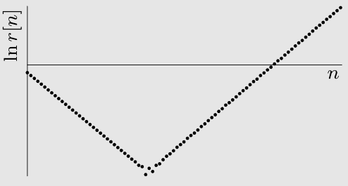

### 1.2 漏水的水箱

在斐波那契系统中，兔子们只在一个月内改变了他们的行为——成长或生孩子——只有一次。斐波那契系统是一个离散时间系统。这些系统直接适用于计算模拟和分析，因为数字计算机本身就像离散时间系统一样。然而，世界上许多系统——如钢琴弦、地震、麦克风、耳膜——自然是连续时间系统。

使用离散时间工具分析连续时间系统需要近似。这些近似在最简单有趣的连续时间系统中得到了说明：一个漏水的水箱。想象一个装满水的浴缸或水槽，高度为 `$h$`。在时间 `$t=0$`，排水口打开水流出来。随后的水位是多少？

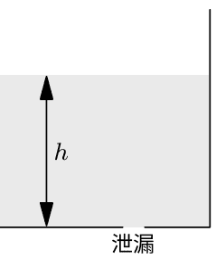

在 `$t=0$` 时，水位和压力达到最高点，所以水在 `$t=0$` 时排得最快。随着水流出和水位下降，压力和排水速率也下降。这种行为可以用以下微分方程来描述：

```
\frac{dh}{dt} = -f(h),
```

其中 `$f(h)$` 是一个尚未知的高度函数。

要找到 `$f(h)$`，需要了解浴缸和管道的几何形状，然后计算排水口和管道中的流动阻力。阻力的最简单模型是所谓的线性泄漏：即 `$f(h)$` 与 `$h$` 成正比。然后微分方程简化为

```
\frac{dh}{dt} \propto -h
```

> 缺失的比例常数的维度是什么？

左侧的导数具有速度的维度 (每单位时间的高度)，因此缺失的常数具有时间的倒数维度。将常数称为 `1/\tau`，其中 `$\tau$` 是系统的时间常数。然后

```
\frac{dh}{dt} = -\frac{h}{\tau}
```

## 1 差分方程

一个几乎相同的微分方程描述了电容器通过电阻放电的电压 V：
$$ \frac{dV}{dt} = -\frac{1}{RC} V. $$

这是一个带有时间常数 $\tau = RC$ 的漏桶微分方程。

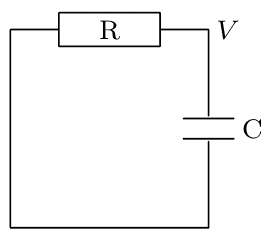

> **问题 1.3：基尔霍夫定律** 使用基尔霍夫定律验证这个微分方程。

将连续时间微分方程近似为离散时间系统，可以手动和计算机模拟该系统。在离散时间系统中，时间以块状方式推进。

如果块大小，也称为时间步长，为 T，则 $h[n]$ 是 $h(nT)$ 的离散时间近似。假设系统从 $h[0] = h_0$ 开始。那么 $h[1]$ 是多少？换句话说，$h(T)$ 的离散时间近似是多少？漏桶方程表明 $h$ 满足
$$ \frac{dh}{dt} = -\frac{h}{\tau} $$
在 $t = 0$ 时，这个导数是 $-h_0/\tau$。如果 $dh/dt$ 在整个时间步长内保持不变（这是一个稍微可疑但简单的假设），那么高度在一个时间步长内大约下降 $h_0T/\tau$。因此，
$$ h[1] = h_0 - \frac{T}{\tau}h_0 = \left(1-\frac{T}{\tau}\right)h[0]. $$

在相同的假设下，$h[2]$ 是多少，一般情况下，$h[n]$ 是多少？

从 $h[0]$ 计算 $h[1]$ 的推理也适用于从 $h[1]$ 计算 $h[2]$ 的情况。在 $n = 1$ 处的导数，等价地，在 $t = T$ 处的导数是 $-h[1]/\tau$。因此，在 $n = 1$ 和 $n = 2$ 之间，等价地，在 $t = T$ 和 $t = 2T$ 之间，高度下降约为 $h[1]T/\tau$，
$$ h[2] = h_1 - \frac{T}{\tau}h_1 = \left(1-\frac{T}{\tau}\right)h[1]. $$

这个模式可以推广到一个寻找每个 $h[n]$ 的规则：
$$ h[n] = \left(1-\frac{T}{\tau}\right)h[n-1]. $$

### 1.2 漏水的水箱

这个隐式方程有闭合形式的解


这个解对于原始的连续时间系统的行为有多相似？

原始的连续时间微分方程 $dh/dt = -h/\tau$ 的解是


在离散时间 $t = nT$ 时，这个解变为


离散时间近似将 $e^{-T/\tau}$ 替换为 $1 - T/\tau$。这个差异是 $e^{-T/\tau}$ 的泰勒级数的前两项：


因此，当泰勒级数中的高阶项很小时，离散时间近似是准确的，即 $T/\tau \ll 1$。

通过用离散时间模拟替代解析解法，这种解决微分方程的方法被称为欧拉近似法，它可以用来解决非常困难甚至不可能解析求解的方程。

#### 问题 1.4 哪个是近似解？

这里是未标记的图表，显示了离散时间样本 $h[n]$ 和连续时间样本 $h(nT)$，对于 $n = 0 \dots 6$。哪个图表显示了离散时间信号？


#### 问题 1.5 大时间步长

在三种情况下，绘制离散时间样本 $h[n]$：(a.) $T = \tau/2$ (b.) $T = \tau$ (c.) $T = 2\tau$ (d.) $T = 3\tau$

#### 问题 1.6 微小的时间步长

证明当 $T \to 0$ 时，离散时间解
$$ h[n] = h_0 \left(1 - \frac{T}{\tau}\right)^n $$
逼近连续时间解
$$ h(t) = h_0 e^{-nT/\tau} $$
为了使两个解近似匹配，T 需要多小，作为 n 的函数？

### 1.3 雾滴的下落

漏水的水箱（第 1.2 节）是一个一阶系统，其微分方程和差分方程都是一阶方程。然而，物理世界通常是二阶的，因为牛顿第二定律（$F=ma$）包含了二阶导数。

对于这样的系统，欧拉逼近方法适用吗？为了说明将欧拉逼近方法应用于二阶系统时出现的问题，让我们模拟受到重力（$F=mg$）和空气阻力作用的雾滴的下落。雾滴足够小，其空气阻力与速度成正比，而不是通常的速度平方。

然后，液滴的净向下力是 $mg-bv$，其中 $v$ 是其速度，$b$ 是衡量阻力强度的常数。关于位置 $x$，正方向向下，牛顿第二定律变为
$$ m \frac{d^2x}{dt^2} = mg - b \frac{dx}{dt} $$
两边除以 $m$ 得到
$$ \frac{d^2x}{dt^2} = g - \frac{b}{m} \frac{dx}{dt} $$

> b/m 的维度是什么？

常数 $b/m$ 将速度 $dx/dt$ 转化为加速度，因此 $b/m$ 的维度是时间的倒数。因此，将其重写为 $1/\tau$，其中 $\tau \equiv m/b$ 是一个时间常数。然后
$$ \frac{d^2x}{dt^2} = g - \frac{1}{\tau} \frac{dx}{dt} $$

二阶导数的离散时间近似是什么？

在漏桶方程中，
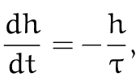
在 $t=nT$ 处，第一阶导数采用了欧拉逼近 $(h[n+1]-h[n])/T$，并且在 $t=nT$ 时变为 $h[n]$。第二阶导数 $d^2x/dt^2$ 是两个一阶导数之差的极限。使用欧拉逼近的方法，在 $t=nT$ 和 $t=(n+1)T$ 处近似计算第一阶导数：$dx/dt=$
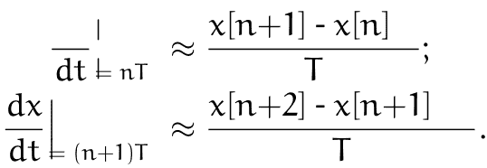

然后
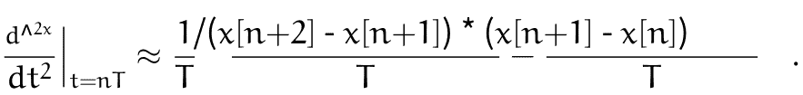

这个近似简化为
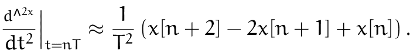

连续时间运动方程的欧拉逼近是
然后
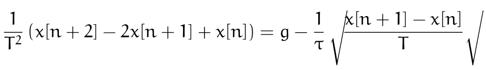
或
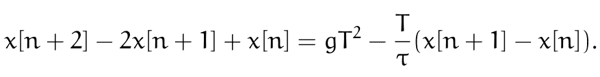

我们从漏水罐中熟悉的比率 $T/\tau$，在这个问题中再次出现。为了简化后续的方程，定义 $\alpha \equiv T/\tau$。然后在收集相似项之后，下降的雾滴的差分方程是
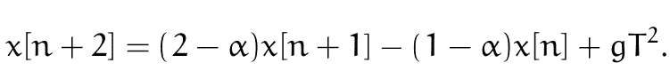

正如预期的那样，这个差分方程是二阶的。与之前的二阶方程，即斐波那契方程一样，它需要两个初始值。

让我们尝试 $x[-1]=x[0]=0$。从物理上讲，雾滴从静止开始在参考高度 0 处，并在 $t=0$ 时开始感受到重力 $mg$ 的作用。

对于一个 typical 雾滴，半径为 10μm，物理参数如下：
- $m \sim 4.2 \cdot 10^{-12}$ kg;
- $b \sim 2.8 \cdot 10^{-9}$ kg s⁻¹;
- $\tau \sim 1.5 \cdot 10^{-3}$ s⁻¹。

相对于 $\tau$，时间步长 $T$ 应该很小，否则模拟误差会很大。时间步长例如 0.1 毫秒是一个合理的折衷方案在减小误差和加快模拟之间取得平衡。

然后，无量纲比率 $\alpha$ 是 0.0675。使用这些参数进行模拟显示出初始上升速度比线性快，可能是二次方程，然后以大约每个时间步长上升线性地为 1.5 μm 或 1.5 厘米/秒⁻¹。

这个模拟结果解释了雾的长寿。雾大致上是一团沉到地面的云。想象一下，这团云达到了 500 米（典型的云厚度）。然后，要沉到地面，这团云需要 500 米
$t$ 下降 $\sim (500 \text{ 米} / 1.5 \text{ 厘米/秒}) \sim 9$ 小时。

换句话说，雾应该持续一整夜 - 与经验一致！


计算时间步长：在模拟中，雾滴下落 500 米需要多少个时间步长（使用 $T = 0.1$ 毫秒）？
你的计算机或其他易得到的计算机需要多长时间来模拟这么多时间步长？

#### 问题 1.7：终端速度

通过模拟雾方程
```
x[n+2] = (2-\alpha)x[n+1] - (1-\alpha)x[n] + gT^2
```
使用几个不同的 $T$ 和 $\alpha$ 值，猜测 $g$、$T$、$\alpha$ 和粒子的终端速度之间的关系。

### 1.4 弹簧

现在让我们将模拟扩展到最重要的二阶系统：弹簧。弹簧是自然界和工程世界中大量系统的模型：行星轨道、化学键、固体、电磁辐射，甚至是电子 - 质子键。由于颜色是由电磁辐射与电子 - 质子键相互作用产生的，所以草是绿色的，天空是蓝色的，这是弹簧相互作用的结果。

最简单的弹簧系统是一个质量连接到一个弹簧并在一个维度上自由振动的系统。它的微分方程是
$$ m \frac{d^2x}{dt^2} + kx = 0, $$
其中 $x$ 是块的位移，$m$ 是块的质量，$k$ 是弹簧常数。除以 $m$ 得到
$$ \frac{d^2x}{dt^2} + \frac{kx}{m} = 0。 $$
定义角频率 $\omega = \sqrt{k/m}$，得到简化的方程。
$$ \frac{d^2x}{dt^2} + \omega^2 x = 0。 $$

现在将时间分为持续时间为 T 的均匀步长，并用离散时间近似替代第二个导数：
$$ \left. \frac{d^2x/dt^2}{dt^2} \right|_{t=nT} \approx \frac{x[n+2] - 2x[n+1] + x[n]}{T^2}, $$
通常情况下，样本 $x[n]$ 对应于连续时间信号 $x(t)$ 在 $t=nT$ 时的值。然后
$$ \frac{x[n+2] - 2x[n+1] + x[n]}{T^2} + \omega^2 x[n] = 0 $$
或者在合并项之后，
$$ x[n+2] = 2x[n+1] - (1 + (\omega T)^2)x[n]. $$

定义 $\alpha \equiv \omega T$，
$$ x[n+2] = 2x[n+1] - (1 + \alpha^2)x[n]. $$

## 1 差分方程

这个二阶差分方程需要两个初始值。一个简单的对是 $x[0]=x[1]=x_0$。这个选择对应于将质量向右拉动 $x_0$，然后在 $t=T$ 时释放它。之后会发生什么？

为了数值模拟系统，应选择 $T$ 使 $\alpha$ 尽可能小。作为一个合理的小值 $\alpha$，尝试每个振荡周期 100 个样本：$\alpha = 2\pi/100$ 或大约 0.06。唉，模拟预测振荡会无限增长。

| 字段 | 值 |
| :--- | :--- |
| 姓名：虚拟 | |
| 文件：shm-forward | |
| 状态：未知 | |

出了什么问题？

也许 $\alpha$，即使是 0.06，也太大了。这里有两个使用较小值的模拟 $\alpha$ 的例子：


这些振荡也会爆炸。唯一的区别似乎是增长的速度（问题 1.8）。

问题 1.8：微小的 $\alpha$ 值 模拟
```
$x[n+2]=2x[n+1]-\left(1+\alpha^{2}\right)x[n]$
```
使用非常小的值 $\alpha$。会发生什么？

另一种解释是离散时间导数的近似导致了问题。如果是这样的话，那将令人惊讶，因为在模拟雾滴下落时，相同的近似方法起作用了。但是，让我们尝试另一种定义：不是定义
$$ \left.\frac{\mathrm{d} x}{\mathrm{~d} t}\right|_{n \mathrm{~T}} \approx \frac{x[n+1]-x[n]}{T} $$
尝试简单的改变为
$$ \frac{\mathrm{d} x}{\mathrm{~d} t} \approx \frac{x[n]-x[n-1]}{T} $$

对于这个二阶导数，使用相同的过程，
$$ \frac{d^{2x}}{dt^2}\Big|_{t=nT} \approx \frac{x[n]-2x[n-1]+x[n-2]}{T^2}. $$
离散时间弹簧方程则为
$$ (1+\alpha^2)x[n] = 2x[n-1] - x[n-2], $$
或
$$ x[n] = \frac{2x[n-1]-x[n-2]}{1+\alpha^2}. $$


在相同的初始条件下，$x[0]=x[1]=1$，后续的时间进程是什么？坏消息是这些振荡会衰减到零！然而，好消息是改变离散时间系统的导数近似可以显著影响其行为。让我们尝试一个对称的二阶导数：

$$ \frac{d^{2x}}{dt^2}\Big|_{t=nT} \approx \frac{x[n+1]-2x[n]+x[n-1]}{T^2}. $$
然后差分方程变为
$$ x[n+2] = (2-\alpha^2)x[n+1] - x[n]. $$
现在系统稳定地振荡，就像没有能量损失或输入的弹簧一样。

为什么简单地改变为对称的二阶导数解决了振荡衰减或增长的问题？替代离散时间系统的差分方程表示并不能回答这个问题。回答这个问题需要信号与系统中最重要的两个概念：算子和模式。

> **问题 1.9：不同的初始条件**
以下是使用对称的二阶导数和初始条件的后续样本 $x[0]=0, x[1]=x_0$。然而，振幅要比 $x_0$ 大得多。这种行为在物理上合理吗？如果是，请解释为什么。如果不是，请解释应该发生什么。


## 2 差分方程和模块化

| 章节 | 页码 |
| :--- | :--- |
| 2.1 模块化：使输入与输出相似 | 17 |
| 2.2 捐赠礼物 | 21 |
| 2.3 兔子 | 25 |

> 本章的目标是：
- 说明模块化并以模块化方式描述系统；
- 将问题从口头描述转化为离散时间数学（差分方程）的表示；以及
- 开始研究最简单的二阶系统，即用于分析和设计系统的第二简单模块。

本章的主题是模块化和离散时间数学表示的语言描述。我们通过两个例子来说明这些主题，一个是假设的 MIT 基金的资金情况，另一个是兔子在围栏中繁殖，我们使用差分方程来表示它们。兔子的例子引入了一个新的模块，用于构建和分析系统，在这些章节中经常出现。在本章中，我们开始研究这个模块的行为。在介绍例子之前，我们先说明模块化是什么以及为什么它是有用的。

### 2.1 模块化：使输入与输出相似

一个常见但可惜的非模块化方法是使用边界条件来制定差分和微分方程。
人口的一个例子

### 2.1 模块化：使输入与输出相似

增长说明了这种制定方法以及如何通过使其模块化来改进它。这个例子是美国的人口。根据《世界事实书》[2]，美国的人口每年以大约 1% 的速度增长，2007 年时美国的人口大约为 3 亿。如果增长率保持在 1%，那么 2077 年美国的人口将是多少？

> 暂停尝试 1. 代表这个信息的人口方程和边界条件是什么？

年份为 $n$ 的人口差分方程是
```
p[n] = (1 + r)p[n - 1]
```
```
(人口方程),
```
其中 $r=0.01$ 是年增长率。边界条件是
```
p[2007] = 3 \times 10^8
```
```
(边界条件).
```
要找到 2077 年的人口，解这个带有边界条件的差分方程，找到 $p[2077]$.

> 练习 1. $p[2077]$ 是多少？你如何快速近似地得到答案？

你可能会想为什么人口方程被称为差分方程，因为没有项被减去。原因是类比于微分方程，微分方程告诉你如何从 $f(t-\Delta t)$ 找到 $f(t)$，其中 $\Delta t$ 趋近于 0。由于离散时间人口方程告诉我们如何从 $f[n-1]$ 找到 $f[n]$，它被称为差分方程，其解是有限差分微积分的主题。当目标 - 这里是人口 - 出现在输入端时，差分方程也是一种递推关系。递推关系与此有何关系是即将到来的一章的主题；现在将其视为普遍术语。

数学形式化作为具有边界条件的递归关系，虽然足够找到 $p[2077]$，但很混乱：边界条件与递归的解是不同类型的对象。这个对于冲突类别的反对意见可能看起来是哲学性的 - 在口语中是无关紧要的

## 2 差分方程和模块化

将哲学的含义视为无关紧要的 - 但回答它有助于我们理解和设计系统。在这里，系统是美国。系统的输入是一个数字，即初始人口 $p[2007]$；然而，输出是一系列的人口 $p[2008], p[2009], \dots$。在这种形式化中，系统的输出不能成为另一个系统的输入。

因此，我们不能通过组合小而易于理解的系统来设计大型系统。我们也不能通过将大型难以理解的系统分解为小系统来分析它们。

相反，我们希望采用模块化的形式，其中输入与输出是相同类型的对象。这里是美国人口问题的重新表述：如果在年份 $n$ 有 $x$ 个人移民到美国，并且美国人口每年以 1% 的速度增长，那么在年份 $n$ 的人口是多少？输入信号是移民数量随时间变化的序列，因此它与输出信号类似。包括移民的影响，递归关系是
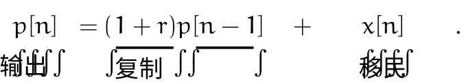

边界条件不再与方程分离！相反，它是输入信号的一部分。这种模块化形式不仅优雅，而且比具有边界条件的形式更通用，因为我们可以将原始问题重新表述为这个框架。重新表述涉及找到一个输入信号 - 在这里是移民与时间的关系 - 来复制边界条件 $p[2007] = 3 \times 10^8$。

> 暂停尝试 2. 什么输入信号可以复制边界条件的效果？

边界条件可以通过这个移民计划来复制（输入信号）：
```
x[n] = \begin{cases} 3 \times 10^8 & \text{if n = 2007;} \ 0 & \text{否则。} \end{cases}
```
这个模型假设在 2007 年有 3 亿人口涌入一个空无一人的美国。人口（数量上）以 1% 的年增长率增长

### 2.1 模块化：使输入与输出相似

我们想要知道在 2077 年的输出信号（人口）$p[2077]$。

具有任意输入信号的一般形式比使用边界条件直接求解更困难，可以通过技巧和猜测来解决。对于我们的输入信号，输出信号为
$$p[n]=\left\{\begin{array}{ll} 3 \cdot 10^{8} \times 1.01^{n-2007} & \text { 对于 } n \geqslant 2007 ; \ 0 & \text { 否则。 } \end{array}\right.$$

> 练习 2. 检查这个输出信号是否满足边界条件和人口方程。

在后面的章节中，你将学习如何用任意输入信号解决这个问题。在这里，我们强调的不是解决方法，而是模块化的表达，其中一个系统将一个信号转换为另一个信号。这种使用信号和系统的模块化描述有助于分析复杂问题和构建复杂系统。

为了看到它是如何帮助的，首先想象一个有两个国家的世界：爱尔兰和美国。假设人们从爱尔兰移民到美国，这在 19 世纪 50 年代是一个合理的模型。还假设爱尔兰人口由于饥荒而每年固有地下降 10%，并且另外 10% 的人口每年移民到美国。爱尔兰和美国是两个系统，其中一个系统的输出（爱尔兰移民）输入到另一个系统的输入（美国移民）中。模块化描述在编程模拟中很有帮助。事实上，巨大的人口增长模拟是以这种面向对象的方式编程的。每个系统都是一个对象，它知道在输入信号下它的行为 - 输出是什么。用户选择系统并指定它们之间的连接。流体动力学模拟使用类似的方法，将流体分成无数个体积元素。每个元素都是一个系统，能量、熵和动量在相邻元素之间移动。

我们的一或两组分人口系统比流体动力学模拟简单，更好地说明模块化。通过两个例子，我们接下来练习模块化描述以及如何将口头描述表示为数学。

### 2.2 捐赠礼物

表示描述为数学的第一个例子涉及对麻省理工学院的假设捐赠礼物。捐赠者给麻省理工学院捐赠了 $10^7$ 美元，用于支持麻省理工学院本科生提出和选择的项目！麻省理工学院希望长期使用这笔资金，并每年提取 $0.5 \times 10^6$ 的 5% 支出。假设这笔钱放在一个可靠的账户上，年复利率为 4%。在资金耗尽之前，麻省理工学院和它的本科生可以使用这笔资金多长时间？

在你大致知道答案之前，永远不要进行计算！这是约翰·惠勒 (John Wheeler) 的建议，他是一位杰出的物理学家，麻省理工学院的著名学生是校友理查德·费曼 [9]。我们强烈推荐惠勒的格言作为建立直觉的一种方式。所以这里有一些估计问题，以激发思维。从最广泛的区别开始，一个数字是有限的还是无限的。这个区别提出了以下问题：

> 暂停尝试 3. 基金会会永远持续下去吗？

唉，基金会不会永远持续下去。在第一年，资金支出略大于利息，因此基金会的资本会略微减少。因此，下一年的利息将小于第一年的利息。由于每年的资金支出保持不变，每年为 50 万美元（初始金额的 5%），资本在后续年份会进一步减少，从而减少利息，导致利息的更大减少，进一步导致资本的减少……最终基金会会消失。考虑到寿命是有限的，大致需要多长时间？你的曾孙能使用它吗？

> 暂停尝试 4. 基金会的持续时间是超过还是不到 100 年？

100 年的数字来自于资金支出（每年 5% 的礼物）和利息率（4%）之间的差异。每年 5% 和 4% 之间的差异是

[PAGE 31]

$\delta=0.01/$ 年。$\delta$ 的维度是时间的倒数，暗示着一个捐赠寿命为 $1/\delta$，即 100 年。实际上，如果每年都像第一年那样，这个基金将持续 100 年。然而，利息的流入随着资本的减少而减少，因此流出和流入之间的差距增加。因此，基于将第一年的变化外推到每一年的 $1/\delta$ 方法会高估寿命。

通过两个估计值的热身，让我们用数学的方式描述系统并求解真实寿命。在这样做的过程中，我们必须决定输入信号是什么，输出信号是什么，以及系统是什么。

系统是最不棘手的部分：它是银行账户支付 4% 利息。1000 万美元的礼物很可能是输入信号的一部分。

> 暂停一下，试试 5。

50 万美元的年度提款是输出信号还是输入信号的一部分？

提款从账户中流出，而账户就是系统，所以提款可能是输出信号的一部分。不！！输出信号是系统所做的事情，即产生或至少计算一个余额。输入信号是你对系统所做的操作。在这里，你可以将钱转入或转出系统：


初始捐赠是一次性的正输入信号，而年度提款是经常性的负输入信号。要找出捐赠能够持续多久，找出输出信号何时跌破零。在设置数学模型之前，解决这些表示问题是有帮助的。否则，你将费尽心思地创建无关的方程，无论计算能力有多强大都无济于事。

现在让我们用数学方式来描述。首先表示输入信号。为了减少大数和美元符号的影响，我们以 500,000 美元为单位来衡量货币。这个选择使得输入信号的维度变小：

```
X = 20, -1, -1, -1, -1, ...
```

## 2 差分方程和模块化

我们使用大写字母表示整个信号，而带有索引的小写字母表示信号中的一个样本。例如，P 是人口序列，p[n] 表示第 n 年的人口。

输出信号是

```
Y = 20, ?, ?, ?, ...
```

> 暂停一下，试试 6。解释一下为什么 y[0]=20。

问题是填写输出信号中的问号，并找出何时它降到零以下。描述该系统的差分方程是

```
y[n] = (1 + r)y[n-1] + x[n],
```

其中 r 是年利率（这里，r=0.04）。这个差分方程是一个一阶方程，因为任何输出样本 y[n] 都依赖于前一个样本 y[n-1]。该方程所代表的系统被称为一阶系统。它是构建和分析复杂系统的最简单模块。

> 练习 3。将这个方程与估计 2077 年美国人口的方程进行比较。

现在，我们已经将捐赠问题表述为一个信号经过系统处理产生另一个信号—所有的模块化！—并用数学表示了这个描述。然而，我们还不知道如何解决任意输入信号 X 的数学问题。但是在这里，我们只需要解决特定输入信号的问题

```
X = 20, -1, -1, -1, -1, ...
```

对于该输入信号，递归变为

```
y[n] = { 1.04 \cdot y[n-1] - 1, n > 0; 20, n = 0.
```

当 y[0]=20 时，反映出捐赠者向账户注入了 20 个货币单位，即 1000 万美元的捐赠。递归中的 -1

[PAGE 33]

反映了我们每年绘制 1 单位。没有 -1 项，递推的解将是 the recurrence would be y[n] ~ 1.04^n, where the ~ symbol means 'except for a constant'。这个 -1 意味着简单的指数增长不是一个解决方案。然而，-1 是一个常数，所以它只能对解决方案做出一个常数的贡献。这种推理是可疑的，但简单，所以先试试。使用一点勇气，这是解决方案的形式的猜测：

$y[n] = A \cdot 1.04^n + B$（猜测）,

其中 A 和 B 是待确定的常数。在找到 A 和 B 之前，先找出最重要的特征，即它们的符号。所以：

> 暂停尝试 7。假设这个形式是正确的。什么是 A 和 B 的符号？

由于资产最终会消失，变量项 A·1.04^n 必须产生负贡献；所以 A<0。由于初始输出 y[0] 是正的，B 必须克服 A 的负贡献；所以 B>0。

> 暂停尝试 8。找到 A 和 B。

解决两个未知数 A 和 B 需要两个方程。每个方程可能来自一个条件。所以将猜测与两个时刻的已知平衡匹配。涉及最少计算的时刻（n 的值）是极端情况 n=0 和 n=1。将猜测与 n=0 时的行为匹配得到第一个方程：

$20 = A + B$ (n = 0 条件)

为了使猜测与 n=1 时的行为相匹配，首先找到 y[1]。在 n=1 时，也就是礼物之后一年，从 20 的 4% 到达 0.8 单位的利息，而 1 单位离开作为第一次提款。所以

$y[1] = 20 + 0.8 - 1 = 19.8$.

将这个值与猜测匹配得到第二个方程：

$19.8 = 1.04A + B$ (n = 1 条件)

[PAGE 34]

当 A=-5 和 B = 25 时，两个条件都满足。正如预测的那样，A < 0 且 B > 0. 使用该解决方案后，猜测变为

```
y[n] = 25 - 5 × 1.04^n.
```

这个解决方案有一个奇怪的行为。在余额低于零之后，1.04^n 增长得更加迅速，所以余额变得更加负面。

> 练习 4. 变得更加负面并且增长得更快是否表明解决方案不正确，或者数学上的翻译不完整？

> 练习 5. 根据给定的 A 和 B 的值，这个猜测在 n = 0 和 n = 1 时是正确的。（你怎么知道？）证明它对于 n > 1 也是正确的。

现在我们可以回答最初的问题：y[n] 何时降为零？答案：当 $1.04^n > 5$ 时，在 n = 41.035 ... 时发生。所以麻省理工学院可以在第 1、2、3 年等年份中使用这笔资金。，41 年为一个盛大的毕业派对留下零钱。精确的计算与寿命小于 100 年的论证一致。

> 练习 6. MIT 支付最后一笔款项后还剩下多少零钱？转换成真实货币！

### 2.3 兔子

用数学方式表示的第二个系统是兔子的繁殖能力。《大英百科全书》(1981 年版) 将这个人口增长问题描述如下 [6]:

[PAGE 35]

### 2.3 兔子

一个人把一对兔子放在四面都有墙的地方。如果假设每个月的第二个月开始，每对兔子都会产生一对新兔子，那么一年内可以从那对兔子产生多少对兔子？

该描述是对原始拉丁文的英文表述。我们首先用数学方式表示口头描述，然后通过操纵方程来理解系统的行为。这是除了捐赠等一阶系统之外最简单的系统，因此它是构建和分析复杂系统的重要模块。

#### 2.3.1 从文字到递归

在数学上表示系统之前，我们通过找到一个系统、一个输入信号和一个输出信号来模块化地描述它。通常最容易从系统开始，因为它是主动元素。短语“四面环墙”表示一个系统的候选。系统是墙的内部，那里是兔子繁殖的地方，还有兔子繁殖的规则。

> 暂停尝试 9。输入信号是什么？

将兔子放入系统或从系统中取出是对系统的输入。输入信号是在第 n 个月进入系统的兔子对的数量，如果兔子从系统中移民去寻找更美味的草或其他兔子朋友，则信号为负。

> 暂停尝试 10。输出信号是什么？

有些兔子对作为孩子（移民者）放入系统，其他兔子对在系统中出生（本地出生）。这些兔子对的总和是输出信号。

为了数学地描述系统，按兔子的类型进行分解：

- 1. 儿童，一个月后成为成年人，但不能繁殖；
- 2. 成年人，在那个月和以后繁殖。

[PAGE 36]

设 c[n] 为第 n 个月的儿童对数，a[n] 为第 n 个月的成年人对数。这些中间信号组合成输出信号：

$f[n] = a[n] + c[n]$（输出信号）.

> 暂停尝试第 11 题。哪个方程包含了儿童一个月后成为成年人的规则？

因为儿童一个月后成为成年人，而成年人不会死亡，所以上个月的成年人对数增加了儿童对数：

$a[n] = a[n - 1] + c[n - 1]$（成长方程）.

右侧的两个项表示成年的两种方式：

- 1. 你上个月已经成年了 ($a[n-1]$), 或者
- 2. 你上个月还是个孩子 ($c[n-1]$), 然后长大了。

下一个方程说明所有成年人，也只有成年人，会繁殖出新的孩子：

$c[n] = a[n - 1]$.

然而，这个方程不完整，因为移民也会贡献出孩子对。第 n 个月的移民对数是输入信号 x[n]。所以完整的故事是：

孩子对数 c[n] = 成年对数 a[n-1] + 输入信号 x[n]（孩子方程）

我们的目标是找到 f[n] 的递归关系，即总对数。所以我们通过两个步骤来消除成年对数 a[n] 和孩子对数 c[n]，用 f[n] 代替。首先，使用成长方程将孩子方程中的成年对数 a[n-1] 替换为 a[n-2] + 孩子对数 c[n-2]。这个替换得到

$c[n] = a[n - 2] + c[n - 2] + x[n]$.

[PAGE 37]

由于 $f[n] = c[n] + a[n]$，我们可以通过添加 a[n] 将左边变为 f[n]。成长方程表明 a[n] 也是 $a[n-1]+c[n-1]$，因此将这些项添加到右边并进行简化。结果是


左边是 f[n]。右边包含 $a[n-2]+c[n-2]$，即 $f[n-2]$；和 $a[n-1]+c[n-1]$，即 $f[n-1]$。因此，方程的求和简化为

$f[n] = f[n-1] + f[n-2] + x[n]$.

这个拉丁问题的描述来自于斐波那契的《算盘书》[10]，出版于 1202 年，而这个方程是著名的斐波那契递推关系，但是使用了输入信号 x[n]，而不是边界条件。

这个数学表示澄清了一个在口头表示中不明显的点：兔子对的数量在第 n 个月取决于前两个月的数量。由于对前两个样本的依赖，这个差分方程是一个二阶差分方程。由于所有系数都是单位，它是该类别中最简单的方程，并且是一个理想的二阶系统，可以彻底理解。为了建立这种理解，我们玩弄这个系统并观察它的响应。

#### 2.3.2 尝试递归

为了玩弄斐波那契描述的系统，我们需要表示斐波那契的边界条件，即一对子兔子只在第 0 个月进入墙内。相应的输入信号是 X=1, 0, 0, 0,... 使用这个输入信号，即脉冲或单位样本，递归产生（省略为零的项）：

- f[0] = x[0] = 1,
- f[1] = f[0] = 1,
- f[2] = f[0] + f[1] = 2,
- f[3] = f[1] + f[2] = 3,
- ...

[PAGE 38]

当你尝试更多的行时，你会得到这个序列：F = 1, 1, 2, 3, 5, 8, 13, 21, 34,... 当你厌倦手工计算时，可以请计算机继续计算。这里是一个慢速的 Python 代码来打印 f[0], f[1], ..., f[19]:

```python
def f(n):
    if n < 2:  return 1
    return f(n-1) + f(n-2)
print [f(i) for i in range(20)]
```

> ## 练习 7.
编写相应的 Matlab 或 Octave 代码，然后用 Python、Matlab 或 Octave 中的一种语言重写代码以提高效率。

> ## 练习 8.
编写 Matlab、Octave 或 Python 代码，当输入信号为 1, 1, 1,... 时，找到 f[n]。f[17] 是多少？

#### 2.3.3 增长速度

为了以闭合形式解决递归方程，即找到 f[n] 的显式公式，而不依赖于前面的样本，研究其近似增长是有帮助的。即使没有复杂的技术来找到输出信号，在这种情况下，当输入信号是脉冲时，我们也可以理解其增长。

> 暂停尝试 12. 当输入信号是脉冲时，f[n] 增长得有多快？它是多项式、对数还是指数增长？

从观察前几十个值，看起来这个序列增长得很快。增长几乎肯定不是对数增长，而且几乎肯定不是多项式增长，除非它是高次多项式。指数增长是最有可能的情况，这意味着对于 f[n] 的近似是

$f[n] \sim z^n$

其中 z 是一个常数。要估计 z，可以在 n>0 时尝试递归，这是输入信号为零的情况。所有的 f[n] 都是正数，并且由于当 n>0 时 f[n] = f[n-1] + f[n-2]，样本是递增的：f[n] > f[n-1]。这个界限将 $f[n] = f[n-1] + f[n-2]$ 转化为不等式。

$f[n] < f[n-1] + f[n-1]$.

所以 $f[n] < 2f[n-1]$ or $f[n]/f[n-1] < 2$; 因此上界为 $z < 2$. 这个界限有一个对应的下界，通过在斐波那契递归中用 f[n-2] 替换 f[n-1] 获得。这个替换将 $f[n] = f[n-1] + f[n-2]$ 变成

$f[n] > f[n-2] + f[n-2]$.

右边是 $2f[n-2]$ 所以 $f[n] > 2f[n-2]$. 这个界限导致一个更低的界限：$z^2 > 2$ 或 $z > \sqrt{2}$ 可能的 z 范围是

$\sqrt{2} < z < 2$.

让我们通过实验来检查界限。这是一系列比率 f[n]/f[n-1]，其中 n=1, 2, 3,...:

1.0, 2.0, 1.5, 1.666..., 1.6, 1.625, 1.615..., 1.619..., 1.617...

这些比率似乎在 1.618 左右波动，这个值位于预测的界限 2 和 $\sqrt{2}$ 之间。在后面的章节中，使用新的数学表示方法，您将学习如何找到 f[n] 的闭式形式。我们已经朝着这个方向迈出了两步，通过数学表示系统，并研究了 f[n] 的增长情况。

练习 9. 使用更精细的论证来改进上界，使 $z < \sqrt{3}$。

练习 10. 数字 1.618 看起来熟悉吗？

[PAGE 40]

- 练习 11. [难题！] 考虑相同的系统，但每个月都有一对兔子移入系统中，而不仅仅是在第 0 个月。与斐波那契问题相比，增长如何？在第 0 个月中只有一对兔子移出。现在是否比指数增长更快？如果是，速度有多快？如果不是，增长的顺序是否改变为 z≈1.618？

[PAGE 41]

[PAGE 42]

## 3

## 块图和算子：两种新的表示方法

- 3.1 差分方程的缺点 34
- 3.2 块图的拯救 35
- 3.3 抽象的力量 40
- 3.4 整个信号的操作 41
- 3.5 反馈连接 45
- 3.6 总结 49

本章的目标是：

- 引入离散时间系统的两种表示方法：块图和算子；
- 引入整个信号的抽象，并鼓励您使用抽象；
- 开始操作算子表达式；
- 将算子与差分方程和块图进行比较操作。

前面的章节解释了口头描述和差分方程表示法。本章继续介绍多种表示法，引入了两种新的表示法：块图和算子。新的表示法很有价值，因为它们提供了新的思路，常常能够提供新的见解；一位专业工程师像一位专业木工一样珍视她的工具。本章首先介绍块图，讨论整个信号的抽象和

[PAGE 43]

抽象的一般价值，然后介绍算子表示法。

### 3.1 差分方程的缺点

第 2 章说明了差分方程的优点。与其起源的口头描述相比，差分方程紧凑、易于分析，并适合计算机实现。然而，分析差分方程常常涉及到一系列微操作，其中很难找到见解。作为一个例子，证明差分方程

```
d[n] = a[n] - 3a[n-1] + 3a[n-2] - a[n-3]
```

等价于以下一组方程：

```
d[n] = c[n] - c[n-1]
```

```
c[n] = b[n] - b[n-1]
```

```
b[n] = a[n] - a[n-1].
```

作为第一步，使用最后一个方程从 c[n] 方程中消除 b[n] 和 b[n-1]:

```
c[n] = (a[n] - a[n-1]) - (a[n-1] - a[n-2]) = a[n] - 2a[n-1] + a[n-2].
```

使用该结果从方程中消除 c[n] 和 c[n-1]:

```
d[n] = (a[n] - 2a[n-1] + a[n-2]) - (a[n-1] - 2a[n-2] + a[n-3])
= a[n] - 3a[n-1] + 3a[n-2] - a[n-3].
```

大功告成：这个三方程系统等价于单差分方程。但是多么混乱啊。每一步都是合理的，但是步骤的连续性似乎是随机的。如果最后一步产生了

```
d[n] = a[n] - 2a[n-1] + 2a[n-2] - a[n-3],
```

它不会立即看起来错误。我们希望有一个表示它看起来错误的方式，也许不是立即，但至少是快速的。块图是一种这样的表示。

> 练习 12.

虽然本节指出了差分方程的一个缺点，但也很重要地欣赏它们的优点。因此，发明一个动词描述（一个故事）来表示单个方程

$$d[n] = a[n] - 3a[n-1] + 3a[n-2] - a[n-3]$$

然后使用一个动词描述来表示等价的三个方程。现在，不需要转换为差分方程，尽情展示这些描述是等价的！

### 3.2 块图解救

块图形象地表示系统。为了展示它们的工作原理，这里有一些带有相应块图的差分方程：

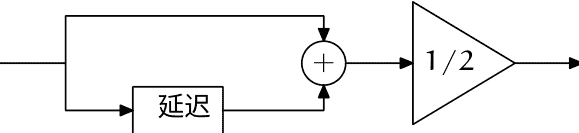

y[n] = (x[n] + x[n-1])/2
平均滤波器

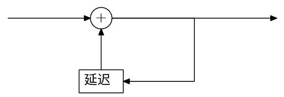

y[n] = y[n-1] + x[n]
0% 利息账户

> 暂停尝试 13。绘制第 2.2 节中的捐赠账户的块图。

捐赠账户是一个支付 4% 利息的银行账户，所以它在循环中需要一个增益元件，增益等于 1.04。该图并不唯一。您可以在延迟之前或之后放置增益元件。这是一个选择：

### 3.2 块图解构

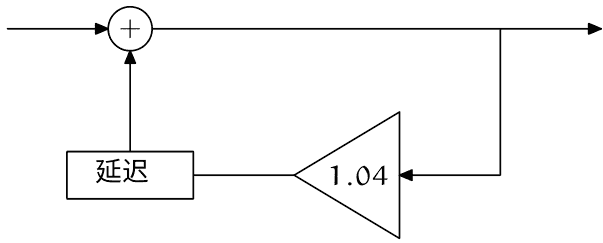

```
y[n] = 1.04y[n-1] + x[n]
```

endowment account from Section 2.2

令人惊讶的是，这门课程中的所有系统都可以通过仅有的两个操作和一个组合器来构建：

- 操作 1: 乘以 $\alpha$
- 操作 2: 延迟一个时刻
- 组合器：输入相加

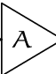

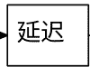

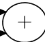

#### 3.2.1 斐波那契系统的块图

为了练习块图，我们将斐波那契系统翻译（表示）为一个块图。

> 暂停尝试 14。使用块图表示第 1.1 节中的斐波那契系统。

我们可以直接将斐波那契的描述（第 1.1 节）翻译成块图，但是我们已经努力将描述翻译成差分方程，所以我们从那里开始。它的差分方程是

```
f[n] = f[n-1] + f[n-2] + x[n],
```

输入信号 $x[n]$ 表示每个月进入系统的兔子对数，输出信号 $f[n]$ 表示每个月系统中的兔子对数。在方框图中，方便起见，让输入信号从左边流入，让输出信号从右边退出，遵循从左到右的阅读顺序，这是许多语言的共同规则。

> **练习 13。** 在希伯来语或阿拉伯语的信号与系统教材中，输入信号放在右边，输出信号放在左边吗？

斐波那契系统将输入样本、前一个输出样本和第二个前一个输出样本结合起来。这三个信号因此成为加法元件的输入。前一个输出样本是通过延迟元件在发送之前存储一个时间单位（一个月）的样本来产生的。第二个前一个输出样本是通过两个串联的延迟元件产生的。因此，斐波那契系统的方框图为

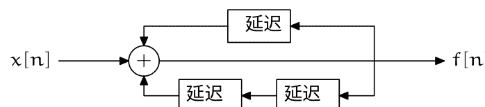

#### 3.2.2 使用块图显示等价性

我们引入块图的目的是为了找到从差分方程中不容易看出的洞察力。因此，使用块图重新证明

```
d[n] = a[n] - 3a[n - 1] + 3a[n - 2] - a[n - 3]
```

等价于

```
d[n] = c[n] - c[n - 1],
c[n] = b[n] - b[n - 1],
b[n] = a[n] - a[n - 1].
```

这个方程系统是一个由三个方程级联而成的结构

输出 = 这个输入 - 上一个输入。

该结构的块图为

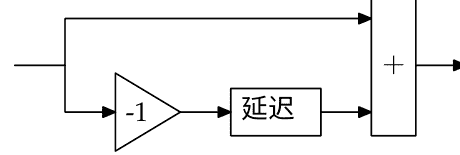

### 3.2 块图解构

其中 -1 的增益产生了减法。

三个这样的结构级联形成的级联结构的块图为


与一组差分方程相比，这个图具有优势。首先，这个图可以帮助我们简洁地描述系统。级联中的每个阶段在结构上都是相同的，这种结构上的相似性是显而易见的。而在差分方程表示中，这三个方程的共同结构被不同的信号名称所隐藏。事实证明，每个阶段都是一个离散时间微分器，是连续时间微分器的最简单的离散时间模拟。因此，方框图清楚地显示了级联是一个离散时间三重微分器。

其次，方框图帮助我们重写系统，这是我们需要做的，以证明它与单一差分方程是相同的。所以，跟随一个信号通过级联。信号在级联中经过三次分叉（用点标记），每个分叉都提供了底部或顶部分支的选择。三个两路分支意味着系统中有 $2^3=8$ 条路径。让我们来看看其中的一些路径。三条路径累积了两个延迟：

- 1. 低路，低路，高路：


- 2. 低路，高路，低路：


- 3. 高路，低路，低路：

# 3 个块图和运算符：两种新的表示


除了两个延迟之外，每条路径累积两个增益 -1，形成一个增益为 1 的路径。因此，这三条路径的总和是一个增益为 3 和双倍延迟的路径。

> 练习 14。显示其他五条路径：三条带有单个延迟和增益 -1 的路径，一条带有三个延迟和增益 -1 的路径，以及一条直通的路径（无增益，无延迟）。

表示这四组路径的块图是


## 单一差分方程

```
$$d[n] = a[n] - 3a[n-1] + 3a[n-2] - a[n-3]。$$
```

也有这个块图。

图示方法是块图的一个优势，因为人类是感知性的生物，视觉是一种重要的感觉。经过数亿年的进化，大脑发展出了广泛的硬件来处理感知信息。然而，分析推理和符号操作起源于语言，可能已有 10 万年的历史，所以我们的大脑在这些领域的硬件要弱得多。

毫不奇怪，计算机在符号代数和积分等分析任务上比人类更擅长，而人类在识别面孔或语音等感知任务上比计算机更擅长。当你解决问题时，可以通过视觉表示（如块图）来增强你的智力。

另一方面，除非通过追踪和计算路径，否则我们不知道如何操作块图；而分析表示法则适用于转换，这在重新设计系统时是一个重要的特性。因此，我们需要一个块图的语法。为了找到这个语法的规则，我们引入了一种新的系统表示法，即算子表示法。这种表示法需要整个信号的抽象，即将信号的所有样本合并为一个信号。这是一种微妙的视角变化，所以我们首先讨论了抽象的价值，然后再回到这个抽象。

### 3.3 抽象的力量

抽象是人类思维的伟大工具。所有语言都建立在它之上：当你使用一个词时，你引用了一个抽象概念。即使是一个普通名词，这个词代表着一个丰富、微妙、复杂的思想。拿着一头牛，试着让计算机区分牛和非牛；然后你会发现抽象是多么困难。或者观察一个孩子在语言能力上的发展，直到她学会‘红色’不是某个特定物体的属性，而是物体的一个抽象属性。没有人知道思维是如何完成这些惊人的壮举的，同样地，没有人能够教会计算机如何做到这一点。

抽象是如此微妙，以至于连爱因斯坦都曾经错过了它的价值。爱因斯坦用空间和时间作为独立的概念来构建了特殊相对论 [7]，它们在洛伦兹变换中交织在一起。两年后，数学家赫尔曼·明可夫斯基将这两个思想结合成了时空抽象：

> 我希望向你展示的空间和时间观点源自实验物理学的土壤，其中蕴藏着它们的力量。它们是激进的。从现在开始，单独的空间和单独的时间注定要褪去成为虚影，只有二者的结合才能保留独立的现实。

# 3 个块图和算子：两种新的表示

请参阅 [11] 中的英文翻译或令人惊叹的教材《时空物理学》[1]，该书的第一作者最近从麻省理工学院物理系退休。爱因斯坦认为时空是数学家们无聊发明的荒谬之物。爱因斯坦犯了一个错误。它或许是现代物理学的基本抽象。道德是，抽象是强大而微妙的。

> 练习 15。在化学、生物学、物理学和编程中找出一些抽象概念。

如果我们缺乏爱因斯坦的物理洞察力，就不应该用他的错误来弥补这一缺失。因此要寻找并创造抽象概念。例如，在程序中，将常见代码提取为一个过程，并将常见操作封装到一个类中。总的来说，将知识组织成抽象概念或块 [15]。

### 3.4 整个信号的运算

对于信号和系统，整个信号的抽象增加了我们分析和构建系统的能力。这种抽象将信号的所有样本合并在一起，一次性对整个信号进行操作，并作为一个整体。我们之前没有以这种方式思考，因为我们的大多数表示方式阻碍了这种视角。口头描述和差分方程通常意味着逐个样本分析。例如，在 2.3.2 节中的斐波那契递归中，我们找到了零样本 $f[0]$，使用 $f[0]$ 找到 $f[1]$，使用 $f[0]$ 和 $f[1]$ 找到 $f[2]$，找到了更多的样本，然后累了，让计算机继续。

块图，第三种表示法，似乎暗示了逐样本分析，因为延迟元件保留了样本，并在一个时间单位后输出样本。但是块图存在于两个世界中，也可以表示整个信号上的操作。只需重新解释整个信号视图中的元素，如下所示：

### 3.4 整个信号的运算


动作 1：将整个信号乘以 $\alpha$


动作 2：将整个信号向右移动一个时间单位


组合器：添加整个信号

为了从抽象中受益，紧凑地表示前面的三个元素。当信号是一个单独的对象时，增益元件的作用类似于普通的乘法，加法元件的作用类似于数字的加法。如果延迟元件也可以像算术运算一样工作，那么这三个元件将以熟悉的方式工作，块图可以使用普通的代数规则进行操作。为了将延迟元件引入这个熟悉的框架，我们引入了算子表示法。

#### 3.4.1 算子表示

在算子表示中，符号 $\Re$ 代表右移算子。它接收一个信号并将其向右移动一步。下面是一个将信号 X 延迟一个时刻产生信号 Y 的表示方式：

```
$Y = \Re\{X\}.$
```

现在忘记花括号，简化表示并加强与普通乘法的对比。简洁的表示方式是：

```
$Y = \Re X.$
```

> 暂停一下，尝试一下 15。确信右移算子 $\Re$ 而不是左移算子 $\mathcal{L}$ 等效于延迟。

让我们测试将右移算子 $\Re$ 应用于基本信号——冲激信号的效果。

冲激信号是：

```
$I = 1, 0, 0, 0, \dots$
```

对其应用右移算子 $\Re$ 得到：

$\mathcal{RI} = 0, 1, 0, 0, \dots$

这也是将信号延迟一个时间刻度的结果。所以 $\mathcal{R}$ 而不是 $\mathcal{L}$ 表示延迟操作。在算子表示法中，块 - 图元素如下：

| 符号 | 名称 | 描述 |
| :--- | :--- | :--- |
| $\alpha$ | 动作 1（增益） | 将整个信号乘以 $\alpha$ |
| $\mathcal{R}$ | 动作 2（延迟） | 将整个信号向右移动一个时间刻度 |
| $+$ | 组合器 | 将整个信号相加 |

#### 3.4.2 使用算子来编写差分方程

让我们尝试在本章的第一个例子上使用算子表示法：将单一差分方程重写为

$\text{d[n]} = \text{a[n]} - 3\text{a[n-1]} + 3\text{a[n-2]} - \text{a[n-3]}$

三个差分方程的系统

- $\text{d[n]} = \text{c[n]} - \text{c[n-1]},$
- $\text{c[n]} = \text{b[n]} - \text{b[n-1]},$
- $\text{b[n]} = \text{a[n]} - \text{a[n-1]}.$

将逐样本表示法转换为整个信号表示法，将长方程的左侧转换为由样本组成的整个信号 D。将右侧的样本转换为整个信号如下：

0 d[], d[1], d [2], ...。将右侧的样本转换为整个信号如下：

- $\text{a[n]} \rightarrow \text{A},$
- $-\text{a[n-1]} \rightarrow \mathcal{R}\text{A},$
- $-\text{a[n-2]} \rightarrow \mathcal{R}\mathcal{R}\text{A},$
- $-\text{a[n-3]} \rightarrow \mathcal{R}\mathcal{R}\mathcal{R}\text{A}.$

现在从代数中导入紧凑符号：如果 $\mathcal{R}$ 像一个变量或数字一样作用，那么 $\mathcal{R}\mathcal{R}$ 可以写成 $\mathcal{R}^2$。使用指数符号，翻译如下：

- $\text{a[n]} \rightarrow \text{A},$
- $-\text{a[n-1]} \rightarrow \mathcal{R}\text{A},$
- $-\text{a[n-2]} \rightarrow \mathcal{R}^2\text{A},$
- $-\text{a[n-3]} \rightarrow \mathcal{R}^3\text{A}.$

### 3.4 整个信号的运算

通过这些映射，差分方程变成了紧凑形式

D = (1 - 3R + 3R^2 - R^3)A

为了证明这个形式等价于三个差分方程系统，将它们翻译成连接输入信号 A 和输出信号 D 的算子表达式。

> 暂停尝试 16。这三个差分方程的算子版本是什么？

方程系统变成了这些算子表达式

d[n] = c[n] - c[n-1] \quad \rightarrow \quad D = (1-R)C,

c[n] = b[n] - b[n-1] \quad \rightarrow \quad C = (1-R)B,

b[n] = a[n] - a[n-1] \quad \rightarrow \quad B = (1-R)A

消除 B 和 C 得到

D = (1-R)(1-R)(1-R)A = (1-R)^3 A

展开乘积得到

D = (1 - 3R + 3R^2 - R^3)A

这与对应于单一差分方程的算子表达式相匹配。算子推导的等价性比块图重写更简单，比差分方程操作更简单。

现在通过除以输入信号来扩展抽象：

\frac{D}{A} = 1 - 3R + 3R^2 - R^3

右边的算子表达式与输入和输出信号无关，仅仅是系统本身的特征，被称为系统功能。

这个例子的寓意是，算子能够帮助你高效地分析系统。它们提供了一种用于组合、细分和重写系统的语法。这是一种熟悉的语法，即语法的代数表达式。让我们看看运算符如何广泛地遵循这些。在下一节中，我们扩展这个类比，并发现它并没有破坏。

> 练习 16。
将 1 - R 应用于信号
1, 2, 3, 4, 5, ...的结果是什么？

> 练习 17。
将 (1 - R)² 应用于信号
1, 4, 9, 16, 25, 36, ...的结果是什么？

### 3.5 反馈连接

该系统的系统功能是使用仅前馈连接的 (1 - R)³，输出可以直接从固定数量的输入计算得出。然而，许多系统 - 例如斐波那契数列或银行账户 - 包含反馈，其中输出取决于先前的输出值。反馈产生了新的系统功能。让我们测试一下它们是否也遵守代数规则。

#### 3.5.1 累加器

这是最简单的反馈系统的差分方程，一个累加器：

```
y[n] = y[n-1] + x[n]。
```

它是一个不付利息的银行账户。输出信号（余额）是到目前为止的输入（存款，无论是正数还是负数）的总和，包括该时间。该系统具有以下框图：

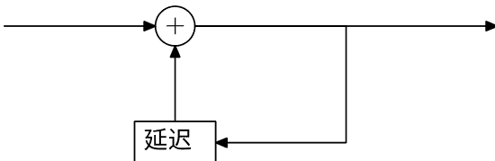

现在将块图的可视优势与运算符的紧凑性和符号优势相结合，使用 R 而不是‘Delay’。运算符块图是


> 暂停尝试 17。它的系统功能是什么？

从这个图或差分方程中，转换为运算符表示：

Y = RY + X。

将 Y 项集中在一边，你会发现最终得到系统功能：

\frac{\text{Y}}{\text{X}}=\frac{1}{1-\mathcal{R}}

它是微分器的倒数。

这个运算符表达式是第一个在分母中包含 R 的表达式。解释除法的一种方式是将由差分方程产生的输出信号与由系统功能产生的输出信号进行比较 1/(1 - R)。为了简单起见，使用冲激作为输入信号进行等价性测试。因此， x[ n]对于 n=0 为 1，否则为 0。

I = 1, 0, 0, 0, ...

然后差分方程为

y[n] = y[n-1] + x[n]

产生输出信号

Y = 1, 1, 1, 1, ...

> 练习 18. 验证这个说法.

输出信号是离散时间阶跃函数 $\theta$. 现在应用 1/(1-R) 对冲击信号 I 进行导入代数或微积分技术的操作。使用

## 合成除法，泰勒级数或二项式定理将 1/(1−R) 重写为

```
$$ \frac{1}{1-\mathcal{R}} = 1 + \mathcal{R} + \mathcal{R}^2 + \mathcal{R}^3 + \cdots. $$
```

将 1/(1−R) 应用于冲击信号，将每个项 1, R, R 2, ...应用于冲击信号 I:

- 1I = 1, 0, 0, 0, 0, 0, 0, …,
- RI = 0, 1, 0, 0, 0, 0, 0, …,
- R²I = 0, 0, 1, 0, 0, 0, 0, …,
- R³I = 0, 0, 0, 1, 0, 0, 0, …,
- R⁴I = 0, 0, 0, 0, 1, 0, 0, …,
- …

将这些信号相加以得到输出信号 Y。

> 暂停尝试 18。Y 是什么？

对于 n=0，样本 y[n] 从 RnI 项获得 1，而其他项没有。因此，输出信号从 n=0 开始都是 1。具有这些样本的信号是阶跃函数：

```
$$ Y = 1, 1, 1, 1, \dots. $$
```

幸运的是，这个输出信号与运行差分方程得到的输出信号匹配。因此，对于冲激输入信号，这些算子表达式是等价的：

```
$$ \frac{1}{1-\mathcal{R}} \quad\quad\quad 和 1+\mathcal{R}+\mathcal{R}^2+\mathcal{R}^3+\cdots。 $$
```

> 练习 19。如果你对数学有兴趣，可以自己验证冲激的等价性就足够了。换句话说，我们不需要尝试所有其他输入信号。

### 3.5 反馈连接

结论是，R 算子遵循代数和微积分规则。

勇敢一点：使用算子来找到结果，不要担心。

#### 3.5.2 斐波那契

按照我们自己的建议，我们现在使用算子来分析斐波那契系统。递推关系是：

输出 = 延迟输出 + 两倍延迟输出 + 输入。

暂停尝试 19。将这个表达式转化为一个系统函数。

输出信号是 F，输入信号是 X。延迟输出是 R X，两倍延迟输出是 R R X 或 R²X。所以 F = R F + R² F + X。将所有 F 项移到一边：F - R F - R² F = X。然后因式分解 F: (1 - R - R²) F = X。

然后通过 R 表达式两边除以

F = 1 / (1 - R - R²) X。

因此系统的功能是

1 / (1 - R - R²)。

## 3.5 块图和运算符：两种新的表示

> 练习 20。使用最大值或其他方式，找到 1/(1-R-R^2) 的泰勒级数。你注意到什么关于系数？巧合吗？最大值 (maxima.sourceforge.net) 是一个强大的符号代数和微积分系统。它源自 20 世纪 60 年代在 MIT 创建的 Macsyma。最大值是自由软件 (GPL 许可证)，可用于大多数平台。

### 3.6 总结

包括本章讨论的两种系统表示，你有四种离散时间系统的表示方式：

- 1. 口头描述，
- 2. 差分方程，
- 3. 块图，和
- 4. 算子表达式。

在下一章中，我们使用算子表示来分解和设计系统。

---

## 4 模式

- 4.1 斐波那契数列的增长 52
- 4.2 从斐波那契数列中取出较大部分 55
- 4.3 运算符解释 57
- 4.4 一般方法：部分分式 59

> 本章的目标是：
- 为了说明工程师研究系统的实验方法，即使是抽象的数学系统；
- 通过找到斐波那契系统的模式来说明模式是什么；和
- 将二阶系统分解为模式，使用算子和块图解释分解过程。

第一个问题是什么是模式。当我们将斐波那契数列分解为更简单的数列时，这个问题将得到回答。每个简单的数列都可以由类似漏水罐的一阶系统生成，并被称为系统的一个模式。通过将斐波那契数列分解为模式，我们将系统分解为更简单的一阶子系统。

本章的计划是首先将斐波那契系统视为一个黑盒子，产生一个输出信号 F 并开发计算探针来检查信号。这种实验方法是工程师研究抽象的数学系统的方式。探针的结果将向我们展示如何将信号分解为其模式。然后，这些模式将与算子方法预测的分解系统进行调和。

为什么在介绍使用算子的快捷方式之前，要先描述实验性的、可能更难的方法来找到模式？我们知道斐波那契系统的算子表达式，可以通过代数重新编写它。 答案是，只有在你的手指感受到模式之后，算子方法才有意义，而这种感觉只有在你玩信号时才能培养出来。 如果不先玩耍，我们将教你在无意义的对象上进行令人惊叹的计算技巧。

此外，实验方法在没有差分方程可用于生成序列时也能起作用。 工程师经常对这种未知或部分已知的系统进行特征化。系统可能是：

- 计算机：想象一下调试别人的程序。 你发送测试输入来了解它的工作原理和导致其失败的原因。
- 电子：想象一下调试刚从制造过程返回的 CPU，可能是以百万计的数量，但不能正确地进行浮点数除法 [12]。 你可以给它一些除数，直到找到能够给出错误答案的最简单的例子。

通过这些数据，你经常可以推断出布线中的缺陷。

- 数学：想象一下计算素数以研究孪生素数猜想 [16]，这是数论中一个未解决的重要问题之一。 [该猜想表明存在无限多个素数对 (p, p+2)，例如 (3,5)，(5,7) 等。] 实验数学是一个充满活力、不断发展的新领域，对于熟练的工程师来说是一个富饶的领域 [4,14,8]。

因此，我们希望通过对斐波那契数列的实验探测，你学习到一种解决问题的一般方法。

### 4.1 斐波那契数列的增长

第 1.1.2 节估计了这个序列 f[n] 的增长速度。 它似乎以几何级数的方式增长，增长的阶数在 1 和 2 之间。 我们的第一个项目是通过实验缩小这个范围，从而猜测一个闭合形式来确定增长的阶数。

找到增长的阶数的一种方法是计算连续的比率 f[n]/f[n-1]。 这些比率在 1.618 左右波动，但这个估计不够准确。

不够准确以猜测一个闭合形式。由于比率的振荡随着 n 的增长而消失，让我们通过计算大的 n 来准确估计比率。我们用 Python 编程的计算机作为这些实验的工具，Python 是一种简洁、广泛可用的语言。使用任何适合你的工具，也许是另一种语言、一个绘图计算器或者电子表格。

2.3.2 节提供了以下 Python 代码来计算 f[n]：

```python
def f(n):
  if n < 2:   return 1
  return f(n-1) + f(n-2)
```

但是当 n 很大时，代码运行缓慢。下面是在 Pentium Core Duo 1.8GHz 处理器上评估 f[n] 的运行时间：

| n | 10 | 15 | 20 | 25 | 30 |
| :--- | :--- | :--- | :--- | :--- | :--- |
| 时间 (ms) | 0.17 | 1.5 | 21 | 162 | 1164 |

运行时间增长迅速！

> 练习 21. 这个实现的运行时间是多少？

这些时间可能看起来足够低以便使用，但是想象一下只有一个图形计算器的荒岛上；那么这些时间可能会增加 10 倍或 100 倍。我们希望构建一个高效的计算方法，使其广泛可用。

一个高效的函数会存储先前计算过的答案，在可能的情况下返回存储的答案，而不是重新计算旧值。在 Python 中，可以使用字典来存储这些值，这类似于 Perl 中的哈希或 awk 中的关联数组。Fibonacci 函数的记忆化版本是：

```python
memo = {}
def f(n):
  if n < 2: return 1
  if n in memo: return memo[n]
  memo[n] = f(n-1) + f(n-2)
  return memo[n]
```

### 4.1 斐波那契数列的增长

> 暂停：试试 20. 记忆化函数的运行时间是多少，用大 O 表示法表示？

新函数在常数时间内运行 - 更快的探测！ - 因此我们可以廉价地计算大的 n 的 f[n]。这些比值是 f[n]/f[n-1]:

| n | f[n]/f[n-1] |
| :--- | :--- |
| 5 | 1.6000000000000009 |
| 10 | 1.61818181818181817 |
| 15 | 1.61803278688524599 |
| 20 | 1.61803399852180330 |
| 25 | 1.61803398867044312 |
| 30 | 1.61803398875054083 |
| 35 | 1.61803398874988957 |
| 40 | 1.61803398874989490 |
| 45 | 1.61803398874989490 |

这些值在 n = 45 时非常稳定，可能只受浮点数精度的限制。

让我们看看闭式形式在 n = 45 时会产生比值 1.61803398874989490。闭式形式的一个来源是你的直觉和经验。

另一个很好的资源是逆符号计算器。通过使用逆符号计算器，您可以增加您的闭合形式的库，并增强您的直觉。

> 暂停：试试 21。请向逆符号计算器询问 1.61803398874989490。

逆符号计算器认为 1.61803398874989490 最有可能是方程 $x^2 - x - 1$ 的正根，或者等价地说，是黄金比例 $\phi$：

$$\phi \equiv \frac{1+\sqrt{5}}{2}$$

让我们使用这个假设。然后

f[n] 约等于 $\phi^n$。

但我们不知道 ~ 符号隐藏的常数是多少。通过再次使用逆符号计算器找到那个常数。这是一个

| n | f[n]/$\phi^n$ |
| :--- | :--- |
| 0 | 1.0000000000000000 |
| 10 | 0.72362506926471781 |
| 20 | 0.72360679895785285 |
| 30 | 0.72360679775005809 |
| 40 | 0.72360679774997805 |
| 50 | 0.72360679774997783 |
| 60 | 0.72360679774997749 |
| 70 | 0.72360679774997727 |
| 80 | 0.72360679774997705 |
| 90 | 0.72360679774997672 |
| 100 | 0.72360679774997649 |

当 n 等于 10 时，比率大约为 $\phi/\sqrt{5} \approx 0.73$，但是后来的比率稳定在一个与猜测不一致的值附近。

> 暂停：试试 22。向逆符号计算器询问 0.72360679774997649。哪个选择似乎最合理？

逆符号计算器为 0.72360679774997649 提供了许多闭合形式。包含 $\sqrt{5}$ 的选择是合理的，因为 $\phi$ 包含 $\sqrt{5}$。闭合离 0.72360679774997649 最近且包含 $\sqrt{5}$ 的形式是 $\phi/\sqrt{5}$。所以斐波那契数列大约是 $\phi^n \frac{\phi}{\sqrt{5}}$。

### 4.2 从斐波那契数列中取出大部分

现在让我们通过剥离 $\phi^n$ 来取出大部分 $(\phi/\sqrt{5})\phi^n$ 的贡献看看剩下什么。通过 $f_1[n] = (\phi/\sqrt{5})\phi^n$ 来定义信号 F1。

这个信号是斐波那契数列的一种模式。模式的形状是其增长顺序，在这里是 $\phi$。模式的振幅是前缀因子，在这里是 $\phi/\sqrt{5}$。模式形状是系统的特征，而振幅取决于输入信号（对于这个例子，输入信号是脉冲）。因此，我们通常对形状更感兴趣而不是振幅。然而，在这里我们需要形状和振幅以确定信号并剥离它。

所以，残差信号 $F_2 = F - F_1$：

- f₂[n] = f[n] - f₁[n]
- 0: +0.27639320225002106
- 1: -0.17082039324993681
- 2: +0.10557280900008426
- 3: -0.06524758424985277
- 4: +0.04032522475023104
- 5: -0.02492235949962307
- 6: +0.01540286525060708
- 7: -0.00951949424901599
- 8: +0.00588337100158753
- 9: -0.00363612324743201
- 10: +0.00224724775415552

残差信号开始很小，然后变得越来越小，所以主模态 $F_1$ 是对 Fibonacci 序列 F 的一个很好的近似。为了找到残差信号 $F_2$ 的闭合形式，尝试连续比率探测：

- f₂[n]/f₂[n-1]
- 1: -0.61803398874989446
- 2: -0.61803398874989601
- 3: -0.61803398874989390
- 4: -0.61803398874989046
- 5: -0.61803398874993953
- 6: -0.61803398874974236
- 7: -0.61803398875029414
- 8: -0.61803398874847626
- 9: -0.61803398875421256
- 10: -0.61803398873859083

连续比率几乎是恒定的，看起来很像 $1 - \phi$，也就是 $-1/\phi$。

> 练习 22。证明 $1 - \phi = -1/\phi$。

为了评估振幅，将 $f_2[n]$ 除以模态形状 $(-\phi)^{-n}$。这是一个结果表格：

| n | $f_2[n]/(-\phi)^{-n}$ |
| :--- | :--- |
| 1 | 0.27639320225002090 |
| 2 | 0.27639320225002140 |
| 3 | 0.27639320225002101 |
| 4 | 0.27639320225001901 |
| 5 | 0.27639320225003899 |
| 6 | 0.27639320224997083 |
| 7 | 0.27639320225014941 |
| 8 | 0.27639320224951497 |
| 9 | 0.27639320225144598 |
| 10 | 0.27639320224639063 |

这些值很快稳定下来，看起来就像是振幅减去 $\phi^n$ 模式。 因此，$(-\phi)^n$ 模式的振幅是 $1 - \phi/\sqrt{5}$，也是 $1/\sqrt{5}$。

因此，$\sqrt{5}$ 残余信号的形状和振幅的组合是


现在将 $F_1$ 和 $F_2$ 信号组合起来得到斐波那契信号：


这个通过实验推导出来的闭式形式是著名的 Binet 公式，用于计算第 n 个斐波那契数。

> 练习 23。使用剥离和有教养的猜测来找到当脉冲输入到以下差分方程时的输出信号的闭式形式：$y[n] = 7y[n-1] - 12y[n-2] + x[n]$。

### 4.3 算子解释

模式是系统可以产生的最简单的持久响应，它们是所有系统的构建模块，因此我们希望找到模式的算子或块图表示。

模式是系统可以产生的最简单的持久响应，它们是所有系统的构建模块，因此我们希望找到模式的算子或块图表示。

斐波那契信号可以分解为两个更简单的信号 F1 和 F2，它们也是模式，每个模式都呈几何增长。几何增长是由一个反馈环路产生的。因此，$\phi^n$ 模式是由这个系统产生的。


具有系统函数 $(1-\phi \mathcal{R})^{-1}$ 的系统产生了 $\phi^n$ 模式。

具有系统函数 $(1+\mathcal{R}/\phi)^{-1}$ 的系统产生了 $(-\phi)^{-n}$ 模式。

斐波那契系统是这些信号按照各自的振幅进行加权求和的，因此它的块图是前面模块图的加权和。斐波那契系统的系统函数是纯模式系统函数的加权和。

所以让我们将各个系统函数相加，看看会发生什么：

```latex
\begin{aligned}
F(\mathcal{R}) & =F_{1}(\mathcal{R})+F_{2}(\mathcal{R}) \\
 & =\frac{\phi}{\sqrt{5}} \frac{1}{1-\phi \mathcal{R}}+\frac{1}{\phi \sqrt{5}} \frac{1}{1+\mathcal{R} / \phi} \\
 & =\frac{1}{1-\mathcal{R}-\mathcal{R}^{2}}.
\end{aligned}
```

那个函数是从模块图（第 3.5.2 节）直接推导出来的斐波那契系统的系统函数！因此实验方法和算子方法都认为这些算子模块图是等价的：

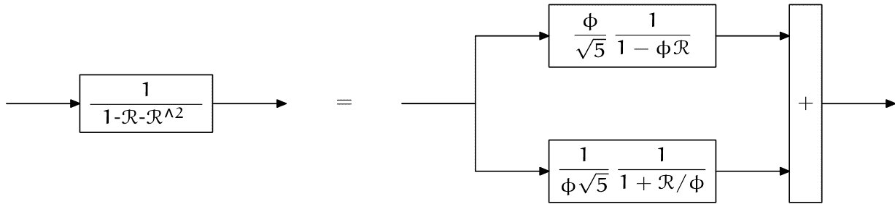

在这里，为了使图表更易于解析，系统函数代表它们所表示的一阶和二阶系统。

> 练习 24。编写与并行分解块图对应的差分方程系统。证明该系统等价于通常的差分方程。
$f[n] = f[n - 1] + f[n - 2] + x[n]$.

从块图或差分方程直接看，等价性并不明显。使等价性明显需要实验或算子表示。经过实验，你已经可以普遍地使用算子表示来找到模式。

### 4.4 一般方法：部分分式

因此，我们希望有一种不需要剥离和猜测的系统分解方法。我们有一种方法：部分分式法，它展示了算子表示和系统函数的价值。因为系统函数的行为类似于代数表达式，或者可以说它是代数表达式，所以通常比块图或差分方程更容易操作。

从分解的一阶系统到原始的二阶系统功能，现在我们来反过来：从原始系统功能到分解的系统。为了这样做，首先要因式分解表达式：

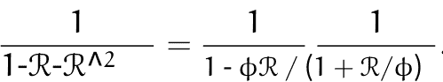

这种因式分解，即级数分解，将帮助我们在后面的章节中研究极点和零点。在这里，我们使用它来通过使用部分分式的技术来找到并联分解。

部分分式应该使用分母中的两个因子，所以猜测这个形式：

$$\frac{1}{1-\mathcal{R}-\mathcal{R}^2} = \frac{a}{1-\phi\mathcal{R}} + \frac{b}{1+\mathcal{R}/\phi}$$

其中 a 和 b 是未知常数。 在添加分数后，分母将成为乘积 $(1-\phi\mathcal{R})(1+\mathcal{R}/\phi)$，而分子将是交叉相乘的结果：

$$a(1+\mathcal{R}/\phi) + b(1-\phi\mathcal{R}) = a + (a/\phi)\mathcal{R} + b - b\phi\mathcal{R}.$$

我们希望分子为 1。如果我们设定 $a=\phi$ 和 $b=1/\phi$，那么至少 $\mathcal{R}$ 项会相互抵消，只剩下常数项 $a+b$。所以我们选择将 a 和 b 设置得比 $a+b$ 的和更大，即 $\phi + 1/\phi$ 或 5。所以我们选择

$$a = \phi/\sqrt{5},$$

$$b = 1/(\phi\sqrt{5}).$$

如果你更喜欢通过解线性方程来解决问题，而不是猜测和检查的方法，这里是线性方程：

$$\begin{gathered} a+b=1, \\ a/\phi-b\phi=0, \end{gathered}$$

其解是使用猜测和检查方法推导出来的。

教训：为了找出系统的行为，将其系统函数分解因式，并使用部分分式将该分解形式分解为一系列一阶系统的和。 通过这种分解，你可以预测输出信号，因为你知道一阶系统的行为。

你可以通过以下问题来练习分解的新技能：

练习 25。再次看看这个系统 $y[n] = 7y[n-1] - 12y[n-2] + x[n]$。将运算符表示分解为两个模式的和，并绘制相应的块图（使用块图元素）。当输入信号 X 是冲激信号时，运算符和块图分解是否产生与通过剥离和猜测得到的相同的闭合形式？

---

## 5 重复根

- 5.1 漏斗背景 64
- 5.2 数值计算 65
- 5.3 分析输出信号 67
- 5.4 改变系统形状：连续性论证 68
- 5.5 高阶级联 70

阅读完本章后，你应该能够：
- 使用连续性论证
- 解释具有双重根的模式非几何输出。

模式产生持久的输出。到目前为止，我们的例子产生持久的几何序列。但是，来自重复根的模式（例如来自系统函数 $(1-\mathcal{R}/2)^{-3}$）产生的输出不是几何序列。重复根如何产生这种看似奇怪的行为？

分析依赖于重复根是一个不太可能的特殊情况的想法。如果根在复平面上随机分布，两个根正好落在同一个位置的概率为零。一个通用的、合理的系统没有重复的根，只有通过特殊的构造，物理系统才会获得重复的根。这个事实表明，通过稍微移动一个根，将重复根系统变形为通用系统，使得变形系统的模式产生几何序列。因此，这个新系统在定性分析上比原始系统更容易，并且可以尽可能地逼近原始系统。这个连续性论证依赖于世界的观念。

平滑变化：系统的微小变化，比如将根移动一个微小量，只会产生系统输出的微小变化。

为了生成双重根，我们使用 RC 电路或漏桶（第 1.2 节）。任何一个系统都只有一个模式。为了生成双重根，级联两个相同的漏桶或 RC 电路，其中第一个系统的输出是第二个系统的输入。

> 练习 26。当制作类似于两个漏桶级联的 RC 级联系统时，两个 RC 电路之间是否需要一个单位增益缓冲器？

### 5.1 漏桶背景

假设漏桶或 RC 电路的时间常数为 $\tau$。假设 $V_{\text{in}}$ 为输入信号，即进入漏桶系统或 RC 电路的流量，$V_{\text{out}}$ 为输出信号。那么两个系统的微分方程为

```latex
$\tau \dot{V}_{\text{out}} = V_{\text{in}} - V_{\text{out}}.$
```

使用前向欧拉逼近法将此方程转化为离散时间系统。使用时间步长 $T$，差分方程变为

```latex
$\tau \frac{V_{\text{out}}[n] - V_{\text{out}}[n-1]}{T} = V_{\text{in}}[n-1] - V_{\text{out}}[n-1].$
```

为了促进方程的整洁性，定义无量纲比率 $\alpha \equiv T/\tau$ 并收集类似项。整洁的差分方程为

```latex
$V_{\text{out}}[n] - (1 - \alpha)V_{\text{out}}[n-1] = V_{\text{in}}[n-1].$
```

> 暂停尝试 23。这个差分方程对应的系统功能是什么？

对应的系统功能是

```latex
\frac{\text{输出电压}}{V_{\text{in}}} = \frac{\mathcal{R}}{1 - (1 - \alpha)\mathcal{R}}.
```

> 练习 27. 这个系统对应的框图是什么功能？

通过级联两个相同系统，会产生一个双重根。这是它的高级框图，显示了输入、中间和输出信号：


它的系统功能是一个系统的功能的平方：

```latex
\frac{V_2}{V_0} = \left( \sqrt{\frac{\mathcal{R}}{1 - (1 - \alpha)\mathcal{R}}} \right)^2.
```

分子 $(\mathcal{R})^2$ 对分析没有增加有趣的特征，所以简化生活，忽略它。为了进一步简化代数，定义 $\beta = 1 - \alpha$. 在这个定义下，没有无聊的 $\mathcal{R}$ 因子，纯净的系统是

```latex
\frac{V_2}{V_0} = \frac{1}{(1 - \beta\mathcal{R})^2}.
```

# 5 重根

### 5.2 数值计算

按设计，这个级联系统在 $\beta = 1 - T/\tau$ 时有一个双重根。让我们模拟它的脉冲响应并找到数据中的模式。模拟需要选择参数的数值，这里唯一的参数是 $T/\tau$。精确离散化需要使用比系统时间常数 $\tau$ 更短的时间步长 $T$；否则系统在样本之间会发生显著变化，使离散时间近似失效。所以使用 $\beta = 1$（近似）。

> 暂停一下，尝试 24。编写一个程序来模拟脉冲响应，选择一个合理的 $\beta$。

以下模拟中使用 $\beta = 0.95$ 或 $\beta = 0.95$（修正：Page 75 使用 $\beta = 0.95$）来计算脉冲响应:

```python
from scipy import *

N = 100
impulse = zeros(N)
impulse[0] = 1
beta = 0.95
```

```python
# 通过系统将输入信号馈入，返回输出信号

# 包含延迟和给定增益的反馈回路
def onestage(input, gain):
    output = input * 0
    output[0] = input[0]
    for i in range(1, len(output)):        # 1..n-1
        output[i] = input[i] + gain * output[i-1]
    return output
```

```python
signal = impulse                    # 从冲激响应开始
for gain in [beta, beta]:         # 将信号通过每个系统运行
    signal = onestage(signal, gain)
print(signal)
```

冲激响应是:

| n | y[n] |
| :--- | :--- |
| 0 | 1.000000 |
| 1 | 1.900000 |
| 2 | 2.707500 |
| 3 | 3.429500 |
| 4 | 4.072531 |
| 5 | 4.642686 |
| 6 | 5.145643 |
| 7 | 5.586698 |
| 8 | 5.970784 |
| 9 | 6.302494 |
| 10 | 6.586106 |

### 5.3 分析输出信号

冲激响应包含一个模式。要找到它，可以尝试不同的数据并进行猜测。前几个样本看起来像 $n+1$。然而，当 $n=10$ 时，这个猜测看起来可疑。所以寻找另一个模式。一个单一的系统 $(1-\beta\mathcal{R})^{-1}$ 会产生一个几何级数的输出，其中第 $n$ 个样本是 $\beta^n$。也许这种几何衰减出现在双系统中，并淹没了猜测的 $n+1$ 增长。因此，通过制表信号 $y[n] / 0.95^n$ 来去除冲激响应中的大部分。为此，在之前的程序中添加一行代码:

```python
print(signal / 0.95**arange(N))
```

数据是

| n | y[n] / 0.95^n |
| :--- | :--- |
| 0 | 1.000000 |
| 1 | 2.000000 |
| 2 | 3.000000 |
| 3 | 4.000000 |
| 4 | 5.000000 |
| 5 | 6.000000 |
| 6 | 7.000000 |
| 7 | 8.000000 |
| 8 | 9.000000 |
| 9 | 10.000000 |
| 10 | 11.000000 |

现在 $y[n]=n+1$ 是准确的！双级联的冲激响应是信号

$$y[n] = (n+1) \cdot 0.95^n, \quad \text{对于 } n \ge 0.$$

$0.95^n$ 的因子是有意义的，因为单一系统 $(1-0.95\mathcal{R})^{-1}$ 将具有 $0.95^n$ 作为其冲激响应。但是 $n+1$ 的因子是如何产生的？为了理解其起源，一种方法是卷积，这在讲座中讨论过。在这里，我们展示了一种使用连续性论证的替代方法。

### 5.4 改变系统形状：连续性论证

级联系统很难分析，因为其根被复制了。因此，通过使第二个根为 $0.951$ 而不是 $0.95$ 来改变级联系统的形状。那个稍微改变形状的系统具有功能

$$\frac{1}{1-0.951 \mathcal{R}} \cdot \frac{1}{1-0.95 \mathcal{R}}$$

由于根几乎没有移动，脉冲响应应该与原系统的脉冲响应几乎相同。这个假设是连续性论证的本质。我们可以通过稍微修改前面的程序来找到响应。然而，过于频繁地使用程序并不能增加洞察力。

或者，现在系统的根不相等，我们可以轻松地使用部分分式。部分分式的第一步是找到模式:

$$M_1 = \frac{1}{1-0.951 \mathcal{R}} \quad \text{和} \quad M_2 = \frac{1}{1-0.95 \mathcal{R}}.$$

系统的功能是这些模式的线性组合:

$$\frac{1}{1-0.951 \mathcal{R}} \cdot \frac{1}{1-0.95 \mathcal{R}} = \frac{C_1}{1-0.951 \mathcal{R}} - \frac{C_2}{1-0.95 \mathcal{R}}.$$

> 练习 28。证明 $C_1 = 951$ 和 $C_2 = 950$。

部分分式分解为

$$\frac{1}{1-0.95 \mathcal{R}} \cdot \frac{1}{1-0.951 \mathcal{R}} = \frac{1}{0.001} \left( \frac{0.951}{1-0.951 \mathcal{R}} - \frac{0.95}{1-0.95 \mathcal{R}} \right)$$

该 $0.951/(1-0.951\mathcal{R})$ 系统对冲激响应的贡献为 $0.951^{n+1}$，而该 $0.95/(1-0.95\mathcal{R})$ 系统对冲激响应的贡献为 $0.95^{n+1}$。

> 练习 29。检查这些冲激响应。

因此，变形系统的冲激响应为

$$y[n] = 1000 \cdot (0.951^{n+1} - 0.95^{n+1}).$$

由于 $0.951 \approx 0.95$，括号内的差异很小。然而，括号外的 1000 倍放大了差异。结果信号并不小，并且可能包含真实双重根的冲激响应中的非几何因子 $n+1$。

为了近似差异 $0.951^{n+1} - 0.95^{n+1}$，使用二项式定理保留仅最大的两个项：

$$0.951^{n+1} = (0.95 + 0.001)^{n+1} \approx 0.95^{n+1} + (n+1)0.95^n \cdot 0.001 + \dots$$

因此，近似冲激响应为

$$y[n] \approx 1000 \cdot (n+1) \cdot 0.95^n \cdot 0.001.$$

1000 的因子抵消了 0.001 的因子，剩下

$$y[n] \approx (n+1) \cdot 0.95^n,$$

这正是我们通过数值推测得出的结果！

因此，线性前置因子 $n+1$ 来自减去两个几乎相同的普通几何序列模式。$\approx$ 符号反映了我们在 $0.951^{n+1}$ 的二项式展开中仅保留了前两项。

然而，随着变形的缩小，位移根在 $0.951$ 变为 $0.9501$ 或 $0.95001$ 等。当根趋近于 $0.95$ 时，二项式近似变得精确，脉冲响应也变得精确。响应 $(n+1) \cdot 0.95^n$ 是一个递增函数和一个递减函数的乘积，每个函数都在争夺胜利。在这种情况下，一个函数通常在极限 $n \to 0$ 处获胜，另一个函数在极限 $n \to \infty$ 处获胜，两个函数的乘积达到最大值，这两个函数排列成平局。

练习 30。画出 $n+1$，$0.95^n$ 以及它们的乘积。

暂停尝试 25。$(n+1) \cdot 0.95^n$ 的最大值在哪里？

当两个连续的样本相等时，该产品达到最大值。

连续样本的比率是

```latex
\frac{y[n]}{y[n-1]} = \frac{0.95^n \cdot (n+1)}{0.95^{n-1} \cdot n} = 0.95 \cdot \left(1 + \frac{1}{n}\right).
```

当 $n = 19$ 时，该比率为 1。因此，$y[19]$ 和 $y[18]$ 是脉冲响应的最大值。信号上升直到此时，保持平稳，然后衰减至零。

### 5.5 高阶级联

脉冲在神经树突中的传播 - 具有主动放大和再生 - 是一个连续空间 RC 级联。它可以近似模拟为一个巨大的离散空间 RC 滤波器级联。

与其尝试一个 1000 元素级联，不如尝试一个三重级联的脉冲响应。在计算之前猜测，无论是数值计算还是解析计算。单一系统 $(1 - \beta\mathcal{R})^{-1}$ 产生纯几何衰减 $\beta^n$ 没有前置因子。双系统 $(1 - \beta\mathcal{R})^{-2}$ 产生带有线性前置因子 $n + 1$ 的几何衰减。因此，三重级联应该产生带有二次前置因子的几何衰减。而它确实如此。

> 练习 31。猜测三级级联的冲激响应的二次前缀。你如何确认你的猜测？

> 练习 32。计算并绘制三级级联的输出信号。

> 练习 33。冲激响应的最大值在哪里？它与双级联的最大值相比如何？

## 6 完美 (正弦) 波

| 6.1 前向欧拉 | 72 |
| 6.2 反向欧拉 | 76 |
| 6.3 跳跃 | 79 |
| 6.4 总结 | 82 |

- 本章的目标是:
    - 分析离散化连续时间系统的几种方法; 并
    - 说明复极点和单位圆的重要性。

如果你的编程语言没有内置正弦函数，你如何计算正弦波？你可以使用第一套问题中的耦合振子:

```latex
\dot{y}_1 = y_2,
\dot{y}_2 = -y_1.
```

让我们重新编写方程以获得物理意义。将 $y_1$ 想象为振荡器的位置 $x$。然后 $y_2$ 是 $\dot{x}$，即振荡器的速度。所以将 $y_1$ 替换为 $x$，并将 $y_2$ 替换为 $v$。然后 $y_2$ 是加速度 $a$，使得方程变为 $\dot{x} = v$，$a = -x$。

第一个方程是一个纯粹的数学定义，因此它没有物理内容。但是第二个方程描述了理想情况下的加速度弹簧具有单位弹簧常数和单位质量。因此，位置 $x(t)$ 是 $\sin t$ 和 $\cos t$ 的线性组合。如果我们能够进行准确的离散时间模拟，将会重现这些正弦振荡，而本章将向你展示如何实现。

为了将系统转换为离散时间系统，让 $T$ 成为时间步长，$x[n]$ 为位置 $x(nT)$ 的离散时间估计，$v[n]$ 为速度 $v(nT)$ 的离散时间估计。这些变化解决了除了导数之外的所有项。你如何翻译导数？

三种方法都很容易使用，我们尝试每一种，找到它们的极点并分析其对原始的连续时间系统的保真度。

### 6.1 前向欧拉法

将导数转换为前向欧拉逼近的第一种方法。它估计连续时间导数 $\dot{x}(nT)$ 和 $\dot{v}(nT)$ 使用前向差分

$$\dot{x}(nT) \rightarrow \frac{x[n+1] - x[n]}{T},$$
$$\dot{v}(nT) \rightarrow \frac{v[n+1] - v[n]}{T}.$$

然后连续时间系统变为

$$x[n+1] - x[n] = T v[n],$$
$$v[n+1] - v[n] = -T x[n].$$

新样本 $x[n+1]$ 和 $v[n+1]$ 只依赖于旧样本 $x[n]$ 和 $v[n]$。因此，该系统提供了一个明确的计算后续样本的方法。

#### 6.1.1 模拟

下面是用 Python 实现这些方程的代码。它以初始条件 $x[0] = 1$ 和 $v[0] = 0$ 开始系统，并绘制 $v$ 与 $x$ 的关系。

```python
from scipy import *
import pylab as p

T = 0.1
N = int(T * -2)  # 注意：原文此处可能有误，通常 N 应为正数，此处保留原文逻辑
x = zeros(N)
x[0] = 1
v = zeros(N)

for n in range(N-1):
    x[n+1] = x[n] + T * v[n]
    v[n+1] = v[n] - T * x[n]

p.plot(x, v, 'r.')
p.show()
```

这是用 MetaPost 而不是 Python 生成的图表（但是使用相同的数据）：


其中 $n=0$ 样本用突出的点标记。

> 暂停一下，试试 26。对于连续时间微分方程的精确解，图表会是什么样子？

当解生成一个真正的正弦波时，连续时间方程会生成一个以 $v(t) = -\sin t$ 和 $x(t) = \cos t$ 为坐标的圆。

由于离散时间响应是一个不断增长的螺旋，它不能准确地代表连续时间系统。确实，在大约 50 个时间步之后，点已经显著地向外螺旋。螺旋的意味着 $x[n]$ 和 $v[n]$ 分别不仅仅是振荡，它们还在增长。

#### 6.1.2 极点分析

为了解释系统为什么会振荡和增长，找出它的极点。首先，将两个一阶方程转化为一个二阶方程。然后找出二阶系统的极点。这种方法避免了在耦合方程组中理解极点的必要。

为了将其转换为二阶系统，使用第一个方程消除 $v$ 从第二个方程中。首先将第二个方程乘以 $T$ 得到

$$T v[n+1] - T v[n] = -T^2 x[n].$$

前向欧拉替代是 $T v[n+1] = x[n+2] - x[n+1]$, $T v[n] = x[n+1] - x[n]$。

通过这些替换，我们有：$T v[n+1] - T v[n] = -T^2 x[n]$

$$(x[n+2] - x[n+1]) - (x[n+1] - x[n]) = -T^2 x[n].$$

合并相似项得到：

$$x[n+2] - 2x[n+1] + (1+T^2)x[n] = 0.$$

为了使系统正常工作，我们应该包含一个输入信号或强制函数 $F$。从物理上讲，强制函数代表了对弹簧的外力驱动。以下是一种添加它的方法：

$$x[n+2] - 2x[n+1] + (1+T^2)x[n] = f[n+2],$$

系统的功能是：

$$\frac{X}{F} = \frac{1}{1 - 2\mathcal{R} + (1+T^2)\mathcal{R}^2}.$$

要找到极点，将分母 $1 - 2\mathcal{R} + (1+T^2)\mathcal{R}^2$ 因式分解为 $(1 - p_1\mathcal{R})(1 - p_2\mathcal{R})$。

> 暂停一下，试试 27。极点 $p_1$ 和 $p_2$ 在哪里？

二次公式在找到 $p_1$ 和 $p_2$ 方面很有用，但往往只是替代，而不是增加理解。因此，这里有一种替代的、直观的分析方法来找到极点。首先展开通用的因式分解形式：

```latex
(1 - p_1 \mathcal{R})(1 - p_2 \mathcal{R}) = 1 - (p_1 + p_2)\mathcal{R} + p_1 p_2 \mathcal{R}^2.
```

现在将此形式与特定的分母 $1 - 2\mathcal{R} + (1 + T^2)\mathcal{R}^2$ 进行匹配。

结果是

```latex
\begin{aligned} p_1 + p_2 &= 2, \\ p_1 p_2 &= 1 + T^2. \end{aligned}
```

根的和为 2，而乘积大于 1。

> 暂停尝试 28。如果 $p_1$ 和 $p_2$ 是实数，则无法满足这些条件。

令 $p_1 = 1 + a$ 和 $p_2 = 1 - a$，这确保了 $p_1 + p_2 = 2$。然后 $p_1 p_2 = 1 - a^2$，如果 $a$ 是实数，则不能大于 1。所以 $a$ 必须是虚数。

结果极点为：

```latex
p_{1,2} = 1 \pm jT
```

并且在 z 平面上标记。


极点不在正实轴上，这意味着它们产生振荡输出。

振荡在模拟振荡连续时间系统中是可取的。然而，两个极点都在单位圆外！在 z 平面的那个区域的极点产生增长输出。因此，我们系统的极点不在正实轴上且在单位圆外，产生振荡且增长的输出，如 X-V 图所示。

前向欧拉法不能产生对连续时间振荡系统的准确近似。

> 练习 34。为了将极点放在单位圆上，为什么不用 $T=0$ 进行模拟？

> 练习 35。在 z 平面上，画出极点随着 $T$ 从 0 增加到 1 的移动。

### 6.2 后向欧拉

让我们找另一种方法。因为懒惰，我们使用对称性来发明它。如果向前 Euler 方法不准确，尝试使用向后 Euler 方法通过估计导数来计算：

$$\dot{x}(nT) \rightarrow \frac{x[n] - x[n-1]}{T}$$
$$\dot{y}(nT) \rightarrow v[n] - v[n-1]$$。

这些估计是向左移位的向前 Euler 估计。

然后连续时间方程组变为

```latex
x[n] - x[n-1] = T v[n],
```
```latex
v[n] - v[n-1] = -T x[n].
```

新值 $x[n]$ 和 $v[n]$ 取决于它们自己的新值！这个离散时间系统是计算下一个样本的隐式方法，因此向后 Euler 方法通常被称为隐式 Euler 方法。

#### 6.2.1 寻找明确的步骤

作为一组隐式方程，它们需要进行调整，以成为一个明确的步骤，我们可以进行编程。你可以通过矩阵求逆来做到这一点，但让我们一步一步来做。方程系统是

```latex
x[n] - T v[n] = x[n-1],
```
```latex
T x[n] + v[n] = v[n-1].
```

## 6 完美 (正弦) 波

消除 $v[n]$，得到一个只涉及前面样本 $x[n-1]$ 和 $v[n-1]$ 的方程。为了消除 $v[n]$，将第二个方程乘以 $T$ 然后相加。结果是

$$(1+T^{2}) x[n]=x[n-1]+T v[n-1] 。$$

同样地，消除 $v[n]$ 得到一个关于 $v[n]$ 和 $x[n]$ 的方程。为了消除 $v[n]$，将第一个方程乘以 $T$ 然后相减。结果是

$$(1+T^{2}) v[n]=v[n-1]-T x[n-1] 。$$

这些方程与向前欧拉方程类似，只是多了 $1+T^{2}$ 的因子。这些因子会缩小 $x[n]$ 和 $v[n]$，因此它们可能控制过度振荡。

> 尝试 29。修改向前欧拉的 Python 程序以实现向后欧拉，并绘制结果。

要实现向后欧拉法，只需要更改程序中的两行代码，计算新样本的代码是

```python
for n in range(N-1):
    x[n+1] = (x[n] + T*v[n])/(1+T**2)
    v[n+1] = (v[n] - T*x[n])/(1+T**2)
```

并且 X-V 图是


现在点向内螺旋！$1+T^{2}$ 的因子有些过度。

#### 6.2.2 向后欧拉法的极点

让我们通过找到系统的极点来解释向内螺旋。第一步是将两个一阶差分方程转化为一个二阶方程。

> 尝试 30。找到二阶差分方程。

通过使用消除 $v[n]$ 和 $v[n-1]$ 来转换为二阶差分方程。

$T v[n] = x[n] - x[n - 1]$

通过使用其相应的向后移动一个样本的信号，即 $T v[n - 1] = x[n - 1] - x[n - 2]$。将这些替换代入 $T x[n] + v[n] = v[n - 1]$ 在两边都乘以 $-T$ 之后

$$-T^2 x[n] = (x[n] - x[n - 1]) - (x[n - 1] - x[n - 2])$$

$$= x[n] - 2x[n - 1] + x[n - 2].$$

将 $x[n]$ 项组合并添加一个强制函数 $F$ 得到这个差分方程

$$(1 + T^2)x[n] - 2x[n - 1] + x[n - 2] = f[n]$$

这个系统的函数

$$\frac{F}{X} = \frac{1}{(1 + T^2) - 2\mathcal{R} + \mathcal{R}^2}.$$

> 尝试 31。寻找极点。

## 6 完美（正弦）波

现在通过分解分母来找到它的极点。避免使用二次公式！分母看起来类似于向前欧拉法中的分母，其中它是 $1-2 \mathscr{R}+(1+T^{2}) \mathscr{R}^{2}$，但是末尾的系数 1 和 $1+T^{2}$ 被互换了。这种互换将根转换为它们的倒数，因此极点是


这些极点位于单位圆内，因此振荡会消失，X-V 图形会螺旋进入原点。

> 尝试 32。对程序进行一个简单的修改，使得点保持在单位圆上。
提示：只需在代码中添加八个字符。

一个简单的修改是手动修复问题。如果将 $x[n]$ 和 $v[n]$ 分别除以 $1+T^2$ 过度修正，而除以 1 则修正不足，那么尝试除以一个折中值 $\sqrt{1+T^2}$：

```python
for n in range(N-1):
    x[n+1] = (x[n] + T*v[n]) / sqrt(1+T**2)
    v[n+1] = (v[n] - T*x[n]) / sqrt(1+T**2)
```

然而，这种方法并不具有普适性，这就是为什么它是一种简单的方法，而不是一种通用方法。在这个问题中，我们可以解决连续时间系统，所以我们可以构造一个方法来复制它的行为，使用离散时间系统。然而，对于许多系统，我们不知道连续时间解，这就是为什么我们进行模拟的原因。所以我们希望有一个有原则的方法来获得准确的模拟结果。

### 6.3 跳跃式

Leapfrog，也被称为梯形逼近，是前向和后向欧拉的混合。对于 $x$ 的导数，使用前向欧拉：$\dot{x}(nT) \rightarrow \frac{x[n+1] - x[n]}{T}$

离散时间方程就像前向欧拉一样：

$$x[n+1]-x[n]=Tv[n]。$$

然后对于 $v$ 的导数使用后向欧拉。所以对于 $v$ 的导数：$\dot{v}(nT) \rightarrow \frac{v[n]-v[n-1]}{T}$

和

$$v[n]-v[n-1]=-Tx[n]$$

或

$$v[n+1]-v[n]=-Tx[n+1].$$

在这种混合方法中，$x$ 的计算是一个显式的步骤，而 $v$ 的计算是一个隐式的步骤。

#### 6.3.1 模拟

幸运的是，这个隐式的步骤，与完全的向后欧拉法不同，有一个清晰的实现。方程组为

$$x[n+1]=x[n]+Tv[n], \quad v[n+1]=v[n]-Tx[n+1].$$

> 尝试 33。通过修改 Python 程序中的两行代码来实现跳跃蛙算法。

与向前欧拉法唯一的区别在于计算 $v[n+1]$ 的过程。

Leapfrog 使用的是 $x[n+1]$，即刚刚计算得到的 $x$ 的值。所以代码是

```python
for n in range(N-1):
    x[n+1] = x[n] + T*v[n]
    v[n+1] = v[n] - T*x[n+1]
```

并且绘图是


一个漂亮的圆，没有 $1+T^2$ 的问题！

#### 6.3.2 使用极点进行分析

让我们通过找到该系统的极点来解释这种行为。像往常一样，将两个一阶方程转化为一个二阶方程，用于描述位置。为了消除 $v$，使用第一个方程，即 $Tv[n]=x[n+1]-x[n]$。然后 $v[n+1]=v[n]-Tx[n+1]$ 在乘以 $T$ 后变为:

$$(x[n+2]-x[n+1])-(x[n+1]-x[n])=-T^2x[n+1].$$

重新排列并包含一个强制函数后，结果是

$$x[n+2]-(2-T^2)x[n+1]+x[n]=f[n+2].$$

系统的函数是

$$\frac{1}{1-(2-T^2)\mathcal{R}+\mathcal{R}^2}.$$

再次将其分解为 $(1-p_1\mathcal{R})(1-p_2\mathcal{R})$。由于它是 $\mathcal{R}^2$ 的系数，所以的乘积 $p_1p_2$ 为 1。
和为 $p_1+p_2$ 的总和是 $2-T^2$，小于 2。
所以根必须是复数。一对复共轭根，其乘积为 1，位于单位圆上。单位圆上的极点产生不增长或缩小的振荡，因此交替产生如此细的正弦波。


练习 36。找到二阶方程的极点，并确认它们位于单位圆上。

### 6.4 总结

前向欧拉方法过于激进。后向欧拉方法过于被动。但是，至少对于二阶系统来说，混合的前向 - 后向欧拉方法（交替法）是最合适的 [13]。

## 7 控制

- 7.1 带前馈控制的电机模型 83
- 7.2 简单反馈控制 85
- 7.3 传感器延迟 87
- 7.4 惯性 90

- 本章的目标是研究:
- 如何使用反馈来控制系统;
- 慢传感器如何破坏反馈系统;以及
- 如何建模惯性以及它如何破坏反馈系统。

一个常见的工程设计问题是控制一个集成的系统。例如，将连接到电机的杆的位置转换为角速度的输入 (控制) 电压。目标是一个角度，而控制变量角速度与角度相差一个导数。

我们首先对这样一个系统进行离散时间建模，并尝试在没有反馈的情况下对其进行控制。为了解决前馈设置的问题，我们随后引入反馈并分析其效果。

### 7.1 带前馈控制的电机模型

我们希望设计一个控制器，告诉电机如何将臂放置在给定位置。最简单的控制器完全是前馈的，即它不使用关于实际角度的信息。然后，控制器 - 电机系统的高级块图如下:


我们需要弄清楚输出和输入信号代表的含义。

一个有用的输入信号是臂的期望角度。这个角度可能随时间变化，就像一个机器人臂被指向一个茶杯（对于一个喜欢喝茶的机器人）一样。

输出信号应该是我们感兴趣的变量：臂的位置（角度）。这个选择在我们分析反馈控制器时会有帮助，反馈控制器使用输出信号来决定告诉电机什么。由于输出信号和输入信号是相同类型的量（都是角度），反馈控制器可以通过将输出信号减去输入信号轻松计算出误差信号。

在这个设置中，控制器 - 电机系统将期望角度作为其输入信号，并产生臂的实际角度作为其输出信号。

为了设计控制器，我们需要对电机进行建模。电机将电压转化为臂的角速度 $\omega$。将 $\omega$ 转化为角度的连续时间系统是 $\theta \propto \int \omega dt$。它的向前欧拉逼近是差分方程

```
y[n] = y[n-1] + x[n-1].
```

相应的系统函数是 $\mathcal{R}/(1-\mathcal{R})$，表示具有延迟的累加器。

> 练习 37。绘制相应的模块图。

理想的输出信号将是输入信号的副本，相应的系统函数将是 1。由于电机的系统函数是 $\mathcal{R}/(1-\mathcal{R})$，控制器的系统函数应为 $(1-\mathcal{R})/\mathcal{R}$。不幸的是，时间旅行目前还不可行，因此在分母中只有一个裸露的 $\mathcal{R}$，表示负延迟是不可能的。可实现的控制器是 $1-\mathcal{R}$，它为组合系统函数产生了一个延迟 $\mathcal{R}$：


唉，这个 $1-\mathcal{R}$ 控制器对电机和我们对其模型的特性非常敏感。假设在电机启动之前，臂部以非零角度开始（例如，整个系统在电机不知情的情况下旋转）。那么输出角度将保持不正确的初始角度。如果这种情况发生在一个重量为 1500 千克的机器人的臂部上，一个 10°的误差意味着它的臂部会穿过砖墙而不是停下来拿起墙边的茶杯，这是非常危险的。

在同一类别中的另一个问题是比例常数的误差。假设电机模型低估了电压和角速度之间的转换，比如说低估了 1.5 倍。那么控制器 - 电机系统的系统功能将变为 $1.5\mathcal{R}$，而不是 $\mathcal{R}$。一个 500 千克的臂部可能再次到达砖墙的另一侧。

解决这些问题的一种方法是反馈控制，其分析是下一节的主题。

### 7.2 简单反馈控制

在反馈控制中，控制器使用输出信号来决定告诉电机什么。通过了解输入和输出信号，一个无限智能的控制器可以推断出电机的工作原理。这样的控制器会意识到臂角度从一个偏移开始，或者电机的转换有一个 1.5 的错误因子，并且会对这些和其他问题进行补偿。那种神秘的控制器超出了本课程的范围（也许超出了所有课程的范围）。在本课程中，我们只使用线性系统理论而不是强人工智能。但是神秘控制器中的基本和可转移的思想是反馈。

因此，通过感知臂的角度，将其与期望角度进行比较，并使用差异（误差信号）来决定电机的速度：


真实的传感器不能立即响应，因此假设最佳的情况是，传感器包括一个单位的延迟。然后传感器的输出被减去所需角度，得到误差信号，该信号被控制器使用。

由控制器使用。最简单的控制器，使用所谓的比例控制，只是将误差信号乘以一个常数 $\beta$。这个设置有一个块图


它在讲座中进行了分析，并具有系统功能

$$\frac{C(\mathcal{R})M(\mathcal{R})}{1+C(\mathcal{R})M(\mathcal{R})S(\mathcal{R})}=\frac{\beta \mathcal{R}/(1-\mathcal{R})}{1+\beta \mathcal{R}^2/(1-\mathcal{R})}$$

乘以 $(1-\mathcal{R})/(1-\mathcal{R})$ 以清除分数。然后

$$F(\mathcal{R})=\frac{\beta \mathcal{R}}{1-\mathcal{R}+\beta \mathcal{R}^2}$$

其中 $F(\mathcal{R})$ 是整个反馈系统的函数。

让我们分析增益 $\beta$ 的极端情况下的行为。当 $\beta \rightarrow \infty$ 时，系统功能极限为 $\mathcal{R}/\mathcal{R}^2=1/\mathcal{R}$，这是一个时间机器。由于我们不能仅通过在反馈系统中选择一个巨大的增益来建造时间机器，某种效应应该阻止我们将 $\beta \rightarrow \infty$。事实上，不稳定性将阻止它，正如我们将通过平滑地将 $\beta$ 从 0 增加到 $\infty$ 来看到的那样。

为了研究稳定性，看一下反馈系统的极点，它们由分母 $1-\mathcal{R}+\beta\mathcal{R}^2$ 的因子给出。分解形式为 $(1-p_1\mathcal{R})(1-p_2\mathcal{R})$。因此，极点的和为 1，它们的乘积为 $\beta$。在极端情况下，即 $\beta \rightarrow 0$，也就是没有反馈时，极点近似为 $1-\beta$ 和 $\beta$。靠近 1 的极点意味着系统几乎是一个累加器；它近似地积分输入信号。这种行为是电机在没有反馈的情况下所做的，远离了我们的目标，即控制器 - 电机系统将输入复制到输出。

增加增益可以改善控制。然而，在 $\beta \rightarrow \infty$ extreme 时，极点大致在

$$p_{1,2} \approx \frac{1}{2} \pm \mathrm{j} \sqrt{\beta}$$

这些极点远离单位圆，使得系统非常不稳定。过大的增益会使反馈系统不稳定。

要找到最佳增益，需要研究极点。离原点最远的极点具有最快增长或最慢衰减的输出。因此，为了使系统尽可能稳定，需要将距离原点最远的极点的距离最小化。为了做到这一点，将极点放置在相同的位置。在这个例子中，位置必须为 $p_1 = p_2 = 1/2$，因为 $p_1 + p_2 = 1$。由于 $\beta = p_1 p_2$，选择 $\beta = 1/4$。现在输出位置迅速接近期望位置。同样，在响应冲激输入信号时，误差信号迅速衰减至零，大致每个时间步减半。

> 练习 38. 为什么误差信号在每个时间步骤中大致减半，而不是完全减半？

### 7.3 传感器延迟

前面的模型包含一个快速传感器。假设传感器是慢速的，比如 $S(\mathcal{R}) = \mathcal{R}^2$.

> 尝试 34. 使用这个传感器，反馈系统的功能是什么？

反馈系统的功能是

$$ \frac{\beta \mathcal{R}}{1 - \mathcal{R} + \beta \mathcal{R}^3}, $$

这是先前功能的改进版本，传感器功能中的 $\mathcal{R}^2$ 被 $\mathcal{R}^3$ 替换，因为传感器功能中有额外的 $\mathcal{R}$ 的幂次。对于这个系统，可以进行许多分析。为了简单起见，我们选择一个特定的增益 $\beta$ - 使用快速传感器的快速收敛增益 - 并观察额外的传感器延迟如何移动极点。但在分析之前，预测结论！

> 尝试 35. 额外的传感器延迟会将最不稳定的极点向内移动、向外移动还是保持其幅度不变？

这些极点是相应方程的根
方程 $z^3 - z^2 + \beta = 0$ 或
$z^3 - z^2 = -\beta$.


这是曲线 $z^3 - z^2$ 的草图。它的最小值在 $M=(2/3, -4/27)$ 处，所以水平线 $-1/4$ 只在曲线上交叉一次，在平面的左半部分。因此，该方程有一个（负）实根和两个复根。因此，对于 $\beta = 1/4$，该系统有两个复根和一个实根。以下是 Python 代码找到这些极点。它首先使用牛顿 - 拉弗逊 [18] 的连续逼近法找到实根 $p_1$。牛顿 - 拉弗逊代码可作为 scipy 包的一部分使用。实根限制了复根的实部，因为极点的和 $p_1 + p_2 + p_3$ 等于 1，而两个复根的实部相同。因此

$$\text{Re } p_{2,3} = \frac{1 - p_1}{2}.$$

要找到 $p_2$ 或 $p_3$ 的虚部，使用极点的乘积。乘积 $p_1p_2p_3$ 为 $-\beta$。由于复极点的幅度相等，因为它们是共轭复数，我们有

$$|p_{2,3}| = \frac{\sqrt{-\beta}}{p_1}$$

然后从计算得到的实部和幅度中找到一个复极点的虚部。以下是该算法的实现。

```python
from scipy import *

def poly(beta):
    def f(z): # 闭包，知道传入的 beta 的值
    return z**3-z**2+beta
    return f

# 通过求解 z^3-z^2+beta=0 来返回 1-R+beta*R^3 的三个极点
# 该方法适用于 beta>4/27（一个实根，两个复根）
def solve(beta):
    # 使用牛顿 - 拉弗森方法找到一个实根（对于 beta>4/27）
    realroot = optimize.newton(poly(beta), 1.0)
    # 使用 realroot 找到复根
    realpart = (1-realroot)/2                   # 根的和为 1

    magnitude = sqrt(-beta/realroot)    # 根的乘积为 -beta
    imaginarypart = sqrt(magnitude**2 - realpart**2)
    complexroot = realpart + 1j*imaginarypart
    return (realroot, complexroot, conjugate(complexroot))
```

结果是

- $p_1 \approx -0.419$
- $p_2 \approx 0.710 + 0.303j$
- $p_3 \approx 0.710 - 0.303j$

根据这些位置，复极点是最不稳定的模式。这些极点的幅度约为 0.772。在先前的系统中，使用快速传感器和相同的增益 $\beta = 1/4$，两个极点的幅度为 0.5。因此，传感器延迟使系统更加不稳定，并且由于极点是复数，引入了振荡。

为了使系统更稳定，可以减小 $\beta$。但是这种方法存在问题。当 $\beta \rightarrow \infty$ 时，反馈系统变成了系统 $\mathcal{R}^{-2}$，与电机的特性无关。另一方面，减小 $\beta$ 会暴露出电机的更多特性，使得反馈系统对电机的参数更敏感。因此，较低的 $\beta$ 意味着放弃了一些反馈的优势。如果传感器延迟很长，没有容易的选择。当 $\beta$ 很小时，系统是稳定的，但几乎没有从反馈中获益。

> 尝试 36。当 $\beta$ 很大时会发生什么？

### 7.4 惯性

当 $\beta$ 很大时，反馈系统变得不稳定，最终会失稳。为了证明这一点，看看分母 $1-\mathcal{R}+\beta\mathcal{R}^3$ 如何限制极点的位置。极点的乘积是 $\mathcal{R}^3$ 的系数的负数，所以 $p_1p_2p_3=-\beta$。使用幅度，

$$|P_1||P_2||P_3|=\beta,$$

所以当 $\beta>1$ 时，至少一个极点的幅值必须大于一，这意味着它位于单位圆外。

通过分析 $S(\mathsf{R})=\mathcal{R}$ 和 $S(\mathsf{R})=\mathcal{R}^2$，试着猜测当传感器延迟一个单位时会发生什么，即 $S(\mathsf{R})=\mathcal{R}^3$（再次取 $\beta=1/4$）。

> 练习 39。如果传感器再延迟一段时间，即 $S(\mathcal{R})=\mathsf{R}^3$，稳定性会发生什么变化？先猜测，然后通过数值或其他方式验证你的猜测。

现在回到只有一个延迟的快速传感器，但改进电机的物理模型。一个物理电机不能任意快地改变其角速度，特别是当附有重杆时。瞬时变化意味着零惯性。因此，我们应该在电机的模型中添加惯性。

惯性的简单模型是差分方程中的一个新术语：

$$y[n] = y[n-1] + x[n-1] + \frac{1}{2}(y[n-1] - y[n-2])。$$

差分方程 $y[n-1]-y[n-2]$ 估计了电机的角速度。

$1/2$ 的系数意味着，每个时间步长，电机会摆脱其先前的角速度的一半。或者，这意味着其先前的角速度的一半仍然会影响新的角度。这个系数取决于电机的质量、杆的质量和长度-更准确地说，取决于系统的转动惯量-以及电机的功率。为了说明这些想法，我们选择了方便的系数为 $1/2$。

电机的系统函数，即 $\frac{R}{1-R}$，变为

$$M(R) = \frac{1}{1 - \frac{3}{2}R + \frac{R^2}{2}}$$

> 暂停一下，试试 37。找出该系统的极点，并在极点 - 零点图上标出它们。

这个函数可以分解为

$$M(R) = \frac{R}{(1 - \frac{1}{2}R)(1 - R)}$$

所以极点是 $p_1 = 1/2$ 和 $p_2 = 1$。

控制器 $C(R)$、传感器 $S(R)$ 和电机 $M(R)$ 的反馈系统的函数是 $C(R)M(R)$

$$F(R) = \frac{1}{1 + C(R)M(R)S(R)}$$

使用常规控制器 $C(R) = \beta$、快速传感器 $S(R) = R$ 和新的带惯性的电机模型 $M(R)$，反馈系统的函数为

$$\frac{\beta R / (1 - \frac{3}{2}R + \frac{1}{2}R^2)}{1 + \beta R^2 / (1 - \frac{3}{2}R + \frac{1}{2}R^2)}$$

清除分数以得到

$$F(R) = \frac{\beta R}{1 - \frac{3}{2}R + (\beta + \frac{1}{2})R^2}$$

这个分母是二次的，所以我们可以找到所有 $\beta$ 的极点而不需要数值解。所以让 $\beta$ 从 $0$ 增加到 $\infty$。它们的位置由分解分母确定。当 $\beta = 0$ 时，它分解为 $(1 - R/2)(1 - R)$，极点在 $1/2$ 和 $1$，这是电机本身的极点。在 $1$ 处的极点表示累加器，这意味着系统与将输入信号复制到输出的系统非常不同。

信号。但我们知道会以这种方式发生，因为选择 $\beta=0$ 关闭反馈。

当 $\beta$ 增加时，极点移动。总和 $p_1+p_2$ 保持不变为 $3/2$，所以极点在 $3/4 \pm \alpha$ 处。对于 $\beta=0$，$\alpha$ 为 $1/4$。当 $\beta$ 增加时，$\alpha$ 增加，极点沿着实轴滑动，直到在 $p_{1,2}=3/4$ 处碰撞。当它们碰撞时，极点的乘积为 $p_1p_2=9/16$。这个乘积是 $\mathcal{R}^2$ 的系数，即 $1/2+\beta$。所以 $1/2+\beta=9/16$，这意味着当 $\beta=1/16$ 时，极点碰撞。这个控制器增益导致最稳定的系统。它也明显小于电机没有惯性时对应的增益。这个简单的只有增益的控制器难以补偿惯性。

> 暂停尝试 38。对于什么 $\beta$ 极点才会穿过单位圆进入不稳定性？将临界 $\beta$ 与没有惯性的模型中的相应值进行比较。

随着 $\beta$ 的增加，极点沿着一个实部为 $3/4$ 的垂直线移动。下一个有趣的 $\beta$ 是当极点碰到单位圆时。它们的乘积为 $1$，这是系统函数分母中 $\mathcal{R}^2$ 的系数。所以 $1/2+\beta=1$ 或 $\beta=1/2$。得到的极点是

$$p_{1,2} = \frac{3}{4} \pm j \frac{\sqrt{7}}{4}.$$

在没有惯性的模型中，$\beta$ 可以增加到 $1$，而现在只能增加到 $1/2$：惯性使反馈系统不稳定。

> 练习 40。当 $\beta$ 从 $0$ 变化到 $\infty$ 时，描绘极点的移动方式。

## 练习题 41。

如果系统具有更多的惯性，意味着旧的角速度持续时间更长？例如：

$$y[n] = y[n-1] + x[n-1] + \frac{4}{5}(y[n-1] - y[n-2]) .$$

当 $\beta$ 从 $0$ 变化到 $\infty$ 时，描绘反馈系统的极点移动，并与没有惯性和具有系数为 $1/2$ 的惯性的情况进行比较。

## 8 比例和导数控制

- 8.1 为什么要使用导数控制 95
- 8.2 混合两种控制方法 96
- 8.3 优化组合 98
- 8.4 处理惯性 99
- 8.5 总结 103

> 本章的目标是:
- 引入导数控制; 和
- 研究比例和导数控制相结合对具有积分或惯性的系统的调节。

前一章中的控制器具有相同的形式：控制信号是误差信号的倍数。这种方法不能轻易控制积分系统，例如没有惯性的电机定位杆。如果系统具有惯性，比例控制的限制将更加明显。本章介绍了一种替代方法：导数控制。

### 8.1 为什么要使用导数控制

替代比例控制的是导数控制。它受到电机系统中的积分的影响。我们希望反馈系统使实际位置成为期望位置。换句话说，它应该将输入信号复制到输出信号上。我们甚至可以接受一点延迟。

换句话说，它应该将输入信号复制到输出信号上。我们甚至可以接受一点延迟。下面是该安排的块图：


由于电机具有函数 $R/(1-R)$，让我们将离散时间导数 $1-R$ 放入控制器中，以消除电机的分母中的 $1-R$。使用这种导数控制，控制器和电机的正向级联只包含 $R$ 的幂。尽管这种方法太脆弱而无法单独使用，但它是一个有用的想法。纯导数控制是脆弱的，因为它使用极点 - 零点抵消。数学上讲，这种抵消是合理的，但出于讲座中解释的原因，它会产生不希望的输出偏移。然而，导数控制仍然是有用的。正如我们将会发现的，在与比例控制相结合时，它有助于稳定积分系统。

### 8.2 混合两种控制方法

比例控制使用 $\beta$ 作为控制器。微分控制使用 $\gamma(1-R)$ 作为控制器。两种方法的线性混合是

$$C(R) = \beta + \gamma(1-R)。$$


让 $F(R)$ 成为整个反馈系统的函数。它的分子是正向路径 $C(R)M(R)$。它的分母是 $1-L(R)$，其中 $L(R)$ 是环路函数或环路增益，由一次绕反馈环路得到。这里的环路函数是

$$L(R) = -C(R)M(R)S(R)。$$

不要忘记反相（增益=-1）元件的贡献！所以整个系统的函数是

$$F(R) = \frac{(\beta+\gamma(1-R)) \frac{R}{1-R}}{1+(\beta+\gamma(1-R)) \frac{R}{1-R} R}.$$

清除分数以得到

$$F(R) = \frac{\text{任何}}{1-R+(\beta+\gamma(1-R))R^2}.$$

无论是什么，都表示我们不关心分子中的内容。它只能贡献零，而我们担心的是极点。极点来自分母，所以为了避免进行无关的代数运算和减少表达式的混乱，我们甚至不计算分子，只要我们知道分数已经清除。

分母是

$$1-R+(\beta+\gamma)R^2-\gamma R^3.$$

这个三次多项式产生三个极点。在研究它们的位置之前-这对于一个三次多项式来说是一个艰巨的任务-进行一个极限情况的检查：取极限 $\gamma\to0$ 以关闭导数控制。系统应该从前一章的纯比例控制系统转变而来。确实如此：分母变为 $1-R+\beta R^2$，这是第 7.2 节中的分母。当比例增益 $\beta$ 从 $0$ 增加到 $\infty$ 时，极点从 $0$ 和 $1$ 开始向内移动；当 $\beta=1/4$ 时，在 $1/2$ 处碰撞；然后向上和向下分裂到无穷远。这是这个极限情况下的根轨迹，只有比例控制：

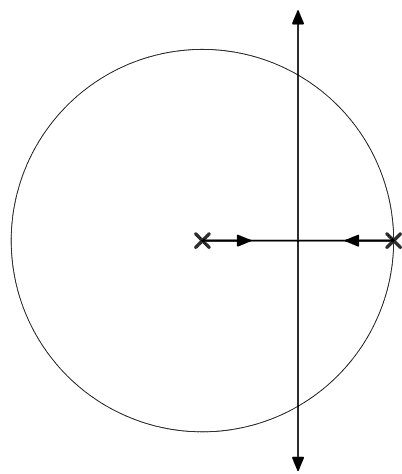

### 8.3 优化组合

我们希望使整个系统尽可能稳定，从而使最不稳定的极点尽可能靠近原点。一般组合的根轨迹有三个分支，每个极点对应一个分支，而比例控制的极限情况只有两个极点和两个分支。更糟糕的是，一般组合的根轨迹由两个参数生成 - 比例和导数部分的增益，而在极限情况下只由一个参数生成。一般分析似乎很困难。

令人惊讶的是，额外的参数使我们免于痛苦的数学计算。为了看清楚，我们来看看三次方程中的系数：

$$1 - \mathcal{R} + (\beta + \gamma)\mathcal{R}^2 - \gamma\mathcal{R}^3.$$

因式分解形式为

$$(1-p_1\mathcal{R})(1-p_2\mathcal{R})(1-p_3\mathcal{R}) = 1 - (p_1+p_2+p_3)\mathcal{R} + (p_1p_2+p_1p_3+p_2p_3)\mathcal{R}^2 - p_1p_2p_3\mathcal{R}^3$$

因此，第一个约束条件是

$$p_1 + p_2 + p_3 = 1,$$

表明极点的重心为 $1/3$。该条件与 $\beta$ 和 $\gamma$ 无关。因此，最稳定的系统在 $1/3$ 处有一个三重极点，如果这种排列是可能的。要看到为什么这种排列是最稳定的，想象从它开始。现在将一个极点向内移动沿着实数轴以增加其稳定性。为了保持不变量 $p_1 + p_2 + p_3 = 1$，至少有一个其他极点必须向外移动并变得不稳定。

因此，最好不要将任何极点移离三重集群，所以它是最稳定的排列。

> 练习 42。前面的论证在哪里要求重心与 $\beta$ 和 $\gamma$ 无关？

如果三极点排列不可能，那么前面的论证，假设其存在，就不成立。我们需要大量的工作来找到最佳的极点排列。

幸运的是，多亏了额外的参数 $\gamma$，三极点是可能的。有选择 $\beta$ 和 $\gamma$ 的自由，我们可以独立地设置 $\mathcal{R}^2$ 系数 $\beta + \gamma$，而 $\mathcal{R}^3$ 系数是 $-\gamma$。因此，使用 $\beta$ 和 $\gamma$ 作为独立的参数，我们可以制作任何以 $1/3$ 为中心的三次方程。

通过传播约束条件来设置这些参数。因此，导数控制器的增益为

$$\gamma = \frac{1}{27}.$$

最后的约束是 $p_1p_2 + p_1p_3 + p_2p_3 = 3/9 = 1/3$。所以 $\beta + \gamma = 1/3$。当 $\gamma = 1/27$ 时，这个方程要求比例控制器的增益为 $\beta = 8/27$。最佳控制器为

$$C(\mathcal{R}) = \frac{1}{27} + \frac{1}{27}(1 - \mathcal{R}) = \frac{1}{3} \sqrt{1 - \frac{\mathcal{R}}{9}}.$$

> 练习 43。正向路径的极点 - 零点图是什么 $C(\mathcal{R})M(\mathcal{R})?$

这个控制器在 $z = 1/9$ 处有一个零点。所以添加的零点将极点拉到了 $1/3$ 的理想位置。与纯比例控制相比，其中最差的极点无法靠近 $z = 1/2$，导数控制将极点全部拉到 $z = 1/3$。适量的导数控制有助于稳定系统。

### 8.4 处理惯性

上一个例子展示了如何使用导数控制并计算使用多少。然而，导数控制对于稳定反馈系统并不是必需的，因为比例控制单独就可以实现，并且可以将最不稳定的极点拖到 $z = 1/2$。但是当系统具有惯性时，导数控制变得必要。

没有惯性，电机积累角速度以产生角度，这由差分方程表示

$$y[n] = y[n-1] + x[n-1]$$

而系统的函数 $M(\mathcal{R}) = \mathcal{R}/(1-\mathcal{R})$。在第 7.4 节中的惯性模型为电机的差分方程添加了一个项：


其中 $m$ 是一个常数，介于 $0$（无惯性）和 $1$（最大惯性）之间。这个术语将电机系统的函数转变为


它分解为极点 $m$ 和 $1$：


第 7.4 节的分析使用了 $m=1/2$，然后要求你尝试 $m=4/5$。你应该发现当 $m$ 接近 $1$ 时，系统很难定位。图中显示了具有惯性 $m=4/5$ 并且仅使用比例控制的电机的根轨迹。最不稳定的极点可以通过适当的比例增益拖动到碰撞点 $z=0.9$。但是，极点不能进一步向内移动而不将其他极点向外移动。在 $z=0.9$ 处的极点意味着系统的响应包含收敛速度较慢的模态 $0.9^n$，它只能缓慢收敛到零。


> 暂停尝试 39。在大约经过多少个时间步骤之前，$0.9$ 的衰减大致减少了 $e$ 倍（通常用作接近零的度量）？

衰减 $0.9$ 大约需要 $10$ 个步骤才能减少到 $e$ 的 $1$ 倍。在数学中使用最好的近似：

$$0.9^{10} = (1 - 0.1)^{10} \approx e^{-0.1 \times 10} = e^{-1}.$$

因此，$30$ 个时间步骤使信号减少了 $e$ 的 $3$ 倍。在某些应用中，这个等待可能太长。

导数控制可以将极点拉向原点，从而加快收敛速度。让我们通过找到反馈系统的极点来分析使用多少导数控制。反馈系统是


系统函数的形式是


其中分母是


在乘积 $C(R)M(R)S(R)$ 中，唯一有分母的项是 $M(R)$。

为了清除 $D(R)$ 的分母，整个分母将乘以 $M(R)$ 的分母，即 $(1 - mR)(1 - R)$。因此，系统函数的分母最终将变为


在控制器之后，有两个 $R$ 的幂次，一个来自传感器，另一个来自电机函数 $M(R)$ 的分子。在展开乘积之后，分母是


该系统有三个参数：比例增益 $\beta$，微分增益 $\gamma$ 和惯性参数 $m$。在分析一个立方方程的极点之前，先检查方程是否合理！最快的检查方法是将参数取零时的极端情况。极限

当 $m\to0$ 消除惯性并应该重现前一节中的分母。在那个极限下，分母变为

$$1 - R + (\beta + \gamma)R^2 - \gamma R^3 \quad (m \to 0 \text{ 极限})$$

与第 8.2 节中的分母相匹配。很好！

添加极限 $\gamma\to0$ 后，导数控制被消除，这应该是只有比例控制的简单电机分析的复制在第 7.2 节中。添加极限 $\gamma\to0$ 后，分母变为

$$1 - R + \beta R^2 \quad (m \to 0, \gamma \to 0 \text{ 极限})$$

通过了测试。添加极限 $\beta\to0$ 后，剩余的反馈被消除，只留下裸露的电机函数 $M(R)$，确实在分母中有一个因子 $1-R$。因此，候选分母也通过了这第三个测试。

虽然通过三个测试不能保证正确性，但这些测试增加了我们对代数的信心，或许足够让我们分析三次方程，找到放置极点的位置和方式。为了方便起见，这里再次给出三次方程的表达式：

$$1 - (1+m)R + (m + \beta + \gamma)R^2 - \gamma R^3.$$

我们希望选择 $\beta$ 和 $\gamma$，使得最坏的极点-离原点最远的极点-尽可能接近原点。

也许我们可以尝试在分析中使用的相同技巧（方法？）：将所有三个极点放在同一位置。让我们假设这个解决方案是可能的，并再次传播约束条件。极点的和是 $1+m$，所以每个极点在 $p=(1+m)/3$。极点的乘积，$p^3$，是 $(1+m)^3/27$，这告诉我们 $(1+m)^3$

$$\gamma = \frac{(1+m)^3}{27}.$$

极点的两两乘积之和是 $3p^2$，因此是 $m + \beta + \gamma$。

由于 $3p^2$ 是 $(1+m)^2/3$，所以 $\beta$ 的方程是

$$(1+m)^2/3 = m + \beta + \gamma。$$

所以比例增益是：

$$\beta = \frac{(1+m)^2}{3} - m - \gamma = \frac{m^2 - m + 1}{3} - \frac{(1+m)^3}{27}.$$

总结一下，

$$\gamma = \frac{(1+m)^3}{27}$$

$$\beta = \frac{m^2 - m + 1}{3} - \frac{(1+m)^3}{27}.$$

一个有趣的特例是最大惯性，即 $m = 1$。然后 $\gamma = 8/27$，$\beta = 1/27$，所以控制器是

$$\frac{1}{27} + \frac{8}{27}(1 - \mathcal{R}) = \frac{1}{3} - \frac{8}{27}\mathcal{R}$$

$$= \frac{1}{3} \sqrt{1 - \frac{8}{9}\mathcal{R}}.$$

所以控制器在 $8/9$ 处有一个零点，接近于 $1$ 处的双极点。这个混合比例 - 导数控制器将所有极点移动到 $z=(1+m)/3 = 2/3$，这在单位圆内是相当不错的。所以这个混合控制器甚至可以稳定这个困难的情况。这种情况是最难控制的，因为电机和杆系统现在包含两个积分：一个是因为电机将电压转化为角速度而不是位置，另一个是因为惯性极点在 $1$ 处。这个系统具有与课堂上的一个例子相同的回路函数，即控制一辆汽车的方向盘，对于任何纯比例增益都是不稳定的。通过混合使用导数控制，所有极点都可以被放置在 $2/3$ 处，这意味着系统是稳定的并且能够相当快速地稳定下来。由于

$$\sqrt{2/3}^{\sqrt{2.5}} \approx e^{-1},$$

稳定的时间常数约为 $2.5$ 个时间步长，系统在三个时间常数或约 $7$ 个时间步长后达到稳定。

### 8.5 总结

要控制一个积分系统，可以尝试使用导数控制。要控制一个带有惯性的系统，也可以尝试使用导数控制。在任何情况下，不要使用纯导数控制，因为它太脆弱。相反，混合比例和导数控制以最大化稳定性，这通常意味着将所有极点放在一起。

## 参考文献

- [1] 时空物理学。W.H. Freeman and Co., 1992 年。
- [2] 中央情报局。世界概况。中央情报局，2007 年。https://www.cia.gov/library/publications/the-world-factbook/。
- [3] B.S. Bloom. The 2-sigma problem: The search for methods of group instruction as effective as one-to-one tutoring. Educational Researcher, 13(6): 4-16, 1984.
- [4] Jonathan Borwein and David Bailey. Mathematics by Experiment: Plausible Reasoning in the 21st century. AK Peters, 2003.
- [5] Richard A. Dunlap. 黄金比例和斐波那契数。世界科学出版社，1997 年。
- [6] Leah Edelstein-Keshet. 生物学数学模型。SIAM，费城，2005 年。
- [7] 阿尔伯特·爱因斯坦。关于运动物体的电动力学。物理年鉴，17:891-921,1905。
- [8] 大卫·爱泼斯坦和西尔维奥·莱维。数学实验和证明。美国数学学会通报，页码 670-674，1995 年 6 月/7 月。
- [9] 理查德·费曼和拉尔夫·莱顿 (贡献者)。你一定在开玩笑，费曼先生！一个好奇的人的冒险。W.W. Norton, 1985。
- [10] 斐波那契。算盘。，1202 年。
- [11] Hermann Minkowski, H.A. Lorentz, Albert Einstein and Hermann Weyl. 相对论原理：原始回忆录集。多佛出版社，1952 年。
- [12] Tom R. Halfhill. 一个错误的查找表导致了英特尔最新处理器的臭名昭著的错误。BYTE, 1995 年 3 月。
- [13] Jan Brett (插图作者)。金发姑娘和三只熊。多德出版社，1987 年。
- [14] David Bailey, Jonathan Borwein and Roland Girgensohn. 数学实验：发现的路径。AK Peters, 2004 年。
- [15] G.A. Miller. 神奇的数字七，加上或减去二：我们处理信息的一些限制。Psychological Review, 63:81-97, 1956 年。
- [16] P. Ribenboim. 新的素数记录书。Springer-Verlag，纽约，1996 年。
- [17] 威廉・麦克・西伯特。电路、信号与系统。麻省理工学院出版社，剑桥，马萨诸塞州，1986 年。
- [18] Tjalling J. Ypma. 牛顿 - 拉弗森方法的历史发展。SIAM 评论，37(4):531-551，1995 年。

## 索引

注：斜体页码指的是该页上的问题。

- **~** 24
- **RC 电路** 64
- **抽象** 40
- **整个信号** 33, 41
- **加速度** 71
- **累加器** 45
- **积极的** 82
- **类比** 45
- **分析**
  - **逐样本采样** 41
- **角速度** 84
- **近似**
  - **离散空间** 70
- **亚里士多德** x
- **人工智能** 85
- **关联数组**
  - **awk** 53
- **后向欧拉法** 76
- **比奈公式** 57
- **二项式定理** 47, 69
- **黑盒子** 51
- **块图**
  - **运算符表示法中的元素** 43
  - **算子** 45
  - **块图** 33
- **边界条件** 17
- **砖墙** 85
- **缓冲器** 64
- **微积分**
  - **有限差分** 18
- **变化**
  - **松散** 25
- **块** 41
- **清除分数** 86
- **闭式形式** 4, 29, 52
- **代码**
  - **Python** 29
- **复利**
  - **年度** 21
- **猜想** 67
- **连续性论证** 63, 67, 68
- **控制器** 83
- **控制变量** 83
- **卷积** 67
- **耦合振荡器** 71
- **勇气** 24
- **交叉乘法** 60
- **花括号** 42
- **危险** 85
- **数据**
  - **玩耍，玩** 67
- **变形系统** 68
- **延迟元件** 42
- **树突** 70
- **导数** 72
  - **连续时间** 72
  - **导数控制** 96
- **荒岛** 53
- **设计** 19
- **字典**
  - **Python** 53
- **差分方程** 17
- **微分器**
  - **连续时间** 38
  - **离散时间** 38, 46
- **维度** 22
- **离散化** 65
- **区别**
  - **有限或无限** 21
- **除法**
  - **不正确的浮点数** 52
- **捐赠者** 21
- **双根** 64
- **下降** 21
- **爱因斯坦，阿尔伯特** 40
- **优雅** 19
- **捐赠** 21
- **工程设计** 83
- **方程**
  - **一阶差分** 23
  - **二阶差分** 4, 28
- **方程卫生** 64
- **等价**
  - **系统** 59
- **误差信号** 84, 85
- **实验** 30
- **实验数学** 52
- **显式配方** 72
- **指数表示法** 43
- **极端情况**
  - **大 n** 69
  - **小 n** 69
- **增益** 86
- **反馈** 83
- **反馈控制** 85
- **前馈** 45, 83
- **费曼，理查德** 21
- **斐波那契函数**
  - **记忆化** 53
- **斐波那契序列**
  - **分解** 51
- **强制函数** 74
- **向前欧拉逼近** 84
- **向前欧拉** 64, 72
- **函数**
  - **递减** 69
  - **递增** 69
- **基金** 21
- **增益**
  - **增加** 86
- **黄金比例** 54
- **语法** 40
- **块图** 44
- **图形计算器** 53
- **增长**
  - **指数** 5, 24, 29
  - **对数** 5, 29
  - **多项式** 5, 29
  - **速率** 18
- **猜测**
  - **差分方程的解** 24
- **猜测和检查** 60
- **猜测** 70
- **哈希**
  - **Perl** 53
- **隐式欧拉** 76
- **隐式公式** 76
- **脉冲** 28
- **输入信号**
  - **任意** 23
- **洞察力** 33
- **不稳定性** 86
- **直觉** 21
- **逆符号计算器** 54
- **语言** 40
- **漏桶** 64
- **跳跃** 79
- **左移操作符** 42
- **字母**
  - **大写** 23
  - **小写** 23
- **相似项** 64
- **线性组合** 72
- **线性方程** 60
- **回路增益** 96
- **数学定义** 71
- **数学翻译**
  - **不完整** 25
- **矩阵求逆** 76
- **最大值** 21
- **无意义的对象** 52
- **思维**
  - **惊人的壮举** 40
- **明科夫斯基，赫尔曼** 40
- **麻省理工学院** 21
- **模式** 51
- **振幅** 55
- **形状** 55
- **模型**
  - **人口增长** 19
  - **模式** 63
  - **模块化公式** 19
  - **模块化** 17, 23
  - **多重表示** 33
  - **虚构控制器** 85
- **负贡献** 24
- **负延迟** 84
- **符号**
  - **整个信号** 23
  - **一个样本** 23
- **数论** 52
- **算子符号** 42
- **算子表示** 42
- **算子** 33, 57
- **振荡** 30
- **输出信号** 22
- **参数敏感性** 85
- **部分分式** 59, 68
- **派对**
  - **毕业** 25
- **被动** 82
- **模式** 67
- **剥离** 55
- **哲学** 18
- **物理意义** 71
- **极点**
  - **最远** 87
  - **极点** 74
  - **复杂** 71
- **人口**
  - **增长** 17
  - **美国** 18
- **探针** 52
- **探针**
  - **计算** 51
- **乘积**
  - **随着减小函数的增加** 69
- **编程**
  - **面向对象** 20
- **比例控制** 86
- **Python** 53
- **二次公式** 75
- **兔子** 25
- **系统** 26
- **比率**
  - **无量纲** 64
- **递推关系** 18
- **相对论**
  - **特殊** 40
- **重复根** 63
- **表示** 22
  - **数学** 17, 22
  - **算子** 34
- **残差信号** 56
- **右移算子** 42
- **机器人** 85
- **传感器**
  - **实际** 85
- **移位**
  - **左** 76
- **信号与系统** 20, 26
  - **模拟** 20, 65, 66
  - **模拟数据** 67
- **正弦波** 71
- **空间** 40
- **时空** 40
- **螺旋** 73
- **电子表格** 53
- **弹簧**
  - **理想** 71
- **稳定性** 86
- **阶跃函数** 46, 47
- **连续比率** 52
- **对称性** 76
- **合成除法** 47
- **系统**
  - **耦合** 74
  - **一阶** 23
  - **二阶** 28
- **系统特征化** 52
- **系统功能** 44
  - **带反馈** 45
- **取出大部分** 67
- **泰勒级数** 47
- **茶** 84
- **技术**
  - **取出大部分** 55
- **时间** 40
- **时间常数** 8, 64
- **时间机器** 86
- **时间旅行** 84
- **翻译**
  - **导数** 72
- **梯形** 79
- **教程教学** x
- **孪生素数猜想** 52
- **单位圆** 71, 87
- **单位样本** 28
- **未知数**
  - **两个** 24
- **变量**
  - **消除** 27
- **电压** 84
- **体积元素** 20
- **热身** 22
- **Wheeler, John** 21

## 麻省理工学院开放式课程