# MIT 6.004 计算机程序设计原理第二部分

Jerome H. Saltzer M. Frans Kaashoek

麻省理工学院

版本5.0

版权所有© 2009 Jerome H. Saltzer 和 M. Frans Kaashoek。保留部分权利。

本作品采用知识共享署名-非商业性使用-相同方式共享3.0美国许可协议进行许可。有关此许可协议的更多信息，请访问 http://creativecommons.org/licenses/by-nc-sa/3.0/us/ 许可证意味着，请访问 Creative Commons 署名-非商业性使用-相同方式共享3.0美国许可协议。

公司用于区分其产品的名称通常被视为商标或注册商标。在作者们知晓有权利要求的所有情况下，产品名称以首字母大写或全大写形式出现。所有出现或在本作品中提及的商标均属于其各自所有者。

## 建议、评论、更正和请求豁免许可限制:

请通过电子邮件发送信件至：

Saltzer@mit.edu

和

kaashoek@mit.edu

## 目录

# 第一部分 [在印刷教材中]

侧边栏列表. . . . . . . . . . . . . . . . . . . . . . . . . . . . . . . . . . . . . . . . . . . . .xix

前言. . . . . . . . . . . . . . . . . . . . . . . . . . . . . . . . . . . . . . . . . . . .xxvii

在哪里找到第二部分和其他在线材料. . . . . . . . . . . . . . . . . . . . . . .xxxvii

致谢. . . . . . . . . . . . . . . . . . . . . . . . . . . . . . . . . . . . . . . . . . .xxxix

计算机系统设计原理. . . . . . . . . . . . . . . . . . . . . . . . . . . . . . . .xliii

## 第1章 系统. . . . . . . . . . . . . . . . . . . . . . . . . . . . . . . . . . . . . . . . . . . . . .1

## 概述. . . . . . . . . . . . . . . . . . . . . . . . . . . . . . . . . . . . . . . . . . . . . . . . . . . . . .2

## 1.1. 系统和复杂性. . . . . . . . . . . . . . . . . . . . . . . . . . . . . . . . . . . . . . . . . . .3

- 1.1.1 许多领域中的常见问题. . . . . . . . . . . . . . . . . . . . . . . . . . . . . . . . . .3

- 1.1.2 系统、组件、接口和环境. . . . . . . . . . . . . . . . . . . . . . . . . . . . . . . . .8

- 1.1.3 复杂性. . . . . . . . . . . . . . . . . . . . . . . . . . . . . . . . . . . . . . . . . . . .10

## 1.2. 复杂性的来源. . . . . . . . . . . . . . . . . . . . . . . . . . . . . . . . . . . . . . . . . . .13

- 1.2.1 级联和相互作用的要求. . . . . . . . . . . . . . . . . . . . . . . . . . . . . . . . . .13

- 1.2.2 保持高利用率. . . . . . . . . . . . . . . . . . . . . . . . . . . . . . . . . . . . . . . . .17

## 1.3. 应对复杂性 I. . . . . . . . . . . . . . . . . . . . . . . . . . . . . . . . . . . . . . . . . . . .19

- 1.3.1 模块化. . . . . . . . . . . . . . . . . . . . . . . . . . . . . . . . . . . . . . . . . . . . . .19

- 1.3.2 抽象. . . . . . . . . . . . . . . . . . . . . . . . . . . . . . . . . . . . . . . . . . . . . . .20

- 1.3.3 分层. . . . . . . . . . . . . . . . . . . . . . . . . . . . . . . . . . . . . . . . . . . . . . .24

- 1.3.4 层次结构. . . . . . . . . . . . . . . . . . . . . . . . . . . . . . . . . . . . . . . . . . . .25

- 1.3.5 将其重新组合：名称建立连接. . . . . . . . . . . . . . . . . . . . . . . . . . . . . .26

## 1.4. 计算机系统相同但不同. . . . . . . . . . . . . . . . . . . . . . . . . . . . . . . . . . . .27

- 1.4.1 计算机系统在组合上没有附近的界限. . . . . . . . . . . . . . . . . . . . . . . . .28

- 1.4.2 d(技术)/dt 是前所未有的. . . . . . . . . . . . . . . . . . . . . . . . . . . . . . . . .31

## 1.5. 应对复杂性 II. . . . . . . . . . . . . . . . . . . . . . . . . . . . . . . . . . . . . . . . . . .35

- 1.5.1 为什么模块化、抽象、分层和层次不是足够. . . . . . . . . . . . . . . . . . . . .36

- 1.5.2 迭代. . . . . . . . . . . . . . . . . . . . . . . . . . . . . . . . . . . . . . . . . . . . . . .36

- 1.5.3 保持简单. . . . . . . . . . . . . . . . . . . . . . . . . . . . . . . . . . . . . . . . . . . .39

## 本书的其余部分内容. . . . . . . . . . . . . . . . . . . . . . . . . . . . . . . . . . . . . . . . . .40

- 练习. . . . . . . . . . . . . . . . . . . . . . . . . . . . . . . . . . . . . . . . . . . . . . . . . . . . .41

## 第2章 计算机系统组织的要素 . . . . . . . . . . . . . . . . . . . . . . . . . . . . . . . . . . . .43

## 概述 . . . . . . . . . . . . . . . . . . . . . . . . . . . . . . . . . . . . . . . . . . . . . . . . . . . . .44

## 2.1. 三个基本抽象. . . . . . . . . . . . . . . . . . . . . . . . . . . . . . . . . . . . . . . . . . .45

- 2.1.1 内存 . . . . . . . . . . . . . . . . . . . . . . . . . . . . . . . . . . . . . . . . . . . . . . .45

- 2.1.2 解释器 . . . . . . . . . . . . . . . . . . . . . . . . . . . . . . . . . . . . . . . . . . . . .53

- 2.1.3 通信链接 . . . . . . . . . . . . . . . . . . . . . . . . . . . . . . . . . . . . . . . . . . .59

## 2.2. 计算机系统中的命名. . . . . . . . . . . . . . . . . . . . . . . . . . . . . . . . . . . . . .60

- 2.2.1 命名模型. . . . . . . . . . . . . . . . . . . . . . . . . . . . . . . . . . . . . . . . . . . .61

- 2.2.2 默认和显式上下文引用. . . . . . . . . . . . . . . . . . . . . . . . . . . . . . . . . . .66

- 2.2.3 路径名、命名网络和递归名称解析. . . . . . . . . . . . . . . . . . . . . . . . . . . .71

- 2.2.4 多重查找: 在分层上下文中搜索. . . . . . . . . . . . . . . . . . . . . . . . . . . . .73

- 2.2.5 比较名称 . . . . . . . . . . . . . . . . . . . . . . . . . . . . . . . . . . . . . . . . . . .75

- 2.2.6 名称发现 . . . . . . . . . . . . . . . . . . . . . . . . . . . . . . . . . . . . . . . . . . . .76

## 2.3. 使用名称和层次组织计算机系统. . . . . . . . . . . . . . . . . . . . . . . . . . . . . . .78

- 2.3.1 硬件层: 总线. . . . . . . . . . . . . . . . . . . . . . . . . . . . . . . . . . . . . . . . .80

- 2.3.2 软件层: 文件抽象 . . . . . . . . . . . . . . . . . . . . . . . . . . . . . . . . . . . . .87

## 2.4. 回顾和展望. . . . . . . . . . . . . . . . . . . . . . . . . . . . . . . . . . . . . . . . . . . .90

## 2.5. 案例研究: UNIX®文件系统分层和命名. . . . . . . . . . . . . . . . . . . . . . . . . .91

- 2.5.1 命名远程文件和目录. . . . . . . . . . . . . . . . . . . . . . . . . . . . . . . . . . . .185

- 2.5.2 NFS远程过程调用. . . . . . . . . . . . . . . . . . . . . . . . . . . . . . . . . . . . . . .187

- 2.5.3 扩展 UNIX 文件系统以支持NFS. . . . . . . . . . . . . . . . . . . . . . . . . . . . .190

- 2.5.4 一致性. . . . . . . . . . . . . . . . . . . . . . . . . . . . . . . . . . . . . . . . . . . . .192

- 2.5.5 NFS 第3版及以后版本 . . . . . . . . . . . . . . . . . . . . . . . . . . . . . . . . . .194

- 练习. . . . . . . . . . . . . . . . . . . . . . . . . . . . . . . . . . . . . . . . . . . . . . . . . . .195

## 第3章 命名方案的设计 . . . . . . . . . . . . . . . . . . . . . . . . . . . . . . . . . . . . . .115

## 概述 . . . . . . . . . . . . . . . . . . . . . . . . . . . . . . . . . . . . . . . . . . . . . . . . . . .115

## 3.1. 命名方案设计中的考虑因素. . . . . . . . . . . . . . . . . . . . . . . . . . . . . . . .116

- 3.1.1 模块化共享. . . . . . . . . . . . . . . . . . . . . . . . . . . . . . . . . . . . . . . . . .116

- 3.1.2 元数据和名称重载 120

- 3.1.3 地址：定位对象的名称 122

- 3.1.4 生成唯一名称 124

- 3.1.5 预期受众和用户友好的名称 127

- 3.1.6 名称、值和绑定的相对生命周期 129

- 3.1.7 回顾和展望：名称是基本系统组件。 131

## 3.2. 案例研究：统一资源定位符（URL） 132

- 3.2.1 冲浪作为参考体验；名称发现 132

- 3.2.2 URL的解释 133

- 3.2.3 URL的大小写敏感性 134

- 3.2.4 部分URL的错误上下文引用 135

- 3.2.5 URL中名称的重载 137

## 3.3. 战争故事：名称使用中的病态现象 138

- 3.3.1 名称冲突消除了微笑的面孔 139

- 3.3.2 重载导致的脆弱名称，以及市场解决方案 139

- 3.3.3 更多重载导致的脆弱名称，带来市场混乱。 140

- 3.3.4 用户友好名称的大小写敏感性 141

- 3.3.5 电话号码用尽 142

- 练习 144

## 第4章 通过客户端和服务强制实现模块化 147

## 概述 148

## 4.1. 客户端/服务组织 149

- 4.1.1 从软模块化到强制模块化 149

- 4.1.2 客户端/服务组织 155

- 4.1.3 多个客户端和服务 163

- 4.1.4 受信任的中介 163

- 4.1.5 一个简单的示例服务 165

## 4.2. 客户端和服务之间的通信 167

- 4.2.1 远程过程调用（RPC） 167

- 4.2.2 RPC与过程调用不完全相同 169

- 4.2.3 通过中介进行通信 172

## 4.3. 总结和未来的道路 173

## 4.4. 案例研究：互联网域名系统（DNS） 175

- 4.4.1 DNS中的名称解析 176

- 4.4.2 分层名称管理 180

- 4.4.3 DNS的其他特性 181

- 4.4.4 DNS中的名称发现 183

- 4.4.5 DNS响应的可信度 184

## 4.5. 案例研究: 网络文件系统 (NFS) 184

- 4.5.1 命名远程文件和目录 185

- 4.5.2 NFS远程过程调用 187

- 4.5.3 扩展 UNIX 文件系统以支持NFS 190

- 4.5.4 一致性 192

- 4.5.5 NFS 第3版及以后版本 194

- 练习 195

## 第5章 通过虚拟化实现模块化 199

## 概述 200

## 5.1. 在计算机中使用虚拟化的客户端/服务组织 201

- 5.1.1 使用域强制实现模块化 230

- 5.1.2 使用多个域进行受控共享 231

- 5.1.3 使用内核和用户模式进行更多强制模块化 234

- 5.1.4 门和模式更改 235

- 5.1.5 对有界缓冲区进行模块化强制 237

## 第6章 性能........................................................................299

## 5.3.6 内核..................................................................................238
5.4. 虚拟化内存......................................................................242
5.4.1 虚拟化地址....................................................................243
5.4.2 使用页面映射翻译地址....................................................245
5.4.3 虚拟地址空间...............................................................248
5.4.3.1 虚拟地址空间的基本操作..............................................248
5.4.3.2 内核和地址空间..........................................................250
5.4.3.3 讨论..................................................................251
5.4.4 硬件与软件以及转换后备缓冲区..........................................252
5.4.5 段（高级主题）............................................................253
5.5. 使用线程进行处理器虚拟化...................................................255
5.5.1 在多个线程之间共享处理器..................................................255
5.5.2 实现YIELD.................................................................260
5.5.3 创建和终止线程............................................................264
5.5.4 使用线程实现模块化: 抢占式调度......................................269
5.5.5 使用线程和地址空间实现模块化..........................................271
5.5.6 线程分层..................................................................271
5.6. 用于序列协调的线程基元.......................................................273
5.6.1 丢失通知问题..............................................................273
5.6.2 使用事件计数和避免丢失通知问题
顺序器......................................................................275
5.6.3 实现等待,前进,票,读取(高级主题).......................................280
5.6.4 轮询、中断和序列协调....................................................282
5.7. 案例研究: Intel x86 中强制模块化的演变....................................284
5.7.1 早期设计: 不支持强制模块化..............................................285
5.7.2 使用分段强制模块化......................................................286
5.7.3 基于页面的虚拟地址空间..................................................287
5.7.4 总结: 更多的演变..........................................................288
5.8. 应用: 使用虚拟机强制模块化...................................................290
5.8.1 虚拟机的用途................................................................290
5.8.2 实现虚拟机..................................................................291
5.8.3 虚拟化示例.................................................................293

## 第 viii 页目录

- 6.1. 设计性能.................................................................... 300
- 6.1.1 性能指标.................................................................... 302
- 6.1.1.1 容量、利用率、开销和有效工作................ 302
- 6.1.1.2 延迟.................................................................... 302
- 6.1.1.3 吞吐量.................................................................... 303
- 6.1.2 以系统方法设计性能.................................................... 304
- 6.1.3 利用工作负载特性降低延迟............................................ 306
- 6.1.4 利用并发降低延迟........................................................ 307
- 6.1.5 提高吞吐量: 并发........................................................ 309
- 6.1.6 排队和过载................................................................ 311
- 6.1.7 解决瓶颈问题............................................................ 313
- 6.1.7.1 批处理............................................................ 314
- 6.1.7.2 拖延.................................................................... 314
- 6.1.7.3 推测.................................................................... 314
- 6.1.7.4 批处理、拖延和推测的挑战.................................... 315
- 6.1.8 一个示例: I/O 瓶颈.................................................... 316
- 6.2. 多级存储器.................................................................... 321
- 6.2.1 存储器特性............................................................ 322
- 6.2.2 使用虚拟内存的多级内存管理.................................... 323
- 6.2.3 将多级内存管理添加到虚拟内存中............................ 327
- 6.2.4 分析多级内存系统.................................................... 331
- 6.2.5 引用局部性和工作集.................................................... 333
- 6.2.6 多级内存管理策略.................................................... 335
- 6.2.7 不同策略的比较分析.................................................... 340
- 6.2.8 其他页面替换算法.................................................... 344
- 6.2.9 多级内存管理的其他方面............................................ 346
- 6.3. 调度.................................................................... 347
- 6.3.1 调度资源.................................................................... 348
- 6.3.2 调度指标.................................................................... 349
- 6.3.3 调度策略.................................................................... 352
- 6.3.3.1 先来先服务............................................................ 353
- 6.3.3.2 最短作业优先............................................................ 354
- 6.3.3.3 轮转调度.................................................................... 355
- 6.3.3.4 优先级调度.................................................................... 357

## 6.3.4 案例研究: 调度磁盘臂.................................................................... 360

练习....................................................................................362

## 关于第二部分

进一步阅读建议....................................................................................375

## 第一部分的问题集....................................................425

## 词汇表....................................................475

## 概念索引....................................................513

# 第二部分 [在线]

## 第7章 网络作为系统和系统组件....................................................7-1

概述....................................................................................7-2

## 7.1. 网络的有趣特性

### 7.1.1 等时和异步复用
数据包转发; 延迟....................................................................7-9

### 7.1.2 缓冲区溢出和丢弃数据包
重新排序的传递....................................................................7-19

### 7.1.3 损坏的数据包和断开的连接
有趣特性总结和尽力而为的合同....................................................................7-20

## 7.2. 组织: 层次
### 7.2.1 层次
### 7.2.2 链路层
### 7.2.3 网络层
### 7.2.4 端到端层
### 7.2.5 附加层和端到端论证

## 7.3. 链路层
### 7.3.1 在模拟世界中传输数字数据
### 7.3.2 帧的构建
### 7.3.3 错误处理
## 7.3.4 链路层接口: 链路协议和复用
### 7.3.5 链路属性

## 目录

+ 7.4. 网络层....................................................................................... 7-46
7.4.1 寻址接口................................................................................... 7-46
7.4.2 管理转发表:路由........................................................................... 7-48
7.4.3 分层地址分配和分层路由..................................................................... 7-56
7.4.4 报告网络层错误............................................................................. 7-59
7.4.5 网络地址转换(一个几乎可行的想法)............................................................. 7-61

+ 7.5. 端到端层..................................................................................... 7-62
7.5.1 传输协议和协议复用......................................................................... 7-63
7.5.2 至少一次交付的保证;定时器的作用............................................................. 7-67
7.5.3 至多一次交付的保证:重复抑制................................................................ 7-71
7.5.4 长消息的分段和重组......................................................................... 7-73
7.5.5 数据完整性的保证........................................................................... 7-73
7.5.6 端到端性能:重叠和流量控制.................................................................. 7-75
7.5.6.1 重叠传输................................................................................. 7-75
7.5.6.2 瓶颈、流量控制和固定窗口.................................................................. 7-77
7.5.6.3 滑动窗口和自适应速率...................................................................... 7-79
7.5.6.4 丢失数据段的恢复与窗口.................................................................... 7-81
7.5.7 流顺序的保证和连接的关闭................................................................... 7-82
7.5.8 抖动控制的保证............................................................................. 7-84
7.5.9 真实性和隐私的保证......................................................................... 7-85

+ 7.6. 网络系统设计问题:拥塞控制.................................................................... 7-86
7.6.1 共享资源的管理............................................................................. 7-86
7.6.2 网络中的资源管理........................................................................... 7-89
7.6.3 跨层协作:反馈.............................................................................. 7-91
7.6.4 跨层协作:控制.............................................................................. 7-93
7.6.5 网络中其他控制拥塞的方法................................................................... 7-94
7.6.6 延迟再探讨................................................................................. 7-98

+ 7.7. 网络总结..................................................................................... 7-99

+ 7.8. 案例研究:将互联网映射到以太网................................................................. 7-100
7.8.1 以太网简介................................................................................. 7-100
7.8.2 以太网的广播特性........................................................................... 7-101
7.8.3 层映射: 将以太网连接到转发网络 7-103
7.8.4 地址解析协议............................................................................... 7-105

+ 7.9. 协议设计中的意外故事.......................................................................... 7-107
7.9.1 固定定时器导致NFS拥塞崩溃................................................................ 7-107
7.9.2 Autonet广播风暴............................................................................ 7-108
7.9.3 周期性协议的紧急相位同步................................................................... 7-108
7.9.4 威斯康星时间服务器崩溃 7-109

练习 7-111

## 第8章 容错性：从不可靠组件构建可靠系统 8-1

概述 8-2

## 8.1. 故障、失效和容错设计 8-3

8.1.1 故障、失效和模块 8-3

8.1.2 容错设计过程 8-6

## 8.2. 可靠性和故障容忍度的度量 8-8

8.2.1 可用性和平均故障时间 8-8

8.2.2 可靠性函数 8-13

8.2.3 测量容错性 8-16

## 8.3. 容忍主动故障 8-16

8.3.1 响应主动故障 8-16

8.3.2 容错模型 8-18

## 8.4. 系统化应用冗余 8-20

8.4.1 编码：增量冗余 8-21

8.4.2 复制：大规模冗余 8-25

8.4.3 投票 8-26

8.4.4 修复 8-31

## 8.5. 将冗余应用于软件和数据 8-36

8.5.1 容忍软件故障 8-36

8.5.2 通过分离状态容忍软件（和其他）故障 8-37

8.5.3 持久性和持久存储 8-39

8.5.4 磁盘容错性 8-40

8.5.4.1 磁盘故障模式 8-41

8.5.4.2 系统故障 8-42

8.5.4.3 原始磁盘存储 8-43

8.5.4.4 快速失败磁盘存储 8-43

8.5.4.5 谨慎的磁盘存储 8-45

8.5.4.6 可持久化存储：RAID 1 8-46

8.5.4.7 对RAID 1的改进 8-47

8.5.4.8 检测系统崩溃引起的错误 8-49

8.5.4.9 对持久性的更多威胁 8-49

## 第12页目录

+ 8.6. 结束可靠性 8-51
8.6.1 设计策略和设计原则 8-51
8.6.2 关于端到端论证如何? 8-52
8.6.3 对可靠性计算的警告 8-53
8.6.4 如何了解更多关于可靠系统的信息 8-53

+ 8.7. 应用: CMOS RAM的容错模型 8-55

+ 8.8. 战争故事: 失败的容错系统 8-57
8.8.1 错误修正的冒险 8-57
8.8.2 很少使用的过程的风险: 国家档案馆 8-59
8.8.3 非独立副本和挖掘机衰退 8-60
8.8.4 人为错误可能是最大的风险 8-61
8.8.5 引入单点故障 8-63
8.8.6 多重故障: SOHO任务中断 8-63
练习 8-64

## 第9章 原子性: 全有或全无和先后顺序 9-1

+ 概述 9-2

+ 9.1. 原子性 9-4
9.1.1 数据库中的全有或全无原子性 9-5
9.1.2 中断接口中的全有或全无原子性 9-6
9.1.3 分层应用中的全有或全无原子性 9-8
9.1.4 具有和不具有全有或全无属性的一些操作 9-10
9.1.5 先后顺序原子性: 协调并发线程 9-13
9.1.6 正确性和序列化 9-16
9.1.7 全部或无和之前或之后的原子性 9-19

+ 9.2. 全部或无原子性I: 概念 9-21
9.2.1 实现全部或无原子性: 全部或无放置 9-21
9.2.2 系统化原子性: 提交和黄金法则 9-27
9.2.3 系统化全部或无原子性: 版本历史 9-30
9.2.4 版本历史的使用方式 9-37

+ 9.3. 全部或无原子性II: 实用主义 9-38
9.3.1 原子性日志 9-39
9.3.2 日志协议 9-42
9.3.3 恢复过程 9-45
9.3.4 其他日志配置: 非易失性存储单元 9-47
9.3.5 检查点 9-51
9.3.6 如果缓存不是写透的会怎样?(高级主题) 9-53

## 9.4. 前后原子性I：概念 9-54

+ 9.4.1 实现前后原子性：简单序列化 9-54

+ 9.4.2 标记点规则 9-58

+ 9.4.3 乐观原子性：读取捕获（高级主题） 9-63

+ 9.4.4 有人实际上使用版本历史来实现前后原子性吗?

+ 9.5. 前后原子性II：实用主义 9-67

## 9.5.1 锁 9-69

+ 9.5.2 简单锁定 9-70

+ 9.5.3 两阶段锁定 9-72

+ 9.5.4 性能优化 9-73

+ 9.5.5 死锁；取得进展 9-75

+ 9.5.6 死锁；取得进展 9-76

## 9.6. 跨层和多站点的原子性 9-79

+ 9.6.1 事务的分层组合 9-80

+ 9.6.2 两阶段提交 9-84

+ 9.6.3 多站点的原子性：分布式两阶段提交 9-85

+ 9.6.4 两位将军的困境 9-90

## 9.7. 磁盘故障的更完整模型（高级主题） 9-92

+ 9.7.1 既是全有或全无又是持久的存储 9-92

## 9.8. 案例研究：机器语言的原子性 9-95

+ 9.8.1 复杂指令集：通用电气600系列 9-95

+ 9.8.2 更复杂的指令集：IBM System/370 9-96

+ 9.8.3 Apollo台式计算机和Motorola M68000 微处理器 9-97

+ 练习 9-98

## 第10章 一致性 10-1

+ 概述 10-2

## 10.1. 约束和接口一致性 10-2

## 10.2. 缓存一致性 10-4

+ 10.2.1 缓存中的一致性、复制和一致性 10-4

+ 10.2.2 定时器过期的最终一致性 10-5

+ 10.2.3 使用荧光标记笔获得严格一致性 10-7

+ 10.2.4 使用Snoopy缓存获得严格一致性 10-7

## 10.3. 持久化存储再探：广泛分离的副本 10-9

+ 10.3.1 持久化存储和持久性口号 10-9

+ 10.3.2 复制状态机 10-11

## 10.3.3 满足更加适度需求的快捷方式 ........................ 10-13

## 10.3.4 维护数据完整性 ........................ 10-15

## 10.3.5 副本读取和多数派 ........................ 10-16

## 10.3.6 备份 ........................ 10-17

## 10.3.7 数据分区 ........................ 10-18

## 10.4. 协调 ........................ 10-19

- 10.4.1 偶尔连接操作 ........................ 10-20

- 10.4.2 一个协调过程 ........................ 10-22

- 10.4.3 改进 ........................ 10-25

- 10.4.4 时钟协调 ........................ 10-26

## 10.5. 视角 ........................ 10-26

- 10.5.1 历史 ........................ 10-27

- 10.5.2 折衷 ........................ 10-28

- 10.5.3 进一步研究的方向 ........................ 10-31

## 练习 ........................ 10-32

## 第11章 信息安全 ........................ 11-1

## 概述 ........................ 11-4

## 11.1. 安全系统简介 ........................ 11-5

- 11.1.1 威胁分类 ........................ 11-7

- 11.1.2 安全是一个负面目标 ........................ 11-9

- 11.1.3 安全网方法 ........................ 11-10

- 11.1.4 设计原则 ........................ 11-13

- 11.1.5 技术的高dT/dt对安全性提出挑战 ........................ 11-17

- 11.1.6 安全模型 ........................ 11-18

- 11.1.7 可信计算基础 ........................ 11-26

- 11.1.8 本章的路线图 ........................ 11-28

## 11.2. 验证主体 ........................ 11-28

- 11.2.1 将信任与验证主体分离 ........................ 11-29

- 11.2.2 验证主体 ........................ 11-30

- 11.2.3 密码哈希函数，计算安全，窗口为有效性 ........................ 11-32

- 11.2.4 使用密码哈希函数保护密码 ........................ 11-34

## 11.3. 验证消息 ........................ 11-36

- 11.3.1 消息认证与机密性不同 ........................ 11-37

- 11.3.2 封闭设计与开放设计以及密码学 ........................ 11-38

- 11.3.3 基于密钥的认证模型 ........................ 11-41

- 11.3.4 SIGN 和 VERIFY 的属性 ........................ 11-41

- 11.3.5 公钥与共享密钥认证 ........................ 11-44

- 11.3.6 密钥分发 ........................ 11-45

- 11.3.7 长期数据完整性与证人 ........................ 11-48

## 11.4. 消息机密性 ........................ 11-49

- 11.4.1 使用加密实现消息机密性 ........................ 11-49

- 11.4.2 ENCRYPT 和 DECRYPT 的属性 ........................ 11-50

- 11.4.3 实现机密性和认证的方法 ........................ 11-52

- 11.4.4 加密能用于身份验证吗？ ........................ 11-53

## 11.5. 安全协议 ........................ 11-54

- 11.5.1 示例：密钥分发 ........................ 11-54

- 11.5.2 设计安全协议 ........................ 11-60

- 11.5.3 身份验证协议 ........................ 11-63

- 11.5.4 一个错误的密钥交换协议 ........................ 11-66

- 11.5.5 Diffie-Hellman密钥交换协议 ........................ 11-68

- 11.5.6 使用公钥系统的密钥交换协议 ........................ 11-69

- 11.5.7 摘要 ........................ 11-71

## 11.6. 授权：受控共享 ........................ 11-72

- 11.6.1 授权操作 ........................ 11-73

- 11.6.2 简单的保护模型 ........................ 11-73

- 11.6.2.1 票证系统 ........................ 11-74

- 11.6.2.2 列表系统 ........................ 11-74

- 11.6.2.3 票证与列表，以及机构 ........................ 11-75

- 11.6.2.4 保护组 ........................ 11-76

- 11.6.3 示例： UNIX中的访问控制 ........................ 11-76

- 11.6.3.1 UNIX中的主体 ........................ 11-76

- 11.6.3.2 UNIX中的ACL ........................ 11-77

- 11.6.3.3 进程的默认主体和权限 ........................ 11-78

- 11.6.3.4 用户认证 ........................ 11-79

- 11.6.3.5 访问控制检查 ........................ 11-79

- 11.6.3.6 运行服务 ........................ 11-80

- 11.6.3.7 UNIX访问控制总结 ........................ 11-80

- 11.6.4 管理员模型 ........................ 11-80

- 11.6.5 非自主访问和信息流控制 ........................ 11-81

- 11.6.5.1 信息流控制示例 ........................ 11-83

- 11.6.5.2 隐蔽通道 ........................ 11-84

## 11.7. 高级主题: 关于认证的推理 ........................ 11-85

- 11.7.1 认证逻辑 ........................ 11-86

- 11.7.1.1 硬连线方法 ........................ 11-88

- 11.7.1.2 互联网方法 ........................ 11-88

- 11.7.2 分布式系统中的身份验证 ........................ 11-89

- 11.7.3 跨管理域的身份验证 ........................ 11-90

- 11.7.4 验证公钥 ........................ 11-92

- 11.7.5 验证证书 ........................ 11-94

- 11.7.6 证书链 ........................ 11-97

- 11.7.6.1 中央证书机构的层次结构 ........................ 11-97

- 11.7.6.2 信任网络 ........................ 11-98

## 11.8. 密码学作为构建模块(高级主题) ........................ 11-99

- 11.8.1 无法破解的密码(一次性密码本) ........................ 11-99

- 11.8.2 伪随机数生成器 ........................ 11-101

- 11.8.2.1 Rc4: 伪随机生成器及其使用 ........................ 11-101

- 11.8.2.2 使用RC4的机密性 ........................ 11-102

- 11.8.3 块密码 ........................ 11-103

- 11.8.3.1 高级加密标准(AES) ........................ 11-103

- 11.8.3.2 密码块链 ........................ 11-105

- 11.8.4 计算消息认证码 ........................ 11-106

- 11.8.4.1 使用块密码或流密码的MACs ........................ 11-107

- 11.8.4.2 使用密码哈希函数的MACs ........................ 11-107

- 11.8.5 公钥密码 ........................ 11-109

- 11.8.5.1 Rivest-Shamir-Adleman (RSA)密码 ........................ 11-109

- 11.8.5.2 计算数字签名 ........................ 11-111

- 11.8.5.3 公钥加密系统 ........................ 11-112

## 11.9. 总结 ........................ 11-112

## 11.10. 案例研究: Web的传输层安全性(TLS) ........................ 11-116

- 11.10.1 TLS握手 ........................ 11-117

- 11.10.2 TLS的演变 ........................ 11-120

- 11.10.3 使用TLS进行服务认证 ........................ 11-121

- 11.10.4 用户认证 ........................ 11-123

## 11.11. 战争故事: 安全系统遭到破坏 ........................ 11-125

- 11.11.1 残留物: 有利可图的垃圾 ........................ 11-126

- 11.11.1.1 1963: CTSS中的残留物 ........................ 11-126

## 侧边栏列表

# 第I部分 [在印刷教材中]

# 第1章 系统

+   附注1.1: 停止超级油轮 . . . . . . . . . . . . . . . . . . . . . . . 6
附注1.2: 为什么飞机不能飞 . . . . . . . . . . . . . . . . . . . . . . . 7
附注1.3: 术语: 描述系统组成的词汇 . . . . . . . . . . . . . . . . . . 9
附注1.4: 角色和组织 . . . . . . . . . . . . . . . . . . . . . . . . . . 14
附注1.5: 模块化如何改变计算机行业 . . . . . . . . . . . . . . . . . . 21
附注1.6: 为什么计算机技术随时间指数增长 . . . . . . . . . . . . . . 32

# 第2章 计算机系统组织的要素

+   附注2.1: 术语: 持久性、稳定性和持续性 . . . . . . . . . . . . . . 46
侧边栏2.2: 磁盘如何工作 . . . . . . . . . . . . . . . . . . . . . . . 49
侧边栏2.3: 表示: 伪代码和消息 . . . . . . . . . . . . . . . . . . . . 54
侧边栏2.4: 什么是操作系统? . . . . . . . . . . . . . . . . . . . . . 79
侧边栏2.5: 人机工程学和最小惊讶原则 . . . . . . . . . . . . . . . . 85

# 第三章 命名方案的设计

+   侧边栏3.1: 从时间戳生成唯一名称 . . . . . . . . . . . . . . . . . . 125
侧边栏3.2: 莎士比亚电子档案中的超文本链接 . . . . . . . . . . . . . 129

# 第4章 通过客户端和服务强制实现模块化

+   侧边栏4.1: 使用高级语言实现模块化 . . . . . . . . . . . . . . . . . . 154
侧边栏4.2: 表示: 时序图 . . . . . . . . . . . . . . . . . . . . . . . 156
侧边栏4.3: 表示: 大端序还是小端序? . . . . . . . . . . . . . . . . 158
侧边栏4.4: X窗口系统 . . . . . . . . . . . . . . . . . . . . . . . . 162
侧边栏4.5: 点对点: 无需可信中介的计算 . . . . . . . . . . . . . . 164

# 第5章 通过虚拟化实现模块化

+   侧边栏5.1: RSM、测试和设置以及避免锁定 . . . . . . . . . . . . . . 224
侧边栏5.2: 构建一个无需特殊指令的前后操作 . . . . . . . . . . . . . 226
侧边栏5.3: 引导操作系统 . . . . . . . . . . . . . . . . . . . . . . 239
侧边栏5.4: 进程、线程和地址空间 . . . . . . . . . . . . . . . . . . 249
侧边栏5.5: 位置无关程序 . . . . . . . . . . . . . . . . . . . . . . 251
侧边栏5.6: 中断、异常、故障、陷阱和信号 . . . . . . . . . . . . . 259
侧边栏5.7: 使用信号量避免丢失通知问题 . . . . . . . . . . . . . . 277

# 第6章 性能

+   侧边栏6.1: 设计提示: 当不确定时使用蛮力法 . . . . . . . . . . . . . 301
侧边栏6.2: 设计提示: 优化常见情况 . . . . . . . . . . . . . . . . . 307
侧边栏6.3: 设计提示: 隐藏延迟而不是减少延迟 . . . . . . . . . . . 310
侧边栏6.4: RAM延迟 . . . . . . . . . . . . . . . . . . . . . . . . . 323
侧边栏6.5: 设计提示: 机制与策略分离 . . . . . . . . . . . . . . . . 330
侧边栏6.6: OPT是一种堆栈算法且最优 . . . . . . . . . . . . . . . 343
侧边栏6.7: 接收活锁 . . . . . . . . . . . . . . . . . . . . . . . . . 350
侧边栏6.8: 优先级倒置 . . . . . . . . . . . . . . . . . . . . . . . 358

# 第7章 网络作为系统和系统组件

+   侧边栏7.1: 错误检测、校验和证人 . . . . . . . . . . . . . . . . . . . . . . . 7-10
侧边栏7.2: 互联网 . . . . . . . . . . . . . . . . . . . . . . . . . . . . . . . . . . . . 7-32
侧边栏7.3: 编码位的分帧 . . . . . . . . . . . . . . . . . . . . . . . . . . . . . . . 7-37
侧边栏7.4: 香农容量定理 . . . . . . . . . . . . . . . . . . . . . . . . . . . . . . . 7-37
侧边栏7.5: 其他端到端传输协议接口 . . . . . . . . . . . . . . . . . . . . . . . . 7-66
侧边栏7.6: 指数加权移动平均值 . . . . . . . . . . . . . . . . . . . . . . . . . 7-70
侧边栏7.7: 一个确认到底意味着什么? . . . . . . . . . . . . . . . . . . . . . 7-77
侧边栏7.8: 公地悲剧 . . . . . . . . . . . . . . . . . . . . . . . . . . . . . . . . 7-93
侧边栏7.9: 改装TCP . . . . . . . . . . . . . . . . . . . . . . . . . . . . . . . . 7-95
侧边栏7.10: 看不见的手 . . . . . . . . . . . . . . . . . . . . . . . . . . . . . . 7-98

# 第8章 容错性: 由不可靠组件构建可靠系统

+   侧边栏8.1: 可靠性函数 . . . . . . . . . . . . . . . . . . . . . . . . . . . . . . . . . . 8-14
侧边栏8.2: 操作MTTF的风险 . . . . . . . . . . . . . . . . . . . . . . . . . . . . . . . . 8-30
侧边栏8.3: 磁盘系统校验和是否是一种浪费的努力? . . . . . . . . . . . . . . . . . . . . . 8-49
侧边栏8.4: 使用心跳检测故障 . . . . . . . . . . . . . . . . . . . . . . . . . . . . . . . 8-54

# 第9章 原子性: 全有或全无和先后顺序

+   侧边栏9.1: 操作和事务 . . . . . . . . . . . . . . . . . . . . . . . . . . . . . . . 9-4
侧边栏9.2: 可能导致调用异常处理程序的事件 . . . . . . . . . . . . . . . . . . . . . . . . . 9-7
侧边栏9.3: 级联中止 . . . . . . . . . . . . . . . . . . . . . . . . . . . . . . . . . . . . . 9-29
侧边栏9.4: 日志的多种用途 . . . . . . . . . . . . . . . . . . . . . . . . . . . . . . . . . 9-40

# 第10章 一致性

# 第11章 信息安全

+   侧边栏11.1: 隐私 . . . . . . . . . . . . . . . . . . . . . . . . . . . . . . . . . . 11-7
侧边栏11.2: 设计和漏洞是否应该公开? . . . . . . . . . . . . . . . . . . . . . . . . . . 11-14
侧边栏11.3: 恶意软件: 病毒、蠕虫、木马、逻辑炸弹、机器人等等。 . . 11-19
侧边栏11.4: 为什么缓冲区溢出漏洞如此常见? . . . . . . . . . . . . . . . . . . . . . . . . . . . . . . . . . . . 11-23
侧边栏11.5: 验证个人设备: 复活的小鸭政策 . 11-47
侧边栏11.6: Kerberos 认证系统 . . . . . . . . . . . . . . . . . . . . . 11-58
侧边栏11.7: 安全散列算法 (SHA) . . . . . . . . . . . . . . . . . . . . 11-108
侧边栏11.8: 计算机安全的经济学 . . . . . . . . . . . . . . . . . . . 11-115

# 第二部分前言

这本教材, 计算机系统原理: 引论, 是对计算机系统设计中使用原理和抽象的介绍。它是作者为麻省理工学院电气工程和计算机科学课程 6.033, 计算机系统工程, 写的笔记的延伸, 历时 40 多年。

这本书分为两部分:

+   第一部分包含第 1-6 章和这些章节的支持材料, 是由 Morgan Kaufman 出版的传统印刷教材, 属于 Elsevier 的一个品牌。(ISBN: 978-012374957-4)

+   第二部分, 包括第7-11章和这些章节的支持材料, 由麻省理工学院开放课程和作者作为开放教育资源在线提供。

有关两个部分和各种支持材料的可用性, 请参阅下面的标题部分。

教科书的第二部分延续了第一部分的主题-强制模块化-通过引入更强的模块化形式。第一部分介绍了帮助防止一个模块中的意外错误传播到另一个模块的方法。第二部分介绍了更强的模块化形式, 可以帮助防止组件和系统故障以及恶意攻击。第二部分探讨了通信网络, 利用不可靠的组件构建可靠的系统, 创建全有或全无和先后事务, 并实施安全性。通过这样做, 第二部分还延续了第二部分的第二个主题, 引入了几个与更强的模块化相关的设计原则。

有关第二部分章节内容的详细描述, 请参阅第一部分, 第369页的“关于第二部分”部分。第二部分还包括第一部分和第二部分的目录, 建议的附加阅读和词汇表的副本, 第一部分和第二部分的问题集, 以及一个包含第一部分和第二部分的概念索引的综合列表, 其中包含页码。

# 可用性

作者和麻省理工学院开放式课程提供免费在线版本的第7至11章, 问题集, 词汇表和全面索引。

这些材料可以在以下网址找到

http://ocw.mit.edu/Saltzer-Kaashoek

以一章或主要支持部分为单位的一系列PDF文件(需要Adobe Reader), 以及包含整套文件的单个PDF文件。

印刷版书籍的出版商还在以下网址维护一套在线资源

www.ElsevierDirect.com/9780123749574

点击“伴随材料”链接, 您将找到本书的第二部分以及其他资源, 包括多种格式的文本图。点击“手册”链接, 可以找到教师的其他材料(需要注册)。

有两个与教授课程6.033计算机系统工程相关的支持材料来源。第一个来源是一个开放式课程网站, 包含了2005年课程的教学材料: 课程描述; 讲座、阅读和作业安排; 板块布局; 以及许多讲座视频。这些材料位于

http://ocw.mit.edu/6-033

第二个来源是当前6.033课程的网站。该网站包含了当前讲座安排, 其中包括作业、讲师笔记和幻灯片。还有一个长达十三年的课程作业、设计项目和测验的存档。所有这些材料都位于

http://mit.edu/6.033

(该网站上的某些受版权保护或涉及隐私的材料仅限于当前的MIT学生。)

# 致谢

这本教科书最初是为麻省理工学院电气工程与计算机科学系于1968年开始的高级本科课程计算机系统工程（6.033，原名6.233）编写的一套讲义。这本教材受益于许多教职员工、访问者、辅导员、助教和学生四十多年来的评论和建议。超过5000名学生使用过（并忍受过）草稿版本，并且他们的学习经验观察（以及由于教材而引起的频繁困惑）对写作起到了指导作用。我们对这些众多贡献表示感谢。此外，某些方面值得特别致谢。

# I. 命名（第2.2节和第3章）

命名材料的概念和组织是基于与Michael D. Schroeder的广泛讨论而发展起来的。命名模型（以及我们的一部分开发）紧密遵循了D. Austin Henderson在他的博士论文中开发的模型。Stephen A. Ward对命名模型提出了一些有用的概括，Roger Needham对这个材料的早期版本提出了几个概念。早期版本包括将命名模型应用于寻址架构和文件系统的深入示例，以及历史参考文献，已经发表在Rudolf Bayer等人的编辑的《操作系统:高级课程》第3章中,计算机科学讲义60,第99-208页。Springer-Verlag,1978年,1984年再版。

许多其他人也提出了许多其他想法,包括Ion Stoica, Karen Solins, Daniel Jackson, Butler Lampson, David Karger和Hari Balakrishnan。

# 2. 强制模块化和虚拟化（第4章和第5章）

第4章受到了David L. Tennenhouse关于同一主题的讲座的很大影响。这两章得到了Hari Balakrishnan、Russ Cox、Michael Ernst、Eddie Kohler、Chris Laas、Barbara H. Liskov、Nancy Lynch、Samuel Madden、Robert T. Morris、Max Poletto、Martin Rinard、Susan Ruff、Gerald Jay Sussman、Julie Sussman和Michael Walfish的大量反馈和改进。

# 3. 网络（第7章[在线]）

与David D. Clark和David L. Tennenhouse的交谈对本章的组织起到了重要作用,Clark的讲座是部分内容的基础。Robert H. Halstead Jr.撰写了一份早期的网络笔记草稿,其中一些想法也被借用。 Hari Balakrishnan提供了许多建议和更正,并帮助梳理混乱的解释,Julie Sussman和Susan Ruff指出了许多改进的机会。

拥塞控制的材料是通过广泛讨论的帮助下开发的

## 4.容错性（第8章[在线]）

本章中的大部分概念和示例最初由Claude Shannon, Edward F. Moore, David Huffman, Edward J. McCluskey, Butler W. Lampson, Daniel P. Siewiorek和Jim N. Gray提出。

## 5.事务和一致性（第9章[在线]和第10章[在线]）

事务和一致性章节的材料是在四十年的时间里通过许多来源的帮助和想法发展起来的。版本历史的概念归功于Jack Dennis, 而这里开发的全有或全无和先前或后来的原子性与版本历史归功于David P. Reed。Jim N. Gray不仅提出了这两章中描述的许多想法, 还提供了广泛的评论。(这并不意味着认可-他对一些想法的重要性持有强烈异议!) Hari Balakrishnan, Andrew Herbert, Butler W. Lampson, Barbara H. Liskov, Samuel R. Madden, Larry Rudolph, Gerald Jay Sussman和Julie Sussman提出了其他有益的评论和建议。

## 6.计算机安全（第11章[在线]）

第11.1节和第11.6节大量参考了Jerome H. Saltzer和Michael D. Schroeder的论文“计算机系统中的信息保护”, IEEE 63, 9 (1975年9月), 第1278-1308页。Ronald Rivest, David Mazières和Robert T. Morris对本章的材料做出了重要贡献。Brad Chen, Michael Ernst, Kevin Fu, Charles Leiserson, Susan Ruff和Seth Teller对改进本文提出了许多建议。

## 7.建议的外部阅读

建议阅读的想法来自许多来源。特别感谢Michael D. Schroeder, 在计算机科学以外的地方发现了几篇经典的系统论文, Edward D. Lazowska在华盛顿大学提供了一份广泛的阅读列表, Butler W. Lampson对该列表进行了深思熟虑的审查。

## 8.练习和问题集

每章末尾的练习和书末的问题集是在教材教学过程中由许多不同的教师、讲师、助教和本科生收集、建议、尝试、调试和修订的, 历时40年。

一些较长的练习和大部分问题集是由单个人付出了大量努力而编写的，这些问题集基于故事并包含几个相关问题。对于不是由作者之一开发的问题集，在问题集的第一页脚注中会出现一个鸣谢。

在每个问题或问题集之后，都有一个形如“1978-3-14”的标识符。这个标识符报告了该问题的首次出现的年份、考试编号和问题编号。

Jerome H. Saltzer

M. Frans Kaashoek

2009

## 第xxvi页 致谢

## 计算机系统设计 原理

在整个文本中，设计原则的描述以粗体显示，并且每个使用该原则的地方都以下划线斜体突出显示。

适用于计算机系统的许多领域的设计原则

- 采用全面简化  
  这样你就可以看到你在做什么。
- 避免过度的普遍性  
  如果对所有事物都有好处，那就对什么都没有好处。
- 避免使用很少用到的组件  
  退化和损坏会不知不觉地积累，直到下一次使用。
- 要明确  
  将所有假设都摆在桌面上。
- 使用间接引用解耦模块  
  间接引用支持可替换性。
- 为迭代设计  
  第一次不会做对，所以让它易于更改。
- 端到端的论证  
  应用程序最了解
- 逐步复杂性原则  
  添加一个功能会使复杂性失控
- 不相称的扩展规则  
  将参数乘以十倍需要重新设计
- 持续挖掘原则  
  复杂系统失败的原因很复杂
- 边际效益递减定律  
  越是改善某个指标的好处，下一次改善所需的努力就越大
- 开放设计原则  
  让任何人对设计进行评论；你需要尽可能多的帮助
- 最少惊讶原则  
  人是系统的一部分 选择与用户体验相匹配的接口

## XXX 计算机系统设计原理

## 期望和心理模型

- **健壮性原则**  
  对输入要宽容, 对输出要严格
- **安全边际原则**  
  时刻注意距离悬崖边缘的距离, 否则可能会掉下悬崖
- **不屈的基础规则**  
  更改模块比更改模块化更容易

## 适用于计算机系统特定领域的设计原则

- **原子性: 原子性的黄金法则**  
  永远不要修改唯一的副本!
- **协调性: 单写者原则**  
  如果每个变量只有一个写者, 协调就更简单。
- **持久性: 持久性口诀**  
  多个副本, 广泛分散且独立管理。
- **安全性: 最小化秘密**  
  因为它们可能不会保密太久。
- **安全性: 完全中介**  
  检查每个操作的真实性、完整性和授权性。
- **安全性: 失效安全的默认设置**  
  大多数用户不会更改它们, 所以将默认设置为执行安全操作。
- **安全性: 最小特权原则**  
  不要将午餐和珠宝一起存放在保险箱中。
- **安全性: 机制经济性**  
  越少越好, 这样你就更有可能做对。
- **安全性: 最小化公共机制**  
  共享机制提供了不需要的通信路径。

## 设计提示（有用但不如设计原则那么强制）

- 利用蛮力  
- 隐藏而不是减少延迟  
- 为常见情况进行优化  
- 将机制与策略分离

## 网络作为系统

## 以及作为系统组件

## 章节 7

## 章节内容

- 概述 7-2  
- **7.1** 网络的有趣特性 7-3  
  - 7.1.1 等时和异步复用 7-5  
  - 7.1.2 数据包转发; 延迟 7-9  
  - 7.1.3 缓冲区溢出和丢弃的数据包 7-12  
  - 7.1.4 重复数据包和重复抑制 7-15  
  - 7.1.5 损坏的数据包和断开的连接 7-18  
  - 7.1.6 重新排序的传递 7-19  
  - 7.1.7 有趣特性和最佳尽力合同的总结 7-20  
- **7.2** 组织: 层 7-20  
  - 7.2.1 层 7-23  
  - 7.2.2 链路层 7-25  
  - 7.2.3 网络层 7-27  
  - 7.2.4 端到端层 7-28  
  - 7.2.5 其他层和端到端论证 7-30  
  - 7.2.6 映射和递归应用的分层模型 7-32  
- **7.3** 链路层 7-34  
  - 7.3.1 在模拟世界中传输数字数据 7-34  
  - 7.3.2 帧的构建 7-38  
  - 7.3.3 错误处理 7-40  
  - 7.3.4 链路层接口: 链路协议和复用 7-41  
  - 7.3.5 链路属性 7-44  
- **7.4** 网络层 7-46  
  - 7.4.1 寻址接口 7-46  
  - 7.4.2 管理转发表: 路由 7-48  
  - 7.4.3 分层地址分配和分层路由 7-56  
  - 7.4.4 报告网络层错误 7-59  
  - 7.4.5 网络地址转换(一个几乎可行的想法) 7-61  
- **7.5** 端到端层 7-62  
  - 7.5.1 传输协议和协议复用 7-63  
  - 7.5.2 至少一次传递的保证; 定时器的作用 7-67  
  - 7.5.3 至多一次传递的保证: 重复抑制 7-71

## 7-2 第7章网络作为系统和系统组件

- 7.5.4 分段和长消息的重组 …… 7-73  
- 7.5.5 数据完整性保证 …… 7-73  
- 7.5.6 端到端性能: 重叠和流量控制 … 7-75  
- 7.5.6.1 重叠传输 …… 7-75  
- 7.5.6.2 瓶颈, 流量控制和固定窗口 …… 7-77  
- 7.5.6.3 滑动窗口和自适应速率 …… 7-79  
- 7.5.6.4 丢失数据段的恢复与窗口…… 7-81  
- 7.5.7 流顺序保证和连接关闭 …… 7-82  
- 7.5.8 抖动控制保证 ……… 7-84  
- 7.5.9 真实性和隐私保证 ……… 7-85

- 7.6 网络系统设计问题: 拥塞控制 ……… 7-86  
- 7.6.1 管理共享资源 ……… 7-86  
- 7.6.2 网络中的资源管理 ……… 7-89  
- 7.6.3 跨层合作: 反馈 ……… 7-91  
- 7.6.4 跨层协作: 控制 ……… 7-93  
- 7.6.5 网络中控制拥塞的其他方法 ……… 7-94  
- 7.6.6 延迟再探 ……… 7-98

- 7.7 网络总结 ……… 7-99

- 7.8 案例研究: 将互联网映射到以太网 … 7-100  
- 7.8.1 以太网简介 ……… 7-100  
- 7.8.2 以太网的广播特性 ……… 7-101  
- 7.8.3 层映射: 将以太网连接到转发网络……7-103  
- 7.8.4 地址解析协议 ……… 7-105

- 7.9 故事: 协议设计中的意外 ……… 7-107  
- 7.9.1 固定定时器导致NFS拥塞崩溃 ……… 7-107  
- 7.9.2 Autonet广播风暴 ……… 7-108  
- 7.9.3 周期性协议的紧急相位同步 ……… 7-108  
- 7.9.4 威斯康星时间服务器崩溃 ……… 7-109

- 练习…… 7-111  
- 第7章术语表 ……… 7-125  
- 第7章索引 ……… 7-135  
- 最后一章页码7-139

## 概述

几乎每个计算机系统都包含一个或多个通信链路，这些通信链路通常组织成一个网络，可以宽泛地定义为连接多个实体的通信系统。基本的抽象仍然是发送（消息）和接收（消息），因此我们可以将网络视为通信链路的扩展。网络具有几个有趣的属性-接口样式、接口时序、延迟、故障模式和参数范围-需要仔细设计。尽管许多这些属性以潜在的形式出现

## 7.1 网络的有趣特性

通信网络的设计受到三个相互关联的考虑因素的支配：(1) 三个基本物理特性，(2) 共享机制，以及 (3) 非常广泛的参数值范围。

第一个主导考虑因素是三个基本物理特性：1. 光速是有限的。使用最直接的路径，并考虑实际通信介质中的传播速度，从波士顿到洛杉矶的信号传输大约需要20毫秒。这个时间被称为传播延迟，除非将这两个城市靠近，否则无法避免。如果信号通过位于赤道上方22,400英里、位于这两个城市之间经度的静止卫星传输，传播延迟将增加到244毫秒，这个延迟足够大，不仅计算机，人类也会注意到。

## 7-4 第7章网络作为系统和系统组件的网络

但是在同一个房间内的两台计算机之间的通信可能只有10纳秒的传播延迟。这种较短的延迟使得一些事情更容易实现，但重要的含义是网络系统可能需要适应跨越七个数量级的延迟范围。

- 2. 通信环境是具有敌意的。计算机通常由非常可靠的组件构建，并且通常在相对良好的环境中运行。但是通信是通过电线、光纤或无线电信号进行的，这些信号必须穿越从地板到海底等更加恶劣的环境。这些环境对通信构成威胁。威胁范围从扰乱单个位的噪声爆发到粗心的挖掘机操作员切断需要数天修复的电缆。

- 3. 通信媒体的带宽有限。每种传输介质都有一个可以传输不同信号的最大速率。这个最大速率由其物理特性决定，例如发射器和接收器之间的距离和介质的衰减特性。信号可以是多级的，不仅仅是二进制的，因此数据速率可以大于信号速率。

然而，噪声限制了接收器区分一个信号级别与另一个信号级别的能力。有限的信号速率、有限的信号功率以及存在噪声的组合限制了数据在通信链路上的传输速率。*不同的网络链路因此可能具有截然不同的数据速率，从长途电话线上的几千比特每秒到光纤上的几十吉比特每秒。可用数据速率因此代表了一个可能涵盖七个数量级的第二个网络参数。

通信网络的第二个主要考虑因素是它们几乎总是共享的。共享出现的原因有两个不同的原因。

- 1. 任意到任意的连接。任何连接超过两个设备的通信系统本质上都涉及共享的元素。如果你有三台计算机，你通常很快就会发现有时候你想要在任意一对之间进行通信。你可以通过建立每对之间的独立通信路径来开始，但是这种方法很快就会失效，因为所需的路径数量随着通信实体数量的平方增长。即使在一个小型网络中，共享的通信系统通常更加实用——它更经济，更容易管理。当需要进行通信的实体数量开始增长时，如图7.1所示，几乎没有选择。一个密切相关的观察是，网络可以连接三个实体或者三亿个实体。连接的实体数量是

> *与信号速率、信号功率、噪声水平和最大数据速率相关的公式，被称为香农容量定理，在第7-37页上出现。

### 7.1.1 等时和异步复用

共享具有重要的后果。考虑一下图7.1中简化的（逐渐过时的）电话网络，它允许波士顿的电话与洛杉矶的电话通话：这个图中有三个共享组件：波士顿的交换机、洛杉矶的交换机和作为两个交换机之间通信链路的电路。通信链路是多路复用的，这意味着它可以同时用于几个不同的通信。让我们专注于多路复用的链路。假设洛杉矶发生了地震，波士顿的许多人同时试图打电话给他们在洛杉矶的亲戚，了解发生了什么。多路复用的链路容量有限，在某个时刻，下一个呼叫者将被告知“网络忙碌”。(在美国电话网络中，通常用“快速忙音”来表示，即以正常忙音速度的两倍重复的一系列蜂鸣声。)

## 7-6 第7章作为系统和系统组件的网络

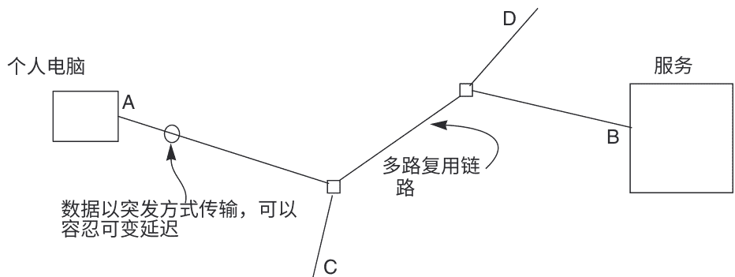

图7.3  
一个简单的数据通信网络。

## 7.1.2 数据包转发; 延迟

异步通信链路通常组织在一个称为数据包转发网络的通信结构中。在这种组织中，一些稍微特殊的计算机，称为数据包交换机（与图7.1中的电路交换机相对比），被放置在方便的位置，并通过异步链路相互连接。异步链路也可以将网络的客户连接到网络附件点，如图7.5所示。该图显示了两个附件点，名为A和B，很明显，从A到B的数据包可以通过网络上的任意几条不同的路径，称为路由。选择数据包的特定路径称为路由。右上角的数据包交换机有三条编号的链路连接到其他三个数据包交换机。通过其链路#1进入的数据包，起源于附件点A处的工作站，并且目的地是附件点B处的服务，包含其目的地的地址。通过研究这个地址，数据包交换机将能够弄清楚它应该通过其链路#3将数据包发送出去。选择一个出站链路称为转发，通常通过表查找来完成。转发表的构建是路由的几种方法之一，因此数据包交换机也被称为转发器或路由器。结果组织类似于邮政服务。

转发网络在将某些东西从A发送到B时会产生延迟（称为传输时间）。传输时间有四个因素，其中几个因素可能与下一个数据包不同。

+ 1. 传播延迟。信号在链路上传播所需的时间取决于数据包交换机之间传输介质中的光速和信号传播的物理距离。尽管它会随温度略有变化，但从网络设计师的角度来看，给定链路的传播延迟可以被视为恒定的。（传播延迟也适用于等时网络。）

+ 2. 传输延迟。由于携带数据包的帧可能长或短，将帧发送到一个交换机并在下一个交换机接收帧所需的时间取决于链路的数据速率和帧的长度。这个时间被称为传输延迟。尽管一些数据包交换机足够聪明，可以在完全接收数据包之前开始发送数据包（这种技巧称为切换透明），但如果交换机在整个数据包出现并通过一些有效性检查之后才转发数据包，错误恢复会更简单。每次数据包在另一个链路上传输时，都会有另一个传输延迟。通过图7.5中的暗链路从A到B的数据包将受到四个传输延迟的影响，一个是A将其发送到第一个数据包交换机时，每个转发步骤都有一个，最后一个是将其传输到B时。

+ 3. 处理延迟。每个数据包交换机都需要检查数据包中的引导信息，以决定将其发送到哪个出站链路。计算这个过程所需的时间，以及对数据包执行的任何其他工作，例如计算校验和（参见边栏7.1）以进行错误检测或将其复制到内存中的其他位置的输出缓冲区，都被称为处理延迟。

> 边栏7.1：错误检测、校验和和见证数据块上的校验和是一种风格化的错误检测码，冗余的错误检测信息不是编码到数据本身中（如第8章[在线]将解释的那样），而是放置在一个单独的字段中。一个典型的简单校验和算法将数据块分成 k 位的块，并对这些块进行异或运算，得到一个 k 位的结果。（当 k=1 时，这个过程被称为奇偶校验。）这个简单的 k 位校验和可以捕捉到任何一位错误，但会错过一些两位错误，并且无法检测到块中的两个块已经互换的情况。已经设计出了更复杂的校验和算法，可以检测多位错误，或者对于检测特定类型的预期错误非常有效。

正如在第11章[在线]中所看到的，通过使用加密技术，可以构建一个具有以下特性的高质量校验和：它可以准确地检测到所有的更改，甚至是那些被恶意人员故意引入的更改。这样的校验和被称为证据或指纹，并且对于确保持存储数据的长期完整性非常有用。但是，这种更复杂的校验和通常需要更多的计算时间，从而增加了处理延迟。因此，通信系统通常使用最简单的校验和算法，以合理的概率检测到预期的错误。

## 7.1网络的有趣特性 7- 11

这种延迟通常有一个相对恒定的部分，从一个数据包到下一个数据包，还有一个与数据包长度成比例的部分。

+ 4. 排队延迟。当从A到B的数据包到达右上角的数据包交换机时，链接#3可能已经在传输另一个数据包，可能是从链接#2到达的数据包，还可能有其他排队等待使用链接#3的数据包。如果是这样，数据包交换机将在内存中将到达的数据包保持在队列中，直到它完成传输先前的数据包。这种延迟的持续时间取决于通过该数据包交换机传递的其他流量的数量，因此它可能会变化很大。

排队延迟有时可以用排队理论估计，使用第6.1.6节中的排队理论公式。如果数据包按照随机、无记忆的过程到达，并且具有随机分布的服务时间（在这种情况下，服务时间是出站链路的传输延迟），平均排队延迟，以数据包服务时间为单位，包括此数据包的服务时间，将为$1/(1-\rho)$。这里$\rho$是出站线路的利用率，范围从0到1。当我们在图7.6中绘制这个结果时，我们注意到了一个典型的系统现象:当线路利用率接近100%时，延迟迅速上升。

这个图告诉我们，异步系统引入了一个权衡:如果我们希望限制平均排队延迟，例如限制在图中标记为“最大可容忍延迟”的数量，就有必要平均留下一些每个链路的容量未使用;在这个例子中，这个最大利用率被标记为$\rho_{\max}$. 或者，如果我们允许利用率接近100%，延迟将无限增长。

异步系统似乎已经用渐进的权衡取代了等时网络的忙信号的突然出现:随着系统变得更繁忙，延迟也会增加。然而，正如我们将在第7.1.3节中看到的那样，替代实际上比这更微妙。

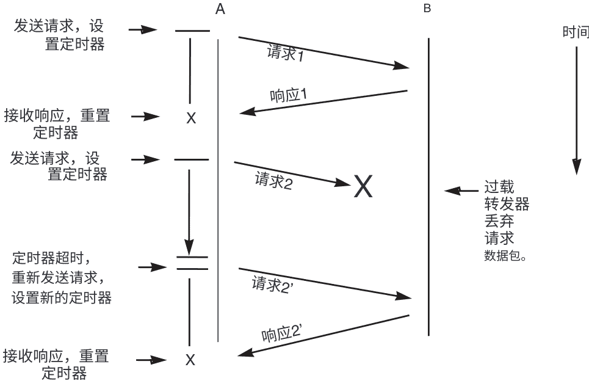

图7.6 作为利用率函数的排队延迟。

## 7.1.3 缓冲区溢出和丢弃数据包

继续应用排队理论，排队有一个含义：需要缓冲区来容纳等待传输的数据包队列。设计师应该分配多大的缓冲区？在无记忆到达间隔的假设下，等待传输的数据包的平均数量（包括当前正在传输的数据包）是 1/(1-ρ)。与排队延迟一样，这个数字只是平均值——排队理论告诉我们队列长度的方差也是 1/(1-ρ)。对于一个ρ of 0.8，平均队列长度和方差都为5，所以如果希望允许足够的缓冲区来处理峰值，例如平均值的三倍标准差，那么必须准备好缓冲不仅仅是预测的5个数据包，还有(3 × 5 = 7)多，总共12个数据包。更糟糕的是，在许多真实网络中，数据包实际上不是以随机独立的方式到达的；它们以缓冲区突发的批次到达。

此时，我们可以想象三种完全不同的选择缓冲区大小的策略：1. 为最坏情况做准备。仔细检查网络流量，确定最坏情况下的流量情况，并分配足够的缓冲区来处理它。

+ 2. 为通常情况做准备并反击。根据上述计算，选择一个大部分时间都能工作的缓冲区大小，如果缓冲区已满，则通过网络发送消息要求某人停止发送。

+ 3. 计划常规情况并丢弃溢出。再次，选择一个大多数情况下能够正常工作的缓冲区大小，并在缓冲区满时无情地丢弃数据包。

## 7.1网络的有趣特性 7-13

让我们依次探讨这三种可能性。缓冲内存通常成本较低，因此计划最坏情况似乎是一个有吸引力的想法，但实际上比听起来要困难得多。首先，在一个大型网络中，可能无法确定最坏情况是什么-关于可能发生的情况没有足够的信息可用。即使可以估计最坏情况，估计值可能没有用。例如，考虑加拿大虚构银行，该银行在全国范围内有21,000名柜员。萨斯喀彻温省的Moose Jaw分行每天只有三笔交易，而且几乎肯定永远不会发生最坏情况，即其他20,999名柜员同时对Moose Jaw账户进行取款。因此，最坏情况的设计要求在通往Moose Jaw的分组交换机中有足够的缓冲区来处理20,999个同时消息。最坏情况分析的问题在于最坏情况可能比平均情况大几个数量级，而且极不可能发生。此外，即使决定购买那么大的缓冲区，处理所有交易的结果队列也会非常长，以至于许多其他柜员会因为沮丧而放弃交易并中止，所以大缓冲区实际上并没有帮助。

这个观察使得选择基于典型而不是最坏情况的缓冲区大小听起来很有吸引力。但是总会有一种可能性，即流量超过平均值足够长的时间以耗尽缓冲区空间。这种情况被称为拥塞。那么该怎么办呢?

一个想法是进行推迟。如果缓冲区空间开始不足，沿着一个传入链路发送一条消息，说“在收到我的回复之前，请不要再发送任何数据”。这条消息（称为拥塞请求）可能会发送到该链路另一端的数据包交换机，或者可能一直返回到将数据引入网络的原始源头。无论哪种方式，推迟都比听起来更困难。如果一个分组交换机正在经历拥塞，那么相邻的交换机也很有可能拥塞（如果它还没有拥塞，如果被告知停止向该交换机发送数据，它很快就会拥塞），发送额外的消息会增加拥塞。更糟糕的是，像图7.5中的循环配置的一组分组交换机很容易陷入一种死锁形式（当发生在汽车交通中时称为交通阻塞），所有缓冲区都被填满，每个交换机都在等待下一个交换机说可以开始再次发送。

避免数据包交换机死锁的一种方法是将压制请求发送到源头。这种方法也很困难，至少有三个原因。首先，可能不清楚要发送压制请求的源头是哪个。在我们的Moose Jaw示例中，有21,000个不同的源头，没有一个源头单独引起（也无法解决）问题。其次，这样的请求可能没有任何效果，因为选择要压制的源头可能已经停止发送。再次以我们的示例为例，在通往Moose Jaw的数据包交换机检测到过载时，所有21,000个柜员可能已经发送了他们的事务请求，因此要求他们不要发送其他任何内容是没有意义的。第三，假设压制消息本身通过分组交换网络转发回去，它可能遇到拥塞并受到排队延迟的影响。网络越繁忙，施加压力所需的时间就越长。

控制。我们建议创建一个带有延迟的反馈系统，并且应该预期看到振荡。即使所有数据都来自一个源，当扑灭返回并且源对其进行操作时，已经在管道中的数据包可能超过缓冲区容量。通过扑灭相邻交换机或源来控制拥塞在各种特殊情况下使用，但作为一种通用技术，目前还是一个未解决的问题。

在面对拥塞时，大多数分组网络实际上采取的是剩余的可能性：当缓冲区填满时，它们开始丢弃数据包。这似乎是一个通信系统所做的一件令人震惊的事情，因为它将中断通信，最终每个被丢弃的数据包都必须重新发送，因此发送数据包到这个程度的努力将被浪费。尽管如此，这是一个每个未配置为最坏情况的分组交换网络都必须准备好采取的行动。

溢出的缓冲区和丢弃的数据包导致了两个显著的后果。首先，数据包的发送方可以将其未收到确认作为网络拥塞的迹象，并相应地减少其向网络引入新数据包的速率。这个想法被称为自动速率调整，在本章的第7.6节中进行了深入探讨。丢弃的数据包和自动速率调整的结合产生了第二个后果：基于标准排队理论的网络行为简单的理论模型在服务可能提供一些请求并丢弃其他请求时不适用。对于具有速率调整的网络建模需要对网络应用程序以及网络本身使用的具体算法有更深入的理解。

最终分析，异步网络用可变的传输速率取代了等时网络的硬边阻塞，这取决于瞬时网络负载。对于处理过载的哪种方案（异步或等时）更可取取决于应用程序。对于某些应用程序来说，最好在通信尝试开始时被告知稍后再回来，而不是只能在可用容量变化如此大以至于很难做任何有用的工作时才能开始工作。对于其他应用程序来说，有一些工作以缓慢或变速的方式完成要比没有工作更有帮助。

网络可能会丢弃数据包以应对拥塞，这导致了两种转发网络之间的有用区别。到目前为止，我们一直在讨论通常被描述为尽力而为网络的内容，即如果网络无法在接收后立即发送数据包，则可能丢弃它。另一种设计是保证传递网络（有时被称为存储转发网络，尽管该术语通常适用于所有转发网络），它采取了英勇的措施，以避免丢弃有效负载数据。保证传递网络通常设计为使用完整的消息而不是数据包。通常，保证传递网络使用非易失性存储（如磁盘）进行缓冲，以便能够处理大量的消息负载，并且即使发生停电或转发计算机崩溃，也可以确保消息不会丢失。此外，保证传递网络通常在完全无法传递消息的情况下（可能是因为预期的接收者消失了），明确地将消息返回给发件人，并解释为什么传递失败。最后，为了不丢失消息，保证传递的开关通常会仔细跟踪每个消息，以确保在传输过程中没有丢失或损坏，例如由于噪声突发引起的。最好努力网络的开关可以比保证传递网络的开关简单得多。由于最好努力网络可能会随意丢弃数据包，因此它不需要为重新传输损坏的数据包做任何特殊准备，也不需要在开关崩溃和重新启动时保留传输中的数据包，也不需要担心到达目标节点的链接突然停止接受数据的情况。

最好努力网络被认为是向其客户提供最好努力的合同（此合同在下面的第7.1.7节中更详细地定义），而不是提供交付的保证。当然，在现实世界中没有绝对的保证-真正的区别在于未检测到丢失的概率有显著差异。当我们在本章的第7.2节中研究网络分层时，将会发现这些差异可以以另一种方式进行描述:保证传递网络通常在更高的网络层中实现，而最好努力网络在更低的网络层中实现。

在这些术语中，美国邮政服务为一类邮件运营了一个有保证的投递系统，但对于三类（垃圾）邮件，它是一个尽力而为的系统，因为邮政法规允许其丢弃地址错误的三类邮件或者在拥堵时处理不过来的三类邮件。互联网被组织成一个尽力而为的系统，但处理电子邮件的互联网机制被设计为一个有保证的投递系统。西联汇款公司一直以经营真正的有保证的投递系统为傲，以至于当它停用一个办公室时，通常会完全拆除该地点以寻找遗失的电报。有一个（可能是虚构的）故事，说这样一次拆除工作发现了一封掉在水管后面的75年前的电报。公司立即将其交付给原始收件人的惊讶继承人。

### 7.1.4 重复数据包和重复抑制

事实证明，丢弃的数据包对于更高级别的应用程序并不像人们预期的那样成为问题，因为当客户端向服务发送请求时，服务可能不可用，或者服务在接收请求后崩溃。因此，未答复的请求实际上是一种常见情况，许多网络协议包括某种类型的定时器到期和重发机制以从此类故障中恢复。图7.7*的时序图说明了这种情况，显示了一个携带请求的第一个数据包，随后是一个携带对第一个请求的响应的数据包。A设置了一个定时器，用一条垂直线表示，但在定时器到期之前，响应1的到达导致A关闭定时器，用小x表示。携带第二个请求的数据包在传输过程中丢失（如图示）。

> *在附录4.2中描述了时序图的表示约定。


图7.7 丢失数据包导致重复请求。

当拥塞的数据包交换机丢弃一个数据包时，有两个重要的后果。首先，客户端无法像最初希望的那样快速接收到响应，因为整体响应时间增加了定时器超时的时间。这种额外的延迟对性能有重要影响。其次，网络的用户必须准备好处理重复的请求和响应。原因在于刚才描述的恢复机制。假设网络数据包交换机过载并且必须丢弃一个响应数据包，就像图7.8中一样。客户端A无法区分这种情况和图7.7中的情况，因此它重新发送其请求。服务将这个重新发送的请求视为重复请求。假设B没有意识到这是一个重复请求，按照请求进行操作，并发送回一个响应。客户端A接收到响应并假设一切正常。这可能是一个正确的假设，也可能不是，这取决于请求3的首次到达是否改变了B的状态。如果B是一个拼写检查器，它可能对请求的两个副本给出相同的响应。但是如果B是一个银行，请求是转账，那么执行两次请求将是一个错误。因此，根据特定的应用程序，检测重复请求可能重要，也可能不重要。

举个例子，如果由于某种原因网络延迟堆积超过了重新发送计时器的到期时间，客户端可能会重新发送请求，即使原始的


图7.8 丢失数据包导致重复请求。

响应仍在传输中。由于B无法区分这种情况和之前的情况，它以相同的方式响应，即按照请求进行操作。但现在A收到了一个重复的响应，如图7.9所示。再次强调，这个重复的响应可能对A有影响，也可能没有影响，但至少A必须采取措施来避免被重复响应的到达所困扰。

如果A的请求导致B改变状态，例如银行转账的例子，会发生什么？如果是这样的话，通常重要的是要检测和抑制由于丢包恢复机制而产生的重复数据。抑制重复数据的一般过程有两个组成部分。第一个组成部分可以从示例中的请求和响应编号中看出: 每个请求都包含一个once，这是一个唯一的标识符，用于


图7.9 网络延迟与恢复导致重复响应。

## 7-18 第7章 网络作为系统和系统组件

在向B发送请求时，不应该再重复使用nonce。示例中使用单调递增的序列号作为nonce，但任何唯一的标识符都可以。第二个重复数据抑制组件是B必须维护一个已经处理或正在处理的nonce列表。每当一个请求到达B时，B应该查看这个列表，以确定这个看似新的请求是否实际上是之前接收到的重复请求。如果是重复请求，B不应该执行请求的操作。另一方面，B也不应该简单地忽略请求，因为重复请求的原因可能是A从未收到B的响应。因此，B需要一种方法来重建并重新发送之前的响应。通常，B可以将之前处理过的nonce的副本添加到其列表中，以便轻松地重新发送它们。因此，在图7.9中，B的最后一个操作应该被替换

使用“B重新发送响应4”.

在一些网络设计中，A甚至可能会收到对于一个未重复的请求的重复响应。原因是网络内部的一个转发链路可能正在使用一个类似上述的定时器到期和重发协议。因此，大多数关注重复抑制的协议在响应中包含一个nonce的副本，而发起者A在其未完成的请求中维护一个nonce列表。当响应返回时，A可以检查列表中的nonce并删除该列表条目，或者如果没有列表条目，则假设它是先前收到的响应的重复并忽略它。

我们刚刚描述的过程允许A保持其nonce列表的长度较短，但是B可能需要维护一个不断增长的nonce和响应列表，以确保它从不意外地处理两次请求。一个相关的问题是，如果任一参与者崩溃并重新启动，丢失其易失性内存，那么它可能会丢失其nonce列表的位置。在本章的第7-71页重新讨论重复抑制主题时，将详细探讨应对这些问题的改进措施。

确保消除重复项是一个重要的复杂性，因此，如果可能的话，最好设计服务及其协议，使得不需要消除重复项。请记住，消除重复项变得重要的原因是请求改变了服务的状态。通常可以设计一个服务接口，使其具有幂等性，对于网络请求来说，重复多次相同的请求或请求序列与仅执行一次的效果相同。这种设计方法在第9章的原子性和错误恢复讨论中进行了深入探讨[在线]。

## 7.1.5 损坏的数据包和断开的连接

在本章的开头，我们指出噪声是数据通信设计中的基本考虑因素之一。数据在传输过程中、通过交换机的传输过程中或在转发节点的内存中可能会受损。

噪声、传输错误以及检测和纠正错误的技术是非常有趣的主题，在第8章中进行了深入探讨[在线]。作为

## 7.2 组织：层次结构

为了处理我们在第7.1节中确定的网络的有趣属性，有必要进行组织。网络的主要组织工具是设计原则的一个例子，采用了广泛的简化。所有网络都使用被称为协议分层的分而治之技术。但在我们讨论层之前，我们必须确定协议是什么。

| 网络类型 | 应用特性 | 对负载变化的响应 |
| :--- | :--- | :--- |
| 等时的 (例如, 电话网络) | 很好的匹配 | 浪费容量 |
| 异步的 (例如, 互联网) | 可变的延迟<br>扰乱<br>应用 | 很好的匹配 |
| 连续的<br>(多数 (例如, 交互式音)) | **数据流的突发**<br>(大 计算机到语 计算机数据) | (硬边缘)<br>要么接受要么<br>阻塞呼叫 |

**图7.10**  
等时与异步复用。

让我们假设我们的国防承包商希望进一步将软件从单用户游戏转换为多用户游戏，使用客户/服务组织。主程序将作为客户端运行，FIRE程序现在将在一个多客户端、游戏协调服务中运行。为了简化转换，承包商选择使用远程过程调用（RPC）协议，如图7.12所示。如第4章所述，运行在客户机上的存根过程导出了名为FIRE的名称，因此当主程序调用FIRE时，实际上控制权传递给了具有该名称的存根。存根收集参数，将它们封装成请求消息，并将其发送到游戏协调服务上的网络。在服务端，相应的存根等待请求到达，将请求消息中的参数解封装，并使用它们调用真正的FIRE过程。当FIRE完成其操作并返回时，服务端存根将任何输出值封装成响应消息并将其发送到客户端。客户端存根等待该响应消息，当它到达时，将响应消息中的返回值解封装，并将其作为自己的值返回给主程序。过程调用协议得到了遵守，主程序继续执行，就好像名为FIRE的过程在本地执行一样。

图7.12还展示了客户端存根和服务存根之间的第二个协议，与主程序和调用的过程之间的协议相比，有些不同。在这两个存根之间，请求消息详细说明了要调用的过程的名称、参数的数量以及每个参数的类型。

### 7.2.1 层次

在这个例子中，MAIN到FIRE过程调用协议与RPC存根到存根协议的独立性是分层设计的特点。我们可以通过重新绘制图7.13来明确这些层次。主程序和调用的过程之间的契约被称为应用协议。客户端和服务端RPC存根之间的契约协议被称为表示协议，因为它将数据格式和语义转换为本地首选形式，并从本地首选形式转换回来。

请求消息必须从客户端RPC存根传递到服务RPC存根。为了通信，客户端存根调用一些网络过程，使用了一个对SEND抽象的详细说明：

```
SEND_MESSAGE (请求消息，服务名称)
```

在第二个参数中指定应该接收此请求消息的服务的标识。服务存根调用一个类似的过程，提供了RECEIVE抽象来接收消息。这两个过程代表了第三层，提供了一个传输协议，我们可以扩展我们的分层协议图像如图7.14所示。这个图表显示了网络设计中分层使用的一个重要特性：每个模块不是有两个，而是有三个接口。在通常的分层组织中，一个模块只有两个接口，一个接口连接上层，隐藏了第二个接口连接下层。但在网络中使用的分层涉及第三个接口。

例如，考虑图中的RPC客户端存根。正如预期的那样，它提供了一个主程序可以使用的接口，并且它使用了下面的客户端网络接口。但是RPC客户端存根的整个目的是构造一个请求消息，使其对应的服务存根执行某些操作。因此，表示协议代表了表示层模块的第三个接口。

因此，表示模块将下层接口和表示协议都隐藏起来，不对上层进行暴露。这个观察是普遍的——网络中的每一层都是如此。

### 7.2.2 链路层

在分组交换网络的底层，必须有一些底层通信机制将一个分组交换机与另一个分组交换机或将分组交换机与网络的客户端连接起来。链路层负责管理这种低级通信。链路层的目标是将数据包的位移动到一个（通常是物理的，但不一定是物理的）链路上，隐藏了涉及的数据传输的具体机制。

一个典型的、有些简化的链路层接口大致如下：

```
LINK_SEND (数据缓冲区, 链路标识符)
```

其中，数据缓冲区指的是内存中包含一个准备发送的信息包的位置，链路标识符在本地地址空间中指定了可能有多个链路中的一个。图7.16展示了分组交换机B中的链路层，它有两个连接到其他分组交换机A和C的链路。调用链路层时，标识了一个名为pkt的数据包缓冲区，并指定链路层应将数据包放入适合在链路2上传输的帧中。交换机B和C都有链路层的实现，这是一个了解在该链路上发送和接收帧所使用的特定协议的程序。当使用链路编号1向交换机A发送帧时，链路层可能使用不同的协议。尽管如此，链路层通常对上层提供统一的接口（UNk_Send）。分组交换机B和分组交换机C可能使用不同的标签来连接它们之间的链路。如果分组交换机C有四个链路，帧可能会到达C认为是其第3号链路。因此，链路标识符是一个作用域仅限于一个分组交换机的名称。

实际出现在物理线上的数据通常与在链路层接口的数据包缓冲区中出现的数据有所不同。链路层负责考虑底层物理通道的任何特殊属性，因此它可以以在本地噪声环境中更不易受损的方式对数据进行编码，可以对数据进行分段，因为链路协议要求较短的帧，并且可以重复发送数据，直到链路的另一端确认接收到数据为止。

这些特定于通道的措施通常要求链路层向网络层提供的数据添加信息。在分层通信系统中，从上层传递到下层进行传输的数据称为有效负载。

当下层在有效负载前面添加一些仅供对应下层在另一端使用的数据时，这种添加称为头部；当下层在末尾添加一些内容时，这种添加称为尾部。在图中

### 7.2.3 网络层

一个段进入转发网络的一个网络附着点（源）时，伴随着将其传递到另一个网络附着点（目标）的指令。为了到达目的地，它可能需要经过多个链路。

为网络附着点提供系统命名方案，确定要经过的链路，创建包含段的数据包，并沿着预定路径转发数据包是网络层的任务。网络层的接口，再次略微简化，类似于链路层的接口：

```
网络_发送（段缓冲区，网络标识符，目的地）
```

NETWORK_SEND过程传输在段缓冲区中找到的段（从网络层的角度来看是有效载荷），使用在network_identifier中命名的网络（单台计算机可以参与多个网络）到目的地（该网络中指定的命名网络附着点，应将段传递到该附着点）。

网络层在接收到此调用后，创建一个网络层头部，标记为NH在图7.17中，并/或尾部，标记为NT，以随段一起通过网络名为“IP”的网络，并将这些组件组装成一个数据包。网络层头部中的关键信息是目的地的地址，用于由转发链中的下一个数据包交换机使用。

接下来，网络层查询其表格，选择最合适的链路，以便将此数据包发送到离目的地更近的位置。最后，网络层调用链路层，要求其通过所选择的链路发送数据包。当包含数据包的帧到达链路的另一端时，接收链路层剥离链路层头部和尾部（图中的LH和LT），并通过向 NETWORK_HANDLE发起上调用将数据包传递给其网络层。此网络层模块检查网络层头部和尾部，以确定数据包的目标地址。它查询自己的表格，决定将数据包转发到哪个出站链路。

### 7.2.4 端到端层

我们现在可以把整个图像放在一起。网络和链路层共同提供了一个尽力而为的网络，具有在第7.11页的图7.11中列出的“有趣”的特性。这些特性可能对应用程序有问题，而端到端层的功能是为应用程序创建一个不那么“有趣”和更容易使用的接口。例如，图7.18从不同的角度显示了图7.12的远程过程调用。在这里，RPC协议被视为完整网络实现的端到端层。与较低层一样，端到端层为应用程序提供的数据添加了头部和尾部，并且检查在传输线上的位，我们现在看到了三个不同的头部和尾部，对应于网络实现的三个层次。

端到端层中的RPC实现提供了几个不同的端到端服务，每个服务都旨在隐藏底层网络的某些方面。

## 7.2 组织：层次结构 7-29

- 演示服务。转换数据格式和模拟过程调用的语义。为此，端到端头部可能包含过程调用中参数的数量。
- 传输服务。将流和消息分割成段，并处理丢失、重复和乱序的段。为此，端到端头部可能包含段的序列号。
- 会话服务。协商搜索、握手和绑定序列，以定位并准备使用能够执行所请求过程的服务。
为此，端到端头部可能包含一个唯一标识符，告诉服务哪个客户端应用程序发起了此调用。

根据应用程序的要求，不同的端到端层实现可以提供所有、部分或没有这些服务，并且端到端头部和尾部可能包含各种不同的信息位。

这种分层的另一个重要特性在图7.18中变得明显。每一层都认为上一层传输的有效负载是不应该被解释的信息。因此，端到端层构建了一个带有端到端头部和尾部的段，将其交给网络层，期望网络层不会查看内部或执行需要解释段的任何操作。网络层再次添加了网络层头部和尾部，并将生成的数据包交给链路层。


图7.18 三个网络层的工作原理。过程调用的参数成为端到端段的有效负载。网络层在从客户端到服务端的过程中将数据包转发到两个链路上。传输线上的帧包含了三个层的头部和尾部。

预期链路层将把这个数据包视为一个不透明的比特串，作为负载在链路层帧中传输。违反这个规则会导致层间相互依赖，从而导致系统的模块化丧失。

### 7.2.5 附加层和端到端论证

到目前为止，我们已经提出一个三层参考模型既是必要的，也是足够的，以便深入了解网络的运作方式。标准的网络设计和实现教材提到了一个来自国际标准化组织的参考模型，称为“开放系统互连”，或者 OSI。OSI 参考模型不是三层，而是七层。有什么区别？

有几个区别。有些是微不足道的；例如，OSI 参考模型将链路层分为策略层（称为“数据链路层”）和物理层，认识到许多不同类型的物理链路可以用少量的管理策略来管理。在上层，我们的参考模型和 OSI 参考模型之间有一个更重要的区别。OSI 参考模型将我们的端到端层系统地划分为四个不同的层。

在RPC示例中，这些层中的三个直接对应于图7.14中的层：应用层、表示层和传输层。此外，在传输层之上，ISO模型插入了一个提供会话服务的层，正如上面提到的。

我们避免采用这种方法的简单原因是，不同的应用对于传输、会话和表示服务有着根本不同的要求，甚至它们应用的顺序可能也不同。这种情况使得提出任何单一的分层变得困难，因为分层意味着有一个顺序。

例如，一个将文件发送到打印机的应用程序会发现，最有用的传输服务是保证以发送的顺序将字节流传递给打印机，没有丢失和重复。但是，文件传输应用程序可能不关心文件的不同块以什么顺序被传递，只要它们最终都到达目的地即可。数字电话应用程序希望看到以正确顺序传递的表示连续样本的位流，但是偶尔会有一些样本丢失而不影响对话的可理解性。这种相当广泛的应用需求表明，较低层所做的任何实现决策（例如，等待无序段到达，以便数据可以按正确顺序传递给更高层）可能对至少某些应用程序产生反效果。相反，提供一个由特定应用程序的程序员选择和组织的服务模块库可能更加有效。因此，我们的端到端层是一个无结构的服务模块库，其中RPC协议就是一个例子。

## 这个反对额外层次的论点是一个被称为设计原则的例子

## 端到端的论证

应用程序最了解其真正的通信需求，而较低的网络层尝试实现除了传输数据之外的任何功能都有风险，因为这可能实现的不完全是应用程序所需的。此外，如果不完全符合需求，应用程序可能需要自己重新实现该功能。因此，端到端的论证可以简化为：不要将其埋在较低的层次中，让端点处理它，因为他们最了解自己的需求。

这种现象的一个简单例子是文件传输。要仔细传输文件，适当的方法是从原始站点文件系统中存储的文件内容计算校验和。然后，在文件传输并写入新的文件系统之后，接收站点应该从其文件系统中读取文件，重新计算校验和，并将其与原始校验和进行比较。如果两个校验和相同，则文件传输应用程序非常有信心新站点有一个正确的副本；如果它们不同，则出现了问题，需要进行恢复。

鉴于对文件传输准确性的端到端检查方法，人们可以质疑例如在链路层协议中添加帧校验和到链路层尾部是否有任何价值。这个链路层校验和需要时间来计算，它增加了要发送的数据量，并且只在数据在该链路上传输时验证数据的正确性。尽管有这种保护，数据在通过网络层传递时仍然可能被损坏，或者在文件传输应用程序的接收部分缓冲时被损坏，或者在写入磁盘时被损坏。

由于这些威胁，谨慎的文件传输应用程序无法避免计算其端到端校验和，尽管链路层校验和提供了保护。

这并不意味着链路层校验和毫无价值。如果链路层提供了校验和，该层将在可以通过重新发送一个帧轻松纠正的时间发现数据传输错误。如果没有这个链路层校验和，直到端到端层验证其校验和时才会发现传输错误，到那时可能需要重新进行整个文件传输。因此，在较低层中具有此功能可能会带来显著的性能提升。有趣的观察是，较低层的校验和并不消除应用层实现该功能的需要，因此不需要应用层的正确性。

这只是性能的提升。

端到端的论点可以应用于各种系统设计问题，除了网络设计之外。它并不提供绝对的决策技术，而是一个有用的论点，在决定功能放置的时候应该权衡其他论点。

## 7.2.6 映射和递归应用的分层模型

当我们开始将特定的现有网络分解为链路、网络和端到端层时，有时会发现网络的某些层明显由显然是链路、网络或端到端层的组成。

这些组合有两种形式：映射和递归。映射组合是指通过将更高层的网络地址映射到更低层的网络地址，直接在另一个网络层上构建网络层。映射的典型应用是当出现更好或更流行的网络技术时，但仍希望继续运行为旧网络设计的应用程序。例如，苹果设计了一个名为Appletalk的网络，用了很多年，然后将Appletalk网络层映射到以太网上，如第7.8节所述，以太网有自己的网络和链路层，但使用了稍微不同的网络层地址方案。

映射组合的另一个应用是将几个独立设计的网络层连接在一起，这种方案被称为互联网。可能最好的互联网示例就是互联网本身（在边栏7.2中描述），它通过将所有网络层映射到使用称为互联网协议（IP）的通用网络层来连接许多不同的网络层。第7.8节解释了网络的工作原理。

> 边栏7.2：互联网  
互联网提供了本章中几乎每个概念的示例。互联网的大部分是映射到其他网络层的网络层，例如卫星网络、无线网络或以太网。互联网协议（IP）是主要的网络层协议，但它不是互联网中唯一使用的网络层协议。有一个用于管理互联网的网络层协议，称为ICMP。还有几种不同的网络层路由协议，其中一些提供互联网的小部分内部路由，其他提供主要地区之间的路由。但是可以通过互联网到达的每个点都实现了IP。

互联网的链路层包括互联网映射到的所有网络的链路层，还包括许多独立的专用链路：电线、拨号电话线、电话公司提供的专线、微波链路、数字用户线路(DSL)、自由空间光学链路等。几乎任何传输比特的东西都在互联网中被用作链路。

互联网上使用的端到端协议多种多样。主要的传输协议是TCP、UDP和RTP，简要介绍见第7-65页。在这些传输协议的基础上，有数百种应用协议。一些最广泛使用的应用协议包括文件传输(FTP)、万维网(HTTP)、邮件发送和接收(SMTP和POP)、文本消息(IRC)、电话(VoIP)和文件交换(Gnutella、bittorrent等)。

当前章节介绍了网络的一般模型，而不是对互联网的描述。要了解更多关于互联网的信息，请参阅第7节中列出的书籍和论文。

## 7.2 组织：层次结构 7-33

以太网的层地址与互联网的IP地址之间的映射使用的是称为地址解析协议的方法。互联网还将许多其他网络（无线网络、卫星网络、有线电视网络等）的内部网络地址映射到IP地址。

递归组合是指一个网络层依赖于一个完整的三层网络的链路层。递归组合不是层的一般属性，而是分层通信系统的特定属性：通过网络的端到端连接的发送/接收语义可以被设计成与单个链路的语义相同，因此这样的端到端连接可以被用作更高级网络中的链路。这种属性有助于递归组合，以及实现各种有趣和有用的网络结构。以下是一些递归组合的示例:

- 拨号电话线通常用作连接到互联网的附件点。这条拨号线经过一个具有自己的链接、网络和端到端层的电话网络。
- 叠加网络是一种使用现有网络的端到端层作为链接的网络层结构。Gnutella(见问题集 20) 是一个使用互联网的端到端传输协议作为链接的叠加网络的示例。
- 随着“语音通过IP”(VoIP)的进步，传统的语音电话网络正在逐渐转变为互联网上的叠加网络。
- 隧道是一种使用现有网络的端到端层作为本地网络层附件点和远程网络层附件点之间的链接的结构，使得附件点看起来位于远程点。隧道结合第11章中描述的加密技术用于实现通常称为“虚拟专用网络”(VPN)的功能。

递归组合不必局限于两个层次。图7.19说明了Gnutella覆盖互联网的情况，其中使用拨号电话连接作为互联网链路层。

当处理实际上是通过另一个网络的端到端连接的链路层时，主要问题是，除非仔细确定正在讨论的分解级别，否则讨论可能变得混乱。幸运的是，我们的术语有助于区分网络的各个层次，因此值得简要回顾一下这些术语。在应用程序和端到端层之间的接口处，数据被标识为一个流或消息。端到端层将流或消息分割成一系列段，并将它们交给网络层进行传递。网络层将每个段封装在一个数据包中，并借助链路层将其转发到网络中。链路层以帧的形式传输数据包。如果链路层本身是一个网络，则该帧在底层网络中被视为一条消息。

关于分层网络组织的讨论既具有一般性又抽象。在接下来的三节中，我们将更深入地研究常见功能和一些类型。

## 7.3 链路层

链路层是我们参考模型中三个层次中最底层的一层。链路层负责直接将数据从一个物理位置移动到另一个物理位置。因此，它涉及到几个不同的问题：物理传输、帧位和位序列、检测传输错误、链路复用以及为上层网络提供有用的接口。

### 7.3.1 在模拟世界中传输数字数据

链路层的目的是将位从一个地方移动到另一个地方。如果我们谈论的是将位从同一芯片上的一个寄存器移动到另一个寄存器上，机制就相当简单：运行一个将第一个寄存器的输出连接到下一个寄存器的输入的电线。

等到第一个寄存器的输出稳定并且信号传播到第二个寄存器的输入时，下一个时钟周期将数据读入第二个寄存器。如果所有电压都在规定的容忍范围内，时钟周期之间有足够的时间进行传播，并且没有电气干扰，那么就完成了这个过程。

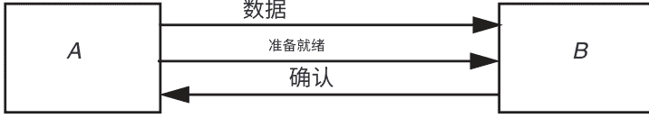

只要这三个假设在单个芯片内或者同一块印刷电路板上的芯片之间相对容易维持，并且时钟信号正确定时，没有电气干扰，那么就完成了这个过程。

然而，当我们开始考虑在板之间、跨房间或者跨国传输比特时，这些假设变得越来越不可行，必须采取明确的措施来确保数据传输的准确性。特别是当发送方和接收方位于不同的系统中时，提供正确定时的时钟信号变得具有挑战性。

一个简单的方法是使用三线（加上共同地线）的准备/确认协议，从一个模块获取数据到另一个不共享相同时钟的模块，如图7.20所示。当模块A有一个准备发送的位时，它将该位放在数据线上，然后改变准备线的稳态值。当B看到准备线改变时，它获取数据线上的位值，然后改变确认线以告诉A该位已经安全接收。准备和确认线的原因是，在没有其他同步方案的情况下，B需要知道何时适合查看数据线，而A需要知道何时可以安全地停止保持数据线上的位值。准备和确认线的信号框定了位。

如果从A到B的传播时间为 $\lambda t$，则该协议允许A每$2\lambda t$加上A设置其输出和B获取其输入所需的时间发送一位到B，因此最大数据速率将略低于$1/(2\lambda t)$。在短距离上，可以用N个并行数据线替换单个数据线，所有这些数据线都由相同的准备/确认线框定，并且从而将数据速率增加到$N/(2\lambda t)$。许多背板总线设计以及外围附件系统（如SCSI和个人计算机打印机接口）使用这种称为并行传输的技术，以及某种变体的准备/确认协议，以实现更高的数据速率。

然而，随着A和B之间的距离增加，$\lambda t$也增加，最大数据速率按比例下降，因此准备/确认技术迅速失效。通常的要求是在较长距离上以更高速率发送数据，并且使用更少的线路，这要求采用一种称为串行传输的不同系统。这个想法是通过单个传输线发送一串位，而不需要等待接收器的任何响应，并且期望接收器在另一端以无需额外信号的方式恢复这些位。因此，链路传输端的输出如图7.21所示。不幸的是，由于底层传输线是模拟的，这些位在线路上行进的距离越远，


它们遭受的衰减、噪声和线路充电效应越多。当它们到达接收器时，它们几乎只剩下具有指数上升和下降边缘的脉冲，如图7.22所示。接收模块B现在在理解这个传输时有一个重要问题：因为它没有A用来创建比特的时钟副本，所以它不知道准确地何时对传入线路进行采样。

一个典型的解决方案是让两端就一个近似的数据速率达成一致，这样接收器就可以以大约相同的数据速率运行一个电压控制振荡器(VCO)。VCO的输出与传入信号的电压相乘，然后将乘积适当地滤波并发送回来调整VCO。如果这个电路设计正确，它将锁定VCO到到达信号的频率和相位。(这个设备通常被称为锁相环。)一旦锁定，VCO就成为接收器可以用来采样传入数据的时钟源。

一个复杂之处在于，对于某些数据模式（例如，一长串的零），数据流中可能没有任何转换，这种情况下，锁相环将无法同步。为了解决这个问题，发送器通常会对数据进行编码，以确保无论发送什么位模式，传输线上都会有一些转换。一种经常使用的方法称为相位编码，其中每个数据位都与至少一个电平转换相关联。一种常见的相位编码是曼彻斯特编码，其中发送器将每个位编码为两个位：零编码为零后跟一个一，而一编码为一个后跟一个零。这种编码保证了每个传输位的中心都有一个电平转换，从而为接收器提供了充足的时钟信息。它的缺点是通信通道的最大数据速率实际上减半了，但是由于发送器和接收器的简单性，通常这个代价是值得的。其他更复杂的编码方案可以确保每几个数据位中至少有一个转换。这些方案不会像之前那样降低最大数据速率，但是它们会增加编码、解码和同步的复杂性。

物理通信链路设计空间的通常目标是实现所使用的编码方法的最高可能数据速率。最高可能的数据速率将恰好在到达的数据信号处于正确解码边缘的点发生，线路上的任何噪声都会以时钟抖动或信号未达到预期阈值的形式显示出来，这两种情况都会导致解码错误。

数字链路的数据速率通常以每秒比特数来衡量。由于数字数据最终是使用模拟信道传输的，因此问题是指定模拟信道的最大数字传输容量是多少。

数字数据最终是使用模拟信道传输的。问题是：指定模拟信道的最大数字传输容量是多少。

完美的模拟信道对于数字数据具有无限容量，因为一个信号可以同时设置和测量传输信号的无限精度，并且然后无限次改变该设置。在现实世界中，噪声限制了精度。接收器可以测量信号值的精度。更准确地说，接收器能够区分的不同信号值的数量与信号功率与噪声功率之比的对数成比例，而接收器能够区分信号值变化的最大速率与模拟带宽成比例。  

## 附注7.4：香农容量定理

```
C ≤ W · log₂(1 + S/NW)
```

其中：

- C = 信道容量，以比特每秒计  
- W = 信道带宽，以赫兹计  
- S = 最大允许信号功率，由接收器观察到  
- N = 单位带宽的噪声功率  

这两个参数（信噪比和模拟带宽）允许人们计算出理论上的最大可能信道容量（即数据传输速率），使用香农的容量定理（见附录7.4）。*尽管这个公式采用了一种特定的带宽定义，假设了特定的噪声随机性，并且没有提及如果尝试在信道附近操作可能遇到的延迟。

## 附录7.3：编码位的分帧阶段

细心的读者可能会发现曼彻斯特编码的一个令人困惑的空白：虽然它被用作在传输线上对位进行分帧的一种方式，但也有必要对数据位本身进行分帧，以了解一个数据位是编码为位（n，n + 1）还是位（n + 1，n + 2）。一个典型的方法是将码位分帧与数据位分帧相结合（甚至在更高级的分帧中提供一些帮助），通过指定每个传输必须以一个标准模式开始，例如一些最小数量的编码为一的位后面跟着一个编码为零的位。连续的一位序列为锁相环提供了同步的依据，同时提供了已知数据位位置的示例。零位标志着分帧序列的结束。

> * 这个定理的推导超出了本教材的范围。 容量定理最初由克劳德·E·香农在论文“A mathematical theory of communication”（1948年），贝尔系统技术杂志27卷，第379-423页和第623-656页中提出。 大多数现代信息论的教材都对其进行了深入探讨。

## 7.3 链路层 7-39

当接收到的数据中出现这个模式时，接收方认为它标志着前一帧的结束，并假设后面的比特属于下一帧。只要有效载荷数据流中不包含所选的比特模式，这个方案就能很好地工作。

链路层不是向网络的更高层解释它们不能传输某些比特模式，而是实现了一种称为比特填充的技术。链路层的发送端在帧之间插入帧分隔符标记的同时，还会检查数据流本身。如果发现连续六个1，则会在流中插入一个额外的比特，即0。接收端则会观察传入的比特流是否有连续的1。当它看到连续六个1时，会检查下一个比特以决定如何处理。如果第七个比特是0，则接收端丢弃该比特，从而撤销发送端的填充操作。如果第七个比特是1，则接收端将连续的七个1视为帧分隔符。图中展示了使用比特填充发送帧的简单伪代码实现，图7.24展示了链路接收端的相应过程。（为简单起见，所示的接收过程忽略了两个重要的考虑因素。首先，接收端只使用一个帧缓冲区。

更好的实现应该有多个缓冲区，允许在处理当前帧的同时接收下一帧。其次，获取一个比特的相同线程也通过调用 LINK_RECEIVE 来运行网络层协议。更好的实现可能会通知一个单独的线程，然后调用更高级别的协议，这个线程可以继续处理更多的输入比特。

比特填充是帧的许多方式之一。没有必要探索所有可能的替代方案，因为帧的帧定界很容易指定并分包给链路层的实现者——整个链路层，连同比特定界，通常是在硬件中完成——所以我们现在转向其他问题。

```
过程        FRAME_TO_BIT (frame_data, length)
ones_in_a_row = 0
for i from 1 to length do             // 首先发送帧内容
    SEND_BIT (frame_data[i]);
    if frame_data[i] = 1 then
        ones_in_a_row ≠ ones_in_a_row + 1;
        if ones_in_a_row = 6 then
            SEND_BIT (0);             // 将零插入以便数据不
            ones_in_a_row ≠ 0;        // 看起来像一个分帧标记
    else
        ones_in_a_row ≠ 0;
for i from 1 to 7 do                 // 现在发送分帧标记。
    发送_位 (1)
```

图7.23 发送带有位填充的帧。

### 7.3.3 错误处理

接收端链路层应该如何处理具有可疑值的位是一个重要问题。由于通常的设计将传输链路的数据速率推到接收端几乎无法区分1和0，即使有少量的额外噪声也会导致接收到的比特流中出现错误。

处理传输错误的第一条，也许是最重要的防线是要求链路的设计在发生错误时能够很好地检测到这些错误。通常的方法是使用错误检测码对数据进行编码，这意味着添加少量的冗余。这种码的一种简单形式是让发送端计算校验和并将校验和放在每个帧的末尾。一旦接收端获得了完整的帧，它会重新计算校验和并将其结果与帧中的副本进行比较。通过精心设计校验和算法并使校验和中的位数足够大，可以将未检测到错误的概率降低到所需的任意低。更有趣的问题是在检测到错误时应该怎么办。有三种选择：

- 1. 发送方使用纠错码对传输进行编码，纠错码具有足够的冗余，以便接收方可以识别出出错的特定位置并进行纠正。这种技术广泛应用于噪声行为已经被充分了解且冗余可以针对最可能的错误进行纠正的情况。例如，光盘使用一种突发错误纠正码进行记录，以便能够很好地应对灰尘和划痕。纠错是第8章的一个主题[在线]。

- 2. 要求发送方重新传输包含错误的帧。这种替代方案要求发送方将帧保存在缓冲区中，直到接收方有机会重新计算和比较其校验和。发送方需要知道何时可以安全地重用该缓冲区来发送另一帧。在大多数这样的设计中，接收方明确确认每个帧的正确（或错误）接收。如果从发送方到接收方的传播时间与发送单个帧所需的时间相比较长，则可能有多个帧在传输过程中，并且确认（特别是要求重新传输的确认）会产生干扰。在高性能链路上，显式确认系统可能会非常复杂。

- 3. 让接收方丢弃帧。鉴于我们之前的观察（见第7-12页），在更高的网络层面上，拥塞问题必须通过丢弃数据包来处理，这个选择是合理的。无论使用什么更高级别的协议来处理那些被丢弃的数据包，也会同时处理因为包含错误而被丢弃的帧。

实际的设计通常会结合这些技术，例如，发送方应用一个简单的纠错码来捕捉和修复最常见的错误，并可靠地检测和报告任何更复杂的无法修复的错误，然后接收方丢弃纠错码无法修复的帧。

### 7.3.4 链路层接口：链路协议和多路复用

链路层除了在一端发送比特和帧，在另一端接收它们之外，还与上面的网络层有接口，如第7-26页的图7.16所示。到目前为止，接口由一个普通的过程调用（LINK_SEND）组成，网络层用它来告诉链路层发送一个数据包，并且链路层向另一端的网络层发出一个上行调用（NETWORK_HANDLE）来通知网络层数据包已到达。

为了实用起见，网络层和链路层之间的接口需要稍微扩展，以包含两个之前未提及的附加功能：多个下层协议和高层协议复用。为了支持这两个功能，我们向 LINK_SEND 添加了两个参数，分别是 link_protocol 和 network_protocol：

```
LINK_SEND (data_buffer, link_identifier, link_protocol, network_protocol)
```

在任何给定的链路上，有时候使用不同的协议是合适的。例如，无线链路可能偶尔会遇到高噪声水平，需要从通常的链路协议切换到使用更昂贵的错误检测和重试的“鲁棒性”链路协议，但运行速度较慢。在其他时候，它可能想尝试一种新的实验性链路协议。对于 LINK_SEND 的第三个参数 link_protocol，它告诉 LINK_SEND 使用哪个链路协议来发送 this_data，其添加导致了图7.25中所示的协议分层。

### 7.3.5 链路属性

一些最后的细节完成了我们对链路层的介绍。首先，链路有几种不同的类型，对应着一些标准术语：

点对点链路直接连接了两个通信实体。简单链路在一端有一个发射器，在另一端有一个接收器；可以进行双向通信。

需要安装两个这样的链路，一个用于每个方向。全双工链路在每一端都有一个发射器和一个接收器，可以同时在同一物理介质上进行双向传输。半双工链路是一种只能同时进行单向传输的全双工链路，而全双工链路允许同时进行双向传输。

广播链路是一种共享传输介质，可以有多个发射器和多个接收器。任何发射器发送的内容都可以被多个（甚至全部）接收器接收。根据物理设计细节的不同，广播链路可能限制一次只能有一个发射器使用，或者允许多个不同的传输同时进行在同一物理介质上。这种设计选择类似于半双工和全双工之间的区别，但没有标准术语来描述。标准以太网和流行的无线系统Wi-Fi的链路层都是一次只能有一个发射器的广播链路。CDMA个人通信系统（如ANSI-J-STD-008，由Verizon和Sprint PCS等移动运营商使用）的链路层是一个允许多个发射器同时工作的广播链路。

最后，大多数链路层都会施加一个最大帧大小的限制，称为最大传输单元（MTU）。限制帧大小的原因有几个：1. MTU对链路承诺时间有一个上限，即一旦开始传输帧，链路将被占用的时间长度。这个考虑对于慢速链路比快速链路更重要。

- 2. 对于给定的误码率，帧越长，帧中出现无法纠正的错误的概率就越大。由于帧通常也是错误控制的单位，一个无法纠正的错误通常意味着整个帧的丢失，因此随着帧长度的增加，丢失的概率不仅增加，而且丢失的成本也增加，因为很可能需要重新传输整个帧。MTU对这两个成本都有一个上限。

- 3. 如果拥塞导致转发器丢弃一个数据包，MTU限制了重新传输数据包所需的传输容量。

- 4. 帧的最大长度可能受到机械限制。硬件接口可能具有一个小缓冲区或短计数器寄存器，用于跟踪帧中的位数。类似的限制有时是由最初设计用于其他应用程序或符合某些互操作性标准的软件所施加的。

无论MTU的原因是什么，当应用程序需要发送一个不适合最大帧大小的消息时，某个端到端协议的任务就是将消息分割成段进行传输，并在另一端重新组装这些段成为完整的消息。端到端协议发现MTU的方式很复杂——它不仅需要知道即将使用的链路的MTU，还需要知道段在路径上遇到的最小MTU。

通过网络到达目的地。为了实现这个目的，它需要网络层的一些帮助，这是我们下一个话题。

## 7.4 网络层

网络层是我们三层参考模型的中间层。网络层将数据包传输到一系列的链路上。虽然在概念上非常简单，但在实现这一层面上的挑战可能是网络设计中最困难的，因为通常要求一个设计跨越广泛的性能、流量负载和附加点数量。在本节中，我们将开发一个网络层的简单模型，并探讨其中的一些挑战。

### 7.4.1 寻址接口

网络的概念模型是一个充满了网络附加点的云，如左侧的图7.28所示。

通过数字标识的网络地址，如图7.28所示。

一个段进入网络的一个附加点，称为源点。

网络层将段落包装在一个数据包中，并将数据包传送到另一个附加点，即目标点，然后解包原始段落并传递它。

图中的模型在一个重要方面是误导性的：它暗示了通过一个最终的物理链路发送段落的传递方式。

一个图7.28网络附加点实际上是一个虚拟的网络层。


实际概念而不是物理概念。每个网络参与者，无论是数据包转发器还是客户端计算机系统，都包含了网络层的实现。当数据包最终到达其目的地的网络层时，网络层将解开数据包中包含的段，并将该段传递给包含网络附加点的系统内的端到端层。此外，单个系统可能有多个网络附加点，每个附加点都有自己的地址，所有这些都导致传递到相同的端到端层；这样的系统被称为多宿主。即使数据包转发器也需要具有自己地址的网络附加点，以便网络管理员可以向其发送有关配置和维护的指令。

## 7.4 网络层 7-49

像链路层使用网络协议字段来决定将数据包交给哪个可能的网络处理器一样，网络发送可以使用网络协议参数来达到同样的目的。也就是说，它可以调用图7.27中的过程给网络处理器，而不是直接调用网络处理器。

在数据包转发网络中，主要的挑战是设置和管理转发表，这些表通常对于每个网络层参与者都必须不同。

构建这些表需要首先找出适当的路径（有时称为路由）从每个源到每个目的地，因此这个过程被称为路径查找或路由。在一个小型网络中，可以手动设置这些表。随着网络规模的增长，这种方法变得不切实际，原因有几个:

1. 确定最佳路径所需的计算量随着网络中节点数量的增加呈组合增长。
2. 每当添加或删除链接时，必须重新计算转发表。
随着网络规模的增长，链接的添加和删除频率可能会成比例增长，因此组合增长的路由计算将需要更频繁地执行。
3. 每当链接故障或修复时，必须重新计算转发表。
对于给定的链接故障率，此类故障的数量将与链接数量成比例增长，因此组合增长的路由计算将需要执行更多次数。
4. 通常有几条可用路径，如果流量突然导致最初计划的路径拥塞，转发表能够自动适应新情况将是很好的。

这四个原因都促进了自动路由算法的发展。如果只考虑原因1和2，可以将生成的转发表保留无限期，这种技术称为静态路由。原因3和4所需的即时重新计算称为自适应路由，由于这个特性在许多网络中非常重要，几乎总是使用允许在变化时轻松更新的路由算法。同时，也参与转发数据包的转发器。


图7.30 典型的网络层和链路层头部和尾部的累积。每一层添加的附加信息可以来自从更高层传递的控制信息作为参数（例如，调用网络层时的终端协议类型和目的地是参数）。在其他情况下，它们由较低层添加（例如，链路层添加帧标记和校验和）。


图7.31 路由示例。

参与路由算法的设备通常被称为路由器。自适应路由算法需要交换当前可达性信息。通常，路由器使用网络层的路由协议通过网络本身传输这些信息。

为了了解自适应路由算法的工作原理，考虑图7.31中规模适中的网络。为了减少对该图的解释混淆，每个网络地址都用字母标记，而每个链路都分配了两个一位数的链路标识符，一个从每个连接的站点的角度来看。在这个图中，路由器是矩形的，而工作站和服务是圆形的，但是它们都有网络地址和网络层实现。

现在假设源站点A发送一个寻址到目的站点D的数据包。由于A只有一个出站链路，它的转发表很短且简单:

| 目的地 | 链路 |
| --- | --- |
| A | 末端层 |
| 其他所有 | 1 |

因此，数据包通过链路1离开A，前往下一个停靠点路由器G。然而，G上的转发表必须更加复杂。例如，它可能包含以下值:

| 目的地 | 链路 |
| --- | --- |
| A | 1 |
| B | 2 |
| C | 2 |
| D | 3 |
| E | 4 |
| F | 4 |
| G | 末端层 |
| H | 2 |
| J | 3 |
| K | 4 |

这不是G的唯一可能的转发表。由于大多数目的地有几条可能的路径，某些表项有几个可能的值。此外，其他路由器中的转发表与此转发表的协调是必不可少的。如果它们不协调，当路由器G将一个目的地为E的数据包发送到路由器K时，路由器K可能会将其发送回G，导致数据包无限循环。

有趣的问题是如何构建一组一致且高效的转发表。已经提出并尝试了许多听起来很有希望的算法，但很少有算法表现良好。对于小型网络而言，一种表现适中的算法被称为路径向量交换。除了转发表之外，每个参与者还维护一个路径向量，其中的每个元素都是到某个目的地的完整路径。最初，它只知道到自身的零长度路径，但随着算法的进行，它逐渐了解其他路径。最终，它的路径向量积累了网络中每个点的路径。在算法的每一步之后，它可以根据新的路径向量构建一个新的转发表，因此转发表逐渐变得越来越完整。该算法包括每个参与者反复执行的两个步骤，即路径广告和路径选择。

为了说明算法，假设参与者G从一个路径向量开始只包含一个条目，即自身的条目如图7.32所示。在广告步骤中，每个参与者向其直接邻居发送自己的网络地址和路径向量的副本，通过每个连接传递给其直接邻居

| 到 | 路径 |
| --- | --- |
| G | &lt; &gt; |

G的路径向量的初始状态。&lt;&gt;是一个空路径

指定网络层协议路径_交换。因此，g的路由算法将从其四个邻居接收到图7.33的四个路径向量。这个广告允许G发现每个邻居的名称，这些名称在这种情况下是网络地址

| | | 从A开始，
通过链接 1 |
| --- | --- | --- |
| 到 | 路径 | |
| A | <> | |

| | | 从H开始，
通过链接 2: |
| --- | --- | --- |
| 到路径 | |
| B | <B> | |
| C | <C> | |
| G | <G> | |
| H | <> | |
| J | <J> | |
| K | <K> | |

| | | 从J开始，
通过链接 3: |
| --- | --- | --- |
| 到路径 | |
| D | <D> | |
| E | <E> | |
| G | <G> | |
| H | <H> | |
| J | <> | |
| K | <K> | |

| | | 来自K,
通过链接 4: |
| --- | --- | --- |
| 到路径 | |
| E | <E> | |
| F | <F> | |
| G | <G> | |
| H | <H> | |
| J | <J> | |
| K | <> | |

# 图7.33

G 在第一轮收到的路径向量.

| 路径向量 |
| --- | --- |
| 到 | 路径 |
| A | <A> |
| B | <H, B> |
| C | <H, C> |
| D | <J, D> |
| E | <J, E> |
| F | <K, F> |
| G | <> |
| H | <H> |
| J | <J> |
| K | <K> |

| 转发表 |
| --- | --- |
| 到 | 链接 |
| A | 1 |
| B | 2 |
| C | 2 |
| D | 3 |
| E | 3 |
| F | 4 |
| G | 末端层 |
| H | 2 |
| J | 3 |
| K | 4 |

# 图7.34

G的第二轮路径向量和转发表.

| 路径向量 |
| --- | --- |
| 到 | 路径 |
| A | <A> |
| B | <H, B> |
| C | <H, C> |
| D | <J, D> |
| E | <J, E> |
| F | <K, F> |
| G | <> |
| H | <H> |
| J | <J> |
| K | <K> |

| 转发表 |
| --- | --- |
| 到 | 链接 |
| A | 1 |
| B | 2 |
| C | 2 |
| D | 3 |
| E | 3 |
| F | 4 |
| G | 末端层 |
| H | 2 |
| J | 3 |
| K | 4 |

# 图7.35

G在第二轮收到的路径向量

| 路径向量 |
| --- | --- |
| 到 | 路径 |
| A | <A> |
| B | <H, B> |
| C | <H, C> |
| D | <J, D> |
| E | <J, E> |
| F | <K, F> |
| G | <> |
| H | <H> |
| J | <J> |
| K | <K> |

| 转发表 |
| --- | --- |
| 到 | 链接 |
| A | 1 |
| B | 2 |
| C | 2 |
| D | 3 |
| E | 3 |
| F | 4 |
| G | 末端层 |
| H | 2 |
| J | 3 |
| K | 4 |

# 图7.36

G的第二轮路径向量和转发表。

现在，G通过合并从邻居那里收到的信息与自己先前的路径向量中的信息来执行路径选择步骤。为了进行这种合并，G将每个收到的路径前置邻居提供的网络地址，然后决定是否在自己的路径向量中使用该路径。由于在我们的示例中，在第一轮中，所有来自邻居的信息都提供了到先前未知目的地的路径，因此G将它们全部添加到自己的路径向量中，如图7.34所示。G现在还可以为NET_HANDLE构建一个转发表，该转发表允许NET_HANDLE将数据包转发到目的地A、H、J和K，以及G本身的端到端层。以类似的方式，其他参与者也构建了更好的路径向量和转发表。

现在，每个参与者都会广告其新的路径向量。这次，G收到了图7.35中的四个路径向量，其中包含了关于几个之前G不知道的参与者的信息。再次按照相同的过程，G在每个接收到的路径向量的每个元素前面添加提供它的路由器的标识，并且然后考虑是否在自己的路径向量中使用这条路径。对于之前未知的目的地，答案是肯定的。对于之前已知的目的地，G将其邻居提供的路径与其自己表中已有的路径进行比较，以确定邻居是否有更好的路径。

这种比较引发了“更好”指标的问题。一个简单的答案是计算跳数。更复杂的方案可能会评估沿途每个链路的数据速率，甚至尝试通过测量和报告队列长度来跟踪每个链路的负载。假设G只是计算跳数，G查看A提供给G的路径，即

```
到 G: <A, G>
```

并注意到 G 的路径向量已经包含了一条长度为零的路径到 G，所以它忽略了 A 的提供。忽略这个提供的第二个原因是它自己的名字 G 在路径中，这意味着这条路径会形成一个循环。为了确保无环转发，该算法总是忽略包含该路由器自己名字的任何提供的路径。

当它完成第二轮路径选择时，G 将构建出图 7.36 的第二轮路径向量和转发表。在下一轮中，G 将开始接收更长的路径。例如，它将学到 H 提供的路径

```
到D: <H, J, D>
```

由于这条路径比 G 自己路径向量中已经存在的到 D 的路径更长，G 将忽略这个提供。如果参与者继续交替进行广告和路径选择步骤，该算法确保最终每个参与者都会在自己的路径向量中拥有到每个其他参与者的最佳（在本例中是最短）路径，并且不会有循环。

如果静态路由足够，上述路径向量构建过程可以在每个人的表稳定后停止。但这个算法的一个好处是它很容易扩展以提供自适应路由。一种扩展的方法是，在了解拓扑变化后，重新执行整个过程，从本地终端层开始。

再次使用只包含到本地终端层路径的路径向量进行调整。一种更高效的方法是将现有的路径向量作为第一次近似。例如，发现某个链接不再工作的一个或两个参与者只需调整自己的路径向量以停止使用该链接，然后将新的路径向量广告给仍然可以到达的邻居。一旦我们意识到重新广告是适应拓扑变化的一种方式，很明显实现自适应路由的直接方法就是让每个路由器偶尔重复路径向量交换算法。

在设计路由算法时，有一些问题需要问。算法是否收敛？（因为它选择最短路径，假设拓扑保持不变，该算法将收敛。）它收敛的速度有多快？（如果从路由器到某个参与者的最短路径是 N步，则该算法将在 N次广告/路径选择交换后将该最短路径插入到该路由器的表中。）它对链路删除的响应是否一样好？（不，它可能需要更长的时间来说服所有参与者进行删除。另一方面，还有其他算法——如距离向量算法，它只传递路径长度而不是路径本身——要糟糕得多。）算法收敛之前是否安全发送流量？（如果链路已经断开，一些数据包可能会循环一段时间，直到所有人都同意新的转发表。这个问题很严重，但在下一段中我们将看到如何通过丢弃已经转发了太多次的数据包来解决它。）它能合理处理多少目的地？（边界网关协议使用类似上述描述的路径向量算法，在互联网上用于交换大约10万个路由的信息。）

在转发表中存在临时循环的可能性，或者更一般的路由不一致性，有错误的路由算法，或者配置错误，可以通过网络层机制来处理，该机制被称为跳数限制。这个想法是在网络层头部添加一个包含跳数限制计数器的字段。数据包的发起者初始化跳数限制。每个处理数据包的路由器将跳数限制减少一次。如果路由器发现结果值为零，则丢弃该数据包。因此，跳数限制是一个安全网，确保没有数据包在网络中永远循环。


路径向量交换路由算法的模型实现。这些过程在每个参与的路由器中运行。它们假设链路层会丢弃损坏的数据包。如果一个广告丢失了，那没什么大不了的，因为下一个广告会取代它。重建和转发表的过程没有显示出来；它只是使用最新的路径向量信息为该路由器构建一个新的转发表。

路径向量算法可以进行一些明显的改进。
例如，由于A、B、C、D和F等节点只通过一条链路连接到网络的其余部分，它们可以跳过路径选择步骤，只需假设所有目的地都可以通过它们的一条链路到达。但是当它们首次加入网络时，它们必须执行广告步骤，以确保网络的其余部分知道如何到达它们（而且最好偶尔重复广告步骤，以确保链路故障和路由器重启不会导致它们被遗忘）。像E这样具有两条链路但不打算用于中转流量的服务节点，可能决定永远不会广告除了到自身的路径之外的任何内容。由于每个参与者可以独立决定广告哪些路径，路径向量交换有时用于实现限制性的路由策略。例如，一个国家可能决定，即使另一个国家广告了一条更短的路径，也不允许在国内起始和终止的数据包经过其他国家。

路由器之间的数据交换只是网络层协议的另一个例子。由于链路层已经提供了网络层协议的多路复用功能，不需要额外的努力来添加路由协议到分层系统中。此外，没有任何限制阻止不同组的路由器在它们之间选择使用不同的路由协议。在互联网上，同时使用许多不同的路由协议，并且单个路由器在不同的链路上使用不同的路由协议是很常见的。

## 7.4.3 分级地址分配和分级路由

到目前为止，描述的网络附着点标识系统是可行的，但在大量附着点的情况下无法很好地扩展。存在两个直接的问题:

1. 每个附着点必须有一个唯一的地址。如果只有十个附着点，都位于同一个房间，为第十一个附着点提供一个唯一的标识符并不困难。但是，如果在全球范围内有数亿个附着点，如互联网中的情况，维护一个完整准确的已分配地址列表是困难的。

2. 路径向量随附加点的数量增长而增大。同样，对于路由器来说，交换具有十个条目的路径向量不是问题；具有1亿个条目的路径向量可能会麻烦。

解决这两个问题的常见方法是引入层次结构：发明一些网络地址具有层次结构的方案，我们可以利用这个方案来分散地址分配，并减小转发表和路径向量的大小。

例如，再次考虑图7.28的抽象网络，在该网络中我们任意分配了两位数作为网络地址。假设我们改为采用更结构化的网络地址，例如由两部分组成，我们可以称之为

“区域”和“站点”。因此，在图7.31中，我们可以给A分配网络地址“11.75”，其中11是区域标识符，75是站点标识符。

单独来看，这个变化只是让事情变得更加复杂。然而，如果我们还采用一个策略，即区域必须对应于由一组紧密连接的路由器服务的网络附着点集合，那么我们就有了一个可以用来减小转发表和路径向量大小的杠杆。每当一个为区域11服务的路由器准备将其路径向量广告给为区域12服务的路由器时，它可以将其所知道的区域11网络目的地的所有路径压缩为一条路径，并简单地广告它知道如何将事物转发到任何区域11网络目的地。为区域11服务的路由器当然仍然必须维护每个区域11站点的完整路径向量，并在它们之间交换这些向量，但是这些向量现在的大小与区域11的附着点数量成比例，而不是与整个网络的附着点数量成比例。

当一个网络使用分层地址时，转发的操作与之前相同，但是表查找过程稍微复杂一些：转发器必须首先提取目标地址的区域组件，并在其转发表中查找。这个查找有两种可能的结果：要么转发表包含一个显示要将数据包发送到该区域的链接条目，要么转发表包含一个条目，说明该转发器已经在目标区域中，这种情况下需要从目标地址中提取站点标识，并在转发表的不同部分中查找。在大多数实现中，转发表的结构反映了网络地址的分层结构。图7.38展示了一个由两个部分构成的用于分层地址的转发表的使用方式。

分层地址还提供了在大型网络中解决分配唯一地址问题的机会，因为网络地址的站点部分只需要在其区域内是唯一的。一个中央机构可以分配区域标识符，而不同的地方机构可以在每个区域内分配站点标识符，而无需咨询其他地区机构。为了使这种分散化工作，每个地方行政机构的边界必须与数据包转发器服务的区域边界重合。虽然这似乎是一件简单的事情，但实际上可能会有问题。定义紧密连接的数据包转发器区域的一种简单方法是按地理位置划分。然而，行政机构通常不是按严格的地理基础组织的。因此，在地址分配的需求和包转发器的需求之间可能存在重大的紧张关系。

分层网络地址并非万能解决方案——除了复杂性之外，它们还引入了至少两个新问题。在非分层方案中，网络连接点的地理位置并不重要，因此便携式计算机可以在波士顿或旧金山连接到网络，宣布其网络地址，并在路由器交换路径向量几次后，期望与其对等方通信。但是在分层路由中，这个特性停止工作。

当便携式计算机连接到不同地区的网络时，它不能简单地宣布与旧地区相同的网络地址。相反，它将不得不先在所连接地区内获取一个网络地址。

此外，除非在旧地址上进行了转发的某些规定，否则网络中记住旧网络地址的其他站点将发现当它们尝试联系该站点时，收到无响应的回复，即使该站点再次连接到网络。

第二个复杂之处在于路径可能不再是最短的，因为路径向量算法使用的信息更少。如果区域5中有两个不同的路由器都有通往区域7的路径，算法会选择距离更近的路由器的路径，即使另一个路由器可能更接近区域7内的实际目的地。

在这个例子中，我们使用了一个具有两个层次结构级别的网络地址，但是相同的原理可以扩展到需要管理网络的任意层次结构级别。

事实上，任何区域都可以在其控制的地址空间的一部分内进行分层寻址，因此不同地方的分层级别可以不同。

公共互联网只使用了两个分层寻址级别，但是互联网的一些大型子网在内部实现了二级的两级层次结构。

类似地，北美电话服务提供商为电话号码创建了一个四级层次结构：国家代码、区号、交换机和线路号，原因完全相同：减小路由呼叫时使用的表的大小，并允许对线路号进行本地管理。其他国家在国家代码上达成一致，但在内部可能具有不同数量的分层级别。

# R1.B 中的转发表

## 区域转发表 部分

| 到   | 链接 |
|------|------|
| R1   | 本地 |
| R2   | 1    |
| R3   | 1    |
| R4   | 3    |

## 本地转发表 部分

| 到   | 链接 |
|------|------|
| R1.A | 1    |
| R1.B | 末层 |
| R1.C | 2    |
| R1.D | 3    |

图7.38展示了一个具有区域寻址的网络节点中转发表的示例 R1.B。转发器首先在表的区域转发部分查找区域标识符。如果目标地址是 R3.C，则区域标识符为 R3，因此表告诉它应该在链接1上转发数据包。如果目标地址是 R1.C，它属于自己的区域 R1，则区域转发表告诉它 R1是本地区域，因此它然后在表的本地转发部分查找 R1.C。在区域 R3 中可能有数百个网络连接点，但在节点 R1.B 的转发表中只需要一个条目。

# 报告网络层错误

当网络层尝试转发数据包时，可能会遇到问题，因此需要一种报告问题的方式。当发生这种情况时，网络层处于一个独特的尴尬位置，因为通常的报告方法（向请求此操作的更高层程序返回状态值）可能不可用。中间路由器从下面的链路层接收到一个数据包，并且预期通过另一个链路层转发该数据包。即使路由器中有一个更高的层次，该层次可能对这个数据包不感兴趣。相反，需要了解问题的实体更有可能是发起数据包的上层程序，而该程序可能位于另一台计算机上的几个跳之外。即使目标地址的网络层也可能需要向原始发送方报告一些问题，例如缺少对发送方指定的端到端类型的上层处理程序。

显而易见的做法是向需要了解问题的实体发送一条消息。通常的方法是路由器的网络层在现场创建一个新的数据包，并将其发送回问题数据包中显示的源地址。这个新数据包中的消息使用一些标准的错误报告协议报告问题的详细信息。根据这个设计，一个数据包的原始高层发送方不仅需要监听回复，还需要监听错误报告协议的消息。以下是一些典型的错误报告：

- 路由器的缓冲区已满，因此数据包必须被丢弃。
- 路由器的缓冲区正在变满，请停止发送这么多个数据包。
- 目标地址的区域标识部分不存在。
- 目标地址的站点标识部分不存在。
- 未识别的终端类型标识符。
- 数据包大于下一跳的最大传输单元。
- 数据包跳数已超过限制。

此外，被丢弃数据包的头部副本会放入错误消息的数据字段中，以便接收方可以将其与未完成的发送请求进行匹配。

有人可能建议，当接收到带有错误校验和的数据包时，路由器发送错误报告。这个想法并不像听起来那么好，因为损坏的数据包可能会有乱码的头部信息，这种情况下错误消息可能会被发送到错误的甚至不存在的地方。一旦一个数据包被确定为包含未知损坏，采取依赖于其内容的任何操作都不是一个好主意。

网络层错误报告协议有点不寻常。错误消息起源于网络层，但被传递到端到端层。由于它跨越了多个层次，可以说它在某种程度上违反了通常的层次分离原则：我们有一个网络层程序准备端到端头部并插入端到端数据；严格的层次原则会坚持网络层只能处理网络层头部以外的内容。

# 7-60 第7章网络作为系统和系统组件

通常指定错误报告协议为尽力而为的协议，而不是需要付出巨大努力才能传递消息的协议。有两个原因解释了为什么这个设计决策是合理的。首先，正如本章第7.5节所述，实现更可靠的协议需要大量的机制：定时器，保留消息的副本以便重新传输，并监视接收确认。网络层通常不具备执行这些功能的能力，不实现它们可以最大程度地避免违反层次分离原则。其次，错误消息可以被视为提示，允许数据包的发起者更快地发现问题。如果错误消息丢失，发起者应该通过某种方式最终发现问题，可能是在超时后重新发送原始数据包，并在重试时收到错误消息。

一个错误报告协议最大努力性质的一个很好的例子是，通常不会发送关于每个丢弃的数据包的错误消息；如果拥塞导致丢包率上升，那么此时增加网络负载发送许多“我丢弃了你的数据包”通知是完全错误的。但是发送一些这样的通知可以帮助警示正在洪泛网络的源头，让他们减少发送数据的速度——这个主题在第7.6节中更深入地探讨。

另一个有用的网络错误报告是“跳数超过限制”。回顾第7-54页，为了提供对转发环路可能性的安全保障，数据包可以包含一个跳数限制字段，在每个转发的数据包中路由器会递减该字段。如果一个路由器发现跳数限制字段为零，它会丢弃该数据包，并发送一个包含错误报告的消息。“跳数超过限制”错误消息向发起者提供反馈，例如它可能选择了一个对于网络配置来说太小的跳数限制。“跳数超过限制”错误消息还可以以一种有趣的方式帮助定位网络问题：向某个远程目标地址发送一个测试消息（通常称为探测消息），但将跳数限制设置为1。这个探测消息将导致第一个看到它的路由器发送回一个“跳数超过限制”的消息，其源地址标识了第一个路由器。重复实验，发送跳数限制分别设置为2、3、...等的探测消息。每个响应将揭示源地址和目标地址之间当前路径上的下一个路由器的网络地址。此外，响应返回所需的时间给出了源地址和该路由器之间网络负载的大致指示。通过这种方式，可以追踪到达目标地址的当前路径，并确定拥塞点。

# 7.4.5 网络地址转换（一个几乎成功的想法）

从命名的角度来看，互联网提供了一个分层的命名环境，其中有两个上下文与其网络连接点相关联，称为“互联网地址”。互联网地址有两个组成部分，一个是网络号，一个是主机号。大多数网络号是全局名称，但是有一些，比如网络10，被指定用于私有网络。这些网络号可以完全私有使用，也可以与公共互联网结合使用。完全私有使用涉及设置独立的私有网络，并使用网络号10分配主机地址。

在这个网络中，路由器会像在公共互联网中一样进行广告和转发。在公共互联网上的路由器不接受到网络10的路由，因此如果这个私有网络也直接连接到公共互联网，就不会有混淆。假设私有网络接受对全球命名的网络的路由，私有网络中的主机可以向公共互联网上的主机发送消息，但是公共互联网上的主机由于路由约定无法发送回应。因此，任意数量的私有网络都可以使用网络编号10分别分配号码，但是不同私有网络上的主机无法相互通信，公共互联网上的主机也无法与它们通信。

网络地址转换（NAT）是一种用于弥合这种差距的方案。其思想是，在私有网络和公共互联网之间，有一台专门的翻译路由器（非正式地称为“NAT盒子”）位于边界上。当私有网络内的主机希望与公共互联网上的服务进行通信时，首先向翻译路由器发出请求。翻译器为该主机的私有地址和临时分配的公共地址建立了绑定，并将其广告宣传给公共互联网。然后，私有主机启动一个具有公共互联网目标地址和自己私有网络源地址的数据包。当这个数据包经过翻译路由器时，翻译器通过临时分配的公共地址替换源地址。然后将数据包发送到公共互联网。当来自公共互联网上的服务的响应返回到翻译路由器时，翻译器从响应中提取目标地址，在其临时分配的公共地址表中查找对应的内部地址，修改数据包中的目标地址，并将数据包发送到内部网络上，最终到达发起通信的私有主机。

# 7-62 第7章网络作为系统和系统组件

该方案在某种程度上有效，但存在一些限制。最严重的限制是一些端到端网络协议将Internet地址放在其有效负载中的字段中；没有任何限制Internet地址只能放在网络层头部的数据包源和目的地字段中。例如，某些协议在两个参与方之间开始时提到第三方（例如银行）的Internet地址，该第三方也必须参与协议。如果第三方的Internet地址在公共Internet上，可能没有问题，但如果它是私有网络上的地址，翻译器需要在数据包通过时进行翻译。问题在于翻译需要翻译器查看数据包的有效负载数据并理解更高层协议的格式。结果是NAT仅适用于翻译器被编程理解的那些协议。某些协议可能会带来很大困难。

例如，如果一个安全协议使用基于密钥的加密转换来实现隐私或认证，NAT网关需要拥有密钥的副本，但是给予它密钥可能会破坏安全协议的目的。（在阅读第11章[在线]之后，这个问题会变得更清晰。）

第二个问题是公共互联网和私有网络之间的所有数据包都必须经过翻译路由器，因为它是唯一知道如何进行地址转换的地方。因此，翻译器引入了潜在的瓶颈和潜在的单点故障，NAT成为路由策略的限制因素。

第三个问题出现在两个这样的组织之后合并的情况下。每个组织都被分配了网络10中的地址，但由于它们的分配没有协调，可能会在两个组织中分配了一些相同的地址，所有冲突的地址必须被发现并更改。

尽管最初设计为将私有网络连接到公共互联网的方案，但NAT已经成为一种流行的技术，用于增强具有不安全操作系统或网络实现的计算机系统的安全性。在这种应用中，NAT翻译器检查来自公共互联网的每个数据包，并拒绝传递任何源头可疑或试图调用不适用于公共使用的服务的数据包。该方案本身并不提供很高的安全性，但与第11章[在线]中描述的其他安全机制结合使用，可以帮助创建该章节所描述的“深度防御”。

## 7.5 端到端层

网络层提供了一个有用但不完全可靠的尽力而为的通信环境，可以将数据段传递到任何目的地，但不能保证延迟、到达顺序、到达的确定性、内容的准确性，甚至传递到正确位置的确定性。对于大多数应用程序来说，这个环境太具有敌意，端到端层的任务是创建一个更舒适的通信环境，具有性能、可靠性和确定性的特性，以满足应用程序的需求。复杂的是，不同的应用程序可能具有完全不同的通信需求，因此单一的端到端设计可能不足以满足所有需求。

# 7.5端到端层 7-63

通信需求不同，因此很难设计出一个单一的端到端设计来满足所有需求。同时，应用程序往往属于一类具有相似需求的类别。对于每个类别，通常可以设计一个广泛适用的协议，称为传输协议，供该类别的所有成员使用。

## 传输协议和协议复用

传输协议在网络的两个连接点之间运行，目标是在提供特定的保证的同时，在这些连接点之间移动消息或数据流。正如第4章所解释的那样，通过将发起动作的应用程序称为客户端，将响应的应用程序称为服务端，方便地区分这两个连接点。同时，数据可以从客户端流向服务端，也可以从服务端流向客户端，因此我们需要为每个消息或数据流引用发送方和接收方。传输协议几乎总是包括多路复用，以告知接收方将消息传递给哪个应用程序或将数据流引导到哪里。由于应用程序多路复用的机制可能比较复杂，我们首先描述一个省略了多路复用的传输协议接口，然后再将多路复用添加到接口中。

与网络层相比，其中一个重要特性是统一的应用程序编程接口，而端到端传输协议的接口则根据协议提供的端到端语义而变化。因此，一个只用于一个应用程序的简单发送消息协议可能具有如下的第一版接口：

```
v.1 发送消息(目标，消息)
```

除了提供消息内容外，发送方还需要指定消息应该传递到的网络附着点。消息的发送方需要了解接收方期望的消息格式和目标地址。第3章描述了几种发现目标地址的方法，其中任何一种都可能被使用。

潜在的接收方必须提供一个接口，通过该接口传输协议将消息传递给应用程序。与链路层和网络层一样，接收消息直到消息到达才能发生，因此接收涉及等待，并且相应的接收端接口取决于可用于等待和线程或事件协调的系统机制。为了说明，我们再次使用一个上行调用：当消息到达时，消息传输协议通过调用应用程序提供的过程入口来传递消息：

```
v.1 传递消息 (消息)
```

这个第一个版本的上调用接口不仅省略了多路复用，还省略了另一个重要的要求：当发送消息时，发送方通常期望得到回复。虽然程序员可能能够向走廊下的某个人询问某个服务要使用的适当目的地地址，但通常情况下，一个服务有很多客户端。因此

服务需要知道每个消息来自哪里，以便可以发送回复。 消息传输协议通常提供这些信息，例如通过在上调用接口中包含第二个参数：

```
v.2 传递消息 (来源 , 消息 )
```

在这个第二个（但不完全最终）版本的上调用中，传输协议将来源的值设置为此消息的来源地址。 传输协议通过网络层的上调用参数获取来源的值。

由于设计消息传输协议的原因是希望它对多个应用程序有用，接口需要额外的信息来让协议知道哪些消息属于哪个应用程序。 端到端层的复用通常比较复杂，因为不仅可以有多个应用程序，还可以有多个相同应用程序的实例使用相同的传输协议。 与为应用程序分配单个复用标识符不同，每个应用程序实例都会收到一个不同的复用标识符，通常称为端口。 在客户端/服务端的情况下，大多数应用程序服务会广告发布其中一个标识符，称为该应用程序的众所周知的端口。 因此，发送接口的第二个（并且不是最终）版本是：

```
v.2发送消息 (目标，服务端口，消息)
```

其中，服务端口标识要将消息传递给的应用程序服务的众所周知端口。当接收端，每个期望接收消息的应用程序都需要告诉消息传输协议它期望客户端使用哪个端口，并且还必须告诉协议调用哪个程序来传递消息。 应用程序可以提供这两个信息来调用传输协议过程。

```
监听消息 (服务端口,消息处理程序)
```

这会提醒传输协议实现，每当一条消息到达这个目的地并携带端口标识符服务端口时，协议应该通过调用第二个参数中指定的过程（即消息处理程序）来传递它。监听消息将其两个参数输入传输层表以供将来参考。 稍后，当传输协议接收到一条消息并准备传递时，它会调用类似于图7.27（第7-43页）中的调度程序。

调度程序在表中查找与消息一起传递的服务端口，确定相关的消息处理程序，并调用它，将源和消息作为参数传递。

人们可能期望服务可能使用相同的应用程序端口号向客户端发送回复，但由于一个服务可能在同一网络附加点上有多个客户端实例，每个客户端实例通常会选择一个不同的端口号用于自己的回复，因此服务需要知道要发送回复的端口。所以

发送接口必须最后一次扩展，以允许发送方指定用于回复的端口号：

```
第3版 SEND_MESSAGE (目标 , 服务端口 , 回复端口 , 消息 )
```

其中，回复端口是服务端用于向特定客户端发送消息的标识符。当服务端发送回复消息时，如果希望同一客户端发送进一步的相关消息，同样可以指定一个不同于其众所周知端口的回复端口。两个方向上的回复端口参数因此允许将客户端和服务之间的一系列消息关联起来。

在SEND_MESSAGE中添加了端口号后，我们必须通过消息传输协议在将消息传递给接收方时，通过添加一个参数来传递该端口号：

```
第3版 DELIVER_MESSAGE (源 , 回复端口 , 消息 )
```

这是DELIVER_MESSAGE的第三个也是最后一个版本，它是应用程序在调用LISTEN_FOR_MESSAGES时指定的处理程序。这三个参数告诉处理程序：(1) 谁发送了消息（源），(2) 发送者在哪个端口上监听可能的回复（回复端口），以及 (3) 消息的内容（消息）。

接口集合 {LISTEN_FOR_MESSAGE, SEND_MESSAGE, DELIVER_MESSAGE} 是专门用于端到端传输离散消息的。附注7.5展示了另外两种有些不同的端到端传输协议接口，一种用于请求/响应协议，另一种用于流。每种不同的传输协议都可以被看作是对网络层最佳努力协议的一套预先打包的改进。下面是互联网上广泛使用的三种传输协议及其提供的保证：

- 1. 用户数据报协议（UDP）。该协议为网络层数据包添加了多个应用程序的端口和数据完整性的校验和。尽管UDP直接用于一些简单的请求/回复应用程序，例如询问时间或查找服务的网络地址，但其主要用途是作为其他消息传输协议的组成部分，以提供端到端的多路复用和数据完整性。[详细信息，请参阅互联网标准 STD0006 或互联网请求评论 RFC-768。]

- 2. 传输控制协议（TCP）。提供按原始发送顺序传递的字节流，并确保数据不丢失、不重复，并且数据具有适度（但不是非常高）的完整性概率。还提供了流量控制，这意味着发送方会注意不超过接收方接受数据的能力，并且TCP与网络层合作以避免拥塞。该协议用于需要类似电话连接的数据传输顺序重要的交互式输入等应用程序。（它还用于许多不需要传递顺序但希望利用其数据完整性、流量控制和拥塞避免保证的大容量传输应用程序。）

## 7.5 其他端到端传输协议接口

由于端到端传输协议可能提供许多不同的服务组合，因此也有同样多的传输协议接口。这里有两个更多的例子：

+ 1. 一个请求/响应协议发送一个请求消息，并等待该消息的响应，然后才返回给应用程序。由于等待响应的接口确保每个线程只能有一个这样的调用，因此不需要显式的多路复用参数或上行调用。一个典型的客户端接口到请求/响应传输协议是

```
响应 = 发送_请求(服务标识符,请求)
```

其中服务标识符是传输协议用于定位服务目的地和服务端口的名称。然后它发送一条消息，等待匹配的响应，并传递结果。请求/响应协议在服务端的相应应用程序编程接口可能同样简单，也可能非常复杂，这取决于性能要求。

+ 2. 可靠的消息流协议将多个消息发送到同一目的地，希望它们能可靠地按照发送顺序被传递。有很多定义流协议接口的方式。在下面的例子中，应用程序客户端首先创建一个流：

```
client_stream_id = OPEN_STREAM (destination, service_port, reply_port)
```

然后进行多次调用：

```
WRITE_STREAM (client_stream_id, message)
```

最后结束调用：

```
CLOSE_STREAM (client_stream_id)
```

服务端编程接口允许多个流同时进入应用程序。应用程序首先调用一个 LISTEN_FOR_STREAMS 过程，在服务端口上发布一个监听器，就像消息接口一样。当客户端打开一个新的流时，服务的网络层在收到打开请求后，会回调应用程序发布的流监听器：

```
打开_流_请求(源,回复端口)
```

并在接收到这样的上调用时，OPEN_STREAM_REQUEST 为服务分配一个流标识符，并调用传输层调度程序

```
接受     _流        (服务流标识符, 下一个消息处理程序         )
```

然后，每个消息在流上的到达都会导致调度程序对变量 next_message_handler 中标识的程序执行上调用

```
处理_下一个_消息(流标识符,消息);
```

通过这种设计，NULL 的消息值可能表示客户端已关闭流。

### 7.5.2 至少一次交付的保证；定时器的作用

最佳努力网络的一个特性是可能会丢失数据包，因此许多端到端传输协议的目标是消除由此产生的传递不确定性。持久发送方是一个协议参与者，它通过重复发送数据段直到收到确认来确保至少传递一个副本。持久发送方的通常实现是在应用数据中添加一个包含随机数的头部，并设置一个计时器，设计者估计该计时器将在稍微超过一个网络往返时间后到期，该时间是出站段的网络传输时间、接收方吸收段和准备确认的时间以及确认的网络传输时间的总和。设置计时器后，发送方将数据段传递给网络层进行传输，并注意保留一份副本。协议的接收方剥离端到端头部，将应用数据传递给应用程序，并发送一个包含随机数的确认。当确认回到发送方时，

发送方使用随机数来标识被确认的先前发送的片段。然后关闭相应的定时器并丢弃该片段的副本。如果在确认返回之前定时器超时，发送方会重新启动定时器并重新发送该片段，无限重复此过程，直到收到确认。接收方在每次接收到一个片段时都会发送一个确认，从而在反向上延长持久性，以覆盖可能丢失一个或多个确认的情况。

包括持久发送方的协议尽力提供至少一次传递的保证，其语义类似于第4.2.2节中介绍的至少一次RPC。随机数、计时器、重试和确认一起确保数据段最终能够通过。只要存在消息传递的非零概率，该协议最终将成功。另一方面，概率实际上可能为零，要么是无限期的时间——可能是网络分区或目标当前未监听，要么是永久的时间——可能是目标所在的船只已经沉没。由于可能不会很快或永远得到确认，实际发送方并不是无限持久的。发送方限制了重试次数，如果次数超过限制，则发送方向请求发送消息的应用程序返回错误状态。应用程序必须根据对网络通信的一些理解来解释此错误状态。缺乏确认意味着发生了两种截然不同的事件之一：1.数据段未被传递。

2.数据段已发送，但确认未返回。

好消息是应用程序现在意识到存在问题。坏消息是无法确定发生了哪个问题。这个困境是通信系统固有的，适当的响应取决于具体的应用程序。一些应用程序会在以后记录下来，询问对方是否收到了消息；其他应用程序可能会忽略这个问题。第10章[在线]进一步研究了这个问题。

总之，就像至少一次的RPC一样，至少一次的传递协议并不能提供其名称所暗示的绝对保证；它提供的是如果有可能通过，消息将会通过，如果无法确认传递，应用程序将会知道。

至少一次的传递协议对重复消息没有任何保证，实际上它往往会生成重复消息。此外，传递的保证比表面上看起来要弱：数据可能在传输过程中损坏，或者可能被错误地传递到错误的目的地并被错误地确认。对于这些问题的任何保证都需要额外的技术。最后，至少一次的传递协议只确保消息已经传递，而不是应用程序实际执行了它——接收系统可能因为负载过重而忽略了消息，或者在确认消息后立即崩溃。在检查端到端保证时，识别端点非常重要。在这种情况下，

接收端点是协议代码中发送确认消息的位置。

该协议要求发送方在发送数据包时选择重试定时器的值。一种可能性是事先选择一个定时器值，用于每个数据包——固定定时器。但是使用事先固定的定时器值存在问题，因为没有好的方法来做出选择。为了通过注意到没有返回确认来检测丢失的数据包，适当的定时器间隔应该是预期的网络往返时间加上一些允许异常排队延迟的时间。但是，当路由发生变化时，两个给定点之间的预期往返时间甚至可能有很大的变化。实际上，可以争论说，由于要遵循的路径和要容忍的排队量取决于网络层，而链路的各个传输时间是链路层的属性，因此，端到端层为定时器间隔选择一个固定值将违反分层抽象——它将要求端到端层了解链路和网络层的内部实现。

即使我们愿意忽略抽象的问题，端到端传输协议设计者在选择固定的计时器间隔时也面临着一个困境。如果设计者选择的间隔时间太短，协议将不必要地重新发送数据包，这不仅浪费了网络容量，还浪费了发送和接收端的资源。但是，如果设计者将计时器设置得太长，那么真正丢失的数据包将需要很长时间才能发现，因此恢复过程将被延迟，整体性能将下降。更糟糕的是，为计时器设置一个固定值不仅会迫使设计者在这两个问题之间做出选择，还会在系统中嵌入一个潜在的惊喜，当其他人改变系统时，例如使用更快的网络连接时，这个惊喜可能会在很长时间后才浮出水面。查看旧代码以理解设置计时器的原因并为其选择新值是一项令人沮丧的工作，人们更愿意通过更好的设计来避免这种工作。

有两种常见的减少固定定时器使用的方法，这两种方法只适用于传输协议向同一目的地发送数据段的情况：自适应定时器和负确认。

自适应定时器是一种根据当前观察到的条件动态调整设置的定时器。一种常见的实现方案是观察每个数据段及其相应响应的往返时间，并计算这些测量值的指数加权移动平均值（附录7.6解释了该方法）。然后，协议将其定时器设置为该估计值的150%，以期望排队延迟的微小变化很少导致定时器过期。保持往返时间的估计值也被证明对其他目的很有用。在下面的第7.5.6节中讨论了一个示例，涉及流量控制。

自适应定时器的一个改进是假设重复的确认意味着定时器设置太小，立即增加它。（由于太小的定时器设置会在第一个确认返回之前过期，导致发送方重新发送原始数据段，从而触发重复确认。）通常最好进行大幅增加，例如加倍。

自适应技术并非万能解决方案：协议仍然必须为第一个数据段选择一个计时器值，并且选择衰减因子的值（在边栏中，常数 $\rho$）既要保持估计稳定，又要快速响应网络条件的变化是一个挑战。自适应计时器的优势在于

能够分摊第一个数据段上的无知选择的成本，以覆盖之后的几个段。

减少使用固定定时器的另一种方法是，数据段流的接收方通过后续数据段的到达来推断之前数据段的丢失，并通过发送负确认或NAK来请求它们的重传。NAK只是列出缺失项的消息。由于数据段可能无序传递，接收方需要一种知道哪个段丢失的方法。例如，发送方可以分配顺序号作为随机数，因此在没有先前接收到段#12的情况下，段#13和#14的到达可能会导致接收方发送NAK请求重传段#12。为了区分传输延迟和丢失的段，接收方必须决定等待多长时间才发送NAK，但可以通过计算后到达的段数而不是测量时间间隔来做出这个决定。

由于接收方报告了丢失的数据包，发送方不需要持续发送，因此它根本不需要使用定时器，直到发送流的最后一个分段。因为接收方不能依赖后续分段的到达来发现最后一个分段已丢失，所以仍然需要定时器的帮助。使用NAK时，每个流只需要一次带定时器的持续发送策略，因此选择过长（或过短）的定时器设置只会导致最后一个分段的一个过度延迟（或一个不必要的重复传输的风险）。与在流的每个分段上使用自适应定时器相比，这可能是一种改进。

关于定时器的适当结论是，固定定时器是一种糟糕的机制，不适合包含在端到端协议中（或者实际上任何地方——这个结论适用于系统中定时器的许多应用）。自适应定时器效果更好，但增加了复杂性，并需要仔细思考以使其稳定。避免和最小化定时器是更好的策略，但通常不可能完全消除它们。

在必须使用定时器的地方，应该小心设计，并且设计者应该清楚地记录它们作为潜在的问题点。

### 7.5.3 最多一次交付的保证：重复抑制

至少一次交付的保证是通过在传输协议的发送端记住状态来实现的：数据段的副本，它的随机数和一个指示仍然需要确认的标志。但是至少一次交付的副作用是它倾向于生成重复数据。为了确保最多一次交付，有必要抑制这些重复数据，以及网络中其他地方可能由持续发送方在某个链路层协议中创建的任何其他重复数据。

抑制重复数据的机制是至少一次交付机制的镜像：在接收端添加状态。我们在本章的第7.1节中预览了这个机制——接收端维护一个先前看到的随机数列表。每当一个数据段到达时，传输层实现会检查传入段的随机数是否在先前看到的随机数列表中。如果这个随机数

如果新，则将nonce添加到列表中，将数据段传递给应用程序，并向发送方发送确认。如果nonce已经在其列表中，则丢弃数据段，但重新发送确认，以防发送方未收到之前的确认。此外，如果应用程序已经对原始请求发送了响应，则传输协议还会重新发送该响应。

这种技术的主要问题是，在传输协议的接收端维护的nonce列表可能无限增长，占用空间，并且每当数据段到达时需要花费时间进行搜索。由于可能需要无限期地保留，这些nonce被形象地描述为墓碑。在设计重复抑制技术时的一个挑战是避免累积无限数量的墓碑。

一种可能性是发送方使用单调递增的序列号作为随机数，并在每个数据段的端到端头部中包含一个额外的字段，该字段表示已收到确认的最高序列号。接收方可以丢弃该发送方的该随机数和其他较小的随机数，但必须继续保留最近接收到的数据段的随机数。这种技术减小了问题的规模，但人们逐渐意识到可能永远无法丢弃最后一个随机数，这可能成为一个真正的墓碑，每个发送方一个。对于墓碑问题，有两种实用的解决方案：

+ 1. 将问题转移到其他地方。例如，更改协议接受新请求的端口号。协议不应重新使用旧的端口号（旧的端口号成为墓碑），但如果端口号空间很大，则无关紧要。
2. 接受犯错误的可能性，但使其概率趋近于零。如果传输协议的发送端在尝试了五次后放弃并停止重新发送请求，那么接收端可以安全地丢弃早于五个网络往返时间加上一些允许的异常大延迟的nonce。这种方法需要跟踪表中每个nonce的年龄，并且如果网络延迟很长时间的数据包最终出现，它有一定的失败几率。对抗这种失败的简单方法是在丢弃墓碑之前等待很长时间。

同样的问题形式涉及到当接收端的计算机崩溃并重新启动时，丢失其易失性内存时应该怎么办。如果接收端将先前处理过的nonce列表存储在易失性内存中，在崩溃后它将无法识别之前处理过的数据包的重复。但是，如果将该列表存储在非易失性存储设备（如硬盘）中，则每接收一条消息都需要向该存储设备写入一次。对非易失性介质的写入往往很慢，因此这种方法可能会导致显著的性能损失。为了在不放弃性能的情况下解决这个问题，通常采用与上述最后两种方法类似的技术。例如，每次系统重新启动时可以使用一个新的端口号。

这种技术需要记住上次使用的端口号，但是该号码可以存储在磁盘上而不会影响性能，因为每次重新启动只改变一次。或者，如果我们知道传输协议的发送方在一定次数的重试后放弃，每当接收方重新启动时，它可以简单地忽略所有数据包，直到自重新启动以来经过了该次数的往返时间。任何一种方法都可能迫使发送方向其应用程序报告传递失败，但这可能比接受重复数据的风险更好。

当至少一次传递（持久发送方）和至多一次传递（重复检测）的技术结合在一起时，它们产生了一种被称为仅一次传递的保证。这种保证可能是在第4章的远程过程调用协议的实现中所需的。尽管它的名字如此，即使发送方准备无限持久，仅一次传递也不能保证消息最终会被传递。相反，它确保如果消息被传递，它只会被传递一次。如果传递失败，发送方将通过缺乏确认尽管重复请求来了解传递可能失败。

然而，即使没有返回确认，仍然有可能消息已经被传送。9.6.2节[在线]介绍了一种被称为两阶段提交的协议，可以通过添加持久化的确认发送方来减少不确定性。

不幸的是，没有办法完全消除不确定性。

### 7.5.4 分割长消息和重新组装

请记住，应用程序的要求决定了消息的长度，但网络设置了最大传输单元，这是由链路层上帧长度的限制引起的。端到端传输协议的一个任务是弥合这种差异。将过长的消息分割成多个数据包相对简单。每个生成的数据段必须在其端到端头部中包含一个标识符，用于显示该段属于哪个消息，以及一个段号，指示该段在消息中的位置（例如，“消息914，段3/7”）。消息标识符和段号也可以作为用于确保至少一次和至多一次传递的随机数。

重新组装稍微复杂一些，因为同一条消息的片段可能以任意顺序到达接收端，并且可能与其他消息的片段混合在一起。重新组装过程通常包括分配足够大的缓冲区来容纳整个消息，在片段到达时将它们放置在缓冲区的正确位置，并保持一个未到达的片段的清单。一旦消息完全重新组装，传输协议的接收端可以将消息传递给应用程序并丢弃清单。

消息分割和重新组装是流分割和重新组装的特例，在下面的第7.5.7节中讨论。

### 7.5.5 数据完整性的保证

数据完整性是确保消息在传递时其内容与发送方离开时相同的保证。向具有持久发送方的协议添加数据完整性

创建一个可靠的传输协议。需要进行两次添加，一次在发送端，一次在接收端。协议的发送端在端到端头部或尾部添加一个字段，其中包含应用消息内容的校验和。

接收端从重新组装的消息的接收版本重新计算校验和，并将其与消息中的校验和进行比较。只有当两个校验和匹配时，传输协议才将重新组装的消息传递给应用程序并发送确认。如果校验和不匹配，接收端将丢弃该消息并等待发送端重新发送。（有人可能建议在检测到错误后立即发送一个NAK，以提醒发送端重新发送带有该随机数的数据，而不是等待计时器超时。这个想法的危险在于，伴随数据的源地址可能与数据一起损坏。因此，在端到端协议中，通常不会在校验和错误时发送NAK。然而，正如在第7.3.3节中所描述的那样，在链路层请求重传在检测到错误后立即发送一个NAK，以提醒发送端重新发送带有该随机数的数据，而不是等待计时器超时。这个想法的危险在于，伴随数据的源地址可能与数据一起损坏。因此，在端到端协议中，通常不会在校验和错误时发送NAK。然而，正如在第7.3.3节中所描述的那样，在链路层请求重传在检测到错误后立即发送一个NAK，以提醒发送端重新发送带有该随机数的数据，而不是等待计时器超时。这个想法的危险在于，伴随数据的源地址可能与数据一起损坏。因此，在端到端协议中，通常不会在校验和错误时发送NAK。然而，正如在第7.3.3节中所描述的那样，在链路层请求重传在检测到错误后立即发送一个NAK，以提醒发送端重新发送带有该随机数的数据，而不是等待计时器超时。这个想法的危险在于，伴随数据的源地址可能与数据一起损坏。因此，在端到端协议中，通常不会在校验和错误时发送NAK。然而，正如在第7.3.3节中所描述的那样，在链路层请求重传在检测到错误后立即发送一个NAK，以提醒发送端重新发送带有该随机数的数据，而不是等待计时器超时。这个想法的危险在于，伴随数据的源地址可能与数据一起损坏。因此，在端到端协议中，通常不会在校验和错误时发送NAK。然而，正如在第7.3.3节中所描述的那样，在链路层请求重传在检测到错误后立即发送一个NAK，以提醒发送端重新发送带有该随机数的数据，而不是等待计时器超时。这个想法的危险在于，伴随数据的源地址可能与数据一起损坏。因此，在端到端协议中，通常不会在校验和错误时发送NAK。

鉴于链路层协议通常也提供校验和，传输协议提供校验和可能看起来多余。传输协议之所以这样做是基于端到端的论证：链路层校验和仅在数据在链路上传输时保护数据。在数据在前向节点的内存中、在被分成多个片段、在接收端重新组装或在复制到目标应用程序缓冲区时，数据仍然容易受到未检测到的意外影响。端到端传输校验和可以帮助防御这些威胁。另一方面，重新应用端到端论证表明，更好的位置是在应用程序中进行校验和。但在现实世界中，许多应用程序假设传输协议的校验和足以覆盖完整性威胁，因此它们不费心应用自己的校验和。传输协议的校验和适应了这种假设。

与所有校验和一样，保证并不是绝对的。它的质量取决于校验和中的位数，校验和算法的结构以及可能的错误性质。此外，仍然存在一种威胁，即有人恶意修改了数据和其校验和以便在传输过程中匹配；这种威胁在下面的第7.5.9节中简要探讨，并在第11章中进行更深入的讨论[在线]。

一个相关的完整性问题是数据包可能被错误地传递，可能是因为其地址字段已损坏。更糟糕的是，错误的接收方甚至可能确认接收到了数据包中的段，导致发送方误以为数据包已正确传递。传输协议可以通过在发送端在端到端段头部中包含目标地址的副本，并在接收端在将数据包传递给应用程序并发送确认之前验证地址是否为接收方自己来防止这种可能性。

### 7.5.6 端到端性能：重叠和流量控制

多段消息的端到端传输引发了一些关于传输协议的策略问题，包括复杂性和性能之间的有趣权衡。发送多段消息的最简单方法是发送一段，等待接收端确认该段，然后发送第二段，依此类推。这种协议被称为锁步协议，如图7.39所示。锁步协议的一个重要优点是可以很容易地将之前的端到端保证技术应用于每一段。缺点是发送占用N段的消息将需要N个网络往返时间。如果网络传输时间很长，两端可能会大部分时间都在等待。

#### 7.5.6.1 重叠传输

为了避免等待时间，我们可以采用与第6.1.5节中描述的流水线技术相关的流水线技术：一旦第一个段已发送，立即发送第二个段，然后发送第三个段，依此类推，而不需要等待确认。

这种技术允许传输之间的紧密间距和传输与相应确认之间的重叠。如果没有出现问题，该技术将导致类似于图7.40的时序图。当流水线完全填满时，可能会有几个段在传输线上“在网络中”双向传输或者在中间数据包转发器的缓冲区中等待。

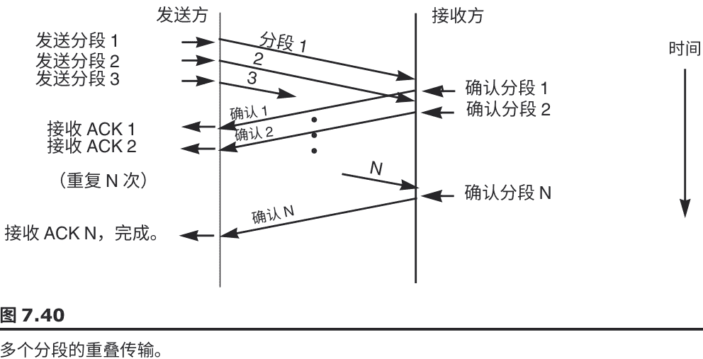

图7.41方案提供的窗口被称为固定窗口。前面描述的锁步协议是一种具有大小为一个数据段的窗口的流量控制方案。在任何窗口方案中，接收方发送窗口打开消息和第一个利用新窗口的数据到达之间经过一个网络往返时间。除非我们小心，否则这个时间将是双方都经历的纯延迟。聪明的接收方可以预测这个延迟，并发送

## 图7.41

固定窗口的流量控制。

在它期望准备好更多数据之前，发送窗口打开消息的时间要提前一个往返时间。这种形式的预测仍然使用固定窗口，但它可以更顺畅地保持数据流动。不幸的是，它需要知道网络往返时间，而正如定时器的讨论所解释的那样，这是一个很难估计的事情。练习7.13，第7-114页，和7.16，第7-115页，探讨了固定窗口思想的两个更多变体，即bang-bang协议和节奏控制。

#### 7.5.6.3 滑动窗口和自适应速率

更聪明的方案是：一旦释放了一个段缓冲区，接收器可以立即发送一个比当前窗口大一个段的许可（可以通过发送单独的消息或者如果有准备好的ACK，则可以附加在该ACK上）。发送器会跟踪剩余的窗口空间，并在接收到额外的许可时增加该数字。当窗口可以动态增加空间时，它被称为滑动窗口。滑动窗口的优点是它可以自动保持流水线填充，无需猜测何时安全发送许可授予消息。

滑动窗口似乎消除对网络往返时间的需求，但这只是一种幻觉。流量控制设计的真正挑战是开发一个在所有条件下都能良好工作的单一流量控制算法，无论瓶颈是发送方生成数据的速率、网络传输容量还是接收方接受数据的速率。当接收方是瓶颈时，目标是确保接收方永远不会等待。同样，当发送方是瓶颈时，目标是确保发送方永远不会等待。当网络是瓶颈时，目标是保持网络以最大速率传输数据。问题是什么窗口大小可以实现这些目标。

无论瓶颈位于何处，答案都由瓶颈数据速率和网络的往返时间决定。如果我们将这两个量相乘，乘积就告诉我们所需的缓冲区大小，从而确保数据的连续流动。也就是说，

窗口大小 ≥ 往返时间 × 瓶颈数据速率

为了理解这一点，想象一下我们使用大小为一个段的滑动窗口进行操作。正如我们之前所看到的，这个窗口大小创建了一个锁步协议，每个往返时间传递一个段，因此实际数据速率将是窗口大小除以往返时间。现在想象一下使用两个段的窗口进行操作。

网络将在每个往返时间传递两个段。实际数据速率仍然是窗口大小除以往返时间，但窗口大小是原来的两倍。现在，继续尝试更大的窗口大小，直到实际数据速率刚好等于瓶颈数据速率。在那一点上，窗口大小除以往返时间仍然告诉我们实际数据速率，因此我们在上面的公式中得到了相等。任何小于此的窗口大小都会产生小于瓶颈的实际数据速率。窗口大小可以大于这个最小值，但由于实际数据速率不能超过瓶颈速率，因此-

瓶颈，没有优势。实际上，窗口大小更大有一个缺点：如果出现需要排空流水线的故障，排空流水线的时间会更长。此外，窗口大小更大会给网络带来更大的负载，从而导致网络路由器中的拥塞和丢弃数据包。

滑动窗口大小满足不等式的最有趣的特性是，尽管发送方不知道瓶颈数据速率，但它正好以该速率发送。一旦发送方填满滑动窗口，它就无法发送下一个数据元素，直到窗口中最旧的数据元素的确认返回。同时，接收方无法以比网络传输数据元素更快的速度生成确认。由于这两个考虑因素，窗口滑动的速率会自动调整为等于瓶颈数据速率，这被称为自适应速率控制的特性。自适应速率控制提供了将发送方的数据速率调整为与连接可维持的数据速率完全相等的机制。

让我们考虑一下窗口大小公式在实践中的意义。假设波士顿的客户端计算机每秒可以接收500千字节的数据，想要从旧金山的服务中下载一个以每秒1兆字节的速率发送的文件，并且网络不是瓶颈。互联网在这段距离上的往返时间约为70毫秒，所以最小的窗口大小将是

70毫秒 × 500千字节/秒 = 35千字节

如果每个分段携带512字节，那么可能会有多达70个这样的分段同时在途中。相反，如果两台计算机在同一建筑物中，它们之间的往返时间为1毫秒，那么最小的窗口大小将是500字节。在这个短距离上，锁步协议同样有效。

因此，尽管努力选择适当的窗口大小，我们仍然需要对网络的往返时间进行估计，估计的准确性存在一定的风险。协议可能能够使用在设置定时器时使用的相同往返时间估计值，但有一个问题。为了避免不必要地重新传输只是在传输中延迟的数据包，用于定时器设置的估计值应该偏大。但是，如果在窗口设置中使用了过大的往返时间估计值，结果将是窗口大小过大，只会增加网络中的数据包转发队列的长度；这些更长的队列将增加传输时间，进而导致发送方认为它需要更大的窗口。为了避免这种正反馈，用于窗口大小调整的往返时间估计器需要偏小，并且设计成不对表现出过快的反应。

> * 2005年波士顿到旧金山的互联网往返时间测量通常显示最低约为70毫秒。典型的路由可能通过纽约、克利夫兰、印第安纳波利斯、堪萨斯城、丹佛和萨克拉门托传输一个数据包，距离为11,400公里，并通过每个方向上的15个数据包转发器。假设光纤传播速度为光速的66%，在这段距离上的传播延迟大约为57毫秒。因此，这30个数据包转发器似乎引入了大约13毫秒的处理和传输延迟，每个转发器大约430微秒。

一旦窗口大小确定，仍然存在一个问题，即在传输协议的接收端如何设置缓冲区的大小。确保始终有足够的空间来接收数据的最简单方法是分配一个至少与窗口大小相同的缓冲区。

### 7.5.7 流顺序的保证和连接的关闭

流传输协议传输一系列相关元素，可以是位、字节、段或消息，从一个点到另一个点，并确保它们按照发送方的顺序传递给接收方。流协议通常（但并不总是）提供额外的保证，例如没有丢失元素、没有重复元素和数据完整性。因为电话电路具有一些相同的特性，所以有时候会说流协议创建了一个虚拟电路。

按顺序传递事物的简单方法是使用第7.5.3节中描述的锁步传输协议，在该协议中，发送方在接收方确认前一个元素已安全到达之前不发送下一个元素。但是应用程序通常选择流协议来发送大量数据，而锁步传输协议所带来的往返延迟足以成为一个问题，因此几乎所有流协议都采用某种形式的重叠传输。

当添加了重叠传输时，同时在途中的几个元素可能以无序的方式到达接收端。两个完全不同的事件可能导致元素无序到达：不同的数据包可能遵循不同的路径，具有不同的传输时间，或者如果数据包经过拥塞的网络部分或受到噪声干扰，可能会被丢弃。被丢弃的数据包将需要重新传输，因此它的替代品几乎肯定会比相邻的数据包到达得晚。

传输协议可以通过在传输层头部添加一个序列号来确保数据元素按正确的顺序传递，该序列号指示当前数据段中的元素在流中的位置。在接收端，只要元素按顺序到达，协议就将元素传递给应用程序并向发送方发送确认。当元素无序到达时，协议可以采取以下两种策略之一：

+ 1. 只有当到达的元素是下一个预期的元素或先前接收到的元素的副本时，才进行确认。丢弃其他任何元素。这种策略是简单，但它会导致浪费容量的重传，这些元素在其前任到达之前到达。

+ 2. 每当元素到达时都要确认，并在其前任到达之前将元素保留在缓冲区中。当前任最终到达时，协议可以按顺序将元素传递给应用程序并释放缓冲区。

这种技术在利用网络资源方面更高效，但需要注意避免在等待早期元素时使用大量缓冲区，这些元素在被丢弃或损坏的数据包中。

这两种策略可以通过仅在有可用缓冲区时确认早期到达的元素，并丢弃其他元素来结合使用。这种方法引发了一个问题，即要分配多少缓冲区空间。一个简单的答案是至少提供足够的缓冲区空间，以容纳在解决无序条件时预计到达的所有元素。这个问题与之前探讨的根据滑动窗口大小提供多少缓冲区密切相关。按顺序交付的要求是为什么明确区分确认接收数据和打开允许发送更多数据的窗口很有用的原因之一。

通过利用到达编号流元素的附加信息，可能加快重发丢失数据包的速度。如果流元素一直很规律地到达，但是流中的一个元素丢失了，接收方可以发送一个明确的负确认（NAK）来表示缺失的元素，而不是等待发送方超时并重新发送。如果元素丢失是常见的原因，发送NAK可以提高性能。另一方面，如果缺失的元素只是在传输过程中遇到了一点额外的延迟，那么发送NAK可能会导致不必要的重传，浪费网络容量并降低性能。是否使用这种技术取决于网络的具体当前条件。可以尝试设计一个算法来判断发生了什么（例如，如果NAK导致重复，停止发送NAK），但这可能不值得增加复杂性。

正如上面第7.5.1节中所描述的接口建议的那样，使用流传输协议涉及到打开流的调用，一系列写入或读取流的调用，以及关闭流的调用。打开流涉及在连接的每一端创建一个记录。该记录跟踪已发送、已接收和已确认的元素。关闭流涉及两个额外的考虑。首先，传输协议的接收端将流的最后一个元素传递给接收应用程序后，需要向该应用程序报告流结束的指示。其次，连接的两端需要达成一致，即网络已经传递了最后一个元素，并且应该关闭流。达成这种协议需要一些小心处理。

确保一致性的一个简单协议如下：假设Alice已经向Bob打开了一个流，并且现在决定不再需要该流。她持续向Bob发送关闭请求，指定流标识符。Bob收到关闭请求后，检查是否同意不再需要该流。如果他同意，他将持续发送关闭确认，再次指定流标识符。Alice收到关闭确认后，可以关闭持续发送器并丢弃流的记录，确信Bob已接收到流的所有元素，并且不会发出任何重传请求。此外，她向Bob发送一个包含流标识符的“全部完成”消息。如果她收到关闭确认的副本，她的流记录已经丢弃，但这无关紧要；她可以假设这是来自先前关闭的某个流的重复关闭确认，并且根据关闭确认中的信息，她可以制造一个“全部完成”消息并发送给Bob。当Bob收到“全部完成”消息时，他可以关闭持续发送器，并且确信Alice同意不再需要该流，并且丢弃流的记录副本。Alice和Bob可以安全地丢弃任何提及他们没有记录的流的延迟重复项。（流本身仍然存在墓碑问题。Bob延迟删除他的记录直到没有机会收到Alice原始打开流请求的长时间延迟重复项将是一个好主意。）

### 7.5.8 抖动控制的保证

一些应用，比如将声音或视频传递给正在现场收听或观看的人，被称为实时的。对于实时应用程序来说，可靠性，即永远不传递错误的数据比及时传递更不重要。

如果传输协议通过请求重传损坏的数据元素，然后暂停传递剩余的流直到修正的数据到达，那么高可靠性实际上可能适得其反。应用程序希望的是连续传递数据，即使数据不完全完美。例如，如果电影的一个画面中有几个错误的位（请注意，这里的视频使用的“画面”一词的含义与数据通信中使用的“帧”类似但不完全相同），可能不会被注意到。实际上，如果一个视频帧在传输中完全丢失，应用程序可以在等待下一个视频帧被传递时重复上一个视频帧。对于实时应用程序来说，端到端流协议能够提供的最重要的保证是按照规律的时间表传递连续的数据元素。例如，标准的北美电视机每33.37毫秒消耗一个视频帧，下一个视频帧必须按照这个时间表呈现。

在转发网络上的传输可以产生不同的传输时间，从一个数据段到下一个数据段。在实时应用中，传递时间的变化被称为抖动，并且要求控制抖动的数量。传输协议的接收端的基本策略是延迟所有到达的数据段，使其看起来好像已经遇到了最大允许的延迟。原则上，可以估计延迟段的适当额外缓冲区量-

### 7.5.9 真实性和隐私的保证

上面描述的大多数提供保证的技术都是为在良性环境中运行而设计的，设计者假设错误可能发生，但这些错误并非恶意构造以挫败预期的保证。在许多实际环境中，情况比这更糟糕：人们必须防范敌对人员拦截和恶意修改数据包的威胁，或者一些端到端层参与者故意违反协议。

为了应对这些威胁，端到端层可以对数据应用两种基于密钥的数学变换：

1. 签名和验证，以确保消息的来源和内容的完整性
2. 加密和解密，以保护消息的隐私内容

如果正确应用，这两种技术可以有效，但在设计和实施过程中需要非常小心。如果没有小心处理，它们可能无法正常工作，但由于被应用，用户可能会误以为它们有效，从而产生虚假的安全感。虚假的保证比没有保证更糟糕。提供安全保证涉及的问题是一个独立的主题，除了网络之外，还适用于许多系统组件，因此我们将其推迟到第11章[在线]，该章节对计算机系统中的信息保护进行了深入讨论。

通过对端到端主题的研究，我们已经完成了我们认为是网络的最高层。本章的下一节，拥塞控制，是一个侧重的步骤，探索一个需要多个层次合作的主题。

## 7.6 网络系统设计问题:拥塞控制

### 7.6.1 共享资源的管理

第5章和第6章讨论了共享资源及其管理：线程管理器从少数真实的共享处理器中创建许多虚拟处理器，然后需要对其进行调度；多级内存管理器通过将小而快速的共享内存与大而慢速的存储设备相结合，为多个客户端创建了大型快速虚拟内存的幻觉。在这两种情况下，我们都研究了相对简单的管理机制，因为通常不需要更复杂的机制。在网络环境中，共享的资源是一组通信链路和支持的数据包转发器。这些组件及其用户的地理和行政分布性质给资源管理增加了延迟和复杂性，因此我们需要重新审视这个主题。

在本章的第7.1.2节中，我们看到了队列如何管理数据包在数据包交换机到达时，出口链路已经忙于传输其他数据包的问题，图7.6展示了队列随着链路利用率增加而增长的方式。这种现象同样适用于处理器调度和超市结账队列：每当存在共享资源，并且对该资源的需求来自于几个统计独立的来源时，负载的到达会出现波动，从而导致队列的长度和等待服务的时间也会有所波动。每当提供的负载（在数据包交换机的情况下，即数据包到达并需要转发的速率）在某段时间内大于资源的容量（交换机转发数据包的速率），该资源就会在该时间段内过载。

控制。当然，在减少所提供的负载时，减少的量并没有真正消失，只是推迟到以后的时间。减少所提供的负载的作用是通过平均过载期和过剩容量期，就像排队一样，但涉及到负载源，并且通常持续更长的时间。

要增加容量或减少所提供的负载，需要向一个或多个控制点提供反馈。控制点是一个确定可用资源量的实体，在第一种情况下确定负载量的实体。拥塞控制系统因此是一个反馈系统，反馈路径上的延迟可能导致负载和有效工作的振荡。

例如，在超市中，一种常见的策略是店长观察结账队列；每当任何一条队列中有两到三个以上的顾客时，店长会要求店内其他员工暂时放下手头工作，充当收银员，从而增加处理能力。相比之下，当你拨打客户支持电话时，你可能会听到自动回复的消息，例如：“您的来电对我们很重要。我们将在大约21分钟内能够回答您的问题。”这个消息可能会导致一些呼叫者挂断电话并在其他时间再次尝试，从而减少（实际上是推迟）负载。在超市和电话客户服务系统中，都很容易产生振荡。当第四个超市职员停止堆放狗饼干并走到店前时，队列可能已经消失了；如果太多的呼叫者决定挂断电话，客户服务代表可能会发现没有人可以交流了。

在商业世界中，这些策略之间的选择是一个复杂的权衡，涉及经济、物理限制、声誉和客户满意度。在计算机系统或网络中，同样的道理也成立。

### 7.6.2 网络中的资源管理

在计算机网络中，共享资源是通信链路和数据包转发器的处理和缓冲能力。有几个因素使得这个资源管理问题比起在竞争线程之间调度处理器更加困难。

1. 不止一个资源。即使是少量的资源也可以以惊人的多种方式使用，而跟踪情况所需的机制可能迅速复杂化。此外，不同资源之间可能存在动态交互——当一个资源接近容量时，它可能对另一个资源产生影响，而后者可能对另一个资源产生影响，依此类推。这些交互可能导致死锁或活锁，具体取决于细节。

2. 诱导拥塞崩溃很容易。数据包转发网络层的通常有益的独立性有助于诱导拥塞崩溃的易发性。随着特定通信链路的队列增长，延迟也增加。

3. 扩展容量的选择有限。在网络中，可能没有很多选项来应对临时过载。容量通常由物理设施决定：光纤、同轴电缆、无线频谱可用性和收发器技术。这些事物中的每一个都可以增加，但不足以快速应对临时拥塞。如果网络是网状连接的，可以考虑通过备用路径发送一些排队的数据包。这可能是一个很好的响应，但要在足够快的时间尺度内克服临时拥塞，需要了解整个网络中队列的瞬时状态。已经尝试过实现这样的策略；它们很复杂且效果不佳。通常情况下，唯一现实的策略是减少需求。

4. 减少负载的选择很麻烦。增加容量的替代方案是减少所提供的负载。不幸的是，所提供负载的控制点距离拥塞的数据包转发器很远，而且可能由独立管理。因此，至少存在三个问题：

- 到达远程控制点的反馈路径可能很长。当反馈信号到达时，发送方可能已经停止发送（但之前发送的所有数据包仍在途中等待加入队列），或者拥塞可能已经消失，发送方不再需要等待。更糟糕的是，如果我们使用网络发送信号，延迟将是不确定的，并且任何拥塞都可能导致信号丢失。

- 控制点（在这种情况下，是端到端协议或应用程序）必须能够减少其负载。一些端到端协议可以很容易地做到这一点，但其他协议可能无法做到。例如，用于发送文件的流协议可能可以在短时间内降低其平均数据速率。另一方面，实时视频传输协议可能承诺每秒传输一定数量的比特。单个数据包的请求/响应协议对网络负载没有任何控制；控制必须由应用程序施加，这意味着必须有一种方式来请求应用程序合作（如果可能的话）。

- 控制点必须愿意合作。如果拥塞是由数据包转发器的网络层发现的，但控制点位于叶节点的端到端层，那么这两个实体很有可能由不同的管理部门负责。在这种情况下，获得合作可能会有问题；控制点的管理部门可能更感兴趣的是保持其提供的负载等于其预期的负载，以期在竞争中获得更多的容量。

这些问题使得很难看到如何应用中央计划的方法，就像在杂货店中起作用的方法一样。分散的方案似乎更有前途。已经设计出了许多机制来尝试管理网络拥塞。第7.6.3节和第7.6.4节描述了围绕一组分散机制的设计考虑，类似于当前在公共互联网中使用的机制。这些机制并不特别被理解，但它们不仅似乎有效，而且还使得互联网能够在惊人的容量范围内运行。事实上，互联网可能是最好的现有反例，不符合不可测量的缩放规则。

回想一下，规则建议每当任何重要参数变化十倍时，系统需要重新设计。互联网从几百个连接点增加到几亿个连接点，只需对其底层设计进行适度调整。

## 7.6.3 跨层协作: 反馈

如果设计师能够安排跨层合作，那么攻击拥塞的一种方式是，注意到拥塞的分组转发器向一个或多个端到端层源提供反馈，而端到端源通过减少其提供的负载来做出响应。

已经提出了几种机制来提供反馈。首先尝试的一个想法是，拥塞的分组转发器向一个或多个似乎正在填充队列的源地址发送一个称为源抑制的控制消息。不幸的是，在准备控制消息时，分组转发器会分散注意力。

至少需要额外的干扰。此外，传输控制包会给已经过载的网络增加负载。由于控制协议是尽力而为的，随着网络负载的增加，控制消息本身被丢弃的机会也增加，因此当网络最需要拥塞控制时，控制消息最有可能丢失。

第二个反馈的想法是对正在经历拥塞的数据包转发器设置一个标志。当数据包到达目的地时，端到端传输协议应该注意到拥塞标志，并在下一个发送的数据包中包含一个“减速！”的请求，以提醒另一端有关拥塞的情况。这种技术的优点是不需要额外的数据包。

相反，所有通信都是通过本来要发送的数据包进行的。但是，反馈路径比源抑制更危险——信号不仅必须首先到达目的地，端到端协议的下一个响应数据包可能不会立即发送。

这两个反馈的想法都需要反馈源自网络的分组转发层。但是在链路层也有可能发现拥塞，特别是当一个链路递归地成为另一个网络时。出于这些原因，互联网设计者们达成了一种关于拥塞反馈的第三种通信方法：拥塞的分组转发器直接丢弃一个分组。这种方法不需要解释分组内容，可以简单地在任何注意到拥塞的组件的任何层中实现。希望的是，分组的源头最终会注意到缺乏响应（或者可能收到一个NAK）。这种方案并不是万能的，因为端到端层必须假设每个分组丢失都是由于拥塞引起的，而端到端层的响应速度取决于其定时器设置。但是它简单可靠。

这种方案留下了一个问题，即要丢弃哪个分组。选择并不明显；一个拥塞的分组转发器可能更愿意识别对拥塞贡献最大的源头并向它们发出信号，但是拥塞的分组转发器有更重要的事情要做，而不是对其队列进行广泛的分析。最简单的方法，称为尾部丢弃，是限制队列的大小；当队列已满时，任何到达的分组都会被丢弃。一种更好的技术（随机丢弃）可能是从队列中随机选择一个受害者。这种方法具有的优点是，对于拥塞贡献最大的源头最有可能接收到反馈。甚至可以说提出一个合理的论点，将队列中的包丢弃在队列的前端，因为在队列中的所有包中，位于前端的包已经在网络中存在最长时间，因此与其关联的计时器最有可能已经过期。

另一种改进（早期丢弃）是在队列完全满之前开始丢弃数据包，希望能更早地警示源头。早期丢弃的目标是在检测到拥塞可能性时立即开始减少所提供的负载，而不是等到确认拥塞后再采取措施，因此可以将其视为一种避免而不是恢复的策略。随机丢弃和早期丢弃结合在一起形成了一种称为RED（随机早期检测）的方案。

## 7.6.4 跨层协作: 控制

假设端到端协议实现发现了一个丢失的数据包。那么呢？一种可能性是它只是继续前进，重新传输丢失的分组并继续发送更多数据尽快地应用供应它。端到端协议实现在控制，并且没有强制它合作。实际上，它可能发现通过以最大速率发送数据包它可以承受的，它将通过更多的数据包拥塞的数据包转发器比它否则。当然，问题是如果这是每个客户端的标准操作模式，拥塞将会发生网络的所有客户端都会受到影响如公地悲剧所预测的那样（见边栏7.8）。

如第7.5.6节所述，协议可以通过直接测量第一个数据包交换的往返时间来估计它，并在额外的数据包来回流动时不断更新该估计。然后，如果出现拥塞，排队延迟将增加单个数据包的观察往返时间，并且

这些观察结果将增加用于设置未来重传计时器的往返估计。此外，当计时器到期时，计时器设置算法应使用指数退避来连续重传相同数据包（指数退避在第7.5.2节中有描述）。无论数据包延迟在不断增长的队列中还是作为拥塞控制的一部分被丢弃，到期的原因都无关紧要。无论哪种方式，指数退避立即降低了重传速率，有助于缓解拥塞问题。指数退避已被证明是避免导致拥塞崩溃的有效方法。一旦确认开始实际传输数据包，发送方可以再次允许往返时间估计来控制计时器设置。

第二个合作策略涉及管理流量控制窗口。回顾从第7.5.6节中关于流量控制的讨论，为了保持数据流动尽可能快，而不会超过接收应用程序，流量控制窗口和接收方缓冲区都应该至少与瓶颈数据速率乘以往返时间一样大。任何大于此的大小都可以同样有效地进行端到端流量控制。不幸的是，当瓶颈是网络内部的拥塞链路时，比必要的窗口更大只会导致更多的数据包在该链路的队列中堆积。因此，额外的合作策略是确保流量控制窗口不要超过必要的大小。即使接收方有足够大的缓冲区来证明更大的流量控制窗口是合理的，发送方也应该克制自己，并将流量控制窗口设置为保持连接以瓶颈允许的数据速率运行的最小大小。换句话说，发送方应该在第7-79页的表达式中强制相等。

在互联网的历史上相对较早的时候，人们意识到（并在实地验证了）拥塞崩溃不仅是可能的，而且一些最初的互联网协议具有意外的强拥塞诱发特性。从那时起，几乎所有的TCP实现，即最广泛使用的端到端互联网传输协议，都经过了重大修改，以减少风险，如第7.9节所述。虽然拥有一个广泛部署的合作控制拥塞策略既减少了拥塞，又减少了拥塞崩溃的机会，但也有一个不幸的后果：由于每个合作的客户端可能提供的负载都小于其预期负载，因此再也无法估计该预期负载的大小。中间的数据包转发器知道，如果他们经常丢弃一些数据包，他们需要更多的容量，但他们不知道他们真正需要多少容量。

## 7.6.5 网络中其他控制拥塞的方法

过度配置：将网络的每个链路的容量配置为最繁忙的一分钟（或五分钟或一小时）的负载的125%（或150%或200%）。这种技术在大型网络的内部链路上效果最好，在那里没有任何单个客户端代表的负载超过总负载的一小部分。当情况如此时，大量统计独立源提供的平均负载相对较低。

## 7.6 网络系统设计问题：拥塞控制 7-95

侧边栏7.9：TCP改造。传输控制协议（TCP）是互联网上最广泛使用的端到端传输协议，设计于1974年，那时候，以前的经验仅限于锁步协议。在没有超过几百个节点的网络上。因此，避免拥塞崩溃不在其要求列表中。大约十年后，当互联网开始迅速扩展时，人们注意到了这个遗漏，并关注了其设计中引起崩溃的特定特性。

原始TCP中唯一的确认形式是“我已经接收到所有字节直到X”。接收方无法说出例如“我丢失了字节Y到Z”。因此，当定时器因为某个数据包或其确认丢失而过期时，一旦发送方重新传输该数据包，下一个数据包的定时器就会过期，导致其重新传输。这个过程会一直重复，直到下一个确认最终返回，即一个完整的往返时间（和完整的流量控制窗口）之后。在长途路线上，流量控制窗口可能相当大，如果一个过载的数据包转发器通过丢弃几个数据包（每个数据包可能来自不同的TCP连接）来响应拥塞，每个丢弃的数据包都会触发整个窗口的重新传输，而随之而来的大量重新传输的数据包可能会立即引发拥塞崩溃。此外，一个不够自适应的超时方案确保了该问题会经常发生。

当这种效果被认识到时，TCP已经广泛部署，因此对协议的更改受到了严格限制。设计者找到了一种方法，可以在不改变数据格式的情况下改变实现方式。目标是允许新旧实现进行互操作，因此新实现可以逐步替换旧实现。新实现的工作方式是通过调整流量控制窗口的大小来实现的（警告：此解释有些过于简化！）：

- 1. 慢启动。在开始新连接时，只发送一个数据包，并等待其确认。然后，对于每个确认的数据包，将窗口大小增加一，并发送两个数据包。结果是在每个往返时间内，发送方发送的数据包数量翻倍。这个翻倍的过程会一直持续，直到发生以下三种情况之一：（1）发送方达到接收方建议的窗口大小，此时网络不是瓶颈，发送方将保持窗口大小不变；（2）所有可用数据都已发送；或者（3）发送方检测到其发送的数据包已被丢弃，如步骤2所述。

- 2. 重复确认：接收TCP实现略微修改：每当它接收到一个乱序的数据包时，它会发送一个重复的最新确认。这个想法是，发送方可以将重复的确认解释为对下一个未确认数据包的否定确认。

- 3. 平衡：在重复确认时，发送方只重新传输第一个未确认的数据包，并将窗口大小降低到之前大小的固定比例（例如，1/2）。从那时起，它以平衡模式运行，继续观察重复确认，但也轻轻地探测是否有更多的容量可用。平衡模式有两个组成部分：

  - 加性增加：每当一个往返时间内的所有数据包都成功确认，发送方就将窗口大小增加一。
  - 乘性减少：每当收到一个重复的确认，发送方就将窗口大小减少固定比例。

- 4. 重新启动：如果发送方的重传计时器超时，基于确认的自适应速率控制已经中断，可能是因为网络中的某些变化。所以发送方会等待一段时间让事情平静下来，然后重新开始慢启动，以评估网络的新状态。因为将重复的确认解释为对单个数据包的否定确认，TCP消除了大规模的重传风暴，并且通过在每个计时器超时时重新启动慢启动，避免了对拥塞崩溃的贡献。

通过将重复的确认解释为对单个数据包的否定确认，TCP消除了大规模的重传风暴，并且通过在每个计时器超时时重新启动慢启动，避免了对拥塞崩溃的贡献。

下图展示了TCP窗口大小随时间的演变，其中瓶颈在网络内部。TCP从一个数据包和慢启动开始，直到检测到第一个数据包丢失。发送方立即将窗口大小减半，然后在每个往返时间内逐渐增加一个，直到检测到另一个丢失的数据包。除非重传计时器超时，否则这种锯齿行为可能会无限继续。发送方暂停，然后进入另一个慢启动阶段，这次在达到之前的窗口大小时切换到加法增加，即之前遇到最新拥塞回合之前的窗口大小的一半。

这种合作方案尚未进行系统分析，但在实践中似乎有效，尽管并非所有互联网上的流量都使用TCP作为端到端传输协议。

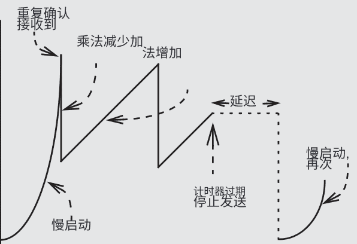

## 7.6.6 延迟再探讨

本章的7.1.2节确定了网络中的四种延迟来源：传播延迟、处理延迟、传输延迟和排队延迟。拥塞控制和流量控制似乎都增加了第五种延迟来源，在这种情况下，发送方等待接收方的许可才能将消息发送到网络中。实际上，这种延迟并不是一种新的类型，它实际上是在不同的协议层中产生的传输延迟的一个例子。当我们确定了四种延迟类型时，我们还没有讨论协议层，所以这种微妙之处并没有出现。

网络的每个协议层都可以施加任何或所有四种延迟类型。例如，第7.1.2节所确定的处理延迟实际上由链路层中的处理延迟组成（例如，用于位填充和计算校验和的时间）。

网络层中的处理延迟（例如，在转发表中查找地址所花费的时间）和端到端层中的处理延迟（例如，压缩数据所花费的时间，将长消息分割成段并稍后重新组装它，以及加密或解密消息内容所花费的时间）。

同样，传输延迟也可能在每个层中出现。在链路层，传输延迟是从帧的第一个比特进入链路直到同一帧的最后一个比特进入链路的时间。帧的长度和链路的数据速率共同决定了它的大小。网络层通常不会施加任何额外的传输延迟，但在选择路由（从而确定链路层传输延迟的数量）时，它有助于确定跳数。端到端层在拥塞控制或流量控制的调节效果导致其等待发送许可时，会引入额外的传输延迟。端到端路径中瓶颈的数据速率、往返时间和流量控制窗口的大小共同决定了端到端传输延迟的大小。

当等待消息的乱序片段到达时，端到端层也可能延迟将消息传递给其客户端，并且为了减少抖动，它可能延迟传递。这些传递延迟是端到端传输延迟的另一个组成部分。

任何施加处理或传输延迟的层也可能导致后续数据包的排队延迟。链路层的传输延迟因此可以创建队列，数据包在等待链路可用时等待。如果在路由器上的某个时间段内有多个数据包到达，网络层可以施加排队延迟，因为路由器需要花费时间来确定如何转发数据包。最后，端到端层也可以排队等待流量控制或拥塞控制许可进入网络的数据包。

传播延迟似乎是链路层独有的，但仔细计算将揭示由网络和端到端层贡献的小的传播延迟，因为消息在路由器或端节点计算机内部移动。因为网络链路中涉及的距离通常比计算机内部的距离大几个数量级，所以通常可以忽略网络和端到端层的传播延迟。

## 7.7 网络总结

本章介绍了许多设计和处理数据通信网络的概念和技术。一个自然的问题出现了：“这些东西真的都需要吗？”

当然，答案是“取决于情况。”这显然取决于应用程序，可能不需要各种网络层提供的所有功能。这还取决于几个较低层面的因素。

例如，如果在链路层整个网络只包含一个点对点链路，根本不需要网络层。可能仍然需要复用链路，但复用不需要任何路由功能。

网络层因为链路的一端进入的所有内容都是为了连接的另一端。此外，可能不需要端到端层的某些传输服务，因为帧、段、流或消息以相同的顺序从链路中出来。短链路有时非常可靠，这种情况下端到端层可能不需要提供重复生成的重发机制，从而可以省略重复抑制。最终端到端功能中剩下的是会话服务（例如验证用户身份和加密通信以保护隐私）和表示服务（将应用程序数据编组为可以作为消息或流传输的形式）。同样，如果在链路层整个网络只包含一个广播链路，就需要一个网络层，但它是残留的：它只包含每个接收器上足够的智能来丢弃寻址不同目标的数据包。例如，第3章中描述的背板总线是一个可靠的广播网络，具有仅提供表示服务的端到端层。

另一方面，数据包丢失仍然很少，可能可以忽略它，而重新排序的数据包传递不是一个问题。

与计算机系统设计的方面一样，需要良好的判断力和仔细考虑权衡，以实现良好且经济的设计。本总结完成了我们关于网络的概念材料。在

本章的其余部分中，我们将介绍一个流行的网络设计案例研究，以太网，以及一系列与网络相关的故事。

## 7.8 案例研究：将互联网映射到以太网

本案例研究从使用本章的术语和网络模型简要描述以太网开始。然后，它探讨了在将数据包转发网络（如互联网）映射到以太网时涉及的路由问题。

### 7.8.1 以太网简介

以太网是基于共享线缆或光纤链路上的广播的一系列局域网的通用名称，在该链路上，所有参与者都可以听到彼此的传输。

以太网使用“先听后发送”规则（称为“载波感知”）来控制访问，并使用“边听边发送”规则来最小化如果两个站点同时开始发送而导致的传输时间浪费，这种错误称为“碰撞”。该协议被命名为“带冲突检测的载波感知多路访问”，简称CSMA/CD。以太网在1974年进行了演示，并在1976年由Metcalfe和Boggs的论文中进行了记录[参见进一步阅读建议7.1.2]。自那时以来，已经发展出了几个速度逐渐提高的版本。最初设计为半双工系统，后来发展出了一个全双工的点对点规范，放宽了长度限制。

### 7.8.2 以太网的广播特性

本章的第7.3.5节提到以太网是使用广播链路的一个例子。如图7.43所示，以太网链路层非常简单：每个帧都传递给每个站点。在其网络层，每个以太网站点都有一个48位地址，为了避免与其他地址混淆，我们将其称为站点标识符。

（为了减少后续示例中的歧义，站点标识符将是唯一的两位数。）

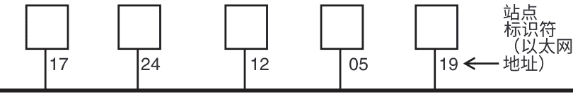

**图7.43** 以太网。

以太网的网络层非常简单。在发送端，以太网的发送过程除了将调用传递给链路层外，不做任何操作。在接收端，以太网网络层的网络处理程序很简单：

```
过程以太网_处理（网络数据包，长度）
目标≠网络数据包.目标ID
如果目标=我的站点ID或目标=广播ID，那么
将数据包.数据，
数据包.结束协议，
数据包.源ID传递给结束层
否则
忽略数据包
```

这个网络层处理程序与数据包转发网络的网络层处理程序之间有两个区别：

- 因为底层物理链路是广播链路，所以由站点的网络层来确定它应该忽略不是专门寻址给它的数据包。
- 因为每个数据包都传递给每个以太网站点，所以不需要进行任何转发。

大多数以太网实现实际上完全将以太网处理硬件化。

一个结果是每个站点的硬件必须知道自己的站点标识符，以便可以忽略发送给其他站点的数据包。这个标识符在制造时被固定在硬件中，但大多数实现还提供一个可编程的标识符寄存器，可以覆盖固定的标识符。

由于以太网的链路层是广播链路，它为网络层提供了一个方便的额外机会来创建一个广播网络。为此，以太网将一个站点标识符保留为广播地址，并且网络处理程序还获取了一个额外的测试：

```
过程以太网_处理（网络数据包，长度）
目标≠网络数据包.目标_id
如果目标=我的站点_id或目标=广播_id，那么
将数据包.数据，
数据包.结束协议，
数据包.源_id传递给结束层
否则
忽略数据包
```

### 7.8.3 层映射：将以太网连接到转发网络

假设我们在一个建筑物中有几台工作站和几台服务器，它们都使用以太网连接，并且我们希望通过将以太网作为图7.31（第7-50页）上所示的转发网络中的第六个路由器k上的一个链接来连接这个以太网。这个连接产生了图7.44的配置。

图中有三种与网络相关的标签。首先，每个链接都用一个本地的单个数字链接标识符（斜体）进行编号，从连接该链接的站点内部来看。其次，就像图7.43中一样，每个以太网连接点都有一个两位数的以太网站点标识符。最后，每个站点都有一个字母名称，就像图7-50页上的转发网络中一样。在这个配置中，工作站L通过将一或多个数据包发送到连接在其上作为链接号1的以太网的站点18，向服务器N发送一个远程过程调用。

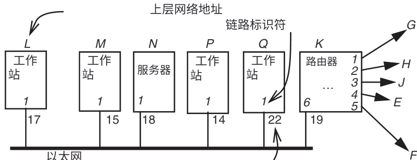

**图7.44** 将以太网连接到数据包转发网络。

工作站L还可能想向连接到目标E的计算机发送请求，这要求L实际将请求数据包发送到以太网站点19的路由器K，以便转发到目标E。复杂的是，E可能在数据包转发网络的地址15处，而工作站M在以太网的站点15处。由于以太网站点标识符可能被连接到硬件接口中，我们可能无法根据需要设置它们，而且在原始数据包转发网络上更改地址可能会非常麻烦。这里的关键是，我们不能简单地将以太网站点标识符用作数据包转发网络中的网络地址。但是这个结论似乎让站点L无法表达它想要将数据包发送到地址E的想法。

我们之所以能够用文字表达这个想法，是因为在这两个图中我们为每个站点分配了一个唯一的字母标识符。我们的设计需要一个更通用的网络概念——一个包括以太网和分组转发网络中的每个站点，并为每个站点分配唯一网络地址的云。回想一下，字母标识符最初代表分组转发网络中的地址；它们甚至可以是分层标识符。我们可以简单地扩展这个概念，并为每个以太网站点分配来自同一编号计划的标识符，除了已连接的以太网站点标识符之外。

我们在这里做的是将分组转发网络的字母标识符映射到以太网的站点标识符。由于以太网本身可以分解为网络层和链路层，我们可以像第7-34页建议的那样描述这种情况，即将一个上层网络层映射到一个下层网络层的映射组合。上层网络层是互联网的简化版本，因此我们将其标记为“internet”，使用小写字母作为提醒它是简化版。我们的互联网为我们提供了一种语言，通过它工作站L可以表达它想要向位于路由器之外的服务器E发送一个RPC请求的想法：

```
网络_发送(数据,长度,RPC,互联网,E)
```

其中E是服务器的互联网地址，第四个参数从可用的网络协议中选择我们的互联网转发协议。使用这种方案，站点A也使用相同的网络地址E向该服务器发送请求。

换句话说，这个互联网提供了一个通用的命名空间。

我们的新的、扩展的互联网网络层现在必须将其地址映射到以太网网络层所需的以太网站点标识符。例如，当工作站L通过网络发送远程过程调用到服务器N时

```
网络_发送(数据,长度,RPC,互联网,N)
```

互联网网络层必须将其转换为以太网网络层的调用

```
网络_发送(数据,长度,RPC,ENET,18)
```

其中我们已经命名了以太网网络层协议ENET。

## 7.8 案例研究：将互联网映射到以太网 7-105

为了这个目的，L必须维护一个表格，如图7.45所示，其中每个互联网地址映射到一个以太网站点标识符。这个表格将地址N映射到ENET站点18，如上所述的NETWORK_SEND调用所需。

由于我们的互联网是一个转发网络，我们的表格还表明对于地址E要做的是将数据包发送到ENET站点19，希望它（在我们的图表中是一个路由器）能够良好地连接并将数据包传递到目的地。这个表格只是本章第7.4节中的转发表的另一个示例。

| 互联网地址 | 以太网/站点 |
|---|---|
|M|enet/15|
|N|enet/18|
|P|enet/14|
|Q|enet/22|
|K|enet/19|
|E|enet/19|

转发表用于连接上层和下层地址

### 7.8.4 地址解析协议

转发表可以通过手动方式填写，即网络管理员在将新站点添加到以太网时，访问已经存在于该以太网上的每个站点，并向其转发表添加一个条目。但是，手动网络管理的魅力很快就会随着网络中站点数量的增加而消失，通常会实施更自动化的过程。

一种优雅的方案，称为地址解析协议（ARP），利用以太网的广播特性，在需要时动态填充转发表。假设我们从一个空的转发表开始，并且一个应用程序调用了互联网NETWORK_SEND接口，在L中请求发送一个数据包到互联网地址M。L中的互联网网络层查找其本地转发表，发现没有有用的信息，于是请求以太网网络层发送以下查询：

```
网络_发送("在哪里M？", 11, ARP, ENET, 广播)
```

其中11是查询中的字节数，ARP是我们使用的网络层协议，而不是INTERNET，BROADCAST是保留用于在此以太网上广播的站点标识符。

由于此查询使用广播地址，因此它将被附加以太网上的每个站点的以太网网络层接收。每个站点都会注意到ARP协议类型，并将其传递给其上层网络层中的Arphandler。每个Arphandler都会检查查询，并且如果在查询中发现自己的互联网地址，则发送响应：

```
网络_发送("M在站点15", 18, ARP, ENET, 广播)
```

最多只有一个站点——由ARP请求命名的互联网地址的站点——会响应。其他所有站点都会忽略ARP请求。当ARP响应到达站点17号站点时，该站点的以太网网络层将其传递给上层网络层的Arphandler，它将立即添加一个将地址M与站点15关联的条目到其右侧显示的转发表中。17号站点的互联网网络处理程序现在可以继续进行最初请求的发送操作。

| 互联网地址 | 以太网/站点 |
| :--- | :--- |
| M | enet/15 |

| 互联网地址 | 以太网/站点 |
| :--- | :--- |
| M | enet/15 |
| E | enet/19 |

现在假设站点L尝试向服务器发送一个数据包E，它在互联网上，但不直接连接到以太网。在这种情况下，服务器E不会听到以太网广播，但站点19的路由器会听到，并发送一个适当的ARP响应。然后转发表在左边显示的第二个条目。站点L现在可以将数据包发送到路由器，路由器可能知道如何将数据包转发到其目标地址。

还需要一步操作——除非服务器在E上，否则无法回复站点L。这一步很容易安排：每当路由器K通过ARP听到其连接的以太网上存在一个站点时，它只需将该互联网地址添加到其广告列表中，并且它正在使用的任何路由协议都将在整个互联网中传播该信息。如果使用分层地址，则区域设计者可以分配一个区域号，专门用于简化路由的所有以太网上的所有站点。

从以太网站点标识符到更高网络级别的地址的映射因此是动态构建的，并且最终站点L将拥有图7.45中显示的完整表。在现场部署的典型系统中，已经在许多方向上开发和完善了这一基本的动态映射思想集合：转发表通常被管理为缓存，具有超时或可以明确更新的条目，以允许站点更改其站点标识符；未发送原始ARP请求的站点也可以注意到ARP响应，以供将来参考；新连接的站点可以在不被要求的情况下广播一个看似是ARP响应的信息，只是为了让现有站点知道它的存在（广告）；甚至还有ARP协议的反向版本，可以由站点使用来询问是否有人知道其自己的更高级网络地址，或者要求分配一个更高级别的地址给它。这些改进对于我们的案例研究并不重要，但其中许多对于平滑的网络管理是必不可少的。

## 7.9 战争故事：协议设计中的意外 7-109

### 7.9.1 固定定时器导致NFS拥塞崩溃

拥塞崩溃的一个经典例子出现在早期版本的Sun Network文件系统（NFS）中，该系统在第4.5节的案例研究中有所描述。NFS服务器实现了至少一次的语义，具有幂等无状态接口。NFS客户端被编程为持久化。如果在固定的秒数后没有收到响应，它将重新发送请求，必要时无限重复。服务器只是简单地运行一个先进先出队列，因此如果几个NFS客户端恰好在同一时间向服务器发出请求，服务器将按照请求到达的顺序逐个处理请求。这些表面上合理的安排为客户端和服务器的问题奠定了基础。

随着客户数量的增加，队列的长度也相应增加。当有足够多的客户时，队列会变得足够长，以至于一些请求在服务器处理之前超时。这些超时的客户会重新发出他们的请求。随着时间的推移，服务器会处理超时的客户的原始请求，发送响应，然后这些客户会满意离开。但是，该客户的重复请求仍然存在于服务器的队列中。无状态的NFS服务器无法判断它是否已经处理过重复请求，因此当它处理到重复请求时，会继续处理，花费与之前相同的时间，并发送一个不必要的响应。客户端忽略了这个响应，但服务器处理重复请求所花费的时间是浪费的，并且这种浪费发生在服务器最不能承受的时候——它已经负载过重，至少有一个客户端已经超时。一旦服务器开始浪费时间处理重复请求，队列会变得更长，导致更多的客户端超时，进而产生更多的重复请求。观察到的效果是，负载的稳定增加会导致满足请求的稳定增加，直到服务器接近满负荷。如果负载超过容量，即使只是短时间，从那时起每个请求都会超时，并被复制，导致服务器负载加倍。这还不是结束——负载加倍后，客户端会开始第二次超时，再次发送他们的请求，从而使负载增加三倍。从那时起，情况会继续恶化，没有办法恢复。

从NFS服务器的角度来看，它只是在执行客户端的请求，但从客户端的角度来看，有用的吞吐量降为零。解决这个问题的方法是让客户端在选择计时器设置时切换到指数退避算法：每次客户端超时，它都会将计时器设置的大小加倍，用于下一次请求的重复。

教训：固定计时器总是会引发麻烦，有时甚至是灾难性的麻烦。

### 7.9.2 Autonet广播风暴

Autonet是Digital Equipment Corporation Systems Research Center设计的一种实验性局域网，以一种优雅的方式处理广播。该网络被组织成一棵树。当一个节点向广播地址发送数据包时，网络首先将数据包路由到树的根部。根节点将数据包转回并沿着树的每条路径发送。节点只接受向下传输的数据包，因此这个过程确保了广播数据包能够到达每个连接的节点，但不会超过一次。但偶尔，网络会因为大量重复的广播数据包而崩溃。对软件的分析没有找到问题的可能来源。需要一个硬件专家才能找出问题的原因。

Autonet的物理层由点对点同轴电缆组成。未终端的同轴电缆具有一个有趣的特性，即它几乎完美地反射沿电缆发送的任何信号。这种反射被称为“回声”。回声是模拟有线电视系统中幽灵的原因之一。

在Autonet的情况下，每个节点的网络卡正确终端电缆，消除了回声。但是，如果有人断开了与网络的连接，并且让电缆悬挂着，那么该电缆将把一切都回声给它的源头。

假设有人断开了一根电缆，并且网络中的其他人发送一个数据包到广播地址。网络将数据包路由到树的根部，根部将数据包转回并发送到树的下方。当数据包到达未终端电缆的末端时，它会反射并返回到电缆的另一端，看起来像一个具有广播地址的新的上行数据包。末端的节点会将数据包向根节点转发，根节点在收到后再次将其转回并发送。一次又一次，尽快地将数据包传送到网络上。

课程：紧密相关的系统层面上的不同系统特性的相互作用常常会产生新的特性，比如链路层反射和网络层广播。

### 7.9.3 周期性协议的紧急相位同步

一些网络协议涉及定期轮询。例如，收取邮件、检查聊天伙伴以及发送“你在吗？”的询问以确保同事没有崩溃。以一个具体的例子来说，一个工作站可能每五分钟发送一个广播包来宣布它仍然可以进行对话。如果在同一个局域网上有几十个这样的工作站，设计者希望它们不要同时广播。人们可能会假设，即使它们都以相同的周期广播，如果它们随机开始，它们的广播会不同步，并且需要特殊的努力来同步它们的相位并保持同步。不幸的是，常常会发现它们以某种方式自我同步，并且都试图在同一时间进行广播。

这怎么可能呢？例如，假设一组工作站中的每一个都发送广播，然后设置一个固定间隔的定时器。当定时器到期时，它再次发送广播，并在发送后再次设置定时器。在发送广播消息的同时，定时器不在运行。如果第二个工作站在此期间发送广播，两个工作站都会发生网络中断，每个工作站都接受另一个工作站的广播，并做出记录，这是可以预料的。但是处理传入广播中断所需的时间会稍微延迟两个工作站下一个定时周期的开始，而在工作站的定时器运行时到达的广播不会影响定时器。尽管延迟很小，但它确实会使这些工作站的广播相对于其他所有工作站的定时发生偏移。下次该工作站的定时器到期时，它将再次被另一个工作站中断，因为它们都使用相同的定时器值，它们的定时周期都会再次稍微延长。这两个工作站已经形成了一个相位锁定的群体，并将无限期地保持这种状态。

更重要的是，两台意外同步的工作站现在以稍微大于其他所有工作站的周期进行轮询。结果是，它们的广播现在相对于其他广播进行了进动，并最终会与第三台工作站的广播时间重叠。然后，该工作站将加入相位锁定组，增加进动速率，事情就这样继续下去。问题在于系统设计无意中包含了一个新出现的相位锁定环，类似于第7-36页上描述的那个。

通用机制是所谓的“固定”间隔不计算周期性程序的运行时间，并且由于某种原因，当两个或多个参与者恰好同时运行时，运行时间会有所不同。在网络中，发现不同步的活动具有相同的定时周期变得非常普遍。

教训：固定定时器有很多弊端。不要假设不同步的周期性活动会保持不变。

### 7.9.4 威斯康星时间服务器崩溃

NETGEAR®，以太网和无线设备制造商，为其面向家庭使用的四款低成本无线路由器增加了一个功能：记录通过路由器的数据包的日志。为了在调试中有用，设计师们意识到日志需要为每个日志条目添加时间戳，但是添加时间戳需要路由器知道当前的日期和时间。由于路由器将连接到互联网，设计师们添加了几行代码，调用了一个简单的网络时间服务协议，称为SNT。由于SNT要求客户端调用特定的时间服务，因此仍然存在名称发现问题。他们通过配置固件代码与网络时间服务的互联网地址来解决这个问题。具体而言，他们插入了地址128.105.39.11，这是威斯康星大学运营的时间服务器之一的网络地址。设计师们用一个持久的发送器将这段代码包围起来，每秒重试一次协议，直到收到响应为止。收到响应后，它使用相同的持久发送器以从每分钟到每天一次的时间表刷新时钟，根据固件版本的不同。

2003年5月14日，当地时间上午8:00左右，威斯康星大学的网络人员注意到他们与互联网的连接处突然增加了入站互联网流量的速率——从每秒20,000个数据包增加到每秒60,000个数据包。所有额外的流量似乎都是针对他们的时间服务器的SNTP数据包，并指定了相同的UDP响应端口，端口23457。为了防止对大学网络访问的干扰，工作人员在边界路由器上安装了一个临时过滤器，丢弃了所有指定响应端口为23457的入站SNTP请求数据包。他们还尝试调用SNTP协议访问控制功能，该功能可以发送一个响应，实际上是说“离开”，但对入站数据包洪水没有任何影响。

在接下来的几周里，SNTP数据包继续以递增的速度到达，很快达到每秒约270,000个数据包，并消耗大约每秒150兆位的互联网连接容量。对流量的分析显示，源地址似乎是合法的，并且任何一个单一的源都会每秒发送一个数据包。通过一些调查，发现NETGEAR路由器是数据包的源，并且固件中包含目标地址和响应端口号。更深入的分析确定了即时的困难是拥塞崩溃。NETGEAR已经销售了全球超过700,000台包含这个代码的路由器。随着运行数量的增加，威斯康星时间服务的负载逐渐增加，直到有一天服务器的响应延迟超过一秒。在那时，发出该请求的NETGEAR路由器超时并重新尝试，从而增加了对时间服务的负载，进一步增加了时间服务对未来请求者的响应延迟。经过几次这样的事件，几乎所有的NETGEAR路由器都会开始超时，从而将它们所呈现的负载乘以60倍或更多，这确保了服务器的延迟将继续超过它们的一秒定时器。

威斯康星州和NETGEAR是如何解决这个问题的，以及以谁的代价，这是一个完全不同的故事。

教训：有几个。(1) 固定定时器再次出现在事故现场。(2) 配置一个负载过多的固定互联网地址是一个坏主意。在这种情况下，有线地址使得通过将请求重定向到不同的时间服务（例如由NETGEAR提供的服务）来修复问题变得困难。地址应该是一个变量，最好是一个可以通过间接引用来隐藏的变量（通过间接引用来解耦模块）。(3) 存在诸如“go away”响应之类的功能是有原因的；对于客户端只实现协议的一部分是有风险的。

> 关于这个故事，请参见<http://www.cs.wisc.edu/~plonka/netgear-sntp/>。这个事件也在David Mills, Judah Levine, Richard Schmidt和David Plonka的文章中有描述。“Coping with overload on the Network Time Protocol public servers.” Proceedings of the Precision Time and Time Interval (PTTI) Applications and Planning Meeting (Washington DC, December 2004), pages5-16.

## 练习 7-111

# 练习

7.1 第1章讨论了处理复杂性的四种一般方法: 模块化、抽象、层次化和分层。协议栈使用这四种方法中的哪一种作为其主要组织方案?

1996-1-1e

7.2 端到端原则

+ A. 是在计算机系统中放置功能的准则；
+ B. 是在计算机系统中放置功能的规则；
+ C. 是关于在计算机系统中放置功能的辩论；
+ D. 是关于计算机网络匿名性的辩论。

1999-2-03

7.3 以下是最好的端到端原则的例子之一: A. 如果你把世界上所有的网络黑客排成一排, 他们会从剑桥延伸到欧洲核子研究中心。

+ B. 每个进入UNIX管道写端的字节最终都会从管道的读端出现；
+ C. 即使链条制造商在组装之前对每个链接进行测试, 最好还是测试完成的链条；
+ D. 每个字节都必须通过奇偶校验位来增强分组校验和；
+ E. 所有重要的网络通信功能应该移至应用层。

1998-2-01

7.4 以时序图的形式给出两种可能导致重复请求到达服务的场景。

1995-1-5a

7.5 在发送帧后, 某个网络软件会等待一秒钟以等待确认, 然后再重新发送帧。每次重新发送后, 延迟时间减半, 所以在第一次重新发送后, 等待时间为1/2秒, 在第二次重新发送后, 等待时间为1/4秒, 依此类推。如果将延迟时间减少到1/1024秒，会发生什么？

1987-1-2a

7.5a. 这是以太网管理重传延迟的好方法吗？为什么或为什么不？

1987-1-2b

7.5b. 这是接收和转发网络管理重传延迟的好方法吗？为什么或为什么不？

1995-1-1f

7.6 变量延迟是等时网络的固有问题。是真的还是假的？

7.7 主机A通过一个嘈杂的通信链路向主机B发送帧。通信链路中的中位传输时间为100毫秒。在通信链路上，帧在任一方向上的损坏概率为ρ，并且B可以可靠地检测到损坏。当B收到一个损坏的帧时，它只是将其丢弃。为了确保帧安全到达，B会对每个完好接收的帧发送一个确认回到A。

7.7a. 在重新传输之前，A应该等待帧被确认多长时间？

1987-1-3a

7.7b. A需要发送每个帧的平均次数是多少？

1987-1-3b

7.8 考虑本章的协议参考模型，包括链路层、网络层和端到端层。以下哪项是参考模型的行为之一？

+ A. 端到端层在端点主机上告诉其网络层使用哪个网络层协议来到达目的地；
+ B. 路由器上的网络层为每个端到端协议维护一个单独的数据包队列；
+ C. 端点主机上的网络层通过网络头中的端到端类型字段来决定调用哪个端到端层协议处理程序；
+ D. 链路层根据数据包的端到端类型进行重传：如果端到端协议是可靠的，则在链路层检测到丢失时进行链路层重传，否则不进行重传。

1997年1月1日

## 练习7-113

7.9 当一个接收和转发网络中出现拥塞时

+ A. 由于流量控制依赖关系中的循环，通信会停滞；
+ B. 网络链路所需的吞吐量超过了其容量；
+ C. 每个用户接收的电子邮件量超过了用户阅读电子邮件的速度；
+ D. 网络链路上持续存在超过其容量的负载；
+ E. 在每个节点存储路由表所需的空间变得繁重。

## 7.10 Alice已经安排使用以下协议向Bob发送数据流:

+ 每个消息段都附有一个块编号；块编号从1开始连续递增。
+ 每当Bob接收到带有编号N的数据段时，他会发送一个确认消息，说“可以发送块N+1”。
+ 当Alice收到一个“允许发送块K”的消息时，她会发送块K。

Alice通过发送编号为1的块来启动协议，通过忽略任何“允许发送块K”的消息来终止协议，其中k大于她想要发送的最后一个块的编号。网络观察到从不丢失消息片段，因此Bob和Alice没有为定时器过期和重试做任何准备。他们也没有为去重做任何准备。

不幸的是，网络会有系统地传递每个片段两次。Alice开始协议，计划发送一个由三个块组成的流。在结束时，她忽略了多少个“允许发送块4”的响应？

1994-2-6

## 7.11 A和B同意使用简单的窗口协议来进行从A到B的数据流控制: 当连接首次建立时，B告诉A它可以接受多少个消息段，并且当B消耗这些段时，它偶尔向A发送一条消息，告诉A“你还可以发送M个”。在操作中，B注意到有时A发送的段比预期的多。请解释。

1980-3-3

## 7.12 假设客户端和服务端通过一个私有的、每秒800,000字节的连接直接相连。还假设客户端和服务端产生和消耗消息段的速率相同。

## 7-114 第7章 网络作为系统和系统组件

消息段以相同的速率传输。使用确认，客户端测量自身与服务端之间的往返时间为10毫秒。

7.12a. 如果客户端发送的消息段需要1000字节的帧，那么最小的窗口大小是多少，才能实现每秒800,000字节的吞吐量？

1995-2-2a

7.12b. 一种确定窗口大小的方案类似于慢启动拥塞控制机制。思路是客户端从窗口大小为1开始。对于每个接收到的消息段，服务端会回复一个确认，告诉客户端将窗口大小加倍。客户端会一直这样做，直到意识到再增加窗口大小没有意义为止。对于与7.12a部分相同的参数，客户端需要多长时间才能意识到已达到最大吞吐量？

1995-2-2b

7.12c. 另一种确定窗口大小的方案被称为快速启动。在(一个过于简化的版本中)，客户端只需尽可能快地发送分段，并观察第一个确认返回的时间。在那时，它计算管道中未完成的分段数量，并将窗口大小设置为该数量。再次使用与第7.12a部分相同的参数，客户端需要多长时间才能知道它已经达到了最大吞吐量？

1995-2-2c

7.13 一个静止轨道上的卫星具有一个双向数据通道，可以在一毫秒内发送包含最多1000个数据字节的帧。在传播延迟249毫秒后，帧将无错误地接收。发射机T经常有一个数据文件，需要发送1000个这些最大长度的帧到接收机R。T和R开始使用锁步流量控制。R分配一个可以容纳一个消息段的缓冲区。一旦缓冲段被使用并且缓冲区可用于容纳新数据，R发送一个相同长度的确认。T在看到上一个分段的确认后，立即发送下一个分段。

7.13a. 发送该文件所需的最短时间是多少？

1988-2-2a

7.13b. T和R决定锁步太慢，所以他们改用bang-bang协议。bang-bang协议意味着R向T发送明确的消息，告诉它“继续”或“暂停”。这个想法是，R将分配一个大小为B的接收缓冲区，在准备好接收数据时发送一个继续消息。然后，T以通道能够吸收的速度发送数据段。R在恰当的时机发送暂停消息，以防止其缓冲区溢出，即使R停止消耗消息段。

7.13c. 现在发送文件所需的最短时间是多少？

1988年2月2日c

7.14 一些端到端协议在端到端头部中包含目的地字段。为什么？

A. 因此协议可以检查网络层是否正确路由包含消息段的数据包。

B. 因为端到端论证告诉我们路由应该在端到端层执行。

C. 因为网络层使用端到端头部来路由数据包。

D. 因为发送方的端到端层需要它来决定使用哪个网络协议。

2000-2-09

7.15 网络附着点的分层命名的一个价值是它允许数据包转发器使用的路由表大小减小。数据包转发器本身是否必须按层次组织以利用这种空间减小？

1994-2-5

7.16 IBM开发的系统网络架构(SNA)协议族使用了一种称为节奏控制的流量控制机制。通过节奏控制，发送方可以传输固定数量的消息段，然后必须暂停。当接收方接受了所有这些段后，它可以向发送方返回一个节奏响应，然后发送方可以发送另一批消息段。

假设该方案在卫星链路上使用，地球站到地球站的延迟为250毫秒。链路中的帧大小为1000比特，在暂停等待节奏响应之前发送四个段，卫星信道的数据速率为每秒一兆比特。

7.16a. 下面的时序图说明了携带第一个段的帧。填写图表以显示在节奏系统中交换的下六个帧。假设没有丢失帧，延迟是均匀的，并且发送方和接收方没有内部延迟（例如，第二帧的第一个比特可能紧随第一个帧的最后一个比特之后）。


7.16b. 这种调节方案可以使用可用卫星容量的最大比例是多少？

7.16c. 我们希望将信道的利用率提高到50%，但不能增加帧大小。在达到这个容量之前，需要发送多少个消息段之间的调节响应？

1982-3-4

## 7.17 关于网络地址转换器的描述，哪些是正确的（参见第7.4.5节）？

A. NAT破坏了互联网的通用寻址方案。

B. NAT破坏了第7章网络模型的分层抽象。

C. NAT增加了对互联网地址的消耗。

D. NAT解决了互联网地址短缺的问题。

E. NAT限制了新的端到端协议的设计。

F. 当NAT翻译数据包的互联网地址时，还必须修改以太网校验和，以确保下一个处理该数据包的路由器不会丢弃它。客户端应用程序可能会在TCP负载中发送其互联网地址给服务器。

G. 当来自公共互联网的数据包到达NAT盒子以传递给NAT后面的主机时，NAT必须检查负载并翻译其中的任何互联网地址。

H. 在NAT后面的客户端无法与NAT后面的服务器进行通信，因为NAT不知道如何转发这些数据包。

2001-2-01, 2002-2-02和2004-2-2

## 练习 7-117

7.18 某些网络协议通过提供两个不同的网络端口来处理大端和小端客户端。大端客户端将请求和数据发送到一个端口，而小端客户端将请求和数据发送到另一个端口。当然，该服务可以在大端或小端机器上实现。

这种方法是不寻常的——大多数互联网协议只需要一个网络端口，并要求所有数据以“网络标准形式”即小端序呈现在该端口上。请解释与通常结构相比，两个端口结构的优势。

1994-1-2

7.19 以太网无法扩展到大规模，因为使用了集中式机制来控制网络争用。是或否？

1994-1-3b

7.20 以太网

A. 使用以太传输数据包的以太网

B. 使用曼彻斯特编码来帧化比特

C. 使用指数退避来解决多个发送方之间的重复冲突

D. 使用重传来避免拥塞

E. 将冲突传输的仲裁委托给每个站点

F. 始终保证数据包的传递

G. 可以支持无限数量的计算机

H. 具有有限的物理范围

1999-2-01,2000-1-04

7.21 以太网卡具有内置的唯一地址。这些唯一地址在互联网中起什么作用？

A. 没有。它们只是为了与Macintosh兼容而存在。

B. 以太网地址的一部分被用作使用该网卡的计算机的互联网地址。

C. 它们为目标非本地子网的数据包提供路由信息。

D. 它们在ISO协议的安全层中用作私钥。

E. 它们为Internet地址解析协议中的每个子网提供寻址。

F. 它们为保修服务提供安全身份识别。

1998-2-02

7.22 如果以太网上的八个站点都想传输一个数据包，下面哪个陈述是正确的？

A. 保证所有传输都会成功。

B. 很有可能所有站点最终都能成功传输数据。

C. 一些传输最终可能会成功，但可能也有一些不成功。

D. 很可能没有任何传输最终会成功。

2004-1-3

7.23 本·比特迪德尔一直在思考远程过程调用。他记得RPC的一个问题是传递指针的困难：因为指针实际上只是地址，如果服务解引用客户端指针，它将从自己的地址空间中获取某个值，而不是客户端地址空间中的预期值。本决定重新设计他的RPC系统，以在裸指针的位置上始终传递一个由原始指针和上下文引用组成的结构。路易斯里森纳，被本的洞察力所激动，决定按照同样的思路改变所有的端到端协议。支持或反对路易斯的决定。

1996-2-1a

7.24 艾丽莎的移动设备：*艾丽莎P. 协议黑客正在设计一种用于定位移动主机的端到端协议。移动主机是一台计算机，它在不同的时间和地点连接到网络，并在每个地点被分配一个新的网络地址。她开始使用的系统为每个主机分配一个家庭位置，可以通过在名称服务中查找用户来找到。她的端到端协议将使用一个可以重新排序数据包但不会丢失或重复的网络。她的第一个协议很简单：每次用户移动时，在上一个位置存储一个转发指针，指向新的位置。这样就创建了一个转发指针链，其中永久家庭位置位于开头，移动主机位于末尾。针对移动主机的数据包被发送到家庭位置，然后沿着链路转发，直到达到移动主机本身。（当移动主机返回到先前访问过的位置时，链路将被截断。）艾丽莎注意到，由于长链的转发指针，性能在每次移动移动主机时通常会变差。艾丽莎试图解决问题的第一步是：每次移动主机时，它向家庭位置发送一条消息，指示其新位置。家庭位置维护一个指向新位置的指针。使用这个协议，根本没有链路。除了家庭位置之外的地方不维护转发信息。

7.24a. 当实现这个协议时，Alyssa注意到当她从一个位置移动到另一个位置时，数据包经常丢失。解释为什么或举个例子。

Alyssa对她的第一次尝试感到失望，决定重新开始。在她的新方案中，没有在任何地方维护转发指针，甚至不在主页上。

* 开发练习7.24的功劳归功于Anant Agarwal。

7.24b. 即使A在数据包到达N之前移动，该协议是否会丢失数据包？请解释。

不幸的是，网络不支持广播效率高，所以Alyssa回到键盘上再试一次。她的第三个协议的工作原理如下。每当移动主机从N移动到N'，在N处存储一个指向N'的转发指针。移动主机定期向其永久家庭节点发送一条带有其当前位置的消息。然后，家庭节点向下传播一条消息，要求中间节点删除其转发状态。

7.24c. Alyssa是否会丢失数据包？请解释。（提示：考虑底层网络的特性。）

7.24d. 家庭节点可以采取哪些额外步骤来确保7.24c中的方案永远不会丢失数据包？

1996-2-2

7.25 ByteStream公司销售三种数据传输产品：发送等待、爆炸和流量控制。迈克·R·内核正在决定使用哪种产品。协议的工作原理如下:

A. 发送等待：发送一段消息后等待确认再发送下一段。

B. 流量控制：使用一个大小为8的滑动窗口。发送方发送直到窗口关闭（即有8个未确认的段）。接收方一收到段就发送确认。每个确认打开发送方的一个段的窗口。

C. 爆破：只使用一个确认。发送方以网络层能够接受的速度将消息的所有段爆破给接收方。爆破的最后一段包含一个位，指示它是消息的最后一段。在单次爆破中发送所有段后，发送方等待接收方的一个确认。接收方一收到最后一段就发送确认。

迈克请你帮他计算每个协议的最大吞吐量。他计划使用每秒1,000,000字节的网络，数据包大小为1,000字节。从发送方到接收方的传播时间为500微秒。为了简化计算，迈克建议进行以下近似：(1)发送方和接收方没有处理时间；(2)发送确认的时间只是传播时间（数据数量ACK中的字节数为零）；(3)数据段始终为1,000字节；(4)所有标头长度为零。他还假设底层通信介质是完美的（帧不会丢失，帧不会重复等），接收方具有无限缓冲区。

7.25a. 发送等待协议的最大吞吐量是多少？

7.25b. 流量控制的最大吞吐量是多少？

7.25c. 爆破的最大吞吐量是多少？

迈克需要为一个周期性发送任意大小消息的应用程序选择三个协议中的一个。他有一个可靠的网络，但他的应用程序涉及发送方和接收方的不可预测的计算时间。而且这次接收方有一个20,000字节的接收缓冲区。

7.25d. 他应该选择哪个产品以实现最可靠的操作？

A. 发送等待，其他可能会卡住。

B. 爆破，它的性能超过其他协议。

C. 流量控制，因为爆破会不可靠，发送等待则更慢。

D. 无法根据给定的信息判断。

1997-2-2

7.26 假设你可以在互联网上传输的最长数据包包含480字节的有用数据，你正在使用一种锁步端到端协议，并且你正在从波士顿发送数据到加利福尼亚。你测量了往返时间，发现大约为100毫秒。

7.26a. 如果没有丢失数据包，估计你可以达到的最大数据传输速率。

7.26b. 不幸的是，1%的数据包丢失了。所以你安装了一个重发定时器，设置为1000毫秒。估计你现在期望达到的数据传输速率。

7.26c. 在星期二，电话公司通过卫星链路路由一些向西的数据包，我们注意到50%的往返时间现在多了100毫秒。当没有使用重发定时器时，这种延迟对整体数据传输速率有什么影响？（假设网络不会丢失任何数据包。）

7.26d. 本打开了重发定时器，但由于他没有听说过卫星延迟，所以将其设置为150毫秒。现在星期二的数据传输速率是多少？（同样，假设网络不会丢失任何数据包。）

7.26e. 通常，在讨论网络的端到端数据传输速率时，第一个参数是网络中最慢链路的数据传输速率。为什么在回答这个问题的前面部分中不需要这个参数？

1994-1-5

## 练习 7-121

7.27 本·比特迪德尔被召唤来为Microhard咨询。首席执行官比尔·多尔斯在华盛顿特区建立了一个控制司法部应用程序。在西雅图运行的客户端通过TNT操作系统向华盛顿特区运行的服务器发起RPC调用（惊喜！服务器也在TNT上运行）。每个RPC调用都指示司法部如何行事；响应确认请求但不包含数据（司法部始终遵守Microhard的请求）。然而，比尔·多尔斯对他可以向司法部发送的请求数量不满意。因此，他希望改进TNT的通信设施。

本观察到Microhard应用程序在单个线程中运行并使用RPC。他还注意到西雅图和华盛顿特区之间的链接是可靠的。然后，他建议Microhard使用一个新的通信原语pipe calls来增强TNT。

像RPC一样，管道调用在服务器上启动远程计算。然而，与RPC不同，管道调用立即返回给调用者，并在服务器上异步执行。TNT将多个管道调用打包成长度为1000字节的请求消息。一旦以下两个条件之一成立，TNT就会将请求消息发送到服务器：1）消息已满，或者2）消息包含至少1个管道调用，并且自上次客户端执行管道调用以来已经过去了1秒钟。

管道调用没有确认。管道调用与RPC调用不同步。

本迅速安定下来工作，并测量西雅图与华盛顿之间的网络流量。以下是他观察到的情况：

- 西雅图到华盛顿的传输时间：12.5 x 10⁻³秒  
- 华盛顿到西雅图的传输时间：1.5 x 10⁶每秒比特数  
- 每次RPC或管道数据：10字节  
- 每个消息的网络开销：40字节  
- RPC请求消息的大小（每次调用）50字节 = 10字节数据 + 40字节开销  
- 管道请求消息的大小：1000字节（每个消息96个管道调用）  
- RPC回复消息的大小（无数据）：50字节  
- 每个请求的客户端计算时间：100 x 10⁻⁶ 秒  
- 每个请求的服务器计算时间：50 x 10⁻⁶ 秒  

Microhard应用程序是唯一在链路上发送消息的应用程序。

7.27a. 客户端线程在发送RPC请求消息时观察到的传输延迟是多少？  
7.27b. 假设只使用RPC进行远程请求，该应用程序每秒最多执行多少个RPC？  
7.27c. 假设所有的RPC调用都被改为管道调用，这个应用程序每秒最多执行多少个管道调用？  
7.27d. 假设每个管道调用都包含一个序列号参数，并且序列号随着每个管道调用递增一次，你如何知道最后一个管道调用已经执行？  
A. 确保序列号与当天的时间同步，并在客户端等待最后一个序列号的时间。  
B. 在管道调用之前和之后都调用一个RPC，并等待两个调用都返回。  
C. 调用一个RPC，将上一个管道调用发送的序列号作为参数传递，并设计远程过程调用，直到处理了具有给定序列号的管道调用才返回。  
D. 停止进行管道调用，等待两倍于最大网络延迟的时间，并将序列号计数器重置为零。

1998-1-2a...d

7.28 Alyssa P. Hacker正在实现一个客户端/服务端的拼写检查器，其中一个网络将位于客户端和服务端之间。客户端扫描一个ASCII文件，将每个单词分别发送给服务端。服务端检查每个单词是否在其正确拼写单词的数据库中，并返回一个一位的答案。客户端显示错误拼写单词的列表。

7.28a. 无论长度如何，客户端准备要发送的消息的成本为1毫秒。网络传输时间为10毫秒，网络数据速率为无限。服务端可以查找一个单词并确定它是否拼写错误，耗时为100微秒。由于服务端运行在一台超级计算机上，它准备要发送的消息的成本为零毫秒。客户端和服务端都可以接收没有额外开销的消息。如果Alyssa使用RPC进行通信（忽略请求和回复的确认，并假设消息不会丢失或重排序），她的设计需要多长时间来拼写检查一个包含1,000个单词的文件？

7.28b. Alyssa进行了与你相同的计算，并认为设计太慢了。她决定将几个单词分组到每个请求中。如果她每个请求中装入10个单词，那么拼写检查相同的文件需要多长时间？

7.28c. Alyssa认为单词分组仍然不够快，所以她想知道如果她使用异步消息协议（而不是RPC）需要多长时间。

## 练习 7-123

7.28d. Alyssa对这个最后的设计的性能非常满意，她决定将其用于银行系统。该服务维护一组账户并处理借记和贷记账户的请求（即修改账户余额）。

一天，艾丽莎存入了10000美元，并立即将其转入本的账户。转账失败，并回复说她透支了。但是当她之后查看余额时，10000美元还在那里！绘制一个时间图解释这些事件。

> 1996-1-4a…d

与第7章相关的附加练习可以在问题集17到25中找到。

## 7-124 第7章 网络作为系统和系统组件

## 容错性：从不可靠的系统中获得可靠性组件

## 8

## 章节内容

- 概述.....8-2  
- 8.1 故障、失效和容错设计.....8-3  
- 8.1.1 故障、失效和模块.....8-3  
- 8.1.2 容错设计过程.....8-6  
- 8.2 可靠性和容错性的度量.....8-8  
- 8.2.1 可用性和平均故障时间.....8-8  
- 8.2.2 可靠性函数.....8-13  
- 8.2.3 容错性的测量.....8-16  
- 8.3 容忍主动故障.....8-16  
- 8.3.1 响应主动故障.....8-16  
- 8.3.2 容错模型.....8-18  
- 8.4 系统化地应用冗余.....8-20  
- 8.4.1 编码: 增量冗余.....8-21  
- 8.4.2 复制: 大规模冗余.....8-25  
- 8.4.3 投票.....8-26  
- 8.4.4 修复.....8-31  
- 8.5 将冗余应用于软件和数据.....8-36  
- 8.5.1 容忍软件故障.....8-36  
- 8.5.2 通过分离状态容忍软件(和其他)故障.....8-37  
- 8.5.3 持久性和持久存储.....8-39  
- 8.5.4 磁盘容错.....8-40  
- 8.5.4.1 磁盘故障模式.....8-41  
- 8.5.4.2 系统故障.....8-42  
- 8.5.4.3 原始磁盘存储.....8-43  
- 8.5.4.4 快速失败磁盘存储.....8-43  
- 8.5.4.5 谨慎的磁盘存储.....8-45  
- 8.5.4.6 可靠存储: RAID 1.....8-46  
- 8.5.4.7 对RAID 1的改进.....8-47  
- 8.5.4.8 检测系统崩溃引起的错误.....8-49  
- 8.5.4.9 对持久性的更多威胁.....8-49  
- 8.6 可靠性总结.....8-51  
- 8-1

## 概述

从不可靠的组件构建可靠系统是模块化的最重要应用之一。原则上，构建可靠系统有三个基本步骤：

+   1. 错误检测：发现数据值或控制信号中存在错误。通过冗余信息进行错误检测，可以验证正确性。

2. 错误限制：限制错误传播的范围。 错误限制来自于对模块化的谨慎应用。在讨论可靠性时，一个模块通常被视为独立于其他单位而发生故障的单元。通常也是修复和替换的单位。

3. 错误屏蔽：确保在错误的情况下仍能正确运行。 错误屏蔽是通过提供足够的冗余来发现错误数据或控制信号的正确值，或者至少接近正确值。当屏蔽涉及将错误值更改为正确值时，通常称为错误纠正。

由于这三个步骤在实践中可以重叠，因此有时可以找到一个将两个甚至所有三个步骤合并的单一错误处理机制。
在之前的章节中，这些思想已经以专门的形式出现过：

+   • 强制模块化的主要目的是错误容错，这由客户端/服务器架构、虚拟内存和线程提供支持。

网络链接通常使用错误检测来识别和丢弃损坏的帧。
一些端到端协议会超时并重新发送丢失的数据段，从而掩盖了数据丢失。
路由算法在连接失败时寻找路径，掩盖这些故障。
一些实时应用通过插值或重复来填充丢失的数据，从而掩盖了丢失。

而且，正如我们将在第11章[在线]中看到的，安全系统使用一种称为深度防御的技术，既可以限制也可以掩盖个别保护机制中的错误。在本章中，我们将探讨将这些技术系统地应用于更一般的问题，以及了解它们的能力和局限性。

## 8.1 故障、失效和容错设计

### 8.1.1 故障、失效和模块

在介绍可靠系统构建技术之前，让我们区分概念并给它们单独的标签。在普通的英语交流中，“fault”、“failure”和“error”这三个词被更多或更少地互换使用，或者至少具有强烈的重叠含义。在讨论可靠系统时，我们将这些术语分配给不同的形式概念。这种区别涉及模块化。尽管常见的英语用法偶尔会干扰，但在技术环境中保持这些区别是值得的。

故障是一种潜在的缺陷、不完美或瑕疵，它有可能引起问题，无论它是否实际上已经、尚未或将来引起问题。轮胎外壳的薄弱区域就是一个故障的例子。即使轮胎外壳实际上还没有破裂，故障仍然潜伏着。如果轮胎外壳破裂，轮胎爆炸，汽车冲出悬崖，那么造成的事故就是一个故障。（这个对“failure”一词的定义是太不正式了；我们将在稍后给出一个更仔细的定义。）造成故障的一个故障是轮胎外壳的薄弱点。其他故障，如不注意的驾驶员和缺乏护栏，也可能导致故障。

经验表明，计算机系统中常见故障。故障来自许多不同的来源：软件、硬件、设计、实现、操作和系统的环境。以下是一些典型的例子：

+   - 软件故障：编程错误，例如在应该是小于等于符号的地方放置了小于符号。这个故障可能从未引起任何问题，因为需要正确处理等于情况的事件组合尚未发生。或者，它可能是系统每天崩溃的原因。如果是这样，那些崩溃就是故障。

+   - 硬件故障：输出始终卡在值为零的门。直到有东西依赖于门正确产生输出值为1，才不会出错。
如果你发表了一篇由这个门计算出的错误总和的论文，就发生了故障。
此外，该论文现在包含可能导致其他地方发生故障的错误。

+   - 设计错误：在电话交换机中安装了过少的内存。可能需要几个月或几年，直到第一次出现负载足够大，交换机实际上开始无法接受其规格应该能够处理的呼叫。

+   - 实施错误：安装的内存少于设计所需。在这种情况下，故障可能与前一个设计错误的故障完全相同，但故障本身是不同的。

+   - 操作错误：负责运行每周工资单的操作员上周五运行了两次工资单程序。
尽管操作员销毁了额外的支票，但这个错误可能已经使工资数据库充满了错误，例如年度税款支付的错误值。

+   - 环境错误：闪电击中电线，导致电压突升。计算机仍在运行，但在那一瞬间正在更新的寄存器现在有几个错误位。环境错误的大小不一，从细菌污染喷墨打印机墨盒到风暴潮将整个建筑物冲入海中。

这些例子中的一些表明故障可能是潜在的，意味着它现在没有影响任何东西，或者是活动的。当故障是活动的时候，数据值或控制信号中会出现错误的结果。这些错误的结果是错误。如果一个模块的设计有一个正式的规范，那么错误将会显示为违反规范的某个断言或不变式。违反意味着正式规范是错误的（例如，有人没有明确所有的假设）或者这个组件依赖的模块没有满足自己的规范。不幸的是，在实践中正式规范是很少见的，所以发现错误更有可能是一种相对临时的方式。

如果一个错误没有被检测和屏蔽，那么该模块可能无法按照规范执行。在接口上不产生预期结果是故障的正式定义。因此，故障和失效之间的区别与模块化和使用明确定义的子系统构建系统密切相关。在由子系统构建的系统里，子系统的故障对于包含它的较大子系统来说是故障。除非较大的子系统预见到第一个子系统可能发生故障，并检测到由此引起的错误并屏蔽它。因此，如果你注意到你的轮胎没气了，你已经检测到了一个由你依赖的子系统故障引起的错误。如果你因为轮胎没气而错过了一个约会，你打算见面的人会注意到一个故障。

一个更大的子系统。如果你及时更换备胎去赴约，你已经在你的子系统中掩盖了错误。因此，容错性包括注意到活动故障和组件子系统故障，并采取有益的措施作出回应。

其中一种有益的回应是错误限制，这是模块化和通过子系统构建系统的另一个密切相关的概念。当活动故障导致子系统中的错误时，将错误的影响限制在子系统的一部分可能是困难的。另一方面，可以预期，从外部来看，该子系统的唯一影响将在指定的接口上。

因此，用于错误限制的边界通常是发生错误的最小子系统的边界。从更高级子系统的角度来看，具有错误的子系统可以通过以下四种方式之一包含错误：

+   1. 掩盖错误，使高级子系统不会意识到出现了任何问题。 人们可以将故障视为从悬崖上掉下来，而掩盖则是提供一种与边缘保持一定距离的方式。
2. 在接口处检测并报告错误，产生所谓的快速失败设计。 快速失败子系统简化了下一个更高级子系统的检测和掩盖工作。 如果快速失败模块正确报告其输出是有问题的，那么它实际上已经满足了其规范，因此它并没有失败。（快速失败模块仍然可能失败，例如由于未注意到自身的错误。）
3. 立即停止运行，从而希望限制错误值的传播，这是一种被称为停止失败的技术。 停止失败子系统要求更高级子系统采取一些额外措施来发现故障，例如设置一个定时器并响应其到期。 停止失败设计的一个问题是很难区分停止的子系统和仅仅运行速度较慢的子系统。这个问题在异步系统中尤为严重。
4. 什么都不做，没有任何警告地失败。 在接口处，错误可能已经污染了任何或所有的输出值。（非正式地称为“崩溃”或者“失败砰”）

另一个有用的区分是瞬态故障与持久性故障。瞬态故障，也被称为单事件干扰，是暂时的，由一些经过的外部事件触发，例如闪电击中电线或宇宙射线穿过芯片。通过再次尝试操作，通常可以屏蔽由瞬态故障引起的错误。成功通过重试屏蔽的错误被称为软错误。持久性故障会持续产生错误，无论重试多少次，相应的错误被称为硬错误。间歇性故障是一种只有偶尔活跃的持久性故障，例如当噪声水平高于正常但仍在规范范围内时。最后，有时候谈论延迟是有用的，延迟在可靠性术语中是指故障引起错误和错误发生之间的时间。

检测到或导致模块故障。延迟可以是一个重要的参数，因为一些错误检测和错误掩盖机制依赖于同时最多只有一个小固定数量的错误。如果错误延迟很大，在第一个错误被检测和掩盖之前可能会发生第二个错误，这样第一个错误的掩盖可能不会成功。此外，较大的错误延迟会导致错误传播并可能使容错变得复杂。

使用这个术语，内存芯片中的一个未正确制造的卡住在ZERO位的错误是一个持久性故障：每当该位应该包含一个ONE时，故障就是活动的，并且该位的值错误；在该位应该包含一个ZERO时，故障是潜在的。如果芯片是容错内存模块的组成部分，那么模块设计可能包括一个错误纠正码，防止该错误导致模块故障。如果一个经过的宇宙射线翻转了同一芯片中的另一个位，那么瞬态故障也会导致该位出现错误，但是相同的错误纠正码可能仍然能够防止这个错误导致模块故障。另一方面，如果错误纠正码只能处理单比特错误，持久性故障和瞬态故障的组合可能导致模块在其接口上产生错误数据，即模块故障。如果有人在模块中存储新数据并读取回来进行测试，这个测试可能不会显示出故障，因为瞬态故障不会影响新数据。因为简单的输入/输出测试无法揭示成功屏蔽的错误，容错模块设计应该始终包括一种报告模块屏蔽错误的方式。如果没有这样做，模块的用户可能不会意识到持久性错误正在积累但被隐藏起来。

### 8.1.2 容错设计过程

设计可靠系统的一种方法是完全由可靠性可以忽略其故障几率的组件构建。这种技术被称为故障避免。不幸的是，很难将这种技术应用于大型系统的每个组件。此外，组件的数量可能会使这种策略失败。如果系统的所有N个组件都必须正常工作，任何一个组件失败的概率为p，并且组件故障是相互独立的，那么系统正常工作的概率为(1-p)^N。无论p多么小，都存在某个N值，使得系统变得不再有用。

另一种方法是应用被统称为容错的各种技术。本章的其余部分描述了几种这样的技术，它们是从不可靠组件构建可靠系统的整体设计过程的组成部分。以下是容错设计过程的概述:

+   1. 开始开发一个容错模型，如第8.3节所述:
- 确定每个潜在故障。
- 估计每个故障的风险，如第8.2节所述。
- 在风险过高的情况下，设计方法来检测产生的错误。

+   2. 应用模块化来限制高风险错误的损害。

+   3. 设计和实施可以屏蔽检测到的错误的过程，使用第8.4节中描述的技术：

+   • 时间冗余。重试操作，使用相同的组件。

+   • 空间冗余。让不同的组件执行操作。

+   4. 更新容错模型以考虑这些改进。

+   5. 迭代设计和模型，直到无法容忍的故障的概率足够低，可以接受。

+   6. 观察现场系统：

+   • 检查系统成功屏蔽的错误日志。(始终注意悬崖边缘的距离。)

+   • 对故障进行事后分析，并确定每个故障的所有原因。

+   7. 使用屏蔽故障的日志和故障事后报告来修订和改进容错模型，并重新设计。

容错设计过程包括一些主观步骤，例如决定故障风险“不可接受高”或“不可容忍故障的概率足够低”。正是在这些点上，不同的应用需求可能导致完全不同的可靠性实现方法。个人计算机可能没有冗余组件设计，小型企业的计算机系统可能会定期备份大部分数据并将备份存储在另一个位置，而一些航天飞行指导系统则使用由至少两个独立供应商设计的五台完全冗余的计算机。所需的决策涉及故障容忍的实施成本和故障成本之间的权衡。这些决策可能与业务模型和风险管理的决策融合在一起。在某些情况下，选择非技术解决方案可能是合适的，例如故意接受增加的故障风险，并通过保险来覆盖该风险。

容错设计过程可以描述为系统设计的一种安全网方法。安全网方法涉及应用一些熟悉的设计原则，以及一些以前未遇到的原则。它以一种新的设计原则开始：

## 要明确

将所有假设都摆在桌面上。

创建容错模型的主要目的是明确地暴露和记录假设。设计师不仅需要这些假设来进行初始设计，还需要对现场报告的意外故障做出响应。

## 第8章容错: 从不可靠的系统中获得可靠性

意外故障。意外故障表示假设的遗漏或违反。

假设第一次就能做对是困难的或不可能，安全网方法的第二个设计原则是熟悉的迭代设计。很难或不可能预料到事情出错的所有方式。此外，当使用快速变化的技术时，很难估计组件和它们的组织中的故障概率，特别是当组织由软件控制时。出于这些原因，容错设计必须包括有关实际错误率的反馈，对该反馈的评估，并在获得现场经验时更新设计。这两个原则相互作用: 要根据反馈采取行动，需要一个明确关于可靠性假设的容错模型。

安全网方法的第三个设计原则也很熟悉: 安全余量原则，在第1.3.2节末尾有描述。容错设计的一个重要部分是监控错误被掩盖的频率。当容错系统失败时，通常不是因为它们的容错能力不足，而是因为故障数量不断增加，直到设计的容错能力超过了。关键要求是系统记录所有故障，并且有人关注日志。

应用这个原则最大的困难是很难激励人们去检查似乎正常工作的东西。

安全网方法的第四个设计原则在系统研究的介绍中提出；它在这里出现的指令是要识别每个故障的所有原因: 继续挖掘。复杂系统失败的原因往往很复杂。当一个被认为是可靠的系统发生故障时，总要超越第一个明显的原因去寻找。几乎总是存在多个导致因素，并且设计师的思维方式允许这些因素渗入设计中。

最后，复杂性增加了错误的机会，因此它是可靠性的敌人。安全网方法中体现的第五个设计原则是采用全面简化。这个原则在故障容忍设计过程的描述中没有明确显示出来。但随着我们深入研究，它将会多次出现。

安全网方法不仅适用于容错设计。第11章[在线]将展示安全网方法在设计必须保护信息免受恶意行为的系统中使用更严格的形式。

## 8.2 可靠性和容错性的度量

### 8.2.1 可用性和平均故障时间

从可靠性的角度来看，系统或系统组件的一个有用模型是它在一段时间内正常运行，然后发生故障。因此，故障时间 (TTF) 是一个感兴趣的度量，我们希望能够预测。如果高级模块不能屏蔽故障且故障是持久的，在修复之前，系统无法使用，可能需要替换故障组件，因此我们对修复时间(TTR)同样感兴趣。如果我们通过N运行-故障-修复循环观察系统，并在每个循环中观察i的值TTF_i和TTR_i，我们可以计算系统正常运行的时间比例，这是一个有用的度量，称为可用性：

可用性 = 系统应该运行的时间 / 系统实际运行的时间

$$ = \frac{\sum_{i=1}^{N} TTF_i}{\sum_{i=1}^{N} (TTF_i + TTR_i)} $$

通过将可用性表达式的分母分为两个求和，并将每个求和除以N（观察到的故障数），我们得到两个经常报告的操作统计量的时间平均值: 平均故障时间(MTTF)和平均修复时间(MTTR):

$$ MTTF = \frac{1}{N} \sum_{i=1}^{N} TTF_i \quad MTTR = \frac{1}{N} \sum_{i=1}^{N} TTR_i $$

这两个统计量的总和通常被称为平均故障间隔时间(MTBF)。因此可用性可以被描述为不同的方式

$$\text{可用性} = \frac{\text{MTTF}}{\text{MTTF} + \text{MTTR}} = \frac{\text{MTBF} - \text{MTTR}}{\text{MTBF}}$$

在某些情况下，更有用的是测量系统不工作的时间比例，即它的停机时间:

$$\text{停机时间} = (1 - \text{可用性}) = \frac{\text{MTTR}}{\text{MTBF}}$$

停机时间的定义清楚地表明MTTR和MTBF在某种意义上同等重要。可以通过减少MTTR或增加MTBF来减少停机时间。

通常情况下，组件故障后会被简单地更换为新的组件。当故障组件被丢弃而不是修复并重新投入使用时，通常使用稍微不同的方法来测量MTTF。该方法是将一批N个组件放入不同的系统中（或者希望是等效的测试环境），运行它们直到全部故障，并将故障时间集合作为方程式8-2中的TTF。这个过程用集合平均代替了时间平均。我们可以在通常不会丢弃的组件上使用相同的过程，以便更快地确定它们的MTTF，但可能会得到不同的MTTF值。某些故障过程具有集合平均等于时间平均的特性（具有这种特性的过程是）

## 8.2 可靠性和故障容忍度的度量 8-11

请仔细阅读下面的第8.2.2节。当组件从生产线上下来时，由于严重的制造缺陷，有一定比例的组件几乎立即失效。那些在这个初始期间幸存下来的组件通常可以长时间运行，具有相对均匀的失效率。最终，累积的磨损会导致失效率再次增加，通常相当迅速，产生一个类似浴缸形状的失效率曲线。

还有一些富有启示性和色彩的术语来描述这些现象。早期失效的组件被称为婴儿期失效，而在预期寿命接近尾声时失效的组件被称为烧毁。制造商有时会通过在发货前运行一段时间来烧入这些组件，目的是识别和丢弃那些否则会在投入使用后立即失效的组件。

当供应商报出“预期运行寿命”时，它可能是指那些经过烧入后幸存的组件的平均故障时间，而更大的“MTTF”数字可能是指浴缸曲线最低点处观察到的故障率的倒数。（公布的数字有时也取决于法律部门和市场部门的辩论结果，但这会引入一个不同的话题。）芯片制造商将烧入期幸存的组件的比例描述为生产线的产出率。组件制造商通常会展示一种非正式的现象，称为学习曲线，这意味着新生产线上的第一批组件往往比后来的组件有更多的故障。原因在于制造商进行迭代设计：在早期生产批次中观察和分析故障后，生产线设计师会找出如何改进制造过程以降低早期失效率。

系统设计师的一个任务是利用浴缸曲线和学习曲线预测的非均匀故障率。例如，保守的设计师会通过避免使用最新一代硬盘，而选择稍旧的设计，这些设计在实际使用中积累了更多的经验，从而利用了学习曲线。通常可以依赖其他设计师，他们可能更关注成本或性能而不是可用性，来解决最新一代硬盘中的错误。

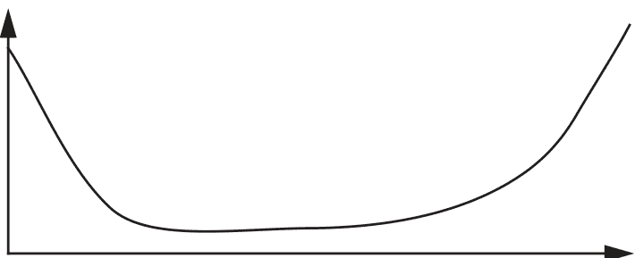

图8.1
浴缸曲线，显示组件的条件故障率随时间变化。

### 8.2.2 可靠性函数

浴缸曲线表示模块的条件故障率b(t)，定义为在时间t和时间t+dt之间模块发生故障的概率，假设在时间t时组件仍然工作。条件故障率只是描述组件、模块或系统故障特性的几种密切相关的方式之一。

模块的可靠性R被定义为：

$$R(t) = Pr \left( \frac{\text{给定模块在时间t之前尚未发生故障的条件下}}{\text{模块在时间0处运行}} \right)$$

无条件故障率f(t)被定义为：

$$f(t) = Pr(\text{模块在t和t+dt之间发生故障})$$

（浴缸曲线和这两个可靠性函数是呈现相同信息的三种方式。如果你对概率不熟悉，关于它们如何相关的简要提醒出现在边栏8.1中。）一旦f(t)可用，可以直接计算MTTF：

$$MTTF = \int_{0}^{\infty} t \cdot f(t) dt$$

必须记住，这个MTTF是根据故障率函数f(t)预测的，与方程式8-2的MTTF不同，后者是通过现场测量得出的。只有当f(t)所体现的故障模型准确无误时，这两个MTTF才会相同。

一些组件表现出相对均匀的故障率，至少在它们所属系统的寿命内。对于这些组件，条件故障率不像浴缸曲线，而是一条水平直线，可靠性函数则呈现简单的指数下降：

$$R(t) = e^{-\left(\frac{t}{MTTF}\right)}$$

这个可靠性函数被称为无记忆性，这意味着条件故障率与组件运行时间无关。无记忆性故障过程具有一个好的特性，即条件故障率是MTTF的倒数。

不幸的是，正如我们在具有34年“MTTF”的磁盘的情况中所看到的，有时会错误地引用组件的MTTF来滥用这个属性。

## 侧边栏8.1: 可靠性函数、故障率函数和浴盆曲线

可靠性函数、故障率函数和浴盆曲线（在概率文本中称为条件故障率函数，在运筹学文本中称为危险函数）实际上是描述相同信息的三种数学相关方式。故障率函数f(t)如方程8-6所定义，是一个概率密度函数，它在任何时间点都是非负的，且其在所有时间上的积分为1。从组件创建的时间（通常取t=0）到现在，对故障率函数进行积分得到：

$$F(t) = \int_{0}^{t} f(t) dt$$

F(t)是组件在时间t之前发生故障的累积概率。组件在时间t仍在运行的累积概率是在时间0运行的概率，这正是可靠性函数R(t)的定义。即，

$$R(t) = 1 - F(t)$$

图8.1的浴缸曲线报告了在时间t和t+dt之间发生故障的条件概率h(t)，假设组件在时间t正常运行。根据条件概率的定义，条件故障率函数如下：

$$h(t) = \frac{f(t)}{R(t)}$$

条件故障率随时间变化。这种错误观念始于一个错误：假设MTTF可以通过反转测量到的故障率来计算，如公式8-7所定义。这种错误观念的出现是因为一般情况下，

$$E(1/t) \neq 1/E(t)$$

公式8-9也就是说，倒数的期望值不等于期望值的倒数，除非在某些特殊情况下。它们相等的一个重要特殊情况是公式8-8中的无记忆分布。当一个随机过程是无记忆的时候，计算和测量会更加简单，设计者有时会忘记这种简单性并应用到其他地方。

正如可用性有时通过计算其数字表示中的九的数量来过度简化表达一样，组件制造中的可靠性有时通过计算观察到的某个组件参数的标准差来过度简化表达，例如门的最大传播时间。标准差的常用符号是希腊字母σ（sigma），正态分布的标准差为1.0，因此说一个组件具有“4.5σ可靠性”是一种简写方式，表示生产线能够很好地控制该参数的变化，使得指定的公差与平均值相差4.5个标准差，如同图8.2所示。例如，假设一个产品-

### 8.2.3 测量容错性

有时候对系统的容错性进行定量衡量是很有用的。

一种常见的衡量标准，有时被称为故障容忍度，是系统能够容忍的组件故障的数量，而不会自身发生故障。虽然这个标签可能有歧义，但通常从上下文中可以清楚地知道正在讨论的是一个度量标准。

因此，一个包括单错误纠正的存储系统（第8.4节描述了错误纠正的工作原理）具有一个位的故障容忍度。

当发生故障时，系统的剩余故障容忍度会下降。剩余故障容忍度在系统运行过程中是一个重要的监控指标，因为它显示了整个系统距离故障有多近。

最常见的系统设计错误之一是增加容错性，但没有包括任何监控来查看已使用的容错性有多少，从而忽视了安全余量原则。当名义上具有容错性的系统发生故障时，后续的分析总是不可避免的。

披露了系统成功掩盖了几次故障，但从未报告过，因此也从未修复过。最终，故障总数超过了系统设计的故障容忍度。

故障容忍度实际上只是一个数字，在最简单的情况下。有时候，它更好地被描述为一个向量，甚至是一个矩阵，显示系统设计用于容忍不同类型故障的具体组合。例如，一个电力公司可能会说，它可以容忍发电能力的最多15%的故障，同时还可以容忍两条主要输电线路的中断。

## 8.3 容忍主动故障

### 8.3.1 响应主动故障

在处理主动故障时，模块的设计者可以提供以下几种响应之一：

- 什么都不做。错误变成了模块的故障，而它所属的更大系统或子系统则继承了发现和处理问题的责任。然后，更大子系统的设计者必须选择提供哪种响应。在具有多个模块层的系统中，故障可能会在多个层之间传递。

- 被发现并处理。随着无用层的数量增加，封装通常变得越来越困难。

- 要快速失败。该模块在其接口上报告发生了错误。
这种响应也将问题交给了更高级别系统的设计者，但方式更加优雅。例如：当以太网收发器检测到正在发送的帧发生碰撞时，它会尽快停止发送，广播一个简短的干扰信号以确保所有网络参与者迅速意识到发生了碰撞，并将碰撞报告给更高级别的模块，通常是收发器作为组件的硬件模块，以便更高级别考虑重新发送该帧。

- 要安全失败。该模块将任何不正确的值转换为已知可接受的值，即使不正确或不理想。一个例子是数字交通灯控制器，在检测到其顺序控制器故障时，会切换到所有方向闪烁红灯。第11章[在线]讨论提供安全性的系统。在安全系统发生故障时，通常最安全的做法是阻止所有访问。设计为这样做的故障安全模块被称为故障安全。

- 保持故障容忍性。系统在某些可预测的降级规范下仍然能够正确运行，可能会缺少一些功能或者性能较低。例如，一架有三个引擎的飞机，如果一个引擎故障，仍然可以安全飞行，尽管速度较慢、机动性较差。一个分为五个部分、存储在五个不同小硬盘上的文件系统，在其中一个硬盘故障时仍然可以提供80%的数据访问，与使用一个容量五倍大的单个硬盘的文件系统相比。

- 掩盖错误。任何错误的值都会被纠正，模块将按照规范要求运行，就像错误没有发生一样。

我们将重点关注掩盖错误的技术，因为这些技术通常可以以更简单的形式应用于实现快速失败、安全失败或故障容忍系统。

作为一般规则，人们可以设计算法和过程来应对特定的、预期的故障。此外，算法或过程只能预期处理实际检测到的故障。在大多数情况下，检测故障的唯一可行方法是注意到错误的值或控制信号；也就是说，通过检测错误来检测故障。

因此，在尝试确定系统设计是否具有足够的容错能力时，将错误分类如下是有帮助的：

- 可检测错误是一种可以可靠检测到的错误。如果存在检测过程并且发生错误，系统几乎可以确定地发现它，并且它成为已检测到的错误。

- 可屏蔽错误是一种可以设计出恢复正确性的过程的错误。如果存在屏蔽过程并且发生错误，被检测到并且被屏蔽，那么该错误被称为被容忍的。

- 相反地，一个不可容忍的错误是指无法检测、未被检测到、无法屏蔽或未被屏蔽的错误。

一个不可容忍的错误通常会导致系统的故障。（“通常”，因为我们可能会很幸运地产生一个正确的输出，要么是因为当前条件下错误值实际上并不重要，要么是因为一些旨在屏蔽不同错误的措施无意中也屏蔽了这个错误。）这种错误的分类如图8.3所示。

错误通常会导致系统的故障

（“通常”，因为我们可能会很幸运地产生一个正确的输出，要么是因为当前条件下错误值实际上并不重要，要么是因为一些旨在屏蔽不同错误的措施无意中也屏蔽了这个错误。）这种错误的分类如图8.3所示

这也是一个分类错误

如图8.3所示。

一个可屏蔽的错误意味着系统状态中可能存在错误的部分必须有一个明确定义的边界。

屏蔽过程必须使用未被错误破坏的信息将所有错误状态恢复到正确状态。

屏蔽过程必须使用未被错误破坏的信息将所有错误状态恢复到正确状态。

错误的真正含义是可以检测到的，


错误在其影响超出某个指定边界之前被发现。

设计师通常会确保错误在其影响超出某个指定边界之前被发现。

选择这个边界与那个错误的分类重合。箭头从一个模块的某个类别指向相互排斥的子类别。

例如，未被屏蔽的错误包括是故障快速失败（即，它检测并报告自己的无法屏蔽的错误和可屏蔽的错误）。模块的故障屏蔽由其所属的系统负责。

### 8.3.2 容错模型

可检测、已检测、可屏蔽和可容忍错误之间的区别使我们能够为系统指定一个容错模型，这是容错设计过程中的一个组成部分，如8.1.2节所述：

- 1. 分析系统并将可能的错误事件分类为可靠检测和不可靠检测的错误。在这个阶段，无论是否可检测，所有的错误都是不可容忍的。

- 2. 对于每个不可检测的错误，评估其发生的概率。如果该概率不可忽略，根据需要修改系统设计，使错误可靠检测。

- 3. 对于每个可检测的错误，实施检测程序，并将其检测到的模块重新分类为快速失败。

- 4. 对于每个可检测的错误，尝试设计一种屏蔽方法。如果有方法，将此错误重新分类为可屏蔽错误。

- 5. 对于每个可屏蔽的错误，评估其发生的概率、故障成本和前一步骤中设计的屏蔽方法的成本。如果评估结果表明值得，实施屏蔽方法，并将此错误重新分类为可容忍错误。

当完成这样一个模型的开发时，设计师应该对系统有一个有用的容错规范。一些错误，其发生的概率可以忽略不计，或者采取掩盖措施会太昂贵，被标识为不可容忍的。当这些错误发生时，系统会失败，使用户自行应对结果。其他错误具有指定的恢复算法，当这些错误发生时，系统应该继续正确运行。现在，系统恢复策略的审查可以分别关注两个不同的问题：

- 设计师列出的潜在错误事件清单是否完整，并且对每个错误的概率评估是否现实？
- 设计师用于检测和掩盖预期错误的算法、过程和实现是否完整和正确？

这两个问题是不同的。第一个问题是关于现实世界模型的问题。它涉及到对现实世界概率的经验和判断的问题，以及是否已经发现了所有现实世界的故障模式，或者有些故障模式被忽视了。两个不同的工程师，具有不同的现实世界经验，对这样的判断可能有合理的分歧——他们可能对现实世界有不同的模型。故障模式和概率的评估是一个设计师可能容易迷失的地方，因为这样的判断必须基于实践经验，要么是设计师个人获得的经验，要么是从他人的经验中学到的。

一项新技术，或者是将旧技术放置在新环境中，很可能会带来惊喜。错误的判断可能导致浪费精力来设计很少被调用的检测和屏蔽算法，而不是真正需要的算法。另一方面，如果所需的经验不可用，也不是一切都完蛋了：设计过程中的迭代部分明确旨在提供那种经验。

第二个问题更抽象，也更能得到绝对的答案，因为对于正确性的论证（除非它过于复杂）或对该论证的反例应该是每个人都能够达成一致的事情。在系统设计中，遵循明确区分这些问题类别的设计程序是有帮助的。当有人质疑可靠性特性时，设计师可以首先问：“你在质疑什么？”

## 第8章 容错性：从不可靠系统中构建可靠系统（第8-20节）

你是在质疑我的恢复算法的正确性，还是在质疑我对可能发生的情况的模型？从而正确地聚焦讨论或争论。

创建一个容错模型也为容错设计过程的迭代部分奠定了基础。如果一个在现场的系统出现比预期更频繁的故障，或者完全意外的故障发生，分析这些故障可以与容错模型进行比较，以发现出了什么问题。通过再次提出上面标有子弹的两个问题，该模型允许设计师区分一方面，通过现场经验证明故障概率预测是错误的，另一方面，不充分或错误实施的屏蔽程序。

有了这些信息，设计师可以计算出模型的适当调整和系统所需的相应变化。

迭代和审查容错模型对于根据技术变化使其保持最新状态也很重要。例如，在第4.4节中描述的网络文件系统首先使用局域网部署，其中丢包错误很少，甚至可能被链路层屏蔽。当后来的用户将其部署在更大的网络上，丢包更常见时，就需要修改其容错模型并添加额外的端到端检验和错误检测。计算和检查这些校验和所需的处理器时间导致了一些性能损失，这就是为什么最初的设计者没有包括校验和的原因。但是，数据完整性的丧失超过了性能的损失，设计者们改变了权衡。

## 8.4 系统性应用冗余

模拟系统的设计者通常通过指定设计公差来屏蔽小误差，这些公差被称为余量，它们是规范比正常工作所需更好的量。相比之下，数字系统的设计者通过在时间或空间上添加冗余来检测和屏蔽各种错误。当错误被认为是短暂的时候，比如在数据通信网络中丢失了一个数据包，一种屏蔽的方法是重新发送它，这是时间上的冗余。当错误很可能是持久的时候，比如在从磁盘表面读取位时发生故障，通常的屏蔽方法是使用空间冗余，即另一个组件提供信息或控制信号的另一个副本。冗余可以以巧妙的小量或强制的方式应用，同一个系统的不同部分可以使用这两种技术。

最常见的增量冗余形式被称为前向纠错，它包括对数据值进行巧妙编码。对于未经编码以容忍错误的数据，一个比特位的改变可能会将一个合法数据值转换为另一个合法数据值。为了处理错误，需要选择一些作为合法数据值的表示形式，这些合法数据值的模式必须具有这样的属性，即要将其中任何一个模式转换为另一个模式，必须改变多个比特位。将一个合法模式转换为另一个模式所需改变的最小比特位数被称为这两个模式之间的海明距离。海明距离是以Richard Hamming的名字命名的，他最早研究了这类编码。因此，这些模式

```
100101
000111
```

由于上面的模式可以通过翻转两个位的值（第一个位和第五个位）转换为下面的模式，所以它们的海明距离为2。未编码错误的数据字段可能具有最小的海明距离为1。能够检测或纠正错误的编码，任意两个合法数据模式之间的最小海明距离为2或更多。编码的海明距离是编码中任意一对合法模式之间的最小海明距离。可以通过计算A和B之间的海明距离来计算两个模式之间的海明距离，其中∈是异或（XOR）运算符，计算A∈B中的one的数量。

假设我们创建了一种编码，使得每对合法数据模式之间的海明距离为2。因此，如果一个位意外改变，由于没有合法的数据项具有该模式，我们可以检测到出现了错误，但无法确定原始数据模式是什么。因此，如果上面的两个模式是编码的两个成员，并且上面模式的第一个位从one翻转为zero，则无法判断结果000101是否是翻转下面模式的第五位所导致的结果。

接下来，假设我们创建一个编码，其中编码的海明距离为3或更多。这里有两个来自这样一个编码的模式；位1、2和5不同：

```
100101
010111
```

现在，一个位的改变总是会将一个合法的数据模式转换为一个错误的数据模式，该模式与任何其他合法模式至少相距2位，但与原始模式只相距1位。接收到一个带有一位错误的模式的解码器可以检查接收到的模式与附近合法模式之间的海明距离，并通过选择最近的合法模式来纠正错误。如果有2位发生变化，这个纠错过程仍然会识别出一个纠正后的数据值，但它会选择错误的值。如果我们预计经常发生2位错误，我们可以选择编码模式，使得海明距离为4，在这种情况下，编码可以纠正。

可以检测1位错误并检测2位错误。但是在其他编码模式中，3位错误看起来就像1位错误一样，因此会解码为错误的值。更一般地，如果一个编码的海明距离是 d，一些分析表明可以检测(d-1)个错误并纠正 ((d-1)/2)个错误。

这种形式的冗余之所以被称为“前向”错误纠正，是因为数据的创建者在存储或传输之前进行编码，任何人都可以在以后解码数据而不需要向创建者求助。（第7章[在线]描述了一种技术，即要求发送者重新传输丢失的帧、数据包或消息。这种技术被称为后向错误纠正。）

前向错误检测和纠错码的系统构建是一个广泛的研究领域，我们不打算探索。然而，有两个常见的编码示例值得研究。

第一个示例是对2位值进行简单奇偶校验，其中奇偶位是2个数据位的异或。编码模式长度为3位，因此对于这个3位数量，有8个可能的模式。其中只有4个表示合法数据。

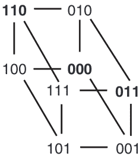

如图8.4所示，这4个“正确”的模式具有这样的特性，即改变任何一个位将该单词转换为4个非法模式之一。

将编码数量转换为另一个合法模式，至少需要改变2个位（换句话说，这个编码的海明距离为2）。

简单奇偶校验可以检测任何单个错误，但它没有足够的信息来纠正错误。结论是，

简单奇偶校验可以检测任何单个错误，但它没有足够的信息来纠正错误。

矩形错误。

第二个例子，在图8.5中，展示了一种前向纠错码，可以纠正4位数据值中的1位错误，通过将4位编码为7位字。在这个编码中，位P7, P6, P5和P3携带数据，而位P4, P2和P1从数据位计算得出。（这种乱序编号方案创建了一个多维二进制坐标系统，其用途将在一会儿显现出来。）我们可以分析这个编码以确定其海明距离，但我们也可以观察到三个额外的位可以恰好携带足够的信息来区分8种情况：无错误，第1位错误，第2位错误，...或第7位错误。因此，创建一个纠错码并不令人意外。这个编码计算位P1, P2和P4如下：

```
P1 = P7 ∈ P5 ∈ P3
P2 = P7 ∈ P6 ∈ P3
P4 = P7 ∈ P6 ∈ P5
```

## 8.4 系统性应用冗余（8-23）

现在，假设比特位数组P₁到P₇通过网络发送，并且噪声导致比特位P₅翻转。如果接收方重新计算P₁, P₂和P₄，重新计算的值的P₁和P₄将与接收到的比特位P₁和P₄不同。然后，接收方按顺序写入P₄P₂P₁，将有问题的比特位表示为ONE，无问题的比特位表示为ZERO，并且注意到它们的二进制值为101₂ = 5，即翻转的比特位的位置。在这个编码中，每当出现一位错误时，有问题的奇偶校验位直接确定要纠正的比特位。（这就是为什么采用了无序的比特编号方案，它为定位错误比特位创建了一个三维坐标系。）

使用3个校验位来保护4个数据位表明纠错码可能不是高效的，但实际上这个例子的表面低效只是因为它太小了。通过类似的推理，可以例如使用7个校验位在63位码字中为56个数据位提供单错误纠正。

在这些编码的两个例子中，对完整性的假设威胁是一组中的一个未知位可能出错。前向纠错也可以对抗其他威胁。数字系统中还存在一种称为擦除的不同威胁。当一组中的特定标识位的值无法理解或者甚至完全丢失时，就会发生擦除。由于我们知道哪个位有问题，简单的奇偶校验码，其中奇偶位是其他位的XOR，成为了前向纠错码。通过计算未擦除位的XOR，可以简单地重建不可用位。回到图8.4的例子，如果我们发现一个模式，其中第一个和最后一个位的值分别为0和1，但中间的位是无法理解的，那么唯一可能的情况是001和011。由于001不是一个合法的码模式，原始模式必须是011。简单的奇偶校验只允许纠正单个擦除。如果存在多个擦除的威胁，就需要更复杂的编码方案。例如，假设我们有4个要保护的位，并且它们按照图8.5中的方式进行编码。在这种情况下，即使有多达3个位被擦除，剩下的4个位也足以重建丢失的3个位的值。

由于丢包是一种威胁，在最佳努力分组网络中，这种前向纠错方案也是适用的。例如，可以发送四个编号相同长度的数据包，然后跟随一个包含奇偶校验位的校验包。

| 位 | P₇ | P₆ | P₅ | P₄ | P₃ | P₂ | P₁ |
|---|---|---|---|---|---|---|---|
|   | ∈ |   | ∈ |   | ∈ |   | ∈ |
|   | ∈ | ∈ |   |   | ∈ | ∈ |   |
|   | ∈ | ∈ | ∈ | ∈ |   |   |   |

选择P₁，使得每隔一个位进行异或运算（P₇∈P₅∈P₃∈P₁）等于0
选择P₂，使得每隔一对位进行异或运算（P₇∈P₆∈P₃∈P₂）等于0
选择P₄，使得每隔四个位进行异或运算（P₇∈P₆∈P₅∈P₄）等于0

图8.5
单错误纠正码。在表中，符号∈表示参与计算冗余位之一的位。有效载荷位是P₇，P₆，P₅和P₃，冗余位是P₄，P₂和P₁。“每隔一个”说明了一个可以定位错误位的三维坐标系。

## 8-24 第8章容错性：从不可靠系统中获得可靠性

作为其有效负载，是前四个有效负载的逐位异或o。（也就是说，奇偶校验包的第一个位是其他四个包的每个位的异或o；第二个位以此类推，等等。）虽然奇偶校验包会增加25%的网络负载，但只要五个包中的任意四个包成功传输，接收端就可以完美地重建所有有效负载数据，而无需请求重新传输。如果网络不可靠，以至于五个包中有多于一个包通常会丢失，那么可以发送七个包，其中四个包包含有用数据，其余三个包使用图8.5的公式计算得出。（使用该图的编号方案，例如，第4个包的有效负载将包含包7、6和5的异或o。）现在，只要七个包中的任意四个包成功传输，接收端就可以重建数据。

前向纠错在广播协议中特别有用，因为存在大量的接收者，每个接收者可能会丢失不同的帧、数据包或流段，因此通过请求重传来进行后向纠错的选择不太可取。前向纠错在流传输中控制抖动也很有用，因为它消除了请求重传丢失的流段所需的往返延迟。最后，当通信是单向的或往返延迟非常长而请求重传不可行时，前向纠错通常是控制错误的唯一方法，例如与深空探测器通信时。另一方面，使用前向纠错来替换丢失的数据包可能会干扰拥塞控制技术，其中过载的数据包转发器试图通过丢弃偶尔的数据包来向发送方发出减速信号。

前向纠错在存储数据到磁盘上以对抗擦除时也有应用。在这种情况下，威胁是整个磁盘驱动器可能会发生故障，例如由于磁头碰撞。假设故障发生在数据最初写入之后很长时间，这个例子说明了单向通信，其中后向纠错（要求原始写入者重新写入数据）通常不是一个选项。

一种响应是使用RAID阵列（参见2.1.1.4节）以一种称为RAID4的配置。在这种配置中，可以使用一个由五个磁盘组成的阵列，其中四个磁盘包含应用程序数据，第五个磁盘的每个扇区包含前四个磁盘相应扇区的逐位异或。如果其中任何一个磁盘故障，其身份将很快被发现，因为磁盘通常设计为故障快速并报告故障在其接口上。更换故障磁盘后，可以通过读取其他四个磁盘并逐扇区计算其数据的异或of来恢复其内容（参见练习8.9）。为了保持这种策略，每当有人更新数据扇区时，RAID4系统必须同时更新相应的奇偶校验磁盘扇区，如图8.6所示。从该图可以看出，在RAID 4中，前向纠错具有可识别的读写性能成本，除了明显增加使用的磁盘空间量外。由于数据丢失可能是灾难性的，对RAID有很大的兴趣，并且已经付出了很多心血来设法最小化性能损失。

## 8.4.2 复制：大规模冗余

在设计桥梁或摩天大楼时，土木工程师通过指定比最低要求强5倍或10倍的构件来掩盖材料强度和其他参数的不确定性。这种方法虽然粗暴，但简单而有效。


图8.6

在一个五盘RAID 4系统的第2个磁盘上更新一个扇区。旧奇偶校验扇区包含奇偶校验 ≠ 数据1∈数据2∈数据3∈数据4。为了构建包含新数据2的新奇偶校验扇区，可以读取相应的数据1、数据3和数据4扇区，并进行三次 xor运算。但更快的方法是只读取旧奇偶校验扇区和旧数据2扇区，并计算新的奇偶校验扇区。

```
新奇偶校验 ≠ 旧奇偶校验∈旧数据2∈新数据2
```

通过获取每个组件的多个副本，可以以相应的方式构建一个可靠的系统，而这些组件本身是不可靠的。相同的多个副本被称为副本，这种技术被称为复制。这不仅仅是制作副本：还必须制定一个计划来安排或连接副本，以便一个副本的故障可以在不失败的副本的帮助下自动屏蔽。例如，如果担心二极管可能会短路或产生开路故障，可以设置一个由四个二极管组成的网络，如图8.7所示，创建一个我们可以称之为“超级二极管”的东西。这种互连方案被称为四元组件，是由Claude E. Shannon和Edward F. Moore在20世纪50年代开发的一种增加电话系统中继器可靠性的方法。它还可以与电路中的电阻器和电容器一起使用，这些电路可以容忍一定范围的元件值。

这种特殊的超二极管可以容忍两个元件二极管中的一个短路和一个断路，还可以容忍其他一些多重故障，例如上面两个二极管都断路加上下面一个二极管短路。如果在图中添加桥接连接，超二极管可以容忍额外的多重断路故障（例如一个上面的二极管和一个下面的二极管），但对于某些短路故障（例如一个左边的二极管和一个右边的二极管），它的容忍度会降低。

这种超二极管的一个严重问题是它会默默地掩盖故障。很难确定系统中还剩下多少容错能力。

## 8.4.3 投票

尽管已经有人试图将四元件方法扩展到数字逻辑，但所需的互连复杂性增长得太快。幸运的是，有一种系统性的替代方法可以利用数字逻辑的静态纪律和电平再生的固有特性。此外，它还具有一个好的特点，即可以应用于任何模块的任何级别，从单个门到整个计算机。

该技术是将单个模块替换为该模块的一组副本，所有副本都并行运行，并将其输出与称为投票器的设备进行比较。这种基本策略称为Λ模块冗余，或ΛMR。当Λ的值为3时，该策略称为三模块冗余，简称TMR。当使用其他值作为Λ时，该策略的名称将ΛMR中的Λ替换为数字，例如5MR。一些模块的Λ个副本的组合和

# 图8.7

四组件超二极管
虚线表示可选的桥接连接，允许超二极管容忍不同的故障，如文本中所述。

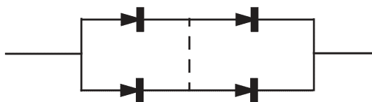

## 8-28 第8章容错性:从不可靠系统中构建可靠系统

故障投票TMR的数值效果令人印象深刻。如果单个模块在时间7的可靠性为0.999，方程式8-10表明在同一时间，故障投票7MR超级模块的可靠性为0.999997。7MR将故障的概率从千分之一降低到百万分之三。这个分析解释了为什么打算飞越大洋的飞机需要多个引擎。假设发动机故障的速率是这样的，以至于单发飞机在一千次跨大西洋飞行中会有一次无法完成。还假设一个3发引擎的飞机只要有2个引擎运行就可以继续飞行，但是只有一个引擎无法飞行。在一千次飞行中，有3次会有其中一个引擎故障，但是如果引擎故障是独立的，那么在每一千次第一个引擎故障中，剩下的2个引擎可以成功将飞机带回。

尽管TMR大大提高了可靠性，但对MTTF的影响并不相当。事实上，故障投票TMR超模块的MTTF可能比原始的单副本模块更小。具体效果取决于副本的故障过程，因此为了说明问题，考虑一个无记忆故障过程，而不是因为它是现实的，而是因为它在数学上是可处理的。假设飞机发动机的MTTF为6,000小时，它们独立故障，发动机故障的机制是无记忆的，并且(由于这是一个故障投票设计)我们至少需要2个工作发动机才能回家。当使用三个发动机飞行时，飞机在仅2,000小时的飞行时间内累积了6,000小时的发动机运行时间，因此从整个飞机的角度来看，2,000小时是第一个发动机故障的预期时间。在使用剩下的两个发动机飞行时，还需要另外3,000小时的飞行时间才能累积6,000小时的发动机运行时间。由于故障过程是无记忆的，我们可以通过相加来计算3个发动机飞机的MTTF：

|   |   |
|---|---|
| 首次故障平均时间 | 2000小时（三台引擎） |
| 从首次故障到第二次故障的平均时间 | 3000小时（两台引擎） |
| 系统故障的总平均时间 | 5000小时 |

因此，系统故障的平均时间小于单个引擎的6000小时MTTF。这里发生的情况是，我们实际上牺牲了长期可靠性，以提高短期可靠性。图8.9展示了我们假设的可靠性-

图8.8
三模块冗余超级模块，具有三个输入，三个投票器和三个输出。


## 8.4 系统性应用冗余 8-29

在飞行的6小时中，假设飞机只占单个引擎MTTF的0.001，任务时间与MTTF相比非常短，可靠性要高得多。图8.10显示了相同的曲线，但对于与MTTF相当的飞行时间。在这个区域，如果飞机试图保持飞行8000小时（约为单个引擎MTTF的1.4倍），单引擎飞机在4次尝试中有3次无法完成飞行，但三引擎飞机在6次尝试中有5次无法完成飞行。（对于这些计算应当谨慎，因为实际情况下可能不满足独立和无记忆操作的假设。附注8.2进行了详细说明。）


图8.9 三重模块冗余的可靠性，对于远小于6,000小时MTTF的任务时间。垂直虚线代表六小时的飞行。


图8.10 三重模块冗余的可靠性，对于与6,000小时MTTF相当的任务时间。两条垂直虚线分别代表6,000小时（左）和8,400小时（右）的任务时间。

> 侧边栏 8.2：操作MTTF的风险 在第8.4.3节和8.4.4节中表面上随意操作MTTF是基于故障独立和无记忆过程的假设。但是如果盲目应用这种方法而不了解其局限性，就可能会出错。为了看到这一点，考虑一个计算机系统，观察了几年，平均每2周发生一次硬件崩溃和每6周发生一次软件崩溃。操作员不修复系统，只是重新启动并希望一切顺利。复合MTTF为1.5周，最简单的方法是考虑如果我们运行系统60周会发生什么。在那段时间内，我们预计会看到

10次软件故障  
30次硬件故障  
———  
60周内发生40次系统故障 —> 平均故障间隔为1.5周  

安装了新的硬件，与旧的硬件相同，唯一的区别是它永远不会出现故障。MTTF应该跳到6周，因为剩下的故障只有软件故障，对吗？

也许——但只有在软件故障过程独立于硬件故障过程的情况下才成立。

假设软件故障是因为时钟更新过程中存在一个错误（故障）：这个错误总是在系统启动后的420小时（2周半）准确地导致系统崩溃——如果它有机会运行那么长时间的话。旧的硬件引起的崩溃如此频繁，以至于软件错误只偶尔有机会发生——大约每6周一次。大部分时间，从硬件故障中恢复（需要重新启动系统）会导致触发软件错误的进程被重置。因此，当新硬件安装后，系统的平均无故障时间（MTTF）只有2.5周，远低于预期。

MTTF（平均无故障时间）很有用，但必须小心翼翼理解其测量和使用中的假设。

如果我们假设飞机只需要一个引擎就能安全返回，那么MTTF将会增加而不是减少，但增加的幅度很小。复制在持续时间相对较短的任务中显著提高了可靠性，但MTTF本身变化很小。我们可以通过更多的分析来验证这个说法，再次假设故障过程是无记忆的，以便进行数学计算。假设我们有一个N MR系统，只要至少有一个副本仍在工作，它就能继续发挥作用。（该系统需要使用快速故障副本和更聪明的投票器，如下文第8.4.4节所述。）如果单个副本的MTTF（平均无故障时间）= 1，有N个独立副本，并且故障过程是无记忆的，那么从第一个故障发生到第二个故障发生的预期时间是MTTF副本/（N-1），以此类推，直到系统中的N个副本全部故障的预期时间是这些时间的总和。

```
MTTF_{系统} = 1 + 1/2 + 1/3 + ... + (1/N)
```

方程式 8-11

## 8.4.4 修复

现在让我们回到一个故障投票的TMR超模块（即至少需要两个副本工作），其中投票者刚刚注意到其中一个三个副本正在产生与其他两个不一致的结果。由于投票者有能力报告哪个副本发生故障，假设它将这样的报告传递给一个维修人员，后者立即检查故障副本并进行修复或更换。对于这种方法，修复时间（MTTR）的测量变得重要起来。如果在第一个副本修复完成之前第二个或第三个副本发生故障，超模块将失败。我们的直觉是，如果MTTR与其他两个副本的组合MTTF相比较小，那么超模块失败的机会也会相应较小。

超模块失败的准确影响取决于副本的可靠性函数的形状。在故障和修复过程都是无记忆的情况下，效果很容易计算。由于1个副本的故障率为1/$MTTF$，2个副本的故障率为2/$MTTF$。如果修复时间与$MTTF$相比较短，那么在等待一个时间$T$修复失败的副本时，剩下的2个副本中有1个发生故障的概率大约为2$T$/$MTTF$。由于平均修复时间为MTTR，我们有：

Pr(等待修复时超级模块失败) = \frac{2 \times MTTR}{MTTF} 方程式 8-12

继续我们的飞机示例，并临时搁置怀疑，假设在一次长时间飞行中，我们派出一名机械师到飞机的机翼上更换一个故障的引擎。如果更换需要1小时，在那个小时内其他两个引擎发生故障的概率大约是1/3000。此外，一旦更换完成，我们预计在下一次引擎故障之前还能飞行2000小时。进一步假设机械师携带无限数量的替换引擎，完成一次10,000小时的飞行——甚至更长的飞行——变得可行。具有无记忆故障和修复过程的故障投票TMR超级模块的MTTF的一般公式是（这个公式来自于连续转换出生和死亡马尔可夫过程的分析，这是一种高级概率技术，超出了我们的范围）：

MTTF超级模块 = \frac{MTTF副本}{3} \times \frac{MTTF副本}{2 \times MTTR副本} = \frac{(MTTF副本)^2}{6 \times MTTR副本} 等式 8-13

因此，我们带有假设的飞行中修复的3发动机飞机的MTTF为600万小时，相比之下，单发飞机的MTTF为6000小时，这是一个巨大的改进。这个方程可以解释为，与未复制的模块相比，MTTF已经因为有3个副本而减少了通常的3倍，但与此同时，修复的可用性增加了MTTF，增加的倍数等于剩余2个引擎的MTTF与MTTR的比率。

在飞行中更换飞机引擎可能是一个奇思妙想，但在地面上更换计算机系统中的磁盘是相当合理的。假设我们在3个独立的硬盘上存储了一组数据的3个副本，每个硬盘的平均无故障时间（MTTF）为5年（使用MTTF作为预期运行寿命，而不是从短期故障率推导出的“MTTF”）。假设如果一个硬盘故障，我们可以在平均10小时内找到、安装和复制数据到一个替换硬盘。根据公式8-13，数据的MTTF为：

```
$$ \frac{(MTTF_{副本})^2}{6 \times MTTR_{副本}} = \frac{(5年)^2}{6 \cdot (10小时) / (8760小时/年)} = 3650年 \quad 公式8-14 $$
```

实际上，冗余加修复使得这个超模块的故障概率降低到了一个非常小的值，以至于在实际应用中，故障可以忽略不计，超模块可以无限期地运行。

在开始销售可靠的磁盘存储系统的公司之前，最好回顾一下我们在得到MTTF估计时所做的一些过于乐观的假设，其中大部分在现实世界中不太可能成立:

- 磁盘故障是独立的。一批真实世界的磁盘可能都来自同一个供应商，它们可能存在相同的设计和制造缺陷。或者，它们可能都在同一个机房里，一个可能具有不到3650年MTTF的地震可能会损坏所有三个磁盘。
- 磁盘故障是无记忆的。真实世界的磁盘遵循一个浴盆曲线。如果磁盘#1故障时，磁盘#2已经使用了三年，那么磁盘#2的预期运行寿命不再是5年，因此在等待修复期间第二次故障的机会比公式所假设的要高。此外，当磁盘#1被替换时，它的故障几率在最初几周可能会比平常更高。
- 修复也是一个无记忆过程。在现实世界中，如果我们储备足够的备件，以至于每10年只会用完一次并且必须等待工厂的发货，但如果进行替换恰好使我们今天用完库存，那么很可能明天和后天我们仍然会缺货。
- 修复过程完美无缺。修复人员可能更换错误的磁盘，忘记将数据复制到新磁盘，或者安装一个未经过烧录测试并在第一个小时内失败的磁盘。

## 8.4.5 系统化地应用冗余 8-33

这些问题都会降低可靠性，低于我们过于简单分析所预期的水平。尽管如此，带修复的NMR仍然是一种有用的技术，在第10章[在线]中我们将看到它如何应用于磁盘存储。

核磁共振的最强大应用之一是在瞬态错误的掩盖中。

当一个瞬态错误发生在一个副本中时，核磁共振投票器立即掩盖它。因为错误是瞬态的，超模块的后续行为就像是在下一个操作周期中进行了修复。数值结果几乎是非凡的。例如，考虑一个处理器算术逻辑单元（ALU），它具有1吉赫兹的时钟，并且在每个时钟周期结束时通过投票器检查其输出。在方程8-13中，我们有 MTTR副本 = 1（在这个应用中，方程8-13只是一个近似，因为修复时间是一个常数而不是一个无记忆过程的结果），并且：

MTTF超模块 = (MTTF副本)^2 / 6 周期。如果MTTF副本是10^10周期（在这个时钟速度下，意味着每10秒钟发生一个错误），MTTF超模块是10^20/6周期，大约500年。TMR已经将三个几乎没有实际用途的ALU变成了一个几乎无敌的超级ALU。

事物看起来如此好的原因是我们评估了两个瞬态错误在同一操作周期中发生的机会。如果瞬态错误真的是独立的，那么这种机会很小。这种效应很强大，但杠杆作用在两个方向上起作用，从而产生潜在的危险：特别重要的是要跟踪瞬态错误实际发生的速率。如果它们发生的频率比预期高20倍，MTTF（超级模块）将是原始预测的1/400，超级ALU可能每年故障一次。对于某些应用程序来说，这可能仍然可以接受，但这是一个很大的变化。

此外，像往常一样，独立性的假设是绝对关键的。如果所有的ALU都来自同一条生产线，它们很可能至少有一些共同的故障，这种情况下超级ALU可能和单个ALU一样毫无价值。实际上，有几种简单故障投票结构的变体出现在实践中：

- 清除。在具有投票器的NMR设计中，每当投票器检测到一个副本与大多数副本不一致时，投票器会要求修复该副本，并且还会将该副本标记为DOWN并忽略其输出，直到听到它已经被修复为止。这种技术对于TMR设计没有任何增加，但是在更高级别的复制中，只要副本一个接一个地失败，并且任意两个副本继续正常运行，超级模块就可以工作。
- 成对比较。通过取两个副本，给它们相同的输入，并将一个简单的比较器连接到它们的输出，从而创建一个快速失败模块。只要比较器报告一对副本一致，系统的下一个阶段就接受输出。如果比较器检测到不一致，它会报告模块失败。成对比较的主要优点是可以使用易于获得的商用现成组件来创建快速失败模块，而不是委托专门的快速失败版本。特殊的高可靠性组件通常比现成设计的成本高得多，原因有两个。首先，由于它们需要更多的设计和测试时间，  
其次，它们通常是低容量产品，无法利用大规模生产的经济效益。这些考虑因素也导致交货周期长，使得难以保持备件库存。使用标准、高容量、低成本的组件的一个重要方面是可以负担得起备件库存，这反过来意味着MTTR可以变得很小：只需用备件替换故障副本（这种方法的流行术语是“配对备件”），然后可以悠闲地进行实际的诊断和修复。

- 带有快速故障副本的NMR。如果每个副本本身都是快速故障设计（可能在内部使用配对和比较），那么投票器只需关注声称产生良好结果的副本的输出，而忽略报告其输出有问题的副本。在这种组织结构下，即使TMR系统的3个副本中有2个失败，系统仍然可以继续运行，因为剩下的1个副本应该正在检查自己的结果。具有修复功能并由快速故障副本构建的NMR系统非常强大，很少见到N大于2的例子。

图8.11比较了使用故障投票、清除和故障快速复制品的5MR设计在修复到达之前继续运行的能力。细心的读者会注意到，这张图可能被认为是一个误导性的比较，因为它声称在只有一个故障快速复制品仍在运行时，5MR系统仍然继续工作。但是，如果那个故障快速复制品实际上是一个配对比较模块，那么在那个时刻可能更准确地说有两个仍在工作的复制品。

另一种利用修复的技术，可以提高可用性，并且可以优雅地降级（换句话说，它可以是故障软件）被称为分区。如果可以选择购买一个具有一个快速处理器或两个较慢处理器的系统，那么双处理器系统的优点在于当其中一个处理器故障时，系统仍然可以继续工作。


## 8.4.5 系统化地应用冗余 8-35

当有人可以修复失败的处理器之前，系统可以继续以其通常容量的一半运行。一个电力公司，而不是安装一个容量为K兆瓦的单个发电机，可以安装N个容量为K/N兆瓦的发电机。

当等效模块可以轻松共享负载时，分区可以扩展到所谓的N+1冗余。假设一个系统的负载需要N个等效模块的容量。设计师将负载分配到N+1个或更多模块上。然后，如果任何一个模块失败，系统可以在修复失败的模块之前以全容量运行。

N+1冗余最适用于完全可互换的模块，可以动态分配，并且不用作存储设备。例子包括处理器、拨号调制解调器、飞机和发电机。因此，在繁忙的枢纽位置多一个飞机可以掩盖航空公司机队中任何单个飞机的故障。当模块不完全相等时（例如，发电机具有一系列容量，但仍然可以互连以共享负载），设计必须确保备用容量大于最大单个模块的容量。对于提供存储的设备，例如硬盘，也可以应用分区和N+1冗余以实现相同的目标，但需要更高级的组织水平来在发生故障时保护存储内容，例如使用RAID，如第8.4.1节所述，或者使用一些更一般的副本管理系统，如第10.3.7节所讨论的那些。

对于一些应用程序来说，偶尔的不可用是可以接受的，而在其他情况下，每次中断都会造成严重问题。当修复是容错计划的一部分时，有时候可以通过额外的注意和增加的复杂性来设计一个能够提供连续运行的系统。添加这个功能需要在故障发生时能够快速识别出故障组件，将其从系统中移除、修复，并重新安装（或更换零件），而不会停止系统的运行。计算机硬件连续运行所需的设计涉及连接和断开电缆以及关闭某些组件的电源，而不会损坏任何东西。当硬件设计允许与继续运行的系统连接和断开连接时，称之为支持热插拔。

在计算机系统中，连续运行对软件也有重要的影响。配置管理软件必须预测到热插拔，以便停止使用即将断开的硬件组件，并发现新连接的组件并使其工作。此外，保持状态是一个挑战。如果数据上有定期的一致性检查，那么这些检查（以及在检查发现不一致性时对数据进行修复）必须设计成在系统运行和数据可能被其他用户同时读取和更新的情况下正常工作。

总体而言，连续运行不是应该随意添加到系统需求列表中的一个特性。当有人提出这个建议时，可以指出它很像试图让飞机无限期地飞行。许多看起来提供连续运行的大型系统实际上是为了定期进行维护而设计的。

## 8.5 将冗余应用于软件和数据

前几节中冗余和复制的示例都涉及硬件。一个看似显而易见的下一步是将相同的技术应用于软件和数据。对于软件，目标是减少编程错误的影响，而对于数据，目标是减少可能影响其完整性的任何类型的硬件、软件或操作错误的影响。本节开始探讨几种适用的技术：N版本编程、有效构建和构建防火墙将存储状态分为两类：必须保持完整性的状态和可以随意放弃的状态，因为它很容易重建。

### 8.5.1 容忍软件故障

简单地运行三个相同有缺陷的程序很可能会产生三个完全相同的错误结果。NMR需要副本之间的独立性，因此设计师需要一种引入独立性的方法。引入独立性的一种方法的例子可以在互联网域名系统（DNS）根名称服务器的复制策略中找到（在第4.4节中描述）。多年来，DNS软件的略微不同的实现已经针对不同的操作系统演变，因此根名称服务器副本有意使用这些不同的实现来降低复制错误的风险。

为了更系统地利用这个想法，可以委托几个团队的程序员，并要求每个团队根据一套规范编写完整的应用程序版本。然后，同时运行这几个版本并比较它们的输出。希望的是，不可避免的编程错误在不同版本中是独立的，并且投票将产生一个可靠的系统。对这种技术（称为N版本编程）的实验表明，必要的独立性很难实现。不同的程序员可能接受了相似的培训，以至于犯同样的错误。使用相同的实现语言可能会鼓励相同的错误。规范中的歧义可能会被多个团队以相同的方式误解，规范本身可能包含错误。最后，很难编写足够详细的规范，以期望不同实现的输出是逐位相同的。结果是，经过很多努力，这种技术可能仅掩盖了某一类错误，而其他错误则未被掩盖。尽管如此，有报道称N版本编程已经在至少两个安全关键的航空航天系统中成功使用，即波音777飞机的飞行控制系统（N=3）和航天飞机的机载控制系统（N=2）。

顺便说一下，采用多个设计团队的策略也可以应用于硬件复制品，目标是通过减少复制设计错误和系统制造缺陷的机会来增加复制品的独立性。

软件工程的很大一部分致力于一种不同的方法：设计规范和编程技术，以避免首次出现故障，并进行测试技术。

## 第8章 容错性：从不可靠系统构建可靠系统

用户可以启动一个全新的线程集，从零开始。新的线程或线程可以使用仅在第二类别中找到的数据，验证该数据的完整性，并返回正常操作。因此，主要挑战是构建一个防火墙，尽管发生故障，仍然可以保护第二类别数据的完整性。

设计师可以基于易失性实现（例如 CMOS 存储器）和非易失性实现（例如 磁盘存储器）构建一个自然的防火墙。正如它发生的那样，写入非易失性存储通常涉及机械运动，例如磁盘盘片的旋转，因此大多数传输将大块数据移动到有限的地址区域，使用 GET/PUT 接口。另一方面，易失性存储技术通常提供一个随机选择内存地址进行快速写入的 READ/WRITE 接口，因此起源于软件或传播到软件的故障往往会迅速且无法追踪地破坏随机访问数据。在检测到错误时，软件可能已经损坏了易失性内存中的大部分数据，而这些数据是无法识别的。GET/PUT 接口实际上成为数据损坏传播速度的瓶颈。目标可以简洁地表述为：在达到下一个 PUT 操作之前检测故障并停止系统，从而使易失性存储介质成为错误的容纳边界。易失性存储通常具有 READ/WRITE 接口，而非易失性存储通常具有 GET/PUT 接口，但这只是偶然的，但由于通常是这样，它成为实现和描述防火墙的一种便捷方式。

这种技术广泛应用于主要用于管理长期存储数据的系统中。在这些系统中，涉及到两个方面：

- 通过认识到易失性存储设备中的所有状态可能在任何时刻突然消失而为故障做好准备，无需警告。当它消失时，自动启动新线程，通过将非易失性存储中的数据恢复到一致且易于描述的状态来开始。执行此恢复的技术称为恢复。
  系统地进行恢复涉及到原子性，这在第9章中进行了探讨[在线]。

- 使用复制来保护非易失性存储中的数据，从而创建了一类称为持久存储的存储类别。复制数据可以是冗余的简单应用，因此我们将在本章开始讨论这个主题。然而，还有更有效的设计，利用原子性和副本的地理分离，因此我们将在第10章中重新讨论持久性[在线]。

当易失性存储介质是 CMOS RAM，非易失性存储介质是磁盘时，遵循这种编程规范相对简单，因为不同的接口使得记住数据放置的位置变得容易。但是当使用单级存储时，给出了对所有存储的随机访问的外观，或者非易失性介质是允许快速随机访问的闪存时，设计者可能需要明确指定防火墙机制以及每个防火墙一侧的数据项。

大多数互联网域名系统服务器中都可以找到防火墙策略的很好例子。在典型的实现中，服务器将其域的权威名称记录存储在磁盘上，并在系统启动时或第一次需要特定记录时将这些记录复制到易失性 CMOS 内存中。如果服务器因任何原因失败，它只需放弃易失性内存并重新启动。在某些实现中，防火墙通过在运行的名称服务器中不进行任何 PUT 操作来加固。相反，该服务使用一个单独的程序在名称服务器离线时更新权威名称记录。

除了使用独立的软件实现和防火墙来区分数据类别外，DNS 还通过在其副本之间采用地理分离来保护环境故障，这个主题在第10.3节中更深入地探讨。这三种技术的综合应用使得 DNS 具有相当高的容错性。

### 8.5.3 持久性和持久存储

为了使刚才描述的学科工作，我们需要使 PUT 操作的结果持久化。但首先我们必须了解“持久化”是什么意思。持久性是指在操作完成后，操作结果必须保留多长时间的规范。

在指定持久性时必须保持现实，因为不存在完全持久化的存储，数据将永远被记住。然而，通过选择足够独立的副本，并在管理方面足够小心，可以满足任何合理的要求。

持久性规范可以根据应用程序要求数据存活的时间长度大致分为四个类别。虽然没有明确的分界线，但随着从一个类别到下一个类别的转变，实现持久性的技术往往会发生变化。

- 持久性不超过创建数据的线程的生命周期。对于这种情况，将数据放置在易失性内存中通常是足够的。

例如，移动变速器这样的操作可能需要改变汽车发动机的运行参数。结果必须可靠地记住，但只有在换挡或驾驶员关闭发动机之前。操作系统调用内核执行的操作提供了另一个例子。UNIX 内核的 CHDIR 过程（见第2.5.1节的表2.1）会改变当前运行进程的工作目录。保存当前工作目录名称的内核状态变量是易失性 RAM 中的一个值，不需要比该进程更长时间的存储。

第三个例子是硬件处理器的寄存器和缓存通常只提供第一类持久性。如果发生故障，计划是放弃这些值以及易失性内存的内容，因此不需要更高级别的持久性。

- 与磁盘或闪存等非易失性存储介质的预期操作寿命相比，短时间持久性。设计师通常

通过将数据的一个副本写入非易失性存储介质来实现这种持久性类别。

回到汽车的例子，可能存在一些操作参数，例如发动机定时，一旦校准，应该至少持久到下一次调整，而不仅仅是在一个发动机使用会话的生命周期内。存储在写入到非易失性介质的缓存中的数据具有这种持久性水平。作为第三个例子，通过记录 nonce 值来识别重复消息的远程过程调用协议可能会将旧的 nonce 值（参见第7.5.3节）写入非易失性存储介质，知道真正的目标不是永久记住 nonce 值，而是确保 nonce 记录的存活时间超过任何客户端的最长重试定时器。最后，文本编辑器和文字处理系统通常会在磁盘上写入正在编辑的内容的临时副本，以便在系统崩溃或断电时，用户不必重复整个编辑会话。这些临时副本只需要在当前编辑会话结束之前存活。

- 耐久性与非易失性存储介质的预期操作寿命相当的时间。由于实际的非易失性存储介质寿命在预期寿命周围有很大的变化，实现通常涉及将数据的副本放置在独立的非易失性存储介质实例上。

这种耐久性类别通常被称为持久性存储，这是本章的下一节为其开发实现技术的类别。用户通常希望存储在文件系统中的文件和由数据库管理系统管理的数据具有这种耐久性水平。第10.3节[在线]重新审视了在副本地理分离时创建持久性存储的问题。

- 耐久性与非易失性存储介质的预期操作寿命的多个倍数。

这种最高级别的耐久性被称为保护，是档案管理员的专长。除了制作副本和保持仔细记录外，它还涉及在第一个介质恶化或过时之前将数据从一个非易失性介质复制到另一个介质。保护还涉及（有时是英勇的）措施，以保持正确解释由早已过时的软件创建的特殊格式的能力。尽管重要，但这是一个单独的主题，因此在这里不再讨论保护。

### 8.5.4 磁盘容错性

原则上，耐久存储可以使用几乎任何存储介质构建，但使用非易失性设备最为直接。磁盘（见附录2.8）广泛用作耐久存储的基础，因为其成本低、容量大且非易失性——在断电或意外断开电源时仍保留其内存。即使在写操作期间断电，最多只会丢失正在写入的物理位置周围的一小块数据。

磁盘可以设计具有足够的内部电源存储和数据缓冲来避免甚至这种损失。在其原始形式下，磁盘非常可靠，但仍可能以各种方式发生故障，磁盘系统设计的复杂性主要在于掩盖这些故障。

传统上，磁盘系统设计为三个嵌套层次。最内层是旋转的磁盘本身，它提供了我们所称的原始存储。下一层是磁盘控制器的硬件和固件的组合，它用于检测原始存储层的故障；它创建了快速失败存储。最后，硬盘固件添加了第三层，利用第二层的检测功能创建了一个更可靠的存储系统，称为谨慎存储。大多数磁盘系统止步于此，但高可用性系统添加了第四层来创建持久存储。本节介绍了磁盘故障模型，并探讨了四个层次的错误屏蔽技术。

在早期的磁盘设计中，磁盘控制器几乎提供了原始磁盘接口，而快速失败和谨慎层则实现在操作系统的一个软件组件中，称为磁盘驱动程序。几十年来，快速失败层和部分或全部谨慎层的磁盘存储已经迁移到磁盘控制器的固件中，形成了所谓的“硬盘”。硬盘通常包括一个 RAM 缓冲区，用于保存与磁盘之间传输的数据的副本，既避免了需要将数据速率与磁盘头部的数据速率匹配，又简化了发生错误时的重试过程。RAID 系统通常作为一个附加的硬件层实现，其中包含了大众市场的硬盘，提供了一种持久存储的形式。将错误屏蔽从操作系统转移到磁盘控制器的原因之一是，随着计算能力变得更便宜，更复杂的固件设计的增量成本也降低了。第二个原因可能解释了与第8.8.1节中提到的对内存奇偶校验硬件缺乏热情的明显对比。瞬态内存错误几乎无法与程序错误区分开来，因此硬件供应商不太可能因此受到责备。另一方面，大多数磁盘错误都有明显的来源，而且硬错误不是瞬态的。由于责任容易归咎，磁盘供应商有强烈的动机在设计中包含错误屏蔽。

#### 8.5.4.1 磁盘故障模式

侧边栏2.8描述了磁盘的物理设计，包括盘片、磁性材料、读/写头、寻道臂、磁道、柱面和扇区，但没有提到磁盘的可靠性。有几个考虑因素：

- 磁盘是高精度设备，制造精度要求高。制造磁盘表面的缺陷通常会在实际使用中表现为一个无法可靠记录数据的扇区。这些缺陷是硬错误的来源。随着时间的推移，盘片表面的退化可能导致之前良好的扇区失效。这种损失被称为衰变，由于之前记录的任何数据都永远丢失，衰变是硬错误的另一个例子。

- 由于磁盘是机械设备，它会受到磨损。尽管现代磁盘是密封的，但其组件材料随着时间的推移会产生灰尘。灰尘颗粒可能会沉积在磁性表面上，干扰读取或写入操作。如果检测到干扰，可以尝试重新读取或重新写入该表面区域，也许在来回晃动寻道臂之后，可能成功地克服干扰，因此故障可能是暂时的。暂时故障的另一个来源是电噪声尖峰。由于暂时故障引起的磁盘错误可以通过重试来掩盖，它们属于软错误的范畴。

- 如果正在运行的磁盘被撞击，冲击可能会导致磁头撞击旋转盘的表面，从而引起所谓的磁头崩溃。磁头崩溃不仅可能损坏磁头并破坏撞击位置的数据，还会产生一团尘埃，干扰其他盘上的磁头的操作。磁头崩溃通常导致多个扇区同时损坏。一组倾向于同时发生故障的扇区被称为衰减集合。衰减集合可能非常大，例如一个驱动器或一个磁盘盘上的所有扇区。

- 随着磁盘控制器中的电子元件老化，时钟定时和信号检测电路可能超出公差范围，导致先前的良好数据变得无法读取，或者写入错误数据，无论是间歇性还是永久性。因此，电子元件公差问题可能表现为软错误或硬错误。

- 移动寻道臂和跟踪磁盘盘的旋转位置的机械定位系统可能出现故障，导致磁头在轨道或轨道内的扇区上读取或写入错误。这种故障被称为寻道错误。

#### 8.5.4.2 系统故障

除了磁盘子系统内部的故障外，还有至少两个来自磁盘子系统外部的对磁盘数据完整性的威胁：

- 如果在磁盘写入过程中断电，正在写入的扇区可能只更新了部分数据。在电源恢复并系统重新启动后，下一个读取该扇区的读者可能会发现该扇区以新数据开头，但以前的数据结尾。

- 如果操作系统在磁盘写入期间发生故障，即使磁盘完好无损且系统的其余部分是故障快速停止的，正在写入的数据也可能受到影响。原因是所有易失性内存的内容，包括磁盘缓冲区，都在故障快速错误容纳边界内，因此在系统故障时有损坏的风险。因此，磁盘通道可能会在磁盘上正确写入从磁盘缓冲区中读取的内容，但不稳定的操作系统可能会在读取后意外损坏该缓冲区的内容。

#### 8.5.4.3 原始磁盘存储

我们的目标是设计系统性的程序，尽可能地掩盖这些不同的故障。我们从程序员的角度开始建立磁盘操作模型。

原始磁盘至少在概念上具有相对简单的接口：有一个定位（编号）轨道的操作，一个在轨道上写入数据的操作，以及一个从轨道上读取数据的操作。故障模型很简单：所有由上述故障引起的错误都是无法容忍的。（在过程描述中，参数是按引用调用的，GET 操作从磁盘读取到名为 data 的参数中。）原始磁盘层实现了这些存储访问过程和故障容忍模型：

```
RAW_SEEK (轨道 )  // 将读/写头移动到指定位置。
RAW_PUT (数据)      // 写入整个轨道。
RAW_GET (数据)      // 读取整个轨道。
```

- 无错误操作：RAW_SEEK 将寻道臂移动到位置轨道。RAW_GET 返回最近由 RAW_PUT 在位置轨道写入的数据。
- 不可容忍的错误：在从磁盘读取或写入时，磁盘表面的灰尘颗粒或暂时性噪音可能导致数据读取或写入错误。（软错误）
- 不可容忍的错误：磁盘上的某个位置可能存在缺陷，因此所有跨越该位置的轨道的写入尝试都会写入错误的数据。（硬错误）
- 不可容忍的错误：先前正确写入的信息可能会衰减，因此 RAW_GET 返回不正确的数据。（硬错误）
- 不可容忍的错误：当要求从指定的磁道读取数据或写入数据时，磁盘可能会在错误的磁道上正确读取或写入数据。（寻道错误）
- 不可容忍的错误：在进行原始输入时，电源中断导致只有数据的第一部分被写入磁道。磁道的其余部分可能包含旧数据。
- 不可容忍的错误：操作系统在进行原始输入时崩溃，并在易失性存储器中涂写磁盘缓冲区，导致原始输入在磁盘的一个磁道上写入损坏的数据。

#### 8.5.4.4 快速失败磁盘存储

故障快速层是磁盘控制器的电子元件和微码将原始磁道分成扇区的地方。每个扇区相对较小，具有错误检测码的个别保护，并且除了用于数据的固定大小空间外，还包括扇区和磁道编号。错误检测码使磁盘控制器能够

在 FAIL_FAST_GET 上返回一个状态码，告诉磁盘控制器扇区读取是否正确，扇区和磁道号使得磁盘控制器能够验证寻道是否结束在正确的磁道上。 FAIL_FAST_PUT 过程不仅写入数据，还通过在下一次旋转中读取新写入的扇区并将其与写缓冲区中的数据进行比较来验证写入是否成功。因此，扇区成为读写的最小单位，磁盘地址成为 {磁道，扇区号} 的一对。为了提高性能，一些系统允许调用者绕过 FAIL_FAST_PUT 的验证步骤。当客户端选择绕过验证时，写入失败将无法与衰变事件区分开。

存在一种可能性，即扇区上的数据被损坏，以至于错误检测码意外地验证通过。为了完整起见，我们将把这种情况视为不可容忍的错误，但要指出错误检测码应该足够强大，以至于这种结果的概率可以忽略不计。

故障快速层实现了这些存储访问过程和故障容忍模型:

- 状态 ≠ 失败快速寻道（磁道）
- 状态 ≠ 失败快速写入（数据，扇区号）
- 状态 ≠ 失败快速读取（数据，扇区号）

- 无错误操作：失败快速寻道将寻道臂移动到磁道。失败快速读取返回最近由失败快速写在扇区号磁道上写入的内容，并返回状态 = 正常
- 检测到错误：FAIL_FAST_GET 读取数据，检查错误检测码并发现不匹配。可能是软错误，由于衰变引起的硬错误，或者由于磁盘上有坏道而导致的硬错误，并且之前的 FAIL_FAST_PUT 的调用者选择绕过验证。FAIL_FAST_GET 不会尝试区分这些情况；它只是通过返回错误来报告错误。

状态 = 错误。
- 检测到错误：FAIL_FAST_PUT 写入数据，在下一次旋转中读取数据，检查错误检测码，发现不匹配，并通过返回状态 = 错误来报告错误。

- 检测到错误：FAIL_FAST_SEEK 移动寻道臂，在第一个经过的扇区中读取永久磁道号，发现与请求的磁道号不匹配（或者扇区校验和不匹配），并通过返回状态 = 错误来报告错误。

- 检测到错误：调用者 FAIL_FAST_PUT 告诉它绕过验证步骤，所以 FAIL_FAST_PUT 总是报告 status = OK，即使扇区没有正确写入。但是稍后调用 FAIL_FAST_GET 请求该扇区应该检测到任何此类错误。

- 检测到错误：在 FAIL_FAST_PUT 期间电源故障，导致只有数据的第一部分被写入扇区。扇区的其余部分可能包含旧数据。对于该扇区的任何后续 FAIL_FAST_GET 调用都应发现扇区校验和无法验证，因此将返回 status = BAD

#### 8.5.4.5 谨慎的磁盘存储

故障快速磁盘层检测但不掩盖错误。它将掩盖留给谨慎的磁盘层，该层通常也在磁盘控制器的固件中实现。谨慎的层在每次磁盘 SEEK、GET 和 PUT 操作后检查 status 的值，如果需要，重试操作多次，这个过程通常可以从寻道错误和由灰尘颗粒或暂时提高的噪音水平引起的软错误中恢复。

一些磁盘控制器试图在不同的磁道上移动并返回，以清除灰尘。谨慎存储层实现了这些存储过程和故障容忍模型：

```
状态 ≠ 仔细查找（磁道）
状态 ≠ 仔细写入（数据, 扇区号）
状态 ≠ 仔细读取（数据, 扇区号）
```

- 无错误操作：仔细查找将查找臂移动到磁道。仔细读取返回最近由仔细写在扇区号磁道上的任何内容。这三个操作都返回状态 = 正常
- 容忍错误：软读取、写入或查找错误。仔细查找、仔细读取和仔细写入通过反复重试操作来屏蔽这些错误，直到故障快速层停止检测到错误，并返回状态 = 正常。仔细的存储层计算重试次数，如果重试次数超过某个限制，就放弃并宣布问题为硬错误。
- 检测到错误：硬错误。仔细的存储层通过多次尝试读取、写入或查找来区分硬错误和软错误，并通过设置 status = BAD 向调用者报告它们。（但也请参阅下面关于重新定向的注释。）
- 检测到错误：在 CAREFUL_PUT 期间电源中断，导致只有第一部分 data 被写入 sector。剩余的 sector 可能包含旧数据。对于该扇区的任何后续 CAREFUL_GET 调用都应该发现扇区校验和无法验证，并因此返回 status = BAD。（假设故障快速层不容忍电源故障。）
- 不可容忍的错误：崩溃损坏数据。系统在 CAREFUL_PUT 期间崩溃，并在易失性内存中损坏磁盘缓冲区，因此 CAREFUL_PUT 正确地写入了

磁盘扇区中的数据已损坏。故障快速检测层的扇区校验和无法检测到这种情况。

不可容忍的错误：某个扇区的数据以无法检测的方式衰减——校验和意外验证。（概率应该可以忽略不计）图8.12 展示了 CAREFUL_GET 和 CAREFUL_PUT 的算法。CAREFUL_GET 过程通过重复读取任何状态为 BAD 的数据来屏蔽软读错误。

类似地，CAREFUL_PUT 在 FAIL_FAST_PUT 验证失败时会重复尝试，从而屏蔽软写错误，无论其来源如何。

大多数磁盘控制器设计的谨慎层还包括一个特性：如果 CAREFUL_PUT 在写入扇区时检测到硬错误，它可以将数据写入同一磁盘上的其他备用扇区，并向内部磁盘映射表添加一个条目，以便将来指定该扇区的 GET 和 PUT 使用备用扇区。这种机制称为重新定向，大多数磁盘设计为此目的分配了一批备用扇区。备用扇区通常不计入宣传的磁盘容量，但制造商的宣传部门通常不会忽略磁盘预期寿命的增加。为了讨论的清晰，我们省略了该功能。

正如故障容忍性分析所示，仍然存在两种未被掩盖的故障模式：在 CAREFUL_PUT 期间崩溃可能无法检测到磁盘扇区的损坏，以及由于磁盘上的坏道或衰变事件引起的硬错误可能会检测到任意数量的磁盘扇区的损坏。

#### 8.5.4.6 可持久化存储：RAID 1

对于耐久性，额外的要求是掩盖衰变事件，而谨慎的存储层只能检测到衰变事件。主要技术是 PUT 过程应该写入数据的多个副本，注意将副本放置在不同的物理设备上，希望一个副本中的磁盘衰变的概率与其他副本中的概率是独立的。

```
1 过程 CAREFUL_GET(data, sector_number) 从 1 到 NTR
2 循环执行
3 如果 FAIL_FAST_GET(data, sector_number) = OK，则返回 OK，否则返回 BAD
4
5
6 过程 谨慎放置(data, 扇区号)
7 对于 i 从 1 到 尝试次数 操作
8 如果 快速失败放置(data, 扇区号) = 成功 那么
9 返回 成功
10 返回 失败
```

图8.12  
实现谨慎磁盘存储的过程

## 8.5 将冗余应用于软件和数据 8-47

当下一个磁盘发生故障时，磁盘的能力会下降，并且副本的数量足够多，以便在所有其他副本发生故障之前有足够的时间来替换它。磁盘系统设计者将这些副本称为镜像。精心设计的副本策略可以创建防止磁盘过早故障的存储，并且耐用性足够长，可以大大超过任何单个物理磁盘的预期操作寿命。读取错误由快速失败层检测到，因此通常不需要读取多个副本，除非该副本出现故障。由于磁盘操作可能涉及多个副本，因此磁道和扇区号有时被编码为虚拟扇区号，并且持久存储层会自动执行任何需要的寻道操作。

持久存储层实现了这些存储访问过程和容错模型:

```
status ≠ DURABLE_PUT (data, virtual_sector_number)
status ≠ DURABLE_GET (data, virtual_sector_number)
```

+   • 无错误操作: DURABLE_GET返回最近写入的内容
在virtual_sector_number处使用DURABLE_PUT并且 status = OK.
• 容忍错误: 由仔细的存储层报告的硬错误被其他副本之一的读取掩盖。
结果是操作完成
并且 status = OK.
• 不容忍错误: 所有副本的同一扇区发生衰变事件，操作完成并且 status = BAD.
• 不容忍错误: 操作系统在 DURABLE_PUT期间崩溃，并且在易失性存储器中覆盖了磁盘缓冲区，因此 DURABLE_PUT在所有镜像副本的该扇区上写入了损坏的数据。
• 不可容忍的错误：某些扇区的数据以一种无法检测的方式衰减——校验和意外地验证了。（概率应该是可以忽略的）在这种记账中，没有提到软错误或定位错误，因为它们都被下层屏蔽了。

一种RAID的配置（参见2.1.1.4节），称为“RAID 1”，正是实现了这种持久存储的形式。 RAID 1由一组严密管理的相同副本磁盘组成，在这组磁盘中，DURABLE_PUT（数据，扇区号）将数据写入每个磁盘的相同扇区号，并且DURABLE_GET从具有最小预期延迟的副本中读取，包括排队时间、寻道时间和旋转时间。在RAID中，衰减集通常被认为是整个硬盘。如果其中一个磁盘故障，下一个尝试从该磁盘读取的DURABLE_GET将检测到故障，通过从另一个副本中读取来屏蔽它，并发出修复请求。修复包括首先替换失败的磁盘，然后从其他副本磁盘中复制所有磁盘扇区。

#### 8.5.4.7 对RAID 1的改进

即使使用RAID 1，如果一个很少使用的扇区衰变，那么可能会发生一个无法容忍的错误，并且在注意到衰变之前，所有其他副本的相同扇区也会衰变。当最终调用该扇区时，所有副本都无法读取，数据就会丢失。

最终，对于该扇区的调用都无法读取，数据就会丢失。一个密切相关的情况是，一个扇区衰变并最终被注意到，但是在修复第一个扇区之前，其他副本的相同扇区也会衰变。减少这些结果的机会的一种方法是实现一个职员，定期读取每个扇区的所有副本，以检查衰变情况。如果CAREFUL GET报告在这些定期检查中发现一个扇区的副本无法读取，职员会立即从好的副本中重新写入该副本。如果重写失败，职员会立即调用该扇区的重新矢量化，或者如果重新矢量化的数量迅速增加，替换该扇区所属的衰变集合。

这些检查之间的时间间隔应该足够短，以至于自上次检查以来所有副本的衰变概率可以忽略不计。通过分析类似磁盘系统的经验统计数据，设计师选择了这样一个周期，Td。这种方法导致了以下容错模型：

```
status ≠ MORE_DURABLE_PUT (data, virtual_sector_number)
status ≠ MORE_DURABLE_GET (data, virtual_sector_number)
```

+   • 无错误操作： MORE_DURABLE_GET返回最近一次写入的内容
由 MORE_DURABLE_PUT写入的内容在virtual_sector_number处，状态为OK
• 容忍错误: 由仔细的存储层报告的硬错误被其他副本之一的读取掩盖。
结果是操作完成
并且 status = OK。
• 容忍错误：在衰变集中的数据衰变后，由职员发现并在衰变事件发生后的T_d秒内修复。
• 不容忍错误: 操作系统在 DURABLE_PUT期间崩溃，并且在易失性存储器中覆盖了磁盘缓冲区，因此 DURABLE_PUT在所有镜像副本的该扇区上写入了损坏的数据。
• 不容忍错误：在T_d秒内所有衰变集均发生故障。(通过保守选择T_d，这种事件发生的概率应该可以忽略不计。)
• 不可容忍的错误：某些扇区的数据以一种无法检测的方式衰减，校验和意外地验证了。(使用良好质量的校验和，这种事件的概率应该可以忽略不计。)

表8.1总结了故障容忍在几个磁盘层中的实现位置。希望剩下的未容忍故障是如此罕见，以至于可以忽略不计。如果不是这样，副本的数量可以增加，直到未容忍故障的概率可以忽略不计。

| | 原始层 | 快速失败层 | 谨慎层 | 耐久层 | 更耐久的层 |
| :--- | :--- | :--- | :--- | :--- | :--- |
| 软读取、写入或搜索错误 | 故障 | 检测到、屏蔽 | | | |
| 硬读取、写入错误 | 故障 | 检测到、检测到、屏蔽 | | | |
| 电源故障中断写入 | 故障 | 检测到、检测到、屏蔽 | | | |
| 单个数据衰减 | 故障 | 检测到、检测到、屏蔽 | | | |
| 多个数据衰减时间间隔 | 故障 | 检测到、检测到、检测到 | | | 已被屏蔽的 |
| 多个数据衰减在$T_d$内 | 故障 | 检测到、检测到、检测到 | | | 故障* |
| 无法检测到的衰减 | 故障 | 故障 | 故障 | 故障 | 故障* |
| 系统崩溃损坏写缓冲区 | 故障 | 故障 | 故障 | 故障 | 检测到 |
| 表8.1: 磁盘故障容忍模型摘要。每个条目显示了此错误对命名层与更高层之间接口的影响。通过谨慎的设计，带有星号标记的两个故障的概率应该可以忽略不计。系统崩溃引起的损坏的屏蔽在第9章中进行了讨论[在线]。 |

该系统使用了过于简单的磁盘故障模型进行设计，因此错过了一些甚至很多明显的故障屏蔽机会。

## 8.6 可靠性总结

### 8.6.1 设计策略和设计原则

从冗余的细节中退后一步，我们可以确定并抽象出三种特别有效的设计策略:

+   - N模块冗余是一种简单但强大的故障屏蔽工具，可以在任何方便的粒度级别上使用，从而提高可用性。
- 快速失败模块为包含错误的问题提供了一种全面简化的解决方案。当容错性可以简单描述时，对故障容忍性的推理变得更加容易。
- 配对比较允许使用商业现成组件构建快速失败模块。

进一步退后，显然有几个通用的设计原则直接适用于容错性。在第8.1.2节中制定容错设计过程时，我们引用了明确的迭代设计。继续深入挖掘和安全边际原则，在探索不同的容错技术时，我们已经看到_______

几个示例采用了广泛简化。一个适用于容错性（以及在第11章[在线]中将看到的安全性）的额外设计原则来自经验，正如在第8.8节的案例研究中所记录的那样:

> ### 避免使用很少用到的组件

退化和损坏会不知不觉地积累，直到下一次使用。

尽管冗余可以提供错误屏蔽，但仅在故障发生时使用的冗余组件比定期在正常操作中使用的冗余组件更容易引起问题。原因是定期使用的组件中的故障很可能会立即被注意到并修复。未使用的组件中的故障可能直到其他地方发生故障才会被注意到。

但是，这样就会出现两个故障，这可能违反屏蔽计划的设计假设。这个观察在软件中尤其正确，因为很少使用的恢复过程往往会在系统的其他部分发展时积累未被注意到的错误和不兼容性。定期测试很少使用的组件以降低它们的故障延迟是一个很少有效的权宜之计。

在应用这些设计原则时，考虑威胁、后果、环境和应用非常重要。某些故障比其他故障更有可能发生。

### 8.6.2 关于端到端论证如何?

错误掩盖和端到端论存在潜在的紧张关系。端到端论认为子系统不需要对错误做任何处理，并且不应该做任何可能损害其他目标（如低延迟、高吞吐量或低成本）的事情。相反，子系统应该让它所属的更高层系统来解决问题，因为只有更高层知道错误是否重要以及采取什么行动是最好的。

对于这种推理方式，有两个反对观点:

+   - 忽略错误会导致错误传播，从而违反了错误容错的模块化目标。这一观察指出了错误检测和错误掩盖之间的重要区别。错误检测和容错必须在错误发生的地方进行，以防止错误的泛滥。

相比之下，错误掩盖是一个设计选择：可以在本地进行掩盖，也可以通过在接口上报告错误（即通过使模块设计失败快速）并允许更高层来决定采取何种掩盖行动（如果有的话）。

+   - 较低层可能对错误的性质了解得足够好，可以比高层更有效地掩盖它。我想到的是在DVD上使用的专用突发错误纠正码。它们专门设计用于掩盖由划痕和灰尘颗粒引起的错误，而不是随机位翻转。因此，我们在本地掩盖故障的成本和在更高层处理错误的成本之间存在权衡。

这两点相互作用：当错误传播时，它可能会污染本来正确的数据，这可能会增加掩盖的成本，甚至可能使掩盖变得不可能。结果是，当成本较小时，通常会在本地进行错误掩盖。
（这是假设进行掩盖。许多个人计算机设计省略了内存错误掩盖。第8.8.1节讨论了这种设计决策的一些原因。）

一个密切相关的观察是，当一个较低的层屏蔽了一个故障时，重要的是它也向更高的层报告这个事件，这样更高的层可以跟踪屏蔽的程度，从而了解剩余的故障容忍度。
向更高的层报告是安全边际原则的一个关键方面。

### 8.6.3 对可靠性计算的警告

可靠性计算似乎对垃圾输入、垃圾输出的情况特别容易受到影响。很常见的情况是，故障时间均值的计算受到破坏，因为概率模型没有得到组件故障率的良好统计数据的支持，没有得到系统或其组件实际负载的度量，也没有得到组件之间独立性的准确评估。

对于计算机系统来说，草稿纸计算通常足够了，因为它们通常至少与可用的输入数据一样准确，而这些数据往往会因快速技术变革而过时。通过公式预测的数字可能会产生一种虚假的自信。对于倾向于稳定的技术（例如，生产玻璃瓶的生产线），这个论点就弱得多。因此，可靠性分析并不是浪费时间，但在应用其方法到计算机系统时必须谨慎。

### 8.6.4 如何了解更多关于可靠系统的信息

我们对容错处理的处理仅仅探讨了基本概念的第一层。这个主题还有很多内容。例如，我们还没有考虑另一类将容错考虑与安全考虑相结合的故障：由不一致甚至恶意行为引起的故障。这些故障的特点是它们会产生不一致的错误值，可能是攻击者专门设计的错误值，以混淆或困惑容错措施。这些故障被称为拜占庭故障，回忆起古代拜占庭的恶意政治声誉。这里是一个典型的拜占庭故障：假设一个邪恶的精神占据了一个TMR系统的三个副本中的一个，等待另一个副本失败，然后调整自己的输出与失败副本的错误输出相同。一个投票者接受了这个错误结果，错误就会传播到预期的容错边界之外。在另一种拜占庭故障中，NMR系统中的一个有故障的副本向监视其输出的每个投票者发送不同的结果值。并不需要恶意行为——任何未被故障检测机制预料到的故障都可以产生拜占庭行为。最近对技术进行了相当多的关注

### 8-54 第8章容错性：从不可靠系统中构建可靠系统

可以容忍拜占庭错误的系统。由于容错算法可能非常复杂，我们将该主题推迟到高级研究中。

我们还没有探索在实践中可能遇到的完整可靠性技术范围。对于尚未提及的示例，附录8.4描述了心跳技术，这是一种检测活动进程故障的流行技术。

本章对一些思想进行了过度简化。例如，本章第8.2节中提出的可用性定义过于简单，无法充分描述许多大型系统。如果一家银行有数百台自动取款机，在任何时刻可能会有几台取款机不工作。对于这种情况，基于在指定响应时间内完成的交易百分比的可用性度量可能更合适。

关于容错性的快速而深入的讨论可以在书籍《事务处理：概念与技术》的第3章中找到，作者是吉姆·格雷和安德烈亚斯·罗伊特。关于容错性的更广泛的处理和案例研究可以在书籍《可靠计算机系统：设计与评估》中找到，作者是丹尼尔·P·西沃雷克和罗伯特·S·斯瓦兹。拜占庭错误是一个正在进行研究和开发的领域，最好的信息来源是当前的专业文献。

> 侧边栏 8.4：使用心跳检测故障。像Web服务器这样的活动通常打算无限期运行。如果它失败了（可能是崩溃），它的客户端可能会注意到它停止响应，但客户端通常没有重新启动服务器的能力。
需要更系统化的方法来检测故障并启动恢复。一个有用的技术是将应该执行该活动的线程编程为向另一个线程（或监控服务的消息）发送定期信号，以表明“我还好”。定期信号被称为心跳信号，观察线程或服务被称为看门狗。
看门狗服务设置一个计时器，在收到心跳消息时重新启动计时器。如果计时器过期，看门狗会认为被监视的服务遇到了问题，并启动恢复。这种技术的一个局限性是，如果被监视的服务失败的唯一操作是发送心跳信号，故障将不会被检测到。
与所有固定定时器一样，选择一个好的心跳间隔是一个工程挑战。将间隔设置得太短会浪费资源发送和响应心跳信号。将间隔设置得太长会延迟故障的检测。由于检测是修复的先决条件，较长的心跳间隔会增加MTTR，从而降低可用性。

## 第8章 容错性：从不可靠的系统中获得可靠性

纠正并检测到任何双比特错误。应用解码算法后，容错模型发生变化：

|  |  | 概率 |
|---|---|---|
| 带有错误纠正的CMOS内存容错模型 |  |  |
| 无错误情况： | 所有32位都正确 | $(1-p)^{32} = 1 - O(p)$ |
| 错误： |  |  |
| 可容忍的： | 纠正一个比特： | $32p(1-p)^{31} = O(p)$ |
| 检测到： | 两个比特错误： | $(31 \cdot 32 / 2)p^2(1-p)^{30} = O(p^2)$ |
| 不可容忍： | 三个或更多比特错误： | $(30 \cdot 31 \cdot 32 / 3 \cdot 2)p^3(1-p)^{29} + ... + p^{32} = O(p^3)$ |

有趣的变化在于解码值正确的概率。该概率是没有错误和有一个可容忍错误的概率之和：

```
概率(解码值正确) = (1-p)^32 + 32p(1-p)^31
            = (1 - 32p + (31 * 32 / 2)p^2 + ...) + (32p + 31 \cdot
            = (1 - O(p^2))
```

因此，解码算法消除了概率为 p 的错误。它没有消除概率为 p₂的双比特错误，但对于双比特错误，该算法是快速失败的，因此更高级的过程有机会进行恢复，可能通过请求重新传输数据来实现。如果存在三个或更多比特的错误，该代码将无法帮助，这种情况的概率为 p₃，但假设设计者已确定该概率可以忽略不计。如果不能忽略，设计者应采用更强大的错误纠正代码。

在这个模型的基础上，可以回顾一下第8-19页上提出的两个设计问题。第一个问题是比特错误概率的估计是否真实，并且是否真实地假设多个比特错误在统计上是独立的。（错误独立性出现在分析中，声称 n 比特错误的概率与一个比特错误的概率的 n 次方有关。）这些问题涉及到现实世界和设计者对其模型的准确性。例如，这个故障模型没有考虑到可能一次性使所有比特失效的电源故障，或者可能使所有偶数位失效的驱动逻辑错误。

它还忽略了导致错误纠正电路逻辑错误的故障可能性。

第二个问题是编码算法是否实际纠正了所有单比特错误并检测到所有双比特错误。通过检查错误纠正代码的数学结构来探讨这个问题，这与任何人对实际故障类型和故障率的估计或测量完全无关。有许多现成的编码算法已经经过彻底分析，并且答案是肯定的。

## 8.8 战例：失败的容错系统

## 8.8.1 错误纠正的冒险*

20世纪70年代初，施乐帕洛阿尔托研究中心的计算机系统设计师们遇到了一系列关于错误检测和错误纠正内存系统的经验。从这些经验中得出了几个教训，其中一些远非直观，并且所有这些教训几十年后仍然适用。

MAXC。新建立的计算机系统实验室中的第一个项目是构建一个名为MAXC的分时共享计算机系统。市场上刚刚出现了一款全新的1024位存储芯片，英特尔1103，它承诺成为计算机主存储器的一种紧凑经济的选择。但由于这款新芯片的可靠性特性尚不明确，MAXC的设计师们在每个36位字中使用了一些额外的位，以形成一种单错误纠正、双错误检测的编码形式来实现存储系统。

MAXC的存储器使用经验是积极的。存储器非常可靠，以至于从未报告过存储系统中的任何错误。

Alto。当设计Alto个人工作站时，同样的英特尔存储芯片仍然被视为首选组件。因为这些芯片在MAXC中表现得如此可靠，Alto存储器的设计师们决定放松一点，省略了错误纠正。但是，他们仍然保守到为每个16位字的存储器提供了一位奇偶校验位作为错误检测。

这个设计选择似乎是一个赢家，因为Alto内存系统在最初的几个月里表现得非常出色。然后，莫名其妙地，操作系统开始频繁报告内存奇偶校验错误。

一些背景：Alto从一开始就带有一个使用简单打字机风格界面的操作系统和应用程序。显示器是通过字符逐个模拟器进行管理的。但Alto的目的是为了尝试更好的东西。

> * 这些经验是由Butler Lampson报告的，他是MAXC计算机和Xerox Palo Alto研究中心的Alto个人工作站的设计师之一。

## 8-58 第8章容错性: 可靠的系统来自不可靠的

事物。朝着这个方向的第一步之一是实现第一个所见即所得的编辑器，名为Bravo。Bravo充分利用了位图显示器，不仅填充了文本，还有线条，按钮和图标。大约一半的内存系统用于显示内存。奇怪的是，Bravo的安装与内存奇偶校验错误的发生同时发生。

事实证明，Intel 1103芯片对模式敏感——特定位模式的读写序列可能会引起问题，可能是因为这些模式序列在芯片上产生了噪声水平，这些噪声水平系统地超过了某个关键阈值。Bravo编辑器的显示管理是第一个可能引起奇偶校验错误的应用程序。它经常这样做。

第8.8.1a课：在大型系统中，没有所谓的小变化。一款新的软件可能会导致一个被认为完全正常工作的硬件崩溃。你永远不知道自己离悬崖有多近。

第8.8.1b课：经验是关于故障的主要信息来源。在没有具体先前经验的情况下，几乎不可能预测在现场会遇到什么样的故障。

回到MAXC。这种情况导致对MAXC上的情况进行了更仔细的审查。由于MAXC是一个使用频繁的服务器，预计至少会遇到一些这种模式敏感性。发现尽管纠错电路已经设计成报告纠正错误和无法纠正错误，但软件只记录无法纠正的错误，纠正的错误被忽略了。当实现了纠正错误的记录时，发现MAXC的Intel 1103实际上偶尔会出现故障，而纠错电路正在忙于纠正问题。

第8.8.1c课：每当系统实现自动错误屏蔽时，按照安全余量原则追踪错误成功屏蔽的频率非常重要。没有这些信息，我们无法知道系统是否具有较大或较小的安全余量以应对额外的错误。否则，尽管试图在自己和悬崖之间留出一些保证的空间，你可能又站在了悬崖边上。

Alto2。1975年，是设计一款后续工作站Alto2的时候了。一种新的内存芯片问世了，这次是4096位。由于它占用的空间更小，价格更便宜，这种新芯片看起来很有吸引力，但是对其可靠性还没有经验。Alto2的设计师们在上一代芯片的模式敏感性问题上变得谨慎起来，再次在内存系统中采用了单错误纠正、双错误检测的编码方式。

内存系统再次完美运行。这些卡片通过了验收测试并投入使用。在使用过程中，不仅没有检测到双位错误，而且很少纠正了单位错误。最初的结论是芯片供应商已经解决了问题，这些芯片真的很好。

## 8.8.2 很少使用的过程的风险: 国家档案馆

美国政府的国家档案和记录管理局负有许多责任，其中之一是向政府的其他部门提供建议，如何保存电子记录，例如电子邮件，以供后世使用。与该责任完全分开，该机构还在其华盛顿特区总部运营一套电子邮件系统，供大约125人的员工使用，每月约有10,000封邮件通过该系统传递。为了确保没有邮件丢失，该机构与外部承包商安排进行每日增量备份，并定期进行完整备份其电子邮件文件。为了防止出现问题，该系统具有审计日志，跟踪有关收发邮件以及文件维护的操作。

在1999年6月18日至21日的周末，前四个月（大约43,000封邮件）的电子邮件记录消失了。没有人知道出了什么问题——文件可能被不满的员工或者失控的程序删除了。

清理程序，或者可能是一个错误的系统漏洞导致了数据丢失。无论如何，在星期一早上人们来上班时，他们发现文件不见了。

经过调查，系统管理员报告说审计日志已经关闭，因为它们降低了系统性能，所以没有可用的线索来诊断出问题的原因。此外，由于承包商的员工从未真正执行备份合同的一部分，因此没有备份副本。档案馆的工作人员从未想到验证备份副本的存在，更不用说测试它们是否能够恢复了。他们假设由于合同要求，工作已经完成了。

承包商的项目经理和负责备份的员工立即被更换。助理档案管理员报告称备份系统已经得到加强，以防止再次发生意外，但他补充说保存重要信息的最安全方式是打印出来。*

第8.8.2课：避免使用很少使用的组件。很少使用的容错机制，例如从备份副本中恢复，必须定期进行测试。如果不进行测试，那么在紧急情况发生时它们很可能无法正常工作。火灾演习（在这种情况下执行从备份副本中恢复所有文件的操作）似乎会造成干扰和昂贵，但实际上它们并不像发现备份系统实际上没有运行时那样干扰和昂贵。更好的做法是设计系统，使所有组件都暴露在日常使用中，这样可以在它们引起真正麻烦之前就能注意到故障。

### 8.8.3 非独立副本和挖掘机衰退

在明尼苏达州伊根，西北航空公司运营着一个名为World-Flight的计算机系统，该系统管理西北航空公司的飞行调度数据库，为飞行员提供重量和平衡计算，并管理调度中心与所有西北航空公司飞机之间的电子邮件通信。它还向管理乘客登机和航空公司网站的其他系统提供数据。由于许多这些功能涉及通信，西北航空公司与当时的当地电话公司U.S. West签订合同，以提供这些通信，形式为光纤链路连接到西北航空公司服务的机场，政府机构（如气象局和联邦航空管理局）以及互联网。由于这些链路至关重要，西北航空公司额外支付给U.S. West每个主要链路配备备份次要链路。如果与某个站点的主要链路故障，网络控制计算机会自动切换到该站点的次要链路。

在2000年3月23日下午2点05分，与WorldFlight的所有通信同时中断。一个承包商在Lone Oak和Pilot Knob道路的交叉口附近钻探隧道（为另一家电话公司的光纤线路）时，意外地穿过了一个包含六根承载美国通信的电缆的管道。

> * George Lardner Jr. “档案馆丢失了4.3万封电子邮件; 官员无法解释夏季删除; 备份系统失败。”《华盛顿邮报》，2000年1月6日星期四，A17页。

西部光纤和铜线。以长途无线电信号的消失和出现为幽默比喻，这种通信中断在行业中被称为“挖掘机干扰”。WorldFlight立即从主要链路切换到备用链路，却发现备用链路也不工作。看来主要链路和备用链路都经过同一管道，并且都被切断了。

飞行员们不得不采用手动程序来计算重量和平衡，并且飞行调度员使用无线电链接代替电子消息系统，但是由于这种中断，西北航空公司的1700个航班中有大约125个被取消，这个数字与大雪暴袭击西北航空公司枢纽机场时被取消的航班数量相同。

随后的媒体报道主要集中在承包商是否遵守了旨在防止此类错误的“安全挖掘”程序上。但是西北航空公司在下午5:15发布的新闻稿完全将问题归咎于美国西部电信公司。“对于这种情况，美国西部电信公司向西北航空公司提供了完整的冗余计划。美国西部电信公司的冗余计划也失败了。”*

在类似的事件中，ARPAnet（互联网的前身）在新英格兰地区的路由器与美国其他地区的路由器之间有七条独立的主干线路。所有的主干线路都是从同一家长途运营商AT&T购买的。1986年12月12日，当一名承包商意外切断了一根从纽约白原市到新泽西纽瓦克的光纤电缆时，所有七条主干线路同时中断。†

对于意识到这个问题并要求关于通信链路物理位置的信息的通信客户来说，一个复杂之处在于，出于安全考虑，通信公司有时会拒绝透露这些信息。

第8.8.3课：冗余系统的平均故障时间计算在于假设副本的故障是独立的。如果它们不是独立的，那么复制可能是一种努力和金钱的浪费，同时产生虚假的自满感。

这个事件还说明了为什么测试容错措施可能很困难。

在一个抽象层面上看起来是冗余的东西，在更低的抽象层面上可能并不是冗余的。

### 8.8.4 人为错误可能是最大的风险

Telehouse是一个位于伦敦东部的“电信酒店”，一个七层楼的建筑物，为大约100个客户提供通信设备，包括大多数英国互联网公司，许多英国和国际电话公司以及数十家金融机构。它被设计成欧洲最安全的建筑之一，能够抵御“火灾、洪水、炸弹和破坏”。因此，Telehouse对于电力故障有着广泛的保护措施，包括两个独立的连接到国家电网的接入。

* Robert Uhlig. “工程师关闭安全掩体。”电子电讯报,(1997年5月9日)。

† Ian E. Kirk, M.D.和 Peter L. Fine, M.D.“手电筒操作:2003年大停电中的电力故障和安全教训。”美国麻醉学会年会摘要,2005年10月。

## 8-62 第8章容错性: 从不可靠系统中构建可靠系统

电力网络、一个装满电池的房间和两台柴油发电机，以及用于检测供电故障并根据需要自动切换到下一个备用系统的系统。

1997年5月8日，所有计算机系统因缺乏电力而停机。根据Telehouse的财务总监Robert Bannington的说法，“这是人为错误。”也就是说，有人拉错了开关。自动供电切换程序没有触发，因为它们设计用于在外部电源故障时部署，并且传感器正确地观察到外部电源是完好的。*

第8.8.4a课：设计容错系统的第一步是识别每个潜在的故障并评估其发生的风险。人是系统的一部分，授权操作员的错误通常比树木倒在电线上对可靠性构成更大的威胁。

关于备用电源系统故障的轶事似乎很常见。

以下是一个纽瓦克，新泽西州医院手术室的典型经历报告：“2003年8月14日下午4:10，东部标准时间，广泛的电网故障导致我们医院完全失去手术室电力，4小时后部分恢复电力，12小时后完全恢复...当备用发电机最初上线时，所有手术室都正常运行。20分钟后，一个并联发电机因油漏而起火。在承受两倍额定负载后，第二个串联发电机迅速关闭...医院工程师试图减少负载以使单个幸存发电机负责，关闭了许多医院断路器。手术室的主电力中断。”†

第8.8.4b课：备用发电机是另一个很少使用的组件的例子，可能没有得到适当的维护。该报告的最后两句话再次强调了第8.8.4a课。

作为另一个例子，麻省理工学院信息服务和技术部门于2004年4月2日发布了以下系统服务通知：“今天上午11点前不久，我们在W92遭受了一次停电故障。大多数服务现在应该已经恢复了，但还有一些正在恢复中。请在这里查看更多可用信息。”稍后的发布报告说：“星期五上午10点左右开始了W92备用发电机的例行测试。我们不知道的是，将计算机机房的负载从商业电源切换到备用发电机会导致计算机机房的不间断电源（UPS）发生电涌。这损坏了一个内部的过电保护器，开始冒烟。在上午11点前不久，冒烟的保护器触发了VESDA®烟雾感应系统"

* 私人内部通信。

† Chofetz Chaim（Radin的以色列梅尔·哈科恩·卡甘拉比）由Rabbi Yaakov Menken改编，讨论了《圣经》中的教训Project Genesis Lifeline. <http://www.torah.org/learning/lifeline/5758/reeh.html>。由David Karger提出的建议。

[PAGE 217]

## 8-64 第8章容错性: 从不可靠系统中构建可靠系统

在一个对坚持挖掘原则的精彩展示中，上述调查委员会的报告确定了损失的五个明确直接原因：两个软件错误，一个设计特性无意中放大了其中一个软件错误的影响，地勤人员的错误诊断以及违反的设计假设。然后，它继续识别了航天器设计过程中的三个间接原因：缺乏变更控制，对变更的风险分析缺失以及变更的不充分沟通，然后是操作程序中的三个间接原因：未按计划程序操作，未评估次要遥测数据以及未质疑遥测差异。

第8.8.6课：复杂系统因复杂原因而失败。在为可靠性而设计的系统中，通常需要多个组件故障才能导致系统故障。不幸的是，当其中一些组件是人时，多个故障是非常常见的。

# 练习

8.1 故障是

- A. 潜在的故障。 
- B. 包含在模块内的错误。 
- C. 从模块传播出来的错误。 
- D. 故障变成错误。 

1999-3-01 

8.2 本·比特迪德尔被要求进行一次确定性计算，计算接下来500年内近地小行星的轨道，以确定是否会撞击地球。这个计算大约需要两年的时间才能完成，本想确保结果是正确的。他购买了30台相同的计算机，并在所有计算机上运行相同的程序和相同的输入。

每小时一次，软件会暂停足够长的时间将所有中间结果写入该计算机的硬盘。当计算机在最后返回结果时 

‡ Massimo Trella和Michael Greenfield。SOHO任务中断联合NASA/ESA调查委员会的最终报告（1998年8月31日）。美国国家航空航天局和欧洲航天局。

<http://sohowww.nascom.nasa.gov/whatsnew/SOHO_final_report.html>

## 练习题 8-65

在两年中, 选民选择多数答案。以下哪种故障可以容忍这种方案, 假设选民工作正常?

- A. 执行确定性计算的软件存在错误, 导致程序对某些输入计算出错误答案。
B. 在两年的时间里, 宇宙射线损坏了十二台计算机中存储的数据, 导致它们返回错误结果。
C. 在两年的时间里, 计算机房间在24个不同的日子里停电。当电源恢复后, 每台计算机重新启动, 然后继续计算, 从其硬盘上的状态开始。

2006-2-3

## 8.3 本・比特迪德尔在他的房子里安装了七个烟雾探测器, 分布在不同的地方。由于消防部门对虚假报警收费100美元, 本将烟雾探测器的输出连接到一个简单的多数投票器, 该投票器可以激活自动拨号器, 呼叫消防部门。本一天回家发现房子着火了, 消防部门还没有被叫到。

每个烟雾探测器都有烟雾。本做错了什么?

- A. 他应该使用故障快速的烟雾探测器。
- B. 他应该使用忽略故障输入的投票器。
- C. 他应该使用忽略非活动输入的投票器。
- D. 他应该同时做A和B。
- E. 他应该同时做A和C。

1997-0-01

## 8.4 你将从硅谷的一次面试回家。你的旅行代理给了你以下航班选择:

- A. 航班A使用的飞机平均故障时间 (MTTF) 被认为是6,000小时。使用这架飞机, 航班计划需要6小时。
- B. 航班B使用的飞机MTTF被认为是5,000小时。使用这架飞机, 航班需要5小时。

代理人向您保证, 这两架飞机的故障是根据无记忆随机过程发生的 (不是“浴缸”曲线)。假设这个模型, 您应该选择哪个航班以最小化飞行中飞机故障的机会?

2005-2-5

## 8.5 (注意: 通过马尔可夫链的概率计算是解决这个问题的最佳方法。) 您正在设计一个控制美国东北部电网的计算机系统。如果您的系统崩溃, 灯光将熄灭, 而且可能会发生公民骚乱——抢劫, 抢劫, 火灾等——。因此, 您设定了至少100年 (约10^6 hours) 的系统MTTF目标。对于硬件, 您被限制使用MTTF为1000小时的基本构建块计算机。

以及平均修复时间（MTTR）为1小时。假设构建块是故障快速、无记忆性的，并且彼此独立故障，你如何安排以实现目标?

1995年3月1日

## 8.6 市议会希望实施一个市政网络，将图书馆、市政厅和学校的局域网连接起来。他们希望最小化任何建筑物完全断开连接的机会。他们正在考虑两种网络拓扑结构:

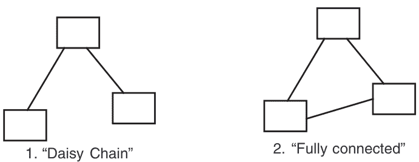

网络中的每个链路都有一个故障概率 $p_o$。

8.6a. 菊花链网络连接所有建筑物的概率是多少?

8.6b. 全连接网络连接所有建筑物的概率是多少?

8.6c. 城镇委员会的预算有限，可以购买具有两个高可靠性链路 (p=.000001) 的菊花链网络，也可以购买具有三个低可靠性链路 (p=.0001) 的全连接网络。他们应该购买哪个?

1985-0-1

## 8.7 图8.11显示了三种不同的5MR超模块设计的故障点，如果不及时修复。为相同的三个不同的TMR超模块设计绘制相应的图形。

2001-3-05

## 8.8 一位天文学家计算冥王星的轨迹需要执行 $10^{13}$ 台机器操作。实验室中最快的处理器每秒只能执行 $10^9$ 个操作，不幸的是，它在任何一个操作上发生故障的概率为 $10^{-12}$。（故障过程是无记忆的。）好消息是处理器是故障快速的，所以当发生故障时，它会立即停止并开始响铃。坏消息是，当它发生故障时，它会丢失所有状态，所以它正在做的任何事情都会丢失，并且必须从头开始。

考虑到实际情况，程序需要运行约3小时，而机器的平均无故障时间（MTTF）仅为此时间的1/10，路易斯·里森纳和本·比特迪德尔提出了两种组织计算的方法:

## 练习 8-67

- 路易斯建议从头开始运行，并希望一切顺利。如果机器故障，只需再试一次；不断尝试直到计算成功完成。
- 本建议将计算分为十个等长的片段；如果计算到达片段的末尾，它将其状态写入磁盘。当发生故障时，从磁盘上保存的最后状态重新启动。

保存状态和重新启动都不需要时间。在这两种策略下完成计算所需的预期时间之比是多少？

警告：解决这个问题的直接方法涉及到高级概率技术。

1976-0-3

## 8.9 绘制一个类似于图8.6的图形，显示当磁盘2故障并被替换时，5盘RAID 4系统中一个扇区的恢复过程。

2005-0-1

## 8.10 路易斯·里森纳刚刚看到了一则RAID控制器的广告，该控制器提供了两种配置选择。根据广告，第一种配置正是8.4.1节中描述的RAID 4系统。广告继续说，称为RAID 5的配置只有一个区别：在一个N盘配置中，奇偶校验块不是写在磁盘N上，而是写在磁盘号为(1 + 扇区地址 modulo N)的磁盘上。因此，例如，在一个五盘系统中，扇区18的奇偶校验块将在磁盘4上（因为1 + (18 modulo 5) = 4），而扇区19的奇偶校验块将在

## 8-68 第8章容错性:从不可靠系统中构建可靠系统

磁盘5(因为1 + (19模5)=5)。路易斯希望你能帮助他了解为什么这个想法可能是一个好主意。

8.10a. RAID 5相对于RAID 4的优势在于A.它可以容忍单个驱动器故障。

- B. 在没有错误的情况下，读取性能得到提升。
- C. 在没有错误的情况下，写入性能得到提升。
- D. 定位数据在驱动器上更容易。
- E. 在驱动器上分配空间更容易。
- F. 它需要更少的磁盘空间。
- G. 没有真正的优势，只是另一种广告伎俩。

1997-3-01

## 8.10b. 是否有任何工作负载使得RAID 4的写入性能优于RAID 5?

2000-3-01

## 8.10c. 路易斯也在思考是否最好使用RAID 1系统(参见第8.5.4.6节)。RAID 1和RAID 5所需的磁盘数量有何区别?

1998-3-01

## 8.10d. 在由小读取和小写入组成的工作负载中，RAID 1和RAID 5哪个性能更好?

2000-3-01

## 8.11 系统管理员注意到一个文件服务磁盘因两个无关的原因而故障。平均每30天，由于附近施工的振动会损坏磁盘的臂。平均每60天，一次电力波动会摧毁磁盘的电子元件。系统管理员每次磁盘故障时立即修复。

这两种故障模式彼此独立，与磁盘的年龄无关。磁盘的平均故障时间是多少?

2002-3-01

与第8章相关的其他练习可以在问题集中找到26到28。

## 章节

## 原子性：全有或全无
以及之前或之后

## 9

## 章节内容

+ #### 概述
- 概述................................................................................ 9-2

+ #### 9.1 原子性
- 9.1 原子性................................................................................ 9-4
  - 9.1.1 数据库中的全有或全无原子性 ........................................................ 9-5
  - 9.1.2 中断接口中的全有或全无原子性 .................................................... 9-6
  - 9.1.3 分层应用程序中的全有或全无原子性 ............................................... 9-8
  - 9.1.4 具有和不具有全有或全无属性的一些操作 ......................................... 9-10
  - 9.1.5 之前或之后的原子性：协调并发线程 .... 9-13
  - 9.1.6 正确性和序列化 ............................................................................ 9-16
  - 9.1.7 全有或全无和之前或之后的原子性 .................................................... 9-19

+ #### 9.2 全有或全无原子性I：概念
- 9.2 全有或全无原子性I：概念............................................................ 9-21
  - 9.2.1 实现全有或全无原子性：全部_或_无_放置 ...................................... 9-21
  - 9.2.2 系统性原子性：提交和黄金法则 .................................................... 9-27
  - 9.2.3 系统性全有或全无原子性：版本历史 ................................................ 9-30
  - 9.2.4 版本历史的使用方式 ...................................................................... 9-37

+ #### 9.3 全有或全无原子性II：实用主义
- 9.3 全有或全无原子性II：实用主义 ........................................................ 9-38
  - 9.3.1 原子性日志 .................................................................................... 9-39
  - 9.3.2 日志协议 ........................................................................................ 9-42
  - 9.3.3 恢复过程 ........................................................................................ 9-45
  - 9.3.4 其他日志配置：非易失性存储单元 .................................................... 9-47
  - 9.3.5 检查点 ............................................................................................ 9-51
  - 9.3.6 如果缓存不是写透的会怎么样？（高级主题） .................................... 9-53

+ #### 9.4 之前或之后的原子性I：概念
- 9.4 之前或之后的原子性I：概念 ............................................................ 9-54
  - 9.4.1 实现之前或之后的原子性：简单序列化 ............................................ 9-54
  - 9.4.2 标记点纪律 .................................................................................... 9-58
  - 9.4.3 乐观原子性：读取捕获（高级主题） ................................................ 9-63
  - 9.4.4 有人实际上使用版本历史来实现前后原子性吗？
  - 原子性？ ................................................................................................ 9-67

+ #### 9.5 之前或之后的原子性II：实用主义
- 9.5 之前或之后的原子性II：实用主义 ........................................................ 9-69
  - 9.5.1 锁 .................................................................................................... 9-70
  - 9.5.2 简单锁定 ........................................................................................ 9-72
  - 9.5.3 两阶段锁定 .................................................................................... 9-73

## 9-2 第9章原子性: 全有或全无和之前或之后

+ 9.5.4 性能优化 .................................................9-75
9.5.5 死锁; 取得进展 ............................................9-76
**9.6 跨层和多站点的原子性** .......................................9-79
9.6.1 事务的分层组合 ................................................9-80
9.6.2 两阶段提交 ........................................................9-84
9.6.3 多站点原子性: 分布式两阶段提交 ...........................9-85
9.6.4 两位将军的困境 ..................................................9-90
**9.7 更完整的磁盘故障模型(高级主题)** ..........................9-92
9.7.1 同时具有全有或全无和持久性的存储 ........................9-92
**9.8 案例研究: 机器语言的原子性** .................................9-95
9.8.1 复杂指令集: 通用电气600系列 .............................9-95
9.8.2 更详细的指令集: IBM System/370 ...........................9-96
9.8.3 Apollo台式计算机和Motorola M68000
微处理器 ...................................................9-97
练习 ....................................................................9-98
第9章词汇表 .......................................................9-107
第9章索引 ................................................................9-113
最后一章页码9-115

## 概述

本章探讨了两种密切相关的系统设计策略。 第一种是全有或全无的原子性，这是一种在解释程序时屏蔽故障的设计策略。 第二种是先前或后续的原子性，这是一种协调并发活动的设计策略。 第8章[在线]介绍了故障屏蔽，但没有展示如何屏蔽运行程序的故障。 第5章介绍了并发活动的协调，并提出了解决几个具体问题的解决方案，但没有解释确保动作具有先前或后续属性的系统化方法。 本章探讨了系统化合成既满足故障屏蔽所需的全有或全无属性，又满足协调所需的先前或后续属性的设计。

许多有用的应用程序可以从原子性中受益。 例如, 假设你正在尝试从互联网商店购买一个烤面包机。 你点击上面写着“购买”的按钮, 但在收到响应之前, 电源中断了。 你希望在电源故障发生后, 无论是购买成功还是什么都没有发生, 都能得到一些保证。 你不想事后发现你的信用卡被扣款, 但互联网商店没有收到发货的消息。 换句话说, 尽管可能发生故障, 你希望由“购买”按钮发起的操作是全有或全无的。 如果商店只有一台烤面包机库存, 并且两个顾客同时点击“购买”按钮购买烤面包机, 其中一个顾客应该收到购买确认, 而另一个顾客应该收到“抱歉, 缺货”的通知。 如果这样的情况发生, 将会有问题。

[PAGE 224]

## 概述 9-3

两个客户都收到了购买确认。换句话说，两个客户希望在他们自己点击“购买”按钮后，无论何时发生其他并发点击“购买”按钮的活动，都要么完全发生，要么完全发生之前。

原子性的单一概念框架提供了一种强大的思考方式，可以同时考虑无故障屏蔽和并发活动的先后顺序。原子性是执行一系列称为操作的步骤，使它们看起来像是一个单独的、不可分割的步骤，在操作系统和体系结构文献中被称为原子操作，在数据库管理文献中被称为事务。

当故障导致正确设计的原子操作中断时，对于调用者来说，原子操作要么成功完成，要么根本没有完成——因此，原子操作提供了全有或全无的原子性。

同样地，当多个原子操作同时进行时，每个原子操作将会在其他原子操作之前或之后完全发生-因此原子操作提供了前后原子性。总的来说，全有或全无的原子性和前后原子性提供了一种特别强大的模块化形式：它们隐藏了原子操作实际上由多个步骤组成的事实。

结果是系统可能状态的描述的极大简化。这种简化为从故障恢复和并发活动的协调提供了一种有系统的方法，简化了设计，简化了后期维护的理解，并简化了正确性的验证。这些要求尤其重要，因为由于协调错误引起的错误通常取决于外部事件的相对时间和不同线程之间的时间。当发生依赖于时间的错误时，发现和诊断它的难度可能比在纯顺序活动中找到错误的难度大上几个数量级。

原因是即使是少量的并发活动也可能有非常多的潜在实时序列。通常无法确定这些许多潜在步骤序列中的哪一个先于错误发生，因此在更仔细控制的情况下重现错误实际上是不可能的。由于调试这类错误非常困难，确保正确协调的先验技术尤为宝贵。

令人惊讶的是，相同的系统化方法——原子性——也适用于并发活动的协调。事实上，由于必须在同时协调并发活动时处理故障，任何尝试为这两个问题使用不同策略的企图都要求这些策略是兼容的。能够同时使用相同的策略是另一种广泛简化。

原子操作是计算机系统设计中广泛适用的基本构建块。原子操作在数据库管理系统、流水线处理器的寄存器管理、文件系统、用于程序开发的变更控制系统以及许多日常应用程序（如文字处理器和日历管理器）中都有应用。

## 9.1 原子性

原子性是计算机系统设计中几个不同领域所需的属性。这些领域包括管理数据库、开发硬件架构、指定操作系统接口，以及更一般地涉及软件工程。下表列出了一些适用原子性的问题类型。

| 领域 | 全有或全无的原子性 | 原子性之前或之后 |
| --- | --- | --- |
| 数据库管理 | 更新多个记录 | 线程之间共享的记录 |
| 硬件架构 | 处理中断和异常寄存器重命名 |  |
| 操作系统 | 监督员调用接口 | 打印机队列 |
| 软件工程 | 在层中处理故障 | 有界缓冲区 |

### 9.1.1 数据库中的全有或全无原子性

作为第一个例子，考虑一个银行账户的数据库。我们定义一个名为 TRANSFER 的过程，它从磁盘上借记一个账户并贷记另一个账户，具体如下:

```
1 过程TRANSFER(借记账户, 贷记账户, 金额)
2 获取(dbdata, 借记账户)
3 dbdata = dbdata - 金额
4 放置(dbdata, 借记账户)
5 获取(crdata, 贷记账户)
6 crdata = crdata + 金额
7 放置(crdata, 贷记账户)
```

其中借记账户和贷记账户分别标识要借记和贷记的账户记录。

假设系统在执行第4行的 PUT 指令时崩溃。即使我们使用了第8.5.4节中描述的 MORE_DURABLE_PUT，如果系统在恰好错误的时刻崩溃，写入磁盘的数据可能会被破坏， debit_account 的值也会丢失。我们希望要么将数据完全写入磁盘，要么根本不写入。也就是说，我们希望 PUT 指令具有全有或全无的原子性属性。第9.2.1节将介绍一种实现这一要求的方法。

在 TRANSFER 过程中还有进一步的全有或全无的原子性要求。假设第4行的 PUT 成功执行，但在执行第5行或第6行时，电源故障，导致计算机停止运行。当电源恢复时，计算机重新启动，但易失性内存，包括运行 TRANSFER 过程的线程的状态，已经丢失。如果现在有人查询余额， debit_account 和 credit_account 的东西将无法正确相加，因为 debit_account 有一个新值，但 credit_account 有一个旧值。有人可能建议将第一个 PUT 推迟到第二个之前，但这只是减少了漏洞的时间窗口，而不是消除了它——电源仍然可能在两个 PUT 之间失败。为了消除这个时间窗口，我们必须以某种方式安排这两个 PUT 指令，或者甚至整个 TRANSFER 过程，作为一个全有或全无的原子操作。

### 9.1.2 中断接口中的全有或全无原子性

全有或全无原子性的第二个应用是处理器指令集接口，由线程使用。回顾第2章和第5章，线程通常按照当前程序的指令指示，一个接一个地执行操作，但某些事件可能引起线程解释器的注意，导致解释器而不是程序提供下一条指令。当发生这样的事件时，运行在中断线程中的另一个程序接管控制。

如果事件是来自解释器外部的信号，则中断线程可以简单地调用诸如 ADVANCE 的线程管理原语，如第5.6.4节所述，以通知其他线程有关该事件的信息。例如，其他线程正在等待的 I/O 操作现在可能已经完成。然后，中断处理程序将控制权返回给被中断的线程。此示例要求中断线程和被中断线程之间具有先后原子性。如果被中断的线程正在调用线程管理器，中断线程调用 ADVANCE 应该在该调用之前或之后发生。

另一种可能性是解释器检测到中断线程出现问题的情况。在这种情况下，中断事件会调用异常处理程序，该程序在原始线程的环境中运行。（附录9.2提供了一些例子。）异常处理程序要么调整环境以消除一些问题（例如缺少页面），以便原始线程可以继续，要么宣布原始线程失败并终止它。无论哪种情况，异常处理程序都需要检查原始线程在中断瞬间执行的操作的状态——该操作是否已完成，或者是否处于部分完成状态?

理想情况下，处理程序希望看到状态的全有或全无报告：要么导致异常的指令已完成，要么没有做任何事情。全有或全无的报告意味着原始线程的状态完全由异常处理程序所在层的值来描述。这样的值的一个例子是程序计数器，它标识线程将要执行的下一条指令。

中间报告意味着状态描述涉及较低层的值，可能是操作系统或硬件处理器本身。在这种情况下，知道下一条指令只是故事的一部分；处理程序还需要知道当前指令的哪些部分已经执行，哪些部分尚未执行。一个例子可能是一个指令，它增加一个地址寄存器，检索该新地址处的数据，并将该数据值添加到另一个寄存器中的值。如果检索数据导致缺页异常，那么当前状态的描述是地址寄存器已经增加，但检索和加法尚未执行。这样的中间报告是有问题的，因为处理程序在检索缺页后不能简单地告诉处理器跳转到失败的指令，这将再次增加地址寄存器，这不是程序的意图。

### 9.1.3 分层应用中的全有或全无原子性

第三个全有或全无原子性的例子涉及运行程序中的故障：在故障发生的瞬间，程序通常正在进行某些操作，而将事情半途而废通常是不可接受的。我们的目标是获得更优雅的响应，方法是要求某些操作序列具有全有或全无属性的原子操作。原子操作与以层次结构组织事物时产生的模块化密切相关。分层组件具有一个特性，即更高层可以完全隐藏较低层的存在。这种隐藏特性使得层次结构在错误容纳和系统性地响应故障方面异常有效。

要了解原因，请回想一下第2章中日历管理程序的分层结构，图9.1（该图可能看起来很熟悉，它是图2.10的副本）。日历程序通过执行一系列Java语言语句来实现用户的每个请求。理想情况下，用户永远不会注意到日历管理器实现的动作的复合性质。同样，Java语言的每个语句都是由硬件层的多个动作来实现的。同样，如果Java解释器被精心实现，那么机器语言层面上的实现复合性质将完全对Java程序员隐藏。

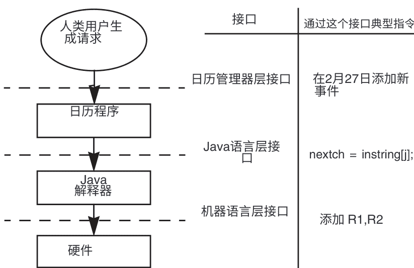

**图9.1** 一个具有三层解释的应用系统。用户请求的操作将失败，但是失败将在最低层发现。优雅的响应涉及每个接口的原子性。

### 9.1.4 具有全有或全无属性的一些操作

在将多级内存管理添加到计算机体系结构中，特别是高度流水线化的处理器中，经常发现缺乏全有或全无属性的操作。在这种情况下，需要全有或全无属性的接口位于处理器和操作系统之间。除非原始机器架构师在设计指令集时考虑了缺页异常，否则可能会出现缺页异常发生在指令的“中间”，在处理器覆盖了某些寄存器或后续指令进入流水线之后的情况。当出现这种情况时，试图添加多级内存特性的后续设计师陷入困境。该指令无法运行到结束，因为它所需的操作数不在实际内存中。在从二级存储器中检索缺页时，设计师希望允许操作系统使用处理器进行其他操作（甚至运行获取缺页的程序），但是重用处理器需要保存当前执行程序的状态，以便在缺页可用时可以重新启动。问题是如何保存下一条指令的指针。

如果每个指令都是一个全有或全无的操作，操作系统可以简单地保存下一条指令指针的地址，该指令遇到了缺页。所得到的保存状态描述显示程序位于两条指令之间，其中一条指令已经完全执行，而下一条指令尚未开始。稍后，当页面可用时，操作系统可以通过重新加载所有寄存器并将程序计数器设置为下一条指令指针指示的位置来重新启动程序。处理器将继续执行，从之前遇到缺页异常的指令开始；这次应该成功。另一方面，如果指令集中甚至有一条指令缺乏全有或全无属性，在执行该指令期间发生中断时，操作系统如何保存处理器状态以供将来重新启动，这一点并不明显。设计师们提出了几种技术来在机器语言接口上添加全有或全无属性。第9.8节描述了一些存在这个问题的机器体系结构的示例以及用于向它们添加虚拟内存的技术。

第二个例子是监督调用（SVC）。第5.3.4节指出，改变程序计数器和处理器模式位的 SVC 指令（在具有虚拟内存的系统中，还包括其他寄存器，如页映射地址寄存器）需要是全有或全无的，以确保所有（或没有）预期的寄存器发生变化。除此之外， SVC 还调用了一些完整的内核过程。设计者希望整个调用（ SVC 指令和内核过程本身的操作的组合）是一个全有或全无的操作。全有或全无的设计使应用程序员可以将内核过程视为硬件的扩展。这个目标说起来容易做起来难，因为内核过程可能会检测到一些条件，阻止它执行预期的操作。因此，需要仔细设计内核过程。

考虑一个 SVC 调用内核的 READ 过程，将下一个键入的按键传递给调用者。当应用程序调用 READ 时，用户可能还没有输入任何内容，因此 READ 的设计者必须安排等待用户输入。单独看，这种情况并不特别棘手，但当存在用户提供的异常处理程序时，情况就变得更加复杂。例如，假设在调用 READ 期间，线程计时器可以超时，并且用户提供的异常处理程序将决定线程是否应该继续运行一段时间。因此，场景是用户程序调用 READ，需要等待，在等待期间，计时器超时并且控制权传递给异常处理程序。不同的系统对 READ 过程的设计选择了三种可能性，其中最后一种不是全有或全无的设计：1. 实现“无”选项（阻塞读取）的全有或全无设计：当没有可用输入时，内核过程首先调整返回指针（“将PC推回”），使其看起来应用程序在调用 READ 之前调用了 AWAIT，然后将控制权转移到内核的 AWAIT 入口点。当用户最终输入内容时，导致 AWAIT 返回，用户的线程重新执行原始的内核调用 READ，这次找到了输入的内容。

输入。使用这种设计，如果在等待过程中发生定时器异常，当异常处理程序检查线程的当前状态时，它会得到答案“应用程序在指令之间；下一条指令是一个读取调用”。这个描述对于用户提供的异常处理程序是可理解的，并且它允许处理程序有几个选项。其中一个选项是继续执行线程，也就是继续执行读取调用。如果仍然没有输入，读取调用将再次将程序计数器推回并将控制权转移到等待状态。另一个选项是处理程序将此状态描述保存下来，并计划在将来的某个时间恢复线程到这个状态。

2. 一个实现“全部”选项（非阻塞读取）的全有或全无设计：当没有可用输入时，内核立即返回给应用程序一个长度为零的结果，期望程序会查找并正确处理这种情况。程序可能会测试结果的长度，如果为零，则调用等待状态，或者它可能会找到其他事情来做。与之前的设计一样，这个设计确保用户提供的定时器异常处理程序始终看到线程的当前状态的简单描述——它在两个用户程序指令之间。然而，需要注意的是，在调用等待状态和下一个键入字符到达之间要避免竞争。

3. 一个既不是“全部”也不是“无”的阻塞读设计，因此不是原子的：内核 READ 过程本身调用 AWAIT，阻塞线程直到用户输入一个字符。尽管这个设计在概念上很简单，但从定时器异常处理程序的角度来看，线程的状态描述并不简单。与其说是“在两个用户指令之间”，不如说是“在用户调用内核过程 READ 的中间等待某些事件发生”。保存这个状态描述以供将来使用的选择已经被排除。要使用这个状态描述启动另一个线程，异常处理程序需要能够请求“在内核 READ 入口的 AWAIT 调用之后立即启动这个线程”。但是允许这种请求会损害用户-内核接口的模块化。用户提供的异常处理程序同样可以在内核的任何地方请求重新启动线程，从而绕过其门控并危及其安全性。

第一和第二设计直接对应于“全有或全无”操作的两个选项的定义，事实上一些操作系统提供了这两个选项。在第一设计中，内核程序的行为似乎从未发生过调用，而在第二设计中，每次调用内核程序都会完整运行。这两种设计都使内核过程成为“全有或全无”操作，并且都会导致用户可理解的状态描述——程序处于其指令之间的状态——如果在等待期间发生异常。

在第4章介绍的客户端/服务器模型中的一个吸引人之处在于它倾向于将“全有或全无”属性强制到设计表上。由于服务器可以独立于客户端发生故障，因此客户端需要仔细考虑恢复计划。

### 9.1.5 之前或之后的原子性：协调并发线程

在第5章中，我们学习了如何通过创建线程来表达并发的机会，而并发的目标是通过同时运行多个任务来提高性能。此外，上面的第9.1.2节指出中断也可以创建并发。并发线程在它们的路径交叉之前并不表示任何特殊问题。路径交叉的方式总是可以用共享的可写数据来描述：并发线程恰好在大约相同的时间对同一块可写数据感兴趣。甚至不需要并发线程同时运行；如果一个线程在执行过程中被阻塞（可能是因为中断），另一个正在运行的线程可以对被阻塞线程正在处理的数据感兴趣，并且在某个时候会再次处理该数据。

从应用程序员的角度来看，第5章介绍了两种完全不同的并发协调要求：顺序协调和先后原子性。顺序协调是一种约束类型的约束“动作w必须在动作x之前发生”。为了正确性，第一个动作必须在第二个动作开始之前完成。例如，从键盘读取键入的字符必须在运行将这些字符显示在屏幕上的程序之前发生。作为一般规则，在编写程序时，可以预见到顺序协调约束，并且程序员知道并发动作的身份。

因此，顺序协调通常是显式编程的，可以使用特殊的语言结构或共享变量，如第5章的事件计数。

相比之下，先后原子性是一种更一般的约束，即同时操作相同数据的多个动作不应相互干扰。我们将先后原子性定义如下：

### 原子性之前或之后

> 如果并发操作从调用者的角度看，其效果与操作完全在另一个操作之前或之后发生时相同，则并发操作具有之前或之后属性。

在第5章中，我们看到了如何使用显式锁和实现了 ACQUIRE 和 RELEASE 过程的线程管理器创建之前或之后的操作。第5章展示了使用锁的一些之前或之后的操作示例，并强调编写正确的之前或之后的操作（例如，协调具有多个生产者或多个消费者的有界缓冲区）可能是一个棘手的问题。为了确保正确性，需要建立一个令人信服的论证，证明每个涉及共享变量的操作都遵循锁定协议。

## 第9章 原子性：全有或全无和之前或之后

使之前或之后的原子性与顺序协调不同的一个事实是，必须具有之前或之后属性的操作的程序员不一定知道可能涉及共享变量的所有其他操作的身份。这种缺乏知识可能使通过显式程序步骤协调操作成为问题。相反，程序员需要的是一种自动的、隐式的机制，确保正确处理每个共享变量。本章将描述几种这样的机制。换句话说，正确的协调要求并发线程在读写共享数据时要有纪律。

计算机系统中有很多应用需要在之前或之后保持原子性。在操作系统中，多个并发线程可能同时决定使用共享打印机。不同线程的打印行不能交错在打印输出中。此外，哪个线程先使用打印机并不重要；主要考虑的是在下一个打印作业开始之前，一个打印作业必须完成，因此要求每个打印作业具有之前或之后的原子性属性。

对于一个更详细的例子，让我们回到银行应用程序和TRANSFER过程。这次账户余额保存在共享内存变量中（回想一下，声明关键字 reference 表示参数是按引用调用的，因此 TRANSFER 可以更改这些参数的值）：

```
java
过程 TRANSFER (引用 借方账户, 引用 贷方账户, 金额)
借方账户 ≠ 借方账户 - 金额
贷方账户 ≠ 贷方账户 + 金额
```

尽管它们看起来是单一的，但是像“X≠X+Y”这样的程序语句实际上是复合的：它涉及到读取 X 和 Y 的值，进行加法运算，然后将结果写回 X。如果一个并发线程在这个语句的读取和写入之间读取并改变了 X 的值，那么当这个语句覆盖它的改变时，那个线程可能会感到惊讶。

假设将此过程应用于账户 A（初始金额为$300）和 B（初始金额为$100），如下所示

```
java
TRANSFER (A, B, $10)
```

我们期望账户 A（借方账户）最终剩下 $290，账户 B（贷方账户）最终剩下 $110。然而，假设第二个并发线程正在执行以下语句

```
java
TRANSFER (B, C, $25)
```

其中账户 C 的初始金额为 $175。当两个线程完成它们的转账时，我们期望 B 最终剩下 $85，C 最终剩下 $200。此外，无论哪个转账先发生，这个期望都应该得到满足。但是第一个线程中的变量 credit_account 与第二个线程中的变量 debit_account 绑定到同一个对象（账户 B）。如果两个转账几乎同时发生，就会存在正确性风险。为了理解这个风险，考虑图 9.2，它展示了两个线程关于变量 B 的 READ 和 WRITE 步骤的几个可能的时间序列。

每个时间序列中，图表显示了包含账户余额 B 的单元格的值的历史记录。如果步骤 1-1 和 1-2 都在步骤 2-1 和 2-2 之前（或反之），那么两个转账将按预期工作，账户 B 最终会有 85 美元。然而，如果步骤 2-1 在步骤 1-1 之后但在步骤 1-2 之前发生，将会发生错误：其中一个转账将不会影响账户 B，尽管它应该影响。前两种情况说明了共享变量 B 的历史记录，其中答案是正确的结果；剩下的四种情况说明了导致 B 有两个不正确值的四个不同序列。

| 线程 #1 (credit_account 是 B) | 线程 #2 (借方账户是 B) |
| --- | --- |
| 1-1 读取 B | 2-1 读取 B |
| . | . |
| . | . |
| 1-2 写入 B | 2-2 写入 B |

正确结果:
案例 1: 线程 #1: 读取 B — 写入 B
线程 #2: — 读取 B — 写入 B —
B 的值为: 100 — 110 — 85

案例 2: 线程 #1: — 读取 B — 写入 B —
线程 #2: 读取 B — 写入 B
B 的值为: 100 — 75 — 85

错误结果:
案例 3: 线程 #1: 读取 B — 写入 B —
线程 #2: — 读取 B — 写入 B —
B 的值为: 100 — 110 — 75

案例 4: 线程 #1: 读取 B — 写入 B
线程 #2: — 读取 B — 写入 B
B 的值为: 100 — 75 — 110

案例 5: 线程 #1: — 读取 B — 写入 B —
线程 #2: 读取 B — 写入 B
B 的值为: 100 — 110 — 75

案例 6: 线程 #1: — 读取 B — 写入 B —
线程 #2: 读取 B — 写入 B
B 的值为: 100 — 75 — 110

图 9.2
如果共享 B 的两个线程不协调它们的并发活动，则变量 B 的六个可能历史。

因此，我们的目标是确保前两种时间序列中的一个实际发生。实现这个目标的一种方法是，步骤 1-1 和 1-2 应该是原子的，步骤 2-1 和 2-2 也应该是原子的。在原始程序中，这些步骤

```
借方账户 ≠ 借方账户 - 金额
和
贷方账户 ≠ 贷方账户 + 金额
```

每个步骤都应该是原子的。不应该存在这样的可能性，即在该语句的 READ 和 WRITE 步骤之间，一个并发线程打算更改共享变量借方账户的值时读取其值。

## 9.1.6 正确性和序列化

图9.2的前两种序列是正确的，其他四种序列是错误的，这是基于我们对银行应用的理解。最好有一个更一般的正确性概念，与应用程序无关。应用程序独立性是一个模块化目标：我们希望能够为提供先后原子性的机制的正确性进行论证，而不涉及使用该机制的应用程序是否正确的问题。

这里有一个正确性概念：并发操作之间的协调可以被认为是正确的，如果每个结果都保证是通过某些纯粹的串行应用程序获得的。

这个正确性概念的推理涉及几个步骤。考虑图 9.3，它抽象地展示了效果。
将某个操作（无论是原子操作还是非原子操作）应用于系统会改变系统的状态。现在，如果我们确信：

+   1. 系统的旧状态从应用程序的角度来看是正确的，且

+   2. 该操作本身正确地将任何正确的旧状态转换为一个正确的新状态，

那么我们可以推断新状态也必须是正确的。这种推理方法适用于任何应用程序相关的“正确”和“正确转换”的定义，因此我们的推理方法独立于这些定义和应用程序。

当多个操作同时进行时，如图 9.4 所示，对应的要求是产生的新状态应该是这些操作中的某个序列化操作的结果之一，如图 9.5 所示。这个正确性准则意味着如果并发操作的结果被保证是通过同样的操作纯序列应用而获得的结果之一，那么并发操作就被正确地协调了。


**图9.4**
当多个操作同时进行时，它们一起产生一个新的状态。如果操作是前后操作，并且旧状态是正确的，那么新状态将是正确的。

只要协调要求是前后原子性，任何序列化都可以。

此外，我们甚至不需要坚持系统实际遍历图9.5中的任何特定路径的中间状态，它可以沿着虚线轨迹通过中间状态，这些状态本身根据应用程序的定义并不正确。只要中间状态在实现层上不可见，并且系统保证最终处于可接受的最终状态之一，我们可以声明协调是正确的，因为存在一条导致该状态的轨迹，对于每一步都可以应用正确性论证。

由于我们对于先前或后续原子性的定义是每个先前或后续操作都像完全在其他先前或后续操作之前或之后运行一样，先前或后续原子性直接导致了这个正确性概念。换句话说，先前或后续原子性的效果是对操作进行序列化，因此可以得出先前或后续原子性保证协调的正确性。另一种方式是


**图9.5**
我们坚持最终状态是通过某些序列化的原子操作达到的，但我们不关心具体的序列化方式。此外，我们不需要坚持中间状态实际存在。实际的状态轨迹可以是虚线所示的方式，但前提是无法从外部观察到中间状态。

表达这个想法的一种方式是说，当并发操作具有先后顺序属性时，它们是可序列化的：存在一些并发事务的序列顺序，如果按照该顺序执行，将导致相同的结束状态。*因此，在图9.2中，情况1和情况2的序列可以由序列化顺序产生，但情况3到6的操作则不行。

在图9.2的示例中，只有两个并发操作，每个并发操作只有两个步骤。随着并发操作的数量和每个操作中的步骤数量增加，可能发生的个别步骤顺序将呈指数增长，但只有其中一些顺序才能确保正确的结果。由于并发的目的是为了提高性能，人们希望能够从正确顺序的集合中选择具有最高性能的正确顺序。正如人们可能猜测的那样，在一般情况下，做出这个选择可能非常困难。在本章的第9.4节和9.5节中，我们将遇到几种编程规范，确保从可能顺序的子集中进行选择，其中所有成员都保证是正确的，但不幸的是，可能不包括具有最高性能的正确顺序。

在某些应用中，使用比串行化更强的正确性要求是合适的。例如，银行系统的设计者可能希望通过要求所谓的外部时间一致性来避免时代错误：如果存在任何外部证据（如打印的收据），表明在动作 T₁ 结束之前或之后，动作 T₂ 开始之前，T₁ 和 T₂ 在系统内的序列化顺序应该是 T₁ 在 T₂ 之前。对于另一个更强的正确性要求的例子，处理器架构师可能要求顺序一致性：当处理器同时执行来自同一指令流的多条指令时，结果应该与程序员指定的原始顺序执行的结果相同。

回到我们的例子，一个真实的资金转移应用程序通常有几个不同的原子性要求之前或之后。考虑以下审计程序；其目的是验证所有账户余额之和是否为零（在复式记账中，属于银行的账户，如保险柜中的现金金额，具有负余额）：

```
text
过程 审计 ()
    总和 ≠ 0
    对于每个 W 在 bank.accounts 中
        总和 ≠ 总和 + W.balance
        如果 (总和 ≠ 0) 调用 调查
```

假设审计正在一个线程中运行，同时另一个线程正在从账户 A 转账到账户 B。如果审计在转账之前检查账户 A 并在转账之后检查账户 B，它将计算转账金额两次

> * 是否可串行化一组现有事务的一般问题是数据库管理中的一个高级主题。问题集 36 探讨了回答这个问题的一种方法。

因此将计算出一个不正确的答案。因此，整个审计过程应在任何个别转账之前或之后发生：我们希望它是一个之前或之后的动作。

还有另一个之前或之后的原子性要求：如果 AUDIT 在 TRANSFER 语句之后运行，但在语句之前运行，它将计算一个不包括 amount 的总和；因此我们得出结论，两个余额更新应在任何 AUDIT 动作之前或之后完全发生；换句话说，TRANSFER 应该是一个之前或之后的动作。

借方账户 ≠ 借方账户 - 金额

但在语句之前

贷方账户 ≠ 贷方账户 + 金额

它将计算一个不包括 amount 的总和；因此我们得出结论，两个余额更新应在任何 AUDIT 动作之前或之后完全发生；换句话说，TRANSFER 应该是一个之前或之后的动作。

## 9.1.7 全部或无和之前或之后的原子性

我们现在已经看到了两种原子性的例子：全部或无和之前或之后。这两种形式有一个共同的基本目标：隐藏一个动作的内部结构。有了这个洞察力，就会发现原子性实际上是一个统一的概念：

**原子性**

如果一个操作是原子的，那么上层无法发现其内部结构的实现方式。

这个描述实际上是原子性的基本定义。从中，我们可以立即得出两个重要的结论，分别对应于全部或无的原子性和之前或之后的原子性：

+   1. 从调用原子操作的过程的角度来看，原子操作要么按预期完成，要么什么都不做。这个结论是使原子操作在恢复故障时有用的原因。

+   2. 从并发线程的角度来看，原子操作的行为就好像它要么完全发生在其他并发原子操作之前，要么完全发生在其他并发原子操作之后。这个结论是使原子操作在协调并发线程时有用的原因。

这两个结论在本质上并没有根本的不同。它们只是两个不同的视角，第一个视角来自调用该操作的线程内的其他模块，第二个视角来自其他线程。这两个观点都源于一个想法，即操作的内部结构对于实现该操作的模块之外是不可见的。这种隐藏内部结构的方式是模块化的本质，但原子性是一种异常强大的模块化形式。原子性不仅隐藏了哪些细节。

## 9-20 第9章原子性:全有或全无和先后顺序

步骤形成原子动作,但事实上它具有结构。原子性与其他系统构建技术(如数据抽象和客户端/服务器组织)之间存在亲缘关系。数据抽象的目标是隐藏数据的内部结构;客户端/服务器组织的目标是隐藏主要子系统的内部结构。同样,原子性的目标是隐藏一个动作的内部结构。

这三种方法都是强制工业级模块化的方式,从而保证复杂系统的各组件之间没有意外的相互作用。

我们多次使用了“从调用者的角度来看”的短语,这表明可能还有另一个角度可以看到内部结构。这个另一个角度是由原子动作的实现者看到的,他通常痛苦地意识到一个动作实际上是复合的,并且必须额外工作来隐藏这个事实,以及来自更高层和并发线程的事实。因此,层之间的接口是原子动作定义的重要部分,并且它们为动作的实现提供了机会,以任何方式提供原子性。

隐藏原子操作内部结构的另一个方面是:原子操作可能具有有益的副作用。一个常见的例子是审计日志,当遇到问题的原子操作记录检测到的故障性质和恢复序列,以供后续分析。有人可能认为,当故障导致回滚时,审计日志也应该回滚;但是回滚它将破坏其目的——审计日志的整个目的是记录有关故障的详细信息。重要的是,审计日志通常是实现原子操作的层的私有记录;在正常操作过程中,它在该层之上是不可见的,因此没有回滚的要求。(另一个原子性要求是确保描述故障的日志条目是完整的,并且不会在随后的恢复中丢失。)

另一个有益的副作用的例子是性能优化。例如,在高性能数据管理系统中,当上层原子操作要求数据管理系统将新记录插入文件时,数据管理系统可以决定现在是重新排列文件为更好物理顺序的时机。如果原子操作失败并中止,它只需要确保新插入的记录被删除;文件不需要恢复到旧的、效率较低的存储排列。同样,现在包含原子操作触及的变量的较低层缓存不需要被清除,堆存储的垃圾回收也不需要被撤销。只要这些副作用对于原子操作的更高层客户端是隐藏的,除非在以后的操作速度或报告性能指标或故障的接口中,它们就不是问题。

## 9.2 全有或全无原子性I: 概念

本章第9.1节定义了全或无原子性和先后原子性的目标，并提供了一个概念框架，至少在原则上允许设计者决定某个提议的算法是否正确地协调并发活动。然而，它没有提供任何实际实现的示例任何目标。本章的这一节和下一节描述了一些广泛适用的技术，用于系统地实现全或无原子性。

本章的后续部分将对先后原子性做同样的介绍。

许多示例使用了第5章介绍的引导技术，这是一种类似归纳证明的方法。回顾一下，引导意味着首先寻找一种系统的方法，将一个一般问题缩小到同样问题的某个特定版本。然后，使用一些专门的方法解决这个狭窄的问题，因为它利用了特定的情况。一般解决方案由两部分组成：特殊情况技术加上一种将一般问题系统地缩小到特殊情况的方法。

回想一下，第5章解决了通过实现一个名为 ACQUIRE 的过程来从任意代码序列中创建前后动作的一般问题，该过程本身需要两行或三行代码的前后原子性，其中它读取然后设置一个锁值。然后，它利用一种特殊的硬件功能来实现读取和设置序列的前后动作，并展示了一个仅依赖于硬件执行普通 LOAD 和 STORE 作为前后动作的软件实现（在 Sidebar 5.2 中）。本章多次使用引导程序。第一个例子从特殊情况开始，然后介绍了将一般问题简化为该特殊情况的方法。减少方法称为版本历史，在实践中只偶尔使用，但一旦理解，就很容易看出将在第9.3节中描述的更广泛使用的减少方法为什么有效。

## 9.2.1 实现全有或全无的原子性：全部或无放

第一个例子是一个方案，它对单个磁盘扇区进行全有或全无的更新。需要解决的问题是，如果系统在磁盘写入过程中崩溃（例如，操作系统遇到错误或电源故障），在故障发生时正在写入的扇区可能包含一堆混乱的旧数据和新数据。目标是创建一个具有全有或全无属性的全部或无放，当后续的读取扇区时，它总是返回旧数据或新数据，而不是混乱的混合数据。

为了使实现精确，我们开发了一个磁盘容错模型，它是第8章[在线]介绍的模型的轻微变化，以一个个人计算机的日历管理程序为例应用。用户希望，如果系统在向日历添加新事件时发生故障，系统在后续重新启动时日历将安全完好。无论新事件是否最终添加到

## 9-22 第9章原子性：全有或全无和先后顺序

日历比系统故障的不适时时间更不重要。该系统包括一个人类用户，一个显示器，一个处理器，一些易失性内存，一个磁盘，一个操作系统和日历管理程序。我们将该系统分为几个部分：

### 整体系统容错模型。

+   - 无错误操作：所有工作按照预期进行。用户发起操作，例如向日历添加事件，系统通过向用户显示消息来确认操作。
- 可容忍错误：发起操作的用户在系统确认完成操作之前注意到系统故障，并在系统再次运行时检查是否实际执行了该操作。
- 不可容忍的错误：系统故障而用户未注意到，因此用户没有意识到自己应该检查或重试系统可能未完成的操作。

可容忍的错误规范意味着，在尽可能的范围内，整个系统是故障快速的：如果在更新过程中出现问题，系统会在继续处理任何请求之前停止，并且用户会意识到系统已经停止。通常情况下，设计这样一个系统是为了最大限度地减少不可容忍的错误的机会，例如通过要求人工用户进行监督。然后，人工用户就能够意识到（也许是由于缺乏响应）出现了问题。系统重新启动后，用户知道要询问操作是否已完成。这种设计策略应该在我们对第7章[在线]中研究的尽力而为网络中很熟悉。

较低层（计算机系统）提供了尽力而为的实现。较高层（人工用户）进行监督，并在必要时进行重试。例如，假设人工用户向日历添加一个约会，但就在他或她点击“保存”时，系统崩溃了。用户不知道添加是否成功，所以当系统再次启动时，首先要做的就是打开日历以了解发生了什么。

### 处理器、内存和操作系统容错模型。

该模型的这一部分更精确地指定了硬件和操作系统的故障快速失败属性:

+   - 无错误操作: 处理器、内存和操作系统都遵循它们的规格。
- 检测到错误: 操作系统在 CAREFUL_PUT 期间崩溃,并在易失性存储器中损坏磁盘缓冲区, CAREFUL_PUT 在磁盘的一个扇区上写入损坏的数据。

如果我们假设应用程序在调用 CAREFUL_PUT 之前计算了端到端校验和,并将其与数据一起包含在内,那么我们可以将错误分类为“可检测”错误,因此在系统崩溃之前无法破坏数据。

在这个小心存储层的修订中,当系统崩溃发生时,磁盘上的一个扇区可能会损坏,但接口的客户端有信心(1)只有该扇区可能会损坏,(2)如果它已经损坏,任何后续读取该扇区的操作将检测到问题。在处理器模型和存储系统模型之间,所有预期的故障现在都导致相同的情况-

## 9-24 第9章原子性：全有或全无和先后顺序

过程几乎全部或无放 (数据,全有或全无区块)
2     小心放 (数据,全有或全无区块.S1)
3     小心放 (数据,全有或全无区块.S2)           // 提交点。
4     小心放 (数据,全有或全无区块.S3)

过程全部或无取 (参考数据,全有或全无区块)
6     小心取 (数据1,全有或全无区块.S1)
7     小心取 (数据2,全有或全无区块.S2)
8     小心取 (数据3,全有或全无区块.S3)
9     如果数据 1 = 数据 2则数据 ≠ 数据 1        // 返回新值。
10  否则数据 ≠ 数据 3                        // 返回旧值。

**图9.6** 几乎全部或无任何PUT和全部或无任何GET的算法。

tion: 系统检测到故障，重置所有处理器寄存器和易失性内存，忘记所有活动线程，并重新启动。不会有多个磁盘扇区损坏。

我们的问题现在被简化为提供全部或无任何属性：目标是创建全部或无任何磁盘存储，它保证要么完全正确地更改扇区上的数据，要么对未来的读取者来说似乎根本没有触碰过它。下面是一个简单但效率稍低的方案，它利用虚拟化：为每个要具有全部或无任何属性的数据扇区分配三个物理磁盘扇区，标识为 s1, s2和 s3。这三个物理扇区一起构成一个虚拟的“全部或无任何扇区”。在系统中使用该磁盘扇区的每个位置，用由三元组{s1, s2, s3}标识的全部或无任何扇区替换它。我们从一个几乎正确的全部或无任何实现命名为ALMOST_ALL_OR_NOTHING_PUT开始，找到一个错误，并修复该错误，最终创建一个正确的

矩形 全部_或_无_放。 当要求写入数据时，几乎全部或无放会将数据写入三次，按照顺序分别写入s1、s2和s3，每次都会等待前一次写入完成，这样如果系统崩溃，只有三个扇区中的一个会受到影响。要读取数据，全部或无放会读取所有三个扇区并比较它们的内容。 如果s1和s2的内容相同，全部或无放会将该值作为全部或无放扇区的值返回。 如果s1和s2的内容不同，全部或无放会将s3的内容作为全部或无放扇区的值返回。 图9.6显示了这个几乎正确的伪代码。

让我们来探索一下这个实现在系统崩溃时的行为。 假设在之前的某个时间，一条记录已经被正确地存储在一个全有或全无的扇区中（换句话说，所有三个副本都是相同的），现在有人通过调用ALL_OR_NOTHING_PUT来更新它。 目标是即使在更新过程中发生故障，稍后的读取者也可以确保获取到某个完整、一致的版本的记录，只需调用ALL_OR_NOTHING_GET。

假设几乎所有或者无不PUT在系统崩溃之前被中断，没有完成对扇区 s2的写入，从而损坏了 s1或 s2。在这种情况下，  

## 9.2全有或全无的原子性I：概念 9-25

过程全部_或_无_放 (数据,全部或无扇区)
2     检查 _并 _修复 (全部或无扇区 )

几乎_全部_或_无_放 (数据,全部或无扇区)

过程 检查 _并 _修复 (全部或无扇区 ) // 确保副本匹配。
5     小心 获取(数据1,全部或无扇区.S1)
6     小心 获取(数据2,全部或无扇区.S2)
7     小心 获取(数据3,全部或无扇区.S3)
8 如果 (数据1 = 数据 2)且 (数据2 = 数据 3)返回 // 状态1或7，无需修复
9 如果 (数据1 = 数据 2)
10         小心 放置(数据1,全或无扇区.S3)返回 // 状态5或6.
11 如果 (数据2 = 数据 3)
12         小心 放置(数据2,全或无扇区.S1)返回 // 状态2或3.
13 小心 放置(数据1,全或无扇区.S2) // 状态4，转到状态5
14 小心 放置(数据1,全或无扇区.S3) // 状态5，转到状态7

# 图9.7

用于全或无放置和检查与修复的算法。

当全或无获取读取扇区s1和s2时，它们将具有不同的值，而不清楚应该信任哪个。因为系统是快速失败的，扇区s3尚未被全或无放置操作触及，因此它仍然包含先前的值。
返回在s3中找到的值，从而达到几乎全部或什么都不做的效果。

现在，假设几乎全部或什么都不做被系统崩溃中断成功写入扇区 s2之后的一段时间。在这种情况下，崩溃可能会破坏s3，但 s1和 s2都包含了新更新的值。几乎全部或什么都不做获取返回 s1的值，从而提供几乎全部或什么都不做的效果。

那么这个设计有什么问题呢？几乎全部或什么都不做假设在开始时所有三个副本都是相同的。但是之前的故障可能会违反这个假设。
假设在写入 S3时， ALMOST_ALL_OR_NOTHING_PUT被中断。下一个调用 ALL_OR_NOTHING_GET的线程发现 data1 = data2，所以它使用 data1，如预期。然后，新线程调用 ALMOST_ALL_OR_NOTHING_PUT，但在写入 S2时被中断。现在， S1不等于 S2，所以下一次调用 ALMOST_ALL_OR_NOTHING_PUT返回损坏的 S3。

修复此错误的方法是在更新之前， ALL_OR_NOTHING_PUT保证这三个扇区是相同的。它可以通过调用一个名为CHECK_AND_REPAIR的过程来提供此保证，如图9.7所示。 CHECK_AND_REPAIR简单地比较这三个副本，如果它们不相同，则强制它们相同。为了了解这是如何工作的，假设有人在所有三个副本都包含相同值（我们称之为“旧值”）的时候调用 ALL_OR_NOTHING_PUT。 因为 ALL_OR_NOTHING_PUT 写入“新值”  

## 9-26 第9章原子性: 全有或全无和先后顺序

将值逐个按顺序插入 S1, S2和 S3, 即使发生崩溃, 在下一次调用 ALL_OR_NOTHING_PUT时, 对于 CHECK_AND_REPAIR来说, 只有七种可能的数据状态需要考虑:

| 数据状态: | 1 | 2 | 3 | 4 | 5 | 6 | 7 |
| :--- | :--- | :--- | :--- | :--- | :--- | :--- | :--- |
| 扇区 S1 | 旧 | 坏 | 新 | 新 | 新 | 新 | 新 |
| 扇区 S2 | 旧 | 旧 | 旧 | 坏 | 新 | 新 | 新 |
| 扇区 S3 | 旧 | 旧 | 旧 | 旧 | 旧 | 坏 | 新 |

阅读此表的方法如下: 如果三个扇区 S1, S2和 S3都包含“旧”值, 则数据处于状态1。现在, 如果 CHECK_AND_REPAIR发现三个副本都相同(图9.7中的第8行), 则数据处于状态1或状态7, 因此 CHECK_AND_REPAIR直接返回。如果未通过该测试, 如果扇区 S1和 S2中的副本相同(第9行), 则数据必须处于状态5或状态6, 因此 CHECK_AND_REPAIR强制使扇区 S3匹配并返回(第10行)。如果扇区 S2和 S3中的副本相同, 则数据必须处于状态2或状态3(第11行), 因此 CHECK_AND_REPAIR强制使扇区 S1匹配并返回(第12行)。

唯一剩下的可能性是数据处于状态4, 在这种情况下, 扇区 S2肯定是坏的, 但扇区 S1包含一个新值, 扇区 S3包含一个旧值。选择使用哪个是任意的; 如所示, 该过程将新值从扇区S1复制到扇区 S2和 S3。

如果在运行 CHECK_AND_REPAIR时发生故障会怎么样? 该过程系统地将状态从状态4向状态7推进, 或者从状态3向状态1倒退。 如果 CHECK_AND_REPAIR本身被另一个系统崩溃中断, 重新运行它将从上一次尝试离开的地方继续。我们可以对所实现的算法进行几点观察

ALL_OR_NOTHING_GET 和 ALL_OR_NOTHING_PUT:

+   1. 这个全有或全无的原子性算法假设一次只有一个线程尝试执行全部或无操作GET或全部或无操作PUT。这个算法实现了全有或全无的原子性, 但不实现先前或后续的原子性。
2. 检查和修复是幂等的。.这意味着一个线程可以开始该过程, 执行任意数量的步骤, 被崩溃中断, 然后再次从头开始任意次数, 对于后续的全部或无操作GET调用来说, 结果是相同的。
3. 谨慎PUT的完成, 在ALMOST全部或无操作PUT的第3行上标记为“提交点”, 将新数据暴露给未来的全部或无操作GET操作。.在该步骤开始执行之前, 对全部或无操作GET的调用将看到旧数据。在第3行完成后, 对全部或无操作GET的调用将看到新数据。
4. 尽管算法写入了数据的三个副本, 但副本的主要目的并不是像第8.5节中所述提供持久性。相反, 写入三个副本, 一次一个, 并按特定顺序写入的原因是为了确保在任何时间和所有故障场景下始终遵守原子性的黄金法则, 这是下一节的主题。

## 9.2全有或全无的原子性I：概念 9-27

有几种实现全有或全无磁盘扇区的方法。在第8章的末尾[在线], 我们介绍了一种不掩盖系统崩溃的衰变事件的容错模型, 并应用了称为RAID的技术来掩盖衰变以产生持久性存储。在这里, 我们从一个稍微不同的容错模型开始, 省略了衰变, 并设计了掩盖系统崩溃并产生全有或全无存储的技术。我们真正应该做的是从一个同时考虑系统崩溃和衰变的容错模型开始, 并设计既具有全有或全无特性又具有持久性的存储。这种模型由施乐公司的研究员Butler Lampson和Howard Sturgis设计, 是第9.7节的主题, 以及它所需的更复杂的恢复算法。该模型的附加特性是每个全有或全无扇区只需要两个物理扇区。

## 9.2.2 系统化原子性: 提交和黄金法则

ALL_OR_NOTHING_PUT和 ALL_OR_NOTHING_GET的示例演示了一个有趣的特殊情况, 但对于如何系统地创建更一般的全或无操作提供了很少的指导。从这个例子中, 我们的日历程序现在具有了一个工具, 可以以全或无的方式写入单个扇区, 但这与安全地向日历添加事件不同, 因为添加事件可能需要重新排列数据结构, 而这又可能涉及写入多个磁盘扇区。我们可以对几个扇区进行一系列的ALL_OR_NOTHING_PUT操作, 以确保每个扇区本身都以全或无的方式写入, 但在写入下一个扇区之前发生的崩溃会使整体日历添加处于部分完成状态。要使整个日历添加操作成为全或无, 我们需要一个泛化。

理想情况下, 人们希望能够将程序中的任意指令序列, 像图9.8中的begin和end语句一样, 用一些语句包围起来, 并期望语言编译器和操作系统执行一些魔法, 使得被包围的序列成为一个全或无的操作。不幸的是, 没有人知道如何做到这一点。但是, 如果程序员愿意对全或无操作的组成步骤施加一种纪律的形式来表达对全或无原子性的要求做出一些让步, 我们可以接近这个目标。

这种纪律首先要确定序列中的某个单一步骤作为提交点。因此, 全或无操作被分为两个阶段, 即预提交阶段和
后提交阶段, 如图9.9所示。在预提交阶段, 设计的纪律规则是无论发生什么情况, 都必须能够以不留痕迹的方式撤销这个全或无操作。在后提交阶段, 设计的纪律规则是无论发生什么情况, 操作必须成功地运行到结束。因此, 全或无操作只有两种结果。如果全或无操作开始后, 在达到提交点之前撤销, 我们称之为中止。如果全或无操作通过提交点, 我们称之为提交。

## 9-28 第9章原子性: 全有或全无和先后顺序


我们可以对预提交阶段的限制进行几点观察。预提交阶段必须识别完成全有或全无操作所需的所有资源,并确保它们可用。数据的名称应该绑定,权限应该被检查,要读取或写入的页面应该在内存中,可移动介质应该被挂载,必须分配堆栈空间等等。换句话说,在预提交阶段应该完成所有需要预见到后提交阶段的严格无故障要求的步骤。此外,预提交阶段必须保持随时中止的能力。预提交阶段对系统状态所做的任何更改必须在全有或全无操作中中止时可以撤消。通常,这个要求意味着共享


[PAGE 250]

## 9.2全有或全无原子性I：概念 9-29

一旦保留，资源直到通过提交点才能释放。原因是，如果全有或全无行动释放了一个共享资源，其他并发线程可能会捕获该资源。如果资源需要用于撤消全有或全无行动的某些影响，释放该资源等同于放弃中止的能力。最后，可逆性要求意味着在提交点之前，全有或全无行动不应该做任何外部可见的事情，例如打印支票或发射导弹。（虽然可能，但更复杂，稍微不那么严格。附注9.3探讨了这种可能性。）

相比之下，后提交阶段可以暴露结果，可以释放不再需要的保留资源，并且可以执行外部可见的操作，例如打印支票，打开钱箱或钻孔。但它不能尝试获取额外的资源，因为获取尝试可能失败，并且后提交阶段不允许失败的奢侈。后提交阶段必须限制自己只完成在预提交阶段计划的活动。

如果系统在后提交阶段完成之前失败，似乎所有希望都已经丧失，因此确保全有或全无的原子性的唯一方法是始终将提交步骤作为全有或全无操作的最后一步。通常，这是确保全有或全无原子性的最简单方法，但实际上并不要求如此严格。后提交阶段的一个重要特点是它隐藏在实现全有或全无操作的层内部，因此确保后提交阶段在系统故障后完成的方案是可接受的，只要这种延迟对调用层是隐藏的。

因此，一些全有或全无的原子性方案涉及一个保证，在每次系统故障之后或在下一次使用数据之前，将调用一个清理过程，以防止在更高层中的任何人有机会发现出现了任何问题。

这个想法应该听起来很熟悉：图9.7中实现的全部_或_无_更新总是在更新数据之前运行名为检查_和_修复的清理过程，通过这种方法，确保数据不会被损坏或只包含部分预期的更改：

实现全有或全无原子性的一种流行技术被称为影子拷贝。它被文本编辑器、编译器、日历管理程序和其他修改现有文件的程序使用，以确保在系统故障后，用户不会得到损坏的数据或只包含部分预期更改的数据：

+   • 预提交：创建一个完整的文件副本，用于修改。然后，对工作副本进行所有更改。

> 侧边栏9.3：级联中止（临时）简化扫描。在这个关于提交点的初始讨论中，我们有意避免了更复杂和更难设计的可能性。
一些系统允许其他并发活动看到待定结果，甚至可能在提交之前允许外部可见的操作。因此，这些系统必须准备好追踪并中止这些并发活动（这种追踪被称为级联中止）或执行补偿的外部操作（例如，发送一封信请求退还支票或为导弹发射道歉）。第10章中关于层次和多个站点的讨论[在线]介绍了级联中止的简单版本。

## 9.2.3 系统化全部或无原子性：版本历史

本节将开发一种方案，以在修改任意数据结构的程序的一般情况下提供全有或全无原子性。很容易看出该方案是正确的，但机制可能会影响性能。本章的第9.3节然后介绍了一种变体方案，需要更多的思考才能理解其正确性，但允许更高性能的实现。与以前一样，我们暂时集中在全有或全无原子性上。虽然一些关于之前或之后原子性的方面也会出现，但我们将系统地讨论该主题留到本章的第9.4节和9.5节。因此，在本节中要记住的模型是只有一个线程在运行。如果系统崩溃，在重新启动后，原始线程将消失-回想一下第8章[在线]中提到的线程被包含在易失状态中，在崩溃时丢失，只有持久状态幸存。

在崩溃之后，一个新的、不同的线程出现并尝试查看数据。目标是，新线程应始终发现在崩溃时正在进行的全有或全无操作要么从未开始，要么成功完成。

## 9.2全有或全无原子性I：概念 9-31

在考虑一般情况时,一个基本困难浮现出来:随机访问内存和磁盘通常对程序员来说是一组命名的、共享的、可重写的存储单元,称为单元存储。单元存储的语义实际上非常难以实现全有或全无,因为存储的行为会破坏旧数据,从而可能违反原子性的黄金规则。如果全有或全无操作后来中止,旧值将无法恢复;最多只能从其他地方的信息中重建。

此外,存储数据将其暴露给后续线程,无论存储值的全有或全无动作是否达到其提交点。如果全有或全无动作恰好有一个输出值,那么将该值写入单元存储器可以成为提交的机制,没有问题。但是,如果结果应该由几个同时暴露的输出值组成,则很难看到如何构建全有或全无动作。一旦存储了第一个输出值,剩余输出的计算必须成功;没有回头的余地。如果系统故障而我们没有小心,后续线程可能会看到一些旧的和一些新的值。

这些单元存储的限制并没有困扰14世纪的帕多瓦店主,他们发明了复式记账法。他们的存储介质是装订书籍中的纸叶,他们用羽毛笔进行新的记录。他们从不擦除或甚至划掉错误的记录;当他们犯错误时,他们会进行另一个相反的记录,从而在账本中留下完整的行动、错误和更正的历史。直到20世纪50年代,当程序员开始自动化记账系统时,覆盖数据的概念才出现。直到那个时候,如果一个记账员在记录时倒下并死亡,总是有可能有其他人无缝接管账本。关于纸质系统的稳健性的这一观察表明,有一种原子性的黄金法则可以让人们有系统性:永远不要擦除任何东西。

检查文本编辑器使用的影子副本技术提供了第二个有用的想法。允许文本编辑器对文件进行多次更改,但在准备好之前不会显示任何更改的机制的本质是:另一个潜在的文件读者可以通过名称访问它。在提交时间之前,编辑器使用的文件副本要么尚未命名,要么具有在线程之外不为人知的唯一名称,因此修改后的副本在实际上是不可见的。重命名新版本是使整个更新集对后续读者同时可见的步骤。

这两个观察结果表明,全有或全无操作在存储模型方面的行为应与单元存储不同:我们不是通过覆盖旧数据的存储操作,而是创建一个新的、暂时的数据版本,使得在此全有或全无操作之外的任何读者都无法看到该暂时版本,直到操作提交为止。尽管我们从传统的单元存储开始,但我们可以通过在读写数据的程序和单元存储之间插入一层来提供这样的语义。这个层实现了所谓的日志存储。日志存储的基本思想很简单:我们为每个命名变量关联一个非易失性存储中的单元列表,列表中的值表示变量的历史记录。图9.10说明了这一点。无论何时进行任何操作

## 全有或全无原子性I：概念

当提议将一个新值写入变量时，日志存储管理器将预期的新值追加到列表的末尾。显然，这种历史保留的方法提供了一些希望，因为如果一个全有或全无的操作中止，可以想象一种系统化的方法来定位并丢弃它写入的所有新版本。此外，我们可以告诉日志存储管理器期望接收到暂定值，但除非创建它们的全有或全无操作提交，否则忽略它们。实现这种期望的基本机制非常简单；日志存储管理器应该在每个新版本旁边做个记录，记录创建它的全有或全无操作的标识。然后，在任何以后的时间，它可以通过查询全有或全无操作是否提交来了解暂定版本的状态。

图9.11展示了这样一个日志存储系统的整体结构，它作为一个隐藏了单元存储系统的层实现。（为了减少混乱，该日志存储系统省略了创建新变量和删除旧变量的调用。）在这个特定模型中，我们将大部分编程工具的任务交给了日志存储管理器来提供全有或全无操作。因此，一个有意进行全有或全无操作的实施者应该通过调用日志存储管理器的NEW_ACTION入口来开始该操作，并在稍后通过调用COMMIT或ABORT来完成该操作。此外，如果操作通过调用日志存储管理器的READ_CURRENT_VALUE和WRITE_NEW_VALUE入口来执行所有数据的读写操作，我们希望结果将自动成为全有或全无操作，实施者不再需要进一步担心。

这种自动的全有或全无的原子性是如何工作的？第一步是，当调用日志存储管理器时，在NEW_ACTION时应为潜在的全有或全无操作分配一个一次性标识符，并在非易失性存储单元中创建一个新标识符和新全有或全无操作状态的记录。这个记录被称为结果记录；它开始时处于状态PENDING；根据结果，它应该最终转移到COMMITTED或ABORTED状态之一，如图9.12所示。除了丢弃结果记录之外，不可能发生其他状态转换。

图9.13
这些过程 NEW_ACTION, COMMIT, 和 ABORT.

对其状态没有进一步的兴趣。图9.13展示了这三个过程的实现  
这些过程 NEW_ACTION, COMMIT, 和 ABORT.

当一个全有或全无的操作调用日志存储管理器来写入某个数据对象的新版本时，该操作提供数据对象的标识符，新版本的临时值以及全有或全无操作的标识符。日志存储管理器调用底层存储管理系统来分配非易失性存储单元中足够的空间来容纳新版本；它将新的数据值和全有或全无操作的标识符放置在新分配的存储单元中。因此，日志存储管理器创建了如图9.14所示的版本历史。现在，

图 9.14  
版本历史的一部分，带有结果记录。最近有一个线程调用了写入_新_值指定data_id = A, new_value = 75, 和client_id = 1794。调用者对读取 当前 值将读取 A 的值为 24。

```
1 过程读取_当前_值(data_id,caller_id)
2 从 data_id的 末尾开始重复直到开头v!=data_id 的上一个版本
3 // 获取下一个较旧的版本
4 a≠v.action_id// 标识创建它的操作 a
5 s≠ a.outcome_record.state // 检查操作 a的结果记录
6 如果s=已提交则
7 返回 v.值
8 否则跳过v // 继续向后搜索
9 发出信号 (“尝试读取未初始化的变量!”)

10 过程写入_新_值(引用数据ID，新值，调用者ID)
11 如果调用者ID.结果记录.状态=待定
12 将新版本v附加到数据ID
13 v.值 ≠ 新值
14 v.操作ID ≠ 调用者ID
   否则发出信号 (“尝试在全有或全无操作之外进行写入!”)
```

图9.15  
算法后跟读取 当前 值和写入 新_值。参数 调用者ID是 由新_操作返回的操作标识符。在这个版本中，只有写入 新_值使用 调用者ID。稍后，读取 当前 值也会使用它。

当有人通过调用 READ_CURRENT_VALUE来读取数据值时，日志存储管理器可以查看版本历史，从最新版本开始，并返回最近提交版本中的值。通过检查结果记录，日志存储管理器可以忽略那些由全部或无效操作写入的版本，这些操作已中止或从未提交。

因此，READ_CURRENT_VALUE和 WRITE_NEW_VALUE这两个过程遵循图9.15中的算法。这对算法的重要属性是，如果当前的全部或无效操作在达到 COMMIT之前被中断，它创建的新版本对于调用 READ_CURRENT_VALUE的调用者是不可见的。(它们对于写入它们的全部或无效操作也是不可见的。由于有时一个全部或无效操作需要读取它暂时写入的内容，一个名为 READ_MY_PENDING_VALUE的不同过程，除了第6行上的不同测试外，可以做到这一点。)此外，例如，如果全部或无效操作99在更改19个不同数据对象的值时崩溃，所有19个更改对于后来调用 READ_CURRENT_VALUE的调用者都是不可见的。如果全部或无效操作99确实达到了它的 COMMIT调用，那么该调用将同时和原子地提交整个一组更改，在将结果记录从 PENDING更改为 COMMITTED的瞬间。未决版本对于使用 READ_CURRENT_VALUE读取数据的任何并发操作也是不可见的，当我们引入并发线程并讨论之前或之后的原子性时，这将证明是有用的，但目前我们只有

```
1 过程 TRANSFER (借记账户,贷记账户,
2      my_id := NEW_ACTION ()
3      xvalue := READ_CURRENT_VALUE (借记账户, my_id )
4      xvalue := xvalue - 金额
5      WRITE_NEW_VALUE (借记账户 , xvalue, my_id)
6      yvalue := READ_CURRENT_VALUE (贷记账户, my_id )
7      yvalue := yvalue + 金额
8      WRITE_NEW_VALUE (贷记账户 , yvalue, my_id)
9      如果 xvalue > 0 则
10         提交 (my_id)
11     否则
12         中止 (my_id)
13         信号 (“不允许负转账。”）
```

基于日志存储的全有或全无转账过程。（该程序假设它是唯一运行的线程。将转账过程作为先行或后行操作，因为其他线程可能同时更新相同的账户，需要额外的机制，在本章后面讨论。）

担心系统崩溃可能会阻止当前线程提交或中止，并且我们希望确保后续线程不会遇到部分结果。与第9.2.1节的日历管理器的情况一样，我们假设在崩溃发生时，正在进行的任何全有或全无操作都由某个外部代理监督，该代理意识到发生了崩溃，使用读取_当前_值来了解发生了什么，并在必要时启动替换的全有或全无操作。

图9.16显示了第9.1.5节的转账过程重新编程为全有或全无(但暂时不是先行或后行)操作，使用版本历史机制。这个转账的实现比之前的更复杂-它测试要借记的账户是否有足够的资金来支付转账,如果没有,则中止操作。转账过程中的步骤顺序与计算正确答案以外的任何考虑都没有关系。例如,credit_account的读取可以随意移动到 NEW_ACTION和重新计算 yvalue之间的任何位置。我们得出结论,日志存储系统使得预提交纪律比我们预期的要轻松得多。

还有一个未解决的问题:版本历史的更新和结果记录的更改必须全有或全无的。也就是说,如果系统在线程在执行写入新值时失败,调整结构以追加新版本,或者在更新结果记录时执行提交,被写入的单元格不能被混淆;它要么保持崩溃前的状态,要么变为预期的新值。解决方案是设计所有对日志存储的内部结构的修改,使其可以通过覆盖单个单元格来完成。

作为第一步引导, 我们已将创建全有或全无操作的一般问题简化为执行一个单元格的全有或全无覆盖的特定问题。  
作为剩余的引导步骤, 回想一下, 我们已经知道两种执行单个单元格的全有或全无覆盖的方法: 应用图9.7中的 ALL_OR_NOTHING_PUT过程。（如果存在并发性，则还需要在版本历史的内部结构上进行更新以提供之前或之后的原子性。第9.4节将探讨提供原子性的方法。）

## 9.2.4 版本历史的使用方式

细心的读者会注意到关于版本历史的两个可能令人困惑的事情。当我们讨论并发性和本章第9.4节中的前后原子性时, 这两个问题都会变得不那么困惑:

+ 1. 因为读取_当前_值会跳过属于另一个全或无操作的版本, 其结果记录未提交, 所以当一个全或无操作中止时, 实际上不需要更改结果记录; 该记录可以无限期地保持在挂起状态。然而, 当我们引入并发性时, 我们将发现一个挂起的操作可能会阻止其他线程读取由挂起操作创建的变量, 因此区分中止的操作和仍然挂起的操作变得很重要。

+ 2. 正如我们所定义的读取_当前_值, 早于最近提交版本的版本是无法访问的, 它们可以被丢弃。  
丢弃可以通过在日志存储管理器中进行额外的步骤, 或作为单独的垃圾回收活动的一部分来完成。或者, 这些旧版本可以作为历史记录有用, 称为存档, 通过在提交记录上添加时间戳和可以定位并返回过去指定时间创建的旧值的过程。因此, 版本历史系统有时被称为时间数据库, 或者被称为提供时间域寻址的系统。银行业充斥着使用历史信息的要求, 例如在所有银行账户中报告一致的余额总和, 在每月第一天的余额上支付利息, 或计算上个月的平均余额。不立即丢弃旧版本的另一个原因将在我们讨论并发性和时候再次出现。

## 第9章 原子性：全有或全无和之前或之后 第9-38页

在原子性之前或之后: 并发线程可能需要读取旧版本, 即使新版本已经被创建和提交。

直接实现版本历史引发了性能方面的担忧: 不再简单地读取一个命名的存储单元, 而是必须通过定位包含当前版本的存储单元的描述符进行至少一次间接引用。

如果存储单元设备位于磁盘上, 这个额外的引用可能成为一个潜在的瓶颈, 尽管可以通过缓存来缓解。更新时更难缓解的瓶颈出现了。每当应用程序写入一个新值时, 日志存储层必须在未使用的存储单元中分配空间, 写入新版本, 并更新版本历史描述符, 以便未来的读者可以找到新版本。很可能需要进行多次磁盘写入。这些额外的磁盘写入可能隐藏在日志存储层中, 并且通过增加的巧妙性可以延迟到提交和批处理, 但它们仍然有成本。当存储访问延迟成为性能瓶颈时, 额外的访问会减慢速度。

因此, 版本历史主要用于低性能应用程序。

一个常见的例子是在用于协调程序开发的修订管理系统中找到的。程序员“签出”一组文件, 进行更改, 然后“签入”结果。签出和签入操作都是全有或全无的, 并且签入使每个更改的文件成为完整历史记录中的最新版本, 以防以后发现问题。(签入操作还验证了在签出文件时没有其他人更改文件, 这可以捕捉一些但不是所有的协调错误。)第二个例子是一些交互式应用程序, 如文字处理器或图像编辑系统提供的“深度撤消”功能, 允许用户决定他或她最近的编辑是错误的时候向后退到达到一个更早的满意状态。第三个例子出现在文件系统中, 每当任何应用程序打开现有文件进行写入时, 自动创建一个新版本; 当应用程序关闭文件时, 文件系统会在原始名称后面添加一个编号后缀, 并将原始名称移动到新版本。这些接口使用版本历史, 因为用户发现它们易于理解, 并且在面对系统故障和用户错误时提供全有或全无的原子性。大多数这样的应用程序还提供一个存档, 用于参考, 并允许返回到已知的良好版本。

需要高性能的应用程序是另一回事。它们也需要全有或全无的原子性, 但通常通过应用一种专门的技术来实现, 称为日志。日志是我们下一个讨论的主题。

## 9.3 全有或全无的原子性 II：实用主义

数据库管理应用程序(如航空公司预订系统或银行系统)通常需要高性能以及全有或全无的原子性, 因此它们的设计者使用简化的原子性技术。其中最重要的技术是将数据的读取和写入与故障恢复机制严格分离。

其思想是将最常见的活动（应用程序的读取和更新）所需的存储访问次数最小化。这种权衡是，对于很少执行的活动（故障恢复，希望只偶尔或根本不执行），存储访问次数可能不是最小的。这种技术称为日志。日志还用于除原子性之外的其他目的，其中有几个在附录9.4中描述。

### 9.3.1 原子性日志

原子性日志记录的基本思想是将日志存储的全有或全无原子性与单元存储的速度相结合，通过使应用程序两次记录每个数据的更改。应用程序首先在日志存储中记录更改，然后在单元存储中安装更改*。人们可能认为两次写入数据比仅写入一次版本历史更加昂贵，但是这种分离允许进行专门的优化，可以使整个系统更快。

第一次记录到日志存储中，通过创建一个称为日志的所有变量的单一交错版本历史来优化快速写入。描述每个数据更新的信息形成一个记录，应用程序将其附加到日志的末尾。由于只有一个日志，只需要一个指针来找到系统中任何变量更改的记录的附加位置。如果日志介质是磁盘，并且磁盘仅用于日志记录，并且磁盘存储管理系统连续分配扇区，则磁盘寻道臂只需要在磁盘柱面满时移动，从而消除了大部分寻道延迟。正如我们将看到的，恢复确实涉及扫描日志，这是昂贵的，但恢复应该是一个罕见的事件。

使用日志是遵循提示来优化常见情况的一个例子. 第二次记录到单元存储器的优化使得读取速度更快:应用程序只需简单地覆盖该变量的先前单元存储记录。存储在单元存储器中的记录可以被视为一个缓存,对于读取来说,可以绕过在日志中定位最新版本所需的工作。此外,通过不从日志中读取,日志磁盘的寻道臂可以保持在位置上,准备进行下一次更新。两个步骤,LOG和INSTAL,成为图9.11中WRITF_NEW_VALUE接口的不同实现。图9.17说明了这个两步实现。

底层思想是日志是行动结果的权威记录。单元存储器只是一个引用副本;如果丢失,可以从日志中重建。将副本安装到单元存储器的目的是使日志记录和读取都更快。通过两次记录数据,我们同时获得了高写入性能、高读取性能和全有或全无的原子性。

有三种常见的日志配置,如图9.18所示。在这三种配置中,日志存储在非易失性存储器中。对于内存中的  
*一个硬件架构师会说“...它将变化转移到单元存储器中”。这段文字有点随意地选择了数据库管理术语“安装”。

## 附注9.4：日志的多种用途

日志是一个主要使用方法是追加新记录的对象。 日志实现通常提供按照从最旧到最新或相反顺序读取条目的过程，但通常没有修改之前条目的任何过程。 日志用于几个完全不同的目的，这些目的有时在现实世界的设计和实现中会混淆。 以下是日志的一些最常见用途：

+ 1. 原子性日志。如果记录了一个全有或全无操作的组件动作，以及足够的前后信息，那么崩溃恢复过程可以撤消（并因此回滚）未能完成的全有或全无操作，或者提交但未能记录所有效果的全有或全无操作。

+ 2. 归档日志。如果日志被无限期保留，它就成为一个可以用于回顾系统或其应用程序采取的旧数据值和操作序列的地方。 存档信息有很多用途：观察故障模式，回顾系统在安全漏洞之前和期间采取的操作，从应用程序层面的错误中恢复（例如，一个职员错误地删除了一个账户），历史研究，欺诈控制和符合记录保存要求。

+ 3. 性能日志。大多数机械存储介质在顺序访问方面的性能要比随机访问高得多。 由于日志是按顺序写入的，它们非常适合这种存储介质。 可以通过将数据结构化为日志的形式来利用存储介质的物理特性。 当与消除大部分磁盘读取的缓存结合使用时，性能日志可以提供显著的加速。 如同附带的文本所述，原子性日志通常也是性能日志。

+ 4. 持久性日志。如果日志存储在一个非易失性介质上，比如磁带，它的故障方式和时间与存储单元介质（可能是磁盘）的故障是独立的，那么日志中的数据副本可以作为备份，在存储单元的副本损坏时使用。 这种类型的日志有助于实现持久性存储。 任何使用非易失性介质的日志，无论是用于原子性、归档还是性能，通常也有助于支持持久性。

在检查或设计日志实现时，有这些不同的目的——全有或全无的原子性、存档、性能和持久存储——时，将它们区分开来对于权衡设计时的不同优先级非常重要。当存档是目标时，存储介质的低成本通常比快速访问更重要，因为存档日志通常很大，但实际上很少被读取。 当持久存储是目标时，使用具有不同物理属性的存储介质可能很重要，以使故障模式尽可能独立。 当全有或全无的原子性或性能是目的时，最大限度地减少存储设备的机械运动成为首要任务。

由于不同类型的日志存在竞争目标，通常明智的做法是为不同的功能实现单独的专用日志。

数据库，单元存储完全驻留在某种易失性存储介质中。在第二个常见配置中，单元存储与日志一起驻留在非易失性存储中。最后，高性能数据库管理系统通常通过在易失性介质中实现单元存储的缓存和一个可能独立的多级内存管理算法在缓存和非易失性单元存储之间移动数据来混合前两种配置。

将所有内容记录两次会给全有或全无原子性带来一个重要的复杂性，因为系统可能在更改被记录和安装之间崩溃。为了保持全有或全无原子性，日志系统遵循两个基本要求的协议。第一个要求是对日志和安装顺序的约束。第二个要求是在每次崩溃后运行一个显式的恢复过程。（我们在图9.7中看到了使用恢复过程的策略的预览，该过程使用了一个名为CHECK_AND_REPAIR的恢复过程。）

### 9.3.2 日志协议

有几种不同的原子性日志，其执行顺序和记录的详细信息有所不同。然而，所有这些日志都涉及到图9.17中箭头编号所暗示的排序约束。该约束是原子性的黄金法则（永不修改唯一副本）的一个版本，被称为预写式日志（WAL）协议：

> ## 预写式日志协议

在安装更新之前记录更新。

原因是日志追加，而安装则覆盖。如果应用程序在记录更新之前安装更新，然后由于某种原因必须中止，或者系统崩溃，就没有系统的方法来发现已安装的更新，并在必要时将其恢复或逆转。预写式日志协议确保如果发生崩溃，恢复过程可以通过查阅日志系统地找到所有已完成和预期的单元存储更改，并根据情况将这些记录恢复为旧值或设置为新值。

原子性日志的基本元素是日志记录。在一个全有或全无的操作之前，安装一个数据值，它会在日志的末尾追加一个新的类型为CHANGE的记录，一般情况下包含三个信息（我们稍后会看到允许省略第2项或第3项的特殊情况）：

+ 1. 正在执行更新的全有或全无操作的标识。
2. 一个组件操作，如果执行，会在单元存储器中安装预期的值。
这个组件操作是一种保险政策，以防系统崩溃。
如果全有或全无操作提交，但在操作有机会执行安装之前系统崩溃，恢复过程可以执行安装。

应用程序通过调用底层过程日志来追加日志记录，该过程本身必须是原子的。日志过程是引导的另一个例子：从本章前面描述的全有或全无放置开始，日志设计者创建了一个通用的日志过程，然后应用程序员可以使用日志过程来实现任何正确设计的复合动作的全有或全无原子性。

正如我们在图9.17中看到的那样，LOG和INSTALL是图9.11接口中WRITE_NEW_VALUE部分的日志实现，而READ_CURRENT_VALUE只是从单元存储中读取。我们还需要一个图9.11接口剩余部分的日志实现。实现NEW_ACTION的方法是记录一个仅包含新的全有或全无动作标识的BEGIN记录。当全有或全无动作通过其预提交阶段时，它会记录CHANGE记录。要实现COMMIT或ABORT，全有或全无动作会记录一个成为全有或全无动作结果的OUTCOME记录。全有或全无动作记录OUTCOME记录的瞬间就是它的提交点。作为示例，图9.19展示了我们现在熟悉的TRANSFER动作的日志实现。

因为日志是行动的权威记录，全有或全无的行动可以在任何方便的时间对单元存储执行安装，这与写前日志协议一致，可以在记录OUTCOME之前或之后执行。一个行动的最后一步是记录一个END记录，再次只包含行动的标识，以显示该行动已完成所有的安装。（记录所有四种活动——BEGIN、CHANGE、OUTCOME和END——比有时必要的更通用。正如我们将看到的，一些日志系统可以组合，例如OUTCOME和END，或BEGIN与第一个CHANGE。）图9.20显示了三个日志记录的示例，两个典型的CHANGE记录属于全有或全无的TRANSFER操作，与其他一些可能完全无关的全有或全无操作的OUTCOME记录交错。

安装结果导致单元存储的一个后果是，为了中止一个全有或全无操作，可能需要进行一些清理工作。此外，如果系统自愿终止一个正在进行全有或全无操作的线程（例如，线程陷入了死锁或无限循环），除了可怜的线程之外的某个实体必须清理事务。如果省略了此清理步骤，全有无操作可能会一直挂起。系统不能简单地无视无限期挂起的操作，因为其他线程发起的全有或全无操作可能需要使用被终止操作改变的数据。

## 图9.19

一个全有或全无的转账过程，通过日志实现。

全有或全无的原子性和前后一致性的交叉点之一，是在事务中的一个关注点。

如果被中止的操作进行了任何安装，那些安装仍然存在于单元存储器中，因此仅仅在日志中追加一个结果记录，说明该操作已中止，不足以使后续观察者认为全有或全无的操作没有执行任何操作。解决这个问题的方法是执行一个通用的中过程。该中过程

| type: CHANGE | type: OUTCOME | type: CHANGE |
| --- | --- | --- |
| action_id: 9979 | status: 已提交 | action_id: 9979 |
| redo_action: PUT(debit_account, $90) | | redo_action: PUT(credit_account, $40) |
| undo_action: PUT(借记账户, $120) | | undo_action: PUT(credit_account, $10) |
| ← 旧日志记录 | | 新日志记录 → |

## 图9.20

一个原子性日志部分的示例，显示了一个具有action_id 9979的TRANSFER操作的两个CHANGE记录和一个不同的全有或全无操作的OUTCOME记录。

### 9.3.3 恢复过程

预写式日志协议是日志系统的两个必需协议元素中的第一个。第二个必需的协议元素是，在每次系统崩溃后，在允许普通应用程序使用数据之前，系统必须运行恢复过程。恢复过程的细节取决于日志和单元存储相对于易失性和非易失性内存的特定配置。

首先考虑图9.18中的内存数据库的恢复。由于系统崩溃可能会破坏易失性内存中的任何内容，包括单元存储的状态和当前运行的线程的状态，重新启动崩溃的系统通常从重置所有易失性内存开始。这个重置的效果是放弃单元存储的状态和当前运行的线程的状态。

```
1   过程            中止（动作编号）
2   从日志末尾开始重复直到日志开头
3       日志记录 ≠ 前一条日志记录
4       如果日志记录编号 = 动作编号则
5           如果（日志记录类型 = 结果）
6               则发出信号（“无法中止已完成的动作。”）
7           如果（日志记录类型 = 变更）
8               则执行撤销动作的日志记录
9           如果（日志记录类型 = 开始）
10          则中断重复
11  日志（动作编号，结果中止）    // 阻止未来的撤销。
12  日志（动作编号，结束）
```

**图9.21** 用于日志系统的通用中止过程。参数动作编号用于标识要中止的动作。如果原子动作决定中止，则调用此过程。此外，操作系统也可以调用此过程，例如为了打破死锁或因为动作运行时间过长而终止动作。日志过程本身必须是原子的。

### 9.3.4 其他日志配置：非易失性存储单元

将存储单元存储在易失性内存中是一种广泛的简化方法，适用于小型和中型数据库，但某些数据库太大，无法实现这种简化，因此设计师发现有必要将存储单元放在某些更便宜的非易失性存储介质上，例如磁盘，如图9.18的第二种配置。但是，使用非易失性存储介质，安装将在系统崩溃后仍然存在，因此在内存数据库中使用的简单恢复过程将有两个缺点：1. 如果在崩溃时有一些待处理的全有或全无操作已经安装了更改，这些更改将在系统崩溃后仍然存在。恢复过程必须撤销这些更改的影响，就像这些操作已经中止一样。

+ 2. 即使在这种情况下，恢复过程重新安装整个数据库，其中很多数据可能仍然保存在非易失性存储中。如果数据库足够大，需要非易失性存储来容纳它，那么每次恢复都不必要地重新安装整个数据库的成本可能是不可接受的。

此外，对非易失性存储的读写很可能很慢，因此设计师几乎总是在易失性存储器中安装缓存，以及一个多级内存管理器，从而转向图9.18的第三种配置。但是，这种添加引入了另一个缺点：

## 9-48 第9章 原子性: 全有或全无和之前或之后

多级内存管理器，因此转向图9.18的第三种配置。但是，这种添加引入了另一个缺点:

+ 3. 在多级内存系统中，从易失性级别到非易失性级别写入数据的顺序通常由多级内存管理器控制，该管理器可以运行最近最少使用算法。因此，在崩溃的瞬间，一些被认为已经安装的东西可能尚未迁移到非易失性存储器中。

为了推迟对这个缺点的考虑，让我们暂时假设多级内存管理器实现了写透缓存。（第9.3.6节，下面将回到缓存不是写透的情况。）使用写透缓存，我们可以确保应用程序安装的所有内容都已写入非易失性存储。这个假设暂时将我们的关注点从第三个缺点中移除，情况就好像我们正在使用图9.18中的“普通数据库”配置，没有缓存。但是我们仍然需要解决前两个缺点，并且还必须确保修改后的恢复过程仍然是幂等的。

为了解决第一个缺点，即数据库可能包含应该撤消的操作安装，我们需要修改图9.22中的恢复过程。恢复过程在进行初始的反向扫描时，不再寻找获胜者，而是将那些在崩溃时仍在进行中的全有全无操作的标识收集到一个集合中。这个集合中的操作被称为失败者，并且可以包括已提交和未提交的操作。失败者很容易识别，因为在反向扫描中遇到的包含它们标识的第一个日志记录将不是一个END记录。为了识别失败者，伪代码在一个名为completeds的辅助列表中跟踪记录了END记录的操作。

当RECOVER遇到一个属于未完成动作的日志记录时，它将该动作添加到名为losers的集合中。此外，在向后扫描时，恢复过程遇到属于失败者的CHANGE记录时，会执行记录中列出的UNDO操作。在LIFO日志回顾过程中，所有失败者执行的安装操作都将被回滚，单元存储的状态将恢复为失败者从未开始的状态。接下来，RECOVER执行日志的正向扫描，执行已提交的全或无操作的重做操作，如图9.23所示。最后，恢复过程为失败者列表中的每个全或无操作记录一个END记录。这个END记录将失败者转变为已完成的动作，从而确保未来的恢复过程将忽略它并且不再执行其undos操作。未来的恢复过程忽略中止的失败者不仅仅是性能提升，它是必不可少的，以避免错误地撤消未来全或无操作对相同变量的更新。

与之前一样，恢复过程必须是幂等的，这样如果在恢复过程中发生崩溃，系统可以再次运行恢复过程。除了之前使用的将恢复过程的临时变量放在易失性存储器中的技术之外，每个单独的撤销操作也必须是幂等的。因此，重做和撤销操作都必须是幂等的。

```
1 procedure RECOVER()// 非易失性存储器的恢复过程
2     completeds != NULL
3     losers != NULL
4     从日志的末尾开始重复，直到到达开头
5         log_record != 日志的前一个记录
6         if (log_record.type = END)
7             then completeds != completeds + log_record          // 集合加法。
8             if (log_record.action_id不在 completeds中) then
9                 losers != losers + log_record                   // 如果集合中不存在，则添加。
10                如果 (log_record.type = CHANGE) then
11                    执行log_record.undo_action

12     从日志开头开始重复直到日志末尾
13         log_record != 日志的下一个记录
14         如果 (log_record.type = CHANGE)
15             并且 (log_record.action_id.status = COMMITTED) then
16                 执行log_record.redo_action

17     对于每个 log_record在 losers中
18         记录 (log_record.action_id, END)                         // 显示操作已完成。
```

**图9.23**  
一种对执行非易失性单元存储器安装的系统进行幂等的撤销/重做恢复过程。在这个恢复过程中，losers是在崩溃时正在进行的全有或全无操作。

撤销操作通常表示为盲写。盲写是对数据值的简单覆盖，不考虑其先前的值。因为盲写本质上是幂等的，无论重复多少次，结果始终相同。因此，如果在记录losers的 END记录的过程中发生崩溃，立即重新运行恢复过程仍然会使数据库保持正确。现在具有 END记录的任何losers将在重新运行时被视为已完成，但这是可以接受的，因为恢复过程的上一次尝试已经撤消了它们的安装。

至于第二个缺点，恢复过程不必要地重新执行每个安装，甚至不属于失败者的安装，我们可以通过分析为什么我们必须重新执行任何安装来显著简化（和加速）恢复过程。原因是，尽管WAL协议要求在安装之前记录更改，但提交和安装之间没有必要的顺序。直到已提交的操作记录其 END记录之前，不能保证该操作的任何特定安装实际上已经发生。另一方面，已经记录了 END记录的任何已提交操作都已完成其安装。结论是恢复过程不需要

一种幂等的仅撤销恢复过程用于回滚日志。对于已记录其 END 记录的任何已提交操作，重新安装。一个有用的练习是修改图9.23的过程以利用这个观察。

如果恢复过程永远不必重新执行任何安装，那将更好。我们可以通过对应用程序提出另一个要求来实现这一点：在记录其 OUTCOME 记录之前，它必须执行所有的安装到非易失性存储器中。这个要求，加上写通缓存，确保每个已完成的全有或全无操作的安装都安全地存储在非易失性存储单元中，因此永远不需要执行任何重做操作。 （这也意味着不需要记录 END 记录。）结果是恢复过程只需要撤销失败者的安装，可以跳过整个正向扫描，从而得到图9.24的更简单的恢复过程。这种方案，因为只需要撤销，有时被称为撤销日志或回滚恢复。回滚恢复的一个特性是对于已完成的操作，存储单元与日志一样可靠。因此，可以垃圾回收日志，丢弃已完成操作的日志记录。现在更小的日志可能能够适应更快的存储介质，其耐久性要求仅仅是超过待处理操作的要求。

一些日志系统使用了一种替代的对称约束。与其要求在记录 OUTCOME 记录之前完成所有安装，不如要求在记录 OUTCOME 记录之后完成所有安装。在这种约束下，日志中属于整体操作的 CHANGE 记录集合成为其意图的描述。如果在记录 OUTCOME 记录之前发生崩溃，我们知道没有进行任何安装，因此恢复过程不需要执行任何撤销操作。另一方面，它可能需要为已提交的整体的操作执行安装操作。

这种方案被称为重做日志或前滚恢复。此外，由于我们不确定哪些安装实际上已经完成，恢复过程必须执行所有已记录但未记录 END 记录的全或无操作。任何已记录 END 记录的全或无操作必须完成其所有安装，因此恢复过程无需执行它们。因此，恢复过程仅需为在记录其 OUTCOME 和 END 记录之间被中断的全或无操作执行安装。使用重做日志的恢复过程可能非常迅速，尽管它需要对整个日志进行向后和向前扫描。

我们可以总结原子性日志记录的过程如下:

- 在单元存储器中安装之前将日志记录到日志存储器 (WAL协议)
- 如果全或无操作在记录其 OUTCOME 记录之前执行所有安装到非易失性存储器，则恢复过程只需撤销未完成的未提交操作的安装 (回滚/撤销恢复)
- 如果全或无操作在记录其 OUTCOME 记录之前不执行任何安装到非易失性存储器，则恢复过程只需重做未完成的已提交操作的安装 (前滚/重做恢复)
- 如果所有或无动作在对非易失性存储进行安装时不遵守纪律，则恢复需要重做不完整的已提交动作的安装，并撤销不完整未提交动作的安装。

除了读取和更新内存外，全有或全无动作还可能需要发送消息，例如向外界报告其成功。发送消息的动作就像全有或全无动作的任何其他组件动作一样。为了提供全有或全无的原子性，消息发送可以以与内存更新类似的方式处理。也就是说，记录一个带有发送消息的重做动作的更改记录。如果在全有或全无动作提交后发生崩溃，则恢复过程将执行此重做动作以及执行安装的其他重做动作。原则上，也可以记录一个发送补偿消息的撤销动作 ("请忽略我之前的通信!")。然而，全有或全无动作通常会小心翼翼地在动作提交之后才实际发送任何消息，因此逐步恢复适用。因此，设计师通常不会为具有外界可见性的消息或任何其他动作 (例如打印收据、打开钱箱、钻孔或发射导弹) 指定撤销动作。

顺便说一下，尽管关于数据库原子性和恢复的专业文献在描述恢复过程时使用“赢家”和“输家”这两个术语，但不同的恢复系统对这两个集合有着微妙的不同定义，这取决于确切的日志记录方案，因此建议仔细审查这些定义。

## 9.3.5 检查点

限制安装顺序为所有安装在记录 OUTCOME 之前或之后，不是唯一可以加快恢复速度的方法。缩短日志扫描的另一种技术是偶尔写入一些额外的信息，称为一个检查点，到非易失性存储器中。尽管原则始终相同，但确切的放置在检查点中的信息因系统而异。检查点可以包括写入单元存储器或日志(称为检查点记录)或两者的信息。

例如，假设日志系统在易失性内存中维护了一个列表，其中包含了所有未记录 END 记录的全有或全无操作的标识符，以及它们的待定/已提交/已中止状态，通过观察日志调用来保持其最新状态。然后，日志系统偶尔将此列表作为 CHECKPOINT 记录进行记录。当稍后发生崩溃时，恢复过程通常会开始一个后进先出的日志扫描，收集完成的操作集和失败者集合。当它遇到一个 CHECKPOINT 记录时，它可以立即通过添加那些在检查点中列出但后来没有记录 END 记录的全有或全无操作来填充失败者集合。这个列表可能包括一些在 CHECKPOINT 记录中列出为 COMMITTED 的全有或全无操作，但在崩溃时尚未记录 END 记录。它们的安装仍然需要进行，因此它们需要被添加到失败者集合中。后进先出扫描继续进行，但只要找到每个失败者的 BEGIN 记录为止。

通过添加 CHECKPOINT 记录，恢复过程变得更加复杂，但在时间和精力上潜在地更短:

1. 从日志的最后一个 CHECKPOINT 记录开始进行 LIFO 扫描，收集失败者的标识符并撤销他们记录的所有操作。
2. 根据检查点中的信息完成失败者列表。
3. 继续 LIFO 扫描，撤销失败者的操作，直到找到属于每个失败者的每个 BEGIN 记录。
4. 从该点开始向前扫描日志，执行属于失败者列表中记录了状态为 COMMITTED 的 OUTCOME 记录的所有全有全无操作。

在很少发生长时间运行的全有全无操作的系统中，步骤3通常会非常简短甚至为空，从而大大缩短恢复时间。一个很好的练习是修改图9.23中的恢复程序以适应检查点。

检查点也用于内存数据库，以提供持久性，而无需在每次系统崩溃后重新处理整个日志。对于内存数据库来说，一个有用的检查点过程是对完整数据库进行快照，将其写入两个交替的(用于全有或全无原子性)专用非易失性存储区域之一，然后记录一个包含最新快照地址的 CHECKPOINT 记录。然后，恢复过程涉及扫描日志，找到最近的 CHECKPOINT 记录，收集已提交的全有或全无操作列表，恢复描述的快照，然后从 CHECKPOINT 记录到日志末尾执行这些已提交操作的重做操作。在这种情况下，主要的挑战是处理与快照写入同时进行的更新活动。要应对这个挑战，可以通过在快照期间阻止所有更新，或者应用更复杂的先前或后续的原子性技术，如本章后面所述。

## 9.4 之前或之后的原子性I: 概念

本章前面部分开发的机制在面对故障时提供了原子性，因此在故障和随后的恢复之后发生的其他原子操作会发现，中断的原子操作似乎要么执行了所有步骤，要么没有执行任何步骤。本节和下一节将探讨如何同时提供并发操作的原子性，即所谓的之前或之后的原子性。在这个开发过程中，我们将同时提供全有或全无的原子性和之前或之后的原子性，因此我们现在可以将结果的原子操作称为事务。

并发原子性需要额外的机制，因为当一个原子操作将数据安装到单元存储器中时，该数据立即对所有并发操作可见。尽管版本历史机制可以隐藏待处理的更改，使其对并发原子操作不可见，但它们可以读取第一个原子操作计划更改的其他变量。因此，多步原子操作的复合性质可能仍然被一个并发原子操作发现，该操作在第一个原子操作执行过程中恰好查看变量的值。因此，使一个复合操作在并发线程中成为原子操作——即使它成为一个在之前或之后执行的操作——需要进一步的努力。

回想一下，第9.1.5节定义了并发操作的正确操作，如果每个结果都保证是通过某些纯串行应用程序执行这些相同操作所能获得的结果。因此，我们正在寻找能够保证产生与串行应用并发操作相同结果的技术，同时最大化允许并发性的性能。

在本节9.4中，我们探讨了三种逐步改进的前后原子性方案，其中“更好”意味着该方案允许更多的并发。为了说明概念，我们回顾版本历史，它可以为每个方案提供直观且有力的正确性论证。由于版本历史在实践中很少使用，在接下来的第9.5节中，我们将研究一种稍微不同的方法，即锁定，它们被广泛使用，因为它们可以提供更高的性能，但正确性论证更加困难。

## 9.4.1 实现前后原子性：简单串行化

版本历史为每个原子操作分配一个唯一标识符，以便将变量的临时版本与操作的结果记录关联起来。假设我们要求唯一标识符是连续的整数，我们将其解释为序列号，并通过对以下简单串行化规则进行修改来强制执行过程 BEGIN_TRANSACTION: 每个新创建的事务在读取或写入任何数据之前必须等待前一个事务(n-1)已经提交或中止。(为了确保始终存在一个事务(n-1)，假设系统通过创建一个具有已提交状态的 OUTCOME 记录的事务编号为零来进行初始化。) 图9.25显示了这个版本的 BEGIN_TRANSACTION。该方案强制所有事务按照线程调用 BEGIN_TRANSACTION 的顺序进行执行。由于

```
1  过程 BEGIN_TRANSACTION ()
2     id != NEW_OUTCOME_RECORD (PENDING)          // 创建、初始化、赋值 id。
3     previous_id != id - 1
4     等待直到 previous_id.outcome_record.state != PENDING
5     返回 id
```

图9.25

使用简单的序列化规则开始ACTION以实现在原子性之前或之后。

为了使每个 id 的值都有一个 id-1，系统的启动必须包括创建一个 id=0 且 id.outcome_record.state 设置为 COMMITTED 的虚拟事务。过程 NEW_OUTCOME_RECORD 的伪代码见图9.30。

按照定义，顺序是各种事务的可能序列顺序，简单串行化将产生序列化的事务，因此在之前或之后的操作中是正确的。简单串行化在之前或之后的原子性方面提供了简单的解决方案，并且事务仍然是全有或全无的，因此在失败或并发存在的情况下，事务现在是原子的。

简单串行化通过过于保守来提供之前或之后的原子性：它阻止了事务之间的所有并发，即使它们不会相互干扰。然而，这种方法实际上具有一些实际价值——在某些应用中，基于简单性的考虑可能是正确的选择。并发线程可以在很大程度上并行地完成大部分工作，因为简单串行化仅在线程执行事务时发挥作用，而线程通常只在处理共享变量时才会执行事务。如果这些时刻不频繁，或者需要之前或之后的原子性的操作都修改相同的一小组共享变量，那么简单串行化可能与任何其他方案一样有效。此外，通过仔细研究其工作原理，我们可以发现更不保守的方法，允许更多的并发，但仍然具有保持正确性的有力论据。换句话说，之前或之后的原子性技术的研究剩余部分基本上只是越来越复杂的性能改进措施的发明和分析。

版本历史为此分析提供了有用的表示。图9.26以单个图形的形式展示了一个由四个账户A、B、C和D组成的银行系统的版本历史，在执行六个事务时，使用了序列号1到6。第一个事务将所有对象初始化为包含值0，随后的事务在账户之间来回转移不同的金额。

这个图形直观地解释了为什么简单的串行化可以正确工作。考虑第三个事务，它必须读取和写入对象B和C，以便将资金从一个账户转移到另一个账户。事务3要产生与在事务2之后运行时相同的结果，需要保证3的所有输入对象都包含了事务2的所有影响——如果事务2提交了，那么它的任何对象都会包含事务2的影响。

图9.26还提供了一些关于如何增加并发性的线索。观察事务4（示例显示事务4最终会因某种原因中止，但假设我们刚开始执行事务4并且还不知道这一点），很明显简单的串行化太严格了。事务4只从A和D读取值，而事务3对这两个对象都没有兴趣。因此，无论事务3是否提交，A和D的值都将是相同的，而强制4等待3完成的规则会不必要地延迟4的执行。另一方面，事务4确实使用了一个被事务2修改的对象，因此事务4必须等待事务2完成。当然，简单的串行化保证了事务4不能开始直到事务3完成，而事务3又不能开始直到事务2完成。

## 9.4.2 标记点规则

并发线程调用 READ_CURRENT_VALUE 如图9.15所示的实现，不能看到任何变量的待定版本。这个观察在设计一个之前或之后的原子性规则时很有用，因为它允许一个事务通过将其 OUTCOME 记录的值更改为 COMMITTED 来一次性地显示其所有结果。但是除此之外，我们还需要一种方法，让后续需要读取待定版本的事务等待它变为已提交。这样做的方法是修改 READ_CURRENT_VALUE，而不是跳过由顺序较早的事务（即具有较小的 caller_id）创建的待定版本，如图9.28的4-9行所示的实现。因为在并发情况下，顺序较后的事务可能在此事务读取之前创建同一变量的新版本，READ_CURRENT_VALUE 仍然会跳过由具有较大的 caller_id 的事务创建的任何版本。同样，与之前一样，可能方便添加一个 READ_MY_VALUE 过程（未显示），该过程返回由正在运行的事务先前写入的待定值。在 READ_CURRENT_VALUE 中添加等待待定版本的能力是第一步；为了确保正确的之前或之后的原子性，我们还需要安排所有事务需要作为输入的变量，但是之前尚未提交的事务计划修改这些变量，都有待定版本。为了做到这一点，我们要求应用程序员（例如，TRANSFER 事务的程序员）多做一些额外的工作：每个事务都应该创建每个它打算修改的变量的新待定版本，并在完成时宣布。创建待定版本的效果是标记那些尚未准备好供后续事务读取的变量，因此我们将事务创建它们的时刻称为事务的 mark point。

## 9.4 原子性之前或之后 I：概念 9-59

事务通过调用一个名为 MARK_POINT_ANNOUNCE 的过程来宣布它已经通过了标记点，该过程只是在该事务的结果记录中设置一个标志。

标记点规则是，直到前一个事务达到其标记点或不再挂起，任何事务都不能开始读取其输入。这种规则要求每个事务都要确定它将更新哪些数据。如果事务在发现其他需要更新的对象之前必须修改某些数据对象，它可以延迟设置其标记点，直到它知道所有将要写入的对象（这当然也会延迟所有后续事务），或者使用下一节中描述的更复杂的规则。

例如，在图9.27中，新到达的事务7下面的方框都是点状的；事务7应该首先标记它计划使之实心的方框。为了方便标记，我们将图9.15中的 WRITE_NEW_VALUE 过程分为两部分，命名为 NEW_VERSION 和 WRITE_VALUE，如图9.29所示。然后，标记就简单地是一系列对 NEW_VERSION 的调用。完成标记后，事务调用 MARK_POINT_ANNOUNCE。然后，它可以继续进行其业务，根据需要读取和写入值。

最后，我们通过在 BEGIN_TRANSACTION 中放置一个测试和等待来强制执行标记点纪律，具体取决于其结果，在 Figure 9.30 中如此，以便在前一个事务报告已达到其标记点或不再处于 PENDING 状态之前，不允许任何事务开始执行。图9.30 还说明了 MARK_POINT_ANNOUNCE 的实现。在图9.13中， ABORT 和 COMMIT 过程不需要进行任何更改，因此这里不再重复。

## 图9.30

这些过程 BEGIN_TRANSACTION, NEW_OUTCOME_RECORD, 和 MARK_POINT_ANNOUNCE 用于标记点规则。 BEGIN_TRANSACTION 假设总是有前一个事务。因此，系统应通过调用 NEW_OUTCOME_RECORD 来创建一个空的初始事务，状态为 COMMITTED，并立即调用 MARK_POINT_ANNOUNCE 来处理空事务。

## 9.4 在原子性之前或之后Ⅰ: 概念 9-61

无论事务是提交还是中止，它都会始终向其客户返回表示所有前面事务的最终结果的值。因此，事务的所有输入值都包含了串行顺序中出现的所有事务的已提交结果，就好像它遵循了简单的串行化规则一样。因此，无论各个事务实际上以什么实时顺序写入数据值到其版本槽中，结果都保证与串行顺序产生的结果完全相同。由此产生的特定串行顺序与简单的串行化规则一样，即事务被分配序列号的顺序。

全有或全无原子性和在原子性之前或之后的原子性之间存在一种潜在的相互作用。如果未决版本在系统崩溃后仍然存在，系统必须在重新启动时跟踪所有未决事务记录，并将其标记为中止，以确保未来的读取_当前_值的调用者不会等待已经永远消失的事务的完成。

标记点规则通过从更原始的标记点规则机制引导来提供先后原子性。在引导过程中，思路是将一些通用问题（在这里，问题是为任意应用程序提供先后原子性）简化为适合特殊情况的特殊解决方案（在这里，特殊情况是构建和初始化新的结果记录）。图9.30 中的 NEW_OUTCOME_RECORD 过程本身必须是一个先后动作，因为它可能被多个不同的线程并发调用，并且必须小心地为每个线程分配不同的序列号。它还必须创建完全初始化的结果记录，其中 value 和 mark_state 分别设置为 PENDING 和 NULL，因为并发线程可能立即需要查看其中一个字段。为了实现先后原子性， NEW_OUTCOME_RECORD 从第5.6.3节的 TICKET 过程中获取下一个顺序序列号，并使用 ACQUIRE 和 RELEASE 使其初始化步骤成为一个先后动作。

这些过程反过来从更低级别的原子性机制引导，所以我们有三层引导。

我们现在可以重新编程图9.15中的资金转账过程，使其在故障和并发活动下都是原子的，如图9.31所示。与之前版本相比，主要的变化是添加了第4到第6行，在这些行中，转账调用新_版本来标记它打算修改的两个变量，然后调用标记_点_公告。关于这个程序的有趣观察是，大部分的前后操作工作实际上是在被调用的过程中完成的。应用程序员所需的唯一努力或思考是通过创建新版本来标识和标记事务将修改的变量。

延迟（在简单的序列化规则下都集中在开始_事务中）在标记点规则下是分布式的。一些延迟可能仍然发生在开始_事务中，等待前一个事务达到其标记点。但是如果标记在任何其他计算之前完成，事务很可能会迅速达到其标记点，因此这种延迟应该不会像等待它们提交或中止那样大。延迟也可能发生在任何调用中。

新_结果_记录。

## 9.4.3 乐观原子性：读取捕获（高级主题）

简单序列化和标记点纪律都是并发控制方法，可以描述为悲观的。这意味着它们假设并发事务之间的干扰很可能发生，并积极地防止任何可能发生干扰的情况下等待。这样做的同时，它们也可能阻止了一些本来对正确性无害的并发。

一种替代方案，称为乐观并发控制，假设并发事务之间的干扰不太可能，并允许它们继续进行而不等待。然后，观察实际干扰，如果发生干扰，采取一些恢复措施，例如中止干扰事务并使其重新开始。（有一种流行的戏谑表述差异的说法：悲观=“先问”，乐观=“事后道歉”。）乐观并发控制的目标是在实际干扰很少的情况下增加并发性。

图9.27 的系统状态历史表明有机会变得乐观。我们可以允许事务以任意顺序和任何时间写入系统状态历史，但有可能遇到“抱歉，该写入会干扰其他事务”的响应。您必须中止、放弃系统状态历史中的此序列化位置，获取较新的序列化，并从头开始重新运行您的事务。”

这种方法的一个具体例子是读取-捕获规则。在读取-捕获规则下，有一个选项，但不是必需的，即提前标记。消除提前标记的要求的优点是事务不需要预测它将更新的每个对象的标识符，它可以在工作过程中发现这些对象的标识符。在不使用提前标记的情况下，每当一个事务调用读取_当前_值时，该过程会在该线程在对象的版本历史中的位置上做一个标记。这个标记告诉潜在的版本插入者，在序列顺序上更早但在实际时间上更晚到达的位置，他们不再被允许插入，必须中止并重试，使用版本历史中的较新序列位置。

如果潜在的版本插入者更早到达，在读者离开其标记之前，新版本将是可接受的，读者将等待版本插入者提交，并采用该新值而不是较早的值。读取-捕获使读者能够通过介入的事务来延长版本的有效性，直到读者自己的序列化位置。这种情况的视图如图9.32 所示，它与图9.27 具有相同的版本历史。

## 图9.32

带有高水位标记和读取捕获规则的版本历史。首先，事务6（与事务4并发运行）读取变量A，从而将A的高水位标记扩展到6。然后，事务4（意图从D转移2到A）在尝试创建A的新版本时遇到冲突，并发现A的高水位标记已经由事务6设置，因此4中止并返回作为事务7。

事务7重试事务4，将A和D的高水位标记扩展到7。

读取捕获的关键属性由图9.32 中的示例说明。事务4在创建对象A的新版本时已经晚了；当它尝试进行插入时，事务6已经读取了旧值(+10)，从而将该旧值的有效性延长到事务6的开始。因此，事务4必须被中止；它已经转生为事务7再次尝试。作为事务7的新位置，它的第一个动作是读取对象D，将其最近提交的值（零）的有效性延长到事务7的开始。当它尝试读取对象A时，发现最近的版本仍未提交，因此必须等待事务6要么提交要么中止。请注意，如果事务6现在决定创建对象C的新版本，它可以毫无问题地这样做，但是如果它尝试创建对象D的新版本，它将与旧版本（现在已经延长）发生冲突，并且必须中止。

## 图9.33

读取捕获形式的 READ_CURRENT_VALUE， NEW_VERSION 和 WRITE_VALUE。

在版本历史系统中，实现读取捕获相对容易。如图9.33 所示，我们首先在 READ_CURRENT_VALUE 中添加一个新步骤（在第9行），这个新步骤在每个数据对象中记录一个高水位标记——曾经从该对象的版本历史中读取过值的最高编号事务的序列号。高水位标记用于警告其他序列号较早但在创建新版本时较晚的事务。警告是，序列顺序中稍后的某个人已经从较早的顺序中读取了此对象的一个版本，因此现在创建新版本为时已晚。我们通过在 NEW_VERSION（在第14行）中添加一个步骤来确保警告被遵守，该步骤检查要写入的对象的高水位标记，以查看是否有任何具有更高序列号的事务已经读取了对象的当前版本。如果没有，我们可以放心地创建一个新版本。但是，如果高水位标记中的事务序列号大于此事务自己的序列号，则此事务必须中止，获取一个新的更高序列号，并重新开始。

关于这种算法，首先要提出的问题是它是否实际上有效：结果是否总是与并发事务的某个串行顺序相同？由于读取捕获规则允许比标记点更大的并发性，正确性论证会更加复杂一些。论证的归纳部分如下:

+ 1. 在读取当前值时，等待挂起的值确保如果任何挂起的事务k<n修改了任何稍后由事务n读取的值，事务n将等待事务k提交或中止。
2. 当事务n调用读取当前值时，设置高水位标记，以及在新版本中测试高水位标记，确保如果任何事务j<n尝试修改事务n读取过的值之后的任何值，事务j将中止并且不修改该值。
3. 因此，每个 READ_CURRENT_VALUE 返回给事务n的值将包括前面所有事务1...n-1的最终效果。
4. 因此，每个事务n将被视为串行跟随事务n-1。

乐观协调学科（如读取捕获）可能会产生令人惊讶的效果，即串行排序中稍后的事务可能会导致排序中较早的事务中止。这种效果是乐观主义的代价；作为乐观学科的一个好候选，应用程序可能不应该有太多的数据干扰。

读取捕获的一个微妙之处是，在过程 NEW_VERSION 中必须实现引导之前或之后的原子性，通过添加锁和调用 ACQUIRE 和 RELEASE，因为 NEW_VERSION 现在可以被两个并发线程同时调用，它们巧合地在大约相同的时间添加新版本到同一个变量中。此外， NEW_VERSION 必须小心地保持同一变量的版本按事务顺序排列，以便 READ_CURRENT_VALUE 执行的反向搜索能够正确工作。

还有一个最后的细节，与全无恢复的交互。高水位线应该存储在易失性内存中，这样在崩溃后产生的影响是

## 9.4.4 有人实际上使用版本历史来实现在原子性之前或之后吗？

答案是肯定的，但最常见的用途是在一个不太可能被软件专家遇到的应用程序中。传统处理器架构通常提供有限的寄存器（“体系结构寄存器”），程序员可以在其中保存临时结果，但现代大规模集成技术允许在物理芯片上为许多物理寄存器提供空间，超过了体系结构的要求。更多的寄存器通常可以提供更好的性能，特别是在多发处理器设计中，可以同时执行多个顺序指令。为了允许使用许多物理寄存器，一种称为寄存器重命名的寄存器映射方案实现了体系结构寄存器的版本历史。这个版本历史允许仅因为寄存器不足而互相干扰的指令同时执行。

例如，基于x86指令集架构的英特尔奔腾处理器（在第5.7节中描述）只有八个体系结构寄存器。奔腾4有128个物理寄存器，并且基于循环的寄存器重命名方案的重新排序缓冲区。重新排序缓冲区类似于图9.29中的过程NEW_VERSION和WRITE_VALUE的直接硬件实现。每个指令发出时（对应于BEGIN_TRANSACTION），它被分配到重新排序缓冲区中的下一个顺序槽。槽是一个映射，维护两个数字之间的对应关系：程序员指定的体系结构寄存器的编号，用于保存指令的输出值，以及128个物理寄存器中的一个编号，实际上将保存该输出值。由于机器指令只有一个输出值，将槽位分配给重新排序缓冲区可以在单个步骤中实现NEW_OUTCOME_RECORD和NEW_VERSION的效果。类似地，当指令提交时，它将其输出放入该物理寄存器中，从而在单个步骤中实现WRITE_VALUE和COMMIT。

图9.34展示了使用重排序缓冲区进行寄存器重命名的过程。在该示例的程序序列中，指令n使用体系结构寄存器五来保存一个输出值，指令n+1将使用该输出值作为输入。指令n+2从内存中加载体系结构寄存器五的值。寄存器重命名允许同时存在两个（或更多）版本的寄存器五，一个版本（在物理寄存器42中）包含指令n和n+1使用的值，第二个版本（在物理寄存器29中）用于指令n+2。性能的好处是指令n+2（以及任何后续写入体系结构寄存器5的指令）可以与指令n和n+1并行执行。在指令n+2之后需要体系结构寄存器五的新值作为输入的指令使用硬件实现的READ_CURRENT_VALUE来定位重排序缓冲区中体系结构寄存器五的最近映射。在这种情况下，最近的映射是到物理寄存器29。

然后，后续指令会停顿，等待指令n+2将一个值写入物理寄存器29。后续指令可以并发地重用架构寄存器五进行某些不需要该版本的操作。

尽管寄存器重命名在概念上很简单，但在存在指令之间的依赖关系时，防止干扰的机制往往比标记点或读取捕获规则更加复杂，因此这个描述已经过度简化。有关更详细信息，读者应该参考一本关于处理器架构的教材，例如《计算机体系结构：量化方法》(作者：Hennessy和Patterson) [进一步阅读建议1.1.1]。

Oracle数据库管理系统提供了几种全有或全无的原子性方法，其中之一被称为“可串行化”，尽管这个标签可能有点误导性。这种方法使用了一个被数据库文献称为快照隔离的前后原子性方案。这个想法是，当一个事务开始时，系统在概念上对每个已提交的值进行快照，并且事务从该快照中读取所有输入。如果两个并发事务（可能从相同的快照开始）修改同一个变量，第一个提交的事务获胜；系统会中止另一个事务并显示“序列化错误”。这种方案实际上创建了一个版本的有限变体。

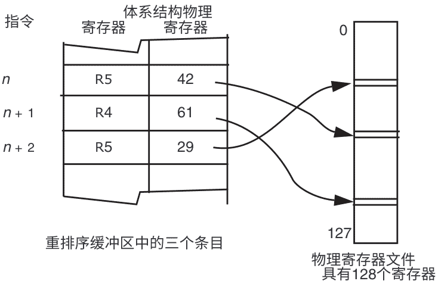

## 图9.34

示例显示了重排序缓冲区如何将体系结构寄存器编号映射到物理寄存器编号。对应于这三个条目的程序序列是：

```
n       R5 := R4 × R2      // 在寄存器五中写入一个结果。
n+1   R4 := R5 + R1      // 使用寄存器五中的结果。
n+2   R5 := READ(117492) // 将内存单元的内容写入寄存器五。
```

指令n和n+2都写入寄存器R5，所以R5有两个版本，分别映射到物理寄存器42和29。指令n+2可以与指令n和n+1并发执行。

## 9.5 前后原子性II: 实用主义9-69

在某些情况下，历史不总是能确保并发事务正确协调。

另一种专门的版本历史变体实现，称为事务内存，是一种从任意指令序列中创建原子操作的学科，该序列对主内存进行多次引用。事务内存首次提出于1993年，并且随着多核处理器的广泛使用，它成为了最近研究兴趣的主题，因为它允许应用程序员在不处理锁的情况下使用并发线程。该学科是通过使用“开始事务”指令标记要原子执行的指令序列的开始，将所有随后的STORE指令直接发送到并发线程无法读取的隐藏副本数据，并在序列结束时检查是否有其他事务在此期间修改了读取或写入的内容。如果检查发现没有这样的早期修改，系统将通过将隐藏副本暴露给并发线程来提交事务；否则，系统将丢弃隐藏副本并中止事务。由于它将所有干扰的发现推迟到提交点，这种学科比上述第9.4.3节中描述的读取捕获学科更加乐观，因此在可能但不太可能发生并发线程之间的干扰的情况下最有用。事务内存已经在硬件和软件中进行了实验性实现。硬件实现通常涉及对缓存或重排序缓冲区进行调整，使其在提交时延迟写入隐藏副本到主内存，而软件实现则在主内存的其他位置创建已更改变量的隐藏副本。与指令重命名一样，对事务内存的描述有些过于简化，有兴趣的读者应该参考相关文献以获得更详细的解释。

其他软件实现了版本历史记录的原子性之前或之后主要在研究环境中进行探索。数据库系统的设计者通常使用锁而不是版本历史记录，因为在使用锁方面有更多的经验，可以实现高性能。通过系统地使用锁来实现之前或之后的原子性是本章的下一节的主题。

## 9.5 之前或之后的原子性II: 实用主义

前一节展示了一个提供全有或全无原子性的版本历史系统可以扩展为提供之前或之后的原子性。当全有或全无原子性设计使用日志并将数据更新安装在单元存储中时，其他并发操作可以立即看到这些更新，因此我们需要一个方案来提供之前或之后的原子性。当系统使用日志实现全有或全无原子性时，通常采用第5章介绍的机制——锁——来实现之前或之后的原子性。然而，正如第5章所指出的，使用锁进行编程是危险的，传统的调试技术直到答案看起来正确为止的方法不太可能捕捉到所有的锁定错误。现在我们重新审视锁，这次的目标是

### 9.5.2 简单锁定

回顾一下，锁是与数据对象相关联的标志，并由一个动作设置，以警告其他并发动作不要读取或写入该对象。传统上，锁定方案涉及两个过程：

```
ACQUIRE (A.lock)
```

将与对象A相关联的锁变量标记为已获取。如果对象已经被获取，ACQUIRE将等待前一个获取者释放它。

```
RELEASE (A.lock)
```

取消与A相关联的锁变量的标记，可能会结束其他动作对该锁的等待。暂时假设锁的语义遵循第5章的单次获取协议：如果两个或多个动作在大约同一时间尝试获取锁定，只有一个会成功；其他动作必须找到已经获取的锁。在第9.5.4节中，我们将考虑一些替代协议，例如允许多个读取变量的读者，只要没有人在写入它。

锁的最大问题是编程错误可能会导致没有预期的前后属性的操作。这样的错误可能会打开竞争的大门，因为干扰行为是时间相关的，所以很难弄清楚出了什么问题。因此，主要目标是并发事务的协调应该是可以被认为是正确的。对于锁来说，实现这个目标的方法是系统地遵循三个步骤：

- 制定一个锁定纪律，指定何时必须获取哪些锁。

- 建立一个有说服力的推理链，证明遵循纪律的并发事务将具有前后属性。

- 在程序员和ACQUIRE和RELEASE过程之间插入一个锁管理器程序，以强制执行纪律。

已经设计和部署了许多锁定纪律，其中一些无法正确协调事务（例如，请参见练习9.5）。我们将研究三个成功的纪律。每个纪律都允许比前一个更多的并发性，尽管最好的纪律也不能保证并发性最大化。

协调事务正确的第一个，也是最简单的原则是系统范围的锁。当系统开始运行时，它在易失性内存中创建一个名为System的可锁定变量。原则是每个事务都必须以开始

```
begin_transaction
ACQUIRE (System.lock)
...
每个事务都必须以结束
...
RELEASE (System.lock)
end_transaction
```

系统甚至可以通过在生成的代码序列中包含begin_transaction和end_transaction的ACQUIRE和RELEASE步骤来强制执行此原则，无论结果是COMMIT还是ABORT。任何创建新事务的程序员都有保证它将在任何其他事务之前或之后运行。

系统范围的锁原则只允许一个事务同时执行。它按照调用ACQUIRE的顺序对可能并发的事务进行序列化。系统范围的锁原则在所有方面与第9.4节的简单序列化原则完全相同。实际上，简单序列化伪代码

```
id ≠ NEW_OUTCOME_RECORD ()
preceding_id ≠ id - 1
等待直到 preceding_id.outcome_record.value ≠ PENDING
...
提交(id)[或中止(id)]
```

以及系统范围的锁调用

```
获取 (System.lock)
...
释放 (System.lock)
```

实际上，它们只是相同思想的两种实现方式。

与简单串行化一样，系统范围的锁定在不需要锁定每个事务所涉及的所有数据的情况下限制了并发性。例如，如果将系统范围的锁应用于图9.16中的资金转移程序，一次只能进行一次转账，即使每个单独的转账只涉及几百万个账户中的两个，因此有很多机会进行并发的、不干扰的转账。因此，人们有兴趣开发更少限制性的锁定规则。通常的起点是使用更细粒度的锁定：锁定更小的对象，例如单个数据记录、单个数据记录的页面，甚至记录内的字段。在获得并发性方面的权衡是，当存在多个锁时，会花费更多时间来获取和释放锁，并且正确性论证变得更加复杂。希望并发性带来的性能提升超过获取和释放多个锁的成本。幸运的是，至少还有另外两种可以进行正确性论证的规则，即简单锁定和两阶段锁定。

### 9.5.3 两阶段锁定

第三种锁定规则，称为两阶段锁定，像读取捕获规则一样，避免了事务必须提前知道要获取哪些锁的要求。

两阶段锁定被广泛使用，但很难证明它是正确的。两阶段锁定规则允许事务在进行过程中获取锁，并且一旦获取了对象的锁，事务可以立即读取或写入数据对象。主要约束是事务在通过锁定点之前不能释放任何锁。此外，事务可以在达到锁定点之后的任何时间释放对只读对象的锁定，即使它永远不需要再次读取该对象，甚至是为了中止。

该规则的名称是因为事务获取的锁定数量在锁定点之前单调增加（第一阶段），之后单调减少（第二阶段）。与简单锁定一样，两阶段锁定对并发事务进行排序，使它们产生的结果就像它们按照达到锁定点的顺序进行序列化一样。锁管理器可以通过拦截所有读取和写入数据的调用来实现两阶段锁定；它在每个共享变量的第一次使用时获取锁定（可能需要等待）。与简单锁定一样，然后它保持这些锁定，直到拦截到提交、中止或记录事务的END记录的调用，然后一次性释放它们。

两阶段锁定的额外灵活性使得很难证明它能够保证原子性的前后顺序。非正式地说，一旦一个事务在一个数据上获得了锁定，那个数据的值在事务达到其锁定点时将与现在的值相同，所以现在读取该值必须产生与等待到那时再读取它相同的结果。此外，如果一个事务永远不会再次查看一个没有修改过的对象，释放对该对象的锁定必须是无害的，即使是为了中止。关于两阶段锁定导致正确的前后顺序原子性的正式论证可以在大多数高级并发控制和事务的文本中找到。例如，参见Gray和Reuter的《事务处理》[进一步阅读建议1.1.5]。两阶段锁定规则可能允许比简单锁定规则更多的并发，但它仍然不必要地阻塞某些可串行化且因此正确的操作顺序。例如，假设事务T₁

读取x并写入y，而事务T₂只是对y进行了（盲目的）写入。因为T₁和T₂的锁定集合在变量y上相交，两阶段锁定规则将强制事务T₂在T₁之前或之后完全运行。但是这个序列

- T₁: 读取 X  
- T₂: 写入 Y  
- T₁: 写入 Y  

## 9-74 第9章 原子性：全有或全无和先后顺序

在T1的两个步骤之间发生T2的写入，与在T1之前完全运行T2产生相同的结果，因此结果始终是正确的，即使这个顺序会被两阶段锁定所阻止。允许所有可能的并发性，同时确保先后顺序原子性的学科非常难以设计。（理论家将这个问题认定为NP完全问题。）

锁和日志之间有两种交互需要一些思考：（1）中止的单个事务，和（2）系统恢复。中止是最容易处理的。由于我们要求中止的事务在释放任何锁之前将其更改的数据对象恢复到原始值，因此不需要特别考虑中止的事务。就先后顺序原子性而言，它们看起来就像没有更改任何内容的已提交事务一样。在事务结束之前不释放任何修改数据的锁的规则对于实现中止是至关重要的。

如果对某个修改过的对象上的锁被释放，然后事务决定中止，可能会发现其他事务现在已经获取了该锁并再次更改了该对象。除非对修改过的对象上的锁已经被持有，否则回滚中止的更改很可能是不可可能的。

基于日志的恢复和锁之间的交互关系不太明显。问题是锁本身是否是记录更改的数据对象。为了分析这个问题，假设系统崩溃。在崩溃恢复完成时，不应该有未决的事务，因为在崩溃时未决的任何事务都应该被恢复过程回滚，并且恢复过程在完成之前不允许开始任何新的事务。由于锁只存在于协调未决事务的目的，所以在崩溃恢复完成时仍然存在锁显然是一个错误。这一观察表明，锁应该放在易失性存储中，这样它们在崩溃时会自动消失，而不是放在非易失性存储中，恢复过程需要找到它们并释放它们。然而，更大的问题是基于日志的恢复算法是否会构建一个正确的系统状态，即该状态可以由在崩溃之前提交的那些事务的某个串行顺序产生。

继续假设锁在易失性内存中，并且在崩溃的瞬间，所有锁的记录都丢失了。一些事务集合——那些记录了BEGIN但尚未记录END的事务——可能尚未完成。但我们知道，在崩溃瞬间未完成的事务在锁值消失时具有非重叠的锁集。图9.23的恢复算法将系统地对未完成的事务进行UNDO或REDO安装，但每个UNDO或REDO都必须修改在崩溃时某个事务的锁集中的变量。因为那些锁集必须是非重叠的，所以这些特定的操作可以在恢复过程中安全地重新执行或撤销，而不必担心原子性的前后顺序。换句话说，锁创建了事务的特定序列化，而日志记录了该序列化。

由于RECOVER按照日志中指定的顺序以相反的顺序执行UNDO操作，并按照日志中指定的顺序以前向顺序执行REDO操作，RECOVER重构了完全相同的序列化。因此，即使是恢复算法也可以重建

## 9.5 之前或之后的原子性II: 实用主义 9-75

从日志中恢复整个数据库将保证产生与最初执行事务时相同的序列化。只要在恢复完成之前没有新的事务开始，即使在恢复期间没有锁定，也不会出现协调不一致的危险。

## 9.5.5 死锁；取得进展

大多数日志锁定系统比之前的描述要复杂得多。这些复杂性主要是为了提高性能而产生的。在第9.3.6节中，我们看到了如何在易失性内存缓存中对磁盘I/O进行缓冲，以允许并发进行读取、写入和计算，这可能会使日志系统变得复杂。设计人员有时会对锁定系统应用两种增强性能的复杂性：物理锁定和添加锁兼容模式。

通过缓冲磁盘I/O和物理媒体考虑的性能增强技术是选择一种称为物理锁定的特定锁定粒度。如果一个事务对一个1000字节磁盘扇区中的一个六字节对象进行更改，或者对占据两个磁盘扇区部分的一个1500字节对象进行更改，就会有一个问题：应该锁定哪个“变量”?对象还是磁盘扇区？如果两个并发线程对存储在同一个磁盘扇区中的不相关数据对象进行更新，那么这两个磁盘写操作必须进行协调。选择正确的锁定粒度可以带来很大的性能差异。

锁定应用程序定义的对象而不考虑它们与物理磁盘扇区的映射是有吸引力的，因为应用程序编写者可以理解它。因此，通常称为逻辑锁定。此外，如果对象很小，显然可以实现更多的并发性：如果另一个事务对位于同一个磁盘扇区中的不同对象感兴趣，它可以并行进行。然而，逻辑锁定的一个后果是日志也必须在相同的逻辑对象上进行。同一个磁盘扇区的不同部分可能会被同时运行的不同事务修改，如果一个事务提交而另一个事务中止，既不是旧的磁盘扇区也不是新的磁盘扇区是正确的恢复方式；日志条目必须记录存储在扇区中的各个数据对象的旧值和新值。最后，要记住，具有缓存的高性能日志系统必须在提交时将日志强制写入磁盘，并跟踪在不违反预写式日志协议的情况下可以写入磁盘的缓存中的哪些对象。因此，具有小对象的逻辑锁定可能会升级缓存记录。

远离细节，高性能磁盘管理系统通常要求put调用的参数是与磁盘扇区大小相称的块。因此，逻辑锁定的真正影响是在应用程序和磁盘管理系统之间创建一个层，该层向事务客户端呈现逻辑接口，而不是物理接口；诸如磁盘扇区内的数据对象管理和垃圾回收等工作将放入该层。另一种选择是根据磁盘管理系统的本机粒度来定制日志记录和锁定设计。由于将日志记录和锁定粒度与磁盘写入粒度匹配

## 9.5.6 死锁；取得进展

第5章的5.2.5节介绍了死锁的紧迫问题，等待图作为分析死锁的一种方式，锁定顺序作为预防死锁的一种方式。

通过事务和能够撤销单个操作甚至完全中止事务的能力，我们现在有更多的工具来处理死锁问题，因此值得重新讨论一下。

死锁的可能性是使用锁来协调并发活动的必然结果。任意数量的并发事务可能会陷入死锁，要么彼此等待，要么只是等待某个已经死锁的事务释放锁。死锁给我们留下了一个重要的问题：正确性论证确保任何完成的事务将产生与串行运行相同的结果，但它们对于任何事务是否会完成没有任何说明。换句话说，我们的系统可以确保正确性，即永远不会出现错误的答案，但它不能确保进展，即可能根本没有答案出现。

与并发控制方法一样，处理死锁的方法也可以被描述为悲观或乐观。悲观方法采取先行动来预防死锁的发生。乐观方法允许并发线程继续执行，如果发生死锁，则采取措施来修复问题。以下是一些最流行的方法:

- 1.锁顺序(悲观)。如第5章所建议的，为锁分配唯一的编号，并要求事务按照升序获取锁。根据这个计划，当一个事务遇到已经获取的锁时，等待它总是安全的，因为之前获取该锁的事务不可能在等待该事务已经获取的任何锁，所有这些锁的编号都比当前锁小。因此，至少有一个事务（持有最高编号的锁的事务）始终能够取得进展。当该事务完成时，它将释放所有的锁，然后另一个事务将成为能够保证能够取得进展的事务。锁顺序的一种推广可能会消除一些不必要的等待，即将锁排列成一个格子，并要求按照某种格子遍历顺序获取锁。与简单锁定一样，锁顺序的问题在于某些应用程序可能无法在获取第一个锁之前预测所需的所有锁。

- 2.回退(乐观)：安德烈·本苏桑在1966年提出的一种优雅的策略允许事务以任意顺序获取锁，但如果遇到一个已经获取的锁的编号比它自己先前获取的锁的编号低，事务必须回退（在本章中称为撤销之前的操作）足够远，释放其编号较高的锁，等待编号较低的锁可用，获取该锁，然后重做被回退的操作。

- 3.定时器到期(乐观)。当一个新的事务开始时，锁管理器将中断定时器设置为一个比事务完成所需时间稍长的值。如果一个事务陷入死锁，它的定时器将到期，此时系统会中止该事务，回滚其更改并释放其锁，希望其他涉及死锁的事务能够继续进行。如果不能，另一个事务将超时，释放更多的锁。超时死锁是有效的，尽管它有通常的缺陷：它

很难选择一个合适的计时器值，既可以使事情顺利进行，又可以适应正常的延迟和可变的操作时间。如果环境或系统负载发生变化，可能需要重新调整所有这些计时器值，这在大型系统中可能是一个真正的麻烦。

- 4. 循环检测(乐观)。在锁管理器中维护一个等待图（如第5.2.5节所示），显示哪些事务已经获取了哪些锁，哪些事务正在等待哪些锁。每当另一个事务尝试获取锁，发现它已经被锁定，并提议等待时，锁管理器会检查图形，看等待是否会产生循环，从而导致死锁。如果会产生循环，锁管理器会选择某个循环成员作为受害者，并单方面中止该事务，以便其他事务可以继续进行。

中止的事务然后重新尝试，希望其他事务已经取得足够的进展，以便避免发生死锁。

当系统使用锁排序、回退或循环检测时，通常也会设置一个定时器作为安全网，因为硬件故障或编程错误（如无限循环）可能会导致进度阻塞的情况，这些死锁检测方法都无法捕捉到。

由于死锁检测算法可能引入额外的中止事务的原因，可以想象出一些病态情况，其中算法无论调用者重试多少次，都会中止执行某个特定事务。例如，假设有两个名为Alphonse和Gaston的线程试图获取名为Apple和Banana的两个对象的锁，Alphonse获取了Apple的锁，Gaston获取了Banana的锁，Alphonse试图获取Banana的锁并等待，然后Gaston试图获取Apple的锁并等待，从而创建了死锁。最终，Alphonse超时并开始回滚更新以准备释放锁。与此同时，Gaston超时并执行相同的操作。两者重新启动，并再次陷入死锁状态，其定时器设置与之前完全相同，因此它们可能会无限重复这个序列。因此，我们仍然无法保证进展。这是第5章称之为活锁的新兴属性，因为从形式上讲，永远不会发生死锁，而且两个线程都在忙于做一些表面上有用的事情。

处理活锁的一种方法是应用一种随机化版本的技术，这种技术在第7章[在线]中很熟悉：指数随机退避。当定时器超时导致中止时，锁管理器在清除锁之后，延迟该线程一段随机长度的时间，该时间从某个起始间隔中选择，希望随机性能够改变活锁事务的相对时序，以便在下一次尝试时一个事务成功，然后另一个事务可以在没有干扰的情况下继续进行。如果事务再次遇到干扰，它会再次尝试，但在每次重试时，锁管理器不仅选择一个新的随机延迟，而且还通过某个乘法常数增加了延迟选择的间隔，通常是2。由于每次重试都有增加的成功概率，通过持续重试，可以将这个概率推近于一，期望干扰事务会

最终会相互腾出空间。指数随机退避的一个有用特性是，如果重复的重试仍然失败，几乎可以确定存在某种更深层次的问题——也许是编程错误或者对共享变量的竞争水平本质上太高，需要重新设计系统。

设计更复杂的算法或者编程规范来保证进展是一个潜力有限的项目，而端到端的论证表明这可能不值得努力。实际上，会频繁干扰事务的系统通常不会设计具有高度并发性。当干扰不频繁时，像安全网定时器和指数随机退避这样的简单技术不仅效果好，而且通常必须提供，以应对可能已经渗入系统设计或实现中的任何竞争或编程错误，比如无限循环。因此，更复杂的保证进展的规范很可能是多余的，只有在极少数情况下才有机会促进进展。

## 9.6 跨层和多站点的原子性

我们对原子性的探索仍然存在一些重要的空白。首先，在分层系统中，一个在一层中实现的事务可能由一系列低层组件动作组成，这些动作本身是原子的。问题是低层事务的承诺应该如何与高层事务的承诺相关联。如果高层事务决定中止，那么问题是如何处理可能已经提交的低层事务。有两种可能性：

- • 使用undo操作撤销任何已提交的低层事务的效果。这种技术要求低层事务的结果仅在高层事务内可见。

• 以某种方式延迟低层事务的承诺，并安排它们在高层事务提交时实际上也提交。

到目前为止，我们假设了第一种可能性。在本节中，我们探讨第二种可能性。

另一个空白是，到目前为止，我们提供原子性的技术都涉及在内存或存储中使用共享变量（例如，指向最新版本的指针、结果记录、日志和锁定），因此隐含地假设组成事务的动作都发生在紧密的物理接近性中。当组成动作在物理上分离时，通信延迟、通信可靠性和独立故障使得原子性变得更加重要且更难实现。

我们将通过首先识别一个共同的子问题来解决这两个问题：实现嵌套事务。然后，我们将扩展解决方案以解决嵌套事务问题，创建一个被称为“两阶段提交”的协议。

```
过程 PAY_INTEREST (参考账户)
如果账户余额 > 0 则
利息 = 账户余额 * 0.05
转账 (银行, 账户, 利息)
否则
利息 = 账户余额 * 0.15
转账 (账户, 银行, 利息)

过程 MONTH_END_INTEREST:()
对于每个客户账户执行
支付_利息 (A)
```

## 图9.35

一个例子，其中包含两个过程，其中一个调用另一个，但每个过程都应该是独立的原子操作。

协调底层事务的承诺。然后，我们可以扩展两阶段提交协议，使用一种专门的远程过程调用形式，以协调在不同地方必须执行的步骤。这个序列是引导的另一个例子；我们知道如何处理的特殊情况是单站点事务，而更一般的问题是多站点事务。作为一个额外的观察，我们将发现多站点事务与两个将军的困境非常相似，但并不完全相同。

### 9.6.1 事务的分层组合

我们通过考虑复杂解释器是如何在层次结构中设计的，以及每个层次应该为其更高级的客户层实现原子操作，进而进入事务的讨论。因此，事务是嵌套的，每个事务通常由多个较低层次的事务组成。这种嵌套要求对实现原子性的机制进行一些额外的思考。

再次考虑一个银行的例子。假设在第9.1.5节中，可以使用TRANSFER过程将资金从一个账户转移到另一个账户，并且已经实现为一个事务。现在假设我们希望创建图9.35中的两个应用程序过程。第一个过程，PAY_INTEREST，调用TRANSFER来从名为bank的内部账户中移动适当金额的资金，方向和利率取决于客户账户余额是正还是负。

第二个过程，MONTH_END_INTEREST，通过迭代遍历账户并对每个账户调用PAY_INTEREST，实现银行每个月支付（或提取）每个客户账户的利息的意图。

可能不适合同时运行两个MONTH_END_INTEREST的调用，但很可能在MONTH_END_INTEREST运行的同时，还有其他正在进行的银行活动也在调用TRANSFER。

也有可能 MONTH_END_INTEREST内的每个for each语句实际上并发运行多个实例（因此也是 PAY_INTEREST的多个实例）。因此，我们需要三层事务。最底层是 TRANSFER过程，在该过程中，一个账户的借记和另一个账户的贷记必须是原子的。在更高一层，应该原子地执行 PAY_INTEREST过程，以确保在正/负测试和计算利息金额之间，某个并发的 TRANSFER事务不会改变账户的余额。最后，MONTH_END_INTEREST过程应该是一个事务，以确保在处理这两个账户的利息支付期间，某个并发的TRANSFER事务不会将资金从账户A转移到账户B，因为这样的转移可能导致银行对同一资金支付两次利息。在结构上，TRANSFER过程的调用嵌套在 PAY_INTEREST内，而一个或多个并发的PAY_INTEREST调用则嵌套在 MONTH_END_INTEREST内。

嵌套是一个潜在的问题的原因来自于对嵌套事务的提交步骤的考虑。例如，TRANSFER事务的提交点似乎必须在PAY_INTEREST事务的提交点之前或之后，这取决于我们在PAY_INTEREST编程中放置其提交点的位置。然而，这两种位置都会引起麻烦。如果TRANSFER提交发生在PAY_INTEREST的预提交阶段，那么如果系统崩溃，PAY_INTEREST将无法回滚，因为TRANSFER更改的两个账户的值可能已经被并发事务使用来做出支付决策。但是，如果TRANSFER提交直到PAY_INTEREST的后提交阶段，存在无法完成转账的风险，例如因为其中一个账户无法访问。结论是，嵌套事务的提交点应该与封闭事务的提交点重合。稍微不同的协调问题适用于MONTH_END_INTEREST：在其运行时不应该发生其他事务的TRANSFER（也就是说，它应该在并发TRANSFER事务之前或之后运行），但它必须能够执行多个TRANSFER，每次调用PAY_INTEREST，并且它自己并发的转账操作必须是前后操作，因为它们都涉及名为“bank”的账户。

假设系统暂时提供具有版本历史的事务。

我们可以通过扩展结果记录的概念来处理嵌套问题：我们允许结果记录按层次组织。每当我们创建一个嵌套事务时，我们在其结果记录中记录新事务的初始状态（待定）和封闭事务的标识符。结果记录的层次安排完全反映了事务的嵌套关系。顶层结果记录将包含一个标志，指示它不嵌套在任何其他事务中。

当结果记录包含更高层事务的标识符时，我们将其称为依赖结果记录，而它所指的记录称为其上级。

无论是嵌套事务还是封闭事务，它们都会继续进行业务处理，并根据成功与否标记自己的结果记录为已提交或已中止，与往常一样。然而，当读取_当前_值（在第9.4.2节中描述）检查状态时-

当一个版本需要检查创建它的事务是否已提交时，它还必须额外检查结果记录是否包含对上级结果记录的引用。如果是这样，它必须跟随引用并检查上级的状态。如果那条记录也说它已经提交，它必须继续向上跟随链，如果需要一直到最高层的结果记录。所讨论的事务只有在链中的所有记录都处于提交状态时才实际上提交。如果链中的任何记录都是中止的，那么这个事务实际上是中止的，尽管它自己的结果记录中声称是提交的。最后，如果以上两种情况都不成立，那么链中必须存在一个或多个仍处于挂起状态的记录。这个事务的结果仍然是挂起的，直到这些记录变为提交或中止。因此，一个表面上依赖于提交的结果记录的结果实际上取决于其所有祖先的结果。我们可以通过说，直到所有祖先都提交，这个较低层的事务处于一个刀刃上的状态，即将提交但仍然有可能中止。为了讨论的目的，我们将把这种情况标识为结果记录和事务的一个独特的虚拟状态，即事务是暂时提交的。

这种分层排列有几个有趣的编程后果。如果一个嵌套事务有任何后提交步骤，这些步骤不能在所有更高层次的事务提交之前进行。例如，如果其中一个嵌套事务在提交时打开了一个钱箱，那么发送释放消息到钱箱的操作必须在最高层事务确定其结果之前被暂停。

这种输出可见性后果只是与暂时提交状态相关的众多后果之一。嵌套事务在声明自己为暂时提交后，放弃了中止的能力——决定权在别人手中。

它必须能够运行到完成或中止，并且必须能够无限期地保持暂时提交状态。保持双向能力可能很麻烦，因为事务可能持有锁定，保持页面在内存中或磁带上，或可靠地保持输出消息。一个后果是，设计师不能简单地将任意事务盲目地用作更大事务的嵌套组件。至少，设计师必须审查嵌套事务维持暂时提交状态所需的内容。

当考虑可能在同一高层事务中嵌套的不同事务之间的可能交互时，会出现另一个更复杂的后果。考虑我们之前的例子，嵌套在支付_利息内的转账事务，而支付_利息又嵌套在月末_利息内。假设第一次月末_利息调用支付_利息时，该调用提交，进入暂时提交状态，等待月末_利息的结果。然后月末_利息在第二个银行账户上调用支付_利息。支付_利息需要能够读取银行自己的利息账户的输入数据，该账户是先前支付_利息的暂时提交调用的待定结果。如在第9.4.2节中实现的读取_当前_值算法中所示，不区分来自同一组嵌套事务的读取和来自某些

完全无关的事务。图9.36说明了情况。如果在读取_当前_值的已提交值的测试中，通过简单地遵循控制最新版本的结果记录的血统来扩展，无疑会迫使第二次调用支付_利息等待第一次调用支付_利息的最终结果。但是，由于第一次调用的结果取决于

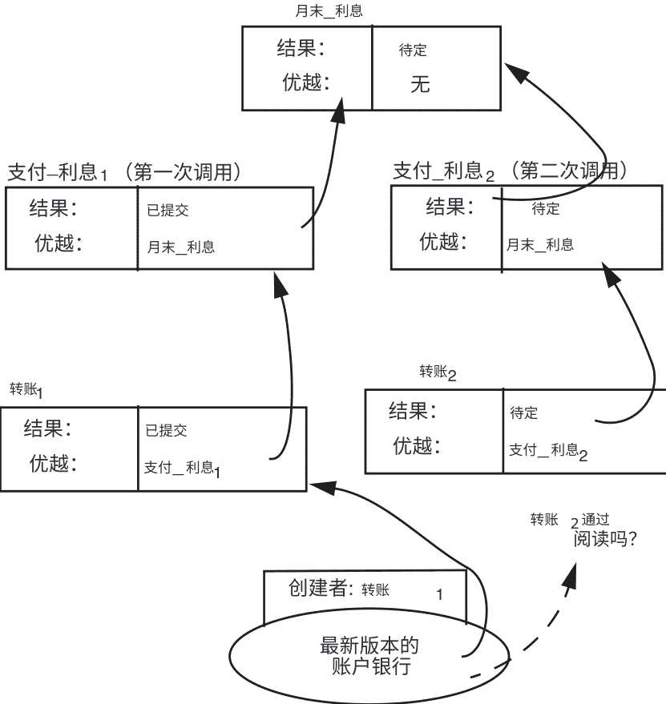

图9.36 交易转账₂，嵌套在交易支付_利息₂中，该交易又嵌套在交易月份_结束_利息中，想要读取账户银行的当前值。但是，账户银行最后一次被交易转账₁写入，该交易嵌套在已提交交易支付_利息₁中，该交易又嵌套在仍然是待定交易月份_结束_利息中。因此，这个版本的银行实际上是待定的，而不是只看交易转账₁的结果可能得出的已提交。然而，转账₁和转账₂共享一个共同的祖先（即，月份_结束_利息），从银行到该共同祖先的交易链完全已提交，因此可以读取银行的值，并且为了避免死锁，必须允许读取。

### 9.6.2 两阶段提交

由于一个更高层次的事务可以包含多个较低层次的事务，我们可以将分层事务的提交描述为涉及两个不同阶段。

在第一阶段，也称为准备或投票阶段，更高层次的事务调用一些不同的较低层次的事务，每个事务要么中止，要么通过提交而变为暂时提交。顶层事务评估情况以确定所有（或足够多）较低层次的事务是否暂时提交，从而宣布更高层次的事务成功。

根据该评估，它要么提交，要么中止更高层次的事务。假设它决定提交，它进入第二个提交阶段，最简单的情况下只需将自身状态从待定更改为已提交或已中止。如果它是最高层次的事务，在那一刻，所有较低层次的暂时提交事务也变为已提交或已中止。如果它本身嵌套在一个更高层次的事务中，它将变为暂时提交，并且其组成事务也将继续处于暂时提交状态。我们在这里实现了一个称为两阶段提交的协调协议。当我们在下一节中实现多站点原子性时，两个阶段之间的区别将变得更加清晰。

## 9.6跨层和多站点的原子性 9-85

如果系统使用版本历史记录来实现原子性,则可以通过链接结果记录直接实现图9.36的层次结构。如果系统使用日志,一个独立的待处理事务表可以包含层次结构,并且关于事务状态的查询将涉及检查此表。

嵌套事务的概念本身就很有用,但我们对嵌套的特别兴趣在于它是多站点事务的两个构建块中的第一个。为了开发第二个构建块,我们接下来将探讨多站点事务与单站点事务的不同之处。

## 9.6.3 多站点原子性:分布式两阶段提交

如果一个事务需要在由最佳努力网络分隔的多个站点上执行组件事务,则由于用于协调各个站点事务的任何消息都可能丢失、延迟或重复,实现原子性更加困难。在第4章中,我们了解了一种称为远程过程调用(RPC)的方法,用于在另一个站点执行操作。在第7章[在线]中,我们学习了如何设计诸如RPC之类的协议,其中包括持久发送方以确保至少一次执行和重复抑制以确保至多一次执行。不幸的是,这两种保证都不完全符合确保多站点事务的原子性所需。然而,通过正确组合两阶段提交协议、持久发送方、重复抑制和单站点事务,我们可以创建一个正确的多站点事务。我们假设每个站点都能够独立地实现本地事务,使用诸如版本历史记录或日志和锁定的技术来实现全有或全无的原子性和先前或后续的原子性。如果所有站点都提交或者所有站点都中止,多站点原子性协议的正确性将得到保证;如果一些站点提交了它们的一部分多站点事务,而其他站点中止了它们的同一事务的一部分,我们将失败。

假设多站点事务由协调者艾丽丝请求工作站点鲍勃、查尔斯和黎明的组件事务X、Y和Z组成。仅仅发出三个远程过程调用显然不能为艾丽丝产生一个事务,因为鲍勃可能执行X,而查尔斯可能报告他无法执行Y。从概念上讲,协调者希望向三个工作站点发送三条消息,就像这样发送给鲍勃的消息:

> 发件人:艾丽丝
收件人:鲍勃
主题:我的事务271

请作为我的事务的一部分执行X。

让这三个工作站点处理细节。我们需要一些线索,了解鲍勃如何完成这个奇怪的请求。

线索来自于认识到协调者已经创建了一个更高层次的事务,每个工作站点都要执行嵌套在更高层次事务中的事务。因此,我们需要一个分布式版本的两阶段提交协议。复杂之处在于协调者和工作站点无法可靠地通信。因此，问题归结为构建一个可靠的分布式版本的两阶段提交协议。我们可以通过应用持久发送者和重复抑制来实现。

协议的第一阶段始于协调者Alice为整个事务创建一个顶层结果记录。然后，Alice开始持久地向Bob发送类似RPC的消息：

```
发件人：Alice
收件人：Bob
主题：我的事务271

请作为我的事务的一部分执行X。
```

类似的消息也从Alice发送给Charles和Dawn，同样提到事务271，并请求他们分别执行Y和Z。与普通的远程过程调用一样，如果Alice在合理的时间内没有收到一个或多个工作人员的响应，她会将消息重新发送给未响应的工作人员，直到获得响应为止。

一个工作站在收到这种请求后，首先检查是否有重复，然后创建自己的一个事务，但它将这个事务设置为嵌套事务，其上级是爱丽丝的原始事务。然后它开始执行所请求操作的预提交部分，并向爱丽丝报告已经顺利完成了这部分：

```
发件人：鲍勃
收件人：爱丽丝
回复：你的事务271

我的部分X已准备好提交。
```

爱丽丝在收集到完整的这些响应后，然后进入事务的两阶段提交部分，通过向鲍勃、查尔斯和黎明发送消息，例如：

```
两阶段提交消息#1：

发件人：Alice
收件人：Bob
主题：我的事务271

准备提交X。
```

鲍勃在收到这条消息后，进行提交——但只是暂时性的——或者中止。鲍勃创建了持久性的暂时性版本（或者将其计划更新记录到日志存储中），并记录了一个结果记录，表明它已经准备好要么提交要么中止，然后鲍勃持续向爱丽丝发送响应，报告他的状态：

此时, 处于准备好状态的鲍勃处于孤立状态。就像在本地的层次嵌套中一样, 鲍勃必须能够要么运行到最后, 要么中止, 以持续保持准备状态, 并等待其他人 (Alice) 说出哪个选择。此外, 协调者可能会独立崩溃或失去通信联系, 增加鲍勃的不确定性。如果协调者崩溃, 所有的工作人员都必须等待直到它恢复; 在这个协议中, 协调者是一个单点故障。

作为协调员, 爱丽丝从她的几个工人那里收集响应消息 (可能从某些工人站点多次重新请求准备好的响应)。如果所有工人都发送准备好的消息, 两阶段提交的第一阶段就完成了。如果任何一个工人回复中包含中止消息, 或者根本不回复, 爱丽丝通常可以选择中止整个事务, 或者尝试使用其他工人站点来执行该组件事务。当爱丽丝通过标记自己的结果记录已提交来提交整个事务时, 第二阶段开始。

一旦更高层的结果记录被标记为已提交或已中止, 爱丽丝会向鲍勃、查尔斯和黎明发送完成消息:
两阶段提交消息#3
发件人: 爱丽丝
收件人: 鲍勃
回复: 我的事务271
我的事务已提交。感谢你的帮助。

每个工人站点在收到这样的消息后, 将其状态从准备好更改为已提交, 执行任何需要的后提交操作, 然后退出。同时, 爱丽丝可以进行其他业务, 但未来有一个重要的要求: 她必须可靠地并且长时间地记住这个事务的结果。原因是她的一个或多个完成消息可能丢失了。处于准备好状态的任何工人站点都在等待完成消息告诉它们应该如何进行。如果在合理的时间内没有收到完成消息, 工人站点上的持久发送者将重新发送其准备好消息。每当爱丽丝收到重复的准备好消息时, 她只需发送当前事务的结果记录状态。

如果使用日志和锁的工作站崩溃, 该站点的恢复过程必须执行三个额外的步骤。首先, 它必须将任何准备好的事务分类为应该恢复到准备好的状态的临时赢家。其次, 如果工作站正在使用锁定机制, 在之前或之后的原子性中，恢复过程必须重新获取准备好的事务在故障发生时持有的任何锁。最后，恢复过程必须重新启动持久性发送方，以了解更高层次事务的当前状态。如果工作站使用版本历史记录，只需要最后一步，重新启动持久性发送方。

由于工作站充当其准备好的消息的持久性发送方，alice可以确信每个工作站最终会得知她的事务提交了。但是由于工作站的持久性发送方是独立的，Alice无法确保它们会同时执行。相反，Alice只能确保她的事务最终会完成。同时行动和最终行动之间的区别非常重要，很快就会看到。

如果一切顺利，将在N个工作站上完成两阶段提交，共发送3N个消息，如图9.37所示：对于每个工作站，发送一个准备消息，接收一个已准备好消息，并发送一个提交消息。这个3N消息协议是完整且足够的，尽管有几种变体可以提出。

一个简化的变体示例是初始的RPC请求和响应也可以携带准备和已准备好消息。然而，一旦工作站发送了已准备好消息，它就失去了单方面中止的能力，并且必须保持在刀锋上等待协调者的指示。为了最小化这种等待，通常最好延迟准备/已准备好消息对，直到协调者知道其他工作站似乎已经准备好执行它们的任务。

分布式两阶段提交协议的某些版本还有来自工作站到协调者的第四个确认消息。目的是收集一组完整的确认消息-协调者持续发送完成消息，直到每个站点都确认。一旦所有确认都到达，协调者可以安全地丢弃其结果记录，因为已知每个工作站都已收到通知。

一个关心结果记录存储空间和额外消息成本的系统可以使用一种进一步的改进，称为假定提交。由于大多数事务都会提交，我们可以使用一个稍微奇怪但非常节省空间的值已提交的表示方式：不存在。协调器通过发送已提交的响应来回答关于不存在结果记录的任何查询。如果协调器使用这种表示方式，它会通过销毁结果记录来提交，因此不需要每个工作人员的第四个确认消息。为了获得这种明显的魔术般的消息数量和空间的减少，我们注意到放弃中止事务的结果记录不容易，因为如果在放弃之后有查询到达，查询将收到已提交的响应。然而，协调器可以持续要求放弃中止事务的确认，并在所有这些确认都完成后丢弃结果记录。这种导致丢弃结果记录的协议与第7章[在线]中描述的关闭流和丢弃该流的记录的协议相同。

分布式两阶段提交不能解决所有多站点原子性问题。例如，如果协调者站点（在这种情况下是Alice）在一艘沉船上。

## 9.6跨层和多站点的原子性 9-89

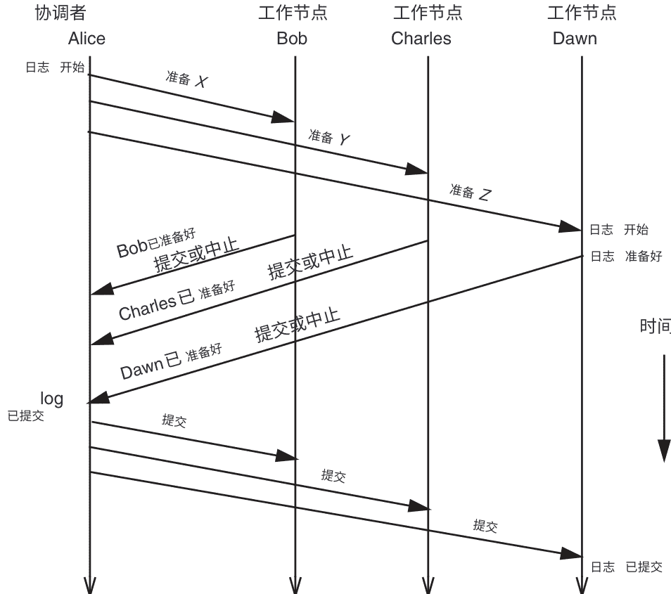

图9.37 使用3N条消息的分布式两阶段提交的时序图。（初始的RPC请求和响应消息未显示。）每个参与者都维护自己的版本历史或恢复日志。该图显示了协调者和一个工作节点所做的日志记录条目。

发送准备消息之前，但在发送提交或中止消息之前，工作站处于准备态，无法继续。即使没有这个问题，爱丽丝和她的同事们也站得非常近，面临着一个多站点原子性问题，至少从原理上来说，无法解决。唯一能拯救他们的是我们观察到几个工人最终会完成他们的任务，不一定同时进行。如果她要求同时行动，爱丽丝就会陷入麻烦中。这个无法解决的问题被称为两位将军的困境。

## 9.6.4 两位将军的困境

当通信不可靠时，对可能的协调协议的一个重要限制被称为两位将军的困境的生动类比所捕捉到。*假设有两支小军队驻扎在城市外的两座山上。这座城市的防御足够强大，可以击退和摧毁其中任何一支军队。只有两支军队同时进攻，才能夺取这座城市。因此，指挥这两支军队的两位将军希望协调他们的进攻。

两位将军之间唯一的通信方式是派遣信使从一个营地到另一个营地。但是城市的防守者在分隔两座山之间的山谷中设置了哨兵，所以信使试图穿过山谷时，有可能会落入敌人手中，无法传递消息。

假设第一位将军发送了这条消息:

> 发件人:尤利乌斯·凯撒
收件人:提图斯·拉比纳斯
日期:1月11日

我建议越过卢比孔河,在明天黎明时攻击。可以吗?

预计第二位将军会回复以下内容之一:

> 发件人:提图斯·拉比纳斯
收件人:尤利乌斯·凯撒
日期:1月11日

是的,12日黎明。

或者,可能会回复以下内容:

> 发件人:提图斯·拉比纳斯
收件人:尤利乌斯·凯撒
日期:1月11日

不。我正在等待来自高卢的增援。

进一步假设第一条消息未能传递。在这种情况下,第二位将军不会行军,因为没有收到行军请求。此外,第一位将军也不会行军,因为没有收到回复,一切都好(除了丢失的信使)。

现在,假设跑者成功传递了第一条消息,第二位将军发送了回复“是”,但是回复消息丢失了。第一位将军无法区分这种情况和之前的情况,所以军队不会前进。第二位将军同意前进,但是他知道只有在收到“是”的确认消息后,第一位将军才会前进,所以第二位将军不会在没有确定第一位将军会前进的情况下前进。

> *这个类比的起源已经不可考,但是据说它最早是在1977年由Jim N.Gray在他的“数据库操作系统笔记”中首次以印刷形式描述的,后来在1978年重新印刷在《操作系统,计算机科学讲义60》中。大约在同一时间,Danny Cohen描述了另一个他称之为约会协议的类比,它与两位将军的困境相似。

将军收到了确认。第二位将军的犹豫表明第一位将军应该回复收到确认的回执:

> 发件人: 尤利乌斯·凯撒
收件人: 提图斯·拉比纳斯
日期: 1月11日

骰子已经投掷。

不幸的是, 这并没有帮助, 因为携带这个回执的信使可能会丢失, 第二位将军没有收到回执, 仍然不会前进。

因此, 进退两难。

我们现在可以直接得出结论: 没有一种有限数量的消息的协议可以同时使两位将军相信安全前进。如果有这样的协议, 在该协议的任何特定运行中,最后一条消息必定是不必要的, 因为它可能会丢失, 无法检测到。由于最后一条消息是不必要的, 可以删除该消息以生成另一个更短的消息序列, 该序列必须保证安全协调。我们可以反复应用相同的推理将更短的消息序列产生出来, 我们得出结论, 如果存在这样一个安全协议, 它要么生成长度为零的消息序列, 要么生成长度无限的消息序列。长度为零的协议无法传达任何信息, 而长度无限的协议对将军们没有任何用处, 他们必须选择一个特定的时间前进。

一个实际的将数学家重新分配到新工作并派遣侦察员去检查山谷并报告在指定时间内成功通过的概率的将军, 会重新分配数学家到新工作并派遣侦察员去检查山谷并报告在指定时间内成功通过的概率。在知道了概率之后, 将军会派遣多个 (希望是独立的) 信使, 每个信使携带一份消息的副本, 选择足够多的信使, 使得所有信使都在指定时间之前交付消息的概率可以忽略不计。(所有信使的损失将是《第8章[在线]》所称的无法容忍的错误。)类似地, 第二位将军会派遣多个信使, 每个信使携带“是”或“否”的确认回执的副本。这个过程提供了一个实际的问题解决方案, 所以这个困境并没有真正的影响。然而, 发现一个在原则上无法以完全确定性解决的问题是很有趣的。

我们可以更加普遍而简洁地陈述理论结论: 如果消息可能丢失, 没有有界协议能够完全确保两位将军同时知道他们将会同时行军。他们能做的最好的事情就是接受一些非零的失败概率, 等于他们最后一条消息未被送达的概率。

有趣的是分析为什么我们不能使用分布式两阶段提交协议来解决两位将军的困境。正如一开始所建议的, 这与何时事情可能或必须发生有微妙的差别。两位将军需要同时行军才能征服城市的防御。

分布式两阶段提交协议的持久发送方确保如果协调者决定提交，所有的工作者最终也会提交，但不能保证他们会同时提交。如果其中一个通信链路断开一天，当它重新连接时，该链路另一端的工作者将会收到提交通知，但这个动作可能比其同事晚一天发生。因此，与两位将军的困境相比，分布式两阶段提交解决的问题稍微放松了一些。这种放松对两位将军没有帮助，但这种放松恰好足够让我们设计一个确保正确性的协议。

通过类似的推理，无法完全确保通过仅通过最佳努力网络进行通信的两个站点同时执行操作。因此，分布式两阶段提交可以安全地打开东京的ATM的钱箱，并确信慕尼黑的计算机会最终会更新该账户的余额。但是，如果由于某种原因需要同时在不同站点打开两个钱箱，唯一的解决方案要么是概率方法，要么是以某种方式将最佳努力网络替换为可靠的网络。可靠通信的要求是为什么房地产交易和婚礼（两者都是两阶段提交协议的示例）通常在一个房间中进行的原因。

## 9.7 磁盘故障的更完整模型（高级主题）

本章的9.2节为日历管理程序开发了一个故障分析模型，在该模型中，系统崩溃可能会损坏最多一个磁盘扇区-在崩溃瞬间正在写入的扇区（如果有的话）。该部分还开发了一个掩盖该问题的策略，创建了全有或全无的磁盘存储。为了保持开发的简单性，该策略忽略了衰变事件。本节重新审视该模型，考虑如何掩盖衰变事件。结果将是全有或全无的持久存储，意味着在系统崩溃时它是全有或全无的，并且在面对衰变事件时是持久的。

### 9.7.1 既是全有或全无又是持久的存储

在第8章[在线]中，我们了解到为了获得持久存储，我们应该写入每个磁盘扇区的两个或更多副本。在当前章节中，我们了解到在写入磁盘扇区时，为了从系统崩溃中恢复，我们不应该覆盖先前的版本，而应该在不同的位置写入新版本。为了获得既持久又全有或全无的存储，我们结合了这两个观察结果：制作多个副本，并且不覆盖先前的版本。一个简单的方法是在当前章节的全有或全无存储层之上构建第8章[在线]的持久存储层。这种方法肯定有效，但有点笨重：只有两个副本，会导致分配的开销

## 9.7磁盘故障的更完整模型(高级主题) 9-93

为每个真实数据扇区分配六个磁盘扇区。这是一个模块化成本过高的案例。

请记住,第8章[在线]用于确定磁盘存储完整性检查频率的参数是预期的衰变时间,Td。假设耐久性要求可以通过仅维护两个副本来实现。在这种情况下,T必须远大于在两个磁盘上写入一个扇区的时间。换句话说,较大的Td意味着短期内发生衰变事件的机会很小,设计者可以安全地忽略它。我们可以利用这个观察结果来设计一种稍微有风险但更经济的存储实现方法,既耐久又全有或全无,只需两个副本。基本思想是,如果我们确信我们有两个良好的数据副本以实现耐久性,那么安全地(为了全有或全无的原子性)覆盖其中一个副本;第二个副本可以用作备份,以确保全有或全无的原子性,如果系统在写入第一个副本时发生崩溃。一旦我们确信第一个副本(D0)已经正确写入新数据,我们可以安全地覆盖第二个副本,以恢复长期耐久性。如果完成两次写入的时间与Td相比较短,那么衰变事件干扰这个算法的概率将是可以忽略的。图9.38显示了算法和数据的两个副本,这里命名为D0和D1。

一个有趣的观点是全部_或者_没有_持久_获取does not bother to check the status returned upon reading D1—it just passes the status value along to its caller. 原因是在没有衰变的情况下小心_获取 has no expected errors when reading data that小心_放置 was allowed to finish writing. 因此,返回的状态只有两种情况下会是错误的:

1. 小心_放置的 D1在操作中被中断,或者  
2. D1遭受了意外的衰变。

该算法保证第一种情况不会发生。全部_或者_没有_持久_放置on data D1直到完成其对数据 D0的小心_放置。在小心_放置期间,由于系统崩溃,最多只有两个副本中的一个可能是错误的。因此,如果第一个副本(D0)是错误的,则我们期望第二个副本(D1)是正确的。

第二种情况的风险是真实的,但我们假设其概率很小:只有在Td远小于 D1 的随机衰变的时间内才会出现。 在读取D1时,我们有机会通过状态值来检测错误,但当两个数据副本都损坏时,我们无法恢复,因此这种可检测的错误必须被视为不可容忍的。我们能做的只是向应用程序传递一个状态报告,以便它知道发生了一个不可容忍的错误。

在 SALVAGE程序中隐藏了一个当前不必要的步骤:如果D0是BAD的,将D1复制到D0并没有任何收益,因为调用 SALVAGE的 ALL_OR_NOTHING_DURABLE_PUT会立即用新数据覆盖 D0。这一步骤被包含进来是因为它允许在算法的改进中使用SALVAGE。

## 9-94 第9章原子性: 全有或全无和先后顺序

在没有衰变事件的情况下, 这个算法与图9.6和9.7的全有或全无过程一样好, 并且性能稍微更好, 因为它只涉及两个副本。 假设错误很少, 恢复操作不会主导性能, 通常的ALL_OR_NOTHING_DURABLE_GET的成本只有一个磁盘读取, 而ALL_OR_NOTHING_GET算法需要三个磁盘读取。ALL_OR_NOTHING_DURABLE_PUT的成本是两个磁盘读取(在sALVAGE中)和两个磁盘写入, 而ALL_OR_NOTHING_PUT算法需要三个磁盘读取和三个磁盘写入。

该分析基于一个无衰减系统。为了处理衰变事件, 从第8章(在线)关于持久性的讨论中, 设计师采用了两个想法, 使方案既是全有或全无的, 又是持久的, 其中第二个想法消耗了一些更好的性能:

1. 将两个副本, D0和D1, 放在独立的衰变集合中(例如将它们写在两个不同的磁盘驱动器上, 最好是来自不同的供应商)。让一个职员每隔7秒运行一次SALVAGE程序, 对每个原子扇区进行处理。

```
text
1 过程ALL_OR_NOTHING_DURABLE_GET(参考数据, 原子扇区)
2    = CAREFUL_GET(数据, 原子扇区.D0)如果
3    ds=BAD则
4       ds≠CAREFUL_GET(数据, 原子扇区.D1)返回ds
5
6 过程全部_或_无_损_持久_存储(新数据,原子扇区)
7    恢复    (原子扇区    )
8    ds ≠ 小心_存储(新数据,原子扇区.D0)
9    ds ≠ 小心_存储(新数据,原子扇区.D1)
10   返回 ds

11 过程      恢复    (原子扇区)    // 每Td秒运行此程序。
12   ds0 ≠ 小心_获取(数据0,原子扇区.D0)
13   ds1 ≠ 小心_获取(数据1,原子扇区.D1)
14   如果ds0=坏则
15      小心_存储(数据1,原子扇区.D0)
16   否则如果ds1=坏则
17      小心_存储(数据0,原子扇区.D1)
18   如果数据0≠数据1则
19      小心_放置(数据0,原子扇区.D1)
```


图9.38 数据排列和算法, 以在图8.12的小心存储层之上实现全无持久存储。

## 9.8 案例研究: 机器语言的原子性

## 9.8.1 复杂指令集: 通用电气600系列

在大型计算机的早期，大多数制造商都喜欢提供复杂的指令集，对原子性问题并没有太多关注。通用电气600系列计算机架构（后来演变为Honeywell Information System, Inc. 68系列）具有一个名为“间接和计数”的特性。可以通过设置一个位（“计数”标志）来指定此特性，该位存储在任何间接地址的未使用高位中。指令

从Y间接加载寄存器A。

被解释为意味着地址Y的低位包含另一个地址，称为间接地址，并且应该使用该间接地址来检索要加载到寄存器A中的操作数。此外，如果单元Y中的计数标志为on，则处理器应将Y中的间接地址增加一，并将结果存回Y中。

操作数-下一个顺序地址中的一个。因此，间接和计数特性可以用来遍历表。这个特性在设计者看来似乎很有用，但实际上只有偶尔使用，因为大多数应用程序都是用高级语言编写的，编译器编写者发现很难利用它。另一方面，当虚拟内存被添加到产品线时，这个特性给人们带来了无尽的麻烦。

假设虚拟内存正在使用，并且间接字位于主存中的一个页面中，但实际操作数位于另一个已经被移出到辅存的页面中。当执行上述指令时，处理器将检索间接地址Y，增加它，并将新值存回Y中。然后，它将尝试检索实际操作数，此时它发现它不在主存中，因此会发出一个缺页异常信号。由于它已经修改了Y的内容（现在Y可能已经被另一个处理器读取，甚至被缺页异常处理程序在另一个处理器上运行时从内存中移除），因此不可行将其撤销，并假装这条指令从未执行过。异常处理程序的设计者希望在等待缺页到达时通过调用AWAIT等函数将处理器交给另一个线程。

实际上，处理器重新分配可能是分配处理器以检索丢失页面的唯一方法。然而，要重新分配处理器，需要保存其当前执行状态。不幸的是，其执行状态是“程序计数器最后访问的指令的一半”。保存这个状态并在以后重新启动处理器时处于这个状态是具有挑战性的。间接和计数特性只是在添加虚拟内存到该处理器时出现的多个原子性问题之一。

虚拟内存设计者迫切希望能够在中断的处理器上运行其他线程。为了解决这个问题，他们扩展了当前程序状态的定义，不仅包含下一指令计数器和程序可见寄存器，还包含处理器的完整内部状态描述——一个216位的快照，位于指令的中间。通过将处理器状态后续恢复为先前保存的下一指令计数器、程序可见寄存器和216位内部状态快照的值，处理器可以从丢失页面警报发生的点精确地继续执行。这种技术有效，但有两个尴尬的副作用：1）当程序（或程序员）查询中断处理器的当前状态时，状态描述包括不在程序员接口中的内容；2）系统在重新启动中断程序时必须小心，以确保存储的微状态描述是有效的。如果有人修改了状态描述，处理器可能会尝试从一个它自己无法进入的状态继续执行，这可能导致意外行为，包括内存保护功能的故障。

## 9.8.2 更复杂的指令集：IBM System/370

当IBM通过在其System/360架构中添加虚拟内存来开发System/370时，某些System/360多操作数字符编辑指令引起了

## 9-100 第9章原子性：全有或全无和先后顺序

原子性问题。例如，TRANSLATE指令包含三个参数，其中两个是内存中的地址（称为string和table），第三个参数length是一个8位计数器，指令将其解释为string的长度。TRANSLATE每次从string中取一个字节，将该字节用作table中的偏移量，检索偏移量处的字节，并将其替换string中找到的字节。设计者们考虑到TRANSLATE可以用于将字符串从一个字符集转换为另一个字符集。

添加虚拟内存的问题在于字符串和表格可能长达65,536字节，因此这两个操作数可能不仅仅跨越一个，而是跨越多个页面边界。假设只有字符串的第一页在物理内存中。TRANSLATE指令通过字符串开头的字节进行操作。当它到达第一页的末尾时，会遇到一个缺页异常。此时，指令无法完成运行，因为它需要的数据丢失了。它也无法回退并假装从未开始过，因为它已经通过覆盖内存中的数据来修改了数据。在虚拟内存管理器检索到丢失的页面后，问题是如何重新启动未完成的指令。如果它从头开始重新启动，它将尝试转换已经转换过的字符，这将是一个错误。为了正确运行，指令需要从上次离开的地方继续执行。IBM处理器设计者选择了一种“干运行”策略，在执行TRANSLATE指令时使用一个隐藏的程序可见寄存器的副本，并且不对内存进行任何更改。如果其中一个操作数导致缺页异常，处理器可以假装从未尝试过该指令，因为没有程序可见的证据表明它尝试过。存储的程序状态只显示TRANSLATE指令即将被执行。在处理器检索到丢失的页面后，它通过再次从头开始尝试TRANSLATE指令来重新启动中断的线程，进行另一次干运行。如果有多个丢失的页面，可能会发生多次干运行，每次将一个页面加载到主内存中。当干运行最终成功完成时，处理器再次运行该指令，这次是真正的运行，使用程序可见寄存器并允许内存更新。

由于System/370（在进行此修改时）是单处理器架构，因此在指令的真正执行之前，没有可能另一个处理器会在模拟运行之后夺走一个页面。这个解决方案的副作用是给后来负责添加多个处理器的设计师增加了困难。

## 9.8.3 阿波罗台式计算机和Motorola M68000微处理器

当阿波罗计算机使用Motorola 68000微处理器设计台式计算机时，设计师们想要添加虚拟内存功能，却发现微处理器指令集接口不是原子的。更糟糕的是，因为它完全由一块芯片构成，无法像IBM 370那样进行模拟运行，也无法存储内部微程序状态（如通用电气600系列）。因此，阿波罗设计师采用了不同的策略：他们安装了不止一个，而是两个Motorola 68000处理器。当第一个遇到缺页异常时，它会停下来等待操作数出现。第二个Motorola 68000（其程序被精心规划以完全驻留在主存中）获取缺页然后重新启动第一个处理器。与Motorola 68000一起工作的其他设计师使用了一种不同的、有些冒险的技巧：修改所有编译器和汇编器，只生成恰好是原子的指令。Motorola后来推出了一款68000的版本，其中微处理器的所有内部状态寄存器都可以保存，这与向General Electric 600系列添加虚拟内存时使用的方法相同。

# 练习

9.1 限制人文学科：注册办公室正在升级其有限选课人文学科的调度程序。计划是将其改为多线程，但有人担心多个线程同时尝试更新数据库可能会引发问题。该程序最初只有两个操作:

```
状态 ≠ 注册器(科目名称 )
删除(科目名称)
```

其中科目名称是一个类似于“21W471”的字符串。REGISTER过程检查是否还有空间来添加科目，如果有，它会将班级大小增加一并返回状态值ZERO。如果没有空间，它不会改变班级大小，而是返回状态值-1。（这是一个原始的注册系统—它只保留计数!）

作为升级的一部分，科目名称已更改为一个两部分结构:

```
结构 科目
字符串 科目名称
锁 slock
```

注册员现在想知道在哪里应用锁原语:

```
获取 (subject.slock)
释放 (subject.slock)
```

这是一个典型的应用程序，用于为两门人文学科注册调用者。

9.1a. 目标是整个过程 REGISTER_TWO 应该具有前后属性。为 REGISTER_TWO 过程添加符合简单锁定协议的 ACQUIRE 和 RELEASE 调用。

9.1b. 添加符合两阶段锁定协议的 ACQUIRE 和 RELEASE 调用，并尽可能晚地延迟所有 ACQUIRE，并尽早完成所有 RELEASE。

路易斯·里森纳提出了一个他认为可以简化程序员创建应用程序（如 REGISTER_TWO）的建议。他的想法是通过修改 REGISTER 和 DROP 两个程序，使它们在内部执行 ACQUIRE 和 RELEASE。也就是说，过程:

```
过程 注册 (主题)
{ 当前代码 }
返回状态
```

将变成:

```
过程 注册 (主题)
获取 (主题.锁)
{ 当前代码 }
释放 (主题.锁)
返回状态
```

9.1c. 像往常一样，路易斯误解了问题的某个方面。简要说明这个想法有什么问题。

1995-3-2a...c

9.2 本和艾丽莎正在就版本历史事务纪律的一个细节进行辩论，他们希望得到你的帮助。本说根据标记点事务纪律，每个事务都应该尽快调用标记点公告，否则这个纪律就不起作用。艾丽莎声称即使没有任何事务调用标记点公告，一切都会正确。谁是对的?

2006-0-1

9.3 本和艾丽莎正在就版本历史事务纪律的另一个细节进行辩论。文本中给出的新结果记录版本使用了票以及获取和释放。艾丽莎说这太过了—

## 9-101 习题

应该可以使用仅使用 ACQUIRE 和 RELEASE 正确协调 NEW_OUTCOME_RECORD。修改图9.30的伪代码，创建一个不需要 ticket 原语的版本 NEW_OUTCOME_RECORD。

9.4 你被 Many-MIPS 公司聘请来帮助设计一个新的 32 寄存器 RISC 处理器，该处理器将具有六路多指令发射。你的工作是协调六个同时运行的算术逻辑单元（ALUs）之间的交互。回顾协调的讨论，你意识到第一件事是决定什么是多指令发射系统的“正确”协调。并发操作在数据库上的正确协调被认为是:

> 无论事物的计算顺序如何，最终结果总是可以通过某种顺序的并发操作获得的。

你有两个目标:(1)最大性能,和(2)不让编写程序的程序员感到惊讶，因为他们期望程序在单指令发射机器上执行。

为你的问题确定最佳的协调正确性标准。

+   A. 多指令发射必须限制在具有非重叠寄存器集的指令序列中。
+   B. 无论事物的计算顺序如何，最终结果总是可以通过并行发出的指令的某种顺序获得的。
+   C. 无论事物的计算顺序如何，最终结果总是可以通过并行发出的指令的原始顺序获得的。
+   D. 最终结果必须按照原始程序指定的顺序进行操作才能获得。
+   E. 无论实际计算的顺序如何，最终结果总是可以通过一组按顺序执行的指令获得的。
+   F. 六个算术逻辑单元不需要任何协调。

1997-0-02

9.5 1968年，IBM推出了信息管理系统（IMS），很快成为世界上使用最广泛的数据库管理系统之一。事实上，IMS至今仍在使用。在引入IMS时，它使用了一个先前或后续的原子性协议，包括以下两个规则:

+   事务只能读取先提交的事务写入的数据。
+   事务必须为每个要写入的数据项获取锁。

考虑以下两个事务，在所示的交错情况下，都遵守协议:

```
1 开始 (事务 1); 开始 (事务 2)
2 获取 (锁y )
3 temp1 ≠ x
4 获取 (锁x )
5 temp2 ≠ y
6 x ≠ temp2
7 y ≠ temp1
8 提交 (事务 1)
9 提交 (事务 2)
```

之前已提交的事务将 x ≠ 3 和 y ≠ 4。

9.5a. 在两个事务完成后，x和y的值是多少？从哪个角度来说，这个答案是错误的？

1982年3月3日 a

9.5b. 在20世纪70年代中期，尽管没有顾客投诉，但人们注意到了这个缺陷，并用一个更好的原子性协议取代了之前的协议。解释一下，为什么顾客可能没有对这个缺陷进行投诉。

1982-3-3b

9.6 一个试图使操作成为全有或全无的系统将以下类型的记录写入维护在非易失性存储上的日志：

+   • <开始 i> 操作i开始。
+   • <i, x, 旧, 新> 操作i将值新写入变量旧的值。
+   • <提交 i> 操作i提交。
+   • <中止 i> 操作i中止。
+   • <检查点 i, j,...> 在此检查点，操作i, j,... 处于挂起状态。

操作按照数字顺序开始。发生崩溃，恢复过程找到

## 9.9 事务中的两阶段锁定确保

以下是从最后一个检查点开始的日志记录:

```
<检查点 17, 51, 52>
<开始 53>
<开始 54>
<53, Y, 5, 6>
<53, X, 5, 9>
<提交 53>
<54, Y, 6, 4>
<开始 55>
<55, Z, 3, 4>
<中止 17>
<51, Q, 1, 9>
<开始 56>
<55, Y, 4, 3>
<提交 54>
<55, Y, 3, 7>
<提交 51>
<开始 57>
<56, X, 9, 2>
<56, W, 0, 1>
<提交 56>
<57, U, 2, 1>
*****************崩溃发生在这里*****************
```

9.6a. 假设系统正在使用回滚恢复过程。恢复过程应该在日志中再往前扫描多远?

9.6b. 假设系统正在使用前滚恢复过程。恢复过程应该在日志中再往前扫描多远?

9.6c. 在日志的这部分中提到的操作是赢家还是输家?

9.6d. 恢复过程完成后, x和y的值是多少? 为什么?

1994-3-3

9.7 练习9.6的日志包含（可能有歧义的）证据，表明有人没有遵守协调规则。这是什么证据?

1994-3-4

9.8 前滚恢复要求在对单元存储进行任何安装之前将提交（或中止）记录写入日志。找出这个要求的最好理由。

+   A. 这样恢复管理器就会知道要撤销什么。
+   B. 这样恢复管理器就会知道要重做什么。
+   C. 因为日志比存储单元更不容易出错。
+   D. 为了最小化所需的磁盘寻道次数。

1994-3-5

## 9.9 事务中的两阶段锁定确保

+   A. 不会发生死锁。
+   B. 结果将对应于事务的某个串行执行。
+   C. 资源将被锁定的时间间隔尽可能短。
+   D. 气体和液体都不会泄漏。
+   E. 即使一个锁定尝试失败，事务也会成功。

## 9.10 帕特、戴安娜和昆西在使用电子邮件安排会议时遇到了麻烦。帕特建议他们从两阶段提交协议中获得灵感。

### 9.10a. 以下哪个协议最接近两阶段提交?

+   I. a. 帕特请求每个人的日程空闲时间。
+   b. 每个人回复一个列表，但不能保证所有时间都可用。
+   c. Pat检查列表并寻找空闲时间。
+   如果有时间,
+   Pat选择一个会议时间并发送给每个人。
+   否则
+   Pat发送一条取消会议的消息。
+   II. a-c，与协议I中一样。
+   d. 每个人，如果他们收到了第二条消息，
+   否则
+   发送一条消息给Pat询问发生了什么。
+   III a-c，与协议I中一样。
+   d. 每个人，如果他们的日历在选择的时间仍然空闲
+   发送一条确认给Pat。
+   否则
+   发送一条道歉给Pat。
+   e. Pat收集确认。如果全部都是积极的
+   发送一条消息给每个人说会议已经确定。
+   否则
+   发送一条消息给每个人说会议已经取消。
+   f. 每个人，如果他们收到了ON/OFF消息，
+   发送一条确认给Pat。
+   否则
+   发送一条消息给Pat询问发生了什么。
+   IV.a-f，与协议III中一样。
+   g. Pat发送一条消息告诉每个人每个人都已经确认。
+   h. 每个人确认确认。

### 9.10b. 对于您选择的协议，哪个步骤确定了会议时间?

## 9.11 Alyssa P. Hacker 需要一个事务处理系统来更新她的97只蟑螂的信息。*

9.11a. 在她的第一个设计中，Alyssa将数据库存储在磁盘上。当一个事务提交时，它只是去磁盘上覆盖旧数据并写入其更改。Alyssa的系统有哪些主要问题?

9.11b. 在Alyssa的第二个设计中，她在磁盘上只保留了一个日志，其中包含所有数据的参考副本。日志记录了对数据库进行的每个更改，以及更改所属的事务。存储在日志中的提交记录指示事务何时提交。当系统崩溃并恢复时，它会重放日志，重新执行每个已提交的事务，以重建RAM中的参考副本。Alyssa的第二个设计有哪些缺点?

为了加快速度，Alyssa偶尔会对她的数据库进行检查点。为了进行检查点，Alyssa只需将整个数据库状态写入日志。当系统崩溃时，她从最后一个检查点的状态开始，然后重新执行或撤销一些事务以恢复她的数据库。现在考虑图示中的五个事务:


在崩溃之前，事务T2、T3和T5已提交，但事务T1和T4仍处于待定状态。

9.11c. 当系统恢复后，在加载检查点状态后，一些事务将需要使用日志进行撤销或重做。对于每个事务，在表格中标记出哪些事务需要撤销、重做或都不需要。

| | 未完成 | 重做 | 无论哪个 |
|---|---|---|---|
| T1 | | | |
| T2 | | | |
| T3 | | | |
| T4 | | | |
| T5 | | | |

9.11d. 现在，假设事务T2和T3实际上是嵌套事务：T2嵌套在T1中，T3嵌套在T2中。再次，填写表格

| | 未完成 | 重做 | 无论哪个 |
|---|---|---|---|
| T1 | | | |
| T2 | | | |
| T3 | | | |
| T4 | | | |
| T5 | | | |

9.12 艾丽斯在两阶段提交协议中充当鲍勃和查尔斯的协调者。这是他们之间传递的消息的日志：

+   1. 艾丽斯 => 鲍勃： 请做X
+   2. 艾丽斯 => 查尔斯：请做Y
+   3. 鲍勃 => 艾丽斯： 完成X
+   4. 查尔斯 => 艾丽斯：完成Y
+   5. 艾丽斯 => 鲍勃： 准备提交或中止
+   6. 艾丽斯 => 查尔斯：准备提交或中止
+   7. 鲍勃 => 艾丽斯： 已准备好
+   8. Charles => 艾丽斯：已准备好
+   9. 艾丽斯 => 鲍勃： 提交
+   10. 艾丽斯 => 查尔斯：提交

在这个序列的哪些点上，鲍勃可以中止他的部分

## 一致性

### 章节内容

概述...10-2
10.1 约束和接口一致性...10-2
10.2 缓存一致性...10-4
  10.2.1 缓存中的一致性、复制和一致性...10-4
  10.2.2 使用定时器到期实现最终一致性...10-5
  10.2.3 使用荧光标记笔获得严格一致性..10-7
  10.2.4 使用 Snoopy缓存实现严格一致性...10-7
10.3 持久化存储再探：广泛分离的副本...10-9
  10.3.1 持久化存储和持久性口号...10-9
  10.3.2 复制状态机...10-11
  10.3.3 满足更加适度需求的快捷方式...10-13
  10.3.4 维护数据完整性...10-15
  10.3.5 副本读取和多数派...10-16
  10.3.6 备份...10-17
  10.3.7 数据分区...10-18
10.4 协调...10-19
  10.4.1 偶尔连接操作...10-20
  10.4.2 一种协调过程...10-22
  10.4.3 改进...10-25
  10.4.4 时钟协调...10-26
10.5 视角...10-26
  10.5.1 历史...10-27
  10.5.2 折衷...10-28
  10.5.3 进一步研究方向...10-31
练习...10-32
第10章词汇表...10-35
第10章索引...10-37

## 概述

前一章节介绍了事务的两个属性，即全有或全无的原子性和事务发生前或事务发生后的原子性。本章介绍或重新讨论了几个可以利用事务的应用。第10.1节介绍了约束条件，并讨论了如何使用事务来维护不变量和实现提供接口一致性的内存模型。第10.2节和第10.3节介绍了在两个不同的应用领域中使用的技术，即缓存和地理分布式复制，以实现更高的性能和更大的耐久性。第10.4节讨论了调和的概念，即如果副本的内容发生漂移，可以恢复副本之间的一致性约束。最后，第10.5节考虑了与第9章[在线]和第10章相关的一些观点。

## 10.1 约束和接口一致性

事务的一个常见用途是维护约束。约束是应用程序定义的要求，即对数据集的每次更新都要保持某些指定的不变性。不同的应用程序可能具有完全不同的约束。以下是设计师可能遇到的一些典型约束：

- 表管理: 告诉条目数的变量应该等于实际在表中的条目数。
- 双向链表管理: 列表单元中的前向指针A应该指向一个后向指针指向A的列表单元。
- 磁盘存储管理: 每个磁盘扇区应该分配给空闲列表或者正好一个文件。
- 显示管理: 屏幕上的像素应该与显示列表中的描述相匹配。
- 副本管理: 数据的大多数(或者可能全部)副本应该是相同的。
- 银行业务: 所有信用账户余额的总和应该等于所有借记账户余额的总和。
- 过程控制: 锅炉上至少有一个阀门应始终保持开启状态。

正如第9章[在线]所见，对于在单个文件中维护数据的约束条件可能相对简单，例如通过创建影子副本。在存储在多个文件中的数据之间维护约束条件更加困难，这是事务的主要用途之一。最后，两阶段提交允许在地理上分离的文件之间维护涉及约束条件，尽管存在通信风险。

约束条件通常涉及多个变量数据项，这种情况下，更新操作本质上是复合的，需要多个步骤。在这些步骤中，数据将暂时不一致。换句话说，数据将在某些时候违反不变式。在这些时候，有一个问题

## 10.1 约束和接口一致性 10-3

当有人——另一个线程或另一个客户端——要求读取数据时，应该怎么办。这个问题是一个接口问题，而不是内部操作问题，它重新引入了第2.1.1.1节中介绍的内存一致性和数据一致性模型的讨论。不同的设计者已经开发了几种数据一致性模型来处理这种不可避免的临时不一致性。在本章中，我们考虑了其中的两个模型：严格一致性和最终一致性。

第一个模型，严格一致性，将约束违规隐藏在模块边界之后。严格一致性意味着更新操作之外的操作永远不会看到与不变量不一致的数据。由于严格一致性是一个接口概念，它依赖于操作遵守抽象，例如只使用预期的读写操作。因此，对于缓存来说，读写一致性是一个严格一致性规范:“对于一个命名对象的读取结果始终是由该对象的最近写入提供的值”。这个规范并不要求缓存中的副本始终与后备存储中的副本相同，它只要求缓存在其接口上提供符合规范的数据。

应用程序可以通过使用事务来保持严格一致性。如果一个操作是全有或全无的，即使发生故障，应用程序也可以保持外部一致性的外观；如果一个操作是先前或后续的，应用程序也可以保持外部一致性的外观，尽管存在其他同时读取或更新相同数据的操作。设计师通常在任何可能导致混淆的情况下，例如在多处理器系统中，以及可能产生严重负面后果的情况下，例如银行和安全关键系统中，都努力实现严格一致性。第9.1.6节提到了另外两种一致性模型，顺序一致性和外部时间一致性。两者都是严格一致性的例子。

处理临时不一致性的第二种更轻量级的方法被称为最终一致性。最终一致性意味着在数据更新后，约束可能在未来的某个未指定的时间内不成立。观察者可以使用标准接口发现不变量被违反，不同的观察者甚至可能看到不同的结果。但是系统被设计成一旦更新停止，它将尽力朝着不变量的方向努力。

在性能或可用性是高优先级且临时不一致可以被容忍和忽略的情况下，采用最终一致性。例如，假设一个网络浏览器要显示来自远程服务的页面。该页面既包含几段文本，又包含几个相关的图像。浏览器立即获取文本，但下载图像需要一些时间。不变的是屏幕上的显示应与Web页面规范相匹配。如果浏览器首先渲染文本段落，并在图像到达时填充它们，人类读者会发现这种行为不仅可接受，而且可能比盯着之前的屏幕直到新屏幕完全准备好更好。当一个人能够说:“哦，我明白发生了什么”，最终一致性通常是可以接受的，在像网络浏览器这样的情况下，它甚至可以改善人类工程。第二个例子，如果一个图书管理员猫-

## 10.2 缓存一致性

## 10.2.1 缓存中的一致性、复制和一致性

第6章将缓存描述为多级存储系统的一个示例。缓存也可以被视为一个复制系统，其主要目标是性能，而不是可靠性。缓存的一个不变性是，主存储器(即缓存)中每个数据项的副本应与二级存储器中相应的副本完全相同。由于主存储器和二级存储器通常具有不同的延迟，当一个操作更新数据值时，主存储器中的副本将暂时与二级存储器中的副本不一致。多级存储系统如何隐藏这种不一致性是一个问题。

缓存可以设计为提供严格一致性或最终一致性。由于缓存与其后备存储器一起构成一个存储系统，一个典型的接口规范是它为整个缓存的命名空间提供读写一致性，如第2.1.1.1节中所定义的。

## 10.2 高速缓存一致性 10-5

- 读取命名对象的结果始终是最近一次写入该对象的值。

因此，读写一致性是缓存提供严格一致性的规范。写透缓存以直接的方式为其客户端提供严格一致性:只有在更新主副本和次级内存副本完成之后，才确认写入完成。不幸的是，等待写透完成所需的延迟可能成为性能瓶颈，因此写透缓存并不受欢迎。

非写透缓存在缓存管理器更新主副本后立即确认写入完成。执行写入操作的线程可以继续进行其业务，期望缓存管理器最终会更新次级内存副本，从而再次满足不变式。同时，如果同一线程通过向缓存发送一个读取请求来读取相同的数据对象，它将从缓存中接收到更新后的值，即使缓存管理器尚未恢复不变式。因此，由于缓存管理器掩盖了不一致性，非写透缓存仍然可以提供严格一致性。

另一方面，如果有多个缓存，或者其他线程可以直接从二级存储设备读取，设计师必须采取额外的措施来确保其他线程无法发现违反的约束。如果并发线程通过相同的缓存读取修改后的数据对象，缓存将传递修改后的版本，从而保持严格一致性。但是，如果并发线程直接从二级存储器读取修改后的数据对象，结果将取决于缓存管理器是否已经进行了二级存储器的更新。如果第二个线程有自己的缓存，即使是写透设计也可能无法保持一致性，因为更新二级存储器不会影响隐藏在第二个线程缓存中的潜在副本。

然而，一切并没有失去。当存在多个缓存时，至少有三种方法可以恢复一致性，其中两种提供严格一致性。

## 10.2.2 定时器过期的最终一致性

互联网域名系统(DNS)是一个例子，其基本操作在第4.4节中有所描述，它提供了一个最终一致性缓存，不符合读/写一致性规范。当客户端调用DNS服务器进行递归名称查找时，如果DNS服务器成功解析名称，它会缓存答案的副本以及接收到的任何中间答案。假设客户端请求某个本地名称服务器解析名称ginger.pedantic.edu。在这个过程中，本地名称服务器可能会在其缓存中累积以下名称记录:

| names.edu | 198.41.0.4 | 用于.edu的名称服务器 |
| ns.pedantic.edu | 128.32.25.19 | 用于.pedantic.edu的名称服务器 |
| ginger.pedantic.edu | 128.32.247.24 | 目标主机名 |

如果客户端请求 thyme.pedantic.edu，本地名称服务器将能够使用缓存的记录直接向该名称服务器查询，而无需返回到根服务器查找names.edu，然后再返回到names.edu 查找 ns.pedantic.edu。

现在，假设 Pedantic University 的网络管理员更改了 ginger.pedantic.edu 的互联网地址为 128.32.201.15。在某个时刻，管理员更新了存储在名称服务器 ns.pedantic.edu 中的权威记录。问题在于互联网中的任何本地DNS缓存可能仍然包含旧的 ginger.pedantic.edu的记录。DNS通过限制缓存名称记录的生存时间来处理这种不一致性。回想一下，每个名称服务器记录都有一个过期时间，称为生存时间(TTL)，可以从几秒到几个月不等。

典型的生存时间为一小时；从本地名称服务器接收记录的时刻开始计算。因此，在过期时间之前，本地缓存与Pedantic大学的权威版本不一致。系统最终会解决这种不一致性。当该记录的生存时间到期时，本地名称服务器将通过向 ns.pedantic.edu请求新的名称记录来处理对名称 ginger.pedantic.edu 的进一步请求。该新的名称记录将包含新的、更新的地址。因此，该系统提供了最终一致性。

Pedantic大学的网络管理员可能采取两种不同的操作来确保不一致性不会带来不便。首先，网络管理员可以临时重新配置 ginger.pedantic.edu 的网络层，以同时广告旧的和新的互联网地址，然后修改权威DNS记录以显示新地址。经过一个小时，所有缓存的旧地址的DNS记录将过期，ginger.pedantic.edu 可以再次重新配置，这次停止广告旧地址。另外，网络管理员可能已经意识到这个变化即将发生，所以提前几个小时，他或她只修改了权威DNS记录的生存时间，比如改为五分钟，而不改变互联网地址。一个小时过去后，所有缓存的该地址的DNS记录将过期，任何当前缓存的记录将在五分钟或更短的时间内过期。现在，管理员同时更改了机器的互联网地址和权威DNS记录，并且在几分钟内，互联网上的每个人都能找到新的地址。任何试图使用旧的缓存地址的人将收到无响应。但是几分钟后重试将成功，因此从网络客户端的角度来看，结果与 ginger.pedantic.edu崩溃并重新启动的情况类似——几分钟内服务器无响应。

设计DNS提供最终一致性而不是严格一致性，不要求读写一致性有很好的理由。个别名称记录的副本可能被缓存在互联网的任何名称服务器中-可能有成千上万甚至数百万这样的缓存。通知可能缓存了该记录的每个名称服务器，ginger.pedantic.edu 的互联网地址已更改，这将是一项巨大的工作，然而，这些缓存中大多数可能实际上并没有该特定记录的副本。此外，正如前一段所述，网络管理员可以轻松掩盖任何临时的不一致性，因此这并不重要。

通过配置地址广告或调整生存时间来实现。具有过期时间的最终一致性是一种高效的策略。

## 10.2.3 使用荧光标记笔获得严格一致性

在某些特殊情况下，尽管存在多个私有缓存，仍然有可能恢复严格一致性和读写一致性：如果只有少数变量实际上既是共享的又是可写的，只需用荧光笔标记这些变量。标记的含义是“不要缓存我”。当有人读取一个被标记的变量时，缓存管理器从二级存储器中检索它并将其传递给客户端，但不在缓存中放置副本。同样，当客户端写入一个被标记的变量时，缓存管理器注意到二级存储器中的标记，并且不在缓存中保留副本。这种方案会降低缓存的性能增强价值，因此如果大多数变量都有“不要缓存我”的标记，它将无法很好地工作。

万维网在读取可能每次都不同的网页时使用这种方案。当客户端请求一个被服务器标记为“不要缓存我”的页面时，服务器会在该页面的头部添加一个标志，指示浏览器和任何中间代理不要缓存该页面。

Java语言包括一个稍微不同但密切相关的概念，旨在提供读/写一致性，尽管存在缓存、寄存器中的变量和指令重排序，所有这些都可能在存在并发时损害严格一致性。Java内存模型允许程序员声明一个变量为 volatile。这个声明告诉编译器采取任何可能的操作(例如将寄存器写回内存、刷新缓存以及阻止处理器的任何指令重排特性)，以确保在底层系统的实际内存模型中对于volatile变量的读/写一致性。当荧光标记笔标记一个变量以便内存系统进行特殊处理时，volatile声明标记一个变量以便解释器进行特殊处理。

## 10.2.4 使用Snoopy缓存获得严格一致性

大多数缓存一致性方案的基本思想是在缓存条目与权威副本不一致时，以某种方式使缓存条目无效。设计师可以使用这个思想的一种情况是当多个处理器共享相同的二级存储器时。

如果处理器也可以共享缓存，那就没有问题了。但是共享缓存往往会降低性能，有两个方面的原因。首先，为了最小化延迟，设计师希望将缓存与处理器集成在一起，但是共享缓存消除了这个选择。其次，必须有一些机制来调节并发处理器对共享缓存的访问。这个调节机制必须强制等待，进一步增加访问延迟。由于处理器缓存的主要目的是减少延迟，每个处理器通常都有至少一个小的私有缓存。

将私有缓存设置为写穿模式可以确保辅存中的副本与私有缓存中的副本保持一致。但是写穿模式不会更新其他处理器私有缓存中可能存在的任何副本，因此它本身不能提供读/写一致性。

可能存在于其他处理器私有缓存中的副本，因此单独使用写穿模式不能提供读/写一致性。我们需要添加一些方式来告诉这些处理器使其缓存中的任何副本无效化。

一个天真的方法是从每个处理器到其他处理器运行一根电线，并规定每当处理器写入内存时，它应该在这根电线上发送一个信号。其他处理器应该在看到信号时假设它们缓存中的某些内容已经发生了变化，并且不知道确切的变化是什么，所以会使缓存中的所有内容无效。一旦所有缓存都被无效化，第一个处理器就可以确认自己的写操作已经完成。这种方案可以工作，但它会对缓存命中率产生灾难性的影响。如果20%的处理器数据引用是写操作，那么每个处理器大约每五次数据引用就会收到使缓存无效的信号。拥有一个缓存就没有太多意义，因为它很少有机会保存超过六个有效条目。

为了避免使整个缓存无效，一个更好的想法是以某种方式向其他缓存传达正在更新的特定地址。在硬件中快速传输整个内存地址可能需要添加很多电线。关键是要意识到已经有一组电线可以完成这个任务：内存总线。每个私有缓存都被设计为主动监视内存总线。如果缓存注意到有其他人通过内存总线进行写操作，它会从总线上获取内存地址，并使其对应的数据副本无效。稍微聪明一点的设计还会在数据通过时从总线上获取数据值，并更新而不是使其无效。这些是所谓的snoopy cache [进一步阅读建议 10.1.1]的两种变体——每个缓存都在监听总线活动。图10.1说明了snoopy cache的工作原理。

图10.1 一个使得嗅探式缓存能够恢复严格一致性和读写一致性的配置。当处理器A写入内存(箭头1)，它的写透缓存立即使用下一个可用的总线周期更新二级存储器(箭头2)。处理器B和C的缓存监视(嗅探)总线地址线，如果它们注意到一个已经缓存的地址的总线写周期，它们会更新(或至少使其失效)该地址内容的副本(箭头3)。

各种处理器的寄存器构成了一个独立的问题，因为它们可能还包含了在缓存中的变量的副本，而在缓存中的变量在缓存失效或更新时也会失效。当程序将一个共享变量加载到寄存器中时，它应该意识到它是共享的，并通过使用锁等方式进行协调，以确保没有其他处理器可以更改（从而使之失效）该处理器在寄存器中持有的变量。锁本身通常使用写透方式实现，以确保缓存副本不会破坏单次获取协议。

围绕多处理器系统的缓存一致性协议的优化已经形成了一个小型的产业，包括有总线和无总线的系统，并且不同的设计者已经发明了许多相当聪明的加速技巧，特别是在锁方面。在进行多处理器缓存设计之前，潜在的处理器架构师应该审查该领域的广泛文献。一个很好的起点是《计算机体系结构：定量方法》的第8章，作者是Hennessy和Patterson [进一步阅读建议1.1.1]。

## 耐久性口号

多个副本,广泛分散和独立管理...

多个副本,广泛分散和独立管理...

附录4.5提到了Ross Anderson的Eternity Service, 这是一个利用这个设计原则的系统。耐久性口号的另一种表述是“大量的副本可以保护物品安全”[进一步阅读建议 10.2.3]。这个想法并不新鲜:“......让我们保存剩下的东西;不是通过将它们与公众视线和使用隔离的金库和锁来保存它们,而是通过复制它们的数量,使它们超出意外的范围。”*  

## 10.3 持久存储再访：广泛分离的副本 10-11  

现在更新多个副本，同时准备好在更新过程中可能发生故障。此外，如果更新频繁，执行更新的协议不仅必须正确和健壮，还必须高效。由于通常可以同时读取和写入多个副本，因此可以利用这种可能性来提高整个系统的性能。但是性能增强可能成为自身的一个复杂要求，与对严格一致性的要求强烈交互。  

## 10.3.2 复制状态机  

数据副本需要一个管理计划。如果数据只写入一次并且不再更改，管理计划可以相对简单：制作几个副本，将它们放在不同的位置，这样它们就不会受到相同的环境故障的影响，并开发用于读取数据的算法，可以处理在某些站点丢失、断开连接和数据元素衰减的情况。  

不幸的是，大多数现实世界的数据需要定期更新，更新大大复杂化了副本的管理。幸运的是，存在一种易于描述的系统技术来确保正确的管理。不幸的是，满足使其正常工作所需的所有条件是非常困难的。  

这种系统技术是一种被称为复制状态机的广泛简化。这个想法是将数据与一个有限状态机的状态进行关联，其输入是要对数据进行的更新，并且其操作是对数据进行适当的更改，如图10.2所示。为了保持相同的数据副本，与每个副本一起放置一个状态机的副本，并将相同的输入发送到每个状态机。由于有限状态机的状态始终由其先前状态和其输入确定，各个副本的数据原则上将完全匹配。  

这个概念是正确的，但是有四个现实考虑因素使得这个方法比看起来更困难:

- 所有状态机副本必须按照相同的顺序接收相同的输入。
  在不同的站点上就输入的值和顺序达成一致被称为实现一致性。在没有共同时钟、可以独立崩溃并且通过最佳努力通信网络分隔的站点之间实现一致性本身就是一个项目。一致性已经引起了理论家们的广泛关注，他们首先定义了其核心本质，即一致性问题：达成对于一个二进制值的一致意见。有各种算法和协议被设计来解决在特定条件下的这个问题，同时也有证明表明在某些故障类型下是不可能达成一致意见的。当条件允许解决核心一致性问题时，设计师可以应用引导启动来就完整的输入值和顺序达成一致。

- 所有的数据副本（在图10.2中，称为“先前状态”）必须完全相同。问题在于随机衰变事件可能导致数据副本漂移，当它们漂移时发生的更新可能会导致它们进一步漂移。因此，需要制定一个计划来检查并纠正这种漂移。识别这种差异并纠正它们的机制被称为协调。

- 复制的状态机也必须完全相同。这个要求比起初看起来要难实现。即使所有站点都运行相同的程序副本，围绕该程序的操作环境可能会影响其行为，并且可能会出现影响各个状态机操作的瞬态故障。由于结果再次是数据副本漂移，与抵抗衰变的协调机制可能能够处理这个问题。

- 在复制的状态机完全相同的情况下，它们将包含相同的实现错误。导致错误数据的故障更新将对所有副本造成相同的损害，调和既不能检测也不能纠正这些错误。

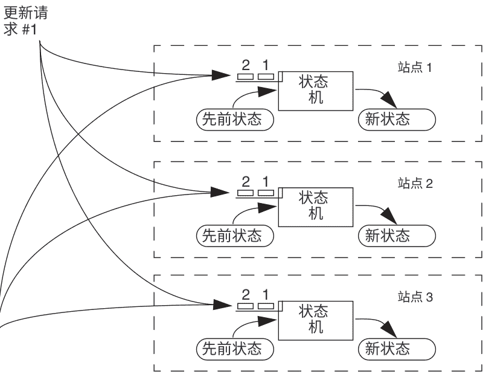

图10.2  
复制的状态机。如果N个相同的状态机都具有相同的先前状态，并按照相同的顺序接收和执行相同的更新请求，那么所有N个状态机都将进入相同的新状态。

## 10.3 持久化存储再探：广泛分离的副本 10-13  

好消息是，复制的状态机方案不仅是系统化的，而且适合模块化。一个模块可以实现达成共识的算法；第二组模块，即状态机，可以执行实际的更新操作；第三个模块负责调和，定期检查数据副本以验证它们是否相同，并在必要时启动修复操作以保持它们的一致性。

## 10.3.3 满足更加适度需求的快捷方式  

复制状态机方法是系统化、优雅和模块化的，但其实现要求严格。在光谱的另一端，一些应用程序可以采用更简单的方法：只实现一个单一的状态机。这个想法是在一个副本站点上执行所有的更新，生成该站点的数据库的一个新版本，然后以某种方式使其他副本保持一致。最简单、最直接的方案是将这个新版本的数据副本发送到每个其他副本站点，完全替换它们之前的副本。这个方案是主/从复制的一个特别简单的例子。使它变得简单的一件事是，站点之间不需要协商；主站决定要做什么，从站只需跟随。

如果满足以下条件，单一状态机与直接复制的方案效果很好：

- 数据只需要偶尔更新。
- 数据库足够小，可以完整地重新传输。
- 没有紧急性要提供更新，因此主节点可以累积更新并批量执行。
- 应用程序可以在各个副本之间暂时不一致的情况下正常运行。要求客户端从主副本读取是掩盖暂时不一致的一种方式。另一方面，如果为了提高性能，允许客户端从任何可用的副本读取，在更新期间，从已接收更新的副本读取数据的客户端可能会与从尚未传播更新的不同副本读取数据的另一个客户端得到不同的答案。

这种方法受到数据衰减的影响，就像复制状态机一样，但衰减的影响是不同的。主副本的未检测到的衰减可能导致灾难，衰减会传播到从副本。另一方面，由于更新在每个从站点安装了完整的新数据副本，它会意外地清除从副本中累积的衰减错误，因此如果更新频繁，通常不需要提供调和。如果更新如此不频繁，以至于副本衰减是一个危险，主节点可以简单地做一个偶尔的虚拟更新，使用未更改的数据来调和副本。

单状态机的主要缺陷是，即使数据访问可以容错——如果一个副本失效，其他副本仍然可用于读取——但数据更新不可行：如果主站点失败，直到检测到该故障之前，无法进行任何更新，并进行修复。更糟糕的是，如果主站点在发送更新的过程中失败，副本可能保持不一致状态，直到主站点恢复。这种整体方法对于某些应用程序效果不佳，例如具有严格一致性要求且只能通过允许并发读取副本来满足性能目标的大型数据库。

尽管存在这些问题，但简单性是有吸引力的，在实践中，许多设计师尝试使用单状态机方法的某个变体，通常通过一种或多种增强来进行调整：

- 主站点可以将仅更改的数据库部分（更新称为“增量”或“差异”）分发给副本站点。然后，每个副本站点必须运行一个引擎，可以使用增量中的信息正确更新数据库。这种方案沿着复制状态机的方向向后移动。尽管可能会产生显著的性能提升，但这种设计可能会同时具有单个状态机和复制状态机的缺点。
- 设计方法来减小副本在读取客户端可能不一致的时间窗口大小。例如，主站点可以在一个影子副本中保存新版本的数据库，并要求从站点做同样的事情，直到新版本的所有副本都成功分发。然后，短消息可以告诉从站点将影子文件作为活动数据库。（这个模型应该很熟悉：类似的思想在第9章中描述的两阶段提交协议的设计中使用过[在线]。）
- 如果数据库很大，将其分成小区域，每个区域可以独立更新。下面的第10.3.7节更深入地探讨了这个想法。（互联网域名系统大部分是作为大量小型复制分区进行管理的。）
- 为每个分区分配不同的主节点，以更均匀地分配更新工作并增加更新的可用性。
- 使用共识算法选择新的主节点，在主节点故障时为数据更新添加容错性。
- 如果应用程序对更新的顺序不敏感，则可以实现一个没有共识算法的复制状态机。如果只有一种更新是向数据中添加新记录，并且记录是根据其内容而不是到达顺序来标识的，则这个想法可能很有用。通过电子邮件进行协作的工作组成员通常以这种方式查看其他组成员的消息。不同的用户可能会发现收到的消息以不同的顺序出现，甚至偶尔会看到一个成员回答了另一个成员似乎还没有提出的问题，但如果电子邮件系统正常工作，最终每个人都会看到每条消息。

## 10.3 持久存储再访: 广泛分离的副本 10-15  

- 主站点可以仅将其更新日志分发给副本站点。 副本站点可以运行 REDO 来执行日志条目，以使其数据库副本保持最新状态。
或者，副本站点可以仅维护完整的日志副本，而不是数据库本身。 在主站点发生灾难的情况下，可以使用其中一个日志副本来重建数据库。

这个列表只是触及了表面。似乎有无限种应用相关的复制方式。

## 10.3.4 维护数据完整性  

在更新副本时，许多问题可能会出现：数据记录可能在发送或接收系统的内存缓冲区中损坏或完全丢失，传输可能引入错误，操作员或管理员可能犯错误，仅举几例威胁数据完整性的附加威胁。耐久性原则建议对副本进行物理和管理上的分离，以使对其完整性的威胁更加独立，但威胁仍然存在。

对抗这些对数据完整性的威胁的明显方法是应用第9-94页上建议的方法来对抗自发数据衰减：计划定期比较副本，这样做的频率足够高，以至于所有副本都不太可能恶化。

然而，当副本不是物理上相邻的时候，这种明显的方法的缺点是逐位比较需要从一个副本站点传输完整的数据副本到另一个副本站点，这可能是耗时且可能昂贵的活动。

一种替代且成本较低的方法是计算副本内容的证明，并仅从一个站点传输该证明到另一个站点。

证明的通常形式是计算在副本内容上的哈希值，从而证明该内容的真实性。通过选择一个好的哈希算法（例如，在第11.7节中描述的密码质量哈希算法）并使证明足够长，可以使损坏的副本具有与证明匹配的哈希值的概率变得任意小。因此，证明可以代表副本来确认数据完整性或检测其丢失。

使用证人来确认或检测数据完整性的想法可以应用在许多方面。我们已经看到校验和在通信中的使用，无论是用于端到端完整性验证（第7-31页）还是在链路层（第7-40页）；校验和可以被视为弱证人。作为使用证人的另一个例子，文件系统可以为每个新写入的文件计算一个单独的证人，并将证人的副本存储在文件的目录项中。在以后读取文件时，系统可以重新计算哈希值，并将结果与先前存储的证人进行比较，以验证文件中的数据完整性。两个被认为在维护文件系统副本的站点可以通过交换和比较证人列表来验证它们是相同的。在第11章[在线]中，我们将看到通过单独保护证人，还可以对抗由对手造成的数据完整性威胁。

## 10.3.5 副本读取和多数派  

到目前为止，我们已经探索了各种创建副本的方法，但还没有探讨如何使用它们。最简单的计划是使用主/从系统，将所有客户端的读写请求都定向到位于主站点的主要副本，并将从副本专门用作仅用于恢复受损主副本完整性的备份。

这个计划之所以简单，是因为主站点处于良好的位置，可以跟踪读写请求的顺序，并强制执行严格的一致性规范，例如内存一致性的通常规范：读取应返回最近写入的结果。

对于增加读取请求的可用性，常见的副本系统改进是允许将读取定向到任何副本，这样即使主站点宕机，数据仍然可用。除了提高可用性外，这种改进还可能具有性能优势，因为几个副本可能同时为不同的客户端提供服务。不幸的是，这种改进会导致在更新期间存在瞬时不一致的情况，因此不同的读者可能获得不同的结果，违反了严格的一致性规范。为了恢复严格一致性，需要一些机制来确保读取和更新之间的先后原子性，而这种先后原子性机制可能会削弱一些增加的可用性和性能。

简单方案和增强方案都只查询一个副本站点，因此必须仅使用该站点本地的信息（可能借助副本站点上存储的证人）来检测数据完整性的丢失，例如来自衰变。两种方案都没有利用其他副本的数据内容来验证完整性。验证完整性的一种更昂贵但更可靠的方法是客户端还从不同的副本站点获取第二份副本（或证人）。如果来自另一个站点的副本（或证人）与第一个站点的数据（或刚刚计算出的数据哈希）匹配，对数据完整性的信心可以非常高。这个想法可以进一步发展，获取几个副本或证人，并进行比较。即使存在分歧，如果大多数副本或证人都同意，客户端仍然可以有信心地接受数据，并可能报告需要协调的需求。

一些系统进一步推动了大多数观点，引入了一个法定人数的概念。与其简单地定义为“超过一半的副本”，我们可以定义单独的读取和写入法定人数，$Q_{r}$ 和 $Q_{w}$，具有 $Q_{r} + Q_{w} > N$ 副本的属性。该方案在写入至少一个写入法定人数 $Q_{w}$ 的副本后，将写入确认为已完成（同时系统继续尝试将写入传播到剩余的副本），并且在至少一个读取法定人数 $Q_{r}$ 上达成一致时，将读取视为成功，该读取法定人数 $Q_{r}$ 可以同意数据或证人值。

通过变化 $Q_{r}$ 和 $Q_{w}$，可以配置这样一个系统，以在多个副本故障的情况下偏向于可用性，无论是读取还是写入。用这些术语来说，上述增强的可用性方案是一个 $Q_{w} = N$ 副本和 $Q_{r} = 1$ 的方案。

或者，可以运行一个 N 副本 5 的系统，并且有一个规则要求所有的更新至少要在 $Q_{w}=4$ 个副本上进行，并且读取至少要在 $Q_{r}=2$ 个副本上进行。  

## 10.3 持久存储再访：广泛分离的副本 10-17  

因此，一个实际的法定人数方案需要一些额外的前后原子性机制，以序列化写操作，并确保在前一个写操作充分传播以确保一致性之前不会开始下一个写操作。机制的复杂性取决于确切的系统配置。如果所有的读取和更新都起源于一个单一的站点，那么该站点上的一个简单的顺序器可以提供所需的原子性。如果读取请求可以来自许多不同的源，但所有的更新都起源于一个单一的站点，更新站点可以为每个数据更新关联一个版本号，读取站点可以检查版本号以确保它们读取了最新的一致数据集。如果更新可以起源于许多站点，那么可以使用提供分布式顺序器实现的协议来实现原子性。性能最大化通常是另一个复杂的考虑因素。有兴趣的读者应该参考专业文献，其中描述了许多（有时相当复杂）的方案，用于提供法定人数副本系统的序列化。所有这些机制都是针对跨多个站点实现原子性这一通用问题的专门解决方案，该问题在第9章的末尾进行了讨论[在线]。

## 10.3.6 备份  

对于基于单个状态机的持久存储的最常用的复制技术可能是定期备份完整文件系统到独立的移动介质，如磁带、可写光盘(DVD)，  

或可移动硬盘。由于介质是可移动的，可以在本地制作副本，然后稍后引入地理分离。如果磁盘损坏并需要更换，可以从最近的可移动介质副本恢复其内容。可移动介质相对便宜，因此不需要立即回收以前的备份副本。

旧的备份副本可以作为对人为错误的保护，作为各个较早时间数据的存档，允许检索旧的数据值。

这种技术的主要缺点是制作大型存储系统的完整备份副本可能需要相当长的时间。因此，通常会实施增量备份（仅复制自上次备份以来更改的文件）和部分备份（不复制可以从其他文件轻松重建的文件）等改进。

这些技术减少了制作副本的时间，但是它们引入了操作复杂性，特别是在恢复时。

第二个问题是，如果在备份复制进行的同时进行数据更新，备份副本可能不是在任何单一时刻的快照——它可能显示一些多文件更新的结果，但不包括其他文件。如果内部一致性很重要，要么在备份期间必须推迟更新，要么必须设计其他方案，例如记录更新。由于复杂性也会降低可靠性，设计者在这个方向上必须谨慎行事。

值得重申的是，数据复制的成功取决于副本之间的故障独立性，正确评估副本之间的独立性可能很困难。在同一设计师设计并由相同软件修改的情况下，副本可能受到相同的设计或实现错误的影响。系统设计师之间的民间智慧认为，复制系统面临的最大危险是复制故障。例如，复制状态机中的编程错误可能导致所有数据副本变得完全损坏。此外，实现持久存储还需要更多的工作，不仅仅是复制。因为线程可能在数据的某个不满足不变量的时间失败，所以需要额外的技术来恢复数据。

复杂性也可能干扰备份系统的成功。另一个民间智慧的观点是，备份系统越复杂，实际工作的可能性就越小。大多数有经验的计算机用户都能讲述硬盘崩溃的那一天的故事，但由于某种原因，备份副本并不包括最重要的文件。（但是故事通常以这样一个情节结束：那些文件的所有者不相信备份系统，并且能够从自己独立制作的临时副本中恢复那些重要文件。）

## 10.3.7 数据分区  

容忍存储介质故障的一种完全不同的方法是简单地对数据进行分区，从而使系统在某种程度上具备容错能力。在典型的设计中，人们会将大量数据分成几个部分，每个部分的大小大致相同，并将每个部分放在不同的物理设备上。然后，任何一个设备的故障都会

## 10.4 协调

副本的一个典型约束是大多数副本是相同的。不幸的是，各种事件可能导致它们变得不同：副本的数据可能会衰减，复制状态机可能会发生错误，具有最终一致性目标的更新算法可能在达到目标之前被中断，副本站点的管理员可能以不符合复制协议的方式修改文件，或者用户可能希望在一些副本与网络断开连接时进行更新。在所有这些情况下，需要进行事后程序来发现数据的差异并恢复一致性。这个过程称为对账，使副本再次变得相同。

虽然在原则上，调和是一个简单的概念，但在实践中，有三个事情使它比人们希望的更加复杂：1. 对于大量的数据，最直接的方法（例如，比较所有位）是昂贵的，因此性能优化主导并复杂化了算法。

- 2. 在调和过程中发生系统崩溃可能会使数据变得比没有进行调和时更糟糕。调和过程本身必须对故障和系统崩溃具有弹性。
- 3. 在调和过程中，可能会发现冲突，即不同副本以不一致的方式进行了修改。除了文件的衰减之外，衰减也可能影响调和系统本身保存的记录。

简化对调和的思考的一种方法是将其分解为两个不同的模块化组件：1. 检测副本之间的差异。
- 2. 解决差异，使所有副本变得相同。

解决步骤通常从尽可能多地处理检测到的差异的算法开始，留下（希望）一个冲突列表供用户手动解决。

## 10.4.1 一个协调过程

为了说明协调中涉及的一些问题，图10.3展示了一个名为 RECONCILE的文件协调过程，该过程使用时间戳。为了简化示例，文件具有路径名，但没有目录。该过程协调了两组文件，命名为left和right，这两组文件在上次协调时间last_reconcile_time时已经协调过，它充当了一种生成号码。该过程假设这两组文件在那个时间点上是相同的，并且其目标是通过检查存储系统记录的修改时间戳，使这两组文件再次相同。函数MODIFICATION_TIME(file)返回文件的最后修改时间。复制操作除了将文件从一组复制到另一组外，还会复制最后修改的时间，如果需要，创建具有适当文件名的文件。

RECONCILE作为一个事务运行。为了实现全有或全无的原子性，RECONCILE被构建为幂等的；此外，复制操作必须是原子的。为了实现先前或后续的原子性，RECONCILE必须独立运行，而不允许其他人在其执行过程中对文件进行更改，因此它首先通过设置锁来使所有文件活动静止，防止其他线程打开新文件，然后等待直到其他线程打开的文件都关闭。对于持久性，reconcile依赖于底层文件系统。它的约束是当它退出时，左集合和右集合是相同的。

RECONCILE通过从专用磁盘扇区读取上一次对账的时间戳并枚举两侧的文件名来准备对账。根据这两个枚举，程序的第7到9行创建了三个列表:

- 出现在两边的文件名（共同列表）
- 仅出现在左边的文件名（仅在左边列表）
- 仅出现在右边的文件名（仅在右边列表）

这三个列表驱动了对账的其余部分。第10行创建了一个名为冲突列表的空列表，它将累积任何无法通过算法对账的文件名。

接下来，对账程序会检查共同列表中的每个文件。它从第12行和第13行开始，通过检查时间戳来判断双方是否修改了文件。如果双方的时间戳都比上一次对账程序运行时的时间戳更新，那说明双方都修改了文件，因此将该文件名添加到冲突列表中。如果只有一方的时间戳更新，它将修改后的版本视为权威版本，并将其复制到另一方。（因此，该程序在进行差异检测的同时也进行了差异解决。完全模块化这两个步骤需要对文件列表进行两次遍历，从而降低性能。）如果两个文件的时间戳都早于上一次运行的时间戳，它会检查双方的时间戳是否相同。如果不相同，这表明在上一次对账结束时两个文件系统不同，可能是因为在对账过程中出现了问题，因此程序会以错误消息终止，而不是继续前进并冒险对两个文件系统造成无法修复的损坏。

在处理了在两边找到的文件名列表之后，RECONCILE然后考虑那些只在一边找到文件名的文件。这种情况可以通过以下三种方式出现：

- 1. 一边删除了一个旧文件，
- 2. 另一边创建了一个新文件，或者
- 3. 一边修改了另一边删除的文件。

第一种情况很容易识别，只需注意到仍然拥有该文件的一边在上一次对账程序运行后没有对其进行修改。对于这种情况，RECONCILE删除剩余的副本。另外两种情况在没有保留额外状态的情况下无法区分，因此 RECONCILE只需将文件从一边复制到另一边。这种选择的一个结果是，如果在上一次对账程序调用之后，另一边对已删除的文件进行了修改，它将悄无声息地重新出现。另一种实现方式是声明冲突，并询问用户决定是删除还是复制该文件。在这种选择下，每个新创建的文件都需要在下一次运行 RECONCILE时进行手动干预。这两种实现都会给用户带来一些困扰。消除这种困扰是可能的，但需要一个在 RECONCILE的运行之间记住额外的、每个文件的状态的算法。

在解决了所有可以通过算法解决的差异之后，RECONCILE会要求用户通过手动干预解决任何剩余的冲突。当用户完成时，RECONCILE准备好提交事务，在第36行记录当前时间到专用磁盘扇区。然后允许文件创建活动继续，并退出。两组文件再次完全相同。

## 10.4.2 时钟协调

这个RECONCILE程序相对脆弱。它依赖于时间戳的准确性。如果两组文件由不同的计算机系统管理，具有独立的时钟，并且某人在一侧错误地设置了时钟，则该侧的时间戳也将不正确，结果是 RECONCILE可能不会注意到冲突，可能会用旧版本的文件覆盖新版本，可能会删除不应该被删除的文件，或者可能会错误地恢复已删除的文件。出于同样的原因，RECONCILE必须仔细保留变量last_reconcile_time从一次运行到下一次。

一些对账程序试图通过从两个系统读取当前时钟值，注意差异，并考虑到这个差异来最小化意外损害的可能性。如果差异与之前的对账相比没有改变，对账程序可以简单地添加（或减去，视情况而定）时间差，并像往常一样继续进行。如果差异发生了变化，变化的量可以被视为不确定性的增量；任何依赖于该不确定性的文件都会被添加到用户手动解决的冲突列表中。

## 10.5 视角

在[在线]第9章和第10章中，我们对原子性和系统化方法进行了广泛的深入讨论。此时，适当地从技术细节中退后一步，试图对所有这些问题进行一些整体的思考。

这些想法与现实世界有关。本节的观察范围广泛：历史、权衡和未开发的主题。这些观察看似有些杂乱无章，但结合起来，它们可以为读者提供一些关于原子性如何适应计算机系统设计实际世界的准备。

## 10.5.1 历史

将原子性系统地应用于恢复和协调是相对较新的。自20世纪50年代末以来，临时编程并发活动已经很常见，当时像IBM 7030 (STRETCH) 计算机和实验性的M.I.T.的TX-0使用中断与主要计算同时运行I/O设备驱动程序。早期的分时系统（在20世纪60年代初）证明了在中断管理方面需要更加系统化，并且在接下来的十年中，许多不同的语义构造被开发出来，以更好地解决协调问题：Edsger Dijkstra的信号量，Per Brinch Hansen的消息缓冲区，David Reed和Raj Kanodia的事件计数，Nico Habermann的路径表达式以及Anthony Hoare的监视器都是其中的例子。围绕这些构造物形成了大量的文献，但它们的共同特点是专注于正确协调各个并发活动，每个活动本身都被假定为能够正确运行。

个别活动的失败和恢复的可能性，以及此类失败和恢复对其他并发活动的协调的影响，并不是关注的重点。这些结构的另一个特点是它们类似于机器语言，提供了低级工具，但在如何应用它们方面提供了很少的指导。

在那些早期系统中，失败恢复并不是被简单地忽视，而是使用临时技术来独立处理。早期的分时系统实施者发现用户需要一种持久存储，文件在系统故障的情况下能够完好无损地存活下来。为此，大多数分时系统定期备份在线文件，使用磁带作为备份介质。更复杂的系统开发了增量备份方案，即最近创建或修改的文件每小时复制到磁带上，生成几乎实时的持久性日志。为了减少系统崩溃可能损坏在线磁盘存储内容的可能性，开发了修复程序来检查磁盘内容并修复明显和常见的损坏类型。现代个人计算机的用户将会意识到这些技术仍然广泛使用。

这些临时技术虽然对某些用途来说足够了，但对于严肃的数据库管理系统的设计者来说还不够。为了满足他们的要求，他们开发了事务的概念，最初它完全是应用于数据库的一种全有或全无的操作。因此，在数据库环境中发展了恢复日志协议，而在此之前，人们很长时间都没有意识到恢复语义具有更广泛的适用性。

在数据库世界中，协调几乎完全是通过锁定技术来实现的，这种技术变得越来越系统化和自动化。

并发原子操作的正确性定义涉及以某种串行顺序一个接一个地运行这些原子操作时获得相同结果的概念。数据库世界还贡献了在不同数据对象之间维护约束或不变量的概念，而且单词“事务”也意味着一种既全有或全无又在之前或之后的操作，可以用来维护约束并提供持久性。数据库世界还开发了系统化的复制方案，主要是为了增强可靠性和可用性，但也可以提高性能。

对于原子性的先后顺序的理解，以及对程序的层次化组合的要求，进而导致了版本历史（也称为时间数据库或时间域寻址）系统的发展。版本历史系统系统地提供了恢复和协调的单一机制，并简化了将多个独立开发的较小动作构建成大型原子动作的过程。

本文将开发顺序颠倒，因为相对简单的版本历史在教学上更为直观，而日志/锁定方法的较高复杂性则更容易理解为什么版本历史起作用之后。版本历史用于源代码管理系统，也用于提供撤销按钮的用户界面，但几乎所有商业数据库管理系统都使用日志和锁定以实现最大性能。

## 10.5.2 折衷

一组有趣的权衡适用于协调并发活动的技术。图10.4表明，存在一种协调可能性的谱系，从左侧的完全串行动作到右侧的完全无协调。从左侧开始，我们可以拥有极简单（例如一次只调度一个线程）但完全不允许并发的情况。向右移动，为了保持正确性所需的复杂性增加，但同时也增加了提高性能的可能性，因为允许了越来越多的并发。例如，标记-点和简单锁定规则可能更靠近谱系的左端，而两阶段锁定则更靠近右侧。图中的实线曲线表示逐渐增加的最小复杂性边界，低于该边界的协调复杂性将无法确保正确性；可能出现与相同动作的串行调度不对应的结果。（为了说明，图中将边界线显示为平滑递增的曲线，但这是一种过度简化。一旦出现并发的迹象，复杂性就会急剧增加。）继续向右遍历并发谱系，经过一个点，由虚线垂直线表示，超过该点，无论协调方案多么聪明或复杂，都无法实现正确性。越接近该限制，性能越高，但代价是更高的复杂性。在[在线]第9章和第10章中探索的所有算法都旨在在正确性限制的左侧运行，但我们可能会探讨在另一侧工作的可能性。这种可能性并不像一开始看起来那么不可思议。如果相互-

在并发活动之间的差异很少，并且错误的代价很小的情况下，人们可能愿意允许导致明显错误答案的并发操作。9.5.4节[在线]建议设计者有时会使用在此区域操作的锁定协议。

例如，在杂货店的库存控制系统中，如果两个销售终端尝试同时更新玉米片库存，导致偶尔销售的玉米片未记录，那么库存的轻微过高估计可能不是一个严重的问题。杂货店必须定期进行手动盘点，因为其他盒装玉米片可能被放错地方、损坏和被盗，而且员工在交付新盒装时有时会输入错误的数字。这种更高层次的数据恢复机制还将纠正由于库存管理系统的协调不当而引入的任何错误，因此其设计者可能决定使用允许最大并发性、简单、捕捉最常见协调问题的协调技术，但仍然在严格正确性线下或右侧运行。运行数据管理系统的决策

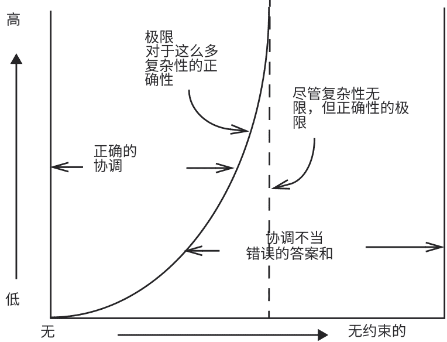

图10.4 并发性、复杂性和正确性之间的权衡。系统设计在此图中的位置选择取决于两个问题的答案：1) 并发活动实际上会多频繁地相互干扰？ 2) 100%正确结果有多重要？如果干扰很少，设计更靠右是合适的。如果正确性不是必要的，甚至可以设计在两个正确性边界的右侧也是可以接受的。

以允许此类错误的模式可以基于理性进行决策。人们会比较系统因其自身的协调错误而丢失库存的速率与因外部、不受控制的事件而丢失库存的速率。如果后者的速率占主导地位，就没有必要要求计算机系统更高的准确性。如果后者的速率占主导地位，就没有必要要求计算机系统更高的准确性。

另一个可接受的操作在正确性边界之外的合理示例是美联储对美国货币供应的计算。

虽然原则上可以编写一个包含每个包含美国资金的银行中的每个银行账户的两阶段锁定协议，但在一个分布在大陆上的数千个独立银行中完成这个任务的实际困难是巨大的。相反，数据是在没有锁定的情况下收集的，只有松散的协调，并且几乎可以肯定会有一些资金被计算两次，而其他资金则被忽视。然而，在结果中并不需要非常精确，因此在许多个体银行系统同时运行的情况下，缺乏完美的协调是可以接受的。

尽管允许不正确的协调可能只适用于晦涩的情况，但实际上它适用于比人们想象的更广泛的情况。在几乎所有的数据库管理应用程序中，错误结果的最大原因是人为操作员的错误输入。通常，在数据库管理系统的事务程序有机会“正确”转换之前，存储的数据已经存在许多缺陷。因此，正确性边界之外的操作只会增加数据库的错误率。我们在这里提出了一个端到端的论证：如果我们应用程序的高层用户犯了其他错误，并且已经有了纠正这些错误的程序，那么在较低层实施英雄般的协调正确性措施可能没有多大意义。

从这个角度来看，原则上可以在过于严格但“正确”的事务协调方案与偶尔会对数据造成有限损害的简单技术之间取得平衡。支持这种方法在实践中可行的一个证据是，许多现有的数据管理系统提供了可选的锁定协议，称为“游标稳定性”、“读提交”或“快照隔离”，所有这些协议在某些情况下都是明显不正确的。然而，实际上产生错误答案的交互更新操作的频率很低，而增加并发性的好处足够大，以至于用户认为这种权衡是可以容忍的。这种方法的主要问题是，目前还没有人找到一种良好的方式来描述（并限制）可能导致的错误。如果无法限定可能发生的最大损害，那么这些技术可能过于冒险。

一个明显的问题是是否存在类似的超越正确性边界的操作策略适用于原子性。显然，在中央处理器的指令集设计领域并没有，至少目前没有。在1950年代和1960年代的主机处理器、1970年代的小型计算机和1980年代的单芯片微处理器的设计师中，有三代人没有意识到全有或全无的原子性在初始设计中的重要性，后来不得不将其后期加入到他们的体系结构中，以适应伴随多级内存管理的线程切换。

## 10.5.3 进一步研究的方向

第9章和第10章只揭示了原子性、事务、持久性、复制和一致性研究的第一层；还有很多厚厚的书籍探索了细节。我们只轻描淡写地触及了一些事情（或者根本没有触及），如分布式原子操作、使用锁的模块化程序的分层组合、松散或错误协调的系统化应用、补偿的系统化应用以及恶意参与者的可能性。

高效实现分布式原子操作是一个困难的问题，有大量的文献，其中一些方案基于锁定，另一些基于时间戳协议或版本历史，还有一些结合了两者，还有一些采用乐观策略。每种方案都有其在性能、可用性、持久性、完整性和一致性方面的优缺点。似乎没有一种方案准备好主导，新的方案经常出现。

分层组合——将较大的原子操作由先前编程的较小操作组成——与锁定作为先后原子性技术交互起来非常尴尬。问题出现在锁定协议需要一个锁定点以确保正确性。从两个先前独立的原子操作创建一个原子操作很困难，因为每个单独的原子操作都有自己的锁定点，与其自己的提交点重合。但是更高层次的操作也必须有一个锁定点，这表明组成原子操作中锁定的捕获和释放顺序需要改变。重新排列锁定捕获和释放的顺序与模块化组合的通常目标相矛盾，根据这个目标，人们可以在不修改组件的情况下将较大的系统组装起来。为了保持模块化组合，锁定管理器需要知道它正在一个分层原子操作的环境中运行。有了这个知识，它可以在幕后系统地重新安排锁定释放的顺序以满足嵌套操作的要求。

例如，当一个嵌套的原子操作调用释放锁时，锁管理器可以简单地重新标记该锁，以显示它由更高层次的、尚未提交的原子操作持有。在嵌套的原子操作之间传递锁的系统化学科可以保持模块化组合的目标，但代价是复杂性。

回到图10.4所提出的想法，设计一个在错误区域运行的系统是令人着迷的，但有一个主要的障碍：人们希望指定并因此限制由错误协调引起的性质。这个规范可能是关于错误的数量、方向、累积效应或其他方面的。对协调错误的系统化规范尚未得到认真探索。

补偿是处理协调不一致或在无法隐式回滚操作的情况下进行恢复的方式。补偿是执行一个可见操作，以撤销某个较早的可见操作的所有已知效果。

例如，如果银行账户被错误地借记，后来可以为缺少的金额进行贷记。补偿的有用性受到了能够追溯到需要撤销的行动发生后的程度的限制。

## 10.5.4 练习

10.1 你正在为一个要求异常高可靠性的应用程序开发存储系统，因此决定使用三副本持久化存储方案。你计划使用三个普通磁盘驱动器D1、D2和D3，并安排D2和D3存储与D1上存储的每个块相同的镜像副本。这些磁盘驱动器采用简单设计，不报告读取错误。也就是说，它们只是返回数据，无论数据是否有效。

10.1a. 你最初构建应用程序，使其同时将一块数据写入三个驱动器的相同扇区。在写入过程中发生电源故障后

在写入的中间，你无法重建该扇区的正确数据。

问题是什么？

10.1b. 描述一个解决这个问题的修改。

10.1c. 有一天发生了一个非常糟糕的电源故障，导致所有三个磁盘崩溃，每个磁盘都损坏了一个随机轨道。幸运的是，系统在那时候没有在写入任何数据。描述一种重建数据的过程，并解释你的过程无法处理的任何情况。

1994-3-2

10.2 RECONCILE程序在10.4.2节对于同一文件的不同副本的并发更新做出了什么样的假设？

A. 它假设这些冲突很少发生。

B. 它假设这些冲突可以自动检测到。

C. 它假设所有冲突可以在以后自动解决。

D. 它假设这些冲突不可能发生。

1999-3-04

10.3 玛丽使用RECONCILE来使她的笔记本电脑上的文件与她的台式电脑保持协调。然而，她感到很烦恼。在她旅行时，她处理她的电子邮件收件箱，阅读和删除邮件，并准备回复，这些回复放入一个电子邮件发件箱。当她回家时，RECONCILE总是告诉她，在她离开期间，桌面收件箱中添加了几封新邮件，并且已经发送和删除了桌面发件箱中的任何邮件，因此存在冲突。她的邮件客户端将收件箱实现为一个单一文件，将发件箱实现为一个单一文件。本建议玛丽切换到另一个邮件客户端，该客户端将收件箱和发件箱实现为两个目录，并将每个收到或发出的邮件放入单独的文件中。

假设除了邮件系统以外，没有其他人在玛丽离开时触碰她的桌面邮箱，以下哪个描述最准确？

A. RECONCILE仍然无法调和收件箱或发件箱。

B. RECONCILE可以调和收件箱但无法调和发件箱。

C. RECONCILE可以调和发件箱但无法调和收件箱。

D. RECONCILE可以调和收件箱和发件箱。

1997-0-03

10.4 以下哪些陈述对于图中的 RECONCILE程序是正确的？

10.3?

A. 如果 RECONCILE发现一个文件的内容与另一个文件的内容不同，它会指示冲突。

B. 你在文件集1中创建了一个内容为"a"的文件X，然后在文件集2中创建了一个内容为"b"的文件X。然后你从主机1中删除了X，并运行 RECONCILE来同步这两个文件集。在 RECONCILE完成后，你将在文件集1中看到一个内容为"b"的文件X。

C. 如果你意外重置了RECONCILE的名为last_reconcile_time的变量为1900年1月1日午夜，那么下次运行RECONCILE时，你可能需要解决更多的冲突。

比起保留那个变量，你下次运行RECONCILE时可能需要解决更多的冲突。

2008-3-2

10.5 这是一个文件对账程序的提议不变式，如图10.3中的RECONCILE程序所示：

在RECONCILE运行期间的每一刻，每个文件要么具有其原始内容，要么具有其正确的最终内容。以下哪个陈述是 关于RECONCILE的真实性？

A. RECONCILE不尝试维护这个不变量。

B. RECONCILE在所有情况下都维护这个不变量。

C. RECONCILE使用文件创建时间来确定文件的最新版本。

D. 如果两个文件集位于通过网络连接的不同计算机上， RECONCILE将不得不将每个文件的一个版本的内容发送到另一台计算机上进行比较。

与第10章相关的其他练习可以在问题集40到42中找到。

## 章节

## 信息安全

## 11

信息安全。保护信息和信息系统免受未经授权的访问或修改，无论是在存储、处理还是传输中，以及防止授权用户遭受服务拒绝。

> —信息操作。美国武装部队参谋长联席会议，联合出版物3-13 (2006年2月13日)。

## 章节内容

+ 概述.................................................... 11-4

+ 11.1 安全系统简介.................................................11-5

+ 11.1.1 威胁分类..................................................11-7

+ 11.1.2 安全是一个负面目标..........................................11-9

+ 11.1.3 安全网方法................................................11-10

+ 11.1.4 设计原则..................................................11-13

+ 11.1.5 高d(技术)/dt对安全构成挑战.................................11-17

+ 11.1.6 安全模型..................................................11-18

+ 11.1.7 可信计算基础..............................................11-26

+ 11.1.8 本章路线图................................................11-28

+ 11.2 验证主体....................................................11-28

+ 11.2.1 将信任与验证主体分离......................................11-29

+ 11.2.2 验证主体..................................................11-30

+ 11.2.3 密码哈希函数，计算安全，窗口为
有效性....................................................11-32

+ 11.2.4 使用密码哈希函数保护密码....11-34

+ 11.3 验证消息....................................................11-36

+ 11.3.1 消息认证与机密性不同......................................11-37

+ 11.3.2 封闭设计与开放设计以及密码学.............................11-38

+ 11.3.3 基于密钥的认证模型.......................................11-41

+ 11.3.4 SIGN和 VERIFY的属性......................................11-41

+ 11.3.5 公钥与共享密钥身份验证 ................................. 11-44

+ 11.3.6 密钥分发 ............................................ 11-45

+ 11.3.7 长期数据完整性与证人 ................................. 11-48

## 11.4 消息机密性 ......................................... 11-49

+ 11.4.1 使用加密实现消息机密性 ............................. 11-49

+ 11.4.2 ENCRYPT和 DECRYPT的属性 ........................... 11-50

+ 11.4.3 实现机密性和身份验证 ............................... 11-52

+ 11.4.4 加密能用于身份验证吗？ ............................. 11-53

## 11.5 安全协议 ........................................... 11-54

+ 11.5.1 示例：密钥分发 ..................................... 11-54

+ 11.5.2 设计安全协议 ........................................ 11-60

+ 11.5.3 身份验证协议 ........................................ 11-63

+ 11.5.4 一个错误的密钥交换协议 ............................. 11-66

+ 11.5.5 Diffie-Hellman密钥交换协议 ......................... 11-68

+ 11.5.6 使用公钥系统的密钥交换协议 ......................... 11-69

+ 11.5.7 总结 ................................................ 11-71

## 11.6 授权：受控共享 ....................................... 11-72

+ 11.6.1 授权操作 ............................................ 11-73

+ 11.6.2 简单的守卫模型 ...................................... 11-73

+ 11.6.2.1 票证系统 ........................................... 11-74

+ 11.6.2.2 列表系统 ........................................... 11-74

+ 11.6.2.3 票据与列表，以及机构 ............................. 11-75

+ 11.6.2.4 保护组 ............................................ 11-76

+ 11.6.3 示例： UNIX中的访问控制 ............................ 11-76

+ 11.6.3.1 UNIX中的主体 ...................................... 11-76

+ 11.6.3.2 UNIX中的ACL ....................................... 11-77

+ 11.6.3.3 进程的默认主体和权限 ............................. 11-78

+ 11.6.3.4 用户身份验证 ...................................... 11-79

+ 11.6.3.5 访问控制检查 ...................................... 11-79

+ 11.6.3.6 运行服务 .......................................... 11-80

+ 11.6.3.7 UNIX访问控制的总结 ............................... 11-80

+ 11.6.4 管理员模型 .......................................... 11-80

+ 11.6.5 非自主访问和信息流控制 ............................. 11-81

+ 11.6.5.1 信息流控制示例 ................................... 11-83

+ 11.6.5.2 隐蔽通道 .......................................... 11-84

## 11.7 高级主题：关于身份验证的推理 .................... 11-85

+ 11.7.1 身份验证逻辑 ........................................ 11-86

+ 11.7.1.1 硬连线方法 ........................................ 11-88

+ 11.7.1.2 互联网方法 ........................................ 11-88

+ 11.7.2 分布式系统中的身份验证 ............................. 11-89

+ 11.7.3 跨管理域的身份验证 ................................. 11-90

+ 11.7.4 验证公钥 ............................................ 11-92

+ 11.7.5 验证证书 ............................................ 11-94

+ 11.7.6 证书链 .............................................. 11-97

+ 11.7.6.1 中央证书机构的层次结构 ........................... 11-97

## 11.8 密码学作为构建模块（高级主题）....................................11-99

+   11.8.1 用于保密性的不可破解密码（一次性密码）....................11-99

+   11.8.2 伪随机数生成器..................................................................11-101

+   11.8.2.1 RC4：伪随机生成器及其使用...................................11-101

+   11.8.2.2 使用RC4进行保密性....................................................11-102

+   11.8.3 块密码..................................................................................11-103

+   11.8.3.1 高级加密标准（AES）.................................................11-103

+   11.8.3.2 密码块链......................................................................11-105

+   11.8.4 计算消息认证码..............................................................11-106

+   11.8.4.1 使用块密码或流密码的MAC ......................................11-107

+   11.8.4.2 使用密码哈希函数的MAC .........................................11-107

+   11.8.5 公钥密码.........................................................................11-109

+   11.8.5.1 Rivest-Shamir-Adleman (RSA) 密码 ..........................11-109

+   11.8.5.2 计算数字签名 ...............................................................11-111

+   11.8.5.3 公钥加密系统 ...............................................................11-112

## 11.9 总结...................................................................................11-112

## 11.10 案例研究：Web的传输层安全性 (TLS) . 11-116

+   11.10.1 TLS 握手 ....................................................................11-117

+   11.10.2 TLS 的演变 ....................................................................11-120

+   11.10.3 使用 TLS 验证服务 ........................................................11-121

+   11.10.4 用户身份验证 .................................................................11-123

## 11.11 战争故事：安全系统遭到破坏 ..........................................11-125

+   11.11.1 残留物：有价值的垃圾 ..................................................11-126

+   11.11.1.1 1963年：CTSS 中的残留物 .................................... 11-126

+   11.11.1.2 1997：网络数据包中的残留物.................................11-127

+   11.11.1.3 2000年：HTTP 中的残留物 .................................... 11-127

+   11.11.1.4 已移除磁盘上的残留物 ............................................11-128

+   11.11.1.5 备份副本中的残留物 ..................................................11-128

+   11.11.1.6 磁性残留物：高科技垃圾分析 .................................11-129

+   11.11.1.7 2001和2002年：更多低技术垃圾分析.................... 11-129

+   11.11.2 明文密码导致两次违规 .................................................11-130

+   11.11.3 多倍错误的密码转换 ....................................................11-131

+   11.11.4 控制配置 ......................................................................11-131

+   11.11.4.1 授权人有时会做未经授权的事情 11-132

+   11.11.4.2 系统发布技巧 ................................................................11-132

+   11.11.4.3 Slammer蠕虫............................................................11-132

+   11.11.5 内核信任用户 ................................................................11-135

+   11.11.5.1 显而易见的信任 ................................................................11-135

+   11.11.5.2 非显而易见的信任（Tocttou） ............................... 11-136

+   11.11.5.3 Tocttou 2：虚拟化DMA通道。 ...............................11-136

+   11.11.6 技术克服经济障碍 ........................................................ 11-137

+   11.11.6.1 对我们系统的攻击将会太昂贵 ...................................11-137

+   11.11.6.2 嗯，以前太昂贵了 ....................................................11-137

+   11.11.7 普通人必须能够弄清楚如何使用它 .............................11-138

+   11.11.8 网络可能是一个危险的地方 .............................. 11-139

11.11.9 重复使用的密码 .............................. 11-140

11.11.10 用秘密通道进行信号传递 .............................. 11-141

    11.11.10.1 有意地 I: 敲打墙壁........................... ...................... 11-141

    11.11.10.2 故意的 II .............................. ................................. 11-141

    11.11.10.3 非故意的 .............................. ................................. 11-142

11.11.11 看起来运行得很好 .............................. 11-142

    11.11.11.1 我以为它是安全的........................... .......................... 11-143

    11.11.11.2 密钥空间有多大...真的吗？ ....................... .......................... 11-144

    11.11.11.3 密钥有多长？ .............................. ................................. 11-145

11.11.12 注入的乐趣和利润 .............................. 11-145

    11.11.12.1 向操作员注入虚假警报信息...... ............................... 11-146

    11.11.12.2 CardSystems向外泄露了4000万张信用卡记录
        SQL注入............................... .............................. 11-146

11.11.13 很少使用的组件的危险 .............................. 11-148

11.11.14 一个彻底的系统渗透工作 .............................. 11-148

11.11.15 构建谜题 .............................. 11-149

练习............................... ................................. 11-151

第11章词汇表 .............................. ................................. 11-163

第11章索引 .............................. ................................. 11-169

最后一章页码11-171

## 概述

安全的计算机系统确保用户的隐私和财产免受恶意和好奇的用户侵害。 安全是一个广泛的主题，涉及诸如不允许你的朋友阅读你的文件到保护一个国家的基础设施免受攻击等问题。 防御对抗对手是一个消极的目标。计算机系统的设计者必须确保对手无法以任何方式破坏系统的安全性。

此外，设计者必须使对手难以绕过安全机制；对手窃取机密信息的最简单方法之一是贿赂内部人员。

因为安全是一个消极的目标，它要求设计者要小心并注意细节。 每个细节都可能为对手提供突破系统安全的机会。 幸运的是，许多先前遇到的设计原则也可以指导安全系统的设计者。 例如，来自第8章的安全网方法的原则[在线]，明确说明（陈述您的假设以便进行审查）和迭代设计（假设您会犯错误）同样适用，甚至可能更有力地适用于安全。

保护计算机系统免受对手的概念模型是，某个代理向计算机系统提供一个声称的身份，并请求系统执行某些指定的操作。为了实现安全性，系统必须在执行请求的操作之前获得可信赖的答案，以下是三个问题：真实性：代理的声称身份是否真实？（或者，有人冒充代理吗？）

+   2. 完整性：这个请求是否真的是代理发出的？（或者，有人篡改了它吗？）

+   3. 授权：是否有适当的权限授予该代理执行此操作？

系统安全的主要基础是一组机制，确保对系统执行的每个操作都能令人满意地回答这些问题。

这个想法被称为原则：完全中介。

对于每个请求的操作，检查真实性、完整性和授权。

为了防止内部攻击（实际上是具有适当权限但滥用权限的用户）或成功破坏安全机制的对手，服务还必须维护使用系统的用户的审计跟踪，授权决策等信息。这些信息可能有助于确定攻击后对手是谁，对手如何破坏系统的安全性，并将对手绳之以法。最终，阻止对手的主要手段是增加被发现和惩罚的可能性。

下一节将对安全性进行一般介绍。它讨论了可能的威胁（第11.1.1节），为什么安全性是一个负面目标（第11.1.2节），提出了安全计算机系统设计原则（第11.1.4节），安全计算机系统结构的基本模型（第11.1.6节），基于最小化可信计算基础的实施策略（第11.1.7节），并以本章剩余部分的路线图作为结论（第11.1.8节）。本章剩余部分将更详细地讨论下一节中介绍的思想，但绝不提供完整的计算机安全处理。计算机安全是一个活跃的研究领域，存在许多未解决的问题，鼓励感兴趣的读者深入探索研究文献。

## 11.1 安全系统介绍

在第4章中，我们看到如何将计算机系统划分为模块，以防止错误从一个模块传播到另一个模块。在演示中，我们假设错误是无意的：模块未能遵守其合同，因为用户犯了错误或硬件意外故障。随着计算机系统越来越多地被部署，我们需要能够容忍对手的计算机系统。

通过对手，我们指的是有意打破系统的实体，例如从其他用户那里窃取信息，勒索公司，拒绝其他用户访问服务，以获取乐趣或声誉而入侵系统，测试系统的安全性等。对手包括一系列坏人和好人（例如，被组织聘用来测试该组织计算机系统安全性的人员）。对手可以是单个人或协作的团体来破解保护措施。

几乎所有的计算机都连接到网络，这意味着它们可以被来自世界任何地方的对手攻击。安全机制不仅必须经受住对系统具有物理访问权限的对手的攻击，还必须经受住一个从未听说过的某个国家的16岁巫师坐在个人电脑后面的攻击。由于大多数计算机通过公共网络（例如互联网）连接，对抗远程对手尤其具有挑战性。任何能够访问公共网络的人都可能能够破坏网络中的任何计算机或路由器。

尽管在大多数安全系统中，阻止对手做坏事是主要目标，但通常还需要为用户提供不同级别的权限。以电子银行为例。当然，首要目标必须是确保没有人能够从账户中盗取钱款，在公共网络上修改交易，或者做其他任何坏事。但此外，银行系统还必须强制执行其他安全约束。例如，账户的所有者应该被允许从账户中提取钱款，但不应该被允许从其他账户中提取钱款。然而，银行工作人员（在某些条件下）应该被允许在不同用户的账户之间转移资金并查看任何账户。

需要一些方案来强制执行所需的权威结构。

在某些应用中，计算机系统内部可能不需要执行机制。例如，外部管理的道德准则或其他机制可能足以保护系统。另一方面，随着计算机和互联网的日益重要，许多系统需要一些安全计划。示例包括存储私人信息的文件服务、互联网商店、执法信息系统、专有软件的电子分发、在线医疗信息系统和政府社会服务数据处理系统。这些示例涵盖了组织和个人隐私的广泛需求。

并非所有学科都以相同的方式使用“隐私”、“安全”和“保护”这些术语。本章采用了计算机科学文献中常见的定义。术语“隐私”的传统含义是个人确定何时、何地以及向谁发布个人信息的能力（见附录11.1）。术语“安全”描述了保护信息和信息系统免受未经授权的访问、修改或拒绝服务的技术，无论是在存储、处理还是传输中。在本章中，术语“保护”被用作安全的同义词。

### 11.1.1 威胁分类

任何安全系统的设计都始于确定系统应该抵御的威胁。威胁是由对手的计划攻击或系统合法用户的意外错误引起的潜在安全违规。安全计算机系统的设计者必须考虑两者。

威胁分为三个广泛的类别:

+   1. 未经授权的信息泄露:未经授权的人可以读取和利用存储在计算机中或通过网络传输的信息。这类关注有时还涉及“流量分析”,其中对手仅观察信息使用的模式,并从这些模式中推断出一些信息内容。

+   2. 未经授权的信息修改:未经授权的人可以更改存储的信息或修改通过网络传输的消息。对手可能会采取这种行为来破坏系统或欺骗消息的接收者透露有用的信息或采取意外的行动。这种违规行为不一定需要对手能够看到已更改的信息。

+   3. 未经授权的使用拒绝：对手可以阻止授权用户读取或修改信息，即使对手可能无法读取或修改该信息。导致系统“崩溃”，向服务发送大量消息，或向计算机开枪是使用拒绝的示例。这种攻击是另一种破坏行为。

通常，术语“未经授权”意味着释放、修改或拒绝使用信息与控制信息的人的意图相反，甚至可能与系统所声称执行的约束相反。

正如在概述中提到的，防御这些威胁的一个复杂之处在于对系统合法授权使用者行为的利用。例如，许多用户并非安全专家，通过上网冒险和下载不受信任的第三方程序，将他们的计算机置于风险之中，甚至可能毫不知情。一些用户将自己的个人设备和小工具带到工作场所，这些设备可能含有恶意软件。 还有其他用户允许朋友和家人在机构的计算机上进行个人活动（例如存储个人内容或玩游戏）。一些员工可能对公司不满，并愿意与对手合作。

一个合法用户作为对手的行为很难防御，因为对手的行为看起来是合法的。由于这种困难，这种威胁有自己的标签，即内部威胁。

由于存在许多可能的威胁，存在广泛的安全技术集合。下面的列表只提供了一些例子（更多例子请参阅进一步阅读建议1.1.7）：

+   - 通过使信用卡信息在互联网上传输时对除了预期接收者之外的任何人都无法阅读，来保护信息的安全性。
- 验证用户的声明身份，无论是本地用户还是跨网络用户。
- 使用授权用户列表对文件进行标记。
- 执行安全协议以进行电子投票或拍卖。
- 安装路由器（在安全术语中称为防火墙），用于过滤私有网络和公共网络之间的流量，使外部人员更难攻击私有网络。
- 屏蔽计算机以防止电磁辐射的拦截和后续解释。
- 锁定包含计算机的房间。
- 证明硬件和软件实际上按照预期实施。

### 11.1.2 安全是一个负面目标

对安全性持狭隘的观点是危险的，因为安全系统的目标是防止所有未经授权的行为。这个要求是一种负面的要求。很难证明已经实现了这个负面要求，因为必须证明已经预见每一个可能的威胁。因此，设计师必须对安全性持宽泛的观点，并考虑任何可能突破或规避安全方案的方法。

为了说明困难，考虑积极的目标，“Alice可以读取文件x。”测试设计师是否实现了目标很容易（我们要求Alice尝试读取文件）。此外，如果设计师失败，Alice可能会通过发送消息“我无法读取x！”直接提供反馈。相反，对于负面目标，例如“Lucifer无法读取文件x”，设计师必须检查阻止对手Lucifer可能读取x的所有方式，并且如果设计师犯错误，设计师可能不会收到任何直接反馈。Lucifer不会告诉设计师，因为Lucifer没有理由这样做，而且这可能甚至不符合Lucifer的利益。

生物学领域的一个例子很好地说明了证明一个肯定和证明一个否定之间的区别。考虑这个问题：“一个物种（例如，象牙嘴啄木鸟）是否灭绝了？”通常很容易证明一个物种的存在；只需展示一个活生生的例子。但要证明它已经灭绝，则需要彻底搜索整个世界。由于后者通常很困难，证明一个否定的最常见答案是“我们不确定”。

问题“一个系统是否安全？”有这三种可能的结果：不安全，安全，或者不知道。为了证明一个系统是不安全的，只需找到一个安全漏洞的例子。找到这个漏洞通常很困难，通常需要相当的专业知识，但一旦找到一个漏洞，就清楚该系统是不安全的。相反，要证明一个系统是安全的，必须证明没有任何安全漏洞。由于后者非常困难，典型的结果是“我们不知道还有没有剩余的安全漏洞，但我们确信还有一些。”

欣赏实现负面目标的困难的另一种方式是将计算机系统建模为一个状态机，其中包含系统可能的所有配置状态，并且包含配置之间的转换链接。如图11.1所示，可能的状态和链接形成一个图形。

> * 木工鸟被认为已经灭绝，但在2005年，一些科学家声称在2004年的阿肯色州发现了这种鸟；如果属实，这是60年来的第一次确认目击。

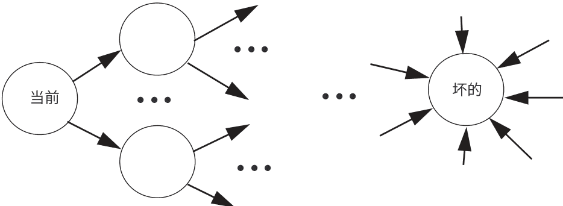

图11.1  
将计算机系统建模为状态机。对手的目标是将系统置于标记为“坏”的状态，以获取对系统的未经授权访问。为了防止对手成功，必须阻止通往坏状态的所有路径，因为对手只需要找到一条路径就可以成功。

将状态作为节点，可能的转换作为边。假设系统处于某个当前状态。对手的目标是将系统从当前状态强制转移到图中标记为“坏”的状态，从而使对手获得未经授权的访问权限。为了防御对手，安全设计师必须识别并阻止通往坏状态的每条路径。但是对手只需要找到一条从当前状态到坏状态的路径。

### 11.1.3 安全网方法

为了成功设计满足负面目标的系统，本章采用了第8章[在线]的安全网方法，该方法本质上指导设计师保持警惕，永远不要假设设计是正确的。在安全的背景下，两个安全网原则——明确和迭代设计——强化了这种警惕的态度：

- 明确：使所有假设都明确以便进行审查。系统安全可能只需要一个漏洞就能被渗透。因此，设计师必须考虑任何具有安全影响的威胁，并明确安全设计依赖的假设。此外，确保系统安全所依赖的所有假设始终对所有参与者明显可见。例如，在协议的上下文中，每个消息的含义应仅取决于消息本身的内容，而不应取决于对话的上下文。如果消息的内容取决于其上下文，对手可能通过欺骗接收者在不同的上下文中解释消息来破坏协议的安全性。

- 迭代设计：假设会出错。因为设计师必须假设设计本身会包含缺陷，所以设计师必须准备好进行迭代设计。当发现安全漏洞时，设计师必须重新审查假设，必要时进行调整，并修复设计。当设计师发现系统中的错误时，设计师必须重新进行整个设计和实施过程。

安全网方法对安全系统的设计有几个要求:

- 对系统的安全性进行认证。认证涉及验证设计是否符合预期的安全策略，实施是否符合设计，运行系统是否符合实施，然后由安全专家进行端到端测试，寻找可能危及安全性的错误。

认证提供了一种系统性的方法来审查系统对假设的安全性。理想情况下，认证应由独立的审查人员进行，并尽可能使用正式工具。使认证变得可管理的一种方法是识别必须信任以确保安全性的组件，将其数量最小化，并在其周围建立一道墙。第11.1.7节详细讨论了这个想法，即可信计算基础。

- 对所有授权决策进行审计跟踪。由于设计者必须假设合法用户可能滥用其权限或对手可能伪装成合法用户，系统应该维护一个防篡改的日志（以防对手擦除记录）记录所有授权决策。如果尽管所有安全机制，对手（无论是内部还是外部）成功突破系统的安全性，日志可能有助于取证。取证专家可以使用日志收集在法庭上有力的证据，并帮助确定对手的身份，以便事后起诉对手。日志还可以作为反馈的来源，揭示错误的假设、设计或实现。

- 为反馈设计系统。当系统受到威胁时，对手不太可能提供反馈，因此设计师需要创造方法来获取反馈。获取反馈始于明确陈述假设，这样设计师在发现缺陷时可以将设计、实施和运行的系统与假设进行对比。这种方法本身不能识别安全弱点，因此设计师必须积极寻找潜在问题。方法包括审查审计日志和运行程序，以便向系统管理员报告异常行为，例如异常的网络流量（例如，对于通常不接收许多请求的机器的许多请求），重复的登录失败等。设计师还应该创造一个环境，在这个环境中，员工和客户不会因为系统受到威胁而受到指责，而是会因为报告问题而受到奖励，从而鼓励他们报告问题。

而不是隐藏它们。设计反馈可以减少安全漏洞被忽视的机会。安德森通过一些真实世界的例子很好地说明了设计反馈的重要性[进一步阅读建议11.5.3]。

作为安全网方法的一部分，设计师必须考虑系统运行的环境。设计师必须保护所有通信链路（例如，绕过过滤私有网络和公共网络之间流量的防火墙的拨号调制解调器线路），准备好故障设备，找到并删除创建安全问题的后门，为用户提供默认安全的配置设置，并确定谁足够值得信任以拥有保护系统最安全部分的房间的钥匙。此外，设计师必须防止贿赂并担心不满的员工。安全文献中充满了因为设计师没有考虑其中一个问题而导致失败的故事。

作为安全网方法的另一部分，设计师必须考虑使用的动态。这个术语指的是如何建立和更改谁可以获得访问权限的规范。例如，Alice可能撤销Bob对文件“x”的读取权限。为了对访问授权的更改引入的复杂性有一些了解，再次考虑这个问题:“Lucifer是否有任何方法可以获得对文件x的访问权限?”不应该检查Lucifer是否有对文件x的访问权限，还应该检查Lucifer是否可以更改文件x的可访问性规范。下一步是看看Lucifer是否可以更改谁可以更改文件x的可访问性规范等。动态的另一个问题是当所有者在文件正在使用时撤销用户的访问权限。如果所有者突然意识到文件包含敏感数据，让先前授权的用户继续使用信息可能是不可接受的。另一方面，立即撤销授权可能会严重干扰用户，或者在用户正在执行原子操作时导致数据不一致。对于使用的动态规定至少与静态安全规范一样重要。

最后，安全网方法建议设计者永远不要相信系统是完全安全的。相反，必须设计具有多重防御的系统，这是俄罗斯军队成功用来保卫俄罗斯数个世纪的策略。例如，设计者可以设计一个在不受信任的网络上提供端到端安全的系统。此外，设计者还可以在可信网络和不可信网络之间加入防火墙以实现网络级安全。防火墙原则上与端到端安全机制完全冗余;如果端到端安全机制正常工作，就不需要网络级安全。然而，对于对手来说，要破坏系统的安全性，必须在防火墙和端到端安全机制中找到漏洞，并且足够幸运以使第一个漏洞能够利用第二个漏洞。

深度防御设计策略没有提供任何保证，但在实践中似乎是有效的。原因是从概念上讲，深度防御策略切断了更多的边缘。

### 11.1.4 设计原则

实际上，由于安全是一个负面目标，实际上防止所有未经授权的行为的系统的产生被证明是极其困难的。涉及许多不同系统的渗透测试都表明用户可以未经授权地访问这些系统。即使设计者仔细遵循安全网方法，设计和实现缺陷也会提供绕过预期访问限制的路径。

此外，由于计算机系统的快速变化或在其最初未设计的新环境中部署，会出现新的安全威胁机会。第11.11节提供了几个关于安全漏洞的故事。

系统性地排除缺陷的设计和构建技术是许多研究活动的主题，但目前还没有适用于计算机系统设计的完整方法。这种困难与防止所有未经授权行为的要求的负面性质有关。在缺乏这种有条不紊的技术的情况下，经验提供了几个安全原则，以指导设计以最小化实现中的安全缺陷数量。我们接下来讨论这些原则。

设计不应该是秘密的:

#### 开放设计原则

让任何人都可以对设计进行评论。你需要尽可能多的帮助。

违反开放设计原则在历史上几乎总是导致有缺陷的设计。机制不应该依赖于潜在对手的无知，而应该依赖于具体、更容易保护的秘密密钥或密码。安全机制与安全密钥的解耦允许许多审阅者对机制进行审查，而不必担心审查本身会危及保障措施。此外，任何怀疑的用户都必须能够审查系统是否适合用户的目的。最后，保持任何广泛分发的系统的保密是不现实的。然而，开放设计原则可能与其他目标冲突，这导致了许多辩论;附注11.2总结了一些论点。

必须由合适的人员进行审查，因为发现安全漏洞是困难的。即使设计和实现是公开的，这并不足以发现安全问题。例如，标准委员会通常在原则上是开放的，但它们的开放性有时存在障碍，导致提议的标准无法由正确的人审查。参与WiFi有线等效隐私标准的设计需要委员会成员支付大量费用，这显然阻碍了安全研究人员的参与。当标准被

## 11-14 第11章 信息安全

附注11.2：设计和漏洞应该公开吗？封闭设计与开放设计的辩论已经存在了很长时间，这并不仅限于计算机安全。封闭设计的支持者认为，公开设计会帮助对手，那为什么要这样做呢？开放设计的支持者认为，封闭设计实际上并不能提供安全性，因为从长远来看，保持设计的机密是不可能的。试图保密的实际结果通常是坏人知道缺陷，而好人不知道。开放设计的支持者通过将封闭设计描述为“安全性通过模糊性”来贬低它们。

另一方面，开放设计原则可能与保持设计及其实现的商业或国家安全性质相冲突。例如，软件公司通常不希望竞争对手审查他们的软件，因为他们担心竞争对手可以轻松学习或复制想法。许多公司试图通过安排审查来解决这个冲突，但限制谁可以参与审查。这种方法的危险在于没有正确的人进行审查。

与设计是否应该公开相关的问题是漏洞是否应该公开的问题？同样，关于这个问题的正确答案的辩论已经进行了很长时间，最好的例证可能是来自1853年一本关于老式门锁的书的以下引用：

> 在过去一两年中，一个商业上的，从某些方面来说是社会上的疑问已经开始，即是否公开讨论锁的安全性或不安全性是正确的。

许多好心的人认为，关于如何破解锁的安全性的讨论会鼓励不诚实，因为它向他人展示了如何不诚实。这是一个谬论。流氓在他们的职业中非常敏锐，并且已经知道比我们更多关于他们各种欺诈行为的事情。

流氓在锁匠们最近讨论之前就已经对撬锁有很多了解。如果一个锁，无论是在哪个国家制造的，或者是由哪个制造商制造的，都不像过去认为的那样不可侵犯，那么对于诚实的人来说，了解这个事实肯定是有利的，因为不诚实的人几乎肯定会将这个知识应用到实践中；而且传播这个知识是必要的，以便给那些可能因为无知而受苦的人一个公平竞争的机会。

我们不能太过强调，对真实事实的了解最终对所有各方都更有益。

计算机安全专家普遍认为，应该公开漏洞的原因是Hobbs所说的，用户应该知道他们使用的系统是否有问题，以便他们可以决定是否在意。然而，公司通常不愿意披露漏洞。例如，银行没有太多动力宣传成功的妥协，因为这可能会吓跑客户。

(侧边栏继续 )

* A.C Hobbs (Charles Tomlinson, 编辑)，锁和保险箱：锁的构造。 Virtue & Co.，伦敦，1853年（修订版1868年）。

## 11.1安全系统简介 11-15

为了处理这种紧张关系，许多政府制定了公开漏洞的法律和组织。在加利福尼亚州，如果对手可能成功窃取客户的私人信息（例如社会安全号码），公司必须通知他们的客户。

美国联邦政府成立了计算机应急响应小组（CERT）来记录软件系统的漏洞，并协助应对这些漏洞（参见www.cert.org）。当CERT了解到新的漏洞时，首先通知供应商，然后等待供应商开发补丁，然后公开漏洞和补丁。

最终确定并且安全研究人员开始检查标准时，他们立即发现了几个问题，其中一个问题在第11-51页上描述。

由于保守秘密很困难:

## 最小化秘密

因为它们可能不会保密太久。

遵循这个原则还有以下额外的优点。如果秘密被泄露，必须替换它；如果秘密很小，那么替换秘密就容易了。

最小化秘密的开放设计本身并不提供安全性。系统安全的主要基础是，正如第11-5页所提到的，完全中介原则。这个原则要求每个访问都必须明确进行身份验证和授权，包括初始化、恢复、关闭和维护。这意味着必须设计出一种验证每个请求的来源和数据真实性的无懈可击的方法。这个原则适用于中介请求的服务，也适用于中介监督员调用的内核和中介内存中的字节读取请求的虚拟内存管理器。这个原则还意味着对缓存权限检查结果的建议应该持怀疑态度；如果权限发生变化，缓存结果必须更新。

人机工程学原则尤其适用于中介。

授权机制应该对用户透明，以便用户对提供的安全机制有良好的直观理解。人机界面的设计必须易于使用，以便用户能够正确地自动应用安全机制。例如，系统应该为安全机制提供直观的默认设置，以便只有适当的操作被授权。如果系统管理员或用户必须首先配置或经过一系列步骤才能使用安全机制，用户将不会使用它。此外，只要用户对安全目标的心理形象与安全机制相匹配，错误将被最小化。如果用户必须翻译直观的安全目标- 

当将目标转化为完全不同的规范语言时，错误是不可避免的。理想情况下，安全机制应该使用户的计算机体验变得更好，而不是更糟。

另一个广泛适用的原则，采用全面简化，也适用于安全。为了确保保护，必须正确的机制越少，设计就越有可能是正确的：

## 机制的经济性

越少越好，这样你就更有可能做对。

设计安全系统很困难，因为必须考虑到每个访问路径，以确保完全的调解，包括在正常操作期间未使用的路径。因此，可能需要对软件进行逐行检查和对实施安全机制的硬件进行物理检查。为了使这些技术成功，小而简单的设计是必不可少的。

减少必要的机制有助于验证计算机系统的安全性。对于剩下的机制，如果只有少数机制适用于多个用户并且所有用户都依赖于它们，那将是理想的，因为每个共享机制可能会提供用户之间的意外通信路径。此外，为所有用户提供服务的任何机制都必须得到每个用户的满意认证，这个工作可能比仅满足一个或少数用户更难。这些观察结果导致以下安全原则：

## 最小化共同机制

共享机制提供了不需要的通信路径。

这个原则有助于减少意外通信路径的数量，并减少所有用户依赖的硬件和软件的数量，从而更容易验证是否存在任何不良的安全影响。例如，如果选择将新功能实现为所有用户共享的内核过程或作为可以像用户自己的过程一样处理的库过程，则选择后者。然后，如果有一个或几个用户对函数的认证级别不满意，他们可以提供替代品或根本不使用它。无论哪种方式，他们都可以通过避免因其中的错误而受到伤害。这个原则是一个端到端的论证。

完全介入要求对每个请求进行授权检查，并且只有经过授权的请求才能获得批准。重要的是不要意外地授权请求。以下安全原则有助于减少此类错误：

## 故障安全的默认设置

大多数用户不会更改它们，因此请确保默认设置执行安全操作。

访问决策应基于权限而非排除。这个原则意味着默认情况下没有访问权限，并且安全方案列出了允许访问的条件。与默认允许访问的替代方法相比，这种方法具有更好的故障模式。在明确授权的机制中发生的设计或实现错误往往会通过拒绝许可而失败，这是一种可以快速检测到的安全情况。另一方面，在明确排除访问的机制中发生的设计或实现错误往往会通过允许访问而失败，在正常使用中可能长时间不被注意到。为了确保完全调解和故障安全的默认情况在实践中能够很好地工作，程序和用户只有在必要时才具有特权是很重要的。例如，拥有特殊权限的系统程序或管理员只有在必要时才应该拥有这些特权；当他们进行普通活动时，特权应该被撤销。保留这些特权只会给意外事故留下机会。这些观察结果提出了以下安全原则:

## 最小特权原则

> 不要将午餐和珠宝一起存放在保险箱中。

这个原则限制了事故或错误可能造成的损害。此外，如果较少的程序拥有特殊权限，那么需要审核的代码就会减少，以验证系统的安全性。“需要知道”军事安全规则就是这个原则的一个例子。

### 11.1.5 高d(技术)/dt对安全性构成挑战

互联网和个人计算机上的许多软件都没有遵循这些原则，尽管这些原则大部分在20世纪70年代就已经被理解和阐述出来，早于个人计算机和互联网的出现。它们没有被遵循的原因在互联网和个人计算机上是不同的，但它们说明了在创新速度很快时实现安全性是多么困难。

当互联网首次部署时，软件实现密码学技术（见第11.2节和第11.1节）所需的身份验证和消息保护被认为会增加不可接受的延迟。当时的硬件实现密码操作过于昂贵，并且不可出口，因为美国政府实施了限制密码学使用的规定。

物理。由于互联网最初主要由学术界使用——一个主要是合作的社区——因此最初的安全缺乏并不是一个严重的缺陷。1994年，互联网对商业活动开放。电子商店开始出现，并且有许多存储有价值信息的计算机上线。这一发展吸引了更多的对手。突然间，互联网的设计者被迫提供安全性。因为安全性不是最初的设计计划的一部分，所以今天的安全机制是事后添加的，并且以临时的方式提供，而不是根据已建立的安全原则的整体计划。

## 11.1 安全系统介绍 11-19

附注11.3: 恶意软件: 病毒、蠕虫、木马、逻辑炸弹、机器人等有一个程序员社区制作恶意软件，这些软件旨在在没有计算机所有者意图的情况下在计算机上运行。有些恶意软件是为了恶作剧而创建的，另一些恶意软件是为了赚钱或破坏某人的；Hafner和Markoff概述了一些早期计算机入侵和犯罪者的动机[进一步阅读建议1.3.5]。最近，有一个产业在创建恶意软件，将用户的计算机悄悄变成对手控制的机器人，然后由对手代表付费客户发送垃圾邮件（垃圾邮件），从而为对手产生收入[进一步阅读建议11.6.5]。

恶意软件使用多种技术来控制用户的计算机。这些技术包括在用户的计算机上安装恶意软件的方法，安排恶意软件在用户的计算机上运行的方法，将恶意软件复制到其他计算机上的方法，以及进行恶意活动的方法。其中一些技术依赖于用户的天真，而另一些技术则依赖于创新思想来利用用户计算机上的软件错误。作为两者的例子，在2000年，对手构造了“我爱你”病毒，这是一封带有恶意可执行附件的电子邮件。对手将该电子邮件发送给了几个收件人。

当收件人打开带有可执行附件的电子邮件（被电子邮件主题中的“我爱你”吸引）时，恶意附件会读取收件人的通讯录，并将自己发送给通讯录中的用户。由于许多用户打开了这封电子邮件，它迅速传播并使许多机构的电子邮件服务器不堪重负。

莫里斯蠕虫[进一步阅读建议11.6.1]，创建于1984年，是一个仅依赖于软件错误的巧妙利用方式的恶意软件的例子。这个蠕虫利用了远程计算机的各种弱点，其中包括在运行UNIX操作系统的电子邮件服务器（sendmail）中的缓冲区溢出（见边栏1.4），这使得它能够在受损的计算机上安装和运行自己。在那里，它在配置文件中寻找计算机的网络地址，然后渗透到这些计算机中，依此类推。根据其创建者的说法，它并不打算造成损害，但设计错误导致其有效地创建了一次拒绝服务攻击。这个蠕虫传播得如此迅速，多次感染了一些计算机，以至于它有效地关闭了互联网的部分功能。

流行的行话给不同类型的恶意软件贴上了丰富多彩的标签，如病毒、蠕虫、木马、逻辑炸弹、驱动程序下载等等，随着新类型的恶意软件的出现，还会出现新的标签。这些标签并不对应精确、正交的技术概念，而是以不同的方式组合了各种恶意软件的特征。然而，所有这些恶意软件都利用了计算机安全方面的一些弱点，本章描述的技术在遏制恶意软件方面也是相关的。

> *问题集 47探讨了一种潜在的基于邮票的解决方案。

请求操作的代理向系统证明其身份，然后系统决定是否允许代理执行该操作。

这个简单的模型涵盖了各种系统实例。例如，代理可以是客户端/服务端应用程序中的客户端，此时请求以消息的形式发送给服务。另一个例子是，代理可能是引用虚拟内存的线程，此时请求以对命名内存单元的LOAD或STORE的形式发送。在这些情况下，系统必须确定代理的身份并决定是否执行请求。如果所有请求都被正确调解，那么对手的工作将变得更加困难。对手必须破坏调解系统，发动内部攻击，或者仅限于拒绝服务攻击。

本节的其余部分将更详细地解释调解模型，并通过各种示例进行说明。当然，简单的概念模型无法涵盖所有攻击和所有细节。不幸的是，在安全领域，魔鬼常常隐藏在实现的细节中：系统是否为所有操作实现了模型，并且实现是否正确？尽管如此，该模型有助于构建许多安全问题并解决它们。

代理人代表与计算机系统外部相对应的某个实体；我们将这样的实体在计算机系统内部称为主体。主体是计算机系统中的授权单位，因此也是问责和责任的单位。使用这些术语，调解一个操作就是在问一个问题：“请求该操作的主体是否被授权执行该操作？”

调解每个请求的基本方法是确保只有一种方式可以请求一个操作。从概念上讲，我们希望在系统周围建立一堵墙，只有一个小的开口，所有请求的操作都通过这个开口。然后，对于每个请求的操作，系统必须回答“我应该执行这个操作吗？”为了做到这一点，系统通常被分解为两个部分：一个部分称为守卫，专门负责决定问题的答案，另一个部分执行操作。（在文献中，通常将提供完全调解的守卫称为参考监视器。）守卫可以通过获取完全调解的三个子问题的答案（参见图11.2）来澄清问题：“发起请求的主体是否被允许执行该操作？”守卫验证包含请求的消息是否真实（即，请求未被修改，主体确实是请求的来源），以及主体是否被授权在对象上执行请求的操作。如果是，守卫允许执行操作；否则，它拒绝请求。守卫还会记录所有决策以供后续审计。三个调解问题中的前两个问题（请求是否被修改以及请求的来源是什么）属于请求的身份验证范畴。使用身份验证服务，守卫验证主体的身份。使用其他信息，有时是请求的一部分，有时是单独传递的，守卫验证请求的完整性。在回答真实性问题之后，守卫知道与请求相关联的主体是谁，并且没有对手修改了请求。

### 11.1.7 可信计算基础

实现第11.1.6节的安全模型是一个负面目标，因此很困难。没有方法可以验证声称实现了负面目标的实现的正确性。那么，我们该如何继续？基本思想是最小化需要正确的机制的数量，以使系统安全——机制经济原则，并遵循安全网方法（明确并进行迭代设计）。

在设计安全系统时，我们将系统分为两种模块：不可信模块和可信模块。不可信模块的正确性不会影响整个系统的安全性。可信模块是必须正确工作以确保系统安全的部分。理想情况下，我们希望可信模块可以被其他不可信模块使用，这样新模块的设计者就不必担心可信模块的正确性。可信模块的集合通常被称为可信计算基础（TCB）。

确定一个模块是否属于TCB可能很困难。从单个模块的角度来看，没有简单的程序可以决定系统的安全性是否依赖于该模块的正确操作。例如，在UNIX中，如果一个模块代表超级用户主体运行（参见第11-77页），那么它很可能是TCB的一部分，因为如果对手入侵了该模块，对手将拥有完全的特权。如果同一个模块代表普通主体运行，通常不是可信计算基础的一部分，因为它无法执行特权操作。但即使如此，该模块仍然可能是TCB的一部分；它可能是一个用户级服务（例如Web服务），负责决定哪些客户端具有访问权限。模块代码中的错误可能会导致对手获得未经授权的访问权限。

缺乏一个系统化的决策过程来判断一个模块是否在TCB中，这个决策很难做出并且容易出错，然而一个好的划分是很重要的。一个不好的受信任模块和不受信任模块之间的划分可能导致一个庞大而复杂的TCB，使得对系统安全性的推理变得困难。如果TCB很大，这也意味着普通用户只能做出很少的更改，因为普通用户只能更改TCB之外不影响安全性的模块。如果普通用户只能以有限的方式更改系统，可能会使他们难以有效地完成工作，并导致糟糕的用户体验。一个庞大的TCB还意味着只有受信任的主体才能修改系统的大部分内容，限制了系统演进的速度。第11.1.4节的设计原则可以指导设计过程的这一部分通常需要由安全专家来解决，但是通常必须确定划分的方式。

一旦划分完成，挑战就变成了设计和实现TCB。为了成功完成这个挑战，我们希望以一种方式工作，最大限度地提高TCB设计和实现的正确性。为了做到这一点，我们希望最小化错误的机会，并最大化错误的发现速度。为了实现第一个目标，我们应该尽量减小TCB的规模。为了实现第二个目标，设计过程应该包括反馈，以便我们能够快速发现错误。

下面的方法展示了如何构建这样一个TCB:

+   •为TCB指定安全要求（例如，在不可信网络上进行安全通信）。这一步的主要原因是明确地指定假设，以便我们可以判断这些假设是否可信。作为要求的一部分，还要指定TCB所受攻击，以便评估安全风险。通过指定TCB的功能和限制，我们知道我们受到哪些类型的攻击保护，以及我们对哪些类型的攻击容易受到攻击。

+   •设计一个最小的TCB。使用好的工具（例如身份验证逻辑，在第11.5节中讨论）来表达设计。

+   •实现TCB。再次强调使用好的工具很重要。例如，通过使用检查数组边界的语言，可以避免缓冲区溢出攻击。

+   •运行TCB并尝试破解安全性。

在这个多步骤的设计方法中，最困难的部分是验证步骤的一致性：验证设计是否符合规范，验证设计是否抵抗指定的攻击，验证实现是否与设计相匹配，以及验证在计算机中运行的系统是否实际上是已经实现的系统。

例如，正如汤普森所证明的，对于具有编译器专业知识的对手来说，很容易在难以检测的系统中插入木马。

计算机安全问题通常不是发明巧妙机制和架构的问题，而是确保安装的系统实际上符合设计和实现的问题。执行这样的端到端检查是困难的。例如，通常会聘请一个虎队，他们的任务是找到可能被利用来破坏系统安全的漏洞。虎队可能能够找到一些漏洞，但不幸的是，不能保证找到所有漏洞。

设计方法还意味着当检测到并修复错误时，设计师必须审查假设，看看哪些是错误或遗漏的，修复假设，并重复此过程，直到对系统的安全性有足够的信心。这种方法排除了任何模糊的思维，使系统更可靠，并逐渐建立对系统正确性的信心。

## 11-28 第11章信息安全

该方法还清楚地说明了在设计系统时考虑了哪些风险是可以接受的,因为潜在用户必须能够查看规范以评估系统是否满足要求。明确说明可接受的风险是重要的,因为安全系统的设计很大程度上受到经济约束的驱动。如果安全失败的成本相对于设计一个消除风险的系统来说很小,用户可能会认为安全风险是可以接受的。

### 11.1.8 本章的路线图

本章的其余部分遵循图11.2的安全模型。第11.2节介绍了用于验证主体的技术。第11.2节通过使用名为SIGN和VERIFY的一对过程来解释如何对消息进行身份验证。第11.4节通过使用名为ENCRYPT和DECRYPT的一对过程来解释如何保持消息的机密性。第11.5节解释了如何建立一个经过身份验证和安全的通信链路,例如使用安全协议。第11.6节讨论了授权服务的不同设计。因为身份验证是安全的基础,第11.5节讨论了如何系统地推理身份验证主体。SIGN、VERIFY、ENCRYPT和DECRYPT的实际实现被外包给专门从事密码学的理论家,但第11.8节提供了关于如何实现SIGN、VERIFY、ENCRYPT和DECRYPT的简要概述。第11.10节的案例研究通过描述在万维网中如何进行身份验证和授权来提供了本章讨论的技术的完整示例。最后,第11.11节以安全失败的战争故事结尾,尽管设计者的最好意图,但这些故事强调了实现负面目标的困难性。

## 11.2 验证原则

大多数安全策略涉及人员。例如,一个简单的策略可能会说只有文件“x”的所有者才能读取它。在这个声明中,所有者对应一个人。为了支持这样的策略,文件服务必须有一种建立安全绑定的方式,用于用户和请求来源之间的关联。

建立和验证绑定是身份验证的范畴。

回到我们的安全模型,身份验证的设置可以以图11.3的形式呈现。一个人(Alice)要求她的客户端计算机向她最喜欢的电子交易服务发送一条消息“购买100股通用赚钱公司的股票”。对手可能能够复制、删除、修改或替换这条消息。正如在第11.1节中解释的那样,当Alice的交易服务接收到这条消息时,守卫必须确定两个与真实性相关的重要事实:

- 1.这位发出请求的是谁? 警卫必须确定消息是否确实来自代表现实世界人物“爱丽丝”的主体。更一般地,警卫必须确定消息的来源。
- 2.这个请求是否真的是爱丽丝发出的??或者,例如,有没有对消息进行修改? 警卫必须确保消息的完整性。

本节介绍了回答这两个问题的技术。

## 11.2.1 将信任与验证主体分离

认证包括可靠地识别与请求相关联的主体。认证可以通过技术手段(如密码和签名消息)提供。技术手段可以创建一个证据链, 安全地将传入的请求与主体连接起来, 可能通过建立消息来自与先前消息相同的主体。技术手段甚至可以确定主体的真实世界身份。

一旦身份验证机制确定了主体, 就会出现一个紧密相关但不同的问题: 主体是否可信? 身份验证手段可能能够确认主体的真实身份是“爱丽丝”, 但需要其他技术手段来决定是否以及在多大程度上信任爱丽丝。交易服务可能决定考虑爱丽丝的请求, 因为交易服务可以通过技术手段确认爱丽丝的信用卡号码是有效的。更准确地说, 交易服务信任信用卡公司能够提供资金, 并依赖信用卡公司建立对爱丽丝支付信用卡账单的信任。

真实性和信任问题通过主体的名称相互关联。技术手段确定了主体的名称。主体的名称有多种形式: 例如, 名称可以是一个符号, 如“爱丽丝”, 一个信用卡号码, 一个假名, 或者一个加密密钥。心理技术建立对主体名称的信任。例如, 记者可能会相信匿名线人的信息, 因为之前与假名相关的消息内容总是正确的。

为了使主体的信任与身份验证的分离更加清晰, 考虑以下示例。你听说过一个名为“ShopWithUs.com”的互联网书店。起初, 你可能不确定对这家店有什么看法。你查看了他们的网站，与购买过他们书籍的朋友交谈，听到一位受人尊敬的人公开表示这家店是他购买书籍的地方，从所有这些信息中，你对这家书店产生了一些信任，也认为从这里订购是安全的。你从ShopWithUs.com订购了一本书，这家店比你预期的更快地将书送到了你手上。过了一段时间，你开始从他们这里订购所有的书籍，因为这样可以省去去当地书店的路程，而且你发现他们会无条件地退还有问题的书籍。

在ShopWithUs.com上建立信任是心理上的一部分。Shop-WithUs.com这个名字是你学到的主要标识符，你可以信任它。这是你从朋友那里听到的名字，是你告诉你的网络浏览器的名字，也是出现在你的信用卡账单上的名字。你的信任是基于这个名字的;当你收到来自“ShopHere.com”的电子邮件优惠时，你会把它扔进垃圾桶，因为虽然名字相似，但并不完全匹配。

当你在ShopWithUs.com上实际购买一本书时，主体的认证就会发挥作用。机械技术允许你建立一个安全的通信链接到一个声称是ShopWithUs.com的网站，并验证这个网站确实有ShopWithUs.com这个名字。机械技术本身并不能告诉你正在与谁打交道;它们只是向你保证，无论是谁，它的名字都是ShopWithUs.com。你必须自己决定(心理因素)那个人是谁，以及信任他们的程度。

在相反的方向上，ShopWithUs.com希望确保自己能够收到发送的书籍的付款。它通过要求您提供一个主要标识符-您的信用卡号码，并将心理信任的发展子承包给信用卡公司，以确保您能够支付信用卡账单。您的浏览器与ShopWithUs.com网站之间的安全通信链接确保ShopWithUs.com与您提供的信用卡号码安全关联到交易，并且与信用卡公司的类似安全通信链接确保ShopWithUs.com的信用卡号码是有效的主要标识符。

## 11.2.2 验证主体

当交易服务接收到消息时,守卫知道该消息声称来自名为“Alice”的人,但它不知道该声称是否真实。守卫必须验证标识符Alice与发送消息的主体是否对应。

大多数身份验证系统遵循此模型：发送方告诉守卫其主体身份，守卫验证该声明。此验证协议有两个阶段: 1.一个会面步骤，其中现实世界的人亲自访问配置守卫的权威机构。 2.身份验证发生在以后的各个时间。 发送方提供一个声明的主体标识符,守卫使用约定的方法来验证声明的主体标识符。如果守卫能够验证声明的主体标识符,那么源被认证。如果不能,守卫禁止访问并引发警报。

用户和守卫在约会步骤中商定的验证方法分为三个主要类别:

- 该方法使用用户的唯一物理属性。例如,面部、声音、指纹等被认为能够唯一识别一个人。对于其中一些属性,可以设计一个对用户可接受的验证界面:例如,用户将一句话说到了麦克风中,系统将声纹与之前存档的声纹进行比较。对于其他属性,设计一个可接受的用户界面是困难的;例如,一个要求“请提供一份血样”的计算机系统不太可能销售得好。物理属性的唯一性以及是否容易复制(例如,重放录音的声音)决定了这种识别方法的强度。物理识别有时是多种技术的组合(例如,声音和面部或虹膜识别),并与其他验证方法结合使用。
- 这种方法使用了用户拥有的独特的东西。用户可能有一张带有磁条上写有标识符的身份证,可以被计算机读取。或者,卡片上可能包含一个存储着秘密的小型计算机;这种卡片被称为智能卡。这种方法的安全性取决于(1)用户不将他们的卡片交给他人或丢失,以及(2)对手无法复制包含秘密的卡片(例如,复制磁条的内容)。这些限制很难强制执行,因为对手可能贿赂用户或对用户进行身体威胁,以获取用户的卡片。制造不会泄露秘密的防篡改设备也很困难。
- 这种方法使用了只有用户知道的东西。用户记住一个秘密字符串,例如密码、个人身份识别号码(PIN)或者,如第11.3节中将介绍的,加密密钥。这种方法的强度取决于(1)用户不主动或被动地泄露密码,以及(2)对手猜测用户秘密的难度。你母亲的婚前姓和4位数的PIN码是弱秘密。

例如,当爱丽丝创建一个交易账户时,保安可能会要求她提供一个主要标识符和一个密码(一个秘密字符串),保安会将其存储起来。这一步是约会步骤。稍后,当爱丽丝发送一条交易消息时,她在消息中包含她声称的主要标识符(“爱丽丝”)和她的密码,保安会通过与存储的副本进行比较来验证。

保安通过与存储的副本进行比较来验证。如果消息中的密码匹配，保安就知道这条消息来自主体爱丽丝，假设爱丽丝没有自愿或无意中泄露密码给其他人。这一步是验证步骤。

在现实生活中的身份验证中，我们通常使用类似的过程。例如，我们首先通过在护照局出示自己，回答问题，提供身份证明和照片来获得护照。这一步是约会步骤。稍后，我们在边境站出示护照。边境警卫检查护照中的信息（身高，发色等），并仔细查看照片。这一步是验证步骤。

验证主体的安全性取决于许多因素，其中包括会合步骤的执行是否仔细。正如我们上面所看到的，一个常见的过程是，在允许用户使用计算机系统之前，用户必须亲自见到管理员并向管理员证明自己的身份。管理员可能会要求潜在用户出示护照或驾驶执照。在这种情况下，管理员依赖于发行护照或驾驶执照的机构在建立个人身份方面做出良好的工作。

在其他应用程序中，会合步骤是一个轻量级的过程，守卫对主体声称的身份不能太过信任。在交易服务的示例中，Alice选择了她的主体标识符和密码。服务只是将主体标识符和密码存储在其表中，但它没有直接的方式来验证Alice的身份；Alice不太可能能够亲自见到交易服务的系统管理员，因为她可能在世界的另一边的计算机上。由于交易服务无法验证Alice的身份，因此服务对主体标识符和现实世界中的人之间的任何声称的连接都不太信任。该账户存在是为了方便Alice查看她的交易；当她实际购买某物时，服务不会验证Alice的身份，而是验证其他事物（例如，Alice的信用卡号码）。服务信任信用卡公司来验证与信用卡号码相关联的主体。一些信用卡公司的验证方案较弱，可以被对手用于身份盗窃。

## 11.2.3 密码哈希函数，计算安全，有效性窗口

在计算机系统中，验证身份最常用的方法是基于密码，因为它具有方便的用户界面；用户只需在键盘上输入他们的姓名和密码。然而，这种方法存在几个弱点。其中一个弱点是存储的密码副本成为攻击者的目标。消除这个弱点的一种方法是将密码的密码哈希值存储在系统的密码文件中，而不是密码本身。

密码哈希函数将任意大小的字节数组m映射到固定长度的值v，并具有以下属性：

- 1. 对于给定的输入M, 可以轻松计算V≠H(M), 其中H是哈希函数;
- 2. 仅知道M很难计算v;
- 3. 很难找到另一个输入M使得H(M') = H(M);
- 4. 计算出的值v尽可能短, 但足够长以使H的碰撞概率很低: 两个不同的输入哈希到相同的值v的概率必须非常低, 以至于在实践中可以忽略不计。一个典型的v大小为160到256位。

设计密码哈希函数的挑战在于找到一个具备所有这些属性的函数。特别是, 提供属性3是具有挑战性的。第11.8节描述了安全哈希算法(SHA)的实现, 它是美国政府和经合组织的标准哈希算法系列。

密码哈希函数, 像大多数密码函数一样, 具有计算上的安全性。它们的设计方式使得破解它们在计算上是不可行的, 而不是不可能的。这个想法是, 如果破解一个特定的函数需要无法想象的计算年数, 那么我们可以认为该函数是安全的。

计算安全性是用一个工作因子来量化的。对于密码哈希函数来说, 工作因子是计算一个消息M的最小工作量, 使得对于给定的M, H(M') = H(M)。工作量以原始操作(例如处理器周期)来衡量。如果工作因子需要很多年, 那么从实际角度来看, 该函数与一个无法破解的函数一样安全, 因为在这两种情况下, 都可能存在基于人类易犯错误的更简单的攻击方法。

在实践中, 计算安全性是通过一个历史工作因子来衡量的。历史工作因子是基于当前已知的最佳算法和当前最先进的技术来破解密码函数所需的工作量。这种评估方法存在一个风险, 即对手可能会提出比当前已知的算法更好的算法来破解密码函数, 而且技术的变化可能会降低工作因子。考虑到设计和分析密码函数的复杂性, 建议只使用那些已经存在足够长时间以接受大量仔细、公开审查的函数, 例如SHA-256。

理论家们已经开发出了一些模型, 可以对一些加密函数的难度做出绝对的陈述。提出好的模型, 使其与实践和安全原语的理论分析相匹配, 是一个积极研究的领域, 在过去三十年中取得了巨大的进展, 但也存在许多未解决的问题。

鉴于计算机系统和密码学的技术发展速度非常快, 考虑特定加密函数的有效性窗口是一个很好的实践。密码函数的有效性窗口是其所有组件的破解时间的最小值。密码哈希函数的有效性窗口是破解哈希算法的最小时间。

以及找到一个消息 $M'$，使得对于给定的 $M$， $H(M') = H(M)$ 的时间。 基于密码的身份验证系统的有效性窗口是哈希算法的有效性窗口、尝试所有可能的密码的时间和破解密码的时间的最小值。

系统设计中的一个挑战是加密函数的有效窗口可能比系统的寿命短。 例如，SHA，现在被称为“SHA-0”，它为 $V$ 生成一个160位的值，于1993年首次发布，仅两年后被SHA-1取代以修复可能的弱点。 事实上，在2004年，一个加密研究人员找到了一种系统地导出SHA-0哈希到相同值的消息 $M$ 和 $M$ 的方法。 2005年发表的研究表明SHA-1存在弱点，但截至2007年，还没有人找到一种系统性的方法来破坏这种广泛使用的哈希算法（即对于给定的 $M$，还没有人找到一个 $M'$，其哈希值等于 $H(M)$）。 然而，作为预防措施，美国国家标准和技术研究所建议用户在2010年之前切换到生成更长 $V$ 值的SHA版本（例如SHA-256）。 系统设计师应该做好准备，在计算机系统的寿命期间，加密哈希函数可能需要被替换，可能不止一次。

## 11.2.4 使用加密哈希函数保护密码

加密哈希函数有许多用途，在本章中我们会经常看到它们的应用。 其中一个很好的用途是保护密码。 将密码的加密哈希存储在密码文件中而不是密码本身的优点是哈希值不需要保密。 为了达到这个目的，哈希函数的一个重要属性是在第11.2.3节的列表中的第二个属性，即如果对手只有哈希函数的输出（例如，对手能够窃取密码文件），那么很难计算出相应的输入。 使用这种方案，即使系统管理员也无法知道用户的密码是什么。（设计原则：最小化秘密。）

身份验证发生在用户登录计算机时。 当用户输入密码时，守卫计算输入密码的加密哈希值，并将结果与存储在表中的值进行比较。 如果数值匹配，则身份验证成功；如果验证失败，则守卫拒绝访问。

对这种方法最常见的攻击是暴力攻击，即对所有可能的密码进行尝试。 暴力攻击可能需要很长时间，因此攻击者通常会使用更复杂的版本：字典攻击，这对于密码很有效，因为用户更喜欢选择容易记住的密码。 在字典攻击中，攻击者编制了一个可能的密码列表：名字、姓氏、街道名、城市名、字典中的单词和随机字符的短字符串。

卡通人物和摇滚乐队的名字已被证明是有效的猜测对象在大学中。

攻击者要么计算这些字符串的密码哈希值并将结果与计算机系统中存储的值进行比较（如果攻击者已经获得了密码哈希表），要么编写一个计算机程序，反复尝试使用这些字符串进行登录。这种攻击的变种是对特定人员密码的攻击。在这种情况下，攻击者会收集关于该人员的所有可获得的信息（母亲的婚前姓氏、女儿的出生日期、车牌号码等），并尝试由该信息正向和反向组成的密码。这种攻击的另一种变种是尝试在流行的互联网站的每个用户上使用一个可能的密码；如果密码是20位（例如，6位PIN码），那么尝试将给定的PIN码作为10,000,000个账户的密码很可能会成功（$10 \times 2^{20} = 10,000,000$）。

几项研究表明,暴力破解和字典攻击在实践中是有效的,因为密码通常本身就很弱。用户更喜欢易于记住的密码,这些密码通常很短并包含现有的单词,因此字典攻击很有效。系统设计者已经采取了几种方式来解决这个问题。一些系统强制用户选择一个强密码,并要求用户经常更改密码。

一些系统在3次登录失败后禁用账户。一些系统要求用户同时使用密码和由用户的便携式加密设备(例如,带有密码协处理器的身份验证设备)生成的秘密。此外,系统设计者通常试图使对手难以编制服务上所有用户的列表,并限制对包含密码的文件的访问。

由于身份验证仅依赖于密码,因此确保密码永远不会在不安全的区域中泄露是明智的。例如,当用户登录远程计算机时,系统应避免在不受信任的网络上发送未经保护的密码。这比说起来容易做起来难。例如,仅发送密码的加密哈希值是不够的,因为如果对手能够通过窃听捕获哈希值,对手可能能够在以后的消息中重放哈希值并冒充主体或使用字典攻击确定秘密。

一般来说,建议尽量减少重复使用密码,因为每次暴露都会增加对手发现密码的机会。为了最小化暴露风险,基于密码的任何安全方案都应该只在每个会话中使用一次,用于验证用户在首次访问时的身份。在首次访问之后,应该使用新生成的强密码进行进一步访问。更一般地说,我们需要一个用户和服务之间的协议,具有以下特性:

- 1. 它将用户身份验证给守卫;
- 2. 它将服务身份验证给用户;

> 一项经典研究由Frederick T. Grampp和Robert H. Morris进行。UNIX操作系统安全。贝尔系统技术杂志63,8,第2部分(1984年10月),第1649-1672页。作者们通过选择20个常见的女性名字,并在每个名字后附加一个数字(测试的系统要求用户选择至少包含6个字符和一个数字的密码),制作了一个包含200个名字的列表。在他们检查的几十台UNIX机器中,至少有一个条目在使用这个列表中的密码。

## 11.3.1 消息认证与机密性不同

消息机密性（保持消息内容私密）的目标和消息认证的目标相关但不同，通常为每个目标使用不同的技术，类似于物理世界。在纸质邮件中，签名用于认证作者，密封的信封用于保护信件不被他人阅读。

认证和机密性可以以四种方式结合，其中三种具有实际价值：

+ 认证和机密性。一个应用程序（例如电子银行）可能要求消息既进行认证又保密。这种情况类似于密封的信封中的签名信件，如果消息的内容（例如包含个人财务信息）必须受到保护，并且消息的来源（例如拥有银行账户的用户）必须得到确认，则这种方式是合适的。

+ 仅限身份验证。例如，像DNS这样的应用程序可能仅需要对其公告进行身份验证。这种情况就像是一个未封好的信封中的签名信件。例如，公司总裁向员工发表公告是合适的。

+ 保密性是不常见的。一个没有经过验证的来源的保密信息的价值并不大。这种情况就像是一个封好的信封中的信件，但没有签名。如果保安不知道是谁寄的信，保安对信件的内容有多少信心呢？此外，如果接收者不知道发件人是谁，接收者没有理由相信发件人会保密信息的内容；对于接收者来说，发件人可能已经将信件的内容透露给其他人。出于这些原因，仅限保密性在实践中并不常见。

为了说明认证和机密性之间的区别，考虑一个浏览关于公司股票的Web服务的用户（例如，公司名称，当前交易价格，关于公司的最新新闻公告和公司背景信息）。这些信息从Web服务通过不可信任的网络互联网传输到用户的Web浏览器。我们可以将这个动作看作是从Web服务发送给用户浏览器的消息：

发件人: stock.com  
收件人: 约翰的浏览器  
正文: 上午10点，通用赚钱公司的交易价格为1美元  

用户对数据的保密性不感兴趣；股票数据是公开的。然而，用户对股票数据的真实性感兴趣，因为用户可能根据该数据决定是否交易某只股票。用户希望确保数据来自“stock.com”（而不是假冒成stock.com的网站），并且数据在通过互联网时没有被篡改。例如，用户希望确保对手没有更改“通用赚钱公司”的名称、价格或时间。我们需要一种方案，允许用户验证消息的公开可读内容的真实性。下一节介绍了密码学的用途。使用密码学时，公开可读的内容被称为明文或明文。

## 11.3.2 封闭设计与开放设计以及密码学

在认证模型中，有两个安全区域（一个物理空间或一个虚拟地址空间，可以安全地限制信息）由一个不安全的通信路径（如图11.4所示）和两个盒子分隔开：SIGN和VERIFY。我们的目标是

## 11.3.3 基于密钥的认证模型

回到图11.5，为了验证消息，发送者使用密钥 K₁ 对消息进行签名。签名产生一个身份验证标签：一个基于密钥的密码转换（通常比消息短）。我们可以将签名操作表示为：

```
T ≠ SIGN (M, K₁)
```

其中 T 是身份验证标签。

标签可以与消息分开发送给接收者，也可以附加到消息上。消息和标签可以存储在单独的文件或附件中。细节并不重要。

假设发送者发送一条消息 {M, T}。接收者接收到一条消息 {M', T'}，它可能与 {M, T} 相同，也可能不同。消息认证的目的是决定哪个是真实的。接收者将 {M', T'} 解组为其组件 M 和 T'，并通过执行计算来验证接收到的消息的真实性：

```
result ≠ VERIFY (M', T', K₂)
```

这个计算返回接受如果 M 和 T' 匹配；否则，返回拒绝

设计 SIGN 和 VERIFY 的目标是，如果对手伪造一个标签，重复使用对手制造的消息的先前标签等等，对手将不会成功。当然，如果对手重放一个消息 {M, T} 而不进行修改，那么 VERIFY 将再次返回接受；我们需要一个更复杂的安全协议，这是第 11.5 节的主题，以防止重放的消息。

如果 M 是一个长消息，用户可以对 M 的加密哈希进行签名和验证，这通常比对 M 进行签名更便宜，因为加密哈希比 M 短。这种方法会稍微复杂化发送方和接收方之间的协议，因为接收方必须准确地匹配 M、它的加密哈希和它的标签。一些实现 SIGN 和 VERIFY 的实现会自己实现这种性能优化。

## 11.3.4 SIGN 和 VERIFY 的属性

为了了解实现 SIGN 和 VERIFY 的挑战，我们概述了 SIGN 和 VERIFY 的一些基本要求，以及设计师必须考虑的一些攻击。

发送方发送 {M, T}，接收方接收 {M', T'}。具有共享密钥 K 的身份验证系统的要求如下:

+ 1. 如果 M' = M 且 T' = SIGN (M, K)，则 VERIFY (M', T', K) 返回 ACCEPT

+ 2. 在不知道 K 的情况下，对于对手来说计算出 M' 和 T' 是困难的  
以便 VERIFY (M', T', K) 返回 ACCEPT

+ 3. 知道 M、T 和 SIGN 以及 VERIFY 的算法并不能让对手计算出 K

简而言之，T 应该依赖于消息内容 M 和密钥 K。对于不知道密钥 K 的对手  
来说，构造一个与 M 不同且使用密钥 K 验证正确的消息 M 和  
一个与 M 和 T 不同且使用密钥 K 验证正确的 T' 是不可能的。

公钥认证系统必须满足一组相应的属性:

+ 1. 如果 M' = M，T' = SIGN (M, K₁)，则 VERIFY (M', T', K₂) 返回 ACC

+ 2. 不知道 K₁ 的情况下，对手很难计算出一个 M 和 T，使得 VERIFY (M', T', K₂) 返回 ACCEPT。

+ 3. 知道 M、T、K₂ 以及用于验证和签名的算法不允许对手计算 K₁

对于 SIGN 和 VERIFY 的要求是绝对的。然而，许多良好的实现 VERIFY 和 SIGN 并不完全满足这些要求。

相反，它们可能以非常高的概率保证属性 2。如果概率足够高，那么从实际角度来看，我们可以将这样的实现视为可接受的。我们要求的是不满足属性 2 的概率远远低于导致安全漏洞的人为错误的可能性。

破解 SIGN 和 VERIFY 所涉及的工作因素取决于密钥长度；增加对手的工作因素的常见方法是使用更长的密钥。在流行的 RSA 公钥密码（见第 11.8 节）中，通常使用的密钥长度为 1,024 或 2,048 位。使用共享密钥密码实现的 SIGN 和 VERIFY 通常使用较短的密钥（在 128 到 256 位之间），因为现有的共享密钥密码的工作因素比现有的公钥密码更高。为了限制在密钥被破解的情况下的损害，建议定期更换密钥，加密协议通常会这样做（见第 11.5 节）。

广义上讲，对认证系统的攻击可以分为五类:  
1. 对 M 和 T 的修改。  

攻击者可能试图改变 M 和相应的 T。即使攻击者只删除或翻转 M 中的一个位，并尝试对 T 进行相应的更改， VERIFY 函数也应该返回 REJECT。回到我们的交易示例，如果攻击者将 M 从“10点，通用赚钱公司的股价为1美元”更改为“10点，通用赚钱公司的股价为200美元”，并尝试进行相应的更改， VERIFY 应该返回 REJECT。

2. 重新排序 M。攻击者不能改变任何位，只能重新排序现有的 M 内容。例如，如果攻击者将 M 更改为“在上午1点，Generic Moneymaking, inc. 的交易价格为$10”（攻击者将“10 a.m.”中的“0”移动到“$10”），则 VERIFY 应该返回 REJECT。

3. 通过在 M 的前面或后面添加信息来扩展 M。对手可能不会更改 M 的内容，而只是在 M 的现有内容前面或后面添加一些信息。例如，对手可能将 M 更改为“上午10点，通用赚钱公司的股票价格为10美元”。（对手在消息的末尾添加了“0”。）

4. 拼接多个消息和标签。对手可能已经记录了两条消息和它们的标签，并尝试将它们组合成一条新的消息和标签。例如，对手可以从一条传输的消息中取出“上午10点，通用赚钱公司”并将其与另一条传输的消息中的“股票价格为9美元”组合起来，并通过从第一个标签中取出前几个字节和从第二个标签中取出剩余部分来拼接这两个标签。

5. 由于 SIGN 和 VERIFY 基于密码转换，直接攻击这些转换也是可能的。一些数学家，被称为密码分析师，是设计此类攻击的专家。

这些要求和可能的攻击清楚地表明，构建 SIGN 和 VERIFY 原语是一项困难的任务。要保护消息免受上述攻击，需要一个能够设计适当的密码转换的密码学家。这些转换是基于复杂的数学原理的。

因此，我们面临着两个可能世界中最糟糕的情况：我们必须使用复杂的工具来实现一个负面目标。结果，即使是专家也提出了彻底失败的转换。因此，非专家肯定不应该尝试实现 SIGN 和 VERIFY，它们的实现超出了本书的范围。（感兴趣的读者可以参考第 11.8 节以了解复杂性的味道。）SIGN 和 VERIFY 的有效期窗口是签名算法被破解的时间、签名中使用的哈希算法被破解的时间（如果使用了哈希算法）、尝试所有密钥的时间以及破解签名密钥的时间的最小值。

*该团队使用游戏机中的大量处理器对 1994 年设计的哈希函数 MD5 进行碰撞攻击。早在 1996 年，MD5 被认为可能存在弱点，并在 2004 年进行了碰撞攻击的演示。持续的研究揭示了快速创建碰撞的方法，从而可以搜索有用的碰撞。2008 年的团队成功找到了一个有用的碰撞。

> * A. Sotirov 等人。MD5 被认为是有害的：创建一个恶意的 CA 证书。第 25 届年度混沌通信大会，柏林，2008 年 12 月。

他们可以伪造一个身份验证消息上的受信任签名。因为一些 Web 浏览器信任的身份验证系统尚未放弃使用 MD5，所以许多浏览器接受了该签名作为有效的，并且该团队能够欺骗这些浏览器建立起看似经过身份验证的连接到知名网站。这些连接实际上导致了研究团队控制的冒充网站。（伪造的签名是用于传输层安全（TLS）协议的证书。证书在第 11.5.1 和 11.7.4 节中讨论，第 11.10 节是 TLS 的案例研究。）

## 11.3.5 公钥与共享密钥认证

如果爱丽丝使用共享密钥对消息进行签名，那么鲍勃使用相同的共享密钥来验证标签。也就是说，VERIFY 函数检查来自消息和共享密钥的接收身份验证标签。使用共享密钥计算的身份验证标签称为消息认证码（MAC）。（动词“MAC”是使用共享密钥密码学计算身份验证标签的常见行话。）在文献中，单词“签名”通常用于生成具有公钥密码学的身份验证标签。

用公钥密码学对消息进行签名，那么鲍勃使用与爱丽丝用于计算标签的密钥不同的密钥来验证消息。爱丽丝使用她的私钥计算身份验证标签。鲍勃使用爱丽丝对应的公钥来验证身份验证标签。使用公钥系统计算的身份验证标签称为数字签名。数字签名类似于传统签名，因为只有一个人，即私钥的持有者，可以应用它。

知道爱丽丝的公钥的任何人都可以检查她的数字签名，而检查她的消息认证码需要知道她用来创建消息认证码的共享密钥。因此，爱丽丝可能能够成功地否认（否认）使用消息认证码认证的消息，她可以辩称鲍勃（也知道共享密钥）伪造了消息和相应的消息认证码。

相比之下，否认数字签名的唯一方法是爱丽丝声称其他人发现了她的私钥。因此，数字签名更适用于电子支票和合同。鲍勃可以验证爱丽丝在给他的电子支票上的签名，当鲍勃将支票存入银行时，银行也可以验证她的签名。当爱丽丝使用数字签名时，无论是鲍勃还是银行都无法伪造冒充爱丽丝的消息，这与只使用消息认证码的情况相反。

当然，不可否认性取决于不丢失私钥。如果丢失私钥，就需要可靠的机制来广播私钥不再保密的事实，以便以后可以用丢失的私钥否认伪造的签名。吊销受损私钥的方法是一个有很大争议的话题。

## 11.3.6 密钥分发

我们假设如果 Bob 成功验证了消息的认证标签，那么 Alice 就是消息的发起者。事实上，这个假设有一个严重的缺陷。实际上，Bob 只知道消息来自一个知道密钥 κ₁ 的主体。假设密钥 κ₁ 属于 Alice 可能是不正确的。对手可能已经窃取了 Alice 的密钥，或者可能已经欺骗 Bob 相信 κ₁ 是 Alice 的密钥。因此，将密钥与主体绑定的方式是一个需要解决的重要问题。

安全分发密钥的问题有时也被称为名称到密钥绑定问题；在现实世界中，主体是通过描述性名称而不是密钥来命名的。因此，当我们知道主体的名称时，我们需要一种安全地找到与该名称对应的密钥的方法。我们对密钥的信任与密钥分发系统的安全性直接相关。

安全密钥分发基于一个名称发现协议，该协议始于可信的物理交付。当爱丽丝和鲍勃见面时，爱丽丝可以给鲍勃一个加密密钥。这个密钥是经过认证的，因为鲍勃知道他收到的密钥与爱丽丝给他的完全一样。如果需要，爱丽丝可以秘密地给鲍勃这个密钥（放在信封里或者便携存储卡上），这样其他人就看不到或听不到。爱丽丝还可以使用一个互相信任的信使以秘密和经过认证的方式将密钥交付给鲍勃。

加密密钥也可以通过网络传输。然而，敌对方可能在网络上添加、删除或修改消息。需要一个良好的加密系统来确保网络通信的认证（如果需要还要保密）。事实上，在密码学的早期，原则是永远不要通过网络发送密钥；一个被泄露的密钥会造成比一个被泄露的消息更大的损害。然而，现在人们相信加密系统足够强大，可以承担这个风险。此外，通过一个密钥分发协议，可以定期生成新的密钥，这对于限制在密钥被泄露的情况下的损害非常重要。

问题在于需要事先放置密码密钥，以便在网络上分发新的密码密钥。如果递归“底部”使用物理密钥交付，这种方法是有效的。假设两个主体Alice和Bob希望进行通信，但他们没有共享（共享秘密或公共）密钥。他们如何建立要使用的密钥？

一种常见的方法是使用一个受信任的第三方(Charles)，Alice和Bob已经各自与其共享密钥信息。例如，Charles可能是Alice和Bob的共同朋友。Charles和Alice可能在某个时间点进行过面对面的会面并交换了密钥，同样，Charles和Bob也可能见过面并交换了密钥。如果Alice和Bob都信任Charles，那么他们可以通过Charles交换密钥。

Charles如何帮助Alice和Bob取决于他们是否使用共享秘密或公钥密码学。共享秘密密钥需要以既保密又经过身份验证的方式分发。公钥不需要保密，但需要以经过身份验证的方式分发。我们在这里看到正在发展的是对另一个安全协议的需求，我们将在第11.5节中学习。在某些应用中，很难安排一个共同的第三方。考虑一个通过无线网络进行通信的个人电子设备的购买者。

所有者在自己的房子里安装了新的设备（例如数字监控摄像头），并希望确保入侵者无法通过无线网络控制该设备。但是，设备如何对所有者进行身份验证，以区分其与其他主体（例如入侵者）？一种选择是设备的制造商或分销商扮演Charles的角色。在购买设备时，制造商记录买家的公钥。设备内部烧录了制造商的公钥；当买家打开设备时，设备使用制造商的公钥建立安全通信链路，并向制造商请求其所有者的公钥。不幸的是，这种解决方案是不切实际的：如果设备没有连接到全球网络，无法与制造商建立联系怎么办？

这种解决方案可能也会引起隐私方面的反对：制造商是否应该能够追踪消费者使用情况？附注11.5，关于“复活的小鸭子”，提供了一种允许在本地执行密钥分发而无需中心主体参与的解决方案。

并非所有应用程序都部署了复杂的密钥分发协议。例如，安全外壳（SSH）是一种流行的互联网协议，用于登录远程计算机，它具有简单的密钥分发协议。用户首次登录名为“athena.Scholarly.edu”的服务器时，SSH会向具有DNS名称athena.Scholarly.edu的机器发送明文消息，询问其公钥。SSH使用该公钥建立与远程计算机的经过身份验证和保密的通信链路。SSH还会缓存此密钥，并记住该密钥与DNS名称“athena.Scholarly.edu”相关联。用户下次登录athena.Scholarly.edu时，SSH将使用缓存的密钥建立通信链路。

由于DNS协议不包含消息认证，SSH的方法存在伪装攻击的安全风险：攻击者可能能够拦截对“athena.Scholarly.edu”进行DNS查找，并返回由对手控制的计算机的IP地址。当用户连接到该IP地址时，对手会回复一个由对手生成的密钥。当用户使用该公钥进行SSH连接时，对手的计算机伪装成athena.Scholarly.edu。为了对抗这种攻击，SSH客户端在第一次连接远程计算机时向用户提问：“我不认识这个远程计算机的密钥，我应该信任它吗？”一个警惕的用户应该将显示的密钥与从远程计算机的系统管理员通过一个带外安全通信链路（例如一张纸）收到的密钥进行比较。许多用户并不警惕，只是回答“是”这个问题。

SSH方法的优势在于不需要密钥分发协议（除了获取指纹）。这简化了SSH的部署，并使其取得了成功。正如我们将在第11.5节中看到的那样，安全地分发密钥以使伪装攻击成为不可能是一个具有挑战性的问题。

## 11.3 验证消息

谨慎使用SIGN和VERIFY可以同时提供数据完整性和真实性保证。某些应用程序具有不同的完整性和真实性要求，最好使用不同的技术。边栏7.1[在线]提到了一个数字档案，它需要防止试图更改存储在档案中的文件内容的对手。为了保护一个文件，设计者希望制作许多独立的副本文件，遵循持久性原则，最好在独立管理的和独立保护的域中。如果副本是独立保护的，对手更难改变所有副本。

由于维护大文件的广泛分散副本会消耗时间、空间和通信带宽，可以通过用较小的证人替换一些（但不是全部）文件副本来减少资源消耗。用户可以定期使用该证人检查副本的有效性（如第10.3.4节[在线]所述）。如果副本与证人不一致，则通过找到与证人匹配的副本来修复副本。由于证人很小，很容易防止篡改。例如，可以在广为阅读的报纸上发布证人，这很可能在许多公共图书馆中以微缩胶片或数字形式保存。

这种方案要求证人具有密码学安全性。构建安全证人的一种方法是使用SIGN和VERIFY。数字存档器使用密码散列函数创建文件的安全指纹，使用其私钥对指纹进行签名，然后广泛分发文件的副本。任何人都可以通过计算副本的指纹，使用存档器的公钥验证证人，然后将证人的指纹与副本的指纹进行比较来验证副本的完整性。

这个方案在一般情况下运行良好，但对于长期数据完整性来说不太适用。该方案的有效期由用于签名的私钥被破解的最短时间、签名算法、哈希算法以及名称与公钥绑定的有效性决定。如果存档的目标是保护数据几十年（甚至永久），那么数字签名很可能在数据之前失效。

在这种情况下，最好通过广泛发布加密哈希而不是使用签名和验证来保护证人。这种方法中，证人的有效性取决于破解加密哈希的时间。这个窗口可以设置得很大。可以通过偶尔计算和发布使用最新和最好的哈希算法的新证人来防止被破解的加密哈希算法。新的证人是原始数据、原始证人和时间戳的哈希值，从而证明了新证人计算时原始数据的完整性。

用户对证人真实性的信任取决于用户能够轻松验证证人是否确实由存档者产生。如果报纸或图书馆直接从存档者处收到证人，则这种信任可能很高。

## 11.4 消息机密性

某些应用程序可能需要除消息认证外的消息机密性。两个主体可能希望在没有对手访问通信信息的情况下进行私密通信。如果主体在共享的物理计算机上运行，则可以轻松实现此目标，使用内核。例如，当向端口发送消息时（参见第5.3.5节），可以安全地要求内核将消息复制到接收者的地址空间，因为内核已经受信任；内核可以读取发送者和接收者的地址空间。

如果原则位于不同的物理处理器上，并且只能通过一个不可信的网络进行通信，则确保消息的机密性更具挑战性。根据定义，我们不能相信不可信的网络不会泄露正在传输的位。解决这个问题的方法是引入加密和解密，使得两个参与方可以在没有其他人能够知道正在传输的内容的情况下进行通信。

### 11.4.1 使用加密实现消息机密性

提供不可信网络上的机密性的设置如图11.6所示。两个安全区域由一个不安全的通信路径分隔开。我们的目标是在两个安全区域之间提供一个提供机密性的安全通道。

加密将明文消息转换为密文，以使观察者无法从密文版本构造出原始消息，但是预期的接收者可以进行解密，将接收到的密文转换为明文。因此，在实现提供机密性的通道时，一个挑战是使用难以逆转的加密方案来防止对手进行逆向操作。也就是说，即使观察者可以复制正在传输中的消息，并且拥有大量的时间和计算能力，观察者也不应该能够将加密的消息转换为明文消息。（与签名一样，我们在概念上使用术语“消息”；也可以对文件、电子邮件附件、流或其他数据对象进行加密和解密。）

ENCRYPT和DECRYPT原语可以使用加密变换来实现。ENCRYPT和DECRYPT可以使用共享密钥加密或公钥加密。我们将用于加密的密钥称为加密密钥。

在共享密钥加密中，Alice 和 Bob 共享一个只有他们知道的密钥K。为了保持消息M的机密性，Alice 计算ENCRYPT(M,K)并将结果密文c发送给 Bob。如果加密盒子是好的，攻击者将无法从密文中获得任何有用的信息。Bob计算DECRYPT(C,K)，将恢复出明文形式的M。Bob可以使用完全相同的系统和相同的密钥向 Alice 发送回复。(当然，Bob也可以使用不同的密钥发送回复，只要那个不同的密钥也与 Alice 共享。)

### 11.4.2 ENCRYPT和 DECRYPT的属性

对于共享密钥和公钥加密系统，过程 ENCRYPT和 DECRYPT应具有以下属性。计算应该很容易：

- $C \neq \text{ENCRYPT}(M, K_1)$
- $M' \neq \text{DECRYPT}(C, K_2)$

结果应该是 $M = M'$。

实现 ENCRYPT和 DECRYPT应该能抵御以下攻击：

1. 仅密文攻击。在这种攻击中，对手可以获得的主要信息是密文示例和ENCRYPT和DECRYPT的算法。原始消息中的冗余或重复模式可能会在密文中显示出来，使对手能够重构明文。在一个开放的系统中，这可能是攻击者获取信息的方法。

2. 已知明文攻击。对手可以访问密文c以及与至少一些密文c对应的明文M。例如，一条消息可能包含标准头部或可预测的明文片段，这可能帮助对手找出密钥，然后恢复其余的明文。

3. 选择明文攻击。对手可以访问与对手选择的明文M对应的密文c。例如，对手可能说服你发送一个包含对手选择的一些数据的加密消息，目的是了解有关你的转换系统的信息，这可能使对手更容易发现密钥。作为特例，对手可能能够实时选择明文M，基于刚刚传输的密文c。这个变种被称为自适应攻击。

一个常见的设计错误是无意中允许自适应攻击，即提供一个愉快地加密接收到的任何输入的服务。这种服务被称为一个神谕，它可以极大地简化对手破解密码转换所需的努力。例如，考虑以下对WiFi无线网络中数据包加密的自适应选择明文攻击。

对手发送一个精心制作的数据包，从互联网发送到WiFi网络上的某个节点。网络将加密并广播该数据包，对手可以拦截密文，研究它，并立即选择更多明文发送到另一个数据包中。研究人员使用这种攻击作为破解WiFi有线等效隐私（WEP）安全设计的一种方式。

4. 选择密文攻击。对手可能能够选择一个密文c，并观察接收者解密c时产生的M'。同样，对手可能能够发起自适应选择密文攻击。

> * N. Borisov, I. Goldberg, and D. Wagner, 拦截移动通信: 802.11的不安全性, MOBICOM '01, 罗马, 意大利, 2001年7月.

## 11.4.3 实现机密性和认证的方法

保密性和消息认证可以通过多种方式结合使用：

- 仅用于保密性，Alice只加密消息。
- 仅用于认证，Alice只签署消息。
- 用于保密性和认证，Alice首先加密消息，然后签署加密的消息（即，SIGN(ENCRYPT(M,Kencrypt),Ksign)），或者反过来。（如果使用良好的SIGN和VERIFY实现，操作的顺序对于正确性并不重要。）

第一种选择，即不带认证的保密性，是不寻常的。毕竟，如果接收者无法判断消息是否已更改，保持信息机密有何意义？因此，如果需要保密性，还需要提供认证。

第二种选择很常见。许多数据是公开的（例如，路由更新，股票更新等），但了解其来源和完整性很重要。事实上，很容易争论所有消息至少应该进行认证的默认情况。

对于第三种选项，用于身份验证和机密性的密钥通常是不同的。发送方使用身份验证密钥进行身份验证，并使用加密密钥进行加密。接收方将使用相应的密钥来解密和验证接收到的消息。使用不同的密钥的原因是密钥是一个位模式，并且在相同消息上对两个加密操作使用相同的位模式作为输入是有风险的，因为聪明的密码分析师可能会发现一种利用重复的方法。第11.8节给出了一个利用重复的例子，这个例子是一个无法破解的加密系统，被称为一次性密码本。问题集44和46还探讨了一次性密码本来建立一个安全的通信渠道。

## 11.4.4 加密能用于身份验证吗？

根据规定，加密和解密不能防止对方修改$M$，必须进行签名和验证以确保完整性。然而，通过某些实现，接收方不仅可以确信加密消息的机密性，还可以确信其真实性。基于这一观察，产生了一个误导性的直觉，即解密消息并在其中找到可识别的内容是确保消息真实性的有效方法。这种直觉是基于这样的主张：如果只有发送方能够加密消息，并且消息包含了接收方预期发送方包含的至少一个组件，则发送方必须是消息的来源。

这种直觉的问题在于，作为一般规则，这种主张是错误的。它取决于使用将消息的所有密文以一种无法分割和重新组合的方式链接起来的加密系统，可能还包括来自同一双方之间的其他消息的组件，并使用相同的加密密钥。因此，即使在这种情况下，建立一个基于这种主张的系统是安全的也是非平凡的。许多已经发表并后来发现存在缺陷的协议都是使用了这种错误的直觉进行设计的。使用这种方法的那些安全的协议需要大量的努力来建立必要的条件，并且很难提出一个令人信服的论证来证明它们是安全的；这种论证通常依赖于消息中字段的确切顺序，以及底层加密操作的某些特定属性。

因此，在本书中，我们将消息机密性和真实性视为两个独立实现的目标。尽管机密性和真实性在其实现上都依赖于密码学，但它们以不同的方式使用密码操作。如第11.8节所述，共享秘密的AES密码转换本身并不适用于签名或加密；它需要被各种密码反馈机制包围，并且用于加密的机制通常与用于签名的机制有所不同。同样，当使用公钥密码转换RSA进行签名时，通常会先对要签名的消息进行哈希处理，而不是直接应用RSA于消息；不进行哈希处理可能会导致安全漏洞。

## 11.5 安全协议

在之前的章节中，我们发现在远程服务进行身份验证时需要保护主体的密码，需要安全地分发密钥等。安全协议可以实现这些目标。安全协议是一种设计用于使互不信任的各方达到某个目标的消息交换。安全协议通常使用密码学技术来实现目标。其他示例目标包括：电子投票、电子邮件邮票、匿名电子邮件和微支付的电子现金。

在一个包含两个参与方的安全协议中，模式通常是来回交互的模式。一些安全协议涉及多于两个参与方的情况，此时模式可能更加复杂。例如，密钥分发通常涉及至少三个参与方（两个主体和一个可信第三方）。在互联网上进行的信用购买很可能涉及比三个更多的主体（客户端、互联网商店、信用卡公司和一个或多个可信第三方），因此需要四个或更多的消息。

网络协议与安全协议的区别在于：标准网络协议假设通信各方合作并相互信任。在设计安全协议时，我们假设协议中的某些参与方可能是对手，并且还可能有外部攻击方。

### 11.5.1 示例：密钥分发

为了说明安全协议的必要性，让我们研究两种密钥分发协议。在第11.3.6节中，我们已经看到密钥分发是基于一种名字发现协议的，该协议从可信的物理交付开始。所以，让我们假设Alice已经亲自见过Charles，Charles也亲自见过Bob。那么问题就是：是否存在一种协议，使得从未见过面的Alice和Bob可以安全地交换密钥？

> * Hugo Krawczyk，保护通信的加密和认证顺序（或：SSL有多安全？），密码学进展（Springer LNCS 2139），2001年，310-331页。

## 11.5 安全协议 11-55

通过不受信任的网络？本节介绍了基本方法，后续章节将详细阐述该方法。

公钥情况较简单，因此我们首先处理它。爱丽丝和鲍勃已经知道查尔斯的公钥（因为他们亲自见过面），而查尔斯知道爱丽丝和鲍勃的每个公钥。如果爱丽丝和鲍勃都信任查尔斯，那么他们可以通过查尔斯交换密钥。

爱丽丝向查尔斯发送一条消息（不需要加密或签名），询问：

+ 1. 爱丽丝→查尔斯: {"请给我鲍勃的密钥"}

消息内容是字符串“请给我鲍勃的密钥”。源地址是“爱丽丝”，目标地址是“查尔斯”。当查尔斯从爱丽丝那里收到这条消息时，他无法确定消息是否来自爱丽丝，因为第7章[在线]的源地址和目标地址没有经过身份验证。

对于这条消息，查尔斯并不真的关心是谁发送的，所以他会回复道：

+ 1. 查尔斯→爱丽丝: {"要与鲍勃通信, 请使用公钥 KBpub."} Cpriv

符号 {M}_k 表示用密钥 k 对消息 M 进行签名。在这个例子中，消息是用查尔斯的私有认证密钥进行签名的。这个签名消息发送给爱丽丝，包括消息的内容和认证标签。当爱丽丝接收到这个消息时，她可以通过查尔斯的公钥验证这个消息确实来自查尔斯。

当然，这些消息通常不会用英语书写，而是用某种机器可读的语义等效格式。然而，为了说明和设计目的，用英语写下每个消息的含义是有用的。用英语写下消息的含义有助于发现明显的疏漏，比如省略了预期接收者的姓名。这种方法是一个设计原则的例子，即要明确。

为了说明缺乏明确性可能会导致问题，假设前面的消息2是：

+ 2'. 查尔斯→爱丽丝: {"使用公钥 KBpub."} Cpriv

如果爱丽丝收到这条消息，她可以使用查尔斯的公钥验证消息的发送者是查尔斯，但是她无法确定公钥 K_{Bpub} 属于谁。一个名叫卢西弗的对手，他曾经见过查尔斯，但是不知道他是坏人，可能会利用这种不明确性，如下所示。首先，卢西弗向查尔斯请求卢西弗的公钥，查尔斯回复：

+ 2'. 查尔斯→卢西弗: {"使用公钥 KLpub."} Cpriv

卢西弗保存了这个由查尔斯签名的回复。稍后，当爱丽丝向查尔斯请求鲍勃的公钥时，卢西弗会将查尔斯的回复替换为保存的回复。爱丽丝收到了消息：

+ 2'. 某人→爱丽丝: {"使用公钥 KLpub."} Cpriv

从源地址（某人）来看，她无法确定消息2'来自哪里。第7章[在线]的源地址和目的地址字段没有经过验证，所以 Lucifer 可以用 Charles 的源地址替换源地址。这个改变不会影响消息的路由，因为目的地址是将消息路由到 Alice 所需的唯一地址。由于源地址是不可信的，消息本身必须告诉她消息来自哪里，而消息2'说它来自 Charles，因为它由 Charles 签名。

相信这条消息来自 Charles，Alice 会认为这条消息是 Charles 对她请求 Bob 的密钥的回应。因此，Alice 会错误地得出结论，K_{Lpub} 是 Bob 的公钥。如果 Lucifer 能拦截 Alice 发给 Bob 的后续消息，Lucifer 可以假装是 Bob，因为 Alice 相信 Bob 的公钥是 K_{Lpub}，而 Lucifer 有 K_{Lpriv}。这种攻击对于消息2是不可能的，因为 Alice 会注意到它是 Lucifer 的密钥，而不是 Bob 的密钥。

在收到查尔斯的回复后，Alice 可以使用消息2而不是消息2'返回到正确的协议，然后她可以使用自己的私钥（她已经知道）签名并使用 Bob 的公钥（她刚从查尔斯那里学到）加密任何她想发送给 Bob 的消息。回复可以对称处理，在 Bob以类似的方式从查尔斯那里获取 Alice 的公钥之后。

Alice 和 Bob 信任 Charles 能够正确分发他们的公钥。Charles 的消息（2）必须进行签名，这样 Alice 才知道它确实来自 Charles，而不是被对手伪造的。由于我们假设 Alice 已经拥有 Charles 的公钥，她可以验证 Charles 在消息（2）上的签名。

Bob 不能通过不安全的渠道发送他的公钥给 Alice，即使他对其进行签名也不行。原因是她无法相信由一个未知密钥签名的消息断言其自身的身份。但是，如果 Alice 相信 Charles 在这方面非常小心，她可以相信像（2）这样由 Charles 签名的消息。这样的消息被称为证书：它包含 Bob 的姓名和公钥，证明了 Bob 和他的密钥之间的绑定关系。如果 Bob 提前已经从 Charles 那里获得了该证书的副本，他本人也可以将由 Charles 签名的证书发送给 Alice。在这个协议中，Charles 扮演着证书颁发机构（CA）的角色。使用受信任机构的签名将公钥与主体标识符绑定并将结果称为证书的想法是在洛伦·科恩费尔德的1978年麻省理工学院学士学位论文中发明的。

当使用共享密钥而不是公钥加密时，我们假设 Alice 和 Charles 预先建立了一个共享密钥认证密钥 Ak_{AC} 和一个共享密钥加密密钥 Ek_{AC}，Bob 和 Charles 也同样预先建立了一个共享密钥认证密钥 Ak_{BC} 和一个共享密钥加密密钥 Ek_{BC}。

Alice 首先向 Charles 发送一条消息（再次强调，不需要加密或签名）：

+ 1. Alice ⇒ Charles: {"请给我 Bob 的密钥"}

由于共享密钥必须保密，Charles 必须使用两个共享密钥 Ak_{AC} 和 Ek_{AC} 对响应进行签名和加密。Charles 会回复 Alice：

+ 2. Charles ⇒ Alice: {"使用临时认证密钥 Ak_{AB} 和临时加密密钥 Ek_{AB} 与 Bob 交流。"}^{E_k^{AC}} Ak_{AC}

这条消息既经过了认证又进行了加密。符号 {M}kd 表示使用加密密钥 k 加密消息 M。在这个例子中，来自 Charles 给 Alice 的消息由共享的认证密钥 Ak_{AC} 签名，并使用共享的加密密钥 Ek_{AC} 加密。

Charles 回复中的密钥 Ak_{AB} 和 Ek_{AB} 是新生成的随机共享密钥。如果 Charles 回复时使用 Ak_{BC} 和 Ek_{BC} 而不是新生成的密钥，那么 Alice 可以冒充 Bob 向 Charles 发送消息，或者 Charles 可以冒充 Bob 向 Alice 发送消息。重要的是，

消息2既经过了 Charles 和 Alice 的共享密钥 Ak_{AC} 的认证，也使用了他们的共享密钥 Ek_{AC} 进行了加密。只有 Alice 和 Charles 知道 k_{AC}，所以 Alice 可以确信消息来自 Charles，而且只有 Alice 和 Charles 知道 k_{AB}。下一步是 Charles 告诉 Bob 这些密钥：

+ 3. Charles ⇒ Bob: {"使用临时密钥 Ak_{AB} 和 Ek_{AB} 与 Alice 交流。"}^{E_k^{BC}} Ak_{BC}

这条消息既经过了认证又进行了加密。这两个密钥只有 Charles 和 Bob 知道，所以 Bob 可以确信这条消息来自 Charles，而且只有 Alice 和 Charles 知道 k_{AB}。

从那时起，Alice 和 Bob 可以使用临时密钥 Ak_{AB} 进行通信的认证，使用临时密钥 Ek_{AB} 进行消息的加密。Charles 应立即删除他所知道的这两个临时密钥 k_{AB}。在这种安排中，Charles 通常被称为密钥分发中心（或 KDC）。这个共享秘密密钥分发中心的概念是在机密的军事圈子中发展起来的，并在1973年 Dennis Branstad 的一篇论文中首次向公众披露。在学术界，这个概念首次出现在 Needham 和 Schroeder 的一篇论文中。一个常见的变体是 Charles 将消息（3）作为附件包含在他回复（2）给 Alice 的邮件中；然后 Alice 可以将这个附件与她给 Bob 的第一条真正的消息一起转发给 Bob。由于消息（3）既经过了认证又经过了加密，Alice 只是一个额外的、更方便的转发点，这样 Bob 就不必将来自不同地方的消息进行匹配。

并非所有的密钥分发和认证协议都将认证和加密分开（例如，参见在线附录11.6关于 Kerberos）；它们通过使用精心设计的加密方式来实现认证，每个参与者只有一个共享密钥。虽然拥有较少的密钥在表面上看起来更简单，但协议的正确性则更难以确立。使用分而治之的策略更简单：为认证和加密使用两个独立的密钥所带来的额外开销完全值得整体设计的简单性和正确性的确立。

* Dennis K. Branstad. 计算机网络的安全方面。美国航空航天学会计算机网络系统会议，论文73-427（1973年4月）。

† Roger M. Needham 和 Michael D. Schroeder. 在大型计算机网络中使用加密进行认证。ACM 通信 21，12（1978年12月），993-999页。

## 附录11.6: Kerberos 身份验证系统 Kerberos

在1980年代末为 Athena 项目开发，该项目是麻省理工学院支持本科教育的工程工作站和服务器网络。† 第一个广泛使用的版本是版本4，这里以简化形式描述；Kerberos 的新版本在各种方面改进和扩展了版本4，但总体方法并没有太大变化。

Kerberos 服务实现了一个唯一的标识符命名空间，称为 realm，在该命名空间中，每个名称都是网络服务或个人用户的主标识符。Kerberos 还允许属于不同组织的 Kerberos 服务联合实现一个领域的命名空间。主标识符的形式为 "alice@Scholarly.edu"，主标识符后跟该主属于的领域的名称。Kerberos 主标识符区分大小写，这在第3.3.4节中讨论了一些后果。用户和服务通过一个开放的、不可信的网络连接。Kerberos 的目标是在面临对手威胁的情况下，为用户和网络服务提供双向身份验证。

用户使用共享密钥协议对用户身份进行验证并登录到领域，与领域的 Kerberos 密钥分发服务（K KDS）进行通信。Kerberos 通过对用户选择的密码进行加密哈希来派生共享密钥。在名称发现步骤中（例如与管理员进行物理会面），Kerberos 服务了解用户的主体标识符和共享密钥。登录时，用户将其主体标识符发送给 K KDS，并请求与服务 S 进行通信的身份验证信息:

```
Alice ⇒ KDDS: {"alice@Scholarly.edu", S, T_current}
```

服务回复一个标识用户的票据:

```
KKDS ⇒ Alice: {K_tmp, S, Lifetime, T_current, ticket}^K_alice
```

服务使用用户的共享密钥对此响应进行加密。验证步骤发生在用户解密加密响应时。如果响应中的 T_current 和 S 与请求中的值匹配，则 Kerberos 认为响应是真实的，并使用解密响应中的信息对用户进行身份验证。如果用户没有拥有解密响应的密钥（哈希密码），则响应中的信息是无用的。

票据是一种证书；它将用户名称与临时密钥绑定，在一次会话中与服务 S 一起使用。Kerberos 在票据中包含以下信息:

```
票据 = {K_tmp, "alice@Scholarly.edu", S, T_current, Lifetime}^K_s (侧边栏继续 )
```

*S[teven] P. Miller, B. C[lifford] Neuman, J[effrey] I. Schiller, and J[erome] H. Saltzer. Kerberos 身份验证和授权系统。Athena 技术计划第 E.2.1 节，麻省理工学院 Athena 项目，1988 年 10 月 27 日。

† George A. Champine. M.I.T. Project Athena: 分布式校园计算模型。Digital Press, Massachusetts, 1991. ISBN 1-55558-072-6. 282 页。

## 11.5 安全协议

临时密钥 $K_{\text{tmp}}$ 是为了允许用户在建立连续的身份验证链时，无需为每个消息交换返回到 K KDS。票据包含一个时间戳，用户的主体标识符，服务的主体标识符和临时密钥的第二个副本，所有这些都使用 K KDS 和服务 S 之间共享的密钥进行加密（例如，网络文件服务）。

Kerberos 在向 Kerberos 中介的网络服务发送请求时，包含标识用户的票据。当服务接收到请求时，使用票据中的信息对其进行身份验证。它解密票据，检查内部的时间戳是否最近，并且自己的主体标识符是否准确。如果票据通过了这些测试，服务将相信它具有请求用户的真实主体标识符，Kerberos 协议完成。

知道用户的主要标识符后，服务可以应用自己的授权系统来确定用户是否有执行所请求操作的权限。

用户可以通过两次应用基本的 Kerberos 协议来进行跨域身份验证：首先从本地 KDC 获取另一个域的 KDC 的票据，然后使用该票据从远程域的 KDC 获取远程域中的服务的第二个票据。要使跨域身份验证工作，有两个先决条件：(1) 初始化：两个域必须事先就域之间的共享密钥达成一致；(2) 名称发现：用户和服务必须各自知道对方的主要标识符和域名。

Kerberos 的 4 和 5 版本在 M.I.T. 之外广泛使用（例如，它们被微软采用）。它们基于 Branstad 在一篇论文中首次公开描述的曾经被分类的密钥分发原理，并且是 Needham 和 Schroeder 描述的协议的加强版本（在第11-57页提到）。这些协议不将身份验证与机密性分开。相反，它们依靠巧妙地使用加密操作来实现两个目标。正如第11-53页的第11.4.4节所解释的，这种特性使得这些协议难以分析。

> *这个描述是 Kerberos 协议的简化版本。一个重要的遗漏是，用户成功登录后收到的票据实际上是用于票据授予服务（TGS）的票据，用户可以从中获取其他服务的票据。TGS 提供了所谓的单一登录或单一登录系统，这意味着用户只需输入一次密码即可使用多个不同的网络服务。

出于性能原因，计算机系统通常使用公钥系统来分发和验证密钥，并使用共享密钥系统以身份验证和保密方式发送消息。公钥系统中的操作（例如，求幂）比共享密钥密码学中的操作（例如，表查找和计算多个 XOR）更昂贵。因此，两个参与方之间的会话通常分为两个步骤：

+ 1. 在会话开始时，使用公钥密码学相互验证每个参与方，并交换新的临时共享密钥；

+ 2. 使用在步骤1中交换的临时共享密钥对会话中的后续消息进行身份验证和加密。

使用这种方法，只有前几条消息需要计算密集型操作，而所有后续消息只需要廉价操作。

人们可能会想，为什么不可能设计一次终极密钥分发协议，做对它，然后就完成了。实际上，没有单一的协议可以做到这一点。有些协议被优化以最小化消息数量，其他协议被优化以最小化加密操作的成本，或者避免需要信任第三方。然而，其他协议必须在通信双方不同时在线（例如，电子邮件），仅提供单向身份验证，或者要求客户端匿名。某些协议，例如用密码验证主体的协议，需要除基本机密性和身份验证之外的其他属性：例如，这种协议必须确保密码仅在每个会话中发送一次（参见第11.2节）。

## 11.5.2 设计安全协议

安全协议除了在底层加密转换中描述的攻击之外，还容易受到其他几种攻击的威胁。这些攻击发生在 11.3.4 节（第11-41页）和 11.4.2 节（第11-50页）之外。 要保护系统免受新攻击的影响，需要采取以下措施：

+ • 已知密钥攻击。攻击者获取先前使用的某个密钥，然后利用这些信息确定新的密钥。

• 重放攻击。攻击者记录会话的部分内容，并在以后重放它们，希望接收者将重放的消息视为新消息。这些重放的消息可能会欺骗接收者采取意外的行动或向攻击者泄露有用的信息。

• 冒充攻击。攻击者冒充协议中的其他参与者之一。这种攻击的常见版本是中间人攻击，攻击者在两个参与者之间中继消息，冒充每个参与者，读取消息。

• 反射攻击。攻击者记录会话的部分内容并将其重放给最初发送它的一方。使用共享密钥的协议有时容易受到这种特殊重放攻击的影响。

安全协议的安全要求超出了简单的机密性和身份验证。考虑一次重放攻击。尽管攻击者可能不知道重放的消息内容（因为它们被加密），尽管攻击者可能无法伪造新的合法消息（因为攻击者没有用于计算身份验证标签的密钥），但攻击者仍然可以通过重放旧消息来造成麻烦或损害。（重复的）重放消息很可能会被合法参与者接受为真实消息，因为身份验证标签将正确验证。

因此，参与者对保密性和身份验证感兴趣，但也对以下三个属性感兴趣：

+ - 新鲜度。这条消息是否属于该协议的当前实例，还是来自该协议的先前运行的重播？
- 明确性。这条消息是否真的是该协议运行的成员，还是来自具有完全不同功能和不同参与者的另一个协议的运行的副本？
- 前向保密性。该协议是否保证如果密钥被泄露，过去通信的机密信息仍然保持机密？如果协议不向参与者透露任何先前使用该协议的信息，则该协议具有前向保密性。

我们研究确保新鲜度和明确性的技术；通过在每个协议实例中使用不同的临时密钥并定期更换密钥，可以实现前向保密性。确保新鲜度和明确性的标准方法的简要总结包括：

+ - 确保每条消息包含一个一次性号码（一个值，可能是计数器值、序列号或时间戳，在该协议中将永远不会再次使用），并要求对消息的回复包括被回复消息的一次性号码，以及自己的新一次性号码值。当然，接收者和发送者必须记住先前使用过的一次性号码以检测重复。一次性号码技术提供新鲜度，并有助于防止重放攻击。
- 确保每条消息明确包含消息发送者和消息接收者的姓名。省略这些信息的协议，并且使用共享密钥进行身份验证的协议，有时容易受到反射攻击的影响，就像我们在第11.5.1节的示例协议中看到的那样。包含姓名提供明确性，并有助于防止冒充和反射攻击。
- 确保每条消息指定所遵循的安全协议、该协议的版本号以及该协议实例中的消息编号。如果省略了这些信息，一个协议的消息可能会在另一个协议中被重放，并且如果在那里被接受为合法的话，可能会造成损害。在消息中包含所有协议上下文提供明确性，并有助于防止重放攻击。

明确性属性是一个明确性设计原则的例子：确保每条消息对其含义完全明确。如果一条消息的内容不完全明确，而是其解释取决于其上下文，那么对手可能会成功地诱使接收者在不同的上下文中解释消息，并破坏协议。在消息中省略参与者的姓名是违反这一原则的行为。

## 11-62 第11章信息安全

当协议设计师应用这些技术时，第11.5.1节的密钥分发协议可能会更像：

+ 1. 爱丽丝⇒查尔斯: “这是‘获取公钥’协议的第一条消息，版本1.0。这条消息由爱丽丝发送，目的是给查尔斯。这条消息是在1999年3月3日11:03:04.114发送的。此消息的随机数是1456 255797824510。鲍勃的公钥是什么？”

+ 2. 查尔斯⇒爱丽丝: “这是‘获取公钥’协议的第二条消息，版本1.0。这条消息由查尔斯发送，目的是给爱丽丝。这条消息是在1999年3月3日11:03:33.004发送的。这是对随机数为145625 5797824510的消息的回复。此消息的随机数是5762334091147624。鲍勃的公钥是(...)。”

此外，协议还会规定如何对消息的不同字段进行编组和解组，以防止单位对手欺骗接收方对消息进行错误的解组。

与上述公钥协议相比，此协议中的第一条消息是签名的。Charles 现在可以验证消息中包含的信息确实来自爱丽丝，并且没有被篡改。现在 Charles 可以记录谁在请求鲍勃的公钥。

这个协议几乎肯定设计过度了，但很难确定从协议中可以安全删除什么。令人惊讶的是，设计不足的协议很容易留下安全漏洞。在实际应用中，该协议可能仍然看起来“工作正常”，直到被对手利用漏洞。一个协议是否对合法参与者遵循协议“看起来工作正常”与对手能否成功攻击协议是完全不同的问题。测试协议的安全性涉及尝试攻击它或尝试证明其安全性，而不仅仅是实现它并查看合法参与者是否能够成功通信。将安全网方法应用于安全协议告诉我们，要过度设计协议，而不是设计不足。

一些应用程序需要超出新鲜度、明确性和前向保密性的属性。例如，一个服务可能希望确保单个客户端不能以大量消息淹没服务，从而使服务无法响应合法客户端。提供此属性的一种方法是使客户端生成合法协议消息变得昂贵。服务可以通过要求客户端执行昂贵的计算（例如，计算加密函数的逆）来实现这一点，在接受客户端的任何消息之前。然而，其他应用程序可能需要多个参与方（例如，投票应用程序）。与设计加密原语一样，设计安全协议是困难的，应该由专家来完成。本节的其余部分介绍了出现在计算机系统中的一些常见安全协议问题，并展示了如何对其进行推理。问题集43探讨了如何使用签名和加密原语来实现一些简单的安全目标。

## 11.5.3 身份验证协议

为了说明设计安全协议中的问题，我们将看两个简单的身份验证协议。第二个协议使用了挑战和响应的方式，这是许多安全协议中的一个想法。这些协议还为我们将要在后续章节中讨论的其他协议提供了动机。

一个简单的身份验证协议的例子是远程开启车库门的协议，当你开车靠近车库时。这个应用程序不需要强大的安全性属性（对手总是可以用撬棍打开车库门），但必须低成本。我们希望一个可以廉价实现的协议，这样遥控器可以小巧、便宜且电池供电。例如，我们希望一个只涉及单向通信的协议，这样遥控器只需要一个发射器。此外，协议应避免复杂的操作，这样遥控器可以使用廉价的处理器。

协议中的参与方包括遥控器、接收设备（接收器）和对手。遥控器使用无线电波将“开启”消息传输给接收器，如果授权的遥控器发送该消息，则接收器会打开车库门。对手的目标是在未经车库所有者许可的情况下打开车库。

对手能够监听、重放和修改遥控器通过无线介质发送给接收器的消息。当然，对手也可以尝试修改遥控器，但我们假设窃取遥控器至少与物理上闯入车库一样困难，这种情况下就没有太大必要破坏遥控器协议。

该协议的基本思想是接收器和遥控器共享一个秘密。遥控器将秘密发送给接收器，如果与接收器的秘密匹配，则接收器打开车库。如果对手不知道秘密，则对手无法打开车库。当然，如果秘密以明文形式通过空中传输，对手可以轻易地学到秘密，因此我们需要完善这个基本思想。

一个轻量级但正确的协议如下。在初始化时，遥控器和接收器达成一致，选择一些随机数作为共享密钥，并选择一个随机数作为初始计数器值。当按下遥控器时，它发送以下消息：

```
遥控器 => 接收器：{ 计数器, HASH(密钥,计数器)},
```

并增加计数器的值。

接收到消息后，接收器执行以下操作：1. 验证哈希：计算 HASH(密钥,计数器)并将结果与消息中的值进行比较。

2. 如果哈希验证通过，则增加计数器的值并打开车库。否则，不执行任何操作。

由于遥控器的持有者可能在接收器的无线电范围之外按下遥控器，因此接收器通常尝试连续的计数器值。

在步骤1中，它在其先前值N和N+100之间进行比较。如果它发现其中一个值有效，它将重置计数器为该值并打开车库。

这个协议满足我们的基本要求。它不涉及双向通信。它确实涉及计算哈希，但是强大且计算成本低的哈希在文献中很容易找到。最重要的是，该协议很可能为该应用程序提供足够的安全级别。

对手不能轻易构造具有适当哈希的消息，因为对手不知道共享密钥。对手可以尝试哈希输出的所有可能值（或者如果密钥比哈希输出短，则尝试所有可能的密钥）。
如果哈希输出和密钥足够长，那么这种穷举攻击将需要很长时间。此外，如果需要，该协议可以定期重新初始化密钥和计数器。

该协议并不完美。例如，它存在重放攻击。假设一个不耐烦的用户在短时间内按下遥控器上的按钮两次，接收器会响应第一个信号并且不会听到第二个信号。在此期间，正在录制信号的对手可以注意到这两个信号，并猜测重放第二个信号的录音可能会打开车库门，至少在下一次合法用户再次使用遥控器之前。这个弱点可能是可以接受的。

对手还可以对协议发动拒绝服务攻击（例如，通过远程干扰无线信号）。然而，对手也可以简单地破坏车库的门体。车主也可以随时下车，走到车库，使用物理钥匙，所以很少有动机拒绝对遥控器的访问。

实际上使用了类似上述描述的协议。例如，Chamberlain车库门开启器*使用了类似的协议，具有极其简单的哈希函数（在有限域中乘以3），并且它计算哈希值时是基于前一个哈希值而不是计数器和密钥。简单的哈希函数可能提供了较少的安全性，但它的优点是实现成本低廉。其他供应商似乎也使用了类似的协议，但很难确认，因为这个行业有保持其专有协议保密的惯例，也许希望通过模糊性增加安全性，这违反了开放设计原则，并且在历史上并没有起作用。

用于用户从电子邮件服务下载电子邮件的身份验证的版本比车库门协议更安全。该应用程序的协议可以假设双向通信并利用挑战和响应的概念。一种广泛使用的挑战-响应协议如下†:

1. 初始化。 M1：客户端 => 服务器：（打开TCP连接）
2. 挑战。 M2：服务器 => 客户端：{"这是服务器 S在9:35:20.00165 EDT，22
2006年9月。”}
3. 响应。 M3：客户端⇒服务器：{"这是用户U和M2的哈希值以及U的密码是:“哈希{M2,U的密码}”}

服务器拥有与用户U关联的秘密密码的副本，它自己计算哈希{M2，U的密码}，并将结果与M3的第二个字段进行比较。如果它们匹配，服务器将认为身份验证成功，并继续下载电子邮件。

该协议不容易受到车库协议中间人攻击的影响，因为M2中的日期和时间充当了一次性数字，它被包含在M3的哈希值中。但是解决中间人攻击需要双向通信，而车库门开启器无法使用双向通信。

虽然这个协议比车库门协议更进一步，但它也有弱点。它容易受到暴力攻击。攻击者可以从M3中了解到用户名u。然后，稍后攻击者可以连接到邮件服务器，接收M2，猜测u的密码，并查看尝试是否成功。虽然每次猜测都需要一轮协议，并在服务器上留下审计日志，但这可能无法阻止决心的攻击者。

相关的弱点是该协议不对服务器s进行身份验证，因此攻击者可以冒充服务器。攻击者通过欺骗客户端连接到一个由攻击者控制的机器（例如，通过欺骗名称s的DNS响应）。
当客户端连接时，攻击者发送M2，并接收正确的M3。现在攻击者可以对用户的密码进行离线暴力攻击，而不留下审计日志。攻击者还可以向客户端提供虚假的电子邮件。

这些弱点可以得到解决。例如，不再通过TCP连接明文发送消息，协议可以使用SSL/TLS建立一个保密、经过身份验证的连接到服务器(参见第11.10节)。然后，客户端和服务器可以在这个连接上运行挑战-响应协议。服务器还可以通过连接发送电子邮件消息，以便它们也受到影响。SSL/TLS对客户端和服务器之间的所有消息进行身份验证并发送加密消息。此外，客户端可以要求服务器提供一个证书，客户端可以使用该证书验证服务器的真实性。通过使用客户端证书而不是使用U的密码，可以进一步改进这种方法，因为密码是一个弱密码，容易受到字典攻击的威胁。今天，使用SSL/TLS（无论是否使用客户端证书）是常见做法。

挑战-响应协议只有在正确实现的情况下才是有价值的工具。
例如，UWIMAP服务器的一个版本（一种支持IMAP协议的邮件服务器，由华盛顿大学开发）包含了一个实现错误，当使用上述挑战-响应协议进行身份验证时，错误地指定了成功身份验证的条件*。在使用挑战-响应协议进行身份验证的三次失败尝试后，服务器允许进行第四次尝试。

> * 美国计算机应急响应小组(US-CERT)，UW-imapd在使用CRAM-MD5进行用户身份验证时未能正确进行验证，漏洞通告VU#702777，2005年1月。

这种攻击的一个基本假设是对手（鲍勃）在某些事情上是值得信任的，因为爱丽丝首先必须与鲍勃进行对话，然后鲍勃才能冒充爱丽丝。一旦爱丽丝进行了这次对话，鲍勃就可以利用这种信任来获取他不应该知道的信息。

问题出现的原因是缺乏明确性。在这个协议中，接收者只能通过检查它出现的上下文来确定KAB的预期用途（用于爱丽丝和鲍勃之间的通信），而鲍勃能够在发送给查尔斯的消息中不可检测地改变那个上下文。

该协议的另一个问题是缺乏完整性验证。攻击者可以用任何其他字符串替换字符串“这是我的证书和一个提议的密钥”。

> * D. Denning和G. Sacco。密钥分发协议中的时间戳。ACM通信 24,8, 页码533-535, 1981年。

修复协议的一种方法是确保接收者始终可以检测到上下文的变化；也就是说，始终可以确定上下文是真实的。如果Alice签署了整个消息3，并且Charles验证了消息3的正确签名，那将确保上下文是真实的，Bob将无法冒充Alice。如果我们遵循明确性原则，我们还应该更改协议，使密钥提议本身明确，通过包括Alice和Bob的姓名以及密钥和时间戳，并对该数据块进行签名（即，{Alice, Bob, KAB, T}Apriv）。

在提案中明确提及Alice和Bob解决了明确性不足的问题，但并未解决明确信息完整性的问题。

只有对整个消息进行签名3才能解决这个问题。

你可能会想知道为什么这么多人都忽视了这些看似明显的问题。最初的协议是在加密和签名之间的模块化区分被广泛理解之前设计的。它使用对整个消息进行加密作为一种廉价的验证内容的方法；在某些情况下，这个技巧是有效的，但在这种情况下，这个技巧失败了。这个例子是为什么通过加密来获得认证现在被认为是一种基本错误做法的另一个例子。

## 11.5.4 一个错误的密钥交换协议

基于SSL/TLS的挑战-响应协议假设SSL/TLS可以建立一个保密和身份验证的通道，这要求发送方和接收方在不受信任的网络上安全地交换密钥。可以进行这样的交换，但必须小心进行。我们考虑两种不同的密钥交换协议。第一个协议是不正确的，第二个协议（据人所知）是正确的。这两个协议都试图实现同样的目标，即两个参与方使用公钥系统来协商一个可用于加密的共享密钥。这两个协议都已在计算机科学文献中发表，并且已构建了包含它们的系统。

在第一个协议中，有三个参与方: 爱丽丝，鲍勃和证书机构(CA)。协议如下:

1. 爱丽丝 ⇒ CA: {"给我爱丽丝和鲍勃的证书"}
2. CA ⇒ 爱丽丝: {"这是证书:",
{爱丽丝, Apub, T}CApriv, {鲍勃, Bpub, T}CApriv}

在协议中，CA返回了爱丽丝和鲍勃的证书。证书将名称与公钥绑定。每个证书都包含一个时间戳T用于确定证书是否新鲜。证书由CA签名。

凭借来自CA的证书，爱丽丝为鲍勃构建了一条加密消息:

3. 爱丽丝 ⇒ 鲍勃: {"这是我的证书和一个提议的密钥:",
{爱丽丝, Apub, T}CApriv, {KAB, T}Apriv}Bpub

该消息包含了爱丽丝的证书和她对共享密钥（KAB）的提议。鲍勃可以通过使用CA的公钥来验证Apub属于爱丽丝的有效性。爱丽丝提议的时间戳共享密钥由爱丽丝签名，鲍勃可以使用Apub来验证。完整的消息使用鲍勃的公钥进行加密。因此，只有鲍勃才能读取KAB。现在爱丽丝使用KAB给鲍勃发送了一条加密消息:

4. 爱丽丝 ⇒ 鲍勃: {"这是我的消息: ",........ T} KAB

鲍勃在阅读消息3后应该能够解密这条消息。那么，这个协议有什么问题呢？我们建议读者暂停一段时间，尝试在继续阅读之前找出问题。作为提示，注意爱丽丝只签署了消息3的一部分而不是完整的消息。请记住，我们应该假设协议中的某些参与方可能是对手。

问题出现的原因是缺乏明确性。在这个协议中，接收者只能通过检查它出现的上下文来确定KAB的预期用途（用于爱丽丝和鲍勃之间的通信），而鲍勃能够在发送给查尔斯的消息中不可检测地改变那个上下文。

该协议的另一个问题是缺乏完整性验证。攻击者可以用任何其他字符串替换字符串“这是我的证书和一个提议的密钥”。

## 11.5.5 Diffie-Hellman密钥交换协议

第二个协议使用公钥密码学来协商共享密钥。在描述该协议之前，了解Diffie-Hellman密钥协商协议非常重要。1976年，Diffie和Hellman发表了具有开创性意义的论文《密码学的新方向》[进一步阅读建议1.8.5]，该论文提出了第一个允许两个用户在不需要任何先前密钥的情况下在不可信网络上交换共享密钥的协议。这篇论文为密码学领域的新论文打开了闸门。虽然在幕后进行了大量工作，但在1930年至1975年期间，关于密码学的重要技术贡献的论文在公开文献中几乎没有发表。现在每年都有几个密码学会议。

Diffie-Hellman协议有两个公共系统参数：p，一个质数，和g，生成器。生成器g是一个小于p的整数，具有以下性质：对于介于1和p-1之间的每个数n，存在一个幂k使得n = g^k (modulo p)。

如果Alice和Bob想要达成共享密钥的协议，他们使用p和g如下。首先，Alice生成一个随机值a，Bob生成一个随机值b。Both a and b are drawn from the set of integers {1, ..., p-2}。Alice发送给Bob：g^a (modulo p)，Bob发送给Alice：g^b (modulo p)。

收到这些消息后，Alice计算 $g^{ab} = (g^b)^a$ (modulo $p$)，Bob计算 $g^{ba} = (g^a)^b$ (modulo $p$)。由于 $g^{ab} = g^{ba} = k$，Alice和Bob现在拥有一个共享的秘密密钥 $k$。窃听Alice和Bob之间交换的消息的对手无法计算出该值，因为对手不知道 $a$ 和 $b$；对手只听到 $p$、$g$、$g^a$ 和 $g^b$。

协议取决于在有限域中计算离散对数的难度。它假设如果 $p$ 足够大，计算共享密钥 $k = g^{ab}$ (modulo $p$) 给定两个公共值 $g^a$ (modulo $p$) 和 $g^b$ (modulo $p$) 是计算上不可行的。已经证明，破解Diffie-Hellman协议等同于在某些假设下计算离散对数。

由于参与者没有经过身份验证，Diffie-Hellman协议容易受到中间人攻击，类似于第11.5.4节中的攻击。Diffie-Hellman协议的重要性在于它是一个更加通用的加密方法的第一个示例，即从一方的公钥和另一方的私钥派生共享密钥的方法。第二个协议是这种方法的一个具体实例，并解决了Denning-Sacco协议的弱点。

## 11.5.6 使用公钥系统的密钥交换协议

第二个协议使用类似Diffie-Hellman的交换来建立用于加密和认证的密钥。该协议旨在为SFS自认证文件系统中的客户端到服务端之间建立安全通道[Suggestions for Further Reading 11.4.3]；在Taos分布式操作系统中也使用了类似的协议[Suggestions for Further Reading 11.3.2]。Web客户端和服务器使用更复杂的SSL/TLS协议，该协议在第11.10节中有描述。

SFS协议的目标是在客户端和具有公开公钥的服务器之间创建一个安全的（经过认证和加密的）连接。客户端希望能够验证服务器并确保所有通信都是保密的，但在该协议结束时，客户端仍然未经过认证；还需要另一个协议来识别和认证客户端。

一般的计划是为每个客户端和服务器之间的连接创建两个共享的秘密随机数密钥。一个随机数密钥（$K_{cs}$）将用于客户端到服务器的消息的身份验证和加密，另一个（$K_{sc}$）将用于服务器到客户端的消息的身份验证和加密。这些随机数密钥将使用类似Diffie-Hellman的交换方式构建，其中客户端和服务器各自贡献一半的密钥。

首先，客户端构造两个随机数半密钥，命名为 $K_{c-cs}$ 和 $K_{c-sc}$，还有一个随机数私钥和公钥对：$\tau_{priv}$ 和 $\tau_{pub}$。实际上，$\tau_{pub}$ 是与这个匿名客户端的连接的临时名称。

客户端向服务发送一个打开连接的请求消息，其中包含$\tau_{pub}$、$K_{c-cs}$和$K_{c-sc}$。客户端使用服务的公钥$s_{pub}$对后两者进行加密：

```
客户端 -> 服务端：{"这是一个临时公钥 $T_{pub}$ 和两个密钥半部分
使用你的公钥加密：", {$K_{c-cs}$, $K_{c-sc}$}$^{S_{pub}}$}
```

该协议加密 $K_{c-cs}$ 和 $K_{c-sc}$ 以防止窃听者。由于 $T_{pub}$ 是一个公钥，所以不需要加密它。

服务端可以使用私钥解密客户端提供的密钥，从而获得这三个密钥。此时，服务端不知道客户端可能是谁，并且由于消息可能已被对手修改，它只知道它收到了三个密钥，它称之为 $T_{pub}'$、$K_{c-cs}'$和 $K_{c-sc}'$，这些密钥可能与客户端制造的相应密钥相同也可能不同。如果它们相同，则 $K_{cs}'$和 $K_{c-sc}'$是仅客户端和服务器知道的共享密钥。

该服务现在生成了另外两个随机半密钥，分别命名为 $K_{s-cs}$ 和 $K_{s-sc}$。它用 $T_{pub}$ 加密这两个半密钥，并将其作为响应发送给客户端：

```
服务端 -> 客户端：{"这是用你的临时
公钥加密的两个密钥半部分：", {$K_{s-cs}$, $K_{s-sc}$}$^{T_{pub}}$}
```

不幸的是，即使 $T_{pub}' = T_{pub}$， $T_{pub}$是公开的，所以客户端无法确保响应消息来自服务端；攻击者可能发送或修改了该消息。客户端使用 $T_{priv}$ 解密消息，得到 $K_{s-cs}'$ 和 $K_{s-sc}'$。

在协议的这一阶段，两个参与方手头上有以下组件：

- 客户端：$S_{pub}$, $T_{pub}$, $K_{c-cs}$, $K_{c-sc}$, $K_{s-cs}'$, $K_{s-sc}'$
- 服务器: $S_{pub}$, $T_{pub}'$, $K_{c-cs}'$, $K_{c-sc}'$, $K_{s-cs}$, $K_{s-sc}$

现在客户端计算

- $K_{cs} \neq$ HASH (“客户端到服务器”, $S_{pub}$, $T_{pub}$, $K_{s-cs}'$, $K_{c-cs}$)
- $K_{sc} \neq$ HASH (“服务器到客户端”, $S_{pub}$, $T_{pub}$, $K_{s-sc}'$, $K_{c-sc}$)

然后服务器计算

- $K_{cs}' \neq$ HASH (“客户端到服务器”, $S_{pub}$, $T_{pub}'$, $K_{s-cs}$, $K_{c-cs}'$)
- $K_{sc}' \neq$ HASH (“服务器到客户端”, $S_{pub}$, $T_{pub}'$, $K_{s-sc}$, $K_{c-sc}'$)

如果一切顺利（即没有攻击），$K_{cs} = K_{cs}'$ 并且 $K_{sc} = K_{sc}'$.

在这一点上有三个问题：

1. 一个对手可能以这样的方式替换了一个或多个组件，以至于两个参与方没有匹配的集合。如果这样，并且假设哈希函数是密码学安全的，那么大约一半的 $K_{cs}$ 的位与 $K_{cs}'$ 不匹配；对于 $K_{sc}$ 和 $K_{sc}'$ 也是如此。$K_{sc}$ 和 $K_{cs}$ 将用作密钥，因此参与方将很快发现任何这种不匹配。

2. 一个对手可能以这样的方式替换了一个组件，以至于两个参与方仍然有匹配的集合。但是，如果我们比较 $K_{cs}$ 和 $K_{cs}'$ 的组件，我们会注意到至少有一个参与方使用了每个组件的个人选择（未标记的版本），而对手无法更改该版本，因此对于两个参与方来说，没有办法进行匹配的更改。

3. 攻击者可能已经发现了所有的组件，因此能够计算 $K_{sc}$ 和 $K_{cs}$，或者两者都能计算。但是 $K_{c-cs}$ 和 $K_{c-sc}$ 的值是由客户端创建并在发送给服务之前使用 $S_{pub}$ 加密的，所以只有客户端和服务知道这两个组件。

如果 $K_{cs} = K_{cs}'$ 且 $K_{sc} = K_{sc}'$，那么双方拥有只有他们知道的两个密钥，只有服务和这个客户端能够计算它们。此外，因为它们是使用仅用于此交换的 $K_{s-sc}$、$K_{c-sc}$、$K_{s-cs}$ 和 $K_{c-cs}$ 进行计算的，这些都是一次性的随机数，所以双方都确保 $K_{cs}$ 和 $K_{sc}$ 是新鲜的。总结一下，$K_{cs}$ 和 $K_{sc}$ 是新生成的共享密钥。

协议继续，客户端生成一个共享密钥认证密钥 $K_{ssa-cs}$ 和一个共享密钥加密密钥 $K_{sse-cs}$ 从 $K_{cs}$，可能只是简单地使用 $K_{cs}$ 的前一半作为 $K_{ssa-cs}$，后一半作为 $K_{sse-cs}$。客户端现在可以准备并发送一个加密和认证的请求：

${M}_{K_{ssa-cs}}^{K_{sse-cs}}$

给服务器。服务器从 $K_{cs}'$ 生成相同的共享密钥认证密钥 $K_{ssa-cs}$ 和共享密钥加密密钥 $K_{sse-cs}$，现在可以尝试解密和认证 $M$。如果认证成功，服务器知道 $K_{cs} = K_{cs}'$。

服务器根据 $K_{sc}$ 执行类似的过程来生成响应。如果客户端成功认证响应，客户端知道 $K_{sc} = K_{sc}'$。它收到响应的事实告诉它服务器成功验证了 $K_{cs} = K_{cs}'$。

从现在开始，客户端知道它正在与与之关联的服务器进行通信 $S_{pub}$，并且连接是保密的。服务器知道连接是保密的并且所有的消息都来自同一来源，但它不知道那个来源是什么。如果服务器想要知道来源，它可以询问并且，例如，要求密码来验证源声称的身份。

为了确保前向保密性，客户端定期重复整个协议周期。定期（例如，每小时）客户端丢弃临时密钥 $T_{pub}$ 和 $T_{priv}$，生成新的公钥 $T_{pub}$ 和私钥 $T_{priv}$，并重新运行协议。

## 11.5.7 摘要

本节介绍了几种安全协议以实现不同的目标。我们研究了一个挑战-响应协议来打开车库门。我们研究了一个不正确的协议来建立两个参与方之间的安全通信通道。然后，我们研究了一个相同目的的正确协议，它提供机密性但不验证参与者。最后，我们研究了一个用于建立安全通信通道的协议，它同时提供机密性和真实性。当参与方之间由网络分隔时，建立安全通道的协议变得重要。

第11.10节描述了在全球网络中建立安全通道的协议。

## 11.6 授权:受控共享

许多系统具有额外的安全要求，因此可能需要具有不同功能的协议。例如，提供匿名电子邮件的系统必须为两个方向之间提供经过身份验证和保密的通信通道，以便接收者知道消息来自与之前的消息相同的来源，并且没有其他人阅读了该消息，但同时必须隐藏发送者的身份。这样的系统需要更复杂的设计和协议，因为隐藏发送者的身份是一个困难的问题。接收者可能能够了解某些消息的互联网地址，或者可能能够观察某些通信链路上的流量；要使匿名电子邮件抵抗这种分析，需要复杂的协议，这超出了本文的范围，但例如，可以参考Chaum的论文以获得解决方案[进一步阅读建议11.5.6]。安全协议也是一个活跃的研究领域，研究人员不断为新的场景或特定的挑战性问题开发新颖的系统和协议，例如电子投票可能需要保持选民身份的秘密，防止选民多次投票，允许选民验证投票是否被正确记录，并允许重新计票。鼓励感兴趣的读者查阅专业文献以了解最新发展。

一些数据必须保密。例如，用户要求他们的私密身份验证密钥保密。用户希望保密他们的密码和信用卡号码。公司希望保密即将推出的产品的细节。军事组织希望保密攻击计划。

提供数字数据保密性的最简单方法是分离操作数据的程序。实现这一目标的一种方法是在不同的计算机上运行每个程序及其相关数据，并要求这些计算机之间不能相互通信。

后一种要求通常过于严格：不同的程序通常需要共享数据，而严格的分离使得这种共享变得不可能。军事组织和一些企业使用了稍微变化的严格分离方法。在这种变化中，存在一个可信网络和一个不可信网络。可信网络连接具有敏感数据的可信计算机，并且可能使用加密来保护数据在网络上的传输。根据政策，不可信网络上的计算机不存储敏感数据，但可能连接到公共网络（如互联网）。在可信网络和不可信网络之间移动数据的唯一方法是由安全人员进行手动传输，他们可以在仔细检查数据后拒绝或授权传输。

然而，对于许多服务来说，这种稍微放松的严格隔离版本仍然不方便，因为用户需要能够更轻松地共享，但保持对共享内容和共享对象的控制。例如，用户可能希望在文件服务器上共享文件，但对于谁有权访问哪些文件要保持控制。另外，许多用户获取由第三方创建的程序，在计算机上运行这些程序，但希望确保这些不受信任的程序无法读取他们的机密数据。本节介绍可以支持这些要求的授权系统。

## 11.6.1 授权操作

我们可以区分授权系统中的三个主要操作：

- 授权。此操作授予主体对对象执行操作的权限。
- 调解。此操作检查主体是否有权限对特定对象执行操作。
- 撤销。这个决定取消了之前授予的权限主体。

作出授权和撤销决策的代理人被称为授权者。授权者是可以通过授予或撤销权限来增加或减少可以访问特定对象的主体集合的主体。

在本章中，我们将看到主体成为授权者的不同方式。守卫与授权者不同，但代表授权者进行操作，通过检查权限进行调解决策，并根据权限拒绝或允许请求。

我们讨论了三种不同的模型，这些模型在服务跟踪谁被授权和谁没有被授权的方式上有所不同：(1) 简单守卫模型，(2) 看守模型和(3) 流控模型。简单守卫模型是最简单的模型，而流控模型是最复杂的模型，主要用于重型安全系统。

## 11.6.2 简单的保护模型

简单的保护模型基于授权矩阵，其中主体是行，对象是列。矩阵中的每个条目包含主体对给定对象的权限。典型的权限包括读取访问和写入访问。

当服务接收到对对象的请求时，保护程序验证请求主体在授权矩阵中是否具有执行所请求操作的适当权限，如果是，则允许请求。

对象的权限是可以为每个主体设置权限的主体，这引发了一个问题，即主体如何成为权限。一种常见的设计是创建对象的主体自动成为该对象的权限。另一种选择是在授权矩阵的每个条目中添加一个额外的权限，授予主体更改权限的权限。也就是说，对象的权限还可以包括授予主体更改对象权限的权限。

简单守卫模型有两个主要实例：列表系统，按列组织；票据系统，按行组织。这两个系统的主要区别在于存储授权矩阵的方式：列表系统将列存储在守卫可以引用的位置，而票据系统将行存储在主体可以访问的位置。这种差异对撤销的便利性有影响。

我们将依次讨论票据系统、列表系统以及将它们结合起来的系统。

## 11.6.2.1 票证系统

在票据系统中，每个守卫都持有它所守卫的每个对象的一张票。主体为每个不同的对象持有单独的票。可以将主体持有的票集合与带有钥匙的环进行比较。主体持有的票集合确定了主体可以访问的确切对象。在面向票据的系统中，票通常被称为能力。

为了授权一个主体访问一个对象，授权机构会给该主体一个与该对象匹配的凭证。如果主体愿意，它可以简单地将这个凭证传递给其他主体，使它们能够访问该对象。

要撤销一个主体的权限，授权机构必须要么追踪该主体并收回凭证，要么更改守卫的凭证并重新发放给其他仍然被授权的主体。第一种选择可能很难实现；第二种可能会造成中断。

## 11.6.2.2 列表系统

在列表系统中，撤销操作不会造成太大中断。在列表系统中，每个主体都有一个标识该主体的令牌（例如，主体的名称），而守卫持有一个与授权机构授权的主体集合对应的令牌列表。为了进行调解，守卫必须搜索其令牌列表，以查看主体的令牌是否存在。如果搜索成功找到匹配项，守卫允许主体访问；否则，守卫拒绝该主体访问。要撤销访问权限，授权机构会从守卫的令牌列表中移除主体的令牌。在列表系统中，对于特定对象，执行哪些主体具有访问权限的审计也很容易，因为守卫可以访问每个对象的令牌列表。令牌列表通常被称为访问控制列表（ACL）。

| 系统 | 优点 | 缺点 |
| :--- | :--- | :--- |
| 票据 | 快速访问检查 | 撤销困难 |
| 列表 | 撤销容易 | 访问检查需要搜索列表 |
| 机构 | 审计可能 | 撤销可能困难 |

## 11.6.2.3 票证与列表，以及机构

票据和列表系统各有优势。表11.1总结了优点和缺点。票据和列表系统的差异主要源于谁收集、存储和搜索授权信息。在票据系统中，收集、存储和搜索票据的责任由主体承担。在列表系统中，收集、存储和搜索列表上的令牌的责任由守卫承担。在大多数票据系统中，主体存储票据，并且可以将票据传递给其他主体，而不涉及守卫。这个属性使共享变得容易（不需要与授权机构交互），但使授权机构撤销访问和守卫准备审计追踪变得困难。在列表系统中，守卫存储令牌，并且它们标识主体，这使得审计追踪成为可能；另一方面，要授予另一个主体对对象的访问权限，需要授权机构和守卫之间的交互。

票证和列表系统中的令牌必须受到防伪保护。在票证系统中，票证必须受到防伪保护。如果对手能够伪造有效的票证，那么对手就可以获得对任何对象的访问权限。在列表系统中，用于标识主体和访问控制列表的令牌必须受到保护。如果对手能够伪造有效的主体标识并随意更改访问控制列表，那么对手就可以访问任何对象。由于主体标识令牌和访问控制列表存储在系统中，保护它们并不太困难。另一方面，票证存储可能由用户管理，在这种情况下，保护票证需要额外的机制。

一个自然的问题是是否可能同时兼顾票证系统和列表系统的优点。一个授权机构可以通过允许从票证系统切换到列表系统，或者反之亦然，来结合列表和票证系统。例如，在一个仅限邀请的会议上，当你到达时，组织者可能会将你的姓名与受邀人名单进行核对（列表系统），然后给你一批用于午餐、晚餐等的优惠券（票证系统）。

## 11.6.3 示例：在UNIX中的访问控制

前一节描述了基于简单守卫模型的访问控制的抽象概念。本节描述了一个具体的访问控制系统，即UNIX所使用的系统（参见第2.5节）。UNIX最初是为多个用户共享的计算机设计的，因此必须支持访问控制。如第4.4节所述，网络文件系统（NFS）将UNIX文件系统扩展到共享文件服务器，加强了访问控制的重要性，因为没有访问控制，任何用户都可以访问所有文件。第2.5节描述的UNIX系统版本没有提供网络功能，并且对服务器的支持不好；然而，现代UNIX系统具备这些功能，进一步强调了安全性的需求。因此，本节主要描述了现代UNIX系统中可以找到的核心访问控制功能，这些功能基于早期UNIX系统中的特性。对于更高级和最新的功能，建议读者参考专业文献。

研究具体示例的一个好处是它清楚地说明了访问控制系统中使用动态的重要性。运行程序与主体有什么关联？访问控制列表如何更改？谁可以创建新的主体？系统如何初始化？撤销如何进行？从这些问题可以清楚地看出，计算机系统的整体安全性在很大程度上取决于使用动态的仔细思考。

## 11.6.3.1 UNIX中的主体

UNIX中的主体是用户和组。用户由一串字符命名。带有一些辅助信息的用户名存储在一个历史上称为密码文件的文件中。因为内核使用字符串表示用户不方便，它使用固定长度的整数名称（称为UID）。每个用户的UID与用户名一起存储在一个称为密码文件（/etc/passwd）的文件中。密码文件通常还包含每个用户的其他信息；例如，它包含用户登录时用户希望系统运行的程序的名称。组是用户的保护组。与用户一样，组也由一串字符命名。组文件（/etc/group）存储所有组。对于每个组，它存储组名称、组的固定长度整数名称（称为GID）以及属于该组的用户的用户名（或UID，取决于UNIX的哪个版本）。一个用户可以属于多个组；其中一个组是用户的默认组。默认组的名称存储在用户在密码文件中的条目中。

主要的超级用户是由系统管理员使用的，并且具有完全的权限；内核允许超级用户更改任何权限。超级用户也被称为根，并且具有UID 0。

系统管理员通常会创建几个服务主体来运行服务，而不是使用超级用户权限来运行它们。例如，名为“www”的主体在典型的UNIX配置中运行Web服务器。这样做的原因是，如果服务器被入侵（例如通过缓冲区溢出攻击），那么对手只能获得主体www的权限，而不是超级用户的权限。

## 11.6.3.2 UNIX中的ACL

UNIX将所有共享对象（文件、设备等）都表示为文件，并由UNIX内核（守卫）保护。所有文件都由程序操作，这些程序代表某个主体。为了使程序彼此隔离，UNIX在其自己的地址空间中运行每个程序，每个程序有一个或多个线程（在UNIX中称为进程）。所有调解决策都可以看作是一个特定进程（因此是主体）是否被允许访问特定文件。UNIX使用ACL来实现这种调解。

每个文件都有一个所有者，即文件的授权主体。文件的所有者的UID存储在文件的inode中（参见第2.5.11页）。每个文件还有一个所属组，由文件的inode中存储的GID指定。当创建文件时，其UID是创建文件的主体的UID，其GID是主体的默认组的GID。文件的所有者可以更改文件的所有者和组。

每个文件的inode还存储了一个ACL。为了避免过长的ACL，UNIX的ACL只包含3个条目：文件所有者的UID、组标识符（GID）和其他。“其他”指的是ACL上的UID和GID与之不同的所有用户。这种设计对于一个小社区的分时系统来说已经足够，只需要在组之间保持一定的隐私。但是，当这样的系统连接到互联网时，它可能运行提供对某些文件的访问权限的Web服务。Web服务器在某个主体（例如“www”）下运行。

与该主体关联的UID包含在“其他”类别中，这意味着“其他”可以指整个互联网上的任何人。由于允许访问整个世界可能存在问题，运行在 UNIX下的Web服务器通常会实施自己的访问限制，除了ACL强制执行的限制。（但请回顾第11-26页上对TCB的讨论。）这种设计将Web服务器拖入TCB内部。出于诸如此类的原因，为更大的社区或连接到互联网的文件服务器，例如Andrew文件系统[进一步阅读建议4.2.3]，支持完整的ACL。

## 11.6.3.3 进程的默认主体和权限

一旦用户登录，后续的访问控制由内核基于进程的UID和GID进行，使用列表系统。当一个进程调用OPEN来使用一个文件时，该进程执行系统调用以进入内核。内核在其表中查找进程的UID和GID。然后，内核按照以下方式执行访问检查：

- 1. 如果进程的UID为0（超级用户），则进程默认具有必要的权限。
- 2. 如果进程的UID与文件所有者的UID匹配，内核将检查所有者的ACL条目中的权限。

## 11.6.3.6 运行服务

除了启动登录程序外，init程序通常还会启动几个服务（例如Web服务器、电子邮件服务器、X Windows系统服务器等）。这些服务通常以超级用户主体的特权启动运行，但会使用SETuId切换到服务主体。例如，一个设计良好的Web服务器在执行需要超级用户权限的几个操作后，会将其uid从超级用户主体更改为www主体。为了确保这些服务在遭到攻击者入侵时具有有限的访问权限，系统管理员会设置文件权限，使得例如名为www的主体只能访问它所需的文件。此外，一个注重安全性的Web服务器还会使用CHROOT调用（参见第2.5.1节），以便只能命名其文件系统角落中的文件。这些措施确保在服务被入侵时，攻击者只能造成受限的损害。这些措施既体现了偏执的设计态度，也体现了最小特权原则。

## 11.6.3.7 UNIX访问控制总结

UNIX登录程序可以被视为遵循纯守护模型的访问控制系统，它将用户的身份验证与用户登录的计算机的访问进行调解。守护是登录程序。对象是UNIX系统。主体是用户。票据是密码，使用密码哈希函数进行保护。如果票据匹配，则允许访问；否则，拒绝访问。我们可以将整个UNIX系统视为一个代理系统。它从一个简单的基于票据的守护系统（登录程序）切换到一个面向列表的系统（内核和文件系统）。因此，UNIX提供了一个全面的简单守护模型示例。在接下来的两个部分中，我们将研究另外两种访问控制模型。

## 11.6.4 管理员模型

看护人模型是简单守护模型的一般化。它是简单守护模型的面向对象版本。简单守护模型检查简单方法（如读取、写入和执行）的权限。看护人模型验证任意方法的权限。看护人可以对访问对象施加任意约束，并且可以解释存储在对象中的数据以决定如何处理给定的请求。

遵循看守者模型的示例访问控制系统有:

- 一个银行保险库，在下午5:30可以打开，但在其他任何时间都不行。
- 一个只有在两个主体同意时才能打开的盒子。
- 仅向薪资较高的主体发布薪资信息。
- 只有在银行批准信用卡交易后，才允许使用信用卡购买书籍。

看守者模型的危险在于，看守者的程序比守卫的程序更复杂，这容易导致错误和留下被对手利用的漏洞。此外，关于看守者方法的规范以及它们在安全方面的交互可能很难理解，这可能导致配置错误。尽管存在这些挑战，数据库系统通常支持看守者模型来控制对表中行和列的访问。

## 11.6.5 非自主访问和信息流控制

到目前为止，授权的描述一直基于一个假设，即创建对象的主体是权威。在UNIX的例子中，文件的所有者是该文件的权威；所有者可以授予所有权限，包括更改访问控制列表（ACL）的能力，给另一个用户。

这种权威模型是自主的：个别用户可以自行决定，授权其他主体访问他们创建的对象。在某些情况下，自主控制可能不可接受，必须受到限制或禁止。在这种情况下，权威不是创建对象的主体，而是其他主体。例如，一个部门开发新产品线的经理可能希望将部门对公司计算机系统的使用分隔开，以确保只有那些有需要知道的员工才能访问有关新产品的信息。因此，经理希望应用最小特权原则。同样，市场经理可能希望将所有使用公司计算机系统的部门分隔开。

公司计算机用于计算产品价格，因为定价政策可能敏感。

任何经理都可能认为，部门内的任何个别员工仅通过更改对象上的访问控制列表来缩短隔间是不可接受的。经理有必要限制员工对自主控制的使用。经理对授权施加的任何限制都是员工无法控制的控制，并且被他们视为非自主的。

在军事安全应用中也会施加类似的限制，不仅需要隔离的隔间，还需要嵌套的敏感级别（例如，非机密、机密、秘密和绝密），这些级别必须在计算机系统的授权机制中进行建模。商业企业也使用非自主控制。例如，保密协议可能要求一个人在其余的生活中不得透露该协议给予该人访问的信息。

除了自由控制之外，可能还需要施加非自由控制，或者代替自由控制。例如，部门经理可能准备允许员工根据自己的意愿调整访问控制列表，但是在任何情况下，不能让外部人员获得访问权限。在这种情况下，同时适用非自由控制和自由控制。

对非自由控制感兴趣的原因并不是恶意不服从的威胁，而是需要安全地使用由不受当局控制的程序员创建的复杂和复杂的程序。用户可能从第三方获取一些代码（例如，Web浏览器扩展，软件升级，新应用程序），如果提供的程序要有用，它必须被赋予访问和操作数据的权限（参见图11.7）。但是，除非下载的程序经过完全审计，否则无法确保它不会滥用数据（例如，制作非法副本并发送到其他地方）或者无意或故意地暴露数据。防止此类安全违规的一种方法是禁止使用不受信任的第三方程序，但对于大多数组织来说，要求所有程序都是本地编写的（甚至经过彻底审计）将是一种无法承受的经济负担。另一种选择是将不受信任的程序限制在一个隔离区内。也就是说，不受信任的程序应该代表某个主体在一个包含必要数据的隔离区内运行，但是应该受到限制，以防止其与其他隔离区共享在该隔离区中找到或创建的任何内容。

完全消除自由控制很容易实现。例如，可以安排所有新创建对象的访问控制列表的初始值不给予创建主体（下载程序运行的主体）“ACL修改”权限。然后，下载程序无法通过将信息复制到它创建的对象中，然后调整该对象的访问控制列表来发布信息。如果此外，下载程序所在隔间中的所有先前存在的对象都不允许该主体修改访问控制列表，则下载程序将完全没有自由控制。

## 11.6.5.1 信息流控制示例

为了使信息流控制更具体化，考虑一个将信息分为两个区域的公司: 财务（例如，产品定价）

2. 产品（例如，产品设计）

计算机系统中的每个文件都被标记为属于其中一个区域。每个主体都被授予一个或两个区域的许可。例如，公司的政策可能如下：公司的账户具有财务区域的读写权限，公司的工程师具有产品区域的读写权限，公司的产品经理具有两个区域的读写权限。

系统的主体通过程序与文件进行交互，这些程序是不可信的。我们希望确保信息只流向公司的政策。为了实现这个目标，每个线程记录了主体被授权的区域的标签；这个授权存储在Tlabelsseen中。此外，系统还记住了线程所见到的数据的最大区域标签，即Tmaxlabels。现在可以实现信息流控制规则如下。读取规则为:

• 在读取带有标签的对象 Olabels之前，请检查 Olabels ⊆ Tmaxlabels。

• 如果是这样，请设置 Tlabelsseen ≠ Tlabelsseen ∪ Clabels，并允许访问。

这个规则可以总结为“不读取上层”。线程不允许访问其没有许可的隔离区中的信息。

相应的写入规则是：

• 仅当 T<sub>labelsseen</sub> ⊆ O<sub>labels</sub>时，才允许对带有许可 O<sub>labels</sub>的对象进行写入

这个规则可以称为“不写入下层”。由读取 L 隔离区中的数据的线程写入的每个对象都必须带有 L 的标签。 这个规则确保如果线程r读取了 L以外的隔离区中的信息，则该信息不会泄漏到对象 o中。

这些信息规则可以用来实现各种策略。例如，公司可以创建更多的隔间、更多的主体，或者修改主体具有许可的隔间列表。这些策略的变化不需要改变信息流规则。这个设计是另一个将机制与策略分离的例子。

有时候需要将一个对象从一个隔间移动到另一个隔间，因为例如对象中的信息不再保密。通常情况下，信息的降级（在安全术语中称为解密）必须由检查对象中的信息的人员进行，因为程序无法行使判断。只有人类才能确定需要解密的信息不是敏感的。

这个例子概述了一组简单的信息流控制规则。在真实的系统中，需要更复杂的信息流控制规则，但它们具有类似的特点。美国国家安全局对具有信息流控制的计算机系统非常感兴趣，同样，那些需要保护敏感数据的公司也是如此。国防部对这些计算机系统应该提供的规范有一个规定（这个规范是一个被称为橙皮书的出版物的一部分，它根据安全保证对系统进行分类）。信息流控制可能会在高安全系统之外找到其他用途，因为在互联网上不受信任的程序的问题变得更加普遍，并且需要复杂的限制。

## 11.6.5.2 隐蔽通道

在具有共享资源的系统中，完全限制程序的行为是困难的，甚至可能是不可能的，因为程序可能能够通过比写入共享对象更微妙的策略向其他用户发出信号。具有共享资源的计算机系统总是包含隐藏的通信渠道，这些渠道是信息可以自由流动的隐藏通信渠道。例如，两个线程可能会通过逻辑上等同于“敲墙”的方式来发送比特。请参见第11.11.10.1节中的一个具体示例，以及参见问题集43中的一个实际涉及敲击的示例。实际上，发现隐藏的通信渠道是困难的。阻止隐藏的通信渠道是一个更难的问题：没有通用的解决方案。

* 美国国防部，国防部可信计算机系统评估准则，国防部标准5200，1985年12月。

## 11.7 高级主题: 关于认证的推理

安全模型有三个关键步骤，由守卫在每个请求上执行：对用户进行身份验证，验证请求的完整性，并确定用户是否被授权。对用户进行身份验证通常是这三个步骤中最困难的，因为守卫只能确定消息来自与某个之前消息相同的源。为了确定与消息相关联的主体，守卫必须确定它是一系列消息中的一部分，这些消息通常起源于通过物理会面进行通信的消息。这种物理会面将现实世界中的人的身份与主体安全地绑定在一起。

认证步骤的复杂性进一步增加，因为链中的消息甚至可能来自不同的主体，正如我们在第11.5节的一些安全协议中所看到的。如果链中的消息来自不同的主体，并对另一个主体做出了陈述，我们可以将该消息视为一个主体代表另一个主体发言。为了确定消息链起源于特定的现实世界用户，守卫必须遵循一系列主体。

考虑一个简单的安全协议，其中证书机构签署证书，将认证密钥与名称关联起来（例如，“密钥k公属于用户X”）。如果一个服务收到这个证书以及一条消息 M，其中 VERIFY (M, k公) 返回 ACCEPT，则问题是守卫是否应该相信这条消息来自“X”。答案是否定的，直到守卫能够确定以下事实为止：

1. 守卫知道一条消息来自一个知道私有认证密钥 k私的主体，因为该消息通过 k公进行了验证。
2. 证书是来自认证机构的消息，告诉守卫认证密钥 k公与用户“X”相关联。（守卫可以通过其他一系列消息链路获得认证机构的公共认证密钥，这些消息链路起源于物理会面。）
3. 证书颁发机构代表用户“X”。如果守卫能够确定以下两个事实，守卫可能会相信这个假设：

• 用户“X”说证书颁发机构代表“X”。也就是说，用户“X”授权证书颁发机构代表“X”。如果守卫相信证书颁发机构为“X”精心创建了一个仅代表“X”的密钥，并验证了“X”的身份，那么守卫可能会将这个信念视为事实。
• 证书颁发机构说 K<sub>pub</sub> 代表用户“X”。如果守卫相信证书颁发机构为“X”精心创建了一个仅代表“X”的密钥，并验证了“X”的身份，那么守卫可能会将这个信念视为事实。

通过这些事实，警卫可以推断出第一条消息的来源是用户“X”，如下所示

1. 如果用户“X”说证书机构代表“X”，那么警卫可以得出结论证书机构代表“X”，因为“X”说了这句话。
2. 如果我们将第一个结论与证书机构说“X”说 K<sub>pub</sub> 代表X相结合，那么警卫可以得出结论“X”说 K<sub>pub</sub> 代表“X”。
3. 如果“X”说 K<sub>pub</sub> 代表X，那么警卫可以得出结论 K<sub>pub</sub> 代表“X”，因为“X”说了这句话。
4. 因为第一条消息经过 K<sub>pub</sub> 验证，警卫可以得出结论该消息必定来自用户“X”。

在本节中，我们将使用一种简单形式的所谓身份验证逻辑来形式化这种推理类型，该逻辑更准确地定义了“代表”是什么意思。使用该逻辑，我们可以建立一个守卫愿意相信一条消息来自特定人的假设。一旦假设被确定，我们可以决定这些假设是否可接受，如果假设可接受，守卫可以接受身份验证为有效，并继续确定主体是否被授权。

## 11.7.1 认证逻辑

Burrows-Abadi-Needham (BAN) 身份验证逻辑是一种特定的逻辑，用于推理身份验证系统。我们对该逻辑及其使用进行了非正式和简化的描述。如果您想使用它来推理完整的协议，请阅读《分布式系统中的身份验证：理论与实践》[进一步阅读建议11.3.1]。

考虑以下示例。Alice在她的工作站上输入“发送给我测验”（见图11.8）。她的工作站A将一条消息通过网络接口14发送到网络接口5，该接口连接到运行文件服务的文件服务机器F。文件服务存储了对象“测验”。

文件服务需要知道的是，“爱丽丝说发送测验”。这个短语是BAN身份验证逻辑中的一个陈述。这个陈述“A说B”意味着代理A发起了请求B。非正式地说，“A说B”意味着我们以某种方式确定了A确实说了B。如果我们在听到的范围内，“A说B”是一个公理（我们看到A说了它！）；但如果我们只知道“A说B”是间接的（“通过传闻”），我们需要在相信之前使用其他推理，并可能做出其他假设。不幸的是，文件系统只知道网络接口F.5（即机器F上的网络接口5）说爱丽丝想要测验发送给她。也就是说，文件系统

## 11.7.1.1 硬连线方法

文件服务如何确定“网络接口F.5代表爱丽丝”？ 第一种方法是硬编码我们的安装。如果我们将爱丽丝连接到她的工作站，将工作站连接到网络接口A.14，并通过电缆将网络接口A.14连接到网络接口F.5，那么我们就有了：

• 网络接口F.5代表电缆：我们必须假设没有人重新连接它。
• 电缆代表网络接口A.14：我们必须假设没有人篡改信道。
• 网络接口A.14代表工作站A：我们必须假设工作站的布线正确。
• 工作站A代表爱丽丝：我们假设爱丽丝的工作站上的操作系统是可信的。

简而言之，我们假设网络接口、布线和爱丽丝的工作站是可信计算基础的一部分。在这个假设下，我们可以重复应用委托链规则来得到“网络接口F.5代表爱丽丝”。然后，我们可以应用委托权威使用规则得到“爱丽丝说发送测验”。

消息来源的认证现在已经完成，文件系统可以查找爱丽丝的访问控制列表上的令牌。

逻辑迫使我们明确陈述我们的假设。列出了假设之后，我们可以检查它们并判断每个假设是否合理。我们甚至可以聘请外部审计师提供独立意见。

## 11.7.1.2 互联网方法

现在，假设我们将工作站的接口14连接到文件服务的接口5，使用互联网。然后，按照之前的模式，我们得到：

• 网络接口F.5代表互联网：我们必须假设没有人重新连接它。
• 互联网代表网络接口A.14：我们必须假设互联网是可信的!

后一种假设显然存在问题；我们陷入了困境。

我们能做些什么呢？假设消息附带了一些认证标签——爱丽丝实际上使用了一个带有密钥k签名的明文消息（提醒：{M}k表示使用密钥k签名的明文消息）:

爱丽丝⇒文件服务:{发件人:爱丽丝;收件人:文件服务;“发送测验”}

然后，我们有：

• 密钥T表示（爱丽丝表示发送测验）.

[PAGE 450]

## 11.7高级主题:关于认证的推理11-89

如果我们知道爱丽丝是世界上唯一知道密钥τ的人，那么我们可以说:

• 密钥τ代表爱丽丝

通过使用委派授权规则，我们可以得出结论“爱丽丝表示发送测验”。但是爱丽丝真的是世界上唯一知道密钥τ的人吗？我们正在使用一个共享-秘密密钥系统，所以文件服务也必须知道密钥，并且密钥必须以某种方式在爱丽丝和文件服务之间进行安全交换。因此，我们必须将假设列表添加到我们的列表中:

• 文件服务不会欺骗自己；
• 共享密钥的交换是安全的；
• Alice和文件服务都没有透露密钥。

在这些假设下，我们真的可以相信“密钥τ代表Alice”，我们可以放心了。这种推理并不是一个证明，但它是一种帮助我们清楚地发现和陈述我们的假设的方法。

所提出的逻辑并没有涉及新鲜度。实际上，在这个例子中，我们只能得出“Alice说发送测验”，但不能确定Alice是最近说的。其他人可能正在重放这条消息。扩展基本逻辑可以处理新鲜度，通过引入与说和说过相关的新鲜度的额外规则。

## 11.7.2 分布式系统中的身份验证

到目前为止，我们讨论的所有身份验证示例都涉及一个服务。使用第11.6节中的技术，我们可以轻松构建一个单一服务的身份验证和授权系统。用户建立了与特定服务的保密和身份验证的通信通道。用户通过安全通道进行身份验证，并从服务端接收一个用于访问控制的令牌。用户通过安全通道发送请求。服务端根据请求附带的令牌进行访问控制决策。

在全球网络中进行身份验证是这种方法的一个例子。浏览器使用第11.10节中描述的SSL/TLS协议建立安全通道。然后，浏览器要求用户输入密码，并将该密码通过安全通道发送给服务。如果服务成功识别出用户的密码，则服务返回一个令牌（Web术语中的cookie），浏览器将其存储。浏览器通过安全通道发送后续的Web请求，并在每个请求中包含cookie，以便用户无需为每个请求重新输入密码。

服务对主体进行身份验证并根据cookie授权请求。

（实际上，许多Web应用程序不建立安全通道，而只是在没有任何保护的情况下传输密码和cookie。这些应用程序容易受到前几节讨论的大多数攻击的影响。）

这种身份验证方法的缺点是服务无法共享客户端信息。用户必须单独登录每个服务，每个服-

## 11-90 第11章 信息安全

设备必须实现自己的身份验证方案。如果用户只使用少数服务，这些缺点不会带来严重的不便。然而，在一个领域（比如大型公司或大学）中，有许多服务并且需要在服务之间共享信息，需要一个更好的计划。

在这样的环境中，我们希望具备以下特性:

+ 1. 用户只需登录一次;
2. 用户登录后获得的令牌应可供所有服务用于身份验证和授权决策;
3. 用户的命名方式统一，以便将其名称添加到和从访问控制列表中删除;
4. 用户和服务不需要信任网络。

这些目标有时被总结为单一登录或单点登录。很少有系统设计或实现满足这些要求。一个接近这些要求的系统是Kerberos（见第11.6节）。另一个在单点登录到网站方面正在获得动力的系统是openID；其目标是允许用户在不同的互联网商店中拥有一个ID。openID协议由一个名为OpenID基金会的公益组织推动。许多大公司己加入OpenID基金会，并在其服务中提供对openID的支持。

## 11.7.3 跨管理域的身份验证

跨越由独立授权机构管理的领域进行身份验证是一项挑战。考虑一个在宿舍房间里运行个人电脑上的学生。个人电脑不受大学的管理权限控制；然而，学生可能希望从由中央校园管理机构管理的实验室中的计算机访问他的服务。此外，学生可能希望向在其他管理领域的家人和朋友提供对他的服务的访问权限。校园管理机构不太可能委派个人电脑的权限，并建立从校园认证服务到每个学生的认证服务的安全通道。

在许多不同的管理领域与许多用户共享信息引发了一些问题:

+ 1. 我们如何安全地验证服务? 域名系统 (DNS) 不提供经过身份验证的名称到IP地址的绑定 (参见第4.4节)，因此我们不能使用DNS名称来验证服务。
2. 我们如何安全地为用户命名? 我们可以使用电子邮件地址来识别主体，例如bob@Scholarly.edu，但电子邮件地址可以被伪造。
3. 我们如何管理众多用户? 如果Pedantic大学愿意与学者研究所的所有学生共享课程软件，Pedantic大学

## 11-91 第11章 信息安全

不应该为文件的访问控制列表逐个列出学者研究所的每个学生。显然，需要保护组。但是，学者研究所的学生如何向Pedantic大学的服务证明自己是students@Scholarly.edu组的一部分?

这三个问题都是命名问题: 我们如何安全地命名服务、用户、组和保护组的成员? 一种有希望的方法是将问题分为两个部分: (1) 通过公钥为所有主体（例如服务、用户和组）命名和(2) 单独安全地分发公钥的符号名称。我们将更详细地讨论这种方法。

通过使用公钥来命名原则，我们可以消除领域的区别。例如，Pedantic大学的用户Alice可以通过公钥KApub来命名，而Scholar Studies研究所的用户Bob可以通过公钥KBpub来命名；从公钥我们无法判断Alice是在Pedantic大学还是在Scholar Studies研究所。仅凭公钥我们无法确定公钥是否属于Alice，但我们将在接下来的第11.7.4至11.7.6节中单独解决公钥到符号名称的绑定问题。

我们也可以通过公钥来命名保护组。假设Alice确切地知道KI_Ss_tud ents_pub是代表学术研究学院学生的公钥。如果Alice想要授予学术研究学院的所有学生访问她的文件的权限，她可以将KI_Ss_tud ents_pub添加到她的访问控制列表中。然后，如果查尔斯，一个学术研究学院的学生，想要访问Alice的文件之一，他必须提供一个证明他是该组成员的证据，例如，通过向Alice提供由KI_Ss_tud ents_priv签名的陈述给Alice说:

{KCharlespub 是该组的成员 KI_Ss_tud ents_pub}KI_Ss_tud ents_priv

在BAN逻辑中翻译为:

KCharlespub代表 KI_Ss_tud ents_pub说话,

## 11-92 第11章 信息安全

也就是说，Alice授权给成员Charles代表该组学生在学术研究所发言。

Alice的服务可以使用 $K_{ISSstudentspub}$ 来验证这个陈述，该公钥在Alice的访问控制列表中。在Alice的服务成功验证了这个陈述之后，服务可以挑战Charles证明他是私钥 $K_{Charlespriv}$ 的持有者。一旦Charles能够证明他是该私钥的持有者，那么Alice的服务可以授予Charles访问权限。

在这个设置中，Alice必须信任 $K_{ISSstudentspriv}$ 的持有者是一个负责任的人，仔细验证Charles是学术研究所的学生。如果她相信该密钥的持有者会这样做，那么Alice就不需要维护自己的学术研究所学生名单；事实上，她根本不需要知道哪些特定的主体是学术研究所的学生。如果服务也由公钥命名，那么Bob和Charles可以轻松验证Alice的服务。当Bob想要连接到Alice的服务时，他指定服务的公钥。如果服务能够证明它拥有相应的私钥，那么Bob可以确信他正在与正确的服务交流。

通过使用公钥为所有原则命名，我们可以构建分布式身份验证系统。不幸的是，公钥是长而难以理解的位字符串，对于用户来说记忆或输入都很麻烦。当Alice将 $k$ 鲍勃公钥和 $K_{ISS}$ 学生公钥添加到她的访问控制列表时，她不应该被要求输入一个1,024位的数字。同样，当Bob和Charles引用Alice的服务时，他们不需要知道Alice的公钥的位表示。必要的是，一种用符号名称命名公钥并验证名称和密钥之间绑定的方法，我们将在下面讨论。

## 11.7.4 验证公钥

我们如何验证 $K_{Bpub}$ 是鲍勃的公钥？正如我们之前所看到的，这种身份验证可以基于密钥分发协议，该协议从一个约会步骤开始。例如，鲍勃和爱丽丝面对面会面，爱丽丝递给鲍勃一张带有她的公钥和姓名的签名纸。这张纸构成了一个自签名证书。鲍勃可以对这个证书有合理的信心，因为鲍勃可以验证证书的有效性并且是爱丽丝的。（鲍勃可以要求爱丽丝再次签名并将其与证书上的签名进行比较，并要求爱丽丝出示驾驶执照证明身份。）

然而，如果Bob在一个不受信任的网络上收到一个自签名证书，我们就没有办法了。证书上写着“嗨，我是Alice，这是我的公钥”，并且它是用Alice的数字签名签名的，但是Bob还不知道Alice的公钥。在这种情况下，任何人都可以冒充Alice向Bob发送信息，因为Bob无法验证这个证书是否是Alice生成的。攻击者可以生成一个公钥/私钥对，为Alice创建一个包含公钥的证书，并用私钥签名，然后将这个自签名证书发送给Bob。

## 11.7.5 验证证书

公钥基础设施的主要用途之一是引入未经过面对面会面的主体。为此，公钥基础设施提供证书和一个或多个证书颁发机构。

继续我们的例子，假设爱丽丝不认识的查尔斯给爱丽丝发送了消息

{M₂}KprivCharles

这种情况类似于之前的情况，但缺少了几个要素: 爱丽丝不知道 K_pubCharles，所以她无法验证签名；此外，爱丽丝也不知道查尔斯是谁。即使爱丽丝找到一张纸上写着查尔斯的名字和所谓的查尔斯公钥 K_pubCharles，以及

result ≠ VERIFY (M₂, SIGN (M₂, K_privCharies), K_pubCharles)

是接受她相信的一切（再次假设密码系统是安全的）是

K_privCharles说(查尔斯说 M₂)

## 11.7.6 证书链

目前为止，公钥基础设施只有一个证书颁发机构，TrustUs.com。我们如何证明TrustUs.com的公钥？可能有很多证书颁发机构，其中一些是Alice不知道的。然而，Alice可能拥有另一个证书颁发机构的证书，该证书颁发机构证明了TrustUs.com，从而创建了一个认证链。公钥基础设施以两种主要方式组织这样的链条；我们依次讨论它们。

## 11.7.6.1 中央证书机构的层次结构

在中央机构的方法中，密钥证书颁发机构记录公钥，并由中央机构管理。例如，在万维网中，用于认证网站的证书通常由几个知名的根证书颁发机构之一签名。例如，商业网站（如amazon.com）在连接时向客户端呈现由Versign签名的证书。所有的Web浏览器都在其程序中嵌入了根证书的公钥。当浏览器从amazon.com接收到证书时，它使用嵌入的Verisign的公钥来验证证书。

一些网站，例如公司的内部网站，在连接时会生成一个自签名证书并发送给客户端。为了能够验证自签名证书，客户端必须提前安全地获取到网站的密钥。

Web方式认证密钥具有浅层次的层次结构。在DNSSEC*中，一种安全的DNS版本，CA可以按照更深层次的层次结构进行排列。如果Alice输入名称“athena.Scholarly.edu”，她的解析器将联系其中一个根服务器，并获取“edu”的地址和证书。在认证逻辑中，这个证书的含义是“Kprivroot表示Kpubedu代表edu”。为了能够验证这个证书，她必须在之前的某个约定步骤中获取到根服务器的公钥。如果“edu”的证书验证通过，她将联系“edu”域的服务器，并请求“Scholarly”的地址和证书，依此类推。

分层方法的一个问题是必须信任一个中央机构，例如DNS根服务。中央机构可能要求过高的价格提供服务，强制执行你不喜欢的政策，或者被某些人认为不可信任。

> * D. Eastlake，域名系统安全扩展，互联网工程任务组请求评论（RFC 2535），1999年3月。

例如，在DNS和DNSSEC中，围绕哪个机构应该运行根服务器以及该机构的政策存在很多政治问题。由于互联网和DNS起源于美国，目前由美国的一个组织运营。对这个组织的不满导致中国人开始建立自己的根服务。

分层方法的另一个问题是证书颁发机构决定将权威委托给哪个特定域名。你可能对学术研究所管理“学术”域名感到满意，但对一个流氓政府管理该国所有DNS名称的顶级域名信任较少。

由于这些问题，实际上很难达成一致并管理一个允许全球范围内进行强身份验证的单一PKI。目前，没有全球性的PKI存在。

## 11.7.6.2 信任网络

信任网络的方法避免使用一系列中央机构。相反，鲍勃可以自己决定信任谁。 在这种方法中，艾丽丝从她的朋友查尔斯、黎明和艾拉那里获取证书，并将这些证书发布在她的网页上：{艾丽丝，κ，Apub}，κ，Cpriv，{艾丽丝，κ，Apub}，κ，Dpriv，{艾丽丝，κ，Apub}，κ，Epriv。 如果鲍勃知道查尔斯、黎明或艾拉中任何一个人的公钥，他可以通过验证该人签署的证书来验证其中一个证书。 在他相信该人在签署文件时小心谨慎的程度上，他可以相信他现在拥有艾丽丝的真实公钥。另一方面，如果鲍勃不认识查尔斯、黎明或艾拉，他可能认识到有人（比如菲利普）认识他们中的一个。鲍勃可以通过检查艾拉的网站并找到菲利普签署的证书来了解到菲利普认识艾拉。如果他信任菲利普，他可以从菲利普那里获得一个证书，证明其中一个公钥κ，Cpub，κ，Dpub或κ，Epub，然后用它来证明艾丽丝的公钥。另一种可能性是，艾丽丝提供几个证书链，希望鲍勃信任其中一个链中的签署者，并在他的密钥集中拥有该签署者的公钥。 无论鲍勃是如何学习到艾丽丝的公钥的，他都可以检查他学习和验证艾丽丝的公钥的信任链，并判断他是否喜欢它。这里的重要一点是鲍勃必须信任链中的每一个环节。 如果任何一个环节不可信任，他将没有任何保证。

信任网络方案依赖于一个观察结果，即通常只需要几个熟人步骤就可以将世界上的任何人连接起来。例如，有人声称每个人与美国总统之间的分离步骤不超过6步。（在西藏可能有一些隐士需要更多步骤。）幸运的是，将会有许多链条将鲍勃与爱丽丝连接起来，其中一个链条可能完全由鲍勃信任的链接组成。

信任网络方法的核心思想是鲍勃可以决定信任谁，而不必信任一个中央机构。 PGP（Pretty Good Privacy）[进一步阅读建议1.3.16]和其他一些系统使用了信任网络方法。

## 11.8 密码学作为构建模块（高级主题）

本节概述了如何使用加密、解密、伪随机数生成器、签名、验证和密码哈希来实现密码学变换（也称为密码）。希望详细了解实现细节的读者应该参考Bruce Schneier的《应用密码学》[Further reading 1.2.4]或Menezes、van Oorschot和Vanstone的《应用密码学手册》[Further Reading 1.3.13]。Buchmann的《密码学导论》提供了密码学基础的简明描述[Further Reading 1.3.14]。设计安全实现的原语存在许多微妙的问题，超出了本文的范围。

## 11.8.1 无法破解的密码（一次性密码本）

为了只保密性而制作一个不可破解的密码很容易，但有一个问题。食谱如下。首先，找到一个能够生成真正随机无限位数的过程，我们称之为密钥字符串，并通过安全（即提供保密性和身份验证）通道将此密钥字符串传输给发送方和接收方，在它们通过不安全的网络传输任何数据之前。

一旦密钥字符串安全地到达发送方手中，发送方将明文转换为位字符串，并逐位计算明文和密钥字符串的异或（XOR）。发送方可以将生成的密文通过不安全的网络发送给接收方。使用之前通信的密钥字符串，接收方可以通过计算密文和密钥字符串的异或来恢复明文。

更准确地说，这种转换方案是一种流密码。在流密码中，从明文到密文的转换是逐位或逐字节进行的，并且输入可以是任意长度。在我们的示例中，使用一个已知于发送方和接收方的等长密钥位序列k1，k2，...，kn，将消息（明文）位序列m1，m2，...，mn进行转换。密文的第i位ci定义为mi和ki的异或（模2求和），其中i=1，...，n：

c_i = m_i ⊕ k_i

反转操作同样简单，因为：

m_i = c_i ⊕ k_i = m_i ⊕ k_i ⊕ k_i = m_i

这个方案在1919年由Vernam以“一次性密码本”（美国专利号1,310,719）的名义申请了专利。在他的方案中，“密码本”（即一次性密钥）被存储在纸带上。

密钥字符串由一个随机数生成器生成，该生成器输出一个“随机”的位串。也就是说，从目前生成的位数来看，无法预测下一个位。真正的随机数生成器很难构建；事实上，真正的随机序列的来源只能来自物理过程，而不是确定性的计算机程序。

假设密钥字符串是真正随机的，一次性密码本不能被第11.4节讨论的攻击破解，因为密文不会给对手提供有关明文的任何信息（除了消息的长度）。假设密钥字符串由真正随机的位组成，密文中的每个位都有相等的概率成为1或0。明文中的模式不会在密文中显示为模式。知道密文中任意数量的位不会让对手猜测明文的位或密文中的其他位。对于对手来说，密文本质上只是与消息长度相同的随机字符串，无论消息是什么。

如果我们翻转单个消息位，相应的密文位也会翻转。同样，如果网络错误（或对手）翻转了单个密文位，接收者将解密密文，得到在相应位置上有单个位错误的消息。因此，一次性密码本（转换和解密）具有有限的变化传播：改变输入中的单个位只会导致输出中的单个位发生变化。

除非采取额外的措施，否则对手可以在流中添加、翻转或替换位，而接收方意识不到。对手可能无法准确知道这些变化在接收端将如何解释，但对手很可能造成相当大的混乱。这个密码提供了另一个例子，即消息的机密性和完整性是独立的目标。

一次性密码的关键在于密钥字符串。我们必须有一个安全的通道来发送密钥字符串，而且密钥字符串必须至少与消息一样长。发送密钥字符串的一种方法是发送方提前生成一个大的密钥字符串。例如，发送方可以生成10张装满随机位的CD，并通过装甲车送到接收方。尽管这个方案可能具有很高的带宽（每车载6.4千兆字节），但它的延迟可能太大，无法令人满意。

密钥字符串必须至少与消息一样长。很容易看出，如果发送方重复使用一次性密码，对手可以通过检查相应密文的异或来快速确定明文的一个位（如果位对齐正确，密钥将抵消）。国家安全局（NSA）曾经在VENONA项目中抓住了俄罗斯人犯的这种错误。

> *R.L. Benson, The Venona Story, National Security Agency, Logic Center, 2001年。 http://www.nsa.gov/publications/publi00039.cfm+D.P. Moynihan (Chair), Secrecy: Report of the Committee on Protecting and Reducing Government Secrecy, Senate Document 105-2, 103rd Congress, Government Printing Office, 1997年。

## 11.8.2 伪随机数生成器

避免通过安全通道发送长密钥字符串的一种快捷方式是使用伪随机数生成器。伪随机数生成器从一个称为种子的短比特字符串中确定性地生成一个随机外观的比特流。

从相同的种子开始，伪随机生成器将始终生成相同的比特流。因此，如果发送方和接收方都有秘密的短密钥，他们可以使用密钥作为伪随机生成器的种子，从短密钥生成相同的长密钥字符串，并将长密钥字符串用于转换。

与一次性密码本不同，这种方案原则上可以被了解伪随机生成器的人破解。伪随机数生成器的设计要求是，即使对生成算法和序列的完全了解，对手也很难预测序列中的下一个位。更准确地说：

1. 给定种子和算法，很容易计算出伪随机生成器输出的下一个位。
2. 给定算法和一些输出，很难（或不可能）预测下一个位。
3. 给定算法和一些输出，很难（或不可能）计算出种子是什么。

类似于密码，设计通常是公开的：伪随机生成器的算法是公开的。只有种子是保密的，并且必须从真正的随机源产生。

## 11.8.2.1 RC4：伪随机生成器及其使用

RC4是由Ron Rivest为RSA Data Security, Inc.设计的。RC4代表Ron的代码编号4。RSA试图保密这个密码，但有人匿名在互联网上发布了一个描述。(这个事件说明了保守某些事情的难度，即使对于一个安全公司来说也是如此！)因为RSA从未确认描述是否确实是RC4，人们通常将发布的版本称为ARC4，或所谓的RC4。

RC4密码的核心是一个伪随机生成器，它非常简单。它维护一个固定的数组s，包含一个排列的256个条目。数字0到255（每个数组条目为8位）。它有两个计数器i和j，用于生成一个伪随机字节k：

```
1 过程 RC4_生成 ()
2 i = (i + 1) 模 256
3 j = (j + S[i]) 模 256
4 交换 (S[i], S[j])
5 t = (S[i] + S[j]) 模 256
6 k = S[t]
7 返回 k
```

初始化过程接受一个种子作为输入，通常是一个真正随机的数，用法如下：

```
1 过程 RC4_初始化(种子)
2 对于 i 从 0 到 255执行
3 S[i] = i
4 K[i] = 种子[i]
5 j = 0
6 对于 i 从 0 到 255执行
7 j = (j + S[i] + K[i]) 模 256
8 交换(S[i], S[j])
9 i = j = 0
```

过程RC4_初始化用其索引填充S的每个条目：S[0] = 0，S[1] = 1，等等（参见第2到4行）。它还分配了另一个256个条目的数组（K），每个条目为8位。它用种子填充K，必要时重复种子以填充数组。因此，K[0] 包含密钥字符串的第一个8位，K[1] 包含第二个8位，等等。然后，它运行一个循环（第6到8行），根据K（因此也是种子）将S置于伪随机状态。

## 11.8.2.2 使用RC4的机密性

给定RC4伪随机生成器，加密和解密可以像一次性密码本一样实现，只是不使用真正随机的密钥字符串，而是使用伪随机生成器的输出。为了初始化，发送方和接收方在各自的计算机上调用RC4_初始化，提供流的共享秘密密钥作为种子。

因为发送方和接收方向初始化过程提供相同的密钥，发送方和接收方计算机上的RC4_生成器将产生相同的密钥字节流，加密和解密使用作为一次性密码本的密钥。

更详细地说，要发送一个字节b，发送方调用RC4_生成器生成一个伪随机字节k，并通过计算c = b ⊕ k 对字节b进行加密。当接收方接收到字节c时，它在自己的计算机上调用RC4_生成器生成一个伪随机字节k1，并通过计算b ⊕ k1 对字节c进行解密。因为发送方和接收方使用相同的种子初始化生成器，k和k1是相同的，c ⊕ k1给出b。

RC4足够简单，可以从记忆中编写，但它似乎是计算上安全的，并且是一种适度强大的流密码，用于保密性，尽管已经注意到它的输出的前几个字节泄露了关于共享密钥的信息。

* A. Stubblefield, J. Ioannidis, and A. Rubin, 使用Fluhrer, Mantin和Shamir攻击破解WEP, 网络和分布式系统安全研讨会, 2002年。

## 11.8.3 块密码

根据输入的约束条件，密码可以是流密码或块密码。在块密码中，密码将明文转换为固定大小的密文块。如果输入长度小于一个块，加密必须填充输入使其达到完整的块长度。如果输入长度大于一个块，加密将输入分成多个块，如果需要，填充最后一个块，然后对各个块进行转换。由于给定的明文块总是产生相同的输出，加密必须谨慎使用块密码。我们概述了一个广泛使用的块密码以及如何使用它来实现加密和解密。

## 11.8.3.1 高级加密标准（AES）

高级加密标准（AES）具有128位（或更长）密钥和128位明文和密文块。AES取代数据加密标准（DES），现在被认为对许多应用程序来说过于不安全，如分布式互联网计算或

†† Horst Feistel、William A. Notz和J. Lynn Smith。一些用于机器到机器数据通信的加密技术。IEEE 63, 11 (1975年11月)，第1545-1554页。 DES的设计者们撰写的一篇较早的论文，介绍了它的工作原理。需要注意的是，本文所描述的设计原则是不完整的；真正重要的设计原则被归类为军事机密。

AES接受128位输入并产生128位输出。如果你不知道128位密钥，很难根据输出重构输入。该算法在一个4×4字节数组上工作，称为状态。在密码的开始，输入数组in被复制到状态数组中，如下所示：


在密码的末尾，状态数组被复制到输出数组out中，如图所示。一列中的四个字节形成32位的字。

密码转换状态如下：

1. 过程AES（输入，输出，密钥）
2. 状态 ≠ 输入  // 将输入复制到状态中，如上所述
3. ADD ROUND KEY（状态，密钥）  // 在状态中混合密钥
4. 对于r从1到9做
5. SUBBYTES（状态）  // 在状态中替换一些字节
6. SHIFTROWS（状态）  // 将状态行循环移动
7. MixColumns (state)  // 混合列
8. ADDROUNDKEY (state, key[r×4, (r+1)×4 - 1])  // 扩展密钥，混合
9. SubBytes (state)
10. SHIFTROWS (state)
11. ADDROUNDKEY (state, key[10×4, 11×4 - 1])
12. out ≠ state  // 将状态复制到out中，如上所述

该密码执行10轮（由变量r表示），但最后一轮不调用MixColumns。每个AddRoundKey从密钥中取出4个字，并将它们添加到状态的列中，如下所示：

S_{0,c}S_{1,c}S_{2,c}S_{3,c}S_{4,c} ≠ [S_{0,c}S_{1,c}S_{2,c}S_{3,c}S_{4,c} ] ∈ key_{r×4 + c}，其中0 ≤ c < 4。

也就是说，每个关键字的每个单词都会被添加到对应的列中的状态中。

## 11.8.3.2 密码块链

对于分组密码，相同的输入和相同的密钥会生成相同的输出。因此，使用分组密码进行加密时必须小心。例如，如果对手知道明文格式为打印机格式，每行以16个空格开头，那么换行符将在密文中显现出来，因为始终会有一个8字节的空格块，以相同的方式加密。知道文本中的行数和每行的长度可能可用于频率分析以搜索共享密钥。

使用分组密码构建加密的一个好方法是使用密码块链。密码块链（CBC）通过与前一个密文块进行异或运算来随机化每个明文块（见图11.9）。在开头插入一个虚拟的、随机的密文块，称为初始化向量（IV）。

更准确地说，如果消息有块M₁, M₂, ..., Mₙ，ENCRYPT将产生以下由块组成的密文：C₀ = IV 和 Cᵢ ≠ BC(Mᵢ ⊕ Cᵢ₋₁, key) 对于 i = 1, 2, ..., n, 其中 BC是某个块密码（例如，AES）。要实现 DECRYPT，需要计算：

```
M_i ≠ C_{i-1} ⊕ BC(C_i, key)
```

CBC对明文具有级联变化传播的特性：改变一个消息位（比如在Mᵢ中），会导致Cᵢ的变化，进而导致C_{i+1}的变化，以此类推。CBC的级联变化特性，以及将随机IV用作第一个密文块，意味着使用相同密钥对相同消息进行两次加密将产生完全不同的密文。最后一个密文块C_n是IV和所有消息块的一个复杂的密钥相关函数。我们将在以后使用这个属性。

另一方面，CBC对密文的改变传播有限：在密文块C_i中改变一个比特会导致接收方计算M_i和M_{i+1}不正确，但是所有后续的消息块仍然计算正确。仔细研究图11.9应该能够让你相信这个属性是成立的。

具有有限变化传播的密码有重要的应用，特别是在密文位有时可能被随机网络错误改变的情况下，并且在接收应用程序可以容忍适度数量的因此修改的明文的情况下。

## 11.8.4 计算消息认证码

到目前为止，我们只使用密码来保密，但我们也可以使用密码来计算身份验证标签，以便接收方可以检测到对密文中的任何位进行了更改。也就是说，我们可以使用密码来实现签名和验证接口，该接口在第11.2节中讨论。使用共享密钥密码学，有两种不同的实现接口的方法：1）使用块或流密码，或2）使用密码哈希函数。我们都会讨论。

## 11.8.4.1 使用块密码或流密码的MACs

CBC-MAC是一种基于块密码的简单消息认证码方案，使用CBC模式。为了对具有密钥$k$的消息$M$生成身份验证标签，SIGN会将消息填充到整数个块中，如果需要，填充零位，并使用密钥$k$作为初始化向量（IV）转换消息$M$，使用密码块链接。(密钥$k$是一个身份验证密钥，与发送方和接收方可能使用的加密密钥不同。)除了最后一个之外，所有密文块都被丢弃，并且最后一个密文块作为身份验证标签（MAC）的值返回。如前所述，由于级联变化传播，最后一个密文块是密钥和整个消息的复杂函数。

VERIFY使用与SIGN相同的过程，从$M$和密钥$k$重新计算MAC，并将结果与接收到的认证标签进行比较。对手无法生成一个接收方会认为是真实的消息$M$，因为对手不知道密钥$k$。

也可以使用流密码构建SIGN和VERIFY，例如使用密码在一种称为密码反馈（$C_{FB}$）的模式下。$C_{FB}$的工作方式类似于$CBC$，即将明文字节链接在一起，使得密文取决于所有前面的明文。有关详细信息，请参阅相关文献。

## 11.8.4.2 使用密码哈希函数的MACs

使用密码哈希函数计算MAC的基本思想如下。

如果发送方和接收方共享认证密钥$k$，则发送方通过计算连接消息$k+M$的密码哈希来构建消息$M$的MAC：hAsh$(k+M)$。由于接收方知道$k$，接收方可以重新计算hAsh$(k+M)$并将结果与接收到的MAC进行比较。因为对手不知道$k$，对手无法伪造消息$M$的MAC。

这个基本思想必须被改进，以使MAC安全，因为如果不进行修改，它会有问题。例如，Lucifer可以在消息的末尾添加字节，而接收者却察觉不到。这种攻击可以通过在消息的开头添加消息的长度来抵御。密码学家们对这个问题给予了很多关注，并提出了一种称为HMAC的构造方法[Suggestions for Further Reading 11.5.5]，据说它与底层的加密哈希函数一样安全。HMAC使用两个字符串：

1. • innerpad，即字节$36_{hex}$重复64次
2. • outerpad，即字节$5C_{hex}$重复64次

使用这些字符串，HMAC计算消息$M$和认证密钥$k$的MAC如下：

```
HASH( (k ⊕ outerpad) + HASH( (k ⊕ innerpad) + M ) )
```

为了计算XOR，HMAC会用足够的零字节填充$k$，使其长度为64。如果$k$的长度超过64字节，HMAC会使用HASH(k)进行填充，直到结果的长度为64字节。

# 第11章 信息安全

附注11.7：安全散列算法 (SHA) SHA 是一族密码散列算法。SHA-1接受任意长度小于2^64位的消息作为输入，并生成一个160位的散列值。从密码学角度来看，给定一个散列值，计算出对应的消息或找到两个不同的消息产生相同的散列值在计算上是不可行的。

SHA-1的计算过程如下。首先，被散列的消息会被填充，使其长度成为512位的倍数。填充时，会附加一个1，然后添加足够多的0，使其长度比512位的倍数少64位，并在末尾添加一个64位的大端表示未填充消息长度的表示。填充后的比特串会按照以下方式转换为一个160位的值。

消息被分成512位的块。每个块从512位（16个32位字 M）扩展到80个32位字，如下所示（W(t) 是第 t个字）：

```
M_t,
W(t) = (W(t-3) << (W(t-8) << (W(t-14) << (W(t-16) << 1
其中<<是左循环移位。
```

SHA使用四个非线性函数和四个32位常数。这四个函数是

```
F(t, x, y, z) =
(X & Y) | ((~X) & Z)，对于 t= 0到19
(X ^ Y ^ Z)，对于 t= 20到39
(X & Y) | (X & Z) | (Y & Z)，对于 t= 40到59
X ^ Y ^ Z，对于 t= 60到79
```

常数是

```
K(t) =
5A827999十六进制 对于 t= 0到19 // 2.5/4的十六进制
6ED9EBA1十六进制 对于 t= 20到39 // 3.5/4的十六进制
8F1BBCDC十六进制 对于 t= 40到59 // 5.5/5的十六进制
CA62C1D6十六进制 对于 t= 60到79 // 10.5/4的十六进制
```

* 安全哈希标准, 联邦信息处理标准出版物（FIPS PUBS）180-1，国家标准与技术研究所（NIST），1995年4月。

HMAC可以与任何好的加密哈希函数一起使用。侧边栏11.7描述了SHA-1，这是一种广泛使用的加密哈希函数。尽管SHA-1必然会发生碰撞，但迄今为止还没有人找到一个例子。最近的研究结果（2005年2月）表明SHA-1存在弱点，国家标准与技术研究所建议切换到更长的版本，即SHA-256和SHA-512。一些密码学家建议重新开始设计加密哈希函数的研究。

## 11.8 密码学作为构建块(高级主题) 11-109

SHA使用五个32位变量(160位)来计算哈希值。它们被初始化并复制到5个临时变量中:

+   $a \neq A \neq 67452301$ 十六进制  
+   $b \neq B \neq$ EFCDAB89十六进制  
+   $c \neq C \neq 98BADCFE$ 十六进制  
+   $d \neq D \neq 10325476$ 十六进制  
+   $e \neq E \neq$ C3D2E1F0十六进制  

现在, 消息的160位哈希值计算如下:

```
1 对于 M 的每个512位块, 执行以下操作:
2 对于 t 从0到79, 执行以下操作:
3 x = (a << 5) + F(t, b, c, d) + e + W(t) + k(t)
4 e = d
5 d = c  
6 c = b << 30  
7 b = a  
8 a = x  
9 A = A + a; B = B + b; C = C + c; D = D + d; E = E + e
10 哈希值 = A + B + C + D + E // 连接 A, B, C, D 和 E
```

SHA系列中的其他哈希函数在精神上类似, 但具有不同的常量、字大小和产生更多位的哈希值。 例如, SHA-256具有不同的W, F和产生256位的值。SHA系列哈希函数的正当性超出了本文的范围。

## 11.8.5 公钥密码

到目前为止描述的密码是共享密钥密码。发送方和接收方都必须知道共享的密钥。公钥密码解决了这个要求, 从而开辟了新的应用领域, 正如本章的主体所描述的。文献中包含了几种公钥密码。我们解释第一个发明的公钥密码, 因为它易于解释, 但仍被认为是安全的。

## 11.8.5.1 Rivest-Shamir-Adleman (RSA)密码

RSA密码的安全性依赖于一个简单陈述(但难以解决) 的著名数论问题[进一步阅读建议11.5.1]。RSA于1977年在麻省理工学院开发(专利号4,405,829), 并以其发明者Rivest, Shamir和Adleman (RSA) 命名。它基于素数的性质;特别是, 对于大数进行因式分解是计算上昂贵的(数学家们一直在努力寻找高效的算法, 但成功很少), 但找到大素数要便宜得多。

RSA的基本思想如下。最初选择两个大素数(p和q, 每个大于$10^{100}$)。然后计算$n=p \times q$和$z=(p-1) \times(q-1)$, 并找到一个与z互质的大数d。最后, 找到一个e使得$e \times d=1$(模z)。找到这些数字后, 你有两个密钥, (e, n)和(d, n), 即使n是公开的, 它们也很难从彼此推导出来。

现在假设要使用RSA转换的消息具有值P大于或等于零且小于n。(第11.8.5.2节和第11.8.5.3节详细讨论了如何使用RSA进行签名和加密任何消息。) 密文C通过将P的幂次方e计算得出: $P^e$(模n)。要解密, 我们计算C的幂次方d: $C^d$(模n)。

这个原因是如下的。$C^d = P^{ed} = P^{k(p-1)(q-1)+1}$, 因为$e \times d = 1 \pmod z$. 现在, $P^{k(p-1)(q-1)+1} = P \times P^{k(p-1)(q-1)} = P \times P^0 = P \times 1 = P$. 指数$k(p-1)(q-1) = 0 \pmod n$的定理是由欧拉和费马得出的(参见I. Niven和H.S. Zuckerman的《数论导论》, Wiley, New York, 1980)。具体数字的例子可能会阐明抽象数学。如果选择$p=47$和$q=59$, 那么e是17和$d=157$, 因为$e \times d=1 \pmod {2668}$。

这给我们两个密钥: (17, 2773)和(157, 2773)。 现在我们可以将任何P的值转换为0到2773之间的值。 例如, 如果P是31, $C=587 = 31^{17} \bmod 2773$。 要逆转这个转换, 我们计算$587^{157} = 31 \bmod 2773$。

破解这个方案的一种方法是分解模数(n)。1977年, Ron Rivest (RSA中的R) 估计使用已知的最佳算法和最先进的硬件以每秒1百万条指令的速度运行, 分解一个125位十进制数需要40千万亿年*。 为了测试这个说法并鼓励计算数论和分解的研究, 商业化RSA的RSA Security公司发布了几个由两个质数生成的产品, 也称为RSA数, 作为分解挑战。 了解分解的速度有助于选择所需安全级别的适当密钥长度。

1994年, 在A.J. Lenstra的指导下, 一组研究人员使用互联网作为并行计算机, 在8个月内分解了一个129位十进制RSA数字, 而不需要支付计算周期†。 这需要5000 MIPS年(即, 每年运行一百万条指令的5000台计算机)。 Rivest的计算是估计历史工作因素所涉及的风险的一个例子。 已经开发出更好的算法, 使计算只需5000 MIPS年, 而不是40万亿MIPS年, 并且通信技术已经大大改善, 可以在一年内利用5000台或更多计算机来执行这么多计算。

2005年11月, 使用更好的算法和更快的计算机(80个2.2 GHz Opteron)在3个月内分解了193位十进制数字的RSA挑战数。

> * 马丁•加德纳, 数学游戏: 一种需要数百万年才能破解的新型密码, 《科学美国人》237期, 120-124页, 1977年8月。  
> † K. Leutwyler, 超级黑客: 提前四千万亿年, 破解了129位数的密码, 《科学美国人》, 271期, 17-20页, 1994年。

## 11.8.5.2 计算数字签名

公钥密码的一个重要用途是实现 SIGN和 VERIFY接口。如果使用公钥密码学实现此接口,则认证标签称为数字签名。计算RSA数字签名的基本思想是:SIGN通过将M提升到私有指数来生成认证标签。VERIFY将认证标签提升到公共指数,将结果与接收到的消息进行比较,并在匹配时返回ACCEPT,不匹配时返回REJECT。

然而,实现并不总能保证真实性。例如,如果路西法成功让爱丽丝签署消息M1和M2,那么他可以声称爱丽丝也签署了M3,其中M3是M1和M2的乘积:(M3)^d=(M1×M2)^d=M1^d×M2^d(模n)。因此,如果路西法向鲍勃发送M3,当鲍勃使用爱丽丝的公钥验证消息M3时,该消息将看起来是由爱丽丝签署的。

为了避免这个问题(以及其他一些问题),签名通常计算消息的加密哈希,并通过将该哈希值提升到私有指数来创建认证标签。这也有一个好处,即简化了对大型消息的签名,因为n只需要比哈希输出的值更大,我们不必担心将消息分成块并对每个块进行签名。收到消息后,验证从接收到的消息版本重新计算哈希值,将哈希值提升到公共指数,并将结果与接收到的认证标签进行比较。使用加密哈希有助于构建安全的签名和验证,但仍然不足够。有大量的文献介绍了更好的方案,这些方案还解决了在设计良好的数字签名方案中出现的其他微妙问题。

## 11.8.5.3 公钥加密系统

ENCRYPT和 DECRYPT也可以使用公钥加密来实现,但是因为公钥系统中的操作很昂贵(例如,RSA中的指数运算而不是RC4中的xoR),所以公钥实现ENCRYPT和 DECRYPT的使用是有限的。如第11.5节所述,公钥加密仅用于在发送方和接收方之间建立连接时加密新生成的共享密钥,然后该共享密钥用于进一步通信的共享密钥加密。例如,SSL/TLS在下一节中将介绍这种方法。

实现ENCRYPT和DECRYPT的基本思想是,需要进行改进以确保安全。将消息 M分割成固定大小的块p,使得p的值小于n,然后 ENCRYPT将 p提升到公共指数(d)的幂。DECyPT将加密块提升到私有指数(e)的幂。这个顺序与SIGN的顺序完全相反; SIGN将私有指数提升,而 VERIFY将公共指数提升。

由于RSA是可逆的,所以顺序相反并不重要。因为(Md)e = (Me)d = Med (modulo n),可以先提升到公共指数(e),然后再提升到私有指数(d),或者反过来,无论哪种方式都可以得到 M。据称,RSA的安全性在两种方式下都同样好。

这种基本实现相对较弱;如果RSA密码用于单独加密,存在许多众所周知的攻击方法。为了对抗这些攻击,加密应该使用独立的随机变量填充短块,使p的值接近n,然后将填充的p提升到公共指数。此外,加密应该通过所谓的全或无变换(AONT)来处理消息。AONT是一种非机密的可逆消息转换,确保接收者必须拥有转换后消息的所有位才能恢复原始消息的任何位。因此,对手不能仅仅集中于消息的单个块来发动攻击。读者应该参考文献,了解如何获得使用RSA进行加密和解密的良好实现所需的其他措施。

## 11.9 总结

本章第11.1节提供了关于如何构建安全系统的一般观点,包括一组设计原则,并在此后的7个部分中提供了详细信息。在阅读了所有这些文字之后,人们可能会期望现在应该知道如何构建安全的计算机系统。

不幸的是,这种期望是错误的。第11.11节讲述了在40年的时间跨度内发生的几起安全系统故障的故事。几十年前的故障可能被解释为学习过程中的错误,这些错误有助于现在在本章中提供的更好的理解。但是,本章中提出的大部分设计原则是在1975年制定和发布的。本节包括几个最近的失败案例,这些案例得到了定期报告的支持。

媒体上经常报道有关病毒、蠕虫、分布式拒绝服务攻击、身份盗窃、盗用信用卡或损坏网站的消息。如果我们知道如何构建安全系统，为什么互联网、企业服务、台式电脑和个人电脑的现实世界似乎如此脆弱？

这个问题没有一个单一、简单的答案。许多不同的事物纠缠在一起。有诚实和不诚实的观点认为安全问题并不重要，因此没有必要做得正确。由于组织更倾向于不披露安全问题，甚至很难确定安全妥协的成本。一些问题是由于设计者构建的系统过于复杂。一些问题源于缺乏意识。一些问题是由于设计者试图在互联网时代构建安全系统，而没有花时间做好。一些问题源于无知。为了对这个普遍问题有所了解，将问题分解为几个更具体的问题是有帮助的：

- 互联网协议没有提供消息来源的默认身份验证和消息内容的隐私。为什么？如第11.1节所讨论的，当互联网设计时，处理器的速度还不足以在软件中应用加密转换，加密转换硬件的部署受到政府出口管制的阻碍，而且还没有设计出良好的密钥分发协议。由于互联网最初主要由一组合作的学术界使用，这种缺乏安全性也不是一个严重的遗漏。当软件中的密码变得经济上可行时，密钥分发已经被理解，并且政府出口管制已经放松，不安全的协议已经如此广泛，以至于很难进行改进。第11.10节描述了互联网上现在最广泛使用的安全协议之一，用于Web交易。

- 个人计算机系统没有强制的模块化，无法在应用程序之间创建强大的内部防火墙。为什么？主要原因是降低成本和天真。最初，个人计算机被设计成廉价的个人使用计算机。很少有人，或者可能没有人，预料到技术的快速进步会导致当前的情况，即个人计算机成为所有计算的主要平台。此外，正如第5.7节所解释的那样，个人计算机的设计师和操作系统供应商经过几次迭代才能正确设计出强制模块化的设计。目前，供应商正在努力使个人计算机更易于配置和管理，以减少其易受攻击的风险。

- 未充分保护的计算机连接到互联网。为什么？互联网上的大多数计算机都是个人计算机。最初构想的个人计算机是用于个人计算的，当时主要是编辑文档和玩游戏。网络攻击是不可能的，因此网络安全只是不需要的要求。但随着可用服务数量的增加，连接到互联网的价值迅速增长。结果就是

大多数用户追求明显的价值,对风险不太关心,尽管有警告,这些风险似乎大多是假设的。

- UNIX系统通常用作服务,强制实施模块化,但许多UNIX服务最初(有些似乎仍然如此)容易受到缓冲区溢出攻击的影响(见第11.4节),这些攻击会破坏模块化边界。为什么这些缓冲区溢出如此难以根除?如侧边栏所述,主要原因是C编程语言的成功,该语言未设计用于检查数组边界。许多系统软件都是用C编写的,并且已经成功部署了几十年。对C编程语言(或其库)进行重大更改现在很困难,因为这样的更改会破坏大多数现有的C程序。因此,每个服务程序必须单独修复。

- 为什么软件没有经过安全验证?最近在分析密码算法、检查常见安全问题的软件以及在对手模型内验证安全协议方面取得了进展。所有这些技术对于验证系统的属性都是有用的,但它们并不能证明系统是安全的。一般来说,我们不知道要验证哪些属性来证明安全性。

- 为什么基本的经济原理不奖励生产安全系统的公司?例如,为什么客户不购买更安全的产品,为什么为公司提供安全攻击保险的公司不会导致软件变得更好等等?经济确实是信息安全的一个因素,但经济因素以令人惊讶的方式相互作用,这些问题没有简单的答案。附注11.8总结了一些相互作用及其后果。

- 为什么安全认证帮助不大?没有适当的标准来确定一个最小安全系统应该防御哪种类型的攻击。现有的安全要求标准已经过时,因为它们没有涵盖网络安全。标准化组织很难跟上技术的变化速度。

- 许多安全系统需要公钥基础设施,但没有普遍的PKI存在。为什么?PKI只存在于孤立的岛屿上,仅限于单个机构或应用程序。例如,有一个专门支持在万维网中仅使用SSL/TLS的PKI。为什么没有一个普遍的PKI存在?一个原因是现实中很难开发一个对每个人都满意的单一PKI。

任何试图提出一个PKI的人都会遇到政治和经济问题。

- 许多组织在其内部网络和互联网之间安装了网络防火墙。它们真的有帮助吗?是的,但只有在有限的范围内,并且它们有可能产生一种虚假的安全感。因为桌面和服务器操作系统存在许多安全问题(原因已提到)

如上所述,端到端的安全性很难实现。如果防火墙被正确部署它们可以阻止外部的低预算对手接近易受攻击的内部计算机。但防火墙对内部对手无效,也无法防御绕过防火墙从外部进入内部网络的对手(例如,通过使用内部无线网络从外部访问,通过拨入连接到内部网络和电话系统的台式计算机,通过通过防火墙下载或从可拆卸媒体加载的数据或程序文件中搭便车等)。

- 有人听说无线网络(WiFi或802.11b/g)的安全性很弱。这是一个相对较新的设计。为什么它如此容易受攻击？如第11.1节所述,一个原因似乎是安全设计是由一个昂贵的委员会完成的,只有委员会成员才被允许审查设计。因此,尽管设计在名义上是开放的,但实际上是封闭的,直到部署之后,几位安全专家才对设计进行了审查,此时发现了几个安全漏洞(例如见第11-51页)。

- 有线电视加密系统,DSS(卫星电视)安全性,用于保护DVD电影内容的CSS系统以及提议的音乐水印系统,在部署后几乎立即被破解。为什么这些系统如此容易被攻破？这些系统中的许多都采用了封闭的设计,而且没有经过正确的人员审查。当系统部署后,专家调查了设计并立即发现了问题。

除了这些更具体的原因外,还有两个一般性问题导致了大量的安全漏洞。首先,计算机系统的创新速度很快。新技术的出现和部署比设计师预期的要快得多,在初始版本中缺乏安全计划突然成为一个问题。此外,成功的技术被应用于设计师没有预料到的领域,并且往往会出现额外的安全要求。其次,没有人有建立安全系统的配方,因为这些系统试图实现一个负面目标。设计和实施安全系统需要非常小心、注重细节并展现出一种偏执的态度的专家。

只要创新速度很快,而且没有工程安全系统的配方,安全漏洞很可能会存在。第11.10节中的TLS示例描述了一个成功的安全协议(在正确的过程中有一些困难),而第11.11节中的示例则说明了许多出错的方式。

## 11.10 案例研究: Web的传输层安全性(TLS)

传输层安全(TLS)协议是一种广泛使用的安全协议,用于在互联网上建立安全通道(保密和认证)。TLS协议在撰写本文时是一个拟议的国际标准。TLS是Socket安全层(SSL)协议的一个版本,由Netscape于1999年定义,因此当前的文献经常使用“SSL/TLS”协议的名称。TLS协议相对于SSL协议的最后一个版本(3)有一些改进,本案例研究描述了TLS协议的1.2版本。

TLS协议允许客户端/服务应用程序在窃听者和企图篡改和伪造消息的对手面前进行通信。在握手阶段,TLS协议使用公钥密码学协商共享密钥,用于消息认证和机密性。握手完成后,使用共享密钥对消息进行加密和认证。本案例研究描述了TLS如何建立安全通道,它从SSL演变而来,以及如何对主体进行认证。

## 11.10.1 TLS握手

TLS协议由几个协议组成,包括记录协议,该协议指定客户端和服务之间的消息格式,警报协议用于通信错误,更改密码协议用于将密码套件应用于使用记录层协议发送的消息,以及几个握手协议。我们描述了握手协议,其中匿名用户浏览网站并需要服务认证和与该服务的安全通道。

图11.10显示了从客户端到服务器建立连接的握手协议。客户端向服务发送的CLIENTHELLO消息宣布客户端运行的协议版本(SSL 2.0、SSL 3.0、TLS 1.0等)、一个随机序列号以及客户端愿意使用的优先级排序的密码和压缩方法集。如果客户端之前没有连接到服务,则CLIENTHELLO消息中的session_id为空。

该服务通过3条消息响应客户端你好消息。首先回复一个服务器你好消息,宣布将使用的协议版本(客户端建议的版本和服务支持的最高版本中较低的那个),一个随机数,一个会话标识符,以及从客户端提供的密码套件和压缩方法中选择的密码套件和压缩方法。

为了向客户端验证服务的身份,服务发送一个服务器证书消息。该消息包含一个证书链,按顺序排列,首先是服务的证书,然后是任何证书颁发机构的证书,依次向上。通常,该列表只包含两个证书:服务的公钥证书和认证机构的公钥证书。(我们将在第11.10.3节中详细讨论证书。)

服务发送完证书后,发送一个服务器你好完成消息,表示完成握手的第一部分。在收到该消息并成功验证服务的真实性后,客户端生成一个48字节的

> * Tim Dierks 和 Eric Rescorla. 传输层安全性(TLS)协议版本1.2. RFC 4346. 2007年11月。

预主密钥。TLS支持多种公钥系统,根据客户端和服务的选择,预主密钥以稍微不同的方式传递给服务。

实际上,TLS通常使用公钥系统,其中客户端使用证书中服务的公钥对预主密钥进行加密,并将结果发送给服务端在 CLIENTKEYEXCHANGE消息中。因此,任何知道与服务呈现的证书中的公钥相对应的私钥的实体都可以解密预主密钥。因此,该方案的安全性

取决于客户端仔细验证证书是否有效并且与所需服务相对应。这一点在第11.10.3节中更详细地探讨, 下面。

预主密钥用于使用服务和客户端随机数计算主密钥 ("+"表示连接):

```
主密钥≠PRF(预主密钥, “主密钥”, 随机客户端+随机服务器)
```

PRF是一个伪随机函数, 它以一个秘密、一个标签和一个种子作为输入。作为输出, 它生成伪随机字节。TLS将PRF输出的前48个字节分配给主密钥。TLS版本1.2使用基于HMAC构造和SHA-256哈希函数的PRF函数 (有关HMAC构造和SHA哈希函数系列, 请参见第11.8节)。

重要的是, master_secret要依赖于pre_master_secret和服务和客户端提供的随机值。例如, 如果协议中省略了服务的随机数, 攻击者可以重放一次记录的对话, 而服务无法判断对话是否过时。计算完master_secret后, 应将pre_master_secret从内存中删除, 因为不再需要, 并且继续存储它只会产生不必要的安全风险。

发送加密的pre_master_secret后, 客户端发送一个CHANGECIPHERSPEC消息。这条消息*指定客户端以后的所有消息都将使用指定的加密和认证密码。

消息加密和认证密码的密钥是使用master_secret、random_client 和 random_server (现在客户端和服务都拥有) 计算的。使用这些信息计算出一个密钥块:

```
key_block ≠ PRF (master_secret, "key expansion", random_server + random_client)
```

直到产生足够的输出以提供以下密钥为止:

```
client_write_MAC_secret[CipherSpec.hash_size]  
server_write_MAC_secret[CipherSpec.hash_size]  
client_write_key[CipherSpec.key_material]  
server_write_key[CipherSpec.key_material]  
client_write_IV[CipherSpec.IV_size]  
server_write_IV[CipherSpec.IV_size]
```

前4个变量是用于身份验证和机密性的密钥, 每个方向一个。最后2个变量是用于使用CBC模式的密码中的每个方向的初始化向量 (参见第11.8节)。这些变量共同构成了客户端和服务端进行安全通信所需的状态。

现在客户端发送一个FINISHED消息来宣布握手已完成。FINISHED消息至少包含以下输出的12†字节:

> * TLS标准将ChangeCipherSpec视为握手协议的一部分, 而不是握手协议的一部分Change Cipher Spec协议, 尽管握手协议使用它。
†客户端可以在HELLO消息中指定他们更喜欢的字节数。

在服务接收到客户端的完成消息后，它会发送一个更改密码规范消息，通知客户端从服务到客户端的所有后续消息都将被加密和认证。（客户端和服务可以使用不同的密码来进行通信。）与客户端类似，服务也会用“服务器完成”作为完成标签来结束握手。在正确接收并验证了两个完成消息之后，客户端和服务之间就建立了一个安全的（即加密和认证的）通道，可以继续他们的对话。

## 11.10.2 TLS的演变

TLS握手协议比我们在本章中描述的一些协议更复杂。在很大程度上，这种复杂性是由于TLS支持的所有选项。它允许使用各种密码和密钥大小。服务端和客户端认证是可选的。此外，它支持不同版本的协议。为了支持所有这些选项，TLS协议需要一些额外的协议消息。这使得对TLS进行推理变得困难，因为根据客户端和服务端的约束条件，协议具有不同的消息交换、不同的密码和不同的密钥大小。部分原因是由于这些特性，TLS 1.2的前身，早期的SSL协议，容易受到新攻击的影响，例如密码套件替换和版本回滚攻击。

在SSL的第2版中，对手可以在未被检测到的情况下编辑CLIENTHELLO消息，使服务使用弱密码，例如容易受到暴力破解攻击的密码。SSL第3版和TLS可以防止这种攻击，因为FINISHED消息计算了所有消息值的MAC。

SSL的第3版接受来自SSL第2版的连接请求。这打开了一个版本回滚攻击的可能性，即对手使服务使用协议的第2版，该版本有许多已知的漏洞，例如密码替换攻击。第3版似乎经过精心设计以抵御此类攻击，但规范并未禁止使用第3版协议启动的连接恢复使用第2版的实现。这种设计的安全影响尚不清楚。

SSL协议的第3版有一个有趣的方面，即FINISHED消息的计算不包括CHANGECIPHER消息。正如Wagner和Schneier指出的，对手可以拦截CHANGECIPHER消息并

删除它，这样服务和客户端就不会更新它们当前的密码套件。由于握手期间的消息没有加密和认证，这可能会导致安全漏洞。Wagner和Schneier描述了一种利用这一观察结果的攻击[Suggestionsfor Further Reading 11.5.4]。目前广泛使用的SSL 3.0实现通过仅在接收到CHANGE_CIPHER消息后才接受FINISHED消息来防止此攻击。

TLS是SSL 3.0的国际标准版本，但也对SSL 3.0进行了改进。例如，它规定在FINISHED消息之后必须立即跟随一个CHANGE_CIPHER消息。它还用PRF函数替换了SSL协议中各个部分（例如FINISHED消息和master_secret）中计算哈希函数的临时方法，采用了一种统一的方法。TLS 1.1在1.0的基础上进行了一些小的安全改进。TLS 1.2通过在HELLO消息中使用密码套件中指定的PRF替换了MD5/SHA-1实现，更好地适应了密码变得可疑的情况（例如SHA-1）。

## 11.10.3 使用TLS进行服务认证

TLS可以用于许多客户端/服务应用程序，但其主要用途是用于安全的Web事务。在这种情况下，Web浏览器使用TLS建立一个经过身份验证的、保密的通信连接与Web服务之间。HTTP请求和响应通过这个安全连接发送。由于用户通常访问网站并在这些网站上进行货币交易，因此对于用户来说，对服务进行身份验证非常重要。如果用户不对服务进行身份验证，那么该服务可能是由一个对手运行的，现在可以记录私人信息（例如信用卡号码）并提供虚假信息的服务。因此，TLS解决的一个关键问题是服务身份验证。

对于客户端来说，主要的挑战是确信服务的公钥是真实的。如果用户访问一个网站，比如亚马逊（一个在线图书零售商），那么用户希望确保用户连接的网站确实是亚马逊公司拥有的。基本思想是亚马逊用其私钥签署其名称。然后，客户端可以使用亚马逊的公钥验证签名的名称。这种方法将问题简化为安全地分发亚马逊的公钥。如果不安全地进行，对手可以说服客户端对手拥有亚马逊的公钥，但用对手的私钥签署亚马逊的名称。这个问题是密钥分发问题的一个实例，讨论在第11.5节中。

TLS依赖于知名的认证机构进行密钥分发。拥有网站的组织从一个或多个认证机构购买证书。每个机构都会运行认证检查，以验证组织是否是其声称的。例如，认证机构可能会要求亚马逊公司提供公司章程等文件来证明其身份。认证机构验证了组织的身份后，会颁发证书。证书包含组织的公钥和组织的名称，并用私钥签名。


## 图11.11

X.509证书第3版中的一些字段

证书机构的密钥。（该服务在握手协议的第3步中发送证书，详见第11.10.1节。）  
客户端按以下方式验证证书。首先，以安全的方式获取其愿意信任的认证机构的公钥。通常，一些公钥会随着Web浏览器的分发一起提供。其次，在接收到服务证书后，使用认证机构的公钥之一来验证其中一个证书。如果其中一个证书验证正确，客户端可以对所拥有服务的组织名称感到放心。用户是否可以信任使用该名称的组织是一个不同的问题，用户必须通过心理手段来解决。

TLS使用ISO X.509标准化的证书。图11.11显示了X.509证书版本3中的一些字段（标准以不同的顺序指定它们）。版本字段指定证书的版本（在此示例中为3）。序列号字段包含由颁发证书的认证机构分配的一次性号码，每个证书都不同。签名密码标识字段标识认证机构用于签署此证书的算法。此信息允许认证机构的客户端知道要使用哪个标准算法来验证发行者签名字段，该字段包含证书的签名值。如果签名验证通过，接收者可以相信证书中的信息是真实的。发行者名称字段指定证书机构的真实世界名称。主题名称字段指定主体的真实世界名称。另外两个主题字段指定主体希望使用的公钥密码（例如RSA）和主体的公钥。

validity_period字段指定此签名有效的时间（开始和到期日期和时间）。validity_period字段提供了一种弱的密钥吊销方法。如果亚马逊获得了一个证书，并且该证书有效期为12个月（一个典型的数字），如果第二天对手入侵了亚马逊的私钥，那么对手可以在接下来的12个月内冒充亚马逊。为了

解决这个问题，认证机构维护一个认证吊销列表，其中包含被破坏的证书（由证书的序列号标识）。  
任何人都可以下载证书吊销列表来检查证书是否在黑名单上。不幸的是，吊销列表在今天并不广泛使用。良好的证书吊销程序是一个开放的研究问题。

建立主体身份的关键安全步骤是由认证机构执行的认证过程。如果认证机构在未核实拥有服务的组织身份的情况下发布证书，则证书不会提高安全性。在这种情况下，Lucifer可以要求认证机构为Amazon.com Inc.创建一个证书。如果认证机构不核实Lucifer的身份，Lucifer将获得一个将Amazon Inc.的名称与Lucifer的公钥绑定的Amazon Inc.证书，从而允许Lucifer冒充Amazon Inc.因此，认证机构在认证主体身份时要做好认证工作非常重要。典型的认证程序包括向认证机构支付费用，通过普通邮件发送组织的公司章程（或等效文件）。在发布证书之前，认证机构将进行部分手动检查以验证提供的信息。

认证机构在安全性和便利性之间面临固有的冲突。该程序必须足够严格，以使证书具有实际意义。  
另一方面，认证程序必须足够方便，以便组织能够或愿意获得证书。如果获得证书的时间和金钱成本很高，组织可能会选择不安全的解决方案（即不使用TLS进行身份验证）。实际上，认证机构很难找到适当的平衡，因此会专门为特定市场提供服务。例如，著名的认证机构Verisign主要被商业组织使用。希望从Verisign获得证书用于个人网站的私人方面可能会发现Verisign的认证程序不实用。Ford和Baum对使用证书机构、证书等进行了有关安全电子商务的当前实践以及证书的法律地位的讨论[进一步阅读建议1.3.17]。

## 11.10.4 用户认证

用户认证原则上可以与服务器认证以相同的方式处理。  
用户可以从权威机构获得证书，证明用户的身份。

当服务器要求时，用户可以提供证书，服务器可以验证证书（从而根据认证机构验证用户的身份）通过使用颁发证书的机构的公钥。TLS握手协议的扩展支持这种形式的用户身份验证。

实际上，在Web中，用户身份验证不依赖于用户证书。一些组织运行证书颁发机构并使用它来验证其组织成员。然而，通常用户获得证书太麻烦，所以很少有Web用户愿意获得证书。相反，许多服务器

根据客户机的IP地址或共享密码验证用户。这两种方法目前都存在安全问题。

使用IP地址进行身份验证是不安全的，因为对手很容易伪造IP地址。因此，当服务器检查具有特定IP地址的机器上的用户是否具有访问权限时，服务器没有任何保证。通常，这种方法被用于将所有机器都放在防火墙后面的组织中。防火墙通过监视来自互联网的所有网络流量并阻止恶意流量（例如，来自防火墙外部但具有内部IP地址的数据包）来尝试阻止对手进入组织的网络。

口令验证更好。在这种情况下，用户在服务上设置一个帐户，并用只有用户和服务知道的口令来保护它。稍后，当用户再次访问服务时，服务器会显示一个登录页面，并要求用户提供口令。如果口令有效，服务器会假设用户是创建该帐户的主体。

为了避免用户在每个请求上输入密码，服务可以利用一个名为cookie的Web机制。服务向用户的Web浏览器发送一个cookie，这是一个特定于服务的信息片段，浏览器将其存储以供以后对服务的请求使用。服务通过在响应中包含一个SET_COOKIE指令来发送cookie，其中包含要存储在cookie中的数据。浏览器将cookie存储在内存中。（实际上，可能有很多cookie，所以它们有名称，但是在这个描述中，假设只有一个cookie，不需要名称。）在对安装了cookie的服务进行后续调用（即GET或POST）时，浏览器将安装的cookie与其他参数一起发送给GET或POST。

Web服务可以使用cookie进行用户身份验证，具体步骤如下。当用户登录时，服务创建一个包含用于以后验证用户的信息的cookie，并将其发送给用户的浏览器，浏览器将其存储以供将来对该服务的请求使用。从那个浏览器发出的每个后续请求都会包含一个cookie的副本，并且服务可以使用存储在cookie中的信息来了解是哪个用户发出了这个请求。如果cookie丢失（例如，用户使用不同的浏览器），服务将向浏览器返回一个错误，并要求用户重新登录。这种方案的安全性取决于服务在构建认证cookie时的小心程度。一种可能性是为会话创建一个随机数，并使用MAC对随机数进行签名。Kevin Fu等人描述了一些错误的方法，并推荐了一种安全的方法*。

问题集 45探讨了保护和认证cookie的一些问题。

网站在许多方面使用cookie。例如，许多网站使用cookie来跟踪返回访问者的浏览模式。想要保护隐私的用户必须在他们的浏览器中禁用cookie跟踪。

* K. Fu, E. Sit, K. Smith和N. Feamster, Dos and don'ts of client authentication on the Web, Proceedings of the tenth USENIX Security Symposium, 华盛顿, 2001年8月。

## 11.11 战争故事: 安全系统入侵 11-125

负责系统安全的设计师可以带来三种不同但相关的资产。第一种是对本章主体中讨论的基本安全概念的理解。第二种是对几种不同的真实安全系统设计的了解；本章其他地方已经讨论了一些例子，还可以找到更多。

在“进一步阅读建议”中可以找到更多的例子。本节重点介绍第三种资产：熟悉真实世界安全系统漏洞的例子。除了鼓励一定程度的谦卑外，通过这些案例研究，人们还可以对那些本质上脆弱或难以正确实施的方法产生直观的认识。它们还提供了证据，证明一个安全系统设计师必须考虑的问题范围之广。

所选的案例研究都是真实发生的，尽管一些故事可能受到了抑制。失败可能令人尴尬，产生法律后果，或者如果被公开报道，可能危及尚未修复或重新设计的生产系统。因此，这里描述的许多案例在首次公开时都经过了消除某些识别细节或添加误导性“事实”的处理。多年后，重建缺失的信息是困难的，区分现实与伪装中添加的任何幻想也是困难的。为了帮助区分事实和虚构，本节引用了原始来源，只要它们可用。

案例研究始于20世纪60年代初，当时共享计算机和持久存储的结合首次引起了对计算机安全的需求。在几个例子中，描述了几十年前发现的漏洞和相应的对策的轶事与最近发现的基本上相同的漏洞再次出现在现实中的例子并列。目的不是要表明太阳底下没有新事物，而是强调桑塔亚那的警告：“那些不能记住过去的人注定要重蹈覆辙。”

与此同时，重要的是要认识到过去40年来计算机硬件技术的快速改进已经产生了新的漏洞。技术的改进以几种方式为我们提供了新的安全漏洞案例研究：

- 对手可以利用新的工具。例如，性能的提升使以前不可行的安全攻击，如暴力破解密钥空间搜索，成为可能。
- 廉价计算机使程序员数量增加得比安全意识程序员数量快得多。
- 计算机系统连接到数据通信网络后，从潜在对手的角度来看，潜在攻击点数量大大增加。

教训：如示例11.11.1.1所示，使用故障安全的默认值。在这种情况下，故障安全的默认值是操作系统内存分配器清除新分配内存的内容。

## 11.11.1 残留物：有利可图的垃圾

安全系统有时会失败，因为它们没有保护残留物，即程序或数据在程序完成后仍可分析的残留物。这种一般性攻击已经以许多形式报告过；攻击者通过阅读新分配的主存、二手硬盘和回收的磁带以及翻找物理垃圾堆（俗称“垃圾箱潜水”）来发现秘密。

## 11.11.1.1 1963: CTSS中的残留物

在麻省理工学院兼容时间共享系统（CTSS）中，用户程序在一个分配大小的内存区域中运行，程序可以通过调用操作系统来请求分配的更改。如果用户请求更大的分配，系统会分配一个合适的内存块。系统的早期版本未清除新分配块的内容，因此某些先前程序的残留物将对扩展内存大小的任何其他程序可访问。

乍一看，这个疏忽似乎只提供了攻击者读取一堆无法控制的垃圾的能力，这似乎很难系统化地利用。一个勤奋的渗透者注意到系统管理员每天午夜运行一个自动重新调度的作业，更新主要的会计和密码文件。在假设程序通过首先将密码文件读入主存来处理密码文件的情况下，渗透者编写了一个程序，将自己的内存大小从最小扩展到最大，然后在新分配的区域中搜索渗透者自己的密码的残留物。如果程序找到了那个密码，它将整个内存残留物复制到一个文件中以供以后分析，期望其中还可能包含其他用户的密码。渗透者安排程序在午夜前开始运行，然后每隔几秒重新调度自己。这个方法很有效。渗透者很快在残留物中找到了一个与用户名称和密码相关的文件部分。教训：应用设计原则：使用故障安全的默认值。在这种情况下，故障安全的默认值是操作系统内存分配器清除新分配内存的内容。

* 1963年由Maxim G. Smith在CTSS上报告。当美国国防部在1970年代审查通用电气GC OS系统的安全性时，发现了相同的问题，Roger R. Schell报告说。计算机安全：电子空军的致命弱点？《空军大学评论》XXX, 2期（1979年1-2月）第21页。

## 11.11.1.2 1997: 网络数据包中的残留物

如果向Kerberos Version 4服务器发送一个格式错误的请求（请参见附录11.6描述的Kerberos身份验证系统），该服务将以包含错误消息的数据包进行响应。由于错误数据包长度小于最小帧大小，因此必须填充到达最小帧大小。问题在于填充区域没有被清除，因此它包含了该Kerberos服务发送的上一个数据包的残留部分。该上一个数据包可能是对一个正确格式的请求的响应，通常包括Kerberos领域名称和某个授权用户的明文主体标识符。虽然将授权用户的主体标识符暴露给对手并不直接构成安全漏洞，但发动字典攻击（Kerberos易受攻击）的第一步是获取活动用户的主体标识符和该Kerberos服务使用的领域名称的确切语法。

教训：如示例11.11.1.1所示，使用故障安全的默认值。数据包缓冲区应该在使用之间被清除。

## 11.11.1.3 2000: HTTP中的残留物

为了避免在传输失败后重新传输整个文件，超文本传输协议（HTTP），即万维网的主要传输机制，允许客户端仅请求文件的一部分，通过起始地址和数据长度来描述该部分。如果请求的区域超出文件的末尾，协议规定服务端仅返回到文件末尾的数据，并向客户端报告错误。

发现苹果Macintosh AppleShare Internet Web服务返回了与客户端请求的数据量完全相同的数据。当客户端请求的数据量超过实际文件大小时，服务端返回实际存在的文件部分，然后是服务端主内存中文件后面的任意数据。这个实现错误允许任何客户端从服务中获取数据。

教训：看似不重要的规范，比如“只返回实际存在的文件数据”，有时候也是非常重要的。

## 11.11.1.4 已移除磁盘上的残留物

当技术人员被要求修复或更换存储设备（如磁盘）时，残留物分析的潜力以稍微不同的形式出现。除非首先清除设备上的数据，技术人员可能能够读取它。通常通过用随机数据覆盖磁盘来清除磁盘，但有时修复的原因是写操作不起作用。更糟糕的是，如果硬件故障与数据相关，技术人员可能必须允许读取残留物以重现和诊断故障。

1998年11月，哈佛神学院院长因要求一名大学技术人员升级他的个人电脑以使用新的更大硬盘并将旧硬盘的内容转移到新硬盘上而被解雇。当技术人员的主管问为什么工作时间这么长时，经过一番追问，技术人员勉强回答说似乎有大量的图像文件需要转移。这个回答引发了进一步的问题，后来发现这些图像文件是色情的。

教训：物理占有存储介质通常可以绕过旨在控制系统内部访问的安全措施。移除磁盘的技术人员不需要密码就可以读取它。对存储文件进行加密可以帮助最小化这个问题。

* 詹姆斯·班德勒。哈佛大学开除与色情有关；神学院院长受质疑。《波士顿环球报》（1999年5月19日星期三）城市版，B1页，城市/地区版面。

## 11.11.1.5 备份副本中的残留物

数据存储系统通常会定期备份所有文件到磁带上，通常使用几种不同的格式。其中一种格式可以快速重新加载所有文件，而另一种格式可以高效地搜索单个文件。可能会保留几个备份副本，例如一个月内每周间隔的文件副本，以及一年内每月间隔的文件副本。

剑桥大学分时系统的管理员收到了一份官方政府要求，要求销毁属于某个特定用户的特定文件的所有副本。该用户编制了一个秘密电话访问代码列表，可以用于拨打免费长途电话。删除在线文件很简单，但是在保留所有其他文件的备份副本的同时，定位和清除该文件的备份副本可能会产生巨大的成本。（达成了妥协，即备份磁带在到期之前接受特殊保护。）在1986年11月发生了一起类似但更为引人注目的备份残留事件，当时海军中将约翰·M·波因德斯特和上校奥利弗·诺斯在伊朗门事件中删除了5,748封电子邮件。他们显然没有意识到国家安全委员会使用的PROFS电子邮件系统会保留备份副本。在备份磁带上找到的邮件成为了证据。

* 劳伦斯·E·沃尔什。独立顾问对伊朗/康特拉事件的最终报告第1卷，第3章（1993年8月4日）美国哥伦比亚特区巡回上诉法院，华盛顿特区
† 上下文问题在阿姆斯特朗诉布什案中得到了突出，721 F. Supp. 343, 345 n.1（1989年特区法院）

## 11.11.2 明文密码导致两次泄露

一些设计选择，虽然不直接影响系统的内部安全性，但足以影响操作方面，从而削弱系统安全性。

正如已经提到的，在CTSS上，密码与用户名一起存储在文件系统中。由于这个文件实际上是一个主用户列表，系统管理员在更改文件时会打印一份副本以供快速参考。他的目的不是为了跟踪密码。相反，他需要用户名称列表以避免在添加新用户时出现重复。这份打印副本，包括密码，在打印机控制软件的处理下，由打印机操作员处理，放置在输出箱中，然后移至系统管理员办公室，并在下一个版本到来时由秘书丢弃。CTSS至少有一次被一个学生渗透，他在废纸篓中发现了这份打印报告的旧副本（这是残留问题的另一个例子）。

教训：注意最小特权原则：不要将午餐（在这种情况下，用户的名称）与珠宝（密码）一起存放在保险箱中。

稍后，另一位系统管理员正在查看和更新主用户列表，使用标准文本编辑器。为了确保文件的原子更新，编辑器程序通过在临时名称下创建原始文件的副本，对该副本进行所有更改，并在最后将副本重命名为新的原始文件来操作。另一位系统操作员与系统管理员同时工作，使用相同的编辑器来更新同一目录中的不同文件。不同的文件是“每日消息”，每当用户登录时系统会自动显示该文件。两个编辑器实例使用相同的名称作为它们的中间副本，结果是主用户列表（包括密码）被发布为每日消息。分析发现，编辑器的设计者为了简化起见，选择了一个固定的名称作为编辑器的中间副本。这种简化似乎是合理的，因为系统有一个限制，防止两个不同的用户同时在同一目录中工作。但在一个无关的操作中，系统编程人员中的其他人决定这个限制是不方便和不必要的，并且已经移除了互锁。

教训（不仅限于安全）：移除互锁可能存在风险，因为很难追踪到每个依赖于互锁存在的系统的部分。

* 由Richard G. Mills于1965年报道。
† 这个故事在安全领域的传说中至少已经有25年了，但可能是虚构的。类似的故事还有一个关于发送一个虚假的硬件变更订单，这通常适用于系统的硬件而不是软件。这个传说可能基于1974年对美国国防承包商和国防部网站操作实践的分析，详细描述了这种攻击可能性，并强烈建议发送虚假软件更新几乎肯定会导致其在目标站点安装。作者实际上从未尝试过这种攻击。

## 11.11.3 多个有缺陷的密码转换

在CTSS上被残留物和弱设计烧伤后，Multics系统的架构师在存储密码之前指定并实现了一种（据说是）单向的密码转换，使用相同的单向转换在输入密码之前与存储的版本进行比较。一个渗透团队对这个单向转换算法进行了数学检查，并发现它实际上并不是单向的：存在一个逆转换。

教训：业余爱好者不应涉足密码数学。

令他们惊讶的是，当他们尝试逆转换时，它并没有起作用。经过深入分析，渗透团队发现实现这个据说是单向转换的系统过程使用了一个数学库子程序，其中包含一个错误，导致密码转换不正确。由于错误是一致的，它没有干扰后续的密码比较，所以系统正确执行了密码验证。此外，错误的算法也被证明是可逆的，所以系统渗透是成功的。

当渗透团队报告数学子程序中的错误及其实施者发布了修正更新时，出现了一个有趣的侧面问题。如果更新的例程只是安装在库中，密码转换算法将开始正常工作。但是，正确的用户提供的密码将转换为与以前使用不正确算法创建的存储值不匹配的值。因此，没有人能够登录。对于这个困境找到了一个创造性的解决方案（读者可以尝试重新发明）。

## 11.11.4 控制配置

即使对硬件和软件应用了一致的安全技术，确保它们实际有效也可能很困难。安全的许多方面取决于硬件和软件的确切配置，即使用的版本和控制参数设置。设置或控制配置时的错误可能为攻击者提供机会。

在互联网相关的安全攻击主导新闻之前，安全顾问通常建议客户，他们最大的安全问题可能是被授权人的无思考或未经授权的行动。在许多系统中，有权修改配置的人数令人震惊地多。

* Peter J. Downey. Multics安全评估：密码和文件加密技术。美国空军电子系统部技术报告ESD-TR-74-193，第三卷（1977年6月）。

## 11.11.4.1 有授权的人有时会做未经授权的事情

一个程序员被临时赋予修改大学操作系统内核的特权，作为解决问题的最快途径。虽然他正确地进行了解决问题所需的更改，但他还在内核的一个很少使用的计量入口中添加了一个功能。如果使用特定的参数值调用计量入口，该计量入口将重置当前用户账户的状态，显示无使用情况。程序员和他的朋友们在此后的几个月中使用这个新的“功能”来获取无限量的服务时间。

## 11.11.4.2 系统发布的技巧

有人声称，一种国防部操作系统的安全性足够高，可以安全地处理军事机密信息。一支（幸运的是）友好的渗透团队审查了该系统及其环境，并提出了一种直接的攻击方法。他们在另一台类似的计算机上构建了一个修改过的操作系统版本，省略了某些关键的安全检查。然后，他们将包含这个修改过的系统的磁带副本以及操作系统供应商最新的系统更新信件的副本邮寄给国防部安装点。该站点的工作人员收到了这封信和磁带，并按照标准操作系统的内容进行了安装。几天后，团队成员之一邀请了该安装点的管理层观看，他在没有用户ID或密码的情况下接管了操作系统。

教训：完全中介包括检查软件发布的真实性、完整性和安装权限，无论是通过邮件还是通过互联网下载。

## 11.11.4.3 蠕虫病毒

一种恶意软件程序，通过网络从一台计算机复制到另一台计算机，被称为“蠕虫”。在2003年1月，一种异常凶猛的蠕虫病毒命名为Slammer袭击了互联网，展示了攻击者可以轻易使本来强大的互联网瘫痪的惊人能力。Slammer并没有完全成功，因为它恰好攻击了一个不常用的接口，这个接口对于互联网的核心运行并不重要。如果Slammer攻击了一个真正流行的接口，互联网可能会

Slammer的基本工作原理非常简单：

1. 发现许多网络连接的计算机上启用的Internet端口，并且一个流行的监听器实现存在缓冲区溢出漏洞，一个单独的短数据包就可以触发该漏洞。因此，Internet协议UDP端口成为首选目标。Slammer利用了Microsoft SQL Server 2000和Microsoft Server Desktop Engine 2000中的一个漏洞，这两个漏洞都启用了SQL UDP端口。该端口用于数据库查询，只有运行其中一个数据库软件包的计算机才会受到攻击，因此它并不普遍。

2. 向该端口发送一个溢出缓冲区的数据包，捕获处理器的执行点，并运行数据包中包含的程序。

3. 编写该程序进入一个紧密循环，随机生成一个互联网地址，并尽可能快地向该地址发送相同的数据包的副本。数据包越小，程序每秒可以发射的数据包越多。Slammer使用的数据包长度为404字节（包括头部），因此宽带连接（1兆位/秒）的计算机可以以每秒300个的速率发射数据包，具有10兆位/秒的互联网路径的计算机可以以每秒3000个的速率发射数据包，而具有155兆位/秒连接的高功率服务器可能能够以每秒45000个的速率发射数据包。

取证：接收到这个单个Slammer蠕虫数据包足以立即招募目标来帮助传播攻击到其他易受攻击的系统。一个有趣的取证问题是，招募不会修改任何文件，并且几乎不留下任何痕迹，因为蠕虫只存在于易失性内存中。如果一个可疑的分析师停止了一个被招募的机器，将其与互联网断开连接并重新启动，分析师将什么都找不到。可能会有一些计数器表明有大量的出站网络流量，但没有线索说明原因。因此，这种蠕虫的一个显著特点是追踪其来源的潜在困难。唯一可用的取证信息可能是故意微小蠕虫数据包的有效载荷。

指数攻击速率：关于Slammer蠕虫的另一个有趣观察是它攻击速率的迅速增加。它招募了互联网上的每台易受攻击的计算机，既作为大量的传播者，也作为强烈的互联网流量来源。原始的启动器只需要在互联网上找到一台易受攻击的机器，并向其发送一个蠕虫数据包。这个新招募的目标立即开始向其他随机选择的地址发送蠕虫数据包。互联网版本4具有32位地址字段，提供了约40亿个地址。

* 由Richard G. Mills于1965年报道。
† 这个故事在安全领域的传说中至少已经有25年了，但可能是虚构的。类似的故事还有一个关于发送一个虚假的硬件变更订单，这通常适用于系统的硬件而不是软件。这个传说可能基于1974年对美国国防承包商和国防部网站操作实践的分析，详细描述了这种攻击可能性，并强烈建议发送虚假软件更新几乎肯定会导致其在目标站点安装。作者实际上从未尝试过这种攻击。

‡ 这个帐户是基于一篇最初发表的文章，标题为“Slammer: 一个紧急的警钟”，出自《计算机系统：理论、技术和应用》/Roger Needham, Andrew Herbert和Karen Spärck Jones编辑。（Springer: 纽约: 2004年）

## 内核信任用户

## 显而易见的信任

在CTSS的第一个版本中，在内核入口的设计中采取了一种快捷方式，允许用户将一个大目录读取为一系列小读取。与其在系统受保护的区域中记住当前读取光标，内核在每次读取调用的一部分中将光标值返回给调用者。调用者在调用下一个记录时需要提供该光标作为参数。一个好奇的用户打印出了光标，得出它看起来像是一个磁盘扇区地址，并编写了一个指定起始块为零的程序，该块包含关键系统文件的扇区地址。从那里，他能够找到包含（如前所述，明文）密码的主用户表。

尽管这个漏洞似乎很明显，但许多操作系统被发现在未受保护的用户区域中留下了一些关键数据，并且后来依赖于其完整性。在IBM System/360的操作系统OS/360中，每个系统模块都被分配了一定的系统保护存储配额，作为保持系统精简的策略。由于在许多情况下配额过小，系统程序员被迫将系统数据放在未受保护的用户区域中。尽管后来进行了许多修复工作，但在那个系统中始终没有达到可接受的安全水平。

教训: 如果更加注重偏执设计，就可以避免这些问题。

* 关于Slammer蠕虫及其对互联网的影响的详细分析，请参阅David Moore等人的“Inside the Slammer Worm”，IEEE安全与隐私1，4（2003年7月）第33-39页。

† 作者注意到，Maxim G. Smith于1963年开发了该漏洞。

## 非显而易见的信任 (Tocttou)

作为前一个问题的微妙变化，考虑以下可由用户调用的内核入口点:

```
1 过程 DELETE_FILE (文件名 )
2 auth ≠ CHECK_DELETE_PERMISSION (文件名, 当前用户ID )
3 如果 auth = PERMITTED
4 那么 DESTROY (文件名)
5 否则 signal("您没有权限删除文件名")
```

这个程序似乎正确地检查了当前用户（其身份在全局变量this_user_id中找到）是否有权限删除文件文件名。但是，由于代码依赖于第2行调用 CHECK_DELETE_PERMISSION时文件名的含义不改变，以及第4行调用 DESTROY时文件名的含义不改变，在某些系统中有一种方法可以绕过检查。

假设系统设计使用间接引用来解耦文件名和权限（例如，在UNIX文件系统中，它将权限存储在inode中，如第2.5.7节所述）。通过这样的设计，用户可以在并发线程中取消链接并重新链接文件名file_name到另一个文件，从而导致删除其他一些不允许的文件。

当 CHECK_DELETE_PERMISSION在文件系统中查找文件名时，在用户的并发线程执行取消链接和重新链接之间的短暂间隔内，当 DESTROY再次查找相同的名称时，当然会出现竞争。尽管如此，机会的窗口确实存在，聪明的对手也许能够找到一种方法来延长这个窗口。

这种错误在内核实现中非常常见，它有一个名字: “检查时间到使用时间”错误，写作“tocttou”并发音为“tock-two”。教训: 要使完全介入有效，还必须考虑系统的动态性。如果用户在保护检查真实性、完整性和权限之后可以更改某些内容，那么一切都无法预料。

## Tocttou 2: 虚拟化DMA通道

直接内存访问(DMA) 输入/输出通道处理器的常见架构如下: DMA通道程序引用绝对内存地址，没有任何硬件保护。此外，这些通道程序可能能够通过读取自身的数据来修改自己。如果操作系统允许用户创建和运行DMA通道程序，那么强制执行安全约束将变得困难，操作系统创建虚拟DMA更加困难。

> ‡ Fred Brooks在《神话般的人月》中报告的分配策略。[进一步阅读建议1.1.3

> * Richard Bisbey II, Gerald Popek和Jim Carlstedt。操作系统中的保护错误: 单个数据值随时间的不一致性。USC/信息科学研究所技术报告SR-75-4(1976年1月)。

## 战争故事：安全系统入侵

作为虚拟机实现的一部分的通道。即使通道程序被操作系统审核，以确保所有内存地址都指向由提供通道程序的用户分配的区域，如果通道程序是自修改的，对其原始内容的检查是无意义的。一些系统设计师试图通过禁止依赖于时间和自修改的DMA通道程序来解决这个问题。这种方法的问题是很难通过检查系统地确定一个程序是否符合禁令。

结果是一场智力较量: 为了发现DMA通道程序中含有隐蔽的自修改特性而开发出的每一种巧妙技术，一些聪明的对手可能会发现一种更隐蔽的方式来隐藏自修改。正是在IBM System/360架构及其后续版本中虚拟化I/O通道时注意到了这样的问题。

> 课程: 将完全中介应用于传统硬件架构可能是一个重大挑战。

## 技术打破经济壁垒

## 我们系统的攻击将会非常昂贵

当被问及西联公司是否使用加密来保护通过地球同步卫星发送的消息的隐私时，一位西联公司副总裁回答说:“我们的卫星地面站每个都价值数百万美元。”这个回答似乎忽视了两件事:(1)窃听者可能能够用相对廉价的设备完成工作，这些设备不必符合商业可用性、可靠性、耐久性、可维护性、兼容性和抗干扰性的标准;(2)技术的改进可以迅速降低窃听者的成本。下一个轶事提供了第二个关注点的例子。

> 课程: 永远不要低估技术改进的影响，以及聪明对手可能采取的资源的有效性。

## 嗯，以前太昂贵了

2003年，德克萨斯大学和佐治亚理工学院成为了攻击的受害者，这是由于计算机和网络技术的进步所造成的。设置如下: 每个学生、员工和校友记录的数据库中都包含一个字段，其中包含该人的社会安全号码。此外，社会安全号码字段是关键字段，意味着它可以用来检索记录。假设是这个功能只对知道社会安全号码的客户有用。

攻击者意识到大学有一个高性能数据库服务连接到高带宽网络，因此可以系统地尝试在相当短的时间内尝试所有999百万个可能的社会安全号码，也就是说，字典攻击。大多数试验结果都是“没有这样的记录”的回应，但是每当提供的社会安全号码恰好与数据库中的记录匹配时，该服务将返回该人的整个记录，从而允许将社会安全号码与姓名、地址和其他个人信息匹配。

只有当注意到服务似乎承受着异常的负载时，才会检测到这些攻击。

教训: 随着技术的进步，对手可用的工具也在不断提高。

## 普通人必须能够弄清楚如何使用它

在卡内基梅隆大学的一项实验中，阿尔玛·惠滕和道格·泰加与十二名有经验的电子邮件用户进行了交流，但他们以前从未尝试过发送安全电子邮件。这些受试者的任务是在90分钟内弄清楚如何发送一条签名和加密的消息，并解密和验证响应。他们要使用加密软件包Pretty Good Privacy (PGP) 以及已经安装和配置好的Eudora电子邮件系统。

在十二名参与者中，有四人成功地发送了正确安全的消息；另外三人发送了明文消息，认为它是安全的，而剩下的五人则无法完成任务。该项目的报告提供了对每个测试对象遇到的错误和误解的逐步分析。它还包括对PGP用户界面的认知步行分析（即，事先的审查）。教训:

- 1. 一个人正确使用公钥密码学所需的心智模型对于非专家来说很难理解；需要一个更简单的描述。
- 2. 任何未被发现的错误都可能危及最好的安全性。然而，众所周知，设计一个最小化错误的用户界面需要很多微妙之处。最少惊讶原则适用。

> * Robert Lemos. “数据窃贼窃取了55000个学生记录” CNETNews.com, 2003年3月6日。罗伯特·莱莫斯。“数据窃贼袭击了乔治亚理工学院” CNETNews.com, 2003年3月31日。
> † Alma Whitten和J. D. Tygar。安全的可用性: 案例研究。卡内基梅隆大学计算机科学学院技术报告CMU-CS-98-155, 1998年12月。较少详细的版本出现在《为什么约翰尼不能加密: 对PGP 5.0的可用性评估》中。第八届USENIX安全研讨会论文集, 1999年8月。

## 网络可能是一个危险的地方

在创建具有最有功能能的万维网浏览器的竞赛中，安全性有时会被忽视。一个潜在有用的功能是在下载浏览器无法直接处理的格式的文件后，启动相应应用程序（称为助手）。然而，启动一个由他人指定内容的应用程序来处理文件可能是危险的。

考虑到这个问题，名为Internet Explorer的微软浏览器维护了一个文件类型列表，相应的应用程序以及一个指示是否自动启动或用户是否应该先询问的标志。当初始安装时，Internet Explorer带有一个预配置的列表，包含常见的文件类型和常见的应用程序。一些标志被预设允许自动启动，表明设计者相信某些应用程序不可能造成任何伤害。

显然，做出这样的决定比看起来要困难。到目前为止，已经确定了三种不同的文件类型，其默认标志允许自动启动，并且在一些客户端系统上被认为是可利用的安全漏洞:

- 类型为".LNK"的文件，在Windows术语中被称为“快捷方式”，在其他地方被称为符号链接。下载其中一个这些文件会导致浏览器在客户端文件系统中安装一个符号链接。如果链接的内部指示链接的另一端有一个程序，浏览器将尝试启动该程序，并将链接中找到的参数传递给它。
- 类型为".URL"的文件，称为“Internet快捷方式”，其中包含一个URL。浏览器只需加载此URL，这似乎是一个相对无害的操作。但是，URL可以是指向本地文件的指针，在这种情况下，浏览器不会应用安全限制（例如，在运行该文件中的脚本时）通常应用于来自其他地方的文件。
- ".ISP"文件类型，用于包含用于设置与信息服务提供商的帐户的脚本。由于脚本解释器是一个未经记录的由Microsoft提供的应用程序，决定脚本不会造成任何伤害并不容易。搜索程序的二进制表示中的字符字符串，发现了一个脚本关键字列表，其中之一是“RUN”。一些小的实验揭示了解释这个关键字的应用程序会调用操作系统来运行跟随RUN关键字的命令行。

这两种文件类型相对较难利用，因为它们通过在客户端计算机上运行已经存储在某个地方的程序来操作。潜在的攻击者要么必须猜测现有的可利用应用程序的位置，要么必须秘密地安装一个文件在已知的位置。然而，这两种方法听起来比实际上要容易。大多数系统安装都遵循标准模式，这意味着供应商提供的命令程序存储在标准位置。

使用标准名称，并且其中许多命令程序可以通过传递适当的参数来利用它们。通过巧妙地使用注释和其他语法技巧，可以创建一个既可以解释为无害的HTML网页，又可以解释为命令脚本的文件。如果客户端读取这样一个HTML网页，浏览器会将其复制到Web缓存中，然后可以使用.LNK或.URL类型的文件作为命令脚本进行利用。

教训: 这些安全问题在产品发布之前没有被发现，这表明竞争压力很容易主导对安全性的关注。人们会期望即使是一次表面的安全检查也会很快发现这些问题。不遵守开放设计原则也可能与此事件有关。最后，最小特权原则建议应该在一个独立的虚拟机中运行可能受对手控制的自动启动程序，这相当于计算机中的填充单元，它们无法造成太大的损害。

## 重复使用的密码

一家大公司与两个竞争对手外部供应商达成协议，获得了网络可访问的计算服务。该公司的员工在每个供应商那里都有个人账户。

供应商A非常注重安全。除了其他事项外，它不允许用户选择自己的密码。相反，它为每个新用户分配一个随机选择的密码。供应商B更加放松- 用户可以为该系统选择自己的密码。为了满足两种服务的不同安全标准，签约的公司指示其员工不要在供应商B的松散管理系统上存储任何公司机密或专有信息。

与他们更加放松的安全方法保持一致，供应商B的系统程序员有权读取该系统用户的密码文件。他知道这个客户的员工也使用供应商A的服务，他猜想其中一些人可能懒惰，并且在系统B上选择了与供应商A分配给他们的密码相同的密码。他成功登录到系统A，并找到了一个有趣的专有程序，并将其复制回自己的系统。当他试图出售修改过的程序时被发现，大公司的员工变得怀疑。教训: 人们不擅长保守秘密。

## 通过秘密渠道进行信号传输

## 有意地 I: 敲打墙壁

一旦信息被释放给一个程序，很难确定该程序是否会将信息传递给其他人。即使非自主控制已经就位，由对手编写的程序仍然可以使用秘密通道向受控区域外的合谋者发出信号。在一个提供共享库程序的虚拟内存系统的实验中，一个本来受限的程序使用了以下信号技术: 对于要传输的消息的第一个位，它触摸（如果位值为ONE）或未触摸（如果位值为ZERO）一个事先约定的大型、不经常使用的共享库程序的页面。然后等待一段时间，然后重复该过程以传输消息的第二位。接收线程通过测量从该页面中读取所需的时间来观察内存中是否存在约定的页面。一个短暂的（微秒级）时间意味着该页面已经在内存中，并且为该位记录了一个ONE值。使用一个页面数组来发送多个位，夹杂着足够长的暂停时间以允许内核将整个数组分页出去，达到了大约每秒一个位的数据传输速率。这种通过一个本来受限的程序传输数据的技术被称为“敲墙”。

2005年，Colin Percival注意到当两个处理器共享缓存时，像包含多个处理器的某些芯片那样，这种技术可以用于以更高的速率传输信息。Percival估计2.8 GHz Pentium4的L1缓存可以用于传输高达400千字节每秒的数据。

> 教训: 最小化常见机制。共享虚拟内存或共享缓存等常见机制可能提供意外的通信路径。

## 有意地Ⅱ

在一篇有趣的1998年论文中，Marcus Kuhn和Ross Anderson描述了如何通过仔细选择计算机显示屏上出现的像素模式来编写暗中传输数据的程序，以便将数据秘密传输到附近的廉价无线电接收器。显示屏以无线电波的形式辐射能量，其形状取决于屏幕上的特定模式。他们还讨论了如何设计字体以最小化对手解释这种不需要的辐射的能力。

> 课程: 偏执设计需要考虑所有访问路径。

* 由罗伯特·E·穆伦于1976年演示，由汤姆·范·弗莱克在IEEE安全与隐私研究会议的海报展示中描述，加利福尼亚州奥克兰，1990年5月。该描述已发布在Multics网站上，网址为<www.multicians.org/thv/timing-chn.html>。

† C. Percival, 缓存丢失的乐趣和利润。BSDCAN2005会议论文集，渥太华。http://www.deamonology.net/papers/htt.pdf (2005年5月)。

## 11.11.10.3 非故意地

如果操作系统试图避免释放某个信息，仍然可以通过外部观察到的行为来推断其值，例如内核执行系统调用所需的时间或内核返回后虚拟内存中页面的模式。在提供虚拟内存的Tenex分时系统中发现了这种攻击的例子。如果程序能够提供用户的秘密密码，Tenex允许程序获取另一个用户的权限。检查用户提供的密码的内核例程通过逐个字符与密码表中的相应条目进行比较。一旦检测到不匹配，密码检查例程就会终止并返回错误报告。

这种立即终止结果很容易通过Tenex的两个特性来检测。第一个特性是系统对尝试访问不存在页面的操作做出了有帮助的反应，创建了一个空页面。第二个特性是用户可以询问内核某个页面是否存在。此外，用户提供的密码可以放置在用户内存的任何位置。

攻击者可以将密码猜测的第一个字符放在最后一个现有页面的最后一个字节中，然后调用内核请求另一个用户的特权。当内核报告密码不匹配错误时，攻击者可以检查下一页是否存在。如果存在，攻击者可以得出结论，内核已经访问了下一页以查找密码的下一个字节，这意味着密码的第一个字符被正确猜测。通过循环遍历字母表，观察哪个字母会导致系统创建下一页，攻击者可以系统地搜索密码的第一个字符。然后，攻击者可以将密码在内存中向下移动一个字符位置，并开始搜索第二个字符。以此类推，整个密码可以快速暴露，所需的工作量与密码长度成正比，而不是可能的密码数量。

课程：我们在这里有另一个常见机制的例子，即虚拟内存在监控程序内部与用户和密码检查器之间共享。常见机制可能会提供意外的通信路径。

## 11.11.11 看起来工作得很好

系统应该提供安全性的一个危险是，通常没有明显的迹象表明它们实际上并没有完成它们的工作。这种危险在加密系统中尤为严重。

这种攻击（显然在被阻止之前从未在实际场景中被利用过）已经得到了Ray Tomlinson和Dan Murphy的确认，他们是Tenex的设计师。在Butler Lampson的“计算机系统设计提示”中，对这种攻击的稍微不同的描述出现在Operating Systems Review 17,5（1983年10月）的第35-36页。

## 11.11.11.1 我以为它是安全的

数据加密标准（DES）是一种块密码系统，它将每个64位明文输入块转换为一个64位输出密文块，看起来是一个64位密钥。实际上，每个密钥字节的第八位是对其他七位的奇偶校验，因此只有56个不同的密钥位。

DES的许多软件实现之一的工作原理如下。首先，通过调用入口来加载一个密钥，比如说my_key。

```
状态 ≠ 加载_密钥 (my_key)
```

加载_密钥过程首先重置加密软件的所有临时变量，以防止连续使用之间的任何交互。然后，它检查其参数值以验证要加载的密钥的奇偶校验位是否正确。如果奇偶校验不通过，加载_密钥返回一个非零状态。如果状态参数指示密钥已成功加载，应用程序可以继续执行其他操作。

例如，可以通过调用加密转换来执行密码转换

```
密文 ≠ 加密 (明文)
```

对于要转换的每个64位块。要应用逆转换，应用程序调用加载_密钥，使用与加密时相同的密钥值，然后执行

```
明文 ≠ 解密 (密文)
```

网络应用程序使用此DES实现来加密消息。客户端和服务事先商定一个密钥（“永久密钥”）。为了避免过度使用导致暴露永久密钥，客户端/服务协议的每个会话的第一步是客户端随机选择一个临时密钥，在本次会话中使用永久密钥对其进行加密，并将结果发送给服务。服务使用永久密钥解密第一个块以获取临时会话密钥，然后双方使用会话密钥加密和解密在该会话中交换的数据流。

同一个程序员为客户端和服务端实现了密钥交换和加载程序。他没有意识到DES密钥由56位密钥和8位奇偶校验位组成，他编写的程序只是简单地使用随机数生成器生成了一个64位的会话密钥。此外，他对LOAD_KEY返回的状态码的全部含义也没有完全理解，他在C语言中将调用该程序的代码编写如下:

```
LOAD_KEY (tempkey)
```

从而忽略了返回的状态值。一切似乎都正常工作。客户端生成一个随机的会话密钥，对其进行加密，并将其发送给服务端。服务端解密该密钥，然后客户端和服务端都加载了该会话密钥。但在256次中有255次，会话密钥的奇偶校验位不匹配，加密软件没有加载该密钥。在这种特定的实现中，初始化状态后未能加载密钥导致了问题的发生。

## 11.11.11.2 密钥空间有多大...真的吗?

当客户端向服务提供Kerberos票证时（有关Kerberos身份验证系统的简要描述，请参见侧边栏11.6），服务获得一个相对可靠的认证，即客户端是其所声称的。Kerberos在票证中包含一个仅服务和客户端知道的新生成的会话密钥。这个新密钥用于该服务和客户端之间的持续交互，例如加密通信通道或验证后续消息。

生成一个不可预测的会话密钥涉及从56位数据加密标准密钥空间中随机选择一个数字。由于计算机不擅长随机执行任务，生成一个真正不可预测的密钥是相当困难的。这个问题已经导致了许多密码系统的失败。认识到这个困难，Kerberos的设计者在1986年选择在完成认证系统的设计之后再考虑设计一个高质量的密钥生成器。作为一个占位符，他们实现了一个临时密钥生成器，它简单地使用当天的时间作为伪随机数生成器的初始种子。由于每天的时间以微秒为单位测量，将其作为起点为生成的密钥引入了足够的不可预测性以进行测试。

当Kerberos的公开发布计划在三年后进行时，设计一个好的密钥生成器的项目浮到了项目列表的顶部。一个相当好的、难以预测的密钥生成器被设计、实现并安装在库中。但是，由于Kerberos已经在试用中，并且新的密钥生成器尚未经过现场测试，将修改Kerberos以使用新的密钥生成器的工作被推迟，直到对其进行了足够的实践经验和信心积累。

1996年2月，7年后，普渡大学的两名研究生得知了一个与可预测密钥生成器有关的安全问题，该问题出现在另一个网络认证系统中。他们决定尝试攻击Kerberos中的密钥生成器。当他们检查代码时，他们发现临时的时间密钥生成器从未被替换过，而且可以用当代计算机在几秒钟内穷举搜索其相当有限的密钥空间。听到这个报告后，Kerberos的维护人员能够迅速重新保护Kerberos。

> * 由Theodore T’so于1997年报告。

## 11.11.11.3 密钥有多长?

使用安全套接字层，可以配置全球范围的网络服务，以应用弱（40位密钥）或强（128位密钥）的加密转换来对其客户端的通信进行认证和加密。威尔斯・法戈银行在1999年10月向在线客户发送了以下信件:

> 我们从近两年前开始引入互联网访问退休账户信息时, 就认识到要求用户使用支持美国和加拿大提供的强大的128位加密的浏览器的价值。在最近对我们的互联网服务进行升级的测试中, 我们发现该网站已经开始普遍使用标准的40位加密进行访问。我们一发现问题就立即解决了, 并且现在, 只能使用128位加密再次访问...我们仔细检查了我们的互联网服务和计算机文件, 并确定在任何时候都没有未经适当授权访问该网站...

一些网络浏览器显示一个指示，比如一个挂锁图标，表示正在使用加密，但它们并不提供关于实际使用的密钥大小的线索。因此，这样的错误很可能不会被注意到。

教训：与前面的轶事11.11.11.2相同。

## 11.11.12 注入的乐趣和利润

攻击一个防御不好的系统的常见方法是将控制信息放在一个输入字段中，这种方法被称为“注入”。系统的程序员提供了一个空间，例如在一个Web表单上，用户应该在其中输入一些内容，比如用户名或电子邮件地址。对手在那个空间中输入一串字符，除了提供所请求的信息外，还调用了一些控制功能。典型的错误是读取输入字段的程序在将输入的字符串传递给一些潜在强大的解释器之前，没有先检查字符串，以确保它不包含转义字符、控制字符，甚至整个程序片段。解释器可以是任何东西，从人操作员到数据库管理系统，结果可能是对系统的某个方面获得未经授权的控制。

* 贡献者唐・克拉克。两名普渡大学学生发现了互联网安全系统的重大缺陷。《华尔街日报》CCXXVII, 35 (1996年2月20日星期二), 东部版B-7A 页。

† 杰里米・爱泼斯坦。风险论坛摘要20, 64 (1999年11月4日星期四)。

## 11.11.12.1 向操作员注入虚假警报消息

一些早期的分时系统具有一个功能，允许已登录的用户向系统操作员发送消息，例如请求装载磁带。这条消息会显示在操作员的终端上，与操作系统的其他消息混合显示。操作系统通常在每条用户消息之前显示一个警告横幅，以便操作员知道其来源。在麻省理工学院的兼容分时共享系统中，操作系统对用户消息的长度或内容没有任何限制。因此，用户可以发送一条单一的消息，首先清除显示屏以消除警告横幅，然后显示看起来像是标准系统警报消息的内容，例如警告系统过热，这将导致操作员立即关闭系统。

## 11.11.12.2 CardSystems将40,000,000张信用卡记录暴露给SQL注入

目前流行的注入攻击被称为“SQL注入”。结构化查询语言（SQL）是一种广泛实施的用于对数据库系统进行查询的语言。一个典型的用法是，一个Web表单要求输入用户名，接收表单的程序将输入的字符串替换为SQL语句中的typedname，例如:

```
select * from USERS where NAME = 'typedname';
```

这个SQL语句在USERS表中查找NAME字段等于替换typedname的字符串的记录。因此，如果用户在Web表单的空格中输入“John Doe”，SQL语句将查找并返回用户John Doe的记录。

现在，假设对手在姓名字段的空白处输入以下字符串:

```
约翰·多伊’;删除用户
```

当该字符串替换输入名称，结果是将此输入传递给SQL解释器:

```
选择*从用户其中名称=`约翰·多伊’;删除用户’;
```

SQL解释器将该输入视为由分号分隔的三个语句。第一条语句返回与名称“约翰·多伊”对应的记录。第二条语句删除用户表。第三条语句由一个单引号组成。

* 这个漏洞是在20世纪60年代末由员工程序员发现和修复的。据所知，它实际上从未被利用过。

## 11.11.13 很少使用的组件的危险

在通用电气645处理器中，检查读写权限的电路在指令周期的尽早阶段被调用。当指令被证明是在另一个位置执行指令的请求时，第二条指令的执行将在周期的后期进行。因此，不再使用标准的检查读写权限的电路，而是使用了一个特殊情况下的电路版本。尽管最初设计是正确的，但后来对处理器的字段更改意外地禁用了特殊情况下的保护检查电路的一部分。由于很少遇到执行其他指令的指令，这个意外的禁用直到一个渗透团队开始系统研究并发现问题才被发现。禁用取决于执行指令及其操作数的地址，因此不太可能被任何不故意寻找安全漏洞的人注意到。

†

教训：大多数可靠性设计原则也适用于安全性：避免使用很少使用的组件。

## 11.11.14 一个彻底的系统渗透工作

一次特别彻底的系统渗透操作如下。首先，攻击者团队在一个运行相同硬件和相同操作系统的不同站点合法地获得了计算机时间。在那个系统上，他们进行了几个实验，最终发现了一个保护内核例程的隐蔽错误。这个错误允许对任何内核可访问变量进行一般性更改，可以用来修改当前线程的主要标识符。在完善了这项技术之后，攻击者团队将他们的活动转移到正在开发操作系统本身的站点。他们利用新的主要标识符的特权修改了操作系统的一个源程序。修改是一个一字节的修订——将“小于”测试替换为“大于”测试，从而完成了。

* 美国联邦贸易委员会投诉，案件编号0523148，卷宗编号C-4168，2006年9月5日。

† Karger和Schell，参见上文，第3.2.2节。

## 11.11.15 构建谜

恩尼格玛是在20世纪20年代和30年代由波兰和德国设计的一系列加密机。恩尼格玛机由一系列转子组成，每个转子都有两侧的接触点，如图11.12所示。可以想象每个转子的一侧都连接着一个灯泡。如果将电池触碰到另一侧的接触点上，其中一个灯泡将会亮起，但是哪一个灯泡亮起取决于该转子的内部布线。

恩尼格玛转子每侧有26个接触点，因此提供了26个字母的排列组合，操作员可以拥有最多八个这样的转子篮子，每个转子都有不同的排列组合。

加密的第一步是从篮子中选择四个转子[j，k，l和m]，并按照顺序放置在一个轴上。这个选择是编码密钥的第一个组成部分。下一步是将每个转子设置为26个初始旋转位置[a，b，c，d]之一，这构成了编码密钥的第二个组成部分。第三步是为每个转子边缘的制表位选择26个偏移量[e，f，g，h]之一。

偏移量是编码密钥的最后一个组成部分。在第二次世界大战期间可用的计算能力方面，恩格玛密钥空间相对强大，可以抵御暴力破解攻击。在转换消息的一个流元素之后，第一个转子会顺时针转动一个位置，为下一个流元素产生不同的转换。每当第一个转子的偏移表完成一次旋转时，它会触发第二个转子上的一个爪子，导致第二个转子顺时针旋转一个位置，依此类推。四个转子一起作为一个不断变化的替代密码，其中任何字母都可以转换为任何字母，包括它自己。

这个漏洞是由一个明显有帮助的改变引起的，其中在一端添加了一个反射转子，希望增加密码分析的难度。通过这个改变，替代的输入和输出都在转子的同一端进行。这个改变产生了一个限制：由于反射器必须

> * Schell, 1979  op. cit., 第22页.
† Karger 和 Schell, 1974 op. cit., 第3.4.5和3.4.6节.

## 11-150 第11章 信息安全

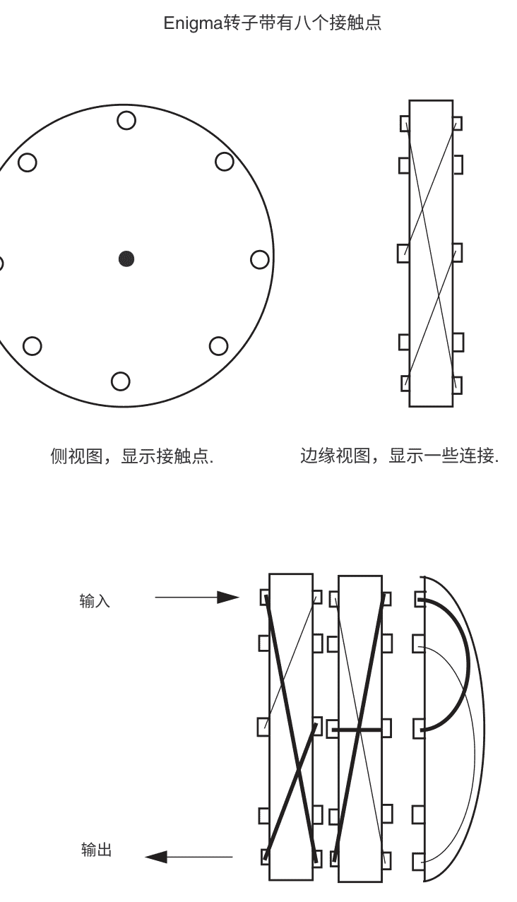

## 图11.12

Enigma设计概念（简化用于说明）。

## 练习 11-151

将一些输入字符位置连接到一些其他输出字符位置，没有字符可以转换为自身。因此，字母“E”永远不会编码为字母“E”。

这个漏洞可以被如下利用。假设密码分析师知道每个加密的消息都以明文字符串“德国高级指挥部向其战地行动致以问候”开头。此外，假设我们拦截到了一长串加密材料，不知道消息的起始和结束位置。如果我们已知的长度为60个字符的字符串与随机选择的相邻60个字符的拦截密文相邻放置，可能会有一些位置上的密文字符与已知字符串字符相同。

如果是这样，反射恩尼格玛限制保证了这个位置不可能是那个特定的已知明文被编码的地方。因此，密码分析师可以简单地将已知明文沿着密文滑动，直到找到一个没有字符匹配的地方，并且可以相当确定这个密文确实对应于明文。

（对于一个已知或选择的长度为60个字符的明文字符串，这种排列方式不是偶然事件的概率为9/10。对于120个字符，概率上升到99/100。）

能够系统地构建大多数消息是破译密码的重要一步，因为它大大减少了发现密钥所需的尝试次数。

# 练习

11.1 Louis Reasoner一直在使用一个简单的RPC协议，其工作原理如下:

+   - 客户端 →服务端: { 随机数，过程，参数}
- 服务端 → 客户端: { 随机数，响应}

客户端设置一个定时器，如果在定时器到期之前没有收到响应，则重新开始协议，重复此过程直到收到响应为止。服务端维护一个随机数和响应的表，当它收到一个包含重复随机数的请求时，它会重复发送响应，而不是重复执行过程。客户端同样维护一个尚未收到响应的随机数列表，它

> * Enigma机制的详细解释出现在Alan M. Turing的“机器描述”中（未标明日期的一份手稿，有时被称为Enigma论文或“教授的书”，约1942年）[美国国家档案和记录管理局，记录组457，国家安全部历史收藏，盒204，编号964，由Frode Weierude报道]。关于Enigma的缺陷及其被利用的方式的非技术性描述可以在Stephen Budianski的《智慧之战》中找到[纽约：西蒙与舒斯特：2000年]。

> † 在问题和解决方案中，符号 {a, b, c} 表示由命名项构成的消息，以某种未指定的方式进行编组，对于问题而言，这种编组方式并不重要，只要接收方知道如何解组个别参数即可。

# 第11章 信息安全

丢弃不在该列表中的任何nonce的响应，假设它们是重复的。一个可能的响应是“未知的过程”，意味着服务收到了一个它不知道如何处理的请求。链路层对所有帧进行校验和，在传输过程中丢弃任何损坏的帧。所有消息都适合一个帧中。

路易斯希望使该协议对窃听者安全。他发现客户端和服务已经共享一个密钥，Kcs，用于共享密钥加密系统。因此，他尝试的第一件事是加密简单RPC协议的请求和响应：

```
客户端 =>服务端：加密（{nonce，procedure，arguments}，Kcs）
服务端 =>客户端：加密（{nonce，response}，Kcs）
```

这似乎是有效的，但是路易斯听说，如果你重复使用相同的密钥来转换可预测的字段，比如过程名称，某人最终可能通过密码分析发现密钥。因此，他想为每个RPC调用使用不同的密钥。为了最小化编码工作，他将协议更改为以下方式工作：

```
客户端 =>服务端：加密（{Ktn}，Kcs）
客户端 =>服务端：加密（{nonce，procedure，arguments}，Ktn）
服务端 =>客户端：加密（{nonce，response}，Ktn）
```

其中Ktn是由客户端选择的一次性密钥，仅用于第n个RPC调用。当服务端接收到密钥时，它解密并使用该密钥，直到服务端收到另一个密钥消息。路易斯认为，由于Kcs现在仅用于临时密钥，看起来像随机数，所以它应该更安全，不容易被密码分析。

起初，这个协议也似乎是有效的。然后，路易斯注意到客户端收到“未知过程”的响应比以前更频繁。使用时序图解释为什么会出现这种情况，并举例说明故障的示例。并提出解决问题的建议。

1983-3-5b

## 11.2 露西法决心通过暴力攻击来破解爱丽丝的密码。通过观察她的登录，他知道她的密码是八个字符长且全是

小写字母，共有26个。他开始尝试所有可能的组合由八个下小写字母组成。

## 11.2a. 假设他在找到正确答案之前需要尝试大约一半的可能性，一个试验可以在一个机器周期内完成，他有一台600 mHz的计算机可用，这个项目需要多长时间？

## 11.2b. 如果Alice选择一个包含大写字母、小写字母、数字和16个特殊字符的八位密码，总共78个字符，需要多长时间？

## 11.2c. 假设处理器继续变得更快，每两年提高三倍。多久后，Alice的新密码会像旧密码一样容易被破解？

## 11.3 Tracy Swallow有一个避免安全存储密码的好主意。

她建议使用系统范围的“密码密钥”将用户的名称进行密钥驱动的加密转换，并将结果返回给用户作为密码。希望登录的用户只需提供他/她的名称和此密码；系统可以通过再次使用密码密钥对用户的名称进行转换来验证用户，以查看结果是否与呈现的密码相同。因此，不需要密码的中央文件。Tracy的想法有什么问题？

[1983-2-4b]

## 11.4 路易斯・里森纳对发现一些密码学变换是可交换的感到着迷。可交换的变换具有有趣的性质，对于每个消息和每对密钥 k_1和 k_2，

```
TRANSFORM (TRANSFORM (M, K_a), K_b) = TRANSFORM (TRANSFORM (M, K_b), K_a)
```

也就是说，无论以哪种顺序使用不同的密钥进行两次变换，都会得到相同的结果。

路易斯进行了进一步的研究，找到了一个高质量的可交换变换，并使用它设计了两个保密原语的可交换实现，他称之为 ENCRYPT_C和 DECRYPT_C。他建议在旧金山的爱丽丝和波士顿的鲍勃之间使用以下方案进行安全私密消息传递，他们的计算机通过互联网连接：

- 爱丽丝选择一个随机密钥，k_a，用该密钥加密她的消息M，并发送结果ENCRYPT_C (M, K_a)给鲍勃。
- 鲍勃选择另一个随机密钥，K_b，将已加密的消息再次加密，生成ENCRYPT_C ( ENCRYPT_C (M, K_a), K_b)，并将双重加密的结果发送回给爱丽丝。
- 根据交换律，该消息与ENCRYPT_C ( ENCRYPT_C (M, K_b), K_a)完全相同，爱丽丝可以用她的密钥K_a解密该消息。她这样做，揭示了 ENCRYPT_C (M, K_b)。
- 她将结果发送回给鲍勃，鲍勃现在可以使用他的密钥 K_b解密它以揭示 M。

这个方案的吸引之处在于，艾丽斯和鲍勃事先不需要达成秘密密钥的一致。路易斯将其称为“无先前协议”协议。

## 11.4a. 被动入侵者（即仅仅监听加密消息的人）能否发现 M？如果可以，请描述如何。如果不行，请解释原因。

## 11.4b. 主动入侵者（即还可以插入、删除或重放消息的人）能否发现 M？如果可以，请描述如何。如果不行，请解释原因。

## 11.5 Secure Inc.正在开发一种远程文件系统，Secure RFS（SRFS），它自动加密文件以保证信息的更好隐私。当一个存储文件的请求到达时，SRFS使用客户端的密钥加密文件。当一个读取文件的请求到达时，SRFS查找客户端密钥，解密文件，并将文件发送回客户端。SRFS为每个客户端保留一个单独的密钥。

## 11.5a. Secure Inc.的设计师们想知道使用512位密钥加密的文件需要多长时间才能破解。要破解RSA加密的文件，需要分解密钥。设计师们找到了一篇1993年的论文，报告说使用300台3MIPS工作站的空闲周期，分解一个100位十进制数大约需要1个月的时间。据估计，每增加3位十进制数，计算所需的时间大致翻倍。要在一个月内分解一个155位十进制数（约512位），需要多少台3MIPS计算机？

## 11.5b. 如果处理器每年性能翻倍一次，那么在2001年需要多少工作站才能在一个月内分解一个512位密钥？

## 11.5c. 假设加密转换速度为每秒250千字节。如果当前无加密转换的最大吞吐量为多少，则通过SRFS读取存储的文件的吞吐量会减少多少？

每秒800千字节。（假设加密转换不能与发送和接收同时进行。）

## 11.5d. Secure Inc. 还考虑将文件自动压缩添加到SRFS中。压缩可以减少文件中的信息冗余，从而使文件占用更少的磁盘空间。他们应该先压缩文件，然后加密文件，还是应该先加密文件，然后再压缩文件？请解释。

## 11.6 Alice希望通过不安全的网络与Bob进行通信。她在第11.8节学到了一次性密码本，并决定使用一次性密码本来保护她的通信。由于Alice想要在将来向Bob发送一个k位的消息，她生成一个随机的k位密钥r并亲自交给Bob。

当爱丽丝要把她的消息发送给鲍勃时，她用密钥r对消息m进行异或运算，生成密文c，并将其发送到网络上。鲍勃用密钥r对密文c进行异或运算，以获取消息m。

## 11.6a. 假设爱丽丝的消息m是一个头部和一些数据的连接。考虑一个窃听者伊芙，她窃听爱丽丝的对话。如果伊芙能够正确猜测爱丽丝消息中的头部值，以下哪些是正确的？

A. 伊芙对m中的数据位的解密能力不会因为她知道头部位而提高。  
B. 爱丽丝的消息中的数据位是保密的。  
C. 爱丽丝的消息中的数据位是安全认证的。

爱丽丝厌倦了与鲍勃交换一次性密码的努力，并想出了简化密钥分发过程的主意。爱丽丝的主意如下所示：要向鲍勃发送一个k位的消息m1，爱丽丝选择一个k位的随机数r1，计算密文c1 = m1 ⊕ r1，并将c1发送给鲍勃。然后鲍勃选择自己的k位随机数r2，计算c2 = c1 ⊕ r2，并将c2发送给爱丽丝。最后，爱丽丝计算c3 = c2 ⊕ r1，并将c3发送给鲍勃。

## 11.6b. 下列哪些陈述是正确的关于爱丽丝的新方案？

A. 假设爱丽丝和鲍勃之间的所有消息都能正确传递，鲍勃可以正确解密爱丽丝的消息m1，而不需要提前收到r1。  
B. 一个主动攻击者露西法（可以拦截、丢弃和重放消息）可以解密消息。  
C. 一个被动窃听者伊芙可以解密消息。

## 11.7 美国银行正在努力确信刚刚收到的消息的真实性，并向您寻求下一步该怎么 做。到目前为止，他们知道以下两个事实是真实的：

- 路易斯说（本说（转账\$1,000,000给艾丽莎））  
- 吉姆代表本

本的账户有足够的钱来进行这样的交易，所以如果他们能够说服自己本真的授权了这笔交易，他们就会进行转账。

他们应该尝试确定以下哪些事情的真相，以及为什么？

A. 路易斯代表吉姆  
B. 本代表路易斯  
C. 本说（吉姆代表路易斯）

## 11.8 本·比特迪德尔想出了一个解决能力难以撤销问题的好主意。他的计划是发明一种叫做定时能力的东西。定时能力的一个字段是它的过期时间，即创建时间加上ε。定时能力可以像其他能力一样使用，直到系统时钟达到过期时间；在那之后，它变得毫无价值。就以下方面分析这个提议：A. 性能。B. 传播。C. 撤销。  
D. 审计。  
E. 易用性。

## 11.9 两家银行正在开发一种银行间资金转移系统。它们通过一条沿着主街道的管道连接，Alyssa P.Hacker担心可能会有不正当行为。银行的专家Ben Bitdiddle表示，银行将使用一个共享的秘密密钥K₁来加密他们的通信，并使用第二个共享的秘密密钥K₂来验证他们的通信，使用以下协议：

```
银行1 ⇒银行2{"从我们的账户Y转账"}K2}K1
银行1  ⇒ 银行2{"到你的账户X"}K2}K1
银行1  ⇒ 银行2{"金额Z"}K2}K1
银行2 ⇒银行1{"好的"}K2}K1
```

Alyssa立即意识到，如果不知道K₁或K₂，入侵者可能破坏银行。

## 11.9a. 在Main街中间的一个下水道井盖上，描述Alyssa如何可以

- A. 增加或减少转账金额。  
- B. 导致转账发生多次。  
- C. 导致转账根本不发生，而不引起请求银行的怀疑。

## 11.9b. 设计一个新的协议，消除这些问题，并只使用两条消息。

## 11.10 为了吸引人们关注他们的网站，OutofMoney.com添加了一个功能，广播包含免费股票行情的消息流。他们希望这些信息是公开的，所以不需要保密性，但他们担心自己的声誉，所以他们希望数据流经过身份验证。

他们目前的实现方式是使用公司的私钥对每条消息进行签名，并且客户端通过使用公司公开的公钥来验证数据。这种技术是有效的，但是由于公钥算法需要太多的计算时间，而典型的客户端，运行着一台四年前的奔腾处理器，在股市崩盘的日子里无法跟上消息流。

通过阅读本章，他们了解到使用共享密钥的认证消息认证码（MAC）会更快。他们聘请了本·比特迪德尔和路易斯·里森纳作为咨询团队来实施这个想法。（不幸的是，他们没有完成任何问题集，所以他们不知道这两个 人物的声誉。）

路易斯的第一个提议如下：任何想要使用认证服务的客户端首先要联系该服务并请求一个起始消息。该服务使用公司的公钥对这个起始消息进行签名。起始消息包含当前用于认证包含股市行情的消息流的共享密钥。

## 11.10a. 本认为这不可能起作用，但他不确定为什么。通过解释为Ben提供一些帮助。

不屈不挠，路易斯一直在阅读关于延迟认证的内容，并决定这是解决这个问题的理想方式。这个想法是这样的：由于服务正在发送一系列的消息，对于每个消息，使用一个不同的共享密钥来创建其认证标签，然后公开披露该共享密钥。

所有客户端都收到了那条消息。

在路易斯的设计中，每个消息 $P_i$ 的构造如下：

```
raw_message_i ≈ {i, D_i, K_{i-2}}
authtag_i ≈ SIGN (raw_message_i, K_i)
P_i ≈ {raw_message_i, authtag_i}
```

因此 $P_i$ 包含：

- 它自己的序列号， $i$  
- 一些数据， $D_i$  
- 密钥 $K_{i-2}$，可用于验证消息 $P_{i-2}$ 中的数据  
- 使用 $K_i$ 签名消息的其余部分创建的身份验证标签验证此消息的密钥将 出现在消息 $P_{i+2}$ 中。

Lou$\S$认为，即使密钥 $K_i$ 以明文形式发送，如果客户端在服务发送 $K_i$ 之前接收到 $D_i$，那么当攻击者知道 $K_i$ 时，攻击者已经来不及修改 $D_i$ 了。与Lou$\S$之前的系统一样，客户端首先请求启动消息。这次，启动消息包含与广播流中的下一条消息相同的数据，但它是用公司的私钥签名的。

## 11.10b. 再次，Ben 对这个系统感到怀疑（正确地），但他无法弄清楚其中的问题。通过解释缺陷及其修复方法来帮助他。

## 11.11 本章讨论了能力和访问控制列表作为授权机制的能力和访问控制列表。以下哪些陈述是正确的？

- A. 能力系统将每个主体与一组对象引用关联起来，表示该主体被允许使用哪些对象。  
- B. 访问控制列表系统将每个对象与一组主体关联起来，表示哪些主体被允许使用该对象。  
- C. 在访问控制列表系统中，撤销主体的特定访问权限比能力系统更困难。  
- D. UNIX文件系统中的保护仅基于能力。

## 11.12 爱丽丝决定尝试一个新的RFID学生追踪系统，所以她创建了一个访问控制列表，允许几个亲密的朋友追踪她。其中一个朋友，鲍勃，想要邀请爱丽丝加入他的设计项目团队，所以今天早上他请求追踪系统在爱丽丝经过行政大楼时给他回电。在附近的实验室工作的爱丽丝迟到地意识到鲍勃可能会提出那个问题，所以她登录追踪系统并将鲍勃从她的访问控制列表中删除。然后她退出并去吃午饭。

她经过行政大楼时，鲍勃从图书馆跑出来迎接她，说他刚刚收到了跟踪系统的回调。

跟踪系统的设计者犯了一个安全错误。以下哪个是最有可能的解释？

- A. 跟踪系统没有正确擦除残留物。  
- B. 在她匆忙离开吃午饭时，爱丽丝从她的访问控制列表中删除了露西，而不是鲍勃。  
- C. 跟踪系统存在一个时检查到时使用的错误。  
- D. 该系统使用的SSL版本容易受到密码替换攻击。  
- E. 该系统不需要用户和系统管理员之间的面对面会面。

## 11.13 本决定开设一个互联网服务提供商。他购买了一个包含224个地址的地址空间（在互联网的总共232个地址中从未使用过）。在他购买这个地址空间几天后，有人发起了一个与第11.11.4.3节中描述的Slammer蠕虫类似设计的新蠕虫。新蠕虫针对FOO服务器中的缓冲区溢出漏洞，该服务器监听UDP端口5044。 本在端口5044上监视发送到他所在的互联网地址空间的所有流量，并绘制了蠕虫探测次数随时间变化的图表：


假设蠕虫通过随机选择的IP地址进行传播，并且其伪随机数生成器没有错误，并在重新访问任何整数之前生成整数的完整排列。本从安全分析师那里得知，每个被感染的机器每秒发送100个探测。

## 11.13a. 估计运行FOO服务器的总机器数量。

- A. 100台机器  
- B. 7.2×1018 台机器  
- C. 25,600台机器  
- D. 8,000台机器  

## 11.13b. 本认为蠕虫使用了易受攻击的地址列表（即FOO服务器的地址）。你同意吗？如果你同意，最佳估计有多少台机器包含在这个列表中？

- A. 无黑名单  
- B. 100台机器  
- C. 256台机器  
- D. 25600台机器  
- E. 80台机器  

## 11.14 本·比特迪德尔，国土安全部网络安全部门的新负责人，研究了第11.1.4.3节关于Slammer蠕虫的战斗故事，他希望构建一个能在蠕虫攻击达到50%易受攻击主机之前检测和阻止未来蠕虫攻击的系统。本对待要防御的蠕虫做出以下假设：

- 每个蠕虫实例每秒发送512（2⁹）个探测。  
- 蠕虫软件随机探测所有IP地址。  
- 在互联网上有2³²个可能的地址，其中32768（2¹⁵）个地址连接到易受蠕虫攻击的活动主机。  
- 蠕虫从感染一个易受攻击的主机开始。

## 11.14a. 在上述假设下，在蠕虫爆发的早期阶段，感染人口的规模翻倍大约需要多少秒？

A. 16秒  
B. 256秒  
C. 1024秒

本说服一家路由器供应商联盟开发了一种新的、可远程配置的数据包过滤功能，并开发了一个系统，可以在检测到爆发后的15分钟（900秒）内向互联网上的所有路由器传播过滤器更新。一旦所有路由器都有了过滤器，过滤器将阻止所有进一步的蠕虫感染。本的检测机制是一个可以观察到互联网地址空间的1/256的网络监视器。当针对他监视的地址集的蠕虫流量达到预定义的阈值时，他的系统会自动发送一个过滤器更新。

## 11.14b. 本应选择什么样的流量阈值才能在蠕虫传播到50%的易受攻击主机之前停止它？

A. 每秒10个蠕虫探测  
B. 每秒100个蠕虫探测  
C. 每秒1000个蠕虫探测  
D. 每秒10000个蠕虫探测  
E. 每秒100000个蠕虫探测

## 11.15 Ben Bitdiddle访问网站amazing.com并获取了一个用私钥签名的新页面。以下哪种方法可以确保Ben所获取的证书确实属于拥有该域名的组织？（假设证书由可信的证书颁发机构签名并且有效。）

A. Ben使用HTTP从http://amazing6033.com下载证书。  
B. Ben从证书颁发机构下载证书。  
C. 本通过在谷歌上进行网络搜索找到了证书。  
D. 本通过垃圾邮件收到了证书。

## 11.16 本比特迪德和路易斯·里森纳创办了一家名为公钥出版公司（PKPI）的初创公司，其业务是分发公钥。  
他们的想法是，那些在公钥系统中使用密钥对的人需要一种让其他人知道他们密钥对的公钥的方法。本和路易斯不感兴趣创建密钥，只是作为公钥分发者。  
本和路易斯设计了以下协议，其中艾丽斯向鲍勃发送私密消息。他们需要你的帮助来调试该协议。K_Pxyz是主体xyz的公钥。

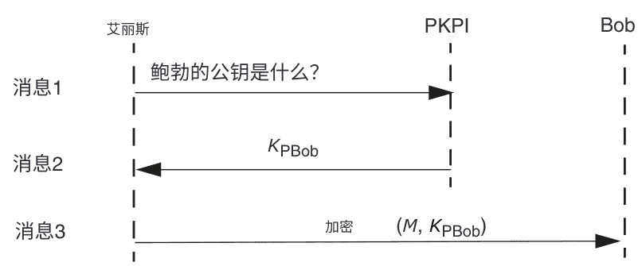

消息1和2构成PKPI协议；消息3是Alice与Bob的协议的开始，并不受PKPI的控制；消息3在这里显示 

## 11.16a. 路易斯认为被动窃听者伊芙通过窃听PKPI协议无法获得任何信息。给出一个支持路易斯观点的论证，或者举一个证明路易斯错误的例子。

## 11.16b. 路易斯最初希望主动攻击者露西弗也无法造成任何问题，但自从阅读了本章后，他不确定了。举一个主动攻击的例子，证明路易斯需要修改PKPI协议以防范露西弗。

## 11.16c. 本建议通过改变第二条消息来改进协议。应该进行哪些更改，以便艾丽丝可以确信只有鲍勃能解密第三条消息？

## 11.17 路易斯・里森纳的表弟诺里斯发现了以下有趣的事实，并希望能够利用它：

- 有趣的事实：2¹⁵⁰个质子大小的物体可以紧密地填满已知的宇宙。

由于nonce在许多不同的应用中都被使用，诺里斯建议为每个人创建诺里斯Nonce服务。如果您向诺里斯的服务发送请求，它将返回下一个200位整数，按递增顺序用作nonce。

（诺里斯选择了200，以防宇宙的大小被低估。）这个提议比诺里斯可能怀疑的要难做些什么？

## 1983-3-3

与第11章相关的附加练习可以在问题集 43-49中找到。

## 引言

支撑计算机系统的硬件技术已经以超过四十年的速度不断改进，因此系统设计的基本规则不断变化。知识和经验需要经过多年的积累、消化，并以书籍的形式呈现出来，因此关于计算机系统的书籍在出版时往往已经过时或者过时。尽管一些基本原则是不变的，但细节的快速过时会使潜在的书籍作者望而却步，因此一些重要的想法从未在书籍中记录。因此，计算机系统研究的重要部分可以在当前的技术论文、专业期刊文章、研究报告以及在该领域活跃的工作者之间流传的偶尔的未发表备忘录中找到。

尽管有这个警告，但是有一些书籍，相对较新的计算机系统文献，值得放在书架上。直到20世纪80年代中期，存在的书籍大部分是由教科书出版商委托填补市场的，它们倾向于强调系统的机械方面而不是对其设计的洞察。然而，从1985年开始，一些好的书开始出现，当专业的系统设计师受到启发时，他们开始捕捉他们的见解。这些书的出现也表明，计算机系统设计涉及的概念正在逐渐稳定。

这些章节中的大部分现在有点过时，但这里的大部分材料是永恒的。系统开发中的问题也是永恒的，这可以从对大型系统项目失败的持续报告中看出。大多数成功的系统设计师都有一本这本书在他们的书架上，并且有些人声称每年至少阅读一次。1995年版的大部分内容与1974年版完全相同；新版增加了布鲁克斯的《没有银弹》论文（值得一读）和一些总结章节。

## 进一步阅读的建议 SR-3

最后，计算机系统技术开始缩短书籍出版涉及的延迟。

计算机系统文献的核心在于发表的论文。两个最好的来源是计算机协会（ACM）的出版物：ACM Transactions on Computer Systems（TOCS）期刊和每两年举办一次的会议系列ACM Symposium on Operating Systems Principles（SOSP）。每个SOSP的最佳论文都会在TOCS的下一期中发表，而其余的论文（近年来全部）都会在操作系统评论（Operating Systems Review）的特刊中发表，这是ACM的一个特别兴趣小组季刊，在会议年份会出版一期额外的特刊。还有其他三个定期举办的会议也值得关注：欧洲计算机系统会议（EuroSys）、USENIX操作系统设计与实现研讨会（OSDI）和USENIX网络系统设计与实现研讨会（NSDI）。这些来源不是唯一的来源 - 关于计算机系统的有价值的论文也会出现在许多其他期刊、会议和研讨会上。大多数列出的论文，包括许多旧论文，可以通过在线搜索作者的姓和论文标题的几个词，在互联网上找到完整的副本。即使需要订阅才能主要列出的论文，通常也会在其他地方作为开放资源发布。

以下页面包含有关计算机系统的进一步阅读建议，包括论文和书籍。该列表并不自命不凡。相反，这些建议是从大量文献中精选出来的，以强调最佳的可用思想、问题的最佳示例和最有趣的计算机系统案例研究。这些阅读材料已经经过过时性审查，但通常情况下，一个好的想法仍然最好由一篇较早的论文来描述，其中这个想法是在一个看起来不再有趣的背景下发展起来的。有时，早期的背景比今天的系统要简单得多，因此更容易看出这个想法是如何工作的。通常，早期的作者是第一个出现的，因此有必要比现代作者更全面地描述事物，现代作者通常假设对周围环境和所有前任系统都有相当熟悉。因此，这里包含的旧阅读材料对当前的作品是一个有用的补充。

按其性质，计算机系统工程的研究与计算机科学的其他领域有重叠，特别是计算机体系结构、编程语言、数据库、信息检索、安全和数据通信。这些领域中的每一个都有自己广泛的文献，往往不明显地界定边界。作为一般规则，这个阅读列表试图只提供关于在这些相关领域中从何处开始的一级指导。

读者必须注意的一件事是，计算机系统领域的术语并没有达成一致，因此文献通常对专业人士来说甚至也很令人困惑。此外，文献的质量水平相当不稳定，从有文采的到可读的再到几乎难以理解的。尽管这里的选择试图避免最后一类情况，但读者仍然必须准备好一些论文，尽管内容重要，但对主题的解释并不如他们本可以做到的那样好。

## 进一步阅读建议 SR-4

在接下来的材料中，每个引用都附有一条评论，说明为什么这篇论文值得阅读——它的的重要性、兴趣和与其他阅读的关系。当一篇论文涉及多个领域时，会出现交叉引用，而不是重复引用。

## 1 系统

如上所述，关于计算机系统的几本精彩的书籍和一些非常好的书籍最近开始出现。以下是计算机系统设计师必备的参考书目。除了这些书籍，按主题分类的后续阅读材料还包括其他一般较为狭窄兴趣的书籍。

## 1.1 关于系统的精彩书籍

1.1.1 David A. Patterson 和 John L. Hennessy. 计算机体系结构：量化研究方法。Morgan Kaufman，第四版，2007年。ISBN:978-0-12-370490-0. 704 + 各种页数（平装）。封面上作者的名字顺序相反。

这本书提供了一个令人惊叹的探索当前计算机架构设计领域的精彩之旅。其中一个最好的特点是每个领域都包括了对错误想法及其陷阱的讨论。尽管主题变得复杂，但这本书始终易读。这本书有自己的观点（对RISC架构有强烈偏见），但无论如何，这是一部关于计算机组织的系统视角的权威之作。

1.1.2 Raj Jain. 计算机系统性能分析的艺术。John Wiley & Sons，1991年。ISBN 978-0-471-50336-1。720页。关于计算机系统性能分析的许多工作源于学术环境，并侧重于数学可处理性而不是重要的测量。这本书位于光谱的另一端。它是由一位具有丰富工业经验但具有学术风格的人撰写的，用于解释事物。如果你有一个真正的性能分析问题，它会告诉你如何解决它，如何避免测量错误的事物，并如何避免其他陷阱。

1.1.3 弗雷德里克・P・布鲁克斯《神话般的人月：关于软件工程的文章》。Addison-Wesley，20周年纪念版，1995年。ISBN: 978-0-201-83595-3（平装）。336页。写得很好，充满了洞察力，这本读物是关于控制系统开发最重要的一本。这是你了解为什么在进度落后的项目中增加人员将进一步延迟项目的地方。尽管有些章节现在有点过时，但这里的大部分材料是永恒的。

## 1.1.4 劳伦斯·莱西格。《代码与网络空间的其他法律》，第2版。基础图书，2006年。ISBN 978-0-465-03914-28（平装）432页；978-0-465-03913-5（平装）320页。还可在在线访问 http://codev2.cc/ 这本书是一位杰出的宪法法学教师对法律、习俗、市场力量和架构如何共同调节事物的更新版本的解释。除了提供一个讨论科技和互联网相关法律问题的词汇表外，本书的一个核心主题是，由于科技引发的问题既不被法律也不被习俗预见，因此默认情况下，它将完全由市场力量和架构来调节，而这两者都不受法律和习俗发展的谨慎和审慎思考的约束。如果你对技术对知识产权、隐私或言论自由的影响有任何兴趣，这本书是必读的。

## 1.1.5 吉姆·格雷和安德烈亚斯·罗伊特尔。事务处理：概念和技术。摩根·考夫曼，加利福尼亚州圣马特奥，1993年（寻找低成本的纸质版，在1994年的第三次印刷中可获得）。ISBN:978-1-55860-190-1.1,070页。

本全面的书籍将容错性、原子性、协调性、恢复性、回滚、日志、锁定、事务和性能工程权衡等方面的所有内容汇集在一起。这是关于事务的权威之作。尽管不适合初学者，但由于其解释的高质量，这些复杂的材料惊人地易于理解。术语表非常出色，而历史注释在某种程度上是好的，但有些过于侧重于数据库，并不应被视为最终结论。

## 1.1.6 艾伦·F·韦斯汀。隐私与自由。雅典娜出版社，1967年。487页。（已绝版。）如果你对隐私有兴趣，去图书馆或二手书店找一本这本书。这是一本由宪法律师撰写的综合性著作，讲述了隐私的定义、重要性以及在美国法律框架中的地位。

## 1.1.7 罗斯·安德森。 安全工程：构建可靠分布式系统指南。 约翰·威利和儿子，第二版，2008年。ISBN 978-0-470-06852-6。1040页。

这本书之所以引人注目，是因为它涵盖了各种系统安全问题，从出租车里程记录器到核指挥与控制系统。它对机制提供了深入的探讨，假设读者已经有了一个高层次的概念。这本书在解释方面有时候比较快，读者必须对系统有相当的了解。它的优点是，大部分关于如何做的讨论都紧接着一个名为“出错了”的部分，探讨了错误实现、谬误和其他故障模式。第一版可以在线获取。

## 1.2 关于系统的真正好书

## 1.2.1 安德鲁·S·塔能鲍姆。现代操作系统。Prentice-Hall，第三版，2008年。ISBN 978-0-13-600663-3（精装）。952页。

本书提供了对操作系统世界的全面教程介绍，但倾向于强调机制。了解为什么事物被设计成这样的洞察力是存在的，但在许多情况下需要仔细分析。它包括GNU/Linux、Windows Vista和Symbian OS的有用案例研究，后者是一种用于移动电话的操作系统。

## 1.2.2 托马斯·P·休斯。拯救普罗米修斯。Vintage重印版（平装），最初出版于1998年。ISBN 978-0679739388。372页。

一位退休的历史和社会学教授解释了四个大规模独特系统项目的管理背后的故事：Sage防空系统、Atlas火箭、Arpanet（互联网的前身）以及Big Dig（波士顿中央干线/隧道）的设计阶段。本书的论点是，除了独特的工程，这些项目还必须开发一种能够不断适应变化、分布式控制松散耦合并能够在众多参与者中达成共识的管理风格。

## 1.2.3 亨利·佩特罗斯基。《设计范式：工程中的错误和判断案例历史》。剑桥大学出版社，1994年。ISBN：978-0-521-46108-5（精装），978-0-521-46649-3（平装）。221页。

这本非凡的书探讨了设计者（在这些例子中是土木工程师）的思维方式如何使他们在回顾时发现自己犯下了巨大的设计错误。分析的失败案例包括罗马柱子的运输问题，以及1982年堪萨斯城凯悦酒店走廊坍塌事件，还有一些著名的桥梁坍塌事件。佩特罗斯基特别好地分析了放大设计的失败通常揭示了原始设计的正确性，但原因与最初的想法不同。书中没有提到

## 1.3 与系统相关的好书值得放在系统书架上

还有几本其他好书，许多计算机系统专业人士坚持要在书架上拥有。它们不属于前面的任何一个类别，因为它们的中心焦点不是系统，或者因为这本书的目的有些狭窄。

## 1.3.1 Thomas H. Cormen, Charles E. Leiserson, Ronald L. Rivest, and Clifford Stein. 算法导论。麦格劳希尔, 第二版, 2001年. 1,184页.

ISBN: 978-0-07-297054-8 (精装); 978-0-262-53196-2 (M.I.T. Press 平装, 美国不销售)

## 1.3.2 Nancy A. Lynch. 分布式算法。摩根考夫曼, 1996年. 872页

ISBN: 978-1-55860-348-6. 偶尔, 系统设计师需要一个算法。Corman等人和Lynch的书籍是找到该算法的地方, 同时还提供了必要的分析来决定它是否适用于应用程序。在理论阅读列表中, 这两本书几乎肯定属于最高级别之一, 但对于系统列表来说, 它们更适合作为补充材料。

## 1.3.3 Douglas K. Smith和Robert C. Alexander。Fumbling the Future。William Morrow and Company, 1988年。ISBN 978-0-688-06959-9（精装），978-1-58348266-7（iuniverse平装重印版）。274页。

计算机历史上充斥着那些试图为现有业务添加通用计算机系统的公司, 例如Ford、Philco、Zenith、RCA、General Electric、Honeywell、A. T. & T. 和Xerox。没有一个成功, 也许是因为当情况变得困难时, 放弃这个业务的选择太有吸引力了。 本书记录了施乐如何在胜利的嘴中 snatch defeat, 先发明个人电脑, 然后抛弃它。

## 1.3.4 Marshall Kirk McKusick, Keith Bostic, 和 Michael J. Karels. The Design and Implementation of the 4.4BSD Operating System. Addison-Wesley, 第二版, 1996. ISBN 978-0-201-54979-9. 606 页.

本书全面介绍了 UNIX操作系统的设计和实现。 它写得很好, 充满了细节。 1989年的第一版, 描述了4.3BSD, 仍然有用。

## 1.3.5 Katie Hafner 和 John Markoff. Cyberpunk: Outlaws and Hackers on the Computer Frontier. Simon & Schuster (Touchstone), 1991, 1995年6月更新。 ISBN 978-0-671-68322-1 (精装), 978-0-684-81862-7 (平装). 368页.

这本书是一本可读性很强、但又很全面的关于网络空间伦理边缘的场景的描述：Kevin Mitnick、Hans Hubner和Robert Tappan Morris的冒险。它是媒体视角的一个例子，但是一个异常见多识广的视角。

## 1.3.6 Deborah G. Johnson 和 Helen Nissenbaum. 计算机、伦理和社会价值。Prentice-Hall, 1995年。 ISBN：978-0-13-103110-4（平装）。714页。

一个计算机系统设计师可能认为阅读一本关于伦理的论文是度过下午的一种极其无聊的方式，而这本书中的一些论文

## 进一步阅读建议 SR-9

收集与刻板印象相符。然而，在这本书中的许多场景、案例研究和其他重印中，有很多关于计算机系统设计的人类后果的有趣而深思熟熟的论文。这个收藏是获取有关隐私、风险、计算机滥用和软件所有权以及计算机系统设计专业伦理的基本阅读材料的好地方。

- 1.3.7 Carliss Y. Baldwin 和 Kim B. Clark. 设计规则：卷1，模块化的力量。M.I.T. 出版社，2000年。ISBN 978-0-262-02466-2。471页。
  本书完全关注模块化（作者使用的术语将模块化、抽象和层次结构合并在一起），并提供了一个有趣的互连表示，以说明模块化和清晰、抽象的接口的力量。该作品使用这些相同的概念来解释计算机行业几十年来的发展。来自哈佛商学院的作者们通过提供设计选项和简化替代来开发了几种模块化运作方式的模型。到本书结束时，大多数读者可能已经看到了比他们想知道的更多，但这里有一些值得至少快速阅读的想法。（尽管标题中有“卷1”，但似乎还没有第2卷。）

- 1.3.8 安德鲁·S·塔能鲍姆。计算机网络。Prentice-Hall，第四版，2003年。ISBN: 978-0-13-066102-9。813页。
  本书提供了对网络世界的全面教程介绍。与同一作者的操作系统书籍（参见阅读 1.2.1）一样，这本书也倾向于强调机制。但再次强调，这是一本关于计算机通信的最新街头知识宝库，这是进入（或者也许是避免需要咨询）其他文献所需的。本书包括了关于计算机网络的选择性和经过深思熟虑的注释参考书目。这些相同材料的简化版本，对许多读者来说已经足够，作为操作系统书的一章出现。

- 1.3.9 大卫·L·米尔斯。计算机网络时间同步：网络时间协议。CRC Press / Taylor & Francis，2006年。ISBN: 978-0849358050。286页。
  对网络时间协议（NTP）的全面但易读的解释，这是一个大多数用户不知道的底层协议：NTP 协调多个时间服务器，并将当前日期和时间信息分发给客户端和服务器。

- 1.3.10 Robert G. Gallager. 数字通信原理. 剑桥大学出版社, 2008. ISBN 978-0-521-87907-1. 422页。
  这本密集的教科书专注于数据链路层的理论基础。

## 进一步阅读建议 SR-18

密码学简介。IEEE 67, 3（1979年3月），页码 397-427。  
这是自香农以来在非机密文献中第一篇真正技术上有竞争力的密码学论文，它开启了现代非机密研究。它包含了完整而学术的参考文献。

1.8.5 惠特菲尔德·迪菲和马丁·E·赫尔曼。密码学的新方向。  
IEEE信息论交易 IT-22，6（1976年11月），页码 644-654。  
Diffie和Hellman是公钥密码学的第二位发明者（第一位发明者James H. Ellis当时正在为英国政府通信总部从事机密项目，直到1987年才能公开发表他的工作）。这是将这个想法引入到非机密世界的论文。

1.8.6 查尔斯·T·戴维斯（Charles T. Davies Jr.）数据处理控制领域。IBM系统杂志 17, 2 (1978年), 页码 179–198. 查尔斯·T·戴维斯（Charles T. Davies Jr.）DB/DC 系统的恢复语义。1973年ACM全国会议28 (1973年8月), 页码 136–141.  
这一对模糊但发人深省的论文对“控制领域”这一与原子性密切相关 的概念进行了高层次的讨论。每个写论文的人都提到他们发现这两篇论文很有启发性。

1.8.7 Butler W. Lampson和Howard Sturgis。在分布式数据存储系统中的崩溃恢复。工作论文，施乐帕洛阿尔托研究中心，1976年11月和1979年4月。  
（从未发表）  
吉姆·格雷称这篇1976年的论文为“地下经典”。1979年的版本首次提出了故障模型的良好定义。两者都描述了协调分布式更新的算法；它们有足够 的不同之处，值得一读。

1.8.8 Leonard Kleinrock。通信网络：随机消息流和延迟。  
麦格劳希尔，1964年。由Dover再版，2007年。ISBN：0-486-45880-6。224 页。

1.8.9 Paul Baran，S. Boehm和J. W. Smith。关于分布式通信。兰德公司的一系列11份备忘录，加利福尼亚州圣莫尼卡，1964年8月。  
自从互联网的普及以来，关于谁最早想到分组交换的讨论就很多了。看起来，1961年，莱昂纳德·克莱因洛克在麻省理工学院攻读博士学位期间，致力于研究更有效利用有线网络的方法；保罗·巴兰和他在兰德公司的同事们也在1961年进行了类似的工作。

## 进一步阅读建议 SR-19

在大约同一时间，Saltzer和Kaashoek独立提出了分组交换的想法；他们都  
在1961年写了内部备忘录描述了他们的想法。 然而，他们两个都没有实  
际使用“分组交换”这个词；这个词是由国家物理实验室的唐纳德·戴维  
斯几年后创造的。

1.8.10 劳伦斯·G·罗伯茨和巴里·D·韦斯勒。计算机网络发展以实现  
资源共享。AFIPS春季联合计算机会议36（1970年5月），第543-549页。

这篇论文和其他四篇在同一会议分会场上展示的论文（第543-597页）是  
对ARPANET的首次公开描述，它是第一个成功的分组交换网络和互联网  
的原型。两年后，AFIPS春季联合计算机会议40（1972年），第243-298  
页，又展示了五篇相关论文。 关于阅读1.8.8和阅读1.8.9的优先级讨论有  
些学术性；正是罗伯茨对ARPANET的赞助证明了分组交换的可行性。

1.8.11 Cerrf等人的《延迟容忍网络架构》。请求评论RFC 4838，互联网工程  
任务组（1997年4月）。

本文描述了一种从对星际互联网的愿景演变而来的架构，这是一种类似  
互联网的网络，用于星际距离。 本文介绍了几个有趣的想法，并突出了  
人们在设计网络时没有意识到的一些假设。NASA对延迟容忍网络的原型  
实施进行了首次成功测试。

1.8.12 吉姆·格雷等人 Terascale Sneakernet。使用廉价磁盘进行备份、归档  
和数据交换。 微软技术报告 MS-TR-02-54（五月  
2002年）。 http://arxiv.org/pdf/cs/0208011)

Sneakernet是一个通用术语，用于通过物理交付存储设备而不是通过电线  
发送数据。 当数据量非常大，电子传输需要很长时间或者过于昂贵，并  
且直到第一个字节到达的延迟不太重要时，Sneakernets是很有吸引力的。  
早期的Sneakernets使用软盘交换程序和数据。 最近，人们通过刻录光盘  
并携带它们来交换数据。 本文提议通过发送封装在一个小型、低成本计  
算机中的硬盘来构建一个Sneakernet。 这种方法可以在几天内通过邮件在  
地球上传输数千兆字节的数据。 通过包含计算机和操作系统，它最大程  
度地减少了将数据传输到另一台计算机时出现的兼容性问题。

## 进一步阅读建议 SR-20

其他几篇论文也列在特定主题下，提供了全新的视角或改变了人们对系统的思考方式：Simon, The architecture of complexity, reading 1.4.3; Thompson, Reflections on trusting trust, reading 11.3.3; Lampson, Hints for computer system design, reading1.5.4; 以及 Creasy 的 VM/370 论文, reading5.6.1

1.9 控制大型系统：

1.9.1 F[ernando] J. Corbató 和 C[harles] T. Clingen. 对 Multics 系统开发的管理视角。在 Peter Wegner, Research Directions in Software Technology, M.I.T. Press, Massachusetts, 1979, 第 139-158 页. ISBN:0-262-23096-8.

1.9.2 W[illiam A.] Wulf, R[oy] Levin, 和 C. Pierson. Hydra操作系统开发概述第五届ACM操作系统原理研讨会论文集, 在操作系统评论9, 5 (1975年11月), 第122-131页.

1.9.3 Thomas R. Horsley 和 William C. Lynch. Pilot: 一个软件工程案例研究第四届国际软件工程会议(1979年9月),第94-99页.

这三篇论文是关于管理和开发大型系统挑战的早期描述。它们仍然具有相关性和易读性，并提供了互补的见解。

1.9.4 Effy Oz. 当专业标准松懈时: CONFIRM的失败及其教训ACM通信杂志37,10 (1994年10月), 第30-36页.

CONFIRM是一个航空公司/酒店/租车预订系统，尽管经过四年的工作和超过1亿美元的投资，但从未见天日。它是许多计算机系统开发中失控并最终被废弃的其中之一。每年都会有几次类似规模的软件灾难的新闻报道。由于没有人愿意承担责任，尤其是在诉讼仍在进行中时，很难获得关于系统开发失败的确凿事实。这篇论文缺乏事实，并过于简单地建议道德更好就能解决问题。（似乎道德和管理问题只是延迟了对必然结果的认识。）然而，它提供了一个令人警醒的观点，说明事情可能出错得多么严重。

1.9.5 南希·G·莱维森和克拉克·S·特纳。对Therac-25的调查

## 进一步阅读建议 SR-21

事故。计算机 26,7 (1993年7月), 页码 18-41. (重印于阅读 1.3.6.)这是另一个令人警醒的观点，说明事情可能出错得多么严重。 在这种情况下，高能医疗设备的软件控制器设计不足；设备投入使用后，造成了致命伤害。 这篇论文成功地深入探讨了问题的根源。 不幸的是，类似的错误仍然发生；例如，参见美国核能监管委员会信息通告2001-8s1 (2001年6月)，该通告描述了巴拿马的放射治疗过度暴露事件。

1.9.6 乔·莫根斯特恩。城市危机：五十九层的危机。《纽约客》71, 14 (1995年5月29日), 页码 45-53.

本文讨论了一位工程师如何应对自己设计的摩天大楼在飓风中有倒塌的危险。

1.9.7 埃里克·S·雷蒙德。大教堂与集市。 在《大教堂与集市：一个偶然革命者对Linux和开源的思考》一书中，作者在1964页讨论了Linux和开源的话题。 O'Reilly Media Inc.，2001年。 ISBN：978-0596001087，241页。

该书基于一篇名为《大教堂与集市》的白皮书，比较了两种软件开发模式：大教堂模式，主要由商业软件公司和一些开源项目（如BSD操作系统）使用；以及集市模式，以GNU/Linux操作系统的开发为例。 该作品认为，集市模式能够产生更好的软件，因为集市的开放性和独立性使得任何人都可以参与，并且可以查看系统中任何感兴趣的内容：“足够多的眼睛，所有的错误都是肤浅的”。

1.9.8 菲利普·M·博菲。调查人员一致认为，1977年纽约停电事件本可以避免。科学201，4360（1978年9月15日），页码994-996。

这是一个关于纽约康Edison公司的电力发电和分配系统在两次被认为可以容忍的故障接连发生时如何崩溃的迷人描述，恢复机制未能按预期工作，尝试手动恢复被系统的复杂性所困扰，最终事情失控。

## 计算机系统组织的两个要素

要了解有关内存和解释器的基本抽象的更多信息，可以参考帕特森和亨尼西的书《计算机体系结构》（阅读1.1.1）是最好的资料之一。有关通信链路的第三个基本抽象的更多信息可以在第7节的阅读材料中找到。

## SR-22 进一步阅读建议

## 2.1 命名系统

2.1.1 Bruce [G.] Lindsay. 分布式数据库管理系统中的对象命名和目录管理。第二届国际分布式计算系统会议论文集，法国巴黎（1981年4月），第31-40页。 还有IBM圣何塞研究实验室技术报告RJ2914（1980年8月）。17页。

本文是关于数据库系统中使用的名称的教程，从一个高于平均水平的需求陈述开始，然后演示了这些需求如何在R*分布式数据库管理系统中得到满足。

2.1.2 Yogen K. Dalal和Robert S. Printis. 48位绝对互联网和以太网主机号。第七届数据通信研讨会论文集，墨西哥城，墨西哥（1981年10月），第240-245页。 还有施乐办公产品部门技术报告OPD-T8101（1981年7月），14页。

本文描述了以太网局域网中如何处理硬件地址。

2.1.3 西奥多·霍姆·纳尔逊。文学机器，第87.1版。Xanadu项目，位于德克萨斯州圣安东尼奥，1987年。ISBN 0-89347-056-2（平装）。各种页数。

Xanadu项目是一个雄心勃勃的愿景，未来将以命名网络的形式取代图书，即今天所称的“超文本”。这本书有点非线性，是纳尔逊提倡的一个原始示例。

## 2.2 UNIX®系统

以下阅读材料和马歇尔·麦库西克等人的书籍，阅读 1.3.4，是关于 UNIX系统的优秀资源，可用于跟进第2.5节的案例研究。可以在塔能鲍姆的操作系统书籍中找到其主要特点的简洁总结，阅读 1.2.1，该书还涵盖了Linux。

2.2.1 丹尼斯·M·里奇和肯 [L.] 汤普森。UNIX 分时系统。

贝尔系统技术杂志 57，6，第2部分（1978年），页码1905-1930。

本文描述了一个具有低调但精心选择和难以发现的目标的有影响力的操作系统。 该系统提供了一个分层目录结构，并成功地将命名与文件管理完全区分开来。 本文的早期版本发表在ACM通信杂志17，7（1974年7月），页码365-375，之后在第四届ACM操作系统原理研讨会上进行了演讲。 UNIX 系统在1973年至1978年间迅速发展，因此BSTJ版本虽然难以找到，但包含了重要的洞察力和技术内容的补充。

## 2.2.2 John Lions. Lions' Commentary on UNIX第6版源代码. 点对点通信，1977年。 ISBN: 978-1-57398-013-7, 254页。

本书包含了UNIX第6版的源代码，附有解释说明其工作原理。尽管第6版已经过时，但本书仍然是理解系统内部工作原理的绝佳起点，因为源代码和注释都简短而简洁。几十年来，这本书一直是设计师从中学习UNIX系统的地下文献的一部分，但现在它对公众开放。

## 3 命名方案的设计

几乎任何系统都有一个命名计划，许多有趣的命名计划可以在描述更大系统的论文中找到。任何对命名感兴趣的读者都应该研究域名系统，阅读第4.3节和第4.4节的内容。

## 3.1 寻址架构

一些早期的资料仍然包含一些最易理解的设计解释，这些设计直接在硬件中实现了高级命名功能。

3.1.1 杰克・B・丹尼斯。分段和多程序计算机系统设计。ACM杂志12期，第4期（1965年10月），589-602页。

这是一篇原始论文，概述了在硬件架构中提供命名支持的优势。

3.1.2 R[obert] S. Fabry。基于能力的寻址。ACM通信杂志17期，第7期（1974年7月），403-412页。

这是第一个全面介绍能力的论文，能力是一种用于强制模块化的机制，但实际上更像是一种命名功能。

3.1.3 Elliott I. Organick。计算机系统组织，B5700/B6700系列。

学术出版社，1973年。ISBN: 0-12-528250-8，132页。

在本书中，对Burroughs Descriptor系统进行了解释，这显然是在微程序出现之前实际实现的唯一一个硬件支持的命名系统的例子。

3.1.4 Elliott I. Organick.《Multics系统：其结构的研究》。麻省理工学院出版社，马萨诸塞州剑桥市，1972年。ISBN：0-262-15012-3。392页。

本书探讨了Multics的广泛命名机制的每个细节和影响，无论是在寻址架构中还是在文件系统中。

## SR-24 进一步阅读建议

3.1.5 R[oger] M. Needham和A[ndrew] D. Birrell. CAP文件系统。  
第六届ACM操作系统原理研讨会论文集，在操作系统评论11，5（1977年1月），第11-16页。  
CAP文件系统是少数几个实现的真正命名网络的例子之一。

## 3.2 示例

3.2.1 Paul J. Leach, Bernard L. Stumpf, James A. Hamilton和Paul H. Levine。在分布式文件系统中使用UID作为内部名称。 在ACM SIGACT-SIGOPS分布式计算原理研讨会上，位于安大略省渥太华（1982年8月18日至20日），第34-41页。  
Apollo DOMAIN系统支持一种不同的分布式功能模型。 它提供了一个称为Single Level Store的共享主存，可以透明地扩展到整个网络。 它也是少数几个系统中对来自紧凑集合的非结构化唯一标识符进行大量使用 的系统之一。 本文重点讨论后者问题。

3.2.2 Rob Pike等人的Plan 9 from Bell Labs。  
计算系统8，3（1995年夏季），第221-254页。 Rob Pike、Dave Presotto、Ken Thompson和Howard Trickey的早期版本出现在1990年夏季UKUUG Conference（1990年），伦敦，第1-9页。  
本文描述了一个分布式操作系统，它进一步利用了UNIX系统的思想，即每个资源都是一个文件，并将其用于网络和窗口系统的交互。 它还通过定义一个统一的文件系统协议来扩展了文件的概念，以便访问所有资源，无论它们是本地的还是远程的。 进程可以将任何远程资源挂载到它们的命名空间中，对于用户来说，这些远程资源的行为就像本地资源一样。 这种设计使用户将系统视为一个易于使用的分时共享系统，其行为类似于一台强大的单一计算机，而不是一组独立的计算机。

3.2.3 蒂姆·伯纳斯-李等人。万维网。ACM通信  
37,8（1994年8月），第76-82页。  
关于万维网的许多出版物只能在网上获取，一个很好的起点是万维网联盟的主页，网址为 <http://w3c.org/>。

3.2.4 谢尔盖·布林和劳伦斯·佩奇。一个大规模超文本网络搜索引擎的解剖。第7届WWW会议，澳大利亚布里斯班（四月

## 进一步阅读建议 SR-25

1998年）。也在计算机网络30（1998年），第107-117页。本文描述了Google搜索引擎的早期版本。它还介绍了页面排名的概念，以按重要性对查询结果进行排序。搜索是用户“命名”网页的主要方式。

## 3.2.5 Bryan Ford等人。全球连接移动设备的持久个人名称。第七届USENIX操作系统设计和实现研讨会论文集（2006年11月），第233-248页。

本文描述了一种用于个人设备的命名系统。每个设备都是其自己命名网络的根，并且可以使用简短、方便的名称来命名属于同一用户或用户社交网络中的其他设备。命名系统的实现允许设备与互联网断开连接，并解析可达设备的名称。前五页介绍了基本的命名计划。后面的章节解释了安全属性和基于安全的实现，其中涉及第11章的内容[在线]。

## 4 使用客户端和服务强制模块化

许多系统以客户端/服务的方式组织。一个提供良好案例的系统是网络文件系统（见第4.4节）。以下论文提供了一些其他示例。

## 4.1 远程过程调用

4.1.1 Andrew D. Birrell和Bruce Jay Nelson。实现远程过程调用。ACM计算机系统交易2，1（1984年2月），39-59页。一篇写得很好的论文，首先展示了基本思想的简单性，其次展示了处理实际实现所需的复杂性，以及为了高效性所需的改进。

4.1.2 Andrew Birrell，Greg Nelson，Susan Owicki和Edward Wobber。网络对象。第十四届ACM操作系统原理研讨会论文集，操作系统评论27，5（1993年12月），217-230页。  
本文描述了一种基于远程过程调用的分布式应用程序编程语言，该语言将大部分“分布性”隐藏在程序员之后。

4.1.3 Ann Wollrath、Roger Riggs和Jim Waldo。Java™系统的分布式对象模型。计算机系统 9，4（1996年），第265-290页。  
最初发表在第二届USENIX面向对象技术会议论文集中

## SR-26 进一步阅读建议

## 4.2 客户端/服务端系统

4.2.1 Daniel Swinehart、Gene McDaniel和David [R.] Boggs。WFS：一个简单的分布式环境共享文件系统。第七届ACM操作系统原理研讨会论文集中，在操作系统评论13，5（1979年12月），第9-17页。

这个远程文件系统的早期版本为分布式功能的主题打开了大门。作者的具体目标是保持简单，因此机制和目标之间的关系比现代更复杂的系统更清晰。

4.2.2 Robert Scheifler和James Gettys。X Window系统。ACM图形交易第5卷，第2期（1986年4月），第79-109页。

X Window系统几乎成为世界上每台工程工作站的窗口系统选择。它提供了使用客户端/服务端模型实现模块化的很好的例子。X Window系统的主要贡献之一是纠正了在显示器取代打字机时渗入UNIX系统的缺陷：显示器和键盘是UNIX应用程序编程接口中唯一依赖硬件的部分。X Window系统允许面向显示的UNIX应用程序完全独立于底层硬件。此外，X Window系统在应用程序和显示器之间插入了高效的网络连接，允许在分布式系统中进行配置灵活性。

4.2.3 约翰·霍华德等人 分布式文件系统的规模和性能。ACM计算机系统交易 6, 1 (1988年2月), 页码51-81。

本文描述了在校园网络上使用Andrew网络文件系统原型的经验，并展示了这种经验如何促使设计的改变。Andrew文件系统对NFS版本4产生了很大影响。

## 4.3 域名系统(DNS)

域名系统是最有趣的分布式系统之一。它不仅是许多分布式应用程序的构建模块，而且本身也是一个

## 进一步阅读建议 SR-27

有趣的案例研究，为任何想要构建分布式系统或命名系统的人提供了许多见解。

4.3.1 Paul V. Mockapetris和Kevin J. Dunlap. 域名系统的发展，SIGCOMM 1988研讨会论文集，页码123-133。 还发表在ACM计算机通信评论18, 4 (1988年8月)，页码123-133，并重新发表在ACM计算机通信评论25,1 (1995年1月)，页码112-122。

4.3.2 保罗[V.]莫卡佩特里斯。域名-概念和功能，请求评论RFC 1034，互联网工程任务组（1987年11月）。

4.3.3 保罗[V.]莫卡佩特里斯。域名-实现和规范，请求评论RFC 1035，互联网工程任务组（1987年11月）。
这三个文件解释了DNS协议。

## 5 使用虚拟化实现模块化

## 5.1 内核

UNIX系统的阅读材料（参见第2.2节）是研究内核的好起点。

5.1.1 Per Brinch Hansen. 多程序系统的核心。
ACM通信 13, 4 (1970年4月), 238-241页。
RC-4000是第一个，也可能是最好解释的系统，使用消息作为主要的线程协调机制。 这也是今天所称的微内核设计。

5.1.2 M. Frans Kaashoek等人。Exokernel系统的应用性能和灵活性。 在第十六届ACM操作系统研讨会论文集中

## 5.2 类型扩展作为一种模块化强制工具

5.2.1 Butler W. Lampson和Howard E. Sturgis。对操作系统设计的反思。ACM通信 19，5（1976年5月），第251-265页。加利福尼亚大学伯克利分校设计的操作系统CAL似乎是第一个在操作系统接口中明确使用类型 的系统。除了介绍这个想法，Lampson和Sturgis还对各种设计决策的利弊给出了很好的见解。

系统虽然在1969年实际实施，但是文档却晚了。

5.2.2 迈克尔·D·施罗德，大卫·D·克拉克和杰罗姆·H·索尔策。多基克斯内核设计项目。第六届ACM操作系统原理研讨会论文集，在操作系统评论11卷，5期（1977年11月），第43-56页。本文讨论了在将类型扩展（以及微内核思想，尽管当时并没有这样称呼）应用于多基克斯时遇到的各种问题，以简化其内部组织并减小其可信基础的大小。这些想法在菲利普·詹森的博士论文《使用类型扩展组织虚拟内存机制》中得到了更深入的探讨，该论文于1976年8月在麻省理工学院电气工程与计算机科学系发表。该论文也作为麻省理工学院计算机科学实验室技术报告 TR-167于1976年9月发布。

5.2.3 Galen C. Hunt和James R. Larus。Singularity：重新思考软件堆栈。操作系统评论 41，2（2007年4月），第37-49页。Singularity是一种使用类型安全语言来强制实施不同软件模块之间的模块化的操作系统，而不是依赖虚拟内存硬件。内核和所有应用程序都是用具有自动垃圾收集的强类型编程语言编写的。它们在单个地址空间中运行，并通过语言运行时相互隔离。它们只能通过携带类型检查的消息进行相互通信。

## 5.3 虚拟处理器：线程

5.3.1 Andrew D. Birrell。使用线程进行编程的介绍。 DigitalEquipment Corporation Systems Research Center Technical Report# 35，1989年1月33页。.（也出现在Greg Nelson的第4章，编辑，使用Modula-3进行系统编程，Prentice-Hall，1991年，第88-118页。）适用于C#编程语言的版本出现在Microsoft Research Report MSR-TR-200568。

这是一份很好的教程，清楚地解释了基本问题，并继续展示了正确有效地利用线程的细微之处。

5.3.2 Thomas E. Anderson等人。调度程序激活：有效的内核支持用户级并行管理。ACM计算机系统交易10，1（1992年2月），第53-79页。 最初发表在第十三届ACM操作系统原理研讨会论文集中，发表于操作系统评论25，5（1991年12月），第95-109页。

在本文中，用户线程和内核线程之间的区别成为重点，通过拥有正确类型的用户/内核线程接口，可以同时获得两者的优点。 本文还在多处理器环境中重新审视了虚拟处理器的概念。

5.3.3 David D. Clark。使用上调结构化系统。发表在第十届ACM操作系统原理研讨会论文集中，发表于操作系统评论19，5（1985年12月），第171-180页。

试图通过严格分层来加强模块化结构，有时会忽视最合适的结构的本质。 本文描述了一种相当不同的模块间组织方式，似乎在处理网络实现时特别有效。

5.3.4 Jerome H. Saltzer. 在多路复用计算机系统中的流量控制。博士论文，麻省理工学院，电气工程系，1966年6月。 也可作为Project MAC Technical Report TR-30，1966年。

这项工作描述了可能是第一个系统化的虚拟处理器设计和线程包，用于Multics系统的多处理器多路复用方案。 定义了协调原语 BLOCK和 WAKEUP，它们是分配给每个线程的二进制信号量的示例。

5.3.5 Rob Pike等人。在共享内存多处理器上的处理器休眠和唤醒。EurOpen Conference(1991年)，第161-166页。

这篇写得很好的论文很好地解释了如何实现抢占式多路复用、处理中断和实现协调的困难程度

## 5.4 虚拟内存

很少有论文描述简单、清晰的设计。旧的论文(一些可以在第3.1节的阅读中找到)被技术限制所困扰；更近期的论文(其中一些可以在多级内存管理的第6.1节的阅读中找到)常常陷入性能优化的困境。关于在Intel x86上强制模块化演变的案例研究(见第5章的第5.7节)描述了最广泛使用的处理器中的虚拟内存支持，并展示了它如何随时间演变。

5.4.1 Andre Bensoussan, Charles T. Clingen, 和 Robert C. Daley. Multics虚拟内存：概念和设计。ACM通信 15,5 (五月1972), 页码 308–318.

这是一个很好的描述，它开创了使用高性能寻址架构来支持复杂的虚拟内存系统，包括内存映射文件。设计受到可用硬件技术的限制和塑造（0.3 MIPS处理器，18位地址空间），但这篇论文是一部经典且易于阅读的作品。

## 5.5 协调

每本现代教科书都涵盖了协调的主题，但通常只是简单地提及了其中的细微之处，并且通常对各种机制给予了比它们应得的更多的重视。这些阅读材料要么更仔细地解释了问题，要么在各个方向上扩展了基本概念。

5.5.1 E. 恩斯特·迪科斯特拉。合作的顺序进程。在F. 格纽伊斯，编辑，编程语言，北约高级研究所，维拉德-德-朗斯，1966年。学术出版社，1968年，第43-112页。

本文介绍了信号量，这是最常用于学术练习中的同步原语，并以其对互斥要求及其实现的仔细、逐步发展而闻名。许多现代的处理方式忽视了这里讨论的微妙之处，好像它们是显而易见的。它们并不是，如果你想理解同步，你应该阅读这篇论文。

5.5.2 E. 恩斯特·迪科斯特拉。解决并发编程中的一个问题控制。ACM通信 8，9（1965年9月），第569页。

在这篇简短的论文中，迪科斯特拉首先报告了德克尔观察到多处理器锁可以完全在软件中实现，依赖于硬件来保证读写操作具有前后原子性。

5.5.3 Leslie Lamport. 一个快速的互斥算法。ACM Transactions on Computer Systems 5, 1 (1987年2月), 页码1-11

本文介绍了一种快速版本的仅软件实现的锁，并给出了为什么这个版本是最优的论证。

5.5.4 David P. Reed和Rajendra K. Kanodia. 带有事件计数和顺序器的同步。Communications of the ACM 22, 2 (1979年2月), 页码115-123.

本文介绍了一种非常简单的协调系统，它使用比互斥更弱的原语进行排序；一个结果是简单的正确性论证。

5.5.5 Butler W. Lampson和David D. Redell. Mesa中的进程和监视器的经验。Communications of the ACM 23,2 (1980年2月), 页码105-117.

这是一个关于将并发活动协调集成到编程语言中的陷阱的讨论。

5.5.6 Stefan Savage等人。Eraser: 一个用于多线程程序的动态数据竞争检测器。ACM计算机系统交易 15, 4 (1997年11月), 页391-411. 也在第十六届ACM操作系统原理研讨会(1997年10月)的论文集中。

本文描述了一种有趣的策略，用于定位某些类别的锁定错误：通过修补程序的二进制数据引用对程序进行仪器化，然后观察这些数据引用，看看程序是否违反了锁定协议。

5.5.7 Paul E. McKenney等人。读-拷贝更新。渥太华Linux研讨会论文集, 2002年, 页338-367.

本文观察到，对于大部分是读取且很少修改的数据结构来说，锁定机制可能是一种昂贵的机制，用于保证数据结构的前后原子性。作者提出了一种新技术，读-拷贝更新（RCU），它提高了性能和可扩展性。Linux内核在许多主要是读取的数据结构中使用了这种机制。

5.5.8 Maurice Herlihy. 无等待同步。ACM交易编程语言和系统11, 1 (1991年1月), 页码124-149.

本文介绍了无等待同步的目标，现在通常称为非阻塞协调，并给出了非阻塞的并发实现，例如集合、列表和队列。

5.5.9 Timothy L. Harris. 非阻塞链表的实用实现。分布式计算国际研讨会第十五届会议论文集

## 5.6 虚拟化

5.6.1 Robert J. Creasy. VM/370时间共享系统的起源。IBM研究与开发杂志2 5, 5 (1981), 页码483-490. 本文是关于20世纪60年代中期虚拟化IBM 360计算机架构和VM/370发展的有见地的回顾，该系统在20世纪70年代成为一种流行的虚拟机系统。当时，VM/370的一个不寻常特点是它创建了一个严格按照规范的硬件虚拟机，从而提供了在受控环境中运行任何system/370程序的能力。 由于它是一个先驱项目，作者解释得特别好，因此很好地介绍了实现虚拟机的概念和问题。

5.6.2 Edouard Bugnion等人。Disco：在可扩展多处理器上运行通用操作系统。ACM计算机系统交易 15, 14 (1997年11月), 页码412-447. 这篇论文将虚拟机作为构建系统的主流方式重新引入。

5.6.3 Carl Waldspurger. VMware ESX服务器中的内存资源管理。第五届USENIX操作系统设计与实现研讨会论文集(2002年12月)，第181-194页。 这篇写得很好的论文介绍了一个很好的技巧（气球驱动程序），用于决定给客户操作系统分配多少物理内存。

5.6.4 Keith Adams和Ole Agesen. 用于x86虚拟化的软件和硬件技术的比较。第十二届编程语言和操作系统支持架构研讨会论文集 (2006年10月)。.也发表于操作系统评论40卷5期（2006年12月），第2-13页。这篇论文描述了如何虚拟化Intel x86指令集以构建高性能虚拟机。 它比较了两种实现策略：一种使用软件技术（如二进制重写）来虚拟化指令集，另一种使用最近的x86处理器硬件扩展来简化虚拟化。 这个比较提供了关于实现现代化系统的见解。

## 6 性能

## 6.1 多级内存管理

关于内存层次结构的优秀讨论，特别关注缓存设计的空间，可以在Patterson和Hennessy的书的第5章中找到，阅读 1.1.1。更轻量级的处理更加关注虚拟内存，并包括对栈算法的讨论，可以在Tanenbaum的计算机系统书的第3章中找到，阅读 1.2.1。

6.1.1 Robert A. Frieburghouse. 通过使用计数进行寄存器分配。ACM通信 17,11 (1974年11月), 页数638-642。本文表明编译器代码生成器必须进行多级内存管理，并且它们与缓存和分页系统具有相同的问题。

6.1.2 Richard L. Mattson, J. Gecsei, Donald R. Slutz, and Irving L. Traiger. 存储层次结构的评估技术。IBM系统杂志 9, 2 (1970), 页码78-117。关于堆栈算法及其分析的原始参考文献，本文写作精良，并且比现代教科书中的简要摘要提供了更深入的观察。

6.1.3 Richard Rashid等人。面向分页单处理器和多处理器体系结构的机器无关虚拟内存管理。IEEE计算机交易37, 8 (1988年8月), 页码 896-908. 最初发表于第二届编程语言和操作系统体系结构支持国际会议(November 1987), 页码 31-39.

本文描述了一个复杂的虚拟内存系统的设计，该系统已被多个操作系统采用，包括几个BSD操作系统和苹果的OS X。该系统支持大型、稀疏的虚拟地址空间，页面的写时复制和内存映射文件。

6.1.4 Ted Kaehler和Glenn Krasner. Loom：Smalltalk-80系统的大型面向对象内存。 在Glenn Krasner的编辑下，Smalltalk-80：历史的片段，言辞

## 6.2 远程过程调用

6.2.1 Michael D. Schroeder和Michael Burrows. Firefly RPC的性能。ACM Transactions on Computer Systems 8，1（1990年2月），第1-17页。最初发表在《第十二届ACM操作系统原理研讨会论文集》中，发表于《操作系统评论》23，5（1989年12月），第102-113页。

作为对阅读4.1.1中关于远程过程调用的抽象讨论的补充，本文提供了一个具体的、逐步的步骤说明，并将此说明与整体时间测量进行了比较。除了提供远程过程的内在成本的洞察，这项工作还证明了可以进行自下而上的性能分析，并与自上而下的测量结果相吻合。

6.2.2 Brian N. Bershad, Thomas E. Anderson, Edward D. Lazowska, 和 Henry M. Levy. 轻量级远程过程调用。ACM 计算机系统交易 8, 1 (1990年2月), 页码 37-55. 最初发表于第十二届 ACM 操作系统原理研讨会，在操作系统评论 23, 5 (1989年12月), 页码 102-113.

6.2.3 Jochen Liedtke. 通过内核设计改进 IPC。第十四届 ACM操作系统原理研讨会，在操作系统评论 27, 5 (1993年12月), 页码 175-187.

这两篇论文开发了技术，使得基于内核的本地客户端/服务模块化看起来就像远程客户端/服务模块化一样，同时捕捉到从本地获得的性能优势。

## 6.3 存储

6.3.1 Chris Ruemmler 和 John Wilkes. 硬盘驱动建模导论. 计算机 27,3 (1994年3月), 页码 17-28. 这篇论文实际上是两篇论文的结合。前五页提供了一个非常易懂的解释，介绍了磁盘驱动器和控制器的实际工作原理。剩下的部分主要对性能建模专家感兴趣，探讨了准确模拟复杂磁盘驱动器的问题，并提供了测量数据来展示各种建模简化（或过度简化）导致的错误大小。

6.3.2 Marshall K. McKusick, William N. Joy, Samuel J. Leffler, 和 Robert S. Fabry. 一个快速的 UNIX文件系统。ACM Transactions on Computer Systems 2, 3 (1984年8月), 页码 181-197. “快速文件系统”很好地展示了在向文件系统添加几种众所周知的性能增强技术（例如多个块大小和基于邻接性的扇区分配）时，在性能和复杂性之间的权衡。该文件系统最初被设计为简单的典范。

6.3.3 Gregory R. Ganger和Yale N. Patt. 文件系统中的元数据更新性能。第一届 USENIX操作系统设计与实现研讨会论文集（1994年11月），第49-60页。
本文将一些最初用于数据库系统的恢复和一致性概念应用于文件系统。
它描述了一些简单的规则（例如，在写入指向的磁盘块之后，应将inode写入磁盘），这些规则允许系统设计师实现一个高性能且始终保持着其磁盘上数据结构一致性的文件系统。当应用程序执行文件操作时，这些规则在写后缓存中创建数据块之间的依赖关系。了解这些依赖关系的磁盘驱动程序可以按照一定的顺序将缓存的块写入磁盘，从而在系统崩溃时保持磁盘上数据结构的一致性。

6.3.4 Andrew Birrell等人. 高性能闪存设计. ACM 操作系统评论 41，2（2007年4月），第88-93页. （也作为 Microsoft公司技术报告TR-2005-176出现。）
闪存（非易失性）电子存储器以磁盘的形式出现，成为耐用存储的一种更昂贵但延迟非常低的替代磁盘的选择。这篇简短的论文以易于理解的方式描述了使用闪存设计高性能文件系统所面临的挑战，并提出了一种解决这些挑战的设计。对于想要探索基于闪存的存储系统的读者来说，这篇论文是一个很好的起点。

## 6.4 其他与性能相关的主题

6.4.1 Sharon E. Perl和Richard L. Sites。使用动态执行跟踪研究Windows NT性能，第二届USENIX操作系统设计和实现研讨会论文集（1996年10月）。也在操作系统评论30，SI（1996年10月），第169-184页。

本文通过示例展示了计算机系统中的任何性能问题都可以解释。作者们创建了一个工具来收集Windows NT操作系统和应用程序执行的完整指令跟踪。作者们得出结论，针脚带宽限制了应用程序的可实现执行速度，并且操作系统内部的锁限制了应用程序扩展到多个处理器以上。本文还讨论了缓存一致性硬件（参见第10章[在线]）对应用程序性能的影响。

所有这些问题对于单芯片多处理器来说越来越重要。

6.4.2 Jeffrey C. Mogul和K.K. Ramakrishnan。在中断驱动的内核中消除接收活锁。计算机系统交易15，3（1997年8月），217-252页。

本文介绍了接收活锁问题（在附录6.7中描述）并提出了解决方案。当系统暂时过载时，可能会出现接收活锁的不良情况。如果服务器花费太多时间说“我很忙”，结果没有时间为任何请求提供服务，就会出现这种情况。

6.4.3 Jeffrey Dean和Sanjay Ghemawat。MapReduce：简化大型集群上的数据处理，第六届USENIX操作系统设计和实现研讨会（2004年12月），第137-150页。还在 ACM通信杂志51，1（2008年1月），第107-113页。

本文是关于聚合数组（达到数千个）的案例研究，用于在大数据集上执行并行计算（例如，整个网页）。当两个串行函数的组合（Map和Reduce）对数据集没有副作用时，它使用了一个适用的模型。MapReduce的魅力在于对于符合模型的计算，运行时使用并发但完全隐藏了它对程序员的细节。运行时将输入数据集分区，对数据集的不同部分并行执行函数，并处理单个计算机的故障。

## 7 网络作为系统和系统组件

IEEE 66, 11 (1978年11月)的论文集是该期刊专门致力于分组交换的特刊，其中提到了几篇在这里的各个主题下提到的论文。总的来说，它们为计算机通信提供了广泛的早期参考文献。

## 7.1 网络

Perlman关于桥接器和路由器的书籍，阅读 1.2.5，解释了网络层的实际工作原理。

7.1.1 David D. Clark, Kenneth T. Pogran, and David P. Reed. 本地区域网络简介。 IEEE 66, 11 (1978年11月)，第1497-1517页。

这篇关于本地区域网络通信的基础教程描述了本地区域网络的各种模块化组件，包括接口和协议，并给出了具体的示例，解释了本地区域网络与更大的互联网络的关系。具体的示例现在已经过时，但其他材料是永恒的。

7.1.2 Robert M. Metcalfe和David R. Boggs。以太网：用于本地计算机网络的分布式数据包交换。ACM通信 19，7（1976年7月），395-404页。

本文提供了已被证明是最受欢迎的局域网技术的设计。

## 7.2 协议

7.2.1 Louis Pouzin和Hubert Zimmerman。协议教程。IEEE会议录 66，11（1978年11月），1346-1370页。

这篇论文写得很好，既提供了视角又提供了细节。事实上，它是很久以前写的，这正是它的主要吸引力所在。因为当时网络并不被广泛理解，所以有必要完全解释所有的假设并提供广泛的类比。这篇论文在这两方面做得很好，因此它为现代文本提供了有用的补充。

在阅读本文时，任何熟悉当前网络技术的人都会频繁地惊叹：“原来互联网是这样工作的！”在阅读本文时。

7.2.2 Vint Cerf和Peter T. Kirstein。分组网络问题

## SR-38 进一步阅读建议

互连。IEEE 66，11（1978年11月），第1386-1408页的论文集。在撰写本文时，一个新兴的问题是独立管理的数据通信网络的互连。本文广泛而深入地探讨了这些问题，这是近期论文所没有提供的结合。

7.2.3 David D. Clark和David L. Tannenhaus。新一代协议的架构考虑因素。ACM SIGCOMM'91会议：通信架构和协议，在计算机通信评论20，4（1990年9月），第200-208页。

本文记录了20年的协议设计和实现经验，并阐述了未来几轮协议设计的要求。基本观察是，未来高速网络和应用的性能要求将要求协议描述所使用的层次结构不限制实现方式。这篇论文是任何正在开发新协议或协议套件的人必读的。

7.2.4 Danny Cohen。关于大端和小端的争论。IEEE计算机杂志 14，10（1981年10月），第48-54页。

这是一个有趣的关于协议设计中大端和小端争论的讨论。

7.2.5 Danny Cohen。实时通信的流量控制。计算机通信评论 10，1-2（1980年1月/4月），第41-47页。

这个简短的项目是“仆人困境”的来源，这个寓言提供了为什么流量控制决策必须涉及应用程序的有益见解。

7.2.6 Geoff Huston. 解剖：网络地址转换器内部的一瞥。《互联网协议杂志》7, 3 (2004年9月), 第2-32页。

网络地址转换器（NAT）破坏了互联网的普遍连接性：当使用NAT时，不能再假设互联网上的每台计算机都可以与其他计算机通信。本文讨论了NAT的动机、工作原理以及它们对一些互联网应用程序造成的混乱。

7.2.7 Van Jacobson. 拥塞避免和控制。《通信体系结构和协议研讨会论文集》(SIGCOMM '88), 第314-329页。还发表于《计算机通信评论》18, 4 (1988年8月)。

附注7.9以简化的方式描述了TCP拥塞避免和控制机制，这是互联网上最常用的传输协议。本文详细解释了这些机制。它们出人意料地简单。

## 进一步阅读建议 SR-39

但已被证明是有效的。

7.2.8 Jordan Ritter. 为什么 Gnutella 无法扩展。不，真的。未发表的灰色文献<http://www.darkridge.com/~jpr5/doc/gnutella.html>。

本文提供了一个简单的性能模型，以解释为什么Gnutella协议（参见问题集20）无法支持大规模的Gnutella节点网络。问题在于其带宽需求的不可比缩放性。

7.2.9 David B. Johnson. 透明移动主机的可扩展支持。无线网络 1, 3 (1995), 页码 311-321.

通过无线电链路连接到网络并且可以在不中断网络连接的情况下移动的笔记本电脑的寻址可能是一个挑战。 本文提出了一种基于在笔记本电脑当前位置和其通常的家庭位置之间维护隧道的系统化方法。 本文的变体（基于作者1993年在卡内基梅隆大学的博士论文，可在CMU计算机科学技术报告CS-93-128中获得）已经出现在1993年和1994年的几个研讨会和会议中，以及书籍《移动计算》（Tomasz Imielinski和Henry F. Korth编辑，Kluwer Academic Publishers，c. 1996. ISBN: 079239697-9）中。

一种流行的协议，远程过程调用，在Birrell和Nelson的读物4.1.1中有详细介绍，以及Tanenbaum的现代操作系统第10.3节，读物1.2.1中也有介绍。

## 7.3 通信组织

## 7.3.1 Leonard Kleinrock. 分组通信的原理和教训。IEEE 66, 11 (1978年11月)，第1320-1329页。

## 7.3.2 Lawrence G. Roberts. 分组交换的演变。IEEE 66, 11 (1978年11月)，第1307-1313页。

这两篇论文讨论了ARPANET的经验。任何需要设计网络的人都应该阅读这两篇论文，重点关注所学到的教训和意外的来源。

## 7.3.3 Jerome H. Saltzer, David P. Reed和David D. Clark. 系统设计中的端到端论证。ACM计算机系统交易2, 4 (1984年11月)，第277-288页。早期版本出现在第二届国际分布式计算系统会议论文集（1981年4月），第504-512. 本文提出了一个设计原理，用于决定哪些功能属于分层网络实现的哪一层。这是少数几篇提供系统设计原则的论文之一。

## SR-40 进一步阅读建议

7.3.4 Leonard Kleinrock. 千兆网络中的延迟/带宽权衡。IEEE通信杂志30,4 (1992年4月), 36-40页。技术使得千兆/秒的数据传输速率在长距离上经济可行。但是长距离和高数据传输速率会改变分组网络的一些基本特性——延迟成为限制应用的主要因素。本文对这个问题提供了很好的解释。

## 7.4 实际方面

关于互联网协议的完整信息，请查阅以下一系列图书。

7.4.1 W. Richard Stevens. TCP/IP Illustrated. Addison-Wesley; v. 1, 1994, ISBN 0-201-63346-9, 576页; v. 2 (与合著者Gary R. Wright) 1995, ISBN 0-201-63354-x, 1174页; v. 3, 1996年，ISBN 0-201-63495-3，328页。卷1：协议。卷2：实现。卷3：TCP用于事务, HTTP，NNTP和 UNIX®域协议。

这三卷书将告诉你关于如何实现TCP/IP的更多信息，使用伯克利系统分发的网络实现作为参考。“illustrated”一词更多地指的是计算机打印输出-数据包跟踪和程序清单-而不是图表。如果你想知道互联网协议套件的某个方面是如何实现的，这就是你要找的地方-尽管它很少解释为什么做出了特定的实现选择。

## 8 容错性：从不可靠组件构建可靠系统

在许多系统中都有一定程度的容错计划。有关分布式文件系统中容错的例子，请参阅Kistler和Satyanarayanan关于Coda的论文，阅读 10.1.2。还可以参考Katz等人关于RAID的论文。

## 8.1 容错性

《Gray和Reuter的书》第3章，阅读 1.1.5，提供了关于这个主题的基础文本。

8.1.1 Jim [N.] Gray和Daniel P. Siewiorek。高可用性计算机系统。

## 进一步阅读建议 SR-41

计算机24，9（1991年9月），第39-48页。这是一个很好、易于阅读的高可用性概述。

8.1.2 Daniel P. Siewiorek。容错计算机的架构。计算机17，8（1984年8月），第9-18页。这篇论文提供了一个很好的分类法，以及对设计即使在单个硬件组件故障时仍然运行的计算机的几种架构方法的概述。

## 8.2 软件错误

8.2.1 Dawson Engler等人。错误作为异常行为：推断系统代码中的错误的一般方法。第十八届ACM操作系统原理研讨会论文集，2001年，在操作系统评论35, 5 (2001年12月), 第57-72页。

本文描述了一种通过查找不一致性来寻找大型系统中可能的编程错误的方法。例如，如果在大多数情况下，某个函数的调用之前会禁用中断，但在少数情况下不会，那么很有可能存在编程错误。本文利用这一观点创建了一种在大型系统中寻找潜在错误的工具。

8.2.2 Michael M. Swift等人。恢复设备驱动程序。第六届操作系统设计与实现研讨会论文集（2004年12月），第1-16页。

本文观察到设备驱动程序中的软件故障经常导致致命错误，从而导致操作系统崩溃，需要重新启动。然后描述了如何使用虚拟内存技术来强制设备驱动程序与操作系统内核的其余部分之间的模块化，并且描述了操作系统在设备驱动程序失败时如何恢复，从而减少重新启动的次数。

## 8.3 磁盘故障

8.3.1 Bianca Schroeder和Garth A. Gibson。现实世界中的磁盘故障：MTTF 1,000,000小时对您意味着什么？第五届USENIX文件和存储技术会议（2007年），第1-16页。如第8.2节所述，磁盘驱动器的数据表通常规定了100年或更长时间的MTTF，这远远超过了这些驱动器在实际使用中的寿命。本文研究了10万个磁盘驱动器的更换数据，并讨论了MTTF对这些磁盘驱动器的意义。

8.3.2 Eduardo Pinheiro, Wolf-Dietrich Weber, and Luiz Andre Barroso. 大型磁盘驱动器故障趋势。第五届 USENIX文件和存储技术会议(2007年)，第17-28页。最近，像Google这样的公司已经部署了足够数量的现成磁盘驱动器，并且使用了足够长的时间，以便他们可以对磁盘驱动器的故障率和寿命进行自己的评估，以与磁盘供应商的先验可靠性模型进行比较。本文报告了从这些观察中收集到的数据。它分析了故障与几个通常被认为会影响磁盘寿命的参数之间的相关性，并发现了一些意外之处。例如，它报告说，温度与磁盘驱动器故障的相关性比以前报道的要小，只要温度在一定范围内并保持稳定。

## 9 原子性：全有或全无和先后顺序

## 9.1 原子性、协调性和恢复性

关于这个主题的最好来源是阅读 1.1.5，但是 Gray 和 Reuter 的千页书有点令人不知所措。

9.1.1 Warren A. Spiegel。分布式信息系统的强大并发控制。麻省理工学院，电气工程与计算机科学系，博士论文，1978年12月。也可作为麻省理工学院计算机科学实验室技术报告 TR-207，1979年1月发布。

197页。这项工作描述了最大化并发活动并实现原子性的替代策略：对某些变量维护多个值，使用原子操作进行消息的原子广播以实现正确的顺序。

9.1.2 D. B. Lomet。使用原子操作进行进程结构化、同步和恢复。可靠软件语言设计 ACM会议论文集（1977年3月），第128-137页。发表于ACM SIGPLAN通知12，3（1977年3月）；操作系统评论11，2（1977年4月）；以及软件工程笔记2，2（1977年3月）。

这是将原子性与恢复和协调性联系起来的首次尝试之一。它是从语言而不是实现的角度编写的。

## 9.2 数据库

9.2.1 Jim Gray等人。System R数据库管理器的恢复管理器。

## 进一步阅读建议 SR-43

ACM计算调查13,2 (1981年6月), 页码223-242。本文是一个复杂、真实、高性能的日志和锁定系统的案例研究。它是其类型中最有趣的案例研究之一，因为它展示了构建一个性能良好的系统所需的多种不同的相互作用机制。

9.2.2 C. Mohan等人。ARIES: 一种支持细粒度锁定和部分回滚的事务恢复方法，使用预写式日志。ACM数据库系统交易17,1 (1992年), 页码94-162。

本文描述了一个完全功能的商业级数据库事务系统的所有复杂设计细节，该系统使用了预写式日志。

9.2.3 C. Mohan, Bruce Lindsey和Ron Obermarck. R*分布式数据库管理系统中的事务管理。ACM数据库交易期刊（TODS）11,4（1986年12月），378-396页。

本文涉及分布式数据库的事务管理，并引入了两个新的协议（假定中止和假定提交），优化了两阶段提交（见第9.6节），从而减少了消息和日志写入。假定中止优化了仅执行读操作的事务，而假定提交优化了涉及多个分布式数据库的更新事务。

9.2.4 Tom Barclay，Jim Gray和Don Slutz. Microsoft TerraServer：一个空间数据仓库。Microsoft技术报告MS-TR-99-29。1999年6月。

作者报告了使用现成组件构建一个托管地球航空、卫星和地形图像的热门网站，其中包括一个用于存储大量数据的标准数据库系统。

9.2.5 Ben Vandiver等人。使用提交障碍调度容忍拜占庭故障的事务处理系统。第二十一届ACM操作系统原理研讨会论文集, 发表于操作系统评论41,6(2005年12月), 页码59-79.

本文描述了处理数据库系统中的拜占庭故障的复制方案。它向多个未修改的现成数据库系统发出查询和更新，并比较它们的响应，从而创建一个具有拜占庭容错性的单一数据库（有关拜占庭的定义，请参见第8.6节）。

## SR-44 进一步阅读建议

## 9.3 原子性相关主题

9.3.1 Mendel Rosenblum 和 John K. Ousterhout. 一个日志结构化文件系统的设计和实现ACM Transactions on Computer Systems 10,1 (二月1992), 页码 26–52. 最初发表于第十三届ACM操作系统原理研讨会, 在 操作系统评论 25,5 (1991年12月), 页码1–15.

虽然长期以来人们一直建议可以原则上将文件系统的内容以有限的日志形式存储在磁盘上, 但这种设计是为数不多的几种能够展示该设计策略的设计之一。该论文还提供了一个很好的例子, 展示了如何通过精确定义目标、测量以前的系统以获得基准, 并比较性能以及无法测量的功能方面来解决系统问题的方法。

9.3.2 H. T. Kung 和 John T. Robinson. 关于并发控制的乐观方法。ACM 数据库系统交易 9,4 (1981年6月), 213–226 页。

这篇早期的论文介绍了使用乐观方法来控制共享数据更新的想法。乐观方案是一种事务在希望其更新与另一个事务的并发更新不冲突的情况下继续进行的方案。在提交时, 事务会检查希望是否被证明是正确的。

如果是, 事务提交。如果不是, 事务中止并重试。
对于很少发生特定记录争用的使用数据库的应用程序, 使用这种乐观方案可能比始终获取锁来协调更新的方案更高效。

另请参阅Lampson和Sturgis的论文, 阅读 1.8.7和Ganger和Patt的论文, 阅读 6.3.3。

## 10 一致性和持久性存储

## 10.1 一致性

10.1.1 J. R. Goodman. 使用缓存内存来减少处理器-内存传输。
第10届国际计算机体系结构研讨会论文集, 页码124-132 (1983年)。

这篇论文介绍了使用snoopy缓存的缓存一致性共享内存协议。这篇论文还引发了对于缓存一致性共享内存更可扩展设计的大量研究。

10.1.2 James J. Kistler和Mahadevan Satyanarayanan. 断开操作中

## 进一步阅读建议 SR-45

Coda文件系统。第十三届ACM操作系统原理研讨会论文集，在操作系统评论25，5（1991年12月），页码213-225。

Coda是Andrew文件系统（AFS）的一种变体，提供了额外的容错特性。它以相同的底层机制处理意外断开和便携式计算机的有意断开，这一点值得注意。这篇论文写得很好。

10.1.3 Jim Gray等人。复制的危险和解决方案。《1996年ACM SIGMOD国际数据管理会议论文集》, 在《ACM SIGMOD记录》25, 2（1996年6月）, 173-182页。

本文描述了在经常断开连接的移动计算机上存储副本的复制协议面临的挑战。本文认为，在这种情况下，为乐观复制协议提供事务语义是不稳定的，因为会有太多的调和冲突。它提出了一种新的两层协议，用于调和断开连接的副本，解决了这个问题。

10.1.4 Leslie Lamport。Paxos简化版。分布式计算（专栏），ACM SIGACT新闻32，4（整数121，2001年12月），第51-58页。

本文以简单的方式描述了一个复杂的协议Paxos。在网络和计算机故障的情况下，Paxos协议允许多台计算机就一个值（例如，复制服务中可用计算机的列表）达成一致。它是构建容错服务的重要基石。

10.1.5 Fred Schneider。使用状态机方法实现容错服务：教程。ACM计算调查22，4（1990年），第299-319页。

本文清晰地描述了构建容错服务的最流行方法之一，即复制状态机方法。

10.1.6 Leslie Lamport。时间、时钟和分布式系统中事件的排序。ACM通信21，7（1978年），第558-565页。

本文介绍了一种现在被称为Lamport时钟的概念。Lamport时钟为分布式系统提供了一个全局的逻辑时钟，它尊重组成分布式系统的计算机的物理时钟和它们之间的通信。该论文还介绍了复制状态机的概念。

10.1.7 David K. Gifford。用于复制数据的加权投票。第七届ACM操作系统原理研讨会论文集，操作系统评论13, 5 (1979年12月), 第150-162页。 还可在施乐帕洛阿尔托研究所获得。

## SR-46 进一步阅读建议

中心技术报告CSL-79-14（1979年9月）。  
该工作讨论了一种复制数据算法，允许通过为每个数据副本分配权重并要求事务在读取或写入之前收集这些权重的多数派来调整可靠性和性能之间的权衡。

## 10.1.8 凯·李和保罗·胡达克。共享虚拟内存系统中的内存一致性

ACM计算机系统事务7，4（1989年11月），页321-359。  
本文描述了一种在只能通过消息进行通信的几台分离计算机上创建共享虚拟内存的方法。 它利用硬件对虚拟内存的支持，使得在其他计算机上读取该页面的读者能够观察到对该页面的写入结果。 目标是允许程序员在分布式计算机系统上以共享内存的方式编写并行应用程序，而不是消息传递方式。

## 10.1.9 桑杰·格马瓦特，霍华德·戈比奥夫和梁顺德。Google文件系统

第十九届ACM操作系统原理研讨会论文集（2003年10月），页29-43。 同时发表于操作系统评论37，5（2003年12月），第8-32页。  

本文介绍了谷歌许多应用程序中使用的文件系统。 它将成千上万台计算机的磁盘聚合到一个简单的文件系统接口中的单一存储系统中。 它的设计针对大文件进行了优化，并为容错性复制文件。 谷歌文件系统用于谷歌许多应用程序的存储后端，包括搜索。

## 10.1.10 F[ay] Chang等人。Bigtable：用于结构化数据的分布式存储系统

ACM计算机系统交易26，2，文章4（2008），页1-26。  

本文描述了一个类似数据库的系统，用于在成千上万台商用服务器上存储PB级结构化数据。

## 10.2 可持久存储

## 10.2.1 Raymond A. Lorie。数字信息的长期保存

第一届ACM/IEEE数字图书馆联合会议论文集（2001），页346-352。  

尽管介质和技术过时，这是对数字信息存档问题的深思熟虑的讨论。

## 10.2.2 Randy H. Katz，Garth A. Gibson和David A. Patterson。磁盘系统

## 10.3 对账

## 10.3.1 Douglas B. Terry等人。在Bayou中管理更新冲突的弱连接复制存储系统

第十五届操作系统原理研讨会论文集（1995年12月），在操作系统评论29，5（1995年12月），第172-183页。  

本文介绍了一种用于共享数据但不总是连接的计算机的复制方案。 例如，每台计算机可能都有一个日历的副本，它可以进行乐观更新。 Bayou将传播这些更新，检测冲突，并尝试解决冲突，如果可能的话。

## 10.3.2 Trevor Jim，Benjamin C. Pierce和Jérôme Vouillon。如何构建文件同步器

本文描述了Unison的细节，这是一种有效地同步存储在两台计算机上的文件的工具。 Unison的目标用户是那些在多个地方存储文件（例如，在工作的服务器上、旅行时携带的笔记本电脑上和家里的台式机上），并希望不同计算机上的文件保持一致的用户。

## 10.3.3 Ken L. Thompson. 对信任的反思

ACM通信 27, 8期（1984年8月），第761-763页。  

任何真正对开发可信计算机系统感兴趣的人都应该认真思考这篇论文对验证的影响。 Thompson展示了一个编译器专家如何轻松地在系统中插入无法检测到的特洛伊木马。阅读11.3.4描述了一种检测特洛伊木马的方法。【Thompson描述的原始想法来自一篇他当时无法回忆起的论文，该论文在脚注中请求帮助找到它。该论文是美国空军电子系统部门在汉斯科姆空军基地的一份技术报告。Paul A. Karger和Roger R. Schell。

## 10.3.4 David A. Wheeler. 通过多样化的双编译来对抗信任的信念

第21届年度计算机安全应用会议论文集（2005年），第28-40页。  

本文提出了一种解决方案，作者称之为“多样化的双编译”，用于检测汤普森在《信任的信念》论文中讨论的攻击（见阅读11.3.3）。这个想法是将一个新的、不受信任的编译器的源代码重新编译两次：首先使用一个可信的编译器，然后使用这个编译器的结果。如果编译器的生成二进制文件与不受信任的编译器的原始二进制文件完全相同，那么源代码准确地表示了不受信任的二进制文件，这是发展对新编译器的信任的第一步。

## 10.3.5 Paul A. Karger等人的VAX架构VMM安全内核

1990年 IEEE计算机学会安全与隐私研讨会（1990年5月），第2-19页。  

在1970年代，美国国防部进行了一项研究，旨在为国防目的的创建可信计算机系统，并在此过程中创造了大量关于该主题的文献。 本文将大部分相关思想从那些文献中提炼出来，形成了一个易读的案例研究，并为那些寻求更多细节的人提供了其他关键论文的指引。

## 10.3.6 David D. Clark和David. R. Wilson的商业和军事计算机安全政策比较

1987年IEEE安全与隐私研讨会（1987年4月），第184-194页。  

这篇发人深省的论文概述了商业环境中安全策略的要求，并认为格子模型通常不适用。 它建议这些应用程序需要一个更面向对象的模型，其中数据只能由可信程序修改。

## 10.3.7 Jaap-Henk Hoepman和Bart Jacobs。通过开源增加安全性

ACM通信50，1（2007年1月），79-83页。  

长期以来，人们一直认为开放设计原则（见第11.1.4节）对于设计安全系统很重要。 本文通过论证系统的源代码的可用性对于确保其实现的安全性很重要。

另请参阅Garfinkel和Spafford的阅读 1.3.15，Lampson和Sturgis的阅读5.2.1，以及Schroeder，Clark和Saltzer的阅读5.2.2。

## 10.4 认证

## 10.4.1 罗伯特[H.]莫里斯和肯[L.]汤普森。密码安全：一个案例历史

ACM通信 22,11 (1979年11月), 页594-597. 这篇论文是如何以易懂的方式解释事物的模型。通过最少的术语和历史发展的设计，简化读者的理解，它描述了 UNIX password安全机制。

## 10.4.2 弗兰克·斯塔亚诺和罗斯·J·安德森。复活的小鸭子：自组织无线网络的安全问题

安全协议研讨会1999, 页172-194. 本文讨论了一个新设备（例如，监视摄像头）如何与设备所有者的远程控制器建立安全关系，而不是与其邻居或对手的关系。 本文的解决方案是，设备将把第一个发送给它的认证密钥的主体识别为其所有者。一旦设备接收到密钥，其状态从新生变为印记，然后始终忠于该关键，直到它的死亡。本文通过生动的比喻阐述了问题和解决方案，比喻了鸭子如何验证它们的母亲（见附录11.5）。

## 10.5 密码技术

关于应用于计算机系统的密码学的基本书籍有阅读 1.2.4，作者是Bruce Schneier，以及阅读 1.3.13，作者是Alfred Menezes等人。根据这两本书，下面列出的1970年代的前几篇论文主要是历史性的兴趣。在Simson Garfinkel的书中也有一个很好的、更基础的密码学处理，阅读 1.3.15。请注意，所有这些书籍和论文都侧重于密码学的应用，而不是密码数学，后者是一个独立的专业领域，不在本阅读列表中涵盖。一个易于理解的密码数学参考资料是阅读 1.3.14。

## 10.5.1 R[onald] L. Rivest, A[di] Shamir, 和 L[en] Adleman. 一种获得数字签名和公钥加密系统的方法

ACM通信 21, 2 (1978年2月), 页码120-126。  

这篇论文是第一个提出可能可行的公钥系统的。

## 10.5.2 Whitfield Diffie和Martin E. Hellman。对NBS数据加密标准的穷举密码分析

计算机10, 6（1977年6月），页74-84。  

这是关于如何通过暴力破解DES的非官方分析——通过构建专用芯片并将它们并列。二十五年后，暴力破解仍然似乎是DES上唯一有希望的攻击方式，但硬件技术的进步使得专用芯片不再必要——互联网上的个人计算机阵列可以完成这项工作。高级加密标准（AES）是DES的继任者（见第11.8.3.1节）。

## 10.5.3 Ross J. Anderson。为什么加密系统会失败

ACM通信37, 11（1994年11月），页32-40。  

Anderson对实际密码系统中出现的问题进行了很好的分析——安全模块并不一定导致安全系统——以及系统思维在设计中的适用性。他指出，仅仅做到最好的设计是不够的；根据实地经验纠正设计中的错误的反馈循环同样重要，有时候这一点被忽视了。

## 10.6 对手（黑暗面）

第11.11节关于战争故事提供了许多例子，说明对手如何破坏系统的安全性。本节列举了一些提供更长、更详细攻击描述的论文。这是一个快速发展的领域；一旦设计师抵御了新的攻击，对手就会试图寻找新的攻击方式。这种军备竞赛在一些以下阅读中得到了体现，尽管其中一些攻击已经失效（或者随着时间的推移会失效），但这些论文提供了宝贵的见解。Usenix Security和Computer and Communication Security的论文集经常解释当前的攻击，而由所谓的“黑帽子”社区组织的会议则记录了黑暗面的“进展”。

## SR-53 进一步阅读建议

## SR-54 进一步阅读建议

# 问题集

## 目录

+   引言 . . . . . . . . . . . . . . . . . . . . . . . . . . . . . . . . . . . . . . . . . . . . . . . . . . . . . . . . . . . . . . . . . . . . . . . . . . . . . . . . . . PS-2  
1 更大的文件 . . . . . . . . . . . . . . . . . . . . . . . . . . . . . . . . . . . . . . . . . . . . . . . . . . . . . . . . . . . . . . . . . . . . . . . . . . . . . . PS-5  
2 本的贴纸 . . . . . . . . . . . . . . . . . . . . . . . . . . . . . . . . . . . . . . . . . . . . . . . . . . . . . . . . . . . . . . . . . . . . . . . . . . . . . . PS-7  
3 吉尔的白痴文件系统. . . . . . . . . . . . . . . . . . . . . . . . . . . . . . . . . . . . . . . . . . . . . . . . . . . . . . . . . . . . . . . . . . . . . PS-9  
4 EZ-Park . . . . . . . . . . . . . . . . . . . . . . . . . . . . . . . . . . . . . . . . . . . . . . . . . . . . . . . . . . . . . . . . . . . . . . . . . . . . . . . . . . PS-13  
5 Goomb le . . . . . . . . . . . . . . . . . . . . . . . . . . . . . . . . . . . . . . . . . . . . . . . . . . . . . . . . . . . . . . . . . . . . . . . . . . . . . . . . PS-17  
6 课程交换. . . . . . . . . . . . . . . . . . . . . . . . . . . . . . . . . . . . . . . . . . . . . . . . . . . . . . . . . . . . . . . . . . . . . . . . . . . . . . PS-20  
7 银行本地远程过程调用 . . . . . . . . . . . . . . . . . . . . . . . . . . . . . . . . . . . . . . . . . . . . . . . . . . . . . . . . . . . . . . . . . . . PS-25  
8 比特迪德勒 . . . . . . . . . . . . . . . . . . . . . . . . . . . . . . . . . . . . . . . . . . . . . . . . . . . . . . . . . . . . . . . . . . . . . . . . . . . . . . PS-28  
9 本的内核 . . . . . . . . . . . . . . . . . . . . . . . . . . . . . . . . . . . . . . . . . . . . . . . . . . . . . . . . . . . . . . . . . . . . . . . . . . . . . . PS-31  
10 基于微内核的股票行情系统 . . . . . . . . . . . . . . . . . . . . . . . . . . . . . . . . . . . . . . . . . . . . . . . . . . . . . . . . . . . . . . . PS-37  
11 本的网络服务 . . . . . . . . . . . . . . . . . . . . . . . . . . . . . . . . . . . . . . . . . . . . . . . . . . . . . . . . . . . . . . . . . . . . . . . . . . . . PS-42  
12 带有信号量的有界缓冲区 . . . . . . . . . . . . . . . . . . . . . . . . . . . . . . . . . . . . . . . . . . . . . . . . . . . . . . . . . . . . . . . . . PS-46  
13 单片NC . . . . . . . . . . . . . . . . . . . . . . . . . . . . . . . . . . . . . . . . . . . . . . . . . . . . . . . . . . . . . . . . . . . . . . . . . . . . . . PS-48  
14 Toastac-25. . . . . . . . . . . . . . . . . . . . . . . . . . . . . . . . . . . . . . . . . . . . . . . . . . . . . . . . . . . . . . . . . . . . . . . . . . . . . . PS-49  
15 BOOZE: 本的面向对象分区环境 . . . . . . . . . . . . . . . . . . . . . . . . . . . . . . . . . . . . . . . . . . . . . . . . . . . . . . . . . . . PS-51  
16 OutOfMoney.com . . . . . . . . . . . . . . . . . . . . . . . . . . . . . . . . . . . . . . . . . . . . . . . . . . . . . . . . . . . . . . . . . . . . . . . . . PS-54  
17 Quarria . . . . . . . . . . . . . . . . . . . . . . . . . . . . . . . . . . . . . . . . . . . . . . . . . . . . . . . . . . . . . . . . . . . . . . . . . . . . . . . . PS-61  
18 PigeonExpress!.com l . . . . . . . . . . . . . . . . . . . . . . . . . . . . . . . . . . . . . . . . . . . . . . . . . . . . . . . . . . . . . . . . . . . . . PS-65  
19 监控蚂蚁 . . . . . . . . . . . . . . . . . . . . . . . . . . . . . . . . . . . . . . . . . . . . . . . . . . . . . . . . . . . . . . . . . . . . . . . . . . . . . . PS-69  
20 Gnutella: 对等网络 . . . . . . . . . . . . . . . . . . . . . . . . . . . . . . . . . . . . . . . . . . . . . . . . . . . . . . . . . . . . . . . . . . . . . . . PS-74  
21 The OttoNet . . . . . . . . . . . . . . . . . . . . . . . . . . . . . . . . . . . . . . . . . . . . . . . . . . . . . . . . . . . . . . . . . . . . . . . . . . . . . PS-79  
22 无线能源网络 . . . . . . . . . . . . . . . . . . . . . . . . . . . . . . . . . . . . . . . . . . . . . . . . . . . . . . . . . . . . . . . . . . . . . . . . . . . . PS-84  
23 SureThing . . . . . . . . . . . . . . . . . . . . . . . . . . . . . . . . . . . . . . . . . . . . . . . . . . . . . . . . . . . . . . . . . . . . . . . . . . . . . . PS-90  
24 滑动窗口. . . . . . . . . . . . . . . . . . . . . . . . . . . . . . . . . . . . . . . . . . . . . . . . . . . . . . . . . . . . . . . . . . . . . . . . . . . . . . PS-95  
25 地理路由 . . . . . . . . . . . . . . . . . . . . . . . . . . . . . . . . . . . . . . . . . . . . . . . . . . . . . . . . . . . . . . . . . . . . . . . . . . . . . . PS-97  
26 卡尔的卫星 . . . . . . . . . . . . . . . . . . . . . . . . . . . . . . . . . . . . . . . . . . . . . . . . . . . . . . . . . . . . . . . . . . . . . . . . . . . . . PS-99  
27 RaidCo . . . . . . . . . . . . . . . . . . . . . . . . . . . . . . . . . . . . . . . . . . . . . . . . . . . . . . . . . . . . . . . . . . . . . . . . . . . . . . . . PS-103  
28 ColdFusion. . . . . . . . . . . . . . . . . . . . . . . . . . . . . . . . . . . . . . . . . . . . . . . . . . . . . . . . . . . . . . . . . . . . . . . . . . . . . . PS-105  
29 AtomicPigeon!.com . . . . . . . . . . . . . . . . . . . . . . . . . . . . . . . . . . . . . . . . . . . . . . . . . . . . . . . . . . . . . . . . . . . . . . . PS-110  
30 病态的交通. . . . . . . . . . . . . . . . . . . . . . . . . . . . . . . . . . . . . . . . . . . . . . . . . . . . . . . . . . . . . . . . . . . . . . . . . . . . . . PS-115  
31 中央皮奥里亚银行有限公司 . . . . . . . . . . . . . . . . . . . . . . . . . . . . . . . . . . . . . . . . . . . . . . . . . . . . . . . . . . . . . . . . . PS-119  
32 搅拌器 . . . . . . . . . . . . . . . . . . . . . . . . . . . . . . . . . . . . . . . . . . . . . . . . . . . . . . . . . . . . . . . . . . . . . . . . . . . . . . . . PS-125  
33 ANTS: 先进的“无意义”交易系统 . . . . . . . . . . . . . . . . . . . . . . . . . . . . . . . . . . . . . . . . . . . . . . . . . . . . . . . . . . . PS-127  
34 KeyDB . . . . . . . . . . . . . . . . . . . . . . . . . . . . . . . . . . . . . . . . . . . . . . . . . . . . . . . . . . . . . . . . . . . . . . . . . . . . . . . . PS-133  
35 爱丽丝可靠的块存储 . . . . . . . . . . . . . . . . . . . . . . . . . . . . . . . . . . . . . . . . . . . . . . . . . . . . . . . . . . . . . . . . . . . . . PS-135  
36 建立可串行化性 . . . . . . . . . . . . . . . . . . . . . . . . . . . . . . . . . . . . . . . . . . . . . . . . . . . . . . . . . . . . . . . . . . . . . . . . . PS-138  
37 改进的Bitdiddler . . . . . . . . . . . . . . . . . . . . . . . . . . . . . . . . . . . . . . . . . . . . . . . . . . . . . . . . . . . . . . . . . . . . . . . PS-142  
38 快速出租车公司 . . . . . . . . . . . . . . . . . . . . . . . . . . . . . . . . . . . . . . . . . . . . . . . . . . . . . . . . . . . . . . . . . . . . . . . . . PS-150  
39 事务锁定. . . . . . . . . . . . . . . . . . . . . . . . . . . . . . . . . . . . . . . . . . . . . . . . . . . . . . . . . . . . . . . . . . . . . . . . . . . . . . PS-153  
PS-1

## PS-2 问题集

40 “日志”逻辑日历 …………………… PS-155  
41 本的日历 ………………………… PS-161  
42 爱丽丝的复制品 ………………… PS-165  
43 监狱网络 ………………………… PS-170  
44 PigeonExpress!.com II …………………… PS-175  
45 WebTrust.com (OutOfMoney.com, 第二部分) …………………… PS-177  
46 更多的字节流产品 …………………… PS-183  
47 消灭垃圾邮件 ……………………… PS-185  
48 保密的Bitdiddler ……………………… PS-190  
49 超越堆栈破坏 ………………………… PS-192  

## 引言

这些问题集旨在让学生仔细思考如何将教材中的概念应用于新问题。这些问题根据多年来教授本教材时给出的考试题目衍生出来的。其中许多问题是多选题，有多个正确答案。读者应该尽量找出所有正确选项。

一些重要且有趣的系统概念在主要文本中没有提到，因此在初次阅读时似乎缺失，但实际上可以在练习和问题集中找到。这些概念的定义和讨论可以在相应的练习或问题集的文本中找到。以下是练习和问题集介绍的一些概念：

- 动作图（问题集 36）  
- 即席无线网络（问题集 19 和 21）  
- 冲冲协议（练习 7.13）  
- 爆炸协议（练习 7.25）  
- 可交换的加密转换（练习 11.4）  
- 条件变量（问题集 13）  
- 一致性哈希（问题集 23）  
- 收敛加密（问题集 48）  
- Cookie（问题集 45）  
- 延迟认证（练习 11.10）  
- 委托转发（练习 2.1）  
- 事件变量（问题集 11）  
- 快速启动（练习 7.12）  
- 泛洪（问题集 20）  
- 跟随我转发（练习 2.1）  
- 信息管理系统原子性（练习 9.5）  
- 移动主机（练习 7.24）  
- 轻量级远程过程调用（问题集 7）  
- 多寄存器集处理器（问题集 9）  

第7章及以上的练习在在线章节中，编号为17及以上的问题集在在线问题集书中。其中一些问题集涵盖了几 个不同章节的主题。每个问题集开头的括号注释指示了它涉及的主要章节。在每个练习或问题集问题后面，有一个形如“1978-3-14”的标识符。该标识符报告了该问题首次出现的年份、考试编号和问题编号。对于非作者之一开发的问题集，信用行将出现在问题集的第一页的脚注中。

## PS-4 问题集

## 1 更大的文件*

由于他在以前的考试中犯下了许多错误，本·比特迪德尔被指派永远维护一台运行UNIX操作系统第7版的PDP-11。最近，他的一个用户数据库应用程序在达到1,082,201,088字节（约1GB）的文件大小限制后失败了。为了解决这个问题，他升级了计算机，使用了一块旧的4GB（2^32字节）硬盘；磁盘控制器硬件支持32位扇区地址，并且可以寻址高达2TB大小的硬盘。不幸的是，本安装新硬盘后发现文件大小限制仍然没有改变。

在这个问题中，术语块号指的是存储在索引节点中的块指针。一个块中有512字节。此外，本的第7版UNIX系统的文件系统已经从第2.5节中描述的文件系统进行了扩展：它的索引节点被设计成支持更大的磁盘。每个索引节点包含13个4字节的块号；前10个块号指向文件的前10个块，剩下的3个用于文件的其余部分。第11个块号指向一个间接块，包含128个块号；第12个块号指向一个双间接块，包含128个间接块号；第13个块号指向一个三重间接块，包含128个双间接块号。最后，索引节点包含一个四字节的文件大小字段。

## 问题1.1 以下哪种调整将允许存储超过当前一千兆字节限制的文件？

A. 仅增加inode中文件大小字段的位数，从32位增加到64位值。  
B. 仅将每个块的字节数从512增加到2048字节。  
C. 重新格式化磁盘，增加inode表中分配的inode数量。  
D. 将每个inode中的一个直接块号替换为一个额外的三级间接块号。

本观察到每个inode中分配了52个字节的块号（每个块号占4个字节，共13个块号），每个间接块中分配了512个字节的块号（每个块号占4个字节，共128个块号）。他计算出可以保持块号总空间分配不变，但改变每个块号的大小，以增加最大支持的文件大小。虽然inode中的块号和间接块的数量会发生变化，但本在每个inode中保留了一个间接块号、一个双级间接块号和一个三级间接块号。

* 开发这个问题集的功劳归功于刘易斯·D·吉罗德。

（第二章）  
2008-1-5  

## PS-6 问题集

问题1.2 在不进行任何修改的情况下，以下哪种调整将允许存储超过当前约1千兆字节限制的文件？

A. 将块编号的大小从4字节增加到5字节。  
B. 将块编号的大小从4字节减小到3字节。  
C. 将块编号的大小从4字节减小到2字节。

2008-1-6  

## PS-8 问题集

## 2 本的Stickr*

本负责Stickr的系统设计，这是一个用于发布汽车贴纸并对其进行标记的新网站。幸运的是，艾丽莎最近实施了一个三元存储系统（TSS），根据以下规范存储和检索形式为{主题，关系，对象}的任意三元组：

过程查找(主题,关系,对象,开始,计数)  
// 返回 OK + 匹配的三元组数组

过程插入（主题，关系，对象）  
// 如果三元组不存在，则将其添加到TSS中并返回 OK

过程删除（主题，关系，对象）  
// 如果存在该三元组，则删除它并返回 TRUE，否则返回 FALSE

本设计由Ben提出：


如图所示，Ben使用RPC接口使Web服务器能够与三元组存储系统进行交互。Ben选择至少一次的RPC语义。假设三元组存储系统从不崩溃，但Web服务器和三元组存储系统之间的网络不可靠，可能会丢失消息。

Q 2.1 假设只有Ben的Web服务器上的一个线程在使用三元组存储系统，并且该线程一次只发出一个RPC。Web服务器可以观察到哪些类型的错误行为？

A. Web服务器上的FIND RPC存根有时返回零结果，尽管三元组存储系统中存在匹配的三元组。  
B. Web服务器上的INSERT RPC存根有时返回ok，但没有将三元组插入存储系统。  
C. Web服务器上的DELETE RPC存根有时返回FALSE，实际上已删除了一个三元组。  
D. Web服务器上的FIND RPC存根有时返回已被删除的三元组。

Q 2.2 假设Ben切换到最多一次的RPC；如果在一段时间后没有收到回复，Web服务器上的RPC存根将放弃并返回“计时器过期”错误代码。再次假设只有Ben的Web服务器上的一个线程在使用三元组存储。

* 开发此问题集的功劳归属于Samuel R. Madden。  

## PS-10 问题集

```
text
// 将FSD句柄映射到主机名、远程句柄:
字符串句柄到主机表[1000]
整数 句柄到远程句柄表 [1000]       // 初始化为未使用
// 句柄转换表

过程 FSD_OPEN (字符串名称,整数模式)
整数句柄 ≠查找_未使用_句柄()
如果名称以"/fsd/"开头则
   主机 ≠提取_主机_名称（名称 ）
   文件名 ≠提取_远程_文件名(名称) // 返回远程文件句柄
   句柄 ≠RPC (主机, "打开 ",文件名,模式)    // 或错误
否则
   主机 ≠ ""
   句柄 ≠打开(名称,模式)
如果句柄 ≠错误则返回错误
句柄到句柄表[句柄] ≠句柄
句柄到主机表[句柄] ≠主机
返回句柄

过程 FSD_读取 (整数句柄,字符串缓冲区,整数字节数)主机 ≠句柄到主机表[句柄]
]句柄 ≠句柄到句柄表[句柄]如果主机 = ""则返回读取 (句柄,缓冲区,字
节数)// 以下调用将"结果"设置为远程主机上的返回值，并将读取的数据
复制到缓冲区中：结果,缓冲区 ≠RPC (主机, "读取",句柄,字节数)返回
结果

procedure FSD_CLOSE (integer handle)
host ≠ handle_to_host_table[handle]
rhandle ≠ handle_to_rhandle_table[handle]
handle_to_rhandle_table[handle] ≠ UNUSED
if host = "" then return CLOSE (rhandle)
else return RPC (host, "CLOSE", rhandle)
```

## 图 PS.1

FSD客户端库伪代码，版本1。

问题 3.1 上述代码中的空字符串（""）在handle到主机表的条目中表示什么意思？

A. 表中未使用的条目。  
B. 客户端主机上的一个打开文件。  
C. 一个打开文件的文件结束条件。  
D. 一个错误条件。

实习生Jill分配给Mini Malcode建议通过消除handle_to_rhandle_table并简单地返回远程或本地机器上由OPEN返回的未翻译的handle来简化上述代码。Mini实现了她简化的客户端

## PS-12 问题集

问题 3.2 以下哪个测试程序在Mini的简化后仍然可以工作？

A. 一个读取单个本地文件的程序。  
B. 一个读取单个远程文件的程序。  
C. 一个读取和写入多个本地文件的程序。  
D. 一个从单个远程FSD服务器读取和写入多个文件的程序。  
E. 一个从不同的远程FSD服务器读取多个文件的程序。  
F. 一个同时读取多个本地文件和从单个远程FSD服务器读取多个文件的程序。

Jill拒绝了Mini的建议，坚持使用上面显示的版本1代码。市场部要求她比较FSD和NFS（参见第4.5节）。Q 3.3 通过在每个NFS和FSD的每个陈述下画圈yes或no，完成下表比较NFS和FSD：

| 语句 | NFS | FSD |
|---|---|---|
| 远程句柄包括inode编号 | 是/否 | 是/否 |
| 读取和写入调用是幂等的 | 是/否 | 是/否 |
| 可以在删除后继续读取打开的文件（例如，通过远程主机上的程序） | 是/否 | 是/否 |
| 需要在使用之前挂载远程文件系统 | 是/否 | 是/否 |

被Moon的网络专家们说服，一个更简单的RPC包，承诺至少一次而不是准确一次的语义，将节省金钱，Jill替换了更简单的RPC框架并尝试了一下。虽然新的（版本2）FSD大部分时间都工作正常，但Jill发现一个 FSD_READ 有时会返回错误的数据；她请你帮忙解决。你追踪问题到服务器对单个RPC请求的多次执行，并正在考虑

- 客户端上的响应缓存，足以检测相同的请求并对重复的请求返回缓存的结果，而无需重新发送请求到服务器。  
- 服务器上的响应缓存，足以检测相同的请求并对重复的请求返回缓存的结果，而无需重新执行它们。  
- 每个RPC请求中都添加一个单调递增的序列号（nonce），使得原本相同的请求变得不同。

## PS-14 问题集

Ben运行服务器并发现当没有并发请求时，EZ-Park正常工作。然而，当他部署系统时，他发现有时会有多个车辆被分配到同一个停车位，导致碰撞！当有并发请求时，他的系统不符合正确性规范。

做出以下假设：

1. 更新停车位数的语句不是原子的；每个语句涉及多个指令。  
2. 服务器在单个处理器上运行，具有抢占式线程调度器。  
3. 网络可靠地传递RPC消息，没有网络、服务器或客户端故障。  
4. 汽车随机到达和离开。  
5. ACQUIRE和RELEASE的定义在第5章中给出。

## 问题4.1 关于Ben的设计存在哪些问题是正确的？

A. 在对 available[] 的访问中存在竞争条件，当两个 FIND_SPOT() 线程运行时可能违反一个正确性规范。  
B. 在对 available[] 的访问中存在竞争条件，当一个 FIND_SPOT() 线程和一个 RELINQUISH_SPOT() 线程运行时可能违反正确性规范A。  
C. 在对 numcars的访问中存在竞争条件，当多个线程更新 numcars时可能违反一个正确性规范。  
D. 只要客户请求之间的平均时间大于请求的平均处理延迟，就不会出现竞争条件。

本请Alyssa帮助他解决服务器的问题，她告诉他需要设置一些锁。她建议添加如下的ACQUIRE和RELEASE调用：

```
过程 FIND_SPOT () // 当客户车辆需要一个停车位时
while TRUE do
    ACQUIRE (avail_lock)
    for i ≠ 0 to NSPOTS do
        if available[i] = TRUE then
            available[i] ≠ FALSE
            numcars ≠ numcars + 1
            RELEASE (avail_lock)
            return i // 将停车位 i 分配给该客户
    RELEASE (avail_lock)

过程 RELINQUISH_SPOT (spot) // 当客户车辆离开停车位时调用
    ACQUIRE (avail_lock)
    available[spot] ≠ TRUE
    numcars ≠ numcars - 1
    RELEASE (avail_lock)
```

## 问题 4.2 Alyssa的代码解决了问题吗？为什么或为什么不？

## 问题 4.3 Ben找不到Alyssa在第7行之后放置的 RELEASE (avail_lock)的好理由，所以他将其删除。程序是否仍然满足其规格？为什么或为什么不？

## Q 4.4 该程序是否符合规格？

现在本感觉自己对锁有了更好的理解，他再试一次，希望通过缩短代码来真正加快速度：

```
过程 FIND_SPOT () // 当客户车辆需要一个停车位时调用
while TRUE 执行
    ACQUIRE (avail_lock)
    for i ≠ 0 to NSPOTS do
        if available[i] = TRUE then
            available[i] ≠ FALSE
            numcars ≠ numcars + 1
            返回 i // 将停车位 i 分配给该客户
    过程 RELINQUISH_SPOT (spot) // 当客户车辆离开停车位时调用
    available[spot] ≠ TRUE
    numcars ≠ numcars - 1
    RELEASE (avail_lock)
```

## Q 4.5 本的简化程序是否符合规格？

本现在决定解决一个真正拥挤的停车场：Pedantic's体育场，那里总是有车找停车位！他更新了NSPots并在足球赛季的第一场主场比赛中部署了系统。许多客户抱怨他的服务器速度慢或无响应。

## 问题 4.6 如果一个客户端在停车场满时调用FIND_SPOT() RPC，它会多快收到响应，假设多辆汽车可能在请求？

+   A. 客户端只有在至少有一辆汽车释放停车位后才会收到响应。
B. 即使其他汽车释放了停车位，客户端可能永远不会收到响应。

## PS-16 问题集

Alyssa告诉Ben在他的RPC系统中添加一个客户端定时器，如果服务器在4秒内没有响应，则定时器会过期。定时器过期后，汽车的驾驶员可以重试请求，或者选择离开体育场在电视上观看比赛。Alyssa警告Ben这个改变可能导致系统违反正确性规范。

问题 4.7 当Ben在客户端添加定时器时，他发现了一些意外。以下哪个陈述对Ben的实现是正确的？

+   * A. 服务器可能在任何时候代表同一客户汽车运行多个活动线程。
* B. 服务器可能将同一位置分配给两辆请求的汽车。
* C. numcars可能小于停车场停放的实际汽车数量。
* D. numcars可能大于停车场停放的实际汽车数量。

问题4.8 Alyssa认为当许多RPC请求同时处理时，运行Ben服务器的操作系统可能花费相当多的时间在线程之间切换。关于执行切换所需工作的哪个陈述是正确的？符号说明：PC= 程序计数器； SP= 栈指针； PMAR= 页映射地址寄存器。假设操作系统按照第5章中的描述行为。

+   * A. 在任何线程切换时，操作系统保存 PMAR、PC、SP和几个寄存器的值。
* B. 在任何线程切换时，操作系统保存 PC、SP和几个寄存器的值。
* C. 在两个 RELINQUISH_SPOT() 线程之间的任何线程切换时，操作系统只保存 PC的值，因为 RELINQUISH_SPOT() 没有返回值。
* D. 从一个线程切换到另一个线程所需的指令数量与线程堆栈上当前的字节数成比例。

## 5 Goombles *

观察到美国的法律限制已经削弱了繁荣的在线赌博行业，一群下岗的程序员推出了一个名为Goomble的新企业。Goomble的Web服务器允许客户建立账户，使用信用卡存款，然后通过点击一个标有“我感觉幸运”的按钮来玩Goomble游戏。每次点击该按钮都会从他们的账户中扣除1美元，直到账户余额为零。

Goomble律师成功地捍卫了他们的游戏免受法律挑战的侵害，通过辩称这里没有涉及赌博：Goomble“服务”完全是确定性的。

Goomble服务器的初始实现使用单个线程，这导致所有客户请求以某种串行顺序执行。每次点击“我感觉幸运”按钮都会调用LUCKY (account) 过程，其中account是表示用户Goomble账户的数据结构。账户结构包括一个无符号32位整数balance，表示客户当前的美元余额。

```
LUCKY过程的编码如下：
1 过程LUCKY (account)
2   如果account.balance > 0，则
3   account.balance = account.balance - 1
```

Goomble软件质量控制专家Nellie Nervous检查单线程Goomble服务器代码，以检查竞争条件。

问题 5.1 Nellie 应该找到任何潜在的竞争条件吗？为什么或为什么?

Goomble 网站的成功迅速超过了他们的单线程服务器，限制了 Goomble 的利润。 Goomble 雇了一位服务器性能专家 Threads Galore 来提高服务器吞吐量。

Threads 对服务器进行了以下修改：每个我感觉很幸运点击请求会生成一个新的线程，该线程调用幸运（账户），然后退出。其他请求（例如设置账户、存款等）由单个线程处理。Threads 认为服务器流量的大部分都是玩家点击我感觉很幸运，因此他的解决方案解决了主要的性能问题。

不幸的是，Nellie 没有时间检查多线程版本的服务器。她正忙于开发一个后续产品：Goomba，它可以同时清空您的银行账户和清洁您的厨房地板。

* 开发此问题集的功劳归于Stephen A. Ward。

## PS-18 问题集

Q 5.2 假设Nellie已经检查了Goomble的多线程服务器。 她是否应该发现任何潜在的竞争条件？为什么或为什么不？

Willie Windfall是一个强迫性的Goomble玩家，他有两台电脑，同时在两台电脑上玩Goomble（使用相同的Goomble账户）。 他已经抵押了他的房子，耗尽了他的退休基金和为孩子教育存下的钱，他的Goomble账户几乎为零。 一天早上，在两个屏幕上疯狂点击I FEEL LUCKY按钮时，他注意到他的Goomble余额跳到了四十多亿美元。

2007-1-9

Q 5.3 解释Willie好运的可能来源。 给出一个涉及两个线程T1和T2的简单场景，其中调用LUCKY (account)的第2行和第3行交替执行，详细说明可能导致巨大 account.balance 的时机。 场景的第一步已经填写好了；填写尽可能多的后续步骤。

+   1. T1评估“account.balance > 0”，发现语句为真
2. T1读取 account.balance 的值
3. T2评估“account.balance > 0”，发现语句为真
4. T2读取 account.balance 的值
5. T1执行 account.balance = account.balance - 1
6. T2执行 account.balance = account.balance - 1
7. T1发送响应
8. T2发送响应

2007-1-10

威利的大赢家的消息迅速传开，古姆布尔的亿万富翁们如雨后春笋般涌现。 在恐慌中，古姆布尔董事会召你作为顾问，审查三个可能的服务器代码修复方案，以防止进一步向古姆布尔客户“赠送”礼物。 以下三个提案中的每一个都涉及添加一个锁（全局锁或特定于账户的锁），以排除不幸的竞争条件：

## 提案1

```
过程
　　LUCKY (account)
　　获取  (全局锁   )
　　如果 account.balance > 0 则
　　account.balance = account.balance - 1
　　释放　　(全局锁   )
```

## 提案2

```
过程
　　LUCKY (account)
　　获取  (account .锁  )
　　临时 = account.balance
　　释放  (account .锁  )
　　如果 临时 > 0 则
　　获取  (account .锁  )
　　account.balance = account.balance - 1
　　释放  (account .锁  )
```

## 提案3

过程 LUCKY (account)
获取 (account .锁 )
如果 account.balance > 0 则
account.balance = account.balance - 1
释放 (account .锁 )

问题 5.4 这三个提案中有竞争条件吗？

2007-1-11

## 问题 5.5 考虑正确性和性能目标，你会推荐部署哪个提案？

2007-1-12

## 6 课程交换*

（在第4章的背景下的第5章）

为了减轻系主任的工作负担，潜意识科学系安装了一个Web服务器，以帮助分配秋季教学学期的讲师到各个课程。 恰好有与讲师数量相同的课程，并且部门政策是每位讲师教授一门课程，每门课程都有一位讲师。

对于部门中的每个讲师，服务器都会存储当前分配给该讲师的课程的名称。服务器的Web界面支持一个请求：交换一对讲师分配的课程。

服务器的代码版本一如下所示：

// 代码版本一

assignments[] // 一个由讲师索引的课程名称的关联数组

procedure SERVER ()
  无限循环
    m ≠ 等待请求消息
    value ≠ m.FUNCTION (m.arguments, ...) // 在请求消息中执行函数
    将 value 发送给 m.sender

procedure EXCHANGE (lecturer1, lecturer2)
  temp ≠ assignments[lecturer1]
  assignments[lecturer1] ≠ assignments[lecturer2]
  assignments[lecturer2] ≠ temp
  返回 "OK"

由于服务器上只有一个应用线程，所以服务器一次只能处理一个请求。 请求包括一个函数及其参数（在本例中为EXCHANGE (lecturer1, lecturer2)），该函数由 SERVER()过程中的 m.FUNCTION (m.arguments, ...)调用执行。

对于所有后续问题，假设没有丢失的消息和崩溃。操作系统缓冲接收到的消息。 当服务器程序请求特定类型的消息（例如请求）时，操作系统会给出该类型的最旧缓冲消息。

假设网络传输时间不超过一秒的一小部分，并且计算也只需要一小部分时间。 除了伪代码明确提到或暗示的操作外，没有其他并发操作，也没有服务器计算机上的其他活动。

*开发此问题集的功劳归Robert T. Morris。

## 6 课程交换

假设服务器最初具有以下分配：
assignments["Herodotus"] = "Steganography"
assignments["Augustine"] = "Numerology"

## Q 6.1 讲师Herodotus和Augustine决定交换讲座，以便Herodotus教授Numerology，Augustine教授Steganography。他们同时向服务器发送一个 EXCHANGE（“Herodotus”，“Augustine”）请求。如果你稍后查看服务器，以下哪些状态可能存在？

+   A. 
assignments["Herodotus"] = "Numerology"
assignments["Augustine"] = "Steganography"
B.
assignments["Herodotus"] = "Steganography"
assignments["Augustine"] = "Numerology"
C. 
assignments["Herodotus"] = "Steganography"
assignments["Augustine"] = "Steganography"
D. 
assignments["Herodotus"] = "Numerology"
assignments["Augustine"] = "Numerology"

辩证学系决定要有自己的讲师分配服务器。最初，它安装了一个与潜意识科学系完全独立的服务器，具有相同的规则（相同数量的讲师和课程，一对一匹配）。后来，两个系决定允许他们的讲师在任何一个系中教授课程，因此他们通过以下方式扩展了服务器软件。讲师可以向任一服务器发送CROSS EXCHANGE请求，要求在该服务器所在系的讲师和另一个服务器所在系的讲师之间交换课程。为了实现CROSS EXCHANGE，服务器可以相互发送 SET-AND-GET请求，设置讲师的课程并返回讲师的先前课程。

这是服务器代码的第二个版本，适用于两个部门：

## PS-22 问题集

// 代码第二个版本

```
过程服务器()
过程    交换    ()
// 与第一个版本相同
// 与第一个版本相同
过程交叉交换 (本地讲师,远程讲师)
temp1 ≠ 作业    [本地讲师]
将 {设置并-获取远程讲师, temp1} 发送到其他服务器
temp2 ≠ 等待响应 设置并-获取
assignments[本地讲师        ] ≠ temp2
返回 "OK"
过程设置并-获取(讲师,课程) {
旧 ≠ 作业    [讲师    ]
作业    [讲师    ] ≠ 课程
返回旧
```

假设潜意识科学服务器的初始状态为：

```
assignments["Herodotus"] = "Steganography"
assignments["Augustine"] = "Numerology"
```

而辩证学系服务器上的状态为：

```
assignments["苏格拉底"] = "认识论"
assignments["笛卡尔"] = "还原主义"
```

Q 6.2 同时，讲师赫罗多德向潜意识科学服务器发送一个 CROSSEXCHANGE(“赫罗多德”，“苏格拉底”) 请求，而讲师笛卡尔向辩证学系服务器发送一个 CROSSEXCHANGE(“笛卡尔”，“奥古斯丁”) 请求。如果你稍后查看潜意识科学服务器，以下哪种状态是可能的？

+   A. 
    assignments["Herodotus"] = "Steganography"
    assignments["Augustine"] = "Numerology"

B. 
    assignments["赫罗多德"] = "认识论"
    assignments["奥古斯丁"] = "还原主义"

C. 
    assignments["赫罗多德"] = "认识论"
    assignments["奥古斯丁"] = "数理学"

为了提高性能，这两个部门使他们的服务器多线程化：每个服务器在一个单独的线程中为每个请求提供服务。因此，如果多个请求在大致相同的时间到达，服务器可以并行处理它们。每个服务器都有多个处理器。下面是线程化服务器代码，第三个版本：

## PS-24 问题集

// 代码第三个版本

```
procedure EXCHANGE ()
procedure CROSSEXCHANGE ()
procedure SET-AND-GET ()

procedure SERVER ()
    无限循环
        m = 等待请求消息
        ALLOCATE_THREAD (DOIT, m) // 创建一个运行 DOIT (m) 的新线程

procedure DOIT (m)
    value = m.FUNCTION(m.arguments, ...)
    send value to m.sender
    退出 () // 终止该线程
```

问题6.3 与上一个问题具有相同的起始状态，但使用新版本的代码，讲师赫罗多图斯向潜意识科学服务器发送一个CROSSEXCHANGE（“赫罗多图斯”，“苏格拉底”）请求，并且讲师笛卡尔向辩证学系服务器发送一个CROSSEXCHANGE（“笛卡尔”，“奥古斯丁”）请求，同时进行。如果你稍后查看潜意识科学服务器，以下哪种状态是可能的？

+   A. 
    assignments["Herodotus"] = "Steganography"
    assignments["Augustine"] = "Numerology"

B. 
    assignments["赫罗多德"] = "认识论"
    assignments["奥古斯丁"] = "还原主义"

C. 
    assignments["赫罗多德"] = "认识论"
    assignments["奥古斯丁"] = "数理学"

一个警觉的学生指出，第三个版本可能存在竞态条件。他将代码更改为每个讲师一个锁，存储在名为 locks[] 的数组中。他更改 EXCHANGE CROSSEXCHANGE，并且 SET-AND-GET 为 ACQUIRE 讲师（们）的锁影响。这是结果，第四版：

问题 6.4 这段代码可能会发生死锁。为什么？

问题 6.5 对于以下每种情况，请指出是否可能发生死锁。 在每种情况下，除了提到的活动外，没有其他活动。

+   - A. 客户端A同时发送 EXCHANGE(“Herodotus”, “Augustine”)到Subliminal Sciences服务器，客户端B也发送 EXCHANGE(“Herodotus”, “Augustine”)。
- B. 客户端A同时发送交换 (“Herodotus”, “Augustine”) 到Subliminal Sciences服务器，客户端B同时发送交换 (“Augustine”, “Herodotus”) 到Subliminal Sciences服务器。
- C. 客户端A同时发送交叉交换 (“Augustine”, “Socrates”) 到Subliminal Sciences服务器，客户端B同时发送交叉交换 (“Descartes”, “Herodotus”) 到Department o f Dialectic服务器。
- D.客户端A同时发送交叉交换 (“Augustine”, “Socrates”) 到Subliminal Sciences服务器，客户端B同时发送交叉交换 (“Socrates”, “Augustine”) 到Department o f Dialectic服务器。
- E. 客户端A同时发送交叉交换 (“Augustine”, “Socrates”) 到Subliminal Sciences服务器，客户端B同时发送交叉交换 (“Descartes”, “Augustine”) 到Department o f Dialectic服务器。

## 7 银行本地远程过程调用

银行行长要求本・比特迪德尔（Ben Bitdiddle）为一个大型银行应用程序添加强制模块化。本将程序分为两部分：客户端和服务端。他希望使用远程过程调用在客户端和服务端之间进行通信，两者都在同一台带有1个处理器的物理机器上运行。本探索了一种被文献称为轻量级远程过程调用（LRPC）的实现。

本的LRPC版本使用用户级门。用户门可以使用两个内核门进行引导——一个门用于注册用户门的名称，另一个门用于执行实际的传输：

- REGISTER_GATE (stack, address)。它将地址 address 注册为在堆栈 stack 上执行的入口点。内核将这些地址存储在内部表中。
- 传输到门 (地址)。它将控制转移到地址地址。客户端使用此调用将控制权转移到服务。内核必须首先检查地址是否为已注册为门的地址。如果是，则内核转移控制权；否则，将错误返回给调用者。

我们假设客户端和服务分别在自己的虚拟地址空间中运行。在初始化时，服务使用注册门注册一个入口点，并分配一个块，在地址传输。客户端和服务在每个地址空间中使用读取和写入权限映射传输块。客户端和服务使用此共享传输页来传递远程过程调用的参数和结果。客户端和服务器各自启动一个线程。除了客户端和服务器之外，机器上没有其他用户程序运行。

以下伪代码总结了初始化过程：

| 服务              | 客户端              |
|-------------------|---------------------|
| 过程              | 过程                |
| INIT_SERVICE ()   | INIT_CLIENT ()      |
| 注册门（堆栈, 接收）| 映射（我的ID,传输,共享客户端） |
| 分配块（传输）     |                       |
| 映射（我的ID,传输,共享服务器） |                   |
| 当 TRUE 时执行放弃 () |                   |

当客户端执行 LRPC 时，客户端将 LRPC 的参数复制到传输页面中。然后，它调用传输到门将控制权转移到注册地址空间中的服务地址接收。现在位于服务地址空间中的客户端线程执行所请求的操作（因为问题不重要，所以不显示地址接收的过程代码）。从所请求的操作返回后，地址接收的过程将结果参数写入传输块，并将控制权转回客户端地址空间中的 RETURN_LRPC 过程中。

# 问题集

客户端将结果返回给调用者。以下伪代码总结了 LRPC 的实现：

```
1 过程  LRPC (id, request)
2  复制(request, shared_client)
3  传输到GATE (receive)
4  返回
5
6 过程  RETURN_LRPC()
7  复制(shared_client, reply)
8  返回 (reply)
```

现在我们知道如何使用过程 REGISTER_GATE 和传输到 GATE，让我们转向 TRANSFER_TO_GATE 的实现（entrypoint 是记录门信息的内部内核表）：

```
1 过程  TRANSFER_TO_GATE (address)
2  如果存在 id 使得 entrypoint[id].entry = address，则
3      R1 ≠ 用户到内核（入口点[标识].堆栈）
4      R2 ≠ 地址
5      存储 R2, R1      // 将地址放在服务的堆栈上
6      SP ≠ 入口点[标识].堆栈    // 将 SP 设置为服务堆栈
7      SUB 4, SP             // 调整堆栈
8      PMAR ≠  入口点[标识].PMAR   // 设置页映射地址
9      用户 ≠ 开           // 切换到用户模式
10  返回                     // 返回到地址
11  否则
12  返回  （错误 ）
```

该过程检查服务是否已将地址注册为入口点（第2行）。第4-7行将入口地址推送到服务的堆栈上，并将寄存器 SP 设置为指向服务的堆栈。为了能够这样做，内核必须将服务地址空间中的堆栈地址转换为内核地址空间中的地址，以便内核可以写入堆栈（第3行）。最后，该过程将服务的页映射地址寄存器存储到 PMAR（第8行），将用户模式位设置为开（第9行），并通过从 TRANSFER_TO_GATE 返回（第10行），调用门的过程，将地址从服务的堆栈加载到 PC 中。

该过程的实现很棘手，因为它涉及到地址空间的切换，因此实现必须小心确保它引用的是适当地址空间中的适当变量。例如，在第8行之后，TRANSFER_TO_GATE 在服务的地址空间中运行下一条指令（第9行）。这只有在内核在客户端和服务的地址空间中以相同地址映射时才有效。

问题 7.1 过程 INIT_SERVICE 调用 YIELD。实现监督调用 YIELD 的代码位于哪个地址空间或地址空间中？

## 7 基于本地远程过程调用的银行业务

问题 7.2 为了使 LRPC 正常工作，客户端和服务地址空间中的两个虚拟地址 transferhave 必须具有相同的值吗？

Q 7.3 在地址 receive 处的过程执行期间，有多少个线程正在运行或正在调用 YIELD 在服务地址空间中？

Q 7.4 客户端在过程 LRPC 中可以执行多少个监管员调用？

Q 7.5 本的目标是实现模块化。以下哪些陈述是关于本的 LRPC 实现的真实陈述？

- A. 客户端线程不能将控制权转移到服务器地址空间中的任何地址。
- B. 客户端线程不能覆盖服务器地址空间中映射的任何物理内存。
- C. 在客户端调用 LRPC 中的 TRANSFER_TO_GATE 之后，服务器保证会调用 RETURN_LRPC。
- D. 应该修改过程 LRPC 以检查响应消息并仅处理有效的响应。

Q 7.6 假设 REGISTER_GATE 和 TRANSFER_TO_GATE 也被其他程序使用。以下哪个陈述关于实现是真实的寄存器门和传输门？

- A. 当内核在堆栈中写入值地址时，可能使用无效地址由用户程序传入。
- B. 当用户程序进入服务地址空间时，可能使用无效地址。
- C. 内核将控制权转移到服务器地址空间，并切换用户模式位关闭。
- D. 内核只在注册的地址入口地址处进入服务器地址空间。

本修改客户端以具有多个执行线程。如果一个客户端线程调用服务器和地址为接收的过程调用 YIELD，另一个客户端线程可以在处理器上运行。

Q 7.7 关于使用多个线程实现 LRPC 的以下哪个陈述是正确的？

- A. 在单处理器机器上，即使内核以非抢占方式调度线程，多个客户端线程调用 LRPC 时也可能存在竞争条件。
- B. 在单处理器机器上，当多个客户端线程调用 LRPC 并且内核进行抢占式调度时，可能会出现竞争条件。
- C. 在多处理器计算机上，当多个客户端线程调用 LRPC 时可能会出现竞争条件。
- D. 如果计算机没有多个物理处理器，则不可能有多个线程。

## 8 位数据处理者*

本·比特迪德尔正在为一款名为比特迪德尔的新型手持电脑设计一个文件系统，该电脑被设计成特别简单，正如他喜欢说的那样，“像我这样的普通人。”

为了保持他的简单易用的主题，本决定设计一个没有目录的文件系统。磁盘被物理分为三个区域：索引节点列表、空闲列表和一组4K数据块，类似于UNIX文件系统。与UNIX文件系统不同，每个索引节点包含它对应的文件名，以及一个指示索引节点是否正在使用的位。与UNIX文件系统一样，索引节点还包含组成文件的块列表，以及有关文件的元数据，包括权限位、文件长度以及修改和创建时间戳。空闲列表是一个位图，每个数据块都有一个位来指示该块是否空闲或正在使用。本的文件系统中没有间接块。下图显示了比特迪德尔文件系统的基本布局：

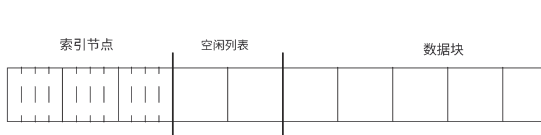

文件系统提供六个主要调用：创建、打开、读取、写入、关闭、删除。本以直观的方式正确地实现了这六个调用，如图 PS.2 所示。对磁盘的所有更新都是同步的；也就是说，当写入一个数据块的调用返回时，该数据块肯定已经安装在磁盘上。单个块的写入是原子的。

问题 8.1 本注意到，如果他在运行应用程序时将 Bitdiddler 的电池拔出，然后重新插入电池并重新启动机器，应用程序创建的文件存在，但包含了他没有写入文件的意外数据。

* 开发此问题集的功劳属于 Samuel R. Madden。

## 过程 创建（文件名）

扫描所有非空的索引节点以避免重复的文件名（如果重复则返回错误）

在索引节点列表中找到一个空闲的索引节点

将索引节点的数据块数更新为0，标记为已使用，并将其写入磁盘

更新空闲列表以指示索引节点已被使用，将空闲列表写入磁盘

## 过程打开（文件名）

// 返回一个文件句柄

扫描非空闲的索引节点查找文件名

如果找到，分配并返回一个指向该索引节点的文件句柄 fh

## 过程写入(fh，缓冲区，长度）

查找文件句柄 fh 以确定文件的索引节点，从磁盘中读取索引节点

如果文件的最后一个块有空闲空间，则写入其中

确定所需的新块数，n

对于 i 从1到 n

使用空闲列表找到一个空闲块 b

更新空闲列表以显示 b 已被使用，将空闲列表写入磁盘

将 b 添加到索引节点中，将索引节点写入磁盘

将块 b 的适当数据写入磁盘

## 过程读取（文件句柄, 缓冲区, 长度）

在文件句柄 fh 中查找文件的 inode，从磁盘读取 inode

从文件的当前位置读取 len 字节的数据到 buf 中

## 过程关闭（文件句柄）

从文件句柄表中移除 fh

## 过程 删除（文件名）

扫描非空闲的 inode，查找文件名，将该 inode 标记为空闲

将 inode 写入磁盘

将文件使用的数据块标记为自由列表中的空闲块

将修改后的自由列表块写入磁盘

Ben 为 Bitdiddler 编写了以下简单应用程序：

创建（文件名）

fh = 打开(文件名)

写入(文件句柄, 应用数据, 长度(应用数据)) // 应用数据是要写入的一些数据

关闭（文件句柄）

## 图 PS.2

Bitdiddler 文件系统。

## PS-30 问题集

以下哪些是这种行为的可能解释？（假设磁盘控制器从不写入部分块。）

- A. 通过调用 WRITE 分配给数据页的空闲列表条目已写入磁盘，但是 inode 和数据页本身都没有被写入。
- B. 分配给 Ben 的应用程序的 inode 先前包含一个（已删除的）具有相同名称的文件。如果系统在调用 CREATE 期间崩溃，可能会导致旧文件以其先前的内容重新出现。
- C. 通过调用 WRITE 分配给数据页的空闲列表条目以及 inode 新的副本都已写入磁盘，但是数据页本身没有。
- D. 通过调用 WRITE 分配给数据页的空闲列表条目以及数据页本身都已写入磁盘，但是新的 inode 没有。

Q 8.2 本决定通过在 Bitdiddler 的文件系统上每次启动时扫描其数据结构来修复不一致性。以下哪些不一致性可以使用这种方法识别（不修改 Bitdiddler 实现）？

- A. 正在使用的块也在空闲列表上。
- B. 未使用的块不在空闲列表上。
- C. 正在使用的块包含先前取消链接文件的数据。
- D. 在多个文件中使用的块。

2007-3-6 7

## 9 本的内核

本为简单计算机开发了一个操作系统。操作系统具有提供虚拟地址空间、线程和控制台输出的内核。

每个应用程序都有自己的用户级地址空间并使用一个线程。内核程序在内核地址空间中运行，但没有自己的线程。（内核程序的详细描述如下。）

计算机有一个处理器、一个内存、一个定时器芯片（稍后会介绍）、一个控制台设备和一个连接设备的总线。处理器具有用户模式位，并且是一个多寄存器集设计，这意味着它有两组程序计数器（PC）、堆栈指针（SP）和页映射地址寄存器（PMAR）。一组用于用户空间（用户模式位设置为 ON）：upc、usp 和 upmar。另一组用于内核空间（用户模式位设置为 OFF）：kpc、ksp 和 kpmar。只有在内核模式下的程序才允许存储到 upmar、kpc、ksp 和 kpmar — 在用户模式下存储这些寄存器的值是非法指令。

处理器在发生以下三种事件之一时从用户模式切换到内核模式：应用程序发出非法指令、应用程序发出监控程序调用指令（使用 svc 指令）或者处理器在用户模式下接收到中断。处理器通过将用户模式位设置为 OFF 从用户模式切换到内核模式。当发生这种情况时，处理器继续运行，但使用当前的 kpc、ksp 和 kpmar 的值。用户程序计数器、堆栈指针和页映射地址的值保持不变，分别为 upc、usp 和 upmar。

为了从内核返回到用户空间，内核程序执行 RTI 指令，该指令将用户模式位设置为 ON，导致处理器使用 upc、usp 和 upmar。kpc、ksp 和 kpmar 的值保持不变，等待下一个 svc。除了这些寄存器外，处理器还有四个通用寄存器：ur0、ur1、kr0 和 kr1。ur0 和 ur1 对在用户模式下活动。kr0 和 kr1 对在内核模式下活动。

本运行两个用户应用程序。每个应用程序执行以下一组程序：

```
整数 t 初值 1  // 共享变量 t 的初始值
procedure MAIN ()
	do forever
		t = t + t
		PRINT (t)
		YIELD ()
```

PRINT 在输出控制台上打印 t 的值。输出控制台是一个只输出设备，不会产生中断。

## PS-32 问题集

内核在每个程序中运行其自己的用户级地址空间。每个用户地址空间都有一个线程（具有自己的堆栈），由内核管理：

```
整数 currentthread                // 当前用户线程的索引
结构  thread[2]                  // 当不运行时，线程状态的存储位置
    整数 sp                      // 用户堆栈指针
    整数 pc                      // 用户程序计数器
    整数 pmar                    // 用户页映射地址寄存器
    整数 r0                      // 用户寄存器 0
    整数 r1                      // 用户寄存器 1
```

```
过程 DOYIELD()
	线程[currentthread].sp = usp          // 保存寄存器
	线程[currentthread].pc = upc
	线程[currentthread].pmar = upmar
	线程[currentthread].r0 = ur0
	线程[currentthread].r1 = ur1
	currentthread = (currentthread + 1) modulo 2   // 选择新线程
	usp = thread[currentthread].sp          // 恢复寄存器
	upc = thread[currentthread].pc
	upmar = thread[currentthread].pmar
	ur0 = thread[currentthread].r0
	ur1 = thread[currentthread].r1
```

为简单起见，这个非抢占式线程管理器仅适用于在 Ben 的内核上运行的两个用户线程。系统通过执行过程 KERNEL 来启动。以下是它的代码：

```
procedure KERNEL()
	CREATE_THREAD (MAIN)                  // 设置 Ben 的两个线程
	CREATE_THREAD (MAIN)
	usp = thread[1].sp                    // 初始化线程1的用户寄存器
	upc = thread[1].pc
	upmar = thread[1].pmar
	ur0 = 线程[1].r0
	ur1 = 线程[1].r1
	do forever
		RTI                                  // 运行用户线程直到发出SVC
		n = ???                              // 查看问题 Q 9.1
		if n = 0 then DOYIELD()
```

由于内核使用 RTI 指令将控制权传递给用户，当用户执行 SVC 时，处理器会在内核中继续执行紧随其后的指令的 RTI。

Ben 的操作系统设置了三个页映射，一个用于每个用户程序，一个用于内核程序。Ben 精心设置了页映射，使得这三个地址空间不共享任何物理内存。

问题 9.1 描述监督程序如何获取调用程序调用的 svc 的标识符 n 的值。

## Q 9.2 如何切换当前地址空间？

- A. 通过内核写入 kpmar 寄存器。
- B. 通过内核写入 upmar 寄存器。
- C. 通过处理器改变用户模式位。
- D. 通过应用程序写入 kpmar 或 upmar 寄存器。
- E. 通过 DOYIELD 保存和恢复 upmar。

Q 9.3 Ben 运行系统一段时间，观察它打印出几个结果，然后他停止处理器以检查其状态。他发现它处于内核中，正准备执行 RTI 指令。当内核执行该 RTI 指令时，用户级线程可以在哪个过程中恢复执行？

- A. 在过程 KERNEL 中。
- B. 在过程 MAIN 中。
- C. 在过程 YIELD 中。
- D. 在过程中 DOYIELD。

## Q 9.4 在 Ben 的设计中，哪些机制在强制模块化方面起作用？

- A. 分离的地址空间，因为一个应用程序的野写不能修改另一个应用程序的数据。
- B. 用户模式位，因为它禁止用户程序写入 upmar 和 kpmar。
- C. 内核，因为它强制线程放弃处理器。
- D. 应用程序，因为它只有几行代码。

Ben 在硬件手册中阅读有关定时器芯片的信息，并决定修改内核以利用它。在初始化时，内核启动定时器芯片，它将每100毫秒生成一个中断。（Ben 的计算机没有其他中断源。）请注意，在内核地址空间中执行时，中断使能位关闭；处理器仅在执行用户模式指令之前检查中断。因此，每当处理器处于内核模式时，定时器芯片生成中断时，中断将被延迟，直到处理器返回用户模式。

用户模式下的中断会导致插入一条 svc-1 指令到指令流中。最后，Ben 通过替换 do forever 循环并添加一个中断处理程序来修改内核，如下所示：

```
永远执行
	RTI
	n ≠ ???
	如果 n = 1 则 DOINTERRUPT ()
	如果 n = 0 则 DOYIELD ()

	过程
		DOINTERRUPT ()
		DOYIELD ()
```

不要对处理器的速度做任何假设。

问题 9.5 Ben 再次运行系统一段时间，观察它打印出几个结果，然后他停止处理器以检查其状态。再次发现它处于内核状态，

## PS-34 问题集

在内核执行 RTI指令之后，用户级线程可以在哪个过程中恢复执行？ 在哪个过程中，用户级线程可以在内核执行 RTI指令之后恢复执行？

- A. 在过程 DOINTERRUPT中。
- B. 在过程 KERNEL中。
- C. 在过程 MAIN中。
- D. 在过程 YIELD中。
- E. 在过程 DOYIELD中。

本将两个用户程序修改为在物理内存中的相同位置映射变量 t，从而共享变量 t。现在两个线程都读取和写入相同的 t。

请注意，寄存器不在线程之间共享：调度程序在线程切换时保存和恢复寄存器。本的简单编译器将代码的临界区翻译为：

```
100 加载t, r0     // 读取 t到寄存器0
104 加载 t, r1     // 读取 t到寄存器1
108 加 r1, r0      // 将寄存器0和1相加，结果存储在寄存器0中
112 存储 r0, t     // 将寄存器0存储到 t中
```

这段代码最左边的数字是虚拟地址，指令存储在虚拟地址空间中。Ben的处理器以原子方式执行单个指令。

## 问题9.7 应用程序可以打印出哪些值（不用担心溢出）？

- A. 一些奇数。
- B. 一些不是2的幂的偶数。
- C. 一些2的幂。
- D. 1

在一个会议记录中，Ben读到了一个叫做可重启原子区域的想法，并实现了它们。如果一个线程在关键区域中被中断，该线程

> * Brian N. Bershad, David D. Redell, 和 John R. Ellis. 快速互斥对于单处理器。第五届国际计算机体系结构支持编程语言和操作系统会议(1992年十月), 页码 223–233.

当线程恢复时，管理器将线程重新开始执行临界区的开头。Ben将中断处理程序重新编码如下:

```
过程 DOINTERRUPT ()
如果 upc≥100且 upc≤112则// 我们是否在临界区？
upc ≠ 100 // 是的，在恢复时重新开始临界区!
DOYIELD ()
```

处理器在解释指令之后、处理中断之前递增程序计数器。

## 问题 9.8 现在，应用程序可以打印出什么值（不用担心溢出）？

- A. 一些奇数。
- B. 一些不是2的幂的偶数。
- C. 一些2的幂。
- D. 1

## Q 9.9 当第一个线程在虚拟地址100到112之间时，第二个线程能进入该区域吗（即第一个线程的upc包含100到112之间的值）？

- A. 是的，因为当第一个线程在该区域时，中断可能会导致处理器切换到第二个线程，第二个线程可能会进入该区域。
- B. 是的，因为处理器不会原子地执行DOINTERRUPT中的前三行代码。
- C. 是的，因为处理器不会原子地执行DOYIELD。
- D. 是的，因为MAIN调用了YIELD。

本正在探索是否可以将任何代码放入可重启的原子区域。他创建了一个包含三条指令的可重启原子区域，这些指令使用一个临时变量x交换了两个变量a和b的内容：

```
100 x ≠ a
104 a ≠ b
108 b ≠ x
```

本也修改了 DOINTERRUPT，将112替换为108：

```
过程 DOINTERRUPT ()
如果 upc≥100且 upc≤108则// 我们是否在关键区域内？
upc ≠ 100; // 是的，在恢复时重新开始临界区!
DOYIELD ()
```

变量 a和 b初始值为 a= 1 和 b= 2，计时器芯片正在运行。

## PS-36 问题集

Q 9.10 如果一个线程执行这个可重启原子区域，且变量 a、b和 x不是共享的，可能会有哪些可能的结果？

- A. a = 2 且 b = 1
- B. a = 1 且 b = 2
- C. a = 2 且 b = 2
- D. a = 1 且 b = 1

2003-1-5...13

## 10 基于微内核的股票行情系统

本・比特迪德尔决定基于一种新的内核架构称为微内核以及一种新的硬件平台称为simplePC设计计算机系统。本已经注意到第1.1节，并且追求极简主义。simplePC平台包含一个简单的处理器，一个基于页面的虚拟内存管理器（用于转换处理器发出的虚拟地址），一个内存模块和一个输入输出设备。处理器有两个特殊寄存器，一个程序计数器（pc）和一个栈指针（sp）。栈指针 sp指向栈顶的值。

simplePC处理器的调用约定使用简单的栈模型：

- • 调用过程将调用后的指令地址推入栈中，然后跳转到该过程。
- • 从过程返回时，从栈顶弹出地址并跳转。

simplePC上的程序不使用局部变量。过程的参数通过寄存器传递，寄存器不会自动保存和恢复。因此，栈上的唯一值是返回地址。

本开发了一个简单的股票行情系统来追踪他加入的初创公司的股票。程序从输入设备读取包含一个整数的消息，并将其打印到输出设备上：

```
101. boolean input_available
1. procedure READ_INPUT ()
2. 无限循环
3. 当input_available = FALSE时什么也不做// 空闲循环
4. PRINT_MSG(引号 )
5. input_available ≠ FALSE

200. boolean output_done
201. structure output_buffer at 71fff2_hex    // 输出缓冲区的硬件地址
202. integer 引号

12. procedure PRINT_MSG (m)
13. output_buffer.quote ≠ m
14. 当output_done = FALSE时什么也不做// 空闲循环
15. output_done ≠ FALSE

17. 过程 MAIN ()
18. 读取_输入 ()
19. 停止   // 关闭计算机
```

除了 MAIN程序外，该程序还包含两个过程：读取_输入和打印_消息。过程读取_输入会自旋等待，直到input_available被设置为 TRUE（由输入设备即股票阅读器设置）。当输入设备接收到股票报价时，它会将报价值放入 msg并将input_available设置为 TRUE。

## PS-38 问题集

过程打印_消息会将消息打印到输出设备（本例中为终端）；它将消息中存储的值写入设备，并等待打印完成；当打印完成时，输出设备会将output_done设置为 TRUE。每行上的数字对应处理器发出的读取和写入指令和数据的地址。假设每行伪代码编译成一条机器指令，并且每个过程的末尾都有一个隐式的返回。

## Q 10.1 程序中每行提到的这些数字代表什么？

- A. 虚拟地址。
- B. 物理地址。
- C.页码。
- D.虚拟页中的偏移量。

本在simplePC上直接运行程序，从 MAIN开始，在某个时刻他观察到堆栈上的以下值（记住，只有股票行情程序在运行）：

```
堆栈
19
5 = 堆栈指针
```

## Q 10.2 堆栈上的值5的含义是什么？

- A. 下一个返回指令的返回地址。
- B. 上一个返回指令的返回地址。
- C.当前的 PC值。
- D.当前的 SP值。

## Q 10.3 处理器正在执行哪个过程？

- A. 读取输入
- B. 打印消息
- C. 主程序

## Q 10.4 PRINT_MSG将一个值写入引号中，并存储在地址71ff2hex处，期望该值最终显示在终端上。使用了什么技术来实现这一点？

- A. 内存映射I/O。
- B. 顺序I/O。
- C.流。
- D.远程过程调用。

本想在simplePC平台上运行多个股票行情程序实例，以便更频繁地更新，更准确地跟踪他当前的净值

## 10基于微内核的股票行情系统 PS-39

净值。本为系统购买了另一个输入和输出设备，并将它们连接起来，然后实现了一个简单的线程管理器：

```
300. 整数 线程表 [2];
// 存储线程的堆栈指针。
// 第一个槽位是线程表[0]
302. 整数当前线程初始值为0;

21. 过程 YIELD ()
22. 线程表 [当前线程 ] ≠ SP // 将 SP的值移入表中
23. 当前线程 ≠ (当前线程 + 1) 取模 2
24. SP ≠ 线程表 [当前线程 ] // 从表中加载值到 SP
25. 返回
```

每个线程都从自己的设备读取和写入，并拥有自己的堆栈。本也修改 READ_INPUT 从页面 ps-37：

```
100. 整数消息[2]
// 改为使用数组
102. 布尔输入可用[2]
// 改为使用数组

30. 过程 READ_INPUT ()
31. 无限循环
32. 当输入可用[当前线程] = 假时执行 // 改变
33. YIELD () // 改变
34. 继续 // 改变
35. 打印_消息(消息[当前线程]) // 改为使用数组
36. input_available[current_thread] ≠ FALSE // 改为使用数组
```

本启动simplePC平台，并在 MAIN中启动每个线程运行。这两个线程正确地来回切换。本暂时停止程序并观察以下堆栈：


## Q 10.5 线程0正在运行（即current_thread= 0）。线程0执行 return指令后，处理器下一次将运行哪条指令？

- A. 34. 继续
- B. 19. 停止
- C. 35. PRINT_MSG (msg[current_thread]);
- D. 36. input_available[current_thread] ≠ FALSE;

并且哪个线程将在运行？

## Q 10.6 每个线程的堆栈上可以有哪些地址值？

- A. 任何指令的地址。
- B. 被调用过程返回的地址。
- C. 任何数据位置的地址。
- D. 指令和数据位置的地址。

## PS-40 问题集

本注意到股票行情程序中的每个线程大部分时间都在轮询其输入变量。他引入了一个明确的过程，设备可以用来通知线程。他还重新组织了代码以实现模块化：

```
400. 整数 状态 [2];
40. 过程 SCHEDULE_AND_DISPATCH ()
41. 线程表 [当前线程 ] ≠ SP
42. while (这里应该填什么？) do
43. 当前线程 ≠ (当前线程 + 1) 模 2
44. SP ≠ 线程表 [当前线程 ];
45. 返回

50. 过程 YIELD()
51. 状态 [当前线程 ] ≠ 等待
52. 调度_和_分派 ()
53. 返回

60. 过程 NOTIFY (n)
61. 状态 [n] ≠ 可运行
62. 返回
```

当输入设备接收到新的股票报价时，设备中断处理器并将当前运行线程的pc保存到当前运行线程的堆栈中。然后处理器运行中断过程。当中断处理程序返回时，它从当前堆栈中弹出返回地址，将控制权返回给一个线程。中断处理程序的伪代码如下：

```
过程 设备 (n) // 输入设备中断 n
    将当前线程的PC推入由 SP指向的堆栈中
    当input_available[n] = TRUE时，不做任何操作; // 等待read_input完成 // 上一个输入
    msg[n] ≠ 股票报价
    input_available[n] ≠ TRUE
    通知 (n) // 通知线程 n
    返回 // 即，弹出 PC
```

在中断处理程序执行期间，中断被禁用。因此，中断处理程序和它调用的过程（例如，通知）不能被中断。当 DEVICE返回时，中断被重新启用。

使用新的线程管理器，回答以下问题：Q 10.7 在地址42处的 while 中应该评估哪个表达式以确保线程包的正确操作？

- A. state[current_thread] = WAITING
- B. state[current_thread] = RUNNABLE
- C. threadtable[current_thread] = SP
- D. FALSE

## 10基于微内核的股票行情系统 PS-41

Q 10.8 假设线程0正在运行，线程1没有运行（即，它调用了 YIELD）。
在线程1运行之前需要发生什么事件或事件？

- A. 线程0调用 YIELD.
- B. 输入设备1的中断过程调用 NOTIFY.
- C. 输入设备0的中断过程调用 NOTIFY.
- D. 不需要任何事件.

## 问题10.9 每个线程的堆栈上可以有哪些值？

- A. 除设备驱动程序中断过程之外的任何指令的地址.
- B. 所有指令的地址，包括设备驱动程序中断过程中的指令.
- C. 过程返回的地址.
- D. 指令和数据位置的地址.

## 问题10.10 在哪种情况下线程0会发生死锁？

- A. 当设备0在 YIELD的第一条指令之前中断线程0时.
- B. 当设备0在线程0完成 YIELD的第一条指令之后中断时.
- C. 当设备0在第35和36条指令之间中断线程0在页面ps-37上的 READ_INPUT
过程中.
- D. 当设备0在处理器执行 SCHEDULE_AND_DISPATCH和
线程0处于 WAITING状态时中断。

2000-1-7...16

## 11 Ben的网络服务

Ben Bitdiddle对Amazing Computer Company关于新的基于段的计算机架构的计划非常兴奋，所以他接受了公司提供给他的工作。

Amazing Computer Company观察到每个程序使用一个地址空间将文本、数据、堆栈和系统库放在同一个地址空间中。例如，一个Web服务器将Web服务器的程序文本（即二进制指令）、内部数据结构（如最近访问的Web页面的缓存）、堆栈和用于发送和接收消息的系统库都放在一个地址空间中。Amazing Computer Company希望通过使用新的内存系统来进一步实现模块化，将文本、数据、堆栈和系统库分开。

令人惊叹的计算机公司要求公司中的每个设计师提出一种进一步强化模块化的设计。在一本关于PDP 11/70的尘封书籍中，本发现了一种硬件装置的描述，该装置位于处理器和物理内存之间，将虚拟地址转换为物理地址。PDP 11/70使用该装置允许每个程序拥有自己的地址空间，从地址0开始。

PDP 11/70通过每个程序拥有一个段来实现这一点。从概念上讲，每个段都是一个以虚拟地址0开始的可变大小的线性字节数组。本以PDP 11/70的方案为基础，打算实现硬模块化。本通过段描述符定义一个段：

+ 结构段描述符
- 物理地址 physAddr
- 整数长度
- physAddr字段记录段所在物理内存的地址。
- 长度字段记录段的字节长度。

本的处理器具有由34位组成的地址：18位用于标识段，16位用于标识段内的字节：

| 段标识符 | 索引 |
| --- | --- |
| 18位 | 16位 |

寻址超出段范围的虚拟地址（即，索引大于段的长度）是非法的。

本的内存系统将段描述符存储在一个表中，称为段表，每个段都有一个条目：

| 结构段描述符
段表
[NSEGMENT] |

段表由段标识符索引。它在所有程序之间共享，并存储在物理地址0处。

本计算机使用的处理器是一个简单的RISC处理器，使用LOAD和STORE指令读写内存。LOAD和STORE指令需要

[PAGE 620]

一个虚拟地址作为它们的参数。本的计算机有足够的内存，所有程序都适合物理内存。

本将一个编译器移植到他的处理器上，将源程序翻译成生成机器指令。编译器将其翻译成位置无关的机器代码：跳转指令相对于程序计数器的当前值指定偏移量。为了调用另一个段，它支持长跳转指令，它接受一个虚拟地址并跳转到它。

本的内存系统使用翻译虚拟地址转换为物理地址：

```
1 过程翻译(地址)
2 段标识 ≠地址[0:17]
3 段         ≠ 段表           [段标识   ]
4 索引 ≠地址[18:33]
5 如果索引 <段长度则返回段物理地址 +索引
6 ...     // 在这里程序应该做什么？(见问题Q 11.4，下面)
```

在成功计算出物理地址后，本的内存管理单元从物理内存中检索出被寻址的数据，并将其传递给处理器（在LOAD指令上）或将数据存储在物理内存中（在STORE指令上）。

## Q 11.1 NSEGMENT的最大合理值是多少？

## Q 11.2 给定虚拟地址的结构，段的最大大小是多少字节？

## Q 11.3 物理地址必须有多少位宽？

## Q 11.4 第6行缺失的代码应该

- A. 向处理器发出指令，表示发出的内存引用导致了非法地址错误
- B. 向处理器发出指令，表示应该切换到用户模式
- C. 返回
- D. 向处理器发出指令，表示发出的内存引用是一个中断处理程序

本修改了他的Web服务器，以强制实现服务器不同部分之间的模块化。他将程序的文本分配到段1，最近使用的Web页面的缓存分配到段2，栈分配到段3，系统库分配到段4。段4包含库程序的文本，但不包含变量（即，库程序不在自己的段中存储变量）。

## Q 11.5 要翻译Web服务器，编译器必须执行以下哪些操作？

- A. 计算每个虚拟地址的物理地址。
- B. 在LOAD指令中使用适当的段ID包含虚拟地址。
- C. 为位于不同段中的过程调用生成LONGJUMP指令。
- D. 在STORE指令中使用适当的段ID包含虚拟地址。

## PS-44 问题集

本运行基于段的Web服务器实现，并惊讶地发现Web服务器程序中的错误会导致系统库的文本被覆盖。他研究了自己的设计，并意识到设计是有问题的。

## Q 11.6 本的设计中哪个方面是有问题的，并且会导致观察到的行为？

- A. STORE指令可能会覆盖地址的段ID。
- B. Web服务器程序中的LONGJMP指令可能跳转到库段中不是过程起始地址的位置。
- C. 它不允许将不经常使用的内存分页到辅助存储设备中。
- D. Web服务器程序可能陷入无限循环。

## Q 11.7 下列对Ben的设计进行扩展的哪些方法可以解决上述问题？

- A. 处理器应该有一个受保护的用户模式位，并且应该有一个单独的段表用于内核程序和用户程序
- B. 每个段描述符应该有一个保护位，用于指定处理器是否可以对该段进行写入或只能进行读取
- C. LONGJMP指令应该更改，以便只能将控制转移到段的指定入口点
- D. 段应该都是相同的大小，就像基于页面的虚拟内存系统中的页面一样
- E. 将操作系统更改为使用抢占式调度程序

Ben的Web服务器的系统库包含发送和接收消息的代码。一个独立的程序，网络管理者，管理发送和接收消息的网络卡。Web服务器和网络管理者各自有一个执行线程。Ben想要理解为什么他需要事件计数来协调网络管理者和Web服务器的顺序，所以他决定实现协调两次，一次使用事件计数，一次使用事件变量。

## 这是Ben的两个版本的Web服务器：

| 事件计数 inCnt | 整数 doneCnt |
| --- | --- |
| 过程 SERVE () | 无限循环 |
| 等待 (inCnt, doneCnt); | 执行_请求 (); |
| doneCnt ≠ doneCnt + 1; |  |
| 事件输入 |  |
| 整数 inCnt |  |
| 整数 doneCnt |  |
| 过程 SERVE () |  |
| 无限循环 |  |
| 当 inCnt ≤ doneCnt时 // A | WAITEVENT (输入 ); // B |
| 执行_请求 (); | doneCnt ≠ doneCnt + 1; // D |
|  |  |

## 第五章 AWAIT过程对事件计数具有语义：当web服务器线程调用AWAIT时，线程管理器将调用线程放入WAITING状态，除非inCnt超过doneCnt。

基于事件的版本与事件计数版本几乎相同，但有一些变化。事件变量是等待事件的线程列表。WAIT EVENT过程将当前执行的线程放入事件列表中，记录当前线程处于WAITING状态，并通过调用YIELD释放处理器。

在两个版本中，当Web服务器完成处理一个数据包后，它会增加doneCnt。

网络管理器中处理每个数据包到达的代码的两个对应版本是：

| 使用事件计数的网络管理器 | 使用事件的网络管理器 |
|---|---|
| ADVANCE (inCnt) | inCnt ≠ inCnt + 1 // E |
| | NOTIFYEVENT (input) // F |

如果Web服务器线程已经处于休眠状态，ADVANCE过程会唤醒它。NOTIFYEVENT过程会将所有线程从事件列表中移除，并将它们置于READY状态。共享变量存储在网络管理器和Web服务器之间共享的段中。

本对编写涉及协调多个活动的代码有些担心，所以他决定仔细测试代码。他购买了一台带有一个处理器的计算机，用于运行Web服务器和网络管理器，使用抢占式线程调度器。本确保Web服务器和网络管理器这两个线程永远不会同时在线程管理器中运行，当处理器运行线程管理器的代码（包括ADVANCE、AWAIT、NOTIFYEVENT和WAIT EVENT）。

为了测试代码，本改变了线程管理器以频繁抢占线程（即，每个线程以短时间片运行）。本使用事件计数运行旧代码，程序表现如预期，但使用事件的新代码存在问题，即Web服务器有时会延迟处理数据包直到下一个数据包到达。

问题可能出现在上述基于事件的解决方案的代码中标记有字母的程序步骤。使用这些字母，给出一个导致问题的步骤序列。（某些步骤可能需要出现多次，而有些步骤可能不必要以导致问题。）

```
E, F
```

## 12 有界缓冲区与信号量

使用信号量的 DOWN和 UP（见Sidebar 5.7），本根据下面的伪代码实现了一个内核中的有界缓冲区。内核维护一个包含有界缓冲区的port_info数组。消息结构的内容对于此问题并不重要，除了它有一个字段 dest_port，用于指定目标端口。当从网络接收到消息时，会产生一个中断，网络中断处理程序（INTERRUPT）将消息放入消息中指定的端口的有界缓冲区中。如果该有界缓冲区没有空间，中断处理程序会丢弃该消息。线程通过调用 RECEIVE_MESSAGE来消费消息，该函数从接收消息的端口的有界缓冲区中移除一条消息。

为了协调中断处理程序和调用 RECEIVE_MESSAGE的线程，实现使用了一个信号量。对于每个端口，内核保持一个信号量 n 来计数端口有多少个消息在有界缓冲区中。如果 n 达到0，调用 RECEIVE_MESSAGE的线程将进入等待状态。当 INTERRUPT向缓冲区添加一条消息时，它调用 UP来唤醒线程（即将线程的状态设置为 RUNNABLE）。

内核采用抢占式调度线程。

```
结构体 port_info
信号量 实例 计数 初始为 0
消息实例缓冲区[NMSG]
长整型 in 初始为 0 // 一个包含NMSG条消息的数组
长整型 out 初始为 0

过程 INTERRUPT (消息 实例 m , 端口信息 引用 port)
// 一个中断，宣布消息 m 的到达
如果 port.in - port.out >= NMSG则
// 是否有空格？
返回
// 不，忽略消息
端口.缓冲区[端口.输入模 NMSG] = m
端口.输入 = 端口.输入+ 1
UP(端口.计数 )

过程接收_消息(目标端口, 端口信息引用端口)
1 ...
DOWN(端口.计数)
 m =端口.缓冲区[端口.输出模 NMSG]
端口.输出 = 端口.输出+ 1
返回 m
```

Alyssa声称信号量也可以用来使操作变为原子操作。她提议在port_info结构中添加以下内容：

| 信号量 | 实例 | 互斥 | 初始 | ????
|---|---|---|---|---|
|  |  |  |  |  |
// 下面的问题

并在上述伪代码的第1行添加以下行：

```
DOWN(port.mutex) // 进入原子区
```

Alyssa认为这些更改允许线程在没有竞争条件的情况下同时调用相同端口上的RECEIVE_MESSAGE，即使内核以抢占方式调度线程。

Q 12.2 通过将???替换为一个数字，可以将 mutex初始化为什么值，以避免竞争条件和死锁，当多个线程在同一端口上调用 RECEIVE_MESSAGE时？

+   - A. 0
- B. 1
- C. 2
- D. -1

## 13 单芯片NC*

本·比特迪德尔计划用他刚开发的15美元的单芯片网络计算机NC在计算机领域引发一场革命。在NC网络系统中，网络接口线程在消息到达时调用 MESSAGE _ARRIVED过程。 线程可以调用WAIT_FOR_MESSAGE过程来等待消息。 为了协调线程执行的顺序，Ben部署了另一个常用的协调原语：条件变量。

NC中的一部分代码如下：

```
锁   实例   m
布尔消息在这里
条件   实例   消息存在

过程   消息   _到达   ()
消息在这里   ≠ 真
通知_条件(消息存在) // 通知等待该条件的线程

过程等待_消息()
获取   (m)
当不是消息在这里时
   等待_条件(消息存在, m); // 释放 m并等待
释放   (m)
```

过程获取和释放是第五章中描述的那些。通知_条件 (条件) 原子地唤醒所有等待条件变为真的线程。等待_条件 (条件, 锁) 原子地执行几个操作：测试条件；如果为真则返回；否则将调用线程放入等待队列中等待条件，并释放锁。当通知_条件唤醒一个线程时，该线程变为可运行状态，并且当调度器运行该线程时，在返回给调用者之前，等待_条件重新获取锁（必要时等待直到可用）。假设条件变量的实现中没有错误。

Q 13.1 即使在 while循环中旋转时， WAIT_FOR_MESSAGE可能会永远等待，即使有消息到达 给出上述语句的执行顺序会导致这个问题。 你的答案应该是一个简单的列表，如1、2、3、4。

1. 线程调用WAIT_FOR_MESSAGE
2. 线程调用MESSAGE_ARRIVED
3. 线程进入等待状态，而另一个线程正在处理
4. 消息到达，调用NOTIFY_CONDITION

Q 13.2 编写新版的 MESSAGE_ARRIVED和 /或 WAIT_FOR_MESSAGE来修复这个问题。

```
过程 消息_到达()
   消息在这里 = 真
   通知_条件(消息存在)

过程 等待消息()
   获取 (m)
   如果不是消息在这里
      等待_条件(消息存在, m)
   否则
      消息在这里 = 假
   释放 (m)
```

## 14 Toastac-25*

Louis P. Hacker以14.99美元的价格在庭院销售中购买了一台二手的Therac-25（医疗辐射机器），这台机器曾经发生过几起事故[进一步阅读建议1.9.5]。经过一些小的修改，他将其连接到家庭网络作为一台可控制的计算机烤面包机，可以在2毫秒内烤一片面包。他决定使用RPC来控制Toastac-25。每个烤面包请求在服务器上启动一个新线程，烤面包，返回确认（或者可能是一个有用的错误代码，如“故障54”），然后退出。每个服务器线程运行以下过程：

```
过程服务器()
获取  （消息缓冲锁）
解码  （消息）
获取(加速器缓冲锁)
释放  （消息缓冲锁）
烹饪_烤面包（）
获取  （消息缓冲锁）
消息 ≠ "确认"
发送(消息)
释放(加速器缓冲锁)
释放  （消息缓冲锁）
```

Q 14.1 令人惊讶的是，烤面包机在第一次大量使用时停止烹饪面包！出了什么问题？

+   - A. 两个服务器线程可能会发生死锁，因为一个线程拥有消息缓冲锁并且想要加速器缓冲锁，而另一个线程拥有加速器缓冲锁并且想要消息缓冲锁。
- B. 两个服务器线程可能会发生死锁，因为一个线程拥有加速器缓冲锁和消息缓冲锁。
- C. Toastac-25发生死锁，因为烹饪_烤面包不是一个原子操作。
- D. 不充分的锁定允许服务器线程不适当地交错执行。

一旦路易斯修复了多线程服务器，Toastac的使用量比以往任何时候都要多。然而，当Toastac有许多同时请求时（即有许多线程），他注意到系统性能严重下降，比他预期的要严重得多。性能分析表明，锁的竞争并不是问题所在。

Q 14.2 可能出了什么问题？

+   - A. Toastac系统在线程之间不断切换，导致花费了所有时间。
- B. Toastac系统花费所有时间等待请求到达。
- C. Toastac变得很热，因此烤面包时间变长。
- D. Toastac系统花费所有时间释放锁。

Q 14.3 对超级计算机的升级解决了这个问题，但为时已晚-路易斯对性能着迷。 他从RPC切换到异步协议，如果在2毫秒内发出多个请求，则将这些请求组合成单个消息。 在他的网络上，传输时间非常长，他注意到这种方法可以加快某些工作负载的速度，但对其他工作负载的速度提升不明显。 描述一个加速的工作负载和一个没有加速的工作负载。（一个可能的工作负载示例是每10毫秒发出一个请求。）

加速的工作负载：每2毫秒发出一个请求
没有加速的工作负载：每10毫秒发出一个请求

Q 14.4 作为设计工程顾问，你被要求批评Louis从RPC转向异步客户端/服务端的决定。 你对他的决定有什么感觉？ 请记住，Toastac软件有时会出现“故障54”而不是正常烤面包。

Louis的决定可能是出于对性能优化的考虑，但使用异步协议可能会增加系统复杂性，并可能引入新的错误源。此外，异步请求处理可能并不适用于所有场景，特别是当请求需要立即响应或顺序处理时。

## 15 BOOZE：Ben的面向对象分区环境

Ben Bitdiddle编写了大量的面向对象程序。对象的大小不同，但页面的大小是固定的。Ben受到启发，将基于页面的虚拟内存系统（PAGE）重新设计为对象内存系统。PAGE是一个基于页面的虚拟内存系统，类似于第5章中描述的系统，并具有第6章中多级内存系统的扩展。BOOZE是Ben的基于对象的虚拟内存系统。*当然，他可以在任一系统上运行他的程序。

每个BOOZE对象都有一个称为UID的唯一标识符。UID有三个字段：包含对象的磁盘块的磁盘地址；对象在该磁盘块中的偏移量；以及对象的大小。

| 结构唯一标识符 |
|---|
| 整数块号 // 磁盘块的磁盘地址 |
| 整数偏移量 // 块内偏移量块号 |
| 整数大小 // 对象的大小 |

在BOOZE和PAGE上运行的应用程序具有类似的结构。唯一的区别是，在PAGE上，程序通过其虚拟地址引用对象，而在BOOZE上，程序通过UID引用对象。

BOOZE和PAGE中的两个内存级别是主内存和磁盘。磁盘是一个大小为4千字节的线性数组。磁盘块通过其块号进行寻址。在这两个系统中，磁盘和主内存之间的传输单元是4千字节的块。对象不跨越磁盘块边界，小于4千字节，并且大小不可更改。PAGE中的页面大小等于磁盘块大小；因此，当应用程序引用一个对象时，PAGE将加载同一页上的所有对象。

BOOZE在主存储器中保留了一个对象映射。对象映射包含将UID映射到相应对象的内存地址的条目。

| 结构映射条目 |
|---|
| UID实例 UID |
| 整数地址 |

在对对象的所有引用中，BOOZE将UID转换为主存储器中的地址。

BOOZE使用以下过程（部分在硬件中实现，部分在软件中实现）进行转换：

> * Ben在阅读了Ted Kaehler的一篇论文“面向对象语言的虚拟内存”[进一步阅读建议6.1.4]后选择了这个名字。在那篇论文中，Kaehler描述了一个名为面向对象分区环境（OOZE）的内存管理系统。

在软件中）进行翻译：

| 过程 | OBJECTTOADDRESS(UID) 返回 | 地址 |
|---|---|---|
| addr ≠ ISPRESENT(UID) | // 在对象映射中是否存在UID? |
| 如果地址≥ 0则返回地址 | // UID存在，返回地址 |
| 地址 ≠查找空闲空间(UID.大小) | // 分配空间以容纳对象 |
| 读取对象(地址, UID) | // 从磁盘读取对象并存储在地址 |
| 输入到映射中(UID,地址) | // 在对象映射中输入 UID |
| 返回地址 | // 返回对象的内存地址 |

ISPRESENT在对象映射中查找 UID；如果存在，则返回相应对象的地址；否则返回1。FINDFREE SPACE为对象分配空闲空间；可能会驱逐其他对象以为此对象腾出空间。READOBJECT读取包含对象的页面，然后将对象复制到分配的地址。

## Q 15.1 在mapentry数据结构中，addr表示什么？

+   - A. 对象映射所在的内存地址。
- B. 找到给定对象的磁盘地址。
- C.在内存中找到当前驻留在内存中的给定对象的内存地址。
- D.当访问对象时，给定的非驻留对象将被加载到的内存地址。

Q 15.2 BOOZE相比PAGE有什么优势？

A. 在BOOZE上运行的应用程序通常使用更少的主内存，因为BOOZE只存储正在使用的对象。
B. 在BOOZE上运行的应用程序通常运行更快，因为UID比虚拟地址更小。
C. 在BOOZE上运行的应用程序通常运行更快，因为BOOZE将对象从磁盘传输到主内存，而不是完整的页面。
D. 在BOOZE上运行的应用程序通常运行更快，因为典型应用程序将表现出更好的引用局部性。

当 FINDFREE SPACE无法找到足够的空间来容纳对象时，它需要将一个或多个对象写回磁盘以创建空闲空间。FINDFREE SPACE使用 WRITEOBJECT将对象写入磁盘。

本正在考虑如何实现 WRITEOBJECT。他正在考虑以下选项：

+   - 1. 过程 WRITEOBJECT (地址, UID)
  WRITE(地址,UID.blocknr, 4096)
- 2. 过程 WRITEOBJECT(地址, UID)
  READ(缓冲区,UID.blocknr, 4096)
  COPY(地址,缓冲区 + UID.offset, UID.size)
  WRITE(缓冲区,UID.blocknr, 4096)

READ (内存地址:磁盘地址,4096)和 WRITE (内存地址:磁盘地址,4096)读取和写入一个4千字节的页面从/到磁盘。COPY (源,目标,大小) 将大小字节从源地址复制到主存中的目标地址。

本现在将注意力转向优化BOOZE的性能。特别是，他想减少对磁盘的写入次数。

## Q 15.3 Ben应该使用哪种实现方式？

+   - A. 实现方式2，因为实现方式1是错误的。
- B. 实现方式1，因为它比实现方式2更高效。
- C. 实现方式1，因为它更容易理解。
- D. 实现方式2，因为它会导致更好的引用局部性。

本决定要提高性能，因此决定修改FINDFREE SPACE。当FINDFREE SPACE需要驱逐一个对象时，现在尝试不写入在过去30秒内修改过的对象（因为认为它可能很快再次被使用）。本通过在对象被修改时设置脏标志来实现这一点。每30秒，BOOZE调用一个名为WRITE_BEHIND的过程，遍历对象映射并写出所有脏对象。对象被写入后，WRITE_BEHIND清除其脏标志。

当 FINDFREE SPACE需要为另一个对象腾出空间时，只有干净的对象才能被替换。

当在最新版本的BOOZE上运行他的应用程序时，本偶尔观察到在调用 OBJECTTOADDRESS创建一个新对象时，BOOZE会偶尔耗尽物理内存。

## Q 15.5 以下哪种策略可以避免上述问题？

+   - A. 当 FINDFREE SPACE找不到任何干净的对象时，它会调用 WRITE_BEHIND，然后再次尝试找到干净的对象。
- B. BOOZE可以每1秒调用 WRITE_BEHIND，而不是每30秒调用一次。
- C. 当 FINDFREE SPACE找不到任何干净的对象时，它会选择一个脏对象，将包含该对象的块写入磁盘，清除脏标志，然后使用该地址创建新对象。
- D. 以上所有策略。

## 16 OutOfMoney.com

（第6章，稍微涉及第4章）

OutOfMoney.com决定需要一个真正的产品，所以它解雇了大部分市场部门的员工。为了替代市场人员，并根据一位高级计算机专家的建议，OutOfMoney.com雇佣了一群16岁的人。这些16岁的人聚在一起，决定设计和实现一个能够播放MPEG-1视频的视频服务，这样他们就可以在计算机上以彩色的方式观看布兰妮·斯皮尔斯的视频。

由于时间至关重要，马克·比特迪德尔（Ben的16岁的弟弟，在OutOfMoney工作）上网搜索一些可以作为起点的代码。马克找到了一些看起来相关的代码，并为OutOfMoney的视频服务进行了修改：

```
过程 服务 ()
    永远执行
        请求 ≠ 接收 _消息 ()
        文件 ≠从磁盘获取文件 (请求)
        回复 (文件 )
```

服务过程等待客户端在网络上发送消息。消息包含对特定文件的请求。获取文件从磁盘读取文件到内存位置文件。回复过程将文件从内存中以消息的形式发送回客户端。

（在伪代码中，未声明的变量是在使用它们的过程中的局部变量，因此变量存储在堆栈或寄存器中。）马克和他16岁的朋友们还编写了网络驱动程序的代码，用于发送和接收网络数据包，一个简单的文件系统用于在磁盘上存储和获取文件，以及一个用于引导机器的加载程序。他们在一台现成的个人电脑上的裸机硬件上运行他们的代码，该电脑配备了一个磁盘，一个处理器（Pentium III）和一个网络接口卡（1千兆以太网）。机器启动后，它启动一个线程。

运行 服务 .

磁盘的平均寻道时间为5毫秒，一次完整的旋转需要6毫秒，当不需要寻道时，其吞吐量为每秒10兆字节。

所有文件都是1千兆字节（大约半小时的MPEG-1视频）。存储文件的文件系统没有缓存，并且它以8千字节的块分配文件的数据。在分配块时，它不关注文件布局；因此，同一文件的磁盘块可能分散在整个磁盘上。1千兆字节的文件包含131,072个8千字节的块。

Q 16.1 假设磁盘是主要瓶颈，服务提供一个文件需要多长时间？

服务提供一个文件需要大约60秒。

## 16.2 马克通过一次请求每个存储的视频来测试代码。假设磁盘是主要瓶颈（从缓存中提供文件需要0毫秒），现在服务提供文件的平均时间是多少？

马克很高兴测试实际上返回了每个视频。他向市场部剩下的唯一的人报告原型已经准备好进行评估。为了让投资者满意，市场人员决定使用原型来运行Out-OfMoney的网站。市场部的唯一人员将机器装满视频，并通过一次大型公关活动推出了新的网站，耗尽了他们剩下的资金。

他们刚刚推出网站几秒钟后，OutOfMoney的支持部门（也由16岁的人员组成）收到了不满意的用户发送的电子邮件，称该服务未响应他们的请求。支持部门测量了服务的CPU负载和磁盘负载。他们观察到CPU负载很低，磁盘负载很高。

## 16.3 这种观察的最可能原因是什么？

+   A. 缓存太大。
B. 缓存的命中率很低。
C. 缓存的命中率很高。
D. CPU速度不够快。

支持部门呼叫马克，他跑去找他的兄弟本寻求帮助。本建议使用第5章的示例线程包。马克修改代码以使用线程包，并在系统启动后启动100个线程，每个线程运行 SERVICE：

```
对于 i 从 1到 100执行 CREATE_THREAD (SERVICE)
```

此外，马克修改 RECEIVE_MESSAGE 和 GET_FILE_FROM_DISK 以通过调用 YIELD 在等待新消息到达或等待磁盘完成磁盘读取时释放处理器。他的代码没有在其他地方释放处理器。线程包的实现是非抢占式的。

## 16.4 这是马克的最新努力：

```
缓存 [4 x 1073741824] // 所有线程共享的4GB缓存。
过程 服务 ()
永远执行
请求   ≠ 接收   _消息  ()
文件   ≠空
对于 k从 1 到 131072循环
块 ≠查找_缓存(请求, k)
如果块 =空则
  block ≠ GET_BLOCK_FROM_DISK (request, k)
  ACQUIRE(cachelock)  // 使用锁
  将_添加到 缓存中(请求,块,K)
  释放   (缓存锁  )  // 这里也是
  文件 ≠文件 + 块
回复(文件 )
```

过程查找_缓存 (请求, k) 检查请求中指定的文件的第k块是否存在；如果块存在，则返回它。过程从_磁盘读取_块 (请求 , k) 将请求中指定的文件的第k块从磁盘读入内存。过程添加_到_缓存将请求中指定的文件的第k块添加到缓存中。

马克用一个视频加载服务。 他成功地检索到了视频。 对于这个结果感到满意，马克并行地向服务发送了许多请求来获取单个视频。他观察到没有磁盘活动。

根据目前的信息，为什么马克观察不到磁盘活动的最有可能的解释是什么？

对于进展感到满意，马克使服务准备好在生产模式下运行。 他担心自己可能需要修改代码来处理并发——

他过去的经验告诉他他需要接受教育，所以他正在阅读第5章。他考虑用锁来保护 ADD_TO_CACHE:

```
lock 实例  cachelock// 用于缓存的锁
过程  服务  ()
永远执行
请求   ≠ 接收   _消息  ()
文件   ≠空
对于 k从 1 到 131072循环
块 ≠查找_缓存(请求, k)
如果块 =空则
  block ≠ GET_BLOCK_FROM_DISK (request, k)
  ACQUIRE(cachelock)  // 使用锁
  将_添加到 缓存中(请求,块,K)
  释放   (缓存锁  )  // 这里也是
  文件 ≠文件 + 块
回复(文件 )
```

## 16.5 本认为这些修改是没有用的。本是对的吗？

马克不喜欢思考，所以他升级了OutOfMoney的网站，使用了带锁的多线程代码。当升级后的网站上线时，马克观察到大多数用户都在观看同样的三个视频，而只有少数用户在观看其他视频。

## 16.6 马克观察到缓存中块的命中率为90%。假设磁盘是主要瓶颈（从缓存中提供块的时间为0毫秒），SERVICE提供单个电影的平均时间是多少？

## 16.7 马克将一部新的布兰妮·斯皮尔斯的视频加载到服务中，并观察第一批用户开始观看。它非常受欢迎，没有用户在观看其他视频。马克发现第一批观众几乎同时开始观看视频。他观察到服务线程几乎同时读取块0，然后几乎同时读取块1，依此类推。对于这种工作负载，什么是一个好的缓存替换策略？

+   A. 最近最少使用。
B. 最近最常使用。
C. 先进先出。
D. 后进先出。
E. 对于这种工作负载，替换策略并不重要。

市场部非常满意进展。本通过出售他的宝马再次筹集资金，并启动了另一轮公关活动。用户数量大幅增加。不幸的是，在高负载下，机器停止提供服务并需要重新启动。因此，一些用户不得不从头开始重新播放视频，并致电支持部门投诉。问题似乎是网络驱动程序和服务线程之间的某种交互作用。驱动程序和服务线程共享一个固定大小的输入缓冲区，可以容纳1,000个请求。

## 16.8 在高负载下可能发生以下哪种情况？

+   A. 当到达的消息中断驱动程序时发生死锁。
B. 当到达的消息中断正在执行接收消息的线程时发生死锁。
C. 当到达的消息中断正在执行从缓冲区中删除的线程时发生死锁。
D. 接收消息在缓冲区不为空时错过了让出的调用，因为它可能在缓冲区为空的测试和让出的调用之间被中断。

## 16.9 马克应该实施哪些修复措施？

+   A. 删除所有与锁有关的代码。
B. 驱动程序应作为一个单独的线程运行，通过中断唤醒。
C. 中断和驱动程序应该使用事件计数进行顺序协调。
D. 当缓冲区已满时，驱动程序不应丢弃数据包。

马克解决了死锁问题并且为了吸引更多用户，宣布了一个新的布兰妮·斯皮尔斯视频的可用性。消息迅速传播，大量请求这个视频的开始涌向服务。 随着越来越多的客户要求视频，马克测量了服务的吞吐量。得到的图表绘制在右侧。 吞吐量首先随着客户数量的增加而增加，然后达到最大值，最后下降。

## 16.10 为什么随着客户数量的增加，吞吐量会减少？

+   A. 处理器大部分时间都在处理中断。
B. 处理器大部分时间都在更新缓存。
C. 处理器大部分时间都在等待磁盘访问完成。
D. 处理器大部分时间都在从缓冲区中移除消息。

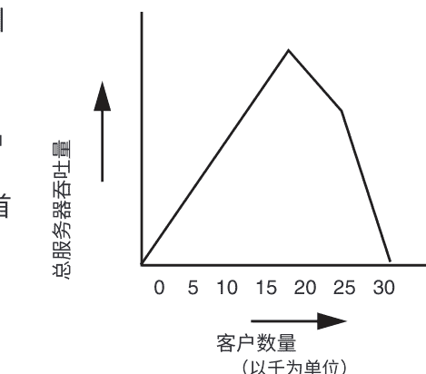

2001-1-6...15

## 17 Quarria *

Quarria是一个位于太平洋中央的1公里岩石岛上形成的新国家。创始人组织了Quarria股票市场以推动经济发展。股票市场非常简单，因为只有一支股票可以交易（即Quarria Rock Company的股票）。此外，由于当地的宗教信仰，股票的价格始终精确地等于岛上最高点的风速。

Rocky，Quarria的总裁，建议股票市场完全基于网络。他建议从服务器机器上运行股票市场，并要求每个投资者拥有一个单独的客户机，该客户机使用简单的RPC协议偶尔向服务器发出请求。Rocky提议支持的两个远程过程是

+   • BALANCE(): 请求服务器返回客户账户的现金余额。这项服务非常快速，只需要简单地读取内存位置。
• TRADE(nshares): 请求以当前市场价格购买 nshares（假设 nshares为正数）或出售nshares（如果 nshares为负数）。这项服务可能很慢，因为它可能涉及网络流量以找到愿意交易的伙伴。

Quarria在其中实现了一个简单的RPC协议，客户端向服务器发送具有以下格式的请求消息：

| 结构请求 |
|---|
| 整数客户端 | // 客户端的唯一代码 |
| 整数操作码 | // 所请求操作的代码 |
| 整数参数 | // 整数参数，如果有的话 |
| 整数结果 | // 整数返回值，如果有的话 |

服务器通过发送相同的消息回复，只是结果字段会改变。我们假设所有的消息都能放在一个数据包中，链路层和网络层的错误检查会检测并丢弃损坏的数据包，并且Quarria的投资者都是诚实的；因此任何接收到的消息都是由某个客户端发送的（尽管发送的消息可能会丢失）。

Q 17.1 这种RPC设计适用于无连接的网络模型吗，还是假设了基于连接的模型？

客户端RPC存根会阻塞客户端线程，直到收到回复，但是包括一个定时器到期，允许任何客户端RPC操作在 q秒后如果没有从服务器收到响应，则返回错误代码TIME_EXPIRED。

Q 17.2 为什么更喜欢返回 TIME_EXPIRED错误代码，而不是让RPC操作永远阻塞？

* 开发此问题集的功劳归于Stephen A. Ward。

## 17.3 这是PS-62问题集的一部分：

Q 17.3 为什么更喜欢返回 TIME_EXPIRED错误代码而不是让RPC存根透明地重新传输消息。

q 17.4 假设您可以将请求的时间限制在3秒内，包括网络和服务器时间。将到期时间设置为4秒而不是2秒有什么优势吗？

不幸的是，Quarria的网络没有这样的限制。

Q 17.5 在没有时间限制的情况下，客户端消息重传会给RPC语义引入什么复杂性？

Rocky的初始服务器实现如下：

```
整数 Cash[1000] // 每个客户端的现金余额
整数 Shares[1000] // 每个客户端拥有的股票

过程 SERVER ()
请求 实例 req, rep // 请求消息的指针
无限循环 // 无限循环...
 req = GETNEXTREQUEST () // 获取下一个传入的请求，如果req
 q.Opcode = 1，则 // ...并根据操作码进行分派。
 rep = BALANCE (req) // 请求1：返回余额
 发送 (rep)
 如果req.Opcode = 2，则 // 请求2：买/卖股票
 rep = TRADE (req);
 发送 (rep)

// 承处理BALANCE请求...
过程 BALANCE (请求 实例 req)
客户端 = req.Client // 从请求中获取客户端号码
req.Result = 现金[客户端] // 返回他的现金余额
返回 req // 并返回回复。

// 执行交易：买入/卖出股票和
// 返回交易后拥有的股票总数。
过程 TRADE (请求 实例 req)
客户端 = req.Client // 请求的客户端
p = STOCKPRICE() // 使用网络请求的价格
nshares = req.Argument// 要买/卖的股票数量
actual = CONFIRMTADE (req, p, nshares) // 查看可以交易的股票数量
Cash[client] = Cash[client] + p x actual  // 更新我们的记录
Shares[client] = Shares[client] + actual
req.Result = actual
return req
```

请注意， CONFIRMTADE 使用网络通信来检查可用股票数量，执行交易，并返回实际买入或卖出的股票数量。

Rocky通过让分散在岛上的客户端尽可能快地发送 BALANCE 请求，在单台服务器上测试了这个实现。他发现在某个点上，增加更多的客户端并不会增加吞吐量-服务器吞吐量在每秒1000个请求时达到顶峰。

## 17.6 Rocky对性能表示关注，并雇佣你来推荐改进步骤。以下哪些步骤（如果有）可能显著提高Rocky的测量结果为每秒1000个请求的吞吐量？

+   A. 使用更快的客户端机器。
B. 在每个客户端上使用多个客户端线程（每个线程都发出Balance请求）。
C. 使用更快的服务器机器。
D. 使用更快的网络技术。

当地系统专家Stone Galore提出了另一个改进性能的建议。 他建议对服务器进行多线程处理，将类似于服务过程的调用

```
BALANCE (req)      // 运行BALANCE，以服务请求
替换为
CREATE_THREAD (BALANCE, req)  // 创建线程来运行BALANCE (req)
CREATE_THREAD原语创建一个新线程，在该线程中运行提供的过程（在本例中为BALANCE），并在完成后停用该线程。 Stone的线程实现是抢占式的。
```

根据上述模型，Stone更改了原始代码中的三行，并使用BALANCE请求重试实验。他现在测得的最大服务器吞吐量为每秒500个请求。

## 17.7 解释性能下降的原因。

## 17.8 在其他请求中使用线程是否有优势？解释。 解释。

## 17.9 选择Rocky关于服务器线程的最佳建议：

+   A. 不要使用线程；坚持使用原始设计。
B. 不要在Balance请求中使用线程，但在其他请求中使用线程。
C. 继续在所有请求中使用线程；好处超过成本。

独立于你的建议，斯通决定坚持多线程实现。

## 17.10 是否应该更改 TRADE 的代码以反映它现在在多线程服务器环境中运行的事实？解释，并根据需要提出明确的更改建议。

## 17.11 如果客户端是多线程的，并且可以有多个未完成的请求？是否应该更改 TRADE 的代码？解释，并根据需要提出明确的更改建议。

洛基认为多线程客户端很复杂，放弃了这个想法。他没有在第4章中阅读有关RPC的内容，并不确定他的服务器是否需要至多一次的RPC语义。

## 17.12 哪些请求需要至多一次的RPC语义？解释。

## 17.13 这是PS-64问题集的一部分：

Q 17.13 建议如何修改Rocky的实现以保证至多一次的语义。忽略崩溃的可能性，但考虑丢失的消息和重传。

1997-1-2a...m

## 18 PigeonExpress!.com

本・比特迪德尔无法相信一些互联网公司的高估值，所以他正在创办一家名为PigeonExpress!.com的初创公司，该公司提供高性能的网络服务，使用鸽子进行传输。本的理由是使用鸽子建立网络比挖掘街道铺设新电缆更便宜。虽然有一个使用鸟类载体传输互联网数据报的标准（参见网络RFC 1149），但它已经过时，本已经进行了现代化改进。

当发送信鸽时，本的软件会在一个粘贴标签上打印出一个小标题，并且还会写入一个包含数据的光盘（CD）。有人将标签贴在光盘上，并将其交给信鸽。标签上的标题包含了目的地和源头（信鸽起飞点）的全球定位系统（GPS）坐标，一个指示消息类型（请求或确认）的类型字段，以及一个序列号：

+   结构标题
GPS源头
GPS目的地
整数类型
整数序列号

光盘最多可容纳640兆字节的数据，因此某些消息将需要多个光盘。信鸽读取标题并将带有标签的光盘交付到目的地。标题和数据永远不会损坏，也永远不会分离。更好的是，对于这个问题，计算机不会出现故障。然而，信鸽偶尔会迷路，这种情况下它们永远无法到达目的地。

为了使鸽子网络上的生活变得可忍受，本设计了一个简单的端到端协议（本的端到端协议，BEEP）来确保可靠的传递。假设有一个发送方和一个接收方。发送方的计算机执行以下代码：

## 18.1 如果一只信鸽以每秒10米的速度飞行（这些是快递信鸽！）并且信鸽不会迷路，那么在一个50,000米（50千米）长的信鸽链路上，BEEP的呼叫方观察到的最大数据速率是多少？假设发送方和接收方的处理延迟可以忽略不计。

## 18.2 每张CD至少有一份到达目的地，即使有些信鸽丢失了吗？

+   A. 是的，因为只有在匹配的确认到达时，nextCD和next_sequence才会递增。
B. 不，因为没有明确的丢失恢复过程（如定时器过期过程）。
C. 不，因为请求和确认都可能丢失。
D. 是的，因为下一个确认将触发重传。

## 18.3 为了保证每个CD最多只到达一次，需要什么条件？

+   A. 我们必须假设每个CD都必须最终到达一只鸽子。
B. 我们必须假设确认鸽子不会丢失，并且必须在相应请求鸽子发送后的2000秒内到达。
C. 我们必须假设请求鸽子永远不会丢失。
D. 没有。该协议保证最多一次交付。

## Q 18.4 忽略可能的重复，为了保证CD按顺序到达，需要什么条件？

A. 我们必须假设鸽子按照发送的顺序到达。  
B. 没有。该协议保证CD按顺序到达。  
C. 我们必须假设请求信鸽永远不会迷路。  
D. 我们必须假设确认信鸽永远不会迷路。

为了吸引更多用户使用PigeonExpress！，本通过使用基于窗口的流量控制方案来提高50公里长链路的吞吐量。他选择窗口大小作为窗口大小，并重新编写了代码。现在在发送方计算机上执行的代码是：

```
procedure BEEP (destination, n, CD[]) // 将n个CD发送到目的地
  nextCD ≠ 0
  window ≠ 10 // 初始窗口大小为10个CD
  h.source ≠ 我的GPS // 将source设置为我的GPS坐标
  h.destination ≠ 目的地 // 将目的地设置为目的地
  h.type ≠ 请求 // 这是一个请求消息
  while nextCD < n do // 发送CD
    CDsleft ≠ n - nextCD
    temp ≠ FOO (CDsleft, window) // FOO计算要发送的信鸽数量
    for k from 0 to (temp - 1) do
      h.sequence_no ≠ next_sequence; // 为此CD设置序列号
      发送信鸽带着 h, CD[nextCD + k] // 传输
      等待2,000秒
  过程 PROCESS_ACK和 PROCESS_REQUEST保持不变。
```

## Q 18.5 在这段代码中，过程 FOO应该计算什么？

A. 最小值。  
B. 最大值。  
C. 总和。  
D. 绝对差值。

## Q 18.6 Alyssa查看代码后告诉Ben可能会丢失一张CD。Ben感到震惊和失望。Ben应该改变什么来解决这个问题？

A. 没有。协议没问题；Alyssa错了。  
B. Ben应该修改 PROCESS_REQUEST以按照它们的序列号接受和处理CD。  
C. Ben应该将窗口的值设置为延迟 × 带宽乘积。  
D. Ben应确保发送方在等待2,000秒后至少发送一张光盘。

# 问题集

Q 18.7 假设鸽子不会迷路。在观察到的窗口式 BEEP 的数据速率大于先前 BEEP 实现的观察到的数据速率的什么假设下？

A. 处理和发起请求信鸽的时间小于2,000秒；  
B. 发送方和接收方每2,000秒可以处理多个请求；  
C. 接收方每2,000秒可以处理少于一个信鸽；  
在PigeonExpress!初始成功之后，鸽子不得不越来越远地旅行，Ben 注意到越来越多的鸽子因为食物不足而无法到达目的地。为了解决这个问题，Ben 给他的一些朋友打电话，在战略位置上请他们成为中转站，鸽子可以在那里重新装载食物。

为了保持集线器设计简单，每个集线器每秒可以喂养一只鸽子，每个集线器可以容纳100只鸽子。鸽子在集线器上按照先进先出的顺序进行喂养。如果一只鸽子到达一个满的集线器，那么这只鸽子就会幸运地退休了。集线器运行一个专利协议，确定鸽子从源到目的地应该走的最佳路径。

## Q 18.8 在第7章参考模型中，哪一层提供的功能与集线器系统最相似？

+   A. 端到端层  
B. 网络层  
C. 链路层  
D. 网络层和端到端层  
E. 喂养层  

## Q 18.9 假设本正在使用基于窗口的 BEEP实现。本可以对这个 BEEP实现进行哪些改变，以使其对拥塞的集线器有优雅的响应？

+   A. 从窗口大小为1开始，并在每次接收到确认时增加1。  
B. 延迟处理请求的确认，并让一只信鸽传递多个确认。  
C. 使用小于100个CD的窗口大小，因为中心可以容纳100只信鸽。  
D. 使用乘法减少和加法增加窗口大小。

1999-2-7...15

## 19 监控蚂蚁

（第7章/在线/和第11章/在线/的一点内容）

爱丽丝得知蚂蚁是宿舍里的严重问题。为了监控蚂蚁的数量，她获得了大量的微粒。微粒是一种微小的自供电计算机，大小与一粒沙子相当，并具有无线通信能力。

她在宿舍里散布了数百个微粒，计划创建一个自组织的无线网络。每个微粒可以向其无线范围内的另一个微粒发送数据包。

转发包含消息的数据包，代表其他数据包形成一个覆盖整个宿舍的网络。这个数据包网络的详细工作原理是我们的主题。

每个数据包运行一个小程序，每1毫秒检测附近是否有蚂蚁。每次程序检测到蚂蚁，计数器SensorCount会增加。

每16毫秒，程序会将SensorCount的值和数据包的标识符发送给连接到爱丽丝台式电脑的数据包。发送完消息后，数据包会重置SensorCount。所有消息都足够小，可以放入一个数据包中。

只有无线电消耗能量。无线电的工作速度为每秒19.2千比特（使用916.5兆赫兹的收发器）。在传输时，无线电在3伏直流电下消耗12毫安培。虽然接收时消耗4.5毫安培，但暂时假设接收不消耗电力。数据包的电池额定容量为575毫安培小时（mAh）。

问题 19.1 如果一个节点持续传输，它的电池会持续多久才会耗尽？

问题 19.2 传输一个比特位需要多少能量（电压 × 电流 × 时间）（1瓦秒=1焦耳）？

因为节点的无线电范围只有十米，节点必须合作来形成覆盖爱丽丝宿舍的网络。节点代表其他节点转发数据包，以提供给爱丽丝的计算机连通性，A。为了让节点找到路径并适应网络的变化（例如，节点因电池耗尽而失效），节点运行一种路由协议。爱丽丝采用了第7章的路径向量路由协议。每个节点运行以下路由算法，用于找到到节点A的路径：

## PS-70 问题集

n ≠ MYID  
如果 n = A，那么路径 ≠ []  
否则路径 ≠ NULL  

```
过程 ADVERTISE ()
    如果路径 ≠ NULL，那么传输 ({n,路径})
    // 发送编组消息

过程 RECEIVE (参数)
    如果 n在参数中则返回
    否则如果 (路径 = NULL)或(FIRST (参数) = FIRST(路径))或(LENGTH (参数) < LENGTH(路径))
    那么路径 =参数

过程 TIMER ()
    如果最近未从R收到F的消息 (FIRST (路径))那么路径 ≠ NULL
```

当一个节点启动时，它会初始化它的变量 n和路径。每个节点都有一个唯一的ID，它存储在本地变量 n中。每个节点将其到 A的路径存储在路径变量中。路径包含一个节点ID的列表；该列表的最后一个元素是 A。列表的第一个元素 (FIRST (路径)) 是到 A的路径上的第一个节点。当一个节点启动时，它将路径设置为 NULL，除了Alice的节点，它将路径设置为空路径 ([])

每 t秒钟，一个节点创建一个包含其自身ID和路径值连接的路径，并使用其无线电传输该路径（参见 ADVERTISE）。在无线电范围内的节点可能会接收到该数据包。在无线电范围之外的节点将无法接收到该数据包。当一个节点接收到路由数据包时，它会调用过程 RECEIVE，并将参数设置为路由数据包中存储的路径 p。如果 p包含 n，则该路由数据包已经回到 n，并且过程 RECEIVE只是返回，拒绝该路径。否则，RECEIVE在以下三种情况下更新路径：

+   • 如果路径是 NULL，因为 n尚未有到 A的任何路径。  
• 如果路径上的第一个节点是我们接收 p的节点，因为该节点可能有一条新的到 A的路径。  
• 如果 p是一条比路径更短的到 A的路径。（假设较短的路径更好。）

一个节点还有一个计时器。如果计时器触发，它会调用过程 TIMER。如果自上次调用 TIMER以来，节点没有从路径到A的头节点收到任何消息，那么它将重置路径为 NULL，因为显然路径上的第一个节点不再可达。

转发协议使用路由协议找到的路径将报告从一个节点转发到 A。由于 A可能不在无线电范围内，报告数据包可能需要通过多个节点转发才能到达 A。这个转发过程的工作原理如下：

## 结构报告ID数据

过程发送 (计数器)  
报告ID ≠ N  
报告数据 ≠ 计数器  
如果路径 ≠ NULL，那么传输（路径的第一个，报告）；

过程 转发 （下一跳 ，报告 ）  
如果N ≠ 下一跳，那么返回  
如果 N = A，那么交付（报告）  
否则传输（路径的第一个，报告）

过程发送创建一个报告（节点的ID和当前计数器值）并传输一个报告数据包。报告数据包包含路径的第一跳，即 FIRST (路径，以及报告：

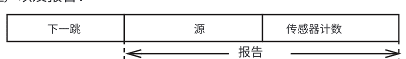

nexthop字段包含将该数据包定向到的节点的ID。源字段包含发起数据包的节点的ID。sensorcount字段包含传感器计数。（如果路径为空，则send没有节点可以将报告转发给，因此节点丢弃该数据包。）

当节点接收到报告数据包时，它调用FORWARD。如果节点收到的报告数据包不是下一跳节点，则忽略该数据包。如果报告数据包已经到达最终目的地A，则FORWARD将其传递给Alice的计算机。否则，节点通过将next hop设置为其路径变量上的第一个节点来转发报告。这个过程重复直到报告到达A，并且数据包被传递。

假设我们有以下节点的排列：

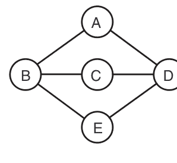

圆圈代表具有节点ID的节点。边连接在无线电范围内的节点。例如，当节点A发送数据包时，它可能被B和D接收，但不会被C和E接收。

数据包可能会丢失，节点也可能会失败（例如，如果它们的电池耗尽）。如果一个节点失败，它将停止感知、传输和接收数据包。

## 第72页问题集

问题19.3 如果节点可能失败并且数据包可能丢失，节点E上的变量path可能具有以下哪些值?

+   A. NULL  
B. [B, C]  
C. [D, A]  
D. [B, A]  
E. [B, C, D, A]  
F. [C, D, A]  
G. [D, A, B, C, D, A]

问题19.4 如果没有节点失败并且数据包没有丢失，对于Alice的路由和转发协议与给定的节点排列，哪些属性成立?

+   A. 每个节点的path变量将包含到A的路径。  
B. 在路由算法达到稳定状态后，每个节点的路径变量将包含到A的最短路径（以跳数计算）。  
C. 在路由算法达到稳定状态后，路由算法可能构建了一个转发循环。  
D. 在路由算法达到稳定状态后，最长路径为两跳。

Q 19.5 如果数据包可能丢失但节点不会故障，对于给定的节点排列，Alice的路由和转发协议具有哪些属性?

+   A. 每个节点的路径变量将包含到A的路径。  
B. 路由算法可能构建转发循环。  
C. 路由算法可能永远无法达到稳定状态。  
D. 当一个节点使用send发送报告数据包时，报告数据包可能会或可能不会到达A。一个报告数据包包含13位：一个8位节点ID和一个5位计数器。一个报告数据包包含21位：一个8位下一跳和一个报告。假设你对问题Q19.2的回答（传输一个比特的能量）是j焦耳。进一步假设启动无线电进行传输需要j焦耳。因此，传输r比特的数据包需要s + r × j焦耳。

Q 19.6 假设路由算法达到稳定状态，没有节点和数据包故障，每个节点发送一份报告到 A（忽略路由数据包）需要多少总能量?

Q 19.7 以下对Alice的系统进行的哪些更改将减少每个节点发送一份报告到A所需的能量?

+   A. 在报告中添加一个随机数，以便Alice的计算机可以检测到重复报告。  
B. 延迟转发数据包，并将其附加在来自该节点的报告数据包上。  
C. 使用4位节点ID。  
D. 使用停止等待协议可靠地从一个节点传输每个报告到下一个节点。

以下问题基于第11章/在线/。

## PS-75 问题集

Q 20.1 假设我们不知道Gnutella网络的拓扑结构或消息的传播延迟。根据协议，节点应将所有看到相应QUERY消息的 QUERYHIT消息转发回节点。

从中接收到 QUERY消息。如果一个节点想要保证这个规则，那么什么时候可以从消息表中移除 QUERY条目？

+   A. 从原则上讲，永远不会，因为一个节点不知道是否会收到另一个相同查询的 QUERYHit。  
B. 只要感觉需要，因为表对于正确性来说并不是必需的。这只是一个性能优化。  
C. 一旦转发了相应的 QUERYHit消息。  
D. 一旦该条目成为最近最少使用的条目。

互联网和Gnutella网络都形成图形。对于互联网，节点是路由器，边是路由器之间的连接。对于Gnutella网络，节点是Gnutella节点，边是节点之间的TCP连接。图中两个节点A和B之间的最短路径是通过最少数量的节点连接A和B的路径。

## Q 20.2 假设互联网和Gnutella网络稳定，Gnutella覆盖网络中两个节点之间的最短路径总是互联网上这两个节点之间的最短路径吗？

+   A. 是的，因为Gnutella网络使用互联网在其节点之间建立TCP连接。  
B. 不是的，因为TCP比UDP慢。  
C. 是的，因为Gnutella网络的拓扑结构与互联网的拓扑结构相同。  
D. 不是的，因为在Gnutella网络中，节点A要到达节点B，可能需要经过节点C，即使A和B之间有直接的互联网链接。

## Q 20.3 以下哪些关系始终成立？（TTL (i) 和 HOP (i) 分别表示消息经过 i跳后的TTL和Hop字段的值）？

+   A. TTL(0) = HOPS(i) - TTL(i)  
B. TTL(i) = TTL(i - 1) - 1, 对于 i > 0  
C. TTL(0) = TTL(i) + HOPS(i)  
D. TTL(0) = TTL(i) × HOPS(i)

## Q 20.4 本观察到 PING和 QUERY消息具有相同的转发规则，因此他建议从协议中删除 PING和 PONG消息，并使用一个空查询的 QUERY消息（需要节点用 QUERYHIT消息回应）来替代 PING消息。Ben的修改协议是否是Gnutella协议的一个好替代？

+   A. 是的，好问题。我不明白为什么Gnutella设计者同时包含了 PING和 QUERY消息。  
B. 不，当一个 PING消息进入网络时，通常在 TTL字段中具有较低的值，而 QUERY消息具有较高的值。  
C. 不，因为 PONG和 QUERYHIT消息具有不同的转发规则。  
D. 不，因为没有办法使用 QUERY消息找到节点。

## Q 20.5 假设只有一个节点S存储了歌曲“系统设计说唱”，并且查询在节点C进入网络。进一步假设 πL设置为足够大的值以探索整个网络。尽管某些节点集（无论是Gnutella节点还是互联网路由器）发生故障，Gnutella仍然可以找到歌曲“系统设计说唱”。另一方面，有一些节点集的故障将阻止Gnutella找到这首歌曲。以下哪些是后一种节点集之一？

- A. 包含S的任意集合  
B. 包含在从C到S的最短路径上的单个节点的任意集合  
C. 在Gnutella网络中，集体断开C与S之间连接的节点的任意集合  
D. 任意集合的节点，集体断开C与S之间连接的互联网  

## Q 20.6 Gnutella对以下哪种攻击是脆弱的（即，攻击者可以实施所描述的攻击）？

- A. 一个恶意节点总是可以通过丢弃来阻止客户端找到文件 QUERYHITS.  
- B. 一个恶意节点可以响应一个与查询不匹配的文件。  
- C. 一个恶意节点总是可以通过永不转发 PING和 QUERY消息来将网络分割成两个不连通的网络  
- D. 一个恶意节点总是可以通过永不转发PING和 QUERY消息来将网络分割成两个不连通的网络。  
- E. 一个恶意节点总是可以通过增加πL字段（而不是减少）来使QUERY消息在网络中永远循环。  

## Q 20.7 本想在下载过程中保护歌曲内容免受窃听者的侵害。本认为节点应该发送ENCRYPT (k, song)，使用共享密钥算法，作为下载，但艾丽莎认为节点应该发送CSHA (song)，其中CSHA是一个密码学安全哈希算法。谁是对的？

- A. 本是对的，因为除非已经拥有song，否则无法从CSHA (song) 的输出中计算出song。  
- B. 艾丽莎是对的，因为即使不知道共享密钥k，任何人都可以计算出ENCRYPT (k, song) 的逆。  
- C. Alyssa是对的，因为 CSHA不需要密钥，所以Ben不需要为密钥分发设计协议。  
- D. 两者都是错误的，因为公钥算法是正确的选择，因为使用公钥算法进行加密的计算成本比 CSHA或共享密钥算法更高。  

本担心攻击者可能修改“系统设计说唱”歌曲。他建议每个发起消息的节点用其私钥对消息的有效负载进行签名。为了发现节点的公钥，他修改了 PONG消息，将响应节点的公钥和其互联网地址一起包含在内。当一个节点被要求提供一个文件时，它用其私钥对响应（包括文件）进行签名。  

## Q 20.8 这个方案可以防止哪些攻击？

- A. 它防止恶意节点声称他们拥有“系统设计说唱”歌曲，并提供巴赫的音乐。  
- B. 它防止恶意节点修改 QUERY消息，然后转发。  
- C. 它防止恶意节点丢弃 QUERY消息。  
- D. 它防止节点冒充其他节点，从而防止他们伪造歌曲。  
- E. 没有。它没有帮助。  

2002-2-5...12  

## 21 The OttoNet*  

（第7章/在线），稍微涉及第11章/在线）  

受到他的奥地利同胞“阿尼”在加利福尼亚州的政治成功的启发，奥托·派洛特决定移民到波士顿。几个月后，他发现当地口音难以理解，当地政治极其混乱，但真正让他恼火的是交通噩梦和长时间的驾驶延误。  

经过一些研究，他得出结论，如果汽车能够在任何指定的位置上获取最新的交通状况信息，并将这些信息作为输入传递给能够动态建议最佳路径的软件，那么交通问题可以得到缓解。 他放弃了自己初出茅庐的政治事业，创办了一家旨在解决波士顿交通问题的公司。  

在与汽车制造商交谈后，奥托得出以下结论：1. 所有汽车都配备了一个可以安装他的软件的车载计算机。 所有汽车都配备了各种传感器，可以在车内处理以提供交通状况，包括当前交通速度、交通密度、事故证据、施工延误等。2. 为汽车配备全球定位系统（GPS）接收器很容易（事实上，越来越多的汽车已经内置了GPS）。 通过GPS，车内的软件可以确定车辆在一个众所周知的坐标系统中的位置。（假设位置信息对我们的目的来说足够精确。）  

3. 每辆汽车的计算机可以使用廉价的10兆比特每秒的无线电进行网络连接。 每个无线电的球形范围R为250米；即，从一辆汽车发出的无线电传输有一定概率直接到达范围内的任何其他汽车，并且没有机会直接到达范围外的任何汽车。  

奥托开始设计奥托网（OttoNet），这是一个网络系统，用于向应用程序提供交通状况信息。 奥托网是由汽车之间使用廉价无线电进行通信并协作转发数据包而形成的即兴无线网络。  

奥托网中的每辆汽车都在其计算机上运行客户端应用程序和服务器应用程序。 奥托网提供两个在每辆汽车上运行的过程，客户端和服务器应用程序可以使用：  

- 1. 查询（位置）：当在一辆汽车上运行的客户端应用程序调用查询（位置）时，奥托网根据最佳努力协议将包含查询消息的数据包传递给指定位置附近至少一辆汽车。 包含查询的数据包大小为1,000位。  
- 2. 响应（状态信息，查询数据包）：当运行在汽车上的服务器应用程序接收到查询消息时，它会处理查询并调用响应（状态信息，查询数据包）。 响应会导致包含响应消息的数据包被传递给执行查询的客户端，再次根据最佳努力合同进行传递。  

## Q 21.1 到目前为止，以下哪个属性是OttoNet的真实描述？

- A. 因为OttoNet是“尽力而为”，它将尝试在客户端和服务器之间传递查询和响应消息，但消息可能会丢失并可能无序到达。  
- B. 因为OttoNet是“尽力而为”，只要客户端和服务器之间存在一条无阻塞的路径，查询和响应消息就能成功传递。  
- C. 因为OttoNet是“尽力而为”，它对查询或响应消息在到达目标位置之前遇到的延迟不做任何保证。  
- D. 即使系统中没有数据包重传，OttoNet客户端也可能收到多个响应。  

Otto为OttoNet开发了以下数据包格式（除了有效负载之外，所有字段都是数据包头部的一部分）：  

| 结构数据包 | // 目标位置 |
|---|---|
| 全球定位系统目标位置 | // 汽车的128位唯一ID随机选择 |
| 整数128位目标ID | // 数据包起源汽车的位置 |
| 全球定位系统源位置 | // 数据包起源汽车的唯一ID |
| 整数128位起源ID | // 剩余跳数（初始化为100） |
| 整数跳数限制 | // 查询或响应 |
| 整数类型 | // 数据包大小 |
| 整数大小 | // 查询请求字符串或响应状态信息 |
| 字符串有效载荷 | // pkt是数据包结构的一个实例 |
| 数据包实例 pkt; | |  

每辆汽车都有一个128位的唯一ID，完全随机选择。 每辆汽车的当前位置由其全球定位系统坐标给出。 如果发送应用程序不知道目标接收者的唯一ID，则将 dst_id字段设置为0（没有有效的汽车ID为0）。  

过程 FORWARD（pkt）在每辆汽车上运行，并在数据包从网络到达或应用程序需要发送数据包时调用。FORWARD main维护一个在无线电范围内的汽车及其位置的表，使用每秒广播来确定相邻汽车的位置，并实现以下步骤：  

- F1. 如果汽车的ID是 pkt.dst_id，那么将其交付给应用程序（使用 pkt.type来识别数据包是否应该交付给客户端还是服务器应用程序），并停止转发该数据包。  
- F2. 如果汽车在 pkt.dst_id和 pkt.type都在R范围内，并且 dst_loc更接近，则将其交付给服务器应用程序，并转发给任何一个更接近 dst_loc的邻居。  

## Q 21.2 在第3行和第10行中，x和y有哪些适当的值，使得伪代码符合查询和响应的规范？  

## Q 21.3 ID和GPS位置在OttoNet数据包中是什么类型的名称？它们是地址吗？ 它们是纯粹的名称吗？ 它们是唯一的标识符吗？  

## Q 21.4 Otto根据这些想法外包了OttoNet的实现，发现有时候一个查询没有响应，有时候接收器接收到的数据包是损坏的。 以下哪种机制是应用端到端技术来解决这些问题的一个例子？

- A. 在没有收到查询的响应时，当计时器超时时，从客户端重新尝试查询。  
- B. 如果 FORWARD无法传递数据包，因为没有更近的邻近车辆接近目的地，将数据包存储在该车辆上，并稍后将其传递给更近的邻近车辆。  
- C. 在客户端和服务器应用程序中实现校验和，以验证消息是否损坏。  
- D. 在客户端和服务器之间的路径上的每对车辆之间运行不同的TCP连接，以确保可靠的端到端数据包传递。  

Otto决定重新尝试没有收到响应的查询。每辆车的无线电速度为10兆比特每秒，响应和请求的大小分别为10,000比特和1,000比特。车辆的计算机既参与处理数据包，每比特需要0.1微秒，也参与通过无线电传输数据包（即存在  

## Q 21.5 什么是最小的“安全”计时器到期设置，以确保在网络中原始查询或响应数据包不再传输时才会重试查询？  

Otto现在开始调查为什么在客户端和服务器之间FORWARD有时必须丢弃数据包，即使它们之间存在一系列节点形成路径。 问题在于地理转发并不总是有效，即使网络中存在到目的地的某条路径，汽车也可能不得不丢弃数据包（规则F3）。  

## Q 21.6 在下图中，假设车辆在F处成功地通过规则F3将一个数据包发送到目的地D，通过某个邻居N。假设F和N都没有移动，清楚地标记出N必须位于图中的哪个区域。  

  

## Q 21.7 奥托决定修改客户端软件，以便在快速连续的查询中进行流水线式的调用，在收到之前的查询的响应之前发送一个查询。现在，客户端需要将收到的每个响应与相应的查询进行匹配。 以下哪个陈述是正确的？

- - A. 只要没有两个流水线查询被发送到相同的目标位置（OttoNet头部的dst_loc字段），客户端就可以正确地识别导致任何给定响应的具体查询。  
- - B. 假设OttoNet数据包头部包括由客户端设置的一次性随机数，并且服务器在其响应中包含随机数的副本，并且客户端维护状态以进行匹配。  

非ces到查询。 这种方法始终可以正确地将响应与查询匹配，包括当两个流水线查询发送到相同的目标位置时。  

## Q 21.8 在运行OttoNet几天后，Otto注意到网络拥塞偶尔会导致拥塞崩溃，因为太多的数据包被发送到最终目的地之前被丢弃。 这些数据包消耗了宝贵的资源。 以下哪种技术可能会减少拥塞崩溃的可能性？

- A. 将每辆车的队列大小从4个数据包增加到8个数据包。  
- B. 在重试查询时，使用指数退避来计算定时器到期时间。  
- C. 如果查询在定时器到期时间内没有得到回答，则将客户端应用程序发送OttoNet查询的最大速率进行乘法减少。  
- D. 在每个接收器上使用流量控制窗口以防止缓冲区溢出。  

## Q 21.9 OttoNet不是一个安全系统。 Otto有一个想法-他观察到汽车的128位唯一ID可以设置为汽车的公钥！他提出了以下协议。 在包含查询消息的数据包上，使用客户汽车的私钥对数据包进行签名。在包含响应的数据包上，使用客户汽车的公钥对数据包进行加密（该公钥在包含查询的数据包中）。 假设每个汽车的私钥没有被泄露。 以下哪些陈述是正确的？

- A. 一个仅转发包含查询的数据包的汽车可以读取该数据包的有效负载并进行验证。  
- B. 网络中唯一能够解密服务器响应的汽车是目标字段中指定的汽车。  
- C. 即使加密了，客户端也不能始终验证响应的消息完整性。  
- D. 如果某个查询位置的每个服务器都是诚实且未被入侵的，客户端可以确保其接收到的加密响应实际上包含了正确的流量状态信息。  

## 22 无线能源网络*  

本科研究助理Sara Brum对计算机科学楼的能源消耗表示关注，并决定设计EnergyNet，一个具有传感器的无线节点网络来监控建筑物。每个节点都有三个传感器：一个用于监测所连接电源插座的功耗传感器，一个光传感器和一个温度传感器。Sara计划让这些节点通过无线电相互通信，通过彼此转发数据向中央监测站报告信息。该站点有一个配备无线电的节点，称为接收器。  

EnergyNet中有两种通信方式：  

- A. 节点到汇报：一个节点通过零个或多个其他节点向汇报发送报告。  
- B. EnergyNet路由协议：节点运行分布式路由协议，确定每个节点转发数据到汇报时的下一跳。. 每个节点在到达汇报的路上的下一跳被称为它的父节点。  

EnergyNet是一个尽力而为的网络。Sara从阅读第七章记得分层是网络协议的良好设计原则，并决定采用类似于第七章/在线/参考模型的三层设计。我们的工作是帮助Sara设计EnergyNet及其网络协议。我们首先设计节点到汇报所需的协议，不用担心路由协议如何确定每个节点的父节点。  

首先，让我们假设每个节点都有一个不变的父节点，每个节点都有一条到汇报的路径，并且节点不会崩溃。节点可能存在硬件或软件故障，数据包可能会损坏或丢失。  

Sara为三层EnergyNet堆栈开发了以下简单设计：  

| 层 | 头部字段 | 尾部字段 |
|---|---|---|
| E2E报告协议 | 位置\n时间 | e2e_cksum（32位校验和） |
| 网络 | dstaddr（目的地的16位网络地址） | |
| 链路 | recvID（链路层目的地的32位唯一ID） sendID（链路层源的32位唯一ID） | ll_cksum（32位校验和） |  

除了这些字段之外，每个报告数据包都有一个包含节点传感器观测到的数据的有效负载。在发送报告数据包时，报告节点的端到端层将目标网络层地址设置为一个众所周知的16位值，sINK_ADDR。接收节点的端到端层处理每个报告。网络中的任何节点都可以向接收节点发送报告。  

如果一个层有一个校验和，它覆盖了该层的头部和由更高层提供给该层的数据。每个EnergyNet节点在网络层都有一个先进先出（FIFO）队列，用于等待传输的数据包。  

## Q 22.1 当一个节点将EnergyNet报告帧通过无线电发送到另一个节点时，它是什么样子的？在下面的矩形中填写不同的头部和尾部字段，按照从左到右的顺序。确保也显示有效载荷。您不需要显示字段大小。  

  

## Q 22.2 Sara的目标是确保汇聚层仅将头部和有效载荷正确的消息传递给应用程序。假设设置和验证校验和的函数实现是正确的，并且在汇聚层运行时没有故障。  

- A. 仅使用 ll_cksum 而不使用 e2e_cksum 能实现Sara的目标吗？  
- B. 仅使用 e2e_cksum 而不使用 ll_cksum 能实现Sara的目标吗？  
- C. 为了实现Sara的目标，从报告节点到终点的路径上的每个节点都必须重新计算 e2e_cksum 吗？  

为了恢复丢失的帧，Sara决定实施链路层重传方案。当一个节点接收到一个 ll_cksum 正确的帧时，它会向帧的发送方发送一个确认 (ACK) 帧。如果发送方在计时器到期之前没有收到ACK，它会重新发送帧。发送方对于一个帧最多尝试三次重传。  

## Q 22.3 如果没有节点更改其父节点，Sara的链路层重传方案中哪个陈述是正确的？  

- A. 接收方可能会收到重复的无错误帧。  
- B. 即使发送节点的超时时间长于发送方和接收方之间的最大往返时间，接收方仍可能接收到无误差的重复帧。  
- C. 如果每个新帧只在所有链路层重传之前发送到链路上，那么接收方可能会以与发送顺序不同的方式接收到来自给定节点的数据包。  
- D. 如果Sara在链路层方案之外实现了端到端重传方案，那么得到的设计将违反端到端原则。  

## Q 22.4 EnergyNet的无线电使用曼彻斯特编码的相位编码。 Sara发现，如果电压的电平转换频率设置为500千赫兹，在没有无线电信道干扰、噪声或任何其他并发无线电传输的情况下，链路的误码率可以接受地低。 对应于这个电平转换频率的数据速率是多少（请指定正确的单位）？  

## Q 22.5 考虑从节点 A到节点 B的无误差帧传输（即从未需要重新传输的帧）的情况。 在下表的右列中，哪些延迟对左列中指定的时间持续时间有贡献？ （可能有多个贡献者。）  

| 1. 从 A离开的第一个比特到达B之间的时间延迟 | A. 处理延迟 |
|---|---|
| 2. 从 B到达的第一个比特到达 B的最后一个比特之间的时间延迟 | B. 传播延迟 |
| 3. 数据包的最后一个比特在 A接收到并且相同数据包的第一个比特开始由 A的链路层发送到 B之间的时间延迟 | C. 排队延迟 |
| | D. 传输延迟 |  

## Q 22.6 莎拉发现EnergyNet经常出现拥塞。 以下哪种方法有助于减少EnergyNet的拥塞？  

- - A. 如果没有收到链路层的ACK，发送方应该在通过无线电发送下一帧之前使用指数退避。  
- - B. 在每个节点上为网络层队列提供资源，以确保没有数据包因为队列空间不足而被丢弃。  
- - C. 在每个链路层ACK上，携带关于父节点队列空间的信息，并在父节点队列占用率超过某个阈值时减慢节点的传输速率。  

现在，假设节点可能会崩溃，并且每个节点的父节点可能会随时间改变。  

现在，让我们转向设计EnergyNet节点用于形成以汇聚点为根的路由树的路由协议。 每秒钟，每个节点通过优化一个“质量”指标选择一个父节点，并通过无线电广播路由广告，如bROADCAST_ADVERTISEMENT过程所示。 接收到广告的每个节点都会处理它并将一些信息合并到其路由表中，如hANDLE_ADVERTISEMENT过程所示。 这些路由广告不会被接收方确认。  

广告的有效载荷中包含一个字段：质量，计算方法如下伪代码所示。 路径的质量是帧成功概率的函数

## PS-88 问题集

Alyssa P. Hacker决定提供自己的内容传递系统，名为SURETHING。SURETHING系统包含1000台通过互联网通信的计算机。每台计算机都有一个唯一的数字标识符ID#，这些计算机被认为是按照图中的环形组织的，如图PS.3所示。每台计算机都有后继计算机，如图中所示。环形环绕：具有最高ID#的计算机的直接后继（图中的计算机N251）是具有最低ID#的计算机（计算机N8）。

每个内容项还有一个唯一的ID，c，并且内容存储在c的直接后继者：环中第一个ID大于c的计算机。这个方案被称为一致性哈希。

Alyssa使用两层设计系统：转发和路由层（用于查找存储内容的计算机的IP地址）和内容层（用于存储或检索内容）。

构建转发和路由层。受到一篇名为Chord的使用一致性哈希的系统的论文的启发，Alyssa决定路由步骤将按照以下方式工作：每台计算机都有一个本地表，successors[i]，其中包含其4个后继者的ID和IP地址（这4台计算机的ID在环中跟随该计算机的ID之后）；条目按照它们在环中出现的顺序排序。这些表在系统初始化时设置。

每个节点的转发和路由层提供了一个过程 GET_LOCATION，内容层可以调用该过程来查找某个内容项 c的IP地址的直接后继节点。该过程会检查其本地的后继节点表，看是否包含所请求内容的直接后继节点；如果没有，它会向自己后继节点表中的最远的后继节点发起远程过程调用，调用 GET_LOCATION过程。如果某台计算机在其后继节点表中已知 c的直接后继节点，那么它会返回该节点；否则，该节点会返回其最远的后继节点，并且原始计算机会在那里继续搜索，以此迭代，直到找到 c的直接后继节点。

例如，如果计算机N232在图 PS.3所示的系统中寻找 c= C165的直接后继节点，它首先会查找其本地表；由于该表中不包含 c的直接后继节点，它会向计算机N36请求信息。计算机N36也没有C165的直接后继节点在其本地的后继节点表中。它返回计算机N96的IP地址。计算机N96在其本地 successorstable中确实有直接的后继（计算机N174），并返回此信息。这个RPC请求和响应的序列如图ure PS.4所示。

* 开发这个问题集的功劳归功于芭芭拉・利斯科夫。

† Ion Stoica, Robert Morris, David Karger, M. Frans Kaashoek和Hari Balakrishnan。Chord：一种可扩展的对等查找服务，用于互联网应用程序，ACM SIGCOMM '01会议论文集，2001年8月。

## PS-92 问题集

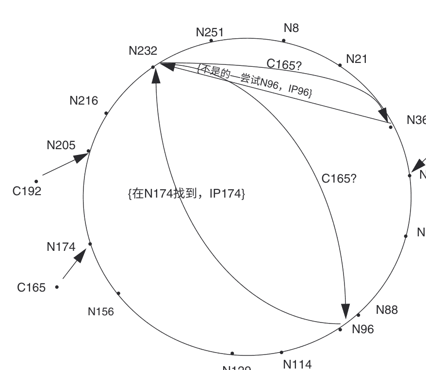

## 图 PS.4

为了找到具有ID C165的内容项的直接后继，计算机N232需要的RPC和回复序列。

Q 23.1 在测试SURETHING时，Alyssa注意到当互联网尝试deliver RPC数据包时，它们并不总是到达目的地。以下哪些原因可能阻止数据包到达目的地？

+ A. 路由器丢弃了数据包。
+ B. 数据包在传输过程中损坏。
+ C. RPC回复的有效负载包含错误的IP地址。
+ D. 数据包在网络中进入了转发循环。

对于接下来的两个问题，请记住计算机不会出错，并且所有表格都已正确初始化。

## Q 23.2

假设 c 是一个没有立即后继的 id，而 successors 中没有该 id 的后继，并且 n 是系统中计算机的数量。在最好的情况下，在 GET_LOCATION (c) 返回之前需要多少次远程查找？

+ A. 0
+ B. 1
+ C. 2
+ D. O(log n)
+ E. O(n)
+ F. O(n²)

## Q 23.3

假设 c 是一个没有立即后继的 id，而 successors 中没有该 id 的后继，并且 n 是系统中计算机的数量。在最坏的情况下，在 GET_LOCATION (c) 返回之前需要多少次远程查找？

+ A. 0
+ B. 1
+ C. 2
+ D. O(log n)
+ E. O(n)
+ F. O(n²)

构建内容层。在构建转发和路由层之后，Alyssa转向构建内容层。从高层次上看，该系统支持存储具有关联 ID 的数据。具体而言，它支持两种操作：

+ A. PUT (c, content) 将 content 存储在具有 ID c 的系统中。
+ B. GET (c) 返回与 ID c 一起存储的内容。

内容 ID 是可以用作 GET_LOCATION 的参数的整数。（在实践中，可以通过使用将可读名称映射到整数的哈希函数来确保 ID 是整数。）

Alyssa通过使用转发和路由层来选择用于存储内容的计算机来实现内容层。为了可靠性，她决定将每个内容的副本存储在两台计算机上：内容 ID 的两个直接后继。她修改了 GET_LOCATION，以返回两个后继，称为新版本的 GET_2LOCATIONS。例如，在图 PS.3 中，如果 GET_2LOCATIONS 被要求找到 ID 为 C165 的内容项，它将返回计算机 N174 和 N205 的 IP 地址。一旦使用转发和路由层找到正确的计算机，Alyssa的实现就会向每台计算机发送一个 PUT RPC，将内容存储在两个位置的文件中。（如果其中一台计算机是本地计算机，则使用本地调用 PUT 进行存储，而不是 RPC。）

要检索与给定 ID 相关联的内容，如果由 GET_2LOCATIONS 返回的任一 ID 是本地的，则读取具有本地 GET 的文件。否则，它向具有第一个 ID 的计算机发送 GET RPC，请求计算机从中加载适当的文件。磁盘（如果存在）并返回其内容。如果由于某种原因RPC失败，则尝试第二个ID。

## PS-94 问题集

Q 23.4 以下哪些是内容层的端到端属性？

假设系统运行时计算机或磁盘没有故障，所有表都正确初始化，并且网络正确传递每个消息。

+ A. GET (c) 始终返回与ID c存储的相同内容。
+ B. PUT (c, content) 将内容存储在 c的两个直接后继中。
+ C. GET 返回 c的直接后继的内容。
+ D. 如果内容已经存储在某台计算机上， GET将找到它。

## 23.5

现在，假设个别计算机可能会崩溃，但网络仍然能够正确传递每个消息。以下关于内容层的属性哪些是正确的？

+ A. GET_2LOCATIONS返回的计算机中可能有一台无法响应 GET或 PUT调用。
+ B. PUT有时无法将内容存储在内容的两个直接后继上。
+ C. 如果之前已经存储了请求的内容， GET将成功返回。
+ D. 如果在 PUT存储内容的两台计算机中有一台在 GETrun时没有崩溃， GET将成功检索内容。

改进转发性能。现在我们回到转发和路由层，忽略内容层。

Alyssa对系统的性能不满意，特别是GET_LOCATION。她的朋友Lem E. Tweakit建议以下更改：每台计算机维护一个node_cache，其中包含系统中计算机的ID和IP地址的信息。node_cache表最初包含有关计算机的信息，在后继者中。

例如，最初计算机N232的节点缓存包含了计算机N251、N8、N21、N36的条目。但是在计算机N232与计算机N36通信并学习到计算机N96的ID和IP地址后，N232的节点缓存将包含计算机N251、N8、N21、N36和N96的条目。

## Q 23.6

假设 c是一个内容ID，其直接后继不是在 successors列表中的计算机，并且 n是系统中的计算机数量。在最好的情况下， GET_LOCATION (c) 返回之前需要多少次远程查找？

+ A. 0
+ B. 1
+ C. 2
+ D. O(log n)
+ E. O(n)
+ F. O(n^2)

## 24 滑动窗口*

考虑在第7章[在线]中描述的滑动窗口算法。假设如下图所示的拓扑结构，其中所有链路都是双工的，并且在两个方向上的容量和延迟都相同。左侧两条链路的容量非常大，可以假设为无限大，而它们的传播延迟可以忽略不计，可以假设为零。两个源节点发送到同一个目标节点。

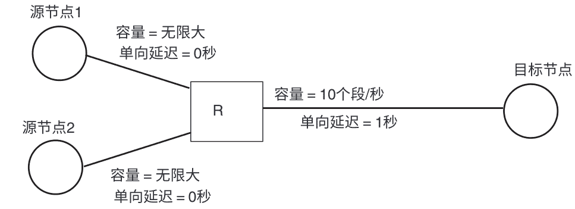

Q 24.1 假设窗口大小固定，只有源节点1活动。(源节点2不发送任何流量。)什么样的滑动窗口可以使源节点1达到最大吞吐量？

源节点1不知道瓶颈容量，因此无法计算使其达到最大吞吐量的最小窗口大小。本有一个想法，可以使源节点1计算出瓶颈容量。源节点1连续传输两个数据段，即尽可能快地传输。目标节点立即发送对每个数据段的确认。

Q 24.2 假设acks明显小于数据段，所有数据段大小相同，acks大小相同，只有源1有任何传输流量。在这种情况下，哪个选项是源1计算瓶颈容量的最佳方式？

+ A. 将数据段的大小除以两个连续acks的到达时间间隔。
+ B. 将一个ack的大小除以两个ack的到达时间间隔。
+ C. 将数据段的大小与ack段的大小相加，然后将总和除以ack的到达时间间隔。

* 开发此问题集的功劳归于Dina Katabio。

## PS-96 问题集

现在假设源1和源2都是活动的。路由器R使用一个大队列，大约可以容纳问题24.1滑动窗口大小的10倍。如果在缓冲区已满时有一个数据段到达路由器，R会丢弃该段。源2使用标准的TCP拥塞控制来控制其窗口大小。源1也使用标准的TCP，但是通过修改其拥塞控制算法来始终使用固定大小的窗口，该窗口大小在问题24.1中计算。问题24.3 以下哪个是正确的？

+ A. 源1的平均吞吐量将高于源2。
+ B. 源2的平均吞吐量将高于源1。
+ C. 两个源的平均吞吐量相同。

## 25地理路由*

本・比特迪德尔对他想出的一种新型路由协议感到兴奋。 本认为，由于全球定位系统（GPS）接收器变得非常便宜，可以为每个路由器配备一个GPS接收器，以便路由器可以根据位置信息路由数据包。

假设网络中的所有节点都在同一个平面上，并且节点不会移动。 每个节点由一个元组 (x, y) 标识，其中 x 和 y 是其基于 GPS 的坐标，并且没有两个节点具有相同的坐标。 每个节点通过与其邻居连接的链路连接在一起，形成一个连通的网络图。 当一个节点加入网络并在故障恢复后，它会通知其邻居其坐标。

当源节点发送一个数据包时，在数据包头部放置目标坐标，而不是目标 IP 地址。（发送方可以通过询问本的修改 DNS（他称之为域名位置服务）来了解其目标的坐标。）当路由器想要转发一个数据包时，它会检查是否有任何邻居节点比自己更接近目标节点的欧几里德距离。 如果没有邻居节点更接近，路由器会丢弃该数据包。 否则，路由器将数据包转发给最接近目标节点的邻居节点。 当数据包到达具有目标坐标的节点或被丢弃时，数据包的转发停止。

## Q 25.1

以下哪些陈述关于本地地理路由算法是正确的？

+ A. 如果没有故障，并且在数据包正在传输时没有节点加入网络，那么没有数据包会经历路由环路。
+ B. 如果在数据包正在传输时节点发生故障，那么数据包可能会经历路由环路。
+ C. 如果在数据包正在传输时节点加入网络，那么数据包可能会经历路由环路。

假设没有链路或节点的故障，并且也没有节点加入网络。

* 开发此问题集的功劳归于Dina Katabi。

## PS-98 问题集

Q 25.2 本地算法能够在网络中传递任意源-目的地对的数据包吗？如果可以，请解释。如果不可以，请在下面的网格中绘制一个反例，将节点放置在网格交叉点上，并确保连接所有节点的链路。

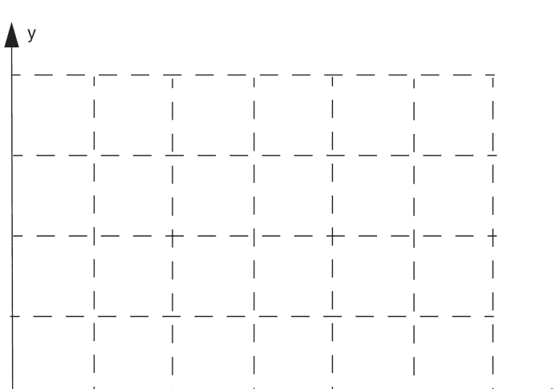

Q 25.3 对于本地算法将数据包传递到相应目的地的所有情况，本地算法是否使用与第7.4.2节中描述的路径向量算法相同的路由？如果你的答案是肯定的，请解释。如果你的答案是否定的，请绘制一个反例。

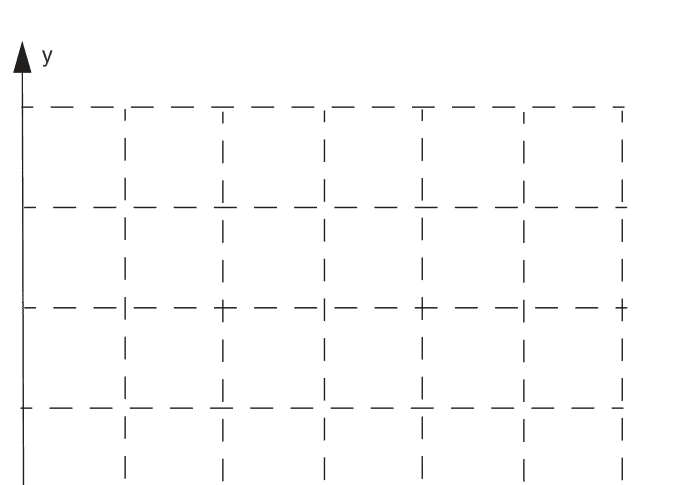

## 26 卡尔的卫星*

卡尔编码师决定辞去他在一家电子商务初创公司的工作，去读研究生。他对通过卫星广播数据文件的可能性很感兴趣，并决定建立一个原型来实现这一点。

卡尔决定从简单的开始。他将一颗卫星发射到地球同步轨道上，这样卫星从美国的任何地方都可见。卫星在一个上行信道上监听传入的比特，并立即在一个单独的下行信道上重新传输每个比特。卡尔建立了两个地面站，一个发送站和一个接收站。发送站通过无线电向卫星的上行信道发送；接收站监听卫星的下行信道。

卡尔的测试应用程序-相关的是发送(AP)新闻故事从发送站点，通过卫星，到一个接收-接收站点; 这接收站点在打印机上打印每个故事一个打印机。AP故事总是发生在由1024个字符组成字符。卡尔在左边编写代码在计算机上运行发送和接收站点(方案1)。

接收无线电硬件只有在发送无线电发送一个位时才接收到一个位。这意味着接收器接收到与发送器发送的位数相同的位数。然而，由于接收器附近的干扰，接收无线电可能会错误地接收到一个位。无线电不会检测到这种错误；它只是将错误的位传递给接收地面站的计算机，而没有任何警告。除了（也许）卡尔的设计中的缺陷之外，这些错误位是系统中唯一的潜在故障。如果计算机要求打印一个不可打印的字符，打印机会打印一个问号。

```
过程发送者()
字节缓冲区[1024]
永远执行
读取下一个AP故事到缓冲区// 可能等待下一个故事
发送_缓冲区（缓冲区 ）

过程发送_缓冲区(字节缓冲区[1024])
对于 i从 0到 1024做
发送8_位(缓冲区[i])

过程 接收器（）
字节缓冲区[1024]
永远执行
好 ≠接收_缓冲区（缓冲区 ）
如果好 =真则
打印缓冲区在打印机上

过程接收_缓冲区(字节缓冲区[1024])
对于 i从 0到 1024做
缓冲区[我] ≠接收8_位()
返回（真 ）
```

*开发此问题集的功劳归Robert T. Morris。

## PS-100 问题集

卡尔运行系统一段时间后，观察到它并不总是正常工作。他将发送者发送的故事与接收者打印的故事进行比较。

## Q 26.1 接收方的打印机可能会出现哪些错误？

+   A. 有时候印刷故事中的一个或多个字符是错误的。
B. 有时候一个故事会重复。
C. 有时候故事的顺序打印错误。
D. 有时候一个故事完全丢失。

## Q 26.2 接收机制造商声称接收一个比特的错误概率是10的5次方之一，并且这样的错误是独立的。如果这些声明是真实的，那么有多少故事可能会被正确打印？

卡尔想要制作过程他的系统更可靠-能够。他修改了他的发送者代码来计算字节的总和为每个故事，并追加该过程RECV_BUFFER (字节缓冲区[1024])总和到故事中。他修改接收器以检查低8位的总和是否与接收到的字节是否匹配接收到的总和。他的新代码（方案2）在右侧。

```
发送_缓冲区(字节缓冲区[1024])
字节和 ≠ 0 //字节是一个八位无符号整数
对于 i 从 0 到 1024 做
	发送_8_位(缓冲区[i])
	和 ≠和 + 缓冲区[i]
发送_8_位(总和)

RECV_BUFFER (字节缓冲区[1024])
字节总和 1，总和 2
总和1 ≠ 0
对于 i 从 0 到 1024 执行
	缓冲区[我] ≠接收_8_位()
	总和1 ≠总和 1 +缓冲区[i]
	总和2 ≠ RECV_8_BITS()
	如果总和 1 = 总和 2则返回 TRUE
否则返回 FALSE
```

## Q 26.3 使用这个新系统，接收器的打印机可能会出现什么样的错误？

+   A. 有时候印刷故事中的一个或多个字符是错误的。
B. 有时候一个故事会重复。
C. 有时候故事的顺序打印错误。
D. 有时候一个故事完全丢失。

## Q 26.4 假设发送者发送了10,000个故事。哪个方案可能会正确打印出这10,000个故事中的更多个数？

卡尔决定他的新系统足够好，可以在更大范围内进行测试，并在全国范围内设置了3个新的接收站，总共4个。所有的站点都可以听到来自他的卫星的AP新闻。每个接收站的用户定期给他打电话，告诉他打印输出中没有出现的文章列表，这样卡尔就可以重新发送它们。用户可以通过每个故事中的编号来识别哪些故事没有出现，而美联社会给连续的故事分配顺序编号。

## 26 卡尔的卫星

## PS-101

## Q 26.5 卡尔在系统运行一周后访问站点，并按照打印顺序查看每个站点的累积打印输出。卡尔注意到第一个和最后一个故事被所有站点接收到，并且所有站点都收到了他们请求的所有重传。在这些打印输出中，他可能会看到哪些错误？

+   A. 有时候印刷故事中的一个或多个字符是错误的。
B. 有时候一个故事会重复。
C. 有时候故事的顺序打印错误。
D. 有时候一个故事完全丢失。

## Q 26.6 假设卡尔发送了四个AP故事。站点1仅检测到第一个故事中的错误；站点2仅检测到第二个故事中的错误；站点3仅检测到第三个故事中的错误；站点4正确接收了所有4个故事。卡尔需要重新发送多少个故事？假设任何重新发送的故事都会被正确接收和打印。

听说了RAID之后，卡尔意识到他可以进一步改进他的系统。他修改了发送器，在每四个AP故事之后发送一个额外的“奇偶校验故事”；奇偶校验故事由前四个真实故事的异或组成。如果四个故事中的一个受损，卡尔的新接收器将其重构为奇偶校验和其他三个故事的异或。

他的新伪代码使用带有校验和版本的 SEND_BUFFER ()和RECV_BUFFER ()来检测受损的故事。

## PS-102 问题集

## Q 27.1 尽管学生们在编程方面很出色，但不幸的是他们没有完成文档。你的任务是完成下表，显示每个型号驱动器的特定规格（即每个RAID系统支持的API的大小和性能参数）。条目假设操作无误，并忽略与寻道时间相比较小的传输时间。

| | R0 | R1 | R2 | R3 | R4 | R5 |
| --- | --- | --- | --- | --- | --- | --- |
| 块大小（千字节）暴露给获取/放置 | 1 kB | 1 kB |  | 11 kB |  | 1 kB |
| 容量，以块为单位 |  |  |  |  |  | 1,100,000 |
| 单个100兆字节获取的最长时间（秒） | 1/12 秒 |  |  |  | 1 秒 | 1 秒 |
| 1个块放置的时间（毫秒） | 10 毫秒 | 10 毫秒 | 10 毫秒 |  |  | 20 毫秒 |
| 一个块的典型微驱动器数量涉及到的 | 1 |  |  |  |  | 1 |
| 典型的微驱动器数量涉及到2块 GET |  | 2 |  |  | 1 | 1 |
| 典型的微驱动器数量涉及到2块 PUT |  | 2 |  |  |  |  |

## 27 RaidCo *

RaidCo是一家利用微小的芯片大小硬盘（“微型硬盘”）廉价生产可替换硬盘的公司。每个RaidCo产品都像一个硬盘一样，支持以下操作：

+   • 错误 ≠ GET (nblocks, starting_block_number, buffer_address)
• 错误 ≠ PUT (nblocks, starting_block_number, buffer_address)

从磁盘阵列中获取或放置连续的整数个块。每个操作都返回一个表示是否发生错误的状态值。

RaidCo使用12个微小的相同微型硬盘配置为RAID系统来构建其每个硬盘产品，如2.1.1.4节所述。一组优秀的学生设计了RaidCo的系统，并且他们在实现六个不同的RaidCo硬盘型号时做得非常出色。每个型号使用相同的硬件（包括处理器和12个微型硬盘），但是这些型号在实现中使用不同形式的RAID，并为客户提供不同的块大小和性能特征。请注意，RAID系统的块大小不一定与组件微型硬盘的扇区大小相同。

模型如下（它们在文中所示的位置进行了描述）：

+   • R0：在所有十二个微驱动器上进行扇区级分条，没有冗余/错误校正（见第6.1.5节）
• R1：六对两个镜像微驱动器，没有分条（见第8.5.4.6节）
• R2：12个微驱动器的RAID 2，使用位级分条、错误检测和错误校正；禁用微驱动器的内部扇区级错误检测。
• R3：12个微驱动器的RAID 3，使用扇区级分条和错误校正。
• R4：12个微驱动器的RAID 4，没有分条，专用奇偶校验盘（见图8.6）
• R5：12个微驱动器的RAID 5，没有分条，分布式奇偶校验（见练习8.10）

每个微驱动器都符合上述相同的读/写API，每个微驱动器提供100,000个1,000字节的扇区，并提供统一的10毫秒搜索时间和100兆字节每秒的读/写带宽；因此，在一秒钟内可以使用单个 GET操作获取微驱动器上的整个100兆字节的数据。RaidCo产品不进行缓存或缓冲：每个 GET或 PUT都涉及与相关微驱动器的实际数据传输。由于微驱动器具有统一的搜索时间，RaidCo产品不需要也不使用任何搜索优化。

> * 开发此问题集的功劳归于Stephen A. Ward。

## PS-104 问题集

## Q 27.1 假设卡尔使用他的新系统发送了四个AP故事，然后是一个奇偶校验故事。站点1只丢失了第一个故事；站点2只丢失了第二个故事；站点3只丢失了第三个故事；站点4正确接收了所有故事。卡尔需要重新发送多少个故事？假设任何重新发送的故事都会被正确接收和打印。

## Q 27.2 卡尔的妹妹凯莉指出卡尔使用了两种冗余：奇偶校验故事和每个故事的校验和。凯莉声称卡尔只用奇偶校验就可以做得一样好，而校验和没有任何有用的功能。凯莉是对的吗？为什么？

## 28 ColdFusion *

（第8章/在线]，稍微涉及第9章/在线）Alyssa P. Hacker和Ben Bitdiddle正在设计一个名为 ColdFusion的热门新系统，其目标是允许用户通过在分布式ColdFusion服务器网络中存储的副本备份其存储系统。用户使用 PUT和GET操作与ColdFusion进行交互。

+   - PUT（数据，文件标识符）接受数据缓冲区并可靠地将其存储在某个服务器子集上的唯一标识符文件标识符下，文件标识符是一个正整数。如果成功将其存储在所选子集中的所有机器上，则返回 SUCCESS，否则返回 FAILURE。
- GET (fid) 返回系统中最近一次成功 PUT的文件内容
  通过 fid标识的文件。

由于高可用性是一个关键的竞争优势，艾丽莎决定在多台服务器上复制用户数据。但是，她决定聪明地使用每个文件的服务器子集，而不是在每个服务器上复制每个文件。因此，文件的PUT将其存储在一些服务器的 (A) 上，对每个服务器调用 SERVER_PUT操作。server_put是原子的，并由每个服务器实现。

如果 PUT无法成功将文件存储在 A个服务器上，则返回 FAILURE。当客户端对文件进行 GET时，GET软件尝试从一些服务器的子集中检索文件，并使用选举算法选择版本。它选择从B个服务器中读取数据，使用每个服务器实现的原子 SERVER_GET操作，然后调用 PICK_MAJORITY ()。PICK_MAJORITY返回与B个检索到的副本中共享的版本对应的有效的数据，否则返回 NULL。即使客户端可能不知道哪些特定服务器保存了当前副本，但是 PUT中的服务器数量 (A) 和 GET中的服务器数量 (B)被选择得足够使得如果客户端 GET成功，则可以确定已收到最新的副本。

他们为 PUT和 GET编写了以下代码。总共有 S个服务器，且 S> 2。下面代码中服务器的特定顺序可能在不同的客户端上不同，但所有客户端都有相同的列表。他们聘请你作为顾问，帮助他们找出缺失的参数 (A和 B)，并分析系统的正确性。

> *开发此问题集的功劳归于Hari Balakrishnan。

## PS-106 问题集

```
 // S个服务器的互联网地址， S> 2
 ip_address server[S] // 每个客户端可能有不同的顺序

 procedure PUT (byte data[], integer fid)
 integer ntried, nputs ≠ 0 // 尝试的服务器数量和成功放置的数量
 for ntried from 0 to S do
  // 将"data"放入由 fid在 server[ntried]上标识的文件
  status ≠ SERVER_PUT (data, fid, server[ntried])
  if status = success then nputs ≠ nputs + 1
  if nputs ≥ A then // 是的！有服务器放()到 A服务器！
   返回 成功 ;
  // 找到 < A服务器放() 到
  返回失败

 过程获取(整数 fid,字节数据[])
 整数尝试次数,获取次数 ≠ 0 // 尝试次数和
 // 服务器获取返回成功的次数
 字节文件[S][最大文件长度]
 整数索引
 字节数据[]
 对于尝试次数从 0 到 S执行
  // 将文件 fid获取到缓冲区文件[尝试次数] 从服务器[尝试次数]
  状态 ≠服务器_获取 (fid,文件 [尝试次数 ],服务器 [尝试次数 ])
  如果状态 =成功则获取次数 ≠获取次数+ 1
  如果获取次数 ≥ B则 // 是的！已经从 B服务器获取到数据// PICK_
   MAJORITY() 接受文件数组，并且神奇地// 知道哪些文件是有效的。 它
   扫描 files[] 数组中的 ngets个有效// 文件，并返回一个对应于超过50
   %服务器返回的版本的索引。 否则，返回-1。

  // 如果 ngets= 1， PICK_MAJO RITY() 简单地返回一个索引
  // 指向那个版本。
  index ≠ PICK_MAJO RITY (files, ngets);
  如果 index≠ -1则
   COPY (data, files[index]) // 复制到 data缓冲区
   返回 成功
  否则返回失败
  返回 failure // 没有找到 B服务器来进行 SERVER_GET
```

对于问题Q 28.1到Q 28.4，假设操作是串行执行的（即，没有并发）。还假设端到端协议正确处理所有的数据包丢失，并按照发送方发送的顺序将消息传递给接收方。换句话说，没有因为丢失或重排序的数据包而导致操作无法完成。但是，服务器可能会崩溃然后恢复。

## Q 28.1 哪种可靠性技术最能描述Alyssa和Ben正在尝试的技术?

+   A. 故障安全设计。
B. N模块冗余。
C.配对比较。
D.时间冗余。

## Q 28.2 在上述代码中，以下哪种A和B的组合可以确保GET返回最后一个成功PUT的结果，只要没有服务器故障？（这里，x是≤x的最大整数，而y是≥y的最小整数。因此，2.3 = 2和2.3 = 3。还要记住 S > 2）

+   A. A = 1 
B. A = ⌊S/3⌋ 
C. A = ⌊S/2⌋ 
D. A = ⌊(3S)/4⌋ 
E. A = S
    B = S
    B = S
    B = ⌊S/2⌋ + 1
    B = 1

## Q 28.3 假设服务器的数量 S 是一个大于 2 的奇数，并且用于 PUT 的服务器数量是 A = S/2。如果只进行 PUT 操作而没有进行 get 操作，那么 PUT 操作的平均故障时间（MTTF）会随着 S 的增加而如何变化？如果 PUT 操作的返回值是 FAILURE，那么 PUT 操作将失败。假设导致服务器故障的过程是无记忆的，并且不进行修复。

+   A. 随着 S 的增加，冗余性增加。因此，MTTF 增加。
B. 随着 S 的增加，仍然需要大约一半的服务器可访问才能成功进行 PUT 操作。因此，MTTF 随着 S 的变化而不变。
C. 随着 S 的增加，系统中的服务器数量增加，MTTF 减少。
D. MTTF 不是 S 的单调函数；它先减少后增加。

## Q 28.4 以下哪个选项关于 ColdFusion 的 PUT 和 GET 操作是正确的，对于选择 A 和 B，保证 GET 成功返回上一次成功 PUT 的数据，当没有服务器故障时。

+   A. 一个 PUT 失败，因为某些服务器无法访问它，在成功 PUT 之后，可能导致后续的 GET 尝试失败，即使有 B 个服务器可用。
B. 一个成功 PUT 之后的失败 PUT 不能导致后续的 GET 尝试失败，如果有 B 个服务器可用。
C. 一个成功 PUT 之后的失败 PUT 总是导致后续的 GET 尝试失败，即使有 B 个服务器可用。
D. 以上都不是。

ColdFusion 揭示了他们在互联网上使用的系统，使用 S=15台服务器，使用 A=2S/3 和 B=1+2S/3。然而，他们发现规格并不总是满足——有几次，GET 没有返回上一个 PUT 返回的数据 SUCCESS。
在问题 Q 28.5 到 Q 28.8 中，假设可能存在并发操作。

# 问题集

## Q 28.5 在以下哪种情况下，ColdFusion总是满足其规格（即，GET返回SUCCESS和与上一个成功的PUT对应的数据）？

A. 在这种选择下，ColdFusion没有满足其规格的情况。选择A和B。

B. 当用户使用某个fid将数据PUT到文件中，并且在大约相同的时间内，其他人PUT不同的数据到相同的fid中。

C. 当用户成功地从她的电脑上PUT一个文件后，开车去上班并在一个小时后尝试GET这个文件。与此同时，没有人对同一个文件进行任何PUT操作，但是三台服务器在她进行GET操作时崩溃并且不可用。

D. 当一个文件的PUT在某个时间点成功，并且相应的COMMIT消息已经到达服务器，但是一些后续的PUT失败，因为一些服务器不可用，然后对该文件进行GET，返回SUCCESS。

2000-3-12

你告诉本要注意多站点协调，他实现了他版本的两阶段提交协议。在这里，每个服务器维护一个包含READY（他发明的新记录）、ABORT和COMMIT记录的日志。服务器总是将最后一个COMMIT的版本的文件返回给客户端。

在本协议中，当客户端PUT一个文件时，服务器会返回SUCCESS或FAILURE，就像以前一样。如果返回SUCCESS，服务器会在其日志中为此fid追加一个READY条目。如果客户端看到它询问的所有服务器都返回SUCCESS，它会发送一条消息要求它们全部COMMIT。当服务器收到此消息时，它会将一个COMMIT条目与文件的fid一起写入其日志。另一方面，如果有一个服务器返回FAILURE，客户端会向所有服务器发送一条消息要求它们中止操作，并且每个服务器都会在其日志中写入一个ABORT条目。最后，如果服务器收到一个对于处于READY状态的某个fid的服务器放置请求，它会向请求的客户端返回FAILURE。

## Q 28.6 在以下哪种情况下，ColdFusion总是满足其规范（即，GET返回SUCCESS和最后一个成功PUT对应的数据）？

A. 在这种选择下，ColdFusion没有满足其规格的情况。选择A和B。

B. 当用户使用某个fid将数据PUT到文件中，并且在大约相同的时间内，其他人PUT不同的数据到相同的fid中。

C. 当用户成功地从她的电脑上PUT一个文件后，开车去上班并在一个小时后尝试GET这个文件。与此同时，没有人对同一个文件进行任何PUT操作，但是三台服务器在她进行GET操作时崩溃并且不可用。

D. 当一个文件的PUT在某个时间点成功，并且相应的COMMIT消息已经到达服务器，但是一些后续的PUT失败，因为一些服务器不可用，然后对该文件进行GET，返回SUCCESS。

## 因为服务器无法询问发起它们的客户端，所以很难知道过去READY操作的状态。 假设系统中任何时候最多只有一个服务器不可用，以下哪种策略允许服务器在从崩溃中恢复时正确了解过去READY操作的状态?

- A. 与任何正常运行的服务器联系，并使用文件的fid调用SERVER_GET；如果服务器响应，则将READY更改为COMMIT日志中。
- B. 通过使用服务器 GET()函数向所有其他正在运行的服务器询问具有文件标识符fid的文件；如果超过50%的其他服务器以相同的数据响应，则将 READY更改为 COMMIT。
- C. 假装成客户端，并使用文件标识符 fid调用 GET函数；如果 GET成功并且返回的数据与此服务器上的数据相同，则将 READY更改为 COMMIT。
- D. 以上都不是。

为了适应用户一次操作整个目录的可能性，ColdFusion在目录中的各个文件上添加了两阶段锁定协议。Alyssa和Ben发现，尽管有时候这样做是有效的，但当一个 GET拥有一些 PUT需要的锁定，反之亦然，死锁就会发生。

## Q 28.8 Ben分析了这个问题，并提出了几个“解决方案”（像往常一样）。他的哪个提议实际上会始终防止死锁发生?

- A. 确保操作按照文件的编号递增的顺序获取锁定。
- B. 确保没有两个操作按照相同的顺序获取文件的锁定。
- C. 在每个操作开始时为其分配一个递增的时间戳。 如果操作 A_i需要一个由操作 A_j拥有的锁定，并且 A_j的时间戳更大，则中止操作A_i并继续执行。
- D. 在每个操作开始时为其分配一个递增的时间戳。 如果操作 A_i需要一个由操作 A_j拥有的锁定，并且 A_j的时间戳更小，则中止操作A_i并继续执行。

2000-3-8...15

## 29 AtomicPigeon!.com

(第9章/在线)，但基于第7章/在线)

在出售了PigeonExpress!.com并环游世界之后，本·比特迪德尔正在计划他的下一个创业公司，AtomicPigeon!.com。AtomicPigeon通过提供原子数据传输系统改进了PigeonExpress。

回想一下问题集 18，当发送信鸽时，本的软件会打印一个小标题并写入一张光盘，这两者都交给了信鸽。标题包含发送者和接收者的GPS坐标，类型（请求或确认），以及一个序列号：

- 结构标题
  - GPS源头
  - GPS目的地
  - 整数类型
  - 整数序列号

本从PigeonExpress!.com的简单端到端协议（BEEP）的代码开始。他对发送和接收代码进行了许多修改。

在发送端，本简化了代码。 这个 BEEP 协议只传输一张光盘：

```
共享的下一个序列号最初为0 // 一个全局共享的序列号。
过程 BEEP（目标，光盘[]）
标题 h
h.source ≠ 我的_GPS
h.destination ≠ 目标
h.type ≠ 请求
h.sequence_no ≠ 下一个序列号
// 循环直到收到相应的确认，如果需要则重新发送
while h.sequence_no = next_sequence do send pigeon with h, CD
等待2,000秒
```

与之前一样，待处理和接收到的确认仅在发送方等待时处理：

```
过程 PROCESS_ACK (h) // 处理确认
if h.sequence_no = sequence then // 当前未完成的CD的确认？
    next_sequence ≠ next_sequence + 1
```

本在接收计算机上运行的代码进行了小的更改。他在接收方添加了一个名为expected_sequence的变量，用于PROCESS_REQUEST过滤重复项：

```
整数 expected_sequence 最初为 0
// 重复项过滤器。
过程 PROCESS_REQUEST (h, CD)
if h.sequence_no = expected_sequence then // 期望的序列号？
    PROCESS (CD)    // 是的，处理数据
    expected_sequence := expected_sequence + 1     // 增加期望
    h.destination ≠ h.source // 发送到信鸽来自的地方
    h.source ≠ MY_GPS
    h.sequence_no ≠ h.sequence_no     // 保持不变
    h.type ≠ ACKNOWLEDGMENT;
    发送信鸽与 h     // 发送一个确认回复
```

信鸽网络的假设与问题集 18 相同：

- 有些信鸽可能会迷路，但是如果它们到达了，它们会正确地传递数据（无损坏）
- 网络有一个发送者和一个接收者
- 发送者和接收者都是单线程的

## Q 29.1 假设发送者和接收者不会失败（即，唯一的故障是一些信鸽可能会迷路）。PROCESS in PROCESS_REQUEST 过程是否精确处理了 CD 的值一次？

- A. 是的，因为 next_sequence 是一个 nonce，接收者只在看到新的 nonce 时处理数据。
- B. 不，因为 next_sequence 和 expected_sequence 可能会不同步，因为接收者即使跳过处理也会确认请求。
- C. 不，因为如果在 2,000 秒内没有收到确认，发送方将重新发送相同的数据。
- D. 是的，因为具有相同数据的信鸽永远不会被重新传输。

本的新目标是在发送方或接收方发生故障的情况下提供原子性。本之所以对提供原子性感兴趣，是因为他想利用信鸽网络提供 P-commerce（类似于 E-commerce）服务。他希望编写以下形式的应用程序：

```
过程 TRANSFER (金额 , 目的地 )
写入 (金额 , CD)    // 在 CD 上写入金额
蜂鸣(目的地, CD)    // 发送金额
```

金额总是适合单张 CD。

如果发送方或接收方发生故障，故障会立即停止。暂时假设如果发送方或接收方发生故障，它只会停止而不会重新启动；稍后我们将放宽这个约束。

## Q 29.2 考虑到当前的 BEEP 协议实现，并假设只有发送方可能失败，在第 100 次 TRANSFER 调用期间可能会发生什么情况？

- A. 如果发送计算机在恢复过程中持续失败，那么传输可能永远不会成功。
- B. 那么 TRANSFER可能成功。
- C. 在 PROCESS_REQUEST中的 PROCESS可能会处理多次金额。
- D. 在 PROCESS_REQUEST中的 PROCESS可能会处理一次金额。

本的目标是通过允许发送方重新启动和完成失败的传输来始终成功进行传输。也就是说，在发送方失败后，它会清除易失性内存（包括一次性密码器计数器）并重新启动应用程序。应用程序通过运行一个名为 RECOVER_SENDER 的恢复过程开始，该过程会重试失败的传输（如果有的话）。为了实现可重启的传输，本为发送方和接收方提供了永久存储，永不失败。在永久存储中，本存储了一个日志，每个条目的格式如下：

| 结构日志条目 | 整数类型 | // 开始或提交 |
| --- | --- | --- |
| 整数 | 序列号 | // 一个序列号 |

发送方日志的主要目标是允许恢复发送方恢复下一个序列的值，并允许应用程序重新启动未完成的传输（如果有的话）。

```
本编辑 传输 以使用日志：
1 过程 传输 （金额 ，目的地 ）
2 写入 （金额 ，CD） // 在 CD 上写入金额
3 添加_日志(开始 下一个序列) // 追加 开始 记录
4 蜂鸣(目的地，CD) // 发送金额（蜂鸣增加下一个序列）
5 添加_日志(提交 下一个序列−1）// 追加提交记录
```

添加_日志原子地将记录追加到持久存储的日志中。如果添加_日志返回，则已追加该条目。日志包含足够的空间用于新记录，无需进行垃圾回收。

## Q 29.3 识别这个新版本的 TRANSFER 中的提交点所在的行。

## Q 29.4 发送方如何发现故障导致传输未完成？

- A. 日志中包含一个没有相应的 COMMITTED 记录的 STARTED 记录。
- B. 日志中包含一个有相应的 ABORTED 记录的 STARTED 记录。
- C. 日志中包含一个有相应的 COMMITTED 记录的 STARTED 记录。
- D. 日志中包含一个没有相应的 STARTED 记录的 COMMITTED 记录。

Ben 试图写 RECOVER_SENDER recovernext_sequence，但是他的编辑器在提交最终编辑之前崩溃了，而且 if 语句中的表达式丢失了，如下面的代码中的“?”所示。

```
过程 RECOVER_SENDER()
next_sequence = 0
从日志的末尾开始...
对于日志中的每个条目，执行以下操作
    如果( ? ) 则 // 这里应该填什么？(见问题 29.6)
        next_sequence = (entry的序列号)+1
    中断 // 终止日志扫描
```

## Q 29.5 在为Ben编辑 RECOVER_SENDER之后，以下哪个序列可能出现在日志中？(日志记录表示为<类型 序列号>。)

- A. ..., <STARTED 1>, <COMMITTED 1>, <STARTED 2>, <COMMITTED 2>
- B. ..., <STARTED 1>, <STARTED 1>, <COMMITTED 1>
- C. ..., <STARTED 1>, <STARTED 1>, <STARTED 2>, <COMMITTED 1>, <STARTED 2>
- D. ..., <开始1>, <提交1>, <提交1>

## Q 29.6 应该用什么表达式替换 ?在上面的恢复_发送者代码中?

- A. entry.type =提交
- B. entry.type = 开始
- C. entry.type = 中止
- D. FALSE

## Q 29.7 根据当前的 BEEP协议实现，在第100次调用传输时可能会发生什么？(记住只有发送计算机可能会失败。)

- A. 如果发送计算机在恢复过程中持续失败，那么传输可能永远不会成功。
- B. 那么 TRANSFER可能成功。
- C. 在 PROCESS_REQUEST中的 PROCESS可能会处理多次金额。
- D. 在 PROCESS_REQUEST中的 PROCESS可能会处理一次金额。

Ben的下一个目标是使处理_请求成为一种全有或全无的操作。在以下问题中，假设当接收计算机失败时，它会重新启动，调用恢复_接收者，并且在恢复_接收者完成后，它会等待消息并对每个消息调用处理_请求。

为了使期望的序列成为一切或无事，本试图以类似于他对发送方所做的更改的方式来更改接收方。再次，他的编辑没有及时提交所有更改。缺失的代码由“?”和“#”标记。缺失的表达式

```
procedure RECOVER_RECEIVER ()
expected_sequence ≠ 0
从日志末尾开始...
对于日志中的每个条目，执行以下操作
  如果（?）则 
    expected_sequence ≠ entry的序列号+ 1
  break

过程 PROCESS_REQUEST (h, CD)
如果h.sequence_no = expected_sequence那么// 期望的序列号是？
  添加_日志（#, #）  //？参见问题 29.8。
  PROCESS (CD)    // 是的，处理数据
  expected_sequence ≠ expected_sequence + 1 // 增加期望值
  添加_日志（#, #）  //？参见问题 29.8。
  h.destination ≠ source of h // 发送到信鸽来自的地方
  source of h.source ≠ MY_GPS
  h.sequence_no ≠ h.sequence_no      // 保持不变
  h.type ≠ ACKNOWLEDGMENT
  发送信鸽与 h  // 发送一个确认回复
```

从代码中可以看出，Ben选择不实现预写协议  
因为 PROCESS是由第三方实现的，例如银行： PROCESS可能是  
对银行交易数据库系统的调用。

## Q 29.8 在 PROCESS_REQUEST的第3行和第6行上完成 ADD_LOG调用，以便expected_sequence将是全有或全无的。

```
3  添加_日志（提交 , 序列号）
6  添加_日志（提交 , 序列号）
```

## Q 29.9 在一个特定的调用中，可以多次调用进程请求吗？

- A. 不可以，因为预期的序列已经恢复，并且检查h.sequence_no是否与之匹配。
- B. 可以，因为失败的传输将重新启动，并导致确认被重新发送。
- C. 可以，因为在2,000秒后将重新发送请求。
- D. 可以，因为接收方可能在进程之后但在提交之前失败。

## Q 29.10 为了保证传输的恰好一次语义，应该如何实现由进程请求调用的进程？（请记住发送方是持久的。）

- A. 作为普通的过程调用；
- B. 作为远程过程调用；
- C. 作为嵌套事务；
- D. 作为顶级事务。

## 30 病态交通*

Gloria Mundi，在阅读到第9章[在线]之前停止阅读文本，正在尝试将失败的伦敦救护服务重新建立为一个名为Sick Transit的新的精简公司。她已经建立了一台新的计算机，打算用于处理ST的活动。

Gloria的机器中的一个关键组件是一个高可靠性的顺序访问无限磁带，她计划将其用作一个只追加的日志。记录可以追加到磁带上，但一旦写入就是不可变和持久的。 磁带上的记录可以从后到前或从前到后任意次数地读取。ST系统中没有磁盘；磁带是唯一的非易失性存储。

由于无限磁带的高成本，Gloria在RAM和CPU等更常规的组件质量上做出了妥协，这些组件经常故障，但幸运的是故障快速：每个错误都会导致立即系统崩溃。 Gloria计划确保，在崩溃后，可以从无限磁带上的日志中重建一致的状态。

Gloria的代码使用事务，每个事务都有一个唯一的事务ID来标识。完成的事务的可见效果仅限于全局变量的更改，这些更改的写操作被记录在日志中。 日志将包含记录以下操作的条目：

```
BEGIN (tid)         // 开始一个新的事务，其唯一ID为 tid
COMMIT (tid)        // 提交一个事务
ABORT (tid)         // 中止一个事务
WRITE (tid, variable, old_value, new_value)  // 写入一个全局变量，指定先前值和新值。
```

为了保持系统简单，Gloria计划使用上述形式作为应用程序代码接口，除了 READ (tid, variable)调用，该调用返回变量的当前值。每个调用将执行指定的操作并写入相应的日志条目。 读取未写入的变量将返回 ZERO。

Gloria首先考虑单线程情况（每次只有一个事务处于活动状态）。 她将全局变量的值存储在RAM中的表中。Gloria现在正在尝试通过日志磁带来将变量重置为提交的值，以应对崩溃的情况。

## Q 30.1 在单线程情况下，崩溃后变量v应该恢复到什么值？

- A. 37
- B. 从最后一个记录的WRITE（tid，v，old_value，new_value）或ZERO中获取new_value，如果未写入则为ZERO。
- C. 从最后一个记录的WRITE（tid，v，old_value，new_value）中获取new_value，该记录后面没有跟随ABORT（tid），或者如果未写入则为ZERO。
- D. 从上次记录的 WRITE（tid，v，old_value，new_value）中获取 new_value，如果后面跟着一个 COMMIT（tid），否则返回 ZERO。
- E. 根据上次记录的 WRITE（tid，v，old_value，new_value）中的old_Value或new_Value，取决于该 WRITE是否后跟着相同 tid的 COMMIT，否则返回 ZERO。

格洛丽娅现在尝试在她的系统上运行并发事务。日志访问通过顺序访问磁带驱动器进行串行化。  
她的第一次尝试涉及同时执行这两个事务：

```
BEGIN (t1)
t1x ≠ READ (x)
t1y ≠ READ (y)
WRITE (t1, x, t1x, t1y + 1)
COMMIT (t1)

BEGIN (t2)
t2x ≠ READ (x)
t2y ≠ READ (y)
WRITE (t2, y, t2y, t2x + 2)
提交（事务 2）
```

初始值 x 和 y 都是 ZERO，系统中所有未初始化的变量也是ZERO。在这里， READ原语只返回最近从RAM表中写入的变量值，忽略 COMMIT操作。

## Q 30.2 在没有锁或其他同步机制的情况下，结果是否一定对应于两个事务的某个串行执行？

- A. 是的。
- B. 不是，因为执行可能导致 x=3，y=3。
- C. 不是，因为执行可能导致 x=1，y=3。
- D. 不是，因为执行可能导致 x=1，y=2。

Simplicity Winns，Gloria的一位曾经的同学，观察到由于全局变量的值可以从日志中重建，它们在RAM中的存储是多余的。 她建议消除RAM以及Gloria提出的所以锁，并实现一个 READ(tid, var)原语，通过检查日志返回适当的 var值。Simplicity的计划是实现 READ，使得每个事务在 BEGIN ( a)时“看到”全局值的值，以及在a内所做的更改。 她迅速勾画了一个 READ的实现，她声称这个实现提供了适当的原子性语义：

```
过程读取(标识,变量)
获胜者  ≠ 空
先前  ≠ 假
//获胜者是一个列表。
对于每个条目在日志中执行
  如果 条目 是 开始 (标识 )那么 先前  ≠真
  如果条目是提交 ( E标识)并且先前 =真那么将 E标识添加到获胜者
  如果条目是写入(E标识,变量,旧值,新值)那么
    如果 E标识 =标识那么返回新值
    如果 E标识在获胜者中那么返回新值
返回 0
```

## PS-118 问题集

格洛丽娅对Simplicity的快速摘要感到有些迷茫，但她认为Simplicity很可能是正确的。格洛丽娅请你帮忙弄清楚Simplicity的算法实际上是做什么的。

## Q 30.9 假设事务 t读取变量 x但不写入。每个读取 x中 t看到的值相同吗？ 如果是这样，简洁地描述每个读取的值；如果不是，请解释。

## Q 30.10 Simplicity的方案真的提供了事务语义，同时避免了死锁吗？

+   A. 是的。读一下，格洛丽娅，然后哭吧。
B. 它不会引入死锁，但也不能保证事务的前后语义。
C.它提供了事务的前后语义，但可能会引入死锁。
D.即使没有并发，Simplicity的方法也不起作用——它给出了错误的答案。

## Q 31.1 如果省略了第11行和第12行会发生什么？

+   A. 系统可能无法正确从第一次崩溃中恢复。
B. 系统将能够正确从第一次崩溃中恢复，但日志将会损坏，因此系统可能无法正确从第二次崩溃中恢复。
C.系统将能够正确从多次崩溃中恢复，但在从第二次及后续崩溃中恢复时需要进行更多的工作。

## Q 31.2 为了使 RECOVERY和 READ过程正确，以下哪种实现方式可能是正确的 COMMIT过程？

+   A. 过程提交(事务 ID) {}
B. 过程提交(事务 ID)
对于每个对在事务ID.意图中执行
安装 (对.新余额在数据库中对对.账户ID)事务ID.意图 ≠空

C. 过程提交(事务 ID)
日志 {已提交,事务 ID}
对于每个对在事务ID.意图中执行
安装 (对.新余额在数据库中对对.账户ID)事务ID.意图 ≠空

D. 过程提交(事务 ID) { 
日志 {已提交,事务 ID}
对于每个对在事务ID.意图中执行
安装 (对.新余额在数据库中对对.账户ID)事务ID.意图 ≠空
日志 {结束,事务ID}

## Q 31.3 为了使恢复和读取过程正确，以下哪个可能是写入过程的正确实现？

+   A. 过程写入(事务 ID,账户 ID,新余额)
日志{写入事务ID,账户ID,新余额}

B. 过程写入(事务 ID,账户 ID,新余额)
将{账户ID,新余额} 对添加到事务ID.意图
记录{写入事务ID,账户ID,新余额}

C. 过程写入(事务 ID,账户 ID,新余额)
记录{写入事务ID,账户ID,新余额}
将{账户ID,新余额} 对添加到事务ID.意图

D. 过程写入(事务 ID,账户 ID,新余额)
记录{写入事务ID,账户ID,新余额}
将{账户ID,新余额} 对添加到事务ID.意图
将新余额安装到账户ID的数据库中

本很惊讶地发现没有终止事务并擦除其数据库更新的中止 (事务ID) 过程。他给数据库开发人员打电话，开发人员说添加这个功能很容易。本觉得现在也可以添加这个功能，于是添加了一个新的日志记录类型中止。

## PS-122 问题集

## Q 31.4 以下哪种可能是 ABORT 过程的正确实现？假设 RECOVERY 过程相应地进行了更改。

+   A. 过程 ABORT(tid)
tid.intentions ≠ NULL

B. 过程 ABORT(tid)
LOG {ABORTED, tid}

C. 过程 ABORT(tid)
LOG {ABORTED, tid}
tid.intentions ≠ NULL

D. 过程 ABORT(tid)
tid.intentions ≠ NULL
LOG {ABORTED, tid}

## B. 缓冲区缓存

BCPL 正在与附近的 Peoria 授权储蓄、信贷和贷款分行进行激烈竞争。BCPL 的竞争优势是较低的账户费用。本决定通过添加易失性内存缓冲区缓存来节省升级计算机系统硬件的成本，这将使数据库在当前硬件上更加高效。缓冲区高速缓存仅用于对数据库磁盘的 GET 和 PUT 操作；对日志磁盘的 GET 和 PUT 操作仍然是写入和同步的。

缓冲区高速缓存使用 LRU 替换策略。数据库磁盘上的每个账户记录都被单独缓存或替换。换句话说，缓存块大小、磁盘块大小和账户记录大小都是相同的。

在B节中，再次假设没有并发事务。

## Q 31.5 为什么为数据库磁盘添加缓冲区高速缓存会使系统更加高效？

+   A. 从缓冲区高速缓存中复制比从磁盘中获取更快。
B. 如果可以识别出常见的访问模式，通过预取多个账户余额到缓存中可以提高性能。
C. 当一个事务多次读取相同的账户余额而不更新时，它减少了总的磁盘获取次数。
D. 当多个连续的事务读取相同的账户余额时，它减少了总的磁盘获取次数。

然后Ben犯了一个错误。他认为在A节中描述的意图列表现在是不必要的，因为该列表只是保留数据库数据的内存副本，而这正是缓冲区高速缓存所做的。他删除了意图列表的代码，并修改了PUT，使其更新缓冲区高速缓存中的账户余额副本。他还修改了系统，延迟写入END记录，直到所有被该事务修改的缓冲区账户都被写回到数据库磁盘。令他感到恐惧的是，接下来的

## C. 并发

本恢复了意图列表代码，删除了缓冲区缓存代码，并回到了在第A节中描述的更简单的系统。

他终于准备好调查BCPL系统如何管理并发事务。他给开发人员打电话，她告诉他数据库中每个账户都有一个存储在主内存中的锁，由并发开始和并发提交过程使用。由于BCPL运行并发事务，所有的应用程序实际上都使用这两个过程，而不是之前描述的更低级别的开始和提交过程。

进行并发事务的应用程序必须将使用的账户列表作为参数声明给并发开始过程。

```
过程 并发_开始 (账户列表 )
原子性执行
  对于每个账户在账户列表中执行
    获取 (账户锁 )
    线程 ID =开始 ()
    线程ID.账户列表 = 账户列表
    返回线程ID
过程并发_提交(线程ID)
   提交(线程 ID )
   对于每个账户在线程ID.账户列表中执行
     释放 (账户锁 )
```

本同时运行两个事务。两个事务都更新账户号码2：

```
事务 a =并发_开始 (创建列表 (2))
临时变量a =读取(事务a, 2)
写入 (事务 a, 2,临时变量 a+ 1)
并发_提交 (事务 a)

事务 b =并发_开始 (创建列表 (2))
临时变量b =读取(事务b, 2)
写入 (事务 b, 2,临时变量 b+ 2)
并发提交(tidb)
```

MAKELIST从其参数创建一个列表；在这种情况下，列表只有一个元素。

## PS-124 问题集

这些交易开始之前，账户2的初始余额为0。

## Q 31.7 在完成这两笔交易之后，账户2可能有哪些可能的值（假设没有崩溃）?

+   A. 0
B. 1
C. 2
D. 3
E. 4

## Q 31.8 如果账户2的初始余额为零，如果在调用 COMMIT 之前释放锁定，账户2可能有哪些可能的值（假设没有崩溃）?

+   A. 0
B. 1
C. 2
D. 3
E. 4

1998-3-7...14

## 32 搅拌器*

奇异磁盘公司（ODC）刚刚发明了一种新型的非易失性存储器，即搅拌器。搅拌器与磁盘有以下不同之处：

+   * 与磁盘相比，搅拌器的读写延迟非常低。
* 另一方面，在读写搅拌器时的数据传输速率远低于磁盘。
* 搅拌器是关联的。磁盘使用扇区地址，而搅拌器块使用一对项目来命名：地址和标签。我们将这些对写作A/t，其中A是地址，t是标签。因此，例如，搅拌器上可能有三个地址为49的块，每个块具有不同的标签：49/1、49/2和49/97。

搅拌器提供了四个重要的操作：

+   * 数据_获取(A/t)：这是正常的读操作。
* 放置（A/t，数据）：就像普通的磁盘一样。如果系统在写入期间崩溃，则可能导致部分写入的块。
* 布尔值 ∃存在（A/t）：如果搅拌器上存在块 A/t，则返回TRUE。
* 更改_标签（A/m，n）：原子性地将块 A/m的标签 m更改为 n（在此过程中删除任何先前的块 A/n）。原子性包括全或无原子性和之前或之后的原子性。

本·比特迪德尔对搅拌器的属性感到兴奋。帮助他使用搅拌器作为介质开发不同的存储系统。

## Q 32.1 起初，本通过将所有块的标签设置为0来模拟普通磁盘。但现在他想添加一个原子性放置操作。为本的搅拌器设计一个原子性放置，并确定哪一步是提交点。

本已经开始在一个Whisk交易系统上工作了；他希望你能帮他完成它。浏览他的笔记，你看到本的系统将不使用缓存或日志：所有写操作直接发送到Whisk。有一句话特别引起你的注意：一个欢快地涂写着“事务ID就是标签！”本的基本想法是这样的。数据库的当前状态将存储在标签为0的块中。当一个事务t写入一个块时，数据将存储在单独的块A/t中，直到事务提交。

本已经预留了一个特殊的磁盘地址ComRec，用于存储所有正在运行的事务的提交记录。对于一个事务t，ComRec/t的内容可以是已提交、已中止或待定，具体取决于事务t的状态。

* 开发此问题集的功劳归Eddie Kohler。

## PS-126 问题集

到目前为止，已经实现了三个过程。在这些程序中，t是一个事务ID，A是一个Whisk块地址，data是一个数据块。

```
过程 AA_开始(t) 过程 AA_读取(t, A) 过程 AA_写入(t, A, 数据)
放置(ComRec/t,
待定)

如果 存在 (A/t)则
返回获取(A/t)
否则// 未初始化！
返回获取(A/0)

放置(A/t, 数据)
```

以下问题仅涉及全有或全无的原子性；没有并发事务。

## Q 32.2 编写 AA_提交 (t) 和 AA_中止 (t) 的伪代码，并标识 AA_提交的提交点。假设变量 dirty，一个有 num_dirty 个元素的数组，保存了 t 写入的所有地址。（不用担心中止的事务可能在磁盘上留下任何垃圾，并假设事务 ID 永不重用。）

## Q 32.3 编写 AA_恢复的伪代码，该程序在崩溃后处理恢复。本已经完成了一部分工作：他的代码检查 ComRec 块并确定哪些事务是提交的、中止的或待定的。当你的

伪代码被称为，他已经为你设置了6个变量（你可能不需要全部）：

```
num_committed        // 已提交事务的数量
committed[i]         // 保存已提交事务的ID的数组
num_aborted          // 已中止事务的数量
aborted[j]           // 保存已中止事务的ID的数组
num_pending          // 进行中事务的数量
in_progress[i]       // 保存进行中事务的ID的数组
Whisk地址从0到 Λ运行。
```

1996-3-4a...d

## 33 ANTS：高级“无意义”事务系统*

Sara Bellum，永远追求优雅，开始设计一个名为ANTS的新事务系统，基于nonce的思想。她观察到她在第9章[在线]学到的锁定方案会导致事务等待其他事务持有的锁。她观察到一个事务可以简单地中止并重试，而不是等待锁定。更多的工作使她相信这个想法可以让她设计一个系统，在这个系统中，事务在原子性之前或之后不需要使用锁定。

Sara为以下操作编写伪代码： BEGIN (), READ (),WRITE (), COMMIT (), ABORT(), 和 RECOVER()。她打算通过这些操作来提供事务语义：先后原子性，全无原子性，和持久性。你可以假设一旦任何一个操作开始，它会一直运行到完成，没有中断或故障，并且没有其他线程同时运行任何过程。系统可以交错执行多个事务，然而。

Sara的实现在调用 BEGIN()时为事务分配一个事务标识符（TID）。这些TID是整数，并且按照数字递增的顺序分配。Sara对事务系统的存储计划是维护变量的单元存储和用于恢复的预写式日志。Sara使用非易失性存储实现了单元存储和日志。日志包含以下类型的记录：

+   • 开始 TID
• 提交 TID
• 中止 TID
• 更新 TID, 变量名 , 旧值

Sara实现 开始 (), 提交 (), 中止 (), 和 恢复 () 如下:

+   • 开始() 分配下一个TID，将一个开始记录追加到日志中，并返回TID。
• 提交 () 将一个 提交 记录追加到日志中，并返回。
• 中止 (TID) 通过向后扫描日志并从事务的更新记录中写入旧值，撤销事务 TID的所有写入() 操作。完成撤销后，中止 (TID) 将一个中止条目追加到日志中，并返回。
• 恢复在崩溃和重启之后，在启动任何其他事务之前调用。它从后向前扫描日志，撤销每个未在崩溃时既未提交也未中止的 WRITE 事务的记录。RECOVER() 为每个这样的事务在日志中附加一个 ABORTED记录。

*开发此问题集的功劳归于Hari Balakrishnan。

## PS-128 问题集

Sara的在执行多个事务时，执行结果与按顺序一个一个执行这些事务时相同，按递增的 TID顺序。Sara希望她的 READ() 和 WRITE() 实现通过遵守以下规则提供前后原子性：

假设一个具有 TID t 的事务执行 READ (X)。让 u 是最高的 TID < t 的调用 WRITE (X) 并提交的事务。由 t 执行的 READ (X) 应返回 u 写入的值。

Sara观察到这个规则不要求她的系统按照严格的TID顺序执行事务。例如，两个事务对同一个变量调用 READ ()并不会（仅仅）限制事务执行的顺序。

为了了解Sara打算如何让ANTS工作，考虑以下两个事务：

| 事务 T_A | 事务 T_B |
|---|---|
| 1 tid_a ≡ BEGIN () // 返回15 | tid_b ≡ BEGIN () //返回16 |
| 2 | |
| 3 va ≡ READ (tid_a, X) | vb ≡ READ (tid_a, X) |
| 4 va ≡ va + 1 | vb ≡ vb + 1 |
| 6 | |
| ρ WRITE (tid_a, X, va) | WRITE (tid_b, X, vb) |
| β COMMIT (tid_a) | COMMIT (tid_b) |

每个事务都通过调用 BEGIN来标记其开始，然后从单元存储器中读取变量 x 并将其存储在本地变量中，然后将本地变量加一，然后将本地变量写入单元存储器中的 x，最后提交。每个事务都传递其TID（分别为 tid_a 和 tid_b）传递给 READ、WRITE 和 COMMIT 过程。

这些事务都读取和写入相同的数据片段 X。假设 T_A 在 T_B 之前开始，Sara 的 BEGIN 为 T_A 和 T_B 分配了 TID 15 和 16。假设 ANTS 在执行事务时交错如第6行所示，但 ANTS 尚未执行第 ρ 行和第 β 行。没有其他事务在执行，并且没有发生故障。

## Q 33.1 在这种情况下，ANTS 可以采取以下哪些操作以确保前后原子性？

+   A. 强制只有 T_A 中止，并让 T_B 继续。
B. 强制只有 T_B 中止，并让 T_A 继续。
C. 不强制 T_A 和 T_B 中止，并让两者都继续。
D. 强制 T_A 和 T_B 都中止。

为了帮助执行前后意图，Sara 的 ANTS 主要实现了以下两个变量的信息：

+   • ReadID — 最高编号的事务的TID，该事务使用 READ成功读取了该变量。

## 33ANTS: 先进的“无意义”事务系统 PS-129

WriteID—最高编号的事务的TID，该事务使用 WRITE成功写入了该变量。

Sara在她的ANTS实现中定义了以下实用程序过程：

-   INPROGRESS (TID) 如果TID已经提交或中止，则返回FALSE，否则返回TRUE。（所有由崩溃中断的事务都由RECOVER过程中止。）
-   EXIT () 立即终止当前线程。
-   LOG () 将记录附加到日志并等待日志写入完成。
-   READ_DATA (x) 读取单元存储并返回相应的值。
-   WRITE_DATA (x, v) 将值v写入单元存储x。

现在Sara开始为READ和WRITE编写伪代码：

```
1 procedure READ (tid, x)  // 返回存储在单元x中的值
2 如果tid < x.WriteID，则
3     ABORT (tid)
4     EXIT ()
5 如果tid > x.WriteID且INPROGRESS (x.WriteID)则
6     ABORT (tid)      // 最后一个写入事务 x仍在进行中
7     退出 ()
8     V = 读取_数据 (x)       // 在所有其他情况下执行读取
9     x.ReadID ≠ MAX (tid, x.ReadID) // 更新 x的ReadID
10 返回 v

11 过程写入(tid, x, v) // 将值v存储在存储单元 x中
12 如果 tid < x.ReadID则
13     中止 (tid)
14     退出 ()
15 否则如果 tid < x.WriteID则
16     [神秘语句I]     // 参见问题 33.3
17 否则如果 tid > x.WriteID且 进行中(x.WriteID) 则
18     中止 (tid)
19     退出 ()
20 记录 (写入, tid, x, 读取_数据 (x))
21 写入_数据 (x, v)
22 [神秘陈述 第二部分]     // 现在更新 ReadID of x (参见问题 33.5)
```

通过回答以下问题，帮助萨拉完成上面的设计。

Q 33.2 考虑 READ的5-7行。萨拉不确定这些行是否必要。如果删除5-7行，实现是否保留萨拉的前后意图？

A. 是的，可以删除这些行。因为之前对 x 的 WRITE，由事务通过 x.WriteID标识，不会受到事务 tid的影响， READ_DATA (x)可以安全地执行。

B. 是的，可以删除这些行。假设事务T₁成功执行 WRITE (x)，然后事务T₂在T₁提交之前执行 READ (x)。在此之后， T₁无法

C. 不，这些行不能被删除。一个原因是：唯一能正确执行 READ_DATA (x)的事务是具有与 x.WriteID相等的TID的事务。因此， READ的第5行条件应该简单地写为："if tid > x.WriteID"。

D. 不，这些行不能被删除。一个原因是：当事务中止时，可能无法保留前后原子性。

Q 33.3 考虑 WRITE的第16行神秘语句I。以下哪种操作能保留Sara的前后意图？

+   - A. 中止 (事务 id);退出 ();
- B. 返回(不中止事务id)
- C. 找到与 x.WriteID对应的较高编号的事务T_h;中止 (T_h)并终止正在运行的线程；在事务 tid中执行 WRITE_DATA (x, v)；并返回。
- D. 以上所有选择。

Q 33.4 考虑 WRITE的17-19行。Sara不确定这些行是否必要。如果删除17-19行，Sara的实现能否保持她的前后意图？为什么或为什么不？

+   - A. 是的，可以删除这些行。我们总是可以从日志中恢复正确的值。
- B. 是的，可以删除这些行，因为这是一个 WRITE调用；只有在 READ调用时，我们需要担心上一个事务的部分结果对另一个正在运行的事务可见。
- C. 不，这些行不能被删除。一个原因是：如果事务T₁写入单元 x然后事务T₂写入单元 x，那么T₂的中止后跟着T₁的中止可能会使 x处于不正确的状态。
- D. 不，这些行不能被删除。一个原因是：如果事务T₁写入单元 x然后事务T₂写入单元 x，那么T₁的中止后跟着T₂的中止可能会使 x处于不正确的状态。

Q 33.5 Mystery Statement II在第22行的 WRITE操作中，哪个操作保留了Sara的前后意图？

+   - A. (x.WriteID) ≠ tid
- B. (x.WriteID) ≠ MIN(x.WriteID, tid)
- C. (x.WriteID) ≠ MAX(x.WriteID, tid)
- D. (x.WriteID) ≠ MAX(x.WriteID, x.ReadID)

## Q 33.6 本的论点有什么错误？

+   - A. 两个事务都会中止, 但如果他们愿意, 可以重试。
- B. 只有T₂会在第4行中止。所以T₁可以继续。
- C. 只有T₁会在第7行中止。所以T₂可以继续。
- D. Sara的系统不会发生死锁, 尽管并发事务可能会反复中止而不提交。

## Q 33.7 关于Sara的ANTS实现中的日志条目，哪个陈述是正确的？

+   - A. 日志中 STARTED条目的顺序按照递增的TID顺序排列。
- B. 日志中 COMMITTED条目的顺序按照递增的TID顺序排列。
- C. 日志中ABORTED条目的顺序按照递增的TID顺序排列。
- D. 对于任何给定的变量，日志中UPDATE条目的顺序按照递增的TID顺序排列。

## Q 33.8 WRITE过程将UPDATED记录附加到日志中，然后再将其安装到单元存储器中。Sara希望通过将非易失性单元存储器缓存到易失性主存储器中来提高性能。如果缓存中存在值，则将READ_DATA更改为从缓存中读取值；如果不存在，则从非易失性单元存储器中读取READ_DATA。将WRITE_DATA更改为仅更新缓存；ANTS稍后将安装到非易失性单元存储器中。

ANTS是否可以将安装到非易失性单元存储器的操作延迟到COMMITTED记录写入日志之后，并仍然确保事务语义？

+   A. 不，因为如果系统在 COMMIT和写入非易失性存储之间崩溃， RECOVER将无法正确恢复单元存储。
B. 是的，因为日志包含足够的信息来撤消未提交的事务在崩溃后。
C. 是的，因为 READ的第3行在写入非易失性存储完成之前不允许其他事务读取数据。
D. 以上都不是。

## 34 KeyDB *

Keys-R-Us已与您签订合同，要求您实现一个名为KeyDB的内存中键值事务存储。KeyDB提供哈希表接口，用于存储键值绑定并检索先前与键关联的值。

您决定使用锁提供先后原子性。锁 L_k是键k的锁k，对应于条目 KeyDB[k]。单个事务可以读取或写入多个KeyDB条目。您的目标是为使用KeyDB的所有事务实现正确的先后原子性。事务可能会中止。在对 KeyDB[k]的第一次 READ或WRITE之前调用ACQUIRE (Lk)，在对 KeyDB[k]的最后一次访问之后调用RELeASE (Lk)。

## Q 34.1 对于以下锁定规则，规则是必要的、充分的还是既不必要也不充分的，以始终保证任何一组并发事务之间的正确的先后原子性？

+   A. 在事务开始之后和第一个
读取或写入 KeyDB[k]之前必须执行ACQUIRE (L_k)，在最后一个
读取或写入 KeyDB[k]之后和事务结束之前必须执行 RELeASE(Lk)。

B. 在事务开始之后和任何其他操作之前，必须对所需锁进行 ACQUIRE，如果线程修改了相应的数据项，则在 COMMIT或 ABORT之前不能对锁进行 RELEASE。

C. 每个所需锁的ACQUIRE必须在事务开始之后和第一个RELEASE之前发生，并且在线程修改相应数据项后，不能在COMMIT或ABORT之前RELEASE锁。

D. 获取多个锁的所有线程必须按相同顺序获取锁，在COMMIT或ABORT之前不能RELEASE锁。

E. 每个所需锁的ACQUIRE必须在事务开始之后和第一个RELEASE之前发生，并且在COMMIT或ABORT之前，最后一次读取或写入相应数据后可以随时RELEASE锁。

## Q 34.2 确定以下每个锁定规则是避免还是有可能（随着时间无限接近1的概率）消除任何一组并发事务之间的永久死锁。

A. 在事务开始之后和任何其他操作之前，必须获取所需锁的操作，并且在 COMMIT或 ABORT之前不能释放锁。

B. 在事务开始之后和第一个 RELEASE之前，必须获取所需锁的操作，并且在 COMMIT或 ABORT之前不能释放锁。

C. 所有获取多个锁的线程必须按照相同的顺序获取锁。

D. 当事务开始时，设置一个超时定时器，时间要比预计事务执行时间长。如果定时器超时，ABORT事务，并使用随机指数退避选择一个新的定时器值再次尝试。

## 35 爱丽丝可靠的块存储*

爱丽丝已经实现了一个版本的全部_或_无_放和全部_或_无_取，只使用了两个副本，基于她在第9.7.1节中阅读到的一个想法。她的实现如下所示。在她的实现中，每个虚拟的全部或无的扇区 x存储在两个磁盘位置上，x.D0和 x.D1，更新和读取如下：

```
// 在项 x处写入数据的位
1 过程全部_或_无_放 (数据, x)
2 标志 ≠小心_取 (缓冲区, x.D0); // 读入临时缓冲区
3 如果标志 = 正常则
4     小心_放(数据, x.D1);
5     小心_放(数据, x.D0);
6 否则
7     小心_放置(数据, x.D0);
8     小心_放置(数据, x.D1);
```

```
// 读取项目 x的位并将其返回到数据中
1 过程全部_或者_什么都不获取(引用数据, x)
2 标志 ≠小心_获取(数据, x.D0);
3 如果标志= 正常则
4     返回;
5     小心_获取(数据, x.D1);
```

小心_获取和小心_放置过程如第8.5.4.5节和图8.12所规定。这两个过程的相关属性是，小心_获取可以检测到在小心_放置期间由系统崩溃导致原始数据损坏的情况。

假设唯一需要考虑的故障是系统在执行 ALL_OR_NOTHING_GET或 ALL_OR_NOTHING_PUT期间发生的停止故障。发生停止故障后，系统重新启动。

## Q 35.1 以下哪些陈述对于Alice的 ALL_OR_NOTHING_PUT和 ALL_OR_NOTHING_GET实现是真实的，哪些是假的？

+   A. 她的代码遵循“永不覆盖唯一副本”的规则。
B. ALL_OR_NOTHING_PUT和 ALL_OR_NOTHING_GET确保如果两个副本中只有一个的是好的（即， CAREFUL_GET将成功获取其中一个副本），则调用ALL_OR_NOTHING_GET的调用者将看到它。
C. 全部_或_无_放和全部_或_无_取确保调用者总是能看到最后一个写入至少一个副本到磁盘的全部_或_无_放的结果。

## Q 35.2 假设当全部或无_放开始运行时，x.D0上的副本是好的。哪个语句的完成是全部或无_放的提交点？

考虑下面的图表，显示数据可能在之前的各種状态中运行全部或无_放 

| | 状态1 | 状态2 | 状态3 |
|---|---|---|---|
| x.D0 | 旧 | 旧 | 坏 |
| x.D1 | 旧 | 坏 | 旧 |

例如，当系统处于状态2时，x.D0包含一个旧值，而x.D1包含一个错误值，这意味着如果有人尝试读取，小心_获取将返回一个错误x.D1.

## Q 35.3 假设当全部或无放开始运行时，x.D0上的副本是坏的。对于这种情况，哪个语句的完成是全部或无放的提交点？

考虑下面的图表，显示数据可能在之前的各種状态中运行全部或无放 

| | 状态1 | 状态2 | 状态3 |
|---|---|---|---|
| x.D0 | 旧 | 旧 | 坏 |
| x.D1 | 旧 | 坏 | 旧 |

例如，当系统处于状态2时，x.D0包含一个旧值，而x.D1包含一个错误值，这意味着如果有人尝试读取，小心_获取将返回一个错误x.D1.

## Q 35.4 假设全部_或_无_放正在尝试将一个新值存储到项目x中，但系统失败了。以下哪些陈述是正确的?

+   A. (x.D0= 新值， x.D1= 新值) 是全部_或_无_放的一个潜在结果，可以从任何三个状态开始。
B. 从状态S1开始，可能的结果是 (x.D0= 坏, x.D1= 旧) .
C. 从状态S2开始，可能的结果是 (x.D0= 坏, x.D1= 新) .
D. 从状态S3开始，可能的结果是 (x.D0= 旧, x.D1= 新) .
E. 从状态S1开始，可能的结果是 (x.D0= 旧, x.D1= 新) .

本·比特迪德尔提出了一个更简单的版本 ALL_OR_NOTHING_PUT。他的简化版本，命名为 SIMPLE_PUT，将与现有的 ALL_OR_NOTHING_GET一起使用.

```
过程 SIMPLE_PUT（数据， x）
小心_PUT（数据 ， x.D0）
小心_PUT（数据 ， x.D1）
```

## Q 35.5 如果本替换全部_还是_什么都不_放为简单_放，系统能正常工作吗？请解释。

## Q 35.6 现在考虑在运行原始全部还是什么都腹处出现的其他故障。以下哪个陈述是正确的，哪个是错误的？

+   A. 假设 x.D0和 x.D1存储在不同的磁盘上。那么全部_还是_什么都不_放和全部_还是_什么都不_取也能屏蔽单个磁头碰撞（即磁头碰到旋转盘的表面），假设没有其他故障。
B. 假设 x.D0和 x.D1存储在同一磁道的不同扇区上。那么全部_还是_什么都不_放和全部_还是_什么都不_取也能屏蔽单个磁头碰撞，假设没有其他故障。
C. 假设故障是操作系统覆盖了内存中正在写入磁盘的数据的副本，通过 ALL_OR_NOTHING_PUT。尽管如此，

## Q 35.7 以下哪种方法可以确保该方法能够以非常高的概率处理衰减故障？

+   A. SALVAGE仅在后台线程中运行，通过循环磁盘来保证每个复制的扇区每 I秒进行一次救援，其中 P小于 (D - F)。
B. SALVAGE作为 ALL_OR_NOTHING_PUT的第一步运行，然后才能继续。
C. SALVAGE作为 ALL_OR_NOTHING_PUT和 ALL_OR_NOTHING_GET的第一步运行，然后才能继续。
D.SALVAGE作为从故障停止故障中恢复的一部分，在所有复制的扇区上运行，然后才能继续。

## 36 建立可串行性*

第9章[在线]解释了确保正确性的一种技术是对作用于共享变量的并发事务进行串行化，并提供了版本历史或两阶段锁定等方法来确保串行化。路易斯・里森纳提出了他自己的锁定方案，没有一个简单的正确性证明，并且他想知道它是否实际上会导致正确的结果。路易斯实现了他的锁定方案，对一组特定的三个事务进行了两次不同的运行，并观察了事务的各个动作发生的顺序。观察到的顺序被称为一个调度。

这是路易斯的三个事务：

+   * T1:开始 ();写入 (x);读取 (y);写入 (z);提交 ();
* T2:开始 ();读取 (x);写入 (z);提交 ();
* T3:开始 ();读取 (z);写入 (y);提交 ();

记录 x, y和 z存储在磁盘上。Louis的第一次运行产生了调度1，他的第二次运行产生了调度2:

| | 调度1 | 调度2 |
|---|---|---|
| 1 | T1: 写入 (x) | T3: 读取 (z) |
| 2 | T2: 读取 (x) | T2: 读取 (x) |
| 3 | T1: 读取 (y) | T1: 写入 (x) |
| 4 | T3: 读取 (z) | T3: 写入 (y) |
| 5 | T3: 写入 (y) | T1: 读取 (y) |
| 6 | T2: 写入 (z) | T2: 写入 (z) |
| 7 | T1: 写入 (z) | T1: 写入 (z) |

路易斯需要回答的问题是这两个调度是否可以串行化。建立串行化的一种方法是创建所谓的动作图。动作图包含每个事务的一个节点，并且如果Ti和Tj都以冲突模式（即，两个事务都写入r，或者一个事务在另一个事务读取r之前写入r）使用相同的记录r，则从Tj到Ti有一个箭头（有向边），并且Ti先使用r。如果对于特定的调度，其动作图中存在一个循环，则该调度不可串行化。如果没有循环，则箭头揭示了这些事务的串行化。

## Q 36.1 下表列出了可能从一个事务导向另一个事务的所有可能箭头。对于调度1，填写表格，显示是否可以或不可以

存在箭头，如果存在，则列出创建该箭头的两个步骤。为了帮助你入门，有一行

| 箭头 | 存在吗？ | 步骤 |
|---|---|---|
| T1 ≈ T2 |  |  |
| T1 ≈ T3 |  |  |
| T2 ≈ T1 |  |  |
| T2 ≈ T3 |  |  |
| T3 ≈ T1 |  |  |
| T3 ≈ T2 | 是的 | 4 和 6 |

被填写。并画出箭头：

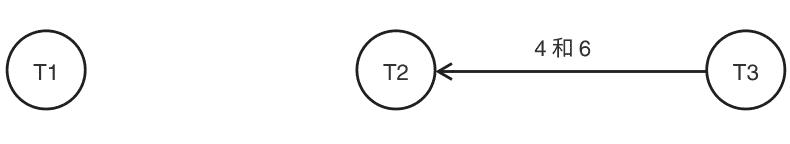

## Q 36.2 调度1 是否可串行化？如果不是，请简要解释为什么不是。如果是，请给出一个串行日程安排。

## Q 36.3 现在填写调度2 的表格。这次你需要自己填写整个表格。

| 箭头 | 存在吗？ | 步骤 |
|---|---|---|
| T1 ≈ T2 |  |  |
| T1 ≈ T3 |  |  |
| T2 ≈ T1 |  |  |
| T2 ≈ T3 |  |  |
| T3 ≈ T1 |  |  |
| T3 ≈ T2 |  |  |

## PS-140 问题集

Q 36.4 日程安排 2 是否可串行化？如果不是，请解释为什么不是。如果是，请给出一个串行日程安排。

Q 36.5 在两阶段锁定中，是否可以通过两阶段锁定来生成计划2，其中一个事务在使用对象的第一部分时获取对象的锁？例如，计划2的第3步是事务T1第一次使用记录 x，因此它将通过获取 x的锁来开始该步骤。解释一下。路易斯还关注恢复问题。当他运行了三个事务并获得了计划2时，他发现系统生成了以下日志：

+   1 BEGIN（事务：T1）
2 BEGIN（事务：T2）
3 BEGIN（事务：T3）
4 CHANGE（事务：T1，记录： x，撤销：1，重做：2）
5 CHANGE（事务：T3，记录： y，撤销：1，重做：2）
6 CHANGE（事务：T2，记录： z，撤销：1，重做：2）
7 COMMIT（事务：T3）
8 COMMIT（事务：T2）
9 更改（事务：T1，记录：z，撤销：2，重做：3）
10 提交（事务：T1）

在更改记录中，撤销字段给出了此更改之前的旧值，重做字段给出了此更改之后的新值。例如，条目4表示x的旧值为1，新值为2。系统使用图9.23中的重做/撤销恢复过程。

假设系统在日志的第7条记录写入磁盘后但在第8条记录写入之前崩溃。恢复完成后，x、y和z的状态是什么？

假设系统在日志的第9条记录写入磁盘后但在第10条记录写入之前崩溃。恢复完成后，x、y和z的状态是什么？

Louis的数据库由存储在磁盘上的整数对象集合组成。每个 WRITE操作都会将被修改的对象增加1。系统使用预写式日志协议，并且有一个内存缓存，系统定期将其刷新到磁盘上，而不检查缓存的对象是否属于已提交的事务。

## 36 建立可串行化 PS-141

为了节省日志空间，Louis的朋友Ben Bitdiddle建议CHANGE记录只需指示执行的操作。例如，日志条目4将是：

```
4 CHANGE(事务：T1，记录：x，操作：增加)
```

当恢复管理器看到这个条目时，它执行指定的操作：将x增加1。Ben对恢复协议没有做其他更改。

Q 36.8 所有对象都初始化为0。Louis尝试了Ben的计划，但在第一次系统崩溃和恢复后，他发现它不起作用。解释原因。

## 37 改进的Bitdiddler*

Alyssa指出Ben的Bitdiddler使用同步块写入（见问题集5），不能保证文件系统调用（例如， WRITE, CLOSE等）提供全有或全无的原子性。 她建议Ben使用日志记录方法来帮助提供每个文件系统调用的全有或全无的原子性。

她建议文件系统在每个 CREATE, WRITE或 UNLINK调用之前同步写入日志记录。每个日志记录包含执行的操作类型，文件的名称，对于写入操作还包括数据的旧值和新值，以及新数据将被写入的偏移量。 系统确保日志记录写入是原子的，并将日志记录放在单独的日志文件中，存储在单独的磁盘上。

本修改了Bitdiddler代码，在执行创建、写入或删除操作之前执行这些日志记录操作。 他还实现了一个崩溃恢复协议，在崩溃后扫描日志，作为崩溃恢复协议的一部分，旨在确保全有或全无的原子性。

## Q 37.1 在Bitdiddler的高性能版本中，以下哪种崩溃恢复协议确保文件系统调用是全有或全无的（假设系统崩溃时最多只有一个文件系统调用正在运行）？

+   A. 从头到尾扫描日志；按照正向扫描顺序重新应用每个记录的操作到指定的文件。
B. 从尾到头扫描日志；按照反向扫描顺序重新应用每个记录的操作到指定的文件。
C. 读取最后一条日志记录并重新执行它。
D. 从头到尾扫描日志，并识别所有应该存在但不存在的文件（例如，没有索引节点且未被删除）。然后，从头到尾扫描日志，按照正向扫描顺序重新执行 CREATE和 WRITE操作以创建这些文件。
E. 从头到尾扫描日志，并识别所有应该存在但不存在的文件（例如，没有索引节点且未被删除的文件）。然后，从末尾到开头扫描日志，按相反的顺序重新执行 CREATE和 WRITE操作以创建这些文件。

高性能日志记录位操作员。本观察到同步写操作会降低文件系统的性能。为了改善这种日志记录方法的性能，本修改了Bitdiddler，增加了一个大型文件系统缓存。 他安排 WRITE、 CREATE和 UNLINK操作更新缓存中的块。 为了最大化性能，文件系统以任意顺序和自己选择的时间异步地将这些修改后的块传播到磁盘。 本的文件系统仍然同步写入日志记录。

* 开发这个问题集的功劳归于Sam Madden。

## Q 37.2 在Bitdiddler的高性能版本中，以下哪种崩溃恢复协议确保文件系统调用是全有或全无的（假设系统崩溃时最多只有一个文件系统调用正在运行）？

+   A. 从头到尾扫描日志；按照正向扫描顺序重新应用每个记录的操作到指定的文件。
B. 从尾到头扫描日志；按照反向扫描顺序重新应用每个记录的操作到指定的文件。
C. 读取最后一条日志记录并重新执行它。
D. 从头到尾扫描日志，并识别所有应该存在但不存在的文件（例如，没有索引节点且未被删除）。然后，从头到尾扫描日志，按照正向扫描顺序重新执行 CREATE和 WRITE操作以创建这些文件。
E. 从头到尾扫描日志，并识别所有应该存在但不存在的文件（例如，没有索引节点且未被删除的文件）。然后，从末尾到开头扫描日志，按相反的顺序重新执行 CREATE和 WRITE操作以创建这些文件。

## Q 37.3 Alyssa建议Ben修改他的系统，定期写入检查点以提高恢复效率。以下哪种检查点协议将允许Ben的恢复代码从最新的检查点开始恢复，同时确保高性能、异步Bitdiddler中每个文件系统调用的全有或全无原子性？

+   A. 完成任何当前正在运行的文件系统操作（例如，打开，写入，删除等），停止处理新的文件系统操作，将文件系统缓存中的所有修改块写入磁盘，然后在日志中写入一个包含打开文件列表的检查点记录。
B. 完成任何当前正在运行的文件系统操作，停止处理新的文件系统操作，将文件系统缓存中的所有修改块写入磁盘，然后在日志中写入一个不包含其他信息的检查点记录。
C. 在不先完成当前文件系统操作的情况下，将文件系统缓存中的所有修改块写入磁盘，然后在日志中写入一个包含打开文件列表的检查点记录。
D. 在日志中写入一个检查点记录（包含打开文件列表），但不将所有修改块写入磁盘。

事务性位操作器。到目前为止，本非常兴奋地对他的文件系统添加了一些高级功能。从学习第9章，他知道事务是一种使多个操作看起来像是一个在之前或之后，全或无的原子操作的方式，他决定他想要使他的文件系统具有事务性，以便程序可以将更改提交到多个文件作为其中的一部分。

## PS-144 问题集

事务，并且并发使用文件系统的用户永远不会看到其他部分完成的事务的影响。他添加了三个新的过程：

+   * tid = BEGIN_TRANSACTION()
* COMMIT (tid)
* ABORT (tid)

本将现有的 OPEN过程重命名为 DO_OPEN，以便他可以插入一个名为 OPEN()的层，该层接受指定此文件访问将成为其一部分的事务的 tid参数。本的计划是一个事务可以 OPEN、 READ和 WRITE多个文件，但这些更改只有在发起事务调用 COMMIT后才对其他事务可见。如果系统在事务 COMMIT之前崩溃，其操作将在恢复期间撤消。

本决定使用锁定来确保前后原子性。他在每个文件上放置了一个独占锁，并将程序 OPEN用于在返回之前尝试 ACQUIRE该锁。如果另一个事务当前持有锁定，OPEN将等待直到锁定可用。

这是本新 OPEN过程的实现：

```
过程 OPEN ( tid, file_name)
整数 locking_tid
do
 locking_tid = TEST_AND_ACQUIRE_LOCK (file_name, tid)
while locking_tid != tid
 return DO_OPEN (file_name) // 返回一个文件句柄。
```

TEST_AND_ACQUIRE_LOCK() 用于测试锁定当前是否被某个事务获取，如果是，则返回锁定事务的ID。如果锁定当前未被获取，它将代表 tid获取锁定，并返回 tid。

本修改了他的日志代码，使每个日志记录包含事务的 tid，并添加 COMMIT和 ABORT记录以指示事务的结果。

本正在编写 CLOSE和 COMMIT函数的代码，并试图弄清楚何时应该释放事务所获取的锁。他的代码如下：

```
过程 CLOSE (文件句柄 )
从文件句柄列表中删除文件句柄
A:
过程 COMMIT (事务id)
文件句柄[] = GET_FILES_LOCKED_BY (事务id)
对于每个 f在文件句柄中执行以下操作
  如果 IS_OPEN（文件句柄 ）则 CLOSE（文件句柄 ）
B:
  为事务id记录一个 COMMIT记录 // 提交点
C:
```

请注意，COMMIT首先关闭任何打开的文件，尽管文件也可以在调用 COMMIT之前关闭。

## Q 37.4 当Ben的代码释放文件锁（或所有文件锁）时，如何确保锁定协议实现了前后原子性？

+   A. 在标记为A的行处：
B. 在标记为B的行处：
C. 在标记为C的行处：

Ben开始在Bitdiddler上运行他的新事务性文件系统。Bitdiddler允许多个程序同时运行，Ben担心他的实现中可能存在错误，因为他发现有时候他的一些应用程序会永远阻塞在等待锁的状态。Alyssa指出他可能存在死锁问题。

Ben雇佣你来帮助他弄清楚他的代码是否有bug，或者应用程序只是发生了死锁。 他向你展示了几个程序的文件系统调用的跟踪记录；你的任务是确定每个跟踪记录是否表明了死锁，并且如果没有，报告事务在跟踪记录中所呈现的明显的前后顺序。

在每个跟踪的末尾，假设任何未提交的事务不再发出更多的读/写调用，但是每个未提交的事务将继续提交 如果它没有死锁。

Alyssa通过分析和评论第一个跟踪来帮助你。在这些跟踪中，时间从上到下；所以第一个显示第一个动作是开始(T₁)和第二个动作是开始(T₂)：

## Alyssa的示例注释程序跟踪：

```
事务 1：                              事务 2：
开始    (T1)                          开始    (T2)
fh ≠打开(T1, 'foo')                 fh2 ≠打开(T2, 'foo')  // 阻塞等待 T1
写入(fh, 'hi')                       写入(fh2, 'hello')  // T2可以在没有死锁的情况下提交
关闭    (fh)
提交    (T1)
```

结果就好像这些事务按照T1，然后T2的顺序运行一样。

# 问题集

图 PS.5显示一个协调节点向两个工作节点发出请求，以开始一个事务，并读取和写入文件。

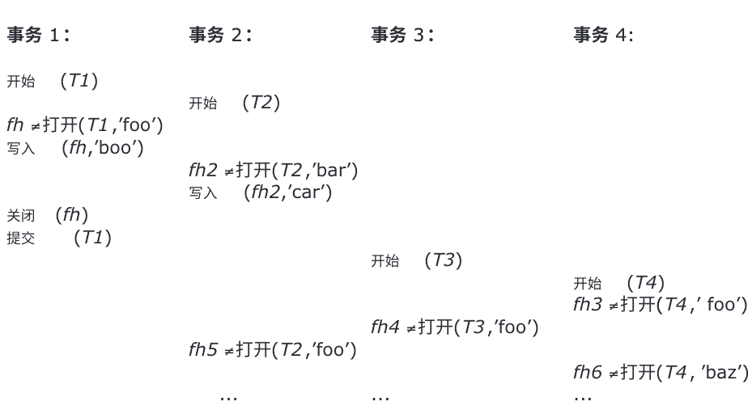

## 图 PS.5

协调器向两个工作节点发出事务性读取和写入请求，用于基于两阶段提交的分布式文件系统Bitdiddler。

本在两阶段提交协议中，当一个节点崩溃时，很难弄清楚该怎么做。当一个工作节点重新启动并找到一个事务的日志记录时，它有几个选项：

+   • W1. 通过写入“中止”记录来中止事务
• W2. 通过写入“提交”记录来提交事务
• W3. 重新向服务器发送其投票并询问事务结果

同样，协调者在从崩溃中恢复时有几个选项。它可以：

+   • C1. 通过写入“中止”记录来中止事务
• C2. 什么都不做
• C3. 向工作进程发送提交消息

## Q 37.8 对于以下情况中的每种情况，从上述操作中选择最佳操作，工作进程或协调者应该采取的操作。

+   A. 协调者崩溃，找到一个事务的日志记录，但没有 COMMIT记录
B. 协调者崩溃，找到一个事务的 COMMIT记录，但没有 END记录，表示事务已完成
C. 工作进程崩溃，找到一个事务的 PREPARE记录
D. 一个工作进程崩溃了，发现了一个事务的日志记录，但没有准备或提交记录

## 38 快速出租车公司*

Speedy出租车公司使用计算机来帮助其调度员Arnie。客户打电话给Arnie，每个人都要求派出一辆出租车到特定的地址，Arnie将其输入到计算机中。 Arnie还可以要求计算机将下一个等待的地址分配给一个空闲出租车；计算机会向Arnie指示地址和出租车号码，Arnie通过双向无线电通知该出租车。

Arnie的计算机在内存中存储了一组请求的地址和每辆出租车的当前目的地地址（如果不是空闲的）的数据库。 为了确保这些信息在停电后不会丢失，数据库将所有更新记录到磁盘日志中。由于数据库仅保存在易失性内存中，因此在停电后和重新启动时必须完全重建状态，如图9.22所示。数据库使用了类似第9章的预写式日志：它总是将每个更新追加到磁盘上的日志中，并在修改主存储器中的单元存储之前等待磁盘写入日志完成。 数据库一次只处理一个事务（由于Arnie是唯一的用户，所以没有并发）。

数据库将等待分配给出租车的地址列表存储为单个变量；因此任何更改都会导致系统记录整个新列表。 数据库将每辆出租车的当前目的地存储为单独的变量。 如果出租车没有分配的地址，则它处于空闲状态。

考虑一个使用数据库的操作：调度一个出租车。 阿尼的计算机向他呈现一个用户界面，其中包括一个标有“调度一个出租车”的按钮。 当阿尼按下按钮，并且没有故障时，计算机从等待分配的地址列表中取出一个地址，将其分配给一个空闲的出租车，并将地址和出租车显示给阿尼。

这是“调度一个出租车”的代码：

* 开发此问题集的功劳归Robert T. Morris。

```
过程调度_一个_出租车()
开始__事务
// 读取并删除列表中的第一个地址
列表≠读取()
如果长度(列表)<1则
    中止__事务
地址≠列表[0]
删除(列表 [0])
写入(列表)
// 找到第一个空闲出租车
出租车索引≠-1
对于i从0直到出租车数量-1
    出租车[i]≠读取()
    如果出租车[i]=空且出租车索引=-1则
        出租车索引≠i
        如果出租车索引=-1则
            中止__事务
// 将地址记录为出租车的目的地
出租车[出租车索引]≠地址
写入(出租车[出租车索引])
提交__事务
显示"调度出租车"+出租车索引+"到"+地址
```

当阿尼开始工作时，列表包含两个地址 a1和 a2。 有两辆出租车 (出租车[0]和出租车[1])，两者都处于空闲状态 (NULL)。 阿尼按下调度_一辆_出租车按钮，但他没有看到调度出租车的显示，计算机崩溃，重新启动，并运行数据库恢复。 阿尼第二次按下按钮，再次没有看到调度出租车的显示，计算机再次崩溃，重新启动，并运行恢复。除了所描述的或必然暗示的活动外，没有其他活动。

Q 38.1 如果你此时查看数据库日志的最后几个条目，你可能会看到以下哪些，哪些是不可能的？ Bx 代表事务 ID 为 x 的开始记录，Mx 是指定变量和新值的修改记录，Cx 是提交记录。

+   A. 没有与阿尼的行动相对应的日志记录。
B. B101; M101列表a2; M101出租车[0]=a1; C101; B102; M102列表(空); M102出租车[]=a2; C102
C. B101; M101列表a2; M101出租车[0]=a1; B102; M102列表(空); M102出租车[]=a2
D. B101; M101列表a2; M101出租车[0]=a1; C101; B102; M102列表a2; M102出租车[0]=a1
E. B101; M101列表a2; M101出租车[0]=a1; B102; M102列表a2; M102出租车[0]=a1

再次假设相同的起始状态（地址列表包含一个1和一个2，两辆出租车都处于空闲状态）。 阿尼按下按钮，系统崩溃而没有显示调度出租车消息，系统重新启动并运行恢复程序，然后阿尼再次按下按钮。

## PS-152 问题集

这次系统确实显示了调度出租车消息。 同样，除了所描述的或必然暗示的活动外，没有其他活动。

## Q 38.2 以下哪些是可能的消息？

- A. 将出租车 0 调度到 a_1
- B. 将出租车 0 调度到 a_2
- C. 将出租车 1 调度到 a_1
- D. 将出租车 1 调度到 a_2

阿尼质疑是否有必要将整个调度_ONE_TAXI作为一个单独的事务。 他建议将程序分为两个事务，第一个事务包括第2行到第9行，另一个事务包括第12行到第21行。 阿尼对代码进行了这个更改。

再次假设相同的起始状态和没有其他活动。 阿尼按下按钮，系统崩溃而不显示调度出租车消息，系统重新启动并运行恢复，然后阿尼再次按下按钮。这次系统显示了一个调度出租车消息。

## Q 38.3 以下哪些是可能的消息？

- A. 将出租车0调度到a1
- B. 将出租车0调度到a2
- C.将出租车1调度到a1
- D.将出租车1调度到a2

## 39 事务锁定*

Alyssa设计了一个使用日志的数据库，如9.3节所述。日志记录和恢复的工作如图9.22所示（带有预写式日志的内存数据库）。Alyssa声称，如果程序员正确插入ACQUIRE和RELEASE调用，他们可以拥有具有前后和全或无原子性的事务。

Alyssa已经将以下事务编程为演示。正如Alyssa所声称的，它具有先前或后续以及全有或全无的原子性。

```
T₁:
BEGIN_TRANSACTION()
ACQUIRE (X.lock)
ACQUIRE (Y.lock)
X .= X + 1
if X = 1 then
  Y .= Y + 1
COMMIT_TRANSACTION()
RELEASE (X.lock)
RELEASE (Y.lock)
```

X和Y是特定数据库字段的名称，而不是事务的参数。

本更改了代码 T₁以更早地释放锁：

```
T₁b:
开始   _事务
获取(X.lock)
获取(Y.lock)
X .= X + 1
如果X = 1则
  Y .= Y + 1
释放(X.lock)
释放(Y.lock)
提交  _事务
```

通过这个更改，路易斯怀疑程序中可能存在一个缺陷。

*开发此问题集的功劳归Robert T. Morris。

# 问题集

问题 39.2 数据库起始内容为 X=0 和 Y=0。两个 T₁b 实例几乎同时启动。发生了一次崩溃、重启和恢复。恢复完成后，以下哪些是可能的数据库内容？

- A. X=1 Y=1
- B. X=2 Y=0
- C. X=2 Y=1
- D. X=2 Y=2

本和路易斯设计了以下三个事务。注意：T₂中的锁定存在缺陷。

```
T₂:
开始   _事务
获取(M.lock)
临时 ≠ M
释放(M.lock)
获取(N.lock)
N ≠ N + 临时
提交  _事务
释放(N.lock)

T₃:
开始   _事务
获取(M.lock)
M ≠ 1
提交  _事务
释放(M.lock)

T₄:
开始   _事务
获取(M.lock)
获取(N.lock)
M ≠ 1
N ≠ 1
提交  _事务
释放(M.lock)
释放(N.lock)
```

Q 39.3 数据库中M和N的初始值分别为M=2和N=3。上述两个事务大约同时执行。没有崩溃，也没有其他活动。对于以下每对事务，请决定该对事务的并发执行是否可能导致错误的结果。如果结果总是正确的，请给出一个论证。如果可能导致错误的结果，请给出一个示例，并描述导致该结果的场景。

- A. T₂ 和 T₂:
- B. T₂ 和 T₃:
- C. T₂ 和 T₄:

## 40 “Log”-ical Calendaring *

Ally Fant正在设计一个用于存储她的约会的日历服务器。 一个日历客户端使用以下远程过程调用（RPC）与服务器进行通信：

- * ADD (timeslot, descr): 将约会描述（descr）添加到日历的时间槽 timeslot中。
- * SHOW (timeslot): 从日历中读取时间槽 timeslot的约会，并将其显示给用户。（如果没有约会， SHOW显示一个空槽。）

客户端和服务器之间的RPC运行在提供“最多一次”语义的传输协议上。

服务器运行在单独的计算机上，并将约会存储在追加日志中。 服务器响应相应的客户端请求时，通过将约会条目追加到日志中来实现 ADD操作。每个约会条目的格式如下：

```
结构体 appt_entry
整数 id
字符串 timeslot
字符串 descr
```

艾丽希望使 ADD操作具有原子性。 她意识到她可以使用
ALL_OR_NOTHING_PUT (data, sector)和 ALL_OR_NOTHING_GET (data, sector)，如
9.2.1节所述。这些过程保证一个单一的全有或全无扇区被完整地写入或完全
不写入。

每个预约条目都是一个时间段，指定了预约的时间间隔（例如，2005年5
月20日下午1:30至3:00）。 每个预约条目的大小正好等于一个全有或全无扇
区（512字节）。 磁盘上的第一个全有或全无扇区，编号为0，是主扇区，它
存储了下一个日志记录将被写入的全有或全无扇区编号。 存储在主扇区中的
数字称为日志的结束，日志结束，并且初始化为1。

Ally设计了以下过程：

```
1 过程添加（时间段；描述）
2 id ≠ 新 _动作 _ID () // 返回一个唯一标识符
3 appt ≠创建_新_预约 (id；时间段；描述) // 创建并填写预约条目
4 如果  full_or_nothing_get (end_of_log;master_sector) ≠ success则返回
5 如果 full_or_nothing_put (appt;end_of_log) ≠ success则返回
6 end_of_log ≠ end_of_log + 1
7 如果 full_or_nothing_put (end_of_log;master_sector) ≠ OK则返回
```

过程 NEW_ACTION_ID 返回一个唯一的动作标识符。该过程

## PS-156 问题集

MAKE_NEW_APPT分配一个 appt_entry结构并填充它，将其填充到512字节。Ally按照以下方式实现 SHOW：

- 1. 使用 full_or_nothing_get 读取主扇区以确定日志的结束。
- 2. 从最后一个写入的 full_or_nothing 扇区开始向后扫描日志 (end_of_log- 1)，对每个扇区使用 full_or_nothing_get，并在找到时间段的条目后立即停止。

为了帮助理解她的日历系统实现是否正确，艾莉定义了以下她的日历服务器应确保的属性：P1： show (timeslot) 应显示与最后一次提交的 ADD对应的约会，即使在 ADD调用期间发生系统崩溃。

P2：日历服务器必须至少存储三年的所有已提交ADD操作对应的约会。

P3：如果多个 ADD和 SHOW操作同时运行，它们的执行应可串行化，并且属性P1应成立。

P4：如果某个 ADD的时间段与现有预约重叠，则不应提交该ADD。

艾莉已经学习了一些明显相关的概念：先后原子性、全有或全无原子性、约束、持久性和事务。

问题40.1： ADD正确实现了哪些明显相关的概念？

问题40.2：对于属性P2、P3和P4，请确定最能描述它们的明显相关概念。

Q 40.3 在 ADD过程的执行中，最早的时刻是什么，以确保后续的 SHOW能够观察到 ADD所做的更改。（假设 SHOW不会失败。）

- A. 在 ADD的第5行中， full_or_nothing_put成功完成。
- B. 第6行成功完成。
- C. 在ADD的第7行中， full_or_nothing_put成功完成。
- D. 在 ADD返回给调用者的瞬间。

Q 40.4 艾莉有时会从不同的客户端机器并发使用日历服务器。关于属性P3和P4，以下哪个陈述是正确的？（假设没有发生故障，但服务器可能同时处理多个RPC。）

- A. 如果服务器上同时运行一个 ADD和多个 SHOW操作，即使这些操作是针对同一时间段的，属性P3也会被满足。
- B. 如果服务器上同时运行多个 ADD和仅有一个 SHOW，则只要这些操作在不同的时间段进行，属性P3就会得到满足。
- C. 假设 ADD（时间段，描述）在第7行之前调用 SHOW（时间段），如果该时间段已经有预约，则立即返回给调用者。如果多个 ADD和 SHOW同时运行
- D. 假设 ADD（时间段，描述）在第7行之前调用 SHOW（时间段），如果该时间段已经有预约，则立即返回给调用者。如果服务器上同时运行多个 ADD和 SHOW操作，只要属性P3成立，属性P4就会得到满足。

莱姆说服艾莉使用锁可以确保属性P3。艾莉使用两个锁，λ_t和λ_g。λ_t保护表[时间槽]，而λ_g保护对日志的访问。她需要帮助确定在多个并发 NEW_ADD和SHOW操作运行时，将锁 ACQUIRE和 RELEASE语句放在何处可以确保属性P3？假设 SHOW实现了正确的锁定。

- A.
  获取（λt）在第3行之前，
  释放（λt）在第6行之后，
  获取（λg）在第3行之前，
  释放（λg）在第6行之后。
- B.
  获取（λt）在第4行之前，
  释放（λt）在第5行之后，
  获取（λg）在第6行之前但在释放λt）之后，
  释放（λg）在第6行之后。
- C.以上都不是。

## 40“日志”式日历 PS-157

断开的日历。Ally Fant希望在断开的操作中使用她的日历，例如从她的PDA、手机和笔记本电脑。Ally修改了客户端软件如下。在客户端断开连接之前，客户端原子地从日历服务器复制日志，然后在本地重新安装表。当用户（即Ally）添加项目时，客户端在客户端上运行 NEW_ADD，更新日志和表的本地副本。

当客户端可以连接到日历服务器或任何其他客户端时，它进行协调。在协调时，两台机器中的一台是主机。如果客户端连接到日历服务器，则服务器是主机；如果客户端连接到另一个客户端，则其中一台是主机。不是主机的客户端调用 RECONCILE，它在客户端上本地运行：

```
过程 RECONCILE (主机,客户端日志)
对于每个条目 ∈客户端日志执行
  如果条目状态 =已提交
    调用 NEW_ADD(条目时间段 , 条目描述 ) at 主机
    复制(主机日志,客户端日志)  // 覆盖客户端日志
    删除 (表)
    从客户端日志重建表  // 创建新表
```

假设 RECONCILE 是原子的，并且在协调期间不会发生崩溃。还假设在任何两个节点之间最多只有一个活动的 RECONCILE。

Q 40.8 以下哪个陈述关于支持断开连接操作的实现是正确的？

- A. RECONCILE将优先解决与主要预约重叠的预约。
- B. 在完成协调后，断开连接客户端上添加的某些预约可能不会出现在Show的输出中。
- C. 客户端C1与客户端C2（以C2为主要客户端）进行协调，然后将C2与日历服务器进行协调的结果与将C2与客户端C1（以C1为主要客户端）进行协调，然后将C1与日历服务器进行协调的结果相同。
- D. 假设Ally停止进行更改，然后一次性将所有客户端与服务器进行协调。这样做好后，所有机器上的日志将相同。

Lem E. Fixit注意到过程 RECONCILE很慢。为了加快速度，Lem发明了一种新类型的记录，称为“RECONCILED”记录。每次 RECONCILE运行时，它都会追加一个已调和记录将客户的唯一标识符列入主日志，就在第5行之前。

## PS-160 问题集

问题40.9 以下哪种使用已调和记录可以加快调和的速度？（假设客户端只与日历服务器进行调和。）
- A. 修改第2行，从日志的末尾开始向后扫描客户端日志，如果找到带有客户标识符的已调和记录，则终止扫描，然后向前扫描直到日志的末尾，在日志中的约会条目上调用 NEW_ADD。
- B. 修改第2行，从日志的开头开始向前扫描客户端日志，在日志中的约会条目上调用NEW_ADD，但如果找到带有客户标识符的已调和记录，则终止扫描。
- C. 在对账结束时，不要从头开始重新安装表格，而是通过添加主日志中的条目（客户端刚刚复制的条目），这些条目位于前一个 RECONCILED记录和当前对账的 RECONCILED记录之间，来更新表格。如果日志中的条目与表格中的条目重叠，则用日志中的条目替换表格中的条目。
- D. 给Lem E. Fixit分配一个不同的工作。这些优化都不能保持正确性。

2004-3-7...15

## 41 Ben的日历*

Ben Bitdiddle刚刚被提升为工程经理。他很快注意到他新工作的两个事实。首先，保持准确的约会日历至关重要。其次，他不再有任何编程责任。 他决定一举解决这两个问题，建立自己的高可用复制日历系统。

本在他的工作站上运行客户端用户界面。 客户端通过网络与三个复制的服务器之一进行通信。 本将名为S1、S2和S3的三个服务器放置在三个不同的城市，以确保独立故障。 本一次只运行一个客户端。

每个服务器都保留本的约会的简单数据库。 数据库为每天的每个小时保存一个字符串，描述该小时的约会。 每个小时的字符串最初为空。 服务器可以对自己的数据库执行两个操作：

- DBREAD (day, hour) 返回特定日期和小时的约会。 参数 day表示所需日期，其中0表示2000年1月1日。 参数 hour是一个介于0和23之间的整数。
- DBWRITE (day, hour, string) 更改小时 hour的字符串。 将空字符串写入小时实际上会删除该小时的任何现有约会。

每个服务器都允许本的客户端通过RPC调用这些操作。RPC系统使用强大的校验和来检测所有错误并丢弃任何损坏的消息。 如果RPC客户端实现在几秒内没有收到服务器的响应，它会超时，将变量 rpc_OK设置为false，并返回 NIL。 如果客户端确实从服务器收到回复，RPC实现会将 rpc_OK设置为true，并返回服务器的结果（如果有）。RPC系统不会重新发送请求。 因此，例如，如果网络丢弃或损坏请求或响应消息，RPC调用将返回 rpc_OK设置为false。

本的客户端用户界面可以显示一天的约会，并且还可以更改约会。 为了支持这些操作，本根据以下伪代码编写了客户端软件（符号 S[i].f表示对服务器 i上的过程 f的RPC调用）：

```
过程 CLIENTREAD (天,小时)
字符串 s
对于 i从 1到 4做 // 逐个尝试每个服务器
    s ≠ S[i].DBREAD (天,小时)
    如果 rpc_OK则返回 s // 返回第一个回复
返回 "错误 "

过程 CLIENTWRITE (天,小时,内容)
对于 i从 1到 4做 // 向三个服务器写入
    布尔值 done ≠ FALSE
    当 done = FALSE时
        S[i].DBWRITE (天,小时,内容)
        如果 rpc_OK则 done ≠ TRUE
```

Q 41.1 假设连接Ben的客户端和服务器S1、S2的网络快速可靠，但是客户端和S3之间的网络经常在几分钟内停止工作。 在这种情况下，Ben的系统会如何表现?

- A. 客户端写操作通常需要几分钟或更长时间才能完成。
- B. 客户端读操作通常需要几分钟或更长时间才能完成。
- C.客户端写操作通常无法更新所有服务器。
- D.客户端读操作通常会失败，返回“错误”。

本通过读写2000年1月1日上午10点的条目来测试他的系统：
他打电话：
客户端写操作(0, 10, "员工会议")
客户端写操作(0, 10, "早餐")
客户端读操作(0, 10)

Q 41.2 假设没有故障。 客户端读操作将返回什么字符串？

为了确保，本尝试了另一个测试，涉及将会议从上午10点移到上午11点，并安排早餐：
CLIENTWRITE (0, 10, "10点免费")
CLIENTWRITE (0, 11, "11点免费")
CLIENTWRITE (0, 10, "10点找Frans聊天")
CLIENTWRITE (0, 11, "11点找Frans聊天")
CLIENTWRITE (0, 10, "10点吃早餐")

Ben在测试过程中绊倒了客户计算机的电源线，导致客户机重新启动。 客户机在重新启动后忘记了正在执行的测试，不会重新开始或继续测试。 重新启动后，Ben打电话给 CLIENTREAD(0,10)和 CLIENTREAD(0,11)。 除了提到的客户机重新启动外，在测试过程中可能发生的唯一故障是丢失消息（从而导致RPC失败）。

## Q 41.3 本可能会看到以下哪些结果？

- A. 早餐在10点，11点与Frans交谈
- B. 与Frans交谈在10点，11点与Frans交谈
- C. 早餐在10点，11点空闲
- D. 10点空闲，11点与Frans交谈

## Q 41.4 Ben有点偏执，所以他两次调用ClientRead(0, 10)来查看他的数据库是否一致。他可能会看到以下哪些结果？

- A. 早餐在10点，早餐在10点
- B. 与Frans交谈在10点，与Frans交谈在10点
- C. 10点空闲，早餐在10点
- D. 与Frans交谈在10点，10点有空

本认为这种行为是可以接受的。然而，在他开始使用系统之前，他的弟弟马克指出本的系统如果其中一个服务器宕机，将无法完成更新。马克说，如果一个服务器宕机，对该服务器的 DBWRITE RPC将超时，因此如果忽略RPC计时器到期， CLIENTWRITE的可用性将更高。马克建议以下更改的 CLIENTWRITE：

```
过程 CLIENT WRITE (天,小时,内容)
对于 i 从 1到 4做
S[i].DBWRITE (天,小时,内容)
// 忽略RPC失败
```

本采纳了这个更改，并开始使用系统来安排他的约会。然而，他的同事开始抱怨他错过了会议。对马克的更改持怀疑态度，本通过手动清除所有服务器上的数据库条目为空字符串，然后在客户端上执行以下代码进行系统测试：

```
CLIENTWRITE (0, 10, "X")
v1 ≠ CLIENTREAD (0, 10)
CLIENTWRITE (0, 10, "Y")
v2 ≠ CLIENTREAD (0, 10)
CLIENTWRITE (0, 10, "Z")
v3 ≠ CLIENTREAD (0, 10)
```

假设唯一可能的故障是RPC消息丢失，并且RPC消息会立即传递。

## Q 41.5 在马克的更改中，以下序列中哪个是可能的： v1, v2和 v3?

- A. X, Y, Z
- B. X, Z, Y
- C. X, X, Z
- D. X, Y, X

## PS-164 问题集

## Q 41.6 在本原始系统中，可能存在哪些序列 v1, v2和 v3?

- A. X, Y, Z
- B. X, Z, Y
- C. X, X, Z
- D. X, Y, X

2001-3-14...19

## 42 爱丽丝的副本

阅读第10章和端到端论证后，爱丽丝开始探索设计一个用于协调 UNIX文件系统的应用程序。她的程序， RECONCILE，以两个目录树的名称作为输入，并尝试协调两个目录树之间的差异。对于 RECONCILE的典型场景是其中一个目录树位于文件服务上。另一个目录树是该相同目录树的副本，位于爱丽丝的笔记本电脑上。

当爱丽丝与服务断开连接时，她在笔记本电脑上修改文件，而她的朋友可能在服务上修改文件。当爱丽丝重新连接到服务时，她运行RECONCILE来协调她的笔记本电脑上的目录树与服务之间的差异，使它们再次相同。例如，如果文件在她的笔记本电脑上发生了更改，但在服务上没有发生更改，RECONCILE将文件从笔记本电脑复制到服务上。如果文件在笔记本电脑和服务器上都发生了更改，则 RECONCILE需要指导来解决冲突的更改。

RECONCILE程序在每个主机上维护一个名为fsinfo的数据库，该数据库存储在被对账的目录树之外。该数据库以路径名为索引，并存储以下内容：

| 字符 | 路径名 | [1024] // 该文件的路径名 |
|---|---|---|
| 整数160 | 哈希值// 文件内容的加密哈希值 | |

在磁盘上，UNIX文件由元数据（inode）和内容（数据块）组成。加密哈希值仅使用文件的内容计算。路径名长度不超过1024字节。对于这个问题，忽略对目录进行对账的细节，并假设Alice有权限读取和写入两个目录树中的所有内容。

## RECONCILE程序分为4个阶段：

- • 阶段1：计算自上次对账以来笔记本电脑上的更改集合和服务器上的更改集合。
- • 阶段2：笔记本电脑从服务器检索更改集合。 使用这两个更改集合，笔记本电脑计算必须执行的操作集合，以对账这两个目录树。在这个阶段，对账可能会决定由于冲突的更改而无法对账某些文件。
- • 第三阶段：笔记本电脑执行第二阶段确定的操作。笔记本电脑更新其本地目录树中的文件和目录，并检索文件，发送文件，并向服务器发送指令以更新其目录树。
- • 第四阶段：笔记本电脑和服务同时更新用于反映此次运行上成功协调的文件的新内容的 fsinfo。假设在重新开始之前 RECONCILE运行完成。

此外，假设在运行协调时不允许并发线程修改文件系统。

还假设初始时 fsinfo数据库的内容相同且计算正确，并且在协调后它们也处于相同的状态。

## PS-166 问题集

协调的第一阶段在笔记本电脑和服务上运行 COMPUTEMODIFICATIONS过程。在每台机器上，COMPUTEMODIFICATIONS生成两个集合：在该机器上更改的文件集合和在该机器上删除的文件集合。

设置更改集,删除集;

过程计算修改 (路径,文件系统信息)
更改集 ≠ 空
删除集 ≠ 空
计算更改集 (路径,文件系统信息)
计算删除集 (文件系统信息)

过程计算更改集 (路径,文件系统信息)
信息 ≠ 查找 (路径 ,文件系统信息 )
如果信息 = 空则添加(路径,更改集)
否则如果是目录 (路径)则
对于路径中的每个文件执行计算更改集 (路径/文件,文件系统信息)
否则如果 CSHA (内容(路径)) ≠ 信息.哈希则添加(路径,更改集)

过程计算删除集 (文件系统信息)
对于文件系统信息中的每个条目执行
如果不 (存在(条目.路径名))则添加(路径名,删除集合)

计算MODIFICATIONS过程的参数是要协调的目录树的路径名和fsinfo数据库。过程计算CHANGESET遍历目录树并检查每个文件是否在上次协调之后创建或更改。CSHA是一个密码哈希函数，具有以下特性：计算上不可行，找到两个不同的输入 i和 j使得

CSHA (i) = CSHA (j)

过程计算DELETESET检查数据库中的每个条目是否对应的文件仍然存在；如果不存在，则将其添加到上次运行协调之后已删除的文件集合中。

## Q 42.1 RECONCILE将添加到更改集或删除集的文件是什么？

- A. 内容已经衰减的文件。
- B. 内容已经被修改的文件。
- C. 已创建的文件。
- D. inode已经被修改的文件。
- E. 已删除的文件。
- F. 已删除但内容相同重新创建的文件。
- G. 已重命名的文件。

调和的第二阶段是将两个目录树的两个更改集和两个删除集进行比较，计算一组操作。为了避免混淆，我们将笔记本上的更改集称为changeLeft，服务上的更改集称为changeRight。类似地，笔记本上的删除集称为deleteLeft，服务上的删除集称为deleteRight。第二阶段包括使用这4个集合作为输入运行COMPUTE ACTIONS过程。

计算动作产生5个集合：

## Q 42.2 哪些文件会出现在additionsRight集合中?

- A. 在笔记本电脑上创建的文件，在服务器上不存在。
- B. 在服务器上已删除但在笔记本电脑上未更改的文件。
- C. 在笔记本电脑上已删除但在服务器上未删除的文件。
- D. 在笔记本电脑上已修改但在服务器上未修改的文件。
- E. 在笔记本电脑和服务器上都已修改的文件。

## Q 42.3 哪些文件会出现在冲突集合中?

- A. 在笔记本电脑和服务器上已经修改过的文件。
- B. 在笔记本电脑上已经删除但在服务器上存在未修改的文件。
- C. 在笔记本电脑和服务器上已经删除的文件。
- D. 在服务器上已经修改但在笔记本电脑上未修改的文件。
- E. 在笔记本电脑和服务器上创建但内容不同的文件。
- F. 在笔记本电脑和服务器上创建且内容相同的文件。

调和的第三阶段执行以下操作：删除文件、传输文件和解决冲突。所有冲突都通过询问用户来解决。我们专注于从笔记本电脑向服务器传输文件。艾丽斯希望确保文件传输是原子的。假设所有文件系统调用都是原子执行的。RECONCILE程序通过调用服务上的远程过程 RECEIVE来从additionsRight传输文件：

## 第 PS-168 问题集

```
过程 RECEIVE (数据,大小,路径)
名称  ≠  UNIQUENAME ()
文件描述符 ≠ CREATE_FILE (名称)
如果文件描述符≥ 0则
    n ≠ WRITE (文件描述符 ,数据 ,大小 )
    CLOSE (文件描述符 )
    如果 n = 大小则 RENAME (名称 ,路径 )
    否则 DELETE (名称)
    返回 (n =大小)
    // 布尔结果表示成功或失败
否则返回 (FALSE)
```

RECEIVE 过程的参数是文件的新内容 (数据和大小) 以及文件的名称 (路径)。作为第一步，RECEIVE 创建一个具有唯一名称 (名称) 的临时文件，并将数据写入其中。写入成功后，receive 将临时文件重命名为其真实名称 (路径)，这同时会删除任何现有的旧版本 path；否则，它会清理并删除临时文件。假设 RENAME 总是成功执行。

## Q 42.4 在过程 RECEIVE 中，提交点在哪里？

- A. 在 RENAME 完成后
- B. 在 CLOSE 完成后
- C. 在 CREATE_FILE 完成后
- D. 在 DELETE 完成后
- E. 在 WRITE 完成后
- F. 以上都不是

服务器或笔记本电脑故障后，调用恢复过程以回滚或前滚。当主机故障时，正在进行的 RECEIVE 操作。

## Q 42.5 这个恢复过程必须做什么？

- A. 删除接收时留下的任何临时文件。
- B. 什么都不做。
- C. 向发送方发送消息以重新启动文件传输。
- D. 将接收时留下的任何临时文件重命名为相应的路径名。

## Q 42.6 这个版本的 RECONCILE 与第10章描述的对账过程相比有哪些优势？

- A. 这个 RECONCILE 修复了腐败的文件。
- B. 这个 RECONCILE 不需要对底层文件系统实现进行更改。
- C. 这个版本的 RECONCILE 不需要在笔记本电脑上登录。
- D. 这个 RECONCILE 将更改从笔记本电脑传播到服务，并反之亦然。
- E. 这个 RECONCILE 在大文件上运行速度更快。

Alice想知道她的代码是否可以用于调和超过两个文件系统。考虑3个主机 (A，B和C) 都有文件 r 的相同副本，以及以下事件序列：

## Q 42.7 以下哪些陈述是正确的，根据这个事件序列和 Alice的 RECONCILE实现？

- A. 如果下午3点的冲突以B的副本为准解决，则 RECONCILE不会报告 下午5点的冲突。
- B. 如果下午3点的冲突以C的副本为准解决，则 RECONCILE会报告 下午5点的冲突。
- C. 如果下午3点的冲突通过修改 f来合并B和C的版本来解决，则reconcile会报告 下午5点的冲突。
- D. 如果下午3点的冲突通过从B和C中移除f来解决，则RECONCILE将不会在下午5 点报告冲突。

2003-3-6...12

## 43 JailNet *

(一些第7章/在线)，但主要是第11章/在线）

计算机犯罪纠正设施是一个联邦监狱，用于处罚与信息相关的犯罪者，他们观察到他们的囚犯之间存在奇怪的行为。囚犯们发现他们可以通过用锡杯的顶部或底部敲击牢房的铁栏来向彼此广播任意二进制字符串，对于“0”和“1”分别发出不同的声音。由于任何一个牢房中发出的这种声音通常可以在其他每个牢房中听到，他们已经设计了一种类似以太网的方案，用于在彼此之间进行不同长度的数据包通信。

这种基本的通信方案是由Annette Laire设计的，她是一名CCCF终身监禁的罪犯，因非法出口受限信息而被判刑，当她通过电子邮件将GIF发送给她在萨尔瓦多的表弟时，发现其中的一些位与一个有效的加密算法相同。

Annette定义了以下基本通信原语：

```
过程 SEND (消息,发送方,接收方)
BANG (ALLONES)
BANG (接收方 )
BANG (发送方)
BANG (消息 )
BANG (CHECKSUM ({接收方,发送方,消息}))
```

其中操作 BANG (数据) 是通过敲击锡杯来发送与指定的以空字符结尾的字符串对应的位序列，初始时特殊字符串 ALLONES有一个字节(八个)1位（后面跟着终止的空字符）。每个8位字符（在接收方、发送方、消息和 CHECKSUM的结果中）的高位为零。

安妮特指定了囚犯制服上打印的唯一数字是来自和去向字符串中的数字，因为所有书呆子囚犯很快就会记住每个同事的数字。每个囚犯都会持续不断地监听发给自己的数据包，忽略那些目标字段与自己数字不匹配或校验和无效的数据包。

## Q 43.1 发送全1字节的初始字节有什么作用？

- A. 位帧化。
- B. 字节（字符）帧化。
- C. 分组帧化。
- D. 分组重组。
- E. 以上都不是。

典型的高层协议涉及囚犯之间交换的数据包序列，例如：

> * 开发此问题集的功劳归于Stephen A. Ward。

# 问题集

Ty和Annette自信满满，虽然卫兵们可能会听到他们的对话，但他们不会能够理解，因为加密的消息看起来像乱码，直到正确解码。

第一次使用 TYCODE 涉及到以下消息，由Annette接收：
SEND (TYCODE("在墙边十点见面，准备逃跑", TY, ANNETTE), TY, ANNETTE)

## Q 43.3 安妮特执行了什么计算来解码泰的消息？ 假设 rmessage是接收到的消息， message是要解码的明文，并且 $安妮特 和 $泰分别包含安妮特和泰的秘密密钥。

- A. message ≠ 验证(rmessage,泰, $安妮特 );
- B. message ≠ 加密(rmessage, $泰);
- C. message ≠ 加密(rmessage,泰);
- D. message ≠ 解密 (rmessage, $安妮特 );
- E. message ≠ 签名(rmessage, $泰);
- F. message ≠ 解密 (rmessage, 安妮特 );

收到消息后，安妮特溜出去与泰会面，她期望泰会帮助她翻越监狱墙。不幸的是，泰从未出现，安妮特被一个咯咯笑的卫兵抓住，并受到严厉的惩罚（提前上床睡觉，没有甜点）。当她第二天与泰交谈时，她得知他从未发送过消息。她得出结论这一定是一个卫兵发送的，但她感到困惑，因为密码学是安全的。

## Q 43.4 最有可能的解释是什么？

- A. 安妮特的秘钥在搜查她的手机时被泄露了。
- B. 泰发送的另一条消息在传输过程中出现了错误，意外地显示为“十点在墙边见我，准备逃跑”。
- C. 安妮特的秘钥被字典攻击破解了。
- D. 泰的秘钥被字典攻击破解了。
- E. 安妮特成为重放攻击的受害者。

安妮特的朋友证明违抗，在听到这个故事后，提出了一种新的加密过程：

```
过程证书(消息, A)
    签名 ≠ 签名(消息, A)
    返回 {消息, 签名}
```

不幸的是，在完全解释如何使用这个过程之前，证书被单独关押了，尽管他确实说过发送一条消息
S结束(证书(消息, A),来自,去)

可以确保消息正文的完整性和发送者身份的真实性。所以囚犯们需要你的帮助。

## Q 43.5 当Ty给Annette发送消息时，他应该为 A提供什么值？

+   A. ENCRYPT (Annette, $Ty)
B. Ty
C. $Ty
D. Annette
E. $Annette

Ty确定问题 43.5的答案后，Annette收到了一个据称来自Ty的数据包。她将接收到的数据包分成消息和签名，并进行验证
(消息, Ty,签名) 返回接受

## Q 43.6 Annette对消息可以得出以下哪些结论？

+   A. 消息最初由Ty发送。
B. 该数据包由Ty发送。
C. 消息最初发送给Annette。
D. 只有Annette和Ty知道消息的内容。
E. 如果Ty只发送消息给Annette，那么只有他们知道其内容。
F. 消息在传输过程中没有损坏。

Annette对Cert的贡献感到好奇，决定将 SEND、TYCODE和 CERT结合起来，以实现身份验证和机密性。她提议使用 NEWSEND，结合两个特性：

```
procedure NEWSEND (消息, A,发送者,接收者)
    SEND (TYCODE (CERT (消息, A),发送者,接收者))
```

Annette进行了以下对话：

```
Ty ⇒ Annette: NEWSEND ("我们今晚十点逃跑吧", TY, ANNETTE);
Ty ⇒ Annette:NEWSEND ("今晚不行，Survivor在播放", ANNETTE, TY);
```

第二天晚上，Annette收到了这条消息
Ty ⇒ Annette: NEWSEND ("我们今晚十点逃跑", Ty, Annette)；

Annette再次去见Ty，但Ty从未出现。最终
Annette感到无聊，就回去了。 Ty随后否认发送了这条消息。
Annette再次对她所谓的安全系统的失败感到困惑。她怀疑
有一个卫兵已经找出了如何破解系统的方法。

## 问题 43.7 解释为什么会发生这种情况，但没有卫兵出现在墙边惩罚
Annette密谋逃跑。 提出一个Ty可以做出的改变，可以
消除这个问题。

Pete・奥芬德尔经常在CCCF里进进出出，他想扩展安全协议以处理JailNet
密钥分发。 每当他被监禁时，Pete直接被关进了单独监禁室，他与其他囚犯
没有任何接触（除了敲击栅栏），电视只有3个频道。 问题变得复杂的原因
是（a）每个人（包括Pete）一离开，就会忘记Pete的制服号码，所以当他
回来时不能再使用旧密钥；（b）Pete可能不

# 问题集

甚至无法记住Ty或其他可信任的长期囚犯的密钥；(c) Pete在单独囚禁期间被发放一套无编号的制服；(d) 监狱警卫经常冒充新被囚禁的单独囚犯来了解囚犯的秘密。 Pete请你设计JailNet密钥分发协议来解决这些问题。

## Q 43.8 根据关于 ENCRYPT, DECRYPT, SIGN和 VERIFY的假设，你能设计出的最佳协议有哪些正确的？：

+   A. 这是不安全的，因为密钥 k以明文形式传输，因此入侵者可以找到密钥 k并窃听未来的安全嘟嘟声
B. 这是安全的，因为只有Bob可以验证来自Alice的消息。
C. 这是不安全的，因为Alice的公钥广为人知。
D. 它是安全的，因为消息被签名，密钥 k只用作伪随机数生成器的种子。

1998-2-7...14

## 44 PigeonExpress!.com II

(更多的鸽子，第11章[在线])为了提高计划中的首次公开募股(IPO)时鸽子快递!.com的股价，本需要使鸽子网络安全。为了专注于安全问题，假设在这个问题中鸽子永远不会迷路。

首先，本致力于实现机密性。本生成20张CD（KCD[0]到KCD[19]），每张CD都填满了随机数，并制作了两份副本，通过安全通道邮寄给发件人和收件人。他计划将这些CD用作一次性密码本。

本稍微修改了原始BEEP代码（出现在问题Q 18.1之前），以使用密钥CD。发送方的计算机运行这两个过程：

```
shared next_sequence初始值为0 // 全局序列号，从0开始。
shared nextKCD初始值为0  // 密钥CD数组中的索引。

procedure SECURE_BEEP (destination, n, CD[])// 将n张CD发送到目的地
    header h
    nextCD ≠ 0
    h.source ≠ 我的GPS  // 将source设置为我的GPS坐标
    h.destination ≠ 目的地  // 设置目的地
    h.type ≠ 请求  // 这是一个请求消息
    while nextCD < n do
        h.sequence_no ≠ next_sequence  // 为这张CD设置序列号
        发送信鸽，内容为{ h, (CD[nextCD] ∈ KCD[nextKCD])} // 发送加密的CD
        等待2,000秒

过程 SECURE_PROCESS_ACK (H)  // 处理确认
    如果H.sequence_no= sequence then // 当前未完成的CD的确认？
        next_sequence ≠ next_sequence + 1
        nextCD ≠ nextCD + 1  // 允许发送下一个CD
        nextKCD ≠ (nextKCD + 1) 模 20  // 增加并循环
```

本还修改了接收方计算机上运行的过程以匹配:

```
整数  nextkcd 初始为 0 // KCD数组中的索引。
过程 SECURE_PROCESS_REQUEST (H, CD)
    PROCESS (CD ∈ KCD[nextKCD])  // 解密并处理CD上的数据
    nextKCD ≠ (nextKCD + 1) 模 20  // 增加并循环
    h.destination ≠ h.source  // 发送到信鸽来的地方
    h.source ≠ 我的GPS
    h.sequence_no ≠ h.sequence_no  // 保持不变
    h.type ≠ ACKNOWLEDGMENT
    发送信鸽与 h  // 发送一个确认回复
```

# 问题集

Q 44.1 SECURE_BEEP, SECURE_PROCESS_ACK, 和 SECURE_PROCESS_REQUEST 提供光盘上的数据保密性？

+   A. 不，因为确认信息没有签名；
B. 不，因为 KCD被重复使用，SECURE_BEEP容易受到已知明文攻击的威胁；
C. 是的，因为一次性密码本是不可破解的；
D. 不，因为可以对 XOR进行反演。

为了使系统更实用，本决定使用短密钥，并通过鸽子网自身交换密钥，而不是使用外部安全通道。每个主体都有一个公钥系统的密钥对。 他设计了以下密钥分发协议：

Alice ⇒ Bob: “我建议我们使用密钥 k”（用Alice的私钥签名）
Bob ⇒ Alice: “好的，密钥 k很好”（用Bob的私钥签名）

两个密钥分发消息被写在光盘上，并使用 BEEP（而不是SECURE_BEEP）发送。 发送方和接收方从密钥 k生成一个比特串，使用一个众所周知的伪随机数生成器，并在SECURE_BEEP和SECURE_PROCESS_REQUEST中使用该比特串来加密和解密光盘。Q 44.2 上述协议的哪些陈述是正确的？

+   A. 这是不安全的，因为密钥 k以明文形式传输，因此入侵者可以找到密钥 k并窃听未来的安全嘟嘟声
B. 这是安全的，因为只有Bob可以验证来自Alice的消息。
C. 这是不安全的，因为Alice的公钥广为人知。
D. 它是安全的，因为消息被签名，密钥 k只用作伪随机数生成器的种子。

1999-2-16/17

## 45 WebTrust.com（OutOfMoney.com，第二部分）

在与OutOfMoney.com的灾难性经历之后，这些16岁的孩子重新组合。他们重新思考他们的商业计划，并从服务提供商转变为技术提供商。阅读了许多关于安全性的战斗故事使这些年轻的巫师相信应该有一个市场需求，用于Web服务的安全客户端认证产品。孩子们重新注册为WebTrust.com。孩子们学习了Web的工作原理。他们发现HTTP 1.0是一个简单的协议，其本质包括两个远程过程调用：

```
获取 (文档) // 返回一个文档
提交 (文档,表单) // 发送一个表单并返回一个文档
```

GET过程从Web服务获取由统一资源定位符(URL)文档标识的文档。POST过程将用户在先前检索到的文档中填写的条目发送回服务。POST过程还获取一个文档。当用户点击表单上的提交按钮时，浏览器调用POST过程。

这些远程过程调用通过可靠的传输协议TCP发送。Web浏览器打开一个TCP连接，调用一个过程 (GET或POST)，并等待来自服务的结果。Web服务等待TCP连接请求，接受连接，并等待GET或POST调用。一旦调用到达，服务执行它，通过连接发送结果，并关闭连接。浏览器显示响应并在其一侧关闭连接。因此，每个请求都必须建立一个新的连接。

简单的URL的形式是：

```
http://www.WebTrust.com/index.html
```

## Q 45.1 “www.WebTrust.com” 在上述URL中是

+   A. 一个DNS名称
B. 一个协议名称
C.一个文件的路径名
D.一个互联网地址

WebTrust.com的产品目标是验证在线服务的用户身份。预期使用方式是用户每个会话只需登录一次，并且只允许已登录的用户访问网站的其他部分。该产品由一系列网页和一些服务器软件组成。该公司使用自己的产品来验证公司网站的客户身份。

为了让互联网用户创建账户，WebTrust.com有一个网页表单，用户在其中输入用户名和两个密码副本。当用户输入密码时，浏览器不会回显密码，而是显示每个输入字符的“•”。

## PS-178 问题集

当用户点击提交按钮时，用户的浏览器调用 POST过程将表单发送到服务器。

当服务器接收到 CREATE_ACCOUNT请求时，它会确保两个密码副本匹配，并确保所提议的用户名尚未被其他人使用。如果这些条件为真，则在其本地密码文件中创建一个条目。如果任何条件为假，服务器将返回一个错误。

创建帐户的表单存储在WebTrust网站上的文档“create.html”中。服务器上的另一个文档包含：
<a href="create.html">创建一个帐户</a>

## Q 45.2 什么是标识上下文的来源，用于解析名称“create.html”所在的上下文？

+   A. 浏览器从包含相对URL的文档的URL中派生出默认上下文引用。
B. 它在安装浏览器时在Web浏览器中进行配置。
C. 服务器从它记住的先前发送给此客户端的文档中派生出它。
D. 用户在浏览器中输入它。

## Q 45.3 为什么创建账户的表单要求用户输入密码两次？

+   A. 允许密码在屏幕上不显示，同时使用户能够捕捉到输入错误。
B. 用于检测键盘和浏览器之间的传输错误。
C. 减少密码数据包需要重新传输的概率，如果网络删除了该数据包。
D. 增加用户创建虚假账户的难度。

## Q 45.4 在这个系统中，创建账户容易受到哪些攻击？(假设有主动攻击者。)

+   A. 攻击者可以通过窃听来获取用户的密码
B. 攻击者可以修改密码
C. 攻击者可以通过创建多个账户来压倒服务
D. 攻击者可以运行一个假冒“www.WebTrust.com”的服务用户访问“login.html”网页进行登录，该网页要求用户输入用户名和密码。当用户点击提交按钮时，浏览器调用 POST过程，将用户名和密码发送到服务端。服务端将存储的密码与登录请求中的密码进行比对。如果匹配成功，则允许用户访问服务；否则，服务端返回错误信息。

## Q 45.5 登录过程容易受到哪些攻击？（假设存在主动攻击者。）

+   A. 攻击者可以通过重放合法登录的记录 POST来登录
B. 攻击者可以通过重放单个记录的 POST来登录为任意用户
C. 攻击者可以冒充WebTrust.com向任何注册用户进行登录
D. 攻击者可以冒充WebTrust.com对未注册用户进行身份验证。在登录后对用户的后续Web请求进行身份验证时，WebTrust.com利用了一种称为 cookies的Web机制。服务可以在Web浏览器中安装一些状态（称为cookie）。服务通过在响应中包含一个SET_COOKIE指令来安装此状态，其中包含要存储在cookie中的数据。WebTrust.com对

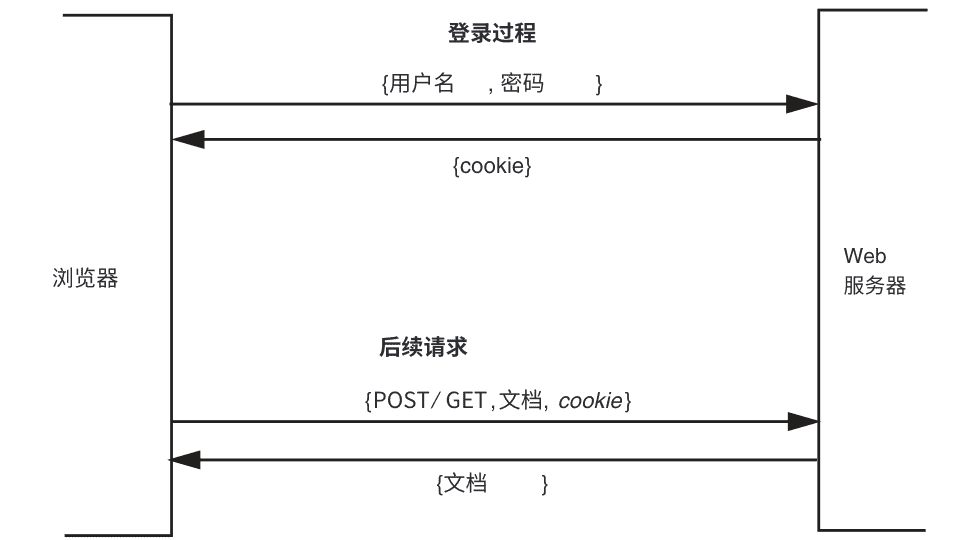

cookies的概述如图所示。 包含对登录请求的响应的文档附带指令：

```
POST (webtrustcookie)
```

浏览器将cookie存储在内存中。（实际上，可能有很多cookie，所以它们有名称，但是对于这个问题，假设只有一个cookie，不需要名称。）在对安装了cookie的服务进行后续调用（即 GET或 POST）时，浏览器将安装的cookie与其他参数一起发送给 GET或 POST。因此，一旦WebTrust.com在浏览器中设置了一个cookie，它将在每个后续请求中看到该cookie。

该服务要求浏览器在所有 GET请求中发送cookie，并且在除了提交 CREATE或 LOGIN表单的所有POST请求中也发送cookie。如果cookie丢失（例如，浏览器丢失了cookie，因为客户端计算机崩溃，或者攻击者故意删除了cookie），服务将向浏览器返回错误并要求用户重新登录。

## PS-180 问题集

如果cookie丢失（例如，浏览器丢失了cookie，因为客户端计算机崩溃，或者攻击者故意删除了cookie），服务将向浏览器返回错误并要求用户重新登录。

一个重要问题是确定适合webtrustcookie的内容。 WebTrust.com提供了多种选择。

第一种选择是按以下方式计算cookie：

```
cookie = {过期时间}密钥
```

使用共享密钥进行MAC计算 key。 密钥仅服务知道，服务仅记住它24小时。该时期内的所有cookie使用相同的 key。 所有cookie在凌晨5点过期，此时服务会更换新的 key。

当服务器接收到cookie时，它会使用以下方法检查其真实性和过期情况：

```
过程 CHECK (cookie)
如果 VERIFY (cookie, key) = ACCEPT，那么
如果 cookie.expiration_time ≤ CURRENT_TIME ()，那么
返回 ACCEPT
返回 REJECT
```

过程 VERIFY重新计算并检查MAC。如果MAC有效，则服务会检查 cookie是否仍然新鲜（即，过期时间是否晚于当前时间）。如果是，则 CHECK返回 ACCEPT；服务器现在可以执行请求。在其他所有情况下， CHECK返回 REJECT，服务器向浏览器返回错误。

## Q 45.6 在该协议中，MAC的作用是什么？

+   - A. 帮助检测传输错误
- B. 从服务器私密地向浏览器传递密钥
- C. 从服务器私密地向浏览器传递过期时间。
- D. 帮助检测伪造的cookie。

## Q 45.7 这个协议防止哪些攻击？

+   - A. 重放cookie
- B. 伪造过期时间
- C. 伪造cookie
- D. 密码的字典攻击

webtrust.com支持的另一个选项是按以下方式计算cookie：

```
cookie = { 过期时间,用户名 } 密钥
```

服务器使用登录请求中的用户名作为用户名。 这个cookie的使用方式与之前类似，检查过程没有改变。

## 45 WebTrust.com (OutOfMoney.com, Part II)

Q 45.8 如果服务收到一个带有“Alice”作为用户名并且 CHECK返回 ACCEPT的cookie，服务知道什么？ (假设存在主动攻击。) A. 没有人修改了cookie B. 服务器最近接受了“Alice”的登录 C. 该cookie是最近生成的

D. 用户“爱丽丝”的浏览器最近发送了这个cookie

Q 45.9 假设暂时认为爱丽丝的所有Web请求都通过单个TCP连接发送，该连接已加密和验证，并且已经适当地进行了设置（即，只有浏览器和服务器知道加密和验证密钥）。 在爱丽丝通过此连接登录后，服务器已收到一个带有“爱丽丝”作为用户名的cookie，并成功验证了它（即，VERIFY返回ACCEPT），服务器知道什么？（假设主动攻击。） A. 除了服务器和用户“爱丽丝”的浏览器之外，没有其他人知道该cookie B. 服务器最近接受了来自“爱丽丝”的登录 C. 该cookie是最近生成的

D. 用户“爱丽丝”的浏览器最近发送了这个cookie

Q 45.10 将cookie持久存储（即，浏览器将其存储在本地操作系统的文件中）而不是在运行时内存中，是否存在其他安全风险？（假设操作系统是多用户操作系统，如Linux或Windows，包括虚拟内存系统。） A. 是的，因为带有cookie的文件可能对其他用户可访问。

B. 是的，因为下一个登录客户端的用户可能可以访问带有cookies的文件。

C. 是的，因为它扩展了可信计算基础，包括本地操作系统

D. 是的，因为它扩展了可信计算基础，包括硬盘 Q 45.11 WebTrust 的产品（不包括加密和认证的TCP连接）适用于哪些应用（即，可在没有严重风险的情况下使用）？ A. 用于保护电子银行的银行账户访问

B. 用于限制只有订阅服务的客户端才能访问电子新闻文章

C. 用于保护在线学生服务中的学生数据访问

D. 用于电子购物，比如在amazon.com

E. 以上都不是

马克・比特迪德尔——本的16岁弟弟——提议稍微改变协议。 而不是计算 cookie如下：

```
cookie = { 过期时间,用户名 } 密钥
```

马克建议简化代码为：

```
cookie = { {过期时间 }键 , 用户名 }
```

他还建议对应的过程 VERIFY进行相应的更改。 协议最初是在普通的未加密和未经身份验证的TCP连接上运行的。

PS-181

Saltzer & Kaashoek Ch. ps, p. 181

2009年6月24日 上午12:21

## PS-182 问题集

Q 45.12 描述这种开放的一种攻击，并通过描述一个场景来说明这个攻击（例如，“Lucifer现在可以通过……来……”）。

2001-2-6...

## 46 更多的ByteStream产品

观察到近期在大众媒体上对安全性的关注，ByteStream公司决定通过加密来获得机密性的产品功能扩展。ByteStream决定使用下面的简单共享密钥系统：

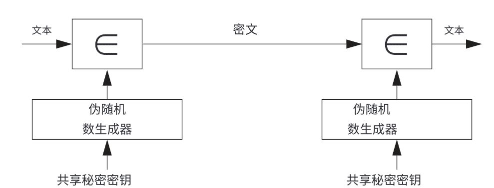

ByteStream使用独占-或（XOR，表示为 ⊕）函数。伪随机数生成器（PRNG）使用共享-秘密密钥作为种子生成一串难以预测的比特。当使用相同的密钥进行种子生成时，它将生成相同的比特串。消息通过计算消息和生成器产生的比特串的 XOR来进行加密。通过使用PRNG生成的比特串与密文进行 XOR计算，使用某个密钥作为种子进行解密。PRNG的代码是公开可用的。

为了检查实现，ByteStream公司聘请了一个包括Eve S. Dropper和Lucy Fer在内的虎队。虎队验证了计算 XOR的代码没有错误，并且PRNG不包含密码学上的弱点。虎队随后研究了以下场景。Alice与Bob共享一个200位的密钥 κ。Alice使用 κ对消息进行加密，并将得到的密文发送给Bob。Bob使用κ对密文进行解密。解密后的结果是Alice的消息。假设每个消息都是等可能的（即，Alice的消息没有任何冗余）。

Q 46.1 假设Eve只能看到密文，她能解密Alice的消息吗？

+   A. 不行，因为只有Alice和Bob知道密钥，而PRNG以相等的概率生成0或1，Eve无法知道Alice消息的内容。
+   B. 是的，因为使用超级计算机，Eve可以尝试所有可能的0和1的组合来检查它们是否与密文匹配。

C. 不行，因为计算两个比特流的 XOR很困难。

D. 是的，因为 XOR是一个简单的函数，Eve可以计算 XOR的逆函数。

Q 46.2 Alice和Bob切换到一个新的共享密钥。Lucy通过欺骗Alice发送一个以500个1开头，然后是Alice原始消息的方式进行主动攻击。给定密文，Lucy能解密Alice的消息吗？

+   A. 是的，因为密钥比500位小。
+   B. 也许，但概率非常低，可以忽略不计。
+   C. 不，因为只有Alice和Bob知道密钥，而伪随机数生成器以相等的概率生成0或1，Lucy无法提取Alice的消息。
+   D. 不，因为计算两个比特的异或 XOR很困难。

ByteStream对支持双向通信的产品感兴趣。ByteStream通过为请求和回复分别使用一个流来实现双向通信。ByteStream使用相同的密钥为两个流进行初始化。由于ByteStream担心在两个方向上使用相同的密钥可能存在弱点，它请虎队检查实现。

虎队研究了以下场景。Alice使用密钥 k为请求流种子，并向Bob发送一条消息。在收到Alice的消息后，Bob使用密钥 k为回复流种子，并向Alice发送响应。再次假设每个请求和响应的概率相等。

Q 46.3 Eve能从消息的内容中推断出什么？

+   A. 没有什么。
+   B. 请求的内容，但不包括回复。
+   C. 请求和回复的异或。
+   D. 请求和回复的内容。

1997-2-3a...

## 47 消除垃圾邮件*

垃圾邮件被定义为以大量发送的未经请求的消息，现在占据了全球电子邮件和短信服务（SMS）流量的大部分。2005年的研究估计，每天发送约1000亿（100 × 10⁹）封电子邮件和短信，其中三分之二是垃圾邮件。Alyssa P. Hacker意识到垃圾邮件是一个问题，因为发送电子邮件几乎没有成本，这使得垃圾邮件发送者每天发送大量消息变得有吸引力。

Alyssa开始设计一个名为 SOS的垃圾邮件控制系统，该系统采用以下方法：

+   A. 分配。每个发件人都会得到一定数量的邮票作为付款。新发行的邮票是新鲜的，而已使用过的邮票可以被取消以确保只使用一次。
+   B. 发送。发件人（即发件邮件服务器）将一张新鲜的邮票附加到每封电子邮件消息上。
+   C. 接收。接收者（即收件邮件服务器）通过使用运行在可信服务器上的配额执行器进行远程过程调用（RPC）来测试传入邮票的新鲜度，该过程调用被描述如下：如果邮票是新鲜的，则接收者将消息传递给人类用户。如果发现邮票已被取消，则接收者将该消息丢弃为垃圾邮件。
+   D. 配额执行。配额执行器为接收者实现了测试和取消的RPC接口。如果邮票尚未被取消，配额执行器将在此过程中通过将取消存储在数据库中来取消邮票。

Alyssa希望给每个人分配合理的配额，然后强制执行这些配额，这样可以削弱垃圾邮件发送者（因为这会花费他们很多），同时基本不影响合法用户（因为这对他们来说花费很少）。

与邮票一样，SOS的邮票需要是不可伪造的，密码学可以提供帮助。SOS依赖于一个中央可信的邮票机构SA，拥有一个众所周知的公钥SA_pub和相应的私钥SA_priv。每个发送者S生成一个公钥/私钥对（S_pub，S_priv），并向SA提供S_pub以及一些付款。作为回报，邮票机构SA给发送者S一个证书（C_S）并分配给它一个邮票配额。

```
C_S = {S_pub, expiration_time, daily_quota}^{SA_priv}
```

符号{msg}^k表示将msg和使用密钥k签名的msg编组到缓冲区中。我们假设使用相同的密钥对相同的消息进行签名总是生成相同的比特串。在证书中，expiration_time被设置为一

* 开发此问题集的功劳归于Hari Balakrishnan。

## PS-186 问题集

从SA发出证书的时间开始，一年内daily_quota是一个正整数，表示S每天可以发送的最大消息数。

S可以制作多达daily_quota个邮票，每个邮票都有一个唯一的整数 id，范围在1到daily_quota之间，并且有当前的日期。要发送一条消息，S构造并附加一个具有以下格式的邮票：

```
邮票 = {C_S, {id, 日期}}_Spriv
```

当接收者收到一个邮票时，首先运行CHECK_STAMP_VALIDITY (邮票)来检查邮票是否有效。此过程验证C_S是否是一个正确签名的、未过期的证书，并且验证邮票的内容是否未被更改。它还检查 id 是否在C_S中指定的范围内，并且日期是昨天的日期或今天的日期（因此一个邮票有两天的有效期）。

如果任何检查失败，接收方会认为该消息是垃圾邮件并丢弃它。如果所有检查都通过，则该邮票被视为有效。接收方会调用 TEST_AND_CANCEL来验证有效的邮票。

除非另有说明，假设：

+   A. 没有实体的私钥被泄露。
+   B. 所有的加密算法都是计算上安全的。
+   C. SA被所有参与者信任，其操作的任何方面都没有受到损害。
+   D. 发送方可能是恶意的；恶意发送方会尝试超过他的配额；例如，他可能会尝试发送许多带有相同邮票的消息，或者窃取另一个发送方未使用的邮票。
+   E. 接收方可能是恶意的；例如，恶意接收方可能会尝试取消属于其他发送方的邮票，而它没有看到这些邮票。
+   F. 大多数接收方会取消它们看到的邮票，尤其是那些附加在垃圾邮件上的邮票。
+   G. 每个消息只有一个收件人（不用担心发送给邮件列表的消息）。
+   H. 垃圾邮件发送者和其他不良方可能对配额执行器进行拒绝服务和其他资源耗尽攻击，SOS应该对此进行保护。

Alyssa根据图 PS.6 实现了 TEST_AND_CANCEL。因为垃圾邮件发送者有重复使用邮票的动机，她想要跟踪每个邮票上TEST_AND_CANCEL请求的总数。num_uses是一个以邮票为键的哈希表，用于跟踪此数量。哈希表支持两个接口：

+   A. PUT (table, key, value) 将(key, value)对插入到表中。
+   B. GET (table, key) 返回表中与键关联的值，如果之前有 PUT，则返回0。值为0永远不会被 PUT。

Q 47.1 Louis Reasoner看着 TEST_AND_CANCEL过程，并说："Alyssa，客户端已经检查过邮票是否有效，所以你不需要再调用 CHECK_STAMP_VALIDITY。" Alyssa思考了一下，决定保留这个检查。为什么？

```
1 过程 测试_和_取消(时间戳, 客户端)
2 // 假设客户端不是伪造的网络地址
3 如果 检查_时间戳_有效性(时间戳) != 有效 则 返回
4 u = 获取(使用次数, 时间戳)
5 如果 u > 0 则 状态 = 已取消
6 否则 状态 = 新的
7 u = u + 1
8 放置 使用次数, 时间戳, u)
9 发送 客户端, 状态);
// 假设可靠的数据传输
```

## 图 PS.6

Alyssa的测试和_取消过程。

Q 47.2 假设收件人R收到一封包含属于S的有效邮票的电子邮件。那么，以下哪个断言是正确的？

+   * A. R可以确定电子邮件来自S。
+   * B. R可以确定邮戳中证书的数据完整性和来源完整性。
+   * C. R可以使用邮戳中的信息来取消属于S的另一个具有不同id的邮票。
+   * D. 如果攻击者侵入了一台有新邮戳的计算机，他可能会使用这些邮戳发送自己的消息，即使这些邮戳是由另一个实体签名的。
+   * E. S可以通过调用TEST_AND_CANCEL函数来判断R是否收到了一封电子邮件，看看附加在该邮件上的邮戳是否在配额执行器中被取消。
+   * F. 如果S使用R_pub加密了电子邮件，那么除了S或R之外的任何实体都无法在没有S或R知情的情况下阅读邮件的内容。

联合国隐私组织审查了Alyssa的提议，并对SOS协议提出了异议，认为它损害了发件人和收件人之间的电子邮件通信的隐私，因为邮戳机构（也是配额执行器）可能能够猜测某个发件人与某个收件人进行了通信。Alyssa决定修改SOS协议以实现两个目标：

+   * G1. 对于邮票机构（配额执行者）来说，将取消的邮票与发件人-收件人配对关联应该是计算上不可行的。
+   * G2. 对于接收者来说，仍然可以调用 TEST_AND_CANCEL并正确确定邮票的新鲜度。

Alyssa考虑了几种实现这个任务的替代方案。Louis提出使用他称之为DETERMINISTIC_ENCRYPT （msg， k）的加密方法，它对于相同的（msg， k）输入总是产生相同的输出字符串。第二种方案涉及使用现成的ENCRYPT （msg， k），因为它在明文消息中添加了时间戳，所以对于相同的（msg， k）输入总是产生不同的输出。第三种选择使用 HASH（msg）

Alyssa意识到，如果SOS要被广泛使用，她需要多台计算机来运行配额执行程序以处理每天的test_and_cancel负载。Alyssa发现将test_and_cancel使用的num_uses哈希表存储在磁盘上会导致性能下降，因为对哈希表的访问是随机的。当Alyssa将这个哈希表存储在RAM中时，她发现一台计算机可以处理每秒50,000个实际输入工作负载的test_and_cancel RPCs，包括查找存储密钥的机器所需的工作（相比于基于磁盘的哈希表实现的每秒约100个RPCs）。连接客户端与配额执行服务器的网络具有额外的容量，因此不是瓶颈。

在Alyssa目前的设计中，存储邮票所需的空间相当大。她决定通过存储 HASH（stamp）而不是更大的 stamp来节省空间。通过这种优化，将每个取消操作存储在 num_uses哈希表中需要20个字节的空间。假设 num_uses仅存储今天或昨天的邮票。Alyssa购买的计算机每台都有一千兆字节的RAM可用于存储邮票。

Q 47.4 Alyssa发现峰值 TEST_AND_CANCEL请求速率是平均速率的10倍。估计Alyssa为SOS系统需要多少台服务器才能处理每天1000亿个TEST_AND_CANCEL操作。（使用一天有10^5秒的近似值。）务必考虑所有潜在的瓶颈。

Alyssa构建了一个具有多个服务器的原型SOS系统。她在每台服务器上运行多个TEST_AND_CANCEL线程。Alyssa希望每个线程都可以恢复，并且所有取消的邮票至少持续两天。她还希望不同的并发线程彼此隔离。

Alyssa决定实现配额执行器的好方法是使用事务。她在 TEST_AND_CANCEL的开头插入了一个调用 BEGIN_TRANSACTION的语句，并在调用SEND之前插入了一个调用COMMIT的语句。她使用写前日志协议实现了一个基于磁盘的更新撤销/重做日志，用于对num_uses哈希表的更新（每个磁盘扇区写入都是可恢复的）。她使用锁进行隔离。

由于所有的邮票取消都存储在RAM中，Alyssa发现服务器崩溃会导致之前取消的邮票的整个RAM哈希表丢失。一个线程也可能

在 COMMIT之前，可以随时ABORT它（例如，操作系统可以决定终止运行时间过长的线程）。

Q 47.5 关于SOS的可恢复性和持久性的哪个陈述是正确的？

+   A. 当一个线程中止时，在某些情况下，中止过程必须从日志中撤销一些操作。
+   B. 当一个线程中止时，在某些情况下，中止过程必须从日志中重做一些操作。
+   C. 在某些情况下，故障恢复过程必须从日志中撤销一些操作。
+   D. 在某些情况下，故障恢复过程必须从日志中重做一些操作。
+   E. 当故障恢复过程在故障后从日志中恢复时，只要在恢复完成之前没有新的线程运行，它就不需要获取任何锁。

Q 47.6 回想一下，在SOS中，一个重要的是检测是否有任何邮票被多次使用。Louis断言，“Alyssa，即使你不用担心 TEST_AND_CANCEL线程之间的前后原子性，任何邮票的重复使用都将被捕捉到。”给出一个例子来说明为什么前后原子性是必要的。

满意于她的原型机能够处理全球信息量的事实，Alyssa转向邮票定价的问题。她的目标是“适度的”：将垃圾邮件减少10倍。她意识到她的答案取决于许多假设，并且只是一个初步的近似。

Q 47.7 Alyssa阅读了各种调查，并得出结论，垃圾邮件发送者每天最多愿意花费1100万美元。她还得出结论，今天发送的每天1000亿封邮件中有66%（三分之二）是垃圾邮件。在这些假设下，为了将垃圾邮件数量至少减少10倍，每张邮票的价格应该是多少？

## 48 保密的Bitdiddler*

本使用原始的Bitdiddler，使用问题集5中的同步写入。本在手持计算机的文件系统中存储了很多文件，并且很快就用完了磁盘空间。他查看了磁盘上的块，并发现许多块具有相同的内容。为了减少空间消耗，他按照以下方式增强了文件系统的实现：

+   A. 文件系统在内存中保留一个表，记录每个分配的块的32位非加密哈希值。（当文件系统启动时，它会从磁盘状态计算出这个表。）本与一个哈希专家交谈，专家告诉本使用b-位（这里b=32）的非加密哈希函数

H(块 ) = 块 mod P

其中p是一个大的b位素数，可以在区间[0...2^b-1]中产生均匀分布的哈希值。

+   B. 当文件系统为文件写入一个块b时，它会检查表中是否包含一个块编号为d的块，其磁盘上的块内容与块b的哈希值相同。如果是这样，文件系统会释放块b并将块编号d插入到文件的inode中。如果没有块编号d，文件系统会将块b写入磁盘，并将块编号b及其哈希值放入表中。

为了保持简单，让我们忽略用户删除文件时发生的情况。

Q 48.1 偶尔，本发现系统中的文件内容不正确。他怀疑哈希碰撞是原因。这可能是由于：

+   A. 意外碰撞：不同的数据块哈希到相同的32位值。
+   B. 有意制造的碰撞：对手可以制造出哈希到相同32位值的块。
+   C. 一个哈希值与其块编号相同的块。

Q 48.2 对于以下提出的修复措施，请列出在问题48.1中列出的问题原因（A、B或C）中可能修复的问题：

+   A. 在算法的步骤A中使用一个160位的非加密哈希。
+   B. 在算法的步骤A中使用一个160位的加密哈希，如SHA-1。
+   C. 修改算法的步骤B，使得当找到匹配的哈希时，它会比较存储块的内容和数据块，并且只有当它们的内容匹配时才将它们视为不同。

> *开发这个问题集的功劳归于Sam Madden。

Q 48.3 以下哪些陈述是关于收敛加密的正确的？

+   A. 如果Alyssa可以猜测一个块的内容（通过枚举所有可能性，或者根据文件元数据猜测等），她可以轻松验证她对块数据的猜测是否正确。
+   B. 如果Alyssa可以发现文件系统中inode引用的32位块编号，她可以了解本的文件内容的一些信息。
+   C. 文件系统可以检测到对磁盘上块内容的更改。

Q 48.4 以下哪些陈述是关于用户密钥加密的正确的？

+   A. 如果Alyssa可以猜测一个块的内容但不知道本的密钥，她可以轻松验证她对块数据的猜测是否正确。
+   B. 如果Alyssa可以发现文件系统中inode引用的32位块编号，她可以了解本的文件内容的一些信息。
+   C. 文件系统可以检测到对磁盘上块内容的更改。

## 49 超越堆栈破坏*

你被一家知名操作系统供应商聘请，帮助他们防御类似第11.4节中描述的缓冲区溢出攻击。他们的团队提出了几种策略来阻止缓冲区利用攻击：

• 随机堆栈：将堆栈放置在每个新进程中随机选择的内存区域，而不是每个进程都在相同的地址上。
• 非可执行堆栈：将包含堆栈的虚拟内存的权限设置为允许读取和写入，但不允许执行程序。将包含程序指令的内存的权限设置为允许读取和执行，但不允许写入。
• 边界检查：使用诸如Java或Scheme之类的语言，检查所有数组/缓冲区索引是否有效。

你了解到几种缓冲区溢出攻击，包括以下几种：

• 简单的缓冲区溢出：受害程序在堆栈上有一个数组，如下所示：
　　过程 VICTIM（数据，长度）
　　整数缓冲区[100]
　　复制 (缓冲区,数据,长度)// 如果长度大于100，则溢出数组缓冲区
　　// ....

　　攻击者提供一个长度大于100的数组数据，其中包含一些新的指令，并将第一条指令的地址放在过程返回存储位置上。当受害者达到其返回点时，它返回到堆栈中攻击者的代码，而不是最初调用受害者的程序。

• 蹦床：受害者程序在堆栈上有一个数组，就像上面的代码片段中一样，但攻击者无法预测其地址，因此用攻击者代码的地址替换过程返回地址是行不通的。然而，攻击者知道子程序 VICTIM() 会在某个寄存器（比如 R5）中留下一个地址，该地址指向数组中的一个已知的固定偏移量。还需要的是内存中任何位置的一条指令，其已知地址为 x，跳转到 R5 指向的位置。攻击者用他的新指令溢出数组，并用地址 x 覆盖过程返回地址。当受害者达到其返回点时，它返回到地址 x，该地址跳转到 R5 中的地址，从而将控制权转移到攻击者的代码。

> * 开发此问题集的学分归 Lewis D. Girod 所有。这个问题集的灵感来自 Jonathan Pincus 和 Brandon Baker 的一篇论文，“超越堆栈破坏:利用缓冲区溢出的最新进展”，IEEE 安全与隐私 2, 4 (2004年7月/8月) 第20-27页。更多细节和解释可以在那篇论文中找到。

## Q 49.1 以下哪种攻击方法可以通过使用随机堆栈技术来防止？

+ A. 简单的缓冲区溢出
B. 跳板
C. 弧注入（返回到库）

## Q 49.2 以下哪种攻击方法可以通过使用非可执行堆栈技术来防止？

+ A. 简单的缓冲区溢出
B. 跳板
C. 弧注入（返回到库）

## Q 49.3 以下哪种攻击方法可以通过使用边界检查技术来防止？

+ A. 简单的缓冲区溢出
B. 跳板
C. 弧注入（返回到库）

## PS-194 问题集

# 词汇表

对手—有意尝试击败计算机系统的安全措施的实体。该实体可能是恶意的、追求利润的，或者只是一个黑客。友好的对手是测试计算机系统安全性的实体。[第11章]

广告—在网络层路由协议中，参与者告诉其他参与者它知道如何到达的网络地址。[第7章]

别名—映射到相同值的多个名称之一；同义词的另一个术语。
（注意：一些操作系统将别名定义为间接名称。）[第2章]全有或全无

的原子性—多步操作的属性，如果在操作的步骤中发生预期的故障，则从调用者的角度来看，操作的效果要么从未开始，要么已经完全完成。

与之前或之后的原子性和原子性进行比较。[第9章]

任意到任意的连接—通信网络的一个理想特性，任何节点都能与任何其他节点通信。[第7章]

存档—通常以日志形式保存的旧数据值记录，用于审计、从应用程序错误中恢复或历史兴趣。[第9章]

异步（源自希腊词根，意为“非定时的”）—1. 描述不由公共时钟协调的并发活动，因此可能以不同的速度进行。例如，多个处理器通常是异步的，而I/O操作通常由与发起I/O的处理器异步的I/O通道处理器执行。[第2章] 2. 在通信网络中，描述一种通信链路，其数据以不可预测的帧时序发送，并且帧的长度可能不均匀。

与等时的比较. [第7章]

至少一次—一个协议保证预期的操作或消息传递至少执行了一次。它可能执行了多次。[第4章]至多一次—一个协议保证预期的操作或消息传递最多执行一次。它可能根本没有执行。[第4章]原子 (形容词)；原子性 (名词)——多步操作的一个特性，它在实现它的层之上没有任何组合的证据。原子操作可以是先-后，这意味着它的效果就像它完全发生在任何其他先-后操作之前或之后。原子操作也可以是全-无，这意味着如果在操作过程中发生了预期的故障，那么在更高层面上看到的操作效果要么从未开始，要么已经成功完成。既是全-无又是先-后的原子操作被称为事务。[第9章]

原子存储—多单元格存储，其中一个单元格 PUT 只有两种可能的结果：(1) 成功存储所有数据，或者 (2) 不改变先前的数据。因此，无论是并发线程还是（在故障后）稍后的线程进行 GET，都将始终读取所有旧数据或所有新数据。计算机体系结构中，多单元格 PUT 不是原子的，被称为受到写撕裂的影响。[第9章]

尽力而为的合同—当转发网络接受一个数据包时所给出的承诺：它将尽力交付数据包，但交付时间不固定，相对于发送到同一目的地的其他数据包的交付顺序是不可预测的，并且数据包可能会重复或丢失。[第7章]

绑定 (n.);绑定(v.)—在命名中使用，是从指定的上下文中的指定名称到特定值的映射。当存在绑定时，称该名称已绑定。绑定可以在解析名称的瞬间之前的任何时间发生。这个术语还被更广泛地使用，表示为某个更高层特性选择一个特定的低层实现。[第2章]

位错误率—在数字传输系统中，以传输的比特数的分数形式表示，到达接收器的具有错误值的比特的速率，例如，10¹⁰中的一个。[第7章]

比特填充—在比特流中插入一个比特模式作为标记的技术，然后在流的其他位置插入比特，以确保有效负载数据永远不会与标记比特模式匹配。[第7章]

盲写—通过之前未读取 X 的事务对数据值 X 进行更新。[第9章]

引导启动—解决一般问题的系统化方法，包括将一般问题归约为同一问题的专门实例的方法和解决专门实例的方法。[第5章]

瓶颈—多级流水线中执行任务所需时间最长的阶段。[第6章]

广播—发送一个旨在被广播链路的许多（理想情况下是全部）站点接收的数据包（链路层广播），或者网络的所有目标地址（网络层广播）。[第7章]

突发—一批相关位，相对于其他这样的批次在大小和时间上都是不规则的。数据突发是消息的常见内容和数据包的常见有效载荷。人们也可以有噪声突发和数据包突发。[第7章]拜占庭错误—一种产生不一致错误（可能是恶意的）的错误，可以混淆或破坏容错或安全机制。[第8章]缓存—一种性能增强模块，它记住昂贵计算的结果，以便结果可能很快再次需要。[第2章]缓存一致性—对于具有缓存的多级内存系统的读/写一致性。

这是一个规范，缓存在其接口上提供严格的一致性。[第10章]能力—在计算机系统中，一个无法伪造的票证，当被呈现时，被视为无可争辩的证明，证明呈现者有权访问所命名的对象

## 术语表

在票证中。[第11章]

容量—资源大小或数量的任何一致度量。[第6章]单元存储—通过覆盖操作进行写入或放置的存储，从而销毁先前存储的信息。许多物理存储设备，包括磁盘和CMOS随机访问存储器，实现了单元存储。与日志存储相比。[第9章]

证书—证明主体标识符与加密密钥的绑定的消息。[第11章]

证书颁发机构（CA）—发放和签署证书的主体。[第11章]

认证—检查安全机制的准确性、正确性和完整性。
[第11章]

检查点—1.（n.）写入非易失性存储器的信息，旨在加快从崩溃中恢复的速度。 2（v.）写入检查点。[第9章]

校验和—一种风格化的错误检测码，其中数据与其未编码形式保持不变，并在一个独立的、分开设计的字段中放置额外的冗余数据。[第7章]

密码—加密转换的同义词。[第11章]密文—加密的结果。与明文进行比较。
[第11章]电路交换—一种具有许多电路输入的设备，可以将任何电路连接到任何其他电路；它可以同时执行许多此类连接。从历史上看，电话系统是由电路交换构建的。

[第7章]

明文—同义词纯文本。[第11章]

客户端—一个模块，用于发起动作，例如向服务发送请求。[第4章]在网络的端到端层，是发起动作的一端。与服务进行比较。
[第7章]

客户端/服务组织—通过限制模块之间的交互为消息，来在计算机系统的模块之间实施模块化的组织。[第4章]接近开放一致性—文件操作的一致性模型。当一个线程打开一个文件并执行多个写操作时，只有在第一个线程关闭文件后，所有的修改才对并发线程可见。[第4章]闭包—在编程语言中，一个对象，它由对过程文本的引用和对程序解释器解析过程变量的上下文的引用组成。
[第2章]一致性—参见读/写一致性或缓存一致性。

碰撞—1. 在命名中，一种特定类型的名称冲突，即算法名称生成器意外生成了相同的名称，而这些名称应该是唯一的标识符名称空间中的。[第3章] 2. 在网络中，当两个站点尝试在相同的物理介质上发送消息时发生的事件

# 词汇表

尝试在相同的物理介质上同时发送消息。另见以太网。[第7章]

提交—放弃单方面放弃全有或全无操作的能力。通常在将全有或全无操作的结果提供给并发或后续的全有或全无操作之前，先进行全有或全无操作。在提交之前，可以放弃全有或全无操作，并假装从未进行过。提交之后，全有或全无操作必须能够完成。已提交的全有或全无操作无法放弃；如果可以准确确定其结果传播的程度，可能可以通过补偿来部分或全部撤销其影响。

承诺通常还包括预期结果保留任何适当的不变量，并且在应用程序需要这些属性的程度上是持久的。与补偿和中止进行比较。[第9章]

通信链路—物理上分离的组件之间的数据通信路径。[第2章]

补偿（形容词）；补偿（名词）—执行一个反转之前已经提交的操作的动作。补偿是与应用程序相关的；更正错误的会计分录比消除不需要的孔更容易。[第9章]

复杂性—一个模糊定义的概念，表示系统具有如此多的组件、互连和不规则性，以至于难以理解、实现和维护。[第1章]

机密性—将信息访问限制在授权的主体之间。保密性是一个同义词。[第11章]

限制—允许一个潜在不可信的程序访问数据，同时确保该程序无法释放信息。[第11章]

拥塞—资源的过载持续时间显著长于资源的平均服务时间。（由于重要性在于观察者的眼中，这个概念并不是一个精确的概念。）[第7章]

拥塞崩溃—当提供的负载增加导致有效工作量的灾难性减少。[第7章]

连接—需要在连续的消息之间维护状态的通信路径。参见建立和拆除。[第7章]

无连接—描述不需要协调状态并且可以在没有建立或拆除的情况下使用的通信路径。参见连接。[第7章]共识—尽管存在通信故障，但在分离的站点上对数据值的一致意见。[第10章]

一致性—存储系统内存模型的特定约束，允许并发并使用副本：所有读者看到相同的结果。也在一些专业文献中用作一致性的同义词。[第10章]

## 术语表

约束—一组数据值或外部可见操作的应用定义不变量。例子：银行所有账户余额总和为零的要求，或者一组数据副本中大多数相同的要求。[第10章]上下文—名称映射算法所需的输入之一，以解析名称。上下文引用—上下文的名称。[第2章]

连续运行—一个可用性目标，即系统能够无限期地运行。连续运行的主要要求是必须能够在不停止系统的情况下进行修复和维护。[第8章]控制点—可以调整有限资源的容量或更改源提供的负载的实体。[第7章]

合作调度—一种线程调度的方式，每个线程都会定期释放处理器，以便让其他线程运行。[第5章]隐蔽通道—在流控安全系统中，一种将信息泄露到安全区域内或从安全区域外泄露的方式。例如，一个具有访问秘密的程序可能会以一种模式触碰几个共享但通常未使用的虚拟内存页面，以将它们带入实际内存；安全区域外的共谋者可能能够通过测量读取这些共享页面所需的时间来检测出这种模式。[第11章]加密哈希函数—一种将消息映射到短值的加密函数，以使得（1）从其哈希值重构消息困难；（2）构造出具有相同值的两个不同消息困难。[第11章]加密密钥—密钥驱动的加密转换的易变组成部分。加密密钥是一串比特。这些比特可以随机生成，也可以是密码的转换版本。加密密钥，或者至少其中的一部分，通常必须保密，而转换的所有其他组成部分可以公开。[第11章]

加密转换—用作构建安全原语的数学转换的密码转换。这些构建块包括用于实现加密和解密、创建和验证身份验证标签、密码哈希和伪随机数生成器的函数。[第11章]

密码学—一门专门研究密码转换和协议的理论计算机科学学科。[第11章]

切割—一种转发技术，即在传入链路上接收数据包或帧时，即开始在传出链路上传输数据包或帧。[第7章]

拖延—通过延迟请求的方式来提高性能，以便有机会进行批处理。[第6章]

悬空引用—使用已经超过了该名称的绑定的名称。[第3章]

数据完整性—消息或文件的表面内容的真实性。[第11章]在

# 词汇表

网络，一种传输协议保证将数据传递给接收者与发送者提供的原始数据完全相同。 与原始真实性进行比较。 [Ch.7]

数据速率—通常以每秒比特数（bps）为单位，表示比特在通信链路上发送的速率。 当谈到异步通信链路的数据速率时，该术语通常用于表示链路允许的最大数据速率。[Ch. 7]死锁—一组线程之间的不良交互，每个线程都在等待组中的其他线程取得进展。[Ch. 5]衰减—随着时间的推移，存储状态的意外丧失。[Ch. 2]衰减集—一组存储块、字、磁道或其他物理分组，其中集合的所有成员可能会同时发生故障，但与任何其他衰减集独立。[Ch. 8]

解密—对先前加密的消息进行反向加密转换以获取明文。与加密进行比较。[第11章]默认上下文引用—由名称解析器选择的上下文引用，而不是作为名称的一部分或由使用名称的对象指定的。 与显式上下文引用进行比较。[第2章]

需求分页—一种将页面仅在使用时移入主设备的页面移动算法类别。 与预分页进行比较。[第6章]目的地—数据包的有效载荷要传送到达的网络连接点。有时用作目的地地址的简写。[第7章]目的地地址—数据包目的地的标识符，通常作为数据包头的一个字段携带。[第7章]

可检测错误—可制定可靠的检测计划的错误或错误类别。不可检测的错误通常会导致故障，除非某个意图掩盖其他错误的机制意外掩盖了不可检测的错误。 与可屏蔽错误和可容忍错误进行比较。[第8章]

数字签名—使用公钥密码学计算的身份验证标签。[第11章]

目录—在文件系统中，由符号文件名和相应文件的描述（例如文件号或文件映射）之间的绑定表组成的对象。 用于表示此概念的其他术语包括目录和文件夹。 目录是一个上下文的示例。[第2章]

自主访问控制—访问控制系统的属性。 在自主访问控制系统中，对象的所有者有权决定哪些主体可以访问该对象。 与非自主访问控制进行比较。[第11章]执行操作—（名词）某些系统中用于表示重做操作的术语。[第9章]域—线程具有访问权限的地址范围。 它是在内存中实施模块化的抽象，将模块分离并允许进行控制。

## 术语表

共享。[第5章]  
停机时间—系统无法使用的时间与可用时间的比例。与补码进行比较，可用性。[第8章]  
双工—描述两个站点之间可以双向使用的链接或连接。与单工、半双工和全双工进行比较。[第7章]  
重复抑制—通过识别和丢弃数据包或消息的额外副本来实现至多一次传递保证的传输协议机制。

最早截止时间优先调度策略—一种用于实时系统的调度策略，优先考虑截止时间最早的线程。[第6章]  
提前丢弃—一种用于管理过载资源的预测策略：在队列满之前，系统拒绝为一些客户提供服务。[第7章]  
emergent property—一个组件集合的特性，通过单独检查组件无法预测。当首次遇到 emergent properties 时，它们是一个惊喜。[第1章]  

仿真—忠实地模拟某些物理硬件，以便模拟硬件可以运行任何物理硬件可以运行的软件。[第5章]  
加密—对消息执行密码转换，以实现机密性。密码转换通常是基于密钥的。  

与逆操作解密相比，解密可以恢复原始消息。[第11章]  
端到端—描述网络连接点之间的通信，与网络内部或跨单个点之间的通信相对。  

链接。[第7章]  
端到端层—管理端到端通信的通信系统层。[第7章]  

强制模块化—防止意外错误从一个模块传播到另一个模块的模块化。与软模块化相比较。[第4章]  
枚举—生成当前可以在特定上下文中解析（即具有绑定）的所有名称的列表。[第2章]  
环境—1. 在系统讨论中，指的是系统之外的一切，不被视为系统的一部分。系统与其环境之间的区别是基于目的、描述的便利性和最小化互连的选择。  
[第1章] 2. 在解释器中，指令指示的操作应该在其上执行的状态。[第2章]  

环境引用—解释器的一个组成部分，告诉解释器在哪里找到它的环境。[第2章]  
擦除—在一串位、字节或位组中出现的错误，其中一个已知的位、字节或位组缺失或具有不确定的值。[第8章]  
遍历性—某些时间相关的概率过程的属性：在受该过程影响的元素集合上测量的某个参数的（通常更容易测量的）集合平均值与集合中任意单个元素的该参数的时间平均值相同。[第8章]  

错误—非正式地，由活动故障引起的不正确的数据值或控制信号的标签。如果一个模块的内部设计有完整的形式规范，那么错误就是违反规范的某个断言或不变式。模块中的错误与该模块的故障不完全相同，但如果错误没有被屏蔽，它可能导致模块的故障。[第8章]  
错误限制—限制错误传播的范围。一个模块通常被设计成以一种可预测的方式在模块接口处显示错误的影响。[第8章]  
错误校正—一种将数据值或控制信号设置为正确值的方案，以纠正错误。与错误检测进行比较。[第8章]  
纠错码—一种使用适量冗余对存储或传输的数据进行编码的方法，以使得在存储或传输过程中的任何错误，以高概率导致解码结果与原始数据完全相同。还可以参考错误校正的一般定义。与错误检测码进行比较。[第7章]  
错误检测—一种发现数据值或控制信号错误的方案。与错误校正进行比较。[第8章]  
错误检测码—一种使用少量冗余对存储或传输的数据进行编码的方法，以使得在存储或传输过程中的任何错误，以高概率导致解码结果明显错误。与错误校正码进行比较。[第7章]  

纠错码和校验码。还可以参考错误检测的一般定义。与错误纠正码和校验码进行比较。[第7章]  
以太网—一种广泛使用的广播网络，所有参与者共享一根公共线路，可以听到彼此的传输。以太网的特点是在发送数据之前，发送站点首先监听以确保没有其他人在发送，然后在自己传输期间继续监视网络，以查看是否有其他站点尝试同时传输，这种错误称为冲突。该协议被命名为带有冲突检测的载波监听多路访问，简称CSMA/CD。[第7章]  

事件计数—一种用于序列协调的特殊类型的共享变量。它支持两个主要操作：等待和前进。事件计数是一个计数器，使用前进进行原子递增，而其他线程则使用等待等待计数器达到某个值。事件计数经常与序列器结合使用。
[第5章]  

最终一致性—在对一组数据进行更新后的某个未指定的时间，如果没有更多的更新，该组数据的内存模型将保持一致。[第10章]  
仅一次—协议保证了预期的操作或消息传递既至少一次又至多一次。[第4章]  
异常—与处理器当前运行的线程相关的中断事件。[第5章]  
显式上下文引用—对于一个名称或对象，与该名称或该对象中包含的所有名称解析的上下文相关的引用。与默认上下文引用进行比较。[第2章]  

明确性—安全协议中消息的一个属性：如果消息是明确的，则该消息包含了接收者可靠确定该消息是特定协议运行的一部分，具有特定功能和参与者集合所必需的所有信息。[第11章]  
指数退避—一种自适应的过程，用于设置计时器，例如等待拥塞消散。每当计时器设置被证明太小，操作将其下一个计时器设置的长度加倍（或更一般地，乘以大于一的常数）。目的是尽快获得合适的计时器值。另见指数随机退避。[第7章]  
指数随机退避—一种指数退避的形式，其中反复遇到干扰的操作反复将其从中随机选择下一个延迟之前的间隔大小加倍（或更一般地，乘以大于一的常数）。目的是通过随机改变与其他干扰操作的时序相关性，使干扰不会再次发生。[第9章]  
导出—在命名中，为其他对象提供可以使用的对象名称。[第2章]  
快速失败—描述了通过报告检测到的错误来包含系统或模块设计的设计。

在其接口上，其输出可能是不正确的。与 *fail-stop* 相比。[第8章]  
*fail-safe* - 描述了一种系统设计，可以检测到不正确的数据值或控制信号，并将其强制为已知的值，即使不正确，也可以使系统继续安全运行。[第8章]  
fail-secure - 将故障安全设计应用于信息保护：故障不会允许未经授权访问受保护的信息。在容错性的早期工作中，这个术语有时也被用作 *fail-fast* 的同义词。[第8章]  
fail-soft - 描述了一种设计，系统规范允许通过降低性能或禁用某些功能以可预测的方式屏蔽错误。[第8章]  
fail-stop - 描述了一种系统或模块设计，通过尽快停止系统或模块来包含检测到的错误。与 *fail-fast* 相比，它不需要其他模块采取额外的操作，例如设置计时器来检测故障。

[第8章]  
故障投票—描述了一个具有多数投票器的 ∧ 模块冗余系统。[第8章]  
故障—当组件或系统在其接口处未能产生预期结果时的结果。与故障比较。[第8章]  

故障容忍度—衡量系统屏蔽主动故障并继续正确运行的能力的度量。典型的度量方法是计算可以失败而不导致系统失败的包含组件的数量。[第8章]  

故障—材料、设计或实现上的缺陷，可能（或可能不会）导致错误并导致故障。（与故障比较。）[第8章]  
故障避免—一种设计和实现组件的策略，其故障概率非常低，可以忽略不计。当应用于软件时，故障避免有时被称为有效构造。[第8章]  

容错—一组技术，涉及检测活动故障和较低级别的子系统故障并屏蔽它们，而不是允许导致的错误传播。[第8章]  

文件—一种流行的内存抽象，用于持久存储和检索数据。典型的文件接口包括打开文件、读取和写入文件区域以及关闭文件的过程。[第2章]  

指纹—见证的另一个术语。[第10章]  
先来先服务（FCFS）调度策略—一种按照请求到达的顺序处理请求的调度策略。[第6章]  
先进先出（FIFO）策略—多级内存系统的一种特定页面替换策略。FIFO选择删除在主设备中存在时间最长的页面。[第6章]  

流量控制—1. 在网络中，快速发送方和慢速接收方之间的端到端协议，限制发送方的数据速率，以使接收方无法处理更快的数据。[第7章]  
2. 在安全方面，允许不受信任的程序处理敏感数据，但限制所有程序输出，以防止未经授权的披露。[第11章]  

force—（v.）当输出可能被缓冲时，确保先前的输出值已经实际写入持久存储或作为消息发送。不是写入-的高速缓存通常具有一个功能，允许调用者强制将其部分或全部内容写入二级存储介质。[第9章]  

前向纠错—一种控制错误的技术，在错误发生之前应用足够的冗余来纠正预期的错误。前向纠错在原始数据值或控制信号的原始来源无法重新计算或重新发送时特别适用。与后向纠错相比。[第8章]  
前向保密—一种安全协议的属性。如果协议具有前向保密性，则无法从先前的传输中推断出的信息（例如加密密钥）允许对未来的消息进行解密。[第11章]  

转发表—一张表，根据目标地址告诉网络层应该使用哪个链路来转发数据包。[第7章]  
分片—1.（动词）在网络协议中，将数据包的有效载荷分割成较小的数据包，以适应最大传输单元较小的链路。  
2.（名词）分割后的有效载荷片段。[第7章]  

帧—1.（名词）链路层的传输单位。与数据包、段、消息进行比较。  
2.（动词）在流中界定位、字节、帧（名词）、数据包、段或消息的起始和结束。[第7章]  

新鲜度—安全协议中消息的一个属性：如果消息是新鲜的，则保证不会被重放。[第11章]  
全双工—描述两个站点之间可以同时在两个方向上使用的双工链路或连接。与单工、双工和半双工进行比较。[第7章]  

门—域中预定义的受保护入口点。[第5章]  
生成的名称—通过算法创建的名称，而不是由人选择的名称。[第3章]  
全局名称—在分层命名方案中，仅绑定在最外层上下文层中的名称，因此对所有用户具有相同的含义。[第2章]  

半双工—描述两个站点之间只能同时使用一个方向的双工链路或连接。与单工、双工和全双工进行比较。[第7章]  
海明距离—在编码系统中，将一个编码元素转换为不同的编码元素所需更改的位数。代码的海明距离是代码中任意一对元素之间的最小海明距离。[第8章]  

硬实时调度策略-一种实时调度器，错过截止日期可能导致灾难。[第6章]  

哈希函数-一种从任意大的数据块中算法地导出相对较短的固定长度字符串的函数。生成的短字符串被称为哈希。另请参见加密哈希函数。[第3章]  
头部-协议层在数据包前面添加的信息。[第7章]  
分层路由-利用分层分配的网络目标地址来减小路由表大小的路由系统。[第7章]  
层次结构-一种组织包含许多组件的系统的技术：将少量组件组成自包含和稳定的子系统，然后将其作为更大的自包含和稳定的子系统的组件，依此类推。[第1章]  
命中率-在多级存储器中，由主存储器设备满足的引用的比例。[第6章]  

跳数限制—一种网络层协议字段，作为一个安全网，防止数据包在具有不一致转发表的网络中无限循环。[第7章]  
热插拔—在系统继续提供服务的同时替换系统中的模块。[第8章]  

幂等—描述一种可以被中断并重新开始任意次数而产生与没有中断的情况下完全运行相同结果的操作。幂等操作的关键特点是，如果有任何关于是否完成的疑问，可以安全地再次执行它。  
“幂等”一词的正确发音应该将重音放在第二个音节上，而不是第一个和第三个音节上。[第4章]  

标识符—名称的同义词，有时用于避免给人以意味着名称对机器而言可能有意义的暗示。[第3章]  
非法指令—解释器无法执行的指令，因为它不在解释器的指令库中或者具有超出范围的操作数（例如，尝试除以零）。非法指令通常会引发中断。[第2章]  

不相称的缩放—大多数系统的特性，随着系统的增长（或缩小），并不是所有部分都以相同的速度增长（或缩小），从而对系统设计造成压力。[第1章]  

增量备份—仅包含自上次备份以来发生更改的数据的备份副本。[第10章]  
间接名称—在同一命名空间中绑定到另一个名称的名称。“符号链接”、“软链接”和“快捷方式”是用于表示此概念的其他词。一些操作系统还将术语别名定义为具有此含义，而不是其更一般的同义词含义。[第2章]  
间接引用—通过插入一个名称来将连接从一个对象解耦到另一个对象，目的是延迟选择（或允许稍后更改）名称所指的对象。间接引用使得延迟选择或更改对象在不需要更改使用它的对象的情况下使用。有时将使用名称描述为“插入间接级别”。[第1章]  

安装—在使用日志实现全有或全无原子性的系统中，将数据写入单元存储器。[第9章]  
指令引用—解释器的一个重要组成部分：它将获取下一条指令的位置。[第2章]  

预期负载—一组用户将尝试利用共享资源的数量，如果资源具有无限容量。在没有拥塞控制的系统中，预期负载等于提供的负载。拥塞控制的目标是使提供的负载小于预期负载。与提供的负载进行比较。[第7章]  
交错—一种通过将表面上顺序的请求分发给多个设备实例来提高性能的技术，以便实际上可以同时处理这些请求。[第6章]  

间歇性故障—一种只偶尔激活的持续性故障。与瞬态故障相比。[第8章]  
国际标准化组织（ISO）—一个国际非政府机构，制定了许多技术和制造标准，包括（经常被忽视的）开放系统互连（OSI）数据通信网络的参考模型。ISO的简称不是首字母缩写，而是希腊词“equal”的意思，选择在所有语言中都相同，并始终以大写字母拼写。

解释器—模拟执行计算的活动机制的抽象。  
解释器由三个组件组成：指令引用、上下文引用和指令集。[第2章]  

中断—一种导致解释器将控制权转移到不同过程的第一条指令，即中断处理程序，而不是执行下一条指令的事件。
[第2章]  

使无效—在缓存中，标记“不使用”或完全删除缓存条目，因为发生了可能使该条目关联值不正确的事件。
[第10章]  

等时性（源自希腊词根，意为“相等”和“时间”）—描述了在通信链路上发送数据的帧的长度提前固定且相对于其他帧的定时非常可预测。与异步相比。[第7章]  
抖动—在实时应用中，连续数据元素的传递时间的变化。[第7章]  

作业—线程调度的粒度单位。作业对应于线程在两个空闲期之间的活动突发。[第6章]  

日志存储—存储中的写入或放置会追加一个新值，而不是覆盖先前存储的值。与单元存储相比。[第9章]  
内核—一种可信的中介，为在同一台计算机上运行的相互不信任的模块虚拟化资源。内核模块通常在启用内核模式下运行。[第5章]  

内核模式—处理器的一种特性，当设置时，允许线程使用特殊处理器功能（例如，页映射地址寄存器），而禁止以内核模式禁用的线程使用。与用户模式相比。[第5章]  

基于密钥的加密转换—一种加密转换，成功实现加密目标取决于转换的某个组成部分的保密性。该组成部分称为加密密钥，通常的设计是将该密钥作为一个小型、模块化、可分离和易于更改的组件。[第11章]  
密钥分发中心（KDC）—一种主体，用于对其他主体进行身份验证，并为其他主体之间的通信提供一个或多个临时的加密密钥。[第11章]  

延迟—系统输入发生变化与其输出相应变化之间的延迟。[第2章] 在可靠性中使用时，是指故障激活和故障发生的模块失败或检测到相应错误之间的时间。[第8章]  

潜在故障—一种目前没有引起错误的故障。与活动故障相比。[第8章]  
分层—一种组织系统的技术，设计者在已经完成的接口（较低层）的基础上构建一个不同的完整接口（较高层）。[第1章]  

最近最少使用（LRU）策略—多级内存系统中常用的页面替换策略。LRU选择删除最长时间未使用的页面。[第6章]  
词法作用域—静态作用域的另一个术语。[第2章]  
有限命名空间—一种只能表达有限数量名称的命名空间，因此必须分配、释放和重用名称。[第3章]  

链接—1（名词）同义词的另一个术语（通常称为硬链接）或间接名称（通常称为软链接或符号链接）。  
2（动词）绑定的另一个术语。[第2章]  
3.（名词）在数据通信中，两点之间的通信路径。[第7章]  
链路层—将数据直接从一个物理点移动到另一个物理点的通信系统层。[第7章]  

列表系统—一种访问控制机制的设计，其中每个受保护的对象与一组授权的主体相关联。[第11章]  
活锁—一组线程之间的不良交互，每个线程都在不断地开始一系列操作，发现无法完成该序列，因为其他线程的操作干扰，然后重新开始。[第5章]  

引用局部性—大多数程序的一个特性，即内存引用倾向于在时间和地址空间上聚集。[第6章]  
锁—与数据对象相关联的标志，由线程设置以警告并发线程该对象正在使用中，其他线程读取或写入该对象可能是错误的。锁是实现前后原子性的一种技术之一。[第5章]  
锁点—在通过锁定提供前后原子性的系统中，每个将出现在其锁集中的锁都已获取的前后操作的第一个时刻。[第9章]  

锁集合—在执行前或执行后操作期间获取的所有锁的集合。[第9章]  
锁步协议—在网络中，任何需要在发送另一条消息、段、数据包或帧到相同目的地之前确认先前发送的消息、段、数据包或帧的传输协议。有时被称为停止等待协议。与流水线进行比较。[第7章]  

日志—1。(n.)一种专门使用日志存储来维护某些应用程序活动的追加记录的特殊用途。日志用于实现全有或全无操作，用于性能增强，用于归档和用于对账。  
2。(v.)将记录追加到日志中。[第9章]  

逻辑副本—按照更高层确定的形式组织的副本。一个例子是逐个复制文件系统的副本。类似于逻辑锁定。与物理副本进行比较。[第10章]  
逻辑锁定—对数据库的更高层数据对象（如记录或字段）进行锁定。与物理锁定相比。[第9章]  
曼彻斯特编码—一种特定类型的相位编码，其中每个位由相反值的两个位表示。[第7章]  

余量—规范超出正确操作所需的量。设计余量的目的是掩盖一些错误。[第8章]  
标记点—1。（形容词）一种确保原子性的规则，每个新创建的操作必须等待开始读取共享数据对象，直到操作（n-1）标记了其打算修改的所有变量。  
2。（名词）操作标记了其打算修改的所有变量的瞬间。[第9章]  

编组/解组—编组是将一个或多个数据片段的内部表示转换为更适合传输或存储的形式。相反的操作，解组，是解析编组数据为其组成的数据片段，并将这些片段转换为适合的内部表示。[第4章]  
可屏蔽错误—一种可检测到的错误或错误类别，可以在原则上制定系统性的恢复策略。与可检测错误和容忍错误相比较。[第8章]

## 术语表

消息认证码（MAC）—使用共享密钥密码学计算的身份验证标签。在安全术语中，MAC有时被用作动词，例如“为了小心起见，让我们对该消息的地址字段进行MAC处理。”[第11章]

元数据—关于对象的信息，不是对象本身的一部分。例如，对象的名称、所有者的身份、上次修改的日期和存储位置。[第3章]

微内核—内核组织中，大多数操作系统组件在单独的用户模式地址空间中运行。[第5章]

镜像—（名词）一组同步创建或更新的副本之一。与主要副本和备份副本进行比较。有时也用作动词，例如“让我们通过创建三个副本来看该数据。”[第8章]

缺页异常—当一个被寻址的页面不在主设备中时，虚拟内存管理器必须从辅助设备中移动页面的事件。文献中还使用术语页面错误。[第6章]

模块化共享—共享对象而无需了解共享对象的实现细节。在命名方面，模块化共享是在不需要知道共享对象用于引用其组件的名称的情况下进行共享。[第3章]

模块—可以单独设计、实现、管理和替换的系统组件。[第1章]

单片内核—大多数操作系统组件在单个内核模式地址空间中运行的内核组织。[第5章]

最近使用的（MRU）策略—多级内存系统的页面替换策略。MRU选择主设备中最近使用的页面进行替换。[第6章]

MTU发现—一种系统地发现两个网络附着点之间路径上最小的最大传输单元的过程。[第7章]多宿主—描述了一个单个物理接口，该接口位于网络层和端到端层之间，每个接口都有自己的网络层地址。[第7章]

多级存储器—由两个或更多不同的存储设备构建的内存，其延迟和每比特成本有显著差异。[第6章]

多重查找—一种名称映射算法，按顺序尝试多个上下文，寻找能够成功解析给定名称的第一个上下文。[第2章]多路复用—在几个通常是独立的同时通信中共享通信链路。该术语还在分层协议设计中使用，当几个不同的高层协议共享相同的低层协议时。[第7章]多点—描述涉及多于两个参与方的通信。多点链接是连接多个参与方的单个物理介质。多点协议

# 词汇表

协调三个或更多参与者的活动。[第7章]

N + 1冗余—当负载可以通过在 N equivalent模块之间共享来处理时，安装 N+1个或更多的模块，这样如果一个模块失败了，剩余的模块可以继续处理全部负载，而失败的模块正在修复中。[第8章]

N模块冗余（NMR）—一种冗余技术，涉及向 N equivalent模块提供相同的输入，并将输出连接到一个或多个投票器。[第8章]

N版本编程—N模块冗余的软件版本。N个不同的团队分别根据其规格书编写程序。然后程序并行运行，投票器比较它们的输出。[第8章]

name—一个对象或值的指示符或标识符。名称是名称空间的一个元素。[第2章]

名称冲突—在同一上下文中的同一时间将相同的名称绑定到两个不同的值时发生的情况。通常，这是在不提供模块化共享的命名方案中遇到现有名称的结果。当名称是通过算法生成的时，名称冲突被称为冲突。

[第3章]

## 名称映射算法—参见命名方案。[第2章]

名称空间—特定命名方案的所有可能名称的集合。名称空间由来自某个字母表的一组符号以及一组语法规则定义，这些规则定义了哪些名称是名称空间的成员。[第2章]

名称到密钥绑定—一个主体标识符和加密密钥之间的绑定。[第11章]

命名层次结构—一种受限于树形结构的命名网络。在命名层次结构中，用于解释绝对路径名（在命名层次结构中有时称为“树名”）的根通常是树的基础。[第2章]命名网络—一种命名方案，其中上下文被命名为对象，任何上下文都可以包含对任何其他上下文以及任何非上下文对象的绑定。命名网络中的对象通过多组件路径名进行标识，该路径名从某个起始点（可以是默认上下文或根）穿过命名网络的路径。[第2章]

命名方案—一种特定的组合，包括命名空间、可以命名的值的宇宙（可能包括物理对象）以及提供从命名空间到值宇宙的部分映射的名称映射算法。[第2章]负面确认（NAK或NACK）—接收方向发送方发出的状态报告，断言某个先前的通信未被接收或接收错误。发送负面确认的常见原因是为了避免等待计时器到期所产生的延迟。与确认进行比较。

[第7章]

## 术语表

网络—一种连接两个以上事物的通信系统。[第7章]

网络地址—在网络中，数据包的源或目的地的标识符。
[第7章]

网络附着点—网络层接受或传递有效载荷数据到端到端层的位置。每个网络附着点都有一个唯一的标识符，即其地址，在该网络中是唯一的。网络附着点有时被称为访问点，在ISO术语中称为网络服务访问点（NSAP）。[第7章]

网络层—将数据通过中间链路转发到其预期目的地的通信系统层。[第7章]

非自主访问控制—访问控制系统的一种属性。在非自主访问控制系统中，除了所有者之外的某个主体有权决定哪些主体可以访问对象。与自主访问控制进行比较。[第11章]

非抢占式调度—一种调度策略，线程运行直到显式地让出或等待。[第5章]

非易失性存储器—一种不需要连续电源的存储器，因此在断电时保留其内容。短语“稳定存储”是一个常见的同义词。与易失性存储器相比。[第2章]nonce—一个不应该被重复使用的唯一标识符。[第7章]

对象—在命名中使用，任何可以有一个独特名称的软件或硬件结构。[第2章]

提供的负载—一组用户尝试利用的共享服务的数量。呈现的负载是一个偶尔遇到的同义词。[第6章]

不透明名称—在模块化系统中，从当前模块的角度来看，不带有模块知道如何解释的重载。[第3章]操作系统—一组提供服务的程序，例如抽象和管理硬件设备和功能，以及常用程序库，所有这些都旨在使编写应用程序更容易。
[第2章]

最优（OPT）页面替换策略—一种不可实现的多级内存系统的页面替换策略。最优策略从主存中移除将来最长时间不会使用的页面。因为识别该页面需要知道未来，所以最优策略在实践中无法实现。它的用途是，在观察到任何特定引用字符串之后，可以使用最优策略模拟该引用字符串的操作，以比较使用其他可实现策略时缺页异常的数量。[第6章]乐观并发控制—一种允许并发线程继续执行的并发控制方案，即使存在它们可能相互干扰的风险。

检测是否存在干扰并在必要时强制其中一个线程中止并重试的计划。乐观并发控制是一种在可能但不太可能发生干扰的情况下有效的技术。与悲观并发控制进行比较[第9章]

原始真实性—消息所声称的来源的真实性。与数据完整性相比。[第11章]

过载—当提供的负载超过特定时间段内服务的容量时。[第6章]

过载名称—不仅仅用于标识对象的名称，还携带其他信息，例如对象的类型、修改日期或定位方式。当系统没有适当地处理元数据时，常会遇到过载。与纯名称相对。[第3章]

数据包—网络层的传输单位。数据包由一段有效载荷数据和指导信息组成，使网络能够将其转发到预期接收数据的网络附加点。与帧（名词）、段和消息相比。[第7章]

数据包转发—在网络层，当接收到一个不是本地终端目标的数据包时，通过某个链路再次发送出去，目的是将数据包更接近其目标。[第7章]

数据包交换机—一种在数据通信网络中转发数据包的专用计算机。有时被称为数据包转发器，如果它还实现了自适应路由算法，则被称为路由器。[第7章]

页面—在基于页面的虚拟内存系统中，虚拟地址和物理地址之间的转换单位。[第5章]页面错误—见缺页异常。

页面映射—虚拟内存管理器使用的数据结构，用于将虚拟地址映射到物理地址。[第5章]

页面映射地址寄存器—线程管理器维护的处理器寄存器。它包含指向当前活动线程使用的页面映射的指针，并且只能在处理器处于内核模式时更改。[第5章]

页面移除策略—一种决定从主设备移动哪个页面到辅助设备以腾出空间引入新页面的策略。[第6章]

页面表—一种特定形式的页面映射，其中映射按页号组织为数组索引。[第5章]

对比并比较—一种从没有该属性的模块构建故障快速模块的方法，通过将两个模块的输入连接在一起，并将它们的输出连接到比较器。当通过用备用模块替换整个两个副本模块而不是识别和替换失败的副本以修复失败的对比并比较模块时，该方法称为对比并备用。

[第8章]

对比并备用—参见对比并比较。
并行传输—一种通过多条并行线路发送数据并由相同时钟协调的方案，用于增加两个模块之间的数据传输速率。[第7章] 分区—将作业分割并分配给不同的物理设备，以确保一个设备的故障不会阻止整个作业的完成。[第8章] 密码—用于验证个体所声称身份的秘密字符字符串。[第11章]

路径名 —一种具有内部结构的名称，通过命名网络跟踪路径。
路径名的任何前缀都可以被视为用于解析路径名其余部分的显式上下文引用。另请参阅绝对路径名和相对路径名。[第2章]

路径选择—在网络层路由协议中，当参与者通过与邻居的交换学习到新信息时，更新自己的路由信息。
[第7章]

有效载荷—在通信系统的分层描述中，高层要求低层发送的数据；用于区分该数据与低层添加的头部和尾部。（这个术语似乎是从运输行业借来的，在航空航天应用中经常使用。）[第7章]待定—一种全有或全无操作的状态，当该操作尚未提交或中止时。还用于描述由尚未完成的全有或全无操作设置或更改的变量的值。[第9章]

持久性—一个主动代理（如解释器）的属性，当它检测到失败时，会不断尝试直到成功。与稳定性和耐久性相比，这些术语在技术上有不同的定义，如第2.7节中所解释的。形容词“持久”有时在某些情况下被用作稳定的同义词，有时也表示不可变的意思。[第2章]

持久性故障—无法通过重试来屏蔽的故障。与瞬态故障和间歇性故障相比。[第8章]

持久性发送方—通过重复发送相同的消息，尝试确保至少传递一份消息的传输协议参与者。[第7章]悲观并发控制—一种并发控制方案，如果有任何可能导致干扰另一个并发线程的机会，强制线程等待。悲观并发控制是一种在并发线程之间干扰概率较高的情况下有效的技术。与乐观并发控制相比。[第9章]

相位编码—一种用于数字传输的编码数据的方法，其中至少有一个电平转换与每个传输的位相关联，以简化帧结构和发送方时钟的恢复。[第7章]

## 术语表

物理地址—一种几何上转换的地址，用于读取或写入存储在设备上的数据。与虚拟地址进行比较。[第5章]

物理副本—一种由较低层确定形式的副本。一个例子是通过逐扇区复制来制作的磁盘副本。类似于物理锁定。与逻辑副本进行比较。[第10章]

物理锁定—锁定较低层数据对象的操作，通常是由存储介质的物理布局确定的数据块。这种数据块的示例包括磁盘扇区或整个磁盘。与逻辑锁定进行比较。[第9章]顺带传输—在端到端协议中，通过在下一个发送到另一端的数据包的头部包含确认和其他协议状态信息的方式，减少来回发送的数据包数量。[第7章]流水线—在网络中，一种传输协议设计，允许在接收到先前发送到相同目的地的数据包的确认之前发送下一个数据包。

与锁步协议相比较。[第7章]

明文—解密的结果。有时也用来描述未加密的数据，例如“错误是将该消息作为明文发送。”与密文相比较。[第11章]

点对点—描述两个站点之间的通信链路，与广播或多点链路相对。[第7章]

轮询—线程之间或处理器与设备之间的一种交互方式，其中一个周期性地检查另一个是否需要注意。[第5章]端口—在端到端传输协议中，用于告知哪个端到端应用程序或应用程序实例应该接收有效负载的多路复用标识符。[第7章]

抢占式调度—一种调度策略，线程管理器可以随时中断和重新调度正在运行的线程。[第5章]

预取—多级内存管理器的优化，管理器预测可能需要的页面，并在应用程序需要之前将它们带入主内存。与需求算法相比。[第6章]准备—在分层或多站点全无或全有操作中，组件操作的状态宣布可以按命令提交或中止。达到这个状态后，它等待来自更高层协调器的决策。[第9章]表示协议—将网络的语义和数据转换为与本地编程环境的语义和数据相匹配的协议。[第7章]呈现负载—参见提供的负载。

预防性维护—旨在增加模块或系统的平均故障时间，从而提高其可靠性和可用性的主动干预。[第8章]主要副本—在一组非同步写入或更新的副本中，被认为是权威的副本，通常是第一个被写入或更新的副本。(与

## 术语表

镜像和备份副本。）[第10章]

主设备—在多级存储系统中，速度更快且通常更昂贵、因此更小的存储设备。与次设备相比。[第6章]主要—计算机系统中的一个代理（人员、计算机、线程）对安全系统发出请求的表示。 主体是计算机系统中被授权的实体；因此，它是计算机系统中的责任和责任单位。[第11章]

优先级调度策略—一种调度策略，其中一些作业优先于其他作业。[第6章]

隐私—个人（或组织）确定个人（或组织）信息何时、何地以及向谁发布以及发布信息应适用哪些限制的社会定义能力。[第11章]

私钥—在公钥密码学中，必须保密的加密密钥。与公钥比较。[第11章]

处理延迟—在通信网络中，由各种协议层中的计算引起的整体延迟的组成部分。[第7章]程序计数器—保存处理器要执行的当前或下一条指令的引用的处理器寄存器。[第2章]

进展—由原子性保证机制提供的一种理想保证：尽管可能受到并发的干扰，但仍将完成一些有用的工作。这样一种保证的例子是，原子性保证机制至少不会中止并发操作集合中的一个成员。在实践中，缺乏进展保证有时可以通过使用指数随机退避来修复。在系统的形分析中，进展是“活性”属性的一个组成部分。

进展是系统朝着某个指定目标前进的保证，而活性是系统最终达到该目标的保证。[第9章]传播延迟—在通信网络中，由用于通信的物理介质的传播速度引起的整体延迟的组成部分。[第7章]

效果传播—大多数系统的特性：系统的一部分发生变化会对与变化部分远离的系统区域产生影响。良好的系统设计倾向于最小化效果传播。[第1章]

保护—1. 安全的同义词。2. 有时在较狭义上用于表示控制执行程序对信息访问的机制和技术。[第11章]

保护组—被多个用户共享的主体。[第11章]协议—两个通信方之间的协议，例如它们打算交换的消息和数据格式。[第7章]公钥—在公钥密码学中，可以公开发布的密钥（即，

## 术语表

不需要保密）。与私钥相比较。[第11章]公钥密码学—一种基于密钥的加密转换，可以在不需要共享秘密的情况下提供消息的机密性和真实性。公钥系统使用两个加密密钥，其中一个必须保密但不需要共享。[第11章]发布/订阅—一种使用可信中介的通信方式。客户端将消息推送或从中介拉取。中介确定谁实际接收消息以及是否将消息传播给多个接收者。[第4章]纯名称—一种没有任何重载的名称。纯名称适用的唯一操作是比较、解析、绑定和解绑。与重载名称相对比。[第3章]

清除—一种在某些N模块冗余设计中使用的技术，其中投票器忽略过去某个时间与其他几个副本不一致的副本的输出。[第8章]

限定名称—包含显式上下文引用的名称。[第2章]抑制—（名词）由数据包转发器发送给另一个转发器或端到端层发送方的管理消息，要求转发器或发送方停止发送数据或减少发送数据的速率。[第7章]

排队延迟—在通信网络中，由于等待资源（如链路）可用而引起的整体延迟的组成部分。[第7章]法定人数—一组部分副本，旨在提高可用性。定义一个读取法定人数和一个写入法定人数，两者相交，目标是为了正确性，从读取法定人数读取和写入写入法定人数即可。[第10章]竞争条件—线程协调中的一种依赖于时间的错误，可能导致线程计算出错误的结果（例如，多个线程同时尝试更新应该一次更新的共享变量）。[第5章]RAID—冗余独立（或廉价）磁盘阵列的缩写，一组使用控制器和多个磁盘驱动器配置的技术，旨在改善某种组合的存储性能或耐久性。RAID系统通常具有与单个磁盘在电气和编程上完全相同的接口，因此可以透明地替换单个磁盘。[第2章]

随机访问内存—一种内存设备，其随机选择的内存单元的延迟与选择最适合该内存设备的模式的单元的延迟大致相同。[第2章]

随机丢弃—一种管理过载资源的策略：系统拒绝为随机选择的队列成员提供服务。[第7章]

随机早期检测（RED）—随机丢弃和早期丢弃的结合。[第7章]速率单调调度策略—为实时系统调度周期性作业的策略。每个作业提前获得与其频率成比例的优先级

## 术语表

该作业的发生频率决定了其优先级。调度程序始终运行最高优先级的作业，必要时抢占正在运行的作业。[第6章]

读取和设置内存（RSM）—主要用于实现锁的硬件或软件功能。RSM将一个内存位置的值加载到寄存器中，并将另一个值存储在同一内存位置。RSM的重要属性是，在加载和存储RSM之间，其他并发线程的加载和存储不能插入。RSM几乎总是作为硬件指令实现。[第5章] 读/写一致性—内存的一个属性，即读始终返回最近一次写的结果。[第2章]

准备/确认协议—一种数据传输协议，发送方通过准备信号和接收方通过确认信号来分帧每次传输。[第7章]

实时—1. (adj.) 描述一个需要在某个截止日期之前交付结果的系统。2. (n.) 一个全知观察者与一系列动作相关联的墙钟序列。[第6章]

实时调度策略—一种调度器，试图以这样的方式调度作业，使得所有作业在它们的截止日期之前完成。[第6章]

重组—通过按照正确的顺序排列被分割为传输的片段来重建消息。[第7章]

协调—一种比较预期相同的副本并修复任何差异的过程。[第10章]

递归名称解析—一种解析路径名的方法。路径名的最低有效组件在其余路径名所指定的上下文中查找，因此必须首先解析其余路径名。[第2章]

重做操作—在故障恢复期间执行的应用程序指定操作，产生了一些已提交组件操作的效果，其效果可能在故障中丢失。（有些系统称之为“执行操作”。与撤销操作进行比较。）[第9章]

冗余—在数据或控制信号中添加的额外信息，用于检测或纠正错误。[第8章]

引用—（名词）对象使用名称引用另一个对象。在语法上的英语中，相应的动词是“引用”。在计算机行话中，非标准的动词“引用”经常出现，并且创造的动词“解引用”是解析的同义词。[第2章]

引用字符串—线程在执行过程中发出的地址字符串（通常是线程执行LOAD和STORE指令的虚拟地址字符串；也可能包括指令本身的位置）。[第6章] 相对路径名—名称解析器在环境提供的默认上下文中解析的路径名。[第2章]

## 术语表

可靠性—一种统计量，表示系统在时间t仍在运行的概率，假设它在之前的某个时间t₀也在运行。[第8章]

可靠传递—一种传输协议的保证：它提供至少一次传递和数据完整性。[第7章]

远程过程调用（RPC）—一种风格化的客户端/服务端交互形式，每个请求后面跟着一个响应。通常，远程过程调用系统还提供请求和响应数据的编组和解组。“远程过程调用”中的“过程”一词是误导性的，因为RPC的语义与普通过程调用不同：例如，RPC明确允许客户端和服务端独立失败。[第4章]

修复—主动干预以修复或替换已被识别为故障的模块，最好在其所属系统发生故障之前。[第8章]

操作集—解释器准备执行的操作或动作的集合。通用处理器的操作集是其指令集。[第2章]副本—1. 当提供相同输入时，预期会产生相同输出的几个相同模块之一。2. 一组数据的几个相同副本之一。

[第8章]

复制状态机—一种执行对一组副本进行更新的方法，涉及将更新请求发送到每个副本并在每个副本上独立执行。[第10章]

复制—使用多个副本实现容错的技术。[第8章]

否认—否认一个明显经过身份验证的消息。[第11章]

请求—从客户端发送到服务的消息。[第4章]

解析—执行从名称到相应值的名称映射算法。
[第2章]

响应—服务向客户端发送的对先前请求的回应消息。
[第四章]

前滚恢复—一种先写日志协议，额外要求应用在执行任何安装操作之前记录其结果记录。如果在全有或全无操作通过其提交点之前发生故障，则恢复过程不需要撤销任何操作；如果在提交后发生故障，则恢复过程可以使用日志记录来确保单元存储安装不会丢失。也称为重做日志。与回滚恢复相比。[第九章]

回滚恢复—一种先写日志协议，额外要求应用在记录结果记录之前执行所有安装操作。如果在全有或全无操作提交之前发生故障，则恢复过程可以使用日志记录来撤销部分完成的全有或全无操作。也称为撤销日志。与前滚恢复相比。[第九章]

root—用于解释绝对路径名的上下文。该名称为

## 术语表

root通常绑定到一个常量值（通常是较低层的一个众所周知的名称），并且该绑定通常在设计时内置到名称解析器中。[第2章]循环调度—一种抢占式调度策略，在一个线程运行一段时间后，才会调度下一个线程。当所有线程都运行完毕后，调度器会从第一个线程开始重新开始。[第6章]

往返时间—在网络中，发送数据包和接收相应或确认之间的时间。往返时间包括两个（可能不同的）网络传输时间以及通信方处理数据包和准备响应所需的时间。[第7章]

路由器—一个同时参与路由算法的数据包转发器。[第7章]路由算法—用于构建一致且高效的转发表的算法。路由算法可以是集中式的，这意味着一个节点计算整个网络的转发表；也可以是分散式的，这意味着许多参与者同时执行算法。[第7章]调度器—线程管理器的一部分，实现决定运行哪个线程的策略。策略可以是抢占式的或非抢占式的。[第5章]作用域—在分层命名方案中，特定名称绑定到相同值的上下文集合。[第2章]

搜索—在命名中使用，是多重查找的同义词。这个术语的使用是更一般的信息检索和全文搜索系统中的高度约束形式的定义：用于定位与给定查询匹配的所有记录实例。[第2章]

搜索路径—一个默认的上下文引用，由上下文的标识符组成，用于多重查找名称解析。这里使用的“路径”一词与路径名的使用无关，而“搜索”一词只与关键字搜索的概念有一定的联系。[第2章]

次要设备—在多级存储系统中，较大但通常较慢的存储设备。与主要设备相比。[第6章]保密—机密的同义词。[第11章]

安全区域—一个物理空间或虚拟地址空间，可以安全地限制机密信息。[第11章]

安全通道—一种可以安全地将信息从一个安全区域发送到另一个安全区域的通信通道。该通道可以提供机密性或真实性，或者更常见的是两者兼具。[第11章]

安全—对信息和信息系统进行未经授权的访问或修改的保护，无论是在存储、处理还是传输中，并防止授权用户遭受服务拒绝。[第11章]

安全协议—一种旨在实现某种安全目标（例如，验证发送者）的消息协议。安全协议的设计者必须假设一些通信方是对手。[第11章]

通信方是对手。[第11章]

段—1. 一块连续寻址的虚拟内存编号块，该块从地址零开始，以某个指定大小结束。 为基于段的虚拟内存编写的程序发出的地址实际上是两个数字：第一个标识段号，第二个标识该段内的地址。 内存管理者必须转换段号以确定段在实际内存中的位置。 第二个地址可能还需要使用页映射进行转换。[第5章] 2. 在通信网络中，端到端层提供给网络层以便在网络中转发的数据。 段是数据包的有效载荷。 与帧(n.)、消息和数据包进行比较。[第7章]

自适应性—一些传输协议的属性。 自适应性协议自动调整其传输速率以匹配其操作的网络的瓶颈数据速率。[第7章]

信号量—一种用于多个并发线程之间的顺序协调的特殊类型的共享变量。 信号量支持两个原子操作：DOWN和UP。 如果信号量的值大于零，DOWN会减小信号量并返回给其调用者；否则，DOWN会释放其处理器，直到另一个线程使用UP增加信号量。 当控制返回到最初发出DOWN操作的线程时，该线程会重试DOWN操作。[第5章]

顺序协调—线程之间的一种协调约束：为了正确性，一个线程中的某个事件必须在另一个线程中的某个其他事件之前发生。 [第5章]

顺序器—一种用于顺序协调的特殊类型的共享变量。 顺序器的主要操作是TICKET，它的操作方式类似于面包店或邮局的“取号”机器：同时调用同一个顺序器上的TICKET的两个线程会得到不同的值，并且返回的值的顺序对应于TICKET执行的时间顺序。[第5章]

串行传输—通过在单个传输线上发送一系列自时钟位来增加两个模块之间的数据传输速率，很少或没有确认。[第7章]

可串行化—一种在并发操作下，即使多个操作同时进行，结果也与它们按某种顺序一个接一个地执行时相同的属性。[第9章]

服务器—实现服务的模块。 多个服务器可以实现相同的服务，或者合作实现容错版本的服务，即使一个服务器失败，服务仍然可用。[第4章]

服务—响应客户端发起的操作的模块。[第4章] 在网络的端到端层，响应另一端发起的操作的一端。与客户端相比。[第7章]

设置—为连接分配存储空间并初始化其状态所需的步骤。[第7章]

影子副本—一个全有或全无操作创建的对象的工作副本，使得在原始副本保持不变的同时，可以对该对象进行多次更改。当全有或全无操作完成所有更改后，它会仔细地将工作副本与原始副本交换，从而保持所有更改都是原子性的。根据实现的不同，原始副本或工作副本可能被标识为“影子”副本，但在任何情况下，该技术都是相同的。[第9章]

共享密钥密码学—一种基于密钥的密码转换，可以轻松地从反向转换的密钥确定用于转换的密码密钥，反之亦然。在大多数共享密钥系统中，转换和反向转换的密钥是相同的。[第11章]共享密钥—共享密钥密码系统使用的密钥。[第11章]共享—允许一个对象被多个其他对象使用，而无需多个第一个对象的副本。[第2章]

签名—通过转换消息生成身份验证标签，以便接收者可以使用该标签验证消息的真实性。“签名”一词通常仅限于公钥身份验证系统。共享密钥身份验证系统的相应描述是“生成MAC”。[第11章]

简单锁定—用于创建在达到锁定点之前或之后需要执行的操作的锁定协议，要求在达到锁定点之前不读取或写入任何数据。为了使原子操作也是全有或全无的，进一步要求在提交（或中止）之前不释放任何锁定。与双阶段锁定进行比较。[第9章]

简单序列化—一种原子性协议，要求每个新创建的原子操作必须等待开始执行，直到所有先前启动的原子操作都不再挂起。[第9章]

单工—描述两个站点之间只能单向使用的链接。与双工、半双工和全双工进行比较。[第7章]

单次获取协议—一种简单的锁定协议：只有当其他线程尚未获取锁时，线程才能获取锁。[第5章]单事件故障—瞬态故障的同义词。[第8章]

从站—在多站点复制方案中，只接受来自主站点的更新请求的站点。与主站点相比较。[第10章]

滑动窗口—在流量控制中，接收方在完全消耗前一个分配的数据之前发送额外的窗口分配，目的是使新的分配及时到达发送方，以保持数据流畅，考虑到网络的传输时间。[第7章]Snoopy缓存—在每个处理器中具有总线和缓存的多处理器系统中，一种缓存。

缓存设计，其中缓存主动监视总线上的流量，以侦测使缓存项无效的事件。[第10章]

软模块化—按照约定定义的模块化，但不受物理约束强制。与强制模块化进行比较。[第4章]

软实时调度器—一种实时调度器，偶尔错过截止时间是可以接受的。[第6章]

软状态—正在运行的程序的状态，如果需要突然终止并重新启动程序，程序可以轻松重建。[第8章]

源—数据包的有效载荷起始点的网络连接点。有时用作源地址的简写。[第7章]

源地址—数据包源的标识符，通常作为数据包头的一个字段携带。[第7章]

空间局部性—一种引用局部性，其中引用字符串包含对相邻或附近地址的聚类引用。[第6章]

代表—用于表示委托关系的短语。“A代表B”意味着B已经将一些权限委托给了A。[第11章]

推测—一种通过提前执行操作来提高性能的技术，以期望在请求到达之前就能得到结果。希望的是结果可以以更低的延迟和更少的设置开销来传递。例子包括使用比严格必要的页面更大的页面的需求分页，预取，预读和在主设备空间需要之前写入脏页面。[第6章]自旋循环—线程在等待事件发生时不释放处理器的情况。[第5章]

稳定性—对象的一个属性，一旦它有一个值，就会无限期地保持这个值。与持久性和持久性相比，这些术语在技术上有不同的定义，如第2.7节中所解释的。[第2章]

稳定绑定—一种保证在名称空间的生命周期内将名称映射到相同值的绑定。唯一标识符名称空间的特性之一。[第2章]堆栈算法—一种页面删除算法类，其中大小为m的主设备中的页面集合始终是大小为n的主设备中页面集合的子集，如果m小于n。堆栈算法具有增加内存大小不会导致缺页异常增加的属性。[第6章]饥饿—一种不希望出现的情况，多个线程竞争共享资源，由于不良调度，其中一个或多个线程从未获得资源的份额。[第6章]

静态路由—一种设置转发表的方法，在计算后，它们不会自动根据网络拓扑和负载的变化而改变。与自适应路由进行比较。[第7章]

静态作用域—一个显式上下文的示例，用于解析程序变量的名称

站点—一种可以通过通信链路发送或接收数据的设备。[第7章]停止和等待—与锁步的同义词。[第7章]

存储—内存的另一个术语。传统上，非易失性的内存设备被称为存储设备，并且以大块进行读写，但是有足够的例外情况，实际上应该将“内存”和“存储”视为同义词。[第2章]

存储和转发—一种转发网络组织，其中传输层消息被缓存在非易失性存储器中，例如磁盘，目标是永不丢失。许多作者将此术语用于任何转发网络。[第7章]流—应用程序打算在网络的两个连接点之间流动的数据位序列或消息。它通常还希望流的数据按照发送顺序传递，并且没有数据的重复或遗漏。[第7章]

严格一致性—接口要求，在更新期间对数据不变式的临时违反永远不可见于执行更新的操作之外。读/写一致性内存模型的一个特性是严格一致性。有时称为强一致性。[第10章]

存根—一种隐藏调用者不是使用普通过程调用约定调用被调用者的过程。存根可以将参数编组为消息并将消息发送到服务，其中另一个存根解组消息并调用被调用者。[第4章]

超级模块—一组相互连接的复制模块，以使其像单个模块一样运行。[第8章]

监督调用指令（SVC）—用户模块发出的处理器指令，用于将处理器的控制权传递给内核。[第5章]

交换—某些虚拟内存系统的特性，多级内存管理器从主设备中移除完整的地址空间，并移入一个全新的地址空间。[第6章]

同义词—映射到相同值的多个名称之一。与别名相比较一个通常具有相同含义的术语。[第2章]

系统—一组相互连接的组件，在其与环境接口处观察到预期行为。与环境相对比。[第1章]尾部丢弃—管理过载资源的一种策略：系统拒绝为最近到达的队列条目提供服务。[第7章]

拆除—重置连接状态并释放用于存储该状态的空间所需的步骤。[第7章]

时间局部性—引用字符串中包含紧密间隔的对同一地址的引用。[第6章]

抖动—一种不希望出现的情况，即主设备太小无法运行一个线程或一组线程，导致频繁的缺页异常。[第6章]线程—封装运行模块状态的抽象。这种抽象封装了执行模块的解释器的足够状态，以便可以在任何时间点停止线程并稍后恢复它。停止线程并稍后恢复它的能力允许解释器的虚拟化。[第5章]

线程管理器—实现线程抽象的模块。通常提供创建线程、销毁线程、使线程让出、与其他线程协调的调用。[第5章]

威胁—来自计划攻击者或合法用户的意外错误的潜在安全违规。[第11章]

吞吐量—衡量服务在给定工作负载下完成有用工作的速率。[第6章]

票据系统—每个主体维护一份能够访问的每个对象的能力列表的安全系统。[第11章]可容忍错误—一种可检测且可屏蔽的错误或错误类别，并已实施了系统性恢复过程。与可检测错误、可屏蔽错误和不可容忍错误进行比较。[第8章]

墓碑—一段可能永远不会再次使用但不能丢弃的数据，因为仍然有一小部分可能会需要它。[第7章]尾部—协议层在数据包末尾添加的信息。[第7章]事务—在失败和并发情况下都是原子的多步操作。也就是说，它既是全有或全无的，又是先前或后续的。[第9章]事务内存—一种内存模型，其中对主内存的多个引用既是全有或全无的，又是先前或后续的。[第9章]

瞬态故障—一种暂时性的故障，重新尝试可能会发现故障组件正常。有时也称为单次干扰。与持久性故障和间歇性故障相比较。[第8章]传输时间—在转发网络中，数据包从源到目的地所需的总延迟时间。在其他情境中，这种延迟有时被称为延迟。[第7章]

传输延迟—在通信网络中，由发送帧所花费的时间所贡献的整体延迟的组成部分。[第7章]传输协议—一种端到端的协议，可以在网络的两个连接点之间传输数据，并提供一组特定的保证。可以将其视为对网络层的尽力而为规范的一套改进。[第7章]

三模冗余（TMR）—N模冗余，其中N=3。[第8章]

可信计算基础（TCB）—系统的一部分，必须正常工作以确保整个系统的安全。[第11章]

可信中介—代表多个、
可能不信任的客户的可信第三方服务。它强制实施模块化，从而允许多个不信任的客户以受控的方式共享资源。[第4章]

两将军问题—一种固有问题，没有任何有限的协议可以保证在由不可靠的通信网络连接的两个位置上同时协调状态值。[第9章]

两阶段提交—一种通过分离的低层事务创建更高层事务的协议。该协议首先经历准备（有时称为投票）阶段，在此阶段结束时，每个低层事务报告其无法执行其部分或准备好执行提交或中止。然后进入承诺阶段，在此阶段中，作为协调者的更高层事务做出最终决策—因此称为两阶段。两阶段提交与听起来类似的术语两阶段锁定没有关联。[第9章]

两阶段锁定—一种在原子性之前或之后要求不释放任何锁定的锁定协议（即必须有一个锁定点）。
为了使原子操作也是全有或全无的，进一步要求是在操作提交之前不释放要写入的对象的任何锁定。与简单锁定进行比较。
两阶段锁定与类似的听起来的术语两阶段提交没有关联。
[第9章]

撤销操作—一种在故障恢复或中止过程中执行时，撤销某些先前执行但尚未提交的组件操作的应用程序指定操作。目标是在实现操作的层面上，原始操作及其撤销操作都不可见。与重做和补偿进行比较。
[第9章]

唯一标识符命名空间—一种命名空间，在该命名空间中，每个名称一旦绑定到一个值，就不能再被重用于不同的值。因此，唯一标识符命名空间提供了一个稳定的绑定。在计费系统中，客户帐号通常构成一个唯一标识符命名空间。[第2章]

通用命名空间—一个只有一个上下文的命名方案的命名空间。一个通用命名空间具有这样的特性，无论谁使用一个名称，它都具有相同的绑定。计算机文件系统通常为绝对路径名提供一个通用命名空间。[第2章]

值的全集—一个特定命名方案可以命名的所有可能值的集合。[第2章]

无限命名空间—一个名称永远不需要被重复使用的命名空间。[第3章]不可容忍的错误—一种无法检测、无法屏蔽或未屏蔽的错误或错误类别，因此可能导致故障。与可检测的错误相比较

用户相关绑定—一个名称在共享对象中的解析结果取决于共享对象的用户身份。[第2章]用户模式—处理器的一个特性，当设置时，禁止使用某些处理器功能（例如，更改页映射地址寄存器）。与内核模式比较。[第5章]

利用率—给定工作负载使用的容量百分比。[第6章]值—一个名称绑定的事物。一个值可以是一个真实的、物理的对象，也可以是来自原始名称空间或不同名称空间的另一个名称。[第2章]

有效构造—软件设计师用于故障避免的术语。[第8章]版本历史—一个对象或变量曾经存在过的所有值的集合，存储在日志存储中。[第9章]

虚拟地址—在使用之前必须将其转换为物理地址的地址，用于引用内存。与物理地址进行比较。[第5章]

虚拟电路—一种旨在通过转发网络传输流的连接，在某些方面模拟电路。[第7章]

虚拟机—一种仿真方法，为了最大化性能，尽可能多地使用物理处理器来实现虚拟实例。[第5章]虚拟机监视器—实现虚拟机的软件。[第5章]虚拟化—一种模拟物理对象接口的技术，在某些情况下使用一个物理实例创建多个虚拟对象，在其他情况下通过聚合多个较小的物理实例创建一个大型虚拟对象，还有一些情况下从不同类型的物理对象创建一个虚拟对象。[第5章]虚拟内存管理器—实现虚拟地址并通过使用页映射等方法将其解析为物理地址的内存管理器。[第5章]易失性内存—一种保持信息的内存类型，主动消耗能量。当断开电源时，它会忘记其信息内容。与非易失性内存进行比较。[第2章]

选民—在某些NMR设计中使用的设备，用于比较几个名义上相同的副本的输出，这些副本都具有相同的输入。[第8章]

众所周知的名称（或地址）—一个名称或地址已经广泛宣传，可以依赖它在值的生命周期内不会改变。在美国，紧急电话号码“911”是一个众所周知的名称。在某些文件系统设计中，每个存储设备的扇区或块号1被保留为存储设备数据的位置，在该上下文中，“1”是一个众所周知的地址。[第2章]窗口—在流量控制中，传输协议的接收端准备接受的数据量。[第7章]

见证—通常是加密强的哈希值，用于证明文件的内容。这个概念的另一个广泛使用的术语是指纹。[第10章]工作目录—在文件系统中，用作默认上下文的目录，用于解析相对路径名。[第2章]

工作集—线程在间隔λ内引用的所有地址的集合。如果应用程序具有引用局部性，这组地址将与λ期间可能的最大地址数相比较小。[第6章]

写前日志（WAL）协议—一种恢复协议，在将相应的数据安装到单元存储之前，需要将日志记录追加到日志存储中。[第9章]写撕裂—见原子存储。

写透—缓存的一个属性：写操作在确认写操作完成之前，会更新主设备和次设备中的值。
（没有写透属性的高速缓存有时被称为写后缓存。）[第6章]

## 概念完整索引

设计原则和提示以下划线斜体形式出现。过程名称以小型大写字母形式出现。粗体页码在术语表中。术语表和问题集的索引条目使用第二部分的页码。

+   A
中止 9-27，PS-1，GL-1
绝对路径名 68 ，72，GL-1
抽象化 22 ，GL-1
  泄漏 30
加速老化 8-12
访问控制列表 11-74 ，GL-1
访问时间 48
ACK（参见确认）
确认 7-67，7-77，7-82， GL-1
ACL（参见访问控制列表）
获取 225，9-70
动作 53，9-3，GL-1
动作图 PS-138活动故障 8-4，GL
-1即席无线网络 2，PS-69，PS-7
9自适应路由 7-49，GL-1计时器 7-69
增加增量 7-96目的地地址 GL-8
 在命名中 51, 122，GL-1在网
络中 7-46，GL-21解析协议 7-1
05，GL-1源 GL-32空间 51，GL
-1虚拟 206, 243，GL-36采用简化
的扫描方法 xliii, 40, 149,160, 7-
20, 8-8, 8-37, 8-51, 9-3,
9-29, 9-30, 9-47, 10-11, 11
-16

别名 72，GL-2
（见间接名称）
不在场证明 228
全有或全无的原子性 89，9-21，GL-2
任意到任意的连接 7-4 ，GL-2
应用协议 7-23
仲裁器故障 229
存档 9-37 ，GL-2
 日志 9-40
ARP（参见地址解析协议）
汇编 9
关联存储器 51
异步 55 ，309, 7-7, GL-2
至少一次
 协议保证 7-68， GL-2
 RPC 170
至多一次
 协议保证 7-71， GL-2
 RPC 170
原子 GL-2
 动作 89，220，9-3，GL-2
存储 GL-2
原子性 9-3 ，9-19，GL-2
全有或全无 89，9-21，GL-2
之前或之后 46 ，89，9-54，GL-3
日志 9-40
附着点 (参见网络附着点)认证 11-20，
 GL-3密钥 11-41逻辑 11-86
起源 11-37，GL-22标签 11-41，
GL-3授权名称服务器 179
授权 11-21，11-73，GL-3矩
阵 11-73

## 概念完整索引

## 索引-2

自动速率调整 7-14, 7-93, GL-3 可用性 8-9 , GL-3 避免过度泛化 xliii, 16 避免很少使用的组件 xliii, 8-51, 8-60, 11-148 等待 276

## B

退避 指数 7-70 , GL-11 指数随机 9-78, GL-11 随机 227 备份副本 10-10 , GL-3 向后错误纠正 8-22, GL-3 坏消息二极管 38, GL-3 带宽 7-37 , GL-3 切换协议 7-114 基本名称 67 批处理 314, GL-3 证书 11-56, GL-3 授权机构 11-56, GL-3 自签名 11-92

## C

CA（见证书颁发机构） 缓存 51, 332, GL-3 一致性 10-4, GL-3 窥探式 10-8, GL-31 能力 11-74, GL-3 容量 302, 322, GL-4 采用广泛简化 xliii, 40, 149, 160, 7-20, 8-8, 8-37, 8-51, 9-3, 9-29, 9-30, 9-47, 10-11, 11-16 避免过度泛化 xliii, 16 避免使用很少的组件 xliii, 8-51, 8-60, 11-148 要明确 xliii, 8-7, 11-4, 11-10, 11-24, 11-26, 11-53, 11-55, 11-61, 11-67, 11-68 完全中介 xliv, 11-5, 11-15, 11-18, 11-25, 11-136 通过间接解耦模块 xliii, 27, 106, 123, 173, 243, 286, 325, 7-110

持久性口号 xliv, 10-10 机械经济性 xliv, 11-16, 11-26 避免 8-6, GL-3 逐步复杂化原则 xliii, 14 通过复杂性原则 xliii, 14 失效安全默认值 xliv, 11-16, 11-24, 11-126 原子性的黄金法则 xliv, 9-26, 9-42 不可比较的扩展规则 xliii, 33, 316, 7-91 持续挖掘原则 xliii, 37, 8-8, 8-64, 11-126 边际收益递减法则 xliii, 18, 305, 9-53 最小权限原则 xliv, 11-17, 11-24, 11-39, 11-79, 11-80, 11-81, 11-130 最小化共同机制 xliv, 11-16, 11-141 最小化秘密 xliv, 11-15, 11-34, 11-39 单写原则 xliv, 212 开放设计原则 xliii, 11-13, 11-39, 11-64, 11-140 最小惊讶原则 xliii, 85, 89, 128, 205, 11-15, 11-138 健壮性原则 xliv, 29, 8-15 安全裕度原则 xliv, 24, 8-8, 8-16, 8-58 坚不可摧的基础原则 xliv, 20, 38, 288

- 持久性口号 xliv, 10-10
- 持久性存储 8-38 , 8-46, GL-9

## E

授权 7-31 有界缓冲区 206

## F

快速启动 7-114 命运共享 153 以太网 7-100 , GL-11 事件变量 PS-45 事件计数 276, GL-11 最终一致性 10-3, GL-11

### 生成的名称 124, GL-13

### 伪装延迟而不是减少 309 优化常见情况 307, 334, 9-39 将机制与策略分离 331, 349, 11-7, 11-84

## G

垃圾收集 131 门（受保护的入口） 236, GL-13 生成的名称 124, GL-13 全局名称 75, GL-13 

## H

幂等性 170, 7-18, 9-47, GL-14 标识符 127, GL-14 非法指令 GL-14 异常 235 非法内存引用异常 233 信息流控制 11-83 逻辑复制 10-10, GL-17 冗余 8-21

## I

延迟 49 , 302, 8-5, GL-16 潜在故障 8-4, GL-16 边际效益递减法则 xliii, 18, 305, 9-53 系统分层 24, GL-16 层绕过 79 端到端 7-25, 7-28, 7-62, GL-10 存储器 45 关联式 51 屏障 47 单元 46 定址 51 管理器 230, GL-18 虚拟管理器 206, 243, GL-36 映射文件 325 -映射的I/O 84, GL-18 随机访问 50, GL-26 事务性 9-69, GL-34

## L

丢失物品 130

## M

磁盘存储器 49 恶意软件 11-19 曼彻斯特编码 7-36, GL-17 边距 8-20, GL-17 标记点 9-58, GL-17 编组/解组 157, GL-17 可屏蔽错误 8-18, GL-17 屏蔽 8-2, 8-17, GL-18 大量冗余 8-25 主节点 10-10, GL-18 最大传输单元 7-45, GL-18 平均时间 故障间隔时间 8-9, GL-18 故障时间 8-9, GL-18 修复时间 8-9, GL-18

## N

网络 7-25, 7-27, 7-46, GL-21 有限变更传播 11-100 有限命名空间 129, GL-16

## P

客户端 155, 7-63, GL-5 时钟算法 344 停机时间 8-9, GL-9

## Q

查询 9-57

## R

- 重做操作 9-50, GL-28
- 顺序号 9-53
- 撤销 9-50, GL-28
- 预写 9-42, GL-37
- 逻辑复制 10-10, GL-17

## S

满足 7-82, GL-36 系统范围 9-70 两阶段 9-73, GL-35 对等 222, 9-78, GL-16 逐步复杂性原则 xliii, 14 避免 8-6, GL-3 通过复杂性原则 xliii, 14 失效安全默认值 xliv, 11-16, 11-24, 11-126 原子性的黄金法则 xliv, 9-26, 9-42 不可比较的扩展规则 xliii, 33, 316, 7-91 持续挖掘原则 xliii, 37, 8-8, 8-64, 11-126 边际收益递减法则 xliii, 18, 305, 9-53 最小权限原则 xliv, 11-17, 11-24, 11-39, 11-79, 11-80, 11-81, 11-130

## T

- 转发器 7-9
- 转发表 7-48, GL-13
- 易损名称 121

## U

- 预写 9-42, GL-37
- 事务性 9-69, GL-34
- 同步 7-8, 7-27, 7-46, GL-21
- 组合 269

## V

- 避免 8-6, GL-3
- 允许 7-11, 7-99, GL-26

## W

- 未显示 40
- 易失性/非易失性 45, GL-21, GL-36

## Y

- 优先级 7-8, 7-27, 7-46, GL-21
- 时间戳 9-18

## Z

- 避免 7-6, GL-19

## 概念完整索引

### 索引-10

服务访问点 GL-21  
网络文件系统 184  
NFS（参见网络文件系统）  
NMR（参见N模冗余）  
非抢占式读取 9-12  
非自主访问控制 11-74，11-81，GL-21  
非抢占式调度 269，GL-21  
非易失性存储器 45，GL-21  
nonce 7-17，7-71，GL-21  
点对点  
  设计 164  
  网络 3  
待处理 9-32，GL-23  
性能日志 9-40  
权限错误异常 233  
持久化 46，GL-23  
  故障 8-5，GL-23  
  发送方 7-67，GL-23  
悲观并发控制 9-63，GL-23  
PGP（参见协议，非常好的隐私）  

### 索引-11

伪代码表示 54  
伪随机数生成器 11-101  
公钥 11-40，GL-25  
  密码学 11-40，GL-26  
  基础设施 11-93，11-114  
发布/订阅 173，GL-26  
拉取 172  
纯名称 120，GL-26  
清除 8-33，GL-26  
推送 172  
PUT 50  

### 索引-12

竞态条件 215，GL-26  
RAID 52，GL-26  
  RAID 1 8-47  
  RAID 4 8-24  
  RAID 5 8-67  
RAM（参见随机存取存储器）  
随机  
  存取存储器 50，GL-26  
  退避 227  
  退避，指数 9-78，GL-11  
  丢弃 7-92，GL-26  
  早期检测 7-92，GL-26  
  数生成器 11-99  
  页面移除策略 345  
  伪随机数生成器 11-101  
速率单调调度策略 360，GL-26  
原始存储 8-42  
RC4密码 11-101  
读取 45  
读取和设置存储器 224，GL-27  
读/写一致性 46，GL-27  
准备/确认协议 7-35，GL-27  
实时 359，7-84，GL-27  
实时  
  调度策略 359，GL-27  
  调度策略，硬 359，GL-13  
  调度策略，软 359，GL-32  
  传输协议 7-67  
重组 7-8，GL-27  
召回（在信息检索中）373  
接收 59  
接收活锁 350  
协调 10-12，10-19，GL-27  
恢复 8-38  
递归  
  名称解析 71，GL-27  
  复制 8-27  

### 索引-13

顺序一致性 9-18  
串行传输 7-35，GL-30  
可串行性 PS-138  
可串行化 9-18，GL-30  
服务器 157，GL-30  
服务 155，7-63，GL-30  
时间 311，7-87  
会话服务 7-29  
设置 7-7，GL-31  
影子拷贝 9-29，GL-31  
香农容量定理 7-37  
共享密钥加密 11-40，GL-31  
密钥 11-40，GL-31  
共享 60，7-5，GL-31  
快捷方式（见间接名称）  
最短作业优先调度策略 354  
符号 7-86，11-41，GL-31  
简单  

源代码 7-27，7-46，GL-32  
地址 GL-32  
空间局部性 334，GL-32  
代表 11-85，GL-32  
推测 314，GL-32  
自旋循环 212，GL-32  
SSH（参见协议，安全外壳）  
SSL（参见安全套接字层）  
稳定性 46，GL-32  
光标 10-30  
稳定绑定 64，GL-32  
存储 45  
堆栈算法 341，GL-32  
学科 150  
指针 56  
饥饿 355，GL-32  
静态学科 29  
路由 7-49，GL-32  
范围 68，GL-32  
站点 7-50，7-101，GL-33  
标识符 7-101  
停等（参见锁步协议）  
存储 50，GL-33  
原子 GL-2  
小心 8-45  
单元 46，9-31，GL-5  
持久 8-46，GL-9  
快速失败 8-43  
日志 9-31，GL-16  
泄漏 130  
原始 8-42  
稳定 45  
存储和转发 7-14，GL-33  
流 7-7，7-33，GL-33  
密码 11-99  
传输协议 7-82  
严格一致性 10-3，GL-33  
强一致性（见严格一致性）  
存根 167，GL-33  
子装配 9  
子模块 9  

### 索引-14

锁定纪律 9-72，GL-31  
网络时间服务协议 7-109  
序列化 9-54，GL-31  
单工 7-44，GL-31  
简单性 39  
单一-事件干扰 8-5，GL-31  
- 获取协议 220，GL-31  
故障点 8-63  
状态机 10-13  
单写多读协议 9-76  

### 索引-15

子系统 9  
超模块 8-27，GL-33  
监控程序调用指令 236，GL-3  
3SVC（见监控程序调用指令）  
交换 3  
47，GL-33  
简化扫描（见采用简化扫描）  
符号链接（见间接名称）  
同义词 72，GL-33  
系统 8，GL-33  
系统范围锁定 9-70  

### U

UDP（参见用户数据报协议）  
解绑 63  
撤销  
  操作 9-43，GL-35  
  日志 9-50，GL-28  
统一资源定位符 133  
唯一标识符命名空间 64，GL-35  
通用命名空间 62，GL-35

## 概念完整索引

## 索引-16

值域 62，GL-35  
无限命名空间 129，GL-35  
不容忍的错误 8-18，GL-35  
坚定的基础规则 xliv, 20, 38, 288  
上调用 7-27  
URL (参见统一资源定位符)  
有用的工作 302  
用户  
- 数据报协议 7-65  
- 依赖绑定 74，GL-36  
- 模式 234，GL-36  
利用率 302，GL-36  

选民 8-26，GL-36  

## W  
等待图 221  
WAL（参见预写式日志）  
看门狗 8-54  
水床效应 6  
众所周知名称/地址 77，GL-36  
端口 7-64  
窗口 7-78，GL-36  
固定 7-78  
有效性 11-33  
滑动 7-79，GL-31  
有线连接（页面）331  
证人 7-10，10-21，11-48，GL-37  
工作因素 11-33  
工作目录 67，GL-37  
集合 335，GL-37  
蠕虫 11-19  

## V  
有效构造 8-37，GL-36  
验证 (参见有效构造)  
值 62，GL-36  
验证 7-86，11-41  
版本历史 9-30，GL-36  
虚拟  
- 地址 206，243，GL-36  
- 地址空间 206，248  
- 电路 7-82，GL-36  
- 机器 208，290，GL-36  
- 机器监视器 208，290，GL-36  
- 内存 206，332  
- 内存管理器 206，243，GL-36  
- 基于对象的内存 PS-51  
- 共享内存 326  
虚拟化 201，GL-36  
病毒 11-19  
易失性内存 45，GL-36  

## X  
X Window系统 162  

## Y  
产量（在制造业中）8-11  
YIELD（线程原语）257