# MIT 6.006 算法导论讲义

## 麻省理工学院公开课
http://ocw.mit.edu

## 6.006 算法导论
2008年春季

有关引用这些材料或我们的使用条款的信息，请访问：http://ocw.mit.edu/terms。

## 讲座1：介绍和文档距离问题

#### 课程概述

+   • 解决大规模输入问题的高效过程（例如：整个莎士比亚作品、人类基因组、美国公路地图）
• 可扩展性
• 经典数据结构和基本算法（CLRS教材）
• Python中的实际实现 ⇔ 有趣的问题集！
• β版本的课程-欢迎提供反馈！

#### 先决条件

+   • 熟悉Python和离散数学

#### 内容

课程分为7个模块-每个模块都有一个激励问题和问题集（最后一个模块除外）。模块和激励问题如下所述：

+   1. 链式数据结构：文档距离（DD）
2. 哈希：DD，基因组比较
3. 排序：气体模拟
4. 搜索：魔方 2 × 2 × 2
5. 最短路径：加州理工学院
6. 动态规划：股票市场
7. 数值计算：√2

#### 文档距离问题

##### 动机

给定两个文档，它们有多相似？

+   • 相同 - 容易吗？
• 修改或相关（例如：DNA，抄袭，作者）

##### 实践中的文档距离

计算文档距离：docdist1.py

与本节相关的Python代码和结果可在此处找到。该程序通过执行以下步骤计算2个文档之间的距离：

+   • 读取文件
• 生成单词列表[“the”,“year”,...]
• 计算频率[[“the”,4012],[“year”,55],...]
• 排序[[“a”,3120],[“after”,17],...]
• 计算 θ

理想情况下，我们希望运行此程序来计算以下作者的文档距离：

+   • 朱尔斯·凡尔纳 - 文档大小 25k
• 鲍布西双生 - 文档大小 268k
• 路易斯和克拉克 - 文档大小 1M
• 莎士比亚 - 文档大小 5.5M
• 丘吉尔 - 文档大小 10M

实验：比较鲍布西和路易斯文档与 docdist1.py，得到 θ = 0.574。然而，计算这个文档距离大约需要3分钟，并且可能随着输入的增大而变慢。这个程序的效率有什么问题？这是 Python与 C之间的问题吗？这是算法选择的问题 - θ (n²) 与 θ (n) 之间的选择？

##### 性能分析：docdist2.py

为了弄清楚为什么我们的初始程序如此缓慢，我们现在对程序进行“仪器化”，这样Python会告诉我们运行时间花在哪里。这可以通过在Python中使用 profile模块来简单地完成。该profile模块指示每个例程花费了多少时间。

（有关配置文件的详细信息，请参见此链接）。将配置文件模块导入到docdist1.py中，并修改docdist1.py文件的末尾。修改后的docdist1.py文件更名为docdist2.py文档比较的详细结果在此处可用。

#### 讲座1
介绍和文档距离
6.006 2008年春季学期

有关在该网页上显示的输出中的不同列的更多信息：

+   • 每次调用的tottime（列3）是tottime（列2）/ncalls（列1）
• cumtime（列4）包括子程序调用
• 每次调用的cumtime（列5）是cumtime（列4）/ncalls（列1）

Bobsey与Lewis文档比较的性能分析如下：

+   • 总计：195秒
• 从行列表中获取单词：107秒
• 计算频率：44秒
• 从字符串中获取单词：13秒
• 插入排序：12秒

所以从行列表中获取单词的操作是罪魁祸首。 这个特定部分的代码是：

```
word_list = [ ]
for line in L:
    words_in_line = get_words_from_string(line)
    word_list = word_list + words_in_line
return word_list
```

大部分计算时间用于实现

```
word_list = word_list + words_in_line
```

没有其他占用大量计算时间的事情。

##### 列表连接：docdist3.py

docdist1.py中的问题，如docdist2.py所示，是将两个列表连接起来需要花费与两个列表长度之和成正比的时间，因为每个列表都被复制到输出列表中！

$L = L_1 + L_2$的时间与 $ |L_1| + |L_2|$成正比。如果我们有 $n$行（每行一个
如果我们将每个单词的长度相加，计算时间将与 $1+2+3+...+n = 2 = \theta(n^2)$成正比）

解决方案：

```
word_list.extend(words_in_line)
[word_list.append(word)] 对于words_in_line中的每个单词
```

确保 $L_1.extend(L_2)$ 的时间与 $|L_2|$ 成比例

#### 讲座1
介绍和文档距离
6.006 2008年春季学期

带回家的教训: Python内置了强大的原语（如列表的连接）。为了编写高效的算法，我们需要了解它们的成本。详细信息请参见Python成本模型。PS1还有一个关于计算一组操作成本的练习。

将此解决方案合并到docdist1.py中，并将其重命名为docdist3.py。实现细节和结果在此处可用。这个修改可以在85秒内运行Bobsey vs. Lewis的示例（与原始的195秒相比）。

通过寻找我们例程中隐藏的其他二次运行时间，我们可以进一步改进。
在整体计算时间方面，下一个问题是计算频率的例程，
它计算每个单词的频率，给定单词列表。

##### 分析计数频率

```
def count_frequency(word_list):
    """
    返回一个以(word, frequency)形式的列表
    """
    D = {}
    for new_word in word_list:
        if D.has_key(new_word):
            D[new_word] = D[new_word]+1
        else:
            D[new_word] = 1
    return D.items()
```

这里详细介绍了实现和结果。现在的运行时间是 θ(n)。我们已成功用线性时间的例程替换了其中一个二次时间的例程，因此对于更大的输入，运行时间将更好。对于Bobsey vs. Lewis的例子，运行时间从85秒减少到42秒。

##### 迄今为止的文档距离：回顾

要计算两个文档之间的 “距离”，执行以下操作：

| 对于这两个文件： | |
|---|---|
| 读取文件 | |
| 制作单词列表 | 对列表进行 + 操作 | Θ(n²)
| 计算频率 | 双重循环 | Θ(n²)
| 按顺序排序 | 插入排序，双重循环 | Θ(n²)
| 一旦获得向量 D1,D2： | |
| 计算角度 | 反余弦 (D1·D2) / (||D1|| * ||D2||) | Θ(n)

##### 下表总结了我们针对Bobsey与Lewis比较问题的各种优化的效率：

| 版本 优化 | 时间复杂度 |
| --- | --- |
| V1 初始 | ? ? |
| V2 添加性能分析 | 195秒 |
| V3 wordlist.extend(...) | 84秒 Θ(n²) → Θ(n) |
| V4 使用计数-频率字典 | 41秒 Θ(n²) → Θ(n) |
| V5 处理单词而不是字符，从字符串中获取单词 | 13秒 Θ(n) → Θ(n) |
| V6 使用归并排序而不是插入排序 | 6秒 Θ(n²) → Θ(n lg(n)) |
| V6B 完全消除排序 | 1秒 一个 Θ(n) 算法 |

本讲座不会详细介绍版本5（V5）优化的细节。代码、结果和实现细节可以在此链接中访问。唯一的大障碍是用更快的方法替换插入排序，因为在最坏的情况下它需要时间Θ(n²)。这将通过下面讨论的归并排序改进来实现。

##### 归并排序

归并排序使用分治合并的范例来降低插入排序例程的复杂度并提高效率。

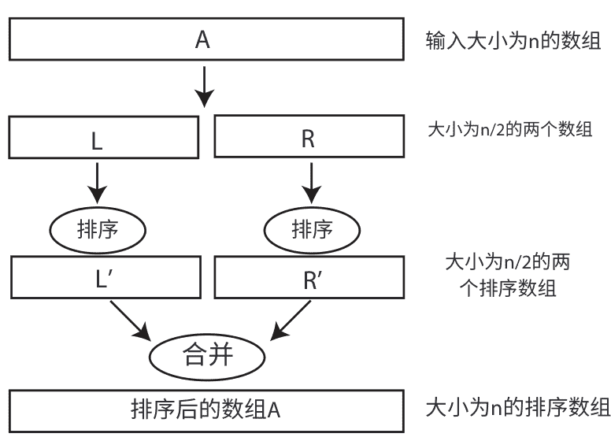


##### 图3：问题规模为n时，运行时间的效率为Θ(n lg(n))

## 麻省理工学院公开课
http://ocw.mit.edu

## 6.006 算法导论
2008年春季

有关引用这些材料或我们的使用条款的信息，请访问：http://ocw.mit.edu/terms。

## 讲座3：调度和二叉搜索树

#### 讲座概述

+   - 跑道预订系统
  - 定义
  - 如何使用列表解决
- 二叉搜索树
  - 操作

#### 阅读材料

CLRS 第10章，12.1-3

#### 跑道预订系统

+   - 只有一个（非常繁忙的）跑道的机场（波士顿6 → 1）
- 未来着陆的“预订”
- 当飞机降落时，它将从待处理事件集中移除
- 预订请求指定“请求的着陆时间”
- 将 t添加到集合中，没有其他着陆计划在 < 3分钟内安排。
  - 否则报错，不要安排

##### 例子

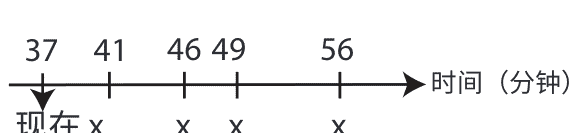

图1：跑道预订系统示例

令 R 表示已预订的着陆时间： $ R = (41, 46, 49, 56) $

请求时间： 44 不允许（ 46 ∈ R）
  53 允许
  20 不允许（已过去）
  | R |= n

目标：以 $ O(\lg n) $ 时间高效运行此系统

##### 算法

将 R 保持为排序列表。

初始化: R = []

req(t): 如果 t < 现在，则返回“错误”

对于 i 在范围 (len(R)) 中：

如果 abs(t-R[i]) <3: 返回 "错误" $ \Theta(n) $

R.append(t)

R = sorted(R)

land: t = R[0]

如果 (t != now) 返回错误

R = R[1: ] (从 R 中删除 R[0])

##### 我们能做得更好吗？

+   • 排序列表：3分钟的检查可以在 $O(1)$ 时间内完成。 可以插入新的时间/飞机而不是追加和排序，但插入需要 $ \Theta(n) $ 时间。
• 排序数组：可以使用二分搜索在 $O(\lg n)$ 时间内找到插入的位置。 实际插入需要移动元素，这需要 $ \Theta(n) $ 时间。
• 未排序列表 / 数组：搜索需要 $ O(n) $ 时间。
• 字典或 Python集合：插入需要 $ O(1) $ 时间。 3分钟的检查需要 $ \Omega(n) $ 时间。

如果时间是整分钟怎么办？
通过时间索引的大数组就可以解决。 这对于任意精度的时间或验证宽度槽位是否可行是行不通的。
关键教训：需要快速插入到排序列表中。

##### 新要求

Rank(t): 计划在时间 $ \le t $ 时降落的飞机数量是多少？ 新要求使得设计修正在必要。

#### 二叉搜索树（BST）


图 2：二叉搜索树

##### 在 BST 中找到最小元素

关键是一直向左走，直到无法再向左走为止。


图 3：删除最小元素：找到最小元素并将其删除

所有操作的时间复杂度都是 $ O(h) $，其中 $ h $ 是 BST 的高度。

##### 找到下一个更大的元素

next-larger(x)

如果右子节点不为空，则返回最小值(right)
否则，y = 父节点(x)
当y不为空且x = right(y)时
　　x = y; y = 父节点(y)
返回(y);

请参见图4的示例。 next-larger(46)会返回什么？


图 4:next-larger(x)

##### rank(t)怎么样？

不能用我们现有的方法高效地解决，但可以增强BST结构。


图 5:增强 BST结构

从图5总结，增强算法如下:

+   1. 向下遍历树找到所需的节点
2. 添加比它小的节点
3. 将左侧子树的大小添加进来

总共需要 O(h)时间。

#### 平衡二叉搜索树

## 6.006 算法导论
2008年春季

有关引用这些材料或我们的使用条款的信息，请访问：http://ocw.mit.edu/terms。

## 第四讲：平衡二叉搜索树

#### 讲座概述

+   - 平衡的重要性
- AVL 树
  - 定义
  - 平衡
  - 插入
- 其他平衡树
- 一般的数据结构

#### 阅读材料

CLRS 第 13.1 和 13.2 章节（但采用不同的方法：红黑树）

##### 回顾：二叉搜索树（BST）

+   - 根节点二叉树
- 每个节点都有
  - 键
  - 左指针
  - 右指针
  - 父指针

见图 1

图 1：BST 中节点的高度

##### 平衡的重要性：

二叉搜索树支持插入、最小值、删除、排名等操作，时间复杂度为 $O(h)$，其中 $h$ = 树的高度（=根节点的高度）。

$h$ 在 $\lg(n)$ 和 $n$ 之间（见图 3）。

图 3：平衡的二叉搜索树

平衡的二叉搜索树保持 $h = O(\lg n) \Rightarrow$ 所有操作的时间复杂度为 $O(\lg n)$。

###### AVL树：

####### 定义

AVL树是自平衡的二叉搜索树。 这些树以它们的两位发明者G.M. Adel’son-Vel’skii和E.M. Landis 命名

图 4: AVL树概念

为了实现AVL树，需要遵循两个关键步骤:

+   - 将空树视为高度 -1。
- 每个节点存储其高度。这本质上是一种数据结构增强过程，类似于增强子树大小。或者，可以只存储高度差。

有一个关于AVL树的好的动画应用程序可以在此链接中找到。要比较二叉搜索树和AVL树的平衡，请使用提供的代码。

> 1原始俄文文章：Adelson-Velskii, G.; E. M. Landis (1962)。 “一种组织信息的算法”。苏联科学院学报146: 263266。 (Myron J. Ricci的英文翻译，发表于苏联数学报告，3:12591263, 1962年。)

####### AVL插入：

+   1. 像简单的BST一样插入
2. 沿着树向上工作，恢复AVL属性（并在此过程中更新高度）

####### 每一步：

+   • 假设 x 是违反 AVL的最低节点
• 假设 x是右重的（左侧情况对称）
• 如果x的右子节点是右重或平衡的：按照图5中的步骤进行
• 否则按照图6中的步骤进行
• 然后继续向上到x的祖父节点，曾祖父节点...

####### 示例：AVL插入过程的实现示例见图7

图7：AVL树插入过程的示意图

评论1. 一般来说，在插入完成之前，可能需要进行多次旋转。

评论2. 删除（-最小值）更难，但是有可能实现。

##### 平衡搜索树：

有许多平衡搜索树。

+   AVL树 Adel’son-Vel’skii和Landis 1962
B-Trees/2-3-4 Trees Bayer和McCreight 1972（参见CLRS 18）
BB[α] Trees Nievergelt和Reingold 1973
红黑树 CLRS第13章
伸展树 Sleator和Tarjan 1985
跳表 Pugh 1989
替罪羊树 Galperin和Rivest 1993
Treaps Seidel和Aragon 1996

注1. 跳表和Treaps使用随机数以高概率快速做出决策。

笔记 2. 伸展树和替罪羊树是“摊销”的：将多个操作的成本相加 ⟹ 平均情况下很快。

###### 伸展树

在访问（搜索或插入）时，通过一系列旋转和/或双旋转将节点移动到根节点（就像AVL树一样）。高度可以是线性的，但每个操作的平均时间复杂度仍然是 $O(\lg n)$（摊销）。

注意：我们将在几节课中更详细地讨论摊销。

###### 最优性

+   • 对于二叉搜索树，在最坏情况下每次搜索的时间复杂度不能比 $O(\lg n)$ 更好。
• 在某些情况下，可以做得更好，例如
  - 中序遍历对于$n$个元素需要 $\Theta( n )$ 的时间。
  - 将更频繁的项放在靠近根部
  一个猜想：伸展树对于每种访问模式都是O(最佳二叉搜索树)。
• 通过更高级的技巧，可以实现对于整数 $1\cdots u$ [Van Ernde Boas; 参见6.854或6.851（高级数据结构）]的O(lg|u)性能。

###### 大局观:

抽象数据类型 (ADT): 接口规范
例如优先队列：

+   • Q = 新建空队列()
• Q.insert(x)
• x = Q.deletemin()

对比

####### 数据结构 (DS): 每个操作的算法

一个ADT可以有很多可能的DS。我们将在课程的后期讨论一个例子，即“堆”优先队列。

## 第五讲: 哈希 I: 链接，哈希函数

讲座概述

+   * 字典和Python
* 动机
* 哈希函数
* 链接
* 简单均匀哈希
* “好”的哈希函数

阅读材料

CLRS 第11.1节，11.2节，11.3节

#### 字典问题

抽象数据类型(ADT)维护一组具有键的项目，符合

+   * insert(item): 将项目添加到集合中
* delete(item): 从集合中删除项目
* 搜索（键）：如果存在具有键的项，则返回该项
* 假设项具有不同的键（或插入新项会覆盖旧项）
* 平衡二叉搜索树解决每个操作的时间复杂度为 $O(\lg n)$（除了类似于nextlargest的不精确搜索）。
* 目标：每个操作的时间复杂度为 $O(1)$。

#### Python字典：

项是（键，值）对，例如 $d = \text{'algorithms'}: 5, \text{'cool'}: 42$

```
d.items()  →  [('algorithms', 5),('cool', 5)]
d['cool']  →  42
d[42]  →  键错误
'cool'在d中  →  True
42在d中  →  False
```

Python集合实际上是字典，其中项是键。

##### 动机

文档距离

+   •已在中使用

python
def count_frequency(word_list):
    D = {}
    for word in word_list:
        if word in D:
            D[word] += 1
        else:
            D[word] = 1


•新的 docdist7使用字典而不是排序：

python
def inner_product(D1, D2):
    sum = 0.


对于键在D1中：
如果键在D2中：
    sum += D1[key]*D2[key]

=最优 Θ(n) 文档距离假设字典操作花费 O(1) 时间

##### PS2

黑猩猩DNA与人类DNA有多接近？
= 两个字符串的最长公共子串
例如 ALGORITHM vs. ARITHMETIC.
字典有助于加速算法，例如将所有子串放入集合中，查找重复项
- Θ(n²) 操作.

#### 我们如何解决字典问题？

一个简单的方法是直接访问表。这意味着项目需要存储在一个由键索引的数组中。

图 1:直接访问表

##### 问题:

+   1. 键必须是非负整数（或使用两个数组，整数）
2. 大键范围 = 大空间，例如一个键为 2^256 是个坏消息。

##### 2个解决方案：

###### 解决方案 1：将键空间映射到整数。

+   • 在Python中：hash（对象），其中对象可以是数字、字符串、元组等，或者实现了哈希的对象实现 - 命名错误：应该称为“预哈希”
• 理想情况下， x = g\rightarrow hash(x) = hash (y)
• Python应用一些启发式方法，例如hash ('\phB') = 64 = hash ('\ph\phC')
• 对象的键在表中不应更改（否则无法再找到它）
• 不允许使用可变对象，如列表

## 解决方案 2：哈希（来自 ‘hache’ 的动词 = hatchet，日耳曼语）

+   •将所有键（例如整数）的宇宙 U减小到合理的大小 m以适应表格
•思路： m ≈ n， n = | k |， k = 字典中的键
•哈希函数 h: U → φ, 1, ..., m - 1

图 2:将键映射到表

+   •如果 h( k_i ) = h( k_j )，则两个键 k_i ≠ k_j 发生冲突

我们如何处理冲突？

## 有两种方法

+   1. 链接法: 今天
2. 开放定址法: 下一节课

#### 链接

表中每个槽位中冲突元素的链表

图 3:哈希表中的链接法

+   * 搜索必须遍历整个列表 T[h(key)]
* 最坏情况: 所有键都哈希到同一个槽位 = Θ(n) 每个操作

##### 简单均匀散列 - 一个假设:

每个键被哈希到表的任意槽位的概率相等，与其他键的哈希位置无关。

让 n = 表中存储的键
          m = 表中的槽位
          负载因子 α = n/m = 平均键数每个槽位

#### 链接法的预期性能：假设简单均匀哈希

性能很可能是 O(1 + α) - 1 来自应用哈希函数和访问槽位，而 α 来自搜索列表。实际上是 Θ(1+ α)，即使是成功搜索（参见 CLRS）。

因此，如果 α = O(1)，即 m = Ω(n)，性能为 O(1)。

#### 哈希函数

##### 除法法则：

h(k) = k mod m

+   - k₁ 和 k₂ 碰撞当 k₁ = k₂ (mod m)，即当 m 整除 |k₁ - k₂|
- 如果你存储的键是均匀随机的话，那就很好
- 但是如果键是 x, 2x, 3x,...的话(规律性) 并且 x和 m有一个公约数 d，那么只使用表中的 1/d。 如果 m有一个小的除数，比如 2，那么很可能会发生这种情况。
- 如果 m= 2ʳ，那么只需要查看键的 r位！

良好的实践：避免键中的常见规律的一个好方法是选择一个不接近 2 或 10 的质数 m。

关键教训：找到一个质数很不方便；除法很慢。

##### 乘法方法：

h(k) = [(a  k) mod 2ʷ] ≫ (w - r) 其中 m=2ʳ和 w位机器字， a = 奇数介于 2^(w-1) 和 2ʷ之间的整数。

良好的实践：不要太靠近2 (w-1) 或2ʷ。

关键教训：乘法和位提取比除法快。

图 2：乘法方法

### 第6讲
哈希II：表加倍，卡普-拉宾
6.006 2008年春季学期

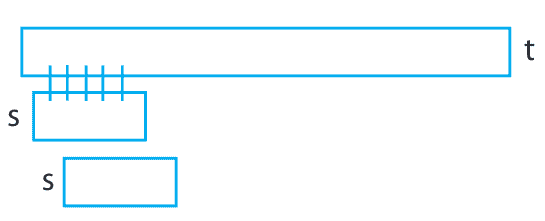

#### 图3：简单算法解决字符串匹配问题的示意图

简单算法：
对于每个子字符串比较，需要O(|s|)的时间⇒ O(|s|·(|t|−|s|))的时间= O(|s|·|t|)

可能是二次的

#### Karp-Rabin算法：

- 比较s和t[i:i+len(s)]是否相等
- 如果哈希值相等，那么字符串很可能也相等
    - 可以通过检查s==t[i:i+len(s)]来确保，成本约为O(|s|)
    - 如果是的话，找到匹配 — 完成
    - 如果没有，发生的概率为 < 1/|s|
        - 预期成本为 O(1) 每个 i.
- 需要合适的哈希函数。
- 预期时间 = O(|s| + |t|·成本(h))
    - 天真地 h(x) 成本为 |x|
    - 我们将实现 O(1)!
    - 思路： t[i:i+len(s)] ≈ t[i+1:i+1+len(s)]

##### 滚动哈希 ADT

##### 维护字符串主题

- h(): 字符串上合理的哈希函数
- h.append(c): 在字符串末尾添加字母 c
- h.skip(c): 从字符串前面删除字母，假设它是 c

#### Karp-Rabin 应用：

对于 c 在 s 中：hs.append(c)
对于 c 在 t[:len(s)] 中：ht.append(c)
如果 hs() == ht()：...

这段代码的时间复杂度是 $O(|s|)$

```
for i in range(len(s), len(t)):
    ht.skip(t[i-len(s)])
    ht.append(t[i])
    if hs() == ht(): ...
```

第二段代码的时间复杂度是 $O(|t|)$

##### 数据结构：

将字符串视为一个基于字母表大小为 $a$ 的多位数 $u$。例如 256

- $h() = u \mod p$，其中 $p$ 是一个近似于 $|s|$ 或 $|t|$ 的素数（除法法则）
- $h$ 存储的是 $u \mod p$ 和 $|u|$，而不是 $u$
    - 更小且更快（$u \mod p$ 适合一个机器字）
- $h.append(c)$: $(u \cdot a + \ord(c)) \mod p = [(u \mod p) \cdot a + \ord(c)] \mod p$
- $h.skip(c)$: $[u - \ord(c) \cdot (a^{|u|-1} \mod p)] \mod p$
    $= [(u \mod p) - \ord(c) \cdot (a^{|u|-1} \mod p)] \mod p$

## 麻省理工学院公开课
http://ocw.mit.edu

## 6.006 算法导论
2008年春季

有关引用这些材料或我们的使用条款的信息，请访问：http://ocw.mit.edu/terms。

## 讲座 7：哈希 III：开放寻址

#### 讲座概述

- 开放寻址，探测策略
- 均匀哈希，分析
- 高级哈希

#### 阅读材料

CLRS 第 11.4 章（如果感兴趣还有 11.3.3 和 11.5）

#### 开放寻址

解决冲突的另一种方法

- 没有链表
- 所有项存储在表中（见图 1）

| 项目2 |
| --- |
| 项目1 |
| 项目3 |

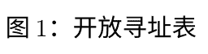

- 每个槽位一个项 =⇒ m ≥ n
- 哈希函数指定了要为键探测（尝试）的槽位的顺序，而不仅仅是一个槽位：（见图 2）

##### 插入（k，v）

```
对于 i 在范围（m）内：
  如果 T[h(k, i)] 为空：
    T[h(k, i)] = (k, v)
  返回
  引发 'full'
```

##### 讲座 7
哈希 III：开放寻址

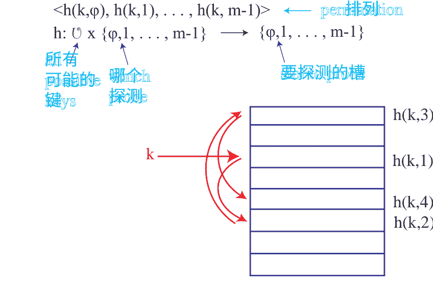

图 2:探测顺序

例子: 插入 k = 496

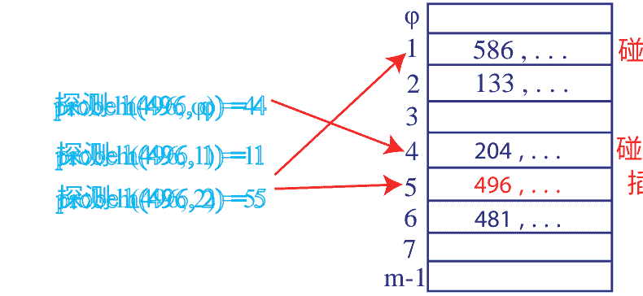

图 3:插入例子

##### 搜索(k)

对于 i 在范围 (m) 内：
如果 T[h(k,i)] 是空的 ：
返回空
否则 T[h(k,i)][φ] == k：
返回 T[h(k,i)]
返回无

空槽？
链的末尾
匹配键
返回项目
用尽的表

6.006 2008年春季学期

2

##### 删除(k)

- 不能只是设置 T[h(k,i)] = 无
- 例子：删除(586) = 搜索(496) 失败
- 用DeleteMe替换项目，Insert将其视为无，但Search不会

##### 探测策略

###### 线性探测

h(k,i) = (h'(k) + i) mod m其中 h'(k)是普通哈希函数

- 像街边停车
- 问题：聚类作为连续的填充槽组增长，越来越容易增长（见图4）


图4：主要聚类

- 对于 0.01< α < 0.99，说 Θ(lg n)的簇。 这些簇已知
- 对于 α = 1， Θ(√n)的簇已知

###### 双重散列

h(k,i) = (h1(k) + i·h2(k)) mod m其中 h1(k)和 h2(k)是两个普通的散列函数。

- 如果 h2(k)与 m互质，那么可以实际上填满所有槽位（排列）。
- 例如，当 m= 2r时，让 h2(k)始终为奇数。

###### 均匀散列假设

每个键等可能地具有任意一个 m!排列作为其探测序列。

- 并不完全正确
- 但是双重散列可以接近实现。

#### 分析

对于大小为 $m$ 的表中的 $n$ 个项目，开放寻址法的预期成本为 $\le \frac{1}{1 - \alpha}$ 每个操作，其中 $\alpha = n/m (< 1)$，假设散列是均匀的。例如：$\alpha = 90\% = 10$ 个预期探测次数。

⇒

##### 证明：

始终进行第一次探测。

以概率 $n/m$，第一个槽位被占用。

在最坏的情况下（例如，键不在表中），转到下一个。

以概率 $\frac{n - 1}{m - 1}$，第二个槽位被占用。

然后，以概率 $\frac{n - 2}{m - 2}$，第三个槽位已满。

等等（n种可能性）

因此，期望成本 $= 1 + (\frac{n}{m} + \frac{n - 1}{m - 1}(1 + \frac{n - 2}{m - 2}(...) )$

现在 $\frac{n - 1}{m - 1} \le \frac{n}{m} = \alpha$ 对于 $i = \phi, \cdots, n (\le m)$

因此，期望成本 $\le 1 + \alpha + \alpha^2 + \alpha^3 + \cdots$

 $= \frac{1}{1 - \alpha}$

##### 开放寻址法 vs. 链式法

开放寻址法：更好的缓存性能和很少分配内存

链式法：对哈希函数和 $\alpha$ 不太敏感

#### 高级哈希

##### 通用哈希函数

不是定义一个哈希函数，而是定义一个整个家族并随机选择一个

- 例如，乘法方法与随机 a
- 可以证明 $P_r$ （在随机 h下） $\{h(x) = h(y)\}$ 以 $1/m$ 的概率发生，对于每个（即非随机的） $x \neq y$
- $\implies$ 在不假设简单均匀哈希的情况下，每个操作的预期时间为 $O(1)$!
CLRS 11.3.3

##### 完美哈希

保证 $O(1)$ 最坏情况搜索

- 思路：如果 $m = n^2$，则 $E[\#collisions] \approx 1$
  - 在 O(1) 次尝试后得到 φ... 但是 O(n^2) 空间
- 使用这个结构来存储链

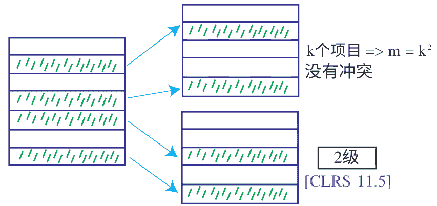

图 5:两级哈希表

- 可以证明 $O(n)$ 期望总空间！
- 如果失败，从头开始重建

## 麻省理工学院公开课
http://ocw.mit.edu

## 6.006 算法导论
2008年春季

有关引用这些材料或我们的使用条款的信息，请访问：http://ocw.mit.edu/terms。

## 第8讲: 排序I: 堆

#### 讲座概述

- 回顾 : 插入排序和归并排序
- 选择排序
- 堆

#### 阅读材料

CLRS 2.1, 2.2, 2.3, 6.1, 6.2, 6.3和6.4

##### 排序回顾

##### 插入排序

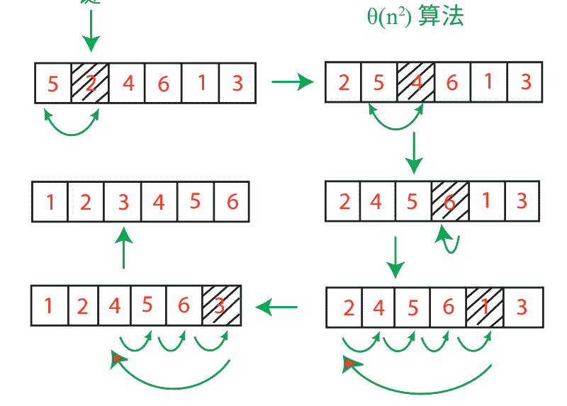

图 1:插入排序示例

##### 归并排序

将 n个元素的数组分成两个子数组，每个子数组有 n/2个元素。 使用归并排序递归地对子数组进行排序。 合并两个已排序的子数组。

##### 原地排序

在数组A中重新排列的数字，每次最多有常数个数的数字在数组外部排序

插入排序：在数组外部存储关键字  Θ(n²)，原地排序

归并排序：在合并过程中需要 O(n) 的辅助空间  Θ(n lg n)，原地排序

问题：我们能够实现  Θ(n lg n) 的原地排序吗？

##### 选择排序

- 0.  i = 1
- 1.  从 i开始的列表中找到最小值
- 2.  将其与 i位置上的值交换
- 3.  i = i + 1，如果 i = n，则停止

重复步骤 0-3共 n次。步骤 1需要 O(n) 的时间。我们能够改进到 O(lg n) 吗？

#### 堆（非垃圾回收存储）

堆是一个被视为几乎完全二叉树的数组对象。


##### 数据结构

```
根 A[i]
具有索引 i的节点
PARENT(i) = ⌊i/2⌋
LEFT(i) = 2i
RIGHT(i) = 2i + 1
```

注意：没有指针！

#### 第8讲
排序I: 堆
6.006 2008年春季学期

length[A]: 数组中的元素数量

heap-size[A]: 数组A中存储的堆中的元素数量

heap-size[A]: ≤ length[A]

##### 最大堆和最小堆

最大堆性质：对于除根节点以外的每个节点i，A[PARENT(i)] ≥ A[i]

二叉堆的高度 O(lg n)

MAX_HEAPIFY: O(lg n) 保持最大堆属性

BUILD_MAX_HEAP: O(n) 从无序输入数组生成最大堆

HEAP_SORT: O(n lg n)

堆操作插入、提取最大值等 O(lg n)。

```
Max_Heapify(A,i)
    l ← left(i)
    r ← right(i)
    如果 l ≤heap-size(A) 并且 A[l] > A[i]
        则 largest ← l
        否则 largest ← i
    如果 r ≤heap-size(A) 并且 A[r] > largest
        则 largest ← r
    如果 largest = i
        则交换 A[i] 和 A[largest]
        MAX_HEAPIFY(A, largest)
```

这假设以 left(i) 和 Right(i) 为根的树是最大堆。 A[i] 可能比子节点小，违反了最大堆属性。 . 让 A[i] 的值“下沉”，使以索引 i为根的子树成为最大堆。

##### 例子

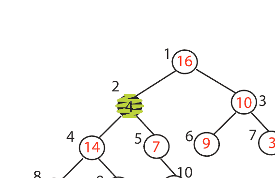

MAX_HEAPIFY (A,2)
heap_size[A] = 10

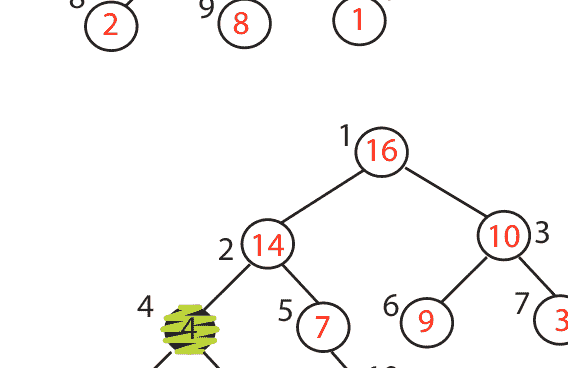

将A[2]与A[4]交换调用
MAX_HEAPIFY(A,4)因
为违反了最大堆性质

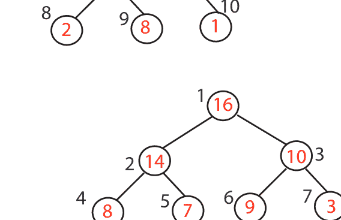

将A[4]与A[9]交换
不再调用

##### 图5: MAX HEAPIFY示例

## 麻省理工学院公开课
http://ocw.mit.edu

## 6.006 算法导论
2008年春季

有关引用这些材料或我们的使用条款的信息，请访问：http://ocw.mit.edu/terms。

### 第9讲：排序II：堆

#### 讲座概述

- 复习：堆和MAX HEAPIFY
- 构建堆
- 堆排序
- 优先队列（复习课）

#### 阅读材料

CLRS 6.1-6.4

##### 复习

##### 堆：

```
Parent(i)  =  ⌊i/2⌋
Left(i)    =  2i
Right(i)   =  2i + 1
```

###### 最大堆性质：

A[Parent(i)] ≥ A[i]

- MAX_HEAPIFY(A, 2)
  heap_size(A) = 10
  A[2] ↔ A[4]
- MAX_HEAPIFY(A, 4)
  A[4] ↔ A[9]

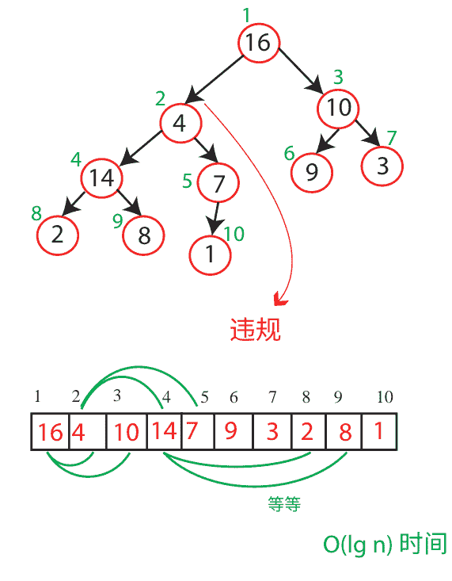

###### 构建堆

A[1…n] 转换为最大堆观察：元素 A[⌊n/2+1⌋…n] 都是叶子节点树的叶子节点不能有子节点。

```
BUILD_MAX_HEAP(A):
堆大小 (A) = 长度 (A)
O(n) 次循环 i ← ⌊length[A]/2⌋ 到 1
O(lg n) 时间 执行 MAX HEAPIFY(A,i)
O(n lg n) 总体上
```

参见图2的示例。

#### 第9讲
排序II：堆

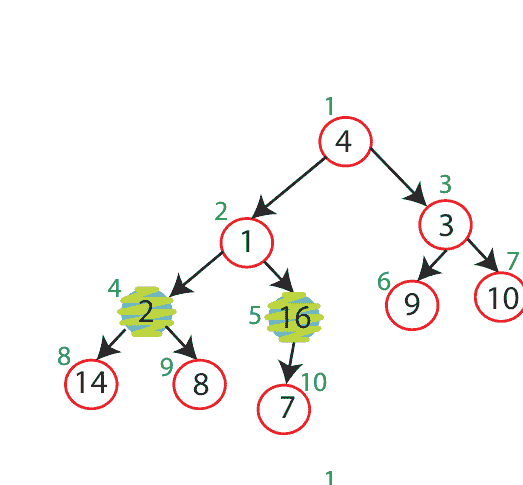

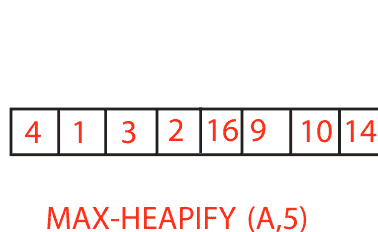

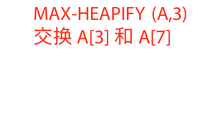

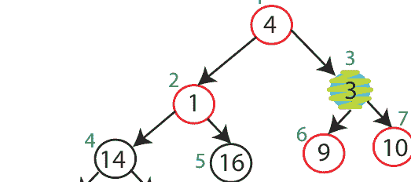

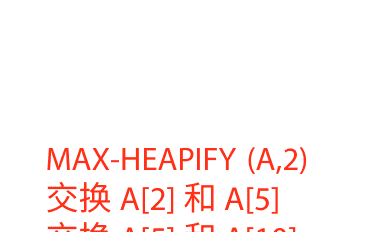

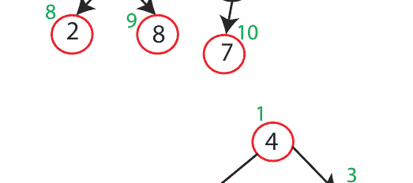


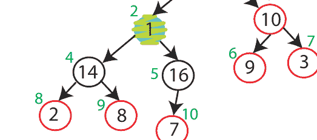


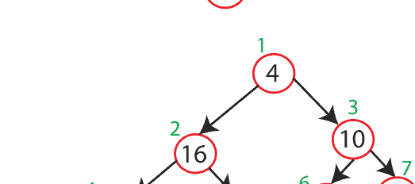

图2：示例：构建堆

##### 排序策略

- 从无序数组构建最大堆
- 找到最大元素（A[1]）
- 将其放在正确的位置 A[n], A[n] 移至 A[1]
  - 新的根可能违反最大堆属性，但子节点仍然是最大堆。
- 从堆中丢弃节点 n（减小堆大小）

##### 堆排序算法

```
O(n lg n) 构建最大堆 (A):
对于 i从 length[A] 到 2 的循环
  do 交换 A[1] ←→ A[i]
     堆大小 [ A ] = 堆大小 [ A ] - 1
     O(lg n)
     MAX_ HEAPIFY(A, 1)
O(n lg n) 总体上
```

请参见图3进行说明。

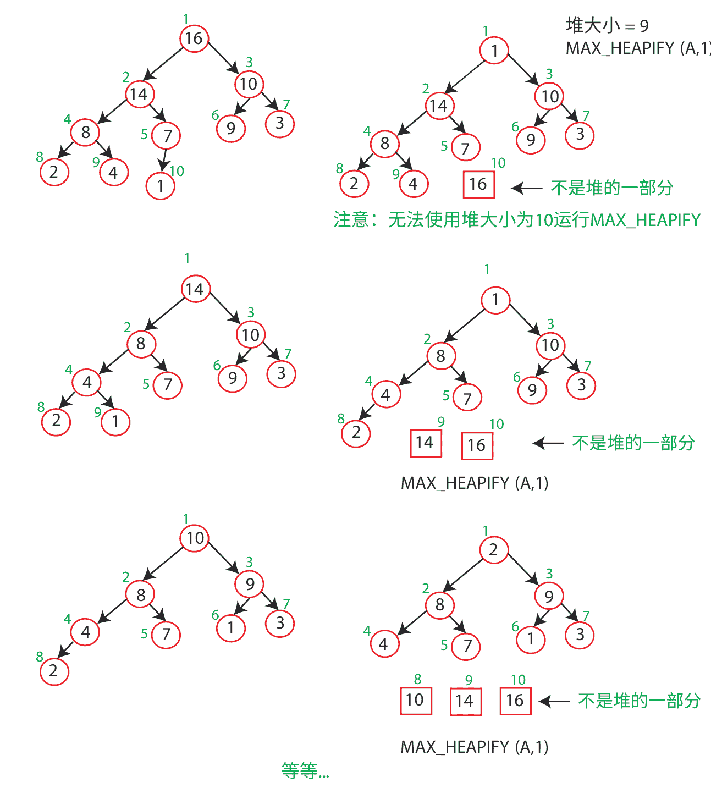

图3：说明：堆排序算法

##### 优先队列

这是一个抽象数据类型，因为它可以以不同的方式实现。

- INSERT(S, X) : 将 X插入集合 S
- MAXIMUM(S) : 返回具有最大键的 S元素
- EXTRACT_MAX(S) : 删除并返回具有最大键的元素
- INCREASE_KEY(S,x,k) : 将元素 x 的键值增加到新值 k
  (假设新值至少与当前值一样大)

## 麻省理工学院公开课
http://ocw.mit.edu

## 6.006 算法导论
2008年春季

有关引用这些材料或我们的使用条款的信息，请访问：http://ocw.mit.edu/terms。

## 讲座10：排序III：线性界限
线性时间排序

#### 讲座概述

- 排序下界
- 决策树
- 线性时间排序
- 计数排序

#### 阅读材料

CLRS 8.1-8.4

##### 比较排序

插入排序、归并排序和堆排序都是比较排序。
我们所知道的最好的最坏情况运行时间是 O(n lg n)。我们能做得更好吗？

##### 决策树示例

排序 < a₁, a₂, ⋯ aₙ >。

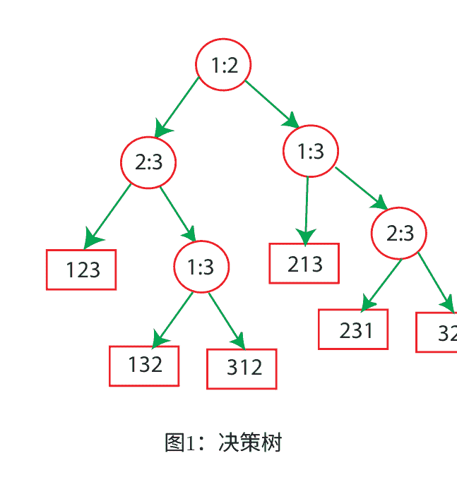

每个内部节点标记为 i : j，比较 aᵢ和 aⱼ，如果 aᵢ ≤ aⱼ则向左走，否则向右走。

##### 例子

排序 < a_1, a_2, a_3 > = < 9, 4, 6 > 每个叶子节点包含一个排列，即总排序。


###### 图2：决策树执行

##### 决策树模型

可以模拟任何比较排序的执行。为了排序，我们需要生成元素的完全排序。

- 每个输入大小一个树大小 n
- 算法的运行时间：路径长度
- 最坏情况运行时间：树的高度

##### 定理

任何可以排序 n elements的决策树的高度必须为 Ω(n lg n)。

证明：树必须包含 ≥ n!个叶子节点，因为有 n!个可能的排列。高度为-h的二叉树有 ≤ 2^h个叶子节点。因此，

```
n! ≤ 2^h
⇒ h ≥ lg(n!) (≥ lg((n/e)^n)) 斯特林公式)
≥ n lg n - n lg e
= Ω(n lg n)
```

##### 线性时间排序

计数排序：元素之间没有比较

输入：$A[1...n]$，其中 $A[j] \in \{1, 2, \dots, k\}$

输出：$B[1...n]$ 排序

辅助存储：$C[1...k]$

## 直觉

由于元素在范围 $\{1, 2, \dots, k\}$ 内，想象收集所有 $j$，使得 $A[j] = 1$，然后是使得 $A[j] = 2$ 的 $j$，依此类推。不进行元素比较，因此不是比较排序！

将 $A[j]$ 的索引放入适当的位置。

###### 伪代码和分析

```
θ(k)  { 对于 i 从 1 到 k
      ，执行 C[i] = 0
}

θ(n)  { 对于 j 从 1 到 n，执行
      C[A[j]] = C[A[j]] + 1
}

θ(k)  { 对于 i 从 2 到 k 的循环
      执行 C[i] = C[i] + C[i-1]
}

θ(n)  { 对于 j 从 n 递减到 1 的循环
      执行 B[C[A[j]]] = A[j]
      C[A[j]] = C[A[j]] - 1
}

θ(n + k) 
```


##### 例子

注意：记录可能与 A[i] 相关联。


图 4: 计数排序执行

```
A[5] = 3
C[3] = 3
B[3] = A[5] = 3, C[3] 减少。
A[4] = 4
C[4] = 5
B[5] = A[4] = 4, C[4] 减少，依此类推 ...
```

## 麻省理工学院公开课

http://ocw.mit.edu

## 6.006 算法导论

2008年春季

有关引用这些材料或我们的使用条款的信息，请访问：http://ocw.mit.edu/terms。

## 讲座11：排序IV：稳定排序，基数排序

讲座概述

+   稳定排序
• 基数排序
• 快速排序 ← 不是 6.006 的正式部分
• 排序比赛

#### 稳定排序

在相等元素中保留输入顺序

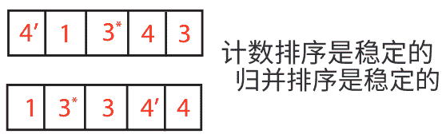

图1：稳定性

选择排序和堆排序：找到最大元素并将其放在数组末尾（与末尾元素交换）不稳定！

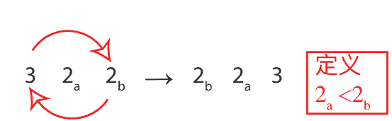

图2：选择排序的不稳定性

#### 基数排序

+   用于1890年人口普查的赫尔曼・霍勒里斯卡片排序机。
• 机械机器逐位排序
    1. 检查卡片组中每张卡片的给定列
    2. 将卡片分发到10个箱子中的一个

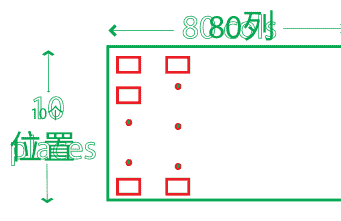

最高有效位（MSB）与最低有效位（LSB）？

首先按最高有效位（MSB）或最低有效位（LSB）进行排序？

最高有效位（MSB）策略：必须将10个箱子中的9个放在一边，导致大量的中间堆

最低有效位（LSB）策略：可以适当地将排序好的卡片放入箱子中，创建一副牌！

例子

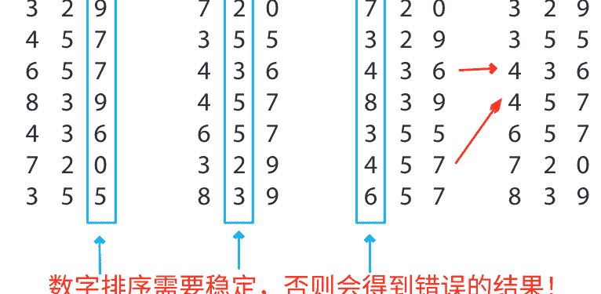

数字排序需要稳定，否则会得到错误的结果！

#### 分析

假设计数排序是辅助稳定排序。 $\Theta(n + k)$ 复杂度。

假设我们有 $n$ 个长度为 $b$ 位的单词。

+   计数排序的一次遍历 $\Theta(n + 2^b)$
计数排序的 $b$ 次遍历 $\Theta(b(n + 2)) = \Theta(bn)$
当 $\frac{b}{r} = \lg n$ 时，$\Theta(n + 2r)$ 最小化 $\Theta(\frac{bn}{\lg n})$

##### 快速排序

本节仅供“丰富”使用。

划分：将数组划分为两个子数组，围绕一个枢轴 $x$ such that elements 在 lower 子数组 $\leq x \leq$ elements 在 upper 子数组。 $\leftarrow$ 线性时间


图5：枢轴定义

征服：递归地对两个子数组进行排序

合并：平凡

如果我们选择一个枢轴，使得两个子数组大致相等：

```
T(n) = 2T(n/2) + \Theta(n) \implies T(n) = \Theta(n \lg n)
```

如果一个数组很大：

```
T(n) = T(n - 1) + \Theta(n) \implies T(n) = \Theta(n^2)
```

平均情况 $\Theta(n \lg n)$ 假设输入数组是随机的！

##### 排序比赛

点击这里查看参考资料。

冒泡排序：重复地遍历要排序的列表。比较两个项目，如果它们的顺序不正确，则交换它们。继续遍历列表，直到没有交换。重复遍历列表，直到没有交换。Θ(n²)

希尔排序：通过比较间隔为间隔的元素来改进插入排序。Θ(n lg² n)

## 麻省理工学院公开课

http://ocw.mit.edu

## 6.006 算法导论

2008年春季

有关引用这些材料或我们的使用条款的信息，请访问：http://ocw.mit.edu/terms。

### 第12讲：搜索I：图搜索和表示

讲座概述：搜索1的3个部分

+   图搜索
- 应用
- 图表示
- 广度优先搜索和深度优先搜索简介

阅读材料

CLRS 22.1-22.3, B.4

#### 图搜索

探索图，例如从起始顶点到目标顶点找到一条路径

回顾 ：图 G = (V, E)

+   - V = 顶点集（任意标签）
- E = 边的集合，即顶点对 (v, w)
  - 有序对 = ⇒ 有向图的边
  - 无序对 = ⇒ 无向

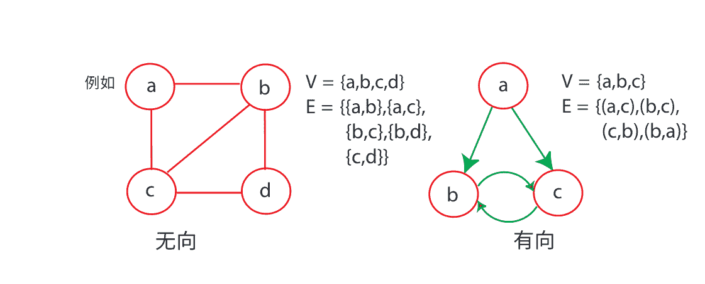

##### 应用：

有很多。

+   网络爬虫（如何找到Google的页面）
• 社交网络（Facebook朋友查找器）
• 计算机网络（互联网中的路由）
  最短路径[下一单元]
• 解决谜题和游戏
• 检查数学猜想

###### 口袋魔方：

考虑一个 $2 \times 2 \times 2$ 的魔方


图2：魔方

+   配置图:
  - 每个可能状态的顶点
  - 每个基本移动（例如，90度转弯）之间的边从一个状态到另一个状态
  - 无向的：移动是可逆的
• 谜题：给定初始状态 $s$，找到到解决状态的路径
• $ \#顶点数 = 8! \cdot 3^8 = 264,539,520 $（因为有 8个立方体在任意位置，并且每个立方体有3种可能的扭转）


图3：对称性的插图

## 第12讲

#### 搜索I：图搜索和表示

#### 6.006 2008年春季学期

+   可以分解魔方的 24倍对称性：固定一个立方体

  
  
  8¹¹ \cdot 3 = ⇒ 7! \cdot 3⁷ = 11,022,480

• 事实上，图有3个相等大小的连通分量 = 只需要在其中搜索 ⇒

  
  
  = ⇒ 7! \cdot 3⁶ = 3,674,160

#### 配置图的“地理”

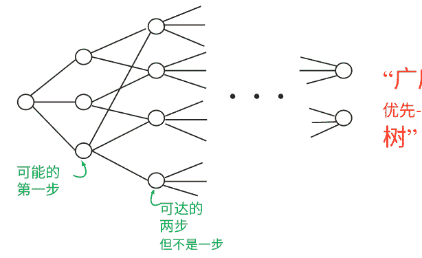

图 4：广度优先树

#### 可达的配置

| 距离 | 90° 转弯 | 90° 和 180° 转弯 |
|---|---|---|
| 0 | 1 | 1 |
| 1 | 6 | 9 |
| 2 | 27 | 54 |
| 3 | 120 | 321 |
| 4 | 534 | 1,847 |
| 5 | 2,256 | 9,992 |
| 6 | 8,969 | 50,136 |
| 7 | 33,058 | 227,536 |
| 8 | 114,149 | 870,072 |
| 9 | 360,508 | 1,887,748 |
| 10 | 930,588 | 623,800 |
| 11 | 1,350,852 | 2,644 ← 直径 |
| 12 | 782,536 | |
| 13 | 90,280 | |
| 14 | 276 ← 直径 | 3,674,160 |
| | 3,674,160 | 维基百科口袋魔方 |


参见 3 × 3 × 3 魔方：≈ 1.4 万亿种状态；直径未知！ ≤ 26

#### 图的表示：（数据结构）

##### 邻接表：

###### 数组 Adj 的 |V| 链表

+   对于每个顶点 $u \notin V$，$Adj[u]$ 存储 $u$ 的邻居，即 $\{v \notin V \mid (u, v) \notin E\}$。 colorBlue($u, v$) 如果是有向边，则只是出边。（见图5的示例）
• 在Python中：$Adj = $ 字典的列表/集合值，vertex = 任何可哈希对象（例如，整数，元组）
• 优点：在相同顶点上有多个图

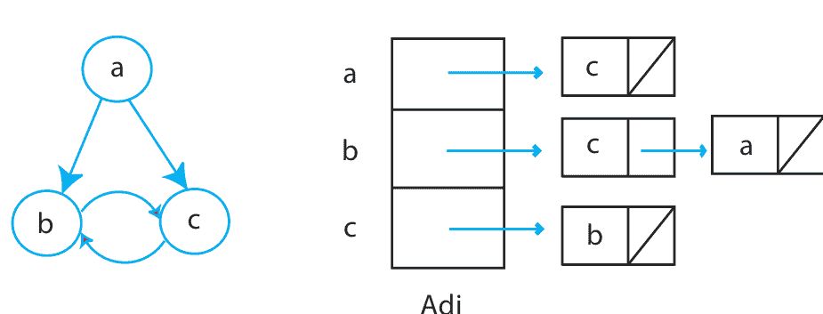

###### 图5：邻接表表示

##### 面向对象的变体：

+   每个顶点 $u$ 的对象
• u.neighbors = 邻居的列表，即 $Adj[u]$

###### 关联列表：

+   还可以将边作为对象（见图6）
• u.edges = 从 $u$ 出发的（出边）的列表。
• 优点：在不使用哈希的情况下，将数据与顶点和边存储在一起

##### 图的表示：续

上述表示适用于稀疏图，其中 |E| ≪ (|V|)²。这转化为空间需求 = Θ(V + E)（不要在 O/Θ 内部使用 |.|）。

###### 邻接矩阵：

+   - 假设 V = {1, 2, …, |v|} （顶点数量）
- A = (a_{ij}) = |V| × |V| 矩阵，其中 i = 行，j = 列，且
  
a_{ij} = 
  \begin{cases} 
    1 & 如果 (i,j) \notin E \\
    \varphi & 否则 
  \end{cases}

参见图7。
- 适用于稠密图，其中 |E| ≈ (|V|)²
- 空间要求 = Θ(V²)
- 有一些很酷的特性，例如 A² 表示长度为 2 的路径，Google PageRank ≈ A^∞
- 但我们很少使用它，Google 无法处理 |V| ≈ 200亿 = ⇒ (|V|)² ≈ 4.10²⁰
  [50,000拍字节]


###### 图7：矩阵表示

## 隐式图：

Adj(u) 是一个函数或 u.neighbors/edges 是一个方法 = “无空格”（正是你需要的）现在)

#### 下两节课的高级概述：

广度优先搜索

类似于“地理”级别


图8：说明广度优先搜索

+   - 前沿 = 当前级别
- 最初 {s}
- 反复将前沿推进到下一个级别，小心不要返回到上一个级别
- 实际上找到最短路径，即最少的边

##### 深度优先搜索

这就像探索迷宫一样。

+   - 例如：（左手法则）- 见图9
- 沿着路径走直到卡住
- 沿着面包屑回溯，直到到达一个未探索的边

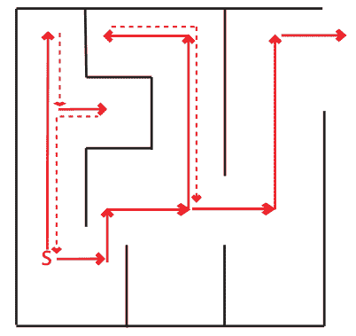

###### 图9：说明深度优先搜索

## 麻省理工学院公开课

http://ocw.mit.edu

## 6.006 算法导论

2008年春季

有关引用这些材料或我们的使用条款的信息，请访问：http://ocw.mit.edu/terms。

### 第13讲：搜索II：广度优先搜索和深度优先搜索

讲座概述：搜索2/3

+   广度优先搜索（BFS）
• 最短路径
• 深度优先搜索（DFS）
• 边分类

阅读材料

CLRS，第22.2-22.3节和第34.1-34.3节（高层次）

回顾：

#### 广度优先搜索（BFS）：

见图2
从 S 开始逐层探索图

+   - 层级 $\phi = \{s\}$
• 层级 $i$ = 可通过 $i$ 条边但不少于 $i$ 条边到达的顶点
• 从上一层次 $i-1$ 构建层次 $i$，尝试所有外向边，但忽略来自前几层的顶点

```
BFS(V, Adj, s):
层级 = { s: \phi }
父节点 = { s : 无 }
i = 1
边界 = [s]

当边界不为空时:
下一层 = []
对于边界中的每个顶点 u:
对于顶点 v 在 Adj[u] 中:
如果 v 不在层级中:
层级[v] = i
父节点[v] = u
下一层.append(v)
边界 = 下一层
i += 1
```

##### 图的表示：续

##### 例子：


####### 图3：广度优先搜索边界

###### 分析：

+   顶点 V 只进入下一个（然后进入边界）

  只有一次（因为 level[V] 然后设置）

  基本情况：V = s

• ⇒ = Adj[V] 只循环一次

• O(E) 时间

  - O(V + E) 还要列出从 V 不可达的顶点 v（那些仍未分配 level）

  “线性时间”

####### 最短路径：

+   对于每个顶点 v，从 s 到 v 所需的最少边数是

  
  如果 v 被分配了 level[v]，则 level[v]
  等于 ∞，否则（没有路径）

• 父指针形成最短路径树 = 每个 v 的最短路径的并集

  = 要找到最短路径，从 v 开始，依次找到 parent[v]，parent[parent[v]]，等等，直到 s（或 None）

#### 深度优先搜索（DFS）：

这就像探索迷宫一样。

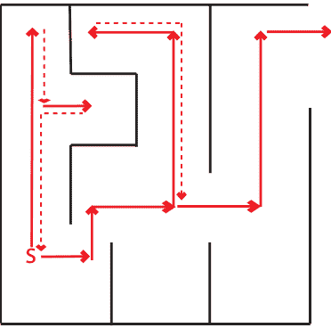

图4：深度优先搜索前沿

+   沿路径前进，直到无法继续
• 沿着面包屑回溯，直到到达未探索的邻居
• 递归地探索

```
parent = {s: None}

DFS-visit(V, Adj, s):
	对于v在Adj[s]中:
		如果v不在parent中:
			parent[v] = s
			DFS-visit(V, Adj, v)

DFS(V, Adj):
	parent = { }
	对于s在V中:
		如果s不在parent中:
			parent[s] = None
			DFS-visit(V, Adj, s)
```


##### 图5：深度优先搜索算法

##### 例子：


####### 图6：深度优先遍历

###### 边分类：


####### 图7：边分类

为了计算这个分类，保持全局时间计数器并存储每个顶点在递归栈上的时间间隔。

###### 分析：

+   - DFS-visit 只调用一次，使用一个顶点 $s$ （因为然后 $parent[s]$ 被设置）
  $\Rightarrow$ DFS-visit 中的时间 $= \sum_{s \in V} |Adj[s]| = O(E)$
- DFS 外循环只添加 $O(V)$
  $\Rightarrow O(V + E)$ 时间（线性时间）

## 麻省理工学院公开课

http://ocw.mit.edu

## 6.006 算法导论

2008年春季

有关引用这些材料或我们的使用条款的信息，请访问：http://ocw.mit.edu/terms。

### 第14讲：搜索III：拓扑排序和NP完备性

讲座概述：搜索3 of 3 & NP完备性

+   广度优先搜索（BFS） vs. 深度优先搜索（DFS）
• 作业调度
• 拓扑排序
• 辛苦的问题
• P，NP，NP完备性

#### 阅读材料

CLRS，第22.4节和第34.1-34.3节（高层次）

#### 回顾：

+   广度优先搜索（BFS）：逐层遍历
• 深度优先搜索（DFS）：回溯
• 最坏情况下，时间复杂度为 O(V + E) ⟹ 最优解
• BFS 计算最短路径（最小 # 边）
• DFS 更简单且具有有用的属性

#### 作业调度：

给定有向无环图（DAG），其中顶点表示任务，边表示依赖关系，按照不违反依赖关系的顺序安排任务


##### 图1：依赖图

源

源 = 没有入边的顶点
= 可在开始时调度（A，G，I）

#### 尝试

从每个源点开始的 BFS：

+   - 从 A 找到 H、B、C、F
- 从 D 找到 C、E、F
- 从 G 找到 H

##### 图2：基于 BFS 的调度

#### 拓扑排序

DFS 完成时间的逆序（节点的出边完成时间）
练习：证明没有违反任何约束

#### 难以处理

+   如果问题确实是图搜索（查看图），DFS 和 BFS 是最坏情况下的最优解
• 如果图中...
  - 是隐含的吗？
  - 有特殊结构吗？
  - 是无限的吗？

前两个特征（隐含性和特殊结构）适用于魔方问题。

第三个特征（无限性）适用于停机问题。

#### 停机问题：

给定一个计算机程序，它是否会停止？

决策问题：答案是是或否

不可决定：没有算法可以在有限时间内正确解决这个问题

大多数决策问题是不可决定的：

+   - 程序 ≈ 二进制字符串 ≈ 非负整数 ≠ N
• 决策问题 = 从二进制字符串到 {是，否} 的函数。二进制字符串指的是 ≈ 非负整数。而 {是，否} ≈ {0, 1}
• ≈ 无限位数的二进制序列 ≈ 实数 ≠ R
• N → R：非唯一非负整数的非分配 整数到实数的映射（R 不可数）
• ⇒ 没有足够的程序来解决所有问题，每个程序只能解决一个问题
• ⇒ 几乎所有问题都无法解决

##### n × n × n 魔方：

+ • n = 2或 3在算法上很容易： O(1)时间  
  实际上，n = 3仍然未解决  
• 图的大小随着 n呈指数增长  
• 可解性决策问题很容易（奇偶校验）  
• 寻找最短解决方案：未解决

##### n × n国际象棋：

给定一个n × n的棋盘和一些棋子的配置，白方能否强制获胜？

+ • 可以表示为（αβ）图搜索  
• 每个算法在n上都需要指数时间：  
  “EXPTIME-complete” [Fraenkel & Lichtenstein 1981]

##### n² − 1 拼图：

给定一个n × n的网格和n² − 1个方块，通过滑动来排序方块（见图3）。

+ • 类似于魔方：  
• 可解性决策问题很容易（奇偶校验）  
• 寻找最短解决方案：NP-COMPLETE [Ratner & Warmuth 1990]


图3: 拼图

##### 俄罗斯方块：

给定当前的棋盘配置和待出现的方块列表，保持存活

+ * NP-COMPLETE [Demaine, Hohenberger, Liben-Nowell 2003]

#### P，NP，NP完备性

P = 所有（决策）问题都可以通过多项式（O（n^c））时间算法（高效）来解决

NP = 所有决策问题的YES答案都有短（多项式长度）的“证明”

可以通过多项式时间算法进行检查例如，

魔方和 n^2 − 1拼图：是否存在长度 ≤ k 的解决方案？

YES = 易于检查的短证明（移动）

俄罗斯方块 ≠ NP

但我们猜测国际象棋不是 NP问题（获胜策略是指数级的 n）

P = NP：大猜想（价值100万美元） ≈生成证明/解决方案比检查它们更困难

NP完全 = 在NP和NP  
难中

NP难 = 和NP中的每个问题一样难

= NP中的每个问题都可以有效地转换为这个问题

= 如果这个问题 ≠ P，那么P = NP（所以很可能这个问题不在P中）

## 麻省理工学院公开课

http://ocw.mit.edu

## 6.006 算法导论

2008年春季

有关引用这些材料或我们的使用条款的信息，请访问：http://ocw.mit.edu/terms。

### 第15讲：最短路径I：介绍

讲座概述

+ • 作业预览  
• 加权图  
• 一般方法  
• 负边  
• 最优子结构

阅读材料

CLRS，第24节（介绍）

动机：

从 A 到 B 的最短驾驶路线（Google 地图 “获取路线”）

问题表述：在加权图 G（V，E）上的问题 W：E→R

两个算法：Dijkstra O（V lg V + E）假设边权重非负  
Bellman Ford O(VE) 是一个通用算法

问题集5预览：

+ • 使用 Dijkstra 算法找到从 CalTech 到 MIT 的最短路径  
  – 查看 “CalTech Cannon Hack” 照片（搜索 web.mit.edu）  
  – 查看从 CalTech 到 MIT 的 Google 地图  
• 将其建模为加权图 G(V, E), W : E → R  
  – V = 顶点（街道交叉口）  
  – E = 边（街道，道路）；有向边（单行道）  
  – W (U,V) = 从 u 到 v 的边的权重（距离，过路费)

```
路径 p = < v₀, v₁, . . . vₖ >  
(vᵢ, vᵢ₊₁) ∈ E 对于 0 ≤ i < k  
w(p) = Σᵢ₌₀ᵏ⁻¹ w(vᵢ, vᵢ₊₁)
```

#### 加权图：

符号：  
$\begin{array}{c} p \\ v_0 \rightarrow v_k \end{array}$ 意味着 p是从 $v_0$ 到 $v_k$ 的路径。 $(v_0)$ 是从 $v_0$ 到 $v_0$ 的权重为 0的路径。

##### 定义：

从 $u$ 到 $v$ 的最短路径权重为  
$\delta(u, v) = \begin{cases} \min \sum w(p) : \quad u \xrightarrow{p} v \quad \text{如果 } \exists \text{任何这样的路径} \\ \infty \quad \text{否则 (}v\text{从 }u\text{不可达)} \end{cases}$

#### 单源最短路径：

给定 $G=(V,E)$, $w$ 和源顶点 $S$, 找到从 $S$ 到每个 $v\in V$ 的 $\delta(S,V)$ [和最佳路径]

##### 数据结构：

$d[v] = \text{圆圈内的值}$

$= \sum 0 \quad \text{如果 } v = s \quad \sum \text{最初}$

$= \delta(s, v) \Leftarrow \text{在结束时}$

$d[v] \ge \delta(s, v) \text{在任何时候}$

$d[v]$ 随着我们找到更好的路径到 $v$ 而减少

$\Pi[v] = \text{到 } v \text{的最佳路径的前驱}, \Pi[s] = \text{NIL}$

##### 例子：

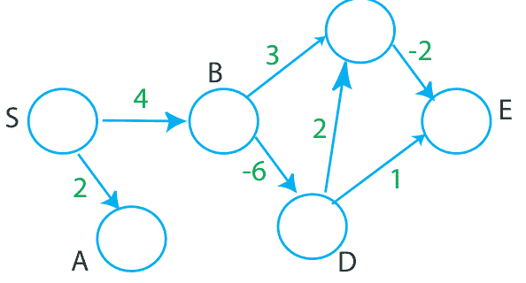

图1：最短路径示例：粗体边表示前驱关系 II

####### 负权边：

+ • 在某些应用中是自然的（例如，用于权重的对数）  
• 某些算法不允许负权边（例如， Dijkstra算法）  
• 如果存在负权边，可能还存在负权环 =  
可能会使某些最短路径未定义!

##### 例子：

见图2  

$B \rightarrow D \rightarrow C \rightarrow B$ （起点）的权重为 $-6 + 2 + 3 = -1 < 0!$  
最短路径 $S \longrightarrow C$（或 $B,D,E$）未定义。可以无限次绕过 $B \rightarrow D \rightarrow C$  
最短路径 $S \longrightarrow A$已定义且权重为 2

#### 最短路径I：介绍


如果存在负权边, 最短路径算法应该能够找到负权环 (例如, Bellman Ford算法)

#### 最短路径算法的一般结构 (无负权环)

+ 初始化：  
  对于v ∈ V:  d[v] ← ∞  
  π[v] ← NIL  

主函数：  
重复  
  选择边 (u,v) [某种方式 ]  
  如果 d[v] > d[u] + w(u,v) :  
    d[v] ← d[u] + w(u,v)  
    π[v] ← u  
直到所有边都有 d[v] ≤ d[u] + w(u,v)

#### 复杂度：

终止条件？（即使没有负循环也需要展示）  
在边的选择不佳的情况下可能需要指数时间。


#### 图3：运行通用算法

#### 最优子结构：

> 定理：最短路径的子路径也是最短路径

令 p = < v0, v1, … vk > 为最短路径  
令 pij = < vi, vi+1, … vj >  0 ≤ i ≤ j ≤ k  
那么 pij是最短路径。

##### 证明：


###### 图4：最优子结构定理

如果 p'ij比 pij更短，那么删去 pij并替换为 p'ij；结果比 p更短。  
矛盾。

#### 三角不等式：

定理：对于所有 $u, v, x \in X$，我们有

$\delta (u, v) \leq \delta (u, x) + \delta (x, v)$

证明：

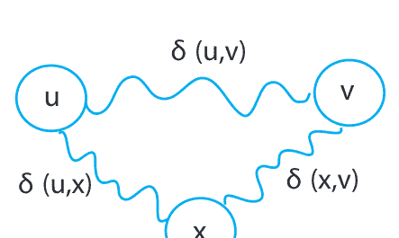

图5：三角不等式

## 麻省理工学院公开课

http://ocw.mit.edu

## 6.006 算法导论

2008年春季

有关引用这些材料或我们的使用条款的信息，请访问：http://ocw.mit.edu/terms。

## 讲座16：最短路径II：贝尔曼-福特

#### 讲座概述

+ • 回顾：符号  
• 通用 S.P.算法  
• 贝尔曼福特算法  
  - 分析  
  - 正确性  

#### 回顾：

路径 $p = <v_0, v_1, \dots, v_k>$  
$(v_1, v_{i+1}) \in E \quad 0 \leq i < k$  
$w(p) = \sum_{i=0}^{k-1} w(v_i, v_{i+1})$  
从 $u$ 到 $v$ 的最短路径权重是 $\delta(u,v)$。如果从 $u$ 到 $v$ 没有可达路径，则 $\delta(u,v)$ 为 $\infty$，如果从 $u$ 到 $v$ 的某条路径上存在负循环，则 $\delta(u,v)$ 未定义。

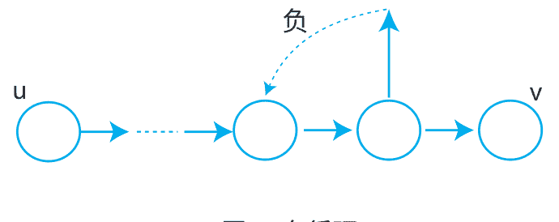

#### 通用S.P.算法

+ 初始化：  
  对于 $v \in V$：  
    $d[v] \leftarrow \infty$  
    $\pi[v] \leftarrow \text{NIL}$  
  $d[S] \leftarrow 0$  

主函数：  
重复  
  选择边 $(u,v)$ [某种方式 ]  
  如果 $d[v] > d[u] + w(u,v)$ ：  
    $d[v] \leftarrow d[u] + w(u,v)$  
    $\pi[v] \leftarrow u$  
直到你不能再松弛任何边或者你累了或者 ...

#### 复杂度：

终止条件：当存在负环时，算法将持续松弛边。


#### 讲座16

#### 最短路径II：贝尔曼-福特

#### 6.006 2008年春季学期

5分钟6.006

这是我希望你在毕业五年后还记得的6.006的内容

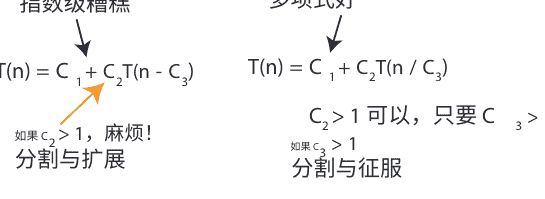

#### Bellman-Ford(G,W,S)

```
初始化 ()
对于 i= 1到 |v| - 1
    对于每条边 (u,v)∈E:
        松弛 (u, v)
对于每条边 (u,v)∈E
    do if d[v] > d[u] + w(u,v)
        then 报告存在负权重环
```

最后，如果没有负权重环，则 d[v] = δ(s,v)

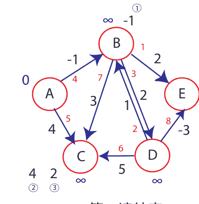

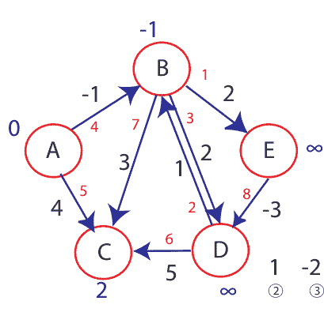


##### 定理：

如果 G=(V,E) 不包含负权重环，则在贝尔曼-福特算法执行后，对于所有的 v∈V，有 d[v] = δ(u,v)。

证明：  
让v∈V是任意一个顶点。 考虑从 s到 v的最短路径 p，它是具有最小边数的路径。


初始时 d[v0] = 0 = δ(S,V0)，并且由于没有负环，它保持不变。  
经过 1次遍历 E后，我们有 d[v1] = δ(s,v1)  
经过 2次遍历 E后，我们有 d[v2] = δ(s,v2)  
经过 k次遍历 E后，我们有 d[vk] = δ(s,vk)  
没有负权重循环  ⇒ p是简单的  ⇒ p有 ≤|V|−1 条边

##### 推论

如果一个值 d[v] 在 |V|−1 次迭代后仍未收敛，则存在一个可达的负权重循环从 s开始。

## 麻省理工学院公开课

http://ocw.mit.edu

## 6.006 算法导论

2008年春季

有关引用这些材料或我们的使用条款的信息，请访问：http://ocw.mit.edu/terms。

### 第17讲：最短路径 III - Dijkstra和特殊情况

#### 讲座概述

+ • 有向无环图中的最短路径  
• 没有负边的图中的最短路径  
• Dijkstra算法  

#### 阅读材料

CLRS，第24.2-24.3节  

#### 有向无环图：

因为没有循环，所以不能有负循环！

+ 1. 对有向无环图进行拓扑排序。从 u到 v的路径意味着 u在线性排序中位于v之前  
2. 按照拓扑排序顺序对每个顶点离开的边进行松弛，一次遍历所有车辆Θ(V + E) 时间  

##### 例子：

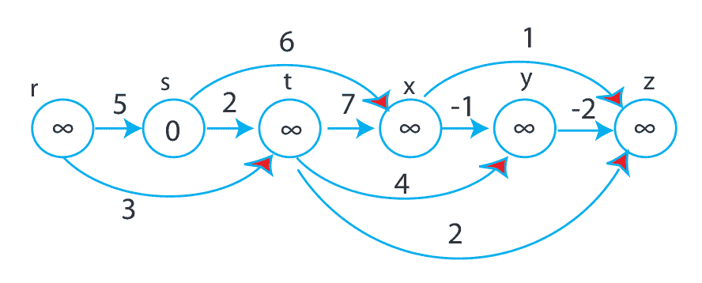

图1：使用拓扑排序的最短路径

顶点按拓扑顺序从左到右排序

过程 r：保持 ∞。 所有在 s左边的顶点将被定义为 ∞

过程 s：t: ∞ → 2 x: ∞ → 6（见图2顶部）

#### Dijkstra算法

对于每条边（u,v）∈E，假设w（u,v）≥0，维护一个已确定最终最短路径权重的顶点集合S。重复选择u∈V−S中具有最小最短路径估计的顶点u，将u添加到S，松弛从u出发的所有边。

##### 伪代码

```
Dijkstra算法（G,W,s）     //使用优先队列Q 
初始化（G,s） 
S ← φ 
Q ← V[G]     //插入到 Q 
当 Q = φ时 
    执行 ← EXTRACT-MIN(Q)     //从 Q中删除 u 
    S = S ∪ {u} 
    对于每个顶点 v ∈ Adj[u] 
        执行 RELAX (u,v,w) ← 这是一个隐式的DECREASE KEY操作
```


图2：动态规划预览

##### 回忆

```
RELAX(u, v, w)
如果 d[v] > d[u] + w(u,v)
那么 d[v] ← d[u] + w(u,v)
TT[v] ← u
```

##### 例子

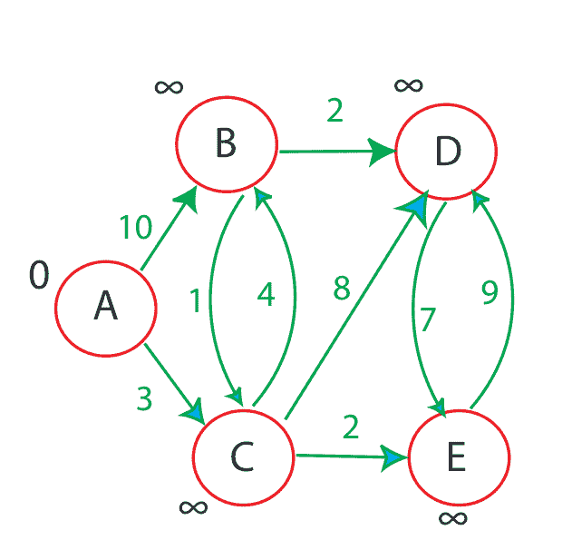

| S = { } | { A B C D E } = Q |
|---|---|
| S = { A } | 0 ∞ ∞ ∞ ∞ |
| S = { A, C } | 0 10 3 ∞ ∞ | ← 在放松边缘后 从A开始
| S = { A, C } | 0 7 3 11 5 | ← 从C放松边缘后S = { A, C, E }
| S = { A, C, E, B} | 0 7 3 9 5 | ← 从B放松边缘后

###### 图3：Dijkstra算法执行

策略：Dijkstra算法是一种贪婪算法：选择V−S中最近的顶点添加到集合S

正确性：每次将顶点u添加到集合S中，我们有d[u] = δ(s,u)

#### 第17讲

#### 最短路径 III：Dijkstra

#### 6.006 2008年春季学期

#### 复杂度

θ(v)插入到优先队列  
θ(v)提取最小值操作  
θ(E)减小键操作  

##### 数组实现：

θ(v)额外最小值时间  
θ(1)减小键时间  
总计：θ(V^2 + E) = θ(V^2)

##### 二进制最小堆：

θ提取最小值的(lg V)  
θ减小键值的(lg V)  
总计：θ(V lg V + E lg V)

##### 斐波那契堆（不在6.006中涵盖）：

θ提取最小值的(lg V)  
θ减小键值的(1)  
摊销成本  
总计：θ(V lg V + E)

## 麻省理工学院公开课

http://ocw.mit.edu

## 6.006 算法导论

2008年春季

有关引用这些材料或我们的使用条款的信息，请访问：http://ocw.mit.edu/terms。

### 第18讲：最短路径IV - 加速  
迪杰斯特拉算法

#### 讲座概述

+ • 单源单目标迪杰斯特拉算法  
• 双向搜索  
• 目标导向搜索 - 潜力和地标  

#### 阅读材料

Wagner, Dorothea, and Thomas Willhalm. "Speed-Up Techniques for Shortest-Path Computations." In Lecture Notes in Computer Science: Proceedings of the 24th Annual Symposium on Theoretical Aspects of Computer Science. Berlin/Heidelberg, MA: Springer, 2007. ISBN: 9783540709176. Read up to section 3.2.

#### DIJKSTRA 单源，单目标

```
初始化()
Q ← V[G]
当 Q = φ时
	执行 ← 提取 MIN(Q) (如果 u = t则停止)
	对于每个顶点 v ∈ Adj[u]
		执行 RELAX(u,v,w)
```

观察：如果只需要从 s到 t的最短路径，则在从  
Q中移除 t时停止，即当 u = t时

#### DIJKSTRA 演示

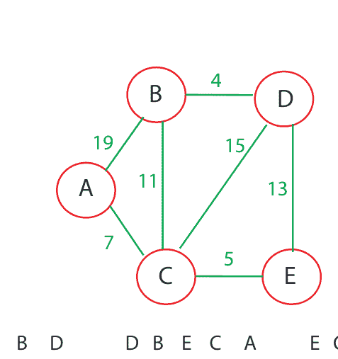

图1：带球和字符串的Dijkstra演示

#### 双向搜索

注意：这里介绍的加速技术不会改变最坏情况下的行为，但在实践中减少了访问的顶点数量。

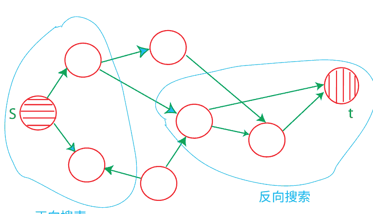

图2：双向搜索

#### 双向搜索

从 s开始的替代正向搜索  
从 t开始的反向搜索  
(反向跟踪边)  
d_{f}(u) 正向搜索的距离  
d_{b}(u) 反向搜索的距离  

当某个顶点 w被处理，即从队列中删除时，算法终止，即两个搜索队列，Q_{f}和 Q_{b}都为空

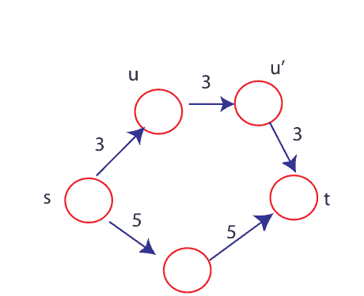

图3：双向搜索

#### 第18讲  
最短路径 III：Dijkstra  
6.006 2008年春季学期

细微之处：搜索终止后，找到节点 x的最小值 d_f(x) + d_b(x)。x可能不是导致终止的顶点 w，就像左边的例子一样！  
使用 Π_f从 s到 x找到最短路径，并使用 Π_b从 t到 x找到最短路径。  
注意： x可能已经从 Q_f或 Q_b或两者中删除。


图4：正向和反向  
搜索  
在至少一个搜索中已处理的所有顶点中， d_f(x) + d_b(x)的最小值=  

```
d_f(u) + d_b(u) = 3 + 6 = 9
```

#### 第18讲

#### 最短路径 III：Dijkstra

#### 6.006 2008年春季学期

d<sub>f</sub>(u') + d<sub>b</sub>(u') = 6 + 3 = 9

 d<sub>f</sub>(w) + d<sub>b</sub>(w) = 5 + 5 = 10

#### 目标导向搜索或 A*

使用潜在函数修改顶点上的边权重。

 $\overline{w}(u,v) = w(u,v) - \lambda(u) + \lambda(v)$

##### 朝目标搜索：

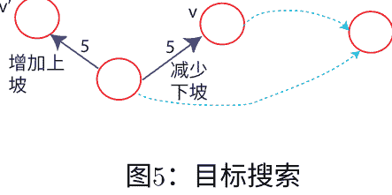

#### 正确性

 $\overline{w}(p) = w(p) - \lambda_t(s) + \lambda_t(t)$

因此，在修改后的图中，最短路径保持不变 w 权重。

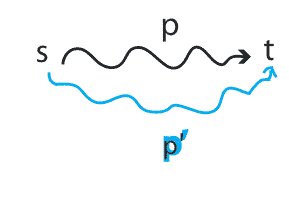

为了应用迪杰斯特拉算法，我们需要对所有 (u,v) 都有 w(u,v) ≥ 0。
适当选择潜在函数，使其可行。

#### 地标

小型地标集 LCV。对于所有 u∈V,l∈L，预先计算 δ(u,l)。

对于每个 l，δ(u,l) = δ(t,l)。
声明：λ<sup>(l)</sup><sub>t</sub> 是可行的。

潜在 λ<sup>(l)</sup><sub>t</sub>(u) =

#### 可行性

 $\bar{w}(u, v) = w(u, v) - \lambda_t^{(l)}(u) + \lambda_t^{(l)}(v) = w(u, v) - \delta(u, l) + \delta(t, l) + \delta(v, l) - \delta(t, l) = w(u, v) - \delta(u, l) + \delta(v, l) \ge 0 \quad \text{by the } \Delta - \text{inequality} \quad \lambda_t(u) = \max_{l \in L} \lambda_t^{(l)}(u) \text{ 也是可行的} $

## 麻省理工学院公开课

http://ocw.mit.edu

## 6.006 算法导论

2008年春季

有关引用这些材料或我们的使用条款的信息，请访问：http://ocw.mit.edu/terms。

### 第19讲：动态规划I：备忘录法，斐波那契数列，疯狂八张，猜数游戏

讲座概述

+ • 斐波那契预热
* 备忘录法和子问题
* 最短路径
* 疯狂八张
* 猜数游戏视角

阅读材料

CLRS 15

#### 动态规划（DP）

大思想：困难但简单

+ • 强大的算法设计技术
* 许多看似指数级的问题通过 DP 有多项式解决方案（“仅仅”）通过 DP
* 特别适用于优化问题（最小/最大）（例如，最短路径)
* DP ≈ “受控暴力搜索”
* DP ≈ 递归 + 重用

#### 斐波那契数列

F₀ = F₁ = 1; Fₙ = Fₙ₋₁ + Fₙ₋₂

#### 朴素算法

遵循递归定义

```
fib(n):
	if n ≤ 2: return 1
	else return fib(n - 1) + fib(n - 2)
\implies T(n) = T(n - 1) + T(n - 2) + O(1) ≈ ϕⁿ
≥ 2T(n - 2) + O(1) ≥ 2^{n/2}
指数级 - 糟糕!
```

#### 第19讲

动态规划之一

#### 6.006 2008年春季学期

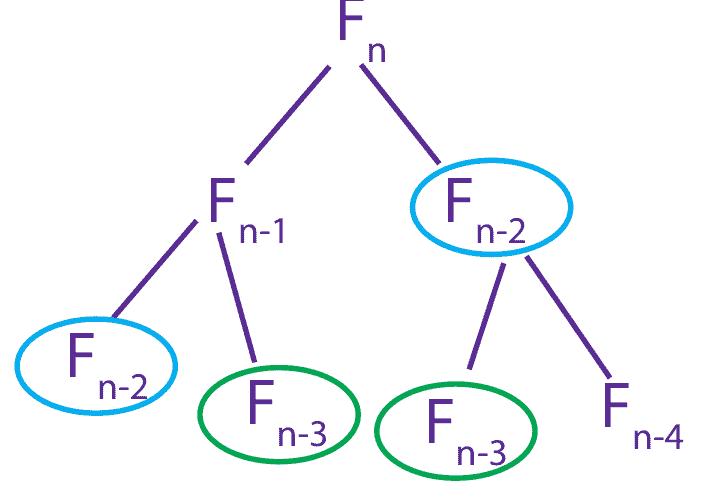

##### 图1：朴素斐波那契算法

#### 简单的想法

#### 记忆化

```
memo = {}
fib(n):
    如果 n 在 memo 中: 返回 memo[n]
    否则: 如果 n ≤ 2: f = 1
        否则: f = fib(n - 1) + fib(n - 2)
        memo[n] = f
        返回 f
    T(n) = T(n - 1) + O(1) = O(n)
```

> [副注：对于斐波那契数列，还有一种 O(lg n) 时间复杂度的算法，通过不同的技术实现]

+ • DP ≈ 递归 + 记忆化
  • 记住（记忆化）以前解决的构成问题的“子问题”
    - 在斐波那契数列中，子问题是 F₀, F₁, ..., Fₙ
  • 如果子问题已经解决，可以重复使用解决方案
  • ⇒ 时间 = #子问题 × 时间/子问题
    • 在 fib 中：#子问题的数量是 O(n)，每个子问题的时间是 O(1) - 总时间为 O(n)

#### 最短路径

+ • 递归公式：
$\delta(s,t) = \text{最小值} \{ w(s,v) + \delta(v,t) \mid (s,v) \in E \}$
• 这个方法可以使用备忘录吗？
不可以，循环 ⇒ 无限循环（见图2）。


图2：最短路径

+ • 在某种意义上对于负权重循环是必要的
• 对于有向无环图，时间复杂度为 $O(V + E)$
（递归实际上是 DFS/拓扑排序）
• 最短路径的技巧：去除循环依赖。
  - $\delta_k(s,t) = \text{使用} \leq k \text{条边的最短路径}$
  - $= \text{最小值} \{ \delta_{k-1}(s,t) \} \cup \{ w(s,v) + \delta_{k-1}(v,t) \mid (s,v) \in E \}$
  ...除了 $\delta_k(t,t) = \phi$，$\delta_{\phi}(s,t) = \infty$ if $s = t$
  - $\delta(s,t) = \delta_{n-1}(s,t)$ 假设没有负循环
  $\Rightarrow \text{时间} = \text{#子问题}$
  $O(n^3) \text{对于 } s,t,k,\cdots \text{真的 } O(n^2) \quad O(n) \cdots \text{真的 } \deg V$
  $= O(V \cdot \sum_{V} \deg(V)) = O(V E)$

* 子问题依赖应该是无环的。

#### 疯狂八张拼图

+ • 给定一系列的卡片 $c[0], c[1], \cdots, c[n-1]$ 
例如，$7\heartsuit, 6\heartsuit, 7\diamondsuit, 3\diamondsuit, 8\clubsuit, J\spadesuit$
• 找到最长的从左到右的“技巧”（子序列）

$c[i_1], c[i_2], \cdots, c[i_k] \quad (i_1 < i_2 < \cdots < i_k)$
其中 $c[i_j]$ 和 $c[i_{j+1}]$ “匹配” 对于所有的 $j$
有一些花色或等级或一个有等级8

• 递归公式:
技巧$(i) = $ 以 $c[i]$ 开始的最佳技巧的长度
$= 1+\max$ (技巧 $(j)$ 对于 $j$ 在范围 $(i+1, n)$ 如果匹配 $(c[i], c[j])$)
最佳 $= \max$ (技巧 $(i)$ 对于 $i$ 在范围 $(n)$)

• 记忆化: 技巧 $(i)$ 只依赖于技巧 $(>i)$

$\Rightarrow  = 时间 = \frac{\#子问题的时间}{子问题}$
$= O(n^2)$ （要找到实际的技巧，请跟踪 max 的）

##### “猜测”视角

+ • 最佳技巧中的第一张牌是什么？ 猜一下！
即尝试所有可能性并选择最佳结果 - 只有 $O(n)$ 个选择
• 从 $i$ 开始的最佳技巧的下一张牌是什么？ 猜一下！
– 如果你假装你知道，解决方案变得容易（使用其他子问题）
– 实际上需要 $O(n)$ 的因子来尝试所有
• 每个子问题只使用少量的 #选择/猜测
$poly(n) \sim O(1)$

## 麻省理工学院公开课

http://ocw.mit.edu

## 6.006 算法导论

2008年春季

有关引用这些材料或我们的使用条款的信息，请访问：http://ocw.mit.edu/terms。

### 第20讲：动态规划II：最长公共子序列，父指针

#### 讲座概述

+ • 迄今为止的重要思想和示例回顾
• 自底向上的实现
• 最长公共子序列
• 猜测的父指针

#### 阅读材料

CLRS 15

#### 摘要

+ • 动态规划 ≈ “受控暴力搜索”
• 动态规划 ≈ 猜测 + 递归 + 记忆化
• 动态规划 ≈ 将问题划分为合理的子问题，其解决方案通常通过猜测部分解决方案而无环地关联起来。
• 时间 = 子问题数 × 每个子问题的时间/子问题
  将递归调用视为 O(1)
  （通常主要是猜测）
• 本质上是一种摊销
• 每个子问题只计算一次；在第一次之后，通过记忆化，成本为 O(1)

#### 第20讲 动态规划II之四

| 示例： | 斐波那契数列 | 最短路径 | 疯狂八张 |
|---|---|---|---|
| 子问题： | fib(k) | δ_k(s,t) ∀s, k < n | trick(i) = 最长 使用卡片(i)的技巧 |
| | 0 ≤ k ≤ n | 使用 ≤ k 条边 |  |
| |  | 从s到t的边 |  |
| |  | deg(s) | n - i |
| #子问题： | Θ(n) | Θ(V²) | Θ(n) |
| | 无 | 如果有的话 | 下一张卡片 j |
| #选择： | 1 |  |  |
| 关系： | = fib(k-1) + fib(k-2) | = min{δ_{k-1}(s,t)} | = 1 + max(trick(j)) |
| |  | v ∈ Adj[s] | 对于i < j < n如果 |
| |  |  | match(c[i], c[j]) |
| 时间/子问题： | Θ(1) | Θ(1 + deg(s)) | Θ(n - i) |
| DP时间： | Θ(n) | Θ(VE) | Θ(n²) |
| 原始问题： | fib(n) | δ_{n-1}(s,t) | max{trick(i), 0 ≤ i < n} |
| 额外时间: | Θ(1) | Θ(1) | Θ(n) |

#### 自底向上的 DP 实现:

##### 递归的替代方法

+ • 子问题的依赖关系形成 DAG（见图 1）
• 想象拓扑排序
• 按照这个顺序迭代子问题
  — 当解决一个子问题时，已经解决了所有依赖问题
• 通常只需：“先解决较小的子问题”

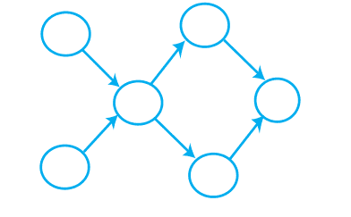

#### 例子.

```
斐波那契数列:
for k in range(n + 1): fib[k] = ...

最短路径:
for k in range(n): for v in V: d[k, v, t] = ...

疯狂八张:
for i in reversed(range(n)): trick[i] = ...
```

#### 最长公共子序列：（LCS）

又称编辑距离、差异、CVS/SVN、拼写检查、DNA比较、抄袭检测等。

给定两个字符串/序列 x 和 y，找到最长公共子序列 LCS(x,y)，顺序但不一定连续。

+ • 例如，HIEROGlyphology 与 MICHAELANGELO 的最长公共子序列是 Hello。
• 等同于“编辑距离”（单位成本）：#字符插入/删除以转换 x → y 除了匹配项之外的所有内容
• 暴力搜索：尝试所有 2^{|x|} 的子序列 → Θ(2^{|x|}·|y|) 时间
• 而是：同时在两个序列上进行动态规划

* 字符串/序列的有用子问题 x：

+ • 后缀 x[i:]
• 前缀 x[:i]
后缀和前缀的时间复杂度为 Θ(|x|) ← → 如果可能的话使用
• 子字符串 x[i:j] 时间复杂度为 Θ(|x|²)

思路：将这些子问题结合起来处理 x 和 y (后缀和前缀可以使用)

#### 最长公共子序列动态规划

+ • 子问题 c(i,j) = | LCS(x[i:], y[j:]) | 对于 0 ≤ i, j < n
⇒ Θ(n²) 个子问题
- 原始问题
~ c[0,0]（长度～稍后找到序列）
• 思路：要么 x[i] = y[j] 是 LCS 的一部分，要么不是 要么 x[i] 要么 y[j]（或两者都不在） LCS（与任何人）
• 猜测：放弃 x[i] 或 y[j]？ (2 个选择)

##### 子问题之间的关系：

如果 $x[i] = y[j]$: $c(i,j) = 1 + c(i+1, j+1)$
(否则 $x[i]$ 或 $y[j]$ 未使用 ~ 无法帮助)
否则: $c(i,j) = \max\{c(i+1, j), c(i,j+1)\}$
基本情况: $c(|x|, j) = c(i, |y|) = \phi$
$\Rightarrow \Theta(1)$ 每个子问题的时间
$\Rightarrow \Theta(n^2)$ 动态规划的总时间

• DP 表：见图 2

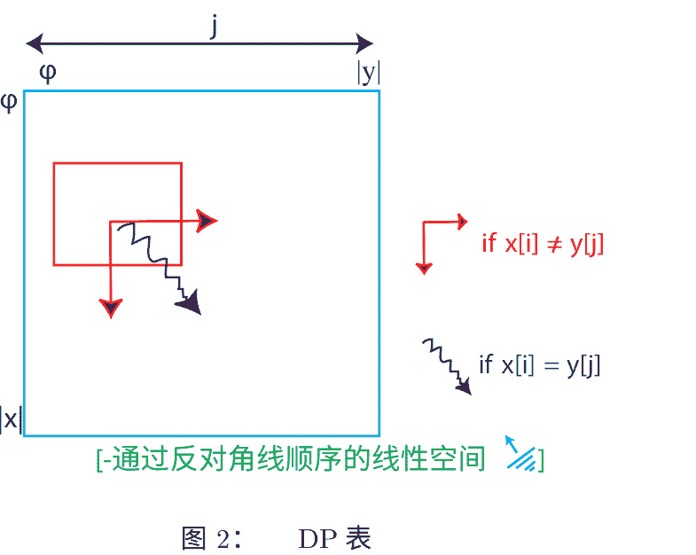

###### 递归 DP：

```
def 最长公共子序列 (x,y):
	seen = { }

def c(i,j):
	if i >= len(x) or j >= len(y): return \phi
	if (i, j) not in seen:
		if x[i] == y[j]:
			seen[i, j] = 1 + c(i + 1, j + 1)
		else:
			seen[i, j] = max(c(i + 1, j), c(i, j + 1))
	return seen[i, j]
return c(0, 0)
```

###### 自底向上动态规划：

```
def 最长公共子序列 (x,y):
    c = {}
    for i in range(len(x)):
        c[i, len(y)] = φ
    for j in range(len(y)):
        c[len(x), j] = φ
    for i in reversed(range(len(x))):
        for j in reversed(range(len(y))):
            如果 x[i] == y[j]:
                c[i,j] = 1 + c[i+1, j+1]
            else:
                c[i,j] = max(c[i+1, j], c[i,j+1])
    return c[0,0]
```

恢复最长公共子序列: [在复习中涵盖的材料]

+ • 为了获得最长公共子序列，不仅仅是它的长度，还要存储父指针（类似于最短路径），以记住猜测的正确选择:

```
如果 x[i] = y[j]:
    c[i,j] = 1 + c[i+1, j+1]
    parent[i,j] = (i + 1, j + 1)
否则:
    如果 c[i+1, j] > c[i,j+1]:
        c[i,j] = c[i+1, j]
        parent[i,j] = (i + 1, j)
    否则:
        c[i,j] = c[i,j+1]
        parent[i,j] = (i, j + 1)
```

+ • ...并在最后跟随它们:

```
lcs = []
这里 = (0,0)
当 c[这里] 时:
    如果 x[i] == y[j]:
        lcs.append(x[i])
    这里 = parent[这里]
```

## 麻省理工学院公开课

http://ocw.mit.edu

## 6.006 算法导论

2008年春季

有关引用这些材料或我们的使用条款的信息，请访问：http://ocw.mit.edu/terms。

### 表达式求值

将矩阵乘法分解为 (AB)C 和 A(BC) 两种方式，(AB)C 的成本为 (n²)，A(BC) 的成本为 (n)。

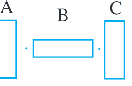

如果选择 (AB)C 的方式，总成本为 O(n)；如果选择 A(BC) 的方式，总成本为 Θ(n²)。

这是一个 O(n³) 的问题。

问题 DP[0, n] = 1

#### 我们将 S 称为问题的解

+ 1. 我们将 i 称为问题的最优解
2. 我们将 ≤ S

#### 动态规划空间复杂度优化

在空间复杂度上进行优化

动态规划 $[n,X] = \phi$

$DP[i] = \max(DP[i+1], v_i + DP[i+1] \text{ 当 } s_i \leq S)$

我们看到了这个问题有很多解法

我们 $= \Rightarrow \#\#\#\#\#\#\#\#\#\# = O(nS)$

$DP[i,X] = \max( DP[i+1, X], v_i + DP[i+1, X - s_i] ) \text{ 当 } s_i \leq X$

动态规划 $[φ,S]$

在空间复杂度上进行优化

空间复杂度 $O(nS)$ 一般是 $S$ 的 $O(S)$

空间复杂度 $O(S)$ 的空间复杂度怎么维护

空间复杂度 $O(S)$ 的空间复杂度怎么维护

空间复杂度 $O(S)$ 的空间复杂度怎么维护

空间复杂度 $O(S)$ 的空间复杂度怎么维护

空间复杂度 $O(S)$ 的空间复杂度怎么维护

#### 列表项

第一个列表项 n 和 w  
第二个列表项 x 和 y  
第三个列表项 z 和 p  
第四个列表项  

  子列表项 a 和 b  
第五个列表项  

  子列表项 c 和 d  
  子列表项 e 和 f  
  子列表项 g 和 h  

我们找到了一个问题的解法

## 麻省理工学院公开课

http://ocw.mit.edu  

## 6.006 算法导论

2008年春季

有关引用这些材料或我们的使用条款的信息，请访问：http://ocw.mit.edu/terms。

### 树上的动态规划

图1：树上的动态规划  

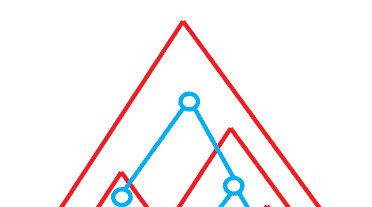

图2：顶点覆盖  

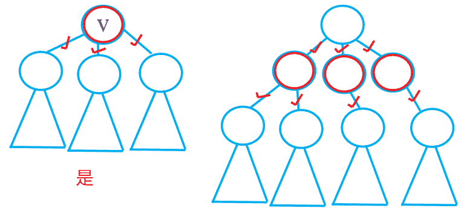

• 顶点覆盖的定义  
• 顶点覆盖的性质  

对任意树 $T$，存在一个顶点覆盖 $V$，满足：

$$
n \leq \frac{3}{2} |V|
$$

图1：树上的动态规划  


#### 图2：几何问题


BD = 1 的几何问题 AD 的  

```
AD = AC - CD = 500,000,000,000 - \sqrt{500,000,000,000^2 - 1}
```


#### 图3：牛顿法

# 牛顿法

牛顿法是一种迭代算法，用于求解方程 $f(x) = 0$ 的根。该算法基于泰勒展开，使用函数在当前点的值及其导数值来近似下一个点。

$$
x_{i+1} = x_i - \frac{f(x_i)}{f'(x_i)}
$$

# 牛顿法求解 $f(x) = x^2 - a$ 的根

$$
f(x) = x^2 - a
$$

$$
x_{i+1} = x_i - \frac{(x_i^2 - a)}{2x_i} = \frac{x_i + \frac{a}{x_i}}{2}
$$

# 数值例子

- $x_0 = 1.000000000$  
- $x_1 = 1.500000000$  
- $x_1 = 1.416666666$  
- $x_1 = 1.414215686$  
- $x_1 = 1.414213562$

如上所示，牛顿法在求解 $\sqrt{2}$ 时，经过几次迭代后，结果已十分接近真实值 $\sqrt{2} \approx 1.41421356237...$。

$$
\sqrt{2} \approx 1.41421356237 \ldots
$$

# 大数乘法的 $O(n^2)$ 算法

在 $0 \le x, y < r^n$ 的约束下，可以通过将大数拆分为两个部分来优化乘法运算。

$$
x = x_1 \cdot r^{n/2} + x_0  
y = y_1 \cdot r^{n/2} + y_0  
0 \le x_0, x_1 < r^{n/2}  
0 \le y_0, y_1 < r^{n/2}
$$

$$
z = x \cdot y = x_1y_1 \cdot r^n + (x_0 \cdot y_1 + x_1 \cdot y_0) r^{n/2} + x_0 \cdot y_0
$$

这种方法将乘法分解为多个更小的乘法和加法，从而降低了复杂度。最终的复杂度为 $\Theta(n^2)$。


```
z₀ = x₀·y₀  
z₂ = x₂·y₂  
z₁ = (x₀ + x₁)·(y₀ + y₁) - z₀ - z₂ = x₀y₁ + x₁y₀  
z = z₂·rⁿ + z·rⁿ/² + z₀
```

$$
T(n) = 3T(n/2)+θ(n) = θ(n^{\log_2 3}) \text{ (} θn^{1.5849625} \text{...)}
$$

$$
θ(n²)
$$

# 标题1

这是一个段落，包含一些数学公式。

* 项目一  
* 项目二  
* 项目三  

```cpp
// 这是一个代码块
int x = 5;
```


| 列1 | 列2 | 列3 |  
|-----|-----|-----|  
| 数据1 | 数据2 | 数据3 |  

> > 这是一个引用内容。

这是一个段落，包含一些数学公式。

麻省理工学院公开课  
http://ocw.mit.edu  

## 6.006 算法导论

2008年春季

有关引用这些材料或我们的使用条款的信息，请访问：http://ocw.mit.edu/terms。

# 第25讲：超越6.006：后续课程，几何折叠算法

麻省理工学院的算法课程：（6.006之后）

1. 6.046：中级算法（更高级的算法和分析，较少编码）  
2. 6.047：计算生物学（基因组，系统发育等）  
3. 6.854：高级算法（整个领域的深入调查）  
4. 6.850：几何计算（处理点，线，多边形，网格等）  
5. 6.851：高级数据结构（亚对数性能）  
6. 6.852：分布式算法（在具有故障的网络中达成共识）  
7. 6.855：网络优化（图中的优化：超越最短路径）  
8. 6.856：随机算法（随机性如何使算法更简单和更快）  
9. 6.857：网络和计算机安全（密码学）  
10. 6.885：几何和折叠算法 * 今天  

其他理论课程：

• 6.045：自动机、可计算性和复杂性  
• 6.840：计算理论  
• 6.841：高级复杂性理论  
• 6.842：随机性与计算