# MIT 6.009 街头数学讲义

Sanjoy Mahajan  
麻省理工学院

版权所有2008年Sanjoy Mahajan

2008-03-06 13:24:47 / rev ebd336097912+  
引用：Sanjoy Mahajan，18.098 / 6.099街头数学课程材料，IAP 2008。  
麻省理工学院开放课程（http://ocw.mit.edu/），麻省理工学院。  
下载于[DD Month YYYY]。

# 目录

+ 1 维度 3  
2 极端情况 13  
3 离散化 31  
4 图解证明 45  
5 取出大部分 57  
6 类比 80  
7 运算符 86  
参考文献 91  

引用：Sanjoy Mahajan，18.098 / 6.099街头数学课程材料，IAP 2008。  
麻省理工学院开放课程（http://ocw.mit.edu/），麻省理工学院。  
下载于[YYYY年MM月DD日]。

## 1 维度

维度，通常称为单位，在物理学和工程学中是熟悉的概念。它们在数学中也很有帮助，正如我希望通过微分、积分和微分方程的例子向您展示的那样。

### 1.1 自由落体

维度在数学中经常被忽视。微积分教材以以下形式陈述许多问题：

一个球从高度为 h英尺的地方掉下来。忽略空气阻力，估计当球撞击地面时的速度，给定重力加速度为g英尺每秒平方。

这些单位，用粗体标出，已经从g或h中分离出来，使得g和h成为纯数字。这种人为的纯度让你的一只手被绑在背后，为了找到你的速度，你几乎被迫解这个微分方程：

```
d²y/dt² = -g, 其中 y(0) = h, y'(0) = 0.
```

这里，y(t)是球的高度，y'(t)是它的速度，g是重力的强度（加速度）。这个二阶微分方程的解如下，你可以通过微分验证：

```
y'(t) = -gt,  
y(t) = -½gt² + h.
```

球撞击地面时，y(t)=0，这发生在t=2h/g。此后速度为y'(t) = -√(2gh)。这个推导有很多应用。

引用：Sanjoy Mahajan，18.098 / 6.099街头数学课程材料，IAP 2008。  
麻省理工学院开放课程（http://ocw.mit.edu/），麻省理工学院。  
下载于[YYYY年MM月DD日]。

### 1.2 积分

如果忽略已知的维度，就像自由落体问题的第一个陈述那样，阻碍你解决问题，相反的策略——指定未知的维度——可以帮助你解决问题。 你可能知道这个高斯积分：


什么是值

2008-03-06 13:24:47 / rev ebd336097912+

引用：Sanjoy Mahajan，18.098 / 6.099街头数学课程材料，IAP 2008。  
麻省理工学院开放课程（http://ocw.mit.edu/），麻省理工学院。  
下载于[YYYY年MM月DD日]。

### 1.3 泰勒和麦克劳林级数

前面例子的寓意是：

> 将未指定维度的量赋予维度。

在这个例子中，通过给x和α赋予维度，我们得到了足够的信息来猜测积分。

前面的例子应用了维度到积分上。维度还可以帮助你记住泰勒级数，这是一个基于导数的结果。泰勒级数的思想是，如果你知道一个函数及其在某一点的所有导数，你可以近似计算其他点上的函数。以 f(x) = √x 为例，你可以使用泰勒级数来近似计算。

√通过知道 f(9) 和所有导数 f'(9), f''(9), ..., 可以用泰勒级数来近似计算10。

麦克劳林级数是泰勒级数的特殊情况，当你知道 f(0), f'(0), ... 时，它的形式如下：

f(x) = f(0) + 一些内容  

缺失的东西是什么？维度的第一个原则可以帮助我们，即你不能把苹果和橙子相加，所以一个求和中的所有项必须具有相同的维度。

第一个项是零阶导数 f(0)。在“东西”中隐藏的第一个项涉及一阶导数 f'(0)，而这个新的项必须具有与 f(0) 相同的维度。要从这个相同性中得出结论，需要理解微分对维度的影响。

在使用微分符号的更熟悉的表示法中，

f'(x) = df/dx  

所以导数是 df 和 dx 的商。如果你把 d 理解为“一点点”，那么你永远不会迷失方向。所以 df 意味着“一点点的 f”，dx 意味着“一点点的 x”，而 f'(x) = df/dx = 一点点的 f / 一点点的 x。

dx 和 一点点的 x

使用 [数量] 符号来表示数量的维度，数量的维度是：

## 维度

math
\left[\frac{\text{一点点的数量}}{\text{数量的导数}}\right] = \left[\frac{\text{一点点的数量}}{\text{数量}}\right] \cdot  

由于一点点的数量与数量本身具有相同的维度，[一点点的数量]

math
\left[\frac{\text{数量的导数}}{\text{一点点的数量}}\right] = \left[\frac{f}{\text{数量}}\right] \cdot  

> 对于维度分析来说，对数量进行微分等价于除以数量.  

因此，数量的导数具有与数量/数量相同的维度.

这个奇怪的结论值得用一个熟悉的例子来测试。以距离数量作为要进行微分的函数，以时间作为独立变量。距离数量(时间)的导数是距离数量的导数= d(距离)/dt. [为什么导数中的撇号消失了，比如数量'(时间)? 当独立变量是时间时，用一个点代替撇号来表示微分.] 距离数量的导数= d(距离)/dt的维度与距离数量 /时间的维度相同吗? 距离数量的导数= d(距离)/dt是速度，速度的维度是长度/时间或LT⁻¹. 商距离/时间也具有长度/时间的维度。因此，这个例子支持了上述结论.

结论限制了麦克劳林级数中缺失的项。第一个缺失的项涉及到 f'(0)，而且这个项必须与 f(0)具有相同的维度。 无论你给 f(x)赋予什么维度，都无关紧要；无论 f(x)的维度如何，都适用于不将苹果和橙子相加的原则。 由于维度无关紧要，选择一个方便的维度，使 f(x)成为一个体积。

然而，不要让 x保持没有维度。 如果你将其保持原样，维度无法帮助你猜测麦克劳林级数的形式：如果  
如果x是无量纲的，那么对 x求导不会改变导数的维度。 相反，为 x选择方便的维度；无论选择哪种维度，只要 x具有一些维度即可。 由于符号 x通常表示长度，想象一下这个 x也是一个长度。

第一阶导数 f'(0)的维度是体积除以长度，即长度的平方。 为了匹配 f(0)  
)，导数需要再多一个长度的幂。 提供缺失长度的最自然的对象是 x本身。

猜测，第一阶导数项应该是 xf'(0)。 它也可以是 xf'(0)/2，或者 xf'(0)乘以任何无量纲常数。 尺寸分析无法告诉你那个数，但事实证明它是1。到目前为止，级数是：

math
f(x) = f(0) + x f'(0) + \cdots  

引用：Sanjoy Mahajan，18.098 / 6.099街头数学课程材料，IAP 2008。  
麻省理工学院开放课程（http://ocw.mit.edu/），麻省理工学院。  
下载于[YYYY年MM月DD日]。

## 1.4 廉价微分

MacLaurin（或Taylor）级数中的每个后续项都包含一个逐渐增加的导数。 第一项使用了 $f(0)$，即零阶导数。第二项使用了 $f'(0)$，即一阶导数。 第三项应该使用第二阶导数 $f''(0)$。 第二阶导数的维度是体积除以长度的平方。 因为每个导数都将 $f$ 除以一个长度。与体积相比，$f''(0)$缺少两个长度。 最自然的替代这些长度的数量是$x^2$，所以术语应该是$x^2 f''(0)$。 它可以乘以一个无量纲常数，这种方法无法找到。那个数字结果是1/2，术语是$x^2 f''(0)/2$。系列现在是

```
f(x) = f(0) + x f'(0) + ½ x² f''(0) + \cdots
```

你可以猜测模式。 下一个术语使用$f^{(3)}(0)$，第三个导数。 它乘以$x^3$来修复维度，并乘以一个无量纲常数，结果是1/6：

```
f(x) = f(0) + x f'(0) + ½ x² f''(0) + ⅙ x³ f^{(3)}(0) + \cdots
```

一般术语是

```
\frac{x^n f^{(n)}(0)}{n!}
```

原因将在 ??中变得更清楚 关于类比和运算符的. 这个例子说明了，如果你记住了关于麦克劳林级数的一些细节 - 例如，每个术语都有逐渐增加的导数 - 那么维度分析可以填补剩下的部分。

关系 $[f'(x)] = [f] / [x]$ 提示了一种估计导数大小的方法。 这是描述与弹簧连接的质量振动的微分方程：

```
m \frac{d^2 x}{dt^2} + kx = 0,
```

其中 $m$是质量， $x$是位置，  $t$是时间，  $k$是弹簧常数。在第一项中，二阶导数 $d^2x/dt^2$是质量的加速度 $a$，所以 $m(d^2x/dt^2)$ 是 $ma$或力。 而第二项， $kx$，是弹簧施加的力。 在解释这些术语的含义时，我们也

2008-03-06 13:24:47 / rev ebd336097912+

引用：Sanjoy Mahajan，18.098 / 6.099街头数学课程材料，IAP 2008。  
麻省理工学院开放课程（http://ocw.mit.edu/），麻省理工学院。  
下载于[YYYY年MM月DD日]。

## 维度

检查了项的维度是否相同（这里是力的维度）。
所以这个方程至少在维度上是正确的。

下面是如何估计每个项的大小。维度为 $d^2x/dt^2$ 来自于将 $x$ 的维度除以 $t$ 的维度的平方。维度为 $d^2x/dt^2$ 的大小通过将 $x$ 的大小除以 $t$ 的大小的平方来估计。为什么不将 $x^2$ 的维度除以 $t^2$ 的维度呢？毕竟，分子中有一个 $d^2$。为了回答这个问题，回到这个原则：$d$ 意味着‘一点点’。所以 $dx$ 意味着‘一点点的 $x$’，而 $d^2x = d(dx)$ 意味着‘一点点的一点点的 $x$’。因此，分子与 $x^2$ 无关。相反，它与 $x$ 具有相同的维度。另一种表达相同的观点是微分是一个线性操作。

即使 $x/t^2$ 是对于二阶导数的一个粗略估计，$x$ 和 $t$ 都在变化：你怎么知道在商式中应该使用什么 $x$ 和 $t$？对于 $x$，在分子中，使用一个典型值 of $x$。典型值是振幅 $x_0$ 的振荡幅度。对于 $t$，在分母中，使用分子显著变化的时间。那个时间 - 称之为 $\tau$ 与振荡周期有关。所以

$$\frac{dx}{dt} \sim \frac{\text{典型的 } x}{\tau} \sim \frac{x_0}{\tau},$$

和

$$\frac{d^2x}{dt^2} = \frac{d}{dt}\left(\frac{dx}{dt}\right) \sim \frac{1}{\tau}\frac{x_0}{\tau} = \frac{x_0}{\tau^2}.$$

现在我们可以估计微分方程中的两个项：

$$m\frac{d^2x}{dt^2} \sim m\frac{x_0}{\tau^2},$$  
$$kx \sim kx_0,$$  

微分方程表示这两个项相加为零，所以它们的大小是可比较的：

$$m\frac{x_0}{\tau^2} \sim kx_0.$$

两边都包含振幅 $x_0$ 的一次幂，所以它被除掉了。这种抵消在线性微分方程中总是发生的。随着 $x_0$ 的消失，它不会影响即将进行的 $\tau$ 的估计。所以

2008-03-06 13:24:47 / rev ebd336097912+

引用：Sanjoy Mahajan，18.098 / 6.099街头数学课程材料，IAP 2008。  
麻省理工学院开放课程（http://ocw.mit.edu/），麻省理工学院。  
下载于[DD Month YYYY]。

### 1.5 重访自由落体

在理想弹簧运动中 - 所谓的简谐运动 - 振动周期与振幅无关。

在消去 $ x_0 $ 后，剩下的是 $ k \sim m / \tau^2 $ 或 $ \tau \sim m / k $。与时间 $ \tau $ 相关的量的倒数 $ \omega = \tau^{-1} $，其维度为时间的倒数或 $ T^{-1} $。这些维度是频率的维度。所以

$$ \omega = \tau^{-1} \sim \sqrt{\frac{k}{m}} $$

当你诚实地解这个微分方程时，这个 $ \omega $ 恰好是振动的角频率（每单位时间的角度）。无法通过量纲分析计算的缺失常数是 1。在这种情况下，尽管量纲分析可能很便宜，但它给出了精确的频率。

### 1.6 你所学到的

- 保留具有尺寸的量的尺寸：不要写 ‘g米每秒平方’；写 $ g $。  
- 选择具有任意尺寸的量的尺寸，比如 $ x $ 和 $ \alpha $ in  
  $$
  \int_{-\infty}^{\infty} e^{-\alpha x^2} dx.
  $$  
- 指数是无量纲的。  
- 你不能把苹果和橙子相加：方程或求和中的每一项具有相同的尺寸。另一个结果是方程的两边具有相同的尺寸。  
- 积分的尺寸是其中所有内容的尺寸，包括 $ dx $。这个原则帮助你猜测积分，比如指数中带有 $ -\alpha x^2 $ 的一般高斯积分。  

引用：Sanjoy Mahajan，18.098 / 6.099街头数学课程材料，IAP 2008。  
麻省理工学院开放课程（http://ocw.mit.edu/），麻省理工学院。  
下载于[DD Month YYYY]。

## 维度

+ * 导数 $f'(x)$ 的尺寸是 $f/x$ 的尺寸。这个原则有助于基于导数重建公式，比如泰勒或麦克劳林级数。

* 的尺寸大致上是

  的典型尺寸

  $x$ 区间内 $f$ 显著变化的尺寸参考 Cipra [1] 的简短而简洁的数学推理练习。

## 2 极端情况

你工具箱中的下一个项目是极端情况的方法。 你可以使用它来检查结果，甚至可以猜测结果，就像以下例子所示。

## 2.1 栅栏柱错误

栅栏柱错误是最常见的编程错误。 索引循环超过或不足一个项目，或者数组分配的内存位置不足 - 导致缓冲区溢出和不安全的程序。 由于程序是数学的一种形式，栅栏柱错误也会在数学中发生。 极端情况的技术可以帮助你找到和修复这些错误，并推导出正确的结果。

这是前n个奇数的和：

$S = 1 + 3 + 5 + \dots$ 
$\underbrace{\phantom{1 + 3 + 5 + \dots}}_{n\text{个项}}$

奇数的形式为 $2k+1$ 或 $2k-1$。 快速回答这个问题：

最后一项是 $2n+1$ 还是 $2n-1$?

对于一般的 $n$，答案并不明显。 你可以算出来，但很容易在代数上犯错，导致差一个项，这就是$2n-1$和$2n+1$之间的差异。 一个极端情况可以解决这个问题。 这是这个技巧的步骤：

1. 选择一个极端值 n，其中最后一项的确定很容易。
2. 对于那个 n，确定最后一项。
3. 看看哪个预测，2n−1还是2n+1（或者可能都不是），与这个最后一项一致。

最极端的 n值是0。 然而，由于 n是项数， n=0的含义不明确。 下一个最极端的情况是 n=1。 只有一个项时，最后（也是第一个）项是1，即2n−1。 因此，总和应为

```
S = 1 + 3 + 5 + \dots + 2n - 1.
```

使用sigma符号，它是

```
S = \sum_{k=0}^{n-1} (2k + 1).
```

这个快速的例子给出了极端情况推理的方法；作为一个副作用，它可能帮助你发现程序中的错误。 这个求和本身有一个优雅的图像，在本章的图示证明一节中你会学到。 本章的其余部分将极端情况的方法应用于越来越复杂的问题。

### 2.2 积分

来自第一章的一个关于维度的积分可以说明极端情况以及维度。 这些结果中哪个是正确的：

```
\int_{-\infty}^{\infty} e^{-\alpha x^{2}} dx = \left\{ \begin{array}{l} \sqrt{\alpha\pi} \\ \text{or} \\ \sqrt{\frac{\pi}{\alpha}} \\ \text{?} \end{array} \right. 
```

尺寸分析回答了这个问题，但是暂时忘记这个知识，这样你就可以练习一种新的技巧。

通过观察两个极端情况 $\alpha \rightarrow \infty$ 和 $\alpha \rightarrow 0$ 你可以通过观察被积函数 $e^{-\alpha x^2}$ 来做出正确的选择。当 $\alpha$ 变得很大时，指数 $-\alpha x^2 \rightarrow 0$。变得很大并且负数，即使 $x$ 只是稍微大于零。 一个很大的负数的指数几乎为零，所以钟形曲线变窄，其面积缩小。当 $\alpha \rightarrow \infty$ 时，面积和因此积分应该缩小到零。第一个选项， $\sqrt{\alpha}\pi$，反而趋向于无穷大。一定是错的。第二个选项， $\pi/\alpha$，趋向于无穷大并通过了测试。所以第二个选项通过了两个测试，而第一个选项两个测试都失败了。这增加了我的信心。

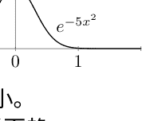

互补测试是 $\alpha \rightarrow 0$。这个函数变平为水平线 $y=1$；它在无限范围上的积分是无穷大。第一个选择， $\sqrt{\pi\alpha}$，未通过这个测试，因为它反而趋向于零，当 $\alpha \rightarrow 0$。第二个选择， $\sqrt{\pi/\alpha}$，趋向于无穷大并通过了测试。所以第二个选项通过了两个测试，而第一个选项两个测试都失败了。这增加了我的信心。

如果那些是唯一的选择，并且我知道其中一个选择是正确的，我会选择 $\pi/\alpha$。然而，如果写这个问题的人包括 $\sqrt{2/\alpha}$ 和 $\sqrt{\pi/\alpha}$ 在选择中，那么我需要第三个测试来区分它们。对于这个测试，使用第三个极端情况： $\alpha \rightarrow 1$。等等，怎么1是一个极端情况吗？无穷大和零是极端的，但1位于这两者之间，所以它不能是一个极端情况。

从字面上讲，1是一个特殊情况而不是一个极端情况。所以，用诗意的许可扩展极端的含义，并包括特殊情况。这个工具的全名将是“极端和特殊情况的方法”。或者，由于极端情况也是特殊情况，它可以被称为“特殊情况的方法”。第一个选项虽然正确，但不方便使用。第二个选项，虽然也具有正确性的优点，但很难理解。它不能帮助你考虑特殊情况，而“极端情况”确实能帮助你：它告诉你要看极端情况。所以我更喜欢保持名字简单 - 极端情况。

- 同时提醒自己极端情况包括像 $\alpha$ 这样的特殊情况
在 $\alpha \rightarrow 1$ 极限下，积分变为

```
I \equiv \int_{-\infty}^{\infty} e^{-x^2} dx,
```

其中 $\equiv$ 符号意味着“被定义为”（而不是数学中更常见的模运算的用法）。这是高斯积分，其值为 $\sqrt{\pi}$。计算它的常规技巧是计算积分的平方：

```
I^2 = \left(\int_{-\infty}^{\infty} e^{-x^2} dx\right) \times \left(\int_{-\infty}^{\infty} e^{-x^2} dx\right).
```

```
I^2 = \iint_{-\infty}^{\infty} \iint_{-\infty}^{\infty} e^{-\alpha x^2} e^{-\alpha y^2} dx dy.
```

看起来积分变得更加复杂，但是这里有一个
魔术技巧。 指数相乘得到 $e^{-(x^2 + y^2)}$，对所有变量进行积分
$x$和 $y$ - 换句话说，对整个平面进行积分。 所以
高斯积分的平方在极坐标下也是积分

$\iint_{\text{平面}} e^{-r^2} dA$，其中 $dA$是面积元素 $r dr d\theta$：

```
I^2 = \int_0^{2\pi} \int_0^{\infty} e^{-r^2} r \,dr\, d\theta.
```

这个积分是可行的，因为 $dA$贡献的 $r$是指数中 $r^2$的导数，
除了一个因子$^2$：

```
\int e^{-r^2} r \,dr = \frac{1}{2} e^{-r^2} + C,
```

和

```
\int_0^{\infty} e^{-r^2} r \,dr = \frac{1}{2}.
```

$d\theta$积分贡献了一个因子$2\pi$ 所以 $I^2 = 2\pi/2 = \pi$，高斯积分是它的平方根：

```
I = \int_{-\infty}^{\infty} e^{-x^2} dx = \sqrt{\pi}.
```

与所有三种极端情况一致的唯一选择，即使其中有 $2/\alpha$，也是

```
\int_{-\infty}^{\infty} e^{-\alpha x^2} dx = \sqrt{\frac{\pi}{\alpha}}.
```

这个积分也可以通过维度来猜测，如第 1.2 节中所解释的。
事实上，维度告诉你的信息比极端情况更多。维度否定了
$\sqrt{\pi/\alpha}$或 $\sqrt{\pi}/\alpha^2$，而这两个选择都通过了三个极端情况的测试。

### 2.3 钟摆

T. [对于 T（斜体）表示周期和 T（罗马体）表示时间维度的几乎模糊的符号表示法表示歉意。]

另一种理智检查的方法是检查极端情况。例如， m在分子中是否合理？为了决定，检查一个质量的极端情况。当质量趋于无穷大时，周期应该趋于无穷大，因为弹簧很难移动巨大的质量；而且，令人惊讶的是，公式正确地预测了 T→∞。 弹簧常数 $k$在分母中是否合理？检查 $k$的一个极端情况。当 $k$ → 0，弹簧变得非常脆弱时，周期应该趋于无穷大。确实，公式预测了 $T→∞$。那么2π呢？要找到这个常数，要么诚实地解决微分方程，要么使用一个发明的技巧 由惠更斯提出的，如果你提醒我，我会在讲座中解释。

一旦弹簧在物理课上被打得半死不活，摆锤就会被释放给你。我们将研究摆动周期的变化 一个摆的周期取决于其振幅-摆动的最大角度，通常称为 $\theta_0$。首先，让我们推导出摆的微分方程，然后推断出其解的性质，而不需要解决它。正如力量努力使具有质量的物体线性加速一样，力矩努力使具有转动惯量的物体角加速。比较以下公式：

```
力 = 质量 × 线性加速度,
力矩 = 转动惯量 × 角加速度.
```

第一个公式是牛顿第二定律，所以你可以很容易记住它。第二个公式是通过类比从第一个公式得出的，这是第6章的技巧。力矩就像力；转动惯量就像质量；角加速度就像线性加速度。

摆的转动惯量是 $I = ml^2$，角加速度是 $\alpha \equiv d^2\theta/dt^2$（再次使用 ≡表示‘被定义为’）。试图将摆锤恢复到垂直位置的切向力是 $F = mg \sin \theta$。

还是 $mg \cos\theta$ 呢？使用极端情况检查一下悬挂，切向力 $F$ 变为零。由于 $\sin \theta → 0$ as $\theta → 0$，力应该包含 $\sin \theta$ 而不是 $\cos \theta$。

```
力矩，即力乘以杠杆臂 $l$，为 $Fl = mgl \sin \theta$。
```

将这三个部分放在一起：

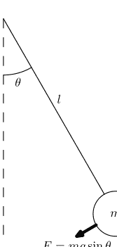

引用：Sanjoy Mahajan, 18.098 / 6.099 街头数学课程材料，IAP 2008。麻省理工学院开放式课程（http://ocw.mit.edu/），麻省理工学院。下载于[YYYY年MM月DD日]。

2008-03-06 13:24:47 / rev ebd336097912+

### 2.3 钟摆

$-mgl\sin\theta = \overset{\text{力矩}}{\underbrace{ml^2}} \times \overset{\alpha}{\underbrace{\frac{d^2\theta}{dt^2}}}$，力矩中的负号反映了它是一个恢复力矩。质量除以后得到摆的微分方程：

$$
\frac{d^2\theta}{dt^2} + \frac{g}{l} \sin\theta = 0.
$$

这个摆动方程看起来与弹簧方程相似

$$
\frac{d^2x}{dt^2} + \frac{k}{m}x = 0.
$$

比较这两个方程产生了以下类比：

- $x \rightarrow \theta$,
- $\frac{k}{m} \rightarrow \frac{g}{l}$,
- $x \rightarrow \sin\theta$.

前两行没问题，但第三行与第一行相矛盾： $x$ 不能同时映射到 $\theta$ 和 $\sin\theta$。

极端情况有所帮助。当然，$\theta$ 和 $\sin\theta$ 并不相同。然而，在极端情况下 $\theta$ 为0，这意味着振幅角 $\theta$ 也趋近于零，两个选择 $\theta$ 和 $\sin\theta$ 是相同的（在??中给出了一个图片证明），对于小振幅，换句话说，摆是几乎是一个简谐系统，它会有一个恒定的周期。类比弹簧方程，摆的周期是

$$
T = 2\pi \sqrt{\frac{l}{g}},
$$

因为摆的微分方程有 $g/l$ 而弹簧的微分方程有 $k/m$。这个极端情况在第3章中进一步分析，使用离散化技术。

   
在高斯积分中 $\alpha$，一个极端情况是 $\alpha \rightarrow 0$，另一个是 $\alpha \rightarrow \infty$。所以在这里尝试这个极端情况，看看你能推断出什么。 
并不多，因为无限角度并没有信息。然而，一个
大振幅的想法是引人注目和有帮助的。最大的有意义的振幅 - 
由释放角度确定 - 是180°或者以弧度表示为 $\theta_0 = \pi$。这个角度需要
一个杆作为钟摆的“绳子”，这样钟摆就不会坍塌。这样

2008-03-06 13:24:47 / rev ebd336097912+

引用：Sanjoy Mahajan，18.098 / 6.099 街头数学课程材料，IAP 2008。麻省理工学院开放式课程（http://ocw.mit.edu/），麻省理工学院。下载于[YYYY年MM月DD日]。

## 极端情况

一个在 $\theta_0 = \pi$ 平衡的钟摆永远倒挂着。所以当 $\theta_0 \to \pi$ 时，$T \to \infty$。因此，周期应该随着振幅的增加而增加。它可能最初会减小，对于小的 $\theta_0$，然后随着 $\theta_0$ 接近 $\pi$ 而增加。这种行为会很讨厌。物理世界，至少作为第一个假设，不会对我们玩这样的把戏。

### 2.4 椭圆

现在尝试在这些椭圆面积公式的极端情况和维度上进行测试：

- a. $ab^2$ 
- b. $a^2 + b^2$ 
- c. $a^3/b$ 
- d. $2ab$ 
- e. $\pi ab$

让我们逐个来看。

- • $ab^2$. 这个产品的尺寸是立方长度，而不是平方长度

，所以它不符合尺寸测试，甚至不能毕业

到极端情况测试。但其他选择的尺寸是正确的

并且需要更多的工作。

- • $a^3/b$。这个候选人通过了薄椭圆测试，当 $a \rightarrow 0$ 时。当 $a \rightarrow 0$ 时，预测和实际面积都为零，无论 $b$ 的值如何。也许候选人是正确的。然而，它必须通过所有的测试，即使然后它可能是错误的。 如果 $a \rightarrow 0$ 是一个合理的测试，那么根据对称性 $b \rightarrow 0$ 也值得尝试。这个测试将候选人推出舞台。 当 $b \rightarrow 0$ 时，产生一个无限细的垂直椭圆零面积，候选人预测一个无限面积，而实际面积是零。虽然候选人通过了第一个测试，但它未通过第二个测试。

- • $2ab$。这个候选人很有前途。当 $a \rightarrow 0$ 或 $b \rightarrow 0$ 时，实际和预测的面积都为零。所以这个候选人通过了极端情况测试。当 $a \rightarrow 0$ 和 $b \rightarrow 0$ 时，都是字面上的极端情况。

  $a = b$ 也是一个极端情况。当 $a = b$ 时，椭圆变成了半径为 $a$ 的圆，该圆的面积为 $\pi a^2$ 而不是 $2a^2$。所以预测失败了。

- • $\pi ab$。这个候选人通过了所有三个测试。就像 $A = 2ab$ 一样，它通过了 $a \rightarrow 0$ 和 $b \rightarrow 0$。与 $A = 2ab$ 不同，这个候选人还通过了 $a = b$ 测试（制作一个圆）。每次候选人通过测试，对其的信心都会增加。所以你可以对这个候选人有信心。而且，它确实是正确的。

这个例子介绍了一个熟悉问题中的极端情况，以及一个你可以选择评估的情况。接下来我们尝试一个三维问题并从头开始猜答案。但在继续之前，我会回顾一下极端情况测试，并讨论如何选择它们。两个自然的极端情况是 $a \rightarrow 0$ 和 $b \rightarrow 0$。然而，第三个测试 $a \rightarrow b$ 从哪里来，以及如何想到它？答案是对称性，一个有用的技巧。实际上 它是一种方法：‘方法是我用两次的技巧’（乔治·波利亚）。对称性

引用：Sanjoy Mahajan，18.098 / 6.099 街头数学课程材料，IAP 2008。
麻省理工学院开放式课程（http://ocw.mit.edu/），麻省理工学院。
下载于[YYYY年MM月DD日]。

## 极端情况

已经帮助我们考虑尝试 b → 0 之后我们尝试 a → 0. 所以下面的它的第二个应用是使用它。 由于 a 和 b 是长度，自然而然地通过形成它们的（无量纲）比率 a/b 来比较它们。 a/b 的范围在 0 和 ∞ 之间：

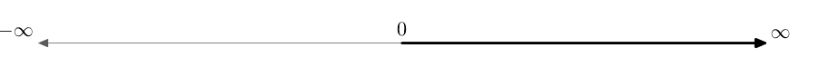

这个范围中立即有趣的值是它的端点 0 和 ∞。然而，这个范围是一个小个子。 它是不对称的，不完整的，并且只存在于实数线的右边。 为了使范围完整，使其延伸从 -∞ 到 ∞，取 a/b 的对数。 这里是 ln(a/b) 的可能值：

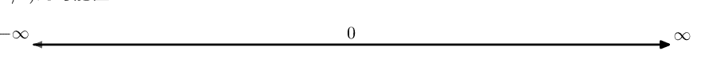

这条线上的有趣值再次是端点，它们是 -∞ 和 ∞，但还有一个新的值：中点，0。 对于 a/b 的有趣值是 0、1 和 ∞。 这些点是用于测试候选椭圆面积的三个极端情况：

+ a/b = 0 → b = 0,
+ a/b = ∞ → a = 0,
+ a/b = 1 → a = b.

### 2.5 截顶金字塔

在椭圆的例子中，极端情况帮助我们评估面积的候选者。 下一个例子向你展示了如何使用极端情况来找到一个结果。 除了面积之外，下一个复杂度级别是体积，我们寻找的结果是通过切割而形成的截顶金字塔的体积

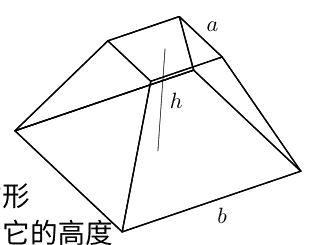

一个有方形底部的熟悉金字塔的一部分。 因此，它有一个方形底部和方形顶部，为了简单起见，我们假设它与底部平行。 它的高度是 h，底部的边长是 b，顶部的边长是 a。 通过找到一个满足所有极端情况测试的公式！ 在这样做的过程中，不要忘记之前的技术：维度。 任何公式都必须具有长度的立方维度，所以忘记像 V = a²b² 或 V = a²bh 这样的候选体积。 但是 V = a²b²/h 会通过维度测试。

什么是极端情况？最简单的是 h → 0，产生一个金字塔体积为零。所以 a²b²/h，尽管具有正确的尺寸，但失败了因为它虚假地产生了无限的体积。可行的候选者-那些产生零体积的-可以是 ha² or h²a。在这两者之间进行选择，考虑一下体积如何取决于高度。将金字塔切成小的垂直薄片。当你将高度加倍时，每个薄片的高度也加倍，从而使体积加倍。因此，体积应该与高度成比例：

V ∝ h.

一些极端情况的测试可以进一步验证这个猜想。剩下的变量是 a和 b。椭圆只有 a和 b。在椭圆中，a和 b是等效的长度。交换 a和 b会将椭圆旋转90°但保持相同的形状和面积。对于截锥体，交换 a和 b会将金字塔翻转180°但保持形状和面积不变。因此，截锥体中的 a和 b可能具有与椭圆中的 a和 b相同的有趣的极端情况：a → 0, b → 0, 并且 a→ b. 所以让我们依次应用每个测试，确保在逐步过程中开发的公式满足迄今为止研究的所有测试。

+ * a → 0. 这个极限将顶面从一个正方形收缩到一个点，使截锥体成为一个具有体积 hb²/3 的普通金字塔。这个公式也通过了 V ∝ h 的测试。所以 V = hb²/3 是截断体积的一个合理猜测继续测试它。
+ * b → 0. 这个极限将底面从一个正方形缩小到一个点，产生一个倒置但其他方面普通的金字塔。先前的候选 V = hb²/3 预测体积为零，无论 a 是什么，所以 V = hb²/3 不可能正确。互补的替代方案 V = ha²/3 通过了 b → 0 测试。太棒了！

    唉，它未通过第一个测试 a → 0。一个公式，V = hb²/3，适用于 a → 0；另一个公式，V = ha²/3，适用于 b → 0。一个候选人能同时通过两个测试吗？是的！将两个半成功的候选人相加：

    V = 1/3 ha² + 1/3 hb² = 1/3 h(a² + b²).

    还有两个替代方案，也能通过两个极端情况的测试，但不太容易想到，它们是

    V = 1/3 h(a + b)^2.

    V = 1/3 h(a - b)^2.

    + • a → b. 在这个极限下，金字塔变成了一个高度为的长方体 h 和底面积 b²（或 a²）。所以它的体积是 V = hb²。艰难取得的候选 V = h (a² + b²) /3，旨在通过前两个极端情况，但在这个情况下失败。两个替代方案也不通过。一个通过的候选是 V = hb²。然而，它是不对称的：它特别对待 b，当 a = b 时尤其荒谬。那 V = ha² 呢？它对待一个特别。它是对称的并通过 a = b 测试，但它未通过 a → 0 和 b → 0 测试。

    我们需要拓宽我们的视野。其中一种方法是比较通过的三个候选人 a → 0 和 b → 0：

    V = 1/3 h(a² + ab + b²) = 1/3 h(a² + b²).

    V = 1/3 h(a + b²) = 1/3 h(a² + 2ab + b²).

    V = 1/3 h(a - b²) = 1/3 h(a² - 2ab + b²).

    扩展版本在括号中共享 a² 和 b² 项，而在 ab 项的系数上有所不同。选择该系数的自由是有意义的。在任何极限情况下，乘积 ab 都是 0。因此，在括号中添加任意数量的 ab 不会影响 a → 0 和 b → 0 测试。只要 ab 的系数恰到好处，候选人也可能通过 a = b 测试。因此，找到正确的系数 n be in V = 1/3 h(a² + nab + b²)。使用极端（或特殊）情况 a = b。然后，候选人变成 V = h (2 + n) b²/3。为了使这个体积变成正确的极限 hb²，数值因子 (2 + n)/3 应该等于 1，这意味着 n = 1 是解决方案：

    V = 1/3 h(a² + ab + b²).

### 2.6 神奇的三分之一

你可能想知道体积中的三分之一因子一个截锥或正金字塔的。一个极端情况的技巧解释了它的起源。首先，我用更少的维度解释这个技巧：类比的另一个例子，一种值得拥有自己章节的技术（第6章）。不要立即解释金字塔体积中的三分之一，这是一个困难的三维问题，首先找到一个二维问题中的相应常数：底为 b 和高为 h 的三角形的面积 A。它的面积是 A ∼ bh。什么是常数？选择一个方便的三角形：也许是一个45度的直角三角形，其中 h = b。两个这样的三角形形成一个面积为 b² 的正方形，所以当 h = b 时，A = b²/2。因此，A ∼ bh 中的常数是 1/2 和 A = bh/2。现在在三维空间中使用相同的构造。

什么金字塔，当与自身结合时，可能会形成一个熟悉的形状？在下面的讨论中，只有纵横比 h/b 很重要。所以选择一个方便的 b，然后选择一个聪明的纵横比来构造一个金字塔。正方形金字塔底部建议了目标形状。另一个具有相同底部的固体是一个立方体。也许几个金字塔可以组合成一个边长为 b 的立方体。为了简化即将进行的算术运算，我选择 b = 2。那么 h 应该是多少？为了决定，想象一下立方体将如何构造。每个立方体有六个面，所以六个金字塔可以组成一个立方体，每个金字塔的底部成立方体的一个面，每个金字塔的顶部朝内，汇聚在立方体的中心。为了使点在立方体的中心相遇，高度必须为 = 1。因此，六个底边不截断的金字塔，其中 a = 0（表示它们没有被截断），b = 2，和 h = 1，构成了一个边长为2的立方体。一个金字塔的体积是立方体的体积除以6 = 8/6 = 4/3。金字塔的体积为 V ∼ hb²，我选择了缺失的常数使得体积为4/3。由于这些金字塔的 hb² = 4，缺失的常数是1/3：

V = 1/3 hb² = 4/3.

因此，一般的、截断的金字塔在当 a → 0 时，截断金字塔的常数也是三分之一：

引用：Sanjoy Mahajan，18.098 / 6.099 街头数学课程材料，IAP 2008。麻省理工学院开放式课程（http://ocw.mit.edu/），麻省理工学院。下载于[YYYY年MM月DD日]。

### 2.7 拖曳

极端情况推理的最终应用是这些恶心的非线性、耦合的偏微分方程的解：

$$
\frac{\partial \mathbf{v}}{\partial t} + (\mathbf{v} \cdot \nabla) \mathbf{v} = -\frac{1}{\rho} \nabla p + \nu \nabla^2 \mathbf{v}, \quad \text{(3个方程)}\\ 
\nabla \cdot \mathbf{v} = 0. \quad \text{(1个方程)}
$$

前三个方程是流体力学的纳维-斯托克斯方程，底部方程是连续性方程。 在这四个方程中，回答以下问题：

> 当你放下一个纸锥（如咖啡过滤器）和一个形状相同但更小的锥体时，哪个下落得更快？

解这些方程是一项痛苦的任务，这就是为什么我们将使用两种技巧：维度和极端情况。 暂时假设每个锥体都立即达到终端速度；这个近似是合理的，但我们在 ?? 中进行检查。使用离散化技术。

所以我们需要找到终端速度。 它取决于锥体的重量和阻力 F 抵抗运动。

为了找到力，我们使用维度并添加一个处理具有无限个维度正确答案的问题的技巧，就像这个问题一样。 阻力 F 取决于物体的速度 v；流体的密度 ρ；它的运动粘度 ν；以及物体的尺寸 r。 现在找到这些量的维度，并找到所有关于 F 的维度正确的陈述。 尺寸 r 的维度为 L。 终端速度 v 的维度为 LT^{-1}。 阻力 F 的维度为质量乘以加速度，或者 MLT^{-2}。 密度 ρ 的维度为 ML^{-3}。 运动粘度 ν 的维度更难确定。 在问题集中，你证明它的维度为 L^2T^{-1}。

如果你寻找 ν, ρ, 和 r 的组合，以及 v 产生力的维度，会出现无限多的解，而在之前的例子中，使用维度只有一个正确的可能性。

因此，需要一种更高级的方法来处理这里的无限可能性。 回到维度的第一原则：你不能相加苹果和橙子。方程两边的维度匹配是苹果和橙子原则的一个结果。方程中的每个项必须具有相同的维度，这是另一个结果。

所以想象一下关于阻力的任何真实陈述：

A + B = C

其中 A, B, 和 C 可能是变量的复杂组合。然后将每个项除以 A：A/A + B/A = C/A

因为 A, B, 和 C 具有相同的维度，每个比率都是无量纲的。因此，你可以将任何有关阻力的（真实）陈述改写成无量纲形式。这个论证中的每一步都不依赖于阻力的细节。它只需要将苹果加到苹果上。所以：

> 你可以用无量纲形式写出关于世界的任何真实陈述。

此外，你可以使用无量纲组构建任何无量纲表达式：变量的乘积，其中乘积没有量纲。由于你可以用无量纲形式写出任何真实陈述，并且可以使用无量纲组写出任何无量纲形式：

> 你可以用无量纲组写出关于世界的任何真实陈述。

在自由落体问题中，使用变量 v、g 和 h，无量纲组为 v / √(gh)，可能还要乘以一个幂。只有一个组时，唯一的无量纲陈述形式为：

一个组 = 无量纲常数，

这导致 v ~ √(gh)。对于拖曳，无量纲组是什么？其中一个组是 F / ρv²r²，通过计算其维度可以验证。第二个组是 rv / ν。事实表明，任何其他组都可以由这两个组形成。有了两个组，最一般的无量纲表述是

## 极端情况

一个组 = f(另一个组)，

其中 f 是一个无量纲函数。它具有无量纲参数，并且必须返回无量纲值，因为方程的左侧是无量纲的。使用 F/ρv²r² 作为第一个组：F

F/ρv²r² = f(rv/ν)

第二个组，也就是括号中的量，是雷诺数，通常写作 Re。它衡量流体流动的湍流程度。要找到拖曳力 F，我们必须找到函数 f。完全确定它太困难了 - 这将需要解 Navier-Stokes 方程 - 但在极端情况下可能是可能的。这里的极端情况是 Re → 0 和 Re → ∞。希望掉落的锥体在这些极限之一！为了决定，评估掉落锥体的 Re。根据经验，在你放下锥体之前，无论哪个锥体下落得更快，都大约以 v ~ 1m s⁻¹ 的速度下落。它的尺寸大约为 r ~ 0.1m。而它下落的流体（空气）的粘度为 ν ~ 10⁻⁵ m² s⁻¹，你可以在表格中查找或应用这些近似方法来找到（物理和工程问题的主题，另一门课程和书籍的近似方法）。所以

Re ~ (0.1m × 1m s⁻¹) / (10⁻⁵ m² s⁻¹) ~ 10⁴

所以 Re ≫ 1，我们只需要考虑这个极端情况。即使速度和尺寸的估计不准确，例如每个因素都有3倍的误差，雷诺数至少为1000，仍然远大于1。

为了确定在高雷诺数极限下哪些因素是重要的，看一下雷诺数的形式：r v / ν。将其发送到无穷大的一种方法是极限 ν → 0。因此，粘度在 Re→∞ 时变得无关紧要，在这个极限下，阻力 F 不应该依赖于粘度。尽管结论大部分是正确的，但是论证中有微妙的谎言。为了澄清这些微妙之处，需要数学和物理发展的两百年时间，包括理论和实验。所以我会跳过真相，并希望你至少暂时满意于几乎真相，特别是因为它给出了与真相相同的答案。

### 2.7 拖曳

让我们看看独立于 $\nu$ 的要求如何限制一般无量纲形式：

$$
\frac{F}{\rho \nu^2 r^2} = f(Re)
$$

左边不包含粘度 $\nu$。右边可能包含粘度，因为雷诺数包含粘度。因此，如果右边出现任何雷诺数，那么粘度将出现在右边，左边没有粘度可以与之抵消。这种情况将违反极端情况的结果，在 $Re \to \infty$ 极限下，阻力与粘度无关。因此，右边必须独立于 $Re$。由于 $f$ 只依赖于雷诺数，而雷诺数刚刚从允许的依赖列表中删除，右边 $f(Re)$ 是一个无量纲常数。因此，

$$
F \sim \rho \nu^2 r^2
$$

现在我们得到了我们需要找到大和小锥体的相对终端速度的结果。当阻力力平衡重力时，锥体达到终端速度。重力与纸的面积成正比，因此与 $r^2$ 成正比。阻力力也与 $r^2$ 成正比，正如我们刚刚发现的。总结一下：

$$
\rho \nu^2 r^2 \propto r^2
$$

$$
F_{\text{重力}}
$$

每边的 $r^2$ 因子相除，所以

$$
v^2 \propto \frac{1}{\rho}
$$

表明

> 锥体的终端速度与其大小无关。

这个结果确实是在课堂上通过实验得到的。因此，不需要解 Navier-Stokes 微分方程，实验和简单的理论是一致的！

### 2.8 你学到了什么

本章的主题是极端情况推理的方法，用于检查和猜测复杂问题的答案：

+ 1. 选择一个极端值，在不解决完整问题的情况下容易确定结果；例如，对于椭圆，当 a = 0 or b = 0.
+ 2. 对于这个极端情况，确定结果。 对于椭圆，当要么 a= 0，要么 b= 0 时，面积为零。
+ 3. 在这个极端情况下确定预测，并将其与第二步的实际值进行比较。 因此，对于椭圆，任何面积的候选值在 a= 0 或 b= 0 时最好为零。

当问题变得对于先前章节的幼稚方法而言过于复杂时，极端情况也补充了维度的技术。这种共生关系在计算下落锥体的相对终端速度时得到了说明。 这个通用的方法基于这样一个原则：你可以使用无量纲组来写出关于世界的任何真实陈述。它导致了以下解决问题的计划，例如找到阻力力 F：

+ 1. 找出 F 依赖的数量，并找出 F 和这些数量的维度。
+ 2. 从这些数量中制作无量纲组。
+ 3. 以一般无量纲形式写出结果：
    包含 F 的组 = f(其他组)。
+ 4. 使用极端情况推理猜测无量纲函数 f 的形式。

引用：Sanjoy Mahajan，18.098 / 6.099 街头数学课程材料，IAP 2008。麻省理工学院开放课程（http://ocw.mit.edu/），麻省理工学院。下载于[DD Month YYYY]。

## 3 离散化

离散化将微积分的基本思想带到了与微积分相反的极端。微积分的发明是为了分析诸如行星轨道或一维示例中球在时间 t 内下落多远等变化过程。通常的计算 计算

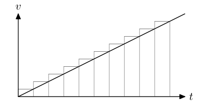

距离 = 速度 × 时间

失败是因为速度变化（它与时间成线性增长）。然而– 而这个下一步是微积分的基本思想 – 在一个短时间间隔内，它的速度几乎是恒定的，通常的距离公式适用于每个短间隔。每个短距离都是一个矩形的面积，总下降距离大约是矩形的组合面积。

为了消除误差，微积分使用无限矩形的极端情况，每个矩形都变得更薄（间隔更短），直到宽度缩小到零。 然后，对恒定速度的近似变得精确。 离散化使用相反的极端情况：可能是两个较宽的矩形。 这种限制意味着误差可能不为零，但它极大地简化了任何计算。

### 3.1 指数衰减

第一个例子是这个积分：

```
\int_0^\infty e^{-t} dt.
```

由于 e 的导数是 e^t，不定积分 0 很容易找到，而且限制使计算更简单。计算甚至更简单。 在已知精确答案的例子中，我们可以

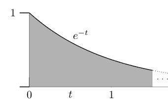

引用：Sanjoy Mahajan，18.098 / 6.099 街头数学课程材料，IAP 2008。麻省理工学院开放式课程（http://ocw.mit.edu/），麻省理工学院。下载于[YYYY年MM月DD日]。

## 离散化

调整离散化方法中的自由参数，直到方法产生准确的值。因此，用复杂的连续平滑的指数衰减函数 $f(t) = e^{-t}$ 替换矩形。

通过一个矩形来近似，并通过计算面积来进行积分

用一个矩形，近似函数保持恒定，直到突然降为零。确定矩形的面积需要选择其高度和宽度。自然的高度是 $f(t) = e^{-t}$ 的最大值，即1。自然的宽度是 $f(t) = e^{-t}$ 显著变化的时间间隔。类似的想法在第1.4节中出现，用于近似一个导数 $df/dx$。它的分子 $df$ 被估计为 $f(x)$ 的典型值。它的分母 $dx$ 成为 $x$ 上的区间，$f(x)$ 显著变化。对于指数函数，显著变化的自然定义是变化了 $f$ 倍。当 $f(t) = e^{-t}$ 时，这种变化发生在 $t$ 变为因此，我们选择的近似矩形的高度是从 $t$ 到 $t + 1$.

要为1，也具有单位宽度。这是一个单位面积的单位正方形。而且这个矩形完全估计了积分，因为

$$
\int_0^{\infty} e^{-t} dt = 1.
$$

### 3.2 具有指数衰减的电路

在第1章中，我坚持认为过早地声明数量为无量纲会束缚你的手脚。在前面的例子中，我犯了这个错误，使指数成为 $-t$。

由于指数是无量纲，我的选择也使 $t$ 无量纲。

对于 $t$ 的自然解释是时间。所以这里是一个类似的例子，但其中 $t$ 具有维度，在进行近似时很有用。让我们首先研究切换关闭之前的初始条件。由于电路尚未形成闭合回路，因此没有电流流动。此外，由于电路已经等待了很长时间，电容器已经完全放电。

因此，电容器上没有电荷。电荷通过电容器上的电压来确定

$$
Q = CV_C,
$$

引用：Sanjoy Mahajan，18.098 / 6.099 街头数学课程材料，IAP 2008。麻省理工学院开放式课程（http://ocw.mit.edu/），麻省理工学院。下载于[YYYY年MM月DD日]。

### 3.2 具有指数衰减的电路

其中 $Q$ 是电容器上的电荷，$C$ 是其电容，$V_C$ 是结果电压。[有关电路[2]和电磁学[3]的经典著作中有更多关于电容器的内容。]因此在开关关闭之前，电容器上的电压为零（$V_C=0$）。

在时间 $t=0$ 时，我关闭开关，将电阻器和电容器连接到恒定的电压源 $V$。由于 $V_C$ 起初为零，电阻器上的电压降为整个电压源 $V$：

$$
V_R = V  \text{ (初始)},
$$

其中 $V_R$ 是电阻器上的电压。这个电压降是由电流 $I$ 通过电阻器引起的（然后通过电容器流过）。欧姆定律说 $V_R = IR$。最初 $V_R = V$，所以初始电流为 $I_0 = V/R$。这个电流充电电容器并增加 $V_C$。随着 $V_C$ 的增加，$V_R$ 减小 - 这减小了电流 $I$，进而减小了 $V_C$ 的增加速度，这样依次进行。找到电流是一个微积分问题，

特别是对于微分方程。

相反，让我们使用维度、极端情况和离散化的新技术来猜测电流。首先应用极端情况。在极端情况下，电流为 $I_0 = V/R$。在极端情况下，没有 0 前-电流流动：电容器积累足够的电荷，使得 $V_C = V$，此后电阻器上没有电压降。再次根据欧姆定律，只有在没有电流流动时才可能出现零电压降。

在这些极端情况之间，我们使用离散化来猜测 $I$。假设 $I$ 在 $t=0$ 时保持其 $I_0$ 的值，然后下降到 $t = \infty$ 时的值 $I=0$。因此，$\tau$ 是电流显著变化的时间。为了确定 $\tau$，使用维度。它只能依赖于 $R$ 和 $C$。[它可能依赖于 $V$，但由于系统是线性的，时间常数不依赖于振幅。] 将 $R$ 和 $C$ 组合成一个时间的唯一方法是乘积 $RC$。因此，$\tau$ 的一个合理猜测是 $\tau = RC$。在这个图中，离散化的电流保持在 $V/R$，直到 $t = \tau$，然后下降到0并永远保持为零。

## 离散化

没有物理电流会突然改变。为了猜测真实的电流，可以反向离散化。这个指数衰减的第3.1节在离散化后产生了相同的矩形形状。所以也许这里的真实电流也是指数衰减的。

在另一个例子中，函数是 $e^t$，从早期到晚期的行为转变发生在 $t = 1$（在那个例子中，$t$ 没有维度）。通过 $t = 1$，指数衰减 $e^t$ 发生了显著变化（变为 $e$ 的倍数）。对于这个电路，相应的转变时间是 $\tau$。要在时间 $\tau$ 内以 $e$ 的倍数改变，电流应包含 $e^{-t/\tau}$。初始电流为 $I = I_0$，所以电流应该是

$$
I = I_0 e^{-t/\tau} = \frac{V}{R} e^{-t/\tau}.
$$

拥有一个解，即使是一个猜测，也可以将解微分方程的艰苦工作转化为验证解的更容易工作。

为了测试对于 $I$ 的猜测，我推导出电流的微分方程。电源电压 $V$ 只在电阻和电容器中降低，所以它们的电压降低必须相加得到 $V$：

$$
V = V_R + V_C.
$$

电容器电压为 $V_C = Q/C$。电阻器电压为 $V_R = IR$，所以

$$
V = IR + \frac{Q}{C}.
$$

看起来有太多的变量：$V$ 和 $C$ 是常数，但 $I$ 和 $Q$ 是未知的。幸运的是，电流 $I$ 和电荷 $Q$ 是相互关联的：电荷是电流的时间积分，而 $I = dQ/dt$。对每个项进行时间微分可以简化方程：

$$
0 = R \frac{dI}{dt} + \frac{1}{C} \left( \frac{dQ}{dt} \right) = R \frac{dI}{dt} + \frac{I}{C}.
$$

将 $R$ 移到它的伴侣 $C$ 附近（除以 $R$）：

$$
0 = \frac{dI}{dt} + \frac{I}{RC} = \frac{dI}{dt} + \frac{I}{\tau}.
$$

尺寸、极端情况和反向离散化产生了这个电流：

2008-03-06 13:24:47 / rev ebd336097912+

引用：Sanjoy Mahajan，18.098 / 6.099 街头数学课程材料，IAP 2008。麻省理工学院开放式课程（http://ocw.mit.edu/），麻省理工学院。下载于[YYYY年MM月DD日]。

### 3.3 人口

并非所有问题都是指数衰减。在下一个例子中，真实函数是未知的，精确答案不可用。问题是估计美国的婴儿数量。为了明确问题，将婴儿定义为两岁以下的儿童。一个估计来自人口普查数据，该数据在统计限度内是准确的。

统计抽样。你在范围 $t = 0$ 到 $2$ 年内对人口曲线进行积分。但这种方法依赖于美国人口普查局的大规模统计工作，在荒岛上行不通。如果只有人口是恒定的（不依赖于年龄），那么积分很容易！荒岛上的草稿纸方法是用一个矩形替代复杂的人口曲线。

矩形的高度是多少，宽度是多少？宽度 $\tau$，即时间，可以合理估计为平均寿命。所以 $\tau$ ~ 70年。矩形的高度是多少？高度没有像宽度那样明显的直接答案。在指数衰减的例子中，高度是初始值，我们从中找到了面积。在这里，过程相反。你知道面积 - 美国的人口

- 从中你可以找到高度。所以，面积为 $3 \cdot 10^8$，高度是

$$
高度 ~ \frac{面积}{宽度} ~ \frac{3 \cdot 10^8}{75 \text{ 年}}
$$

## 离散化

因为宽度是寿命，我们使用了70年。为什么变成了75年？答案是一个有用的折中。新的数字75比70更容易被3（或300）整除。所以改变寿命预期以便于心算。由于这个折中引起的不准确性不比用矩形替代复杂的人口曲线更糟糕。所以

高度 ~ 4 \cdot 10^6 年^{-1}.

将该高度的矩形积分在婴儿期为2年的持续时间内，得到

$$
N_{婴儿} ~ 4 \cdot 10^6 \text{ 年}^{-1} \times 2 \text{ 年} = 8 \cdot 10^6.
$$

因此，大约有800万婴儿居住在美国。根据这个数字，你可以估计每年一次性尿布（尿片）使用的垃圾填埋容量。

### 3.4 半峰全宽

高斯积分

$$
\int_{-\infty}^{\infty} e^{-x^2} dx
$$

已经出现在几个例子中，你已经看到了这个技巧（在第2.2节）将其平方以显示其值为 $\sqrt{\pi}$。在被积函数中，它指数函数是一个困难的连续函数。除了在无限积分范围内，该积分没有闭合形式，这就是为什么统计表以数值方式列举相关误差函数的原因。我介绍这个证据是为了向你展示在没有无限限制的情况下，这个积分有多么困难，以及即使在无限极限下也不容易。

假装你忘记了这个技巧。你可以通过离散化来近似积分，将被积函数替换为一个矩形。矩形的高度和宽度应该是多少？方法是将高度取为函数的最大高度，将宽度取为函数下降显著的距离。在指数衰减的例子中，显著意味着变化了一个因子 $e$。函数 $e^{-x^2}$ 的最大值在 $x = 0$ 时为1，因此近似的矩形高度为1。当 $x = \pm 1$ 时，它下降到 $1/e$，因此近似的矩形宽度为 $2$，因此面积为 $2$。这个估计是

引用：Sanjoy Mahajan，18.098 / 6.099 街头数学课程材料，IAP 2008。麻省理工学院开放式课程（http://ocw.mit.edu/），麻省理工学院。下载于[YYYY年MM月DD日]。

2008-03-06 13:24:47 / rev ebd336097912+

### 3.4 半峰全宽

还不错的。真实值为 $\sqrt{\pi} = 1.77\ldots$，因此误差约为13%：一个合理的交换。

另一个配方，也值得知道，因为它有时更准确，起源于光谱学的过去时代。光谱仪测量分子吸收辐射的波长（或频率）以及相应的吸收强度。这些数据为原子和分子结构的早期探测提供了重要线索，并对量子理论的发展至关重要[4]。类似的研究在今天的粒子加速器中进行 - 俗称为原子粉碎机 - 例如加利福尼亚的SLAC和日内瓦的CERN：粒子，也许是质子和中子，以高能量碰撞，产生带有原始粒子结构的信息的碎片。或者，要理解一个精密设计的手表是如何工作的，就用锤子敲它，看看飞溅的碎片和弹簧会揭示什么。光谱仪是一种温和的工具。图表记录仪在光谱仪扫描波长范围时绘制吸收曲线。峰值的面积是一个重要的数据，像[5]这样的整本书都充满了这些测量结果。在数字图表记录仪和计算机数值积分出现之前的半个多世纪里，人们如何计算这些面积？这个配方就是FWHM。

FWHM = 半峰全宽

以慢动作解开首字母缩写：

1.  M. 找到最大值（峰值）。
2.  HM. 找到最大值的一半，即半最大值。
3.  FWHM. 找到函数下降到最大值的一半的两个波长 - 峰值上方和下方的波长。全宽度是上方和下方波长之间的差异。

FWHM近似公式用峰值高度为高度，宽度为估计宽度的矩形替代峰值。

通过前面的三步骤进行此公式的尝试，并与通过旧公式找到函数变化的估计进行比较。高斯函数在 $x = 0$ 处具有最大高度1。半最大值为1/2，尝试在高斯积分上使用此公式，并将其与通过函数变化因子为 $e$ 的旧公式进行比较。

当 $x = \pm \sqrt{\ln 2}$。然后，全宽度为 $2\sqrt{\ln 2}$，并且矩形的面积 - 这个面积估计了原始积分 - 为 $2\sqrt{\ln 2}$。

在这里，估计值和精确积分并列显示：

$$
\int_{-\infty}^{\infty} e^{-x^2}dx = \begin{cases} \sqrt{\pi} = 1.7724 \dots & \text{(精确)} \\ 2\sqrt{\ln 2} = 1.6651 \dots & \text{(估计)} \end{cases}
$$

FWHM估计值精确到6%，比之前的方法准确度提高了一倍。这比只用两行代数做出的结果要好得多！

### 3.5 斯特林公式

FWHM结果准确估计了应用数学中最有用的量之一：

$$
n! \equiv n \times (n-1) \times (n-2) \times \cdots \times 2 \times 1.
$$

我们在第4.6节中再次遇到这个量的图片证明。在这里，我们通过离散化表示 $n!$ 的积分来估计 $n!$：

$$
\int_0^{\infty} t^n e^{-t} dt = n!
$$

你可能还不知道这个积分是 $n!$；你可以通过分部积分证明它或者看到 ?? 关于推广学习不同的微分积分符号。现在先接受积分表示的信任，并承诺在后面的章节中兑现这个信任。

为了近似计算积分，想象一下被积函数 $t^n e^{-t}$ 的样子。它是递增函数 $t^n$ 和递减函数 $e^{-t}$ 的乘积。这样的乘积通常会达到峰值。一个熟悉的例子是递增函数 $x$ 和递减函数 $1 - x$ 的乘积。在范围 $x \in [0, 1]$ 上

函数是正的。乘积从零上升，然后回到零，在 $x = 1/2$ 处达到峰值。

你可以通过观察它的行为在两种极端情况下 来验证这个乘积 $t^n e^{-t}$ 是否有峰值：在短期内 $t \to 0$ 和长期内 $t \to \infty$。当 $t \to 0$ 时，指数是 1，但是多项式因子 $t^n$ 将其抹去通过乘以零。当 $t \to \infty$ 时，多项式因子 $t^n$ 将乘积推向无穷大，而指数因子 $e^{-t}$ 将其推向零。

### 3.5 斯特林公式

指数函数胜过任何多项式。为了看清楚为什么并避免负指数 $-t$ 混淆这个问题，我们可以将其与 $t^n$ 作为 $t \to \infty$ 进行比较。
指数函数的泰勒级数包含所有的 $t$ 的幂次，所以它就像一个无限次数的多项式。因此，当 $t$ 足够大时，$e^t / t^n$ 会趋向于无穷大。同样地，它的倒数 $t^n e^{-t}$ 会在 $t \to \infty$ 时趋向于零。在 $t = 0$ 时也是零，这个乘积在两个极端都是零，在其他地方是正的。因此，它在中间达到峰值。也许它有多个峰值，但至少应该有一个峰值。此外，随着 $n$ 的增加，$t^n$ 的多项式因子变得更强，所以 $e^{-t}$ 需要更大的 $t$ 来抵消它。

因此，随着 $n$ 的增加，峰值向右移动。

由于 $t^n e^{-t}$ 具有峰值，FWHM 公式可以近似计算其面积。该公式需要找到高度（函数的最大值）和宽度（FWHM）的近似矩形。为了找到这些参数，将 $t^n$ 代入指数函数中：

$$
t^n e^{-t} = e^{n \ln t} e^{-t} = e^{n \ln t - t}
$$

指数函数 $f(t) \equiv n \ln t - t$ 非常有趣。当 $t \to 0$ 时，$\ln t$ 将 $f(t)$ 变为 $-\infty$。当 $t \to \infty$ 时，$-t$ 再次将 $f(t)$ 变为 $-\infty$。在这些限制之间，函数达到峰值。要找到最大值，将 $f'(t)$ 设为 0：

$$
f'(t) = \frac{n}{t} - 1 = 0
$$

正如我们预测的那样，随着 $n$ 的增加，峰值向右移动。峰值的高度是估计矩形面积所需的一个项目。在峰值处，$f(t)$ 是 $f(n) = n \ln n - n$，所以原始的被积函数，即 $e^{f(t)}$，是

$$
e^{f(t_{\text{峰值}})} = e^{f(n)} = e^{n \ln n - n} = \frac{n^n}{e^n} = \left( \frac{n}{e} \right)^n
$$

要找到宽度，仔细观察 $f(t)$ 在峰值 $t = n$ 附近的行为，通过将其写成峰值附近的泰勒级数：

$$
f(t) = f(n) + f'(n)(t - n) + \frac{1}{2} f''(n)(t - n)^2 + \cdots
$$

第一阶导数为零，因为展开点 $t = n$ 是一个最大值，且 $f'(n) = 0$。因此，泰勒级数中的第二项消失。为了计算第三项，计算 $f$ 在 $t = n$ 处的二阶导数：$n$

$$
f''(n) = -\frac{1}{t^2} = -\frac{1}{n}
$$

所以

$$
f(t) = \underbrace{n \ln n - n}_{f(n)} + \frac{1}{2} \times \underbrace{\left(-\frac{1}{n}\right)}_{f''(n)} (t - n)^2 + \cdots
$$

第一个术语给出了我们已经计算过的峰值的高度。第二个术语说明了高度随着 $t$ 离开 $n$ 而下降的方式。结果是对被积函数的近似：

$$
e^{f(t)} = \left( \frac{n}{e}\right)^n e^{-(t - n)^2 / 2n}
$$

第一个因子是一个常数，峰值高度。第二个因子是熟悉的高斯函数。这个函数以 $t = n$ 为中心，在指数中包含了 $1/2n$，但除此之外它是一个常规的高斯函数，具有二次指数。当 $(t - n)^2 / 2n = \ln 2$ 时，它下降了 2 倍，即

$$
t_{\pm} = n \pm \sqrt{2n \ln 2}
$$

FWHM 是 $t_+ - t_-$，即 $\sqrt{8n \ln 2}$。估计的曲线下面积是

$$
\left( \frac{n}{e} \right)^n \times \sqrt{8n \ln 2}
$$

作为对 $n!$ 的估计，每个部分都是正确的，除了常数因子。更准确的答案是 $\sqrt{2\pi}$ 而不是 $\sqrt{8 \ln 2}$。然而，$2\pi$ 大致上是 $8 \ln 2$，所以近似值，就像估计的香草高斯积分（巧合吗？），准确到 6%。

### 3.6 摆周期

摆的周期在本书中已经是一个熟悉的话题。通过一点离散化，它的微分方程变得可处理。描述摆动的微分方程是

$$
\frac{d^2\theta}{dt^2} + \frac{g}{l} \sin \theta = 0
$$

这个非线性方程没有常规函数的解 - 更准确地说，没有初等函数的解。但是你可以

2008-03-06 13:24:47 / rev ebd336097912+

引用：Sanjoy Mahajan, 18.098 / 6.099 街头数学课程材料，IAP 2008。麻省理工学院开放式课程（http://ocw.mit.edu/），麻省理工学院。下载于 [YYYY年MM月DD日]。

### 3.6 摆周期

通过离散化来了解它的行为。如果只有方程是

```
d²θ/dt² + (g/l)θ = 0.
```

这个方程是线性的，因此可以在不太困难的情况下解决 - 我不敢说任何微分方程都是'容易'的 - 它的解是一个具有角频率 ω = √(g/l)的振荡：

```
θ(t) = θ₀ cos(√(g/l) t).
```

它的周期是2π√(g/l)，与振幅 θ无关。

未近似的摆动方程的复杂性在于它具有产生扭矩的因子 sinθ，而不是近似值 θ。这两个函数完全匹配，如θ→0。但是随着 θ的增长-这在振幅较大时发生-等价性变得不太准确。一种比较它们的方法是查看它们的比值 (sin θ) / θ。如预期的那样，当 θ = 0时，比值为1。随着 θ的增长，比值下降，使简单谐波近似变得不太准确。我们可以离散化以找到比通常的简单谐波近似更准确的近似值，但仍然产生线性微分方程。即将出现的图示说明了制作和改进该近似值。

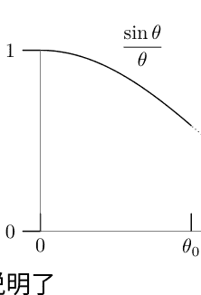

我们需要对难以处理的函数进行离散近似，范围在[0, θ₀]之间。观察两个函数 θ和 sinθ在除以 θ后的情况；我们将提取出共同的大部分，即第5章的主题。难以处理的函数变为 (sin θ) / θ。另一个函数，一条直线，是简谐近似，也是一个有用的零阶近似。但它不会随振幅的变化而产生周期的变化（因为替代线的高度与 θ₀无关）。

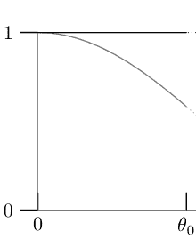

## 离散化

下一个近似修复了这个问题。高度为 (sin θ₀)/θ₀ 的平坦线。这条线是 (sin θ)/θ 的最小高度。为什么这个选择比使用最大高度为 1 的第一个近似更好？因为在这个选择中，高度随振幅变化，所以周期也随振幅变化：这个选择解释了第一个选择近似成无关紧要的一个物理效应。在这个第二个近似中，力矩项 (g/l) sin θ 变为 g sin θ₀ / lθ₀。


从简谐近似开始，这个选择等价于用稍微较弱的重力替换重力：sin θ₀

g → g × θ₀

sin 的泰勒级数给出

sin θ₀ / θ₀ ≈ 1 - θ₀² / 6

然后，假 g 是

假 g = g (1 - θ₀² / 6)

使用这个假 g，周期变为

T ≈ 2π√(l / 假 g)

计算 g^{-1/2} 需要另一个泰勒级数：

(1 + x)^{-1/2} ≈ 1 - x / 2

然后

T ≈ 2π√(l / g (1 + θ₀² / 12))

引用：Sanjoy Mahajan，18.098 / 6.099 街头数学课程材料，IAP 2008。麻省理工学院开放式课程（http://ocw.mit.edu/），麻省理工学院。下载于 [YYYY年MM月DD日]。

2008-03-06 13:24:47 / rev ebd336097912+

### 3.7 你学到了什么

这个周期是一个过高估计，因为它假设了最弱的扭矩调整因子：通过在摆动时 $\theta = \pm \theta_0$ 时，将扭矩按照 $(\sin\theta)/\theta$ 的值进行缩放。

下一个近似来自于使用一个中间的替代线高度。等价地说，可以说摆钟在其飞行的一半时间内像弹簧一样运动，其中扭矩只包含 $\theta$；而在其飞行的另一半时间内，扭矩包含了项 $\theta(\sin \theta_0)/\theta_0$。然后，周期是简谐周期 $T=2\pi l/g$ 与前面的低估的平均值：

T = 2π √(l/g (1 + θ₀²/24))

下一步 - 在这里，我正在推动这种方法，也许比较合理 - 是注意到摆动钟大部分时间都在移动最慢的地方。

大部分时间都花在摆动的端点附近，这是简谐近似最不准确的地方。因此，仅限于端点的低估估计 T 应该比简谐过高估计稍微重要一些。

最近的估计将这些部分权重相等。  
为了模拟  
证明它，计算端点估计，比如说两次，中心估计一次。 这个方法进一步的理由是有两个端点而只有一个中心！ 然后周期变为

T = 2π √(l/g (1 + θ₀²/18))

真正的系数，来自于进行幂级数解，是 1/ 16，所以这个最终的加权估计非常准确！

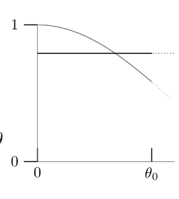

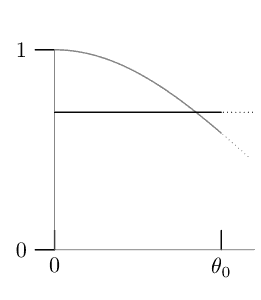

## 离散化

在这个公式中，宽度是函数从最大值的一半开始到返回到该值的宽度。

> 引用：Sanjoy Mahajan，18.098 / 6.099街头数学课程材料，IAP 2008。
麻省理工学院开放式课程（http://ocw.mit.edu/），麻省理工学院。
下载于[YYYY年MM月DD日]。

## 4 图解证明

你是否曾经在证明中逐步走过，理解每一步，但不相信定理，不说'是的，当然是真的'? 分析的、逻辑的、顺序的方法通常不如精心制作的图片令人信服。这种差异并非巧合。我们大脑中分析的、顺序的部分是随着我们的语言能力进化而来的，这可能有1千万年的历史。我们的图像化、整体性的硬件则是由视觉系统和皮层数百万年的进化结果。与我们的视觉硬件相比，我们的符号化、顺序化硬件是一个发展不完善的后来者。

广告商知道仅凭文字无法说服你浪费金钱购买他们客户的垃圾，所以他们在图像上花费了大量资金。这个原则，它有更高的应用，是本章的主题。

### 4.1 添加奇数

这里再次是来自第2.1节的总和，它用极端情况来说明找到栅栏错误的方法：

```
S = 1 + 3 + 5 + \dots \underbrace{}_{n \text{ 个项}}
```

在我展示承诺的图片证明之前，让我们先通过标准方法，即归纳证明，来进行比较，以便稍后与图片证明进行比较。归纳证明有三个部分：

1. 验证基本情况 n = 1。当 n = 1个项时，总和为 S=1，它等于 n²。证毕（拉丁语，意为‘相当容易完成’）。
2. 假设归纳假设。假设总和对于 n个项成立：

> 引用：Sanjoy Mahajan，18.098 / 6.099街头数学课程材料，IAP 2008。
麻省理工学院开放式课程（http://ocw.mit.edu/），麻省理工学院。
下载于[YYYY年MM月DD日]。

## 图解证明

$$\sum_{1}^{n}(2k-1)=n^{2}.$$

这个假设是为了验证总和对于 $n+1$ 个项的下一步。

3. 进行归纳步骤来验证总和对于 $n+1$ 个项，这需要证明

$$\sum_{1}^{n+1}(2k-1)=(n+1)^{2}.$$

总和分为一个新项和旧总和：

$$\sum_{1}^{n+1}(2k-1)=\underbrace{2n+1}_{\text{新术语}}+\sum_{1}^{n}(2k-1).$$

右边的和是 $n^2$ 归功于归纳假设。所以

$$\sum_{1}^{n+1}(2k-1)=2n+1+n^{2}=(n+1)^{2}.$$

归纳证明的三个部分都完成了，定理得到了证明。证明了。然而，这些部分可能会让你感觉你按照每一步但不明白为什么定理是真的。

将其与图形证明进行比较。和 $S$ 中的每一项都添加了一个奇数，表示为一个 L 形块的面积。每个块都在每边扩展了一个单位。添加 $n$ 项意味着放置 $n$ 个块，并形成一个 $n \times n$ 的正方形。[或者是一个 $(n-1) \times (n-1)$ 的正方形吗？]和是正方形的面积，即 $n^2$。一旦你

理解这个图，你永远不会忘记为什么将第一个 $n$ 奇数相加得到完全平方 $n^2$。

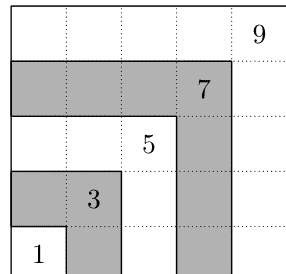

### 4.2 几何级数

这里是一个熟悉的数列：

$$S=1+\frac{1}{2}+\frac{1}{4}+\frac{1}{8}+\cdots.$$

2008-03-06 13:24:47 / rev ebd336097912+

引用：Sanjoy Mahajan，18.098 / 6.099 街头数学课程材料，IAP 2008。麻省理工学院开放式课程（http://ocw.mit.edu/），麻省理工学院。下载于 [YYYY 年 MM 月 DD 日]。

### 4.3 算术平均数-几何平均数不等式

通常用符号的方式来计算这个和，使用几何数列的公式。你可以通过一个技巧推导出这个公式。首先将每一项乘以2，计算2S：

2S = 2 + 1 + \frac{1}{2} + \frac{1}{4} + \frac{1}{8} + \cdots. 
\underbrace{\hspace{2em}}_{S}

这个和看起来像是 S，除了第一项是 2。所以 2S = 2 + S 而 S = 2。

这个结果虽然正确，但可能看起来像是魔术。下面是一个图解证明。一个面积为1的正方形代表第一项，即1/2⁰（标记为0）。第二项是一个1 × 1/2的矩形，代表1/2¹（指数标记为1）。

第三项是一个1/2 × 1/2的正方形放在角落里。第四项和第二项一样，是一个矩形。对于每一对项，所有矩形之间的空白区域和1 × 2的矩形的三分之三都被填满。在极限情况下，和填满了1 × 2的矩形，证明了 S = 2。


### 4.3 算术平均数-几何平均数不等式

一个经典的不等式是算术平均数-几何平均数不等式。在正式陈述之前，这里有一些数值例子。取两个数，比如1和2。它们的算术平均数是1.5。它们的几何平均数是 √(1 × 2) = 1.414... 现在用2和3进行相同的运算。它们的算术平均数是2.5，它们的几何平均数是 √(2 × 3) = 2.449... 在这两种情况下，几何平均数都小于算术平均数。这个模式是算术平均数和几何平均数的定理。它说当a, b ≥ 0时，

$$\frac{a + b}{2} \ge \sqrt{ab}, \quad \text{AM} \quad \text{GM}$$

其中AM表示算术平均数，GM表示几何平均数。

它至少有两个证明：符号证明和图解证明。图解证明是通过指定的方式暗示的 \sqrt{ab} 作为几何平均数。然而，首先我用符号证明它。看 (a - b)²。因为它是一个平方，

2008-03-06 13:24:47 / rev ebd336097912+

引用：Sanjoy Mahajan，18.098 / 6.099街头数学课程材料，IAP 2008。
麻省理工学院开放课程（http://ocw.mit.edu/），麻省理工学院。
下载于[YYYY年MM月DD日]。

## 图解证明

展开左边得到 $a^2 - 2ab + b^2 \ge 0$。现在进行魔术般的一步，将$4ab$加到两边得到

```
a^2 + 2ab + b^2 \ge 4ab.
```

左边再次是一个完全平方，完美的表明需要对两边取平方根得到

```
a + b \ge 2\sqrt{ab}.
```

两边同时除以2得到定理：

```
(a + b)/2 \ge \sqrt{ab} \quad \text{AM} \quad \text{GM} 
```

也许你同意，尽管每一步都是可信的（和正确的），但所有步骤的顺序似乎像是魔术。这些小步骤没有揭示论证的结构，而为什么仍然难以捉摸。例如，如果代数步骤以结束，

```
(a + b)/4 \ge \sqrt{ab}, 
```

它看起来不会明显错误。

这里是一个图片证明。将圆的直径分成长度和 $b$。半径是 $(a + b)/2$，这是算术平均值。现在我们需要找到几何平均值，它的名字是吉祥的。看看从直径上升的第二半弦，$a$和 $b$相交的地方。它也是虚线三角形的高度，而且那个三角形是一个直角三角形。带有直角

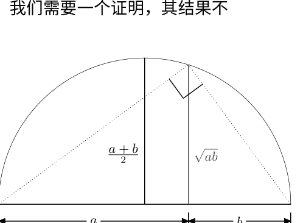

到处都是三角形，相似三角形一定很有用。让到目前为止未知的长度为 $x$。通过相似三角形，

```
x/a = b/x, 
```

我们需要一个证明，其结果不能有其他可能性。

引用：Sanjoy Mahajan，18.098 / 6.099街头数学课程材料，IAP 2008。
麻省理工学院开放式课程（http://ocw.mit.edu/），麻省理工学院。
下载于[YYYY年MM月DD日]。

### 4.3 算术平均数-几何平均数不等式

so $x = \sqrt{ab}$，表明半弦是几何平均数。那个半弦永远不能大于半径，所以几何平均数永远不能大于算术平均数。为了使这两个平均数相等，几何平均数的半弦必须向左滑动，变成半径，这只有在 $a = b$ 时才会发生。所以当 $a = b$ 时，算术平均数等于几何平均数。

将这个图形证明与符号证明进行比较。图形证明的结构是可以看到的，可以说是如此。唯一不明显的一步是证明半弦是几何平均数 $\sqrt{ab}$，几何平均数。此外，图片显示了为什么只有当 $a = b$ 时两个平均数之间才会有等号：只有这样半弦才会成为半径。

下面是两个应用AM-GM不等式解决导数问题的例子。在第一个问题中，你有 $l = 40\text{m}$ 的围栏来围起一个矩形花园。

为了使花园面积最大，它应该有什么样的尺寸？如果 $a$ 是长度，$b$ 是宽度，那么 $l = 2(a + b)$，即 $4 \times AM$。面积是 $ab$，即 $(GM)^2$。由于 $AM \geq GM$，在这个问题的参数上的结果是

AM = $\frac{l}{4} \geq \sqrt{\text{area}} = GM$.

由于几何平均值不能大于 $l/4$，这是一个常数，当且仅当 $a = b$ 时，几何平均值最大化。因此，为了获得最大面积选择 $a = b = 10\text{米}$，得到 $A = 100\text{平方米}$。

这个类型中的下一个例子是一个更困难的三维问题。从一个单位正方形开始，切掉四个相同的角，将四条边折叠起来制作一个开口的盒子。为了最大化盒子的体积，角的尺寸应该是多少？将切口的边长记为 $x$。盒子的每条边长为 $1 - 2x$，高度为 $x$，因此体积为

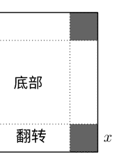

V = x(1 - 2x)².

由于缺乏想象力，让我们尝试与前一个问题相同的技巧。两位伟大的数学家，乔治·波利亚和加博尔·塞戈，评论道，‘一个只能使用一次的想法是一个技巧。如果它可以被多次使用它就变成了一种方法。所以如果AM-GM可以帮助解决下一个问题，它就从一个简单的技巧晋升为更崇高的方法。

引用：Sanjoy Mahajan，18.098 / 6.099街头数学课程材料，IAP 2008。麻省理工学院开放式课程（http://ocw.mit.edu/），麻省理工学院。下载于[YYYY年MM月DD日]。

## 图解证明

在前面的问题中，面积的因素是 a和 b，它们的和 a+b是常数，因为它由周长固定。 然后我们可以使用AM-GM找到最大的面积。 在这里，体积的因素是
它们的和是2−3x，这不是一个常数；相反，它随着x的变化而变化。 这种变化意味着我们不能直接应用AM-GM定理。 这个定理仍然有效，但它并不能告诉我们我们想要知道的。 我们想知道最大可能的体积。 而且，直接应用这个定理会说体积永远不会小于算术平均数的立方。 使体积等于这个值并不能保证已经找到了最大体积，因为随着改变x以最大化几何平均数，算术平均数也在变化。 最大的体积可能在几何平均数不等于变化的算术平均数的地方产生。在二维问题中，这个问题并没有出现，因为算术平均数已经是常数（它是周长的一个固定分数）。

如果只有因子 x是4x，那么计算算术平均值时，3x会消失:

```
4x + (1 - 2x) + (1 - 2x) = 2.
```

正如《星际迷航：下一代》的让-吕克・皮卡尔船长所说：“就这样吧。”通过研究4V而不是 V，你可以得到一个4x而不是一个 x：

```
4V = 4x \times 1 - 2x \times 1 - 2x.
```

这些因子的和为2，它们的算术平均值为2/3 - 这是一个常数。 这三个因子的几何平均值是

```
(4x(1 - 2x)(1 - 2x))^{1/3} = (4V)^{1/3}.
```

所以根据算术平均值-几何平均值定理:

```
算术平均值 = 2/3 ≥ (4V)^{1/3} = GM,
```

所以

```
V ≤ 1/4 × (2/3)³ = 2/27.
```

当三个因子为4x，1− 2 x和1− 2 x时，体积等于这个常数的最大值。 这个等式在x= 1/6时成立，这是角落切割的尺寸。

引用：Sanjoy Mahajan，18.098 / 6.099街头数学课程材料，IAP 2008。
麻省理工学院开放式课程（http://ocw.mit.edu/），麻省理工学院。
下载于[YYYY年MM月DD日]。

### 4.4 对数

图片解释了许多泰勒级数逼近中的早期术语。 作为一个例子，我推导出ln(1 + x)的前两项。 对数函数被定义为一个积分

ln(1 + x) = $\int_1^{1+x} \frac{dt}{t}$

一个积分，特别是确定积分，暗示了一个区域图片。 作为第一个近似，对数是阴影外接矩形的面积。 尽管这个矩形高估了积分，但很容易分析：它的面积是它的宽度（即 x）乘以它的高度（即1）。 所以面积是 x。 面积是第一个图形近似，并解释了泰勒级数中的第一个项。

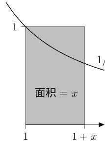

ln(1 + x) = x - \cdots

低估积分的另一种方法是使用内接矩形。 它的宽度仍然是 x，但它的高度是1/(1 + x)。 对于小的 x，

1 + x ≈ 1 - x, 通过将两边乘以 1 + x 可以验证：

1 ≈ 1 - x²

当 x² 很小时，这个近似是有效的，这在 x 很小时发生。 然后矩形的高度是 1 - x，它的面积是 x(1 - x) = x - x² 对于第二个近似，将上下估计值取平均：

ln(1 + x) ≡ 面积 ≈ $\frac{x + (x - x^2)}{2} = x - \frac{x^2}{2}$

这些项是 ln(1 + x) 的泰勒级数的前两项。 x) 的符号平均值的图像是一个梯形面积，因此这一系列图像解释了前两项。 它的误差在于将平滑曲线 1/t 变成一条直线，这个误差产生了级数中的高阶项 — 但是使用图片计算它们是困难的。

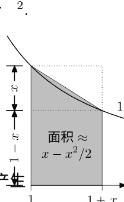

## 图解证明

或者你可以从二项式定理和对数的定义中推导出所有的项。对数是

$$
\ln(1 + x) \equiv \int_{1}^{1+x} \frac{dt}{t} = \int_{0}^{x} \frac{dt}{1+t} =
$$

二项式定理说

$$
\frac{1}{1 + t} = 1 - t + t^2 - t^3 + \cdots,
$$

所以

$$
\ln(1 + x) = \int_{0}^{x} (1 - t + t^2 - t^3 + \cdots) dt.
$$

现在逐项积分；尽管这个过程会让数学家们咬牙切齿，但通常是有效的。为了概括芝加哥警察局的座右铭，“先积分，后问问题。”然后

$$
\ln(1 + x) = x - \frac{x^2}{2} + \frac{x^3}{3} - \frac{x^4}{4} + \cdots.
$$

逐项积分可以展示整个级数。理解这两种方法，你不仅会记住对数级数，还会理解两种有用的技巧。

作为对数近似的一个应用，我估计 $\ln 2$。级数的前两项的快速应用给出：

$$
\ln(1 + x) \approx x - \frac{x^2}{2} \Big|_{x=1} = 1 - \frac{1}{2} = \frac{1}{2}.
$$

那个近似是糟糕的，因为 x 是 1，所以平方 x 不会产生一个小的 $\frac{x^2}{2}$ 项。然而，一个技巧可以提高准确性。将 $\ln 2$ 重新写成

$$
\ln 2 = \ln \frac{4/3}{2/3} = \ln \frac{4}{3} - \ln \frac{2}{3}.
$$

然后将 $\ln (4/3)$ 近似为 $\ln(1 + x)$，其中 x = 1/3，并将 $\ln(2/3)$ 近似为 $\ln(1 + x)$，其中 x = -1/3。当 x = $\pm$ 1/3 时，平方 x 会产生一个小的数字，因此误差应该缩小。试试看：

$$
\ln \frac{4}{3} = \ln(1 + x) \Big|_{x=1/3} \approx \frac{1}{3} - \frac{1}{2} \cdot \left(\frac{1}{3}\right)^2,
$$

$$
\ln \frac{2}{3} = \ln(1 + x) \Big|_{x=-1/3} \approx -\frac{1}{3} - \frac{1}{2} \cdot \left(-\frac{1}{3}\right)^2.
$$

$$
\ln 2 = \ln \frac{4}{3} - \ln \frac{2}{3} \approx \frac{2}{3} = 0.666 \ldots
$$

真实值为 0.697...，所以这个估计值的准确度为 5%！

下面的图形问题有一个自然的图形解法：

> 如何用最短的路径将等边三角形切成两半，路径不一定是直的？

以下是无限可能性中的几个候选路径。

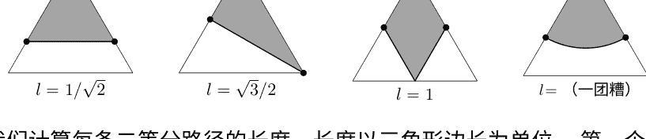

让我们计算每条二等分路径的长度，长度以三角形边长为单位。第一个候选路径围绕着一个面积为原三角形一半的等边三角形，所以较小的阴影三角形的边长缩小了一个因子

$$
\sqrt{2}. 因此，路径是其中之一的边，长度为 1/\sqrt{2}. 在第二个选择中，路径是原始三角形的高度这意味着它的长度是 \sqrt{3}/2，所以它比第一个候选者更长。 第三个候选者包围了由两个小等边三角形组成的菱形。 每个小三角形的面积是原始三角形的四分之一，所以每个小三角形的边长为
$$

$$
1/2。 平分路径是一个小三角形的两条边，所以它的长度为 1。 这个候选者比其他两个都长。
$$

第四个候选者是一个六分之一的圆。要找到它的长度，找到圆的半径 r。六分之一的圆的面积是三角形的一半，所以

$$
\pi r^2 = 6 \times \frac{1}{2} \text{ 一个 圆} \text{ 三角形} = 6 \times \frac{1}{2} \times \frac{1}{2} \times 1 \times \frac{\sqrt{3}}{2} \text{ 一个三角形}
$$

将这些部分相乘得到

$$
\pi r^2 = \frac{3\sqrt{3}}{4},
$$

和

$$
r = \sqrt{\frac{3\sqrt{3}}{4\pi}}.
$$

二等分路径是一个六分之一的圆，所以它的长度是

$$
l = \frac{2\pi r}{6} = \frac{\pi}{3} \sqrt{\frac{3\sqrt{3}}{4\pi}} = \sqrt{\frac{\pi\sqrt{3}}{12}}.
$$

最佳的先前候选者（第一张图片）的长度为 $1/\sqrt{2} = 0.707 \ldots$

$$
l = 0.67338 \ldots,
$$

小于 $1/\sqrt{2}$。所以圆弧是迄今为止最佳的二等分路径。然而，它是否是所有可能路径中最优的呢？对于圆的弧长计算很复杂，大多数其他路径甚至没有闭合形式的弧长。

不要进行复杂的计算，尝试一种熟悉的方法，对称性，结合图片。将三角形复制六次以形成一个六边形，并复制候选路径。这是复制第一个候选者（直线二等分线）的结果。原始三角形变成了大六边形，而封闭的半三角形变成了一个面积是大六边形的一半的较小六边形。

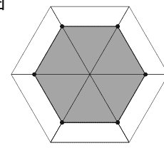

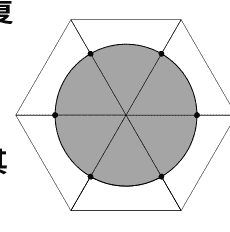

将该图与复制圆弧的二等分结果进行比较。大六边形与上次复制的相同，但现在二等分的区域复制成一个圆。阴影六边形和这个圆，哪个周长更短？等周定理说，对于相同面积的所有图形，圆的周长最小。由于圆和较小的六边形包围相同的面积 - 这是一个三角形面积的三倍 - 圆的周长比六边形小，并且比复制任何其他路径的结果的周长小！

最后一步是将你的右手放在 $x = 7$ 的线上，用左手向右推动，以捕捉阴影部分。它们堆叠在一起，形成 $\ln 7$ 的矩形。因此，总超调量，在偿还 2 倍因子后，为 $(\ln 7)/2$。对于一般的 $n$，超调量为 $(\ln n)/2$。积分 $\int_{1}^{n} \ln k \, dk$ 提供了从上限得到的 $n \ln n - n$ 和从下限得到的 1。因此，积分和图形一起产生


或

$$
n! \approx e^{\sqrt{n}} \left(\frac{n}{e}\right)^n
$$

斯特林公式是

$$
n! \approx \sqrt{2\pi n} \left(\frac{n}{e}\right)^n
$$

图形近似和斯特林公式之间的差异是应该是因子 $e^\sqrt{2\pi}$。除了这个仅有 8% 的变化，一个简单的积分和图形方法可以得出整个公式。

突出修正结果是无限级数修正的第一个项。后续的修正很难用图像推导出来，就像 $\ln(1 + x)$ 的 Taylor 级数的后续项一样难以通过图像推导出来（我们使用积分和二项式定理来推导这些项）。

但是另一种技术，类比，可以得出 $\ln n!$ 的高阶修正。这个分析是第 7.3 节的主题，我们刚刚推导出的图形化突出修正结果是 Euler-MacLaurin 求和公式的零阶导数项。

> 引用：Sanjoy Mahajan，18.098 / 6.099 街头数学课程材料，IAP 2008。麻省理工学院开放式课程（http://ocw.mit.edu/），麻省理工学院。下载于[YYYY年MM月DD日]。

## 4.6 求和级数

现在让我们再次看一下斯特林逼近的 n 阶乘。在第 3.5 节中，我们通过近似积分找到了它。

$$
\int_{0}^{\infty} t^{n} e^{-t} dt = n!.
$$

下一种方法也是间接的，通过近似 $\ln n!$:

$$
\ln n! = \sum_{1}^{n} \ln k.
$$

这个和是矩形的面积。那个面积大致上是光滑曲线 $\ln k$ 下的面积。面积是

$$
\int_{1}^{n} \ln k \, dk = k \ln k - k = n \ln n - n + 1.
$$

在进行更精确的近似之前，让我们看看这个近似值的情况通过取指数来恢复 n!:

$$
n! \approx \frac{n^{n}}{e^{n}} \times e.
$$

这个 $n^n$ 和 $1/e^n$ 因子已经正确。下一个图形修正使结果更加准确。

积分近似值中的误差来自超出 $\ln k$ 曲线的部分。为了近似计算这些突出部分的面积，假装它们是三角形。如果 $\ln k$ 由线段组成，就不需要假装；即使如此这个假设只是一个微小的谎言。问题变成了将阴影三角形相加。

下一步是将三角形加倍，变成矩形，并在推导结束前记得偿还 2 的因子。

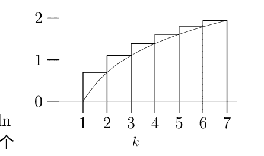

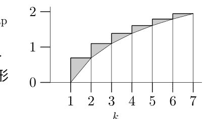

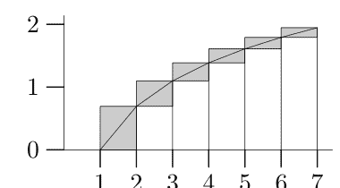

引用：Sanjoy Mahajan，18.098 / 6.099 街头数学课程材料，IAP 2008。麻省理工学院开放式课程（http://ocw.mit.edu/），麻省理工学院。下载于[YYYY年MM月DD日]。

2008-03-06 13:24:47 / rev ebd336097912+

## 图解证明

最后一步是将你的右手放在 $x = 7$ 的线上，用左手向右推动，以捕捉阴影部分。它们堆叠在一起，形成 $\ln 7$ 的矩形。因此，总超调量，在偿还 2 倍因子后，为 $(\ln 7)/2$。对于一般的 $n$，超调量为 $(\ln n)/2$。积分 $\int_{1}^{n} \ln k \, dk$ 提供了从上限得到的 $n \ln n - n$ 和从下限得到的 1。因此，积分和图形一起产生


或

$$
n! \approx e^{\sqrt{n}} \left(\frac{n}{e}\right)^n
$$

斯特林公式是

$$
n! \approx \sqrt{2\pi n} \left(\frac{n}{e}\right)^n
$$

图形近似和斯特林公式之间的差异是应该是因子 $e^{\sqrt{2\pi}}$。除了这个仅有 8% 的变化，一个简单的积分和图形方法可以得出整个公式。

突出修正结果是无限级数修正的第一个项。后续的修正很难用图像推导出来，就像 $\ln(1 + x)$ 的 Taylor 级数的后续项一样难以通过图像推导出来（我们使用积分和二项式定理来推导这些项）。

但是另一种技术，类比，可以得出 $\ln n!$ 的高阶修正。这个分析是第 7.3 节的主题，我们刚刚推导出的图形化突出修正结果是 Euler-MacLaurin 求和公式的零阶导数项。

> 引用：Sanjoy Mahajan，18.098 / 6.099 街头数学课程材料，IAP 2008。麻省理工学院开放式课程（http://ocw.mit.edu/），麻省理工学院。下载于[YYYY年MM月DD日]。

2008-03-06 13:24:47 / rev ebd336097912+

## 5 去掉大部分

去掉大部分，这一章的技术是一种逐步逼近的方法。首先进行分析的最重要部分：大部分。然后估计相对于这个大部分的变化。这种卫生的方法足够清洁，可以在脑中进行计算。以下是一些例子，从乘积、幂和根开始，然后转向指数和复杂的积分。

### 5.1 乘法

假设你需要估计 31.5 × 721。第一个估计来自将 31.5 四舍五入为 30，将 721 四舍五入为 700：

```
31.5 × 721 ≈ 30 × 700 = 21000.
```

这个乘积是估计的大部分，估计是第一步。在第二步中，估计修正值。你可以通过展开乘积直接估计修正值：

```
31.5 × 721 = (30 + 1.5) × (700 + 21).
```

展开后产生四个项：

```
30 × 700 + 1.5 × 700 + 30 × 21 + 1.5 × 21.
```

引用：Sanjoy Mahajan，18.098 / 6.099 街头数学课程材料，IAP 2008。麻省理工学院开放式课程（http://ocw.mit.edu/），麻省理工学院。下载于[YYYY年MM月DD日]。

## 取出大部分

多么混乱！使用分数或相对变化可以清理计算。第一步是估计每个因子的分数变化：31.5 比 30 多 5%，721 比 700 多 3%。所以

$$
31.5 \times 721 = 30 \times (1 + 0.05) \times 700 \times (1 + 0.03).
$$

重新排列这些部分以组合分数变化：

$$
30 \times 700 \times (1 + 0.05) \times (1 + 0.03).
$$

大部分已经计算完毕，所以问题简化为估计校正因子。代数方法给出

$$
(1 + 0.05) \times (1 + 0.03) = 1 \times 1 + 0.05 \times 1 + 1 \times 0.03 + 0.05 \times 0.03.
$$

因为最后一项是两个校正因子的乘积，每个都很小，所以它比其他项都要小。忽略它得到

$$
(1 + 0.05) \times (1 + 0.03) \approx 1 + 0.05 + 0.03 = 1.08.
$$

这个代数有一个优雅的图像。单位正方形代表 1×1 的乘积。将宽度增加 0.05 到 1+0.05，将高度增加 0.03 到 1+0.03。新的矩形的面积为 (1+0.05) × (1+0.03)，这就是所求的乘积。图形的四个部分对应于展开式 (1+0.05) × (1+0.03) 的四个项。相对于单位正方形，新的矩形右侧有一个面积为 0.05 的狭长矩形，顶部有一个面积为 0.03 的狭长矩形。还有一个 0.05 × 0.03 的调整量用于灰色矩形。

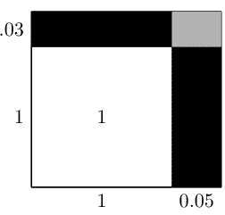

与长方形相比，它非常小，可以忽略不计。然后，面积大约是 1 + 0.05 + 0.03，这是一个几何证明，修正因子大约是

$$
1 + 0.05 + 0.03 = 1.08.
$$

它代表了 8% 的增长。未经修正的乘积是 21000，它的 8% 是 1680，所以

$$
31.5 \times 721 = 21000 \times 修正因子 \approx 21000 + 1680 = 22680.
$$

真实值是 22711.5，所以估计值低了 0.15%，这是一个小的灰色矩形的面积。

这个数值例子说明了一个普遍的模式。假设你可以轻松地找到乘积 $xy$，就像前面的例子中 $x = 30$ 和 $y = 700$ 一样，而且你想要一个附近的乘积 $(x+\Delta x)(y+\Delta y)$，其中 $\Delta x \ll x$ 和 $\Delta y \ll y$。将 $\Delta(xy)$ 称为由于变化而引起的乘积 $xy$ 的变化。

x 和 y:

$$
(x + \Delta x)(y + \Delta y) = xy + \Delta(xy).
$$

要找到新的乘积，你可以找到 $\Delta(xy)$（因为 $xy$ 很容易）。但是不要直接展开乘积：

$$
(x + \Delta x)(y + \Delta y) = xy + x\Delta y + y\Delta x + x\Delta x.
$$

相反，提取乘积的大部分并研究修正因子。大部分是 $xy$，所以通过从第一个因子中提取 $x$ 和从第二个因子中提取 $y$ 来提取 $xy$。剩下的修正因子是

$$
\left(1 + \frac{\Delta x}{x}\right)\left(1 + \frac{\Delta y}{y}\right) = 1 + \frac{\Delta x}{x} + \frac{\Delta y}{y} + \frac{\Delta x \Delta y}{xy},
$$

分数的变化在 $xy$ 中

$$
\frac{\Delta x}{x} + \frac{\Delta y}{y} \= \left( \text{分数的变化 in } x \right) + \left( \text{分数的变化 in } y \right).
$$

换句话说，对于小的变化：

> 一个乘积的分数变化是其因子的分数变化之和。

这个规则的简单性意味着分数变化简化了计算。

2008-03-06 13:24:47 / rev ebd336097912+

引用：Sanjoy Mahajan，18.098 / 6.099 街头数学课程材料，IAP 2008。麻省理工学院开放式课程（http://ocw.mit.edu/），麻省理工学院。下载于[YYYY年MM月DD日]。

### 5.2 平方

平方是一种特殊的乘积，所以我们可以用前面的代数或图像来近似。用前面的代数或图像来近似平方。相反，我从头开始推导出这个图像，以便练习使用图像并引入低熵表达的概念。设 A 为一个正方形的面积，x 为其边长，所以 A = x²。假设增加 x 到 x + Δx，得到一个面积 (x + Δx)²。如果你能选择一个你知道的 x，那么这个分析是有用的；然后 Δx 就是到你想要计算的数的变化。例如，如果你想计算 9.2²，设 x = 9 和 Δx = 0.2，找出面积增加了多少。

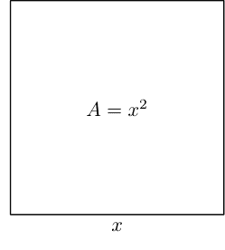

代数方法是扩展

```
(x + \Delta x)^2 = x^2 + 2x\Delta x + (\Delta x)^2.
```

另一种方法是详细说明图片。

新的区域被阴影覆盖，并且有三个部分。只要 Δx ≪ x，与两个矩形相比，小角落的正方形很小。因此，面积的变化是

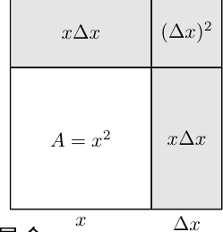

$$
\Delta A \approx \underbrace{x\Delta x}_{顶部矩形} + \underbrace{x\Delta x}_{右侧矩形} = 2x\Delta x.
$$

但是这个结果很难记住，因为它具有高熵 [6]。将 x 和 Δx 组合在一起似乎是任意的。如果 ΔA 的结果是 x² 或 $(\Delta x)^2$，那也似乎是合理的。

高熵形式的变量分散在各个地方，看起来没有限制的排列。低熵形式将相关变量组合在一起，形成一个易于理解和记忆的形式。

将 $\Delta A = 2x\Delta x$ 转化为低熵形式，除以 $A = x^2$。这个选择有两个原因。第一个原因是本章的主题：取出大部分。你知道如何平方 x，所以 A 或 x² 是大部分。要取出它，将左边的 $\Delta A$ 除以 A，右边的 2xΔx 除以 x²。第二个原因是第1章的方法：维度。世界上有很多维度，因此要求一个表达式无量纲，消除了这种自由并降低了熵：

### 5.2 平方

高熵结果具有面积的维度；为了使其无量纲，将两边都除以一个面积。 对于左边的△A，自然的、相关的量是面积 A。对于右边的2x△x，自然的、相关的量是面积 x²。因此，两个原因 - 取出大部分和维度 - 建议除以 A = x²。具有两个理由的方法可能是正确的，这是结果：△A

frac{2xΔx}{x²} = 2frac{Δx}{x}

每个边都有一个简单的解释。左边，△A/A，是面积的分数变化。右边包含 △x/x，即边长的分数变化。所以

left( frac{mathrm{分数的}}{mathrm{变化}} right)_{mathrm{in  }x²} approx 2times left( frac{mathrm{分数的}}{mathrm{变化}} right)_{mathrm{in  }x}

这个结果的陈述比高熵形式更容易理解。它说分数变化产生分数变化。唯一看似任意的数据是要记住2的因子，但在学习立方体和平方根之后，它也会有意义。

同时，你可能会猜测，因为 A = x²，分数变化遵循相同的模式：

left( frac{mathrm{分数的}}{mathrm{变化}} right)_{mathrm{in  }A} approx left( frac{mathrm{分数的}}{mathrm{变化}} right)_{mathrm{in  }x}^2

这个合理的猜想是错误的！试试一个数值例子。想象一下 x增加了10%，从1增加到1.1。然后 x²增加了大约1.2，一个分数增加了0.2。如果上面的候选公式是正确的，分数增加只会是0.01。

让我们完成关于9.2²的平方的研究，之前提到的数值例子。它的大部分是9²=81。从9到9.2的增加是2/90的分数增加，所以9.2²应该增加2×2/90 = 4/90：

9.2^2 approx 81 times left( 1 + frac{4}{90} right) approx 81 + 3.6 = 84.6.

### 5.3 燃油效率

汽车行驶一段距离 $ d $ 以速度 $ v $ 所需的能量

```
E = F d \propto v^2 d,
```

其中 $ F $ 是阻力力量。在20世纪70年代，由于广泛误解和常常错误解释（可能是有意的），石油在西方国家变得昂贵。无论原因如何，结果是难以避免的。美国通过在高速公路上规定限速为55英里/小时来减少石油消耗。为了解决这个问题，假设在限速实施之前，汽车以65英里/小时的速度行驶。由于从65英里/小时降至55英里/小时的速度变化，汽油消耗下降了多少？假设限速不会影响人们行驶的距离。这可能是一个可疑的假设，因为人们通过总时间来调节通勤，而不是距离，但这个扭曲可以成为随后分析的主题（先处理重要的部分）。

分数变化使分析保持清洁。阻力和能量消耗与速度 $ v^2 $ 和距离 $ d $ 成正比，而距离 $ d $ 是恒定的。所以 $ E \propto v^2 $ 和

```
 \left( \frac{\text{分数的变化}}{\text{in } E} \right) = 2 \times \left( \frac{\text{分数的变化}}{\text{in } v} \right) .
```

从65英里/小时降到55英里/小时，大约降低了15%，因此能量消耗降低了 $ 2 \times 15\% = 30\% $。这是汽车石油消耗的大幅减少。考虑到汽车行驶消耗的大部分石油，高速公路石油消耗的30%下降将大幅减少总石油消耗。

### 5.4 三次方

下一个例子将分析扩展到边长为x的立方体的体积。通常的问题是：如果x增加了Δx，体积V会发生什么变化？如果不使用分数变化，你可以尝试通过类比面积的变化来猜测会发生什么。也许

ΔV ∼ x²Δx

或者也许

ΔV ∼ x(Δx)²?

两种选择都在每一边都有一个体积，所以它们的维度是正确的，维度不偏向任何一种选择。简而言之，记住如何在右侧分配三个长度的幂是很痛苦的。应该让 x得到全部、两个、一个还是没有？

不要试图记住高熵形式，从头开始计算，将其重写为分数变化，看看它变得多么简单和低熵。完整的 ΔV是

ΔV = (x + Δx)³ - x³ = 3x²Δx + 3x(Δx)² + (Δx)³.

具有更高幂次的 Δx的项是最小的，所以忽略它们。这个近似值留下

ΔV ≈ 3x²Δx.

分数变化是

ΔV/V ≈ 3x²Δx / x³ = 3 Δx/x.

这个结果与面积的分数变化具有相同的形式，但有一个3的因子。用文字来说：

(分数的变化 in x³) ≈ 3 × (分数的变化 in x).

3的因子来自于 x的指数，即 V = x³，就像2来自于 x的指数，即 A = x²。让我们看两个例子。

对于第一个例子，估计6.3³。大部分是6³ = 216。由于0.3比6大5%，它的立方比6³大15%：

6.3^3 ≈ 216 × (1 + 0.15).

要计算 216 × 0.15，首先计算大部分 200 × 0.15，即 30。然后将结果增加30的8%，因为216比200大8%。由于30的8%是2.4：

216 × 0.15 = 30 + 2.4 = 32.4

然后

6.3^3 ≈ 216 + 32.4 = 248.4.

真实值是 250.047，只比原值大 0.7%。

第二个例子来自风能物理学。风力涡轮机产生的功率与风的作用力有关，这与阻力力量一样，与 v^2成正比。由于功率等于力乘以速度，所以应该与 v^3成正比。因此，风速增加10%，发电功率增加30%！寻找快速风的原因之一是风力涡轮机被放置在大气层高处（例如悬崖上）或者在海上，因为那里的风速比陆地表面附近的风速更快。

### 5.5 倒数

前面的例子使用了正指数。为了探索新领域中的分数变化，尝试使用负指数。这个例子是关于最简单的倒数，其中 n = -1。假设你想要心算估计1/13。大部分是1/10，因为10是13的一个附近因子，这意味着它的倒数很容易。所以1/13 ≈ 0.1。为了得到更精确的近似值，去掉大部分1/10，并近似修正因子：

1/13 = 1/10 × 1/(1 + 0.3).

校正因子接近于1，反映了大部分结果在1/10的大部分中。校正因子的形式为(1+x)^(-1)，其中 x=0.3。因此，它近似于1 - x，我希望下面的例子和图片能够说服你。如果一本书打折10%，运费增加打折后价格的10%，最终总价几乎等于原价。试试一个20美元的书的例子。它打折后变成18美元，但运费增加1.80美元，总共是19.80美元。除了0.20美元的微小误差外，10%的增加和

10%的减少互相抵消。一般来说

(1 - x) \times (1 + x) \approx 1.

相对原始单位正方形，新的 (1 - x) \times (1 + x) 矩形在右侧失去了一个面积为 x 的矩形，并在顶部增加了一个面积也为 x 的矩形。因此，增益抵消了损失，使面积保持为 1。这个图示近似导致

1/(1 + x) \approx 1 - x.

用文字来说，

\left( \frac{\text{分数的}}{\text{变化}} \right)_{\text{in } z^{-1}} = -1 \times \left( \frac{\text{分数的变化}}{\text{in } z} \right).

如果 z 增加了 30%，从 1 增加到 1.3，那么 z^{-1} 减少了 30%，从 1 减少到 0.7。所以 1/1.3 = 0.7，而

1/13 = 1/10 × 1/1.3 \approx 0.1 × 0.7 = 0.07.

近似误差来自于忽略了倒数中的 x^2 项。为了减小误差，通过使大部分近似值接近一个数来减小 x。调整原始分数，使分母接近 1/100：

1/13 × 8/8 = 8/104 = 8/100 × 1/(1.04).

大部分的 8/100 = 0.08 仍然很容易，修正因子 1.04 的 x 更小：只有 0.04。分母增加 4% 会导致数量本身减少 4%，所以

1/13 \approx 0.08 - 4%.

其中的 -4% 表示“减去前一数量的 4%”。为了找到 4%，将 0.08 在心中重写为 0.0800。由于 800 的 4% 是 32，将 0.08 减小 0.0032：

1/13 \approx 0.0800 - 0.0032 = 0.0768.

为了得到更准确的值，将 1/13 乘以 77/77 得到 77/1001。
大部分是 0.077，修正因子是减少了 0.1%，即 0.00077。结果是 0.076923.
为了比较，真实值是 0.0769230769...

### 5.6 平方根

在正负整数指数之后，下一个领域是分数指数。最常见的例子是平方根，所以让我们将这些方法应用于

$$\sqrt{10}$$。首先从中提取出大部分 $$\sqrt{10}$$。大部分来自于平方根 $$\sqrt{9}$$:

$$\sqrt{10} = \sqrt{9} \times \sqrt{1 + \frac{1}{9}}$$

问题简化为估计 $$\sqrt{1 + x}$$，其中 $x = 1/9$。在这种情况下是9。反向分析平方的方法在第5.2节中产生了开平方的方法。对于平方，问题是给定边长找到面积。这里的问题是给定面积1 + x找到边长 $$\sqrt{1 + x}$$。

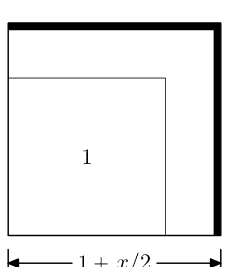

x。相对于单位正方形，形成L形的三个阴影区域贡献了额外的面积 x。垂直矩形的宽度，或者水平矩形的高度，是边长的变化。要找到这些尺寸，研究一下面积。大部分贡献来自于两个黑色矩形，所以忽略那个微小的灰色正方形。在这个近似中，每个矩形贡献一个面积 x/2。矩形的尺寸为1 × Δx 或 Δx × 1，所以它们的小尺寸大致上是 Δx = x/2。因此，包围正方形的边长为1 + x/2。

这个结果产生了第一个平方根近似值：

$$\sqrt{1 + x} \approx 1 + \frac{x}{2}$$

右边表示 x/2 的分数增加，所以

（分数的变化中^{-}）\approx $\frac{1}{2}$ \times $\left( \frac{\text{分数的变化}}{\text{in } z} \right)$，在 $\sqrt{z}$ 中。

或者用文字来说

> z 的分数变化产生了 $\sqrt{z}$ 的一半分数变化。

这个结果是估计中缺失的一部分

$\sqrt{1 + x}$，其中 $x = 1/9$。使用近似值，$\sqrt{1 + $\frac{1}{9}$} \approx 1 + $\frac{1}{18}$。

所以将大部分（即 3）增加 1/18： $\sqrt{10} \approx 3 \times $left(1 + $\frac{1}{18}$\right) = 3\frac{1}{6} = 3.166...$.

真实值为 3.1622...；估计值精确到 0.14%，对于三行工作来说是一个合理的交换。

再加上几行和一个精细的图像可以增加准确性。之前的分析忽略了微小的灰色正方形。但是现在我们已经了解足够多的关于图表的信息，可以解释它，或者至少可以解释大部分。忽略微小的正方形会产生一个边长为 1 + x/2 的正方形，其面积为 1 + x 加上微小正方形的面积。微小的正方形每边长为 x/2，所以它的面积是 x² / 4。第一次近似的误差 $\sqrt{1 + x} = 1 + x/2$ 来自这个额外的区域。

为了修正近似值，稍微缩小大正方形，只需移除一个面积为 x² / 4 的 L 形阴影部分。L 的尺寸无法确定准确 - 否则我们可以准确地进行平方根运算 - 但是几乎可以通过之前的近似值来解决。分析是通过逐步逼近进行的。L 有两个臂，每个臂几乎是一个与整个正方形一样长或高的矩形，即长度为 1 + x/2。‘几乎’来自于忽略两个臂重叠的微小角落正方形。

在这个近似中，每个臂的面积为 x² / 8，以使 L 的面积为 x² / 4。由于每个小片的长度为 1 + x/2，宽度为

### 5.7 一般来说

看看分数变化的模式。这是按照我们学习的顺序：

$$
\sqrt{1 + x} = 1 + \frac{x}{2} - \frac{x^2}{8} + \frac{x^3}{16}
$$

因此，$\sqrt{10} \approx 3 + 0.1666 − 0.0046 \approx 3.1626$.

真实值是3.162277...，所以估计值准确到0.01%。估计平方根经常受益于加速级数收敛的技巧。为了看到这个技巧的必要性，试着估计√2使用前面的近似值。重要的部分是√1，这没有帮助。剩下的是整个问题：√1 + x其中 x=1。它的第一个近似值是√2 ≈ 1 + x/2 = 3/2。

与真值1.414...相比这个近似值大约多了6%。下一个近似值包括 x²/8项：

$$
\sqrt{2} \approx 1 + x/2 - x^2/8 = 11/8 = 1.375
$$

大约小了3%。收敛速度很慢，因为 x=1，所以尽管 x的幂增长，但连续的项并没有缩小很多。如果只有我能缩小 x！以下的技巧可以实现这个目的：

$$
\sqrt{2} = \sqrt{4/3}/\sqrt{2/3}
$$

每个平方根的形式为 √1 + x其中 x = ±1/3。保留到x/2项：

$$
\sqrt{2} = \sqrt{4/3}/\sqrt{2/3} \approx (1 + 1/6)/(1 - 1/6) = 7/5 = 1.4
$$

这个快速近似值只低了1%！加上每个平方根的 x²/8修正，近似值变为√2 ≈ 83/59 = 1.406...，这低于0.5%。为了只有2倍的准确性，包括二次项的额外努力几乎不值得。

## 取出大部分

在试图证明之前，检查一个不是数据的一部分的简单情况：n=1。z和z^1的分数变化是相同的，所以这个模式是有效的。你也可以在n是非负整数时进行检查。在这种情况下，z是n_z的n个因子的乘积。来自5.1节的乘积原理是，一个乘积的分数变化是其因子的分数变化的和。对于相同的因子，总和确实是每个因子的分数变化乘以n。

一般n的最短证明是通过对数微分。正如名字所说：先取对数，然后微分。对数的值为微分，或者说取微分，得到  
$$\frac{df}{f} = n\frac{dz}{z}$$。

对于无穷小的变化，这个结果是精确的（dz=0）。对于有限的变化，使用△z代替dz，并将等号变成≈：  
$$\frac{△f}{f} ≈ n\frac{△z}{z}$$，

这是一般模式的符号表达式：

> 在z^n的分数变化是z的分数变化的n倍。

## 季节

这些结果的一个应用是评估关于季节的一个常见解释。经常有人说，因为夏天地球离太阳更近，所以夏天比冬天更热。地球和太阳的距离确实会随着一年中的时间变化而变化，因为地球的轨道是椭圆而不是圆。随着距离的变化，太阳辐射的流量也会变化，这是单位面积上太阳能量的量度。这个流量以黑体辐射的形式返回到太空中，这是许多物理教科书的主题。黑体辐射与表面温度有关。因此，改变地球和太阳的距离会改变地球的表面温度。

这个效应有多大，是否足以解释季节的变化？

最干净的分析方法是，不出所料，通过开始于地球-太阳距离的分数变化。在极坐标下，椭圆的方程是

$$
r = \frac{l}{1 + \epsilon \cos \theta},
$$

其中ε是离心率，θ是极角，而l是半焦距（与轨道的角动量成比例）。

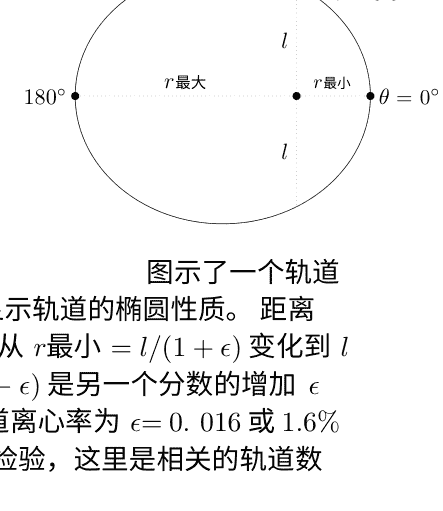

$$
r_{\text{min}} = 1.471 \cdot 10^8 \text{ km},
$$
$$
r_{\text{max}} = 1.521 \cdot 10^8 \text{ km}.
$$

这些距离相差大约3.2%。

第二步是估计由于距离的这个分数变化而产生的通量的分数变化。总太阳能功率P分布在在一个表面积为A = 4πd²的巨大球体上。每单位面积的功率，也就是通量，与距离的平方成反比。由于⁻²指数，距离增加3.2%会导致通量减少6.4%。

引用：Sanjoy Mahajan，18.098 / 6.099街头数学课程材料，IAP 2008。麻省理工学院开放式课程（http://ocw.mit.edu/），麻省理工学院。下载于[YYYY年MM月DD日]。

## 取出大部分

第三步是估计由于入射通量的这个分数变化而产生的温度的分数变化。出射通量是黑体辐射，它等于入射通量。所以出射通量也会变化6.4%。统计力学 - 斯特藩-玻尔兹曼定律 - 表明黑体通量F与表面温度T的四次方成正比：

$$
F = σT^4.
$$

σ是斯特凡-玻尔兹曼常数，是量子行动h、光速c、玻尔兹曼常数k_B和π²/60的可怕组合。但它的组成并不重要，因为我们只关心温度的分数变化。自由来自于使用分数变化，这是使用它们的最重要的原因之一。由于T ∝ F^{1/4}，如果流量变化了6.4%，那么T的变化就是6.4%/4或1.6%。要找到实际的温度变化，将这个百分比乘以表面温度T。不要陷入这样的思维误区，在冬天，温度通常是0°C，所以变化ΔT也是0°C！黑体辐射F ∝ T^4取决于T是绝对温度：相对于绝对零度测量。在某个温标上，开尔文温标，T=300K，所以1.6%的变化约为5K。摄氏度和开尔文温标的参考点不同，但它们的度数大小相同，所以5K的差异也是5°C的差异。这种变化对于解释夏季和冬季之间的差异来说太小了，这使得季节的解释不可信。这个解释还有其他缺陷，比如不能解释为什么澳大利亚和欧洲尽管几乎与太阳等距离，却有相反的季节。如果轨道距离的变化不能产生季节，那么是什么产生了季节呢？

## 指数

前面的例子研究了近似

$$
(1 + x)^n ≈ 1 + nx
$$

其中指数n是一个正整数、负整数，甚至是一个分数。这些例子使用了适度的指数：平方根的1/2，倒数的−1，以及季节的−2和1/4。现在将n推向一个极端，但要技巧高超。如果你简单地让n变得很大，那么你会得到类似于1.1^800的量，这是没有教育意义的。相反，让n增长但缩小

2008-03-06 13:24:47 / rev ebd336097912+

引用：Sanjoy Mahajan，18.098 / 6.099街头数学课程材料，IAP 2008。麻省理工学院开放式课程（http://ocw.mit.edu/），麻省理工学院。下载于[YYYY年MM月DD日]。

## 极端情况

x平行地保持nx不变。对于nx的直观值是1，而这些例子中保持nx=1，同时增加n：

1.1^10 = 2.59374...，  
1.01^100 = 2.70481...，  
1.001^1000 = 2.71692...

在每个例子中，nx=1，所以通常的近似值是

(1 + x)^n = 2 ≈ 1 + nx = 2，

这是明显错误的。问题在于nx增长得太大。在适度的n的例子中，乘积nx远小于1。所以，当nx超出了这个有限范围时，就会出现新的数学现象。

为了解释发生的事情，猜测解的特征，然后找到与这些特征相关的解释。以1.1^10开始的序列似乎趋近于e=2.718...，自然对数的底数。那个极限表明我们研究的不是(1 + x)^n，而是它的对数：

ln(1 + x)^n = n ln(1 + x)。

只要x本身不大（nx仍然可以很大），那么ln(1 + x) ≈ 1 + x。所以n ln(1 + x) ≈ nx和

(1 + x)^n ≈ e^{nx}。

当nx ≪ 1时，e^{nx}近似于1+nx，这重现了熟悉的近似值1+nx。当nx变得很大时，近似值e = 1 + nx失败了，你必须使用e它本身。

## 极端情况

一般的n^th power (1 + x)^n has 几个极端情况取决于 n, x, 和nx。一个极限是取n → 0。然后(1 + x)^n变成1 + n ln x，其证明留给你作为练习。另外两个极限已经被前面的分析所讨论。当x → 0时，极限是e^{nx}。如果nx → 0此外，x的维度 → 0，然后e的nx极限为1 + nx，这是第一个结果本章中的例子。这里是一个图示总结：

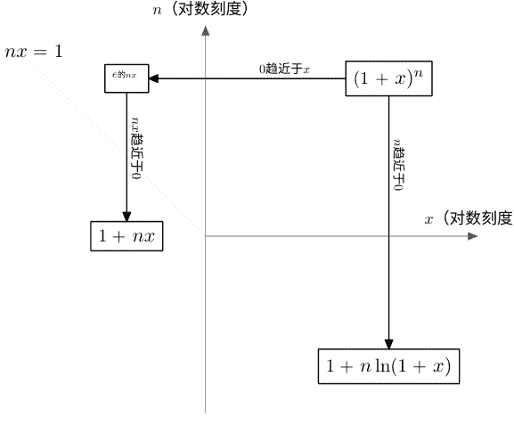

这里有一些这些极限的数值例子：

| 极限 | x | n | (1 + x)ⁿ ≈ |
|------|---|---|-------------|
| n → 0 | 1 | 0.1 | 1 + 0.1 ln 2 |
| x → 0 | 0.1 | 30 | e³ |
| x, nx → 0 | 0.1 | 3 | 1.3 |

这些极限在下一个问题中非常有用。

## 令人畏惧的积分

作为一个物理学本科生，我在系里的图书馆里度过了许多深夜，一边吃披萨一边做问题集。研究生们在他们的课程中也面临着同样的困境，他们会分享他们最喜欢的数学和物理问题，其中包括来自前苏联的以下问题。兰道理论物理研究所要求通过“数学预备考试”。其中一个预备考试是要在不到5分钟内计算出

$$
∫_{-π/2}^{π/2} cos^{100}t dt
$$

，并且精确到5%的误差，不能使用计算器或电脑！那个cos^{100}t看起来很可怕。常规的三角函数技巧对此无济于事。例如，在积分cos²t时，这个恒等式非常有用：

$$
cos^2 t = \frac{1}{2} (cos 2t - 1).
$$

$$
cos^{100} t = \left( \frac{cos 2t - 1}{2} \right)^{50},
$$

在展开到第50次幂后，它变成了一个三角函数的怪兽。答案是近似的；毕竟，我们只需要一个精确到5%的答案。

cos t的近似值是cos t = 1 - t² /2。所以

$$
cos^{100} t \simeq \left( 1 - \frac{t^2}{2} \right)^{100},
$$

它看起来像是(1 + x)^n，其中x = -t² /2，n = 100。在近似余弦有效的范围t ≈ 0中，它是极端情况x → 0 of

(1 + x)^n，它是e^{nx}。所以

$$
cos^{100} t = \left( 1 - \frac{t^2}{2} \right)^{100} = e^{-50t^2}.
$$

被积函数具有一般形式e^{-αt^2}，这是在第2.2节和第3.4节中分析的高斯函数。这个简单的结论，即余弦的高次幂变成了一个高斯函数，似乎难以置信，但计算机生成的cos^n t的图表示

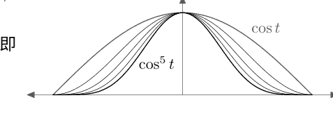

当n增加时，余弦曲线变成了高斯钟形。绘图并不能证明，但它增加了对令人惊讶的结果的信心。

这个论点有一些缺陷，但现在不要担心它们。跟随鲍勃·马利的口号：别担心，开心点。换句话说，先近似计算然后（也许）再问问题after得到答案之后。为了促进这种冷静和勇气，我践行我所说的话，推迟对这些缺陷的分析。如果极限是无穷大，积分将会是

$$
\int_{-∞}^{∞} e^{-αt^2} dt,
$$

这是可以做到的。唉，我们的极限是-π/2到π/2，而不是从-∞到∞。不要担心；只需扩展极限并在最后进行合理化。高斯函数的无穷范围积分是

引用：Sanjoy Mahajan, 18.098 / 6.099街头数学课程材料, IAP 2008。麻省理工学院开放式课程（http://ocw.mit.edu/），麻省理工学院。下载于[YYYY年MM月DD日]。

## 取出大部分

对于cos^100 t，参数是α=50，所以原始积分变为

$$
\int_{-∞}^{∞} e^{-αt^2} dt = \sqrt{\frac{π}{α}}.
$$

$$
\int_{-π/2}^{π/2} \cos^{100} t dt \approx \int_{-∞}^{∞} e^{-50t^2} dt = \sqrt{\frac{π}{50}}.
$$

由于50 ≈ 16π，积分结果为1√/16 = 0.25。精确答案是

$$
\int_{-π/2}^{π/2} \cos^{n} t dt = 2^{-n} \binom{n}{n/2} π,
$$

其证明我留给你作为一个有趣的练习。当n=100时，结果为

$$
\frac{12611418068195524166851562157π}{158456325028528675187087900672} = 0.25003696348037 \ldots
$$

计算这个精确有理分数倍数的maxima程序是MIT的Macsyma项目的免费软件。使用  
一台最近的笔记本电脑（大约2006年）配备有Intel 1.83GHz Core Duo CPU，maxima大约需要20毫秒来计算精确结果。我们对1/4的估计使用了一种方法，只需要不到三十秒的人工时间（通过练习），准确度接近0.01%。对于人类来说，这表现不错。

为了准确估计这类积分的计算时间，我尝试了一个更高的指数：

$$
\int_{-π/2}^{π/2} \cos^{10000} t dt
$$

在0.26秒内，极大值函数返回了一个巨大的有理分数倍数π。将其转换为浮点数得到0.025065...，这几乎是前一个答案的十分之一。这种重新缩放是有道理的：将指数增加100倍会使积分中的分母增加  
$$
\sqrt{100} = 10.
$$

现在看看论证中承诺的缺陷。以下是慢动作中的步骤，以及它们的缺陷：

- 用1 - t² /2来近似cos t  
  只要t ≈ 0。然而，积分范围从t = -π/2到t = π/2，超出了要求t ≈ 0的范围。

引用：Sanjoy Mahajan，18.098 / 6.099街头数学课程材料，IAP 2008。麻省理工学院开放式课程（http://ocw.mit.edu/），麻省理工学院。下载于[YYYY年MM月DD日]。

2008-03-06 13:24:47 / rev ebd336097912+

## 令人畏惧的积分

2. 将(1 - t²/2)^n近似为e^{-nt²/2}。这个近似在以下情况下成立  
然而，t的范围超出了这个有限的区域。

3. 用更简单的极限 -π/2...替换它用更简单的极限 -∞...∞替换π/2。无限极限允许使用极坐标技巧第2.2节 - 我称之为技巧，因为我从未见过其他使用它的问题。然而，什么使得扩展极限成立？

这三个缺陷都在高指数（本例中为100）中有一个合理的解释。将cos t提高到高次幂意味着当cos t稍微低于1时，结果接近于零。例如，当t = 0.5时，它的余弦值是0.877...和cos^{100} t ≈ 2·10^{-6}。指数近似e^{-50t²}大致上是3.7·10^{-6}，这似乎不准确：误差接近100%！但这个误差是相对误差或分数误差。绝对误差大致上是2·10^{-6}。它在被积函数很小的地方可以产生较大的相对误差。在被积函数贡献大部分面积的区域，也就是t ≈ 0，步骤1和2的近似是有效的。在其他区域，谁在乎呢？！同样的论证证明了第三步：将极限扩展到无穷大。将原积分的极限扩展到  

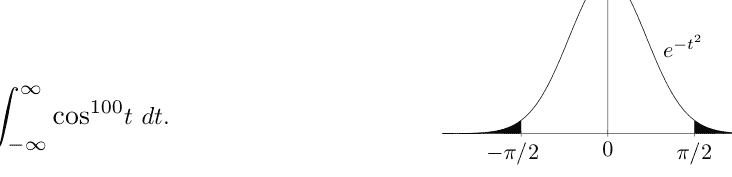

因为每个余弦函数的驼峰100 t贡献相等的面积和扩展的极限包围了无数个驼峰。但是，如果在进行前两次近似之后扩展极限，这个异议就消失了。这些近似给出了  

$$
∫_{-∞}^{∞} cos^{100} t dt.
$$

$$
∫_{-π/2}^{π/2} e^{-50t^2} dt.
$$

因为高斯函数e^{-50t^2}在t = ±π/2及其之后的值非常小，所以可以安全地将极限扩展到-∞...∞。图中显示了e^{-t^2/2}的尾部，它们已经很小了。在衰减更快的函数e^{-50t^2}中，尾部非常小，以至于在任何可行的打印分辨率下都无法看到。

我不想用验证来结束这个例子。所以进行一个小的额外调查。这是因为当100或10000是余弦函数的指数时，近似的精度非常高。我想知道在另一个极端情况下，即指数很小的情况下，近似的效果如何。为了研究精度，定义  

前面的近似产生了近似值  

$$
f_0(n) = \sqrt{\frac{2π}{n}}
$$

你可以通过尝试指数来检查，分数误差是$n = 100$和$n = 10000$。  

$$
\frac{f_0(n)}{f(n)} - 1
$$

这里是通过maxima计算的一些值：

| n | $f_0(n)/f(n) - 1$ |
|---|---|
| 1 | 0.2533141373155 |
| 2 | 0.1283791670955 |
| 3 | 0.0854018818374 |
| 4 | 0.0638460810704 |
| 5 | 0.0509358530746 |
| 6 | 0.0423520253928 |
| 7 | 0.0362367256182 |
| 8 | 0.0316609527730 |
| 9 | 0.0281092532666 |
| 10 | 0.0252728978367 |
| 100 | 0.0025030858398 |
| 1000 | 0.0002500312109 |
| 10000 | 0.0000250003124 |

特别有趣的是当$n=1$时的小分数误差，这是一个可以通过手工确认maxima计算的情况。精确的积分是  

$$
f(1) = ∫_{-π/2}^{π/2} \cos^1 t dt
$$

所以$f(1) = 2$，与近似值$f_0(1) = \sqrt{2π} ≈ 2.5$。即使指数只有$n=1$，使得近似中的每一步都无效，误差也只有25%。当$n=2$时，误差只有13%，从那里开始，可以说一切都很顺利。

2008-03-06 13:24:47 / rev ebd336097912+

引用：Sanjoy Mahajan，18.098 / 6.099街头数学课程材料，IAP 2008。麻省理工学院开放式课程（http://ocw.mit.edu/），麻省理工学院。下载于[YYYY年MM月DD日]。

## 你学到了什么

去掉大部分，使用分数变化来调整答案。使用这个过程可以保持计算的卫生。基本公式是

$$
(1 + x)^n \simeq 1 + nx,
$$

或者

$$
\left( \begin{array}{c} \text{分数的} \\ \text{改变} \\ \text{in } z^n \end{array} \right) \simeq n \times \left( \begin{array}{c} \text{分数的} \\ \text{改变} \\ \text{in } z \end{array} \right).
$$

当指数n乘以分数变化x变得太大（与1相当），你需要更精确的近似：

$$
(1 + x)^n \simeq e^{nx}.
$$

## 类比

当事情变得艰难时，强者会降低他们的标准。这是邋遢、懒惰和任何想要结果的人的信条。本章介绍了一种技巧，即类比推理，它体现了这个原则。它在极端情况推理中表现良好。

## 四面体键角

甲烷中的键角是多少，CH₄？碳原子位于一个正四面体的重心处而氢原子位于顶点处。三角学和解析几何可以解决这个问题，但我们试试类比。三维空间很难想象和理解，所以降低你的标准：寻找一个保留其要点的更简单的问题。什么是重要的并不总是显而易见，你可能需要解决几个更简单的变体才能发现这些特征。

让我们尝试最简单的变化，从三维到二维。问题的二维版本是找到键角度在一个平面分子中，例如NH₃压缩成一个平面。键角度是一个完整圆的三分之一，即120°。键角的中心是物体的质心，所以它的位置在解决问题时可能是相关的。谁知道四面体的质心在哪里；但是三角形有一个质心，距离一个边的三分之一到对边的顶点。这是一个包含这些数据的表格，其中d是维度的数量。

| | SionS. | θ |
|---|---|---|
| 三角形 | 2 | 1/3 |
| 四面体 | 3 | ? |
| | ? | ? |

从这样稀疏的数据中很难归纳出规律，这在后面体行中反映出的疑问号，这就是最极端情况推理的有助于所在。你可以通过将类比扩展到一个尚未数据行中的问号来获得。这就是极端情况推理的帮助所在。推理帮助。你可以通过将类比扩展到一个尚未

### 6.1 四面体键角

更极端的问题。如果两个维度比三个维度更容易，那么一个维度应该比两个维度更容易。在一个维度中，物体是一条线。质心是一半

| 形状 | SionS. | θ |
|---|---|---|
| 线 | 1 | 1/2 | 180° |
| 三角形 | 2 | 1/3 | 120° |
| 四面体 | 3 | ? | ? |

在端点之间的路径的一半。键角是 180°。而且
现在表格更完整。
键角有几个常见的推广，取决于什么

模式潜在的是 θ = (240 - 60d)°，那么θ(d=3) = 60°。提出猜想后，测试你的猜想是很重要的。猜想而不进行测试——伟大的数学家和数学教师乔治·波利亚[8]说这样做是野蛮的标志！那么：这个猜想合理吗？这是可疑的，因为首先，角度小于90°。如果分子是CH₆，碳位于中心位置

如果将一个立方体的每个面上的氢原子看作键，那么键角将会是90°。如果只有四个氢原子而不是六个，键角应该会大于90°。所以60°似乎是一个可疑的猜想。为了第二个可疑的原因，我们尝试一个更极端的情况：四维空间。然后，根据(240 - 60d)°猜想，键角将会是零，这是荒谬的。所以这个猜想在多个方面都是可疑的。

让我们提出另一个猜想。如果 θ = 360° / (d + 1)，会怎样？这个猜想适用于 d=1 和 d=2。对于 d=3，它预测 θ=90°。根据之前拒绝的猜想的推理，这个角度太小了。此外，这意味着对于 d=4，角度将低于90°。这也是不合理的。

为了帮助找到另一个猜想，现在是时候
提出一个新的想法。不要
直接猜测键角度，而是
猜测它的一个函数
使猜测变得更容易。

| 形状 | SionS. | θ | cos θ |
|---|---|---|---|
| 线 | 1 | 1/2 | 180° | -1 |
| 三角形 | 2 | 1/3 | 120° | -1/2 |
| 四面体 | 3 | ? | ? | ? |

它的重大性在于数学、物理和工程中的维度。
街头数学战

cos θ 的一个可能的模式是 -2^(1-d)，它适用于 d=1 和 d=2 的数据。对于 d=3，它预测 cos θ = -1/4，这意味着 θ > 90°，是一个很好的结果。在 d→∞ 的极端情况下，它预测 θ → 90°。让我们来检查一下

引用：Sanjoy Mahajan，18.098 / 6.099 街头数学课程材料，IAP 2008。
麻省理工学院开放式课程（http://ocw.mit.edu/），麻省理工学院。
下载于[YYYY年MM月DD日]。

2008-03-06 13:24:47 / rev ebd336097912+

### 6.2 斯坦纳平面问题

著名的问题是斯坦纳的平面问题：五个平面将空间分割成多少个区域？对于这个问题有很多答案，有些很无聊。
例如，如果平面是平行的，它们会形成六个区域。如果平面不平行，区域的数量会增加。但是区域的数量取决于平面的“不平行程度”。因此，假设平面处于随机方向，以消除潜在区域被愚蠢的巧合所消除的可能性。

五个平面很难想象和建造。类似的问题是四个平面的情况。然而，那仍然很困难。所以尝试三个平面。那也很困难，所以尝试两个平面。那很容易：四个区域。不要忘记一个平面的极端情况：两个区域。而更极端的情况是零个平面：一个区域。因此，从 n=0 个平面开始，区域的数量是：1、2、4、... 这些是二的幂次，下一个数字是8吗？从两个平面开始，形成四个区域。将第三个平面放置在其他两个平面上，使每个区域分成两部分-总共形成八个区域。因此，8确实是下一个数字。接下来是16和32吗？这在下表中表示为：

| n | 0 | 1 | 2 | 3 | 4 | 5 |
|---|---|---|---|---|---|---|
| r | 1 | 2 | 4 | 8 | 16? | 32? |

所以我们有一个猜想，一个有根据的猜测，对于 n=5。它的猜测性质在问号中得到了体现。但是如何测试它呢？我们仍然无法轻松地可视化四个平面，更不用说五个平面了。

类比再次挽救了我们。如果较少的平面比较容易解决比较多的平面，那么较少的维度也可能有所帮助。所以让我们在二维空间中研究同样的问题。保留本质的类似问题是什么？它不能是在平面中放置 n 个平面。相反，我们还应该降低放置对象的维度：在平面中放置 n 条线，以随机的方向和位置。那样会有多少个平面区域呢？在学习了自由数据的教训后，从 n=0 条线开始，得到 1 个区域。一条线产生两个区域；两条线产生四个区域。看起来又是二的幂次。

让我们用三条线来测试一下。这是一张图片。它们产生了七个区域，而不是八个。所以猜想失败了。让我们来做四条线并仔细计数。这是11个区域，远离下一个二的幂，本来应该是16个。以下是二维区域的结果：

引用：Sanjoy Mahajan，18.098 / 6.099 街头数学课程材料，IAP 2008。麻省理工学院开放式课程（http://ocw.mit.edu/），麻省理工学院。下载于[YYYY年MM月DD日]。

2008-03-06 13:24:47 / rev ebd336097912+

| n | 0 | 1 | 2 | 3 | 4 | 5 | n |
|---|---|---|---|---|---|---|---|
| r | 1 | 2 | 4 | 7 | 11 | ? | ? |

让我们结合二维和三维数据：

| n | 0 | 1 | 2 | 3 | 4 | 5 | n |
|---|---|---|---|---|---|---|---|
| r₂ | 1 | 2 | 4 | 7 | 11 | ? | ? |
| r₃ | 1 | 2 | 4 | 8 | 16? | 32? | ? |

现在再次使用极端情况并获得一行额外的自由数据：0 维。在 0 维空间中，物体是一个点，无论有多少个 -1 维物体将其细分，都只有一个点。所以 r=1 总是成立。然后：

| n | 0 | 1 | 2 | 3 | 4 | 5 | n |
|---|---|---|---|---|---|---|---|
| r0 | 1 | 1 | 1 | 1 | 1 | 1 | 1 |
| r1 | 1 | 2 | 3 | 4 | 5 | 6 | n+1 |
| r2 | 1 | 2 | 4 | 7 | 11 | ? | ? |
| r3 | 1 | 2 | 4 | 8 | 16? | 32? | ? |

而对于 0 维，新的一行延续了该模式。

为了好玩，让我们先对我们拥有的数据进行多项式拟合 - 在做出猜测的飞跃之前。零行由 r = 1 拟合，是零次多项式。第一行由 r = n + 1 拟合，是一次多项式。这种模式的一个自然推广是第二行应该由二次多项式拟合：一个二次多项式。二次多项式需要三个数据点，所以使用 n=0...2。适合这些点的 r2 的多项式是

```
r_2(n) = (1/2)n² + (1/2)n + 1.
```

这个二次多项式是否适合其他确定的数据点？对于 n = 3，它预测 r = 7，是正确的。对于 n = 4，它预测 r = 11，也是正确的。所以我们可能可以相信它对于 n = 5 的预测，即 r = 16 - 与添加数字的预测一致。

将这个系统进一步推广，第三行应该由一个三次方程来拟合，这需要四个点来进行拟合。正如你可以验证的那样，拟合前四个点的三次方程是

```
r_3(n) = (1/6)n³ + ... 1
```

它预测 r(4) = 15 和 r(5) = 26，因此之前对 r(5) 的猜想再次得到了支持。因此，预测它们的理论也得到了支持。

但是为什么它是正确的呢？这个问题留给读者作为练习。

引用：Sanjoy Mahajan，18.098 / 6.099 街头数学课程材料，IAP 2008。麻省理工学院开放式课程（http://ocw.mit.edu/），麻省理工学院。下载于[YYYY年MM月DD日]。

## 7 运算符

本章是一个类比的扩展示例。在上一章中，类比通常是在问题的高维和低维版本之间进行的。而在这里，类比是在运算符和数字之间进行的。

### 7.1 导数运算符

这是一个适用于阻尼弹簧运动的微分方程，在适当的单位制下：

```
d²x/dt² + 3dx/dt + x = 0
```

其中 x 是无量纲位置，t 是无量纲时间。想象一下，x 是振幅除以初始振幅；而 t 是时间乘以频率（因此是振动的弧度）。dx/dt 项表示摩擦力，它的正号表示摩擦力耗散了系统的能量。对于 d/dt，一个有用的简写是运算符 D。它是一个运算符，因为它作用于一个对象（这里是一个函数）并返回另一个对象。使用 D，弹簧的方程变为

```
D²x(t) + 3Dx(t) + x(t) = 0.
```

替换中的棘手步骤是将 d²x/dt² 替换为 D²x，如下所示：

```
D²x = D(Dx) = D(dx/dt) = d²x/dt²
```

类比出现在解方程中。假装 D 是一个数字，并对它进行你对数字的操作。例如，对方程进行因式分解。首先，因式分解出 x(t) 或 x，然后对 D 中的多项式进行因式分解：

引用：Sanjoy Mahajan，18.098 / 6.099 街头数学课程材料，IAP 2008。麻省理工学院开放式课程（http://ocw.mit.edu/），麻省理工学院。下载于[YYYY年MM月DD日]。

### 7.2 活用导数

如果 $(D+1)x=0$ 或 $(D+2)x=0$，则该方程成立。第一个方程写成正常形式，变为

或 $x = e^{-t}$（加上或减去一个常数）。第二个方程变为

因此，该方程有两个解：$x = e^{-t}$ 或 $e^{-2t}$。

### 7.2 活用导数

上面的例子介绍了 $D$ 及其平方 $D^{2}$，即二阶导数。你可以用运算符 $D$ 做更多的事情。你可以对它进行立方、取对数，它的倒数，甚至它的指数。让我们来看一下指数函数 $e$。它有一个幂级数：

这是一个新的运算符。让我们通过让它作用于一些函数来看看它的作用。例如，将它应用于 $x = t$：$(1 + D + D^2/2 + )t = t + 1 + 0 = t + 1$。

以及对于 $x = t^{2}$：

以及对于 $x = t^{3}$：

从这些简单函数（再次是极端情况）来看，似乎 $e^{D}x(t) = x(t+1)$。你可以证明对于任何幂 $x = t^{n}$，都有

由于任何函数基本上都可以写成幂级数的形式，而 $e^{D}$ 是线性算子，它对任何函数都起着相同的作用，不仅仅是对幂函数。

### 7.3 求和

再次记住，对于我们的目的来说，D 只是一个数字，所以找到右边函数的幂级数：

σ = D⁻¹ + 1/2 + 1/12 D - 1/720 D³ + …

系数没有明显的模式。但它们是伯努利数。让我们逐个查看这些项，看看它们的含义。首先是 D⁻¹，它是 D 的倒数。由于 D 是导数算子，它的倒数是积分算子。所以求和的第一个近似是积分

– 这是我们从一年级微积分中所知道的。

第一个修正 是 1/2。无论我们正在求和的函数是什么，我们都应该将 1/2 加到积分中吗？那种解释是不正确的。而且它确实不正确。1/2 是一个作用于函数的运算符和的一部分。慢慢来理解它：

σf(n) = ∫₁ⁿ f(k) dk + 1/2 f(n) + …

所以第一个修正是最终项的一半 f(n)。这就是我们在第 4.6 节中得到的结果。这个图像要求将多余部分近似为一堆三角形，而他们有一个弯曲的边缘。

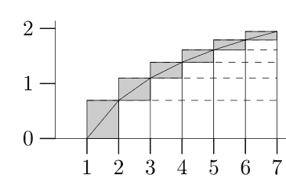

之后的项纠正了曲率。举个例子，让我们使用这个结果来改进对欧拉著名求和的估计。

### 7.4 欧拉求和

运算符和中的第一项是 1，是从积分中计算得到的 n⁻²。

∑₁^∞ n⁻²

这个运算符和的第一项是1，是从积分中计算得到的n⁻²。1 到 ∞。第二项是 1/2，结果为 f(1)/2。第三项是 1/6，应用于 D/12 的结果是 n⁻²。所以：

∑₁^∞ n⁻² ≈ 1 + 1/2 + 1/6 = 1.666…

真实值为 1.644...，所以我们的近似误差约为 1%。第四项给出了一个修正值为 −1/30。因此，四项近似值为 1.633...，仅使用四项就得到了一个很好的近似值！

### 7.5 结论

我希望你喜欢这个扩展应用的类比，更一般地说，这种粗糙而实用的数学方法。

2008-03-06 13:24:47 / rev ebd336097912+

## 参考文献

1. Barry Cipra. *Misteaks: And How to Find Them Before the Teacher Does*. AK Peters, 第3版, 2000.
2. P. Horowitz 和 W. Hill. *The Art of Electronics*. 剑桥大学出版社, 第2版, 1989. ISBN 0521377099.
3. Edward M. Purcell. 电学与磁学, 伯克利物理课程第2卷. 麦格劳-希尔, 纽约, 1985年。经典之作。
4. George Gamow. 震撼物理学的三十年：量子理论的故事. 多佛, 纽约, 重印版, 1985年。
5. Dwight E. Gray, 编辑. *AIP手册*. 麦格劳-希尔, 纽约, 第3版, 1972年。
6. R. D. Middlebrook. 低熵表达式：面向设计的关键分析. 在 *IEEE教育前沿*, 第399-403页, 普渡大学, 1991年。第21届年会。
7. John Malcolm Blair. 石油的控制. Vintage, 1978年。
8. George Polya. 让我们教猜测。1966年？MAA。