# MIT 6.011 控制论和信号处理导论讲义

2010年春季

Alan V. Oppenheim和George C. Verghese
麻省理工学院

© Alan V. Oppenheim和George C. Verghese 2010

## 目录

+   1 引言
2 信号与系统
2.1 信号、系统、模型、属性
2.1.1 系统/模型属性
2.2 线性、时不变系统
2.2.1 线性时不变系统的冲激响应表示
2.2.2 特征函数和变换表示的线性时不变系统
2.2.3 傅里叶变换
2.3 确定性信号及其傅里叶变换
2.3.1 信号类及其傅里叶变换
2.3.2 Parseval恒等式、能量谱密度、确定性自相关
2.4 双边拉普拉斯和 Z-变换
2.4.1 双边 Z-变换
2.4.2 逆 Z-变换
2.4.3 双边拉普拉斯变换
2.5 连续时间信号的离散时间处理
2.5.1 连续时间信号的离散时间处理的基本结构
2.5.2 离散时间滤波和整体连续时间响应
2.5.3 非理想的D/C转换器
3 信号和线性时不变系统的变换表示
3.1 傅里叶变换的幅度和相位
3.2 群延迟和非线性相位的影响
3.3 全通和最小相位系统
3.3.1 全通系统
3.3.2 最小相位系统
3.4 �光因子分解

## 4 状态空间模型

+   4.1 引言
4.2 输入输出和内部描述
	4.2.1 一个RLC电路
	4.2.2 一个延迟-加法器-增益系统
4.3 状态空间模型
	4.3.1 DT状态空间模型
	4.3.2 CT状态空间模型
	4.3.3 状态空间模型的特性
4.4 平衡点和线性化
	非线性状态空间模型
	4.4.1 平衡点
	4.4.2 线性化
4.5 从输入-输出模型到状态空间模型
	4.5.1 从脉冲响应确定状态空间模型
	或传递函数
	4.5.2 从输入输出差分方程确定状态空间模型
	差分方程

## 5 LTI状态空间模型的特性

+   5.1 引言
5.2 零输入响应和模态表示
	5.2.1 ZIR的模态表示
	5.2.2 渐近稳定性
5.3 坐标变换
	5.3.1 模态坐标变换
5.4 完全响应
5.5 传递函数、隐藏模式
	可达性、可观测性

## 6 状态观测器和状态反馈

+   6.1 植物和模型
6.2 实时模拟的状态估计
6.3 状态观测器

## 7 概率模型

+   7.1 基本概率模型
7.2 条件概率、贝叶斯规则和独立性
7.3 随机变量
7.4 累积分布、概率密度和概率质量
随机变量的函数
7.5 联合分布的随机变量
7.6 期望、矩和方差
7.7 双变量随机变量的相关性和协方差
7.8 随机变量相关性性质的向量空间图像

## 8 最小均方误差估计

+   8.1 连续随机变量的估计
8.2 从估计到估计器
8.3 线性最小均方误差估计

## 9 随机过程

+   9.1 随机过程的定义和示例
9.2 严格平稳性
9.3 宽平稳性
9.3.1 WSS相关性和协方差函数的一些性质
9.4 定义和符号总结
9.5 更多示例
9.6 遍历性
9.7 随机过程的线性估计
9.7.1 线性预测
9.7.2 线性有限脉冲响应滤波
9.8 线性时不变系统对WSS过程的影响

## 10 功率谱密度

10.1 期望瞬时功率和功率谱密度

10.2 Einstein-Wiener-Khinchin定理对期望时间平均功率的应用

10.2.1 使用随机过程作为输入的系统识别

10.2.2 调用遍历性

10.2.3 模拟滤波器和白化滤波器

10.3 带限随机过程的采样

## 11 维纳滤波

11.1 非因果离散时间维纳滤波器

11.2 非因果连续时间维纳滤波器

11.2.1 正交性质

11.3 因果维纳滤波

11.3.1 处理非零均值

## 12 脉冲幅度调制（PAM）、正交幅度调制（QAM）

12.1 脉冲幅度调制

12.1.1 发送信号

12.1.2 接收信号

12.1.3 频域特征

12.1.4 接收端的符号间干扰

12.2 奈奎斯特脉冲

12.3 载波传输

12.3.1 频移键控（FSK）

12.3.2 相移键控（PSK）

12.3.3 正交幅度调制（QAM）

## 13 假设检验

13.1 噪声中的二进制脉冲幅度调制

13.2 二元假设检验

13.2.1 最小错误概率决策：MAP准则

13.2.2 理解 Pₑ：虚警、漏警和检测

## 13.2.3 似然比检验

## 13.2.4 其他场景

## 13.2.5 内曼-皮尔逊检测和接收器工作特性
特性

## 13.3 最小风险决策

## 13.4 编码数字通信中的假设检验

## 13.4.1 最优先验决策

## 13.4.2 传输模型

## 13.4.3 最优后验决策

## 14 信号检测

+   * 14.1 信号检测作为假设检验
* 14.2 白高斯噪声中的最优检测
  * 14.2.1 匹配滤波
  * 14.2.2 信号分类
* 14.3 通用检测器结构
  * 14.3.1 白噪声中的脉冲检测
  * 14.3.2 最大化信噪比
  * 14.3.3 连续时间匹配滤波器
  * 14.3.4 彩色噪声中的脉冲检测

## 13.2.3 似然比检验

## 13.2.4 其他场景

## 13.2.5 内曼-皮尔逊检测和接收器工作特性
特性

## 13.3 最小风险决策

## 13.4 编码数字通信中的假设检验

## 13.4.1 最优先验决策

## 13.4.2 传输模型

## 13.4.3 最优后验决策

## 第2章
信号与系统

本文假设读者具备线性、时不变系统的表示以及相关连续时间和离散时间信号的知识，包括卷积、傅里叶分析、拉普拉斯变换和 Z变换。 在本章中，我们简要总结和回顾这些假设的背景，部分是为了建立本文中将要使用的符号，同时也作为后续章节中的主题的方便参考。 我们紧密遵循 Signals and Systems, Oppenheim and Willsky with Nawab, 2nd Edition, Prentice Hall, 1997.中的符号、风格和呈现方式。

## 2.1 信号、系统、模型、属性

在本文中，我们将考虑各种信号和系统的类别，为它们建立模型并研究它们的属性。

对于我们来说，信号通常是一些独立变量（通常是时间和/或表示概率实验结果的变量）的实数或复数函数。信号可以是：

+     * 一维或多维
  * 连续时间（CT）或离散时间（DT）
  * 确定性或随机性（随机的、概率性的）

因此，一个离散时间的确定性时间信号可以用函数x[n]来表示，其中n是整数时间（或时钟或计数）变量。

系统是软件或硬件元素、组件、子系统的集合。 系统可以被看作是将一组输入信号映射到一组输出信号或响应信号的过程。 更一般的观点是，系统是对指定信号集施加约束的实体，其中信号不一定被标记为输入或输出。 满足约束条件的任何特定信号集被称为系统的行为。

模型通常是对一组指定约束的数学、软件、硬件、语言或其他表示的（通常是近似的）表示。

## 第2.1节
信号、系统、模型、特性23

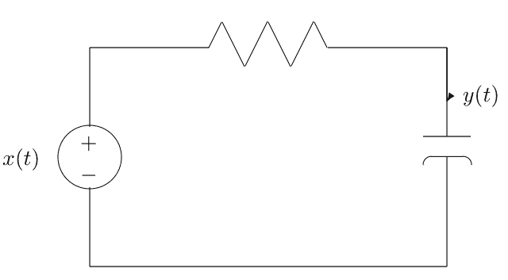

图 2.2 RLC电路

+   • 时不变：对于任意平移的输入集合，响应始终是原始集合的响应，只是平移了相同的量：如果 x[n] → y[n]，那么 x[n - n₀] → y[n - n₀] 对于所有的 x 和 n₀ 都成立。
• 线性和时不变（LTI）：系统、模型或映射既是线性的又是时不变的。
• 因果：任何时刻的输出不依赖于未来的输入：对于所有的 n₀，y[n₀] 不依赖于 x[n]，其中 n > n₀。换句话说，如果 x[n]，y[n] 表示系统的另一个输入-输出对，其中 x[n] = x[n] 对于 n ≤ n₀，那么对于 n ≤ n₀，y[n] = y[n] 也必须成立。（这里 n₀ 是任意的但固定的。）
• BIBO稳定：对有界输入的响应始终有界：|x[n]| ≤ Mₓ < ∞ 对于所有的 n 都意味着 |y[n]| ≤ Mᵧ < ∞ 对于所有的 n。

## 例2.1
系统属性

考虑由关系定义的输入 x[n]和输出 y[n]的系统

y[n] = x[4n + 1]

我们想要确定系统是否具有以下每个属性：无记忆性、线性、时不变性、因果性和BIBO稳定性。

无记忆性：一个简单的反例就足够了。例如，y[0] = x[1]，即在 n = 0 时的输出取决于 n = 0 时以外的输入值。因此，它不是无记忆性的。

线性：为了检查线性，我们考虑两个不同的输入，xₐ[n] 和 xᵦ[n]，并将它们的线性组合的输出与线性组合进行比较

## 2.2 线性、时不变系统

## 2.2.1 线性时不变系统的冲激响应表示

线性、时不变（LTI）系统在许多工程设计中形成基础。它们的优点是有一个丰富而成熟的理论，用于分析和设计这类系统。此外，在许多非线性系统中，从某个名义稳态操作的微小偏差近似地由LTI模型控制，因此可以在名义工作条件周围逐步应用LTI系统分析和设计的工具。

表示从输入信号 x到输出信号 y的LTI映射的一种非常普遍的方法是通过输入与系统脉冲的卷积。

## 第2.2节 线性、时不变系统25

响应。在CT中，关系是

$y(t) = \int_{-\infty}^{\infty} x(\tau)h(t-\tau)d\tau$

其中$h(t)$是系统的单位冲激响应。在DT中，我们有

$y[n] = \sum_{k=-\infty}^{\infty} x[k]h[n-k]$

其中$h[n]$是系统的单位样本（或单位“冲激”）响应。

在(2.2)中的卷积积分或(2.3)中的卷积和的常见表示法是

$y(t) = x(t) * h(t)$

$y[n] = x[n] * h[n]$

虽然这种表示法很方便，但如果不理解得很好，很容易导致误解。

通过卷积获得线性时不变系统的特征是将输入信号表示为加权脉冲的叠加。在离散时间情况下，假设我们给定一个冲激响应为$h[n]$的线性时不变映射，即当其输入为单位样本或单位“冲激”函数$\delta[n]$时，其输出为$h[n]$。现在，一个一般的输入$x[n]$可以表示为一系列缩放和平移的脉冲的和，如下所示：

$x[n] = \sum_{k=-\infty}^{\infty} x[k]\delta[n-k]$

根据线性性和时不变性，对于这个输入的响应$y[n]$是类似地缩放和平移的冲激响应的和，因此可以由公式(2.3)给出。线性性和时不变性允许我们将对一般输入的响应写成对特殊输入的响应。连续时间情况下也有类似的推导。

看起来前面的推导表明，从输入信号到输出信号的所有LTI映射都可以通过卷积关系表示。

然而，使用类似于(2.2)，(2.3)和(2.6)中的无限积分或求和实际上涉及到对应映射的一些假设。我们在这里不试图详细说明这些假设。然而，我们可以很容易地找到一些“病态”例子，这些例子中LTI映射的卷积关系不成立，因为这些假设被违反了。

根据(2.2)和(2.3)，LTI系统为BIBO稳定的必要和充分条件是冲激响应绝对可积(CT)或绝对可求和(DT)，即

BIBO稳定 (CT) $\iff \int_{-\infty}^{\infty} |h(t)|dt < \infty$

BIBO稳定 (DT) $\iff \sum_{n=-\infty}^{\infty} |h[n]| < \infty$

从(2.2)和(2.3)也可以得出，一个LTI系统是因果的必要和充分条件是冲激响应在t< 0 (CT)或n < 0 (DT)时为零

## 2.2.2 特征函数和变换表示的线性时不变系统

指数函数是LTI映射的特征函数，即当输入是一个指数函数时，我们称之为“永恒”的指数函数，输出只是输入的一个缩放版本，因此计算指数函数的响应只需要乘以适当的比例因子。 具体来说，在CT情况下，假设

x(t) = e^{s_0 t}

对于某个可能是复数的值 s_0 (称为复频率)，根据(2.2)

y(t) = h(t) * x(t)
\quad = \int_{-\infty}^{\infty} h(\tau)x(t - \tau)d\tau
\quad = \int_{-\infty}^{\infty} h(\tau)e^{s_0(t - \tau)}d\tau
\quad = H(s_0)e^{s_0 t}

其中

H(s) = \int_{-\infty}^{\infty} h(\tau)e^{-s\tau} d\tau

前提是上述积分对于 s = s_0（否则指数的响应未定义）具有有限值。 请注意，这个积分恰好是冲激响应的双边拉普拉斯变换，或者系统的传递函数，而上述积分取有限值的 s值的（内部）集合构成了变换的收敛域（ROC）的区域。

从前面的讨论中，人们可以认识到永恒指数函数的特殊性质，使其成为线性时不变系统的特征函数：即无论是时间平移一个永恒指数函数还是将其按常数因子进行缩放，都会产生相同的结果。 相比之下，单边指数函数 e^{-t} - 其中 u(t) 表示单位阶跃函数 - 通常不是线性时不变映射的特征函数：时间平移一个单边指数函数不会产生与缩放该指数函数相同的结果。

当 x(t) = e^{jωt} 时，对应于在 (2.7) 中令 s_0 取纯虚数值 jω，输入在所有正负时间上都有界，相应的输出为

y(t) = H(jω)e^{jωt}

© Alan V. Oppenheim和 George C. Verghese，2010

## 例子2.2
线性时不变系统的特征函数

正如上面所示，永恒的复指数函数， $ e^{jωt} $，是任何稳定线性时不变系统的特征函数，但重要的是要认识到 $ e^{jωt}u(t) $不是。以一个简单的例子来说明，考虑一个时间延迟，即

$ y(t) = x(t - t_0) $

由输入 $ e^{jωt}u(t) $ 引起的输出是

$ e^{-jωt_0}e^{jωt}u(t - t_0) $

这不是输入的简单缩放，所以 $ e^{jωt}u(t) $通常不是线性时不变系统的特征函数。

函数 $ H(jω) $在(2.10)中是系统的频率响应，也是冲激响应的连续时间傅里叶变换(CTFT)。定义CTFT的积分具有有限值(并且可以证明是关于 $ ω $的连续函数)，如果 $ h(t) $是绝对可积的，即满足

$ \int_{-\infty}^{+\infty} |h(t)| dt < \infty $

我们注意到这个条件等价于系统是有界输入、有界输出（BIBO）稳定的。CTFT也可以定义为不是绝对可积的信号，例如，对于 $ h(t) = \frac{\sin t}{t} $，它的CTFT在频率域中是一个矩形，但我们推迟对存在性条件的讨论。

我们可以类似地研究DT情况下的特征函数性质。一个DT永久的“指数”是一个几何序列或信号，形式为

$ x[n] = z_0^n $

对于某个可能是复数的 $ z_0 $（称为复频率）。使用这个DT指数输入，卷积映射的输出是（通过一个类似于我们在CT情况下展示的简单计算）

$ y[n] = h[n] * x[n] = H(z_0) z_0^n $

其中

$ H(z) = \sum_{k=-\infty}^{\infty} h[k] z^{-k} $

© Alan V. Oppenheim和 George C. Verghese, 2010

## 2.2.3 傅里叶变换

广泛的输入信号类可以表示为有界指数的线性组合，通过傅里叶变换。CTFT的综合/分析公式为

```
x(t) = \frac{1}{2\pi} \int_{-\infty}^{\infty} X(j\omega) e^{j\omega t} d\omega \quad \text{(综合)}
```

```
X(j\omega) = \int_{-\infty}^{\infty} x(t) e^{-j\omega t} dt \quad \text{(分析)}
```

注意，（2.21）表示的是x(t)作为指数的线性组合 - 但这个加权组合涉及到了连续的指数，而不是有限或可数的数量。如果这个信号x(t)是具有频率响应 H(jω)的LTI系统的输入，则通过线性和指数的特征函数属性，输出是对这些指数响应的相同加权组合，因此

```
y(t) = \frac{1}{2\pi} \int_{-\infty}^{\infty} H(j\omega)X(j\omega) e^{j\omega t} d\omega
```

通过将这个方程视为CTFT合成方程，可以得出CTFT y(t)的结果是

```
Y(j\omega) = H(j\omega)X(j\omega)
```

相应地，时域中的卷积关系(2.2)在变换域中变为乘法。因此，要找到特定频率点的响应 Y，我们只需要知道该频率处的输入 X和系统在该频率处的频率响应。这个简单的事实很大程度上解释了为什么频域在LTI系统分析中几乎是不可或缺的。

相应的DTFT综合/分析对由以下定义

```
x[n] = \frac{1}{2\pi} \int_{<2\pi>} X(e^{j\Omega}) e^{j\Omega n} d\Omega \quad \text{(合成)}
```

```
X(e^{j\Omega}) = \sum_{n=-\infty}^{\infty} x[n] e^{-j\Omega n} \quad \text{(分析)}
```

其中综合公式中的符号 <2π>表示对长度为2π的任意连续区间进行积分，因为DTFT在Ω上始终是周期性的，周期为2π，这是因为 $ e^{j\Omega} $在2π周期性的简单结果。请注意，(2.25)表示 x[n]作为连续指数的加权组合。

与CT情况类似，很容易证明如果 x[n]是LTI映射的输入，则输出 y[n]具有DTFT

```
Y(e^{j\Omega}) = H(e^{j\Omega})X(e^{j\Omega})
```

©Alan V. Oppenheim和 George C. Verghese, 2010

## 2.3 确定信号及其傅里叶变换

在本节中，我们将更详细地回顾确定性离散时间信号的离散时间傅里叶变换（DTFT），并强调可以保证具有明确定义的DTFT的信号类别。我们还将专注于具有DTFT的信号的能量密度谱。本节将突出DTFT的一些方面，这些方面可能在您之前的信号与系统课程中没有强调。连续时间傅里叶变换（CTFT）也可以进行类似的推导。

## 2.3.1 信号类及其傅里叶变换

式（2.25）和（2.26）中的离散时间傅里叶变换综合和分析对至少三个大类离散时间信号成立。

有限动作信号。有限动作信号，也称为绝对可加信号或ℓ₁（“ell-one”）信号，由以下条件定义

$ \sum_{k=-\infty}^{\infty} |x[k]| < \infty $

左侧的求和称为信号的“动作”。对于这些ℓ₁信号，定义DTFT的无限求和是良好的，可以证明DTFT在所有Ω上都是连续函数（因此，特别地，在Ω = +π和Ω = -π处的值是明确定义的且相等——这在信号不是ℓ₁时通常不成立）。

有限能量信号。有限能量信号，也被称为平方可和或ℓ₂（“ell-two”）信号，是由以下条件定义的

$ \sum_{k=-\infty}^{\infty} |x[k]|² < \infty $

左边的求和被称为信号的“能量”。

在离散时间中，绝对可和（即ℓ₁）信号总是平方可和（即ℓ₂）。 （在连续时间中，情况更加复杂：绝对可积信号不一定是平方可积的，例如考虑x(t) = 1/√t，其中0 < t ≤ 1，以及x(t) = 0在其他地方；问题的根源在于信号不是有界的。）然而，反过来并不成立。例如，考虑信号$ \frac{\sin Ω_c n}{πn} $，其中0 < Ωc < π，n 从0到无穷时取值为Ωc/π，或者考虑信号$ \frac{1}{n}u[n-1] $，这两个信号都是ℓ₂但不是ℓ₁。如果x[n]是这样的信号，它的DTFT $ X(e^{j\Omega}) $可以被看作是当N→∞时该数量的极限。

$ X_N(e^{j\Omega}) = \sum_{k=-N}^{N} x[k]e^{-j\Omega k} $

并且结果的极限通常在某些Ω值处具有不连续性。例如，$ \frac{\sin Ω_c n}{πn} $的变换在Ω = ±Ωc处具有不连续性。

©Alan V. Oppenheim 和 George C. Verghese, 2010

## 第2.3节 确定性信号及其傅里叶变换 31

缓慢增长的信号。‘缓慢’增长的信号是指其幅度与时间指数的增长速度不超过多项式增长，例如，对于所有的n，x[n] = n。在这种情况下，(2.30)中的$ X_N(e^{j\Omega}) $在通常意义上不收敛，但是DTFT仍然存在作为广义（或奇异）函数；例如，如果对于所有的n，x[n]=1，那么$ X(e^{j\Omega}) = 2πδ(Ω) $对于|Ω| ≤ π。

在慢增长信号类中，我们最感兴趣的是有界的（或 l_∞）信号：

$|x[k]| ≤ M < ∞ $

即，信号的幅度在所有时间上都有一个固定且有限的界限。例如，形式为 $ e^{jΩ₀n} $的有界持续指数在傅里叶变换理论中起着关键作用。这样的信号不一定具有有限能量，但在任何时间间隔上都具有有限的平均功率，其中平均功率定义为总能量除以总时间。

类似的信号类别在连续时间中也有定义。具体而言，有限作用（或 L₁）信号包括绝对可积的信号，即

$ ∫_{-∞}^{∞} |x(t)| dt < ∞ $

有限能量（或 L₂）信号包括平方可和的信号，即

$ ∫_{-∞}^{∞} |x(t)|² dt < ∞ $

而慢增长的信号是指其幅度不会比多项式更快地随时间增长。有界（或 L）连续时间信号是指其幅度永远不会超过有限界限 M（因此也是慢增长信号）。这些信号可能没有有限能量，但在任何时间间隔内都有有限平均功率。

在连续时间和离散时间中，有许多重要的傅里叶变换对和傅里叶变换性质在信号和系统的基础教材中得到发展和整理（例如，参见Oppenheim和Willsky的第4章和第5章）。为了方便起见，我们在这里包含了一个简短的DTFT对表。其他对可以通过应用不同的DTFT性质从这些对中轻松推导出来。（请注意，左列中的δ表示单位样本，而右列中的δ表示单位冲激！）

## 2.3.2 帕塞瓦尔恒等式、能量谱密度、确定性自相关

傅里叶变换的一个重要性质是帕塞瓦尔恒等式，适用于ℓ₂信号。对于离散时间，这个恒等式的一般形式为

```
 \sum_{n=-\infty}^{\infty} x[n] y^*[n] = \frac{1}{2\pi} \int_{<2\pi>} X(e^{j\Omega}) Y^*(e^{j\Omega}) d\Omega 
```

并且对于连续时间，

```
 \int_{-\infty}^{\infty} x(t) y^*(t) dt = \frac{1}{2\pi} \int_{-\infty}^{\infty} X(j\omega) Y^*(j\omega) d\omega 
```

其中 * 表示复共轭。 特殊情况下，当 y[n] = x[n] 或 y(t) = x(t)，我们得到

```
 \sum_{n=-\infty}^{\infty} |x[n]|^2 = \frac{1}{2\pi} \int_{<2\pi>} |X(e^{j\Omega})|^2 d\Omega 
```

©Alan V. Oppenheim 和 George C. Verghese, 2010

## 第2.3节 确定性信号及其傅里叶变换 33

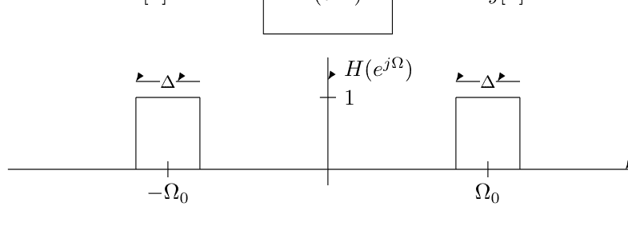

$$\int_{-\infty}^{\infty} |x(t)|^2 = \frac{1}{2\pi} \int_{-\infty}^{\infty} |X(j\omega)|^2 d\omega$$

Parseval恒等式允许我们通过积分信号变换的幅度的平方来评估信号的能量。实际上，这个恒等式告诉我们，信号的能量等于其变换的能量（乘以1/2π）。

## Ω定义的实数、偶函数、非负函数

$$\overline{S}_{xx}(e^{j\Omega}) = |X(e^{j\Omega})|^2$$

或者

$$\overline{S}_{xx}(j\omega) = |X(j\omega)|^2$$

被称为能量谱密度（ESD），因为它描述了信号的能量如何分布在频率上。为了更具体地理解这个说法，对于离散时间，考虑将 x[n]应用于具有窄通带、单位增益和宽度Δ、以 ±Ω₀为中心的理想带通滤波器的输入，如图2.3所示。输出信号的能量必须是包含在滤波器通带中的 x[n]的能量。为了计算输出信号的能量，注意到这个输出 y[n]的变换为

$$Y(e^{j\Omega}) = H(e^{j\Omega})X(e^{j\Omega})$$

因此，根据Parseval恒等式，输出能量为

$$\sum_{n=-\infty}^{\infty} |y[n]|^2 = \frac{1}{2\pi} \int_{<2\pi>} |Y(e^{j\Omega})|^2 d\Omega$$
$$= \frac{1}{2\pi} \int_{\text{通带}} \overline{S}_{xx}(e^{j\Omega}) d\Omega$$

因此，在任何频带中，x[n]的能量由积分 $ S_{xx}(e^{j\Omega}) $得到（并乘以1/2π）。换句话说，x[n]的能量密度为每弧度 $ S_{xx}(\Omega)/(2π) $。

© Alan V. Oppenheim 和 George C. Verghese, 2010

## 第34章
信号与系统

作为Ω的函数，$ \overline{S}_{xx}(\Omega) / (2\pi) $每弧度。 对于连续时间信号，可以进行完全类似的讨论。

由于ESD $ S_{xx}(e^{j\Omega}) $是Ω的实函数，它的另一种表示法可能是 $ \mathcal{E}_{xx}(\Omega) $。 然而，我们使用 $ S_{xx}(e^{j\Omega}) $的符号，以明确它是 $ X(e^{j\Omega}) $的平方幅度，以及DT信号的ESD具有周期$ 2π $。

鉴于傅里叶变换的幅度平方在帕塞瓦尔恒等式中的作用，有趣的是考虑它是哪个信号的傅里叶变换。对于离散时间情况，答案是通过认识到具有实值的x[n]的情况下，有 x[n]实值

$ |X(e^{j\Omega})|^2 = X(e^{j\Omega})X(e^{-j\Omega}) $

而 $ X(e^{-j\Omega}) $是时间反转信号的变换，即$x[-k]$。 因此，由于频域中的变换乘法对应于时域中的信号卷积，我们有

$ \overline{S}_{xx}(e^{j\Omega}) = |X(e^{j\Omega})|^2 \iff x[k] * x[-k] = \sum_{n=-\infty}^{\infty} x[n+k]x[n] = \overline{R}_{xx}[k] $

函数 $ R_{xx}[k] = \overline{x[k] * x[-k]} $ 被称为信号 $ x[n] $的确定性自相关函数，我们刚刚证明了确定性自相关函数的变换是能量谱密度 $ S_{xx}(e^{j\Omega}) $。 基本的傅里叶变换性质告诉我们 $ R_{xx}[0] $ — 这是信号能量

$ \sum_{n=-\infty}^{\infty} x^2[n] $ —是 $ R_{xx}[k] $的傅里叶变换下的面积，缩放因子为 $ 1/(2\pi) $，即 $ S_{xx}(e^{j\Omega}) = |X(e^{j\Omega})|^2 $；这当然就是Parseval恒等式。

确定性自相关函数衡量了一个信号及其时间-移位版本之间的总平方误差。 更具体地说，在离散时间中，信号与其时间-移位版本之间的总平方误差由以下公式给出：

$$\sum_{n=-\infty}^{\infty} (x[n+k] - x[n])^2 = \sum_{n=-\infty}^{\infty} |x[n+k]|^2$$
+ $$\sum_{n=-\infty}^{\infty} |x[n]|^2 - 2 \sum_{n=-\infty}^{\infty} x[n+k]x[n]$$
= $$2(\overline{R}_{xx}[0] - \overline{R}_{xx}[k])$$

由于总平方误差始终为非负数，因此有 $ R_{xx}[k] \leq R_{xx}[0] $，并且确定性自相关 $ R_{xx}[k] $ 越大，信号 x[n] 和其时间-移位版本 $ x[n+k] $ 越接近。

相应的结果适用于连续时间，特别是

$$\overline{S}_{xx}(j\omega) = |X(j\omega)|^2 \iff x(\tau) * x(-\tau) = \int_{-\infty}^{\infty} x(t+\tau)x(t)dt = \overline{R}_{xx}(\tau)$$

其中 $ \overline{R}_{xx}(\tau) $是确定性自相关函数 $ x(t) $。

## 2.4 双边拉普拉斯和 Z-变换

拉普拉斯和 Z-变换可以被看作是傅里叶变换的扩展，并且对于各种原因非常有用。它们允许对某些信号进行变换处理，而傅里叶变换不收敛。它们还通过将我们带入复平面来增强我们对傅里叶变换的理解，从而可以应用复函数理论。我们从第2.4.1节开始详细介绍双边 Z-变换。在第2.4.3节中，我们对双边拉普拉斯变换进行了简要回顾，与第2.4.1节的讨论相对应。

## 2.4.1 双边 Z-变换

双边 Z变换定义如下：

$X(z) = \mathcal{Z}\{x[n]\} = \sum_{n=-\infty}^{\infty} x[n]z^{-n}$

这里 z 是一个复数变量，我们也可以用极坐标形式表示：

$z = re^{j\Omega}，\quad r \ge 0，-\pi < \Omega \le \pi$

所以

$X(z) = \sum_{n=-\infty}^{\infty} x[n]r^{-n}e^{-j\Omega n}$

DTFT 对应于 r = 1，此时 z 取值于单位圆上。然而，对于一些有用的信号，无限和在 z 限制在单位圆上时并不收敛（即使在广义函数的意义下）。在 Z 变换的定义中，项 $z^{-n}$ 引入了因子 $r^{-n}$，使得和可以收敛（在适当限制 r 的情况下），适用于一些有趣的信号类别，其中许多信号没有离散时间傅里叶变换。

更具体地说，从(2.48)可以看出， $X(z)$ 可以被视为 $x[n]r^{-n}$ 的离散时间傅里叶变换。如果 r > 1，那么 $r^{-n}$ 在正 n 上呈几何衰减，在负 n 上呈几何增长。对于 0 < r < 1，情况正好相反。因此，有很多序列， x[n] 不是绝对可求和的，但对于某些 r 的值范围， $x[n] r^{-n}$ 是可求和的。

例如，考虑 x_1[n] = a^n u[n]。如果 a > 1，这个序列没有 DTFT。然而，对于任意的 a， x[n]r^{-n} 是绝对可求和的，只要 r > |a|。特别地，例如，

$X_1(z) = 1 + az^{-1} + a^2z^{-2} + \cdots$

$= \frac{1}{1 - az^{-1}}，\quad |z| = r > |a|$

接下来考虑负时间部分：

$$\sum_{n=-\infty}^{-1} x[n]z^{-n} = \sum_{m=1}^{\infty} x[-m]z^{m} \quad (2.56)$$

这是一个关于 z 的幂级数，并且具有收敛半径 R₂。该级数在 z < R₂ 时收敛（绝对收敛），这构成了它的 ROC；该级数是一个在这个区域中的解析函数。当 z > R₂ 时，和发散；对于圆 z = R₂ 需要更仔细的检查，并且取决于特定的级数；该级数可能在该圆上的所有点、某些点或没有点上收敛（但可能不是绝对收敛）。如果 R₁ < R₂，则 Z 变换在 R₁ < z < R₂ 时收敛（绝对收敛）；该环形区域是其 ROC，并用 R_X 表示。该变换在该区域内是解析的。定义该变换的求和在 |z| < R₁ 和 |z| > R₂ 时发散。如果 R₁ > R₂，则 Z 变换不存在（例如，对于 x[n] = 0.5^n u[-n-1] + 2^n u[n]）。如果 R₁ = R₂，则变换在技术上可能存在，但作为 Z 变换是无用的，因为它没有 ROC。然而，如果 R₁ = R₂ = 1，则我们仍然可以计算和使用 DTFT （例如，对于 x[n] = 3，所有 n；或对于 x[n] = (sin ω₀n)/(πn)）。

将 ROC 与信号属性相关联。对于绝对可加信号（例如 BIBO 稳定系统的冲激响应），即 ℓ₁ 信号，单位圆必须位于 ROC 内或者是 ROC 的边界。反之，我们可以得出结论，如果单位圆构成 ROC 的边界，则通常需要进一步分析以确定信号是否为 ℓ₁。

有理变换总是在 ROC 的边界上有一个极点，如下所述，因此如果单位圆在有理变换的 ROC 边界上，则单位圆上有一个极点，信号不能为 ℓ₁。

对于右侧信号，情况是 R₂ = ∞，即 ROC 在复平面上的圆的半径 R₁ 之外的任何地方都延伸，直到（可能包括）∞。如果信号在负时间上为 0，则 ROC 包括 ∞。

如果我们知道信号仅由单侧指数和的形式组成，例如在逆变换有理变换时获得的形式，我们可以陈述一个逆命题结果。在这种情况下，如果 R₂ = ∞，那么信号必须是右侧信号；如果 ROC 包括 ∞，那么信号必须是因果的，即在 n < 0 时为零。

对于左侧信号，有 R₁ = 0，即 ROC 从半径为 R₂ 的圆向内延伸，直到（可能包括）0。如果信号在正时间上为零，则 ROC 包括 0。

对于由单侧指数和组成的信号，我们有一个逆命题：如果 R₁ = 0，那么信号必须是左侧信号；如果 ROC 包括 0，那么信号必须是反因果的，即在 n > 0 时为零。

还需要注意的是，ROC 不能包含 Z 变换的极点，因为极点是 z 的值，使得变换的幅度无限大，而 ROC 包含的是变换收敛的 z 的值。对于具有有理变换的信号，可以利用这样的信号是单侧指数和的事实来证明 ROC 的可能边界实际上完全由极点的位置确定。具体来说：

(a) 有理情况下的 ROC 外边界圆包含一个极点并且/或者半径为 ∞。如果外边界圆在无穷远处，那么（正如我们已经注意到的）信号是右侧的，如果没有极点在 ∞ 处，则实际上是因果的。

(b) 有理情况下的 ROC 内边界圆包含一个极点并且/或者半径为 0。如果内边界圆缩小到点 0，那么（正如我们已经注意到的）信号是左侧的，如果没有极点在 0 处，则实际上是反因果的。

## 2.4.2 逆 Z-变换

通过使用部分分数展开，可以通过一种方法来反转有理 Z-变换，然后直接“识别”部分分数表示中的每个项的逆变换，或者将该项展开为在指定 ROC 中收敛的幂级数。例如，形式为

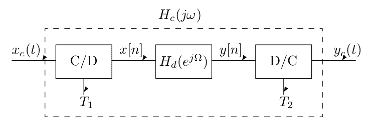

可以在指定 ROC 中，按 $az^{-1}$ 如果 $|a| < |z|$ 对于 z 在的情况下，将其展开为幂级数，并在指定 ROC 中，按 $a^{-1} z$ 如果 $|a| > |z|$ 对于 z 在的情况下，将其展开为幂级数。对部分分数展开中的每个项执行此过程，我们发现信号 x[n] 是左侧和/或右侧指数的总和。对于非有理变换，在这种情况下可能没有部分分数展开来简化过程，尝试通过展开成与给定 ROC 一致的幂级数进行逆变换仍然是合理的。

尽管我们通常使用部分分式或幂级数方法来反演 Z-变换，但有一个明确的公式与逆 DTFT 的公式类似，具体来说，


其中常数 r 被选择以将 z 放置在 ROC 中， $R_X$。 这不是最一般的反演公式，但对我们来说足够了，并且显示了 x[n] 可以表示为离散时间指数的加权组合。

与傅里叶变换一样，信号和系统的基本文本中开发和制表了许多有用的 Z-变换对和属性。 适当使用变换对和属性通常是获得其他信号的 Z-变换或逆 Z-变换的基础。

## 2.4.3 双边拉普拉斯变换

与 Z-变换一样，拉普拉斯变换的引入部分是为了处理没有 CTFT 的重要信号类，但也增强了我们对 CTFT 的理解。拉普拉斯变换的定义是

$X(s) = \int_{-\infty}^{\infty} x(t) e^{-st} dt$

其中 s 是一个复变量， $s = σ + jω$。拉普拉斯变换可以被看作是 $x(t) e^{-σt}$ 的连续时间傅里叶变换（CTFT）。通过适当选择 s，即使对于没有连续时间傅里叶变换的信号，积分（2.59）也可以存在。

拉普拉斯变换的发展与前一节中的 Z 变换密切相关，但 $e^σ$ 在 2.4.1 节中扮演的角色与 r 相似。我们将 σ₁ 和 σ₂ 分别称为收敛横坐标的最小值和最大值。我们将 σ₁ 和 σ₂ 称为收敛横坐标。相应的收敛区域是复平面上 σ₁ 和 σ₂ 之间的垂直条带，σ₁ < Re(s) < σ₂。方程（2.59）在收敛区域内绝对收敛；在条带的左右边界垂直线上的收敛需要单独考虑。此外，变换在整个收敛区域内是解析的（即作为复函数可微分）。条带可以向左延伸到 σ₁ = -∞，向右延伸到 σ₂ = +∞。如果条带收缩成一条线（使得收敛区域消失），那么拉普拉斯变换就没有用处（除非该线恰好是 jω 轴，这种情况下可能恢复连续时间傅里叶变换分析）。

例如，考虑 x₁(t) = e^{at}u(t)；在(2.59)中的积分求值为 X₁(s) = 1/(s - a)，前提是 Re{s} > a。另一方面，对于 x₂(t) = -e^{at}u(-t)，在(2.59)中的积分求值为 X₂(s) = 1/(s - a)，前提是 Re{s} < a。与 Z 变换类似，注意上述变换的表达式是相同的；它们通过其不同的收敛区域进行区分。

ROC 可能与信号的特性相关。例如，对于绝对可积信号，也称为 L₁ 信号， Laplace 变换中的被积函数在 jω 轴上绝对可积，因此 jω 轴在 ROC 内或其边界上。另一方面，如果 jω 轴严格在 ROC 内，那么信号是 L₁ 的，因为积分在 ROC 内绝对收敛。回想一下，如果系统具有 L₁ 冲激响应，那么系统是 BIBO 稳定的，因此这里的结论与稳定性讨论相关：如果系统函数的 ROC 严格包含 jω 轴，则系统是 BIBO 稳定的。

对于右侧信号， ROC 是一些右半平面（即所有 s such that Re{ s } > σ₁）。因此，因果系统的系统函数将具有一个右半平面的 ROC。对于左侧信号， ROC 是一些左半平面。对于具有有理变换的信号， ROC 不包含极点，而 ROC 的边界将具有极点。由于传递函数的 ROC 相对于虚轴的位置与 BIBO 稳定性有关，且由于极点

## 2.5 离散时间处理连续时间信号

许多现代系统，如通信、娱乐、导航和控制系统，是连续时间和离散时间子系统的组合，利用了每个系统的固有特性和优势。特别是在这些应用中，离散时间处理连续时间信号是常见的，我们在这里描述了这种处理的基本思想。与前面的章节一样，我们假设这个讨论主要是对熟悉的材料的复习，包括在这本书的后面章节中方便参考的符号和方便。在本节和整本书中，我们经常将连续时间信号的 CTFT 和从连续时间信号的采样得到的离散时间信号的 DTFT 进行关联。当需要时，我们将使用下标 c 和 d 来清楚地区分哪些信号是 CT 信号，哪些是 DT 信号。

## 2.5.1 连续时间信号的离散时间处理的基本结构

基本结构如图2.4所示。如图所示，处理过程涉及连续到离散或 C/D 转换，以获得 CT 信号的样本序列，然后进行 DT 滤波以产生所需 CT 输出的样本序列，然后进行离散到连续或 D/C 转换以从样本序列中重构所需的 CT 信号。我们经常限制自己的条件，使得图2.4中的整体系统等效于 LTI 连续时间系统。这通常需要将 DT 滤波限制为由具有频率响应 $H_d(e^{j\Omega})$ 的系统进行 LTI 处理，并要求输入 $x_c(t)$ 适当地带限。为了满足后一要求，通常在图中的结构之前加上一个滤波器，其目的是确保 $x_c(t)$ 基本上是带限的。虽然这个滤波器通常被称为抗混叠滤波器，但如果离散时间系统去除了混叠分量，我们通常可以允许 C/D 转换中的一些混叠；然后整个系统仍然可以是 CT LTI 系统。

图2.4中的理想 C/D 转换器的输出是一个具有特定采样间隔 T₁ 的样本序列 x_c(t)，因此 DT 信号为 x_d[n] = x_c(nT₁)。因此，从概念上讲，理想的 C/D 转换器是直接的。实际的模拟-数字（或 A/D）转换器也将信号量化为有限集合之一。

© Alan V. Oppenheim 和 George C. Verghese, 2010

## 第2.5节 连续时间信号的离散时间处理 41

输出级别。然而，在本文中，我们不考虑量化的附加效应。


# 图 2.4 CT 信号的 DT 处理。

在频域中，连续时间傅里叶变换（CTFT）的 x(t) 和离散时间傅里叶变换（DTFT）的 x[n] 有如下关系：

$X[d] (e^{j\Omega}) |_{\Omega=\omega T/2\pi} = \frac{1}{T_1} \sum_k X[d] (j\omega - jk \cdot 2\pi/T_1)$

当 x(t) 足够带限，使得

$X[c](j\omega) = 0, |\omega| \ge \pi/T_1$

则(2.60)可以重写为

$X[d] (e^{j\Omega}) |_{\Omega=\omega T/2\pi} = \frac{1}{T_1} X[c](j\omega) |\omega|<\pi/T_1$

或者等价地

$X[d] (e^{j\Omega}) = \frac{1}{T_1} X[c] (j\Omega/T_1) |\Omega|<\pi$

注意，$X[d](e^{j\Omega})$ 在区间 $|\Omega| < \pi$ 之外周期性扩展。以上等式在条件 (2.61) 下成立，这就是采样定理的内容。

图2.4中的理想 D/C 转换器通过插值关系定义：

$y_c(t) = \sum_n y_d[n] \cdot \frac{\sin(\pi(t-nT_2)/T_2)}{\pi(t-nT_2)/T_2}$

这表明 $y_c(nT_2) = y_d[n]$。由于上述求和中的每一项都是带限制的，对于 $|\omega| < \pi/T_2$，CT 信号 $y_c(t)$ 也是带限制的，因此 D/C 转换器更完整地被称为理想的带限制插值转换器。(图2.4中的 C/D 转换器，在假设 (2.61) 下，同样的特点是 CT 信号 $x_c(t)$ 是 DT 序列 $x_d[n]$ 的理想带限制插值。)

## 2.5.2 离散时间滤波和整体连续时间响应

从现在开始，除非另有说明，假设 $T_1 = T_2 = T$。 如果在图2.4中满足了 (2.61) 的带限约束，并且我们设置 $y_d[n] = x_d[n]$，那么 $y_c(t) = x_c(t)$。 更一般地，当图2.4中的 DT 系统是具有频率响应 $H_d(e^{j\Omega})$ 的 LTI DT 滤波器时

$Y_d(e^{j\Omega}) = H_d(e^{j\Omega}) X_d(e^{j\Omega}) \quad (2.65)$

并且，如果通过 $H_d(e^{j\Omega})$ 消除了任何别名分量 $x_c(t)$，那么将 (2.62)、 (2.64) 和 (2.65) 组合起来得到：

$Y_c(j\omega) = H_d(e^{j\Omega}) |_{\Omega=\omega T} X_c(j\omega) \quad |\omega| < \pi/T \quad (2.66)$

© Alan V. Oppenheim 和 George C. Verghese, 2010

## 第2.5节 连续时间信号的离散时间处理 43

整个系统的作用等效于一个CT滤波器的作用，其频率响应为

$H_c(j\omega) = H_d \left( e^{j\Omega} \right) \Bigg|_{\Omega = \omega T} \quad \text{ } |\omega| < \pi / T.$

换句话说，在上述带宽限制和采样率约束下，整个系统的行为类似于一个LTI CT滤波器，而这个滤波器的响应与嵌入的DT滤波器的响应通过简单的频率缩放相关。如果DT滤波器消除了任何混叠分量，采样率可以低于奈奎斯特率。

如果我们希望使用图2.4中的系统来实现具有频率响应 $H_c(j\omega)$ 的CT LTI滤波器，我们选择 $H_d \left( e^{j\Omega} \right)$ 根据(2.67)，只要 $x_c(t)$ 适当地带限，就可以满足要求。

如果 $H_c(j\omega)$ 对于 $|\omega| \ge \pi/T$ 等于0，则(2.67)还对DT和CT冲激响应之间的关系成立：

$h_d[n] = T \, h_c(nT) \quad (2.68)$ 因此，DT滤波器被称为CT滤波器的脉冲不变版本。

当 $x_c(t)$ 和 $H_d(e^{j\Omega})$ 的带宽不足以避免混叠分量出现在 $y_d[n]$ 中时，图2.4中的整个系统不再是时不变的。然而，它仍然是线性的，因为它是线性子系统的级联。

下面的两个重要示例说明了（2.67）的使用，以及图2.4的使用，无论是用于处理CT信号还是解释一个重要的DT系统，无论该系统是否明确用于处理CT信号的上下文中。

## 例2.3 数字微分器

在这个例子中，我们希望使用一个DT系统来实现一个CT微分器，如图2.4的配置。我们需要选择 $H_d \left( e^{j\Omega} \right)$ 以便 $y_c(t) = \frac{d}{dt} x_c(t)$（假设 $x_c(t)$ 的带宽限制为 $\pi/T$。因此，所需的整体CT频率响应为 

$H_c(j\omega) = \frac{Y_c(j\omega)}{X_c(j\omega)} = j\omega$

因此，使用（2.67），我们选择 $H_d(e^{j\Omega})$ 使得

$H_d \left( e^{j\Omega} \right) \Bigg|_{\Omega = \omega T} = j\omega \quad |\omega| < \frac{\pi}{T} \quad (2.70a)$

或者等价地

$H_d \left( e^{j\Omega} \right) = j\Omega / T \quad |\Omega| < \pi \quad (2.70b)$

有频率响应(2.70b)的离散时间系统通常被称为数字微分器。为了理解输入 $x_d[n]$ 和输出 $y_d[n]$ 之间的关系

© Alan V. Oppenheim和 George C. Verghese, 2010

## 2.5.3 非理想的D/C转换器

在第2.5.1节中，我们通过带限插值公式(2.63)定义了理想的D/C转换器；参见图2.5，它对应于通过理想低通滤波器处理强度等于序列值 $y_d[n]$ 的脉冲列车。一类更一般的D/C转换器，包括理想转换器作为特例，根据以下方式从DT信号 $y_d[n]$ 创建CT信号 $y_c(t)$：

$y_c(t) = \sum_{n=-\infty}^{\infty} y_d[n] p(t - nT)$

其中 p(t) 是一些选定的基本脉冲形状， T 是重建间隔或脉冲重复间隔。这也可以看作是通过一个滤波器处理脉冲序列值的结果，但该滤波器的冲激响应是 p(t) 而不是理想低通滤波器的冲激响应。因此，CT信号 $y_c(t)$ 是通过将基本脉冲形状的平移和缩放版本相加构建的；数字 $y_d[n]$ 缩放了 p(t - nT)，即基本脉冲延迟了 nT。请注意，通过选择(2.63)的理想带限插值转换器可以得到

$p(t) = \frac{\sin(\pi t / T)}{\pi t / T}$

我们将在第12章中详细讨论(2.76)的解释，作为脉冲幅度调制（PAM）用于在连续时间信道上传输离散时间信息的通信方式。

关系式(2.76)在频率域中也可以很简单地描述。对两边进行连续时间傅里叶变换（CTFT），用 P(jω) 表示 P(t) 的 CTFT，并利用在时域中将信号延迟 $t_0$ 对应于在频率域中乘以 $e^{-j\omega t_0}$ 的事实，我们得到

$Y_c(j\omega) = \left( \sum_{n=-\infty}^{\infty} y_d[n] e^{-j n \omega T} \right) P(j\omega) \\ = Y_d(e^{j\Omega}) \bigg|_{\Omega = \omega T} P(j\omega)$

©Alan V. Oppenheim 和 George C. Verghese, 2010

## 第3章

## 信号和线性时不变系统的变换表示

正如你在之前对信号和系统的研究所看到的，并且正如第2章中所强调的那样，变换在表征和表示连续和离散时间的信号和线性时不变系统中起着核心作用。在本章中，我们将讨论一些变换表示的具体方面，这些方面在后面的章节中将起到重要作用。这些方面包括通过群延迟的概念对傅里叶变换相位进行解释，以及在仅知道傅里叶变换幅度时获取傅里叶表示（幅度和相位）的方法，这些方法被称为谱因子分解。

## 3.1 傅里叶变换幅度和相位

信号的傅里叶变换或线性时不变系统的频率响应一般是一个复值函数。傅里叶变换的幅度-相位表示形式为 X(jω)

```
X(jω) = |X(jω)|e^{j∠X(jω)}
```

在方程(3.1)中，X(jω) 表示（非负）幅度， ∠X(jω) 表示（实值）相位。例如，如果 X(jω) 是 sinc 函数，$\frac{\sin(\omega)}{\omega}$，那么|X(jω)| 是该函数的绝对值，而 ∠X(jω) 在 sinc 为正的频率范围内为0，在 sinc 为负的频率范围内为 π。另一种表示是幅度-相位表示

```
A(ω)e^{j∠AX(jω)}
```

其中 A(ω) = ±|X(jω)| 是实数，但对于某些频率可以是正的，对于其他频率可以是负的。相应地，当A(ω) = +X(jω) 时， ∠AX(jω) = ∠X(jω)，当A(ω) = -|X(jω)| 时， ∠AX(jω) = ∠X(jω) ± π。当使用这种表示法可以消除相位中的 π 弧度的不连续时，通常会优先选择它。例如，在上面的sinc函数的情况下，我们可以选择A(ω) = $\frac{\sin(\omega)}{\omega}$ 和 ∠A = 0。在下面的讨论中，我们通常方便地假设所讨论的变换在 jω轴上没有零点，这样我们可以取A(ω) = |X(jω)| 对于所有的ω（或者，如果我们愿意， A(ω) = -|X(jω)| 对于所有的ω）。当然，在离散时间中也适用类似的讨论。无论是幅度-相位表示还是振幅-相位表示，相位都是模糊的，因为可以在任何频率上添加任意整数倍的2π。

## 例子 3.1 线性相位

考虑一个全通系统，其频率响应为

```
H(jω) = e^{-jαω} （3.3）即在幅度/相位表示中， A(jω) = 1， ∠_A H(jω) = -αω。对于这个例子，展开的相位与 ω 呈线性关系，斜率为 -α。
```

对于具有傅里叶变换 X(jω) 的输入信号 x(t)，输出的傅里叶变换为 Y(jω) = X(jω) e^{-jαω}，相应地，输出信号 y(t) 是 x(t - α)。换句话说，具有斜率为 -α 的线性相位对应于时间延迟 α（如果 α 为负，则为时间提前）。对于离散时间系统，

```
H(e^{jΩ}) = e^{-jαΩ}     |Ω| < π （3.4）相位再次与斜率 -α 线性相关。当 α 是整数时，对输入序列 x[n] 的时域解释再次变得直观且简单。
```

© Alan V. Oppenheim和 George C. Verghese, 2010

## 例子 3.2 恒定相位移

作为一个例子，我们再次考虑一个全通系统，其中 A(jω) = 1 和未包裹的相位

$$
\angle_{A}H(j\omega) = \begin{cases} -\phi_0 & \text{对于 } \omega > 0 \\ +\phi_0 & \text{对于 } \omega < 0 \end{cases}
$$

如图 3.1 所示

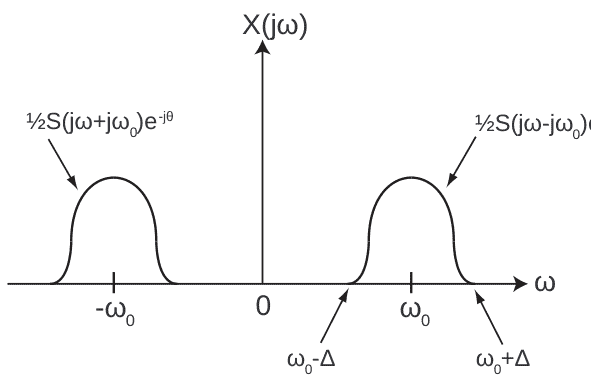

图 3.1 全通系统的相位图，具有恒定的相位移， φ₀.

请注意，如果我们假设系统的冲激响应是实值的，相位必须是 ω 的奇函数。在这个例子中，我们考虑 x(t) 的形式

$x(t) = s(t) \cos(\omega_0 t + \theta)$

即一个在载波频率为 ω₀ 的调幅信号。因此，X(jω) 可以表示为

$X(j\omega) = \frac{1}{2}S(j\omega - j\omega_0)e^{j\theta} + \frac{1}{2}S(j\omega + j\omega_0)e^{-j\theta}$

其中 S(jω) 表示 Fourier 变换的 s(t)。

对于这个例子，我们还假设 S(jω) 在 ω < Δ 的范围内是带限的，其中 Δ 足够小，以使得 $S(j\omega - j\omega_0)e^{j\theta}$ 在 ω < 0 时为零，并且 $S(j\omega + j\omega_0)e^{-j\theta}$ 在 ω > 0 时为零，即 $(\omega_0 - \Delta) > 0$。与之相关的频谱 of x(t) 在图 3.2 中显示。

## 第50章 第3节 信号和线性时不变系统的变换表示


在这些对 x(t) 的假设下，相对容易确定输出 y(t)。具体而言，系统的频率响应 H(jω) 是

```
H(jω) = \begin{cases} e^{-jφ₀} & ω > 0 \\ e^{+jφ₀} & ω < 0 \end{cases}
```

由于方程(3.6)中的项 $S(j\omega - j\omega_0)e^{j\theta}$ 仅在 ω > 0 时非零，它只需乘以 $e^{-jφ}$，类似地，项 $S(j\omega + j\omega_0)e^{-j\theta}$ 只需乘以 $e^{+jφ}$。因此，输出的频率响应 Y(jω) 为

```
Y(jω) = X(jω)H(jω) = \frac{1}{2}S(j\omega − j\omega_0)e^{+j\theta}e^{-jφ₀} + \frac{1}{2}S(j\omega + j\omega_0)e^{-j\theta}e^{+jφ₀}
```

我们将其识别为方程(3.5)中载波的简单相移，即用 $\theta - \phi_0$ 替换方程(3.6)中的 $\theta$。因此，

```
y(t) = s(t) \cos(ω₀t + \theta - \phi₀)
```

载波相位的这种变化也可以用载波的时间延迟来表示，通过将方程(3.9)重新写为

```
y(t) = s(t) \cos \left[ ω₀ \left(t - \frac{\phi₀}{ω₀}\right) + \theta \right]
```

## 3.2 群延迟和非线性相位的影响

在示例3.1中，我们看到相位特性与频率呈线性关系时，在时域中对应于时间偏移。在本节中，我们考虑

©Alan V. Oppenheim 和 George C. Verghese, 2010

## 信号和线性时不变系统的变换表示

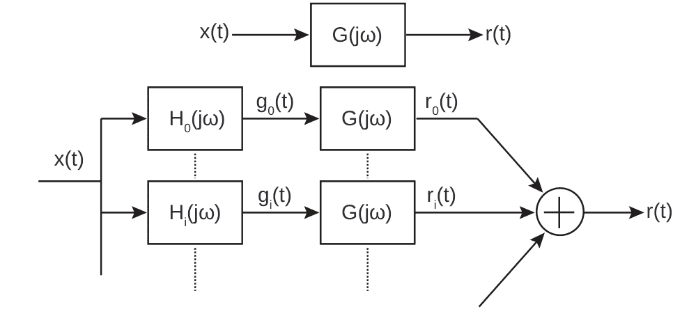

图3.6 连续时间全通系统的频率响应幅度、相位和群延迟如图3.7所示。

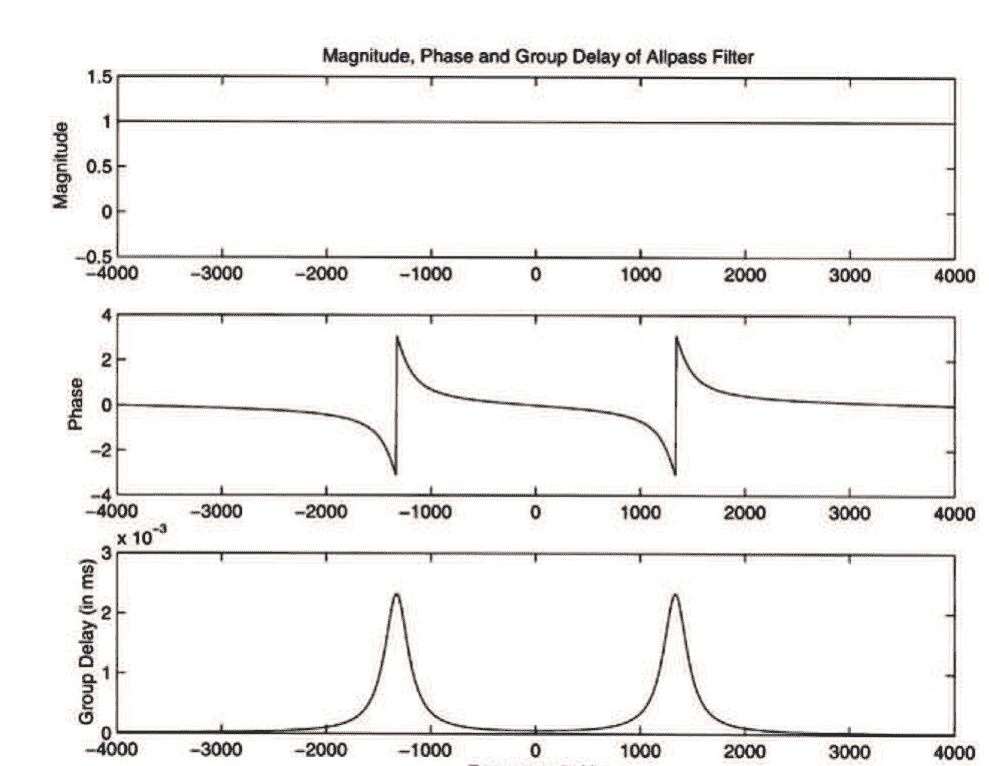

图3.7 全通滤波器的幅度、（非线性）相位和群延迟。

对于每个窄带组件（即频率组），将群延迟和相位延迟应用于输出信号 y_i(t)。如果群延迟在不同的中心（即载波）频率上不同，则时域效应是不同频率组在不同时间到达输出。

作为这种效应的例证，考虑图3.6中的 G(jω) 为连续时间全通系统，其频率响应幅度、相位和组延迟如图3.7所示。相应的冲激响应如图3.8所示。

如果 G(jω) 的相位与频率呈线性关系，冲激响应将简单地是一个延迟的冲激，即所有窄带分量将被同样的量延迟，并相应地加起来形成一个延迟的冲激。然而，正如我们在图3.7中所看到的，由于相位是非线性的，组延迟并不是恒定的。特别是，大约1200 Hz附近的频率被显著延迟，而其他频率则不然。相应地，在图3.8中我们可以看到出现在冲激响应中的频率组较晚。

第二个例子显示在图3.9中，其中 G(jω) 再次是一个全通系统，具有非线性相位和因此非恒定的群延迟。通过这个例子，我们预计在频率组周围会看到不同的延迟 ω = 2π ·50, ω = 2π ·100, 和 ω = 2π ·300，其中 ω = 2π ·50 的群组具有最大的延迟，因此在冲激响应中出现在最后。

在这两个例子中，输入在时间上高度集中（即脉冲）而响应在时间上分散，因为群延迟是非恒定的，即

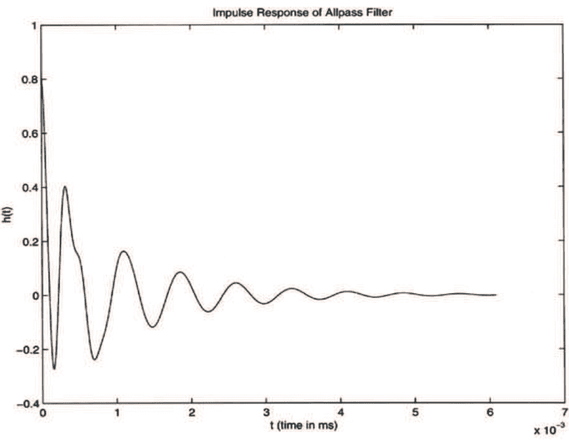

© Alan V. Oppenheim和 George C. Verghese， 2010

## 图3.8 图3.7中所示全通滤波器的冲激响应

触摸音信号通过图3.10中的全通系统进行多次传递处理。从群延迟图中，我们预计在通过全通滤波器的单次传递中，1336 Hz的音调相对于770 Hz的音调会延迟约2.5毫秒。经过200次传递后，这将累积为相对延迟约0.5秒。

在图3.12中，我们展示了多次通过滤波器的结果和延迟的累积效果。

## 3.3 全通和最小相位系统

两个特别有趣的稳定LTI系统类别是全通系统和最小相位系统。我们将在本节中对它们进行定义和讨论。

这个例子是由威斯康星大学麦迪逊分校的Bernard Lesieutre教授在与我们一起教授该课程时开发的。

©Alan V. Oppenheim 和 George C. Verghese, 2010

## 图3.11 触摸音信号及其两个窄带分量信号。

## 3.3.1 全通系统

全通系统是一个稳定的系统，其频率响应的幅度是一个常数，与频率无关。在连续时间全通系统的情况下，频率响应的形式如下：

$$H_{ap}(j\omega) = Ae^{j\angle H_{ap}(j\omega)}$$,

其中 $A$ 是一个常数，不随 $\omega$ 变化。假设相关的传递函数 $H(s)$ 在 $s$ 上是有理的，它将相应地具有以下形式：

$$H_{ap}(s) = A \prod_{k=1}^{M} \frac{s + a_k^*}{s - a_k}$$.

注意，对于每个极点 $s = +a_k$，它在镜像对称的虚轴上有一个零点，即在 $s$ 处；如果 $a_k$ 是复数且系统冲激响应是实值的，每个复极点和零点都会成对出现，所以也会有一个极点在 $s = +a_k^*$ 和一个零点在 $s = -a_k$ 处。连续时间全通系统的一个极点-零点图示例在 $s$ 平面上显示在图3.13中，可以直接验证(3.22)中的每个 $M$ 因子在 $s = j\omega$ 时具有单位幅度。

©Alan V. Oppenheim 和 George C. Verghese, 2010

## 图3.12 通过多次通过全通滤波器传递触摸信号（图3.11）和延迟的累积效果。

## 3.3.2 最小相位系统

在离散时间中，具有有理传递函数的稳定系统被称为最小相位系统，如果其极点和零点都在单位圆内，即其幅度小于单位。在离散时间中，这等价于系统是稳定和因果的，并且具有稳定和因果的逆系统。

在连续时间中，具有有理传递函数的稳定系统被称为最小相位系统。如果其极点和

© Alan V. Oppenheim和 George C. Verghese， 2010

## 图3.14 离散时间全通系统的典型极点 - 零点图。

有限的零点位于左半平面，即实部为负。因此，系统必须是因果的。如果有与极点数量相同的有限零点，则CT最小相位系统可以等效地通过以下语句来描述：系统及其逆系统都是稳定和因果的，就像在DT情况下一样。然而，CT最小相位系统很可能 - 事实上很常见 - 比极点少有有限的零点。 （注意，稳定的CT系统必须将其所有极点放在有限的位置上，因为在无穷远处的极点会导致系统的输出涉及输入的导数，这与稳定性不兼容。此外，在DT情况下，无穷远处的零点显然在单位圆外，而在CT情况下，无法确定无穷远处的零点是否在左半平面，因此不应该对CT定义仅涉及有限的零点感到惊讶。）

术语“最小相位”是历史性的，也许应该更恰当地称为“最小群延迟”，因为我们将在接下来的内容中解释。为了做到这一点，我们需要一个我们将很快证明的事实：任何因果且稳定的连续时间系统，其有理传递函数Hcs(s)在虚轴上没有零点，可以表示为最小相位系统和全通系统的级联。

$$H_{cs}(s) = H_{min}(s) H_{ap}(s)$$.

类似地，在离散时间情况下，只要传递函数Hcs(z)在单位圆上没有零点

© Alan V. Oppenheim和 George C. Verghese，2010

## 第62章

信号和线性时不变系统的变换表示

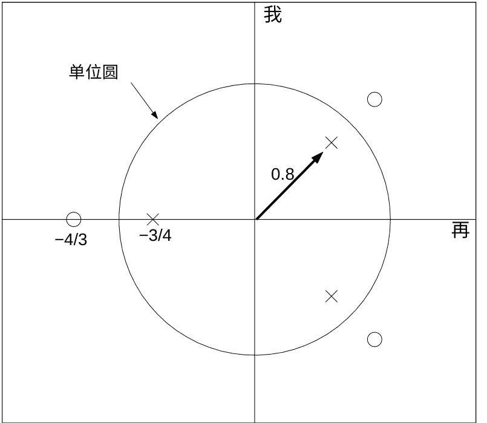

它可以被写成：

$$H_{cs}(z) = H_{min}(z)H_{ap}(z)\quad \text{.} \quad \text{(3.26)}$$

全通因子的频率响应幅度是恒定的，与频率无关，为了方便起见，我们将这个常数设为单位。然后根据(3.25):

$$|H_{cs}(j\omega)| = |H_{min}(j\omega)| \quad \text{, 和} \quad \text{(3.27a)}$$

grpdelay[H_{cs}(j\omega)] = grpdelay[H_{min}(j\omega)] + grpdelay[H_{ap}(j\omega)] \quad (3.27b)

在DT情况下，类似的方程成立。

我们将在下一节中看到，(3.25)或(3.26)中的最小相位项可以从 H_{cs}(j\omega)的幅度或 H_{cs}(e^{j\Omega})的幅度唯一确定。因此，所有具有相同频率响应幅度的因果、稳定系统只在(3.25)或(3.26)中的全通因子的选择上有所不同。然而，我们之前已经证明，全通因子必须具有正的群延迟。

因此，我们从(3.27b)得出结论，在所有具有相同CT频率响应幅度的因果、稳定系统中，没有(3.25)中的全通因子的系统将具有最小的群延迟。在DT情况下，结果相同。

我们现在将证明(3.25)的有效性；离散时间中的相应结果在非常相似的方式下得出。考虑一个因果、稳定的传递函数 H_{cs}(s)，表示为：

$$H_{cs}(s) = A \frac{\prod_{k=1}^{M_1} (s - l_k) \prod_{i=1}^{M_2} (s - r_i)}{\prod_{n=1}^{N} (s - d_n)} \quad \text{(3.28)}$$

其中 d_n是系统的极点， l_k是左半平面的零点， r_i是右半平面的零点。由于 H_{cs}(s) 是稳定和因果的，所有的极点都在左半平面，并与(3.25)中的因子 H_{min}(s)相关联，所有的零点 l_k也是如此。接下来，我们将右半平面的零点表示为：

$$\prod_{i=1}^{M_2} (s - r_i) = \prod_{i=1}^{M_2} (s + r_i) \prod_{i=1}^{M_2} \frac{(s - r_i)}{(s + r_i)} \quad \text{(3.29)}$$

由于 Re{r_i}是正的，(3.29)中的第一项代表左半平面零点。第二项对应于具有左半平面极点的全通项，并且在极点的镜像位置上有零点。因此，将(3.28)和(3.29)组合起来，H_{cs}(s)根据(3.25)进行了分解，其中

$$H_{min}(s) = A \frac{\prod_{k=1}^{M_1} (s - l_k) \prod_{i=1}^{M_2} (s + r_i)}{\prod_{n=1}^{N} (s - d_n)} \quad \text{(3.30a)}$$

$$H_{ap}(s) = \prod_{i=1}^{M_2} \frac{(s - r_i)}{(s + r_i)} \quad \text{(3.30b)}$$

## 例子 3.3

因果、稳定系统作为最小相位和全通级联

考虑一个因果、稳定的系统，其传递函数为:

$$H_{cs} = \frac{(s - 1)}{(s + 2)(s + 3)}$$

相应的最小相位和全通因子为:

$$H_{min}(s) = \frac{(s + 1)}{(s + 2)(s + 3)}$$

$$H_{ap}(s) = \frac{s - 1}{s + 1}$$

## 3.4 谱因子分解

上述最小相位/全通分解在各种情况下都很有用。在后面的章节中，我们对其中一个特别感兴趣的情况进行了讨论，即当我们已经给出或测量了具有有理传递函数 H(s)（和实值冲激响应）的稳定系统的频率响应的幅度，并且我们的目标是从这些信息中恢复 H(s)。在DT情况下可能会提出类似的任务，但我们在本文中重点讨论CT版本。因此，我们给出了:

$$|H(j\omega)|^2 = H(j\omega)H^*(j\omega)$$

或者，由于 $H^*(j\omega) = H(-j\omega)$，

$$|H(j\omega)|^2 = H(j\omega)H(-j\omega)\,.$$

现在 H(j\omega) 是 H(s) 对于 s=j\omega，因此

$$|H(j\omega)|^2 = H(s)H(-s)|_{s=j\omega}$$

对于 H(s) 中的任何分子或分母因子 (s - a)， H(s)H(-s) 中将会有一个对应的因子 (-s - a)。因此 H(s)H(-s) 将由形式为 (s - a)(-s - a) = -s² + a² 的分子或分母因子组成，并且将成为 s² 的有理函数。因此 H(j\omega)² 将是一个有理函数。

函数的 ω²。因此，如果我们给出或可以表示为有理函数的 H(j\omega)²，我们可以通过将替换 ω² = -s 来获得乘积 H(s)H(-s)。

乘积 H(s)H(-s) 的零点总是成对出现在 s 平面的虚轴上对称的位置，极点也是如此。对于 H(s)H(-s) 在实值 a 处的任何极点或零点，都会有一个在镜像位置 -a，而对于复值 q 处的任何极点或零点，都会有其他极点或零点在 q*, -q 和 -q* 处。

©Alan V. Oppenheim 和 George C. Verghese, 2010## 第64章 信号和线性时不变系统的变换表示

形成一个复共轭对 (q, q*) 和其镜像 (-q*, -q)。然后，我们需要将每个镜像实极点和零点以及每个共轭极点和零点中的一个分配给 H(s)，将镜像分配给 H(-s)。如果我们假设（或知道） H(s)是因果的，除了稳定之外，那么我们将每对极点中的左半平面极点分配给 H(s)。如果没有更多的知识或假设，我们对零点的分配没有进一步的指导，除了要求将每个镜像对分配给 H(s)和另一个分配给 H(-s)。如果我们进一步知道或假设系统是最小相位的，那么每个镜像对中的左半平面零点被分配给 H(s)，右半平面零点被分配给 H(-s)。将 H(s)H(-s)进行因式分解以获得H(s)的过程被称为谱因子分解。

## 例子 3.4 谱因子分解

考虑一个已经测量或近似的频率响应幅度为

|H(jω)|^2 = (ω^2 + 1) / (ω^4 + 13ω^2 + 36) = (ω^2 + 1) / ((ω^2 + 4)(ω^2 + 9))

通过替换 ω^2 = -s^2，我们得到

H(s)H(-s) = (-s^2 + 1) / ((-s^2 + 4)(-s^2 + 9))

我们进一步将其分解为

H(s)H(-s) = ((s + 1)(-s + 1)) / ((s + 2)(-s + 2)(s + 3)(-s + 3))

现在需要将适当的因子与 H(s) 和 H(-s) 关联起来。假设系统除了稳定之外还是因果的，那么位于左半平面的两个极点s = -2 和 s = -3 必须与 H(s) 关联。在没有进一步的假设的情况下，分子的任何一个因子都不能与 H(s) 关联，另一个因子也不能与 H(-s) 关联。然而，如果我们知道或假设 H(s) 是最小相位的，那么我们将左半平面的零点分配给 H(s)，结果选择为(s + 1)

H(s) = 1 / ((s + 2)(s + 3))

在离散时间情况下，类似的推导导致了对 H(z)H(1/z)的表达式的得出，从 |H(e^{jΩ})|^2的知识中。对于 H(z)H(1/z)的零点，它们以共轭互倒的方式出现，极点也是如此。我们再次需要将这样的共轭互倒的对分开，将其中一个分配给 H(z)，另一个分配给 H(1/z)，根据我们拥有的任何其他知识。例如，如果已知 H(z)除了稳定之外还是因果的，那么 H(z)H(1/z)中在单位圆内的所有极点都分配给 H(z)；如果 H(z)还被知道是最小相位的，那么 H(z)H(1/z)中在单位圆内的所有零点都分配给 H(z)。

## 第四章 状态空间模型

## 4.1 引言

在我们对系统描述的讨论中，我们强调并利用了将输入信号转换为输出信号的系统模型。 对于线性时不变（LTI）模型，我们的重点是冲激响应、频率响应和传递函数。 这种输入输出模型并不直接考虑系统的内部行为。

在本章中，我们开始讨论考虑系统的内部动态行为以及输入输出特性的系统模型。内部行为可能因各种原因而重要。 例如，在研究稳定性问题时，一个系统在输入输出角度上可能是稳定的，但隐藏的内部变量可能是不稳定的，导致我们认为是不稳定的系统行为。

在本章中，我们引入了一种重要的模型描述，突出了系统的内部行为，并特别适用于表示实时应用（如控制）的因果系统。 具体而言，我们引入了有限记忆（或集中）因果系统的状态空间模型。 这些模型适用于连续时间（CT）和离散时间（DT）系统，以及非线性、时变系统 - 尽管我们的重点将放在LTI情况下。

对于因果DT系统（类似的考虑也适用于CT情况），拥有一个状态空间模型使我们能够回答关于这种系统在许多情况下被问到的一个问题：在某个任意时间n，给定输入值 x[n]，我们实际上需要多少关于过去输入的信息，即关于 x[k]，其中k < n，才能确定当前的输出 y[n]？ 由于系统是因果的，我们知道拥有所有过去的 x[k]（除了 x[n]）就足够了，但我们实际上需要这么多的信息吗？ 这个问题涉及到系统中的记忆问题，并且是一个值得探讨的问题，有很多原因。

例如，答案给我们一个关于系统动态行为的复杂性或自由度数量的概念。 我们需要关于过去输入的更多信息才能确定当前输出，输出行为的多样性就越丰富，即在没有关于过去的信息的情况下，我们可以有更多的惊喜。

此外，在控制应用中，对上述问题的回答表明控制器的复杂度要求，因为控制器必须

## 第66章 状态空间模型

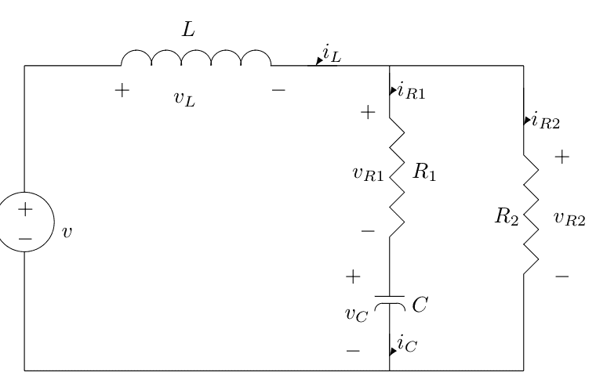

记住过去的足够信息以确定当前控制动作对系统响应的影响。此外，对于一个在数据流上以因果方式运行的计算机算法，对上述问题的回答表明需要多少内存来运行该算法。

通过状态空间描述，与过去相关的一切都总结在当前状态中，即一组状态变量的当前值中。状态变量的数量，我们称之为模型的阶数，因此表示与系统或模型相关的内存量或复杂度。

## 4.2 输入输出和内部描述

作为发展线性时不变系统状态空间模型的前奏，我们提供了两个例子，一个是连续时间的，另一个是离散时间的。

## 4.2.1 一个RLC电路

考虑图4.1中所示的RLC电路。我们在图中标记了所有组件的电压和电流。

组件的定义方程如下：

```
L\frac{di_L(t)}{dt} = v_L(t)
C\frac{dv_C(t)}{dt} = i_C(t)
v_{R1}(t) = R_1i_{R1}(t)
v_{R2}(t) = R_2i_{R2}(t) ,
```

而电压源的定义是其电压为 $v(t)$，无论其电流如何。基尔霍夫电压和电流定律给出

```
v(t) = v_L(t) + v_{R2}(t) \n v_{R2}(t) = v_{R1}(t) + v_C(t) \n i(t) = i_L(t) \n i_L(t) = i_{R1}(t) + i_{R2}(t) \n i_{R1}(t) = i_C(t) .
```

所有这些方程共同构成了电路的详细和明确的表示。

让我们将电压源 $v(t)$ 作为电路的输入；我们也用 $x(t)$ 表示这个输入，这是我们的标准输入符号。选择电路电压或电流中的任何一个作为输出——让我们选择 $v_{R2}(t)$ 作为这个例子的输出，并且用 $y(t)$ 表示，这是我们的标准输出符号。然后，我们可以使用拉普拉斯变换等方法将(4.1)和(4.2)组合起来，以获得一个传递函数或将输入和输出相关联的线性常系数微分方程。传递函数或微分方程中的系数当然是电路中组件值的函数。从输入到输出的传递函数 $H(s)$ 是

```
H(s) = \frac{Y(s)}{X(s)} = \frac{\alpha\left(\frac{R_1}{L}s + \frac{1}{LC}\right)}{s^2 + \alpha\left(\frac{1}{R_2C} + \frac{R_1}{L}\right)s + \alpha\frac{1}{LC}}
```

其中 $\alpha$ 表示比率 $R_2/(R_1 + R_2)$。相应的输入-输出微分方程是

```
\frac{d^2y(t)}{dt^2} + \alpha\left(\frac{1}{R_2C} + \frac{R_1}{L}\right)\frac{dy(t)}{dt} + \alpha\left(\frac{1}{LC}\right)y(t) = \alpha\left(\frac{R_1}{L}\right)\frac{dx(t)}{dt} + \alpha\left(\frac{1}{LC}\right)x(t).
```

图4.1中的电路的一个重要特性是，在某个时间 $t$ 开始的一段时间内，其行为完全由该时间间隔内的输入轨迹以及电感电流和电容电压决定。因此，对于图4.1中的特定电路，在确定 $\geq t$ 的时间的响应时，系统的相关过去历史被总结为 $i_L(t)$ 和 $v_C(t)$。这样一个电路中的电感电流和电容电压在任何时间 $t$ 上通常被称为状态变量，它们所取的特定值构成了系统在时间 $t$ 的状态。这个状态以及从 $t$ 开始的输入足以完全确定 $t$ 及以后的响应。

动态系统的状态概念非常强大。对于图4.1中的RLC电路，它激励我们将方程组(4.1)和(4.2)简化为仅涉及输入、输出和内部变量 $i_L(t)$ 和 $v_C(t)$ 的方程组。具体来说，可以通过适当地消除其他变量来找到所需形式的描述(4.1)和(4.2)，尽管一些

## 第68章 状态空间模型

需要注意的是，为了高效地进行消除，需要一些努力。通过这样做，我们得到了一个简洁的描述，这里使用矩阵表示，并且在本章和下两章中经常会遇到这种格式：

```
\begin{pmatrix} \frac{di_L(t)}{dt} \\ \frac{dv_C(t)}{dt} \end{pmatrix} = \begin{pmatrix} -\alpha R_1 / L & -\alpha / L \\ \alpha / C & -1/(R_1 + R_2) C \end{pmatrix} \begin{pmatrix} i_L(t) \\ v_C(t) \end{pmatrix} + \begin{pmatrix} 1/L \\ 0 \end{pmatrix} v(t) .
```

矩阵符号的使用是为了方便起见；当然，我们也可以将上述描述简单地写成两个分离但耦合的常系数一阶微分方程。

我们会欣赏到以（4.5）形式表示的特性和优势，这被称为CT（在这种情况下是LTI）状态空间形式。其关键特点是它以任意时间 t 的状态变量的变化率表达为它们的值和输入在相同时间 t 的函数（在这种情况下是LTI函数）。

正如我们后面将看到的，状态空间描述可以用于求解状态变量 i_L(t)和 v_C(t)，给定输入 v(t)和适当的辅助信息（具体而言，状态变量的初始条件）。此外，对i_L(t), v_C(t)和 v(t)的了解足以在时间 t 重构电路中的所有其他电压和电流。特别地，任何输出变量都可以用保留的变量来表示。例如，如果这个电路的感兴趣的输出是跨R2的电压 v R2(t)，我们可以再次用矩阵符号来表示。

```
v_{R2}(t) = \begin{pmatrix} \alpha R_1 & \alpha \end{pmatrix} \begin{pmatrix} i_L(t) \\ v_C(t) \end{pmatrix} + \begin{pmatrix} 0 \end{pmatrix} v(t) .
```

对于这个特定的例子，输出不直接涉及输入 v(t) — 因此上述输出方程中的项 (0) v(t) 不包括在内，但在一般情况下，输出方程将涉及当前任何输入的当前值以及状态变量的当前值。

## 4.3 状态空间模型

正如第4.2.1节和第4.2.2节所示，当研究或建模物理系统时，通常自然而方便的是，不仅关注输入和输出信号，而是描述与系统内部各个组件过程相关的几个关键变量或信号的相互作用和时间演变。组装这些组件及其相互连接的描述会比输入-输出描述更丰富。特别是在第4.2.1节和第4.2.2节中，描述是以被称为状态变量的变量的时间演变为基础的，这些变量完全捕捉了系统在任何时间对现在和未来响应的过去历史的影响。

现在我们转向DT和CT情况下状态空间模型的更正式定义，然后讨论这种模型的两个定义特征。

## 4.3.1 DT状态空间模型

状态空间模型是围绕一组状态变量构建的；模型或系统中状态变量的数量被称为其阶数。虽然我们稍后将引用分布式或无限阶系统的示例，但我们只处理有限阶的状态空间模型，也称为集中系统。对于DT情况下的L阶模型，我们通常用q1[n], q2[n]来表示时间n时刻的L个状态变量的值。

将变量整合成状态向量：

```
q[n] = \begin{pmatrix} q_1[n] \\ q_2[n] \\ \vdots \\ q_L[n] \end{pmatrix}.
```

这个向量的值构成了模型或系统在时间 n 的状态。

具有单个（即标量）输入 x[n]和单个输出 y[n]的离散时间线性不变（DT LTI）状态空间模型采用以下形式，以紧凑的矩阵表示：

```
q[n+1] = Aq[n] + bx[n],
```

```
y[n] = c^T q[n] + dx[n].
```

在（4.13）中，A是一个L x L矩阵，b是一个L x 1矩阵或列向量，c^T是一个1 x L矩阵或行向量，上标^T表示将列向量c转置为所需的行向量。量d是一个1 x 1矩阵，即标量。在LTI模型的情况下，所有这些矩阵的条目都是数字、常数或参数，因此它们不随 n 变化。请注意，在第4.2.2节的（4.10）和（4.11）中得到的模型恰好具有上述形式。我们将（4.13）称为状态演化方程，将（4.14）称为输出方程。

这些方程分别表示下一个状态和当前输出，作为当前状态变量和当前输入的LTI组合。

DT LTI状态空间模型的推广。有各种自然

## 4.3.2 CT状态空间模型

连续时间状态空间描述与离散时间情况非常相似。我们将状态变量表示为 q_i(t)， i = 1, 2, ..., L，状态向量表示为

```
q(t) = \begin{pmatrix} q_1(t) \\ q_2(t) \\ \vdots \\ q_L(t) \end{pmatrix} .
```

然而，在连续时间情况下，状态演化方程表达了下一个时间步的状态向量与当前状态向量和输入值之间的关系，而在离散时间情况下，状态演化方程表达了每个状态变量的变化率（即导数）作为当前状态和输入的函数。因此，一般的L阶连续时间线性时不变状态空间表示形式为

```
\frac{d\mathbf{q}(t)}{dt} = \dot{\mathbf{q}}(t) = \mathbf{A}\mathbf{q}(t) + \mathbf{b}x(t) ,
```

```
y(t) = \mathbf{c}^T \mathbf{q}(t) + \mathbf{d}x(t) ,
```

其中 dq(t)/dt = q'(t) 表示其条目为导数的向量， dq_i(t)/dt，表示对应条目 q_i(t) 的导数。请注意，第4.2.1节中的模型(4.5)和(4.6)正好是上述形式。

## 第72章 状态空间模型

对于多输入和多输出模型以及线性和非线性的时变或周期性模型，可以像DT系统的情况一样描述，通过适当放宽(4.16)、(4.17)右侧形式的限制。我们将在第1节中看到一个非线性时不变状态空间模型的例子。

## 4.3.3 状态空间模型的特性

对于“状态”的命名，可以是 q[n] 或 q(t) ，以及对于“状态空间描述”的命名，可以是 (4.13)，(4.14) 和 (4.16)，(4.17) — 或者对于这些方程的各种推广 — 都可以从这些模型的以下两个关键属性中得出。

状态演化属性：在任何初始时间的状态以及从该初始时间开始的任何时间间隔内的输入，决定了该整个时间间隔内的状态。与未来状态相关的过去信息都体现在当前状态中。

瞬时输出属性：任何时刻的输出可以用该时刻的状态和输入来表示。

状态演化属性使得状态空间模型特别适合描述因果系统。 在离散时间情况下，通过状态演化方程(4.13)，我们可以仅仅通过当前状态和输入的知识，从时间n更新到时间 n +1。同样的论证也适用于我们之前概述的离散时间线性时不变模型的推广。

在连续时间情况下，状态演化性质应该在直观上是合理的。 具体来说，对于任意时刻，同时了解状态和状态变化的速率，可以计算出在时间微小增量后的状态。在这个小步骤前进的过程中，我们可以重新评估状态变化的速率，并再次前进。在一般的非线性和/或时变连续时间情况下，这个性质的更详细的证明基本上是这样进行的，并且在处理微分方程解的存在性和唯一性的文本中进行了处理。这些更仔细的处理还清楚地说明了在一般情况下状态演化性质所需的额外条件。 然而，连续时间线性时不变（CT LTI）情况要简单得多，我们将在下一章中展示如何明确解决这类状态空间模型的行为时，证明状态演化性质。

从输出方程(4.14)，(4.17)可以立即看出瞬时输出特性。它也适用于我们之前列举的各种基本单输入、单输出LTI模型的推广。

上述两个特性可以被认为是状态空间模型的定义特征。 实际上，在建立状态空间模型时，我们引入了附加的状态变量向量 q[n]或 q(t)，以补充输入变量 x[n]或 x(t)和输出变量 y[n]或 y(t)。 这种补充是为了获得满足上述两个特性的描述。

#### 4.4 平衡和线性化  
非线性状态空间模型  

LTI状态空间模型通常作为非线性时不变模型的近似描述，用于描述其状态变量和输入与一组恒定平衡值之间的局部（或“小信号”）行为。  

在本节中，我们介绍定义平衡的条件，并描述在该平衡点处获得小信号模型的线性化的作用。  

##### 4.4.1 平衡点  

为了具体说明，考虑一个形式为DT三阶非线性时不变状态空间系统  

q₁[n + 1] = f₁(q₁[n], q₂[n], q₃[n], x[n])  
q₂[n + 1] = f₂(q₁[n], q₂[n], q₃[n], x[n])  
q₃[n + 1] = f₃(q₁[n], q₂[n], q₃[n], x[n])  
\tag{4.18}  

输出 y[n] 由方程定义  

y[n] = g(q₁[n], q₂[n], q₃[n], x[n])  
\tag{4.19}  

状态演化函数 fᵢ( )，对于 i = 1, 2, 3, 和输出函数 g( ) 都是三个状态变量 qᵢ[n] 和输入 x[n] 的非线性时不变函数。（函数的时不变性意味着它们以相同的方式组合它们的参数，不考虑时间索引 n。）对于 L 阶描述的推广应该是清楚的。在向量表示中，我们可以简单地写成  

q[n + 1] = f(q[n], x[n]),  y[n] = g(q[n], x[n])  
\tag{4.20}  

对于我们的三阶情况  

f(·) =  
$$
\begin{bmatrix}  
f₁(·) \\  
f₂(·) \\  
f₃(·)  
\end{bmatrix}  
$$  
\tag{4.21}  

现在假设输入 x[n] 在所有 n 上都保持不变，值为 x。相应的状态平衡是具有以下特性的状态值 q：如果 q[n] = q 且 x[n] = x，则 q[n+1] = q。或者，如果在所有 n 上 x[n] ≡ x 且在 q 处初始化系统，则系统随后保持固定在 q，则点 q 在状态空间中是一个平衡点（或平衡状态）。根据（4.20），这等价于要求  

$$
\bar{q} = f(\bar{q}, \bar{x})  
$$  
\tag{4.22}  

相应的平衡输出是  

$$
\bar{y} = g(\bar{q}, \bar{x})  
$$  
\tag{4.23}  

在定义平衡时，不考虑平衡点附近的系统行为，即系统在靠近平衡点附近的行为，而不是完全在平衡点上的行为。当讨论局部行为时，特别是平衡点附近的局部稳定性时，会涉及到这个问题。  

©Alan V. Oppenheim 和 George C. Verghese, 2010  

##### 4.4.2 线性化  

现在我们来研究在平衡点附近的系统行为。再次考虑三阶离散非线性系统（4.18），假设 x[n] 不再等于 x，而是通过 x̃[n] 偏离或偏离了这个值，所以  

x̃[n] = x[n] - x̄  
©Alan V. Oppenheim 和 George C. Verghese, 2010  

##### 4.4.3 状态空间模型的平衡和线性化  

第76章 状态空间模型  

相应地，状态变量将通过被表示为偏离其各自平衡值的量而发生扰动  

$$
\tilde{q}_i[n] = q_i[n] - \bar{q}_i  
$$  

对于 i = 1,2,3（或者更一般地 i = 1, ⋯, L），输出将受到扰动的影响  

$$
\tilde{y}[n] = y[n] - \bar{y}  
$$  

我们的目标是找到一个描述这些不同扰动行为的模型。  

找到一个可行的描述扰动或偏离平衡的方法的关键是假设它们很小，从而允许使用截断的泰勒级数来提供对各种非线性函数的良好近似。  

将泰勒级数截断到一阶，即线性项，被称为线性化，在我们的设置中产生LTI状态空间模型。  

为了线性化原始的DT三阶非线性模型（4.18），我们使用（4.30）、（4.31）中定义的量，将出现在该模型中的变量重新写成扰动的形式，然后在平衡值周围展开到一阶泰勒级数：  

$$
\bar{q}_i + \tilde{q}_i[n+1] = f_i\left(\bar{q}_1 + \tilde{q}_1[n], \bar{q}_2 + \tilde{q}_2[n], \bar{q}_3 + \tilde{q}_3[n], \bar{x} + \tilde{x}[n] \right) \quad \text{对于 } i = 1,2,3  
$$  

$$
\approx f_i(\bar{q}_1, \bar{q}_2, \bar{q}_3, \bar{x}) + \frac{\partial f_i}{\partial q_1}\tilde{q}_1[n] + \frac{\partial f_i}{\partial q_2}\tilde{q}_2[n] + \frac{\partial f_i}{\partial q_3}\tilde{q}_3[n] + \frac{\partial f_i}{\partial x}\tilde{x}[n].  
$$  

上述所有偏导数都在平衡值处进行评估，并且因此是常数，不依赖于时间指数 n。（还要注意，上述偏导数是关于连续变量状态和输入参数的；没有关于离散变化的时间指数 n 的“导数”！（4.24）中平衡值的定义显示，上述一组表达式左侧的项 q_i 恰好等于右侧的项 f_i(q₁, q₂, q₃, x)，因此剩下的是近似关系  

$$
\tilde{q}_i[n+1] \approx \frac{\partial f_i}{\partial q_1}\tilde{q}_1[n] + \frac{\partial f_i}{\partial q_2}\tilde{q}_2[n] + \frac{\partial f_i}{\partial q_3}\tilde{q}_3[n] + \frac{\partial f_i}{\partial x}\tilde{x}[n]  
$$  

通过用等号 (=) 替换近似等号 (≈)，在这组表达式中产生了被称为平衡点处的线性化模型。这个线性化模型大致描述了离平衡点稍微偏离的小扰动。  

我们可以将线性化模型写成矩阵形式：  

$$
\begin{bmatrix}  
\tilde{q}_1[n+1] \\  
\tilde{q}_2[n+1] \\  
\tilde{q}_3[n+1]  
\end{bmatrix}  
=  
\underbrace{  
\begin{bmatrix}  
\frac{\partial f_1}{\partial q_1} & \frac{\partial f_1}{\partial q_2} & \frac{\partial f_1}{\partial q_3} \\  
\frac{\partial f_2}{\partial q_1} & \frac{\partial f_2}{\partial q_2} & \frac{\partial f_2}{\partial q_3} \\  
\frac{\partial f_3}{\partial q_1} & \frac{\partial f_3}{\partial q_2} & \frac{\partial f_3}{\partial q_3}  
\end{bmatrix}  
}_{A}  
\underbrace{  
\begin{bmatrix}  
\tilde{q}_1[n] \\  
\tilde{q}_2[n] \\  
\tilde{q}_3[n]  
\end{bmatrix}  
}_{\tilde{\mathbf{q}}[n]}  
+  
\underbrace{  
\begin{bmatrix}  
\frac{\partial f_1}{\partial x} \\  
\frac{\partial f_2}{\partial x} \\  
\frac{\partial f_3}{\partial x}  
\end{bmatrix}  
}_{\text{b}}  
\tilde{x}[n]  
$$  

##### 4.4.4 示例：轮圈和梁系统  

第77章 状态空间模型  

  

图4.3 一个在支撑上可以自由旋转的梁上滚动的轮圈。变量 q₁(t) 是轮圈接触点相对于梁中心的位置。变量 q₂(t) 是梁相对于水平的角度。  

测量输出是  

y(t) = q₁(t)  

为了为系统指定状态空间模型，我们将每个状态变量在时间 t 的变化率表示为这些变量在 t 时的函数，并且作为扭矩输入 x(t) 的函数。我们任意选择正扭矩的方向为使角度 q₂(t) 增加的方向。所需的表达式，我们在这里不进行推导，最容易使用拉格朗日运动方程获得，但也可以通过将牛顿第二定律的标准形式和旋转形式应用于系统，并考虑到轮圈无滑动的约束来找 到。由此得到的非线性时不变状态空间模型，省略了状态变量 qₜ 和输入 x 的时间参数，以避免符号混乱，为：  

dq₁/dt = q₃  
dq₂/dt = q₄  
dq₃/dt = ½ (q₁q₄² - g sin(q₂))  
dq₄/dt = (mgr sin(q₂) - mgq₁ cos(q₂) - 2mq₁q₃q₄ + x) / (J + mq₁²)  

这里，g 表示重力加速度，m 是环的质量，r 是其半径，J 是梁的转动惯量。  

模型的平衡值。系统的平衡状态是指  

第78章 状态空间模型  

  

图4.3 一个在支撑上可以自由旋转的梁上滚动的轮圈。变量 q₁(t) 是轮圈接触点相对于梁中心的位置。变量 q₂(t) 是梁相对于水平的角度。  

测量输出是  

y(t) = q₁(t)  

为了为系统指定状态空间模型，我们将每个状态变量在时间 t 的变化率表示为这些变量在 t 时的函数，并且作为扭矩输入 x(t) 的函数。我们任意选择正扭矩的方向为使角度 q₂(t) 增加的方向。所需的表达式，我们在这里不进行推导，最容易使用拉格朗日运动方程获得，但也可以通过将牛顿第二定律的标准形式和旋转形式应用于系统，并考虑到轮圈无滑动的约束来找 到。由此得到的非线性时不变状态空间模型，省略了状态变量 qₜ 和输入 x 的时间参数，以避免符号混乱，为：  

dq₁/dt = q₃  
dq₂/dt = q₄  
dq₃/dt = ½ (q₁q₄² - g sin(q₂))  
dq₄/dt = (mgr sin(q₂) - mgq₁ cos(q₂) - 2mq₁q₃q₄ + x) / (J + mq₁²)  

这里，g 表示重力加速度，m 是环的质量，r 是其半径，J 是梁的转动惯量。  

模型的平衡值。系统的平衡状态是指  

第79章 状态空间模型  

  

图4.3 一个在支撑上可以自由旋转的梁上滚动的轮圈。变量 q₁(t) 是轮圈接触点相对于梁中心的位置。变量 q₂(t) 是梁相对于水平的角度。  

测量输出是  

y(t) = q₁(t)  

为了为系统指定状态空间模型，我们将每个状态变量在时间 t 的变化率表示为这些变量在 t 时的函数，并且作为扭矩输入 x(t) 的函数。我们任意选择正扭矩的方向为使角度 q₂(t) 增加的方向。所需的表达式，我们在这里不进行推导，最容易使用拉格朗日运动方程获得，但也可以通过将牛顿第二定律的标准形式和旋转形式应用于系统，并考虑到轮圈无滑动的约束来找 到。由此得到的非线性时不变状态空间模型，省略了状态变量 qₜ 和输入 x 的时间参数，以避免符号混乱，为：  

dq₁/dt = q₃  
dq₂/dt = q₄  
dq₃/dt = ½ (q₁q₄² - g sin(q₂))  
dq₄/dt = (mgr sin(q₂) - mgq₁ cos(q₂) - 2mq₁q₃q₄ + x) / (J + mq₁²)  

这里，g 表示重力加速度，m 是环的质量，r 是其半径，J 是梁的转动惯量。  

模型的平衡值。系统的平衡状态是指  

第80章 状态空间模型  

  

图4.3 一个在支撑上可以自由旋转的梁上滚动的轮圈。变量 q₁(t) 是轮圈接触点相对于梁中心的位置。变量 q₂(t) 是梁相对于水平的角度。  

测量输出是  

y(t) = q₁(t)  

为了为系统指定状态空间模型，我们将每个状态变量在时间 t 的变化率表示为这些变量在 t 时的函数，并且作为扭矩输入 x(t) 的函数。我们任意选择正扭矩的方向为使角度 q₂(t) 增加的方向。所需的表达式，我们在这里不进行推导，最容易使用拉格朗日运动方程获得，但也可以通过将牛顿第二定律的标准形式和旋转形式应用于系统，并考虑到轮圈无滑动的约束来找 到。由此得到的非线性时不变状态空间模型，省略了状态变量 qₜ 和输入 x 的时间参数，以避免符号混乱，为：  

dq₁/dt = q₃  
dq₂/dt = q₄  
dq₃/dt = ½ (q₁q₄² - g sin(q₂))  
dq₄/dt = (mgr sin(q₂) - mgq₁ cos(q₂) - 2mq₁q₃q₄ + x) / (J + mq₁²)  

这里，g 表示重力加速度，m 是环的质量，r 是其半径，J 是梁的转动惯量。  

模型的平衡值。系统的平衡状态是指  

$$
\frac{dq_1}{dt} = q_3  
$$  
$$
\frac{dq_2}{dt} = q_4  
$$  
$$
\frac{dq_3}{dt} = - \frac{g}{2} q_2  
$$  
$$
\frac{dq_4}{dt} = \frac{mg(rq_2 - q_1) + x}{J}  
$$  

这个模型连同输出的定义方程（4.39）（已经是线性的，因此不需要线性化）可以用LTI状态空间描述的标准矩阵形式（4.16）和（4.17）来表示，其中  

A =  
$$
\begin{bmatrix}  
0 & 0 & 1 & 0 \\  
0 & 0 & 0 & 1 \\  
0 & -g/2 & 0 & 0 \\  
-mg/J & mgr/J & 0 & 0  
\end{bmatrix}  
$$,  
   b =  
$$
\begin{bmatrix}  
0 \\  
0 \\  
0 \\  
1/J  
\end{bmatrix}  
$$  
   cᵀ = [1 0 0 0]  

线性时不变（LTI）模型比原始的非线性时不变模型更易处理，因此可以更系统地设计控制器，并更有信心。如果应用于系统时，所得到的控制器能够确保与平衡点的偏差保持较小，则我们使用线性化模型进行设计是合理的。  

### 4.5 从输入-输出模型得到状态空间模型  

在各种情况下，状态空间表示可以在建模过程中非常自然和直接地生成，正如第4.2.1节和第4.2.2节的示例所示。然后，可以从它们中派生出其他更为熟悉的描述；同样，之前的示例展示了如何从输入-输出描述中获得描述。  

也可以反向进行，例如从脉冲响应、传递函数或输入-输出差分方程构建状态空间描述。这通常是在模拟、滤波器实现、控制设计中非常有价值的，或者仅仅是为了从另一个角度理解初始描述。以下两个示例说明了这种反向过程，即从输入-输出描述中合成状态空间描述。  

#### 4.5.1 从脉冲响应或传递函数确定状态空间模型  

考虑因果离散时间线性时不变系统的冲激响应 h[n]。因果性要求当 n < 0 时， h[n] = 0。输出 y[n] 可以与过去和  

©Alan V. Oppenheim 和 George C. Verghese, 2010

## 第4.5节 从输入-输出模型得到状态空间模型

当前输入 $x[k]$， $k \le n$，通过卷积和

$y[n] = \sum_{k=-\infty}^{n} h[n-k] x[k]$

$= \left( \sum_{k=-\infty}^{n-1} h[n-k] x[k] \right) + h[0] x[n]$

上述第一项，即

$q[n] = \sum_{k=-\infty}^{n-1} h[n-k] x[k]$

表示过去对现在的影响，在时间n处，因此似乎与状态变量的概念有一定关系。 更新$q[n]$到下一个时间步，我们得到

$q[n+1] = \sum_{k=-\infty}^{n} h[n+1-k] x[k]$

$= \lambda \left( \beta \sum_{k=-\infty}^{n-1} \lambda^{n-1-k} x[k] \right) + \beta x[n]$

$= \lambda q[n] + \beta x[n]$

考虑那些$h[n]$基本上呈指数形式的系统类别

$h[n] = \beta \lambda^{n-1} u[n-1] + d \delta[n]$

其中 $\beta$、 $\lambda$ 和 $d$ 是常数。相应的传递函数是

$H(z) = \frac{\beta}{z - \lambda} + d$

（具有 $ROC \ z > |\lambda|$）。这个冲激响应的重要之处在于它的时间偏移版本与缩放版本之间有简单的关系，这是因为它的DT指数形式。对于这种情况，一个时间偏移版本与一个缩放版本之间有简单的关系，这是因为它的DT指数形式。对于这种情况，

$q[n] = \beta \sum_{k=-\infty}^{n-1} \lambda^{n-1-k} x[k]$

和

$q[n+1] = \beta \sum_{k=-\infty}^{n} \lambda^{n-k} x[k]$

$= \lambda \left( \beta \sum_{k=-\infty}^{n-1} \lambda^{n-1-k} x[k] \right) + \beta x[n]$

$= \lambda q[n] + \beta x[n]$

将(4.44)和(4.49)与(4.51)结合起来，得到一对方程，共同构成了该系统的状态空间描述：

$$q[n+1] = \lambda q[n] + \beta x[n]$$

$$y[n] = q[n] + \mathbf{d}x[n]$$

接下来，让我们考虑一个类似但更高阶的冲激响应系统：

$$h[n] = (\beta_1 \lambda_1^{n-1} + \beta_2 \lambda_2^{n-1} + \dots + \beta_L \lambda_L^{n-1})u[n-1] + \mathbf{d}\delta[n]$$

其中 $\beta_i$ 和 $\mathbf{d}$ 是常数。相应的传递函数为

$$H(z) = \left(\sum_{i=1}^{L} \frac{\beta_i}{z - \lambda_i}\right) + \mathbf{d}$$

通过使用部分分式展开，任何因果线性时不变离散时间系统的传递函数 $H(z)$ 可以用这种形式写成，在适当选择 $\beta_i, \lambda_i, \mathbf{d}$ 和 $L$ 的情况下，只要 $H(z)$ 的极点是非重复的 — 即，不同的 — 极点。请注意，尽管我们只处理分子和分母多项式具有实系数的有理传递函数 $H(z)$，但 $H(z)$ 的极点可能包括一些复数 $\lambda_i$ （和相关的 $\beta_i$），但在每种情况下，它的复共轭 $\lambda_i^*$ 也将是一个极点（具有相关的加权因子 $\beta_i^*$），并且总和

$$\beta_i (\lambda_i)^n + \beta_i^* (\lambda_i^*)^n$$

将会是实数。

图4.5.1中的方框图显示该系统可以被视为通过子系统的并联连接而获得，这些子系统对应于简单情况下的(4.47)。受到这种结构和对一阶示例的处理的启发，我们为每个 $L$ 子系统定义一个状态变量：

$$q_i[n] = \beta_i \sum_{k=-\infty}^{n-1} \lambda_i^{n-1-k} x[k] \quad, \quad i = 1,2,\dots,L$$

通过这个，我们得到了子系统的以下状态演化方程：

$q_{i}[n+1] = \lambda_{i}q_{i}[n] + \beta_{i}x[n] , \quad i=1,2,...,L$

此外，将(4.45)、(4.53)和(4.54)与(4.57)中的定义相结合，我们得到输出方程

$y[n] = q_{1}[n] + q_{2}[n] + \cdots + q_{L}[n] + \mathbf{d}x[n]$

方程(4.58)和(4.59)共同构成了给定系统的L阶状态空间描述。我们可用标准的矩阵形式(4.13)和(4.14)来表示这个状态空间描述，其中

$$\mathbf{A} = \begin{pmatrix} \lambda_{1} & 0 & 0 & \cdots & 0 & 0 \\ 0 & \lambda_{2} & 0 & \cdots & 0 & 0 \\ \vdots & \vdots & \vdots & \ddots & \vdots & \vdots \\ 0 & 0 & 0 & \cdots & 0 & \lambda_{L} \end{pmatrix} , \quad \mathbf{b} = \begin{pmatrix} \beta_{1} \\ \beta_{2} \\ \vdots \\ \beta_{L} \end{pmatrix}$$

$$\mathbf{c}^{T} = \begin{pmatrix} 1 & 1 & \cdots & \cdots & \cdots & 1 \end{pmatrix}$$

(4.60)中的A的对角形式反映了状态演化方程的特点。在这个例子中，每个状态变量都是独立更新的。根据(4.58)，我们稍后将看到如何将形式为(4.13)、(4.14)的一般描述通过施加一个不同特征值条件，实际上可以转化为一个完全等效的描述，其中新的A矩阵是对角的，就像(4.60)中的形式一样（然而，请注意，当存在复特征值时，这种对角状态空间表示将具有复数项）

## 4.5.2 从输入-输出差分方程确定状态空间模型

让我们来看一些表示以下输入-输出差分方程的状态空间形式的方法：

$$y[n] + a_{1}y[n-1] + a_{2}y[n-2] = b_{1}x[n-1] + b_{2}x[n-2]$$

一种方法是在前面小节的基础上，对与该系统相关的2极传递函数进行部分分式展开，从而获得对角形式的二阶实现。（如果实系数 $a_1$和 $a_2$使得 $z^{2} + a_{1}z + a_{2}$的根不是实数而是形成一个共轭复数对，则该对角二阶实现将具有复数条目。）

为了更直接地尝试（并且保证一个实值而不是复数值的状态空间模型），考虑使用状态向量作为数量

$$\mathbf{q}[n] = \begin{pmatrix} y[n-1] \\ y[n-2] \\ x[n-1] \\ x[n-2] \end{pmatrix}$$

相应的4阶状态空间模型将采用以下形式

$$
\begin{pmatrix} y[n] \\ y[n-1] \\ x[n] \\ x[n-1] \end{pmatrix} = \begin{pmatrix} -a_1 & -a_2 & b_1 & b_2 \\ 1 & 0 & 0 & 0 \\ 0 & 0 & 0 & 0 \\ 0 & 0 & 1 & 0 \end{pmatrix} \begin{pmatrix} y[n-1] \\ y[n-2] \\ x[n-1] \\ x[n-2] \end{pmatrix} + \begin{pmatrix} 0 \\ 0 \\ 1 \\ 0 \end{pmatrix} x[n]
$$

$$
y[n] = \begin{pmatrix} -a_1 & -a_2 & b_1 & b_2 \end{pmatrix} \begin{pmatrix} y[n-1] \\ y[n-2] \\ x[n-1] \\ x[n-2] \end{pmatrix}
$$

如果我们对状态变量的选择更加小心，可以得到更经济的模型。对于一个3阶模型，假设我们选择状态向量为

$$
\mathbf{q}[n] = \begin{pmatrix} y[n] \\ y[n-1] \\ x[n-1] \end{pmatrix}
$$

相应的三阶状态空间模型采用以下形式

$$
\begin{pmatrix} y[n+1] \\ y[n] \\ x[n] \end{pmatrix} = \begin{pmatrix} -a_1 & -a_2 & b_2 \\ 1 & 0 & 0 \\ 0 & 0 & 0 \end{pmatrix} \begin{pmatrix} y[n] \\ y[n-1] \\ x[n-1] \end{pmatrix} + \begin{pmatrix} b_1 \\ 0 \\ 1 \end{pmatrix} x[n]
$$

$$
y[n] = (1 & 0 & 0) \begin{pmatrix} y[n] \\ y[n-1] \\ x[n-1] \end{pmatrix}
$$

通过选择更加微妙的状态变量，可以得到一个二阶状态空间模型，选择方式如下

$$
\mathbf{q}[n] = \begin{pmatrix} y[n] \\ -a_2 y[n-1] + b_2 x[n-1] \end{pmatrix}
$$

相应的二阶状态空间模型采用以下形式

$$
\begin{pmatrix} y[n+1] \\ -a_2 y[n] + b_2 x[n] \end{pmatrix} = \begin{pmatrix} -a_1 & 1 \\ -a_2 & 0 \end{pmatrix} \begin{pmatrix} y[n] \\ -a_2 y[n-1] + b_2 x[n-1] \end{pmatrix} + \begin{pmatrix} b_1 \\ b_2 \end{pmatrix} x[n]
$$

$$
y[n] = (1 & 0) \begin{pmatrix} y[n] \\ -a_2 y[n-1] + b_2 x[n-1] \end{pmatrix}
$$

事实证明，在这种情况下，通常无法获得低于2阶的状态空间描述。鉴于(4.63)是一个二阶差分方程，我们知道它需要两个初始条件才能向前解决。请注意，在上述每种情况下，我们都融入了原始差分方程(4.63)中包含的信息，这是我们开始的地方。

## 第五章 LTI状态空间模型的特性

### 5.1 引言

在第4章中，我们介绍了动态系统的状态空间模型。在本章中，我们研究LTI状态空间模型的结构和解法。在讨论中，我们限制自己只考虑单输入、单输出的L阶CT LTI状态空间模型。

$$q'(t) = Aq(t) + bx(t)$$

$$y(t) = c^T q(t) + dx(t)$$

或者DT LTI状态空间模型

$$q[n + 1] = Aq[n] + bx[n]$$

$$y[n] = c^T q[n] + dx[n]$$

方程（5.1）构成了CT LTI系统动力学的一种表示形式，是一组耦合的、一阶线性的、常系数微分方程，用于描述q（t）中的L个变量受到输入x（t）驱动的情况。方程（5.3）给出了DT LTI系统动力学的类似差分方程表示。

分析LTI状态空间模型的基本方法与解决一元线性常系数微分方程或差分方程（任意阶）的方法类似。具体而言，我们首先考虑非零初始条件下的零输入响应，然后再加上由于非零输入而产生的响应，当初始条件为零时。从起始时间开始理解完整的解将使我们了解系统的稳定性，以及内部行为与系统的输入输出特性之间的关系。

### 5.2 零输入响应和模态表示

我们将起始时间设为0，不失一般性（因为我们处理的是时不变模型）。考虑对应于（5.1）的未驱动系统的响应，即在t ≥ 0时， x(t) ≡ 0，但具有一些非零的初始条件 q(0)。这是系统（5.1）的零输入响应（ZIR）

并且是未驱动（或无强迫或齐次）系统的解

$$q'(t) = Aq(t)$$

当分析一个未驱动的LTI系统时，寻找指数形式的解是很自然的（基本上是因为指数具有唯一的性质，即将它们移动等同于缩放它们，而未驱动的LTI系统特征在于对解的移动和缩放的不变性）。因此，我们寻找一个形式为非零的解

$$q(t) = ve^{λt}, v = 0$$

其中每个状态变量都是相同指数函数的标量倍数，这些标量倍数组成了向量 v。（在上述方程的末尾用粗体 0 表示一个 L分量列向量，其所有条目都是 0 - 我们将使用 0 表示所有条目都是 0 的向量或矩阵，其正确的维度可以从上下文中明显看出。写作 v = 0 表示 v 的至少一个分量不为零。）将 (5.6) 代入 (5.5) 得到方程

$$λve^{λt} = Ave^{λt}$$

由此我们可以得出结论，向量 v 和标量 λ 必须满足

$$λv = Av \quad \text{或等价地} \quad (λI - A)v = 0, v ≠ 0$$

其中 I 表示单位矩阵，此处的维度为 L × L。上述方程有非零解 v 当且仅当系数矩阵 (λI - A) 不可逆，即其行列式为 0：

$$det(λI - A) = 0$$

对于 L 阶系统，上述行列式是一个次数为 L 的首一多项式，称为系统或矩阵 A 的特征多项式：

$$det(λI - A) = a(λ) = λ^L + a_{L-1}λ^{L-1} + ... + a_0$$

（“首一”意味着最高次项的系数为 1。）根据以上推导，(5.6) 是方程 (5.5) 的非零解当且仅当 λ 是特征多项式的 L 个根 {λ_i}^L。这些根被称为系统的特征根，以及矩阵 A 的特征值。向量 v 在 (5.6) 中对应于系统的非零解 v_i。

$$λ_i v_i = Av_i \quad \text{或等价地} \quad (λ_i I - A)v_i = 0, v_i ≠ 0$$

并被称为与 λ_i 相关的特征向量或本征向量。从 (5.11) 可以看出，将任何特征向量乘以非零标量仍然得到一个特征向量，因此特征向量只定义到非零缩放。可以使用任何方便的缩放或归一化。

### 5.2.1 ZIR的模态表示

因为 (5.5) 是线性的，模态解的加权线性组合形式 (5.12) 对于每个特征值都满足 (5.5)。因此，具有不同特征值的零输入响应的更一般解是

$$q(t) = \sum_{i=1}^L α_i v_i e^{λ_i t}$$

可以轻松验证（5.13）中的表达式对于任意权重 α_i 都是（5.5）的解，具有初始条件

$$q(0) = \sum_{i=1}^L α_i v_i$$

由于 L 特征向量 v_i 在我们假设的 L 不同特征值下是独立的，通过适当选择系数 α_i，可以使（5.14）的右侧等于任意所需的 q(0)，并且这些系数是唯一的。因此，通过指定未驱动系统（5.5）的初始条件，通过（5.14）确定了 α_i，从而通过（5.13）确定了（5.5）的完整响应。换句话说，（5.13）实际上是（5.1）的ZIR的一般表达式 - 在我们假设的不同特征值下。我们将（5.13）右侧的表达式称为ZIR的模态分解。

从共轭特征值对的模态分解中的贡献

$$
λ_i = σ_i + jω_i \quad \text{和} \quad λ_i^* = σ_i - jω_i
$$

与相关的复共轭特征向量

$$
v_i = u_i + jw_i \quad \text{和} \quad v_i^* = u_i - jw_i
$$

分别，将成为一个形式为实数的项

$$
α_i v_i e^{λ_i t} + α_i^* v_i^* e^{λ_i^* t}
$$

通过一点代数运算，(5.15)中的实数表达式可以化简为形式

$$
α_i v_i e^{λ_i t} + α_i^* v_i^* e^{λ_i^* t} = K_i e^{σ_i t} [u_i cos(ω_i t + θ_i) - w_i sin(ω_i t + θ_i)]
$$

对于一些常数 $K_i$ 和 $θ_i$，这些常数由（5.14）两边的初始条件决定。因此，模态解的上述分量位于由特征向量 $v_i$ 的实部和虚部 $u_i$ 和 $w_i$ 所张成的平面中。在这个平面中，状态轨迹的分量的相关运动涉及指数螺旋，螺旋的增长或衰减由 $σ_i$ 决定

（对应于特征值 $λ_i$ — 及其共轭 $λ_i^*$ — 分别位于右半平面或左半平面）。如果 $σ_i = 0$，即共轭特征值对位于虚轴上，则螺旋线退化为闭合回路。螺旋线的旋转速率由 $ω_i = Im{λ_i}$ 确定。在DT情况下，(5.3)的ZIR的类似推导可以进行。在这种情况下，(5.6)被形式为的解所取代

$$q[n] = v λ^n$$

我们发现，当 A 具有 L 个不同的特征值时，一般 ZIR 解的模态分解形式为

$$q[n] = \sum_{i=1}^L α_i v_i λ^{n i}$$

## 5.2.2 渐近稳定性

LTI系统的稳定性与模态行为直接相关，并且与特征多项式的根 λᵢ的值更具体地相关。如果LTI状态空间系统的零输入响应对于所有初始条件都衰减为零，则称其为渐近稳定或内部稳定。从(5.13)我们可以看出，对于所有1 ≤ i ≤ L，条件Re{λᵢ} < 0是连续时间情况下渐近稳定的必要和充分条件。因此，(5.1)中 A的所有特征值或(5.1)的固有频率必须位于左半平面开放区域内。

在离散时间情况下，(5.18)表明渐近稳定的必要和充分条件是对于所有1 ≤ i ≤ L，都有 |λᵢ| < 1，即(5.3)中 A的所有特征值或(5.3)的固有频率必须严格位于单位圆内。

我们使用模态分解 (5.13) 和 (5.18) 来得出这些关于稳定性条件的结论，但是这些模态分解是在假设存在不同特征值的情况下获得的。然而，可以证明在一般情况下，稳定性条件与上述条件相同。

## 5.3 坐标变换

到目前为止，我们只描述了LTI状态空间系统的零输入响应。在介绍包括输入效果的一般响应之前，了解如何将给定的状态空间表示转换为可能更简单的等效表示将会很有帮助。我们的推导是针对CT情况进行的，但是完全类似的推导也可以用于DT情况。

通过用一组变换后的变量重新描述原始描述，通常可以检查状态空间系统的行为。一个特别重要的情况涉及将状态向量 q(t) 转换为一个新的状态向量 r(t)，该向量将系统的行为分解为沿着每个特征向量 vᵢ的分量：

q(t) = Σᵢ₌₁ᴸ vᵢrᵢ(t) = Vr(t)  ,
(5.19)

其中 L × L矩阵 V的第 i列是第 i个特征向量，vᵢ：

V = (   v₁    v₂    ...    vₗ   ) .
(5.20)

我们将 V称为模态矩阵。在我们假设特征值不同的情況下，特征向量是独立的，这保证了 V是可逆的，因此

r(t) = V⁻¹q(t) .
(5.21)

从涉及 q(t)的原始系统描述到以 r(t)表示的新描述的转换称为模态变换，通过(5.19)定义的新状态变量rᵢ(t)称为模态变量或模态坐标。

> ©Alan V. Oppenheim 和 George C. Verghese, 2010

## 5.3.1 模态坐标变换

使模态相似变换(5.19)有趣和有用的是状态演化矩阵 A转换为对角矩阵 Λ的事实：

V⁻¹ A V = 对角线 \{λ_1, \cdots, λ_L\} = 
$$
\begin{bmatrix}
λ_1 & 0 & \cdots & 0 \\
0 & λ_2 & \cdots & 0 \\
\vdots & \vdots & \ddots & \vdots \\
0 & 0 & \cdots & λ_L
\end{bmatrix}
$$
= Λ .

验证这一点最简单的方法是建立等效事实，即 AV = VΛ，而这又只是方程 (5.11) 对于 i = 1时的写法。\dots\,，L并堆叠在矩阵形式中上升。

对于 Λ的对角形式导致了新坐标系中相应状态方程的解耦。在这种模态转换下，未驱动的

©Alan V. Oppenheim 和 George C. Verghese, 2010

## 5.4 完全响应

将模态变换（5.19）应用于完全驱动系统（5.1），（5.2），我们可以看到变换后的系统（5.23），（5.24）采用以下形式，即分解为 L个并行的标量子系统：

r_i(t) = λ_i r_i(t) + β_i x(t)  ,  i = 1,2,\ldots,L

y(t) = ξ_1 r_1(t) + \cdots + ξ_L r_L(t) + d x(t)  ,

其中 β_i 和 ξ_i 通过以下方式定义

V⁻¹ b = 
$$
\begin{bmatrix}
β_1 \\
β_2 \\
\vdots \\
β_L
\end{bmatrix}
$$
= β  ,  
c^T V = 
$$
\begin{bmatrix}
ξ_1 & ξ_2 & \cdots & ξ_L
\end{bmatrix}
$$
= ξ  .

第二个方程式(5.30)表明

ξ_i = c^T v_i  .

为了找到 β_i 的解释，注意到方程式(5.30)的第一个方程式可以被重写为 b = V β。将乘积 V β 详细展开，我们得到

b = v_1 β_1 + v_2 β_2 + \cdots + v_L β_L  .

换句话说，系数 β_i 是将输入向量 b 表示为特征向量 v_i 的线性组合所需的系数。

方程式(5.28)中的每个标量方程式都是一个一阶LTI微分方程，可以明确地求解 t ≥ 0，得到

r_i(t) = \underbrace{e^{λ_i t} r_i(0)}_{ZIR} + \underbrace{\int_0^t e^{λ_i(t−τ)} β_i x(τ) dτ}_{ZSR}  ,  t ≥ 0  .

以这种形式表达，我们很容易识别出解的各个独立贡献，即：（i）由于初始状态引起的响应（零输入响应或ZIR）；和（ii）由于系统输入引起的响应（零状态响应或ZSR）。根据前面的表达式和（5.29），我们可以得到 y(t ) 的表达式。

## 5.5 传递函数、隐藏模式、可达性、可观测性

转换模型 (5.28), (5.29) 的传递函数 H(s) 描述了在拉普拉斯变换域中的零状态输入输出关系，并且非常容易找到，因为方程是完全解耦的。进行拉普拉斯变换后，方程的初始条件为零，结果为

©Alan V. Oppenheim 和 George C. Verghese, 2010

## 5.5 传递函数、隐藏模式、可达性、可观测性

这些方程的变换，在 (5.28) 中的零初始条件下，得到

$R_i(s) = \frac{\beta_i}{s - \lambda_i} X(s)$

$Y(s) = \left(\sum_{i=1}^{L} \xi_i R_i(s)\right) + dX(s)$

由于 $Y(s) = H(s)X(s)$，我们得到

$H(s) = \left(\sum_{i=1}^{L} \frac{\xi_i \beta_i}{s - \lambda_i}\right) + d$

可以用矩阵表示为的形式重写为

$H(s) = \xi^T (s\mathbf{I} - \mathbf{\Lambda})^{-1} \beta + d$

这也是原始模型在(5.1)、(5.2)中的传递函数，因为相似变换不会改变传递函数。对于(5.1)、(5.2)的传递函数，还有另一种表达方式，通过对(5.1)、(5.2)的拉普拉斯变换版本进行分析得到。我们省略了细节，但得到的表达式是

$H(s) = \mathbf{c}^T (s\mathbf{I} - \mathbf{A})^{-1} \mathbf{b} + \mathbf{d}$

从(5.43)中我们可以看出，一般情况下，$H(s)$将具有$L$个极点。然而，如果对于某些$j$，有 $\beta_j = 0$，即$b$可以表示为特征向量$v_j$的线性组合（见(5.32)），那么 $\lambda_j$不会出现在传递函数的极点中，尽管它仍然是系统的固有频率，并且在几乎所有初始条件下都出现在ZIR中。这个隐藏模式的根本原因——一个从输入/输出传递函数中隐藏的内部模式——可以从(5.28)或(5.41)中明显地看出：当 $\beta_j = 0$时，输入无法激发第$j$个模式。 在这种情况下，我们称与 $\lambda_j$相关联的模式为不可达模式。 相反地，如果 $\beta_k = 0$，我们将第$k$个模式称为可达模式。（在DT情况下，可达也被称为可控性，尽管严格来说，在这两个概念的定义中有一些细微的差异。）

如果系统的所有模式都是可达的，则该系统被称为可达的，否则被称为不可达的。在可达系统中，输入可以完全激发状态（实际上可以在有限时间内将状态向量从任意指定的初始条件转移到任何期望的目标状态）。在不可达系统中，这是不可能的。可达性的概念在系统和控制理论中出现在多个地方。

当$\xi_j = 0$时，出现了对偶情况，即如果$c^T v_j = 0$（见（5.31））。在这种情况下，即使它仍然是系统的固有频率，（5.43）也表明$\lambda_j$不会出现作为传递函数的极点。再次，我们有一个隐藏的模式。这次，原因在于（5.29） 或 （5.42）：当$\xi_j = 0$时，第$j$个模式在输出中不会出现，即使它在系统中存在。

©Alan V. Oppenheim 和 George C. Verghese, 2010

## 5.5 传递函数、隐藏模式、可达性、可观测性

隐藏的模式可能会导致困难，特别是如果它们是不稳定的。 然而，如果我们只关心表示传递函数，或者等效地说是LTI系统的输入-输出关系，那么隐藏的模式可能没有重要性。 我们可以通过简单地丢弃与不可达或不可观测模式对应的(5.28)中的所有方程式，并且在(5.29)中丢弃相应的项，获得具有相同传递函数的降阶状态空间模型。

相反的情况也是成立的：如果一个状态空间模型是可达的和可观测的，那么就不存在一个具有相同传递函数的更低阶状态空间系统；换句话说，一个可达和可观测的状态空间模型是最小的。

同样，对于离散时间情况，可以进行完全类似的发展，下一个例子将说明这一点。

## 例5.1 一个离散时间非最小系统

在这个例子中，我们考虑由状态方程表示的离散时间系统

$$
\begin{bmatrix}
q_1[n+1] \\
q_2[n+1]
\end{bmatrix}
= 
\begin{bmatrix}
0 & 1 \\
-1 & \frac{5}{2}
\end{bmatrix}
\begin{bmatrix}
q_1[n] \\
q_2[n]
\end{bmatrix}
+ 
\begin{bmatrix}
0 \\
1
\end{bmatrix}
x[n]
$$

y[n] = 
$$
\begin{bmatrix}
-1 & \frac{1}{2}
\end{bmatrix}
$$
$$
\begin{bmatrix}
q_1[n] \\
q_2[n]
\end{bmatrix}
$$
+ x[n]

图5.1下方显示了表示（5.46）和（5.47）的延迟-加法-增益块图。

系统的模式对应于特征多项式的根，该多项式由以下给出

$$
det(\lambda \mathbf{I} - \mathbf{A}) = \lambda^2 - \frac{5}{2} \lambda + 1 \,.
$$

因此，这些根是

$$
\lambda_1 = 2 \,, \qquad\qquad \lambda_2 = \frac{1}{2} \,.
$$

© Alan V. Oppenheim和 George C. Verghese， 2010

## 第94章 第5节 LTI状态空间模型的特性

状态响应。 我们说与 λ_j相关联的模式在这种情况下是不可观测的。 相反，如果 ξ_k = 0，则我们称 kth模式是可观测的。

如果系统的所有 L个模式都是可观测的，则系统本身被称为可观测的，否则被称为不可观测的。 在可观测的系统中，状态向量的行为可以从一定时间间隔内的输入和输出测量中明确推断出来，而对于不可观测的系统则不可能。 可观测性的概念在系统和控制理论中也反复出现。

隐藏的模式可能会导致困难，特别是如果它们是不稳定的。 然而，如果我们只关心表示传递函数，或者等效地说是LTI系统的输入-输出关系，那么隐藏的模式可能没有重要性。 我们可以通过简单地丢弃与不可达或不可观测模式对应的(5.28)中的所有方程式，并且在(5.29)中丢弃相应的项，获得具有相同传递函数的降阶状态空间模型。

相反的情况也是成立的：如果一个状态空间模型是可达的和可观测的，那么就不存在一个具有相同传递函数的更低阶状态空间系统；换句话说，一个可达和可观测的状态空间模型是最小的。

同样，对于离散时间情况，可以进行完全类似的发展，下一个例子将说明这一点。

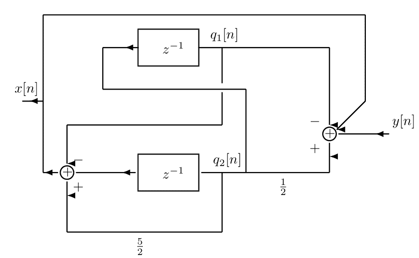

由于这里的特征值并不都具有严格小于1的幅度，所以该系统不是渐近稳定的。 通过求解以下方程，可以找到相应的特征向量

$$
(\lambda \mathbf{I} - \mathbf{A}) \mathbf{v} = 
\begin{bmatrix}
\lambda & -1 \\
1 & \lambda - \frac{5}{2}
\end{bmatrix}
\mathbf{v} = \mathbf{0}
$$

其中 $ \lambda = \lambda_1 = 2 $，然后再次计算 $ \lambda = \lambda_2 = \frac{1}{2} $。这导致

$$
\mathbf{v}_1 = 
\begin{bmatrix}
\frac{1}{2} \\
1
\end{bmatrix}
\quad, \quad
\mathbf{v}_2 = 
\begin{bmatrix}
\frac{2}{1}
\end{bmatrix}
$$

系统的输入输出传递函数为

$$
H(z) = \mathbf{c}^T (z\mathbf{I} - \mathbf{A})^{-1}\mathbf{b} + \mathbf{d}
$$

$$
(z\mathbf{I} - \mathbf{A})^{-1} = 
\frac{1}{z^2 - \frac{5}{2}z + 1}
\begin{bmatrix}
z - \frac{5}{2} & 1 \\
-1 & z
\end{bmatrix}
$$

$$
H(z) = 
\frac{1}{z^2 - \frac{5}{2}z + 1}
\left\{ 
\begin{bmatrix}
-1 & \frac{1}{2}
\end{bmatrix}
\begin{bmatrix}
z - \frac{5}{2} & 1 \\
-1 & z
\end{bmatrix}
\begin{bmatrix}
0 \\
1
\end{bmatrix}
\right\}
+ 1
= 
\frac{1}{2}
\frac{z - 2}{z^2 - \frac{5}{2}z + 1}
+ 1
= 
\frac{1}{2}
\frac{1}{z - \frac{1}{2}}
+ 1
= 
\frac{1}{1 - \frac{1}{2}z^{-1}}
$$

©Alan V. Oppenheim和 George C. Verghese, 2010

## 第96章 LTI状态空间模型的特性

由于传递函数只有一个极点且该极点位于单位圆内，系统是输入输出稳定的。然而，该系统有两种模式，因此其中一种是隐藏模式，即不出现在输入输出传递函数中。隐藏模式要么无法从输入到达，要么在输出中无法观测，或者两者都是。为了明确检查这个例子中的情况，我们转换为模态坐标，因此原始描述

```
q[n + 1] = Aq[n] + bx[n]
```

```
y[n] = c^T q[n] + dx[n]
```

通过变换得到

```
q[n] = Vr[n]
```

变为形式

```
r[n + 1] = V^{-1}AV r[n]  +  V^{-1}b x[n]
```

```
y[n] = c^T V r[n]  +  dx[n]
```

其中

```
V = [v_1 | v_2] = [[1, 2], [2, 1]]
```

新的状态演化矩阵 A 将会是对角的：

```
A = Λ = [[2, 0], [0, 1/2]]
```

并且修改后的 b 和 c 矩阵将会

```
b = β = [[2/3], [-1/3]]
```

```
c^T = ξ = [0, -3/2],    d = 1
```

从中可以清楚地看出系统是可达的（因为 β没有为0的元素），但其特征值 λ_1 = 2 是不可观测的（因为 ξ在第一个位置上有一个0）。请注意，如果我们错误地在原始坐标系而不是模态坐标系中应用了这个测试，我们会错误地认为第一个模态是不可达的，因为 b的第一个元素是0，并且系统是可观测的，因为 c^T没有非零元素。

## 例子5.2 评估线性周期变化系统的渐近稳定性

线性周期变化系统的稳定性可以通过与LTI系统类似的方法进行分析。假设，例如，

```
q[n+1] = A[n]q[n] ，A[n] = A_0对于偶数 n，A[n] = A_1对于奇数 n .
```

然后

```
q[n + 2] = A_1A_0q[n]
```

对于偶数 n，因此偶数样本的动态由LTI模型控制，偶数样本的稳定性由常数矩阵 A_even的特征值决定 = A_1A_0。奇数样本的稳定性同样由矩阵 A_odd = A_0A_1的特征值决定；事实证明，这个矩阵的非零特征值与 A_even的特征值相同，因此可以使用任意一个进行稳定性检查。

举个例子，假设

```
A_0 = \begin{pmatrix} 0 & 1 \\ 0 & 3 \end{pmatrix}， A_1 = \begin{pmatrix} 0 & 1 \\ 4.25 & -1.25 \end{pmatrix}，
```

它们各自的特征值为(0，3) 和(1.53，-2.78)，所以两个矩阵的特征值的绝对值都大于1。现在

```
A_{偶数} = A_1A_0 = \begin{pmatrix} 0 & 3 \\ 0 & 0.5 \end{pmatrix} ，
```

它的特征值为 (0, 0.5)，对应着一个稳定的系统！

## 状态观测器和状态反馈

我们对LTI状态空间模型的模态解的研究清楚地表明，在完整的分析细节中，任何给定时间的状态都总结了与模型未来行为相关的过去的一切。更具体地说，给定某个初始时刻的状态向量的值，并给定从初始时刻延伸到未来某个时间间隔的整个输入轨迹，可以确定模型在该时间间隔内的整个未来状态和输出轨迹。对于非线性和时变的状态空间模型，同样的一般结论成立，尽管它们在分析上通常要困难得多。我们的重点将放在LTI模型上。

通常情况下，我们没有系统初始状态的直接测量，必须对其进行猜测或估计。对初始状态的不确定性会导致对未来状态轨迹的不确定性，即使我们对系统的模型完美，并且对系统的输入有准确的知识。

本章的第一部分致力于解决状态轨迹估计的问题，考虑到系统初始状态的不确定性。我们将看到，在适当的条件下，通过所谓的状态观测器，实际上可以渐近地确定状态。观测器使用系统的模型以及过去的输入和输出轨迹的测量结果。

本章的第二部分研究了如何控制系统的输入，以实现期望的系统行为。我们将看到，了解系统的当前状态为设计反馈控制提供了强大的基础，以稳定或改善闭环系统的行为。当无法直接测量系统状态时，观测器提供的渐近状态估计就足够了。

## 6.1 植物和模型

现在很重要的是要区分我们感兴趣的、研究或工作或控制的实际、物理（和因果）系统——通常被称为植物（如“物理植物”）——和我们对植物的理想化模型。

植物通常是一个复杂的、高度非线性和时变的对象，通常需要无限多（或连续）的状态变量和参数来以最终的准确性来表示它。另一方面，我们的模型是一个理想化和简化的（通常是线性时不变的）表示，具有相对较低的阶数，旨在在其操作的某个有限范围内捕捉植物的行为，同时保持可分析、计算、模拟和设计。

模型的输入代表作用于或驱动实际植物的输入，模型的输出代表可测量的植物中的信号。在实践中，我们通常不会准确地知道所有驱动植物的输入。除了我们可以访问的驱动输入之外，还会有其他未测量的干扰输入作用于植物，我们只能以某种一般方式来描述它们，例如随机过程。

同样地，由于测量噪声的存在，我们所测得的系统输出与我们基于有限模型所预测的输出会有所不同。

## 6.2 实时模拟下的状态估计

假设我们感兴趣的系统可以通过以下方程正确描述，这些方程构成了系统的L阶线性时不变状态空间表示：

```
q[n + 1] = Aq[n] + bx[n] + w[n] ,
y[n] = c^T q[n] + dx[n] + ζ[n] .
```

这里， x[n]表示已知的（标量）控制输入， w[n]表示驱动系统的未知干扰向量，不一定通过与输入 x[n]相同的通道传递。例如，我们可能有 w[n] = fv[n]，其中 v[n]是标量干扰信号， f是描述这个标量干扰如何驱动系统的向量（就像 b描述 x[n]如何驱动系统一样）。量y[n]表示已知或测量的（标量）输出， ζ[n]表示测量输出中的未知噪声。我们将 w[n]称为系统的干扰或系统噪声，将 ζ[n]称为测量噪声。我们现在主要关注离散时间（DT）情况，但基本上所有内容都可以自然地推广到连续时间（CT）情况。

在上述方程表示真实的系统时，我们可以使用什么样的模型来研究或模拟系统的行 为，假设我们已知 x[n]和y[n]？ 如果对扰动变量 w[n]和测量噪声 ζ[n]没有更多了解，或者我们只知道它们可以表示为零均值随机过程，那么一种策略就是在研究或模拟系统时简单地忽略这些变量。如果我们已经知道系统的其他所有信息，我们对系统行为的表示将体现在一个形式为的LTI状态空间模型中

```
q[n + 1] = Aq[n] + bx[n] ,
y[n] = c^T q[n] + dx[n] .
```

驱动我们模型的 x[n]与输入到系统的已知 x[n]相同（可能还有其他输入）。然而，模型的状态 q[n]和输出 y[n]通常会与系统的相应状态 q[n]和输出 y[n]有所不同，因为在我们的表述中，系统的状态和输出还受到 w[n]和 ζ[n]的干扰。我们的模型正确捕捉了系统的动力学和变量之间的关系的假设

## 6.3 状态观测器

为了比实时模拟器（6.3）做得更好，我们必须不仅使用输入 x[n]，还要使用测量输出 y[n]。关键思想是利用差异

实际和预测输出，分别是（6.2）中的 y[n]和（6.4）中的 y[n] — 即，将输出预测误差作为实时模拟器的修正项。由此得到的系统被称为系统的状态观测器（或状态估计器），在我们的设置中采用以下形式

```
q[n + 1] = Aq[n] + bx[n] - ℓ(y[n] - y[n]).
```

上述观测方程以一种显示其两个组成部分的方式进行了编写：一部分尽可能模拟我们试图估计状态的系统，另一部分将校正项 y[n] - y[n] 输入到该模拟中。这个校正项通过 L 维向量 ℓ，称为观测增益向量，的第 i 个分量 ℓ_i 进行应用。（6.8）中的负号仅用于简化后续表达式的外观。图6.2是结果结构的块图表示。

现在从（6.1）中减去（6.8），我们发现状态估计误差或观测误差满足

```
q~[n+1] = Aq~[n] + w[n] + (y[n] - cq^T[n] - dx[n])
        = (A + ℓc^T)q~[n] + w[n] + ℓζ[n].
```

如果观测器增益 ℓ为0，则误差动态显然只是实时模拟器(6.6)的动态。更一般地，动态由系统的固有频率决定，即 A + ℓc^T的特征值或特征多项式的根

```
κ(λ) = 行列式(λI - (A + ℓc^T))
        = λ^L + κ_{L-1}λ^{L-1} + ... + κ_0.
```

(这个多项式，像我们处理的所有特征多项式一样，具有实系数并且是首一的，即其最高次项的系数为1而不是某个非单位标量。)

## 第6.3节 状态观测器 105

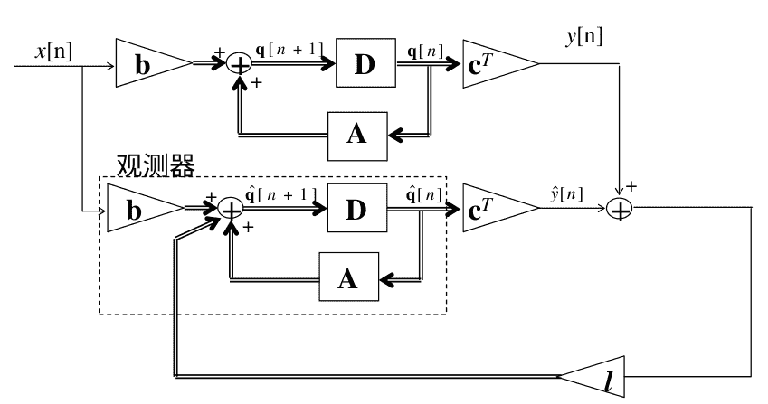

图6.2 在图的上部分中，一个观测器由一个实时仿真的被相同输入驱动的系统和一个由输出预测误差补正的信号组成。

立即出现两个问题：

- （i）我们在放置观测器特征值（即 A + lc^T 或 κ(λ) 的根）时有多少自由度，通过适当选择观测器增益 l 来实现？
- （ii）观测器增益 l 的选择如何影响干扰和噪声项 w[n] 和 ζ[n] 对观测器误差的影响？

对这些问题的简要回答分别如下：

（i）在 l = 0 处，观测者的特征值，即 A + lc^T 的特征值，是实时模拟器的特征值，也是给定系统或植物的特征值。通过改变 l 的条目，使其远离 0，我们可以移动与植物的可观测特征值相对应的所有特征值（可能有 L 个特征值），而这些是我们唯一能够移动的特征值。此外，适当选择 l 允许我们原则上将这些可观测特征值移动到复平面中的任意一组自共轭点。（自共轭集是指通过取集合的复共轭而保持不变的集合。这相当于要求如果一个复点在这样的集合中，那么它的复共轭也在其中。）自共轭性限制是必要的，因为我们正在处理实数。

（ii）现在我们来讨论 ℓ的选择如何影响扰动项 w[n] 和噪声项 ζ[n] 对观测误差的影响。首先要注意的是，如果通过适当选择观测器增益 ℓ使误差系统(6.9)渐近稳定，那么有界的系统扰动 w[n] 和有界的测量噪声 ζ[n] 将导致观测误差保持有界。这最容易通过转换为模态坐标来证明，但我们省略了细节。

观测器误差方程（6.9）显示观测器增益 ℓ在两个地方起作用，首先是通过状态演化矩阵 A + ℓc^T 来控制误差动态，而不是 A，然后作为测量噪声 ζ[n] 的输入向量。这突显了误差之间的基本权衡

## 第6.3节 状态观测器107

衰减和噪声抗干扰。观测器增益可以用来实现快速误差衰减，在存在不断扰动系统状态的植物干扰 w[n] 的情况下可能需要快速衰减，但是可能需要较大的 ℓ 来实现这一点（在连续时间情况下肯定如此，在离散时间情况下，如果模型是某个基础连续时间系统的采样数据版本，也是如此），而这些较大的 ℓ 的输入将导致测量噪声的影响加剧。较大的观测器增益还可能增加观测器设计对建模误差和其他差异的敏感性。在实践中，这些考虑会导致我们相对保守地设计，不会试图获得过快的误差衰减动态。

上述权衡的一些方面可以在一个可行的优化问题中得到解决。将建模为平稳随机过程的变量 w[n]和 ζ[n]（在后面的章节中介绍），我们可以制定选择 ℓ 以最小化状态估计误差 q̂[n]中稳态方差的某个度量的问题。所谓的卡尔曼滤波框架提供了解决这个问题及一系列相关问题的方法。一旦我们掌握了处理平稳随机过程的工具，我们就能够解决一些基本版本的问题。

## 例子 6.1 船舶操舵

考虑以下简化的采样数据模型，用于描述以恒定速度行驶的船舶的操舵动力学，舵角由计算机控制器以分段常数方式控制：

```
q[n + 1] = [ q1[n + 1] ] = [ 1  σ  ] [ q1[n] ] + [ ε ] x[n]
           [ q2[n + 1] ]   [ 0  α  ] [ q2[n] ]   [ σ ]
           = Aq[n] + bx[n].
```

状态向量 q[n] 包括采样的航向误差 q1[n]（即船指向相对于期望运动方向的方向）和船的采样转向速率 q2[n]，两者在时间 t = nT进行采样； x[n] 是舵角的恒定值（相对于船指向）在区间 nT ≤ t < nT + T（我们选择正的舵角使航向误差增加）。正参数 α、σ和 ε由船的类型、速度和采样间隔 T决定。特别地，α通常小于1，但对于大型油轮可能大于1；无论如何，系统（6.13）不是渐近稳定的。常数 σ大约等于采样间隔 T。

假设我们有（嘈杂的）转向速率的测量值，所以

```
c^T = ( 0  1 ).
```

然后

```
A + ℓc^T = ( 1  σ + ℓ₁ ) 
             ( 0  α + ℓ₂ ) .
```

© Alan V. Oppenheim 和 George C. Verghese，2010

## 第108章 状态观测器和状态反馈

显然，无论$l$是什么，误差方程的一个固定的自然频率为1。这个自然频率对应于原始系统的一个不可观测模式，该模式无法从转向速率测量中观测到。此外，这不是一个渐近稳定的模式，因此相应的观测器误差不会衰减。从物理上讲，问题在于转向速率不包含有关航向误差本身的输入或信息。

相反，如果我们有（嘈杂的）航向误差测量值，那么

$c^T = ( 1\  0 )$

在这种情况下

$A + \ell c^T = \begin{pmatrix} 1 + \ell_1 & \sigma \\ \ell_2 & \alpha \end{pmatrix}$

该矩阵的特征多项式为

$\kappa(\lambda) = \lambda^2 - \lambda(1 + \ell_1 + \alpha) + \alpha(1 + \ell_1) - \ell_2 \sigma$

通过选择增益 $\ell_1$ 和 $\ell_2$，可以将其转化为任意的二次单项式，这也确立了我们植物模型的可观测性。

在这种情况下，观测器增益的一个有趣选择是 $\ell_1 = -1 - \alpha$ 和 $\ell_2 = -\alpha^2 / \sigma$（对于典型的参数值，结果是 $\ell_2$ 很大）。通过这个选择，

$A + \ell c^T = \begin{pmatrix} -\alpha & \sigma \\ -\alpha^2 / \sigma & \alpha \end{pmatrix}$

这个矩阵的特征多项式是 $\kappa(\lambda) = \lambda^2$，所以观测器误差方程的固有频率都在0处。

所有固有频率都在0处的DT LTI系统被称为零拍系统，因为它的零输入响应在有限时间内完全稳定到原点。（这种有限时间稳定对于零输入响应的LTIDT系统是可能的，但对于LTI CT系统来说不可能，尽管当然LTI CT系统在任何指定的正时间后可以有任意小的零输入响应）

我们还没有讨论如何分析具有非不同特征值的LTI状态空间模型，但为了验证我们观测器的有限稳定性，只需从（6.19）中确认当增益 $\ell_i$ 被选择为使 $\kappa(\lambda) = \lambda^2$ 时，有 $(A + \ell c^T)^2 = 0$。

这意味着在没有植物干扰和测量噪声的情况下，观察者误差最多在两步内趋近于0。

在存在测量噪声的情况下，人们可能希望选择较慢的误差衰减，以使观察者增益 $\ell$ - 尤其是 $\ell_2$ - 小于死区情况下的增益，并且从而不强调测量噪声对估计误差的影响。

## 6.4 状态反馈控制

对于我们可以操纵输入的因果系统或植物，自然而然地会问如何选择输入以使系统产生某种理想行为。

表现出某种理想行为。对这样一个系统的反馈控制基于感知其当前或过去的行为，并使用感知变量的测量结果生成控制信号应用于它。反馈控制也被称为闭环控制。

相比之下，开环控制不是基于对系统的持续监测，而是仅仅利用在开始与系统交互时可用的信息。开环控制的问题在于即使错误被识别出来，也不会被纠正或补偿。如果系统行为不良或不稳定，那么未经纠正的错误可能会导致严重后果。

前馈控制是指包含当前或将来会影响系统的信号测量的方案，但这些信号本身不受控制的影响。例如，在为可调雷达天线的定位电机生成电气控制信号时，使用风速测量值对应于前馈控制，而使用天线位置测量值对应于反馈控制。控制系统可以同时具有反馈和前馈组件。

本节我们的重点是反馈控制。为了使我们的开发流程简化，我们假设该系统可以由以下 L阶线性时不变状态空间描述模型很好地建模：

```
q[n + 1] = Aq[n] + bx[n]  
y[n] = c^T q[n]
```

而不是更详细的描述(6.1)，(6.2)。如常，x[n]表示控制输入，y[n]表示测量输出，两者都是时间的标量函数。我们也将其称为开环系统。同样，我们处理DT情况，但基本上一切都自然地适用于CT。此外，为了简化符号，我们在(6.21)中省略了直接馈送项 dx[n]，这个项在我们的系统描述中一直没有出现，因为这个项可能会使我们推导出的一些表达式变得复杂，而本身并没有太大的意义；如果需要，可以轻松地加以考虑。

用 A在 (6.20)中的特征多项式表示为

```
a(λ) = det(λI - A) = \prod_{i=1}^{L}(λ - λ_i).
```

系统（ 6.20），（6.21）的传递函数 H(z)给出

```
H(z) = c^T(zI - A)^{-1}b  
= \frac{η(z)}{a(z)}.
```

(6.21) 中的直接馈送项的缺失导致多项式 η(z)的次数严格小于 L。如果存在馈送项，则传递函数将简单地在 H(z)上加上 d。请注意

## 状态观测器和状态反馈

(6.24) 中的 a(z) 和 η(z) 的共同根可能存在极点-零点抵消，对应于系统中不可达和/或不可观测模式的存在。只有 a(z) 的未抵消根作为 H(z) 的极点存留，类似地，只有 η(z) 的未抵消根作为传递函数的零点存留。

我们重申，模型与实际系统在许多方面无疑存在差异，但我们不会考虑各种可能的差异和不确定性的影 响。对这些问题的适当处理构成了鲁棒控制领域，这仍然是一个活跃的研究领域。

由于系统的状态完全总结了系统的相关过去，我们应该期望每一时刻对状态的了解为我们设计反馈控制信号提供了强大的基础。在本节中，我们考虑使用状态反馈来处理系统 (6.20)，假设我们在每个时刻都能够获得完整的状态向量。尽管这个假设在一般情况下是不现实的，但它将允许我们开发一些初步结果作为基准。我们将在后面考虑更现实的情况，即无法测量状态而必须进行估计的情况。在线性时不变的情况下，观测器提供的状态估计实际上可以实现使用实际状态进行反馈所能实现的大部分功能。

LTI状态反馈的特殊情况在图6.3中表示，其中输入的反馈部分 x[n] 是状态 q[n] 的常数线性函数，即：

x[n] = p[n] + g^T q[n]  (6.25)

其中 L分量的行向量 g^T 是状态反馈增益向量（第 i 个分量为 g_i），而 p[n] 是一些外部输入信号，可以用来增强反馈信号。因此，x[n] 是 p[n] 加上状态变量 q_i[n] 的加权线性组合，其中权重为常数 g_i。

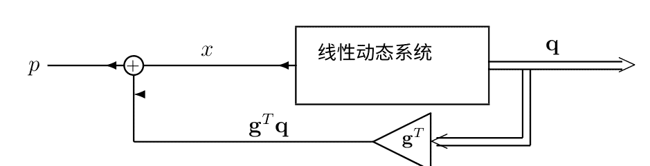

图6.3具有LTI状态反馈的线性动态系统。单线表示标量信号，双线表示向量信号。

选择这个 x[n]，系统 (6.20) 变为

q[n+1] = Aq[n] + b(p[n] + g^T q[n])
= (A + bg^T)q[n] + bp[n].  (6.26)

## 状态反馈控制

这个闭环系统的行为，特别是其稳定性，由其固有频率所决定，即矩阵 A + bg^T 的特征值或特征多项式的根

ν(λ) = 行列式(λI - (A + bg^T))
= λ^L + ν_{L-1}λ^{L-1} + \cdots + ν_0.

一些问题立即出现：

- 1. (i) 我们在通过适当选择状态反馈增益 g^T 来放置闭环特征值（即 A + bg^T 的特征值或 ν(λ) 的根）有多大自由度？
- 2. (ii) 状态反馈如何影响系统的可达性、可观测性和传递函数？
- 3. (iii) 选择 g^T a 如何影响状态行为和所需的控制努力？

对于这些（相互关联的）问题的简要回答分别如下：

(i) 通过改变 g^T 的条目，我们可以移动系统的所有可达特征值（可能多达 L），并且只有这些特征值。此外，适当选择 g^T 原则上允许我们将可达特征值移动到复平面上的任意一组自共轭点。

开环系统的不可达特征值仍然是闭环系统的特征值，无法移动。（可以通过转换为模态坐标来明确证明，但我们省略了细节。）这是因为控制输入无法访问这些不可达模态。

根据前面的声明，只有当开环系统的所有不可达模式都稳定时，才能设计出稳定的闭环系统（这种性质被称为可稳定性）。此外，只有当开环系统（6.20）可达时，状态反馈才能产生任意的闭环特征多项式 ν(λ)。

上述声明的证明在第6.4.1节中给出。在为低阶示例设计状态反馈控制的解析过程中，一种方法是通过指定一组期望的闭环特征值 μ₁, μL 来进行。

ν(λ) = \prod_{i=1}^L (λ - μ_i)

展开并将其与det相等，如(6.10)中所示，得到未知增益L1的L个同时线性方程（λI - (A + bg^T)）这些方程将在状态反馈增益一致且可解的情况下成立。...，g₁，...，g_L。如果状态反馈增益一致且可解，这些方程将一致且可解。

## 状态反馈控制

只有当所有无法到达的植物特征值包含在指定的闭环特征值 {μ_i}中时。

前面的结果还暗示了一种确定给定植物的无法到达特征值的替代方法：det的根（λI−(A+bg^T)）无论如何选择 g^T，都无法移动的是植物的无法到达特征值。这种暴露无法到达模式的方法在某些问题中可能比上一章中使用的方法更容易，该方法首先需要计算植物的特征向量 {v_i}，然后检查这些特征向量中哪些在写作 b的线性组合时不需要。

[上述讨论与我们对观察者的讨论非常相似，只是观测性陈述已经被可达性陈述所取代。这种“对偶性”的根本原因是，A + bg^T的特征值与其转置的特征值相同，即 A^T + gb^T。后者矩阵的结构与我们对观察者的讨论的矩阵 A + lc^T完全相同，只是 A现在被 A^T替换，c^T被 b^T替换。很容易看出，由 A^T和 b^T确定的可观测和不可观测模式的结构与由 A和 b确定的可达和不可达模式的结构相同。]

(ii) 上述第(i)部分的结果已经暗示了以下事实：无论外部输入是否可以从开环系统的状态反馈中到达——即从 x[n]到达开环系统，从 p[n]到达闭环系统——都不会受到影响。开环系统中的不可达特征值无论如何生成输入 x[n]，都无法被激发，因此即使在闭环系统中也无法被激发（这也解释了为什么它不能被状态反馈移动）。同样，开环系统中的可达特征值也可以在闭环系统中被激发，因为任何在开环系统中激发它的x[n]都可以通过选择 p[n] = x[n] − g^Tq[n]在闭环系统中生成。

在第6.4.1节中的证明(i)的声明也将证明闭环系统的传递函数，从 p[n]到 y[n]，现在

$H_{cl}(z) = c^T (zI - (A + bg^T))^{-1} b$

= $\frac{\eta(z)}{\nu(z)}$

因此，闭环传递函数的零点仍然来自于相同的分子多项式 η(z) （在(6.24)中包含开环系统的零点）；状态反馈不会改变 η(z)。然而，闭环系统的实际零点是 η(z) 的根中未被新的闭环特征多项式 ν(z) 的根所抵消的根，因此可能与开环系统的零点不同。

我们从前一章知道，传递函数中的隐藏模式是由于模式无法到达和/或不可观测而产生的。因为

## 状态反馈控制

状态反馈不能改变可达性属性，因此从原始开环系统到闭环系统中的 η(z) 的根的取消变化必须是状态反馈改变原始模式的可观测性属性的结果。 如果开环系统的一个不可观测（但可达）特征值被状态反馈移动并变得可观测，则之前取消的 η(z) 的根将不再取消，并且现在出现为闭环系统的零点。 同样，如果开环系统的一个可观测（且可达）特征值被状态反馈移动到现在取消 η(z) 的根的位置，则该根不再是闭环系统的零点，而这个隐藏模式对应于被状态反馈使其不可观测的模式。

(iii) 现在我们转向一个问题，即选择 g^T a如何影响状态行为和所需的控制努力。首先注意，如果选择 g^T 使闭环系统渐近稳定，则(6.26)中的有界外部信号 p[n]将导致闭环系统中的有界状态轨迹。 通过考虑(6.26)到模态坐标的转换，很容易看出这一点，但我们省略了细节。

状态反馈增益 g^T 以两种关键方式影响闭环系统，首先通过使动力学由 A + b g^T 的特征值来控制，而不是由 A 的特征值来控制，其次通过确定控制输入 x[n] 的缩放关系(见(6.25))。这突显了响应速率和控制努力之间的基本权衡。状态反馈增益可以用于获得快速响应，将系统状态从其初始扰动值迅速恢复到原点-但是可能需要 g^T 中的大数值来实现这一点(特别是在 C^T 情况下，但也适用于 D^T，如果模型是某个基础 C^T 系统的采样数据版本)，而这些在 g^T 中的大数值会导致大量的控制努力被消耗。 此外，测量或估计状态向量的任何误差，或建模误差和其他差异的影响，很可能会随着反馈增益的增大而被强调。 在实践中，这些考虑因素会使我们保守地设计，不会试图获得过快的闭环动态。 同样，涉及的权衡方面可以在可行的优化问题中得到解决，但这些问题留给更高级的课程。

我们首先通过一个连续时间的例子来工作，部分是为了清楚地表明我们的发展从离散时间直接到连续时间的情况下进行。

## 例6.2 扭转摆与力矩控制

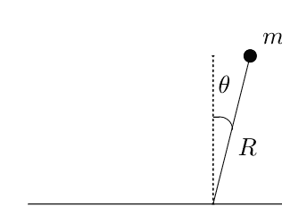

考虑图6.4所示的扭转摆，由长度为 R的轻质铰接杆末端的质量 m组成。对于垂直方向的小偏差 θ(t)，

$d²θ(t)/dt² = Kθ(t) + σx(t)$，

其中 K = g/R (g 是重力加速度)，σ = 1/(mR²)，并且在摆的支撑点施加一个力矩输入 x(t)。定义 q₁(t) = θ(t)，q₂(t) = θ̇(t)；那么

$$
\dot{q}(t) = \begin{bmatrix} 0 & 1 \\ K & 0 \end{bmatrix} q(t) + \begin{bmatrix} 0 \\ σ \end{bmatrix} x(t)
$$

我们现在可以确定系统的特征值和特征向量，以决定系统是否可达。然而，为了评估可达性并计算状态反馈，这一步实际上并不是必要的。相反，直接考虑状态反馈的影响，我们发现 x(t) = gᵀ q(t)

$$
\dot{q}(t) = \begin{bmatrix} 0 & 1 \\ K + σg_1 & σg_2 \end{bmatrix} q(t)
$$

= $$ \begin{bmatrix} 0 & 1 \\ K + σg_1 & σg_2 \end{bmatrix} q(t) $$

相应的特征多项式为

$$
ν(λ) = λ² - λσg_2 - (K + σg_1)
$$

检查这个表达式可以看出，通过适当选择实际增益 g₁和 g₂，我们可以使这个多项式变成任意所需的二次单项式。换句话说，我们可以获得任何自共轭的闭环特征值集合。这也证明了原始系统是可达的。

## 状态反馈控制

假设我们希望闭环特征值为特定的数字 $ \mu_1 $，$ \mu_2 $，这等价于指定闭环特征多项式为

$$
\nu(\lambda) = (\lambda - \mu_1)(\lambda - \mu_2) = \lambda^2 - \lambda(\mu_1 + \mu_2) + \mu_1 \mu_2 . \quad (6.38)
$$

将其与(6.37)中的多项式相等，得到

$$
g_1 = -\frac{\mu_1 \mu_2 + K}{\sigma} \quad \text{和} \quad g_2 = \frac{\mu_1 + \mu_2}{\sigma} . \quad (6.39)
$$

当 $ \mu_1 $ 和 $ \mu_2 $ 在开放的左半平面形成一个自共轭集合时，两个增益都是负的。

现在我们回到之前介绍的船舶操纵示例。

## 例6.3 船舶操纵（续）

再次考虑例6.1中的离散时间状态空间模型，为了方便起见，重复如下：

$$
\mathbf{q}[n+1] = \begin{bmatrix} q_1[n+1] \\ q_2[n+1] \end{bmatrix} = \begin{bmatrix} 1 & \sigma \\ 0 & \alpha \end{bmatrix} \begin{bmatrix} q_1[n] \\ q_2[n] \end{bmatrix} + \begin{bmatrix} \epsilon \\ \sigma \end{bmatrix} x[n]
$$

$$
= \mathbf{A}\mathbf{q}[n] + \mathbf{b} x[n]
$$

在一些情况下，这种形式的模型也适用于其他感兴趣的系统，例如直流电机的运动，其输入是由计算机控制器在长度为 $ T $ 的间隔内保持恒定的电压。在这种情况下，对于适当的单位下的 $ x[n] $，我们有 $ \alpha = 1 $，$ \sigma = T $，$ \epsilon = T^2/2 $。

在这个例子中，取

$$
\mathbf{A} = \begin{bmatrix} 1 & \frac{1}{4} \\ 0 & 1 \end{bmatrix}, \quad \mathbf{b} = \begin{bmatrix} \frac{1}{32} \\ \frac{1}{4} \end{bmatrix} \quad (6.41)
$$

并设置

$$
x[n] = g_1 q_1[n] + g_2 q_2[n] \quad (6.42)
$$

得到闭环矩阵

$$
\mathbf{A} + \mathbf{b} \mathbf{g}^T = \begin{bmatrix} 1 + \frac{g_1}{32} & \frac{1}{4} + \frac{g_2}{32} \\ \frac{g_1}{4} & 1 + \frac{g_2}{4} \end{bmatrix} . \quad (6.43)
$$

在这个离散时间模型中，最快的闭环响应是之前在例子6.1中描述的完全消除行为，通过选择闭环的自然频率为0来实现，即选择闭环特征多项式为 $ \nu(\lambda)=\lambda^2 $。通过一点代数运算可以得出，为了实现这一点， $ g_1 $ 和 $ g_2 $ 需要满足以下方程：

$$
\begin{align*} \frac{g_1}{32} + \frac{g_2}{4} &= -2 \\ -\frac{g_1}{32} + \frac{g_2}{4} &= -1 . \quad (6.44) \end{align*}
$$

© Alan V. Oppenheim和 George C. Verghese，2010

## 第116章 状态观测器和状态反馈

同时解这些方程，我们得到 $g_1 = -16$ 和 $g_2 = -6$。我们还没有展示如何分析系统在存在重复特征值时的行为，但是在特定情况下，当特征值为 0 时，可以很容易地证明状态会在有限步骤内收敛到 0，对于这个二阶系统来说，最多只需要两步。为了证明这一点，注意到在上述 $g$ 的选择下，我们得到

$$
\mathbf{A} + \mathbf{b} \mathbf{g}^T = \left[ \begin{array}{cc} \frac{1}{2} & \frac{1}{16} \\ -4 & -\frac{1}{2} \end{array} \right],
$$

所以

$$
(\mathbf{A} + \mathbf{b} \mathbf{g}^T)^2 = 0,
$$

这表明任何非零的初始条件都会在两步内消失。在实践中，这种完全消除的行为可能无法实现，因为需要过大的控制力量——例如船只的舵角。因此，人们往往会选择错误的缓慢衰减。

通常情况下，我们无法直接测量状态变量，只能通过对系统输出的噪声测量来获得控制输入的信息。然后可以使用一个观测器来重建状态，该观测器在系统 (6.20)，(6.21) 可观测的假设下产生渐近收敛的状态估计。很快我们将更详细地看到，使用观测器产生的状态估计值可以在反馈控制方案中很好地替代直接的状态测量。

## 6.4.1 特征值放置结果的证明

本小节给出了状态反馈的主要结果的证明，即它可以产生任意（单调，实系数）闭环特征多项式 $\nu(\lambda)$，其中包括原系统的所有不可达特征值。我们还将证明闭环传递函数由 (6.31) 中的表达式给出。

首先将开环系统 (6.20)，(6.21) 转换为模态坐标；这不会改变系统的本质，但简化了推导过程。使用与上一章中模态坐标相同的符号表示，闭环系统现在由以下方程定义

$$
r_i[n+1] = \lambda_i r_i[n] + \beta_i x[n], \quad i = 1, 2, \dots, L
$$

$$
x[n] = \gamma_1 r_1[n] + \cdots + \gamma_L r_L[n] + p[n],
$$

其中

$$
\left( \begin{array}{ccc} \gamma_1 & \cdots & \gamma_L \end{array} \right) = \mathbf{y}^T \mathbf{V},
$$

其中 $\mathbf{V}$ 是模态矩阵，其列是开环系统的特征向量。因此，$\gamma_i$ 只是模态坐标中的状态反馈增益。

©Alan V. Oppenheim 和 George C. Verghese, 2010

## 第6.5节 基于观察者的反馈控制

状态反馈的障碍是状态的直接测量通常不可用。 通常我们只知道我们正在应用的控制信号 x[n]，以及（可能受到噪声干扰的）输出测量y[n]和系统的名义模型。 我们已经看到如何利用这个信息来估计状态变量，使用观测器或状态估计器。

## 6.5 基于观测器的反馈控制

状态反馈的障碍是状态的直接测量通常不可用。 通常我们只知道我们正在应用的控制信号 x[n]，以及（可能受到噪声干扰的）输出测量y[n]和系统的名义模型。 我们已经看到如何利用这个信息来估计状态变量，使用观测器或状态估计器。

另一个有趣的事实是，从 p[n]到 y[n]的传递函数在新的闭环系统中与完美状态反馈得到的传递函数完全相同，即(6.46)中的传递函数。原因是计算传递函数的条件——从零状态开始的输入输出响应——确保观察者从与系统相同的初始条件开始运行。这反过来确保没有估计误差，因此估计的状态与真实状态一样好。另一种看待这个问题的方式是注意到观察者误差模式在可用的测量中是不可观测的。

前面的基于观察者的补偿器是控制设计的起点，这是一种非常通用且强大的方法，适用于多输入的情况。

©Alan V. Oppenheim和 George C. Verghese, 2010

## 第120章 状态观测器和状态反馈

© Alan V. Oppenheim和 George C. Verghese，2010

## 第7章 概率模型

## 引言

在前面的章节中，我们强调确定性信号。 在本文的其余部分，我们扩展了所考虑的信号类别，包括基于概率模型的信号，称为随机或随机过程。

在介绍这个重要的信号类别时，我们从本章开始回顾概率和随机变量的基础知识。我们假设您在以前的课程中已经接触过这些基础材料，但在这里包括一个回顾，以便方便参考和建立符号。 在接下来的章节和以后，我们将这些概念应用于定义和讨论随机信号类别。

## 7.1 基本概率模型

基本概率模型包括以下三个组成部分，如图7.1所示：

1. 样本空间。样本空间 $\Psi$ 是模型表示的随机实验的所有可能结果的集合。 我们要求每次实验中只产生一个结果。
2. 事件代数。事件代数是样本空间的子集的集合，这些子集在样本空间中被称为事件，选择这些子集使得事件的并集和补集本身也是事件（即属于子集的集合）。 如果实验的结果在这个事件子集中，则我们说发生了特定的事件；因此，$\Psi$ 是“确定事件”，因为它总是发生，而空集 $\emptyset$ 是“不可能事件”，因为它从不发生。 请注意，事件的交集也是事件，因为交集可以用并集和补集来表示。
3. 概率测度。概率测度与每个事件 A 相关联一个数字 $P(A)$，称为 A 的概率，以这样的方式：

- (a) $P(A) \ge 0$；
- (b) $P(\Psi) = 1$；
- (c) 如果 $A \cap B = \emptyset$，即，如果事件 A 和 B 是互斥的，则

$$
P(A \cup B) = P(A) + P(B).
$$

© Alan V. Oppenheim和 George C. Verghese， 2010

## 第122章 概率模型


图 7.1 样本空间和事件。

请注意，在任何特定情况下，我们通常在指定什么构成一个结果，在定义事件代数以及分配概率测度方面有多种选择。通常情况下，样本空间中的元素或结果越少越方便，但我们需要足够的元素来使我们感兴趣的事件能够得到规定。通常选择包含感兴趣事件的最小事件代数是方便的。我们还要求有一种分配概率给事件的方式，该方式与上述条件一致。这种分配可以基于对称性论证或其他特定应用所建议的方式进行。

## 7.2 条件概率、贝叶斯规则和独立性

事件 A 发生的条件下，事件 B 发生的概率用 $P(A|B)$ 表示。已知事件 B 发生，样本空间缩小为 B 中的结果，因此条件概率的自然定义是

$$
P(A|B) \triangleq \frac{P(A \cap B)}{P(B)} \text{如果 } P(B) > 0.
$$

很容易验证这个条件概率的定义在样本空间 B 上是一个有效的概率度量。前面的方程也可以重新排列成以下形式

$$
P(A \cap B) = P(A|B)P(B).
$$

我们经常写 $P(AB)$ 或 $P(A, B)$ 来表示联合概率 $P(A\cap B)$。如果 $P(B) = 0$，那么式(7.1)中的条件概率是未定义的。

根据对称性，我们也可以写成

$$
P(A \cap B) = P(B|A)P(A)
$$

将前面两个方程组合起来，我们得到贝叶斯规则（或定理）的一种形式，这是我们在信号检测中所做的大部分工作的核心。

©Alan V. Oppenheim 和 George C. Verghese, 2010

## 第7.2节 条件概率、贝叶斯规则和独立性

分类和估计：

$$
P(B|A) = \frac{P(A|B)P(B)}{P(A)}
$$

贝叶斯规则的更详细形式可以用于一组互斥且完全穷尽的事件 $\{B_j\}$ 的条件概率，即 $B_\ell \cap B_m = \emptyset$ 如果 $\ell = m$，并且 $\cup B_j = \Psi$。在这种情况下，

$$
P(A) = \sum_j P(A \cap B_j) = \sum_j P(A|B_j)P(B_j)
$$

以便

$$
P(B_\ell|A) = \frac{P(A|B_\ell)P(B_\ell)}{\sum_j P(A|B_j)P(B_j)}
$$

事件 A 和 B 被称为独立事件，如果

$$
P(A|B) = P(A)
$$

或者等价地，如果联合概率因子为

$$
P(A \cap B) = P(A)P(B).
$$

更一般地，如果从该集合中取任意数量的事件的交集的概率始终是各个事件概率的乘积，则称这个事件集合为相互独立的。请注意，仅仅两两独立是不够的。此外，如果从这两个事件集合中取事件的交集总是可以分解为在 A 中的事件的联合概率和在 B 中的事件的联合概率的乘积，则称两个事件集合 A 和 B 是相互独立的。

## 例7.1 通信系统中的传输错误

一个通信系统传输标记为 A、B 和 C 的符号。由于信道引入的错误（噪声），每个传输的符号与接收到的符号可能不同。表7.1 描述了在一定系统条件下每个可能的传输和接收符号对的联合概率。

| 发送的符号 | 接收到的符号 |
|---|---|
| A | A | B | C |
| B | 0.13 | 0.08 | 0.21 |
| C | 0.12 | 0.07 | 0.15 |

表7.1 每个可能的传输和接收符号对的联合概率

©Alan V. Oppenheim 和 George C. Verghese, 2010

## 第7章 124节 概率模型

为了方便表示，让我们用 $A_s$、$B_s$、$C_s$ 表示 $A$、$B$ 或 $C$ 被发送的事件，用 $A_r$、$B_r$、$C_r$ 表示 $A$、$B$ 或 $C$ 被接收的事件。例如，$P(A_r, B_s) = 0.13$，$P(C_r, C_s) = 0.15$。为了确定边际概率 $P(A_r)$，我们将所有互斥的 $A$ 被接收的方式的概率相加。例如，

$$
\begin{aligned}
P(A_r) &= P(A_r, A_s) + P(A_r, B_s) + P(A_r, C_s) \\
&= .05 + .13 + .12 = 0.3.
\end{aligned}
$$

同样，我们可以确定边际概率 $P(A_s)$ 为

$$
P(A_s) = P(A_r, A_s) + P(B_r, A_s) + P(C_r, A_s) = 0.24
$$

在通信环境中，了解概率可能很重要，例如，给定接收到 $B$ 的情况下发送的是 $C$ 的概率，即 $P(C_s|B_r)$。这些信息并没有直接输入到表格中，但可以使用贝叶斯规则从中计算得出。具体而言，所需的条件概率可以表示为

$$
P(C_s|B_r) = \frac{P(C_s, B_r)}{P(B_r)}
$$

分子在(7.11)中直接在表格中给出 .07. 分母计算为 $P(B_r) = P(B_r, A_s) + P(B_r, B_s) + P(B_r, C_s) = 0.25$. 结果是 $P(C_s B_r) = 0.28$.

在通信系统中，测量或计算传输错误的概率也经常是感兴趣的。用 $P_t$ 表示，它对应于以下任一互斥事件的发生：

$$
(A_s \cap B_r), (A_s \cap C_r), (B_s \cap A_r), (B_s \cap C_r), (C_s \cap A_r), (C_s \cap B_r)
$$

因此，$P_t$ 是这六个互斥事件的概率之和，并且所有这些概率可以直接从表格的非对角线位置读取，得到 $P_t= 0.72$。

## 7.3 随机变量

实值随机变量 $X(\psi)$ 是一个将每个实验结果 $\psi$ 映射到一个实数 $X(\psi)$ 的函数，这个实数被称为该实验中随机变量的实现值。概率实验中的每个结果 $\psi$ 都被映射到一个实数 $X(\psi)$，这个实数被称为随机变量在该实验中的实现值。对这个函数施加的另一个技术要求是，映射到区间 $X \le x$ 的结果集 $\{\psi\}$ 必须是 $\Psi$ 中的一个事件，对于所有实数 $x$。通常我们会直接写随机变量为 $X$，而不是 $X(\ )$ 或 $X(\psi)$。

©Alan V. Oppenheim 和 George C. Verghese, 2010

## 第7.4节 随机变量的累积分布、概率密度和概率质量函数


# 图 7.2 一个随机变量。

通常也方便考虑取值不是实数而是有限或可数标签集合的随机变量，比如 L₀、L₁、L₂ 等等。例如，可以使用标签 Idle、Busy 和 Failed 来跟踪机器的随机状态。类似地，可以使用标签 Absent 和 Present 来跟踪雷达扫描中目标的随机出现。我们可以将这些标签看作是一组互斥且完全穷尽的事件，其中每个事件包含带有该标签的所有结果。

我们将这样的随机变量称为随机事件，将概率实验的每个结果 $\psi$ 映射到可能值 L(ψ) 中选择的标签 L₀、L₁、L₂ 等等。我们通常只写 L 而不写 L(ψ)。

## 7.4 累积分布、概率密度和随机变量的概率质量函数

累积分布函数 对于 (实值) 随机变量 X，事件 X（ψ）≤ x 的概率可以用累积分布函数（CDF） F_X（x）来描述：

```
F_X (x) = P (X ≤ x) .
```

因此，我们可以写成

```
P (a < X ≤ b) = F_X (b) - F_X (a) .
```

特别地，如果 X 以特定值 x₁ 的非零概率存在，即如果 P（X = x₁）> 0，则 F_X（x）在 x₁ 处会有一个高度为 P（X = x₁）的跳跃，且 F_X（x₁）- F_X（x₁-）= P（X = x₁）。CDF 作为 x 的函数是非递减的；它从 F_X（-∞）= 0 开始上升到 F_X（∞） = 1。

一个相关的函数是条件CDF F_X|L(x|L_i)，用于描述在某个随机事件 L 取特定值 L_i 的条件下， X 的分布，并假设 P(L = L_i) > 0：

```
F_{X|L}(x|L_i) = P(X ≤ x|L = L_i) = \frac{P(X ≤ x, L = L_i)}{P(L = L_i)} .
```

©Alan V. Oppenheim 和 George C. Verghese, 2010

## 第126章 概率模型

概率密度函数随机变量X的概率密度函数（PDF）f_X(x)是F_X(x)的导数:

```
f_X(x) = dF_X(x)/dx .
```

它当然总是非负的，因为F_X(x)是非递减的。在F_X(x)的不连续点，对应于有可能发生的x的值，f_X(x)中将会 有（Dirac）脉冲，其强度或面积等于不连续点的高度。我们可以写成

```
P(a < X ≤ b) = ∫_a^b f_X(x) dx .
```

(任何在b处的f_X(x) 的冲激都会被包括在积分中，而在a处的冲激则会被排除在外——也就是说，积分实际上从a+到b+。) 我们可以启发性地认为f_X(x) dx给出了X落在区间(x-dx, x] 的概率：

```
P(x - dx < X ≤ x) ≈ f_X(x) dx .
```

注意，在f_X(x) 没有冲激的值处，X取值为x的概率为零，即， P(X = x) = 0。

一个相关的函数是条件概率密度函数f_X|L(x|L_i)，它被定义为关于x的导数F_X|L(x|L_i)。

概率质量函数一个实值离散随机变量X是一个只取有限或可数集合的实值，{x_1, x_2, ... }。 (因此，这实际上是一个随机事件 - 如前所定义 - 但是通过数值而不是标签来指定。) 在这种情况下，CDF将是一个“阶梯”函数，而PDF将在x_j处除外的任何地方都为零，其强度与x_j的相应概率相对应。这些强度/概率可以方便地由概率质量函数（PMF）p_X(x)来描述，它给出了事件X = x_j的概率：

```
P(X = x_j) = p_X(x_j).
```

© Alan V. Oppenheim和 George C. Verghese， 2010

## 7.5 联合分布随机变量

我们几乎总是使用涉及多个（或复合）随机变量的模型。这种情况由联合概率描述。例如，两个随机变量X和Y的联合累积分布函数（CDF）是

$F_{X,Y} (x, y) = P (X \le x, Y \le y) $。

相应的联合概率密度函数（PDF）是

$f_{X,Y}(x, y)=\frac{\partial^2F_{X,Y}(x, y)}{\partial x \, \partial y}$

并且具有启发式解释

$P (x - dx < X \le x, y - dy < Y \le y) \approx f_{X,Y} (x, y) \, dx$

边缘概率密度函数 $ f_X (x) $ 被定义为随机变量X自身的概率密度函数，并且与联合密度 $ f_{X,Y} (x, y) $ 相关。

$f_X(x)=\int_{-\infty}^{+\infty} f_{X,Y}(x, y) \, dy $

类似的表达式也适用于边缘概率密度函数 $ f_Y (y) $。

我们已经注意到，当模型涉及随机变量X和随机事件L时，我们可以使用条件累积分布函数 $F_{X|L}(x|L_i) = P(x \le x\, |\, L = L_i)$

$F_{X|L}(x|L_i) = P(X \le x\, |\, L = L_i) = \dfrac{ P(X \le x, L = L_i)}{P(L = L_i)}$

这个函数对x的导数给出了条件概率密度函数 $ f_{X|L}(x| L_i) $。当模型涉及两个连续随机变量X和Y时，相关的感兴趣函数是条件概率密度函数 $ f_{X|Y}(x|y) $，描述了给定 Y = y时X的分布。然而，对于连续随机变量Y， $ P( Y = y) = 0 $，所以尽管下面的定义看起来很自然，但其合理性更加微妙：

$f_{X|Y}(x|y) = \dfrac{f_{X,Y}(x,y)}{f_Y(y)} $

为了验证这个定义的合理性，注意条件概率密度函数 $ f_{X|Y}(x| y) $ 必须具有以下性质

$f_{X|Y}(x|y) \, dx \approx P(x - dx < X \le x \, | \, y - dy < Y \le y)$

但是根据贝叶斯定理，上述方程右侧的量可以重写为

$P(x - dx < X \le x \, | \, y - dy < Y \le y) \approx \dfrac{f_{X,Y}(x, y) \, dx \, dy}{f_Y(y)dy} $

© Alan V. Oppenheim 和 George C. Verghese, 2010

## 第128章 概率模型

将后两个表达式结合起来，得到 $f_{X|Y}(x|y)$ 的定义，如(7.25)所示。

使用类似的推理，我们可以得到以下关系：

$P(L = L_i|X = x) = \frac{f_{X|L}(x|L_i)P(L = L_i)}{f_X(x)}$ .

如果两个随机变量 $X$和 $Y$ 是独立的或统计独立的，那么它们的联合概率密度函数（或等价地，联合累积分布函数）可以分解为各自的乘积：

$f_{X,Y}(x, y) = f_X(x)f_Y(y)$, or 
$F_{X,Y}(x, y) = F_X(x)F_Y(y)$ .

这个条件等价于在以 $X$为基础定义的事件集合与以 $Y$为基础定义的事件集合之间的任何事件集合都是独立的。对于超过两个随机变量的集合来说，要求这个集合中的随机变量的联合概率密度函数（或累积分布函数）可以分解为各自的乘积。类似地，可以定义随机变量和随机事件的独立性。

## 例子 7.2 事件的独立性

为了在随机变量和随机事件的背景下说明上述定义和概念，考虑两个独立的随机变量 $X$ 和 $Y$，其边缘概率密度函数在零和一之间均匀分布：

$f_X(x) = \begin{cases} 1 & 0 \le x \le 1 \\ \text{否则为零} \end{cases}$

$f_Y(y) = \begin{cases} 1 & 0 \le y \le 1 \\ \text{否则为零} \end{cases}$

因为 $X$ 和 $Y$ 是独立的，联合概率密度函数 $f_{X,Y}(x, y)$ 可以表示为

$f_{X,Y}(x, y) = f_X(x)f_Y(y)$

我们定义事件 $A, B, C$ 和 $D$ 如下：

$A = \left\{y > \frac{1}{2}\right\}$, $B = \left\{y < \frac{1}{2}\right\}$, $C = \left\{x < \frac{1}{2}\right\}$, 
$D = \left\{x < \frac{1}{2} \text{ and } y < \frac{1}{2}\right\} \cup \left\{x > \frac{1}{2} \text{ and } y > \frac{1}{2}\right\}$.

这些事件在图7.4中以图形方式说明

© Alan V. Oppenheim 和 George C. Verghese, 2010

## 第7.6节 期望、矩和方差 129

我们可能会问的问题包括这些事件是否两两独立，例如A和C是否独立。为了回答这些问题，我们考虑联合概率是否分解为各个概率的乘积。

例如，

```
P(A ∩ C) = P(y > 1/2, x < 1/2) = 1/4

P(A) = P(C) = 1/2

由于 P(A ∩ C) = P(A)P(C)，事件A和C是独立的。然而，

P(A ∩ B) = P(y > 1/2, y < 1/2) = 0

P(A) = P(B) = 1/2

由于 P(A ∩ B) = P(A)P(B)，事件A和B不是独立的。
```

请注意，由于没有任何区域同时包含三个集合，所以 P(A ∩ C ∩ D) = 0。然而， P(A) = P(C) = P(D) = 1/2 因此，P(A ∩ C ∩ D) = P(A)P(C)P(D)并且事件A、C和D不是相互独立的，尽管它们很容易被视为成对独立的。对于一组事件的独立性，我们要求任何事件的交集的概率等于每个单独事件的概率的乘积。因此，对于3个事件的情况，成对独立是独立性的必要条件，但不是充分条件。

## 7.6 期望、矩和方差

对于许多目的来说，拥有一个更加聚合或近似的描述比概率密度函数提供的更为简单。期望值，也称为期望或均值或平均值，或者是实值随机变量X的第一矩，是

© Alan V. Oppenheim 和 George C. Verghese, 2010

## 第130章 概率模型

用 $E[X]$、 $X$ 或 $\mu_X$ 表示，并定义为

$E[X] = \overline{X} = \mu_X = \int_{-\infty}^{\infty} x f_X(x) \, dx$

从实线上的概率“质量”来看，期望值给出了质心的位置。请注意，随机变量之和的期望值只是各个随机变量的期望值之和：

$E[X + Y] = E[X] + E[Y]$

其他衡量概率密度函数（PDF）中心或集中程度的简单方法是通过中位数提供，中位数是使得$F_X(x) = 0.5$的值，以及通过众数提供，众数是使得$f_X(x)$最大的值（在退化情况下，这两者可能不唯一）。

随机变量 $X$ 的方差或中心二阶矩用$\sigma^2$表示，并定义为

$\sigma_X^2 = E[(X - \mu_X)^2] = \text{与均值的期望平方差} = \int_{-\infty}^{\infty} (x - \mu_X)^2 f_X(x) \, dx = E[X^2] - \mu_X^2$

最后一个等式是通过写成$(X - \mu_X)^2 = X^2 - 2 \mu_X X + \mu_X^2$，并逐项进行期望得到的。我们将$E[X^2]$称为$X$的二阶矩。方差的平方根，称为标准差，是衡量概率密度函数的分布范围的常用方法。

涉及随机变量的许多工程模型主要关注的是随机变量的均值和方差。在某些情况下，这是因为详细的概率密度函数很难确定、表示或处理。在其他情况下，关注均值和方差是因为它们完全确定了概率密度函数，就像高斯（或正态）和均匀概率密度函数一样。

## 例子 7.3 高斯和均匀随机变量

我们将使用的两个常见概率密度函数是高斯（或正态）密度和均匀密度：

$f_X(x) = \frac{1}{\sqrt{2\pi\sigma}} e^{-\frac{1}{2} (\frac{x - m}{\sigma})^2}$

$f_X(x) = \begin{cases} \frac{1}{b - a}, & a < x < b \\ 0, & \text{否则} \end{cases}$

定义高斯概率密度函数的两个参数 $m$ 和 $\sigma$ 分别是其均值和标准差。同样，尽管均匀密度可以通过其下限和上限 $a$ 和 $b$ 简单地参数化，但

© Alan V. Oppenheim 和 George C. Verghese, 2010

## 第7.6节 期望、矩和方差 131

等价参数化是通过其均值 $m = (a + b)/2$ 和标准差 $\sigma = \sqrt{(b - a)^2}/12$。

基于均值和方差，可以对一般的概率密度函数进行有用的陈述。其中最熟悉的是切比雪夫不等式：

$P\left( \frac{|X - \mu_X|}{\sigma_X} \geq k \right) \leq \frac{1}{k^2}$

这个不等式意味着，对于任何随机变量，它距离均值超过3个标准差的概率（在均值的任一侧）不大于$(1/3^2) = 0.11$。当然，对于特定的概率密度函数，可以得出更精确的陈述，并且从切比雪夫不等式得出的结论可能非常保守。例如，在高斯概率密度函数的情况下，距离均值超过3个标准差的概率仅为0.0026，而对于均匀概率密度函数，距离均值超过2个标准差的概率恰好为0。

在我们的讨论中，我们将评估与我们的模型中涉及的随机变量的均值和方差。此外，我们将重点介绍只需要知道均值和方差的问题。

随机变量 $X$ 在随机变量 $Y$ 取值为 $y$ 的条件下的条件期望是一个实数。

$E[X|Y=y] = \int_{-\infty}^{+\infty} x f_{X|Y}(x|y) dx = g(y)$

即，当 $Y = y$ 时，这个条件期望取某个值 $g(y)$。我们还可以考虑随机变量 $g(Y)$，即随机变量 $Y$ 的函数，对于每个 $Y = y$，它的值为条件期望 $E[X|Y=y]$。我们将这个随机变量 $g(Y)$ 称为 $X$ “给定 $Y$” 的条件期望（与 “给定 $Y=y$” 相对），并用 $E[X|Y]$ 表示。请注意，这个期望值。

随机变量 $g(Y)$ 的期望 $E[g(Y)]$，即迭代期望 $E[E[X|Y]]$，是很明确的。下一段中我们要展示的是，这个迭代期望的结果是很简单的，即 $E[X]$。这个结果在下一章中会特别有用。

首先考虑如何计算具有联合概率密度函数 $f_{X,Y}(x,y)$ 的 $E[X]$。一种方法是计算 $X$ 的边缘密度函数 $f_X(x)$，然后使用(7.30)中的期望定义：

$E[X] = \int_{-\infty}^{\infty} x \left( \int_{-\infty}^{\infty} f_{X,Y}(x,y)  dy \right) dx$

然而，通常更简单的方法是计算给定 $Y = y$ 的条件期望 $X$，然后对 $Y$ 的可能值进行平均，使用 $Y$ 的边缘密度函数。为了更准确地推导出这一点，请回忆起

$f_{X,Y}(x,y) = f_{X|Y}(x|y)f_Y(y)$

© Alan V. Oppenheim 和 George C. Verghese, 2010

## 第132章 概率模型

并在(7.36)中使用它来推断

E[X] = \int_{-\infty}^{\infty} f_Y(y)\left(\int_{-\infty}^{\infty} x f_{X|Y}(x|y) dx\right) dy = E_Y[E_{X|Y}[X|Y]] .

我们在前面的期望值上使用了下标，以明确计算每个期望值所涉及的密度。更简单地说，可以写成

E[X] = E[E[X|Y]] .

前面的结果对于计算随机变量的期望值的函数有重要的含义。假设 X = h(Y)，那么 E[X|Y] = h(Y)，
所以

E[X] = E[E[X|Y]] = \int_{-\infty}^{\infty} h(y) f_Y(y) dy .

这表明我们只需要 f_Y(y)来计算一个函数的期望 Y；要计算 X = h(Y)的期望，我们不需要确定 f_X(x)。
同样，如果 X是两个随机变量的函数， X = h(Y,Z)，那么

E[X] = \int_{-\infty}^{\infty} \int_{-\infty}^{\infty} h(y, z) f_{Y,Z}(y, z) dy dz .

从这个可以很容易地得出结论，如果 Y 和 Z 是独立的，并且如果 h(y, z) = g(y)\ell(z)，那么

E[g(Y)\ell(Z)] = E[g(Y)]E[\ell(Z)] .

## 7.7 双变量随机变量的相关性和协方差

考虑一对联合分布的随机变量 X和 Y。它们的边缘概率密度函数可以通过在 y轴和x轴方向上投影概率质量来简单地获得：

f_X(x) = \int_{-\infty}^{\infty} f_{X,Y}(x, y) dy , \quad f_Y(y) = \int_{-\infty}^{\infty} f_{X,Y}(x, y) dx .

换句话说，X的概率密度函数是通过对所有可能值的联合概率密度函数进行积分得到的，其中另一个随机变量 Y的PDF也是如此。与单变量情况类似，有兴趣以某种集合或近似方式捕捉双变量PDF的位置和扩展性，而不必描述完整的PDF。
再次，我们转向均值和方差的概念。双变量PDF的均值由其两个组成随机变量的均值给出：均值具有一个 x分量，即 E[X]，和一个 y分量，即 E[Y]，这两个数字可以从各自的边缘密度中计算得到。因此，双变量PDF的质心位于

(x, y) = (E[X], E[Y]) .

© Alan V. Oppenheim 和 George C. Verghese, 2010

## 第7.7节 相关性和协方差 133

从标准差 σ_X of X的计算 f_X(x)可以得到，在x方向上，双变量概率密度函数的扩展程度可以得到；同样地，从 σ_Y的计算可以得到在 y方向上的扩展程度。然而，这两个数字显然只提供了部分信息。我们真正想知道的是在一个普遍的方向上的扩展程度，而不仅仅是沿着两个坐标轴。例如，我们可以考虑随机变量 Z的标准差（或者等价地，方差）定义为

Z = αX + βY

对于任意常数 α和 β。请注意，通过适当选择 α和 β，我们可以得到 Z = X或 Z = Y，从而恢复我们已经考虑过的特殊坐标方向；但是，能够分析 Z的行为对于任意 α和 β允许我们指定所有方向上的行为。

为了可视化 Z的行为，注意当 αx+βy = 0时 Z = 0。这是直线方程通过原点在(x, y)平面上，这条直线指示了确定 f_Z (0)的值对 x和 y的精确组合，通过沿着这条直线投影 f_{X,Y}(x,y)。让我们称之为参考线。如果 Z现在取一个非零值 z，相应的(x, y)值集合位于与参考线平行但偏移的线上。我们沿着这条新的偏移线投影 f_{X,Y}(x,y)来确定 f_Z(z)。

在看到计算 Z的方差涉及哪些计算之前，注意 Z的均值可以很容易地用我们已经计算过的量来找到，即 E[X]和 E[Y]：

E[Z] = αE[X] + βE[Y] .

至于 Z的方差，可以从 (7.45)和 (7.46) 很容易地得出

σ_Z^2 = E[Z^2] - (E[Z])^2 = α^2σ_X^2 + β^2σ_Y^2 + 2αβ σ_{X,Y}

其中 σ_X^2 和 σ_Y^2 是已经沿坐标方向计算出的方差，和 σ_{X,Y} 是 X 和 Y 的协方差，也记作 cov(X,Y) 或 C_{X,Y}，并定义为

σ_{X,Y} = cov(X,Y) = C_{X,Y} = E[(X - E[X])(Y - E[Y])]

或者等价地

σ_{X,Y} = E[XY] - E[X]E[Y] .

其中(7.49)是通过在(7.48)中展开括号内的项，然后逐项取期望得到的。请注意，当 Y = X 时，我们可以得到 X 的方差的熟悉表达式。在(7.49)中出现的 E[XY]，即随机变量乘积的期望值，被称为 X 和 Y 的相关性或第二交叉矩，用 R_{X,Y}表示：

R_{X,Y} = E[XY] .

© Alan V. Oppenheim 和 George C. Verghese, 2010

## 第134章 概率模型

令人欣慰的是，根据(7.47)，当沿着任意坐标轴进行均值和离散度计算时，协方差$\sigma_{X,Y}$是唯一需要的新量；我们不需要为每个新方向都需要一个新的量。总之，我们可以用一阶矩$E[X], E[Y]$以整体或近似的方式表示$f_{X,Y}(x, y)$的位置；我们可以用(中心)二阶矩$\sigma^2, \sigma^2, \sigma_{X,Y}$以整体或近似的方式表示该位置周围的离散度。

通常使用协方差的归一化形式，即相关系数$\rho_{X,Y}$：

$$ \rho_{X,Y} = \frac{\sigma_{X,Y}}{\sigma_X \sigma_Y} \quad \text{(7.51)} $$

这种归一化确保了相关系数在$X$和/或$Y$乘以任何非零常数或加上任何常数时保持不变。例如，居中和归一化的随机变量

$$ V = \frac{X - \mu_X}{\sigma_X}, \quad W = \frac{Y - \mu_Y}{\sigma_Y} \quad \text{(7.52)} $$

每个随机变量的均值为0，方差为1，与$X$和$Y$具有相同的相关系数。相关系数更准确地称为协方差系数，因为它根据协方差而不是两个随机变量的相关性定义的，但这个更有帮助的名称通常不被使用。

调用$\sigma^2$ in (7.47) 必须是非负的，并且进一步注意到
这个方程中$\sigma^2 / \beta^2$是$\alpha$的二次方程，可以通过基本分析证明
二次表达式的

$$ |\rho_{X,Y}| \le 1 \quad \text{(7.53)} $$

从前面的各种定义中，正相关$R_{X,Y} > 0$意味着$X$和$Y$平均而言取相同的符号，
而正协方差$\sigma_{X,Y} > 0$——或者等价地，正相关系数$\rho_{X,Y} > 0$——意味着$X$和$Y$
与它们各自的均值的偏差倾向于取相同的符号，平均而言。相反，负相关意味着
$X$和$Y$平均而言取相反的符号，而负协方差或相关系数意味着$X$和$Y$与它们的均值的
偏差倾向于取相反的符号，平均而言。

由于$X$和$Y$的相关系数捕捉了它们与各自均值的偏差之间的一些特征，我们可以期望相关系数在从$X$的测量中构建$Y$的估计或者反之亦然中起到一定作用。我们将在
下一章中看到，线性最小均方误差（LMMSE）估计的研究中，这确实是情况。

如果随机变量$X$和$Y$是不相关的（或线性独立的，这是一个较少见且可能具有误导性的术语），则称为

$$ E[XY] = E[X]E[Y] \quad \text{(7.54)} $$

© Alan V. Oppenheim 和 George C. Verghese, 2010

## 第7.7节 双变量随机变量的相关性和协方差 135

或者等价地说

$\sigma_{X,Y} = 0$ 或 $\rho_{X,Y} = 0$。

5）因此，不相关并不意味着零相关（除非其中一个随机变量的期望值为零）。相反，不相关意味着零协方差。再次强调，不相关的更好术语可能是非协变的，但这个术语并不常用。

还要注意独立随机变量$X$和$Y$，即满足

$f_{X,Y}(x, y) = f_{X}(x) f_{Y}(y)$,

总是不相关的，但反之不一定成立：不相关的随机变量可能不独立。如果$X$和$Y$是独立的，则$E[XY] = E[X]E[Y]$，因此$X$和$Y$是不相关的。反之在一般情况下不成立。例如，考虑组合$(X, Y)$只取值$(1, 0)$，$(-1, 0)$的情况。(0, 1)和$(0, -1)$，每个值的概率都是1。那么$X$和$Y$

很容易看出是不相关但相关的，即不独立的。

我们很快会解释并发现有用的一个术语的最后一部分出现在以下定义中：如果$E[XY] = 0$，则两个随机变量$X$和$Y$是正交的。

## 例7.4 完全相关，零相关

考虑一个特殊情况，其中$Y$是由随机变量$X$的确定性线性函数给出的（当然，$Y$也是一个随机变量）：

$$ Y = \xi X + \zeta , $$

其中$\xi$和$\zeta$是常数。然后很容易证明，如果$\xi > 0$，则$\rho_{X,Y} = 1$，如果$\xi < 0$，则$\rho = -1$。请注意，在这种情况下，概率质量完全集中在由上述方程定义的直线上，因此双变量PDF（如果我们坚持谈论它！）是一个二维脉冲（但这个事实在评估$\rho_{X,Y}$时并不重要）。

如果你也没有困难的话，你应该能够确定 $\rho_{X,Y} = 0$

$$ Y = \xi X^2 + \zeta $$

而 $X$ 具有一个 PDF $f_X(x)$，它关于 0 是偶数的，即 $f_X(-x) = f_X(x)$。

## 例7.5 双变量高斯密度

如果它们的联合PDF是给定的，那么随机变量 $X$和 $Y$被称为双变量高斯或双变量正态分布

$$ f_{X,Y}(x, y) = c \exp\left\{ -q\left( \frac{x - \mu_X}{\sigma_X}, \frac{y - \mu_Y}{\sigma_Y} \right) \right\} $$

其中 $c$是一个归一化常数（使得PDF积分为1）， $q(v,w)$是其两个参数 $v$和 $w$的二次函数，用 $X$和 $Y$的相关系数 $\rho$表示：

$$ c = \frac{1}{2\pi\sigma_X\sigma_Y\sqrt{1-\rho^2}} $$

$$ q(v, w) = \frac{1}{2(1-\rho^2)} (v^2 - 2\rho v w + w^2) $$

这个密度是熟悉的高斯密度的自然双变量推广，具有几个良好的性质：

- * $X$和 $Y$的边缘密度是高斯的。
- * 给定 $X = x$，$Y$的条件密度是具有均值 $\rho x$和方差 $\sigma^2(1-\rho^2)$（显然不依赖于 $x$的值）的高斯分布；而
  - 给定 $Y = y$，$X$的条件密度也是如此。
- * 如果 $X$和 $Y$不相关，即 $\rho = 0$，则 $X$和 $Y$实际上是独立的，这是其他双变量随机变量通常不成立的事实，如上所述。
- * 任意两个仿射（即线性加常数）组合的 $X$和 $Y$都是二元高斯分布（例如， $Q = X + 3Y + 2$和 $R= 7X + Y - 3$ 都是二元高斯分布）。

统计学家弗朗西斯·高尔顿（查尔斯·达尔文的堂兄）于1886年发现了二元高斯概率密度函数以及相关性的概念，数学家汉密尔顿·迪克森给予了帮助。高尔顿实际上是在研究父母和子女身高的联合分布，并发现边缘分布和条件分布都可以很好地表示为高斯分布。他向迪克森提出的问题是：具有高斯边缘分布和条件分布的联合概率密度函数是什么？

答案是：二元高斯分布！事实证明，有一个二维中心极限定理，其中二元高斯分布是极限密度函数，因此在许多情况下，这是两个联合分布随机变量的合理模型。还有自然的多变量推广。

从两个随机变量到多个随机变量的前述讨论的一些推广是相当明显的。特别地，联合概率密度函数的均值

$$ f_{X_1, X_2, \cdots, X_\ell}(x_1, x_2, \cdots, x_\ell) $$

在可能值的 $\ell$维空间中具有相应的坐标，这些坐标是各自的均值， $E[X_1]$，
 ... 坐标方向上的扩散是
 从个体（边际）扩展中推导出，$\sigma_{X_1}, \cdots, \sigma_{X_\ell}$。能够进行通信
。为了能够计算任意方向上的扩展，我们需要所有额外的$\ell(\ell-1)/2$个中心2阶矩
，即$\sigma_{X_i, X_j}$，对于所有的$1 \le i < j \le \ell$，注意，$\sigma_{X_i, X_j} = \sigma_{X_j, X_i} — $
 但没有更多了。

© Alan V. Oppenheim 和 George C. Verghese, 2010

## 7.8 随机变量相关性的向量空间图像

向量空间图像经常作为辅助记忆两个随机变量 $X$和 $Y$之间的二阶矩关系的工具。这个图像不仅仅是一个记忆法：在某种非常精确的意义上，只要我们只关心它们的二阶矩特性，随机变量可以被认为是一个向量空间（无限维）中的向量。虽然我们不会深入发展这种对应关系，但它在线性最小均方误差（LMMSE）估计问题中的猜测或检查答案时非常有帮助。

为了发展这个图像，我们将随机变量 $X$和 $Y$表示为某个抽象向量空间中的向量 $X$和 $Y$。 对于这些向量的平方长度，我们取相关随机变量的二阶矩 $E[X²]$和 $E[Y²]$。 回想一下，在欧几里得向量空间中，向量的平方长度是向量与自身的内积。 这表明，在我们的向量空间解释中，两个一般向量 $X$和 $Y$之间的内积 $< X,Y >$应该被定义为相关性（或二阶交叉矩）的关联随机变量：

```
< X, Y > = E[XY] = R_{X,Y} .
```

)这确实是所需的定义。 通过这个定义，向量空间中所需的内积的标准性质得到满足，即：

- 对称性： $< X, Y > = < Y, X >$. 
- 线性性： $< X, a₁Y₁ + a₂Y₂ > = a₁ < X, Y₁ > + a₂ < X, Y₂ >$ 
- 正定性： $< X, X >$ 对于 $X = 0$时为正，否则为零。

这个内积的定义也与我们经常提到的当 $E[XY] = 0$时，两个随机变量是正交的一致。居中的随机变量$X - \mu_X$和$Y - \mu_Y$可以在这个抽象向量空间中以向量$X\tilde{}$和$Y\tilde{}$的形式表示，它们的平方长度现在是随机变量$X$和$Y$的方差：

```
σ_X² = E[(X−μX)²], σ_Y² = E[(Y−μY)²]
```

分别。 因此，长度分别是相关随机变量$σ_X$和$σ_Y$的标准差。 向量$X\tilde{}$和$Y\tilde{}$的内积变为

```
< X\tilde{}, Y\tilde{} > = E[(X−μX)(Y−μY)] = σ_{X,Y} .
```

)，即随机变量的协方差。在欧几里得空间中，两个向量的内积由各个向量的长度和它们之间夹角的余弦乘积给出：

```
< X\tilde{}, Y\tilde{} > = σ_{X,Y} = σ_Xσ_Ycos(θ) ,
```

© Alan V. Oppenheim 和 George C. Verghese, 2010

## 第138章

## 概率模型


因此，数量

$$ θ = cos⁻¹ (σ_{X,Y} / σ_X σ_Y) = cos⁻¹ ρ $$

可以看作是向量之间的夹角。这里 $ρ$是两个随机变量的相关系数，因此显然

$$ ρ = cos(θ) $$

因此，相关系数是向量之间的余弦值。因此，这一点一点都不令人惊讶

$$ −1 ≤ ρ ≤ 1 $$

当 $ρ$接近1时，向量几乎在同一方向上对齐，而当 $ρ$接近 −1时，它们接近于相反对齐。当这些向量 $X$和 $Y$（表示为中心化的随机变量）正交时，相关系数为零，或者等价地说，相应的随机变量具有零协方差。

$$ σ_{X,Y} = 0 $$

© Alan V. Oppenheim和 George C. Verghese, 2010

## 第8章

## 最小均方误差估计

## 引言

在本文和大部分通信、控制和信号处理中，一个经常出现的主题是基于从其他量度得到的信息对一些量进行系统估计、预测或决策。 这个过程通常被称为推断。 通常，从测量中推断出所需的信息涉及到将表示我们先前知识或信念的模型纳入到测量与感兴趣的量之间的关系中。

本章和随后的几章讨论连续随机变量的推断以及随机过程的推断。 一个关键步骤是引入一个错误准则，以概率意义上衡量所需数量与我们对其的估计之间的误差。在本章和相关的后续章节中，我们主要关注选择我们的估计以最小化误差的期望值或均值的平方，即最小均方误差（MMSE）准则。 在第8.1节中，我们考虑了不对估计器形式施加任何约束的MMSE估计。 在第8.3节中，我们将估计限制为测量的线性组合，这种估计形式被称为线性最小均方误差（LMMSE）估计。

在本文中，我们从连续随机变量的推断问题转向离散随机量的推断问题，这些问题可以是数值指定的，也可以是非数值的。特别是在后一种情况下，与随机量相关的各种可能结果通常被称为假设，而在这种情况下的推断任务则被称为假设检验，即根据测量或观察来决定哪个假设适用。 在这种假设检验问题中，最小均方误差准则可能没有意义，但我们可以例如旨在最小化关于实际适用的假设的错误推断的概率。

## 8.1 连续随机变量的估计

为了开始讨论，让我们假设我们对一个随机变量$Y$感兴趣，并且我们想要估计它的值，只知道它的概率密度函数。然后我们将扩展讨论到当我们有另一个随机变量$X$的测量或观察时的估计，以及 $X$和 $Y$的联合概率密度函数。

仅基于 $Y$的概率密度函数的知识，我们希望获得 $Y$的估计值—我们将其表示为 $y$—以便最小化实验结果与我们的估计值 $y$之间的均方误差。具体而言，我们选择 $y$来最小化

$$ E[(Y - y)^2] = \int (y - y)^2 f_Y(y) dy . $$

将 (8.1)关于 $y$求导并令结果为零，我们得到

$$ -2 \int (y - y) f_Y(y) dy = 0 $$

或者

$$ \int y f_Y(y) dy = \int y f_Y(y) dy $$

由此可得

$$ y = E[Y] . $$

)关于 $y$求二阶导数，得到

$$ 2 \int f_Y(y) dy = 2 , $$

由此可知，(8.4)确实定义了 $y$的最小值。因此，在这种情况下， $Y$的MMSE估计值就是其均值， $E[Y]$。相关误差——实际的MMSE——通过计算表达式在(8.1)中取 $y = E[Y]$来得到。我们得出结论，MMSE就是 $Y$的方差，即 $\sigma_Y^2$：

$$ \min E[(Y - y)^2] = E[(Y - E[Y])^2] = \sigma_Y^2 . $$

以类似的方式，可以证明 $Y$的中位数，它在下方有一半的概率质量，在上方有另一半的概率质量，是 $y$的值，它使得均值绝对偏差最小，即 $E[| Y - y |]$。此外，$Y$的众数，即 $f_Y(y)$最大的值，最小化了一个全有或全无的成本函数的期望值，即当误差超出一个极小的容差带时成本为1，在容差带内为0。

我们将不再进一步探讨这些替代误差度量标准，但重要的是要意识到我们选择均方误差只是众多可能的误差度量标准之一。

从简单问题导出的见解（8.4）和（8.6）直接适用于我们在测量或

## 8.1节 连续随机变量的估计141

观察值 $x$ of与 $Y$有某种关系的随机变量 $X$。与先前讨论的唯一区别是，在给定额外测量的情况下，我们使用条件或后验密度 $f_{Y|X}(y|x)$，而不是无条件密度 $f_Y(y)$，现在我们的目标是最小化

$$ E[{Y - y(x)}^2|X = x] = \int \{y - y(x)\}^2 f_{Y|X}(y|x) dy . $$

我们引入了符号 $y(x)$来表示我们的估计，以显示一般情况下它将取决于具体的值 $x$。与没有测量的情况完全相同的计算结果表明

$$ y(x) = E[Y|X = x], $$

给定 $X = x$的条件期望 $Y$。相关的MMSE是方差 $σ^2 f_{Y|X}(y|x)$的 MMSE即为条件方差。因此，与无测量的情况相比，唯一的变化是我们现在要根据获得的测量结果进行条件处理。

进一步地，如果我们有多个测量值，比如 $X_1 = x_1, X_2 = x_2, \cdots, X_L = x_L$，那么我们将使用后验密度

$$ f_{Y|X_1,X_2,\cdots,X_L}(y|x_1, x_2, \cdots, x_L). $$

除此修改外，解的结构没有变化。因此，无需进一步计算，我们可以陈述如下：

给定 $X_1 = x_1, Y$的MMSE 估计值为…，给定$X_L = x_L$，是 $Y$的条件期望值： $y(x_1, \ldots, x_L) = E[Y|X_1 = x_1, \cdots, X_L = x_L]$

为了方便表示，我们可以将测量的随机变量排列成列向量 $X$，相应的测量值排列成列向量 $x$。现在可以通过符号表示MMSE估计值对测量值的依赖关系$(y|X)$，其中

$$ y(\mathbf{x}) = \int_{-\infty}^{\infty} y f_{Y|\mathbf{X}}(y | \mathbf{X} = \mathbf{x}) dy = E[Y | \mathbf{X} = \mathbf{x}]. $$

给定值 $X$的最小均方误差（或MMSE）再次为条件方差，即条件密度 $f_{Y|X}(y|x)$的方差 $σ_Y^2|X$。

## 例8.1 离散随机变量的MMSE估计

在嘈杂的介质上存储了一个离散时间离散幅度序列 $s[n]$。检索到的序列为 $r[n]$。假设在某个特定的时间瞬间 $n = n_0$ 我们有

© Alan V. Oppenheim 和 George C. Verghese, 2010

## 第142章 最小均方误差估计

## 一个合适的误差准则。

## 例8.2 加性噪声中信号的MMSE估计

一个离散时间序列 $s[n]$被传输到一个嘈杂的信道并被检索。接收到的序列 $r[n]$被建模为 $ r[n] = s[n] + w[n]$其中 $w[n]$表示噪声。在特定的时间点 $n = n₀$，假设 $r[n₀]$， $s[n₀]$和 $w[n₀]$是随机变量，我们将其表示为 $R$，$S$和 $W$ 分别。我们假设 $S$和 $W$是独立的，其中 $W$在+和 −之间均匀分布，而 $S$在 −1和+1之间均匀分布。具体接收到的值是 $R = 1/4$ 我们想要对 $S$进行 MMSE估计 $s$。根据 (8.10)，

$$ s = E(S|R = 1/4) $$

可以从 $f_{S|R}(s|R = 1/4)$ 确定

$$ f_{S|R}(s|R = 1/4) = \frac{f_{R|S}(1/4|s)f_S(s)}{f_R(1/4)} $$

我们分别评估(8.15)中的分子和分母项。概率密度函数 $f_{R|S}(r|s)$的形状与 $W$的概率密度函数相同，但均值偏移为 $s$，如下图8.2所示。因此， $f_{R|S}(1/4|s)$如图 8.3所示，和 $f_{R|S}(1/4|s)f_S(s)$ 在图 8.4中显示。


图8.2 条件概率密度函数 $R$给定 $S$，$f_{R|S}(r|s)$。

为了获得 $f_{S|R}(s|R = 1/4)$ 我们将图 8.4除以 $f_R(1/4)$，这可以很容易地获得。通过计算 $S$和 $W$的概率密度函数的卷积获得。在参数处 1/4。更简单地说，由于 $f_{S|R}(s|R = 1/4)$，我们可以通过将图8.4归一化为1的面积来轻松获得。得到的值为 $s$是相关的均值与图 8.4相同但经过 $f_R$ (缩放的)，它必须具有总面积为 1。我们可以 将图8.4归一化为1的面积来轻松获得。得到的值为 $s$是相关的均值具有 PDF $ f_{S|R}(s|R = 1/4)$，这将是

$$ s = 1/4 $$

©Alan V. Oppenheim和George C. Verghese，2010

## 第144章 最小均方误差估计

相关的MMSE是这个PDF的方差，即
$\frac{1}{12}$.

## 例8.3 双变量高斯随机变量的MMSE估计

如果两个随机变量 $X$ 和 $Y$ 具有双变量高斯联合 PDF，则
这两个中心化（即零均值）和归一化（即单位方差）
随机变量的联合密度

$V = \frac{X - \mu_X}{\sigma_X}, \quad W = \frac{Y - \mu_Y}{\sigma_Y}$

由以下给出

$f_{V,W}(v, w) = \frac{1}{2\pi\sqrt{1 - \rho^2}} \exp\left\{ -\frac{(v^2 - 2\rho v w + w^2)}{2(1 - \rho^2)} \right\}.$

这里 $\mu_X$ 和 $\mu_Y$ 分别是 $X$ 和 $Y$ 的均值， $\sigma_X, \sigma_Y$ 分别是 $X$ 和 $Y$ 的标准差。数 $\rho$ 是 $X$ 和 $Y$ 的相关系数，定义为

$\rho = \frac{\sigma_{XY}}{\sigma_X \sigma_Y}, \quad \text{其中} \quad \sigma_{XY} = E[XY] - \mu_X \mu_Y$

其中 $\sigma_{XY}$ 是 $X$ 和 $Y$ 的协方差。

现在，考虑当 $X$ 和 $Y$ 是双变量高斯随机变量时，给定 $X = x$，$y(x)$ 是 $Y$ 的MMSE估计值。根据(8.10)，

$y(x) = E[Y | X = x]$

## 8.2 从估计到估计器

在(8.8)中的MMSE估计是基于知道随机变量 $X$ 取的具体值 $x$。虽然 $X$ 是一个随机变量，但具体值 $x$ 不是，因此 $y(x)$ 也不是一个随机变量。

在讨论中，我们前进时重要的是区分随机变量的估计和形成估计的过程。

这与函数在某一点的值和函数本身之间的区别完全类似。我们将产生估计的过程或函数称为估计器。

例如，在示例8.1中，我们确定了 $R = 1$ 的 $S$ 的MMSE估计。我们还可以更一般地确定每个可能值 $R$ 的 $S$ 的估计，即 $-1$，$0$ 和 $+1$。然后，我们可以提前准备这些结果的表格，以便在检索特定值 $R$ 时使用。

或者，用零均值归一化随机变量 $V$ 和 $W$ 表示

```
y(x) = E[(σ_Y W + μ_Y) | V = (x - μ_X)/σ_X] = σ_Y E[W | V = (x - μ_X)/σ_X] + μ_Y .
```

通过一些计算很容易证明 $f_{W|V}(w v)$ 是高斯分布，其均值为 $\rho v$，方差为 $1 - \rho^2$，由此可得

```
E[W | V = (x - μ_X)/σ_X] = ρ[(x - μ_X)/σ_X]
```

结合(8.21)和(8.22)，

```
y(x) = E[Y | X = x] = μ_Y + ρ(σ_Y/σ_X)(x - μ_X)
```

在双变量高斯变量的情况下，MMSE估计具有一个漂亮的线性（或更正确地说，仿射，即线性加上一个常数）形式。

最小均方误差是条件概率密度函数 $f(Y|X=x)$ 的方差：

```
E[(Y - y(x))² | X = x] = σ_Y²(1 - ρ²)
```

(8.24)注意，$σ_Y²$ 是在没有任何额外信息的情况下 $Y$ 的均方误差。方程(8.24)显示了在我们有 $X$ 的测量之后残差均方误差是多少。很明显且直观合理的是，$X$ 和 $Y$ 之间的相关系数的绝对值越大，残差均方误差越小。

## MMSE 估计器：

$Y = y(X) = E[Y|X] .$

请注意， $E[Y|X ]$ 表示一个随机变量，而不是一个数字。

前面的讨论基本上适用于我们观察到的多个随机变量，组合成向量 $X$ 的情况。在这种情况下，MMSE 估计器表示为

$Y = y(X) = E[Y|X] .$

也许并不奇怪，对于给定 $X$ 的 $Y$ 的 MMSE 估计器最小化了均方误差，平均计算所有 $Y$ 和 $X$。这是因为 MMSE 估计器对于每个特定值 $x$ of $X$ 最小化了均方误差。更正式地说，

$E_{Y,X} \left( [Y - y(X)]^2 \right) = E_X \left( E_{Y|X} \left( [Y - y(X)]^2 \mid X \right) \right) \n= \int_{-\infty}^{\infty} \left( E_{Y|X} \left( [Y - y(x)]^2 \mid X = x \right) \right) f_X(x) dx .$

（期望算子的下标用于明确指示计算相关期望所涉及的密度；当 $X$ 不是标量时，密度和积分是多变量的。）因为估计值 $y(x)$ 被选择为使内部期望 $E_{Y|X}$ 对于每个 $x$ 的值 $x$ 最小化，所以它也最小化外部期望 $E_X$，因为 $f_X(x)$ 是非负的。

## 例8.4 双变量高斯随机变量的MMSE估计器

我们已经在例8.3中构造了一对双变量高斯随机变量的MMSE估计值，给定另一个的测量结果。使用与该例相同的符号表示，很明显MMSE估计器可以通过在(8.23)中将 $x$ 替换为 $X$ 来简单地获得：

$Y = y(X) = \mu_Y + \rho \frac{\sigma_Y}{\sigma_X} (X - \mu_X) .$

在之前的例子中，给定 $X = x$ 的条件下，条件均方误差被发现为 $\sigma_Y^2 (1 - \rho^2)$，它不依赖于 $x$ 的值，因此估计器的均方误差，平均起来

## 例子 8.5 加性噪声中的信号的均方误差估计器

假设随机变量 $X$ 是天线角度位置 $Y$ 的噪声测量值，因此 $X = Y + W$，其中 $W$ 表示加性噪声。假设噪声与角度位置独立，即 $Y$ 和 $W$ 是独立的随机变量，其中 $Y$ 在区间 $[-1, 1]$ 上均匀分布， $W$ 在区间 $[-2, 2]$ 上均匀分布。（注意，此例中的设置与例子 8.2 本质上相同，尽管上下文、符号和参数不同。）

鉴于 $x = x$，我们希望确定 MMSE 估计 $y(x)$，结果均方误差以及随机变量 $X$ 可以取的所有可能值的平均均方误差。由于 $y(x)$ 是在 $X =x$ 条件下的条件期望，我们需要确定 $f_{Y|X}(y|x)$。为此，我们首先确定 $Y$ 和 $W$ 的联合密度，并从中得到所需的条件密度。

由于 $Y$ 和 $W$ 是独立的：

$f_{Y,W}(y, w) = f_Y(y) f_W(w) = \begin{cases} \frac{1}{8} & -2 \le w \le 2, -1 \le y \le 1 \\ 0 & \text{否则} \end{cases}$

图8.5 Y和W的联合概率密度函数的示例8.5。

在给定 $Y = y$ 的条件下，$X$ 与 $y + W$ 相同，均匀分布在区间 $[y - 2, y + 2]$ 上。现在

$f_{X,Y}(x, y) = f_{X|Y}(x|y) f_Y(y) = (\frac{1}{4}) (\frac{1}{2}) = \frac{1}{8}$

## 第148章 最小均方误差估计

对于 $-1 \le y \le 1, y-2 \le x \le y+2$，否则为零。因此，联合概率密度函数在图8.6中显示的平行四边形上是均匀分布的。

图8.6 X和Y的联合概率密度函数以及从X到Y的MMSE估计的图示的示例8.5。

图 8.7 条件概率密度函数 $f_{Y|X}$ 对于不同的 $X$ 的实现，例如 8.5。

给定 $X = x$，条件概率密度函数 $f_{Y|X}$ 在对应垂直截面上是均匀的：

```
f_{Y|X}(y, x) = \begin{cases} \dfrac{1}{3+x} & -3 \le x \le -1, -1 \le y \le x+2 \\ \dfrac{1}{2} & -1 \le x \le 1, -1 \le y \le 1 \\ \dfrac{1}{3-x} & 1 \le x \le 3, x-2 \le y \le 1 \end{cases} \quad (8.29)
```

## 第8.2节 从估计到估计器 149

MMSE估计 $y(x)$ 是给定 $X = x$ 条件下的条件均值，条件均值是平行四边形相应垂直部分的中点。条件均值在第二个图中以粗线显示在平行四边形上。以解析形式表示，

```
ŷ(x) = E[Y | X = x] = \begin{cases} 1/2 + 1/2 x, -3 \le x < -1; 0, -1 \le x < 1; -1/2 + 1/2 x, 1 \le x \le 3 \end{cases} (8.30)
```

与此估计相关的最小均方误差是等式(8.29)中均匀分布的方差，具体为：

```
E[{Y - y(x)}^2 | X = x] = \begin{cases} (3 + x)^2 / 12, -3 \le x < -1; 1/3, -1 \le x < 1; (3 - x)^2 / 12, 1 \le x \le 3 \end{cases} (8.31)
```

方程式（8.31）指定了任何特定值 $x$ of 测量的均方误差的结果。由于测量是一个随机变量，了解均方误差的平均值也是有兴趣的，这个平均值是在所有可能的测量值上进行平均的，即在随机变量 $X$ 上进行平均。为了确定这一点，我们首先确定 $X$ 的边缘概率密度函数（PDF）：

```
f_X(x) = \begin{cases} (3 + x)/8, -3 \le x < -1; 1/4, -1 \le x < 1; (3 - x)/8, 1 \le x \le 3; 0, 否则 \end{cases}
```

这也可以通过卷积找到，$f_X = f_Y * f_Z$，因为 $Y$ 和 $Z$ 是统计独立的。然后，

```
E[ E{(Y - y(x))^2 | X = x} ] = ∫_{-∞}^{∞} E[(Y - y(x))^2 | X = x] f_X(x)dx = ∫_{-3}^{-1} ((3 + x)^2 / 12) * ((3 + x) / 8) dx + ∫_{-1}^{1} (1 / 3) * (1 / 4) dx + ∫_{1}^{3} ((3 - x)^2 / 12) * ((3 - x) / 8) dx = 1 / 4
```

## 第150章 8 最小均方误差估计

如果我们只是通过其均值来估计 $Y$，将其与均方误差进行比较，即 0。均方误差将是方差 $σ_Y^2$：

$σ_Y^2 = [1 - (-1)]^2 / 12 = 1 / 3$

因此，通过允许我们使用 $X$ 的知识和 $Y$ 与 $X$ 之间的概率关系，均方误差确实减小了。

## 8.2.1 正交性

MMSE估计器的另一个重要特性是残差误差 $Y - y(X)$ 与测量随机变量的任何函数 $h(X)$ 正交：

$E_{Y,X}[\{Y - y(X)\}h(X)] = 0$

其中期望是在 $Y$ 和 $X$ 的联合密度上计算的。重新排列这个，我们有等价条件

$E_{Y,X}[y(X)h(X)] = E_{Y,X}[Yh(X)]$

即，MMSE估计器与 $Y$ 与 $X$ 的任何函数具有相同的相关性。特别地，选择 $h(X) = 1$，我们发现

$E_{Y,X}[y(X)] = E_Y[Y]$

后一性质导致估计器被称为无偏：其期望值等于被估计的随机变量的期望值。我们可以利用无偏性质来解释(8.32)的含义，即MMSE估计器的估计误差与构建估计器所使用的随机变量的任何函数不相关。

在(8.33)中，相关性匹配性质的证明如下所示：

$E_{Y,X}[y(X)h(X)] = E_X[E_{Y|X}[Y|X]h(X)]$

 = $E_X[E_{Y|X}[Yh(X)|X]]$

 = $E_{Y,X}[Yh(X)]$

通过重新排列最终结果，我们得到了(8.32)中的正交性条件。

## 8.3 线性最小均方误差估计

一般来说，MMSE估计器所需的条件期望 $E(Y | X)$ 很难确定，因为条件密度 $f_{Y|X}(y|x)$ 不容易确定。在前面的章节中，开发出来的MMSE估计器需要确定的条件期望 $E(Y | X)$ 很难确定，因为条件密度 $f_{Y|X}(y|x)$ 不容易确定。一种有用且广泛使用的折衷方案

## 第8.3节 线性最小均方误差估计 151

是将估计器限制为测量随机变量的固定线性（或实际上是仿射，即线性加上一个常数）函数，并选择线性关系以使均方误差最小化。得到的估计器被称为线性最小均方误差（LMMSE）估计器。我们从最简单的情况开始。

假设我们希望构建一个关于随机变量 $Y$ 的估计器，以另一个随机变量 $X$ 为基础，限制我们的估计器的形式为

$Y_ε = y_ε(X) = aX + b ,$

其中 $a$ 和 $b$ 需要确定以使均方误差最小化

$E_{Y,X} [(Y - Y_ε)^2] = E_{Y,X} [{Y - (aX + b)}^2] .$

请注意，期望是在 $Y$ 和 $X$ 的联合密度上取得的；当对可能发生的所有 $Y$ 和 $X$ 的组合进行平均时，线性估计器被选择为最优。因此，在（8.39）中，我们相应地对期望操作使用了下标，以明确当前正在计算期望的联合密度的变量；最终我们将去掉下标。

一旦以这种方式选择了最优的 $a$ 和 $b$，给定特定的 $x$，$Y$ 的估计值就是 $y_ε(x) = ax + b$，使用已经设计好的 $a$ 和 $b$ 的值进行计算。因此，在LMMSE情况下，我们构建了一个最优的线性估计器，对于任何特定的 $x$，该估计器生成的估计值不被认为具有任何个体最优性质。这与前几节中考虑的MMSE情况形成对比，在那里我们为每个 $x$ 获得了一个最优的MMSE估计值，即 $E[Y|X=x]$，它最小化了均方误差。

现在我们转向通过对参数 $a$ 和 $b$ 进行微分并将每个导数设置为0来最小化式（8.39）中的表达式。（考虑到二阶导数将表明我们确实以这种方式找到最小化值，但省略了证明。）首先对 $b$ 进行微分，将导数带入对应于期望操作的积分内，然后将结果设置为0，我们得出结论

$E_{Y,X} [Y - (aX + b)] = 0 ,$

或者等价地

$E[Y] = E[aX + b] = E[Y_ε] ,$

从中我们推断出

$b = μ_Y - aμ_X ,\quad\quad (8.42)$ 其中 $μ_Y = E[Y] = E_{Y,X}[Y]$ 和 $μ_X = E[X] = E_{Y,X}[X]$. 在（8.42）中指定的最优值实际上使得线性估计算器无偏，即

## 第152章 最小均方误差估计

估计器的期望值变得等于我们试图估计的随机变量的期望值，如 (8.41) 所示。

使用 (8.42) 替换 (8.38) 中的 $b$，我们得到

$Y_{\ell} = μ_Y + a(X - μ_X) \quad . \quad (8.43)$

换句话说，对于我们正在估计的随机变量 $Y$ 的期望值 $μ_Y$，最优线性估计器会添加适当的倍数，该倍数是测量到的随机变量与其期望值 $μ_X$ 之间的差异 $X - μ_X$。

现在我们转向寻找这个倍数的最优值 $a$。首先将误差准则 (8.39) 重写为

$E[\{ (Y - μ_Y) - (Y_{\ell} - μ_Y) \}^{2}] = E[(\widetilde{Y} - a\widetilde{X})^{2}] \quad , \quad (8.44)$

其中

$\widetilde{Y} = Y - μ_Y \quad \text{和} \quad \widetilde{X} = X - μ_X \quad , \quad (8.45)$

并且我们已经使用 (8.43) 得到了 (8.44) 中的第二个等式。现在，对于 (8.44) 中的误差准则，我们对 $a$ 求导并将结果设为0，我们得到

$E[(\widetilde{Y} - a\widetilde{X})\widetilde{X}] = 0 \quad . \quad (8.46)$

重新排列这个式子，并回忆起 $E[\widetilde{Y}\widetilde{X}] = σ_{YX}$，即 $Y$ 和 $X$ 的协方差，以及 $E[\widetilde{X}^{2}] = σ_{X}^{2}$，我们得到

$a = \frac{σ_{YX}}{σ_{X}^{2}} = ρ_{YX} \frac{σ_{Y}}{σ_{X}} \quad , \quad (8.47)$

其中 $ρ_{YX}$ — 当上下文清楚时，我们将简单地写作 $ρ$ — 表示 $Y$ 和 $X$ 之间的相关系数。从前一章中发展的随机变量的向量空间图像来理解上述表达式也是很有启发性的。

图 8.8 根据等式 (8.47) 得到的 $a$ 的表达式在向量空间中的示意图。

误差准则的表达式 (8.44) 显示，我们正在寻找一个沿着向量 $\widetilde{X}$ 的向量 $a\widetilde{X}$，使得误差向量的平方长度

## 第8.3节 线性最小均方误差估计

Y~ - aX~是最小的。熟悉的几何推理表明，最佳的aX~选择必须是Y~在X~上的正交投影，并且这个投影是

```
aX = <Y~X>~ / <X,X> X .
```

在这里，与上一章一样，<U, V>表示向量U和V的内积，而在“向量”是随机变量的情况下，表示E[U V]。我们在（8.47）中的表达式立即得出。图8.8显示了与所需计算相关的构造。回顾前一章，相关系数ρ表示向量Y~和X~之间的夹角的余弦。

前面的投影操作意味着误差 Ŷ - aX̃，也可以写作 Y - Yₑ，必须与 X̃ = X - μₓ 正交。这正是(8.46)所说的。此外，利用 Yₑ的无偏性可以证明 Y - Yₑ必须与 μₓ（或任何其他常数）正交，因此 Y - Yₑ与X本身正交：

```
E[(Y - Yₑ)X] = 0.
```

换句话说，最优LMMSE估计器是无偏的，并且估计误差与估计器所基于的随机变量正交。

（请注意，在前一节中，MMSE估计器的陈述要强得多，即误差与测量随机变量的任何函数h(X)正交，而不仅仅是与随机变量本身正交。）前面的推导表明，（i）估计器的无偏性和（ii）误差与测量随机变量正交完全刻画了LMMSE估计器。利用这些性质可以得到LMMSE估计器。

通过几何推理进一步，我们从图8.8中的三角形应用勾股定理发现，通过使用LMMSE估计器获得的最小均方误差（MMSE）为

```
MMSE = E[(Ŷ - aX̃)²] = E[Ŷ²](1 - ρ²) = σ_Y²(1 - ρ²) .
```

当然，这个结果也可以纯粹通过分析得到，而不需要几何解释。结果表明，在使用LMMSE估计器时，我们在以 X为基础进行估计之前的均方误差 σ_Y²会减少1 - ρ²倍。当 ρ接近+1或−1（分别对应强正相关或负相关），我们使用LMMSE估计器从 X中提取关于 Y的信息时，我们对 Y的不确定性减少得越多。

我们对LMMSE估计器的结果现在可以总结为以下表达式，估计器的最小均方误差为(8.50)：

```
Yₑ = yₑ(X) = μ_Y + (σ_YX / σ_X²) (X - μ_X) = μ_Y + ρ (σ_Y / σ_X) (X - μ_X) ,
```

## 例子 8.6 加性噪声中的 LMMSE 估计器信号

我们回到例子 8.5，我们已经计算出了 MMSE 估计器，现在我们设计一个 LMMSE 估计器。回想一下，随机变量 X 表示天线的角度位置 Y 的噪声测量，所以 X = Y + W，其中 W 表示加性噪声。我们假设噪声与角度位置独立，即 Y 和 W 是独立的随机变量，其中 Y 在区间 [-1, 1] 均匀分布，W 在区间 [-2, 2] 均匀分布。

对于 Y 的 LMMSE 估计器，我们需要确定这些随机变量的均值、方差和协方差。很容易看出

$$
\mu_{Y} = 0, \quad \mu_{W} = 0, \quad \mu_{X} = 0, \quad \sigma_{Y}^{2} = \frac{1}{3}, \quad \sigma_{W}^{2} = \frac{4}{3}, \quad \sigma_{X}^{2} = \sigma_{Y}^{2} + \sigma_{W}^{2} = \frac{5}{3}, \quad \sigma_{YX} = \sigma_{Y}^{2} = \frac{1}{3}, \quad \rho_{YX} = \frac{1}{\sqrt{5}}.
$$

LMMSE 估计器相应地是

$$
Y_{\ell} = \frac{1}{5}X,
$$

以及相关的 MMSE 是

$$
\sigma_{Y}^{2}(1 - \rho^{2}) = \frac{4}{15}.
$$

这个 MMSE 应该与我们仅仅使用 $\mu Y = 0$ 作为 Y 估计器时的（更大的）$\frac{1}{3}$ 获得均方误差进行比较，以及在示例 8.5 中使用 MMSE 估计器时的（较小的）$\frac{1}{4}$ 获得值。

## 例8.7 正弦随机过程的单点LMMSE估计器

考虑一个正弦信号的形式

$$
X(t) = A * \cos(\omega₀ * t + \Theta)
$$

其中ω₀被假定为已知，而A和Θ是统计独立的随机变量，Θ的概率密度函数在区间[0, 2π]上均匀分布。因此，X(t)是一个随机信号，或者等价地说，是对应于基础概率实验中A和Θ的各种可能结果的一组信号或“集合”。

我们将在下一章节中更详细地讨论这样的信号，我们将把它们称为随机过程。X(t)在某个特定时间t = t₀上的取值仅仅是一个随机变量，其具体值将取决于基础概率实验中A和Θ的哪些结果产生。

假设我们有兴趣确定基于对X(t₀)的测量来计算X(t₁)的LMMSE估计器，其中t₀和t₁是指定的采样时间。换句话说，我们想要选择a和b使得

$$
X(t₁) = a X(t₀) + b
$$

为了使 X(t₁) 和 X(t₁) 之间的均方误差最小化。

我们已经确定 b必须被选择以确保估计器是无偏的：

$$
E[X(t₁)] = a E[X(t₀)] + b = E[X(t₁)] .
$$

由于 A 和 Θ 是独立的，

$$
E[X(t₀)] = E{A} \int₀^{2π} (1/(2π)) \cos(\omega₀t₀ + \theta) dθ = 0
$$

同样地 E[X(t₁)] = 0，所以我们选择 b = 0.

接下来，我们利用LMMSE估计器的误差与数据正交的事实：

$$
E[(X(t₁) - X(t₁)) X(t₀)] = 0
$$

因此

$$
a E[X²(t₀)] = E[X(t₁) X(t₀)]
$$

或

$$
a = E[X(t₁) X(t₀)] / E[X²(t₀)] .
$$

分子和分母分别为(8.55)

$$
E[X(t₁) X(t₀)] = E[A²] \int₀^{2π} (1/(2π)) \cos(\omega₀t₁ + \theta) \cos(\omega₀t₀ + \theta) dθ = E[A²]/2 \cos\{\omega₀(t₁ - t₀)\}
$$

因此 $a = \cos\{\omega_0(t_1 - \frac{t_0}{2})\}$，因此LMMSE估计器为

$$
X(t_1) = X(t_0)\cos\{\omega_0(t_1 - t_0)\}.
$$

有趣的是观察到 $A$的分布在 这个方程中没有起作用。

为了评估与LMMSE估计器相关的均方误差，我们计算在 $t_0$和$t_1$处的随机信号样本之间的相关系数。 很容易看出$\rho = a = \cos\{\omega_0(t_1 - t_0)\}$，所以均方误差是

$$
\frac{E[A^2]}{2}\Big(1 - \cos^2\{\omega_0(t_1 - t_0)\}\Big) = \frac{E[A^2]}{2}\sin^2\{\omega_0(t_1 - t_0)\}.
$$

我们现在将LMMSE估计器扩展到我们对随机变量 $Y$的估计基于多个随机变量 $X_1,$ $\ldots$ 的观测的情况下，收集在向量 $\mathbf{X}$中的$X_L$. 然后，仿射估计器可以写成以下形式

$$
Y_\ell = y_\ell(\mathbf{X}) = a_0 + \sum_{j=1}^{L} a_jX_j.
$$

正如我们将看到的，这个LMMSE估计器的系数 $a_i$可以通过解一个线性方程组来找到，该方程组完全由随机变量 $Y$和$X_j$的一阶和二阶矩（即均值、方差和协方差）定义。模型 (8.58) 中的参数 $a_i$是线性的，这导致了一个线性方程组；模型在随机变量中是仿射的，这使得解只依赖于它们的一阶和二阶矩。线性方程容易求解，而一阶和二阶矩通常容易确定，因此LMMSE估计的流行。

下面的发展沿着之前在本节中所做情况相同的线路进行，即我们只有一个观察到的随机变量 $X$，但我们利用这个机会来回顾发展的逻辑并提供一些额外的见解。

我们希望最小化均方误差

$$
E\left[\left(Y - (a_0 + \sum_{j=1}^{L} a_jX_j)\right)^2\right],
$$

其中期望是使用 $Y$和 $\mathbf{X}$的联合密度计算的。我们使用联合密度而不是条件密度，因为参数不会被选择为最适合特定一组测量值 $\mathbf{x}$- 否则在这种情况下，我们可以通过设置 $a_0 = E[Y\mid\mathbf{X}=\mathbf{x}]$和

将所有其他 $a_i$设置为零。相反，我们选择参数为所有可能的 $\mathbf{X}$的最佳平均值。一般来说，线性估计器不会像非线性估计器那样好。

考虑到（8.62），我们可以将均方误差准则（8.59）重新写为

$$
E[\{(Y - \mu_Y) - (Y_\ell - \mu_Y)\}^2] = E\Big[\big(\widetilde{Y} - \sum_{j=1}^{L} a_j \widetilde{X}_j\big)^2\Big],
$$

其中

$$
\widetilde{Y} = Y - \mu_Y \quad \text{and} \quad \widetilde{X}_j = X_j - \mu_{X_j},
$$

对剩余系数a_i, i = 1, 2, ..., L进行微分，并将结果设为零，得到方程组

$$
E[(\widetilde{Y} - \sum_{j=1}^{L} a_j \widetilde{X}_j) \widetilde{X}_i] = 0 \quad i = 1, 2, ..., L.
$$

或者等价地，如果我们再次考虑(8.62),

$$
E[(Y - Y_\ell) \widetilde{X}_i] = 0 \quad i = 1, 2, ..., L.
$$

从(8.60)可以看出，另一个版本是指 $Y - Y_{\ell}$ 与所有常数正交，特别是与 $\mu_X$ 正交，所以

$$
E[Y X_i] = E[Y_{\ell} X_i] \quad i = 1, 2, ..., L.
$$

前面三组方程以稍微不同的形式表达了估计误差与估计器中使用的随机变量正交的概念。

通过调用估计器的无偏性，可以在这些形式之间进行转换。其中最后一个方程 (8.67) 是 LMMSE 估计器的常规正交条件。（再次注意，在前一节中，MMSE 估计器的陈述要强得多，即误差与测量随机变量的任何函数 $h(X)$ 正交，而不仅仅是与随机变量本身正交。）将这最后一个方程重写为

$$
E[Y X_i] = E[Y_{\ell} X_i] \quad i = 1, 2, ..., L
$$

得到了正交性条件的等价表达式，即 LMMSE 估计器 $Y_{\ell}$ 与测量变量 $X_i$ 具有相同的相关性。

正交性和无偏性条件共同确定了 LMMSE 估计器的完全性。此外，前述发展表明 $Y$ 和 $X_i$ 的一阶和二阶矩与相应的 $Y_{\ell}$ 和 $X_i$ 的一阶和二阶矩完全匹配。由此可知，仅通过一阶和二阶矩与测量变量 $X_i$ 无法区分 $Y$ 和 $Y_{\ell}$。

现在我们将重点放在 (8.65) 上，因为它提供了求解系数 $a_j$ ($j=1, ..., L$) 的最佳途径。这组方程可以表示为

$$
\sum_{j=1}^{L} \sigma_{X_i X_j} a_j = \sigma_{X_i Y}
$$

其中 $\sigma_{X_i X_j}$ 是 $X_i$ 和 $X_j$ 的协方差（所以 $\sigma_{X_i X_i}$ 就是方差 $\sigma_{X_i}^2$），而 $\sigma_{X_i Y}$ 是 $X_i$ 和 $Y$ 的协方差。将这些方程以矩阵形式整理，我们得到

$$
\begin{bmatrix} 
\sigma_{X_1 X_1} & \sigma_{X_1 X_2} & \cdots & \sigma_{X_1 X_L} \\ 
\sigma_{X_2 X_1} & \sigma_{X_2 X_2} & \cdots & \sigma_{X_2 X_L} \\ 
\vdots & \vdots & \ddots & \vdots \\ 
\sigma_{X_L X_1} & \sigma_{X_L X_2} & \cdots & \sigma_{X_L X_L} 
\end{bmatrix} 
\begin{bmatrix} 
a_1 \\ 
a_2 \\ 
\vdots \\ 
a_L 
\end{bmatrix} 
= 
\begin{bmatrix} 
\sigma_{X_1 Y} \\ 
\sigma_{X_2 Y} \\ 
\vdots \\ 
\sigma_{X_L Y} 
\end{bmatrix}
$$

这组方程被称为正规方程。我们可以用更紧凑的矩阵表示方式重新写出正规方程：

$$
(\mathbf{C_{XX}})^{-1} = \mathbf{C_{XY}}
$$

其中 $\mathbf{C_{XX}}$，一个，和 $\mathbf{C_{XY}}$ 的定义在比较最后两个方程时应该是明显的。这组 $L$ 个未知数的解决方案得到

## 例8.8 从两个噪声测量中估计

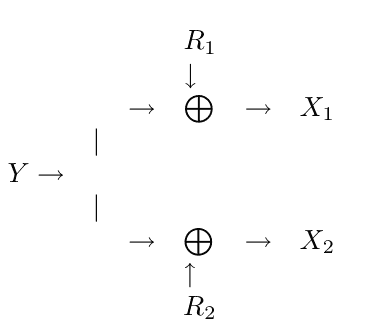

图 8.9说明了方程 (8.75)中随机变量之间的关系对于例8.8。

假设 Y, R_1和 R_2是相互不相关的，并且 R_1和 R_2具有零均值和相等的方差。我们希望找到 Y的线性 MMSE估计器，给定 X_1和 X_2的测量值。这个估计器的形式为 Y_ℓ = a_0 + a_1X_1 + a_2X_2。我们要求 Y_ℓ是无偏的，这导致了约束条件

```
a_0 = \mu_Y - a_1\mu_{X_1} - a_2\mu_{X_2} = \mu_Y(1-a_1-a_2)
```

接下来，我们需要写出正规方程，这需要一些预备计算。由于

```
X_1 = Y + R_1
X_2 = Y + R_2
```

而 Y, R_1和 R_2是相互不相关的，我们发现

```
E[X_i^2] = E[Y^2] + E[R_i^2],
E[X_1X_2] = E[Y^2],
E[X_iY] = E[Y^2].
```

因此，这种情况下的正规方程变为

```
    [ σ_Y^2 + σ_R^2    σ_Y^2 ] [ a_1 ] = [ σ_Y^2 ]
    [ σ_Y^2    σ_Y^2 + σ_R^2 ] [ a_2 ]   [ σ_Y^2 ]
```

从中我们得出结论

```
    [ -a_1 ] = 1 / ((σ_Y^2 + σ_R^2)^2 - σ_Y^4) * [ σ_Y^2 + σ_R^2    -σ_Y^2 ] [ σ_Y^2 ]
    [  a_2 ]   (σ_Y^2 + σ_R^2)^2 - σ_Y^4     [ -σ_Y^2    σ_Y^2 + σ_R^2 ] [ σ_Y^2 ]
           = (σ_Y^2) / (2σ_Y^2 + σ_R^2) * [ 1 ]
```

最后，因此，

```
    Y_e = 1 / (2σ_Y^2 + σ_R^2) * (σ_R^2 * μ_Y + σ_Y^2 * X_1 + σ_Y^2 * X_2)
```

应用(8.73)我们得到相关的最小均方误差(MMSE)为

```
    (σ_Y^2 * σ_R^2) / (2σ_Y^2 + σ_R^2)
```

可以轻松验证估计器和相关的MMSE都取实数值
在信噪比的极端范围内，可以得到合理的值 σ_Y^2 / σ_R^2

## 随机过程

## 引言

在信号和系统的背景中，我们假设你已经专注于LTI系统对确定性信号的影响，开发了分析这类信号和系统的工具，并利用所学内容来理解通信（例如AM和FM调制），控制（例如反馈系统的稳定性）和信号处理（例如滤波）中的应用。对于将LTI系统对信号的影响建模为概率实验结果的信号，即一类被称为随机信号（也称为随机过程或随机过程）的信号，发展相应的理解和工具非常重要。这类信号在信号和系统的设计和分析中起着核心作用，并贯穿本文的其余部分。在本章中，我们通过相关信号的集合定义随机过程，并开始探索它们的属性。在接下来的章节中，我们将使用随机过程作为通信、控制和信号处理应用中出现的随机或不确定信号的模型。

## 9.1 定义和随机过程的示例

在第7.3节中，我们将随机变量X定义为将概率实验的每个结果映射到实数的函数。类似地，实值连续时间（CT）或离散时间（DT）随机过程X(t)或X[n]分别是将概率实验的每个结果映射到实值连续时间或离散时间信号的函数，称为该实验中随机过程的实现。对于任意固定的时间点t=t₀或n=n₀，量X(t₀)和X[n₀]只是随机变量。可以由随机过程产生的信号集合被称为随机过程中的信号集合。

### 示例9.1 随机振荡器

作为随机过程的一个例子，想象一下一个仓库，其中包含N个谐振器，每个谐振器产生某个特定振幅、频率和相位的正弦波形，对于不同的振荡器，这些参数可能是不同的。导致信号集合的概率实验包括根据某个概率质量函数（PMF）选择一个振荡器，该函数为从1到N的每个数字分配一个概率，以便选择第i个振荡器。

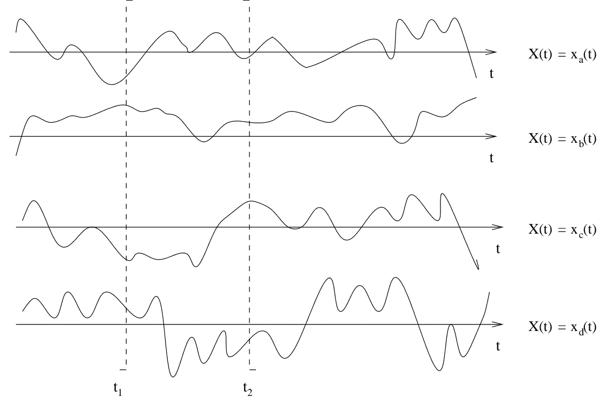

具有概率 $p_i$ 的 与此实验的每个结果相关的是一个特定的正弦波形。

在示例9.1中，在选择振荡器之前，对实验结果的幅度、频率和相位存在不确定性。因此，对于这个示例，我们可以将随机过程表示为

```
X(t) = A sin(\omega t + \phi)
```

其中幅度 A、频率 \omega 和相位 \phi 都是随机变量。在某个特定时间 $t_1$ 的值 $X(t_1)$ 也是一个随机变量。在这个实验的背景下，如果我们知道选择振荡器中涉及的数字 1 到 N 的每个数字的 PMF，以及每个振荡器的具体幅度、频率和相位，我们可以确定上述任何一个随机变量 A、\omega、\phi 或 $X(t_1)$ 的概率分布。

在本章和后面的章节中，我们将考虑许多其他随机过程的示例。然而，在这一点上重要的是要形成一个关于随机过程的良好心理图像。随机过程不仅仅是一个信号，而是一组信号的集合，如下图所示。每个波形都是确定性的，但是过程是概率的或随机的，因为不知道先验地将生成哪个波形。因此，在获得概率实验的结果之前，信号的许多方面是不可预测的，因为与产生哪个信号相关的不确定性。实验之后，或者后验地，结果是完全确定的。

如果我们关注随机过程 $X(t)$ 在特定时间点 $t_1$ 的取值，即在固定时间点上观察整个集合，我们得到一个随机变量，即 $X(t_1)$。如果我们关注在任意一组 $l$ 个固定时间点 $t_1 < t_2 < \cdots < t_l$ for 一些任意整数 $l$，我们正在处理一组 $l$ 个联合分布的随机变量，变量 $X(t_1), X(t_2), \cdots, X(t_l)$，所有这些变量都由结果一起确定。潜在的概率实验。从这个角度来看，随机过程


可以将其视为由t（或在DT情况下为 n）索引的联合分布随机变量的族。对此随机变量集合的完全概率描述需要在任意时间点上取样的信号的多个样本的联合概率密度函数：

```
f_{X(t_1), X(t_2), \cdots, X(t_\ell)}(x_1, x_2, \cdots, x_\ell)
```

对于所有 ℓ和所有 t_1, t_2, \cdots, t_\ell.

在本书的后面章节中，我们在处理随机过程时会遇到一系列重要的问题，即通过观察随机过程的一部分结果，我们能否确定完整的結果。答案将取决于随机过程的细节，但一般而言，答案是否定的。对于某些随机过程，观察给定时间间隔内的结果可能提供足够的信息来确定确切的集合成员。在其他情况下，这是不够的。我们将在后面更详细地探讨其中的一些方面，但在本节中，我们用两个额外的例子来结束。

## 9.2 严格意义上的平稳性

一般来说，我们预期通过在任意次数k的任意时间对随机过程进行采样得到的随机变量的联合概率密度函数将是时变的，即联合概率密度函数

```
f_{X(t_1), \cdots, X(t_k)}(x_1, \cdots, x_k)
```

将取决于具体的t_1, \cdots, t_k的值。如果所有的联合概率密度函数都保持不变在任意时间偏移下，即如果

```
f_{X(t_1), \cdots, X(t_k)}(x_1, \cdots, x_k) = f_{X(t_1+\tau), \cdots, X(t_k+\tau)}(x_1, \cdots, x_k)
```

对于任意的 \tau，如果随机过程被称为严格平稳（SSS）。

换句话说，对于严格平稳过程，统计量仅依赖于采样的相对时间，而不依赖于绝对时间。

### 例子9.4 表示独立同分布过程

考虑一个随机过程，其值 X[n] 可以被视为独立地从固定的概率密度函数 $f_X(x)$ 中在每个时间 n 选择，因此这些值是独立同分布的，从而产生了所谓的独立同分布过程。这种过程在建模和仿真中被广泛使用。例如，如果一个特定的

## 9.3 宽松平稳性

对我们来说，一种不太受限制的平稳性类型特别有用。具体来说，如果均值 $\mu_X(t_i)$ 与时间无关，并且自相关 $R_{XX}(t_i, t_j)$ 或等价地自协方差 $C_{XX}(t_i, t_j)$ 仅依赖于时间差 $(t_i - t_j)$，则该过程被称为宽松平稳（WSS）。显然，一个SSS的过程也是WSS的。因此，对于一个WSS随机过程 $X(t)$，我们有

```
\mu_X(\text{时间}) = \mu_X
```

```
R_{XX}(\text{时间}_1, \text{时间}_2) = R_{XX}(\text{时间}_1 + \alpha, \text{时间}_2 + \alpha) \text{ 对于每个 } \alpha
```

```
= R_{XX}(\text{时间}_1 - \text{时间}_2, 0)
```

（请注意，对于高斯过程（即，其样本始终是联合高斯的过程），WSS意味着SSS，因为联合高斯变量完全由它们的联合一阶和二阶矩决定。）

如果两个随机过程 $X(\text{时间})$ 和 $Y(\text{时间})$ 的一阶和二阶矩（包括交叉协方差）是平稳的，则它们是联合WSS的。在这种情况下，我们使用符号 $R_{XY}(\tau)$ 表示 $E[X(\text{时间} + \tau)Y(\text{时间})]$。

### 例子 9.5 随机振荡器再探

再次考虑谐振子，如例子 9.1 中介绍的，即

```
X(t; A, \Theta) = A \cos(\omega_0 t + \Theta)
```

其中 $A$ 和 $\Theta$ 是独立的随机变量，现在 $\omega_0$ 被固定在某个已知值上。

如果 $\Theta$ 实际上被固定在常数值 $\theta_0$ 上，那么每个结果的形式为 $x(t) = A \cos(\omega_0 t + \theta_0)$，很容易看出这个过程不是 WSS。

（因此也不是SSS）。例如，如果 A有一个非零的均值， $\mu_A = 0$，那么过程的期望值，即 $\mu_A \cos(\omega_0 t + \theta_0)$，是随时间变化的。为了证明即使 $\mu_A = 0$，这个过程也不是WSS，我们可以检查自相关函数。注意，对于所有使得 $\omega_0 t + \theta_0$ 是奇数倍的 $\pi /2$ 的值， $x(t)$ 的值都固定为 0，并且在这些点之间取值为 $\pm A$ 的一半；相应地，这些在时间上间隔为 $\pi/\omega_0$ 的样本之间的相关性可以是 0（在前一种情况下）或 $-E[A^2]$（在后一种情况下）。因此，这个过程不是WSS。另一方面，如果 $\Theta$ 在 $[-\pi, \pi]$ 上均匀分布，则

```
\int_{-\pi}^{\pi} \frac{1}{2\pi} \cos(\omega_0 t + \theta) d\theta = 0
```

```
C_{XX}(t_1, t_2) = R_{XX}(t_1, t_2)
```

```
= E[A^2]E[\cos(\omega_0 t_1 + \Theta)\cos(\omega_0 t_2 + \Theta)]
```

```
= \frac{E[A^2]}{2} \cos(\omega_0(t_2 - t_1))
```

所以这个过程是WSS。尽管这不是完全直接的，但也可以证明它是SSS。

为了简化WSS过程的表示，我们将相关函数写为 $R_{XX}(t_1 - t_2)$； $t_1 - t_2$ 被称为计算相关性的滞后。在大多数情况下，我们处理的随机过程都是WSS过程。当只考虑一阶和二阶矩而不是整个PDF或CDF时，区分随机过程 $X(t)$ 和其具体实现 $x(t)$ 将不那么重要——因此我们将进一步简化表示法，使用小写字母来表示随机过程本身。因此，我们将谈论随机过程 $x(t)$，并且在WSS情况下，用 $\mu_x$ 表示其均值，用 $E\{x(t + \tau)x(t)\}$ 表示其相关函数，用 $R_{xx}(\tau)$ 表示。相应地，对于DT，我们将引用随机过程 $x[n]$，并且（在WSS情况下）用 $\mu_x$ 表示其均值，用 $E\{x[n + m]x[n]\}$ 表示其相关函数，用 $R_{xx}[m]$ 表示。

## 9.3.1 WSS相关性和协方差函数的一些性质

很容易证明，对于实值WSS过程 $x(t)$ 和 $y(t)$，相关性和协方差函数具有以下对称性质：

```
R_{xx}(\tau) = R_{xx}(-\tau)
```

```
R_{xy}(\tau) = R_{yx}(-\tau)
```

```
C_{xx}(\tau) = C_{xx}(-\tau)
```

```
C_{xy}(\tau) = C_{yx}(-\tau)
```

从(9.13)我们可以看出，自相关和自协方差具有偶对称性。类似的性质也适用于DT WSS过程。

相关性和协方差函数的另一个重要性质是，两个随机变量的相关系数的大小不超过1。将这个事实应用到随机过程的样本 $x(t)$ 和 $x(t + \tau)$ 上，直接得出结论：

```
- C_{xx}(0) \leq C_{xx}(\tau) \leq C_{xx}(0)
```

换句话说，自协方差函数的幅值从不超过原点处的值。在上述每个项中添加 $\mu_x^2$，我们发现以下不等式成立：

```
- R_{xx}(0) + 2\mu_x^2 \leq R_{xx}(\tau) \leq R_{xx}(0)
```

在第10章中，我们将证明相关和协方差函数的傅里叶变换在所有频率上都是实数且非负的，因为这些变换描述了随机过程中预期功率的频率分布。上述对称性约束和界限将作为自然结果得出，但在这里已经值得强调。

## 9.4 定义和符号总结

在本节中，我们总结了一些之前介绍的定义和符号。与第9.3节一样，我们将使用小写字母来表示随机过程，因为我们只处理期望而不是密度。因此，用 $x(t)$ 和 $y(t)$ 表示（实数）随机过程，我们总结如下定义：

| 均值： | $\mu_x(t) \triangleq E\{x(t)\}$ | $9.17$ |
| 自相关： | $\R_{xx}(t_1, t_2) \triangleq E\{x(t_1)x(t_2)\}$ | $9.18$ |
| 互相关： | $\R_{xy}(t_1, t_2) \triangleq E\{x(t_1)y(t_2)\}$ | $9.19$ |
| 自协方差： | $\C_{xx}(t_1, t_2) \triangleq E\{[x(t_1) - \mu_x(t_1)][x(t_2) - \mu_x(t_2)]\} = \R_{xx}(t_1, t_2) - \mu_x(t_1)\mu_x(t_2)$ | $9.20$ |
| 交叉 - 协方差 : | $\C_{xy}(t_1, t_2) \triangleq E\{[x(t_1) - \mu_x(t_1)][y(t_2) - \mu_y(t_2)]\} = \R_{xy}(t_1, t_2) - \mu_x(t_1)\mu_y(t_2)$ | $9.21$ |

## 第170章 随机过程

严格平稳（SSS）：对于所有 $\ell>0$ 和所有采样时刻 $t_1,\cdots,t_{\ell}$， $x(t_1), x(t_2), \cdots, x(t_{\ell})$ 的所有联合统计量仅取决于采样时刻的相对位置。

宽平稳（WSS）：$\mu_x(t)$ 在某个值 $\mu_x$ 上保持恒定，$R_{xx}(t_1, t_2)$ 是一个函数仅关于 $(t_1-t_2)$，在这种情况下简称为 $R_{xx}(t_1-t_2)$；因此 $C_{xx}(t_1, t_2)$ 仅是关于 $(t_1-t_2)$ 的函数，并且写作 $C_{xx}(t_1-t_2)$

联合宽平稳：
$x(t)$ 和 $y(t)$ 分别是宽平稳的，$R_{xy}(t_1, t_2)$ 仅是关于 $(t_1-t_2)$ 的函数，简称为 $R_{xy}(t_1-t_2)$；因此 $C_{xy}(t_1, t_2)$ 仅是关于 $(t_1-t_2)$ 的函数，并且写作 $C_{xy}(t_1-t_2)$

对于WSS过程，我们有连续时间和简化符号表示的情况下，

$R_{xx}(\tau) = E\{x(t+\tau)x(t)\} = E\{x(t)x(t-\tau)\}$

$R_{xy}(\tau) = E\{x(t+\tau)y(t)\} = E\{x(t)y(t-\tau)\}$

以及在离散时间下，

$R_{xx}[m] = E\{x[n+m]x[n]\} = E\{x[n]x[n-m]\}$

$R_{xy}[m] = E\{x[n+m]y[n]\} = E\{x[n]y[n-m]\}$

我们使用相应的（居中）定义和符号来表示协方差：

$C_{xx}(\tau), C_{xy}(\tau), C_{xx}[m], 和 C_{xy}[m]$

值得注意的是，在其他地方使用的替代约定是将 $R_{xy}(\tau)$ 定义为 $R_{xy}(\tau) \triangleq E\{x(t)y(t+\tau)\}$。在我们的符号表示中，这个期望值将被表示为 $R_{xy}(-\tau)$。在阅读其他材料时，务必注意所遵循的符号约定，并且在本文中使用的符号约定也应清楚明确。

## 9.5 进一步的例子

例子9.6 伯努利过程

伯努利过程是一个特定的例子，在之前的示例9.3中已经讨论过，它是一个独立同分布的离散时间过程，

$P(x[n]=1) = p$

$P(x[n]=-1) = (1-p)$

并且每个时间点 $n$ 的值与其他时间点的值是独立的

时间点。简单的计算结果是

$E \{x[n]\} = 2p - 1 = \mu_x$

$E \{x[n+m]x[n]\} = \begin{cases} 1 & m = 0 \\ (2p-1)^2 & m = 0 \end{cases}$

$C_{xx}[m] = E\{(x[n+m]-\mu_x)(x[n]-\mu_x)\}$

= $\{1-(2p-1)^2\}\delta[m] = 4p(1-p)\delta[m]$ .

## 例子 9.7 随机电报波

我们将偶尔提到的一个有用的连续时间随机过程的例子是随机电报波。图 9.4 显示了随机关报波过程的一个代表性样本函数。随机电报波可以通过以下两个特性来定义：

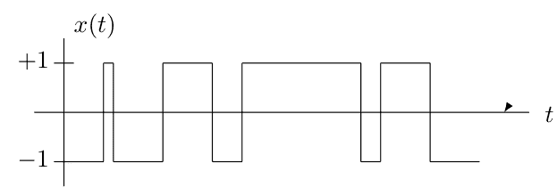

图 9.4 随机电报波的一个实现。

+ 1. $X(0) = \pm1$，概率为 0.5。
2. $X(t)$ 在泊松时间改变极性，即，在长度为 T 的时间间隔内，改变符号的概率为

$P(k 一个长度为 T 的区间内的符号改变次数) = \frac{(\lambda T)^k e^{-\lambda T}}{k!} .$

性质2表明，在一个长度为 T 的区间内，非负偶数次符号改变的概率是

$P(非负偶数次符号改变) = \sum_{\substack{k=0 \\ k\text{ 偶数}}}^\infty \frac{(\lambda T)^k e^{-\lambda T}}{k!} = e^{-\lambda T} \sum_{k=0}^\infty \frac{1+(-1)^k}{2} \frac{(\lambda T)^k}{k!}$

使用恒等式

$e^{\lambda T} = \sum_{k=0}^\infty \frac{(\lambda T)^k}{k!}$

我们得到

$P(非负偶次数符号改变 ) = e^{-\lambda T} \frac{e^{\lambda T} + e^{-\lambda T}}{2} = \frac{1}{2} (1 + e^{-2 \lambda T}) .$

同样地，在长度为T的区间内，奇数次符号变化的概率为$\frac{1}{2}(1-e^{-2\lambda T})$。由此可得

$P(X(t) = 1) = P(X(t) = 1|X(0) = 1)P(X(0) = 1) + P(X(t) = 1|X(0) = -1)P(X(0) = -1) = \frac{1}{2}P([0, t]\text{内的偶数次符号变化}) + \frac{1}{2}P([0, t]\text{内的奇数次符号变化}) = \frac{1}{2} \left\{ \frac{1}{2}(1 + e^{-2\lambda t}) \right\} + \frac{1}{2} \left\{ \frac{1}{2}(1 - e^{-2\lambda t}) \right\} = \frac{1}{2} .$

请注意，由于属性I，方程(9.35)最后一行的表达式是不需要的，因为前一行已经让我们得出答案是$\frac{1}{2}$：因为任何区间内的符号变化次数必定是偶数或奇数，它们的概率相加等于1，所以$P(X(t) = 1) = \frac{1}{2}$。然而，如果属性I放宽为$P(X(0) = 1) = p_0 = \frac{1}{2}$，那么上述计算必须一直进行到最后一行，并得出结果

$P(X(t) = 1) = p_0 \left\{ \frac{1}{2}(1 + e^{-2\lambda t}) \right\} + (1-p_0) \left\{ \frac{1}{2}(1 - e^{-2\lambda t}) \right\} = \frac{1}{2} \{1 + (2p_0 - 1) e^{-2\lambda t} \} .$

回到属性1成立的情况，所以 $P(X(t) = 1)$，我们得到

$\mu_X(t) = 0, \text{ and}$

$R_{XX}(t_1, t_2) = E[X(t_1)X(t_2)]$

= $1 \times \text{P}(X(t_1) = X(t_2)) + (-1) \times \text{P}(X(t_1) = -X(t_2))$

= $e^{-2\lambda |t_1-t_2|}$ .

换句话说，这个过程是指数相关的且WSS。

## 9.6 遍历性

遍历性的概念很复杂而微妙，但基本思想在这里描述。通常情况下，我们观察随机过程的结果（例如，我们记录噪声波形）并通过对接一个集合成员的测量来表征随机过程的统计特性。例如，我们可以考虑波形的时间平均值来表示过程的均值（假设这个均值对于所有时间都是恒定的）。我们还可以构建直方图，表示波形在不同幅度区间内所占的时间比例（而不是概率加权的集合比例），这可以反映在特定采样时间获得的值在集合中的概率密度。如果随机过程的行为几乎每个特定实现随时间的变化都代表了整个集合的行为，那么这个过程被称为遍历性。

一个不符合遍历性质的简单例子是例子9.2，一个电池组。显然，对于这个例子，任何一个实现的行为都不能代表整个电池组的行为。

可以定义更狭义的遍历性质。例如，如果时间平均

```
⟨x⟩ = 极限_{T→∞} \frac{1}{2T} \int_{-T}^{T} x(t) dt
```

几乎总是（即对于几乎每个实现或结果），等于电池组的平均值 $\mu_X$，那么这个过程被称为均值遍历性质的。例如，可以证明，一个在每个时刻具有有限方差且协方差函数在大滞后时趋近于0的WSS过程在均值上是遍历性质的。注意一个（非平稳的）具有时变均值的过程不能在均值上是遍历性质的。

在我们对随机过程的讨论中，我们主要关注随机过程的一阶和二阶矩。虽然一般情况下确定一个随机过程是否遍历是非常困难的，但是有一些标准（以过程的矩为基础）可以确定遍历性在均值和自相关中成立。然而，通常情况下，为了方便起见，我们会假设这种遍历性成立，即使没有证据证明这种假设是合理的。在这种假设下，均值和自相关可以通过对单个集合成员进行时间平均来获得，具体计算如下：

```
E\{x(t)\} = \lim_{T\to\infty} \frac{1}{2T} \int_{-T}^{T} x(t)dt
```

和

```
E\{x(t)x(t+\tau)\} = \lim_{T\to\infty} \frac{1}{2T} \int_{-T}^{T} x(t)x(t+\tau)dt
```

对于满足(9.40)和(9.41)的随机过程被称为二阶遍历。

## 9.7 随机过程的线性估计

在通信、控制和信号处理的各个方面，一个常见的问题类别涉及从观测中估计一个随机过程

从另一个随机过程的观测中估计（预测）未来值。例如，在通信系统中，接收器上的信号是传输信号的受损（例如，噪声）版本，我们希望从接收信号中估计传输信号。其他例子包括从过去的观测中预测天气和金融数据。我们将在后面的章节中更详细地讨论这个通用主题，但在这里初步了解它对理解随机过程是有益的。

我们首先考虑一个随机过程的线性预测的简单例子，然后是一个更复杂的线性有限脉冲响应滤波的噪声干扰过程的例子，以估计底层的随机信号。我们在本节中总结了一些关于从另一个测量中线性估计一个随机变量的基本问题的进一步讨论。

## 9.7.1 线性预测

作为线性预测的一个简单示例，考虑一个离散时间过程 $x[n]$。在已知时间 $n_0$ 的值的情况下，我们可能希望预测未来 $m$ 个样本的值，即在时间 $n_0+m$ 的值。我们将预测策略限制为线性的，即用 $\hat{x}[n_0+m]$ 表示预测值，我们限制 $\hat{x}[n_0+m]$ 的形式为

$\hat{x}[n_0 + m] = a x[n_0] + b$

并选择预测参数 $a$ 和 $b$ 以最小化期望值的平方误差，即选择 $a$ 和 $b$ 以最小化

$\epsilon = E{(x[n_0 + m] - \hat{x}[n_0 + m])^2}$

或者

$\epsilon = E{(x[n_0 + m] - a x[n_0] - b)^2}.$

为了最小化 $\epsilon$，我们将对其对每个参数的偏导数设为零，并解出参数值。得到的方程为

$E{(x[n_0 + m] - a x[n_0] - b) x[n_0]} = E{(x[n_0 + m] - x[n_0 + m]) x[n_0]} = 0$

$E{x[n_0 + m] - a x[n_0] - b} = E{x[n_0 + m] - x[n_0 + m]} = 0 .$

方程式（9.45a）表明，与最优估计相关的误差 $x[n_0 + m] - x[n_0 + m]$ 与可用数据 $x[n_0]$ 正交。方程式（9.45b）表明估计是无偏的。

在前面的方程式中进行乘法和期望运算，得到以下方程式，可以解出所需的常数。

$R_{xx}[n_0 + m, n_0] - a R_{xx}[n_0, n_0] - b \mu_x[n_0] = 0$

$\mu_x[n_0 + m] - a \mu_x[n_0] - b = 0.$

如果我们假设过程是WSS的，即 $R_{xx}[n_0+m, n_0] = R_{xx}[m], R_{xx}[n_0, n_0] = R_{xx}[0]$，并且假设它的均值为零，（$\mu_x = 0$），那么方程（9.46）简化为

$a = R_{xx}[m]/R_{xx}[0]$

$b = 0$

以便

$x[n_0 + m] = \frac{R_{xx}[m]}{R_{xx}[0]} x[n_0]$.

如果过程不是零均值的，那么很容易看出

$x[n_0 + m] = \mu_x + \frac{C_{xx}[m]}{C_{xx}[0]} (x[n_0] - \mu_x)$ .

这个问题的扩展将考虑如何在有几个过去值的测量可用时进行预测。与其追求这种情况，我们在稍微不同的环境中展示下如何处理几个测量值。

## 9.7.2 线性有限脉冲响应滤波

作为另一个例子，在第11章关于Wiener滤波的更一般的讨论中，考虑一个被加性噪声 $ d[n] $ 破坏的离散时间信号 $ s[n] $。例如， $ s[n] $ 可能是通过信道传输的信号， $ d[n] $ 是信道引入的噪声。接收到的信号 $ r[n] $ 则为

$r[n] = s[n] + d[n]$.

假设 $ s[n] $ 和 $ d[n] $ 都是零均值的随机过程，并且不相关。在接收端，我们希望使用因果FIR（有限冲激响应）滤波器处理 $ r[n] $ 以估计传输的信号 $ s[n] $。

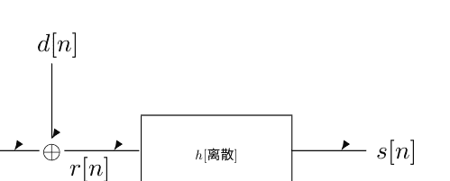

图 9.5 估计受噪声干扰的信号。

如果 $ h[n] $ 是一个因果 FIR 滤波器，长度为 $ L $，则

$s[n] = \sum_{k=0}^{L-1} h[k] r[n-k]$.

## 9.8 线性时不变系统对宽平稳过程的影响

您之前在信号和系统以及本笔记的前几章中的背景，已经描述了线性时不变系统如何影响确定性信号的输入。

我们将在后面的章节中看到，随机过程的相关性质以及线性时不变系统对这些性质的影响，在理解和设计滤波、信号检测、信号估计和系统识别等任务中起着重要作用。在本节中，我们重点关注在时域中如何理解线性时不变系统如何塑造随机过程的相关性质。在第10章中，我们在频域中建立了一个类似的图像，确认了随机信号的预期功率的频率分布由自相关函数的傅里叶变换描述。

考虑一个输入为WSS随机过程的样本函数的LTI系统，即从构成随机过程的集合中通过概率实验选择的信号 $x(t)$；更简单地说，我们可以说输入是随机的

过程 $x(t)$。 WSS输入的特征是其均值和自协方差或（等价地）自相关函数。

除其他考虑外，我们还想知道输出过程 $y(t)$ - 即作为输入集合响应的信号的集合 - 是否也是WSS，并且想确定其均值和自协方差或自相关函数，以及其与输入过程的互相关。
对于冲激响应为 $h(t)$ 的LTI系统，输出 $y(t)$ 由卷积给出

```
y(t) = \int_{-\infty}^{+\infty} h(v)x(t-v)dv = \int_{-\infty}^{+\infty} x(v)h(t-v)dv
```

对于任何特定的输入 $x(t)$，卷积是良定义的。如果输入 $x(t)$ 有界且系统是有界输入有界输出（BIBO）稳定的，那么卷积是良定义的，例如 $h(t)$ 是绝对可积的。图9.6显示了卷积积分中两个被积函数的形状。

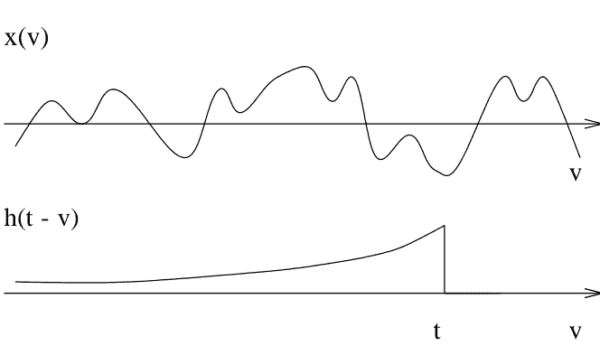

我们不需要要求输入过程的每个样本函数都有界，假设 $E[x^2(t)] = R_{xx}(0)$ 有限即可满足我们下面的卷积计算，在这个假设下，并且假设系统是BIBO稳定的，我们确保 $y(t)$ 是一个良定义的随机过程，并且我们在下面进行的形式化操作，例如交换期望和卷积，都可以通过超出我们范围的方法更严格地证明。事实上，我们得到的结果也可以适用于输入过程没有有界二阶矩的情况，例如当 $x(t)$ 是所谓的CT白噪声时，其中 $R_{xx}(\tau) = \delta(\tau)$。结果也可以应用于不是BIBO稳定的系统，只要它有良定义的频率响应 $H(j\omega)$，例如理想低通滤波器的情况。

我们可以使用卷积关系（9.56）来推导出 $y(t)$ 的一阶和二阶性质。我们将要证明的是 $y(t)$ 本身是WSS，并且

© Alan V. Oppenheim和 George C. Verghese， 2010

## 第178章 随机过程

x(t)和 y(t)实际上是联合WSS的。我们还将建立输出的自相关和输入与输出之间的互相关关系。

首先，考虑输出的均值。对（9.56）的两边取期望值，我们得到

E[y(t)] = E{ ∫_{-∞}^{+∞} h(v)x(t - v) dv }
         = ∫_{-∞}^{+∞} h(v)E[x(t - v)] dv
         = ∫_{-∞}^{+∞} h(v)μ_x dv
         = μ_x ∫_{-∞}^{+∞} h(v) dv
         = H(j0) μ_x = μ_y.

换句话说，输出过程的均值是常数，等于输入的均值乘以系统的直流增益。如果系统的输入保持不变，那么系统的响应也将如此。

前面的结果和系统的线性性质还使我们得出结论，将零均值WSS过程 x(t) - μ_x应用于稳定LTI系统的输入，将导致零均值过程 y(t) - μ_y在输出端。这个事实将在将相关函数的结果转化为协方差函数的结果时非常有用。

接下来考虑输出和输入之间的互相关：

E{y(t + τ)x(t)} = E{ [ ∫_{-∞}^{+∞} h(v)x(t + τ - v)dv ] x(t) }
                 = ∫_{-∞}^{+∞} h(v)E{x(t + τ - v)x(t)}dv.

由于 x(t)是 WSS， E{x(t + τ - v)x(t)} = R_{xx}(τ - v)，所以

E{y(t + τ)x(t)} = ∫_{-∞}^{+∞} h(v)R_{xx}(τ - v)dv
                 = h(τ) * R_{xx}(τ)
                 = R_{yx}(τ).

注意，互相关仅取决于输出和输入过程之间的滞后 τ，而不取决于滞后 τ和绝对时间位置 t。此外，输出和输入之间的互相关与输入的自相关有确定性关系，并且可以视为如果系统输入是自相关函数，则会产生的信号，如图9.7所示。

## 第9.8节 线性时不变系统对宽平稳过程的影响179

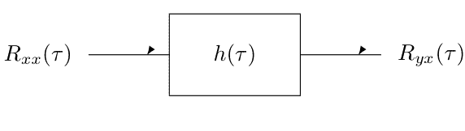

# 图 9.7 方程的表示式 (9.59)

我们还可以得出结论

R_{xy}(\tau) = R_{yx}(-\tau) = R_{xx}(-\tau) * h(-\tau) = R_{xx}(\tau) * h(-\tau), \quad (9.60)

其中第二个等式来自于方程(9.59)和卷积中两个函数的时间反转导致结果的时间反转，而最后一个等式来自于自相关函数的对称性方程(9.13)。

上述关系也可以用协方差函数来表示，而不是相关函数。为此，只需考虑输入系统为零均值WSS过程 x(t) - μ_x，相应的零均值输出为 y(t) - μ_y。由于 x(t) - μ_x 的相关函数与 x(t) 的协方差函数相同，即

R_{x-μ_x,x-μ_x}(\tau) = C_{xx}(\tau), \quad (9.61)

当每个相关函数被相应的协方差函数替换时，上述结果保持不变。因此，例如，我们有

C_{yx}(\tau) = h(τ) * C_{xx}(τ), \quad (9.62)

接下来我们考虑输出 y(t)的自相关性：

E{y(t+\tau)y(t)} = E{ [ ∫_{-∞}^{+∞} h(v)x(t+\tau-v)dv ] y(t) }

= ∫_{-∞}^{+∞} h(v)E{x(t+\tau-v)y(t)}dv

= ∫_{-∞}^{+∞} h(v)R_{xy}(\tau-v)dv

= h(τ) * R_{xy}(τ)

= R_{yy}(τ), \quad (9.63)

注意，输出的自相关仅取决于 τ，而不是 τ 和 t 两者。将这一点与之前的结果结合起来，我们得出结论，x(t) 和 y(t) 是联合 WSS 的，正如所述。

## 协方差的对应结果是

C_{yy}(τ) = h(τ) * C_{xy}(τ).

将(9.63)与(9.60)结合起来，我们发现

R_{yy}(τ) = R_{xx}(τ) * h(τ) * h(-τ) = R_{xx}(τ) * \overline{R}_{hh}(τ),

其中，$\overline{R}_{hh}(\tau)$是$h(\tau)$的确定性自相关函数，定义为

$$\overline{R}_{hh}(\tau) = ∫_{-∞}^{+∞} h(t + \tau)h(t)dt.$$

这些关系的对应傅里叶和 Z变换表述为：

$$\begin{aligned} \mu_y &= H(e^{j\Omega})\mu_x, \quad S_{yx}(e^{j\Omega}) = S_{xx}(e^{j\Omega})H(e^{j\Omega}), \quad S_{yy}(e^{j\Omega}) = S_{xx}(e^{j\Omega})|H(e^{j\Omega})|^2, \\ \mu_y &= H(1)\mu_x, \quad S_{yx}(z) = S_{xx}(z)H(z), \quad S_{yy}(z) = S_{xx}(z)H(z)H(1/z). \end{aligned}$$

所有这些表达式也可以用于协方差及其变换。

我们在本章迄今为止所发展的基本关系非常强大。在第10章中，我们将使用这些关系来说明自相关函数的傅里叶变换如何描述WSS过程的期望功率在频率上的分布。因此，自相关函数的傅里叶变换被称为过程的功率谱密度（PSD）。

本章中所发展的关系在使用随机过程测量或识别LTI系统的脉冲响应方面也非常重要。例如，根据（9.70），如果输入x[n]到DT LTI系统是一个具有自相关函数 $R_{xx}[m] = \delta[m]$的WSS随机过程，则通过测量输入和输出之间的互相关，我们可以获得系统脉冲响应的测量结果。很容易构造一个具有自相关函数 $\delta[m]$的输入过程，例如，在每个时刻上取值+1和 -1的i.i.d.过程。

作为另一个例子，假设输入到一个CT LTI系统的信号是一个随机电报波，在与到达泊松过程中的到达时间相对应的时间点上改变符号，即

$$P(\text{在长度为}T\text{的区间内有}k\text{次切换}) = \frac{(\lambda T)^k e^{-\lambda T}}{k!}.$$

然后，假设x(0)以相等的概率取值±1，我们可以确定过程x(t)具有零均值和相关函数$R_{xx}(\tau) = e^{\Lambda(-2\lambda|\tau|)}$，因此它是WSS（对于$t \geq 0$）。如果我们确定输出$y(t)$的互相关$R_{yx}(\tau)$，然后使用关系

$$R_{yx}(\tau) = R_{xx}(\tau) * h(\tau),$$

我们可以获得系统的冲激响应 $h(\tau)$。例如，如果 $S_{yx}(s)$，$S_{xx}(s)$和$H(s)$表示相关的拉普拉斯变换，则

$$H(s) = \frac{S_{yx}(s)}{S_{xx}(s)}.$$

注意 $S_{xx}(s)$在这种情况下是一个相当良好的复变量 $s$的函数，而过程 $x(t)$的任何特定样本函数都没有这样一个良好的变换。同样的评论也适用于 $S_{yx}(s)$。

作为第三个例子，假设我们知道输入 x[n]的自相关函数 R_{xx}[m]，但无法访问 x[n] 和因此无法确定与输出 y[n]的互相关 R_{yx}[m]，但可以确定输出的自相关 R_{yy}[m]。例如，如果

R_{xx}[m] = \delta[m]

我们确定 R_{yy}[m] 为 R_{yy}[m] = \left(\frac{1}{2}\right)^{|m|}，然后

R_{yy}[m] = \left(\frac{1}{2}\right)^{|m|} = \overline{R}_{hh}[m] = h[m] * h[-m].

等价地，H(z)H(z^{-1}) 可以从 R_{yy}[m] 的 Z变换 S_{yy}(z) 获得。额外的假设或约束，例如系统及其逆的稳定性和因果性可以通过知道 H(z)H(z^{-1}) 来恢复H(z)。

## 第10章 功率谱密度

## 引言

了解信号在频率域中的强度分布，相对于其他环境信号的强度，对于设计任何旨在提取或抑制信号的LTI滤波器至关重要。我们在确定性信号的情况下非常了解这一点，而事实证明在随机信号的情况下也同样如此。例如，如果测量的波形是音频信号（被建模为随机过程，因为具体的音频信号未知），并且存在加性干扰信号，您可能希望构建一个低通LTI滤波器来提取音频并抑制干扰信号。我们需要决定滤波器的截止频率放在哪里。

在尝试为WSS随机过程找到适当的频域描述时，我们面临两个直接的挑战。首先，单个样本函数通常没有频率的普通、良好行为的变换；相反，它们的变换只在广义函数的意义下定义。其次，由于特定的样本函数是作为概率实验的结果确定的，它的特征实际上是随机的，因此我们必须寻找变换的特征，这些特征代表整个样本函数类，即整个随机过程。

事实证明，关键是要专注于信号中的预期功率。这是信号强度的度量，与我们在本章中展示的WSS过程的二阶矩特性非常契合。对于一个二阶遍历过程，这也对应于任何实现中的时间平均功率。我们以CT WSS过程为例介绍讨论，但DT情况非常类似。

## 10.1 预期瞬时功率和功率谱密度

受到x(t)是通过（或通过）单位电阻的电压的情况的启发，我们将x(t)的平方(x²(t))称为x(t)信号的瞬时功率。当x(t)是WSS时，预期瞬时功率由以下公式给出

```
E[x²(t)] = \frac{1}{2\pi} \int_{-\infty}^{\infty} S_{xx}(jω) dω .
```

© Alan V. Oppenheim 和 George C. Verghese，2010

## 10.2 爱因斯坦-维纳-欣钦关于期望时间平均功率的定理

前一节将PSD定义为自相关函数的变换，并解释了这个变换的含义。现在我们来开发一种替代的PSD计算方法。考虑一个WSS过程的随机实现 x(t)。

我们已经提到了直接计算 CTFT 的困难，所以我们采取了间接的方法。设 x_T(t)是通过对 x(t) 进行窗函数处理得到的信号，因此它在区间 (-T, T) 内与 x(t) 相等，在该区间之外为 0。因此

x_T(t) = w_T(t) x(t) ,

其中我们定义窗函数 w_T(t) 在 t < T 时为 1，在其他情况下为 0。记 X_T(jω) 为 x_T(t) 的 Fourier 变换；请注意，因为信号 x_T(t) 仅在 finite 区间 (-T, T) 上非零，所以它的 Fourier 变换通常是明确定义的。我们知道 x_T(t) 的能量谱密度 (ESD) S_xx(jω) 是给定的

$$\overline{S}_{xx}(j\omega) = |X_T(j\omega)|^2,$$

并且这个 ESD 实际上是 x_T(τ) * x_T^{-}(τ) 的傅里叶变换，其中 x_T^{-}(t) = x_T(-t)。因此我们有 CTFT对

x_T(τ) * x_T^{-}(τ) = ∫_{-∞}^{+∞} w_T(α)w_T(α - τ)x(α)x(α - τ) dα ⇔ |X_T(jω)|²,

或者，将两边除以2T（这是有效的，因为将信号乘以一个常数会使其傅里叶变换乘以相同的量），

$$\frac{1}{2T} ∫_{-∞}^{+∞} w_T(α)w_T(α - τ)x(α)x(α - τ) dα ⇔ \frac{1}{2T} |X_T(j\omega)|^2 .$$

右边的量是我们定义的（对于 DT 情况）作为周期图有限长度信号 x_T(t) 的。

因为傅里叶变换运算是线性的，信号的期望值的傅里叶变换是期望值的傅里叶变换。因此，我们可以对前面的方程两边取期望。由于 E[x(α)x(α - τ)] = R_{xx}(τ)，我们得出结论

R_{xx}(τ)Λ(τ) ⇔ \frac{1}{2T} E[|X_T(jω)|²] ,

其中 Λ(τ) 是一个高度为1的三角脉冲，在原点处衰减到0，当 |τ| = 2T 时，通过进行卷积 w_T * w_T^{-}(τ) 并除以

©Alan V. Oppenheim 和 George C. Verghese, 2010

## 第10.2节 Einstein-Wiener-Khinchin定理关于期望的时间平均功率 187

当输入 $ x[n] $ 是一个伯努利过程时，输出 $ y[n] $ 也将是一个WSS随机过程，而 $ Y(e^{j\Omega}) $ 再次不是一个容易处理的变换。然而，要记住

$$ R_{yx}[m] = h[m] * R_{xx}[m] , $$

（10.11）

所以如果我们可以估计输入和输出的互相关，我们就可以确定脉冲响应（对于这种情况，其中 $ R_{xx}[m] = \delta[m] $）为 $ h[m] = R_{yx}[m] $。对于输入的更一般的随机过程，具有更一般的 $ R_{xx}[m] $，我们可以通过对（10.11）进行傅里叶变换来求解 $ H(e^{j\Omega}) $，得到

$$ H(e^{j\Omega}) = \frac{S_{yx}(e^{j\Omega})}{S_{xx}(e^{j\Omega})} . $$

（10.12）

如果输入不可访问，只知道其自相关（或等效地知道其PSD），那么我们仍然可以确定频率响应的幅度，只要我们可以估计输出的自相关（或PSD）。在这种情况下，我们有

$$ |H(e^{j\Omega})|^2 = \frac{S_{yy}(e^{j\Omega})}{S_{xx}(e^{j\Omega})} . $$

（10.13）

在给定系统的附加约束或知识的情况下，人们通常可以从其幅度的知识中确定更多（甚至全部）关于 $ H(e^{j\omega}) $ 的信息。

## 10.2.3 模拟滤波器和白化滤波器

当涉及到某个随机过程（例如，测量集合）是白色的，即具有平坦的频谱密度时，有一些相对容易制定、解决和分析的检测和估计问题。当过程是有色而不是白色时，如果满足以下条件，仍然可以以某种适当的方式调用白色情况下的更简单结果：

- （a）有色过程是通过将白色过程通过某个LTI建模或塑形滤波器传递而得到的，该滤波器将输入的白色过程塑造成具有给定有色过程在输出上的频谱特性的过程。

- （b）通过将其通过LTI白化滤波器传递，可以将有色过程转换为白色过程，从而将输入处的有色过程的频谱特性变平，与输出处获得的白噪声的频谱特性相同。

建模或塑形滤波器是将白色过程转换为某个有色过程的滤波器，而白化滤波器则将有色过程转换为白色过程。

从建模滤波器的角度思考得出的一个重要结果是以下内容（在这里陈述和证明得相对不严谨，更详细的处理超出了我们的范围）：

## 关键事实：如果一个实函数 $ R_{xx}[m] $ 是一个实值WSS随机过程的自相关函数，那么它的变换 $ S_{xx}(e^{j\Omega}) $ 是实数、偶数且非负的。在这种情况下，变换是该过程的功率谱密度。

这些条件对候选自相关变换的必要性是由我们已经建立的自相关函数和功率谱密度的性质推导出来的。

要论证这些条件也是充分的，假设 $ S_{xx}(e^{j\Omega}) $ 具有这些性质，并且为简单起见，假设它没有脉冲部分。那么它有一个实数和偶数的平方根，我们可以表示为

$$ \sqrt{S_{xx}(e^{j\Omega})} $$

现在构造一个（可能是非因果的）建模滤波器，其频率响应 $ H(e^{j\Omega}) $ 等于这个平方根；这个滤波器的单位样本响应通过反变换 $ H(e^{j\Omega}) $ 得到

$$ h[n] = \frac{1}{2\pi} \int_{-\pi}^{\pi} H(e^{j\Omega}) e^{-j\Omega n} d\Omega $$

如果我们 将一个（零均值）单位方差的白噪声过程，例如，在每个离散时间独立于其他时间以相等的概率取+1和-1的伯努利过程，应用到这个滤波器的输入上，那么输出将是一个具有由 $ |H(e^{j\Omega})|^2=S_{xx}(e^{j\Omega}) $ 给定的功率谱密度的WSS过程，并且具有指定的自相关函数。

如果变换 $ S_{xx}(e^{j\Omega}) $ 在原点处有一个冲激，我们可以通过将适当的常数（由冲激强度确定）添加到建模滤波器的输出中来捕捉到这个冲激。建模滤波器的构造如上所述，仅使用变换的非冲激部分。对于在变换中频率为 $ \Omega = \pm \Omega_0 = 0 $ 的一对冲激，我们可以类似地添加一个形式为 $ A \cos(\Omega_0 n + \Theta) $ 的项，其中 $ A $ 是确定性的（由冲激强度确定），$ \Theta $ 与所有其他变量无关，并且在 $ [0, 2\pi] $ 上均匀分布。

在CT情况下也可以做出类似的陈述。

我们在下面说明设计特定示例的白化滤波器所涉及的逻辑；建模滤波器的逻辑与此类似（实际上是相反的）。

考虑下图10.3所示的离散时间系统。

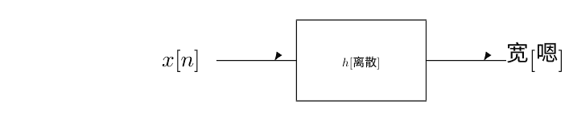

## 图 10.3 离散时间白化滤波器

假设 信号 $ x[n] $ 是具有自相关函数 $ R_{xx}[m] $ 和功率谱密度 $ S_{xx}(\Omega) $ 的过程，即 $ S_{xx}(\Omega) = \mathcal{F}\{R_{xx}[m]\} $。我们希望输出 $ w[n] $ 是一个方差为 $ \sigma^2 $ 的白噪声。

我们知道

$$ S_{ww}(\Omega) = |H(\Omega)|^2 S_{xx}(\Omega) $$

（10.16）

或者，

$$ |H(\Omega)|^2 = S_{xx}(e^{j\Omega}) \frac{\sigma_w^2}{\text{}} $$
（10.17）

这告诉我们线性时不变系统的频率响应的平方幅度必须是多少，才能得到方差为 $ \sigma^2 $ 的白噪声输出。如果我们有 $ S_{xx}(e^{j\Omega}) $ 可以表示为 $ e^{j\Omega} $ 的有理函数（或者可以这样建模），那么我们可以通过适当的因式分解得到 $ H(e^{j\Omega}) $。

## 例子 10.1 白化滤波器

假设

$$ S_{xx}(e^{j\Omega}) = \frac{5}{4} - \cos(\Omega) $$
（10.18）

那么，为了使 $ x(t) $ 白化，我们需要一个稳定的线性时不变滤波器，满足以下条件

$$ |H(e^{j\Omega})|^2 = \frac{1}{(1 - \frac{1}{2} e^{j\Omega})(1 - \frac{1}{2} e^{-j\Omega})} $$
（10.19）

或等效地，

$$ H(z)H(1/z) = \frac{1}{(1 - \frac{1}{2}z)(1 - \frac{1}{2}z^{-1})} $$
（10.20）

为了产生一个WSS输出，滤波器被限制为稳定的。一个导致因果滤波器的 $ H(z) $ 的选择是

$$ H(z) = \frac{1}{1 - \frac{1}{2}z^{-1}} $$
（10.21）

其收敛域（ROC）为 $ |z| > 1 $。这个系统函数可以与任何全通系统的系统函数 $ A(z) $ 相乘，即满足 $ A(z)A(z^{-1}) = 1 $，仍然可以产生相同的白化效果，因为 $ |A(e^{j\Omega})|^2 = 1 $。

## 10.3 带限随机过程的采样

如果WSS随机过程的PSD是带限的，则称其为带限的，即在某个有限频带之外的频率为零。对于带限的确定性信号，我们可以以纳奎斯特速率或更高速率进行采样，并完全恢复信号。我们在这里研究是否可以对带限随机过程做到同样的事情。

在你之前的课程中讨论了对CT信号进行采样和DT处理时，推导和讨论主要依赖于通过频率来描绘效果。

正如你所预期的那样，从样本中重建带限随机过程的结果与确定性情况类似。然而，由于这些随机信号在广义意义上除了时间域之外没有傅里叶变换，因此我们直接在时间域中进行随机过程的发展。

在时间域中，可以使用与确定性信号类似的基本论证（通过检查重建误差中的总能量而不是重建误差中的预期瞬时功率，这是我们下面要关注的内容）。

基本的采样和带限重建过程应该在你之前的信号与系统研究中很熟悉，并且在下面的图10.4中有所描述。在这个图中，我们明确使用粗体大写符号来强调它们是随机过程。

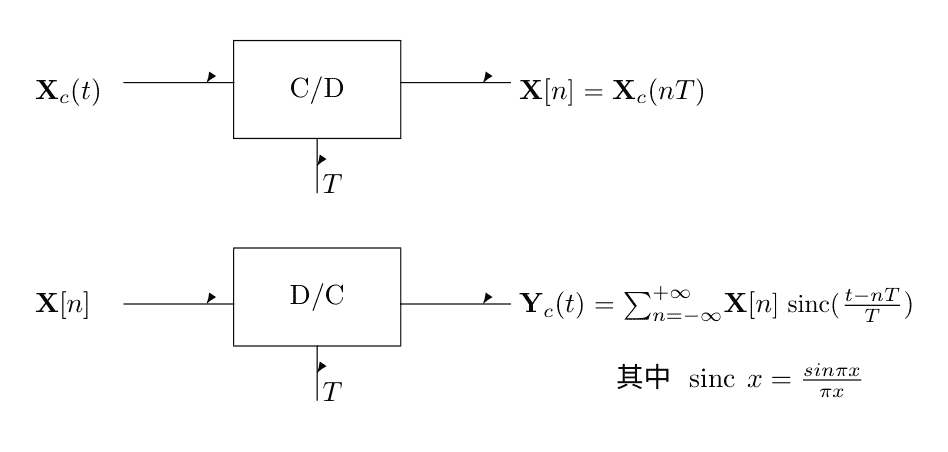

## 图 10.4 随机过程的 C/D和 D/C

对于确定性情况，我们知道如果 $ x_c(t) $ 的带宽限制小于 $ \pi/T $，则使用D/C重建定义为

```
y_c(t) = Σ_{n} x[n] sinc((t - nT)/T)      (10.22)
```

则有 $ y_c(t) = x_c(t) $。对于随机过程的情况，我们下面展示的是，在 $ S_{x_c x_c}(j\omega) $ 的条件下，$ X_c(t) $ 的功率谱密度被限制在小于 $ \pi $ 的范围内，$ X_c(t) $ 和 $ Y_c(t) $ 之间的均方误差为零；即，如果

```
S_{x_c x_c}(j\omega) = 0      |ω| ≥ π/T      (10.23)
```

然后

$$ ℰ ≜ E{[X_c(t) - Y_c(t)]^2} = 0 $$

实际上，这意味着误差中没有“功率”。（本章末尾的问题13中概述了另一种证明方法。）为了得到上述结果，我们展开误差，并使用图10.4中的C/D（或采样）和D/C（或理想带限插值）操作的定义，得到

$$ ℰ = E{X_c^2(t)} + E{Y_c^2(t)} - 2E{Y_c(t)X_c(t)} $$

我们首先考虑最后一项， $ E{Y_c(t)X_c(t)} $:

$$ E{Y_c(t)X_c(t)} = E{ ∑_{n=-∞}^{+∞} X_c(nT) sinc((t - nT)/T) X_c(t) } $$

$$ = ∑_{n=-∞}^{+∞} R_{x_c x_c}(nT - t) sinc((nT - t)/T) $$

在最后一个表达式中，我们引用了sinc(.)的对称性来改变其参数的符号，使其与之前的表达式不同。

方程（10.26）可以使用离散时间中的Parseval关系来计算，该关系表明

$$ ∑_{n=-∞}^{+∞} v[n]w[n] = \frac{1}{2\pi} ∫_{-π}^{π} V(e^{jΩ})W^*(e^{jΩ})dΩ $$

要应用 Parseval关系，请注意 $ R_{x_c x_c}(nT - t) $ 可以被看作是图10.5中所示的C/D或采样过程的结果，在该过程中输入被认为是变量 $ \tau $ 的函数：


在变量 $ \tau $ 的CTFT中， $ R_{x_c x_c}(\tau - t) $ 是 $ e^{-jωt} S_{x_c x_c}(jω) $，由于它在 $ ω < π $ 时是带限的，其采样版本 $ R_{x_c x_c}(nT - t) $ 是

$$ \frac{1}{T} e^{-jΩt} S_{x_c x_c}(jΩ/T) $$

在区间内 $ |Ω| < π $。同样地， sinc(nT - t) 的DTFT是——因此，在 $ S_{x_c} $ 的条件下 $ x_c(jω) $ 在 $ ω < T $ 时带限， $ | | π $

```
E{Y_c(t)X_c(t)} = \frac{1}{2\pi T} ∫_{-\pi}^{\pi} S_{x_c x_c}(\frac{j\Omega}{T})d\Omega \\
= \frac{1}{2\pi} ∫_{-(\pi/T)}^{(\pi/T)} S_{x_c x_c}(j\omega)d\omega \\
= R_{x_c x_c}(0) = E{X_c^2(t)} \\
(10.30)
```

接下来，我们展开方程（10.25）中的中间项：

```
E{Y_c^2(t)} = E{ ∑_{n} ∑_{m} X_c(nT)X_c(mT) \sinc(\frac{t-nT}{T}) \sinc(\frac{t-mT}{T}) } \\
= ∑_{n} ∑_{m} R_{x_c x_c}(nT - mT) \sinc(\frac{t - mT}{T}) \sinc(\frac{t - mT}{T}) \\
(10.31)
```

通过替换 $ n - m = r $，我们可以将 10.31 表示为

```
E{Y_c^2(t)} = ∑_r R_{x_c x_c}(rT) ∑_m \sinc(\frac{t - mT}{T}) \sinc(\frac{t - mT - rT}{T}) \\
(10.32)
```

使用恒等式

```
∑_n \sinc(n - \theta_1)\sinc(n - \theta_2) = \sinc(\theta_2 - \theta_1) \\
(10.33)
```

这再次来自Parseval定理（见本章末尾的问题12），我们有

```
E{Y_c^2(t)} = ∑_r R_{x_c x_c}(rT) \sinc(r) \\
= R_{x_c x_c}(0) = E{X_c^2(t)} \\
(10.34)
```

因为 $ \sinc(r) = 1 $ 当 $ r = 0 $，否则为零。将 10.31 和 10.34 代入 10.25，我们得到 $ \varepsilon = 0 $，正如所期望的。

## 第11章 维纳滤波

## 引言

在本章中，我们将考虑使用LTI系统来执行感兴趣的WSS随机过程的最小均方误差（MMSE）估计，给定另一个相关过程的测量结果。测量结果应用于LTI系统的输入，并且该系统被设计为将其输出作为感兴趣过程的MMSE估计。

我们首先在离散时间中开发结果，并且为了方便起见，假设（除非另有说明）我们处理的过程是零均值的。然后我们将展示在连续时间中存在完全类似的结果，尽管它们的推导在某些部分略有不同。

在离散时间情况下，我们的问题可以用图11.1来表述。这里，x[n]是我们测量到的WSS随机过程。我们想要确定上述LTI系统的单位样本响应或频率响应，使得滤波器输出 y[n]是某个与x[n]联合WSS的“目标”过程的最小均方误差（MMSE）估计。定义误差e[n]为

```
e[n] ≜ y[n] - \hat{y}[n] ,
```

我们希望进行以下最小化操作：

```
 \min_{h[\cdot]} \epsilon = E\{e^{2}[n]\} .
```

得到的滤波器h[n]被称为从x[n]估计y[n]的维纳滤波器。

在某些情况下，将滤波器限制为长度为N的FIR（有限脉冲响应）滤波器是合适或方便的，例如h[n] = 0，除了在区间0 ≤ n ≤ N − 1。在其他情况下，滤波器的脉冲响应可以是无限长的，可以限制为因果的或允许为非因果的。在下一节中，我们讨论FIR和一般的非因果IIR。

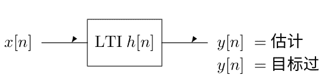

图11.1 DT LTI线性MMSE估计滤波器。

## 11.1 非因果DT维纳滤波器

为了确定(11.2)中的h[n]的最佳选择，我们首先展开(11.2)中的误差准则：

ε = E{ ( Σ(k=-∞到+∞) h[k]x[n-k] - y[n] )^2 }

然后，可以通过设置
∂ε/∂h[m] = 0来获得最小化Q的冲激响应值，其中m的所有值都不受m[ m]限制为零（或否则预先指定）：

∂ε/∂h[m] = E{2(Σ(k) h[k]x[n-k] - y[n]) x[n-m]} = 0

上述方程意味着
E{e[n]x[n-m]}=0，或者
R_ex[m] = 0, 对于所有可以自由选择的m。

R_ex[m] = E{e[n]x[n-m]} = E{(y[n] - y[n])x[n-m]} = R_yx[m] - R_yx[m].

请注意
R_ex[m] = E{e[n]x[n-m]}
= E{(y[n] - y[n])x[n-m]}
= R_yx[m] - R_yx[m].

换句话说，对于最优系统，估计器的输入和输出之间的互相关等于输入和目标输出之间的互相关。

要实际找到脉冲响应值，观察到由于y[n]是通过具有脉冲响应h[n]的LTI系统对x[n]进行滤波得到的，以下关系成立：

R_yx[m] = h[m] * R_xx[m].

)将其与正交性条件的另一种陈述相结合，我们可以写成

h[m] * R_xx[m] = R_yx[m],

或等效地，

\sum_k h[k] R_xx[m-k] = R_yx[m]

方程(11.10)表示一组线性方程，用于求解脉冲响应值。如果滤波器是长度为N的FIR滤波器，则有N个方程和N个未限制的h[n]值。例如，假设h[n]只在n ∈ [0, N-1]时不为零。 条件(11.10)得到与未知数相同数量的方程，可以按照以下矩阵形式排列，你可能会认出这是LMMSE估计的正规方程适当形式，我们在第8章中介绍过：

$$
\begin{bmatrix} R_{xx}[0] & R_{xx}[-1] & \cdots & R_{xx}[1-N] \\
  R_{xx}[1] & R_{xx}[0] & \cdots & R_{xx}[2-N] \\
  \vdots & \vdots & \ddots & \vdots \\
  R_{xx}[N-1] & R_{xx}[N-2] & \cdots & R_{xx}[0] \end{bmatrix}
\begin{bmatrix} h[0] \\
  h[1] \\
  \vdots \\
  h[N-1] \end{bmatrix}
= \begin{bmatrix} R_{yx}[0] \\
  R_{yx}[1] \\
  \vdots \\
  R_{yx}[N-1] \end{bmatrix}.
$$

(11.11)这些方程现在可以求解脉冲响应值。由于这些方程的特殊结构，有高效的方法可以求解未知参数，但进一步讨论这些方法超出了我们课程的范围。

对于IIR滤波器，方程(11.10)必须对无限多个m值成立，因此不能简单地通过用于有限数量线性方程的方法来求解。然而，如果h[n]不限制为因果或FIR，方程(11.10)必须对所有m值从−∞到+∞成立，因此可以应用z变换到方程(11.10)中得到

H(z)S_xx(z) = S_yx(z)

最优传递函数，即结果（维纳）滤波器的传递函数，然后

H(z) = S_yx(z)/S_xx(z)

如果在这个计算中涉及的相关函数中有任何一个不具有z变换，但两者都具有傅里叶变换，那么计算可以在傅里叶变换域中进行。

请注意，上述最优滤波器的表达式与我们在第5章和第7章中得到的表达式之间的相似性，用于将零均值随机变量X乘以零均值随机变量Y产生零均值随机变量的LMMSE估计器的增益σ<sub>YX</sub>/σ<sub>XX</sub>。实际上，通过转换域或频率域，我们将设计分解为一个问题，即在每个频率上都与我们在早期章节中解决的问题一样简单。

正如我们很快会看到的，在连续时间中结果完全相同：

R_yx(τ) = R_yx(τ),

h(τ) * R_xx(τ) = R_yx(τ),

H(s)S_xx(s) = S_yx(s), and

H(s) = S_yx(s)/S_xx(s)

通过直接计算可以确定与最优滤波器相对应的均方误差，即最小MSE。我们留给 你来展示

R_ee[m] = R_yy[m] - R_yy[m] = R_yy[m] - h[m] * R_xy[m]

其中h[m]是最优滤波器的冲激响应。然后，MMSE就是R_ee[0]。在频域中重新写出这个表达式是很有启发性的，但是省略了功率谱S(e<sup>jΩ</sup>)和频率响应H(e<sup>jΩ</sup>)的参数e<sup>jΩ</sup>。 

为了避免符号混乱：

MMSE = R_ee[0] = \frac{1}{2\pi} \int_{-\pi}^{\pi} S_{ee} d\Omega
\, = \frac{1}{2\pi} \int_{-\pi}^{\pi} (S_{yy} - HS_{xy}) d\Omega
\, = \frac{1}{2\pi} \int_{-\pi}^{\pi} S_{yy} \bigg(1 - \frac{S_{yx}S_{xy}}{S_{yy}S_{xx}}\bigg) d\Omega
\, = \frac{1}{2\pi} \int_{-\pi}^{\pi} S_{yy} \bigg(1 - \rho_{yx}\rho_{yx}^*\bigg) d\Omega .

函数ρ<sub>yx</sub>(e<sup>jΩ</sup>)的定义为

ρ<sub>yx</sub>(e<sup>jΩ</sup>) = \frac{S_{yx}(e^{j\Omega})}{\sqrt{S_{yy}(e^{j\Omega})S_{xx}(e^{j\Omega})}}

显然扮演着频域相关系数的角色（与我们之前对两个随机变量的相关系数的定义进行比较）。这个函数有时被称为两个过程的相干函数。

再次注意这个表达式与我们在之前的讲座中得到的表达式σ<sub>YX</sub>(1-ρ<sup>2</sup>)的相似性，获得的（最小）均方误差

## 例子11.1 噪声中的信号估计（滤波）

考虑这样一种情况：观察到一个目标过程y[n]和噪声v[n]的和x[n]：

x[n] = y[n] + v[n] .

)我们希望从我们对x[n]的观察中估计出y[n]。假设信号和噪声不相关，即R<sub>vy</sub>[m] = 0。然后R<sub>xx</sub>[m] = R<sub>yy</sub>[m] + R<sub>vv</sub>[m]，

R<sub>yx</sub>[m] = R<sub>yy</sub>[m],

H(e<sup>jΩ</sup>) = \frac{S_{yy}(e^{jΩ})}{S_{yy}(e^{jΩ}) + S_{vv}(e^{jΩ})} .

在信号功率远大于噪声功率的Ω值处，H(e<sup>jΩ</sup>) ≈ 1。当噪声功率远大于信号功率时，H(e<sup>jΩ</sup>) ≈ 0。例如，当

S<sub>yy</sub>(e<sup>jΩ</sup>) = (1 + e<sup>-jΩ</sup>)(1 + e<sup>jΩ</sup>) = 2(1 + cos Ω) (11.25)并且

噪声是白噪声，最佳滤波器将是一个带有适当形状的低通滤波器，如图11.2所示。请注意，滤波器中

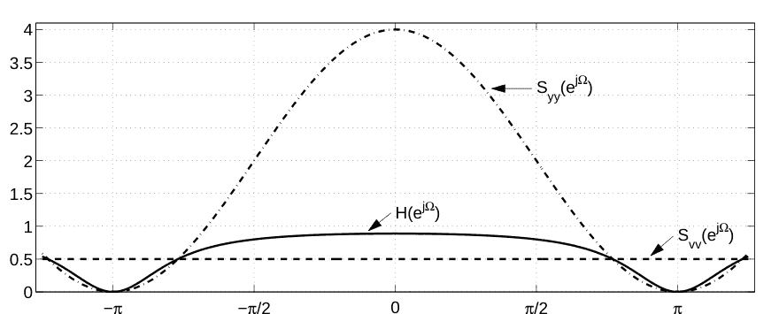

图11.2最佳滤波器频率响应，H(e<sup>jΩ</sup>)，输入信号PSD信号，S<sub>yy</sub>(e<sup>jΩ</sup>)，以及白噪声的PSD，S<sub>vv</sub>(e<sup>jΩ</sup>)。

在这种情况下，必须具有时间的偶函数脉冲响应，因为其频率响应是实数 - 因此是偶函数 - 频率的函数。

图11.3显示了这样一个滤波器的仿真示例（尽管对于一个不同的 S<sub>yy</sub>(e<sup>jΩ</sup>)）。顶部图是感兴趣信号的PSD；中间图显示了信号s[n]和测量信号x[n]；底部图将s[n]的估计与s[n]本身进行了比较。

## 例子11.2 预测

假设我们希望预测测量过程的第$n_0$步，所以

$y[n] = x[n + n_0]$ .

然后

$R_{yx}[m] = R_{xx}[m + n_0]$

所以最佳滤波器具有系统函数

$H(z) = z^{n_0}$ .

这当然不足为奇：因为我们允许滤波器是非因果的，预测并不是一个困难的问题！因果预测要困难得多也更有趣，我们将在本章后面进行讨论。

## 例子11.3 去模糊（或去卷积）


图11.4 维纳滤波器对模糊和噪声信号的滤波。

在图11.4中，$r[n]$ 是一个经过滤波或“模糊”的感兴趣信号 $x[n]$ 的版本，而 $v[n]$ 是与 $x[n]$ 不相关的加性噪声。我们希望设计一个滤波器，能够去模糊带噪声的测量信号 $\xi[n]$ 并产生对输入信号 $x[n]$ 的估计。需要注意的是，在没有加性噪声的情况下，逆滤波器 $1/G(z)$ 将完全恢复输入信号。然而，当存在噪声时，这不是一个好的解决方案，因为逆滤波器会强调那些测量功率相对于噪声较小的频率。因此，我们将设计一个维纳滤波器来产生对信号 $x[n]$ 的估计。

我们已经证明了测量信号（即维纳滤波器的输入）与其输出处产生的估计之间的互相关等于测量过程与目标过程之间的互相关。在变换域中，这个条件的陈述是

$S_{x\xi}(z) = S_{x\xi}(z)$

或者

$S_{\xi\xi}(z)H(z) = S_{x\xi}(z) = S_{x\xi}(z)$ .

我们还知道

$S_{\xi\xi}(z) = S_{vv}(z) + S_{xx}(z)G(z)G(1/z)$

$S_{x\xi}(z) = S_{xr}(z)$

$= S_{xx}(z)G(1/z)$

在上面的第一个等式中，我们使用了 $S_{vr}(z) = G(1/z)S_{vx}(z) = 0$ 这个事实。现在我们可以写成

$H(z) = \frac{S_{xx}(z)G(1/z)}{S_{vv}(z) + S_{xx}(z)G(z)G(1/z)}$

我们留给你去检查这个系统函数在噪声功率非常小或非常大的极限情况下是否具有合理的值。有趣的是，如果我们首先从 $\xi[n]$（如示例11.1中所示）中找到一个MMSE估计值$r[n]$，然后通过逆滤波器$1/G(z)$将其传递，我们将得到相同的整体滤波器。

## 例子11.4 “去复用”

一个消息 $s[n]$ 被传输到一个乘法信道（例如衰落信道）上
以便接收到的信号 $r[n]$ 是

$r[n] = s[n]f[n]$

假设 $s[n]$ 和 $f[n]$ 是零均值且独立的。我们希望使用维纳滤波器从 $r[n]$ 估计 $s[n]$。

再次，我们有

$R_{sr}[m] = R_{sr}^\wedge[m]$
$= h[m] * \frac{R_{rr}[m]}{R_{ss}[m]R_{ff}[m]}$

但我们也知道 $R_{sr}[m] = 0$。因此 $h[m] = 0$。这个例子强调了满足某些约束并最小化某些准则的滤波器的最优性不一定使其成为一个好的滤波器。滤波器的约束和准则必须与预期的任务相关且适当。

例如，如果 $f[n]$ 被认为是独立同分布的，并且在每个时间点上为 $+1$ 或 $-1$，那么简单地对接收到的信号进行平方 $r[n]$ 在任何时间点上至少会给我们提供 $s^2[n]$ 的值，这似乎比维纳滤波器在这种情况下产生的信息更有价值。

## 11.2 非因果CT维纳滤波器

在前面的讨论中，我们推导并说明了离散时间维纳滤波器的FIR和非因果IIR情况。在本节中，我们推导出非因果IIR维纳滤波器的连续时间对应结果。DT推导涉及对一组（可数）参数h[m]进行导数，但在CT情况下，我们要计算的冲激响应是一个CT函数h(t)，因此不能直接复制DT推导。然而，您将看到结果与DT情况下的形式相同；此外，下面的推导具有自然的DT对应物，为前一节的结果提供了另一种途径。

我们的问题再次以图11.5的术语来陈述。

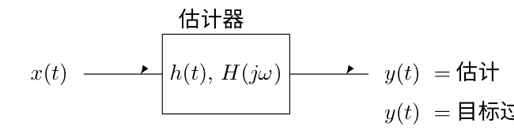

图11.5 CT LTI线性MMSE估计滤波器。

让x(t)是一个（零均值）WSS随机过程，我们有测量结果。我们想要确定上述LTI系统的冲激响应或频率响应，使得滤波器输出y(t)是某个（零均值）“目标”过程y(t)的LMMSE估计，该过程与x(t)联合WSS。我们可以再次写成

```
e(t) ≜ y(t) - y(t)
min_ε = E{e²(t)} .
```

假设滤波器是稳定的（或者至少具有良好定义的频率响应），则过程y(t)与x(t)联合WSS。此外，

```
E[y(t + τ)y(t)] = h(τ) * R_{xy}(τ) = R_{yy}(τ) ,
```

我们要最小化的量可以再次写成

```
ε = E{e²(t)} = R_{ee}(0) ,
```

其中误差自相关函数R_{ee}(τ)是根据（11.37）中的定义明显给出的

```
R_{ee}(τ) = R_{yy}(τ) + R_{yy}(τ) - R_{yy}(τ) - R_{yy}(τ) .
```

因此

```
ε = E{e²(t)} = R_{ee}(0) = \frac{1}{2π} \int_{-∞}^{∞} S_{ee}(jω) dω 
= \frac{1}{2π} \int_{-∞}^{∞} (S_{yy}(jω) + S_{yy}(jω) - S_{yy}(jω) - S_{yy}(jω)) dω 
= \frac{1}{2π} \int_{-∞}^{∞} (S_{yy} + HH^*S_{xx} - H^*S_{yx} - HS_{xy}) dω, (11.41)
```

在上面的最后一行中，我们省略了PSD中的参数jω，以简化表示，并使用H*表示H(jω)的复共轭，即H(-jω)。最后一行中的表达式是通过使用以下事实得到的：x(t)和y(t)分别是具有频率响应H(jω)的滤波器的WSS输入和输出。还要注意，由于R_{yx}(τ) = R_{xy}(-τ)，我们有

```
S_{yx} = S_{yx}(jω) = S_{xy}(-jω) = S_{xy}^* . (11.42)
```

我们的任务是选择H(jω)以使(11.41)中的积分最小化。我们可以通过使每个ω的被积函数最小化来实现这一点。被积函数中的第一项与H无关，因此我们需要最小化

```
HH^*S_{xx} - H^*S_{yx} - HS_{xy} = HH^*S_{xx} - H^*S_{yx} - HS_{yx}^* . (11.43)
```

如果这个方程中的所有量都是实数，那么这个最小化过程将会很简单。然而，即使有复数的H和S_{yx}，最小化也并不困难。

最小化的关键是一种称为完成平方的基本技巧。为此，我们将（11.43）中的量表示为与H线性相关的项的平方幅度。这导致了对（11.43）的以下重写：

```
(H\sqrt{S_{xx}} - \frac{S_{yx}}{\sqrt{S_{xx}}})(H^*\sqrt{S_{xx}} - \frac{S_{yx}^*}{\sqrt{S_{xx}}}) - \frac{S_{yx}S_{yx}^*}{S_{xx}} . (11.44)
```

在写作\sqrt{S_{xx}}时，我们利用了S_{xx}(jω)是实数且非负的事实。我们还可以自由地除以\sqrt{S_{xx}(jω)}，因为对于任何使得该数量为0的ω，可以证明S_{yx}(jω)也为0。因此，在这样的ω处，H(jω)的最优选择是任意的，正如(11.43)所示。因此，我们只需要计算在频率处的最优H\sqrt{S_{xx}(jω)} > 0。

注意，在(11.44)中括号中的第二项是第一项的复共轭，因此这两项的乘积是实数且非负的。此外，最后一项不涉及H。为了使括号中的项消失并使它们的乘积变为0，这是我们能做到的最好的，显然我们必须选择如下（假设估计器没有其他约束，如因果性）：

```
H(jω) = \frac{S_{yx}(jω)}{S_{xx}(jω)} (11.45)
```

这个表达式与DT情况下的形式相同。公式H(jω)的原因是继承了S_{yx}(jω)的对称性质，所以H(jω)有一个实部是

© Alan V. Oppenheim和 George C. Verghese， 2010

## 第11.3节 因果维纳滤波205

在 ω 中是偶函数，虚部在 ω 中是奇函数。 因此，它的逆变换是一个实的冲激响应 h(t)，而(11.45)中的表达式是最优（维纳）滤波器的频率响应。

选择(11.45)中的最优滤波器频率响应后，均方误差表达式(11.41)会减小（就像在DT情况下一样）：

MMSE = R_{ee}(0) = \frac{1}{2\pi} \int_{-\infty}^{\infty} S_{ee} d\omega
= \frac{1}{2\pi} \int_{-\infty}^{\infty} (S_{yy} - HS_{xy}) d\omega
= \frac{1}{2\pi} \int_{-\infty}^{\infty} S_{yy} \left(1 - \frac{S_{yx}S_{xy}}{S_{yy}S_{xx}}\right) d\omega
= \frac{1}{2\pi} \int_{-\infty}^{\infty} S_{yy}(1 - \rho \rho^*) d\omega

其中函数 ρ(jω) 的定义为

ρ(jω) = \frac{S_{yx}(jω)}{\sqrt{S_{yy}(jω)S_{xx}(jω)}}

显然，它起到了一个（复数）频率相关系数的作用，类似于随机变量 Y 和 X 的相关系数。

## 11.2.1 正交性质

重新排列最优 Wiener 滤波器的方程，我们得到

H S_{xx} = S_{yx}

或者

S_{yx} = S_{yx} ,

或等价地

对于所有的 τ，有 R_{yx}(τ) = R_{yx}(τ)。(11.50) 又一次，对于最优系统，估计器的输入和输出之间的互相关等于输入和目标输出之间的互相关。

另一种表达上述结果的方式是通过以下正交性质：

R_{ex}(τ) = R(τ) - R_{yx}(τ) = 0，对于所有的 τ。

换句话说，对于最优系统，误差与数据正交。

## 11.3 因果维纳滤波

在前面的讨论中，我们在滤波器频率响应 H(jω) 上没有任何限制。 这使我们能够通过选择每个 ω 处的 H(jω) 来最小化频域积分。 然而，

©Alan V. Oppenheim 和 George C. Verghese, 2010

## 第11.3节 因果维纳滤波207

在每个频率上。 最后一个等式的第二个积分不受我们选择的 H 的影响，并确定了 MMSE。

如果要求维纳滤波器是因果的，那么我们必须处理积分

$$\frac{1}{2\pi}\int_{-\infty}^{\infty}\left|H\sqrt{S_{xx}}-\frac{S_{yx}}{\sqrt{S_{xx}}}\right|^{2}d\omega$$

当我们将其最小化时，整体上它是有约束的，因为因果关系对 (jω) 施加了约束，阻止了在每个 ω 上自由选择它。（由于前面提到的 Hilbert 变换关系，我们可以选择 H(jω) 的实部，但是虚部将完全确定。）因此，我们必须更加谨慎地进行。

首先注意，通过完成平方得到的 (11.56) 中被积函数的表达式实际上并不像我们可能做的那么一般。 由于我们在解决受限问题时可能需要使用所有可用的灵活性，我们应该探索如何一般地完成平方。 具体而言，我们可以选择复数平方根 M_{xx} 来代替 PSD S_{xx} 的实数平方根 √S_{xx}，这个复数平方根满足以下要求

$$S_{xx}=M_{xx}M_{xx}^{*}\quad \mathrm{或者} \quad S_{xx}(j\omega)=M_{xx}(j\omega)M_{xx}(-j\omega),$$

并相应地将准则重写为 (11.56)

$$\frac{1}{2\pi}\int_{-\infty}^{\infty}\left|HM_{xx}-\frac{S_{yx}}{M_{xx}^{*}}\right|^{2}d\omega,$$

这很容易验证是相同的准则，尽管写法不同。 数量 M_{xx}(jω) 被称为 S_{xx}(jω) 的谱因子，或者是过程 x 的建模滤波器。 后一种名称的原因是，通过具有频率响应 M_{xx}(jω) 的（零均值）单位方差白噪声，将产生一个具有 PSD S_{xx}(jω) 的过程，因此我们可以将过程 x 建模为这种滤波操作的结果。 请注意，我们之前使用的实数平方根 √S_{xx}(jω) 是谱因子的一种特殊情况，但还存在其他情况。 实际上，将 √S_{xx}(jω) 乘以全通频率响应 A(jω) 将产生一个建模滤波器：

$$A(j\omega)\sqrt{S_{xx}(j\omega)}=M_{xx}(j\omega),\quad A(j\omega)A(-j\omega)=1.$$

相反地，很容易证明任何建模滤波器的频率响应都可以写成全通频率响应和 √S_{xx}(jω) 的乘积。 事实证明，在相当温和的条件下（我们在这里不详细讨论），一个 PSD 保证具有频率响应是稳定和因果系统的频谱因子，其逆也是一个频率响应是稳定和因果系统的频谱因子。（为了简化我们对这些因子的讨论，我们将采用一种滥用术语的方式，这在谈论傅里叶变换时很常见，将因子本身 - 而不是其频率响应是该因子的系统 - 称为稳定和因果的，具有稳定和因果的逆。）例如，如果

$$S_{xx}(j\omega)=\frac{\omega^{2}+9}{\omega^{2}+4},$$

© Alan V. Oppenheim 和 George C. Verghese， 2010

## 第11.3节 因果维纳滤波 209

则所需的因子是

M_{xx}(j\omega) = \frac{j\omega + 3}{j\omega + 2}

我们将完全限制在具有这样一个谱因子的 S_{xx} 上，并假设在推导的其余部分中， M_{xx} 引入的准则 (11.58) 是这样一个因子。(请记住，无论我们在这里要求一个稳定的系统，在实际上我们都可以使用具有良好定义的频率响应的系统，即使它不是 BIBO 稳定的，只是我们的结果可能需要更仔细地解释。)

有了这些理解，很明显，积分中的 HM_{xx} 一项是因果的，因为它是由两个因果项的级联。另一项，S_{yx}/M^{*}_{xx}， 通常不是因果的，但我们可以将其因果部分分离出来，用 [S_{yx}/M^{*}_{xx}]_{+} 表示其因果部分的变换，并用其反因果部分的变换表示

由 [S_{yx}/M^{*}_{xx}]_{+} 组成。（在离散时间情况下，后者实际上表示的是严格反因果部分，即，在时间 -1 和更早的时候；时间 0 的值将与因果部分一起保留。

现在考虑使用 Parseval 定理将（11.58）在时域中重写。 如果我们用 I{·} 表示逆变换操作，则结果是我们准则的以下重写：

$$\int_{-\infty}^{\infty} \left| I\{HM_{xx}\} - I\{[S_{yx}/M^{*}_{xx}]_{+} - I\{[S_{yx}/M^{*}_{xx}]_{-}\} \right|^{2} dt$$

由于术语 I\{HM_{xx}\} 是因果的（即，负时间为零），我们能够做的最好的事情，就是尽量消除所有的 I\{[S_{yx}/M^{*}_{xx}]_{+}\}。 换句话说，我们的最佳选择是

HM_{xx} = [S_{yx}/M^{*}_{xx}]_{+}

或者

H(j\omega) = \frac{1}{M_{xx}(j\omega)}\left[\frac{S_{yx}(j\omega)}{M_{xx}(-j\omega)}\right]_{+}

请注意，M_{xx} 的稳定性和因果性保证了最后一步的稳定性和因果性。

(11.64) 中的表达式是在因果性约束下的维纳滤波问题的解决方案。 现在明显的是，MMSE 比无约束（非因果）情况下大

$$\Delta MMSE = \frac{1}{2\pi} \int_{-\infty}^{\infty} \left|\left[\frac{S_{yx}}{M^{*}_{xx}}\right]_{-}\right|^{2} d\omega$$

## 例子 11.5：DT 预测

尽管前面的结果是针对 CT 情况开发的，但是完全类似的表达式可以通过明显的修改（即，使用 DTFT 而不是 CTFT，积分从 −π 到 π 而不是 −∞ 到 ∞ 等）适用于 DT 情况。

考虑一个过程 x[n]，它是通过一个（建模）滤波器将（零均值）单位方差的白噪声传递而来的结果

$$M_{xx}(e^{j\Omega}) = \alpha_0 + \alpha_1 e^{-j\Omega} \quad (11.66) \text{其中 } \alpha_0 \text{和 } \alpha_1 \text{都被假定为非零。这个滤波器是稳定和因果的，如果 } \alpha_1 < \alpha_0 \text{，那么逆滤波器也是稳定和因果的。我们假设这个条件保持。（如果不行，我们总是可以找到另一个模型滤波器，使其成立，通过将当前滤波器乘以适当的全通滤波器。）}$$

假设我们想要对这个过程进行因果单步预测，所以 y[n] = x[n+1]。 然后 R_{yx}[m] = R_{xx}[m+1]，所以

$$S_{yx} = e^{j\Omega} S_{xx} = e^{j\Omega} M_{xx} M_{xx}^* \quad (11.67)$$

因此

$$\left[ \frac{S_{yx}}{M_{xx}^*} \right]_+ = [ e^{j\Omega} M_{xx} ]_+ = \alpha_1 \quad (11.68)$$

因此，根据（11.64），最佳滤波器的频率响应为

$$H(e^{j\Omega}) = \frac{\alpha_1}{\alpha_0 + \alpha_1 e^{-j\Omega}} \quad (11.69)$$

相关的 MMSE 由（11.65）中的表达式评估，并且结果是简单的 α_0^2 （可以与仅通过其均值估计 x[n+1] 得到的 α_0^2 + α_1^2 的值进行比较，即零）。

## 11.3.1 处理非零均值

到目前为止，我们考虑的情况是 x 和 y 都具有零均值（实际结果是我们不必担心它们的功率谱在原点处有脉冲）。 如果它们的均值不为零，那么如果我们允许自己通过添加适当的常数（使其成为仿射估计器）来调整 LTI 系统产生的估计值，我们可以更好地估计 y(t)。 为此，我们首先考虑从 x(t)−μx 估计 y(t)−μy 的问题，如图 11.7 所示。

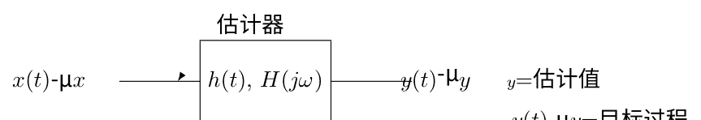

图 11.7：具有非零均值的 Wiener 滤波。

将协方差 C_{xx}(τ) 和 C_{yx}(τ) 的变换分别表示为 D_{xx}(jω) 和 D_{yx}(jω)（这些变换有时被称为协方差 PSD），对于我们的任务来说，最优的无约束维纳滤波器显然具有一个频率响应

$$H(jω) = \frac{D_{yx}(jω)}{D_{xx}(jω)} \quad \text{(11.70)}$$

然后我们可以将 μ_y 添加到该滤波器的输出中，以获得我们对 y(t) 的 LMMSE 估计。

## 第12章

## 脉冲幅度调制（PAM）、正交幅度调制（QAM）

## 12.1 脉冲幅度调制

在第2章中，我们讨论了连续时间信号的离散时间处理，并在这个背景下回顾和讨论了从离散时间序列重构连续时间信号的 D/C 转换。 另一个常见的背景是在通信系统中从序列生成连续时间信号非常有用和重要，在这种情况下，离散数据 - 例如数字或量化数据 - 将以连续时间信号的形式通过信道传输。 在这种情况下，与处理连续时间信号的离散时间处理不同，结果连续时间信号将在接收端转换回离散时间信号。 尽管这两种情况存在差异，但我们将看到相同的基本分析适用于两种情况。

作为在 CT 信道上传输 DT 信息的示例，考虑从一台计算机通过电话线或电缆，或者从数字手机通过高频电磁信道传输二进制序列的 1 和 0。 这些实例对应于具有要求传输信号在时间上连续，并且与信道的带宽和其他约束兼容的模拟信道。 这些要求影响了将离散序列调制到连续时间波形的选择。

将 DT 信号转换为适合传输的 CT 信号，并在接收端将其转换回 DT 信号，都是由称为调制解调器的设备完成的。 脉冲幅度调制（PAM）是各种调制解调器操作的基本原理。

## 12.1.1 发送信号

在 CT 信道上进行通信的 PAM 的基本思想是传输一系列具有预先指定形状的 CT 脉冲 p(t)，脉冲幅度序列携带信息。 发射机上的相关基带信号（通常调制到某个载波上形成带通信号） 

© Alan V. Oppenheim 和 George C. Verghese， 2010

## 第12.1节 脉冲幅度调制 213

如果选择 p(t) 使得 p(0) = 1 且 p(nT) = 0 对于 n = 0，那么我们可以通过在 times n T 处对 x(t) 进行采样来恢复振幅 a[n]，因为在这种情况下 x(nT) = a[n]。 然而，我们的兴趣在于从接收器中恢复信号的振幅，而不是直接从传输信号中恢复，因此我们需要考虑通信信道如何影响 x(t)。 我们的目标是以尽可能简单的方式恢复 DT 信号，同时对信道中的失真和噪声进行补偿。

## 12.1.2 接收信号

当我们通过信道传输 PAM 信号时，信道的特性将影响我们从接收信号 r(t) 准确恢复脉冲振幅 a[n] 的能力。 我们可以将 r(t) 建模为

$$r(t) = h(t) * x(t) + \eta(t)$$

对应于将信道建模为具有冲激响应 h(t) 的 LTI 系统，并且通过加性噪声信号 η(t) 来表示信道噪声。 我们通常会尝试从 r(t) 的样本中恢复脉冲幅度 a[n] — 或者从适当滤波版本的 r(t) 的样本中恢复脉冲幅度 a[n] —，样本的间隔为 T。

整体模型如图 12.2 所示，其中 f(t) 表示接收端 LTI 滤波器的冲激响应。 这个接收端滤波器在过滤掉信号信息集中的频带之外的噪声方面起着关键作用。 在这里，我们首先关注无噪声的情况（通常设置 f(t) = δ(t)，即在接收端采样之前没有滤波），但为了通用性，我们也要考虑滤波器 f(t) 的影响。

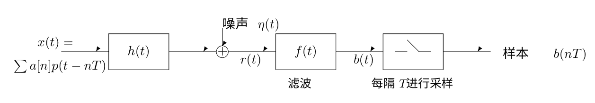

图 12.2 发射机、信道和接收机模型的脉冲调制系统。

## 12.1.3 频域特征

将脉冲 p(t) 的 CTFT 表示为 P(jω)，对于图 12.2 中的其他 CT 信号也是如此。 如果信道的频率响应 H(jω) 在 P(jω) 显著的频率范围内为单位，则单个脉冲 p(t) 在传输过程中基本上没有失真。 在这种情况下，我们可以利用信道模型的线性和时不变性得出结论，在无噪声的情况下，(12.1) 中的 x(t) 本身基本上没有失真，即 r(t) ≈ x(t)

© Alan V. Oppenheim 和 George C. Verghese, 2010

## 脉冲幅度调制（PAM）、正交幅度调制（QAM）

我们正在考虑的 然而，这个结论留下了这样的可能性，即当传输一系列脉冲时，当单个脉冲传输时可以忽略的失真会累积成为一个非可忽略的问题。 因此，我们应该直接检查 x(t)、 r(t)及其对应的傅里叶变换。 我们从中获得的理解是设计 P(jω)和选择给定信道的符号间隔时间 T的先决条件，也可以帮助我们确定离散时间信号 a[n]对连续时间信号 x(t)和 r(t)的影响。

为了计算 X(jω)，我们对 (12.1)的两边进行变换：

X(jω)  =  (\sum_{n} a[n] e^{-jωnT}) P(jω)
         =  A(e^{jΩ}) |_{Ω=ωT} P(jω)

其中 A(e^{jΩ})表示序列 a[n]的离散时间傅里叶变换。 上述表达式中的数量 A(e^{jΩ})|_{Ω=ωT}实际上只是离散时间傅里叶变换频率轴的均匀缩放；特别地，离散时间傅里叶变换中的点Ω = π被映射到表达式中的点 ω = π/T。

因此，式(12.3)描述了 X(jω)，假设序列 a[n]的离散时间傅里叶变换是良定义的。例如，如果 a[n]对于所有 n都等于1，对应于基本脉冲波形 p(t)的周期重复，那么 A(e^{jΩ}) = 2πδ (Ω)对于|Ω| ≤ π成立，并且在这个范围之外以周期2π重复。 因此 X(jω)由间隔为2π/T的脉冲序列组成；每个脉冲的强度是该脉冲位置处 P(jω)值的2π/T倍 （注意脉冲的缩放性质可得 δ(Ω) = δ(ωT) = (1/T)δ(ω)对于正 T成立）。

在没有噪声的情况下，接收到的信号 r(t)和接收器滤波后的信号 b(t)在频域中都很容易表征：

R(jω) = H(jω)X(jω)  ,  \quad  B(jω) = F(jω)H(jω)X(jω)

从(12.3)和(12.4)中可以得出一些重要的约束条件。首先注意到对于一个一般的离散时间信号 a[n]，关于信号的必要信息将分布在其离散时间傅里叶变换 A(e^{jΩ})的频率Ω上，其中 |Ω| ≤ π；只在一个较小的范围 |Ω| ≤ Ω_a < π内了解A(e^{jΩ})通常是不足以重构离散时间信号的。现在，将Ω = ωT代入(12.3)中，我们可以看到 A(e^{jωT})将包含关于离散时间信号在频率 ω上的必要信息，该频率范围为 |ω| ≤ π/T。 因此，如果对于 |ω| ≤ π/T 有 P(jω) = 0，则 X(jω)保留了离散时间信号中的信息；如果对于 |ω| ≤ π/T 有H(jω) P(jω) = 0，则 R(jω)保留了离散时间信号中的信息；如果对于 |ω| ≤ π/T 有 F(jω)H(jω)P(jω) = 0，则 B(jω)保留了离散时间信号中的信息。

上述约束条件有一些设计上的影响。 对于一个脉冲，如果 P(jω)在一个严格较小的区间 |ω| ≤ ω_p < π/T内非零，那么从离散时间信号到脉冲幅度调制信号的转换中会丢失信息。 x(t)不适合选择的符号速率1/T（但如果符号速率适当降低到 ω_p/π或更低，则可以成为适合的脉冲）。

## 12.1.4 接收端的符号间干扰

在没有任何信道损伤的情况下，可以通过在图12.1中显示的传输脉冲列上重新采样来恢复信号值，这些采样时间是 T的整数倍。然而，这些脉冲虽然时间上很好地定位，但带宽是无限的。由于任何现实信道都有有限的带宽，通信信道对PAM波形的一个影响是通过低通滤波器将每个脉冲的能量“去定位”或分散。因此，可能在发射机处没有重叠（或仅轻微重叠）的脉冲在接收机处可能会以一种阻碍从 r(t)的样本中恢复脉冲幅度的方式重叠，即导致符号间干扰 (ISI)。

现在我们明确说明了为了消除ISI所需的条件是什么。

从接收器处的滤波信号 b(t)。当满足无ISI条件时，我们可以通过简单地对信号 b(t)进行采样来恢复DT信号。基于这个条件，我们可以确定滤波器（或信道补偿器或均衡器）的脉冲形状 p(t)和冲激响应 f(t)必须满足的额外约束，以消除或最小化ISI。

根据(12.1)中给出的 x(t)，并注意在无噪声情况下 b(t) = f(t) * h(t) * x(t)，我们可以写成b(t) =

$$
\sum_n a[n] g(t - nT)
$$

其中

$$
g(t) = f(t) * h(t) * p(t)
$$

我们假设 g(t)在采样时刻连续（即没有不连续点）

因此，我们能够以通道的截止频率的两倍的符号速率进行传输。根据之前所说的，在讨论(12.3)中涉及符号速率和通道截止频率的约束时，我们一般不能期望有更好的结果。

更一般地，在下一节中，我们将把(12.7)中的无ISI时域条件转化为对于给定信道设计p(t)和f(t)有用的条件。这种方法基于无ISI条件的频域转换，这个结果最早由奈奎斯特提出。

## 12.2 奈奎斯特脉冲

奈奎斯特在1924年探索了(12.7)的无ISI条件的频域解释（并在1928年将其扩展为采样定理的陈述——这个定理等待了将近20年才被加波尔和香农引起重视）。

考虑使用周期脉冲列对信号g(t)进行采样：

g(t) = g(t) \sum_{n=-\infty}^{+\infty} \delta(t - nT) .

然后我们对 g(t)在(12.7)中的要求意味着 g(t)=c δ(t)，一个脉冲信号强度为 c，其变换为 G(jω) = c。对(12.10)的两边进行变换，并利用时域乘法对应于频域卷积的事实，我们得到

G(jω) = c = \frac{1}{T} \sum_{m=-\infty}^{+\infty} G(jω - jm\frac{2\pi}{T}) .

(12.11)右侧的表达式表示在频率轴上每个2π/T的整数倍处复制 G(jω) (缩放因子为1/T)。因此，奈奎斯特要求是 G(jω)及其复制品，以2πm/T为间隔对于所有整数 m，总和为一个常数。满足这个条件的一些 G(jω) = F(jω)H(jω)P(jω)的例子如下所示。

sinc函数的特殊情况(12.8)和(12.9)确实满足(12.11)的奈奎斯特条件。

如果我们有一个理想的低通道H(jω)，带宽ωc或更大，那么选择p(t)为sinc脉冲(12.8)，并且在接收端不进行任何滤波——所以F(jω)=1——将导致没有ISI。然而，sinc特性存在两个问题。首先，信号在时间上无限延伸。

其次，sinc在时间上的衰减非常缓慢(如1/t)。这种时间上的缓慢衰减与sinc在频率域中的尖锐截止相耦合。这是时间频率对偶的熟悉表现：一个域中的快速过渡意味着另一个域中的缓慢过渡。

在实践中，拥有比sinc函数更快衰减的脉冲是非常理想的。一个原因是，由于定时抖动导致的采样时间不可避免地存在不准确性，如果底层脉冲形状衰减得太慢，就会产生一些无法避免的ISI，并且这种ISI会在时间上传播得太长。此外，更快的衰减可以更好地近似一个双边信号，以满足因果实现的要求。时间上更快的脉冲衰减的代价是频率域中的过渡必须更加渐变，这就需要更大的带宽来实现给定的符号速率（或者给定带宽的降低符号速率）。

图12.5中的两个示例具有比前一个情况更平滑的过渡，并且对应于衰减为1/t²的脉冲。很明显，这两个示例都可以实现。

## 12.3 载波传输

之前的讨论集中在基带脉冲的设计上。对于通过电话线、无线链路、卫星等进行传输，基带信号需要调制到载波上，即转换为带通信号。这也为PAM的增强提供了机会。图12.7中的表格显示了电话线数字调制解调器标准的演变。FSK指的是频移键控，PSK指的是相移键控，QAM指的是正交幅度调制，我们将在下面更详细地描述每种调制方式。多年来符号速率（或波特率）和比特率的增加对应于信号处理的改进，更好的调制方案，更好的信道条件，以及更复杂的编码（和相应复杂的解码，但现在已经数字接收器的实时计算能力范围内）。对于基带PAM，传输信号的形式为方程（12.1），即

$x(t) = \sum_{n} a[n] p(t - nT)$

其中 $p(t)$ 是一个低通脉冲。当这个信号被调幅到一个载波上时，传输的信号的形式为

$s(t) = \sum_{n} a[n] p(t - nT) \cos(\omega_c t + \theta_c)$

其中 $\omega_c$ 和 $\theta_c$ 是载波的频率和相位。

## 12.3.1 频移键控（FSK）

使用频移键控(12.14)的形式

```
s(t) = ∑ a[n] p(t - nT) cos((ω₀ + Δₙ)t + θ_c)  (12.15)
```

其中 ω₀是名义载波频率，Δₙ是载波频率的偏移在符号间隔 n内。原则上，在 FSK中， a[n]和 Δₙ都可以包含数据，尽管通常情况下，在FSK中振幅不会改变。

## 12.3.2 相移键控（PSK）

使用相位移键控(12.14)的形式

```
s(t) = ∑ a[n] p(t - nT) cos(ω_c t + θₙ)  (12.16)
```

在每个符号间隔中，信息可以同时包含在脉冲的振幅 a[n]和载波的相位 θₙ中。在通常被称为PSK的情况下，信息只包含在相位中，即 a[n] = a = constant。
例如，使用

```
θₙ = (2πbₙ)/M ; bₙ 为非负整数  (12.17)
```

每个符号间隔中的相位可以编码为一个符号。对于 M = 2，θₙ = 0 或 π，通常称为二进制相移键控（BPSK）。对于 M = 4，θₙ可以取四个值之一：0、 $ \frac{\pi}{2} $、$ \pi $ 或 $ \frac{3\pi}{2} $。

为了以稍微不同的方式解释PSK，并作为扩展讨论到进一步的一般化（正交幅度调制或QAM）的预备，方程（12.16）可以用一些替代形式来表示。例如，

```
s(t) = ∑ Re{a e^(jθₙ) p(t - nT) e^(jω_c t)}  (12.18)
```

并且等价地

```
s(t) = I(t) cos(ω_c t) - Q(t) sin(ω_c t)  (12.19)
```

## 12.3.3 正交幅度调制（QAM）

用

$I(t) = \sum_{n} a_i[n] p(t - nT)$

$Q(t) = \sum_{n} a_q[n] p(t - nT)$

$a_i[n] = a \cos(\theta_n)$

$a_q[n] = a \sin(\theta_n)$

方程式 12.19 被称为方程式 12.16 的正交形式，I(t) 和 Q(t) 被称为正交分量。 对于 BPSK，$ a_i[n] = \pm a $ 且 $ a_q[n] = 0 $。

对于具有方程式 12.17 形式和 $ M = 4 $ 的 PSK，$ \theta_n $ 可以取四个值之一：0、 $ \frac{\pi}{2} $、$ \pi $ 或 $ \frac{3\pi}{2} $。以方程12.22和12.23的形式，$ a_i[n] $ 将会是+、$ a- $、或零，而 $ a_q[n] $ 将会是+、$ a- $、或零。 然而，显然QPSK只能在相位上编码四个符号，而不是九个，即$ a_i[n] $和$ a_q[n] $的各种可能性并不是独立的。 例如，对于 $ M = 4 $，如果 $ a_i[n] = + a $，则$ a_q[n] $必须为零，因为 $ a_i[n] = + a $ 意味着 $ \theta_n = 0 $。 一个方便的观察方法是通过所谓的 I-Q星座图来看，如图12.8所示。

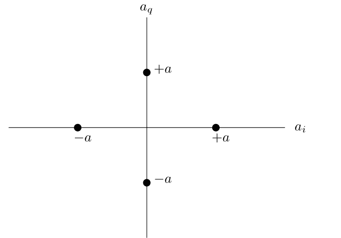

## 图 12.8 I-Q QPSK星座图

星座图中的每个点代表一个可以编码的不同符号，并且很明显，图12.8的星座图中可以编码四个符号在每个符号间隔中（暂时假设振幅 a[n]是恒定的，这在我们稍后扩展讨论到QAM时会改变）。

四相PSK的另一种形式是选择

θₙ = (2πbₙ)/4 + π/4, bₙ一个非负整数

在这种情况下， aᵢ[n] = ±a/√2 和 aₖ[n] = ±a/√2 导致图中的星座图 12.9。

在这种情况下，I(t)和 Q(t)的振幅调制（方程12.20和12.21）可以独立进行。 使用这个星座图进行调制通常被称为QPSK（正交相移键控）。

在上述的PSK中，假设了一个常数 a[n]。 通过在方程12.16中同时引入幅度 a[n]和相位 θₙ的编码，我们得到了一种更丰富的调制形式，称为正交幅度调制（QAM）。在方程（12.19 - 12.21）的形式中，我们现在允许从一个更丰富的星座中选择 aᵢ[n] 和 aₖ[n]。

QAM星座图在图12.10中显示，其中每组幅度可以取 ±a和 ±3a的值。在这种情况下，可以使用16种不同的组合来编码4位，如图中所示。

这个特定的星座图是V.32ALT标准中使用的，如图12.7的表格所示。在这个标准中，载波频率为1,800 Hz，符号频率或波特率（1/T）为2,400 Hz。每个符号4位，总共为9,600位/秒。可以使用的一种基带脉冲形状 p(t)是之前提到的余弦过渡脉冲的平方根，例如 β=0.3。 这个脉冲包含高达1.3 × 1,200 = 1,560 Hz的频率。

## 第12.3节 载波传输

在1,800 Hz载波调制后，信号占据了从240 Hz到3,360 Hz的频带，正好位于语音电话信道的通带内。

表中显示的两个更快的调制解调器使用了更复杂的基于QAM的方案。V.32bis标准涉及128QAM，原则上每个符号可以传输7个比特，但代价是对噪声更敏感（因为星座点在给定信号功率下更紧密地聚集）。然而，在这种情况下，QAM实际上与所谓的格雷码调制（TCM）相结合，通过引入调制幅度之间的依赖性（引入一些冗余）来提高抗噪声能力，并实现每个符号6个比特的有效速率（可以将TCM视为为错误检测保留一位比特）。

这里的符号速率仍然是2,400 Hz，所以传输速率为6 × 2,400 = 14,400比特/秒。同样，V.34标准涉及1024QAM，每个符号可以传输10比特，尽管更容易受到噪声的影响。与TCM结合使用引入了冗余以进行错误控制，得到的比特率为28,800比特/秒（9个有效比特乘以3,200 Hz的符号频率）。

## 正交调制PAM信号的解调

以方程式（12.19 - 12.23）形式调制的载波信号可以在I和Q分量I(t)和Q(t)中携带编码数据。因此，在解调中我们必须能够分别提取这些。这是通过正交解调来实现的，如图12.11所示。

在调制和解调中，假设带宽p(t)相对较低，与载波频率ω_c相比，I(t)和Q(t)的带宽小于ω_c。输入信号r_i(t)是

```
r_i(t) = I(t)cos^2(ω_c t) - Q(t)sin(ω_c t)cos(ω_c t)\tag{12.25}\\
= \frac{1}{2}I(t) - \frac{1}{2}I(t)cos(2ω_c t) - \frac{1}{2}Q(t)sin(2ω_c t)\tag{12.26}
```

同样地

```
r_q(t) = I(t)cos(ω_c t)sin(ω_c t) - Q(t)sin^2(ω_c t)\tag{12.27}\\
= \frac{1}{2}I(t)sin(2ω_c t) + \frac{1}{2}Q(t) - \frac{1}{2}Q(t)cos(2ω_c t)\tag{12.28}
```

选择低通滤波器的截止频率大于带宽of p(t)（因此也大于I(t)和Q(t)的带宽），但足够低以消除r_i(t)和r_q(t)在2ω_c周围的分量，输出将是正交信号I(t)和Q(t)。

## 第224章 脉冲幅度调制（PAM）、正交幅度调制（QAM）

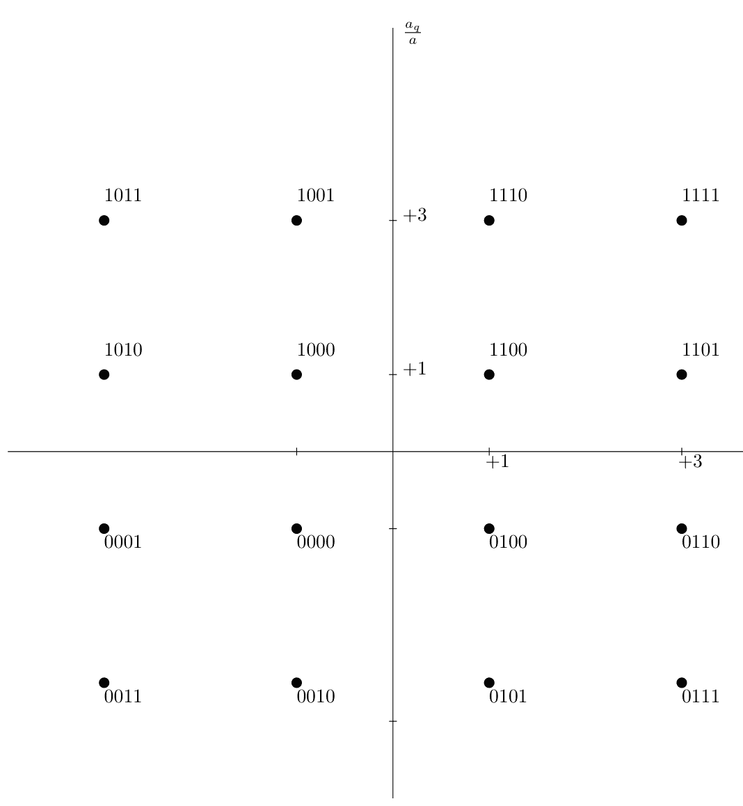

版权所有 © 1999 IEEE。经许可使用。

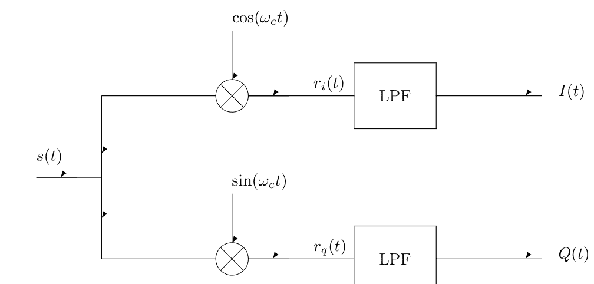

图12.11 用于正交调幅脉冲调制信号的解调方案。

由MIT OpenCourseWare提供的图像，改编自《数字传输工程》，John Anderson. IEEE Press, 1999年。

图12.12 (a) 具有sinc脉冲的脉冲幅度调制信号。 (b) 具有“升余弦”脉冲的脉冲幅度调制信号。 注意(a)中窄带脉冲的尾部和偏移较大；如果不截断尾部，带宽将变宽。（摘自J.B. Anderson的《数字传输工程》，IEEE Press, 1999年。）

## 第13章 假设检验

## 引言

假设检验的主题在信号处理和通信中经常出现，也出现在医学、统计学和其他基于有限和噪声数据进行多个选项或假设选择的领域中。 例如，通过对这些数据进行测试，我们可能需要确定：一个人是否患有某种特定疾病；某个雷达回波是否表示飞机的存在；在PAM系统中在给定时间传输的四个值中的哪一个；等等。

假设检验提供了一个在某种原则或最优方式下从M个可能选择或假设中选择的框架。在我们的讨论中，我们将首先关注M = 2，即二元假设检验，以说明关键概念。尽管第13.1节在噪声中引入了二进制脉冲幅度调制的讨论背景，但第13.2节的演示和结果适用于二元假设检验的一般问题。在第13.3节和第13.4节中，我们明确处理多于两个假设的情况。

## 13.1 噪声中的二进制脉冲幅度调制

在第12章中，我们介绍了脉冲幅度调制的基本原理，并考虑了脉冲速率、脉冲形状以及通道和接收器的滤波对PAM系统的影响。 我们还开发并讨论了无码间干扰条件（无ISI条件）。在没有ISI的假设下，我们现在要研究信道中噪声的影响。为了达到这个目的，我们再次考虑图13.1中的整体PAM模型，其中信道噪声v(t)表示为一个附加项。

目前我们假设接收器没有后滤波，即假设f(t) = δ(t)。在第14章中，我们将看到接收器中使用滤波器如何提高性能。通过具有冲激响应h(t)的信道传输的基本脉冲p(t)在信道输出产生一个信号，我们用s(t) = p(t) * h(t)来表示。因此，图13.1简化为图13.2所示的整体系统。由于我们假设没有ISI，我们可以仅针对单个脉冲索引n进行讨论，我们选择方便起见n = 0。因此，在图13.2的系统中，我们关注的是

```
b[0] = r(0) = a[0]s(0)+ v(0)。   (13.1)
```

将r(0)、a[0]和v(0)简单地表示为r、a和v，并设置s(0) = 1 不失一般性，我们感兴趣的关系是

```
r = a + v.
```

我们的广泛目标是确定a的值，以尽可能好地给出测量值r。这个问题有几种变体，取决于传输序列a[n]的性质和噪声的特性。振幅a[n]可以跨越连续范围，也可以是离散的（例如，二进制）。

振幅可以相应地被建模为一个随机变量A，具有已知的概率密度函数或概率质量函数；然后a是概率模型的特定值，在特定结果或实例中A取得。噪声的贡献通常也被表示为一个随机变量V，通常是连续的，v是它取得的特定值。因此，我们可以将接收机处的量R建模为一个随机变量的观测值R，其中

```
R = A + V,
```

我们希望估计随机变量A的取值，假设R = r。因此，我们需要在接收机中添加进一步的处理步骤，以获得A的估计值。

在脉冲幅度只能是两个值之一的情况下，即二进制信号传输的情况下，找到A的估计值就变成了基于观察到的值r of R，决定哪个可能的幅度被传输。

PAM系统中两种常见的二进制信号形式是开/关信号和反极性信号。假设a₁和a₀分别表示两种可能的幅度（例如表示二进制的“一”或“零”），在开/关信号中我们有a₀ = 0，而在反极性信号中a₀ = -a₁ = 0.

因此，在二进制信号传输中，所需的后处理对应于在两个备选方案或假设之间进行决策，可用信息可能包括一些先前信息以及单一连续随机变量R的测量r。（一旦理解了两个假设的情况，对于多个假设和多个测量的扩展将变得简单。）以下是假设列表：

- 假设H₀：传输的振幅A取值为a₀，因此R = a₀ + V₀
- 假设H₁：传输的振幅A取值为a₁，因此R = a₁ + V₀

我们的任务是在给定测量R = r的情况下，决定是H₀还是H₁对测量负责。下一节将为这种假设测试任务开发一个框架。

## 13.2 二元假设测试

我们的一般二元假设测试任务是根据随机变量R的测量结果r来决定两个假设中的哪一个——H₀或H₁对测量负责。我们将分别用‘H₀’和‘H₁’表示这些决策（引号意味着宣布决策）。另一种表示法是H = H₀和H = H₁，其中H表示对假设H的估计或决策。

假设H被建模为一个随机量，并且假设我们已知先验概率

P(H₀为真) = P(H = H₀) = P(H₀) = p₀
(13.4)

和

P(H₁为真) = P(H = H₁) = P(H₁) = p₁
(13.5) （在每种情况下，最后两个等式只是定义了我们将要使用的简化符号）

我们还需要条件密度f_{R|H}(r|H₀)和f_{R|H}(r|H₁)،它们告诉我们两个假设下测量变量的分布情况。这些条件密度实际上构成了测量数据与两个假设之间的相关规范。例如，在PAM设置中，假设R如（13.3）所定义，并且在每个假设下，V独立于A，这些条件密度简单地为

f_{R|H}(R|H₀) = f_V(R - a₀)  and  f_{R|H}(R|H₁) = f_V(R - a₁) . (13.6)

在许多情况下，比如数字通信中的PAM，希望最小化选择错误假设的概率，即在给定测量值R = r时选择具有最小错误概率的假设。在我们对假设检验的大部分讨论中，我们将专注于最小错误概率准则。

## 13.2.1 最小错误概率决策：MAP准则

首先考虑在没有任何对R的测量的情况下如何在H₀和H₁之间选择具有最小错误概率的假设。如果我们选择‘H₀’，那么当H₀不成立时我们就会犯错误，因此这个选择的错误概率是1 - P(H₀) = 1 - p₀。同样地，如果我们选择‘H₁’，那么错误概率是1 - P(H₁) = 1 - p₁ = p₀。因此，为了最小化错误概率，我们应该选择具有最大概率的假设——这是一个直观合理的结论。（前面的推理同样适用于在多个假设中选择一个，并得出相同的结论。）

当我们试图在H₀和H₁之间选择时，有什么变化，以最小化错误的概率，知道R = r？与前面的段落相同的推理适用，只是现在所有的概率都需要以测量R = r为条件。我们得出结论，为了最小化条件错误的概率，P(错误R = r)，我们需要决定支持哪个假设，条件是测量R = r。

（如果我们有多个随机变量进行测量，而不仅仅是单个随机变量R，我们将简单地以所有可用的测量为条件。）因此，如果P(H₁ R = r) > P(H₀ R = r)，我们决定选择‘H₁’，如果

这可以简洁地写成

```
P(H₁|R = r) > P(H₀|R = r) .
```

（如果两个条件概率恰好相等，无论我们选择‘H₀’还是‘H₁’，我们得到相同的条件错误概率。）相应的条件错误概率是

```
P(error|R = r) = min{1 - P(H₀|R = r), 1 - P(H₁|R = r)} .
```

在使用上述决策规则（但在知道具体的R值之前），与之相关的整体错误概率Pₑ是对可能测量到的所有可能的r值进行加权平均，使用PDF fᵣ(r)作为加权函数来获得的。我们将很快更详细地研究Pₑ。

出现在条件概率P(H₀R=r)和P(H₁R=r)中的表达式(13.7)中的条件概率被称为后验概率，以区别于先验概率P(H₀)和P(H₁)。式(13.7)中的决策规则通常被称为最大后验概率规则，简称为“MAP”规则。

为了实际评估式(13.7)中的后验概率，我们使用贝叶斯规则将它们重新表示为已知量，使决策规则变为

    \frac{\text{的条件概率}f_{R|H}(r|H_1)}{f_{R}(r)} > \frac{\text{的条件概率}f_{R|H}(r|H_0)}{f_{R}(r)}  , \quad \text{（13.9）}

在合理的假设下，即 $f_R(r) > 0$，也就是说，$R$的概率密度函数在实际测量值$r$处是正的。（无论如何，我们只需要在$f_R(r) > 0$的值处指定我们的决策规则，因为在其他值处做出的选择不会影响错误的总概率$P_e$。）由于分母在上述表达式的两侧都是相同且正的，我们可以进一步简化它为

    \frac{p_1f_{R|H}(r|H_1)}{p_0f_{R|H}(r|H_0)}  \quad \text{（13.10）}

这现在为我们提供了一个易于可视化和实施的决策规则。我们首先使用先验概率$p_i = P(H_i)$来缩放描述在每个假设下测量量$R$分布的概率密度函数$f_{R|H}(r|H_i)$。

然后我们决定支持与测量值$r$相关的概率密度函数中最大的假设。（前面的描述也适用于在多个假设中选择最小错误概率，而不仅仅是两个，并且给定多个相关随机变量的测量值，而不仅仅是一个——推理是相同的。）

## 13.2.2 理解$P_e$：虚警、漏警和检测

用于评估决策规则的样本空间包括以下四种互斥且完全穷尽的可能性：$H_i$为真，我们宣布$H_j$，其中$i,j=1,2$。在四种可能的结果中，代表错误的两种是$(H_0, H_1')$和$(H_1, H_0')$。因此，错误概率$P_e$ - 在所有可能的测量随机变量值上平均 - 可以表示为

    P_e = P(H_0, H_1') + P(H_1, H_0') \
    = p_0 P(H_1' | H_0) + p_1 P(H_0' | H_1)  \quad \text{（13.11）}

条件概率$P(H_1' | H_0)$被称为条件概率误报概率，表示为$P_{FA}$。条件概率$P(H_0' | H_1)$被称为漏报概率，表示为$P_M$。在正常使用中，这些术语通常省略了“条件”一词，但是需要记住误报概率和漏报概率被定义为条件概率，并且还与不同的事件有关。

前面的术语在历史上是由雷达背景所激发的，在这个背景下，$H_1$表示目标的存在，$H_0$表示目标的不存在。一个错误

## 13.2.3 似然比检验

重写(13.10)，我们可以将最小$P_e$决策规则表述为

Λ(r) = \frac{f_{R|H}(r|H_1)}{f_{R|H}(r|H_0)} \begin{cases} > \frac{p_0}{p_1} \quad \text{‘}H_1\text{’} \\ < \ \ \ \quad \text{‘}H_0\text{’} \end{cases} \quad \quad \quad (13.18)

或者

Λ(r) \begin{cases} > η \quad \text{‘}H_1\text{’} \\ < \ \ \ \quad \text{‘}H_0\text{’} \end{cases} \quad \quad \quad (13.19)

其中Λ(r)被称为似然比，而η被称为阈值。我们写出这种决策规则的方式是有意思的，因为二元假设检验问题的其他表述——除了最小化$P_e$之外的标准——通常也会导致涉及将似然比与阈值进行比较的决策规则。唯一的区别在于这些其他表述中的阈值选择方式不同。我们在本章的后面几节中描述了其中两种替代表述——Neyman-Pearson方法和最小风险决策。

## 13.2.4 其他场景

虽然上述关于二元假设检验的讨论是在二元PAM的背景下介绍的，但它适用于许多其他情境。例如，在医学文献中，临床测试使用了类似于这里用于通信和信号检测问题的假设检验框架，其中H₀通常表示没有医学状况的存在，H₁表示有医学状况的存在。医学背景下的术语略有不同，但仍然暗示了意图，如下面的例子所示：

- • P_D是临床测试的敏感性。
- • P（‘H₁’|H₀）是错误阳性的概率（而不是错误报警的概率）。
- • 1 - P_{FA}是测试的特异性。
- • P（H₁）是测试目标条件的患病率。
- • P（H₁ |‘H₁’）是测试的阳性预测值，而P（H₀ |‘H₀’）是测试的阴性预测值。

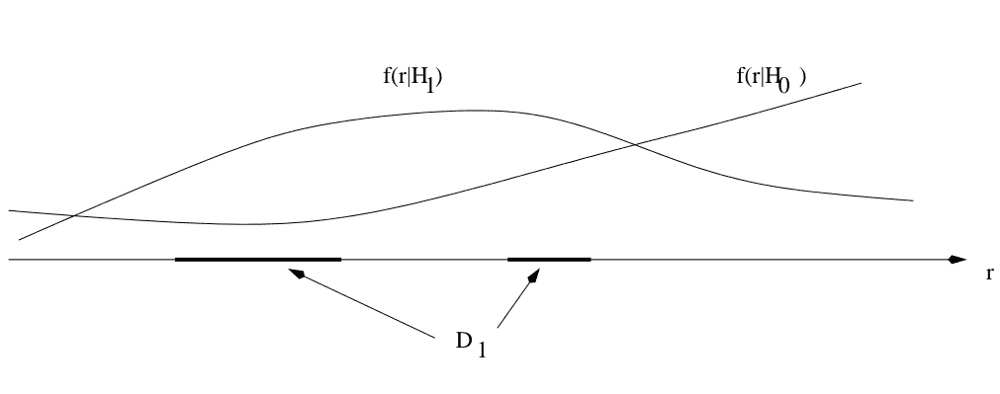

图13.3 决策区域。这里选择D₁是任意的，不是最小错误概率的最优选择。

根据前面的定义，我们可以写成

P_{FA} = \int_{D_1} f_{R|H}(r|H_0) dr

© Alan V. Oppenheim和 George C. Verghese, 2010

## 第13.2节 二元假设检验 235

要理解为什么在这种情况下决策规则采用(13.22)的形式，注意我们的目标是在D_1中包含尽可能多的r值，这些值对定义P_D的积分贡献最大，对定义P_FA的积分贡献最小。如果我们从较高的阈值η开始，我们将包含那些使Λ(R)较大的r，因此对P_D的贡献相对较大，而对P_FA的贡献相对较小。降低η，我们增加P_D和P_FA，但P_D的增加速率下降，而P_FA的增加速率上升。这些P_D和P_FA的增加可能在η上不连续。(如果f_{R|H}(R|H_1)=ηf_{R|H}(R|H_0)在某个r区间内这两个概率密度函数都是正值，那么将η从略高于某个值η减小到略低于该值，会导致P_D和P_FA都有有限的上升。)通常情况下，P_D和P_FA随η的变化是连续的，因此当η降低时，我们达到了指定的P_FA边界，或者P_D = 1。这是奈曼-皮尔逊检验中使用的η值。(在P_FA从低于可容忍水平的值跳跃到高于可容忍水平的值时，通过降低某个值η，一个随机化的决策规则可以使P_FA接近可容忍水平，从而最大化P_D。这种情况在本章末尾的一个问题中进行了探讨。)

下面的论证以稍微详细一些的方式展示了为什么尼曼-皮尔逊准则等价于似然比检验，尽管还是非正式的。如果决策区域D_1对于尼曼-皮尔逊准则是最优的，那么保持P_FA不变的任何D_1的改变都不能导致P_D的改善。因此，假设我们在最优D_1区域的点r处取一个宽度为dr的无穷小段，并将其转换为D_0的一部分。为了保持P_FA不变，我们必须相应地在最优D_0区域的任意点r'处取一个宽度为dr'的无穷小段，并将其转换为D_1的一部分。

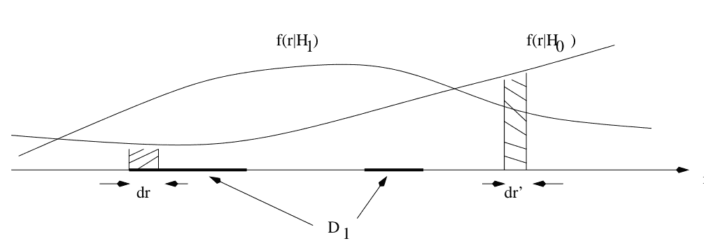

图13.4说明了用于推导尼曼-皮尔逊准则的似然比检验的构造。

要求P_FA保持不变，则要求

```
f_{R|H}(r'|H_0) dr' = f_{R|H}(r|H_0) dr,
```

而要求新的P_D不大于旧的，则要求

```
f_{R|H}(r'|H_1) dr' ≤ f_{R|H}(r|H_1) dr.
```

结合(13.23)和(13.24)，我们得到

```
Λ(r') ≤ Λ(r).
```

(13.25)所示的是，在D_1内，似然比不能比在D_0内更小。因此，我们可以得出结论，尼曼-皮尔逊准则的最优解实际上是基于似然比的阈值测试：

```
Λ(r) = \frac{f_{R|H}(r|H_1)}{f_{R|H}(r|H_0)} > η,  当H_1为真；
Λ(r) = \frac{f_{R|H}(r|H_1)}{f_{R|H}(r|H_0)} > η,  当H_0为真。
```

其中阈值η被选择以获得尽可能大的P_D，同时确保P_FA不大于预先指定的界限。

上述推导做出了各种隐含的假设。然而，我们的目的只是传达在这种情况下如何得出似然比检验的本质。

接收器操作特性。在考虑在尼曼-皮尔逊检验中选择哪个P_FA值作为界限时，通常可以通过观察P_D随参数η变化的曲线来进行有用的参考。这被称为接收器操作特性（ROC）。更一般地说，对于任何导致P_D在指定P_FA下唯一确定的决策规则，都可以定义这样的ROC。

ROC可以用于确定，例如，修改给定测试中的变量参数以允许稍微更高的P_FA是否会导致显著更高的P_D。ROC还可以用于比较不同的测试。

## 例子 13.1 信号在高斯噪声中的检测和ROC

考虑一个场景，地面站发射了一个雷达脉冲。如果飞机位于传播路径上，反射脉冲将返回雷达站。我们假设如果没有飞机存在，接收到的信号将只包含噪声；如果有飞机存在，则包括噪声和反射脉冲。接收信号的处理结果是一个我们建模为随机变量R的实现。如果没有飞机存在，则R = W，其中W是一个表示仅处理噪声结果的随机变量。如果有飞机存在，则R = s + W，其中常数s是由反射脉冲处理引起的，并且在这里假设为已知值。因此，我们有以下两个假设：

```
H_0 : R = W
H_1 : R = s + W
```

## 图13.5 测量值r上的阈值γ。

该情况在图13.5中表示。

接收者操作特性显示P_D与P_FA的关系，当η变化时，并在图13.6中绘制。

## 图13.6 接收者操作特性。

在比高斯情况更一般的设置中，对似然比的阈值测试不会简单地转化为对测量值r的阈值测试。尽管如此，我们仍然可以决定使用简单的阈值测试对r进行决策规则，并生成和评估相关的接收者操作特性。

## 13.3 最小风险决策

本节简要描述了一个决策准则，称为最小风险，它将错误概率最小化作为一种特殊情况，并且在二进制情况下再次导致似然比检验。我们将其描述为M个假设的一般情况。

假设可用的测量值是随机变量R的值r（相同的）

## 图13.7 二进制信道通信。

接收器解码接收到的脉冲，试图在过程中纠正信道噪声，它必须做出决策，确定传输的是哪个符号。

衡量接收器性能的自然标准，无论应用什么决策过程或决策规则，都是错误的概率，$P_e$。在通信环境中，希望错误概率最小是很自然的，这是我们采用的标准。

在下面的发展中，我们不仅仅是简单地调用我们之前推导出的MAP规则，而是在这个更高级的环境中重复导致MAP规则的推理线路。我们这样做部分是因为与我们之前考虑的情况有一些不同：我们现在有多个假设（在我们的例子中有四个），而不仅仅是一对假设；而且测量的量是离散的随机符号（更准确地说，是接收到的、可能受到噪声干扰的二进制代码，用于传输的符号），而不是连续的随机变量。然而，很明显，这里的问题并不根本上不同或更难。

## 13.4 编码数字通信中的假设检验

在本章中我们讨论了PAM时，我们考虑了对单个接收脉冲进行二元假设检验。在现代通信系统中，可以传输一组符号，每个符号编码为一串二进制的“1”和“0”。因此，除了对每个接收脉冲进行二进制决策外，我们可能还需要进一步解码一串比特，以便最好地判断传输的符号，并可能需要进一步处理以决定构成整个消息的符号序列。原则上，最好的方法是对所有原始测量值进行处理，然后对传输的整个符号序列进行最优决策，但这将是一个非常复杂的任务。因此，在实践中，这个任务通常被分解为三个阶段，如此处所示，在单脉冲级别上进行局部最优决策，以解码“1”和“0”的序列，然后在符号级别上进行进一步决策，最后在符号序列级别上进行进一步决策。

在本节中，我们将说明这些解码阶段中的第二个阶段。

为了具体起见，我们将重点讨论图13.7中的系统。假设发射机随机选择了四个可能的符号之一进行传输，我们将其标记为A、B、C和D。这些符号被选择的概率分别用P(A)、P(B)、P(C)和P(D)表示。发射机选择的任何符号现在都会被适当地编码以便在二进制信道上进行传输。编码会增加一些冗余，以提供接收机进行错误纠正的基础，以对抗可能损坏各个位的信道噪声引入的错误。然后将得到的信号发送到接收机。之后

## 13.4.1 最优先验决策

首先考虑一下，如果信道关闭，即接收器在没有任何接收信号的情况下，只使用先验信息来决定发送信号，那么最小错误概率决策规则将是什么。如果接收器猜测发射机选择了符号$A$，那么如果$A$确实是发送的符号，接收器就是正确的，如果$A$不是发送的符号，接收器就犯了一个错误。因此，接收器选择这个符号的错误概率为$1-P(A)$。对于其他符号，类似的推理也适用。因此，接收器的最小错误概率决策规则是支持具有最大概率的符号。对于这个简单的情况，这似乎是显而易见的，而一般情况（即信道正常工作）并不真的更难。现在我们转向这个一般情况，即接收器实际上接收到通过噪声信道发送的结果。

## 13.4.2 传输模型

让我们将信道建模为二进制信道，它接受来自发射机的1和0，并将1和0传递给接收机。假设由于信道中的噪声，传输的1以概率p > 0被接收为0，传输的0被接收为1。由于两种错误类型的概率相同，这个二进制信道被称为对称信道（除了一些增加的符号负担外，我们可以同样处理非对称情况）。在我们对这个信道的定义中，隐含的假设是它是无记忆的，即在任何特定的传输时隙中，其特性与其他时间隙中传输的内容无关。该信道还被假设为时不变的，即其特性不随时间变化。

在这样的信道下，发射机需要将所选符号编码为二进制形式。假设发射机使用3位来编码每个符号，如下所示：

```
A : 000, B : 011, C : 101, D : 110.
```

由于信道引入的比特错误的有限概率，对于这些传输的接收序列可以是任意的3位二进制数：

```
R_0 = 000, R_1 = 001, R_2 = 010, R_3 = 011,
R_4 = 100, R_5 = 101, R_6 = 110, R_7 = 111.
```

用3位而不是2位来传输我们的四个符号引入了冗余，旨在提供一定的对抗信道噪声的保护。请注意，使用我们特定的3位/符号编码，接收器会将单个比特错误识别为错误，因为它会导致一个无效的编码词。需要两个比特错误（比单个比特错误更罕见）才能将任何有效的编码词转换为另一个有效的编码词，从而逃避接收器对错误的识别。

现在有各种可能性，可能对评估感兴趣，例如：

- P(R_1|D)，给定D被发送的情况下，接收到R_1的概率；
- P(D|R_1)，给定R_1被接收的情况下，发送D的概率——这是D的后验概率，与P(D)相对应，P(D)是D的先验概率；
- P(D, R_1)，发送D并接收到R_1的概率；
- P(R_1)，接收到R_1的概率。

我们的概率实验的样本空间可以由表13.1描述，其中包含了每个可能的发送符号和接收序列的对应条目。在A列的第j行中，我们输入P(A, R_j)，即A被发送且R_j被接收的概率，其他类似。

> ©Alan V. Oppenheim 和 George C. Verghese, 2010

## 13.4.3 最优后验决策

现在我们想要为接收器设计决策规则，即在接收到特定序列后，它决定或假设传输了哪个符号。我们希望以这样的方式来做，即最小化错误的概率，$P_e$。

由于在我们的例子中，决策规则选择了四个可能的符号（或假设）之一，即 $A$、$B$、$C$ 或 $D$，对于每个可能的 $R_j$，它可以在表13.1中表示为在每一行中选择一个（且仅一个）条目；我们将通过在选定的条目周围放置一个框来标记选定的条目。例如，当一个特定的决策规则在接收到 $R_4$ 时宣布 $D$ 为传输信号时，这在表格中通过在行 $R_4$、列 $D$ 的条目周围放置一个框来表示。因此，每个可能的决策规则与上述形式的表格相关联，每行中有一个条目被框起来。

现在，对于给定的决策规则，正确的概率是所有被框起来的条目的概率之和，因为这个和给出了决策规则宣布与传输的相同符号一致的总概率。

错误的概率，$P_e$，因此是1减去正确的概率。

由此可知，为了指定最小错误概率或最大正确概率的决策规则，我们必须在每一行中选择具有最大值的方框。（如果有多个方框具有最大值，则我们可以任意选择其中一个 - $P_e$ 不受我们选择哪个方框的影响。）对于表13.1中的行 $R_j$，我们应该选择最优决策规则的符号，使得我们最大化

$$
P(\text{符号}, R_j) = P(R_j | \text{符号})P(\text{符号}) = P(\text{符号} R_j)P(R_j).
$$

表13.2显示了特定数值情况下所需计算的一些示例。此示例中的计算按照上述一对方程中右侧的规定进行。正如前面提到的，这通常是实际计算中最直接的形式，因为信道的特性通常允许直接计算 $P(R_j | \text{符号})$，而传输端的信息源的特性则允许直接计算。

发射机产生先验概率 $P(\text{符号})$。

第二个方程式(13.43)的右侧允许对最优决策规则的一个很好、直观的解释。由于我们的比较是在行之间进行的，对于给定的 $R_j$，第二个方程式中的 $P(R_j)$ 保持不变。

表13.1 每个条目对应一个传输符号和一个接收序列。

© Alan V. Oppenheim和 George C. Verghese, 2010

## 第244章 假设检验

||||||
|---|---|---|---|---|
||A: 000|B: 011|C: 101|D: 110|
| R₀ = 000 | P(A, R₀) | P(B, R₀) = P(R₀|B)P(B) = p²(1-p)P(B) | P(C, R₀) = P(C|R₀)P(R₀) | P(D, R₀) |
| R₁ = 001 |  |  |  |  |
| R₂ = 010 |  |  |  |  |
| R₃ = 011 |  |  |  |  |
| R₄ = 100 | P(A, R₄) | P(B, R₄) | P(C, R₄) | **P(D, R₄)** |
| R₅ = 101 |  |  |  |  |
| R₆ = 110 | P(A, R₆) | P(B, R₆) | P(C, R₆) | P(D, R₆) |
| R₇ = 111 |  |  |  |  |

表1.3.2 设计最优决策规则，其中 $P(A) = 2/4$, $P(B) = 4/4$, $P(C) = 8/4$, $P(D) = 1/8$, $p = 1/4$。MAP 规则选择最大化后验概率 $P(\text{符号} | \text{数据})$ 的符号。

© Alan V. Oppenheim和 George C. Verghese, 2010

## 第14章 信号检测

## 14.1 信号检测作为假设检验

在第13章中，我们考虑了随机变量的假设检验问题。导致最小错误概率的检测器对应于在第13.2.1节中开发的MAP测试，或者等价地，在第13.2.3节中的似然比检验。

在本章中，我们将这些结果扩展到雷达、声纳和通信中的一类检测问题，涉及到随时间测量信号。我们考虑的通用信号检测问题对应于在噪声信道上接收信号 $r(t)$。 $r(t)$ 要么包含一个已知的确定性脉冲 $s(t)$，要么不包含脉冲。因此，我们的两个假设是

$$
H_1 : r(t) = s(t) + w(t) \\
H_0 : r(t) = w(t),
$$

(14.1)

其中 $w(t)$ 是一个宽平稳随机过程。 一个出现这个问题的场景的例子是使用脉冲幅度调制进行二进制通信。在这种情况下，脉冲 $s(t)$ 的存在或不存在表示传输的是“一”还是“零”。另一个例子是雷达和声纳系统，它们基于发送脉冲并检测回波的存在或不存在。

在本章中，我们首先考虑噪声是白噪声的情况，并在离散时间下进行公式化和分析，这避免了与连续时间白噪声相关的一些更微妙的问题。我们还首先处理噪声是高斯噪声的情况。在第14.3.4节中，我们将讨论离散时间高斯彩色噪声。在第14.3.2节中，我们讨论噪声不是高斯分布时的影响，在第14.3.3节中，我们讨论结果如何推广到连续时间情况。

## 14.2 白高斯噪声中的最优检测

在上述信号检测任务中，我们的假设测试不再基于单个（标量）随机变量 $R$ 的测量，而是涉及一组（标量）随机变量 $R_1, R_2, \ldots, R_L$。具体而言，我们接收到（有限长度的）DT信号 $r[n], n=1, 2, \ldots, L$，被视为随机过程的实现。更简单地说，信号 $r[n]$被建模为

$$
f(r[1], r[2], \dots, r[L] | H_0) = \frac{1}{(2\pi\sigma^2)^{L/2}} \prod_{n=1}^{L} \exp \left\{ -\frac{(r[n])^2}{2\sigma^2} \right\} = \frac{1}{(2\pi\sigma^2)^{L/2}} \exp \left\{ -\sum_{n=1}^{L} \frac{(r[n])^2}{2\sigma^2} \right\}
$$

(14.6)

$$
f(r[1], r[2], \dots, r[L] | H_1) = \frac{1}{(2\pi\sigma^2)^{L/2}} \prod_{n=1}^{L} \exp \left\{ -\frac{(r[n]-s[n])^2}{2\sigma^2} \right\} = \frac{1}{(2\pi\sigma^2)^{L/2}} \exp \left\{ -\sum_{n=1}^{L} \frac{(r[n]-s[n])^2}{2\sigma^2} \right\}
$$

方程（14.5）中的不等式（或一般情况下的任何不等式）当然仍然成立，如果对两边都应用非线性严格递增函数，不等式仍然成立。由于方程（14.6）和（14.7）的形式，将自然对数应用于不等式的两边特别方便。

在(14.6)和(14.7)的情况下，得到的不等式为：

$$
g = \sum_{n=1}^{L} r[n]s[n] \quad
\begin{cases} 
> \sigma^2 \ln \left( \frac{P(H_0)}{P(H_1)} \right) + \frac{1}{2} \sum_{n=1}^{L} s^2[n] & \text{“H}_1\text{”} \\
< \gamma & \text{“H}_0\text{”} 
\end{cases}
$$

方程(14.8)左侧的求和称为随机变量 $r[n]$ 和 $s[n]$ 之间的确定性相关性，我们将其表示为 $g$。方程右侧的第二个求和是确定性信号 $s[n]$ 的能量，我们用 $\varepsilon$ 表示。为了方便起见，我们将整个方程(14.8)右侧表示的阈值记为 $\gamma$，即方程(14.8)变为

$$
g \quad
\begin{cases} 
> \gamma & \text{“H}_1\text{”} \\
< \gamma & \text{“H}_0\text{”} 
\end{cases}
$$

$$
\gamma = \sigma^2 \ln\left(\frac{P(H_0)}{P(H_1)}\right) + \frac{\varepsilon}{2}
$$

如果使用Neyman-Pearson公式，则最优决策规则仍然是方程式(14.8)的形式，只是不等式的右边由指定的 $P_{FA}$ 的界限确定。

如果假设 $H_0$ 成立，即如果信号 $s[n]$ 不存在，则方程式(14.8)左边的 $r[n]$ 将只是高斯白噪声，即 $g$ 将是随机变量。

$$
G = \sum_{n=1}^{L} W[n]s[n]
$$

由于 $W[n]$ 在每个值 $n$ 处都是高斯分布，均值为零，方差为 $\sigma^2$，并且由于高斯随机变量的加权线性组合也是高斯分布，

随机变量 $G$ 服从均值为零、方差为 $\sigma^2$ 的高斯分布

$$
\sum_{n=1}^{L} s^2[n] = \sigma^2_{\text{期望}}
$$

© Alan V. Oppenheim 和 George C. Verghese, 2010

## 14.2.1 匹配滤波

由于(14.8)中的相关和是对测量信号进行的线性操作，我们可以考虑通过使用LTI滤波器计算和，并在适当的时间对输出进行采样以形成相关和$g$。具体来说，以$h[n]$为冲激响应，以$r[n]$为输入，输出将是卷积和

$$
\sum_{k=-\infty}^{\infty} r[k]h[n-k]
$$

对于 $r[n]$ 除了 $1 \leq n \leq L$ 之外都为0，并且选择 $h[n]$ 为 $s[-n]$，滤波器的输出为

$$
\sum_{k=1}^{L} r[k]s[k] = g
$$

按要求。换句话说，我们选择滤波器脉冲响应作为目标信号的时间反转版本，对于 $n=1,2, \ldots, L$，其他地方为 $h[n]=0$。这个滤波器被称为目标信号的匹配滤波器。在白高斯噪声中，有限长度信号的最优检测器的结构如下所示：

## 14.3 一个通用的探测器结构

在第14.2节中开发的匹配滤波器扩展到我们拥有无限多个测量而不仅仅是 $L$ 个测量的情况。正如我们将在第14.3.4节中看到的那样，它还适用于有色噪声的情况。为了简单起见，我们将通过假设通用的探测器结构来处理这些扩展，如图所示

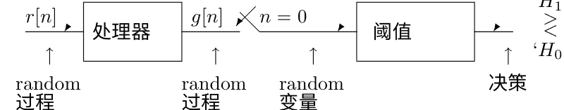

图14.3 一个通用的检测器结构。

11.7，并确定每种情况下处理器和检测阈值的最佳选择。

我们假设发射机和接收机是同步的，因此我们在一个已知（固定）的时间进行测试 $g[n]$，这里我们选择 $t=0$。选择0作为采样时刻是为了方便；可以选择任何其他时刻，在处理器的操作中会有相应的时间偏移。尽管处理器通常可以是非线性的，但我们假设计处理将使用LTI滤波器进行。因此，要考虑的系统如图14.4所示；连续时间可以考虑相应的系统。

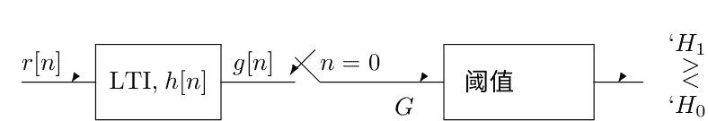

图14.4 图14.3的探测器结构与处理器作为LTI系统。

可以正式地证明，但也可以直观地理解，如果通过一个常数增益进行缩放，只要相应地调整阈值，就不会影响探测器的整体性能，因为常数整体增益会等比例地缩放信号和噪声。

为了方便起见，我们将LTI系统的增益归一化，使其为

$$
\sum_{n=-\infty}^{+\infty} h^2[n] = 1.
$$

如果 $r[n]$ 是一个高斯随机过程，那么 $g[n]$ 也是，因为它是对 $r[n]$ 进行线性处理得到的，因此在这种情况下 $G$ 是一个高斯随机变量。

## 14.3.1 白噪声中的脉冲检测

为了提出这种方法，我们考虑一个非常简单的LTI处理器选择，即 $h[n] = \delta[n]$，所以

$$
H_1 : G = g[0] = s[0] + w[0] \quad 
H_0 : G = g[0] = w[0].
$$

© Alan V. Oppenheim 和 George C. Verghese, 2010

## 第14.3节 通用检测器结构

为了方便起见，我们假设 $s[0]$ 为正数。

因此，在每个假设下，$g[0]$ 是高斯分布的：

$$
H_1: f_{G|H}(g | H_1) = N(s[0], \sigma^2) = \frac{1}{\sqrt{2\pi\sigma}} \exp \left[ -\frac{(g - s[0])^2}{2\sigma^2} \right] \\
H_0: f_{G|H}(g | H_0) = \frac{1}{\sqrt{2\pi\sigma}} \exp \left[ -\frac{g^2}{2\sigma^2} \right].
$$

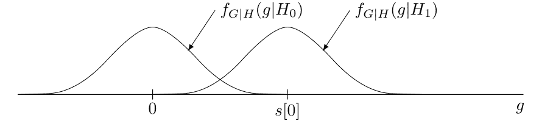

# 图 14.5 方程 (14.16) 中的两个假设的概率密度函数。

这只是关于随机变量 $G$ 的二元假设检验问题，在第13.2节中进行了讨论，相应地，具有最小错误概率的MAP规则为

$$
P(H_1 | G = g) \begin{cases} 
H_1 \\
H_0 
\end{cases} 
\geq P(H_0 | G = g),
$$

或者等价地，似然比检验：

$$
\frac{f_{G|H}(g | H_1)}{f_{G|H}(g | H_0)} \begin{cases} 
H_1 \\
H_0 
\end{cases} 
\geq \frac{P(H_0)}{P(H_1)} = \eta.
$$

使用方程(14.17) 评估方程(14.18) 得到关系

$$
\exp \left\{ -\frac{(g - s[0])^2}{2\sigma^2} \right\} + \left[ \frac{g^2}{2\sigma^2} \right\} 
\begin{cases} 
H_1 \\
H_0 
\end{cases} 
\geq \frac{P(H_0)}{P(H_1)}
$$

并且等价地

$$
\exp \left\{ \frac{g s[0]}{\sigma^2} - \frac{s^2[0]}{2\sigma^2} \right\} 
\begin{cases} 
H_1 \\
H_0 
\end{cases} 
\geq \frac{P(H_0)}{P(H_1)}
$$

或者，像我们在第14.2节中所做的那样，对似然比检验的两边取自然对数，方程(14.20) 被替换为

$$
g 
\begin{cases} 
H_1 \\
H_0 
\end{cases} 
\geq \frac{s[0]}{2} + \frac{\sigma^2}{s[0]} \ln \frac{P(H_0)}{P(H_1)}
$$

© Alan V. Oppenheim和 George C. Verghese, 2010

# 第254章 信号检测

我们可能不知道先验概率P(H₀)和P(H₁)，或者出于其他原因，可能想要修改阈值，但仍然使用似然比的阈值检验，或者使用以下形式的阈值检验：

g ≥ λ  
H₁'  
H₀' 

(14.22)

将阈值在所有可能的值上进行扫描，得到接收器操作特性，如第13.2.5节所讨论的。

接下来我们考虑更一般的情况，即h[n]不是恒等系统。然后，在两个假设下我们有：

H₁: g[n] = s[n] * h[n] + w[n] * h[n]  
H₀: g[n] = w[n] * h[n]  

(14.23)

术语w[n] * h[n]仍然代表噪声，但不再是白噪声，即其频谱形状被滤波器h[n]改变。将w[n] * h[n]表示为v[n]，v[n]的自相关函数为：

R_{vv}[m] = R_{ww}[m] * R_{hh}[m] 

(14.24)

而且特别是均值v[n]为零，方差为：

var{v[n]} = σ² ∑_{n=-∞}^{∞} h²[n]. 

(14.25)

由于方程(14.15)中的归一化，v[n]的方差与白噪声相同，即var{v[n]} = σ²。此外，由于w[n]是高斯分布，v[n]也是高斯分布。因此，值g[0]再次是一个方差为σ²的高斯随机变量。在两个假设下，g[0]的均值现在是：

H₁: E{g[n]} = ∑_{n=-∞}^{∞} h[n]s[-n] ≜ μ  
H₀: E{g[n]} = 0  

(14.26)

因此方程(14.17)被替换为：

H₁: f_{G|H}(g|H₁) = N(μ, σ²)  
H₀: f_{G|H}(g|H₀) = N(0, σ²). 

(14.27)

表示两个假设的概率密度函数如下所示图14.6。在这个图上，我们还指出了方程（14.27）的阈值γ，超过这个阈值我们会宣布H₁为真，低于这个阈值我们会宣布H₀为真。阴影区域还表示了与P_{FA}和P_D相对应的PDF下的面积。

© Alan V. Oppenheim 和 George C. Verghese, 2010

# 14.3.2 最大化信噪比

如果w[n]是白色但不是高斯的，那么g[0]不是高斯的。然而，在每个假设下，g[0]的分布仍然相同，只是在H₀下的均值为0，而在H₁下的均值为μ，如方程(14.26)所示。在这种情况下，匹配滤波器仍然在指定的结构（即LTI滤波后的采样）中最大化输出信噪比（SNR），其中SNR定义为E{g[0]|H₁}²/σ²。SNR的平方根是两个分布之间的相对分离度，以标准差衡量。因此，在某种直观的意义上，最大化SNR试图将这两个分布分开。

© Alan V. Oppenheim 和 George C. Verghese, 2010

# 第256章 信号检测

尽可能地。然而，这一般来说并不一定对应于最小化错误的概率。

# 14.3.3 连续时间匹配滤波器

本节中开发的所有匹配滤波器结果都可以直接应用于连续时间。在图14.7中，我们展示了与图14.4相对应的连续时间对应物。与之前一样，我们将h(t)的增益归一化为：

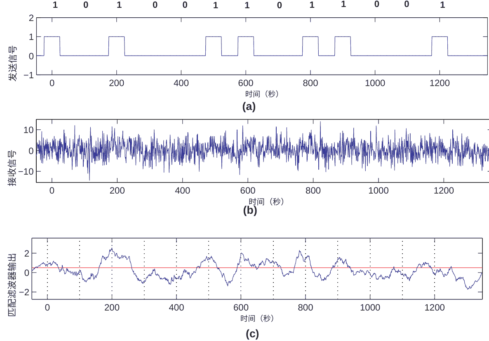

∫_{-∞}^{∞} h²(t)dt = 1  
(14.30)

当r(t)是高斯随机过程时，g(t)也是高斯的，G是一个高斯随机变量。在这两个假设下，G的概率密度函数为：

H₁: f_{G|H}(g|H₁) = N(μ, σ_G²)  
H₀: f_{G|H}(g|H₀) = N(0, σ_G²),  
(14.31)

其中：

σ_G² = N₀ ∫_{-∞}^{∞} h²(t)dt = N₀  
(14.32)

和：

μ = ∫_{-∞}^{∞} h(t)s(-t)dt  
(14.33)

因此，与离散时间情况类似，通过选择h(t)来尽可能地分离方程式(14.31)中的两个PDF，可以最小化错误的概率。应用于方程式(14.33)的连续时间版本的Cauchy-Schwarz不等式，我们得出结论，h(t)的最佳选择与s(-t)成比例，即再次匹配滤波器。

# 例子14.1 带匹配滤波器的PAM

图14.8(a)显示了一个典型的无噪声二进制PAM信号的示例，如方程式(13.1)所示。脉冲p(t)是一个长度为50秒的矩形脉冲。在所示的时间间隔内，上方标示了二进制序列a[n]。  
在没有噪声的情况下，图14.4的形式的最佳阈值检测器

© Alan V. Oppenheim 和 George C. Verghese, 2010

# 第258章 信号检测

# 图14.9 反极性信号的二进制检测

0001001011001，导致4个位错误。如果h(t)选择为匹配滤波器，则阈值检测器之前的信号如图14.9(c)所示。结果的解码二进制序列为1010011011001，没有位错误。在表14.1中，我们总结了基于长度为10^4的二进制序列的模拟结果。

| | 没有匹配的滤波器 | 带匹配滤波器 |
|---|---|---|
| 开关信号 | 0.4808 | 0.3752 |
| 反极性信号 | 0.4620 | 0.2457 |

# 表14.1 PAM信号的误码率，说明匹配滤波器对两种不同信号方案的影响。

© Alan V. Oppenheim 和 George C. Verghese, 2010

# 14.3.4 彩色噪声中的脉冲检测

在第14.2节和第14.3节中，我们在噪声是白噪声的假设下开发了最优检测器。当噪声是有色的，即其频谱密度不是平坦的时候，结果很容易修改。我们再次假设检测器的形式如图14.4所示。现在有两个假设：

H₁ : r[n] = s[n] + v[n], H₀ : r[n] = v[n],

其中v[n]仍然是一个均值为零的高斯过程，但一般来说不是白噪声。自相关函数R_vv[m]和功率谱密度S_vv(e^{jΩ})分别表示为。基本的方法是通过首先使用一个白化滤波器对r[n]进行处理，如第10.2.3节所讨论的那样，只要S_vv(e^{jΩ})在任何Ω值上都不为零，即严格为正。这个滤波的第一阶段如图14.10所示。

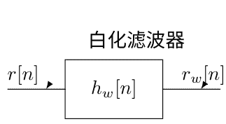

# 图14.10 滤波的第一阶段

脉冲响应h_w[n]被选择为其由输入噪声v[n]引起的输出是白噪声，方差为σ²，当然也是高斯分布的。通过这种预处理，信号r_w[n]现在具有第14.3.4节中假设的形式，其中白噪声w[n]对应于v[n] * h_w[n]，脉冲s[n]被替换为p[n] = s[n] * h_w[n]。检测器结构现在采用图14.11所示的形式，其中h[n]再次是匹配滤波器，但在这种情况下匹配的是脉冲p[n]，即h_m[n]与p[-n]成正比。

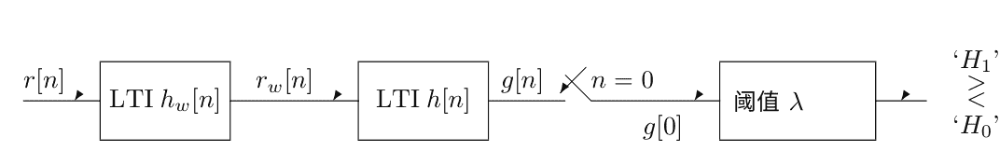

# 图14.11 带有彩色噪声的检测器结构。

假设h_w[n]是可逆的（即其Z变换在单位圆上没有零点），在先应用白化滤波器之后不会丧失一般性。具体来说，将从r[n]到g[n]的组合LTI滤波器表示为h_c[n]，并假设如果没有先应用白化，则从r[n]到g[n]的最佳滤波器选择为h_opt[n]。由于：

h_c[n] = h_w[n] * h_m[n]

© Alan V. Oppenheim 和 George C. Verghese, 2010

# 第260章 信号检测

其中h_m[n]表示白化后的匹配滤波器。如果使用h_opt[n]的性能比使用h_c[n]的性能更好，这意味着选择h_m[n]作为h_opt[n] * h_w^{inv}[n]会在白化信号上获得更好的性能。然而，正如所见在第14.3节中，h_m[n] = p[-n]是白化后的最佳选择，因此我们得出结论：

h_m[n] = p[-n] = h_opt[n] * h_w^{inv}[n]  

或者等价地：

h_opt[n] = h_w[n] * p[-n]

在下面的例子中，我们将说明在有色噪声情况下确定最佳检测器的方法。

# 例子14.2 有色噪声中的脉冲检测

考虑一个脉冲s[n]在有色噪声v[n]中，有：

s[n] = δ[n] .

和

R_{vv}[m] = (1/2)^{|m|}, 所以σ²= 1

那么S_{vv}(z) = (3/4)/[(1 - 1/2 z^{-1})(1 - 1/2 z)] .

所需白化滤波器输出的噪声分量w[n]具有自相关函数R_{ww}[m] = σ²δ[m]，因此我们要求：

S_{vv}(z)H_w(z)H_w(1/z) = σ²

因此H_w(z)H_w(1/z) = σ²/S_{vv}(z) = σ² * 4/3 (1 - 1/2 z^{-1})(1 - 1/2 z) .

当然，我们可以任意选择σ（因为它只会影响整体增益） . 选择σ² = 1，要么：

H_w(z) = (1 - 1/2 z^{-1})，或者

H_w(z) = (1 - 1/2 z)

注意，这两种选择中的第二种是非因果的。还有其他可能的选择，因为我们可以将任一选择级联到一个全通滤波器H_ap(z)，使得H_ap(z) H_ap(1/z) = 1.

© Alan V. Oppenheim 和 George C. Verghese, 2010

# 第261章 一般检测器结构

使用上述第一种选择的H_w(z)，我们有：

H_w(z) = (1 - 1/2 z^{-1}) 

h_w[n] = δ[n] - 1/2 δ[n - 1] 

σ² = 3/4 

p[n] = s[n] - 1/2 s[n - 1]，和

h[n] = A p[-n] 对于任意方便的选择A.

(14.42)

在我们在第14.3节中讨论脉冲在白噪声中的检测时，我们观察到脉冲中的能量影响检测器的性能，但不影响具体的脉冲形状。这是由于滤波器被选择为最大化数量√(1/ξ R_{ss}[0])，其中s[n]是要检测的脉冲。对于有色噪声中的脉冲情况，我们相应地希望最大化能量E_p in p[n]，其中：

p[n] = h_w[n] * s[n]

(14.43)

在频域中表示，

P(e^{jΩ}) = H_w(e^{jΩ})S(e^{jΩ})

(14.44)

以及根据Parseval关系：

E_p = 1/(2π) ∫_{-π}^{π} |H_w(e^{jΩ})|² |S(e^{jΩ})|² dΩ

(14.45a)

= 1/(2π) ∫_{-π}^{π} |S(e^{jΩ})|² / S_{vv}(e^{jΩ}) dΩ

(14.45b)

仅基于方程式(14.45b)，E_p可以通过将所有的能量放在S_{vv}(e^{jΩ})最小的频率上来最大化。然而，在许多情况下，传输信号受到其他限制，如峰值幅度和/或时间持续性。因此，任务是在这些约束条件下选择s[n]以最大化方程式(14.45b)中的积分。通常情况下，这个优化问题没有闭合解，但大致上一个好的解决方案将使信号能量更集中在功率S_{vv}(e^{jΩ})较小的地方。

© Alan V. Oppenheim 和 George C. Verghese, 2010

# MIT开放式课程
http://ocw.mit.edu

# 6.011 通信、控制和信号处理导论
2010年春季

有关引用这些资料或我们的使用条款的信息，请访问：http://ocw.mit.edu/terms。