# MIT 6.02 EECS2 数字通信系统讲义

## 比特、信号与数据包
数字通信和网络入门
Hari Balakrishnan
Christopher J. Terman
George C. Verghese
M.I.T. EECS系
最后更新：2012年11月

## 第一章
介绍

能够在世界通信网络上传递和交换信息已经彻底改变了人们工作、娱乐和生活的方式。在世纪之交，美国国家工程院列出了20项对20世纪社会产生最大影响的技术。¹ 这个列表包括了改变生活的创新，如电气化、汽车和飞机；还有四项通信领域的技术成就——无线电和电视、电话、互联网和计算机——这些技术的基础是我们在本书中最关注的。

有点令人惊讶的是，互联网仅排在第13位，但委员会给出的理由是它是在世纪末发展起来的，他们认为互联网最引人注目和最重要的影响将发生在21世纪。看看本世纪的第一个十年，这种观点听起来是正确的——无处不在的无线网络和移动设备的普及，社交网络的出现，以及随时随地进行通信的能力不仅改变了商业的面貌和我们与朋友保持联系的能力，而且对于大规模的社会和政治变革起到了重要作用。

沟通是我们现代生活的基础。很难想象没有互联网及其应用程序，也没有某种形式的网络移动设备。
2011年初，全球有超过50亿部手机处于活跃状态，其中超过10亿部具有“宽带”网络连接。为了对这个数字有所了解，它比2011年世界上拥有电力、鞋子、牙刷或厕所的人数还要多！

## ■ 1.1 目标

是什么使我们的通信网络工作？ 这本书是理解这个问题的起点。 这个问题值得研究的原因有两个。首先，为了理解

¹“技术的迅猛发展”，来源于nae.edu。文档http://bit.ly/owMo06

²事实上，根据TeleNav最近进行的一项调查，令人不安的是，40%的iPhone用户表示他们宁愿放弃一周的牙刷，也不愿放弃他们的iPhone!
http://www.telenav.com/about/pr-summer-travel/report-20110803.html

是什么使我们的通信网络工作？ 这本书是理解这个问题的起点。 这个问题值得研究的原因有两个。首先，为了理解

了解通信系统中使用的关键设计原则和基本分析技术。其次，因为涉及到的技术思想也出现在计算机科学（CS）和电气工程（EE）的几个其他领域中，研究通信系统为引入更广泛适用的概念提供了一个很好的背景。

在我们深入描述技术主题之前，我们想分享一些本书所采用的材料和方法背后的哲学思想。这些材料非常适合一学期的课程；在麻省理工学院，这门课程主要由大二学生选修，他们的背景包括一些基本的编程知识（用于实验室）和一些概率和傅里叶级数的了解。

传统上，在教育和研究中，“低层次通信”被认为是电子工程的一个主题，主要涵盖了信息在单个通信链路上如何传输的问题。类似地，“网络”被认为是计算机科学的一个主题，主要涵盖了如何构建由多个链路组成的通信网络的问题。特别是，许多传统的数字通信课程很少关注网络的构建和工作原理，而大多数计算机网络课程将物理链路上的通信细节视为黑盒子。因此，很多人对其中一个主题有深入的了解，但很少有人在问题的每个方面都是专家。这种划分是解决这个庞大主题复杂性的一种方式。本书的目标是理解数字通信的计算机科学和电子工程两个重要方面的细节，并理解各种抽象方法如何允许系统的不同部分进行设计和修改，而无需过多关注（甚至完全理解）系统中其他地方发生的事情。

保持通信系统中不同组件之间的强边界的一个缺点是，另一个组件中的工作原理细节可能仍然是一个谜，即使对于实践工程师来说也是如此。在通信系统的背景下，这种谜通常表现为“在我的层面之上”或“在我的层面之下”的事物。因此，尽管我们将在本书中欣赏抽象边界的好处，但我们的一个重要目标是研究通信系统完整设计中涉及的最重要的原则和思想。我们的目标是向您传达这个领域的广度和深度。

我们涵盖了从源头（具有一些要传输的信息）到数据包（将消息分解为传输的单元）再到比特（每个比特都是“0”或“1”）再到信号（通过物理通信链路发送的模拟波形，如电线、光纤电缆、无线电或声波）。我们研究了一系列通信网络，从最简单的点对点链接到共享媒体（由一组共享共同物理通信介质的通信节点组成），再到更大的多跳网络，它们本身连接到其他网络以形成更大的网络。

## ■ 1.2 主题

所有数字通信系统和网络的核心都面临着三个基本挑战：可靠性、共享性和可扩展性。在这门入门课程中，我们将花费大量时间讨论前两个问题，但对第三个问题的讨论时间较少。

### 1.2.1 可靠性

有许多因素导致通信不可靠，我们将研究许多提高可靠性的技术。这些不同技术之间的一个共同主题是它们都以创造性和高效的方式使用冗余来提供可靠性，以克服各种故障和干扰，包括高斯噪声和干扰扭曲或破坏信号，导致可能的比特错误，以及由于无法纠正的比特错误导致的数据包丢失，队列溢出或网络中的链路和软件故障。所有这些问题都会降低通信质量。

在实践中，我们不仅关注可靠性，还关注速度。大多数提高通信可靠性的技术都涉及某种形式的冗余，这会降低通信速度。许多通信系统的本质是可靠性和速度之间的权衡。

通信速度随着时间的推移迅速增加。在20世纪80年代初，人们通过电话线连接到互联网的速度仅为几千比特每秒，而今天在笔记本电脑上通过无线连接的速度达到每秒100兆比特，有线连接的速度达到每秒1-10吉比特已经很常见。

我们将开发良好的工具来理解为什么通信不可靠以及如何解决所产生的问题。这些技术包括纠错码、处理由“符号间干扰”引起的失真的线性时不变信道模型、用于恢复由各种原因引起的数据包丢失的重传协议，以及开发容错路由协议以在网络中找到备用路径以克服链路或节点故障。

### 1.2.2 高效共享

“据传说，一个工程师可以为一美元做一美元的事情，而一个傻瓜也可以为一美元做一美元的事情。”即使对于中等规模的网络来说，每对节点之间都连接有专用链路的通信网络也是无法承受的昂贵的。在通信网络中，共享是不可避免的，因为用于通信的资源并不便宜。我们将研究如何在点对点链路、共享介质和整个多跳网络之间共享资源。

我们将开发方法来在节点之间共享共同的通信介质，这是有线媒体（如广播以太网）、无线技术（如无线局域网，例如802.11或WiFi）、蜂窝数据网络（如“3G”）和卫星网络（见图1-1）所共有的问题。

我们将研究调制和解调的方法，这使我们能够在不同的载波频率上传输信号。在这个过程中，我们可以通过在不同的频率上操作，确保多个对话共享一个通信介质。

我们将学习介质访问控制（MAC）协议，这些规则确定节点在网络中的行为和反应方式 - 模拟时分共享或频率共享。在时分共享中，每个节点都有一段时间来传输数据，没有其他节点活动。在频率共享中，我们将通信带宽划分为不同的部分。

(![bbox=[268, 77, 681, 277]])

全球电信联盟（ITU）定义了国际电信联盟（ITU）的标准。这个规范是从我们的网站上获取的，请访问www.example.com了解更多信息。

（即频率范围）在节点之间以确保专用频率子范围用于不同的通信，并且不同的通信可以同时进行而不会干扰。每种方案都有其最佳应用场景和用途。

然后我们将转向多跳网络。在这些网络中，不同节点之间的多个并发通信通过共享相同的链路进行。也就是说，可能会有许多不同实体之间的通信都发生在相同的物理链路上。这种共享是由称为交换机的特殊计算机进行协调的，它们实施特定的操作和协议。多跳网络通常以分布式方式进行控制，没有任何集中控制来确定每个节点的操作。

## 我们将要解决的问题包括：

+   1. 不同节点之间的多个通信如何共享网络？
+   2. 消息如何在网络中从一个地方传输到另一个地方？
+   3. 我们如何在多跳网络中可靠地传输信息（而不仅仅是在单个链路或共享介质上）？

用于共享网络和实现可靠性的技术最终决定了通信网络的效率。一般来说，可以从几个方面来提出效率问题。一种方法是通过最小化资本支出（硬件设备、软件、链路成本）和运营费用（人员、租金成本）来构建和运行能够满足一组要求的网络（如连接设备数量、性能和可靠性水平等）。另一种方法是通过最大化网络的“有用工作量”来最大化给定网络的性价比。人们可以通过计算不同通信方式实现的“每秒比特数”（或在更高速度下更方便的“兆比特每秒”）来衡量“有用工作量”，以及该吞吐量在一组节点中的变化和数据传输实现的平均延迟（通常称为延迟，通常以毫秒为单位）。在本课程中，我们主要关注吞吐量和延迟，并不花太多时间讨论更广泛（但同样重要）的成本问题。

### 1.2.3 可扩展性

除了可靠性和高效共享之外，可扩展性（即设计能够适应大规模的网络）是通信网络的一个重要设计考虑因素。我们只会简要提及这个问题，大部分内容将在以后的课程（6.033、6.829）中讲解。

### 1.3 大纲和计划

我们将课程分为四个部分：源、以及三个重要的抽象概念（比特、信号和数据包）。出于教学目的，我们将按照下面给出的顺序来学习它们。

+   1. 源。最终，所有的通信都是关于源希望以消息的形式发送一些信息给接收者（或多个接收者）的。因此，理解信息的数学基础是有意义的，理解如何编码要发送的材料，并且出于效率的原因，理解如何最好地压缩我们的消息，以便我们可以尽可能少地发送数据，但仍然允许接收者正确解码我们的消息。第2章和第3章描述了信息、熵（信息的期望）和源编码的关键思想，这使得数据压缩成为可能。我们将学习Huffman编码和Lempel-Ziv-Welch算法，这是两种广泛使用的方法。

+   2. 比特。我们在这里要处理的主要问题是使用纠错码来克服比特错误，具体来说是线性分组码（第5章和第6章）和卷积码（第7章和第8章）。这些码使用有趣而复杂的算法，巧妙地应用冗余来减少或消除比特错误。

+   3. 信号。我们在这里将处理的主要问题是如何通过信号调制比特，并通过理解线性时不变（LTI）抽象来对通信信道的失真进行建模，以恢复比特。主题包括在时间域和频率域之间转换信号表示，信号的频率内容以及信道和滤波器的频率响应。第9章到第14章描述了这些主题。

+   4. 数据包。我们将研究的主要问题是如何使用MAC协议共享介质，在多跳网络中进行路由，并使用可靠的数据传输协议。第15章到第19章描述了这些主题。

麻省理工学院开放式课程
http://ocw.mit.edu

6.02电子工程与计算机科学II：数字通信系统
2012年秋季

有关引用这些材料或我们的使用条款的信息，请访问：http://ocw.mit.edu/terms。

## 第2章
信息、熵和源代码的动机

20世纪末，由克劳德·香农（MITSM'37&PhD'40）在1940年代末提出的信息理论是过去一个世纪最有影响力的思想之一，它改变了许多技术领域的理论和实践。通信系统和网络的发展受益匪受益于香农的工作。 在本章中，我们首先发展信息背后的直觉，并将其正式定义为数学量，然后将其与数据源的相关属性（熵）联系起来。

这些概念指导我们在通信（或存储）之前高效地压缩数据源，并在接收方恢复原始数据而不失真。 这里的一个关键思想是编码，更准确地说是源编码，它将由任何数据源产生的每个“符号”与一个编码词相关联，并实现了几个理想的属性。（可以将消息视为某个字母表中的符号序列。）将输入符号与编码词之间的映射称为编码。 我们的重点将放在无损源编码技术上，其中任何未损坏消息的接收者都可以完全恢复原始消息（我们将在后面的章节中处理损坏的消息）。

## ■ 2.1 信息与熵

香农的一个重要发现是，在不考虑应用程序和消息语义的情况下，可以对信息进行一般性定义。 当我们抽象掉应用程序的细节时，将信息从S发送给R的任务可以简化为S选择一条消息并将其发送给R。让我们以最简单的例子开始，当发送方希望发送两条消息中的一条时，具体来说，让我们假设消息是关于英国人来的方式：

- 如果是陆路，则为 “1”。
- 如果是海路，则为 “2”。

假设我们对英国人的到来没有任何先验知识，所以这些选择（消息）是等概率的。 在这种情况下，发送者指定选择所传达的信息量为1比特。 直觉地说，这个比特可以有两个值之一，可以用来编码特定的选择。 如果我们需要传达一系列这样的独立事件，比如1000个这样的事件，我们可以使用1000比特的信息来编码结果，每个比特指定一个相关事件的结果。

另一方面，假设我们以某种方式知道英国人更有可能通过陆地而不是海洋到来（比如因为有严重的风暴预报）。 那么，如果事实上消息说英国人是通过海洋到来的，传达的信息量比如果消息说他们是通过陆地到来的要多得多。 举个例子，如果我告诉你波士顿一月份的温度是75°F，比如果我告诉你温度是32°F，传达的信息要多得多！从这些例子中你应该得出的结论是，对于一个事件的任何“信息”量化应该取决于该事件的概率。事件的概率越大，知道事件发生的信息

## 图2-1：H(p) 作为 p 的函数，当 p = 1/2 时取得最大值。

只需查看第42个字节，并将这8个比特解释为一个ASCII字符。一个包含1000个字符的文本文件需要8000个比特来存储。如果文本文件是HTML文件，作为对HTTP请求的响应发送到网络上，自然会将1000个字节（8000个比特）按照它们在文件中的顺序发送。

让我们考虑如何压缩文件并发送少于8000个比特。如果文件包含英文文本，我们预计字母e的出现频率会比字母x高。这个观察结果表明，如果我们使用少于8个比特对e进行编码传输，并且作为权衡，必须使用超过8个比特对不常见的字符（如x）进行编码，那么平均而言，编码后的消息将比原始方法更短。因此，例如，我们可以选择比特序列00来表示e，并选择编码100111100来表示x。

这种直觉与信息量的定义一致：常见的符号具有较高的概率和信息量较低，因此我们需要更少的比特来编码这些符号。同样，不经常出现的符号如x具有较低的概率和较高的信息量，因此在编码这些符号时我们将使用更多的比特。这种直觉有助于实现我们将传输数据的大小与信息内容匹配的目标。

我们希望传输或存储的信息到比特序列的映射被称为编码。图2-2展示了两个编码的示例（固定长度和可变长度），它们将不同的等级映射到一对一的比特序列。固定长度编码很直观，但可变长度编码并不是任意的，它经过了精心设计，我们很快就会了解。编码中的每个比特序列被称为编码词。

当数据的映射在数据源处进行时，通常是为了压缩数据（理想情况下，使其与底层的预期比特数匹配），得到的映射被称为源代码。源代码与我们将在后面的章节中学习的信道代码不同。源代码消除了冗余并压缩数据，而信道代码以受控的方式增加冗余，以提高数据在面对由于不完美的通信信道引起的位错误和擦除时的错误容忍性。

本章和下一章讲述的是源代码。

这种关于编码常见符号（如字母e）的见解比不常见的符号更简洁，可以推广为一种可变长度编码的策略：

使用较短的编码词（较少的比特）发送常出现的符号，使用较长的编码词（较多的比特）发送不经常出现的符号。

我们预计，平均而言，使用可变长度编码对消息进行编码所需的比特数将少于原始的固定长度编码。当然，如果消息全部是x，则可变长度编码会更长，但我们的编码方案旨在优化预期情况，而不是最坏情况。

这里有一个简单的例子：假设我们需要设计一个系统来发送包含10006.02个A、B、C和D等级的消息（麻省理工学院的学生很少或几乎不会得到F在6.02课程中）。通过检查过去的消息，我们发现每个等级出现的概率如图2-2所示。

| 等级 | 概率 | 固定长度编码 | 可变长度编码 |
| --- | --- | --- | --- |
| A | 1/3 | 00 | 10 |
| B | 1/2 | 01 | 0 |
| C | 1/12 | 10 | 110 |
| D | 1/12 | 11 | 111 |

# 图2-2：可能的等级及其概率，固定长度和可变长度编码

如果我们使用固定长度编码，对于每个等级有四种可能的选择，我们需要2位来编码一个等级，因此在发送1000个等级时，总传输长度为2000位。

BCBAAB的固定长度编码为：0110 01000001（12位）

使用固定长度编码，传输的大小不取决于实际消息，发送1000个等级始终需要2000位。

解码使用固定长度编码发送的消息很简单：将接收到的每一对位查找在上表中对应的等级。

请注意，可以确定第42个等级，而无需解码其他等级-只需查看第42对位。

使用可变长度编码，传输1000个等级所需的位数取决于等级的数量。

变长编码用于 BCBAAB：0 110 0 10 100（10位）

如果所有的成绩都是B，传输只需要1000位；如果都是C和D，传输需要3000位。 但是我们可以使用成绩的概率

根据图2-2计算传输的预期长度

1000[(\frac{1}{3})(2) + (\frac{1}{2})(1) + (\frac{1}{12})(3) + (\frac{1}{12})(3)] = 1000[1] = 1666.\frac{2}{3}位

所以，平均而言，使用变长编码可以将传输1000个成绩缩短333位，节省约17%。 注意，要确定第42个成绩，我们需要解码前41个成绩，以确定第42个成绩在编码消息中的位置。

如果我们想要在平均情况下发送更少的比特，并且保留原始消息中的所有信息，使用可变长度编码似乎是一个不错的方法。 不过，这样做的缺点是，在解码到达该点之前，我们放弃了随意访问任意消息符号的能力。

关于特定可变长度编码的一个显而易见的问题是：它是最佳编码吗？ 可能存在一种不同的可变长度编码，能够做得更好，即平均情况下产生更短的消息。 平均情况下消息能有多短？ 我们将在下一节讨论这个问题。

# 第2.3节。有多少压缩是可能的？

理想情况下，我们希望设计我们的压缩算法尽可能产生更少的比特：刚好足够表示消息中的信息，但不多。 理想情况下，我们将能够使用不超过消息中所包含的信息量（在第2.1节中定义）的比特数，至少在平均情况下。

具体来说，熵由方程（2.2）定义，它告诉我们当消息从一组可能的消息中选择时，消息中的预期信息量，每个消息的发生概率不同。 熵是传输关于特定选择的数据时，平均而言必须发送的信息量的下界。

如果我们违反这个下界，即平均发送的比方程（2.2）要求的位数少，会发生什么？ 在这种情况下，接收者将没有足够的信息，会存在一些剩余的不确定性-确切的不确定性取决于编码，但是为了构建少于所需位数的代码，必须将一些选择映射到相同的编码中。 因此，当接收者接收到其中一个超载编码时，它将没有足够的信息来明确确定发生了哪个选择。

方程（2.2）通过给出接收者解决所有歧义所必须发送的比特数的下界来回答我们关于压缩有多少可能性的问题。 重新演示图2-2中的例子，我们可以使用方程（2.1）更新图形。

使用方程（2.2），我们可以计算在了解特定成绩时的预期信息内容：

∑_{i=1}^{N} p_i log_2(\frac{1}{p_i}) = (\frac{1}{3})(1.58) + (\frac{1}{2})(1) + (\frac{1}{12})(3.58) + (\frac{1}{12})(3.58) = 1.626比特

因此，编码一个包含1000个成绩的序列平均需要传输1626比特。

# 图2-3：可能的成绩与概率和信息内容。

在图2-2中给出的可变长度编码使用1667位对1000个等级进行编码，平均而言，并没有实现最大可能的压缩。 事实证明，当一次编码一个等级时，示例 codedoesaswellaspossible 。 为了接近下界，我们需要对等级序列进行编码-关于这个想法稍后会有更多解释。

找到一个好的编码-其中编码消息的长度与信息内容（即熵）相匹配-是具有挑战性的，人们经常需要“跳出框架”思考。 例如，考虑传输1000次不公平硬币翻转的结果，其中正面的概率由 p_H给出。 不公平硬币翻转的预期信息内容可以使用方程（2.3）计算：

```
p_H \log_2(1/p_H) + (1 - p_H) \log_2(1/(1 - p_H))
```

对于 p_H=0.999，该熵评估为0.0114。你能想到一种方法来编码1000个不公平的硬币翻转，平均只使用11.4比特吗？ 编码消息的接收者必须能够告诉每个1000个翻转中哪些是正面，哪些是反面。 提示：只有11比特的预算，显然不能对每个翻转进行单独编码！ 实际上，一些有效的编码利用了发送编码消息的上下文。 例如，如果接收者期望接收一首莎士比亚十四行诗，那么如果知道只有154首莎士比亚十四行诗，就可以只使用8比特来编码消息。 也就是说，如果发送者和接收者都知道这些十四行诗，并且发送者只想告诉接收者要听哪首十四行诗，那么可以使用非常少的比特，只需 log_2 154比特，如果所有的十四行诗都是等概率的话！

# 为什么要压缩？

使用压缩的几个原因：

+   较短的消息传输时间较短，因此完整的消息更快地到达接收者。 这对发送者和接收者都有好处，因为它释放了他们的网络容量用于其他目的，并减少了他们的网络费用。
	对于数据的高容量发送者（比如Google），发送的字节数减少一半在经济上是有意义的。

- 节约网络资源对于必须共享网络的内部资源（数据包队列和链路）的所有用户都是有益的。 每个消息使用的资源较少意味着可以在网络的资源限制内容纳更多的消息。

在具有非可忽略比特错误率的容易出错的链路上，在使用纠错码进行信道编码之前对消息进行压缩可以帮助提高吞吐量，因为消息中的冗余可以被设计为提高错误容忍度，在去除原始消息中的其他冗余之后。 最好的做法是设计冗余以纠正比特错误，而不是依赖于原始消息中存在的任何次优冗余。

传统上，压缩被认为是一种端到端的功能，作为应用层协议的一部分应用。 例如，可以在web服务器和浏览器之间使用无损压缩来减少传输网页集合时发送的比特数。 另一个例子是使用压缩图像格式（如JPEG）传输图像，或者使用MPEG格式传输视频。 然而，也可以在链路层应用压缩，以减少传输比特数并消除冗余比特（可能在链路上应用纠错码之前）。 当在链路层应用压缩时，只有在数据本身具有压缩能力且具有足够的冗余以提取压缩收益时，压缩才有意义。

下一章介绍了两种压缩（源编码）方案：霍夫曼编码和Lempel-Ziv-Welch（LZW）压缩。

# 致谢

感谢YuryPolyanskiy提供的几条有用的评论和建议。

# 练习

1. 一群人在派对上试图猜测一个3位二进制数。 艾丽斯被告知这个数字是奇数；鲍勃被告知它不是3的倍数（即不是0、3或6）；查理被告知这个数字恰好包含两个1；黛布得到了这三个线索。 每个玩家对这个数字获得了多少信息（以比特为单位）？

2. 经过仔细的数据收集，Alyssa P. Hacker观察到Storrow Drive上“高”或“低”交通的概率由以下表格给出：高交通水平

| 如果红袜队正在比赛 | 如果红袜队没有比赛 |
|---|---|
| P(高交通) = 0.999 | P(高流量) = 0.25 |
| P(低流量) = 0.001 | P(低流量) = 0.75 |

(a) 如果已知红袜队正在比赛，那么交通水平为低时传达的信息量是多少比特。将你的答案给出为一个数学表达式。

(b) 假设已知红袜队不在比赛。 相应交通概率分布的熵是多少？ 将你的答案给出为一个数学表达式。

3.X 是一个从所有可能的4位二进制数中均匀随机选择的未知4位二进制数。 你还得到了另一个4位二进制数 Y，并被告知

X（未知数）和 Y（你所知道的数）在精确地两个位置上不同。关于 X，你得到了多少关于它的信息位？

4. 在二十一点游戏中，庄家首先给自己和对手发两张牌：一张面朝下，一张面朝上。在你看到自己的面朝下的牌之后，你知道了三张牌的总数。假设这是从一副新牌中发出的第一手牌，看到三张牌后，你对庄家的面朝下的牌有多少信息位？

5. 下表显示了工程学院的本科和硕士研究生注册人数：

| 课程（系） | 学生人数 | 总人数的百分比 |
|---|---|---|
| I（土木与环境工程） | 121 | 7% |
| II（机械工程） | 389 | 23% |
| III（材料科学） | 127 | 7% |
| VI（电子工程与计算机科学） | 645 | 38% |
| X（化学工程） | 237 | 13% |
| XVI（航空与宇航） | 198 | 12% |
| 总计 | 1717 | 100% |

(a) 当你了解一个随机选择的工程学院学生的系别时，你会获得一些信息位。对于哪个学生系别，你获得的信息位最少？

(b) 在下一章中学习了哈夫曼编码后，设计一个哈夫曼编码来编码随机选择的学生组的系别。展示你的哈夫曼树，并给出每个课程的编码。

(c) 如果您的代码用于发送仅包含随机选择的100个学生组中每个学生的编码的消息，那么这些消息的平均长度是多少？

6. 您正在玩一款在线纸牌游戏，使用一副包含3张A、7张K、25张Q、31张J和34张10的牌。在游戏的每一轮中，牌都会被洗牌，您会对将要抽取的牌的类型进行下注，然后抽取一张牌，并向赢家支付赌注。在下一轮开始之前，抽取的牌将被重新放回牌堆中。

(a) 当告知当前轮中抽到了一张Q时，您获得了多少信息？

(b) 给出一个数值表达式，表示了了解一轮结果时所获得的信息内容。

(c) 在下一章中学习了哈夫曼编码之后，构建一个变长哈夫曼编码，以最小化报告一系列轮次结果的消息的长度。单轮结果的编码为A（A）、K（K）、Q（Q）、J（J）或X（10）。为A、K、Q、J和X分别指定您的编码。

(d) 再次，在学习了哈夫曼编码之后，使用第(c)部分的代码计算预期的消息长度，报告1000轮结果的消息（即包含1000个符号的消息）？

(e) 内华达州博彩委员会经常收到使用符号A、K、Q、J和X编码的消息，每轮的结果都被编码。他们发现大量描述1000轮结果的消息（即包含1000个符号的消息）可以通过LZW算法压缩成总共43字节的文件。他们决定对这个不正当的游戏提起起诉。为什么委员会提起起诉？

# 考虑完全由元音（A、E、I、O、U）组成的消息。下面是每个元音的概率表：

| l | p_i | log_2(1/p_i) | p_i log_2(1/p_i) |
|---|---|---|---|
| A | 0.22 | 2.18 | 0.48 |
| E | 0.34 | 1.55 | 0.53 |
| I | 0.17 | 2.57 | 0.43 |
| O | 0.19 | 2.40 | 0.46 |
| U | 0.08 | 3.64 | 0.29 |
| 总计 | 1.00 | 12.34 | 2.19 |

(a) 当你得知一个特定的元音是I或U时，给出接收到的信息位数的表达式。

(b) 在下一章中学习了哈夫曼编码后，使用哈夫曼算法构建一个变长编码，假设每个元音都被单独编码。画出哈夫曼树的图并给出每个元音的编码。

(c) 使用上一部分（B）中的代码，给出传输100个元音的编码消息的期望长度的表达式（以位为单位）。

(d) 本·比特迪德尔整夜都在研究一种更复杂的编码算法，并给你发送了电子邮件，声称使用他的代码传输100个元音的编码消息的期望长度为197位。你会为他的实现付出好价钱吗？

# 麻省理工学院开放式课程
http://ocw.mit.edu

# 6.02电子工程与计算机科学II：数字通信系统

2012年秋季

有关引用这些材料或我们的使用条款的信息，请访问：http://ocw.mit.edu/terms。

# MIT 6.02 草稿 讲义
最后更新日期：2012年9月17日

# 第3章
压缩算法：Huffman和Lempel-Ziv-Welch（LZW）

本章讨论了两种源编码算法，用于压缩消息（消息是一系列符号的序列）。第一种是Huffman编码，在了解消息中不同符号的概率，并且每个符号都是从某个已知分布中独立抽取的情况下，是高效的。第二种是LZW（Lempel-Ziv-Welch），是一种自适应压缩算法，不需要对符号概率做任何假设。Huffman编码和LZW都被广泛应用于实践中，并且是许多实际标准（如GIF、JPEG、MPEG、MP3等）的一部分。

## 好源代码的特性

假设源希望发送一条消息，即从某个字母表中抽取的一系列符号。字母表可以是文本，也可以是与数字化图片或视频对应的像素强度（从数字或模拟源获取的，我们将在下一章中更详细地讨论这样一个源的示例），或者可能是更抽象的东西（例如，“陆地”对应“ONE”，“海洋”对应“TWO”，或者“重型交通”对应“h”，“轻型交通”对应“ℓ”）。

代码是符号和编码字之间的映射。进行映射的原因是我们希望将消息转换为可以在通信渠道上进行操作、存储和传输的形式。对于许多通道来说，由二进制值组成的编码字是实现这一目标的一种方便且有效的方式。

例如，如果我们想要传输6.02学生的成绩，我们可以使用以下编码：

```
“A” → 1
“B” → 01
“C” → 000
“D” → 001
```

然后，如果我们想要传输一系列的成绩，我们可能会发送如0010001110100001的消息。接收方可以通过在其与源之间共享的代码（即映射）中查找接收到的消息的适当连续且不重叠的子字符串来解码该接收到的消息，从而得到“DCAAABC”序列的成绩。

瞬时编码。一个代码应具备的一个有用特性是，当接收到相应的编码字时，对应的符号可以立即解码。这样的代码被称为瞬时编码。上面的例子是一个瞬时编码。原因是如果接收器已经解码了一个序列，现在收到一个“1”，那么它知道该符号必须是“A”。如果接收到一个“0”，那么它会查看下一个比特；如果下一个比特是“1”，那么它知道该符号是“B”；如果下一个

瞬时码或前缀自由码决定了路径和编码方式。所以 B被编码为 0，C被编码为 110，依此类推。解码则是相反的过程，即路径（码字）决定了符号，如前一节所述。所以111100解码为：111！D，10！A，0！B。

从树上看，我们可以看到更有可能出现的符号（如 B）靠近根部，因此具有较短的编码，而较不可能出现的符号（如 C或 D）则较远，因此具有较长的编码。大卫・赫夫曼在1951年在麻省理工学院（M.I.T.）上鲍勃・法诺教授的研究生课程中写论文时利用了这一观察结果，设计了一种用于构建最优可变长度码的解码树的算法。

赫夫曼的洞察力在于自下而上地构建解码树，从最不可能出现的符号开始，并应用贪婪策略。以下是涉及的步骤，以及基于图2-2中的可变长度编码的实例。算法的输入是一组符号及其相应的发生概率。输出是编码树，可以从中读取与每个符号对应的编码字。

+   1. 输入：一组元组S，每个元组由一个消息符号和其关联的概率组成。

   示例：$S \{ (0.333, A), (0.5, B), (0.083, C), (0.083, D) \}$

2. 从S中移除具有最小概率的两个元组，解决平局。将移除的两个符号组合成一个新的元组（表示代码树的内部节点）。通过将两个元组的概率相加来计算这个新元组的概率。将这个新元组添加到S中。（如果S最初有N个元组，现在有N-1个，因为我们移除了两个元组并添加了一个。）示例：S

    $\{ (0.333, A), (0.5, B), (0.167, C \wedge D) \}$

3. 重复步骤2，直到S只包含一个元组。（最后一个元组表示代码树的根）

   例如，迭代2：$S \{ (0.5, B), (0.5, A \wedge (C \wedge D)) \}$

   例如，迭代3：$S \{ (1.0, B \wedge (A \wedge (C \wedge D))) \}$

大功告成！结果是一个代表给定符号和概率的可变长度编码的代码树。正如你在练习中所看到的，这些树并不总是“高而瘦”，左分支通常指向一个叶子；树木更常见的是“茂密”的。

## 第3.2节 哈夫曼编码

以一个简单的例子来说明，考虑输入符号A、B、C、D、E、F、G、H，它们的出现概率相等（每个符号的概率为1/8）。在第一次遍历中，可以任选两个最低概率的符号，所以我们选择A和B，不失一般性。组合符号AB的概率为1/4，而其他六个符号的概率为1/8。在下一次迭代中，我们可以任选两个概率为1/8的符号，比如C和D。继续这个过程，经过四次迭代，我们将创建四组概率为1/4的组合符号。应用该算法，我们发现编码树是一棵完全二叉树，每个符号都有一个长度为3的编码词，对应所有3位二进制词（000到111）。

当一些符号的概率明显大于其他符号时，哈夫曼编码在编码消息的期望长度方面具有最大的减少（相对于使用二进制枚举的简单固定宽度编码）。如果所有符号的概率相等，则所有编码字的长度大致相同，并且存在（几乎）固定长度的编码，其期望码长接近熵并且因此接近最优。

### ■ 3.2.1 哈夫曼编码的属性

我们在这里陈述一些哈夫曼编码的属性。我们没有正式证明这些属性，但提供了关于为什么它们成立的直观理解。

非唯一性。以一种微不足道的方式，因为在编码树的任意一对分支上的0/1标签可以互换，通常存在多个不同的编码，它们的期望长度都相同。. 实际上，对于给定的符号概率，可能存在多个最优编码，并且根据如何解决平局，哈夫曼编码可以产生不同的非同构编码树，即在结构上看起来不同且不仅仅是单个底层树的重新标记。例如，考虑六个概率为1/4、1/4、1/8、1/8、1/8、1/8的符号。图3-2中显示的两个编码树都是有效的哈夫曼（最优）编码。

最优性。哈夫曼编码在某种意义上是最优的，即在限制为瞬时（前缀无重叠）编码且消息中的符号是从一个固定的已知概率分布中独立选择时，没有其他编码的期望长度更短。

我们在这里陈述一些有助于建立哈夫曼编码最优性的命题。

# 命题3.1 在前缀无重叠编码的任何最优编码树中，每个节点要么没有子节点，要么有两个子节点。

为了理解这一点，假设一个最优编码树有一个只有一个子节点的节点。 如果我们将该节点上移一级到其父节点，我们将减少期望编码长度，并且编码仍然可解码。 因此，原始树不是最优的，产生了矛盾。

# 命题3.2 在哈夫曼编码的编码树中，没有节点恰好有一个子节点。

为了理解这一点，注意我们总是将两个概率最低的节点合并为一个节点，这意味着在编码树中，每个内部节点（即非叶节点）都来自两个合并的节点（可以是内部节点本身或原始符号）。

# 命题3.3：存在一个最优码，其中两个最不可能的符号：

+   •具有最长的长度，并且
•是兄弟节点，即它们的编码只在最后一位上不同。

证明：设最不可能的符号为z。 如果它在最优码树中不是最大深度，则其他符号s必须在最大深度。 但是因为p(z) < p(s)，如果我们在编码树中交换z和s，我们将得到一个期望长度更小的编码。 因此，z的编码长度必须至少与其他编码长度一样长。

现在，符号z必须在最优码树中有一个兄弟节点，根据命题3.1。称其为x。 设第二小概率的符号为y，即p(x) < p(y) < p(z)。 如果p(x) = p(y)，则命题得证。 让我们在编码树中交换x和y，现在y是z的兄弟节点。 这个编码树的期望编码长度不会大于交换前的最优编码树，因为p(x)严格大于p(y)，证明了命题。

# 定理3.1：霍夫曼编码在限制为逐个符号编码且符号独立地从一个已知的固定符号概率分布中抽取时，产生的编码树的期望长度是最优的。

证明。 对符号数量n进行归纳证明。 假设符号为x₁, x₂, ...，x₁, x₂, ..., x_{n-1}的出现概率分别为p。 根据命题3.3，存在一个最优编码树，其中x_{n-1}和x的编码长度最长且它们是兄弟节点。

归纳假设：假设霍夫曼编码在具有n个符号和相应出现概率的输入上产生了一个最优编码树。 基本情况很容易验证。

设H(n)为由霍夫曼编码生成的n个符号x₁, x₂, ..., x_{n}的编码树的期望成本。那么，H(n) = H(n-1) + p_{n}，其中H_{n}是预期成本

### ■ 3.3 LZW：自适应可变长度源代码

首先，通过考虑以英语书写的书的文本的数字表示和传输问题，更好地理解压缩问题。一种简单的方法是分析几本书，并估计不同字母的概率。

由Huffman编码在输入符号n，空，1，x，1，x，2等生成的代码树x，n，空，2，x，n，空，1，n，带有概率p，1，p，2等，p，n，空，1，+，p，n）
根据归纳假设，H，n，空，1，=，L，n，空，1，是最优代码树的预期长度此外，根据命题3.3，存在一个最优代码树，其中L，n，=，L，n，空，1，+（p，n，1，+，p，n）
因此，存在一个最优代码树
其预期成本，L，等于霍夫曼编码的预期成本，H，对于符号的期望成本。

使用分组符号的霍夫曼编码。图2-2中所示分布的熵为1.626。使用霍夫曼编码对这些符号进行逐个编码，得到的编码长度为1.667，明显较大（例如，如果我们要对10,000个等级进行编码，差异约为410比特）。我们能否应用霍夫曼编码来接近熵？

一种方法是将符号分组成更大的“元符号”，然后对其进行编码，通常可以获得一定的压缩效果，但编码和解码的复杂性会增加一些成本。

考虑对符号对、符号三元组、符号四元组等进行编码。下表是使用图2-2中的等级示例的结果统计：

| 分组大小 | 树中的叶子节点数目 | 1000个成绩的预期长度 |
| --- | --- | --- |
| 1 | 4 | 1667 |
| 2 | 16 | 1646 |
| 3 | 64 | 1637 |
| 4 | 256 | 1633 |

我们可以看到，通过一次编码更多的成绩，我们可以更接近香农下界（即熵）1.626比特，但代价是更复杂的编码和解码过程。如果将K个符号分组，则期望的编码长度L满足H≤L≤H+1/K，因此随着K的增大，可以更接近熵界。

这种方法仍然存在两个重要问题：首先，它需要知道各个符号的概率；其次，它假设符号选择在所有消息的每个位置上都是独立的且来自一个固定的已知分布。然而，在实践中，符号的概率会随着消息而变化，甚至在单个消息中也会变化。

这个最后的观察表明，创建一个自适应的可变长度编码，考虑到消息的实际内容将是有效的。下一节介绍的LZW算法就是这样一种方法。

## 第3章 压缩算法：哈夫曼和Lempel-Ziv-Welch（LZW）

字母表。然后，将每个字母视为一个符号，并应用霍夫曼编码来压缩感兴趣的文档。

这种方法是合理的，但相对于最佳方法，效果相对较小。一个重要原因是任何文本中字母出现的概率并不总是相同。例如，先验地，“x”是最不常出现的字母之一，在英文文本中只出现约0.3%的时间。但在句子“... 除了死亡和ta之外，没有什么是确定的。”，下一个字母几乎肯定是“x”。在这种情况下，没有其他字母可以更确定！

我们预计比哈夫曼编码更好的另一个原因是，往往不清楚应该选择或定义符号的粒度。对于英文文本来说，因为单个字母在上下文中的概率不同，我们可能会倾向于使用单词作为编码的基本符号。事实证明，单词出现的概率也会根据上下文而改变。

一种适应被压缩材料的方法可能会避免这些缺点。一种自适应编码的方法是使用两个步骤：在第一步中，计算每个符号（或符号对、符号三元组等，根据选择的分组级别）出现的频率，并使用这些计数来开发适应文件内容的哈夫曼编码。然后，在第二步中，使用定制的哈夫曼编码对文件进行编码。这种策略虽然昂贵但可行，但在几个方面存在不足之处。

无论选择什么大小的符号分组，它都无法对编码中不同大小的重复组进行最优处理，无论是更大还是更小。如果文件中的符号概率在某一点发生了显著变化，通用的哈夫曼编码就不再是最佳的；在这种情况下，我们需要在中途更改编码。

流行的Lempel-Ziv-Welch（LZW）算法采用了一种不同的适应方法。这种方法最初由Ziv和Lempel开发，后来由Welch改进。在编码的过程中，LZW算法构建了一个字符串表，将符号序列映射到/从一个N位索引。字符串表有2的N次方个条目，传输的代码可以在解码器中用作索引，以检索相应的原始符号序列。表中存储的序列可以是任意长的。该算法设计成解码器可以根据编码流中的信息重建字符串表，而字符串表在编码和解码过程中起着核心作用，但从不传输！这个特性对于理解LZW方法至关重要。

当编码字节流时，字符串表的前256个条目（编号从0到255）被初始化为包含所有可能的单字节序列。随着消息字节流的处理，其他条目将被填充。编码策略的工作原理如下，并以伪代码形式显示在图3-4中。首先，累积消息字节，只要累积的序列在字符串表中存在。在某个时刻，将下一个字节b附加到累积序列S中会创建一个不在字符串表中的序列S+b，其中+表示将b附加到S。然后，编码器执行以下步骤：

+   1. 它传输了序列的N位代码 S.
2. 它为 S + b在字符串表中添加了一个新条目。如果编码器在添加条目时发现表已满，则在进行添加之前重新初始化表。

一个字节是8位连续的字符串。

```
初始化TABLE [0到255] = 单个字节的代码
STRING = 获取输入符号
当仍然有输入符号时：
    SYMBOL = 获取输入符号
    如果STRING + SYMBOL在TABLE中：
        STRING = STRING + SYMBOL
    否则：
        输出STRING的代码
        将STRING + SYMBOL添加到TABLE
        STRING = SYMBOL
输出STRING的代码
```

图3-4：LZW自适应可变长度编码器的伪代码。 请注意，为简单起见，省略了一些细节，如处理完整的字符串表。

```
初始化TABLE [0到255] = 单个字节的代码
CODE = 从编码器读取下一个代码
STRING = TABLE [CODE]
输出STRING

当仍然有待接收的代码时：
    CODE = 从编码器读取下一个代码
    如果TABLE [CODE] 未定义：// 需要因为有时
        ENTRY = STRING + STRING [0] // 解码器可能还没有条目
    否则：
        ENTRY = TABLE [CODE]
    输出ENTRY
    将STRING+ENTRY [0] 添加到TABLE
    STRING = ENTRY
```

### 图3-5：LZW自适应可变长度解码器的伪代码。

3. 它将重置S，只包含字节b。

此过程重复，直到消耗完所有消息字节，此时编码器会对当前序列S进行最后一次传输，传输N位代码。
请注意，对于编码器进行的每次传输，编码器都会在字符串表中创建一个新条目。 通过一点巧妙，解码器可以在接收到每个N位代码时，推断出新条目的内容，如伪代码形式所示于图3-5中。 通过在解码器中构建一个重复的字符串表，随着算法的进行，可以恢复原始消息：只需使用接收到的N位代码作为索引，从解码器的字符串表中检索原始消息字节的序列。

图3-6展示了编码器在重复序列abc上的工作情况。请注意：

+   • 编码器算法是贪婪的，它被设计为在传输之前在字符串表中找到最长的匹配。

| S | 消息字节 | 查找 | 结果 | 传输 | 字符串表 |
|---|---|---|---|---|---|
| - | a | - | - | - | - |
| a | b | ab | 未找到 | a的索引 | table[256] = ab |
| b | c | bc | 未找到 | b的索引 | table[257] = bc |
| c | a | ca | 未找到 | c的索引 | table[258] = ca |
| a | b | ab | 找到 | - | - |
| ab | c | abc | 未找到 | 256 | table[259] = abc |
| c | a | ca | 找到 | - | - |
| ca | b | cab | 未找到 | 258 | table[260] = cab |
| b | c | bc | 找到 | - | - |
| bc | a | bca | 未找到 | 257 | table[261] = bca |
| a | b | ab | 找到 | - | - |
| ab | c | abc | 找到 | - | - |
| abc | a | abca | 未找到 | 259 | table[262] = abca |
| a | b | ab | 找到 | - | - |
| ab | c | abc | 找到 | - | - |
| abc | a | abca | 找到 | - | - |
| abca | b | abcab | 未找到 | 262 | table[263] = abcab |
| b | c | bc | 找到 | - | - |
| bc | a | bca | 找到 | - | - |
| bca | b | bcab | 未找到 | 261 | table[264] = bcab |
| b | c | bc | 找到 | - | - |
| bc | a | bca | 找到 | - | - |
| bca | b | bcab | 找到 | - | - |
| bcab | c | bcabc | 未找到 | 264 | table[265] = bcabc |
| c | a | ca | 找到 | - | - |
| ca | b | cab | 找到 | - | - |
| cab | c | cabc | 未找到 | 260 | table[266] = cabc |
| c | a | ca | 找到 | - | - |
| ca | b | cab | 找到 | - | - |
| cab | c | cabc | 找到 | - | - |
| cabc | a | cabca | 未找到 | 266 | table[267] = cabca |
| a | b | ab | 找到 | - | - |
| ab | c | abc | 找到 | - | - |
| abc | a | abca | 找到 | - | - |
| abca | b | abcab | 找到 | - | - |
| abcab | c | abcabc | 未找到 | 263 | table[268] = abcabc |
| c | -结束- | - | - | c的索引 | - |


### 图3-7：序列的LZW解码a, b, c, 256, 258, 257, 25

## 总结LZW压缩的关键点

我们通过一些有趣的观察来总结本章关于LZW压缩的内容：

- 字符串表的常见大小选择是4096（N=12）。更大的表意味着编码器对其已经看到的序列有更长的记忆，并增加了在更长的消息跨度上发现重复序列的可能性。

然而，将字符串表条目用于记住永远不会再次出现的序列会降低编码的效率。

- 在编码的早期阶段，编码器使用接近字符串表开头的条目，即字符串表索引的高位将为0，直到字符串表开始填充为止。因此，我们在开始时传输的 N位代码将是数值较小的。LZW的某些变体传输可变宽度的代码，其中宽度随着表的填充而增长。如果N=12，则初始传输可能只有9位，直到表中的条目编号511被填满（即总共填满512个条目），然后代码扩展为10位，依此类推，直到达到最大宽度N。

- 一些LZW的变体引入了额外的特殊传输码，例如CLEAR，用于指示表何时重新初始化。这使得编码器能够在消息流概率发生剧变时主动重置表，从而导致压缩效率明显下降。

- 还有许多细节我们还没有讨论。例如，在串行通信通道上逐位发送N位码时，我们必须指定N位的发送顺序：最低有效位先发送还是最高有效位先发送。为了指定N、序列化顺序、算法版本等，大多数压缩文件格式都有一个头部，编码器可以通过这个头部与解码器进行通信。

## 致谢

感谢Yury Polyanskiy和Anirudh Sivaraman提供的几条有用的评论，以及Alex Kiefer和Muyiwa Ogunnika提供的错误修复。

## 练习

1. 霍夫曼编码用于紧凑地编码被游戏管理员标记的鱼的物种。如果50%的鱼是鲈鱼，其余的均匀分布在其他15个物种中，那么在标记鲈鱼时需要使用多少比特来编码物种？

2. 考虑一个霍夫曼编码，包括四个符号，A、B、C和D。以下哪个是有效的霍夫曼编码？对你的决定给出一个简要解释。

(a) A : 0, B : 11, C : 101, D : 100.

(b) A : 1, B : 01, C : 00, D : 010.

(c) A : 00, B : 01, C : 110, D : 111

3. Huffman给出了四个符号，A，B，C和D。符号A出现的概率是pA，符号B是pB，符号C是pC，符号D是pD，其中pA+pB+pC+pD=1。写下一个既是必要条件又是充分条件的单一条件（方程或不等式），以确保当Huffman根据这些符号构建带有他名字的编码时，每个符号都使用恰好两个比特进行编码。

解释你的答案。

4. 描述在使用图3-4中显示的简单版本的LZW编码器对一个非常长的全是a的字符串进行编码时创建的字符串表的内容。在这个例子中，如果解码器从编码器接收到了E个编码的符号（即字符串表索引），它能够解码多少个a？

5. 考虑LZW解码器的伪代码，如图3-4所示。假设该解码器已从LZW编码器接收到了以下五个代码（这些是较长压缩运行的前五个代码）：

- 97 -- 翻译表中'a'的索引
- 98 -- 翻译表中'b'的索引
- 257 -- 翻译表中第二个添加的索引
- 256 -- 翻译表中第一个添加的索引
- 258 -- 翻译表中第三个添加的索引

在处理完第五个代码后，翻译表中的条目是什么，解码器的累积输出是什么？

| table[256]: | 
| table[257]: | 
| table[258]: | 
| table[259]: | 
| 解码器的累积输出： |

6. 考虑本章中描述的LZW压缩和解压缩算法。假设该方案具有初始表，其中的码字从0到255对应8位ASCII字符；字符"a"对应97，"b"对应98。接收器得到以下序列的代码字，每个代码字长度为10位：

```
97 97 98 98 257 256
```

(a) 发送者发送的原始消息是什么？
(b) 压缩消息比原始消息短多少位（原始消息中的每个字符长度为8位）？
(c) 压缩表中添加的第一个长度为3的字符串是什么？（如果没有这样的字符串，则你的答案应为“无”）

7. 解释以下每个陈述是真还是假。请记住，在LZW中，编码字是字符串表中的索引。

(a) 假设发送者按顺序将两个具有相应编码字c1和c2的字符串添加到其字符串表中。然后，在第一次传输c2之前，它可能会传输c1。

(b) 假设字符串表永远不会满。如果字符串表中存在字符串s的条目，则发送者必须先发送字符串s的不同编码字的每个非空前缀。(如果s≡p+s'，其中+是字符串连接操作，s'是某个非空字符串，则p被称为s的前缀。)

## 第3章 压缩算法：哈夫曼和Lempel-Ziv-Welch (LZW)

### 3.4 致谢

感谢Yury Polyanskiy和Anirudh Sivaraman提供的几条有用的评论，以及Alex Kiefer和Muyiwa Ogunnika提供的错误修复。

### 练习

1. 霍夫曼编码用于紧凑地编码被游戏管理员标记的鱼的物种。如果50%的鱼是鲈鱼，其余的均匀分布在其他15个物种中，那么在标记鲈鱼时需要使用多少比特来编码物种？

2. 考虑一个霍夫曼编码，包括四个符号，A、B、C和D。以下哪个是有效的霍夫曼编码？对你的决定给出一个简要解释。

(a) A : 0, B : 11, C : 101, D : 100.

(b) A : 1, B : 01, C : 00, D : 010.

(c) A : 00, B : 01, C : 110, D : 111

3. Huffman给出了四个符号，A，B，C和D。符号A出现的概率是pA，符号B是pB，符号C是pC，符号D是pD，其中pA+pB+pC+pD=1。写下一个既是必要条件又是充分条件的单一条件（方程或不等式），以确保当Huffman根据这些符号构建带有他名字的编码时，每个符号都使用恰好两个比特进行编码。

解释你的答案。

4. 描述在使用图3-4中显示的简单版本的LZW编码器对一个非常长的全是a的字符串进行编码时创建的字符串表的内容。在这个例子中，如果解码器从编码器接收到了E个编码的符号（即字符串表索引），它能够解码多少个a？

5. 考虑LZW解码器的伪代码，如图3-4所示。假设该解码器已从LZW编码器接收到了以下五个代码（这些是较长压缩运行的前五个代码）：

- 97 -- 翻译表中'a'的索引
- 98 -- 翻译表中'b'的索引
- 257 -- 翻译表中第二个添加的索引
- 256 -- 翻译表中第一个添加的索引
- 258 -- 翻译表中第三个添加的索引

在处理完第五个代码后，翻译表中的条目是什么，解码器的累积输出是什么？

| table[256]: | 
| table[257]: | 
| table[258]: | 
| table[259]: | 
| 解码器的累积输出： |

6. 考虑本章中描述的LZW压缩和解压缩算法。假设该方案具有初始表，其中的码字从0到255对应8位ASCII字符；字符"a"对应97，"b"对应98。接收器得到以下序列的代码字，每个代码字长度为10位：

```
97 97 98 98 257 256
```

(a) 发送者发送的原始消息是什么？
(b) 压缩消息比原始消息短多少位（原始消息中的每个字符长度为8位）？
(c) 压缩表中添加的第一个长度为3的字符串是什么？（如果没有这样的字符串，则你的答案应为“无”）

7. 解释以下每个陈述是真还是假。请记住，在LZW中，编码字是字符串表中的索引。

(a) 假设发送者按顺序将两个具有相应编码字c1和c2的字符串添加到其字符串表中。然后，在第一次传输c2之前，它可能会传输c1。

(b) 假设字符串表永远不会满。如果字符串表中存在字符串s的条目，则发送者必须先发送字符串s的不同编码字的每个非空前缀。(如果s≡p+s'，其中+是字符串连接操作，s'是某个非空字符串，则p被称为s的前缀。)

## 第4章 为什么使用数字？通信抽象和数字信号

### 第4章 压缩算法：哈夫曼和Lempel-Ziv-Welch (LZW)

### 第3.4节 致谢

i. 这本书的未压缩（ASCII编码）长度是多少？展示你的计算过程。

ii. 这本书的Huffman编码版本的预期长度是多少？
展示你的计算过程。

iii. “if”和“they”是这本书中最不受欢迎的两个词。
在书中的哈夫曼编码格式中，它们的编码词之间的汉明距离是多少？

### 第4章 为什么使用数字？通信抽象和数字信号

#### 4.1 数据来源

通信技术的目的是使用户（无论是人类还是应用程序）能够相互发送消息。我们已经在第2章和第3章中看到了如何量化消息中的信息内容，在我们的讨论中，我们默认将消息表示为二进制数字（比特）的序列。现在我们讨论为什么这种方法是合理的。

一些数据源在本质上是数字的，即它们的自然和本地表示形式是比特序列。例如，由计算机生成的数据，无论是由人们输入还是由程序生成的数据，都是使用比特序列进行本地编码的。在这种情况下，将我们的消息视为比特序列是显而易见的。

还有其他一些数据源实际上本质上是模拟的。著名的例子包括视频和音频。由相机镜头捕捉的视频场景和图像编码了每个部分中颜色的混合（比例和强度）的信息。由麦克风捕捉的音频编码了时间上变化的响度（强度）和频率（音调）的信息。一般来说，可以将数据视为来自连续值的空间，并且传感器捕捉原始数据。

实际上，每个传感器都有一定的测量精度，所以捕获的数据将被量化，但这种抽象更接近模拟而不是数字。其他数据来源包括收集有关环境或设备的信息的传感器（例如手机上的加速计，移动设备上的GPS传感器或用于监测天气条件的气候传感器）；这些数据源可能是固有的模拟或固有的数字，具体取决于它们所测量的内容。

无论数据源的性质如何，将相关数据转换为数字形式是现代的方式；人们可以看到许多关于“数字”设备（例如相机）的广告，暗示“数字”在某种程度上优于其他方法或设备。问题是，为什么呢？

#### 4.2 为什么选择数字通信？

使用数字抽象构建系统（更一般地说，数字通信）是一个好主意的原因有两个主要原因：

1. 数字抽象使得模块的组合能够构建大型系统。
2. 数字抽象允许我们使用复杂的算法来处理数据，以改善系统组件的质量和性能。

然而，数字抽象并不是传递数据的自然方式。物理通信链路在最低层面上是模拟的，因此我们需要在发送方和接收方之间的系统的不同部分之间转换数字和模拟数据。

#### 4.2.1 为什么模拟在许多应用中是自然的

为了理解为什么数字抽象能够实现模块化和组合，让我们首先了解模拟数据表示的工作原理。首先考虑一个黑白模拟电视图像的例子。在这里，将每个图像表示为一个值序列，每个值对应于图像中的一个坐标（x，y）。这些值表示亮度或“灰度”：0伏特表示“黑色”，1伏特表示“白色”，而0到1之间的任何值表示图像中白色的比列（即某种灰度）。图像本身的表示是这些值的序列，按照某种扫描顺序进行传输，可以通过生成电压波形来表示这些值进行图像传输。

另一个例子是模拟电话，它将声波转换为电信号，并进行反向转换。与模拟电视系统一样，这个系统不使用比特（0和1）来表示通信双方之间的数据（语音对话）。

这种模拟表示对通信应用非常诱人，因为它们很好地映射到物理链路的能力。例如，在通过电线传输时，我们可以发送不同电压级别的信号，接收器可以测量电压来确定发送者发送了什么。在光通信链路上，我们可以发送不同强度的信号（可能还可以发送不同波长的信号），接收器可以通过测量强度来推断发送者可能发送了什么。通过无线电

在声学媒体中，这个问题更加棘手，但我们可以 在不同的振幅上发送不同的信号，通过“载波波形”进行调制（正如我们将在后面的章节中看到的），接收方可以测量感兴趣的数量来推断发送方可能发送的内容。

#### 4.2.2 那为什么不使用模拟信号呢？

模拟表示似乎自然地映射到通信链路的固有能力，那为什么不使用它们呢？答案是没有错误无损的通信链路。每个链路都会受到扰动的影响，这些扰动可能来自噪声（第5章）或其他失真源。这些扰动会影响接收到的信号；每次传输时，接收方不会完全接收到发送的信号，而是会接收到一个扰动的版本。

这些扰动会产生连锁效应。例如，如果我们有一系列简单地复制传入信号并重新发送副本的块，那么接收方将不会得到一个完美的信号副本，而是一个严重扰动的版本。图4-1说明了这个问题，对于通过多个复制块发送的黑白模拟图片。问题在于当模拟输入值（例如0.12345678伏特的电压）被放入复制块时，输出不是相同的值，而是可能是0.12?????伏特，其中“？”表示不正确的值，伏特，其中“？”表示不正确的值。

实际输出与输入不同的原因有很多，包括内部组件的制造公差、环境因素（温度、电源电压等）、来自其他传输的干扰等外部影响。暂时我们可以将这些干扰统称为“噪声”。在后面的章节中，我们将把这些扰动分为随机分量（“噪声”）和可以确定性建模的其他扰动。

这些模拟误差会累积或级联。如果输出值为V在±ε的范围内，输入值为V在范围内，那么将N个这样的单位串联起来将产生输出值。

#### 4.3 数字信号：将比特映射到信号

为了确保我们能够区分信号和噪声，我们将使用一组固定的离散值将比特映射到信号。最简单的方法是使用二进制映射（或二进制信号）方案。在这里，我们将使用两个电压，V₀伏特表示位“0”，V₁伏特表示位“1”。

我们希望接收到的接近V₀的电压被解释为表示“0”，而接近V₁的电压被解释为表示“1”。 V₁被解释为表示“1”。如果我们希望我们的映射在一定程度的噪声下可靠工作，那么我们需要将₀和₁之间的间隔足够大，以便即使有噪声信号也能正确解释。示例如图4-2所示。

在接收器端，我们可以用一个图表来指定输入电压如何映射到“0”和1位（图4-3）。这个想法很直观：我们选择中间值，Vth = (V₀+V₁)/2，并将接收到的电压≤Vth定义为“0”位将所有其他接收到的电压值定义为“1”位。在第5章中，我们将看到这个规则何时是最优的，何时不是最优的，以及在不是最优规则时如何改进它。（我们还将通过将最优性与错误报告位值的概率相关联来解释“最优”是什么意思。）

我们注意到，如果在系统中测量接近Vth的电压非常准确将会非常昂贵。幸运的是，如果在系统中V₀和V₁的值足够远离彼此，考虑到系统中的噪声，我们不需要过多担心这些值。（见图4-3底部的图片。）

#### 4.3.1 本课程中的信号

每个单独的传输信号在概念上是一个固定电压波形，在一段时间内保持不变。因此，要发送比特“0”，我们将传输一个固定电压为V₀伏特的信号一段时间；同样，要发送比特“1”，我们将传输一个固定电压为V₁伏特的信号一段时间。我们将使用离散时间样本的连续时间信号来表示它们。采样率被定义为系统中每秒使用的样本数；通信链路的发送方和接收方将事先商定这个采样率。（当然，每个链路的采样率可能不同。）采样率的倒数是采样间隔，即连续样本之间的时间。例如，每秒4百万个样本意味着采样间隔为0.25微秒。

连续时间固定电压波形（以及它们与个别比特的关系）与采样过程之间的示例如图4-4所示。

#### 4.3.2 时钟传输

在通信链路上，发送方和接收方需要就时钟速率达成一致。思路是周期性事件由时钟信号定时，如图4-5所示（顶部图片）。每当计时转换发生时，发送一个新的比特，并且每个比特都有许多样本，以固定速率发送。我们将使用“每比特样本数”一词来表示发送任何给定比特的离散电压样本数。当然，任何给定比特的所有样本都将以相同的电压值发送。

接收方如何恢复已发送的数据？如果我们只发送样本而不发送时钟，接收方如何确定已发送的内容？

接收器的想法是在接收到的样本中每次发生过渡时推断出时钟边缘的存在（图4-5，底部图片）。然后，使用共享的采样率（或采样间隔）的知识，接收器可以推断出剩余边缘并推断出每个比特的第一个和最后一个样本。然后，它可以选择中间样本以确定消息比特，或者更可靠地对所有样本进行平均以估计比特。

这种方法需要解决两个问题：

1. 如何处理发送方和接收方时钟频率的差异？
2. 如何确保0和1之间频繁的过渡？

第一个问题是时钟和数据恢复的问题。第二个问题使用线路编码来解决，其中8b/10b编码是一种常见的方案。其思想是将一组比特转换为具有频繁的0/1过渡的不同比特组。我们在接下来的两个部分中描述这两个思想。我们还将读者参考问题集2中的两个实验任务，其中详细描述了这两个问题及其实现。

## 使用时钟进行传输（顶部）并从0和1之间的位过渡推断时钟边缘并在接收端进行反之亦然（底部）。

同样，如果接收端的时钟稍微快一些，发送端似乎传输速度较慢，例如每比特传输5.001个样本。这个小差异随时间累积，因此如果接收端使用类似前面提到的静态采样策略，最终将在两个比特之间的过渡点进行采样。

更让人伤心的是，两个时钟频率之间的差异会随时间变化。

解决方法是根据电压样本中检测到的过渡点来调整接收端的采样时间。过渡点（如果存在）应该发生在所选样本点的一半位置。或者换句话说，接收端可以查看两个样本点之间的电压样本的一半位置，如果没有发现过渡点，就应该相应地调整采样索引。

图4-6说明了适应性应该如何工作。这些示例使用了从低到高的转换，但是相同的策略显然也可以用于从高到低的转换。图中显示的两种情况在当前样本点和前一个样本点之间的样本值不同。请注意，当两个连续的样本点表示不同的位值时，发生了转换。

-   情况1：半程样本与当前样本相同。在这种情况下，半程样本与当前样本在位传输中是相同的，即我们在位传输中采样得太晚。因此，在移动到下一个样本时，将索引按每位样本数-1增加，以向后移动。

-   情况2：半程样本与当前样本不同。 在这种情况下，半程样本在当前样本的前一个位传输中，即我们在位传输中采样得太早。 因此，在移动到下一个样本时，将索引按每位样本数+1增加，以向前移动。

如果没有转换，只需将样本索引按每个比特的样本数递增，以移动到下一个样本。 这样可以保持采样位置大致正确，直到下一个转换提供了必要的信息来进行适当的调整。

如果你仔细思考一下，当有一个转换时，上述两种情况中的一种将为真，因此我们将不断调整采样索引的相对位置。 这没关系 - 如果相对位置接近正确，下次我们将进行相反的调整。
但是，如果需要进行大的修正，需要几个转换才能进行修正。 为了方便这个初始修正，在大多数协议中，消息的传输以交替的0位和1位的训练序列开始（记住每个位实际上是每个比特的电压样本长）。这为接收器的自适应电路提供了许多转换来适应。

## ■ 4.5 8b/10b线路编码

线路编码，使用类似8b/10b的方案，是为了解决以下问题：

-   出于电气原因，希望在电线上保持直流平衡，即0的数量等于1的数量的平均值。
-   接收到的比特中的转换表示新比特的开始，因此在接收器中同步采样过程非常有用——同步得越好，最大可能的符号速率就越快。因此，理想情况下希望有频繁的转换。另一方面，每个转换都会消耗功率，因此最好在满足同步约束和发送实际数据的前提下尽量减少转换的数量！在由消息内容决定转换的信令协议中，可能无法实现这些目标。

为了解决这些问题，我们可以在发送器端使用编码器（称为“线路编码器”）将消息比特重新编码为具有所需属性的序列，并在接收器端使用解码器恢复原始消息比特。今天的许多高速数据链路（例如PCI-e和SATA）使用IBM开发的8b/10b编码方案。8b/10b编码器将8位消息符号转换为10位传输比特。有256个可能的8位字和1024个可能的10位传输符号，因此可以选择从8位到10位的映射，使得10位传输符号具有以下属性：

-   0或1的最大连续位数为五位（即每五位至少有一个转换）。
-   在任何给定的样本中，接收到的1的数量与接收到的0的数量之间的最大差异为六。
-   可以将特殊的7位序列插入到传输中，即使考虑跨越两个传输符号的序列，也不会出现任何连续的编码消息位序列。接收器可以逐位搜索传入流中的这些唯一模式，然后知道10位序列在传入流中的对齐方式。

编码器的工作原理如下：将8位字的集合分成称为数据包的字组。每个数据包都使用以下线路协议发送：

-   首先发送一系列交替的0位和1位（请记住，每个位是多个电压样本）。这个序列对于确保接收器的时钟恢复机制与发射器的时钟同步非常有用。这些位不是消息的一部分；它们只是用来辅助时钟恢复。

同步模式通常是0011111或1100000，其中最低有效位（LSB）显示在左侧，以便接收器可以找到数据包的开头。¹传统上，同步模式是从最低有效位（LSB）开始传输的。同步的原因是，如果发送器连续发送比特，而接收器在传输的某一点开始监听，那么很难找到多比特符号的起始位置。通过寻找同步模式，接收器可以检测到数据包的起始位置。当然，必须注意确保同步模式不会出现在数据包内容的中间，以免混淆接收器（通常通过确保线路编码方案不会产生同步模式来处理，但是位错误可能导致接收器产生混淆）。

每个数据包中的每个字节（8比特）都经过线路编码成10比特并发送。每个10比特的传输符号由使用8比特字作为索引的查找表确定。

请注意，所有的10比特符号都是从最低有效位（LSB）开始传输的。如果数据包（不包括SYNC）的长度为s个字节，则线路编码部分的大小为10s比特，加上SYNC的大小。

多个数据包将被发送，直到完整的消息被传输完毕。请注意，在数据包之间没有特定的规定，下一个数据包可能会立即跟随，也可能会有一段时间的空闲，发送训练序列样本等。

如果单个数据包中的原始数据长度为s个字节，并且SYNC的长度为h个比特，则发送的总比特数等于10s + h。这种线路编码的“速率”，即比率为

有用消息比特率（我们将在这第6章中更精确地定义“码率”概念。）如果通信链路的速率为R比特每秒，则有用的消息比特到达的速率为

由下式给出 \( \frac{8\text{秒}}{10\text{秒} + h} \cdot R\) 比特每秒，使用8b/10b线路编码。

## ■ 4.6通信抽象

图4-7显示了整体系统上下文，将前几章的概念与本书的其余部分联系在一起。本书的其余部分涉及的是标有“通信网络”的椭圆形。通信网络的最简单示例是一个单独的物理通信链路，我们从这里开始。

通信链路的两端都有各种模块，如图4-8所示。其中之一是映射器，它将比特映射到信号并安排进行传输。接收端有一个对应的解映射器。如图4-8所示，还有一个信道编码模块和一个对应的信道解码模块，用于处理由噪声引起的传输错误。

此外，从原始数据源进行源编码后产生的消息可能需要被分成多个数据包，并通过多个链路发送，然后才能到达接收应用程序或用户。在每个链路上，使用三种抽象：数据包、比特和信号（图4-8底部）。因此，方便起见，我们可以将数据问题分为以下几个方面

> 1. 一般来说，任何其他同步模式也可以被发送。

## 第4.6节 通信抽象

图4-7：整体概览。

通信可以被看作是这三个“层次”之一，它们相互叠加（数据包、比特和信号）。本书的其余部分将介绍这三个重要的抽象概念以及它们如何相互配合。为了方便和易于阐述和理解，我们按照比特、信号和数据包的顺序进行讨论。

## 图4-8：扩展“大局观”：单链路视图（顶部）和网络视图（底部）

## 麻省理工学院开放式课程
http://ocw.mit.edu

## 6.02电子工程与计算机科学II：数字通信系统

2012年秋季

## 有关引用这些材料或我们的使用条款的信息，请访问：http://ocw.mit.edu/terms。

## 第5章
纠正码处理位错误

## # 使用错误

回想一下我们在设计数字通信网络时的主要目标：在节点之间可靠且高效地传输信息。实现这一目标需要使用技术来对抗位错误，这在通信信道和存储介质中都是不可避免的（存储可以被视为“随时间的通信”；你现在存储了某些东西，通常希望以后能够检索出来）。

我们将应用的关键思想是在传输的数据中添加冗余，以提高原始消息能够从可能损坏的接收数据中重建的概率。发送方有一个编码器，其工作是处理消息并生成编码的比特，然后将其发送到信道上。接收方有一个解码器，其工作是接收（编码的）比特并生成对消息的最佳估计。编码器-解码器过程共同构成信道编码；良好的信道编码提供纠错能力，可以降低位错误率（即位错误的概率）。

通过适当的设计，可以实现完全的错误纠正，只要发生的错误数量很少。即使发生了太多的错误以至于无法进行纠正，也可能进行错误检测。错误检测提供了一种接收方可以高概率判断消息是否被正确解码的方法。错误检测通常通过发送方和接收方使用与纠错码不同的编码方式来实现；常见的例子包括循环冗余检验（CRC）或哈希函数。这些编码将n位消息转换为比消息更小的紧凑“签名”（例如，流行的CRC-32方案可以对任意长度的消息生成32位的签名）。发送方计算并传输签名，通常附加在消息的末尾。接收方在运行解码器纠正错误后，计算其对消息位的估计的签名，并将该签名与接收到的数据中的签名估计进行比较。如果计算得到的签名与估计的签名不相等，则接收方认为消息存在一个或多个位错误；否则，它假设消息已正确接收。后一种假设是概率性的：对于良好的签名，存在一些非零概率，即估计的签名与实际签名不相等。

## # 5.1 比特错误和 BSC

BSC是由一个参数ε来描述的，我们可以假设它为 < 1/2，即一个比特错误的概率。 它是信号噪声模型的自然离散化（噪声的常见模型是加性高斯噪声，在第9章中我们会看到，它也是一个由方差 σ²) 完全描述的单参数模型）。 我们可以通过在信道上传送 N比特，并计算错误接收比特的比例来经验性地确定 ε，这得益于大数定律。

实际上，即使BSC是一个合理的错误模型，ε的范围也可能相当大，从 10⁻²（甚至更高）一直到 10⁻¹⁰或者 10⁻¹²。 当ε的值约为 10⁻²时，长度超过100比特的消息平均上至少会出现一个错误；考虑到在信道上的通信单位（一个“数据包”）通常在500比特到12000比特之间（或者更多，在某些网络中），这样的错误率就太高了。

但是，如果误差纠正不是问题的话，是否足够小，即ε 10⁻¹² ε？ 答案往往取决于信道的数据速率。 如果信道的速率为10吉比特/秒（即使在普通服务器级计算机上也可以实现），那么ε 10⁻¹² ε的ε低ε意味着如果信道连续负载，则接收器平均每10秒会出现一个错误。 除非我们包含一些减轻机制
## 5.2 最简单的编码：重复

一般来说，信道编码提供了一种将消息字映射到码字的方式（类似于源代码，但这里的目的是不是压缩，而是增加冗余以进行错误纠正或检测）。在重复码中，每个比特b被编码为n个b的副本，并传递结果。如果我们把比特b视为消息字，则相应的码字是b的n次重复（即b...b，重复n次）。在这个例子中，只有两个可能的消息字（0和1）和两个相应的码字。重复码非常简单，但它具有教育意义，有时在实践中也很有用！但它能有效地纠正错误吗？为了回答这个问题，我们将列出使用重复码在BSC错误模型下克服信道错误的概率。

也就是说，如果信道以概率ε独立地损坏每个比特，那么接收器正确解码接收到的码字并产生发送的消息的概率是多少？

答案取决于所使用的解码方法。一个合理的解码方法是最大似然解码：给定一个接收到的码字 r，它是一些 n位的0和1的组合，解码器应该产生最有可能导致 r被接收到的消息。由于二元对称信道的错误概率 ε小于 1/2，最有可能的选项是与 r有最多位相同的码字。当所有消息等可能时，这个解码规则导致最小的错误概率。

因此，解码过程如下。首先，计算r中1的数量。如果有超过r/2个1，则将消息解码为1。如果有超过r/2个

编码的理论和实践致力于寻找这样的结构并开发高效的编码和解码策略。广义上讲，编码构造有两类，每类都有大量的实例。第一类是代数分组码。第二类是图形码。我们将研究两个线性分组码的简单示例，它们本身是代数分组码的子类：矩形奇偶校验码和汉明码。我们还注意到，在第5.2节中讨论的重复码是线性分组码的一个示例。

在接下来的两章中，我们将研究图形码的一个子类：卷积码。

## 5.4 线性分组码和奇偶校验计算

线性分组码是代数分组码的示例，它将我们希望发送的k位消息集（共有2^k个）转换为一组n位（n≥k）码字，使用分组上的代数运算。“分组”一词指的是任何长的比特流可以被分成k位块，然后扩展为发送的n位码字。

这种编码也被称为(n,k)编码，其中k个消息比特组合成n个编码比特（因此每个码字有n−k个“冗余”比特）。通常，我们使用(n,k,d)表示法，其中d是块码的最小汉明距离。块码的速率定义为k/n，速率越大，编码的冗余开销越小。

线性码（无论是块码还是其他码）通过将代数运算限制为对消息比特的线性函数来生成码字。线性意味着有效码字中的任何给定比特都是一个或多个原始消息比特的加权和。

正如我们将看到的，线性码既强大又高效。它们在实践中被广泛使用。事实上，我们将研究的所有码（包括卷积码）都是线性的，实践中使用的大多数码也是线性的。我们已经看过一个简单线性块码的属性：我们在第5.2节讨论的重复码是一个具有参数（n，1，n）的线性块码。

一类重要且流行的线性编码是二进制线性编码。在二进制码的情况下，计算使用模2算术，这有一个特殊的名称：2阶伽罗瓦域的代数。一个域必须定义加法和乘法以及它们的逆元。在2阶伽罗瓦域中，加法遵循以下规则：0 + 0 = 1 + 1 = 0；1 + 0 = 0 + 1 = 1。乘法与通常一样：0·0 = 0·1 = 1·0 = 0；1·1 = 1。

我们留给您去找出0和1的加法逆元和乘法逆元。本书的重点是在2阶伽罗瓦域上的线性码，但是对于更高阶的域也有自然的推广（特别是Reed Solomon码，它们是在2^q阶伽罗瓦域上的）。

线性码的特征由以下定理描述，这是一个必要且充分的条件，用于判断一个码是否为线性码：

定理5.5 如果一个码是线性码，那么任意两个码字的和也是一个码字。

## 5.5 第5.5节：矩形奇偶校验SEC码

这个定理的一个有用推论是，全零码字必须在任何线性码中，因为它是将一个码字与自身相加的结果。

例如，由码字 000,101,011定义的块码不是线性码，因为101 + 011 = 110不是一个码字。但是，如果我们把110添加到集合中，我们就得到了一个线性码，因为任意两个码字的和现在是另一个码字。码字000,101,011,110的最小汉明距离为2（即任意两个码字之间的最小汉明距离为2），可以用于检测在传输码字过程中发生的所有单比特错误。你还可以验证这个码的最小汉明距离等于非零码字中1的最小数量。事实上，这是所有线性块码的一般性质，我们在下面正式陈述：

定理5.6：将码字的权重定义为该码字中1的数量。那么，线性分组码的最小汉明距离等于具有最小权重的非零码字的权重。

为了理解这一点，使用性质：长度相等的任意两个位串的汉明距离等于它们的和的权重。因此，在所有码字对c1和c2中，汉明距离的最小值等于码字c1 + c2的权重的最小值。由于码是线性的，c1 + c2也是一个码字，证明完成。

本节的其余部分将展示如何在F2上构建线性分组码。为了简化起见，我们将重点放在纠正单比特错误上，而不会损失太多的一般性。即，在单错误纠正（SEC）码上。我们将展示两种构建具有单错误纠正能力的传输消息集合S的方法，并描述接收器如何对（可能损坏的）接收到的消息进行错误纠正。

我们将从第5.5节的矩形奇偶码开始，然后在第5.7节中讨论更聪明和更高效的海明码。

## 5.5 矩形奇偶SEC码

我们将位x1，x2，...的奇偶定义为 (x1 + x2 + ... + xn)，其中加法是模2运算（与运算的结果相同）。奇偶校验在和为0时是偶数（即1的数量为偶数），否则为奇数。

让奇偶校验(s)表示位串（s）中所有位的奇偶性。我们将使用一个点（.）来表示两个消息或一个消息和一个位的串联（顺序连接）。对于任何消息M（一个或多个位的序列），令w = M.奇偶校验（M）。你应该能够确认奇偶校验（w）= 0。这个编码，将一个奇偶校验位添加到每个消息中，也被称为偶校验码，因为每个码字中的1的数量是偶数。

偶校验使我们能够检测单个错误，因为码字的集合{w}，每个定义为M.奇偶校验（M），具有汉明距离为2。

如果我们想要发送某个消息M时发送w，则接收者可以接收到的字r，并计算奇偶校验（r）来确定是否发生了单个错误。接收者的奇偶校验计算在接收到的消息中有奇数个位被损坏时返回1。当接收者的奇偶校验计算返回1时，我们称之为奇偶校验错误。

## 图5-3：带有行和列奇偶校验的8位消息的排列。

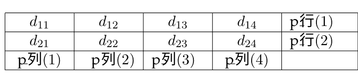

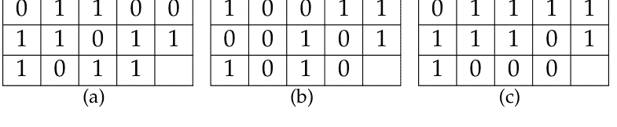

## 图5-4：接收到的8位消息示例。哪些消息有一个错误？哪些消息有两个错误？

本节描述了一种简单的方法来构建SEC码，通过构造多个奇偶校验位，每个位覆盖消息位的不同子集，然后使用结果中的奇偶校验错误（或非错误）来确定哪个位被损坏。

## 矩形码构造：假设我们要发送一个k位消息M。将k位按矩形数组的形状排列，其中有r行和c列，即k=rc。例如，如果k=8，那么数组可以是2×4或4×2（甚至是8×1或1×8，但那些不太有趣）。

用下标给每个数据位标记行和列：第一个位是d11，最后一个位是drc。参见图5-3。

定义p row(i)为数组第i行中所有位的奇偶性，并将所有行奇偶位收集成一个序列R：

```
R = [p_row(1), p_row(2), ..., p_row(r)]
```

类似地，定义p col(j)为数组第j列中所有位的奇偶性，并将所有列奇偶位收集成一个序列C：

```
C = [p_col(1), p_col(2), ..., p_col(c)]
```

图5-3显示了当k = 8时所考虑的情况。

让w = M · R · C，即传输的编码字由原始消息M，按行顺序的行奇偶校验位R，以及按列顺序的列奇偶校验位C组成。w的长度为n = rc + r + c。这个码是线性的，因为所有的奇偶校验位都是消息位的线性函数。码率为rc/(rc + r + c)。

我们现在证明这个矩形奇偶校验码可以纠正所有单比特错误。

## 单错误纠正性质的证明：这个矩形码对于所有的r和c都是SEC码。我们将证明它可以通过展示其最小汉明距离为3（即任意两个码字之间的汉明距离至少为3）来纠正所有单比特错误。考虑两个不同的未编码消息Mi和Mj。有三种情况需要讨论：

+ 如果Mi和Mj只相差一个比特位，则涉及该比特位的行和列奇偶校验计算将得到不同的值。因此，相应的编码字，

w_i和w_j，将相差三个比特位：不同的数据比特位，不同的行奇偶校验比特位，以及不同的列奇偶校验比特位。 因此，在这种情况下，HD(w_i, w_j) = 3。

+ 如果M_i和M_j相差两个比特位，则可能出现以下情况：（1）不同的比特位位于同一行，此时行奇偶校验计算不变，但两个列奇偶校验计算将不同；（2）不同的比特位位于同一列，此时列奇偶校验计算不变，但两个行奇偶校验计算将不同；（3）不同的比特位位于不同的行和列，此时将有两个行奇偶校验计算和两个列奇偶校验计算不同。 因此，在这种情况下，HD(w_i，w_j) ≥ 4。

+ 如果M_i和M_j相差三个或更多比特，则HD(w_i, w_j) = 3，因为w_i和w_j分别包含M_i和M_j。

因此，我们可以得出结论HD(w_i, w_j) = 3，并且我们简单的“矩形”码能够纠正所有单比特错误。

## 解码矩形码：接收器的解码器如何能够正确推断出可能带有单比特错误的w的M？（如果w有多个错误，则解码器不需要产生正确答案。）

在接收到可能损坏的w后，接收器通过计算适当数据位和相应奇偶校验位的和（所有算术运算在F_2中进行）来检查行和列的奇偶校验。 根据定义，如果存在奇偶校验错误，则该和将为1。然后：

+ 如果没有奇偶校验错误，那么就没有发生单个错误，因此接收器可以将数据位按原样用于M。 这种情况如图5-4(a)所示。

+ 如果存在单行或单列奇偶校验错误，则相应的奇偶校验位有错误。 但数据位是正常的，可以按原样用于M。 这种情况如图5-4(c)所示，只有第四列存在奇偶校验错误。

+ 如果存在一行和一列奇偶校验错误，则该行和列的数据位有错误。 解码器通过翻转该数据位来修复错误，然后使用修复后的数据位用于M。 这种情况如图5-4(b)所示，第一行和第四列存在奇偶校验错误，表明d=14应该翻转为0。

+ 其他行和列奇偶校验错误的组合表明发生了多个错误。 接收器无法采取“正确”的操作，因为它没有足够的信息来确定哪些位出错了。 常见的方法是将数据位按原样用于M。 如果它们恰好出错，那将被错误检测码（在本章开头提到）检测到。

如果最多发生了一个传输错误（且位错误概率小于1/2），则此方法将从接收到的码字中生成最可能的消息M。

在矩形码中，奇偶校验位的数量至少与k一样快增长（很容易验证，当行数r和列数c相等时，奇偶校验位的最小数量出现）。 给定一定的通信“带宽”量

## 5.6 SEC码需要多少奇偶校验位？

让我们思考一下我们使用SEC码要实现的目标：纠正具有单个错误的传输。 对于长度为n的传输消息，接收方必须区分n+1种情况：没有错误和在指定位置上的单个错误。 然后，根据检测到的情况，接收方可以进行必要的纠正。

我们的第一个观察结果是，任何线性码都可以转化为等效的系统码（在此不做证明）。系统码是一种每个n位码字都可以表示为原始k位消息后跟n−k个奇偶校验位的码字（原始消息位和奇偶校验位的交错方式并不重要）。 图5−5展示了一个以系统形式表示的码字。

因此，对于一个系统码，我们到底需要多少奇偶校验位呢？ 我们需要选择n，以便能够进行单错误纠正。 由于有n−k个奇偶校验位，每个组合都必须表示某种错误条件，我们必须能够纠正这些错误（或推断出没有错误发生）。 可能的奇偶校验位组合有2的n−k次方种，这意味着我们最多可以区分这么多错误条件。

因此，我们得到了以下约束条件

```
n + 1 ≤ 2^{n−k}
```

即，必须有足够的奇偶校验位来区分可能需要采取的所有纠正操作（包括不采取任何操作）。 给定k，我们可以确定满足此约束条件所需的奇偶校验位数为n−k。 取对数（以2为底）两边，我们可以看到奇偶校验位数必须至少与消息位数对数增长。 并非所有编码都能达到这个最小值（例如，矩形码不能），但是我们接下来要描述的海明码可以。

我们还注意到，这里对SEC码的推理可以扩展到确定一个下界：纠正t > 1个错误所需的奇偶校验位数。

## 5.7 汉明码

直观上讲，一个有效的编码应该尽可能多地保护每个奇偶校验位。根据对称性，我们期望每个奇偶校验位在保护数据位方面做同样的“工作”。如果某个奇偶校验位没有履行其职责，我们很可能需要更多的奇偶校验位，以确保每个可能的单个错误都会产生唯一的奇偶校验错误组合（接收器使用这些唯一的组合来推断是否有错误的位）。

汉明单错误纠正码的类别非常值得注意，因为它们在奇偶校验位的使用上特别高效：汉明码使用的奇偶校验位数量随着码字大小的增加而对数增长。图5-6展示了该类别的两个例子：(7,4)和(15,11)汉明码。(7,4)汉明码使用3个奇偶校验位来保护4个数据位；每个奇偶校验计算中都涉及到4个数据位中的3个。(15,11)汉明码使用4个奇偶校验位来保护11个数据位，每个奇偶校验计算中都涉及到11个数据位中的7个（当我们在5.7.1节讨论汉明码的构建逻辑时，这些特性将变得明显）。通过观察图表中显示的每个奇偶校验计算中涉及的数据位，你应该能够确信每个可能的单个错误（不要忘记奇偶校验位的错误！）都会导致唯一的奇偶校验错误组合。让我们详细讨论一下(7,4)汉明码的论证过程。以下是接收器执行的奇偶校验计算：

```
E_1 = (d_1 + d_2 + d_4 + p_1) 
E_2 = (d_1 + d_3 + d_4 + p_2) 
E_3 = (d_2 + d_3 + d_4 + p_3)
```

## 5.7.1 哈明码构造是否有逻辑？

到目前为止一切顺利，但是将数据位分配给奇偶校验位计算可能看起来相当随意，而且不清楚如何构建纠正操作表格，除非通过检查。

如果我们以某种方式对数据和奇偶校验位进行排序并为每个位分配一个索引，从1开始，哈明码的巧妙之处就会显现出来：

| 索引 | 1 | 2 | 3 | 4 | 5 | 6 | 7 |
|---|---|---|---|---|---|---|---|
| 二进制索引 | 001 | 010 | 011 | 100 | 101 | 110 | 111 |
| (7,4)码 | p_1 | p_2 | d_1 | p_3 | d_2 | d_3 | d_4 |

首先，通过将奇偶校验位分配给2的幂次索引（例如1、2、4等），构建了这个表格。然后，将数据位分配给尚未分配的索引，从最小索引开始。很容易看出如何将这个构造扩展到任意数量的数据位，记住在2的幂次索引处添加额外的奇偶校验位。

将数据位分配给奇偶校验计算是通过查看它们在上述表格中的相应索引来完成的。请注意，我们谈论的是表格中的索引，而不是位的下标。具体来说，只有当二进制索引（d_i）和二进制索引（p_j）的逻辑与非零时，d_i才会包含在p_j的计算中。

## 致谢

非常感谢Katrina LaCurts和Yury Polyanskiy仔细阅读这些笔记并提出了几条有用的评论，以及Sigtryggur Kjartansson发现了一个错误。

## ■ 问题和问答

1. 证明汉明距离满足三角不等式。也就是说，对于任意三个n位二进制字，展示HD(x, y) + HD(y, z) ≥ HD(x, z)。

2. 考虑以下矩形线性分组码：

| D0 | D1 | D2 | D3 | D4 | | P0 |
| D5 | D6 | D7 | D8 | D9 | | P1 |
| D10 | D11 | D12 | D13 | D14 | | P2 |
|----|----|----|----|----|----|----|
| P3 | P4 | P5 | P6 | P7 | |

在这里，D0-D14是数据位，P0-P2是行奇偶校验位，P3-P7是列奇偶校验位。这个线性码的n、k和d是什么？

3. 考虑一个矩形奇偶校验码，如第5.5节所述。本·比特迪德尔希望在一些信道上以不同的码率使用这个码，并对它们进行实验。

(a) 使用这个码是否可能获得低于1/3的码率？请解释你的答案。

(b) 假设他对像1/2、2/3、3/4等码率感兴趣；即一般情况下为`+1`的码率。是否总是可以选择码的参数（即块大小和行列数）以获得`+1`## 第5.7节 海明码

Pairwise Communications已经开发了一个线性分组码，使用了三个数据位和三个奇偶校验位，它被称为“pairwise code”。

```
P₁ = D₁ + D₂  （每个 Dᵢ 是一个数据位；每个 Pᵢ 是一个奇偶位。）P₂ = D₂ + D₃  P₃ = D₃ + D₁
```

(a) 填写此代码的以下三个属性的值：

+     (i) 编码速率 =
  (ii) 最小权重非零码字中的1的数量 =
  (iii) 代码的最小汉明距离 =

6. 考虑与上一个问题中相同的“两两配对码”。接收器从（可能损坏的）接收数据和奇偶位计算出三个综合位：E₁=D₁+D₂+P₁, E₂=D₂+D₃+P₂, 以及 E₃=D₃+D₁+P₃。接收器使用综合位进行最大似然译码。对于下表中的综合位组合，请说明最大似然译码器认为发生了什么情况：无错误，特定位上的单个错误（指出是哪一位），或多个错误。

| E₃E₂E₁ | 错误模式[无错误/位错误...（指定位）/多个错误] |
|----------|----------------------------------------------|
| 0 0 0    | 无错误                                         |
| 0 0 1    | D₁ 错误                                       |
| 0 1 0    | D₂ 错误                                       |
| 0 1 1    | D₃ 错误                                       |
| 1 0 0    | P₁ 错误                                       |
| 1 0 1    | D₁ 错误，P₁ 错误                               |
| 1 1 0    | D₂ 错误，P₁ 错误                               |
| 1 1 1    | D₃ 错误，P₁ 错误                               |

7. Alyssa P. Hacker通过添加一个总的奇偶校验位来扩展上述的两两码。也就是说，她计算P₄=P³(Dᵢ+Pᵢ)，并将P₄附加到每个原始码字上。
  以产生新的码字集合。如果有的话，Alyssa的扩展码相对于Pairwise的原始码显示了什么样的错误纠正或检测能力的改进？请解释你的答案。

8. 对于下面的码字集合，确定该码是否是F₂上的线性分组码。同时给出每个码的速率。

+     (a) {000,001,010,011}.
  (b) {000, 011, 110, 101}.
  (c) {111, 100, 001, 010}.
  (d) {00000, 01111, 10100, 11011}.
  (e) {00000}.

# 9. 对于任何线性分组码，其最小汉明距离至少为$2t+1$的码字之间，证明：

$2^{n-k} \geq 1 + \binom{n}{1} + \binom{n}{2} + \cdots + \binom{n}{t}$.

提示：这样的码字能够纠正多少个错误？

# 10. 对于下面的每个 $(n, k, d)$组合，请说明是否存在具有这些参数的线性分组码。如果存在，请给出一个示例；如果不存在，您可以依赖于适当的必要条件。

+   1. (a) (31, 26, 3): 是 / 否
2. (b) (32, 27, 3): 是 / 否
3. (c) (43, 42, 2): 是 / 否
4. (d) (27, 18, 3): 是 / 否
5. (e) (11, 5, 5): 是 / 否

# 11. 使用海明码构造(7, 4)码，构建(15, 11)码的奇偶校验方程。这个码有多少个方程？每个奇偶校验位对应多少个消息位？

# 12. 证明定理5.2和5.3。（如果你不能证明后者，不要太担心；我们将在下一章中给出证明。）

# 13. 线性分组码中码字的重量是指码字中1的个数。证明任何线性分组码要么只有偶重量码字，要么偶重量码字和奇重量码字数量相等。

提示：采用反证法证明。

# 14. 房间里有 $N$个人，每个人戴着红色或蓝色的帽子，按照身高顺序排成一行。每个人只能看到前面人的帽子，并且不知道自己帽子的颜色。他们作为一个团队玩一个简单的游戏。每个人可以说一个词：“红色”或“蓝色”。如果他们说的词正确猜测到自己帽子的颜色，团队得1分；如果猜错，得0分。在游戏开始之前，他们可以商定一个协议（即，在什么条件下说什么词）。一旦确定了协议，他们停止交谈，排成一行，并随机分发帽子。

你能开发一个能够最大化他们得分的协议吗？你的协议能达到什么分数？

麻省理工学院开放式课程
http://ocw.mit.edu

# 6.02电子工程与计算机科学II：数字通信系统

2012年秋季

有关引用这些材料或我们的使用条款的信息，请访问：http://ocw.mit.edu/terms。

# 第6章
线性分组码：编码和综合译码

前一章定义了线性分组码的一些属性，并讨论了两个线性分组码的示例（矩形奇偶校验码和汉明码），但是为它们解码提供的方法是特定于这些码的。在这里，我们将描述一种用于编码和解码线性分组码的通用策略。我们描述的解码过程是综合译码，它使用了前一章引入的综合位。我们将展示如何高效地执行任何线性分组码的综合译码，突出了线性（分组）码具有吸引力的主要原因：能够高效地解码。

我们还讨论了如何使用适用于相对较小分组大小的线性分组码来保护由大量比特组成的数据包（或消息）。最后，我们讨论了如何处理与迄今为止假定的BSC模型不同的突发错误模式。一个或多个编码块保护的数据包需要一种方法让接收方在错误纠正步骤完成后检测到错误，因为可能无法纠正所有错误。这个任务由一个错误检测码完成，通常与纠正码不同。为了完整起见，我们描述了循环冗余检验（CRC），这是一种常用的错误检测方法。

## 6.1 编码线性分组码

回想一下，线性分组码将k位消息分组转换为n位编码分组。编码的速率为k/n。线性分组码中的转换仅涉及对消息位进行线性运算以生成码字。为了具体起见，让我们将自己限制在F₂上的码字，这样所有线性运算都是加法奇偶检验计算。

如果码字采用系统形式，每个码字由k个消息位D₁D₂...组成。后面（或者穿插其中）是n-k个奇偶检验位P₁P₂...。Pₙ₋ₖ，其中每个Pᵢ是Dᵢ的某个线性组合。

由于从消息位到码字的转换是线性的，因此可以表示

```
D \cdot G = C,\tag{6.1}
```

其中D是一个1×k矩阵（即行向量），表示消息位D₁D₂...Dk，C是一个n位码字行向量C₁C₂...Cn，G是一个k×n生成矩阵，完全描述了线性分组码，·表示标准矩阵乘法运算。对于F₂上的码，上述方程中的三个矩阵的每个元素都是0或1，并且所有的加法都是模₂加法。

如果码是系统形式的，C的形式为D₁D₂...DₖP₁P₂...Pₙ₋ₖ。将这个形式代入方程6.1，我们可以看到G被分解为一个k×k的单位矩阵与一个k×(n−k)的值矩阵的水平拼接，该值矩阵定义了该码。

任何线性分组码的编码过程都很简单：给定完全描述码的生成矩阵G和一系列k个消息比特D，使用方程6.1生成所需的n位码字。直接进行矩阵乘法的方式涉及k次乘法和k-1次加法来生成每个码字位，但对于系统形式的码，前k个码字位就是消息比特本身，无需任何操作即可生成。因此，对于C中的每个n-k个奇偶检验位，我们需要O(k)次操作，总体编码复杂度为O(nk)。

## 6.1.1 示例

为了说明方程6.1，让我们看一些示例。首先，考虑简单的线性奇偶检验码，它是一个(k+1,k)码。在这种情况下，G是什么？奇偶检验位的方程是P=D₁+D₂+...+Dₖ，因此码字就是D₁D₂...DₖP。因此，

```
G = (I_{k \times k} \mid 1^T),\tag{6.2}
```

其中 I_{k \times k} 是 k \times k 单位矩阵，1^T 是一个k位的全1列向量（其中上标T表示矩阵转置，即将所有行变列为，反之亦然）。例如，当k=3时，

```
G = \left( \begin{array}{cccc} 1 & 0 & 0 & 1 \\ 0 & 1 & 0 & 1 \\ 0 & 0 & 1 & 1 \end{array} \right).
```

现在考虑上一章的矩形奇偶检验码。假设它有r=2行和c=3列，因此k=rc=6。奇偶检验位的数量=r+c=5，因此这个矩形奇偶检验码是一个(11,6,3)线性分组码。如果数据位按照前三位在第一行，后三位在第二行的方式组织，奇偶检验位
```
P_1 = D_1 + D_2 + D_3
P_2 = D_4 + D_5 + D_6
P_3 = D_1 + D_4
P_4 = D_2 + D_5
P_5 = D_3 + D_6
```

将这些方程式代入方程式（6.1），我们发现

```
G = \left( \begin{array}{cccccc|cccc} 1 & 0 & 0 & 0 & 0 & 0 & 1 & 0 & 1 & 0 & 0 \\ 0 & 1 & 0 & 0 & 0 & 0 & 1 & 0 & 0 & 1 & 0 \\ 0 & 0 & 1 & 0 & 0 & 0 & 1 & 0 & 0 & 0 & 1 \\ 0 & 0 & 0 & 1 & 0 & 0 & 0 & 1 & 1 & 0 & 0 \\ 0 & 0 & 0 & 0 & 1 & 0 & 0 & 1 & 0 & 1 & 0 \\ 0 & 0 & 0 & 0 & 0 & 1 & 0 & 1 & 0 & 0 & 1 \end{array} \right).
```

G是一个 k \times n （这里，6 \times 11）矩阵；你可以看到 k \times k单位矩阵，后面是剩余的 k \times (n-k) 部分（我们用一条竖线将两部分分开）。最右边的每个n-k列与一个奇偶检验位一一对应，并且在数据位对应的奇偶检验方程中，每个条目都有一个“1”。这个特性使得根据奇偶检验方程很容易写出G；反过来，对于一个编码，根据编码很容易写出奇偶检验方程。

现在考虑前一章的(7, 4)汉明码。使用那里提供的奇偶检验方程，我们将其留作练习，以验证对于这个编码，

```
G = \left( \begin{array}{cccc|ccc} 1 & 0 & 0 & 0 & 1 & 1 & 0 \\ 0 & 1 & 0 & 0 & 1 & 0 & 1 \\ 0 & 0 & 1 & 0 & 0 & 1 & 1 \\ 0 & 0 & 0 & 1 & 1 & 1 & 1 \end{array} \right).
```

最后一个例子，假设一个(6, 3)线性分组码的奇偶检验方程为
```
P_1 = D_1 + D_2
P_2 = D_2 + D_3
P_3 = D_3 + D_1
```

对于这段代码，

```
G = \left( \begin{array}{ccc|ccc} 1 & 0 & 0 & 1 & 0 & 1 \\ 0 & 1 & 0 & 1 & 1 & 0 \\ 0 & 0 & 1 & 0 & 1 & 1 \end{array} \right).
```

我们用 k \times (n-k)来表示G的(-)子矩阵A是 G的(-)子矩阵，即

```
G = \left( I_{k \times k} | A \right),
```

其中 |表示具有相同行数的两个矩阵的水平“堆叠”（或连接）

## 6.2 最大似然（ML）译码

给定一个二元对称信道，比特翻转概率为 ε，我们的目标是开发一个最大似然（ML）译码器。 对于线性分组码，ML译码器将 n个接收到的比特作为输入，并返回 2 k个可能消息中最有 可能的k比特消息。

实现ML解码器的简单方法是枚举所有2^k个有效码字（每个码字长度为n位）。 然后，将接收到的字r与这些有效码字中的每一个进行比较，并找到与r的汉明距离最小的码字。如果BSC概率ε < 1/2，则具有最小汉明距离的码字就是ML解码。 注意ε < 1/2涵盖了所有实际感兴趣的情况：如果ε > 1/2，则可以简单地交换所有的0和1进行解码，因为这将映射到一个具有位翻转概率为1-ε < 1/2的BSC。 如果ε = 1/2，则每个位都有可能是正确的或错误的，无法以非零速率进行通信。 幸运的是，在所有实际相关的通信渠道中，ε << 1/2。

ML解码的目标是最大化数量P(r|c)，即找到发送的码字c，使得接收到r的概率最大化。考虑任意码字c~。 如果r和c~在d个位上不同（即它们的汉明距离为d），那么P(r|c) = d^(1-ε)  ^N-d，其中n是接收到的字的长度（也是每个有效码字的长度）。 更方便的是取这个条件概率的对数，也称为对数似然：

```
log P(r|c~) = dlog(ε + (N-d)log(1-ε) = dlog  ε  + N log(1 - ε).  (6.5)  1 - ε
```

如果 ε < 1/2，这是实际操作的领域，那么  ε  < 1 而对数项是负数。因此，最大化对数似然等价于最小化 d，因为方程（6.5）右侧的第二项是一个常数。

通过将接收到的字词 r与所有 2^k possible valid n-bit code-words进行比较，ML解码可以工作，但时间复杂度是指数级的。 我们希望的是更快的方法。 请注意，这种“与所有有效码字进行比较”的方法没有利用码的线性性质。 通过利用这个特性，我们可以使解码过程更快。

## 6.3 线性分组码的综合解码

综合解码是解码线性分组码的一种高效方法。 我们将在解码单比特错误的情况下进行研究；具体而言，提供以下语义：

如果接收到的单词有0或1个错误，则解码器将返回正确的传输消息。

1对数的底数并不重要。

## 第6.3节：线性分组码的综合译码

如果接收到的单词有多于0或1个错误，则解码器可能返回正确的消息，但也可能不返回（即，我们不提供任何保证）。将下面描述的方法扩展到提供最大似然译码（即，返回与接收到的单词的汉明距离最小的消息）和处理能够纠正更多错误的分组码并不困难。

关键思想是利用码的线性性质。我们首先给出一个例子，然后一般地说明该方法。考虑（7，4）汉明码，其生成矩阵G由方程（6.3）给出。从G中，我们可以按照前一章节中的相同形式列出奇偶校验方程：

P₁ = D₁ + D₂ + D₄
P₂ = D₁ + D₃ + D₄
P₃ = D₂ + D₃ + D₄

因为算术结束了 F₂，我们可以通过将 P移到与 D相同的一侧来重写这些方程（在模2算术中， −和+符号之间没有区别！）：

D₁ + D₂ + D₄ + P₁ = 0
D₁ + D₃ + D₄ + P₂ = 0
D₂ + D₃ + D₄ + P₃ = 0

有 n − k个这样的方程。可以使用奇偶校验矩阵 H来以矩阵表示这些方程，如下所示：

H·[D₁D₂…DₖP₁P₂…Pₙ−ₖ]ᵀ = 0.

H是两个矩阵的水平堆叠或连接： Aᵀ，其中 A是来自方程（6.4）的码的生成矩阵的子矩阵， I (ₙ₋ₖ)×(ₙ₋ₖ) 是单位矩阵。即，

H = Aᵀ|I₍ₙ₋₎×₍ₙ₋₎

1）其中 A由方程（6.4）给出。
   H对于任何有效的码字 c（我们将其表示为 1 × n矩阵），具有以下特性：

H·cᵀ = 0.

2）因此，对于任何没有错误的接收字 r， H·rᵀ= 0。
现在假设接收到的单词r中有一些错误。r可以写成c+e的形式，其中c是一些有效的码字，e是一个表示错误向量的1 × n矩阵。对于这样一个r，

H·r

## 第6.3节：线性分组码的综合译码

是一个 1 × n矩阵。

对于这个码字，奇偶校验矩阵 H通过应用方程式（6.11）得到：

H = $\begin{pmatrix} 1 & 1 & 0 & 1 & | & 1 & 0 & 0 \\ 1 & 0 & 1 & 1 & | & 0 & 1 & 0 \\ 0 & 1 & 1 & 1 & | & 0 & 0 & 1 \end{pmatrix}$.

假设码字 c通过信道发送，并由解码器接收为 r = 1010000。 最有可能的传输消息是什么？

解码器预先计算与所有可能的单比特错误对应的综合征。

（实际上，只需要预先计算其中的k个，每个对应于码字中前k个位位置的一个错误。）在我们的情况下，感兴趣的k个综合征是：

H $\cdot$ [1000000]^T = [110]^T

H $\cdot$ [0100000]^T = [101]^T

H $\cdot$ [0010000]^T = [011]^T

H $\cdot$ [0001000]^T = [111]^T

为了完整起见，对于在奇偶校验位之一中发生单比特错误的综合征，如预料的那样：

H $\cdot$ [0000100]^T = [100]^T

H $\cdot$ [0000010]^T = [010]^T

H $\cdot$ [0000001]^T = [001]^T

尽管为了清晰起见，将其显示为矩阵乘法，但实际上不需要将矩阵H·e相乘以产生综合征：综合征只是H的列。

解码器实现以下步骤来纠正单比特错误：

+   1. 计算 c' = H · r^T（记得用模2值替换每个值）。
在这个例子中，c' = [1'1]^T。
2. 如果 c' 是'，则将 r 的前 k 位作为消息返回。 在这个例子中，c' 不是'。
3. 如果 c' 不是'，则将 c' 与预先计算的 H·e_i 进行比较，其中 e_i = ["...1..." ] 是一个 1×n 矩阵，位置 i 上为1，其他位置为'。
4. 如果在上一步中找到了错误向量 e' 的匹配项，则接收到的单词中的位位置' 有错误。
翻转该位并返回 r 的前 k 个元素（注意，我们只需要对前 k 个错误向量执行此检查，
因为只有其中一个可能需要翻转，这就是为什么只存储 k 个单错误综合并不需要存储 n 个的原因）。

在这个例子中，H·[1'1']^T的综合症为[1'1]^T，与c'=H·r^T相匹配。

因此，解码器将接收到的单词中的第二位翻转，并将前k=4位作为ML解码返回。 在这个例子中，返回的消息估计是[1110]。

## ■ 6.4 使用SEC码保护更长的消息

SEC码是一个很好的构建模块，但它们只能纠正一个编码比特块中的最多一个错误。随着消息变得更长，解决方案当然是将较长的消息分成每个块都有自己的SEC码的较小块，每个块有k个比特。结果可能如图6-1所示。此外，还可以在数据包末尾引入一个错误检测码（如CRC），如第6.6节所述。

## ■ 6.5 应对突发错误

在许多信道上，错误会以突发方式发生，BSC错误模型无效。例如，无线信道受到来自其他发射机的干扰和衰落的影响，主要是由于多径传播，当给定信号从多个路径到达接收器时，以复杂的方式干扰，因为信号的不同副本经历不同程度的衰减和不同的延迟。衰落的另一个原因是发送方和接收方之间路径上的障碍物；这种衰落被称为阴影衰落。

衰落信道的行为非常复杂，超出了我们目前讨论的范围，但衰落对通信的影响是，描述比特错误概率的随机过程不再是独立同分布的，从一个比特到另一个比特。BSC模型需要用一个更复杂的模型来替代，在这个模型中，错误可能以突发方式发生。许多基于经验数据的理论模型存在，但我们在里面不会详细介绍它们。我们的目标是了解在突发错误发生时如何开发纠错机制。

但是，我们所说的“突发”是什么意思？最简单的模型是将信道建模为具有两个状态，即“良好”状态和“差”状态。在“良好”状态下，比特错误概率是p和在“坏”状态下是p_b > p_g。一旦进入良好状态，信道有一定的概率保持在那里（通常>1/2），并有一定的概率进入“坏”状态，反之亦然。很容易看出，这个简单模型的一个特性是比特错误的概率取决于前一个比特（或前几个比特）是否出错。原因是如果前几个比特是正确的，处于“良好”状态的概率很高。

乍一看，似乎纠正一个（或少数几个）比特错误的块码不适用于经历突发错误的信道。原因如图6-2（左）所示，消息的每个块都由其SEC奇偶校验位保护。不同的块显示为不同的行。当发生突发错误时，SEC块中的多个比特被破坏，SEC无法从中恢复。

交织是一种常用的技术，用于在信道上从突发错误中恢复，即使单个块使用的编码在表面上不适用于突发错误。这个想法很简单：像以前一样对块进行编码，但是以“列式”方式传输它们，如图6-2（右侧）所示。也就是说，先发送第一个块的第一个比特，然后发送第二个块的第一个比特，依此类推，直到发送完一组预定义大小的每个块的第一个比特。然后，按顺序发送每个块的第二个比特，然后是第三个比特，依此类推。

在突发错误发生时会发生什么？很有可能它会破坏一组“第一”比特，或者一组“第二”比特，或者一组“第三”比特等，因为这些比特是按顺序发送的。在信道上。只要一组k比特被损坏，接收器就可以纠正所有错误。原因是每个编码块现在最多只有一个错误。因此，纠正每个块中少量比特错误的块码仍然是一种有用的基本方法，当与交织一起使用时可以纠正突发错误。

## # 6.6 错误检测

本节是可选阅读，对于2012年春季或秋季的6.02课程不是必需的。

错误检测的重要性在于没有实际的错误纠正方案可以完美地纠正消息中的所有错误。例如，任何可以纠正所有t或更少错误模式的合理错误纠正方案都会有一些t或更多错误模式无法纠正。我们的目标不是消除所有错误，而是将比特错误率降低到足够低的值，以便偶尔出现的损坏编码消息不会成为问题：接收器只需丢弃这样的消息，可能会要求发送方重新传输（我们将在本学期后期研究这样的重传协议）。

为了决定是否保留或丢弃一条消息，接收者需要一种方法来检测在纠错和解码方案完成后可能仍然存在的任何错误：这个任务由错误检测方案完成。

错误检测方案的工作原理如下。 发送方获取消息并生成消息的紧凑哈希或摘要，即一个将消息作为输入并生成唯一位串的函数。 这个想法是，消息的常见损坏会导致哈希值与正确值不同。 发送方将哈希值与消息一起发送，然后将其传递给纠错机制，对消息进行编码。 接收者获取编码位，运行纠错解码步骤，然后获得推测的原始消息位集和哈希值。 接收者对推测的消息位计算相同的哈希值，并将结果与解码得到的推测哈希值进行比较。 如果结果不一致，则显然存在一些无法恢复的错误，消息将被丢弃。 如果结果一致，则接收者认为消息是正确的。 请注意，如果结果一致，接收者只能相信消息是正确的；两个不同的消息位序列具有相同的哈希值是可能的（尽管对于良好的检测方案来说不太可能）。错误检测方法的设计取决于我们预期的错误类型。 如果错误是敌对的，例如来自可以在信道上传输时更改位的恶意方，那么哈希函数必须防范可能发生的大量不同错误模式。 这个任务需要密码保护，在实践中使用像SHA-1这样的方案进行。 我们不会在这里研究这些方案，而是专注于在通信信道上传输位时引入的非恶意、随机错误。 在这种情况下，错误检测哈希函数通常被称为校验和：它们可以防止某些随机位错误形式，但绝不是在不安全信道上通信时使用的方法。

当今最常用的数据包级错误检测方法是循环冗余校验（CRC）。² CRC是块码的一个示例，但它可以处理任意大小的块。 给定一个大小为k比特的消息块，它会生成一个大小为r比特的紧凑摘要，其中r是一个常数（在实际实现中通常为8到32比特）。 总之，k + r = n比特构成一个码字。 每个有效的码字与其他有效的码字之间都有一定的最小汉明距离，以帮助进行错误检测。

CRC是多项式码和循环码的一个示例。 多项式码的思想是将每个码字w = w(n-1)w(n-2)...表示为一个n-1次多项式。 即，我们写作w₀是一个n-1次多项式。

```
w(x) = Σ(i=0 to n-1) wᵢxⁱ. (6.14)
```

例如，码字11000101可以表示为多项式1 + x² +

> 有时，文献中使用“校验和”一词表示与“CRC”不同的东西，使用校验和方法涉及将一组比特相加以产生结果，而使用CRC方法涉及多项式除法。 我们使用术语“校验和”来包括这两种类型的函数，这两种函数都适用于随机错误，而不适用于不安全的信道（与安全哈希函数不同）。

## # 第6.6节 错误检测

错误检测方案的工作原理如下。 发送方获取消息并生成消息的紧凑哈希或摘要，即一个将消息作为输入并生成唯一位串的函数。 这个想法是，消息的常见损坏会导致哈希值与正确值不同。 发送方将哈希值与消息一起发送，然后将其传递给纠错机制，对消息进行编码。 接收者获取编码位，运行纠错解码步骤，然后获得推测的原始消息位集和哈希值。 接收者对推测的消息位计算相同的哈希值，并将结果与解码得到的推测哈希值进行比较。 如果结果不一致，则显然存在一些无法恢复的错误，消息将被丢弃。 如果结果一致，则接收者认为消息是正确的。 请注意，如果结果一致，接收者只能相信消息是正确的；两个不同的消息位序列具有相同的哈希值是可能的（尽管对于良好的检测方案来说不太可能）。错误检测方法的设计取决于我们预期的错误类型。 如果错误是敌对的，例如来自可以在信道上传输时更改位的恶意方，那么哈希函数必须防范可能发生的大量不同错误模式。 这个任务需要密码保护，在实践中使用像SHA-1这样的方案进行。 我们不会在这里研究这些方案，而是专注于在通信信道上传输位时引入的非恶意、随机错误。 在这种情况下，错误检测哈希函数通常被称为校验和：它们可以防止某些随机位错误形式，但绝不是在不安全信道上通信时使用的方法。

当今最常用的数据包级错误检测方法是循环冗余校验（CRC）。² CRC是块码的一个示例，但它可以处理任意大小的块。 给定一个大小为k比特的消息块，它会生成一个大小为r比特的紧凑摘要，其中r是一个常数（在实际实现中通常为8到32比特）。 总之，k + r = n比特构成一个码字。 每个有效的码字与其他有效的码字之间都有一定的最小汉明距离，以帮助进行错误检测。

## # ■ 6.6.1 编码步骤

产生摘要的CRC编码步骤很简单。 给定一条消息，使用与方程（6.14）相同的方法构造消息多项式m(x)。然后，我们的目标是通过组合m(x)和g(x)来构造码多项式w(x)，使得g(x)能够整除w(x)（即w(x)是g(x)的倍数）。

首先，让我们将 m(x)乘以 x^{n-k}。 我们进行这个乘法的原因是将消息左移 n−k位，这样我们可以添加冗余检查位（n−k个）以使码字呈现系统形式。 很容易验证这个乘法产生的多项式的系数对应于原始消息位后面的所有零（用于下面要添加的检查位）。

然后，让我们将 x^{n-k}m(x)除以 g(x)。 如果多项式除法的余数为0，则我们有一个有效的码字。 否则，我们有一个余数。 我们知道，如果我们从多项式 x^{n-k}m(x)中减去这个余数，我们将得到一个新的多项式，它将是 g(x)的倍数。 记住我们在 F₂中，我们可以用加法代替减法，得到：

```
w(x) = x^{n-k}m(x) + x^{n-k}m(x) \mod g(x),
```

其中符号 a(x) mod b(x)表示当 a(x)被a(x)除以 b(x)时的余数。

编码器的定义现在很直观。 取出消息，构造消息多项式，乘以 x^{n-k}，然后将其除以 g(x)。 余数形成了校验位，作为整个消息的摘要。 将这些位附加到消息中发送。

## # ■ 6.6.2 解码步骤

解码步骤与编码步骤基本相同，这是使用CRC的一个优点。将接收到的每个码字分成消息和余数部分，并验证从消息计算出的余数是否与发送的位匹配-以及消息。 不匹配意味着发生了错误；匹配则表明消息正确的可能性很大，只要使用合适的生成多项式。

## # ■ 6.6.3 除法的机制

在CRC计算中，有几种高效的实现除法和取余操作的方法。 实际上，实践中使用的方案基本上模仿了小学学习的“长除法”策略。 图6-3展示了一个例子，以便复习记忆！

## # ■ 6.6.4 好的生成多项式

那么如何选择好的生成多项式呢？ 这里没有魔法处方，但通过观察常见的错误模式对接收到的码字的影响，我们可以形成一些准则。 为了为 g(x)开发合适的属性，首先观察到如果接收方得到一个比特序列，我们可以将其视为发送的码字加上一个零个或多个错误的序列。 也就是说，将接收方获得的比特构造为一个接收多项式， r(x)。我们可以将 r(x)视为w(x)和一个错误多项式, e(x)的和。 图6-4展示了一个带有两个比特错误的消息和相应的错误多项式的例子。这是关键点：如果 r(x) = w(x) + e(x)不是 g(x)的倍数，则接收方可以保证检测到错误。 因为 w(x)是 g(x)的倍数构造的，所以这个陈述与说如果 e(x)不是 g(x)的倍数，接收方可以保证检测到错误是一样的。 另一方面，如果r(x)，因此 e(x)，是 g(x)的倍数，则我们要么没有错误，要么我们有一个
## # 图6-4：具有两个位错误的错误多项式示例；多项式具有两个非零项，对应于错误发生的位置。

## # 我们无法检测到的错误（即，我们错误地将其识别为正确的接收）。我们的目标是确保常见错误模式不会发生。

+   1. 首先，注意对于单个错误模式，$e(x) = x^i$ 对于某个 $i$。这意味着我们必须确保 $g(x)$ 至少有两个项。
2. 假设我们想要检测所有具有两个错误的错误模式。该错误模式可以写为 $x^i + x^j = x^i(1 + x^{j-i})$，其中 $i$ 和 $j > i$。如果 $g(x)$ 不能整除这个项，则生成的 CRC 可以检测到所有双重错误。
3. 现在假设我们想要检测所有奇数个错误。如果 $(1 + x)$ 是 $g(x)$ 的因子，则 $g(x)$ 必须具有偶数个项。原因是任何形式为 $(1 + x)h(x)$ 的系数在将 $x$ 设为 1 时必须为 0 的多项式。如果我们展开 $(1 + x)h(x)$，如果答案在 $x = 1$ 时必须为 0，则展开式必须具有偶数个项。因此，如果我们使 $1 + x$ 成为 $g(x)$ 的因子，生成的 CRC 将能够检测到所有具有奇数个错误的错误模式。然而，请注意，逆命题不成立：即使 CRC 的 $g(x)$ 不是 $(1 + x)$ 的倍数，它仍然可以检测到奇数个错误。但是，在实践中使用的所有 CRC 都将 $(1 + x)$ 作为因子，因为这是实现此目标的最简单方法。
4. 在实践中，一些CRC方案使用的另一个准则是能够检测突发错误。让我们将长度为 $b$ 的突发错误模式定义为一系列位 $1\varepsilon_b\ 2\varepsilon_b\ 3\dots\varepsilon_11$：也就是说，位数为 $b$，第一个和最后一个位都是1，而中间的位 $\varepsilon_i$ 可以是0或1。最小的突发长度是2，对应于模式“11”。

假设我们希望我们的CRC能够检测所有这样的错误模式，其中 $e(x) = x^s(1 \cdot x^{b-1} + \sum_{i=1}^{b-2} \varepsilon_i x^i + 1)$。这个多项式表示了从数据包末尾向左起始的大小为 $b$ 的突发错误模式。如果我们选择 $g(x)$ 为一个次数为 $b$ 的多项式，并且 $g(x)$ 不具有 $x$ 作为因子，那么任何长度为 $\leq b$ 的错误模式都将被检测到，因为 $g(x)$ 不能整除一个次数为
## # 图6-5：常用的CRC生成多项式，g(x)。来自维基百科。

长度小于自身的所有错误模式中，有且仅有一种长度为b+1的错误模式与g(x)的系数匹配，这种错误模式不会被检测到。 长度为b+1的其他所有错误模式都会被这个CRC检测到。

事实上，这样的CRC在检测较长的突发错误方面也非常好，尽管它不能检测到所有错误。

CRC是循环码，具有这样的特性：如果c是一个码字，那么c的任何循环移位（旋转）也是另一个有效的码字。 因此，根据公式（6.14），我们可以表示w的一个循环左移对应的多项式为

```
w^{(1)}(x) = w(x)_{n-1} + w_0x + w_1x^2 + \ldots w_{n-2}x^{n-1} \quad (6.16## 6.02电子工程与计算机科学II：数字通信系统

2012年秋季

有关引用这些材料或我们的使用条款的信息，请访问：http://ocw.mit.edu/terms。

## 第7章
卷积码：构造和编码

本章介绍了一种广泛使用的编码类别，称为卷积码，它们在各种系统中使用，包括当今流行的无线标准（如802.11）和卫星通信中。 它们还被用作更强大的现代编码的构建模块，例如在广域蜂窝无线网络标准（如3G、LTE和4G）中使用的Turbo码。 卷积码之所以美妙，是因为它们直观易懂，可以从多个角度理解，并且有一种解码方式可以从所有可能的传输消息中恢复出最可能的消息。 本章讨论了卷积码的编码；下一章将讨论如何高效地解码卷积码。

与前一章讨论的区块码一样，卷积码涉及从消息比特计算奇偶校验比特并进行传输，它们也是线性码。 然而，与系统形式的区块码不同，在卷积码中，发送方不会发送消息比特后（或插入）奇偶校验比特；发送方只发送奇偶校验比特。 这些码是由麻省理工学院（MIT）电子与计算机科学系（EECS）的教员彼得·伊莱亚斯（Peter Elias）于1950年代中期发明的。 多年来，人们一直不知道这些码有多强大，以及如何最好地解码它们。 对于这些问题的答案开始在1960年代出现，由约翰·沃森克拉夫特（John Wozencraft，Sc.D.'57和前麻省理工学院电子与计算机科学系教授）、罗伯特·法诺（'41，Sc.D.'47，麻省理工学院电子与计算机科学系教授）、安德鲁·维特比（'57）、G.大卫·福尼（SM'65，Sc.D.'67和麻省理工学院电子与计算机科学系教授）、吉姆·大村（SB'63）等人的工作开始出现。

## ■ 7.1 卷积码构造

编码器使用滑动窗口通过组合窗口中的各种位的子集来计算r > 1奇偶校验位。 组合是在F₂中进行简单的加法，就像前一章中所示的那样（即模2加法，或等效地，异或操作）。 然而，与块码不同，窗口重叠并且以1为单位滑动，如图7-1所示。 窗口的大小，以位为单位，称为码的约束长度。 约束长度越长，

由于奇偶校验位是唯一通过信道发送的位，所以较大的约束长度通常意味着对位错误的更强的容错能力。然而，这种权衡是，解码长约束长度的码将需要更长的时间（我们将在下一章中看到解码的复杂性与约束长度呈指数关系），因此不能任意增加约束长度并期望快速解码。

如果一个卷积码每个窗口产生r个奇偶校验位，并且通过每次将窗口向前滑动一个位来计算其速率（在长消息上计算），则其速率为1/r。r的值越大，对位错误的容错能力越高，但是这种权衡是，通信带宽中用于编码开销的比例也相应增加。在实践中，我们希望选择尽可能小的r和约束长度，同时提供足够低的位错误概率。

在6.02中，我们将使用K（大写）来表示约束长度，这是一个有点不幸的选择，因为在之前的章节中我们使用k（小写）来表示编码的消息位数。虽然“L”可能是指约束长度的更好方式，但我们将使用K，因为该领域的许多论文和文档都使用K（实际上，许多论文使用小写的k，这尤其令人困惑）。因为在谈论卷积码时，我们很少提到大小为k的“块”，所以我们希望这种表示法不会引起混淆。

有了这个表示法，我们可以简洁地描述编码过程。编码器每次查看K个位，并根据精心选择的函数在K个位的各个子集上生成r个奇偶校验位。图7-1显示了一个示例，其中K=3，r=2（该码的速率为1/2）。编码器输出r个位，按顺序发送，将窗口向右移动1个位置，然后重复该过程。基本上就是这样。

在发送器上，我们必须描述的两个主要剩余细节是：
1. 什么是好的奇偶校验函数，我们如何方便地表示它们？
2. 我们如何高效地实现编码器？
本章的其余部分将讨论这些问题，并解释为什么这些代码被称为“卷积”代码。

按照惯例，我们假设每个消息在前面填充了  K-1个“0”位，以便初始条件正确。

## ■ 7.2 奇偶校验方程

图7-1中的示例显示了一组奇偶校验方程，它们控制从消息位序列 X生成奇偶校验位的方式。 在这个例子中，方程如下（所有的加法都在 \mathbb{F}_2中进行）：

p_0[n] = x[n] + x[n-1] + x[n-2] 
 p_1[n] = x[n] + x[n-1] 
 (7.1)

这个代码的速率是 1/2。 
一个速率为1/3的奇偶校验方程示例

p_0[n] = x[n] + x[n-1] + x[n-2] 
 p_1[n] = x[n] + x[n-1] 
 p_2[n] = x[n] + x[n-2] 
 (7.2)

一般来说，可以将每个奇偶校验方程视为通过组合消息位X和生成多项式g产生的 在上面的第一个示例中，生成多项式系数为(1, 1, 1)和(1, 1, 0)，而在第二个示例中，它们为(1, 1, 1)，(1, 1, 0)和(1, 0, 1)

我们用g_{-i}表示奇偶校验位p_{-i}的K个元素生成多项式 然后我们可以将p_{-i}[n]写成如下形式

p_i[n] = (\sum_{j=0}^{k-1} g_{-i}[j] x[n-j]) 
 (7.3)

上述方程的形式是g和x的卷积（模2）——因此称为“卷积码”。 生成多项式的数量等于每个滑动窗口中生成的奇偶校验位r。 如果编码器每次滑动一个比特，则代码的速率为1/r。

## ■ 7.2.1 一个例子

让我们考虑方程7.1（图7-1）的两个生成多项式。 在这里，生成多项式为

g_0 = 1, 1, 1 
 g_1 = 1, 1, 0 
 (7.4)

如果消息序列X = [1, 0, 1, 1, ...]（通常情况下，x[n] = 0，∀n < 0），那么奇偶校验位

方程7.1中的比特结果为

```
p0[0] = (1 + 0 + 0) = 1
p1[0] = (1 + 0) = 1
p0[1] = (0 + 1 + 0) = 1
p1[1] = (0 + 1) = 1
p0[2] = (1 + 0 + 1) = 0
p1[2] = (1 + 0) = 1
p0[3] = (1 + 1 + 0) = 0
p1[3] = (1 + 1) = 0.
```

因此，通过信道传输的比特为[1, 1, 1, 1, 0, 0, 0, ...]。有几个生成多项式，但是如何构造好的生成多项式超出了6.0²的范围。一些最初由J. Bussgang发现的示例在表7-1中显示。

| 约束长度 | g0 | g1 |
|---|---|---|
| 3 | 110 | 111 |
| 4 | 1101 | 1110 |
| 5 | 11010 | 11101 |
| 6 | 110101 | 111011 |
| 7 | 110101 | 110101 |
| 8 | 110111 | 1110011 |
| 9 | 110111 | 111001101 |
| 10 | 110111001 | 1110011001 |

## ■ 7.3 卷积编码器的两个视图

我们现在描述卷积编码器的两个视图，这对于更好地理解卷积码以及实现编码和解码过程非常有用。第一个视图是基于移位寄存器的，可以使用连接在一起的移位寄存器构建机制。这个视图对于开发硬件编码器非常有用。第二个视图是基于状态机的，它对应于将编码器视为一组具有明确定义的状态之间的过渡。状态机视图在解码一组奇偶校验位以重构原始消息位方面非常有用。

## ■ 7.3.1 移位寄存器视图

图7-2显示了与图7-1和方程式(7.1)相同的编码器，以移位寄存器的形式组成的块图。 x [n - i] 值（这里有两个）被称为编码器的状态。 该块图以一位一次地接收消息比特，并输出奇偶校验比特（每两个输入比特，本例中）。

输入消息比特 x [n] 从左侧到达。 该块图使用传入比特和编码器的状态（k-1个先前比特；本例中为两个）计算奇偶校验比特。 在生成 r 个奇偶校验比特之后，编码器的状态向右移动1位，x [n] 取代 x [n-1]，x [n-1] 取代 x [n-2]，依此类推，x [n-K+1] 被丢弃。 该块图可直接用移位寄存器进行硬件实现。

## ■ 7.3.2 状态机视图

卷积码的另一个有用视图是作为状态机，如图7-3所示，这是我们在本章中一直使用的相同示例（图7-1）。

需要注意的重要一点是：卷积码的状态机对于具有给定约束长度K的所有码来说是相同的，而状态的数量始终为2K-1。 只有p和i的标签会根据生成多项式的数量和它们的系数值而改变。 每个状态都标有x[n-1]x[n-2]...x[n-K+1]。 每个弧都标有x[n]/p0p1...。 在这个例子中，如果消息是101100，传输的比特是11 11 01 00 01 10。

这种状态机视图是解释发射器的工作原理以及接收器解码消息应该做什么的一种优雅方式，我们现在来解释一下。 发射器从初始状态（在图7-3中标记为“起始状态”）开始，逐位处理消息。 对于每个消息位，它根据输入位的值从当前状态转换到新状态，并发送对应弧上的奇偶校验位。

当然，接收器无法直接知道发射器的状态转移。

Julian Bussgang在1965年的IEEE信息论交易中提到了“二进制卷积码生成器的一些属性”，页码为90-100。我们将在下一章中发现，（110，111）码实际上比另一种速率为1/2的K=3码（101，111）差。

## ■ 7.4 解码问题

如上所述，接收方应确定“最佳可能”的发射机状态序列。有很多定义“最佳”的方式，但其中一种特别吸引人的方式是最有可能的状态序列（即，消息位）必须由发射机遍历（发送）。能够推断出最有可能序列的解码器是卷积码的最大似然（ML）解码器。

在第6.2节中，我们确定了“硬解码”情况下的最大似然解码器，其中接收到的字与每个有效码字之间的距离是汉明距离，可以通过计算具有最小汉明距离的有效码字，并返回生成该码字的消息来找到。对于卷积码，相同的思想也适用。（请注意，无论编码是块编码还是卷积编码，无论是否是线性编码，该属性都成立。）

一个简单的数值例子可能会有帮助。假设位错误是独立且具有错误概率为0.001（即，信道是一个BSC， ε= 0.001），接收器将模拟模拟样本序列转换为位1101001。发送者更有可能发送1100111还是1100001？第一个序列的汉明距离为3，接收到该序列的概率为（0.999）⁴（0.001）³= 9.9 × 10⁻¹⁰。第二个选择的汉明距离为1，概率为（0.999）⁶（0.001）¹= 9.9 × 10⁻⁴，这是六个数量级更高，更有可能发生。

因此，最有可能传输的奇偶校验位序列必须是那个

## 第7.4节 解码问题

| 消息 | 发送 * | 接收 | d |
|---|---|---|---|
| 0000 | 000000000000 |  | 7 |
| 0001 | 000000111110 |  | 8 |
| 0010 | 000011111000 |  | 8 |
| 0011 | 000011010110 |  | 4 |
| 0100 | 001111100000 |  | 6 |
| 0101 | 001111011110 |  | 5 |
| 0110 | 001101001000 |  | 7 |
| 0111 | 001100100110 |  | 6 |
| 1000 | 111110000000 |  | 4 |
| 1001 | 111110111110 |  | 5 |
| 1010 | 111101111000 |  | 7 |
| 1011 | 111101000110 |  | 2 |
| 1100 | 110001100000 |  | 5 |
| 1101 | 110001011110 |  | 4 |
| 1110 | 110010011000 |  | 6 |
| 1111 | 110010100110 |  | 3 |

## ■ 7.5 格子

格子是从状态机派生出的一种结构，它可以帮助我们开发一种高效的卷积码解码方式。状态机视图显示了当发送方有一位消息比特要处理时，每个瞬间发生的情况，但不显示系统随时间演变的方式。格子是一种使时间演变明确的结构。

图7-5中显示了一个示例。格子的每一列都有一组状态；每个列中的状态与下一列中的两个状态相连 - 在状态图中是相同的两个状态。格子中每个状态的顶部链接显示了在“0”上发送的内容，而底部链接显示了在“1”上发送的内容。图片显示了在给定消息101100的情况下，在格子中遍历的状态之间的链接。

## 第7.5节。格子

现在我们可以考虑解码器在这个格子中需要做什么。 它得到一个奇偶校验位序列，并且需要确定通过格子的最佳路径，也就是能够解释观察到的、可能被损坏的接收到的奇偶校验位序列的状态序列。

维特比译码器通过格子找到最大似然路径。 我们将在下一章中学习它。

卷积编码的问题和练习在下一章末尾，在我们讨论解码过程之后。

## 第8章
卷积码的维特比译码

本章描述了一种优雅而高效的方法来解码卷积码，其构造和编码我们在前一章中描述过。这种解码方法避免了显式枚举N位奇偶校验位序列的 2 N 种可能组合。这种方法是由安德鲁·维特比'57发明的，以他的名字命名。

## ■ 8.1 问题

在接收端，我们有一系列与奇偶校验位对应的电压样本。为了简单起见，并且不失一般性，我们假设接收端选择一个适当的样本表示比特，或者对一组样本进行平均，将该值与阈值电压进行比较（解映射步骤），并将该比特决策传递给解码器。

因此，我们有一个接收到的比特序列，对于卷积编码流来说，它对应于奇偶校验位流。如果我们仅仅使用接收端的采样和解映射的信息对接收到的比特序列进行解码，那么解码过程被称为硬判决解码（“硬解码”）。相反（或者另外），如果解码器获得电压样本流并使用该“模拟”信息（以数字化形式，使用模数转换）来解码数据，我们称该过程为软判决解码（“软解码”）。

维特比译码器可以在任何情况下使用。直观地说，硬判决解码在数字化过程中丢弃了关于一个比特是0还是1的信息。它可能会做出错误的决定，特别是在接近阈值的电压下，导致接收比特序列中的更多比特错误。

尽管它仍然能够给出接收比特序列下最可能的传输序列，但由于在早期数字化中引入了额外的错误，比特错误的概率降低的幅度将小于软判决解码。但从概念上讲，理解硬解码更容易，所以我们将从硬解码开始，然后再进行软解码。

## ■ 8.1.1 硬判决解码

如前一章所述，格点图为卷积码的解码过程提供了一个良好的框架（图8-1）。假设我们面前有整个格点图的编码，现在接收到一系列数字化的比特（或电压样本）。如果没有错误，那么在格点图的状态之间会有一条路径与接收到的序列完全匹配。该路径（具体来说，是沿着遍历边缘“吐出”的奇偶校验位的串联）对应于传输的奇偶校验位。从那里开始，通过格点图中每个节点发出的顶部弧对应于“0”比特，底部弧对应于“1”比特，因此得到原始编码消息很容易。

当存在比特错误时，我们能做些什么？如前所述，找到最可能的传输消息序列是有吸引力的，因为它最小化解码中的比特错误的概率。如果我们能找到一种捕捉通过状态机的任何错误的方法，并且需要一种在不实际生成整个状态机的情况下导航状态机的方法（即，不枚举所有可能的路径，然后找到累积误差最小的路径）。维特比译码器解决了这些问题。这是解决优化问题的一种更一般的方法的示例，称为动态规划。在课程的后期，我们将在网络路由中应用类似的概念，这是一个不相关的问题，用于在多跳网络中找到良好的路径。

## 图8-2：硬判决解码的分支度量。在这个例子中，接收器收到了奇偶校验位00。

# ■ 8.2 维特比译码器

解码算法使用两个度量：分支度量（BM）和路径度量（PM）。分支度量是衡量发送和接收之间的“距离”的指标，对于状态机中的每条弧都有定义。在硬判决解码中，我们给定一系列数字化的奇偶校验位，分支度量是期望奇偶校验位和接收到的奇偶校验位之间的汉明距离。图8-2中显示了一个例子，接收到的位是00。对于每个状态转换，弧上的数字表示该转换的分支度量。两个分支度量为0，对应于唯一的状态和转换，其中对应的汉明距离为0。其他非零分支度量对应于存在位错误的情况。

路径度量是与状态在格子图中关联的值（即与每个节点关联的值）。对于硬判决译码，它对应于从初始状态到当前状态在格子图中最可能路径上与接收到的奇偶校验位序列的汉明距离。通过“最可能”，我们指的是在两个状态之间的所有可能路径上，初始状态和当前状态之间的汉明距离最小。具有最小汉明距离的路径最小化了比特错误的总数，并且在误码率低时最有可能。

维特比算法的关键洞察是接收方可以通过使用先前计算的状态的路径度量和分支度量来逐步计算（状态，时间）对的路径度量。

# ■ 8.2.1 计算路径度量

假设接收器已经计算出每个状态在时间步骤i时的路径度量PM[s,i]（回想一下，卷积码的约束长度为K，因此有2^{K-1}个状态）。在硬判决解码中，PM[s,i]的值是在比较接收到的奇偶校验位与最可能的传输消息时检测到的比特错误的总数，考虑到发射机在时间步骤i之前可能发送的所有消息（从起始状态“00”开始，按照惯例）。

[图片] img/e307520682e61a5d652311b70af268de_97_0.png

# 8.2.2 寻找最可能的路径

我们现在可以描述解码器如何找到最大似然路径。最初，状态'00'的成本为 0，而其他 2^{K-1} - 1 状态的成本为 ∞。

算法的主循环由两个主要步骤组成：首先，计算下一组奇偶校验位的分支度量，然后计算下一列的路径度量。路径度量计算可以看作是一个添加-比较-选择过程：

1. 将分支度量添加到旧状态的路径度量中。
2. 比较到达新状态的路径的总和（因为从上一列只有两条入弧到达每个新状态，所以只需比较两条路径）。
3. 选择具有最小值的路径，以任意方式解决平局。. 这条路径对应着错误最少的路径。

在时间步骤i时，所有可能的状态中，最可能的状态是路径度量最小的那个。如果存在多个这样的状态，则它们都是同样好的可能性。

现在，我们如何确定时间步骤i+1时每个状态的路径度量PM[s,i+1]呢？为了回答这个问题，首先观察到如果发射机在时间步骤i+1时处于状态s，则它在时间步骤i时只能处于两个可能的状态之一。这两个前驱状态，标记为α和β，对于给定的状态始终是相同的。实际上，它们只取决于码的约束长度，而不取决于奇偶校验函数。图8-2显示了每个状态的前驱状态（箭头的另一端）。例如，对于状态00，α=00，β=01；对于状态01，α=10，β=11。

任何离开发射器处于状态s的消息序列，在时间i+1时必须离开发射器处于状态s或状态t。例如，在图8-2中，要在时间i+1到达状态'01'，必须满足以下两个条件之一：

1. 发射器在时间i处于状态'10'，且第i个消息位为0。如果是这种情况，则发射器发送'11'作为奇偶校验位，并且存在两个位错误，因为我们接收到的位为'00'。然后，新状态'01'的路径度量PM['01', i+1]等于PM['10', i] + 2，因为新状态比原状态多2个错误位。
2. 另一种（互斥的）可能性是发射器在时间i处于状态'11'，而第i个消息位是0。如果是这种情况，那么发射器发送的奇偶校验位是01，因为我们接收到了00，所以有一个位错误。新状态的路径度量PM['01', i+1]等于PM['11', i] + 1。

形式化上述直觉，我们可以看到

```
PM[\s,i+1] = min_β( PM[\s,i] + BM[\β\rightarrow\s], PM[\β,i] + BM[\β\rightarrow\s] ),
```

其中和β是前驱状态。

在解码算法中，记住哪个弧对应最小值很重要，因为我们需要从最终状态到初始状态遍历这条路径，记录我们使用的弧，然后最后反转位的顺序以产生最可能的消息。

图8-3展示了解码算法从一个时间步骤到下一个时间步骤的过程。 这个例子展示了一个接收到的比特序列111011000110以及接收器如何处理它。从顶部的第四张图片可以看到所有四个状态具有相同的路径度量。 在这个阶段，这四个状态和通往它们的路径都是最有可能的传输比特序列（它们的海明距离都为2）。 最底部的图片只显示了幸存路径。 幸存路径是有可能成为最大似然路径的路径；还有许多其他路径可以被剪枝，因为它们不可能是最有可能的路径。 Viterbi解码器实际可行的原因是幸存路径的数量要远远小于网格中的总路径数。

关于维特比解码器的另一个重要点是，未来的知识将帮助它打破任何平局，实际上甚至可能导致在某个确定的时间步骤中被认为是“最有可能”的路径发生变化。 图8-4延续了图8-3中的示例，直到所有接收到的奇偶校验位被解码以产生最有可能的传输消息，其中有两个比特错误。

# ■ 8.3 软判决译码

硬判决译码通过将接收到的电压信号与阈值进行比较，并将其传递给译码器来数字化。 因此，我们会丢失信息：如果电压为0.500001，则数字化的可信度肯定比电压为0.5时要低得多。 0.999999。两者都被视为“1”，解码器现在以相同的方式处理它们，尽管0.999999相对于另一个值来说更有可能是“1”。软判决解码（有时也称为“软输入维特比解码”）基于这一观察。 它在解码之前不对传入的样本进行数字化处理。 相反，它使用模拟样本的连续函数作为解码器的输入。 例如，如果期望的奇偶校验位为0，而接收到的电压为0.3V，我们可以使用0.3（或0.3^2，或类似的函数）作为“比特”的值，而不是对其进行数字化处理。

出于技术原因，一个吸引人的软决策度量是接收电压与预期电压之间的差的平方。如果卷积码产生p个奇偶校验位，并且相应的模拟样本是v<sub>1</sub>，v<sub>2</sub>，...，v，那么可以构造一个软决策分支度量如下，v'，可以构造一个软决策分支度量如下

```
BM<sub>soft</sub>[u, v] = Σ p(u<sub>-i</sub> - v<sub>-i</sub>)^2,  
i=1                        (8.2)
```

其中u = u<sub>1</sub>, u<sub>2</sub>, ..., u<sub>p</sub>是期望的奇偶校验位（每个位都是0或1）。 图8-5显示了当u为00时，p=2时的软决策分支度量。

在软决策解码中，解码算法与之前描述的硬决策解码完全相同，只是分支度量不再是整数的汉明距离，而是一个正实数（如果电压都在0和1之间，则分支度量也在0和1之间）

事实证明，这种软决策度量与在信道经历加性高斯噪声时解码正确的概率密切相关。 首先，让我们来看看一个奇偶校验位的简单情况（更一般的情况是一种直接的扩展）。假设

接收器将第i个奇偶校验位作为vi伏特接收到。（在硬判决解码中，它将根据vi是小于还是大于0.5来解码为0或1。）在发送了位ui（0或1）的情况下，vi被接收到的概率是多少？在均值为零的加性高斯噪声下，这个事件的概率密度函数为

f(v_i|u_i) = \frac{e^{-d_i^2/2}}{\sqrt{2\pi}}

其中，d_i = v_i^2如果u_i = 0，d_i = (v_i-1)^2如果u_i = 1。

这个概率密度函数的对数似然与 -d^2成正比。此外，在一条路径上，概率密度函数序列 V = v_1, v_2, ... 的接收到的码字 U = u_i, u_2, ... 的对于给定路径的概率密度函数的对数等于各个对数似然的总和，且与 -\sum d_i^2成正比。但这正是分支度量的负值，我们在方程(8.2)中定义的，维特比译码器在不同的可能路径上最小化这个度量！最小化这个路径度量等同于在不同的路径上最大化对数似然，这意味着着软判决译码器产生与接收到的电压序列一致的最可能路径。这与接收到的电压序列一致的最可能路径。

这种与概率的对数直接相关的关系是我们在方程(8.2)中选择平方和作为分支度量的原因。不同的噪声分布（非高斯分布）可能需要不同的软解码分支度量，以获得与正确解码的概率密度函数类似的连接。

# ■ 8.4 实现更高和更精细的速率：穿孔

到目前为止，卷积码的最大速率为 1/r，其中 r是代码产生的奇偶校验比特流的数量。但是，如果我们想要大于 1/2 的速率，或者在 1/r和 1/(r+1)之间的速率呢？

一种称为穿孔的通用技术可以实现这一点。这个想法很简单：编码器不会在每个流上发送产生的每个奇偶校验比特，而是“穿孔”流，只发送编码器和解码器之间约定的一部分比特。例如，我们可以使用向量 (101)在第一个奇偶校验流上，使用向量 (110)在第二个奇偶校验流上，以及一个速率为1/2的码。这种表示方法意味着编码器在第一个流上发送第一和第三比特，但不发送第二比特，在第二个流上发送第一和第二比特，但不发送第三比特。因此，如果没有穿孔，编码器将为每个消息比特发送两个奇偶校验比特，现在它将为每三个消息比特发送四个奇偶校验比特（而不是六个），从而得到一个速率为 3/4。

在这个例子中，假设发送方使用速率-1/2编码，没有剪切，发射了位 p_0[0]p_1[0]p_0[1]p_1[1]p_0[2]p_1[2]... 然后，根据给定的剪切计划，发射的位将会是 p_0[0]p_1[0] - p_1[1]p_0[2] - ... 这里的每个 -表示省略的位。

在解码器中，使用剪切码时，缺失的奇偶位不参与分支度量的计算。否则，流程与之前相同。我们可以将每个缺失的奇偶位视为一个空白（'-'），并通过跳过空白来运行解码器。

# ■ 8.5 编码器和解码器实现复杂性

关于卷积编码器和维特比译码器的时间和空间复杂性，我们必须回答两个重要问题。

1. 编码器需要多少状态和空间？
2. 译码器需要多长时间？

第一个问题很容易回答：在编码器中，空间量与约束长度 K 线性相关；所需时间与消息长度 N 线性相关。编码器比维特比译码器更容易实现。解码时间取决于 K 和编码（奇偶校验）比特流的长度（与 N 线性相关）。在每个时间步骤中，解码器必须比较两个状态转换中的分支度量，对于每个 2^(K-1) 状态。所需的比较次数为每个步骤 2^K，总的时间复杂性为 O(N·2^K)，用于解码 N 位消息。

此外，正如迄今所述，我们只能在消息的最后解码前几个比特。稍加思考就会发现，尽管一点未来的知识是有用的，但如果

方差越大，噪声越大，等效BSC的误比特率也越大。因此，用于比较不同速率编码的解码后误比特率的正确“缩放”x轴是$E_b/N_0$，即每个消息比特的能量与信道高斯噪声的比率。

图8-8展示了在模拟的高斯信道上进行实验的一些代表性性能结果，对于不同的$E_b/N_0$值。实验中的每个数据点都是模拟了约200万个消息比特被编码和传输到一个嘈杂的信道上的结果。最顶部的曲线显示了未编码的比特错误概率。

x轴以分贝（dB）为单位绘制了$E_b/N_0$值，在第9章中定义（噪声越小，向右边）。y轴以对数刻度显示了解码错误的概率。从这些结果中可以得出一些观察结果：

+   1. 好的卷积码明显优于汉明码和矩形奇偶校验码。
+   2. 软判决解码相对于硬判决解码具有显著优势；对于相同的解码后误比特率，软解码具有2到2.3 dB的增益；也就是说，使用硬解码，你需要将信噪比增加相同的量（这是1.6倍，如第9章所解释的）才能达到相同的解码后误比特率。

## 8.8 总结

从相对较谦虚但影响巨大的开始作为解码卷积码的方法，维特比译码已成为广泛应用于各个领域和工程系统中的算法之一。现代磁盘驱动器采用“PRML”技术加快访问速度，语音识别系统、自然语言系统和各种通信网络都使用这种方案或其变体。

事实上，对于本讲座中描述的软判决译码技术，更现代的观点是将该过程视为在隐马尔可夫模型（HMM）中找到最可能的遍历状态集合。某些基本现象被建模为具有概率转换的马尔可夫状态机；我们从每个状态观察到噪声观测，并希望将这些观测拼接在一起以确定最可能的状态序列。事实证明，维特比译码器是解决这类问题的一个很好的起点（有时甚至是完整的解决方案）。

另一方面，尽管维特比译码无可否认地取得了成功，但它并不是解码卷积码的唯一方法。首先，它的计算复杂度是指数级的，与约束长度$K$有关，因为它需要枚举每个状态。

当$K$很大时，可以使用其他解码方法，如BCJR或Fano的顺序解码方案。

卷积码本身在有线和无线链路上非常流行。它们有时被用作“内码”，与外部块纠错码一起使用，但也可以仅与外部错误检测码一起使用。它们还被用作更强大的编码组件，如turbo codes，这是目前实践中使用的性能最高的编码之一。

## ■ 问题和练习

+   1. 考虑一个卷积码，其奇偶校验方程为

$p_0[n] = x[n] + x[n-1] + x[n-3]$

$p_1[n] = x[n] + x[n-1] + x[n-2]$

$p_2[n] = x[n] + x[n-2] + x[n-3]$

(a) 这个码的速率是多少？这个码的状态机表示中有多少个状态？

(b) 假设解码器在Viterbi算法的正向传递过程中达到状态“110”，使用这个卷积码。

  i. 状态“110”有多少个前驱状态（即，紧接在前的状态）？

  ii. 状态“110”的前驱状态的比特序列表示是什么？

  iii. 这些前驱状态到状态“110”的过渡的预期奇偶校验位是什么？请在下面指定每个前驱状态和相应过渡的预期奇偶校验位。

(c) 为了增加给定码的速率，Lem E. Tweakit使用向量$(1\ 0\ 1\ 1\ 0)$来截断奇偶校验流，这意味着流上产生的每第二个和第五个比特都不发送。此外，她使用向量$(1\ 1\ 0\ 1\ 1)$来截断奇偶校验流。她发送未更改的奇偶校验流。

什么是被穿孔码的速率？

+   2. 设`conv_encode(x)`为使用卷积码$C$对比特串$x$进行编码后得到的比特流。同样地，设`conv_decode(y)`为对$y$进行解码得到编码消息的最大似然估计结果。假设我们通过某个信道使用编码$C$发送消息$M_o$。设$P = \texttt{conv\_encode}(M)$，将$P$发送到接收器并对接收到的样本进行数字化处理，得到另一个比特流$R_o$。假设我们在$R$上使用维特比译码，已知$C$，并找到最大似然估计的$M$为$\hat{M}_o$。在解码过程中，我们发现在最终状态图中的所有状态中，最小路径度量为$D_{\min O}$。$D_{\min}$是两个比特串之间的汉明距离。

____ 和 ____ 。填写空白，解释你的答案。

+   3. 考虑图8-9中显示的纠错编码Viterbi算法的状态转移图，接收器使用硬判决分支度量处理编码为$C$的消息。大部分路径度量已经填写在每个状态的每个时间点，并且Viterbi算法确定的前驱状态通过实线转移箭头显示。

  (a) C的码率是多少？

  (b) C的约束长度是多少？

  (c) 如果使用C对消息1011进行编码，将传输哪些比特？
  注意，这不是上面示例中正在解码的消息。

  (d) 计算右侧列最上面两个方框中缺失的路径度量，并将其值填入状态转移图（图8-9）中的相应方框中。记得画出实线转移箭头，显示每个计算出的度量的前驱状态。

  (e) 时刻5的接收奇偶校验位在状态图中丢失。在状态图中，哪些奇偶校验位的值与其他信息一致？
  请注意，可能存在多组这样的值。

  (f) 在所示的状态图（图8-9）中，圈出沿着最可能路径的状态。确定与该最可能路径相对应的解码消息。

根据您对前一部分的回答，接收传输中检测到了多少个位错误，这些错误发生在哪个时刻？

4. 深度卷积。Dona Ferentes正在为她的客户TD公司调试Viterbi解码器，该公司正在构建一个无线网络，用于从移动电话发送礼物。她选择了一个速率为1/2的码，约束长度为4，没有剪切。奇偶校验流p0具有生成器g0=1110。奇偶校验流p1具有生成器g1=1xyz，但她需要您的帮助确定x、y、z以及有关该码的其他一些信息。在这些问题中，每个状态的标签从左到右分别表示最近的位和最早的位。

  (a) 从状态010开始，可能的下一个状态是 ________ 和 ________。

  从状态010开始，可能的前驱状态是 ________ 和 ________。

  (b) 根据以下事实，找到g1，即奇偶校验流p1的生成器。g1的形式为1xyz，标准约定是生成器的最左边的位乘以最近的输入位。从状态011开始，接收到0会产生p1=0。

  从状态110开始，接收到0会产生p1=1。

  从状态111开始，接收到1会产生p1=1。

  (c) Dona刚刚完成了通过信道图的正向传播，并计算出了所有终态的路径度量。假设具有最小路径度量的状态是110。从该状态的回溯如下：

  000   100   010   001   100   110

  最有可能传输的消息是什么？解释你的答案，如果没有足够的信息来产生一个唯一的答案，说明原因。

  (d) 在解码过程中，多娜观察到奇偶校验位p0和p1的电压对（0.9，0.2）伏特，其中发送方对于“1”发送1.0伏特，对于“0”发送0.0伏特。解码器的阈值电压为0.5伏特。在下面的部分中，每条边显示了预期的奇偶校验位p0和p1。每个圆圈中的数字是该状态的路径度量。

  +   i. 见图8-10。使用硬判决解码，在每条边附近给出分支度量，并在圆圈内给出路径度量。

  +   ii. 参见图8-10。Timmy Dan（TD公司创始人）建议Dona使用软判决解码，使用平方欧几里得距离度量。在每条边附近给出分支度量和圆内的路径度量。

  +   iii. 如果我们在第一个奇偶校验流上使用(1101)的剪切计划，第二个奇偶校验流上使用(0110)的剪切计划，那么结果剪切码的速率是多少？

  (e) Dona Ferentes解码卷积的真正目的是与维吉尔的古典拉丁语进行一些可怕的文字游戏。Timeo Danaos et dona ferentes是什么意思？

  +   i. Timmy Dan和Dona是朋友。

  +   ii. 是时候与Dona Ferentes跳舞了。

  +   iii. 我害怕希腊人，即使是那些带着礼物的人。

  +   iv. 我害怕希腊人，尤其是那些背负债务的人。

  +   v. 你这个混蛋。这是最后一根稻草了；我要向院长举报你。如果我想学这个，我早就去查尔斯河边的那所学校了！

## 6.02电子工程与计算机科学II：数字通信系统

2012年秋季

麻省理工学院开放式课程
http://ocw.mit.edu

## 第9章
噪音

> 骗子，该死的骗子和专家。
—可能是Judge George Bramwell（引自1885年），表达他对证人的看法

> 有三种谎言：谎言、该死的谎言和统计数据。
—明确是马克·吐温（1904年写的），可能是对本杰明·迪斯雷利的错误归属

> 上帝不会用宇宙来玩骰子。
—阿尔伯特·爱因斯坦，几乎肯定的概率

一般来说，许多独立因素会影响信道上接收到的信号。那些在一次传输到另一次传输中具有可重复、确定性效果的因素通常被称为失真。我们将在后面的章节中研究一类非常重要的失真，即由线性、时不变信道引起的失真。其他因素的影响更好地被建模为随机的，并且我们将它们统称为噪音。通信系统也不例外，它们必须应对物理世界中的任何系统都必须应对噪音的一般规则。事实上，噪音是所有通信系统的基本要素。

在最简单的二进制信号方案中，我们将在本课程中大部分时间使用，通信系统传输两种电压之一，将“0”映射到电压V0，并将“1”映射到V1。适当的电压在一个固定的时间槽上保持稳定，该时间槽专用于传输这个比特，然后移动到与下一个时间槽相关联的比特的适当电压，依此类推。在本章中，我们假设接收器已经对失真进行了补偿，因此在理想的无噪声情况下，接收器在任何与“0”对应的时间槽中测量到V0，在任何与“1”对应的时间槽中测量到V1。

在本章中，我们专注于V1=Vp>V0=−Vp的情况，其中Vp是某个固定的正电压，通常是发射机能够施加在通信通道上的峰值电压幅度。这种方案有时被称为双极性信号或双极性键控。当然，还有其他电压水平的选择。

在噪声存在的情况下，接收器测量一系列电压样本 $y[k]$，这些样本不太可能完全是 $V_0$ 或 $V_1$。为了应对这种变化，我们在前一章中描述了一个简单且直观合理的决策规则，用于接收器推断特定时间槽传输的比特是“0”还是“1”。接收器首先从接收到的样本序列中选择一个适当时间槽内的单个电压样本，然后将此样本与阈值电压 $V_t$ 进行比较。假设发送者的二进制流中“0”和“1”出现的概率相等，那么选择作为阈值的电压应该是“分割差异”的电压，即使用 $V_t=(V_0+V_1)/2$。

然后，假设 $V_0 < V_1$，如果接收到的电压样本小于 $V_t$，则返回“0”作为决策，否则返回“1”。

接收器还可以做更复杂的事情；例如，在适当的时间槽中，它可以形成所有电压样本的平均值或加权平均值，然后将此平均值与阈值电压 $V_t$ 进行比较。尽管这种平均化通常会导致性能改善，但我们重点关注更简单的方案，即将时间槽中的单个精选样本与 $V_t$ 进行比较。在本章中，我们将分析该决策规则的性能，即接收器在接收端出现错误决策的概率，这将表现为接收器的比特错误。

本章的关键点如下：

+   1. 通信系统中噪声对接收器的净效应的一个简单模型（通常也是一个好模型）是假设为加性高斯噪声。在这个模型中，每个接收到的信号样本是两个分量的和。第一个分量是在没有噪声的情况下从发送信号中获得的确定性函数。（在本章中，我们假设信道中没有失真，因此所指的确定性函数实际上会在接收器端产生与发送方发送的样本值完全相同的值，假设没有噪声。）第二个分量是噪声组成部分 $w[k]$，它是从均值为0且方差为某个值的高斯概率分布中抽取的量，与发送信号无关。高斯分布将在本章中更详细地描述。

如果这个高斯噪声变量在一个样本到另一个样本之间也是独立的，我们将描述底层噪声过程为白高斯噪声，并将噪声称为加性白高斯噪声（AWGN）；这是我们要考虑的情况。当我们在本课程中稍后在频域中研究信号时，“白色”一词的起源将变得更清晰。在这种AWGN情况下，零均值高斯噪声变量在任何采样时间的方差反映了底层白噪声过程的功率或强度。（类比于电路或机械系统的做法，术语“功率”通常用于信号幅值的平方。对于随机信号，该术语通常表示平方幅值的期望或平均值。）

## 高斯噪声

在没有失真的情况下，也就是我们在这里假设的情况下，$y=0$的时候，$[k]$将是$V_0$或$V_1$。

### 高斯

噪声分量$w[k]$是随机的，但我们假设它在每个采样时间从一个固定的高斯分布中抽取；为了具体起见，我们将其视为高斯随机变量$W$的分布，这样每个$w[k]$的分布就与$W$相同。高斯的原因是噪声通常是许多不同且独立因素的总和，这使得我们能够应用概率和统计学中的一个重要结果，称为中心极限定理。这个定理表明，独立随机变量的和在相当温和的条件下可以很好地近似为一个高斯随机变量，随着更多的变量相加，近似程度会提高。

高斯分布从几个角度来看都很美丽，尤其是因为它仅由两个数字来描述：均值$\mu$和方差$\sigma^2$或标准差$\sigma$。在我们的噪声模型中，我们假设噪声分布的均值为0。

这个假设并不是一个很大的让步：任何一致的非零扰动都很容易补偿。对于零均值的高斯噪声，方差或者等效地标准差完全描述了噪声。标准差$\sigma$可以被看作是噪声的预期“振幅”的度量；它的平方捕捉了预期功率。

为了使噪声不会破坏位检测样本的数字化，样本的无噪声值与数字化阈值之间的距离应该足够大，超过噪声的预期振幅或标准差。

### 白噪声

这个属性涉及到影响信号的个别噪声样本的时间变化。如果这些高斯噪声样本在一个样本到另一个样本之间是独立的，那么底层噪声过程被称为白高斯噪声。“白色”指的是噪声样本序列的频率分解，并且基本上表示噪声信号在所有频率上都包含相等期望功率的组成部分。当我们讨论信号的频率内容时，这个陈述将在课程后面变得更加清晰。

这个噪声模型通常被称为AWGN，即加性白高斯噪声。我们将使用这个术语。

# ■ 9.2.1 估计噪声参数

从测量中估计噪声参数通常是有意义的；在我们的高斯模型中，这些参数是$\mu$和$\sigma^2$。如果我们简单地传输一系列“0”比特，即在发送端保持电压$V_0$，并观察接收到的样本$y[k]$，对于$k=0,1,\ldots,K-1$，我们可以处理这些样本以获得加性噪声的统计信息。在没有失真的假设下，并且具有恒定（或“平稳”）的噪声统计信息，并且噪声样本$w[k]=y[k]-V_0$在一个采样瞬时到另一个采样瞬时是独立的情况下，我们可以使用样本均值$m$来估计$\mu$，其中

$$m=\frac{1}{K}\sum_{k=0}^{K-1} w[k].$$

大数定律是从概率论和统计学中确保，当 $K$ 趋于 $\infty$ 时，样本均值 $m$ 收敛于 $\mu$，我们假设为 0。

当 $\mu = 0$ 时，更能反映噪声强度的量是方差 $\sigma^2$，可以通过样本方差 $S^2$ 来估计，其计算公式为

```
$$S^2 = \frac{1}{K}\sum_{k=0}^{K-1}(w[k]-m)^2.$$
(9.3)
```

同样，当 $K$ 趋于 $\infty$ 时，它收敛于 $\sigma^2$。

# ■ 9.2.2 高斯分布

现在让我们在物理通信信道和信号传输过程中理解高斯分布。在我们的背景下，接收器和发送器都处理电压样本。接收器的样本 $Y[k]$ 具有噪声项 $w[k]$，其通过以下概率密度函数（PDF）获得，该函数指定了高斯分布：

```
$$f_W(w)=\frac{1}{\sqrt{2\pi\sigma^2}}e^{-\frac{(w-\mu)^2}{2\sigma^2}}.$$
(9.4)
```

对于零均值噪声，\(\mu=0\)。

PDF \(f_W(w)\)，假设它控制着所有噪声样本 \(w[k]\) 的分布，指定了 \(W\) 或等价地 \(w[k]\) 在附近取值的概率 \(w_0\)。具体来说，

```
$$\mathbb{P}(w\leq w[k]\leq w+dw)\approx f_W(w)\,dw.$$
```

更一般地，\(w[k]\) 在两个值 \(w_1\) 和 \(w_2\) 之间的概率为

```
$$\mathbb{P}(w_1<w[k]\leq w_2)=\int_{w_1}^{w_2}f_W(w)\,dw.$$
```

我们使用 PDF 而不是离散直方图的原因是我们的噪声模型本质上是“模拟的”，在 \((-\infty,\infty)\) 范围内取任意实数值。对于可以在连续范围内取任意值的噪声样本，使用的自然数学工具是连续域随机变量，通过其 PDF 或 PDF 的积分来描述，这被称为累积分布函数（CDF）。

如果您对连续域随机变量的基本定义和性质不熟悉，回顾一下这些工具的基本定义和性质将会很有帮助，特别是在附录中提供了一个简短的回顾和教程（§9.6）。

# ■ 9.3 比特错误

噪声干扰了发送方和接收方之间的通信质量，因为接收到的噪声电压样本可能导致接收方错误地识别传输的比特，从而产生比特错误。如果我们传输一长串已知比特并计算接收到的错误比特的比例，我们将得到一个渐近接近比特错误率（BER）的数量，即概率

任何给定的比特都可能出错，P（错误）。这是噪声导致传输的“1”被报告为“0”或反之的概率。

通信链路表现出广泛的比特错误率。在一端，高速（多个十亿位每秒）光纤链路实施各种机制，将比特错误率降低到1/10^12。这个错误率看起来异常低，但是一个以这样的错误率以10亿位每秒发送数据的链路，在连续活动的100秒内会遇到一个比特错误，因此需要掩盖发生的错误的方法。无线通信链路通常在相对嘈杂的环境中的错误率在1/10^3到1/10^7之间，并且实际上允许在不同的比特率下进行通信；更高的比特率通常也与更高的比特错误率相关。在某些应用中，即使比特错误率高达1/10^3或1/10^2，非常嘈杂的链路仍然可以有用。

我们现在分析简单二进制信号方案的误码率。回想一下接收器的阈值规则，假设发送方发送“0”时的电压为V0，发送“1”时的电压大于V0（即V1 > V0），并且没有信道失真（因此在没有噪声的情况下，接收器会准确地看到发送方传输的内容）：

> 如果接收到的电压样本y < Vt = (V0 + V1) / 2，则接收到的比特被报告为“0”；否则，被报告为“1”。

为了简单起见，我们假设传输比特为“0”的先验概率与传输比特为“1”的先验概率相同，即两者的概率都为0.5。我们将在后面发现，当这两个先验概率相等时，接收器使用的阈值Vt的选择是使得误码率最小化的决策规则。当这两个先验概率不相等时，可以选择保持相同的阈值规则并计算误码率，或者计算使误码率最小化的阈值，然后计算相应的误码率。我们将在下一节中处理这种情况。

二进制方案的噪声鲁棒性只取决于差异V1 - V0，因为噪声是可加的。由此可见，如果发射机被限制在峰值电压幅度Vp，则最佳的电压级别选择是V1 = Vp > 0 和 V0 = -Vp，这对应于二进制键控。相关的阈值是Vt = 0。这是我们现在要分析的情况。

正如前面提到的，习惯上将幅度的平方称为功率，因此V^2是接收器上每个电压样本关联的功率，在没有失真和理想情况下没有噪声。对这些样本的功率进行求和，总共T个样本在与特定比特发送的时间槽中，得到每个传输比特的能量，T·V^2。因此，合理地将V^2视为每个传输比特的能量。

样本能量，我们将其表示为E_s。利用这个符号，电压水平可以表示为双极键控可以写成V1 = +E_s 和 V0 = -E_s。
现在考虑在接收端错误判定比特的情况。有两种互斥的可能性：

+   1. 发送方在电压为-E_s时发送b = 0，接收到的值大于0；或者
2. 发送方在电压为+E_s时发送b = 1，接收到的值小于0。

对于一个同样有可能发送0和1的源，考虑到零均值高斯分布关于值0的对称性，上述两个事件的概率完全相同。

每个事件的概率是零均值的概率的一半。每个事件的概率是零均值的概率的一半。高斯噪声变量 $W$ 取大于 $E_s$ 的值（“一半”是因为 $b=0$ 的概率为 0.5，$b=1$ 的概率也是如此）。因此，发生其中一个互斥事件的概率，即比特错误的概率，就是这两个概率的和，即误码率由零均值的概率给出。

高斯噪声变量 $W$ 取大于 $E_s$ 的值。因此，误码率为

$$\text{误码率}=\mathbb{P}(\text{错误})=\frac{1}{\sqrt{2\pi\sigma^2}}\int_{\sqrt{E_s}}^{\infty} e^{-w^2/(2\sigma^2)}dw.\qquad (9.5)$$

我们将 $2\sigma^2$ 表示为 $N_0$。已经提到过 $\sigma^2$ 是底层 AWGN 过程中预期功率的度量。然而，量 $N_0$ 也经常被称为噪声功率，我们也将使用这个术语来表示 $N_0$。经过一些代数运算，方程（9.5）简化为

$$\text{误码率}=\mathbb{P}(\text{错误})=\frac{1}{\pi}\int_{\sqrt{E_s/N_0}}^{\infty}e^{-v^2}dv.\qquad (9.6)$$

这个方程指定了高斯分布的尾概率，在许多科学和工程应用中非常重要。它足够重要，以至于使用两个特殊函数来制表，称为误差函数和互补误差函数，分别表示为 $\mathrm{erf}(z)$ 和 $\mathrm{erfc}(z)=1-\mathrm{erf}(z)$，定义如下：

$$\mathrm{erf}(z)=\frac{2}{\sqrt{\pi}}\int_0^z e^{-v^2}dv,\qquad (9.7)$$

和

$$\mathrm{erfc}(z)=1-\mathrm{erf}(z)=\frac{2}{\sqrt{\pi}}\int_z^{\infty} e^{-v^2}dv.\qquad (9.8)$$

我们可以很容易地写出以下重要（且简单）的方程，用于描述我们简单的二进制信号方案在 AWGN 信道上的误码率：

$$\mathrm{BER}=\mathbb{P}(\text{错误})=\frac{1}{2}\,\mathrm{erfc}\!\left(\sqrt{\frac{E_s}{N_0}}\right).\qquad (9.9)$$

方程式（9.9）值得赞赏，甚至可能要记住（至少在课程期间）！但更重要的是理解我们是如何得出它的，以及为什么它是有意义的。我们的双极键控方案的 BER 由接收器上指定的决策规则完全确定，这完全取决于比率 $E_s/N_0$ 的分子部分。

**比率是用于发送比特的信号功率，或者等效地说是在接收器上从相应时间槽中选择的电压样本的功率或能量 $E_s$，在无噪声的情况下假设没有失真（正如我们在本章中一直在做的）。分母是在接收信号过程中遇到的噪声功率 $N_0$。这个比率通常被称为信噪比（SNR）的信号到噪声比。**

> 1 两个术语之间的 2 倍差异来自于一个符号约定下，对于负频率和正频率，期望噪声功率的分布进行了检查，而另一个约定下只检查正频率，但对我们来说这个差异无关紧要。

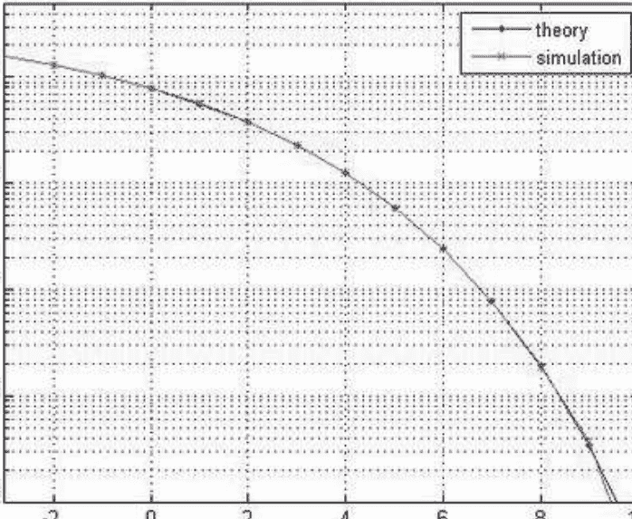

**来源: http://www.dsplog.com/2007/08/05/bit-error-probability-for-bpsk-modulation/。由Krishna Sankar Madhavan Pillai提供。经允许使用。**

# 通信方案。

信噪比（SNR）越大，误码率（BER）越低，反之亦然。方程（9.9）告诉我们在我们的情况下这两个量如何相互关联，并在图9-1中绘制。这条曲线的形状是BER与SNR的特征。对于许多信号和信道编码方案，SNR曲线都是如此，我们将在接下来的几章中看到。更复杂的信号方案将具有不同的BER-SNR关系，但BER几乎总是SNR的函数。

# ■ 9.4 BER：不平等先验情况下的案例

当发送者发送“0”的先验概率与发送“1”的先验概率相同时，最佳的数字化阈值确实为0伏特，根据对称性，如果发送“0”时为−E，发送“1”时为s伏特，则阈值应为 +√Eₛ 伏特。但是当“0”的概率比“1”更大或者反之时会发生什么？

如果阈值仍然保持在0伏特，则出错比特的概率与方程（9.9）相同。为了理解这一点，假设“0”的先验概率为p0，而“1”的先验概率为p1=1−p0。然后，通过类似于前一节的计算，可以简化出错比特的概率，得到

P（误差） = p0/2 · erfc(√(Eₛ/N₀)) + p1/2 · erfc(√(Eₛ/N₀)) = erfc/2(√(Eₛ/N₀))。（9.10）

这个方程与方程（9.9）相同。直观上讲，当阈值为0伏特时，通道具有以下特性：0变为1的概率与1变为0的概率相同。在这种情况下，“0”翻转的概率仅取决于使用的阈值和信噪比，而不取决于p0。

[PAGE 124]

然而，请注意，当$p_0=p_1=1/2$时，最佳数字化阈值不是0（或者一般来说，并不是介于用于“0”和“1”的电压水平之间的中间值）。直观上讲，如果$_0$的概率比$_1$更高，阈值实际上应该大于0伏特，因为任何给定位的$_0$的可能性更高，所以即使电压水平略高于0伏特，也可能“猜测”该位是“0”。同样，如果先验概率为“1”的概率更大，则最佳阈值将低于0伏特。

那么，假设接收器使用单一阈值来进行数字化，什么是最佳的数字化阈值？假设它是$V_t$，然后用$V_t$的误码率（BER）编写一个方程，对$V_t$求导并将导数设为0，确定最佳值。然后可以通过验证第二阶导数的符号来确定最佳值确实是一个最小值。

幸运的是，这个计算并不那么困难或繁琐，因为$V_t$会在积分的极限中出现，所以微分是直接的。我们将使用以下属性

$$\frac{d}{dz}\operatorname{erfc}(z)=\frac{d}{dz}\frac{2}{\sqrt{\pi}}\int_z^{\infty}e^{-v^2}\,dv=-\frac{2}{\sqrt{\pi}}e^{-z^2}$$
(9.11)

BER的方程是我们之前在方程（9.10）中所写的直接扩展，只是我们使用了阈值$V_t$而不是0伏特：

$$\mathbb{P}(\text{error})=\frac{p_0}{2}\operatorname{erfc}\!\left(\frac{V_t+\sqrt{E_s}}{\sqrt{N_0}}\right)+\frac{p_1}{2}\operatorname{erfc}\!\left(\frac{\sqrt{E_s}-V_t}{\sqrt{N_0}}\right).$$
(9.12)

使用方程（9.11）对方程（9.12）的RHS进行求导，并将其设置为0，我们得到以下方程来计算$V_t$：

$$-p_0e^{-(V_t+\sqrt{E_s})^2/N_0}+p_1e^{-(V_t-\sqrt{E_s})^2/N_0}=0.$$ 
(9.13)

解方程（9.13）得到

$$V_t=\frac{N_0}{4\sqrt{E_s}}\log_e\frac{p_0}{p_1}.$$ 
(9.14)

通过对第二阶导数进行验证，可以很容易地验证$V_t$的这个值确实使BER最小化。

我们可以通过验证方程（9.14）的几个情况来进行合理性检查。当$p_0=p_1$时，我们知道答案是0，并且可以从这个方程得到。当$p_0$增加时，我们知道阈值应该向正侧移动，反之亦然，这两个结果都可以从方程中得出。此外，当噪声功率$N_0$增加时，我们期望接收机对接收到的测量值给予较少关注，并更多地关注先前的测量值（因为任何接收到的样本中存在更多的不确定性），而阈值的表达式确实通过将阈值从原点移动到与较不可能的比特相关的一侧来实现这一点。

请注意方程式（9.14）适用于发送在0附近对称电压的“0”和“1”的情况。如果使用不同电压的系统，例如$V_0$和$V_1$，则阈值计算必须以类似的方式进行。在这种情况下，最佳值将偏离中点，即$(V_0+V_1)/2$。

| 10 ggg₁₀ α | α |
|---|---|
| 100 | 10000000000 |
| 90 | 1000000000 |
| 80 | 100000000 |
| 70 | 10000000 |
| 60 | 1000000 |
| 50 | 100000

## 概率密度函数

图9-5显示了一个概率密度函数（PDF）的示例$f_X(x)$。PDF本身不是概率；它下面的任何部分的面积才是概率。虽然$f_X(x)$本身可能超过1，但它下面的任何部分的面积都是概率，永远不会超过1。此外，PDF被归一化以反映概率X取某个值的事实，因此

$$\int_{-\infty}^{\infty} f_X(x)\,dx = 1。$$

均值随机变量$x$的均值$X$可以从其PDF计算如下：

$$\mu_X = \int_{-\infty}^{\infty} x f_X(x)\,dx。$$

(9.17)

如果你将PDF看作在实轴上表示“概率质量”分布，那么均值就是其质心的位置；以此点为支点旋转实轴将使质量分布保持平衡，不会倾向于一侧或另一侧。

大数定律指出，如果$x[k]$是一个具有相同概率密度函数$f_X(x)$的独立同分布的随机过程，那么样本均值会在样本数量趋近于无穷大时收敛到均值$\mu_X$：

$$\lim_{K\to\infty}\frac{1}{K}\sum_{k=0}^{K}x[k]=\mu_X。$$

(9.18)

方差是对均值周围分布的一种度量，定义为

$$\sigma_X^2 = \int_{-\infty}^{\infty}(x-\mu_X)^2 f_X(x)\,dx。$$

(9.19)

（继续使用质量类比，方差类似于概率质量的转动惯量。远离质心的概率质量，即远离均值的质量，对方差的贡献要比靠近均值的质量显著大。）再次强调，在适当的条件下，独立同分布过程$x[k]$的样本方差会收敛到方差。标准差定义为方差的平方根，即$\sigma_X$。

## 累积分布函数：从负无穷到$x$的概率密度函数的积分

$$F_X(x)=\int_{-\infty}^{x} f(x)(\alpha)\,d\alpha$$

被称为累积分布函数（CDF），因为它表示随机变量取值小于等于$x$的累积概率。CDF从$x=-\infty$时递增单调（或者更准确地说，是单调非递减）到$x=\infty$时为1。

示例：均匀分布这个简单的例子可能有助于更好地说明概率密度函数的概念，特别是对于那些以前没有见过这个概念的人来说。假设一个随机变量 $X$ 可以取0到2之间的任何值，概率相等，并且始终在该范围内。对应的概率密度函数是什么？

因为 $X$ 在范围 $(x,\ x+dx)$ 内的概率与 $x$ 无关，只要 $x$ 在 $\[0,2]$ 之间，所以 PDF $f_X(x)$ 是某个常数 $h$，对于 $x\in[0,2]$。此外，对于范围之外的任何 $x$，它必须为0。我们需要确定 $h$。为了做到这一点，观察到 PDF 必须被归一化，所以

```
$$\int_{-\infty}^{\infty} f_X(x)\,dx = \int_0^2 h\,dx = 1, \qquad (9.20)$$
```

这意味着 $h=0.5$。因此，当 $0\leq x\leq 2$ 时，$f_X(x)=0.5$，否则为0。图9-4显示了这个均匀分布的 PDF。

可以很容易地计算从这个分布中选择的 $x$ 落在范围 $(0.3,0.7)$ 内的概率，它等于

```
$$\int_{0.3}^{0.7} (0.5)\,dx = 0.2.$$
```

均匀概率密度函数也提供了一个简单的例子，展示了概率密度函数 $f_X(x)$ 可以轻松超过1的情况。一个取值始终在0和$\delta$之间（其中 $\delta<1$）的均匀分布，其概率密度函数 $f_X(x)=1/\delta$，始终大于1。再次强调之前的一点：概率密度函数 $f_X(x)$ 不是概率，而是概率密度，因此可以取任何非负值。唯一的限制是其曲线下的总面积（在可能的取值范围内的积分）为1。

作为练习，你可以尝试确定在任意（但有限长度）区间 $\[a,b]$ 上均匀分布的随机变量的概率密度函数、均值和方差。

## 例子：高斯分布高斯随机变量 X 的概率密度函数为

```
$$f_W(w)=\frac{1}{\sqrt{2\pi\sigma_X^2}}e^{-(x-\mu_X)^2/(2\sigma_X^2)}.\qquad(9.21)$$
```

这个方程在图9-5中绘制出来，清楚地显示了为什么高斯分布被俗称为“钟形曲线”。由于 $e^{-x^2}$ 的依赖关系，曲线迅速趋近于0。表达式的形式清楚地表明概率密度函数关于值 $\mu_X$ 对称，这足以推断出这个参数确实是分布的均值。这是微积分的一个练习（如果你对细节足够感兴趣，我们将让你自己完成），验证概率密度函数下的面积确实为1（对于任何概率密度函数都必须如此），方差实际上是上述表达式中标记为 $\sigma_X^2$ 的参数。因此，高斯概率密度函数完全由分布的均值和方差来描述。

改变均值只是简单地将分布在水平轴上向左或向右移动，如图9-6左侧的图片所示。增加方差在物理上更有趣；它使分布变宽（或变胖），使得远离均值的值更有可能被选择，与方差较小的高斯分布相比。具有更宽分布（即更大方差）的高斯随机变量比较窄的随机变量具有更多的“功率”。

# 致谢

感谢Bethany LaPenta和Kerry Xing发现了各种错误。

# 问题和练习

+   1. 你家的有线电视信号很差。你家的接收器通过两根串联的同轴电缆连接到你家外部的分配点，如下图所示。分配点处的有线电视信号功率为 $P$。接收器处的信号功率为 $R$。

第一根电缆通过 7 dB 衰减（即降低）信号功率。第二根电缆通过额外的 13 dB 衰减信号功率。计算 $\frac{P}{R}$ 作为一个数值比率。

+   2. 本·比特迪德尔从 6.02 中研究了双极性信号方案，并决定将其扩展为一个 4 级信号方案，他称之为本的激进信号方案，或者简称为 BASS。在 BASS 中，发送器可以发送四个可能的信号电平或电压：$(-3A, -A, +A, +3A)$，其中 $A$ 是某个正值。为了传输比特，发送方的映射器将连续的比特对映射到一个固定的电压电平，该电平在一段固定的时间间隔内保持不变，从而创建一个符号。例如，我们可以将比特“00”映射为 -3A，将比特“01”映射为 -A，将比特“10”映射为 +A，将比特“11”映射为 +3A。每个不同的比特对应一个唯一的符号。将这些符号称为 s_minus3、s_minus1、s_plus1 和 s_plus3。每个符号在传输时具有相同的先验概率。

这些符号通过一个没有失真但有加性噪声的信道进行传输，并且在接收端以通常的方式进行采样。假设接收端的样本值与理想的无噪声值之间存在一个均值为零、方差为 $\sigma^2$ 的零均值加性高斯噪声（AWGN）过程，其中 $\sigma^2$ 是每个样本上的高斯噪声的方差。在与每个符号相关联的时间槽中，BASS 接收器对所选电压样本 $r$ 进行数字化，并使用以下直观的数字化规则（以 Python 语法编写）返回在该槽中传输的符号的估计值 $s$：

```
python
def digitize(r):
    if r < -2A: s = s_minus3
    elif r < 0: s = s_minus1
    elif r < 2A: s = s_plus1
    else: s = s_plus3
    return s

```

本想计算 BASS 的符号误码率，即接收方选择的符号与发送的符号不同的概率。注意：我们这里不关心比特误码率。通过回答以下问题，帮助本计算符号误码率。

+   (a) 假设发送方传输符号 s_plus3。在这个信息条件下，条件符号误码率是多少？即 $P(\text{符号误码} \mid s\_plus3\text{发送})$。

[PAGE 131]

用A、N₀和erfc函数来表示你的答案，$\mathrm{erfc}(z)=\frac{2}{\sqrt{\pi}}\int_z^{\infty}e^{-x^2}\,dx$。

(b) 现在假设发送方传输符号s plus1。在这个信息条件下，条件符号误码率是多少，用A、N₀和erfc函数来表示？

(c) 对于其他两个符号的条件符号错误率不需要单独计算。

+   i. 当发送者发送符号s减3时的符号错误率与以下哪个符号的符号错误率相同？

A. s减1.

B. s加1.

C. s加3.

+   ii. 当发送者发送符号s减1时的符号错误率与以下哪个符号的符号错误率相同？

A. s减3.

B. s加1.

C. s加3.

+   (d) 结合前面部分的答案，符号错误率如何用A、N₀和erfc函数表示？请记住，所有符号被传输的概率相等。

3. 比特样本以振幅\(A_T x = \pm 1\)（即双极性信号）传输。信道衰减为20 dB，因此任何传输信号到达接收器时，其功率会减小这个因子。

+   (a) 接收机噪声标准差值（$\sigma$）对应于接收机信噪比（SNR）为20 dB的值是多少？（请注意，接收机的SNR定义为接收信号功率与$\sigma^2$的比率。）

+   (b) 当接收机的SNR为20 dB时，用误码率（bit error rate）表示接收机的值，其中使用了erfc()函数。

(c) 在本问题的前几部分的条件下，假设在接收机后面添加了增益为10 dB的放大器。解释这种放大对误码率的影响。

4. 由于我们将在下一章中研究的符号间干扰（ISI），没有噪声的接收信号分布（概率质量函数）如下图所示。

(a) 确定上图中标记的值$p$。

(b) 确定最佳决策阈值$V$，假设发送“0”和“1”的先验概率以及发送“0”和“1”的噪声标准差也相等（$\sigma_0=\sigma_1$）

(c) 推导出误码率的表达式，其中使用 erfc() 函数，如果 $\sigma=0.025$

麻省理工学院开放式课程

http://ocw.mit.edu

# 6.02电子工程与计算机科学II：数字通信系统

2012年秋季

有关引用这些材料或我们的使用条款的信息，请访问：http://ocw.mit.edu/terms。

MIT 6.02草稿讲义（最后更新：2012年9月30日）

# 第10章

## 物理通信信道的模型

为了预览本章的内容，首先简要回顾一下我们已经涉及的领域会很有帮助。之前的章节已经提出了数字（而不是模拟）通信范式的理由，并让我们接触到了以比特或更一般地以编码消息的离散符号为级别的通信。

我们在第2章和第3章中展示了如何通过源编码获得压缩或非冗余的离散消息表示，这产生了反映源的固有信息内容或熵的码字。在第4章中，我们研究了源发射器如何将位序列映射到适合在物理信道上传输的时钟信号（例如，作为电压级别）。

第5章介绍了二进制对称信道（BSC）对位错误的抽象，该信道具有一定的概率在通过信道时破坏单个位，而与序列中的其他位发生的情况无关。

该章与第6章、第7章和第8章一起展示了如何以受控的方式引入冗余，使用奇偶校验位。这导致了纠错码或信道码，它们提供了一定程度的保护，以抵御BSC引入的位错误。第9章考虑了从接收到的噪声-损坏信号重新映射到底层位流的挑战，假设信道没有引入确定性失真，只有离散时间采样的接收信号上的加性白噪声。第9章的一个关键思想是展示了模拟信号经历的高斯噪声如何导致离散版本信道的BSC位翻转概率。

本章开始了一个过程，该过程在几个后续章节中继续进行，目的是表示、建模、分析和利用物理传输通道的特性。这是从源端传输的信号和接收端捕获的信号之间的通道。回顾第4章图4-8上半部分的“单链路视图”，我们的目的是更详细地研究通信通道的一部分，即源端的“Mapper + Xmit样本”与接收端的“Recv样本 + Demapper”之间的连接。

[PAGE 135]

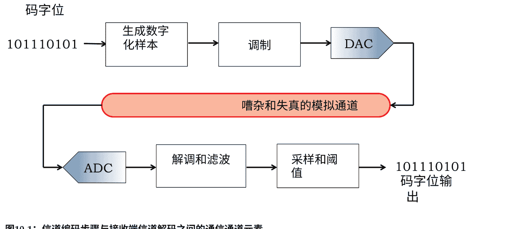

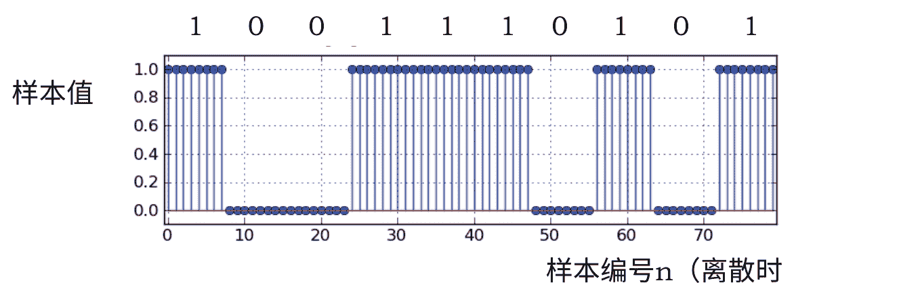

## 10.1 传递信息

### 10.1.1 基带信号

在图10-1中，我们看到在发射机的信道编码操作和接收机的信道解码操作之间可能出现的扩展版本（如图4-8的上部所描述）。在源端，第一阶段是将输入比特流转换为数字化和离散时间（$DT$）信号，由以一定采样率为间隔产生的样本表示。我们用 $x[n]$ 表示这个信号，其中 $n$ 是整数值的离散时间索引，在最一般的情况下范围从 $-\infty$ 到 $+\infty$。

在最简单的情况下，我们将继续用于说明，每个比特由一定数量的样本表示的信号电平表示，例如，持续8个样本的电压电平 $V_0=0$ 表示0比特，持续8个样本的电压电平 $V_1=1$ 表示1比特，如图10-2所示。在这个例子中，采样时钟的工作频率是比特时钟的8倍，因此比特速率是 $f_s/8$ 比特/秒。这样的信号通常被称为基带信号。

## 10.1.2 调制

图10-2中显示的DT基带信号通常不能直接传输到物理传输通道上。首先，物理通道通常以连续时间（CT）模拟方式运行，因此至少需要一个数字到模拟转换器（DAC）来产生可以应用于通道的连续时间信号。

DAC通常是一个简单的零阶保持器，它在1/f秒的时间间隔内保持或保持最近的样本值。通过这样的DAC转换，图10-2中的DT“矩形波”变成了CT矩形波，每个比特现在对应于一个在8/f秒内保持的信号值。

一般来说，将其转换为模拟CT信号是不够的，因为物理信道通常不适合传输这种类型的矩形波。例如，从麦克风获取的语音信号经过适当的数字编码后，每秒会产生64千比特的数据（采样率为8 kHz，分辨率为8位），但以这个速率在两个电平之间切换的矩形波并不适合直接进行无线电传输。原因包括有效地投射波能需要与信号波长相当的天线，通常情况下，塔式天线的波长为四分之一波长。在32 kHz的采样率下，对应于编码麦克风输出中的交替的1和0的波形，并且电磁波以3×10^8米/秒（光速）传播，四分之一波长的天线将非常笨重，长度为3×10^8/(4×32×10^3)=2344米！

即使我们可以安排这种基带信号（经过数字到模拟转换）的直接传输，也会有与所需发射机功率、大气层对该频率的衰减、该传输与其他人之间的干扰等相关的问题。美国联邦通信委员会（FCC）等监管机构以及其他国家的等效机构对传输施加了限制，进一步限制了可以应用于物理信道的信号类型。

为了使基带信号与传输信道的物理和监管规范相匹配，通常需要经过调制过程。该过程将数字化样本转换为更适合于可用信道传输的形式。例如，考虑在声学信道上直接传输数字信息的情况，从计算机上的扬声器到计算机上的麦克风（或者在“听力”范围内另一台计算机）。扬声器不能有效地响应由我们的基带信号产生的分段恒定电压。它的设计目的是响应适当范围内的振荡电压，产生和投射出振荡声压波。正弦波的激励产生纯净的声音音调。具有约5厘米（0.05米）的扬声器孔径尺寸和约340米/秒的声速，我们预计可以有效地投射低于赫兹范围内的音调，这确实在（可听到的范围的高端）。

在声波实验中实现所需的调制的一种简单方法是-

## 10.1.3 解调

我们稍后会对解调进行更多的讨论，所以现在可以将其视为与调制相反的过程，旨在从接收信号中提取基带信号。虽然这个过程的一部分可以直接作用于接收到的CT模拟信号，但图10-1中的块图显示它全部发生在DT中，在使用模拟-数字转换器（ADC）转换接收信号之后。块图还表明，可能涉及到一个滤波步骤，以尽可能地将信道噪声与接收信号的信号分量分离开，并且补偿信道引入的确定性失真。这些想法将在后面的章节中进一步探讨。

## 10.1.4 基带信道

解调步骤和任何相关的滤波的结果是一个DT信号[y]，由以源端传输速率f为单位的样本组成。我们假设时钟同步的问题是单独处理的。我们还忽略了任何信号衰减的影响，因为接收器可以通过选择适当的放大器增益来简单地补偿。

在没有失真、信道上没有噪声和微不足道的传播延迟的理想情况下，y[n]将完全等于源端使用的调制基带信号x[n]，对于所有的n。如果信道上存在固定且已知的传播延迟，那么在接收端将时钟设置比发送端晚那么多会很方便。如果这样做，那么再次我们会发现在没有失真和随机噪声的情况下，对于所有的n，我们有y[n]=x[n]。

> 一个零阶保持DAC只会产生一个纯正弦波的近似，但如果采样率f_s足够高，扬声器可能感觉不到差异。

## 10.2 线性时不变（LTI）模型

## 10.2.1 基带信道模型

我们的基带信道模型，如图10-4中的块图所示，将DT序列或信号x作为输入，并产生序列或信号y作为输出。我们经常使用符号x[·]来表示整个DT信号或函数。另一种指代整个信号的方式，虽然更繁琐，是通过引用“x[n]，其中-∞ < n < ∞”；这通常被缩写为“信号x[n]”，但有可能被误解为仅指单个时间点n的值。

图10-4显示了输入处的信号x[n]和输出处的信号y[n]，但这仅表示系统在时间n的快照，因此我们确实看到了输入处的信号x[n]和输出处的信号y[n]。

## 10.2.2 单位样本响应 `h[n]` 和单位阶跃响应 `s[n]`

在我们对线性时不变信道模型的描述和研究中，有两个特定的信号非常有用。单位阶跃信号或函数`u[n]`的定义如下

```
u[n] = 1 如果 n ≥ 0
u[n] = 0 否则。
```

它在其参数为负值时取值为0，在其他情况下取值为1，如图10-5所示。因此，例如`u[1-n]`，在`n>1`时为0，在其他情况下为1。

单位样本信号或函数`δ[n]`，也称为单位冲激函数，定义如下

```
δ[n] = 1 如果 n = 0
δ[n] = 0 否则。
```

当其参数为0时，它的值为1，在图10-6中显示。

因此，当 $n=3$ 时，$\delta[n-3]$ 为1，其他地方为0。也可以很容易地推断出

$$\delta[n] = u[n] - u[n-1], \qquad (10.3)$$

其中信号的加法和减法，如 $u[n]$ 和 $u[n-1]$ 的定义是“逐点”进行的，即在每个时间点上进行值的相加或相减。同样，信号与标量常数的乘法被定义为逐点乘以该标量，因此例如 $2u[n-3]$ 在 $n<3$ 时的值为0，在其他时间点上的值为2。

当系统在图10-4中的输入为单位样本信号 $\delta[n]$ 时，其响应 $y[n]$ 被称为单位样本响应，有时也被称为单位冲激响应。我们用 $h[n]$ 表示这种特殊情况下的输出。类似地，对于单位阶跃信号 $u[n]$ 的响应被称为单位阶跃响应，并用 $s[n]$ 表示。

单位阶跃函数的一个特别有价值的用途是将矩形波信号表示为延迟（可能经过缩放）的单位阶跃函数的交替和。图10-9显示了一个例子。我们稍后会回到这个分解。

## ■ 10.2.3 时间不变性

考虑一个输入信号为 $x[\cdot]$ 和输出信号为 $y[\cdot]$ 的离散时间系统，因此在时间 $n$ 处，$x[n]$ 和 $y[n]$ 是在输入和输出处看到的值。如果将输入信号 $x[\cdot]$ 在时间上任意正负整数 $D$ 的偏移得到新的输入信号 $x_D[n]=x[n-D]$，则系统被称为时不变性，其产生的相应输出信号 $y_D[n]$ 与简单地将相同的偏移 $D$ 应用于响应 $y[\cdot]$ 所得到的输出信号 $y[n-D]$ 相同。如果 $D>0$，则偏移对应于将信号延迟 $D$，如果 $D<0$，则对应于将信号提前 $|D|$。特别地，对于一个时间不变系统，输入处的一个偏移单位样本函数会在输出处产生一个完全相同的偏移单位样本响应。图10-7说明了时间不变性。

## 系统的定义为

```
对于所有 $n$，$y[n] = 0.5y[n-1] + 3x[n] + x[n-1]$  （10.4）
```

是时不变的，因为在任何时间点构造 $y$ 和 $x$ 的值时，我们只需要同一时间步长和前一时间步长的值，而不需要知道时间步长本身。为了更具体地看到这一点，注意上述关系对于所有 $n$ 都成立，所以我们可以写成

```
$y[n-D] = 0.5y[(n-D)-1] + 3x[n-D] + x[(n-D)-1]$ 对于所有 $n$
```

或者

```
$y_D[n] = 0.5y_D[n-1] + 3x_D[n] + x_D[n-1]$ 对于所有 $n$。
```

换句话说，时移输入和输出信号，$x[t]$ 和 $y[t]$，分别满足定义系统的方程。

系统的定义为

```
$y[n] = n^3 * x[n]$ 对于所有的 $n$  （10.5）
```

不是时不变的，因为 $n$ 的值对于定义时间 $n$ 的输出至关重要。稍微微妙一些的是，系统的定义为

```
$y[n] = x[0] + x[n]$ 对于所有的 $n$。 （10.6）
```

这同样不是时不变的，因为需要绝对时间 $0$ 处的信号值，而不是与 $n$ 无关的偏移量。我们

$y_D[n] = x[0] + x_D[n]$ 而不是所需的时间不变性，即 $y_D[n] = x_D[0] + x_D[n]$。

## 10.2.4 线性

在定义线性概念之前，回顾一下与方程（10.3）相关的信号或时间函数的两个操作是有用的，即（i）信号的相加和（ii）信号与常数的标量乘法。这些操作被定义为逐点操作（即在每个时间步骤上进行），并且是自然的定义。

> （它们与向量的加法和标量乘法完全类似，唯一的区别是我们为向量考虑的有限数字数组，对应于可以在所有整数 $n$ 上取值的信号的无限数组。）

通过这些操作，我们可以谈论加权线性组合的信号。因此，如果 $x_1$ 和 $x_2$ 是系统的两个可能的输入信号，那么我们可以考虑一个实验3，其中输入 $x_3$ 是其他两个实验中输入的加权线性组合：

```
x_3[n] = a_1 * x_1[n] + a_2 * x_2[n]  对于所有的 n,
```

[此处原文中断]

# 10.2.5 线性、时不变（LTI）模型

同时具有线性和时不变特性的模型，即$LTI$模型，在工程和其他领域中非常重要。我们将在下一章中提到一些原因。我们将深入了解它们的行为和分析工具，然后回到应用我们所学的知识，更好地理解物理信道上的信号传输。

在使用计算机的扬声器和麦克风进行音频通信的背景下，传输是通过计算机的扬声器发出的爆发声完成的，接收是通过检测麦克风的响应完成的。在这种情况下，输入$x[n]$是一个基带信号，如图10-3所示，但是在高值和低值之间定期交替。然后，通过调制过程将其转换为你听到的音调爆发声。然后，通过解调接收到的麦克风信号，重构出基带输入的估计$y[n]$。

在麦克风固定位置的情况下，响应在过渡之间（音调和无音调之间）具有一定的一致性，尽管存在随机波动。响应的确定性或可重复部分显示出失真，即与理论值有偏差，尽管比图10-3中的合成示例更接近“真实世界”。然而，当麦克风离扬声器非常近时，失真较低。

在这个通信系统中，系统响应的特征表明将基带声学信道建模为LTI可能是合理的。通过对各种过渡的瞬态响应的可重复性，暗示了时间不变性（至少在演示的时间范围内！）。通过输入引起的负（向下）步骤引起的下降瞬变看起来像是输入引起的相同幅度的正（向上）步骤的反射，这表明线性性。当输入被缩放时，响应的适当缩放也暗示了线性性。

## 第 11章

## LTI模型和卷积

本章将帮助我们了解除了噪声（我们在第9章中学习过）之外，还有什么会扰乱或扭曲通过通信信道传输的信号，例如导线上的电压波形，大气中的无线电波或声学介质中的压力波。信道引入的失真最显著的特征是输出通常不能立即响应或跟随输入。物理原因最终是信道中的某种惯性效应，需要输入提供能量以产生响应，因此需要一些时间来响应，因为输入功率是有限的。因此，信道输入处的阶跃变化通常会导致信道输出逐渐上升到最终值，可能还会出现瞬态振荡或“回响”绕其最终值震荡，然后才稳定下来。输入的一系列交替阶跃，如发射机产生的开关信号，因此可能会产生显示为干扰间隔（ISI）的输出：与特定比特时隙相关的输入信号部分的响应会溢出到输出的其他比特时隙中，使输出波形只是输入的一个微弱表示，从而复杂化了确定输入消息的过程。

为了更好地理解信道响应和ISI，我们将使用信道的线性、时不变（LTI）模型，这在前一章中已经介绍过。这些模型在各种应用中提供了非常好的信道行为近似（它们也广泛应用于工程和科学的其他领域）。在LTI模型中，信道的响应（即输出）对任何输入仅依赖于一个称为单位样本响应函数h[·]的函数。对于任何输入信号序列x[·]，LTI信道的输出y[·]可以通过将h[·]和x[·]通过卷积操作组合来计算。

了解h[·]将指导我们选择与比特时隙关联的样本数，以克服ISI，并由此确定与信道相关的最大比特率。在简单的开关信号传输中，为了减轻ISI的影响，需要分配给比特时隙的样本数大约等于单位样本响应h[·]基本趋于0所需的样本数。在这方面，我们还将介绍一种称为眼图的工具，它可以帮助我们观察信号的传输质量。

## 11.1 信道上的失真

尽管通信技术种类繁多，但它们通常对输入作出类似的失真行为。为了对问题的基本性质有一些直观认识，我们首先看一些简单的例子。考虑一个进行开关信号传输的发射机，在一个比特周期内，发送电压样本要么设置为 $V_0=0$ 伏特，要么设置为 $V_1=1$ 伏特。让我们假设一个LTI信道，这样

+   1. 超定理适用，并且

+   2. 如果对于输入的单位阶跃响应为 $u[n]$，输出的单位阶跃响应为 $s[n]$，那么对于输入的移位单位阶跃响应 $u[n-D]$，输出的移位单位阶跃响应 $s[n-D]$ 是完全相同的，其中 $D$ 是任意整数。

我们还假设信道和接收器增益使得单位阶跃响应 $s[n]$ 最终稳定为1。

在这种情况下，输出波形通常会与输入波形有两个显著的偏差：

+   1. 上升和下降速度较慢。理想情况下，接收器处的电压采样应该与发射器处的电压采样完全相同。然而，通常情况下，如图11-1所示，从发射器上几乎瞬时地从V0伏特跃升到V1伏特的过渡导致接收器上的输出电压需要更长的时间从V0伏特跃升到V1伏特。类似地，当发射机的电压从V1伏变为V0伏时，接收机的电压下降的时间较长。需要注意的是，如果发射机之间的转换时间比接收机的上升和下降时间短，接收机将难以（甚至无法！）通过来自输出的电压样本正确推断传输比特的值。

+   2. 振荡稳定，或者称为“振铃”。在某些情况下，接收机的电压样本在稳定之前会振荡。例如，在电缆中，这种效应可能是由于电场和磁场中储存的能量来回“晃动”，或者是由于不连续处的信号反射所致。在无线电和声学信道中，这种行为通常是由信号反射引起的。我们不会试图确定信道上振铃的物理来源，而是观察到它的发生并处理它。图11-2显示了一个振铃的示例。

图11-3展示了一个非理想信道失真的例子。在这个例子中，发送器将比特序列...0101110...转换为电压样本，使用十个1伏特样本表示“1”，十个0伏特样本表示“0”（样本值在之前和之后为0）。在这个例子中，接收器的稳定时间比比特周期的倒数更长，因此具有频繁转换的比特序列，如010，会受到影响。在这个例子中，接收器的稳定时间比比特周期的倒数更长，因此具有频繁转换的比特序列，如010，会受到影响。

[此处原文中断]

## 离散时间信号与卷积

δ₀[·] 是这个信号的另一种表示法，其中下标表示函数取值为 1 的时间瞬间；因此，当以 n 为函数描述时，δ[n-k] 也可以写成信号 δ_k[·]。

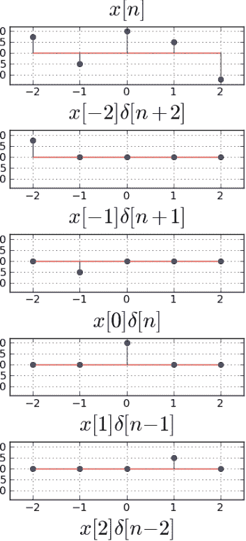

**图11-5：离散时间信号可以分解为一系列时间平移、缩放的单位样本函数的和：**  
$x[n] = \sum_{k=-\infty}^{\infty} x[k]\delta[n-k]$。

单位样本响应 $h[n]$，当我们设置 $x[n]=\delta[n]$ 时，即 $x[0]=1$ 和 $x[k]=0$（对于 $k\neq 0$），它简单地是值的序列 of values that $y[n]$ takes。对于基本输入 $\delta[n]$ 的响应 $h[n]$ 可以用来描述 LTI 系统对任何输入的响应，原因如下：

+   - 任意信号 $x[\cdot]$ 可以表示为缩放（或加权）和平移的单位样本函数的和，如图11-5所示。  
  这可以通过以下两种方式来表达：

```
x[\cdot] = ... + x[-1]\delta_{-1}[\cdot] + x[0]\delta_0[\cdot] + ... + x[k]\delta_k[\cdot] + ...

x[n] = ... + x[-1]\delta[n+1] + x[0]\delta[n] + ... + x[k]\delta[n-k] + ...    (11.1)
```

+   - LTI系统对于输入信号的响应，如果该输入信号是其他输入信号的缩放和平移组合，那么响应也是这些其他输入信号的相应缩放组合，如图11-6所示。

由于在时间 $n$ 的响应对于输入信号 $\delta[n]$ 是 $h[n]$，根据这两个观察结果可得-

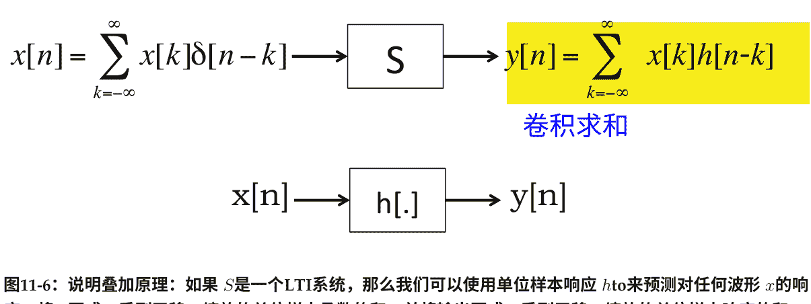

**图11-6：说明叠加原理：** 如果 $S$ 是一个LTI系统，那么我们可以使用单位样本响应 $h$ 来预测对任何波形 $x$ 的响应，将 $x$ 写成一系列平移、缩放的单位样本函数的和，并将输出 $y$ 写成一系列平移、缩放的单位样本响应的和，缩放因子相同。

从上面的观察可以得出，在时间 $n$ 时对输入 $x$ 的响应是

```
$$y[n]=\cdots+x[n-1]h[n+1]+x[0]h[n]+\cdots+x[k]h[n-k]+\cdots$$
$$\quad=\sum_{k=-\infty}^{\infty}x[k]h[n-k]。\qquad(11.2)$$
```

对时间函数或信号 $x$ 和 $h$ 进行这种操作以生成信号 $y$ 被称为卷积。卷积操作的标准符号是 $*$，我们使用它来表示方程（11.2）中的定义，即 $y[n]=(x*h)[n]$。当符号 $*$ 足够时，我们也会简单地写成 $y=x*$。

在方程（11.2）中进行简单的变量替换，设置 $n-k=m$，可以得到我们也可以写成

```
$$y[n]=\sum_{m=-\infty}^{\infty}h[m]x[n-m]=(h*x)[n]。\qquad(11.3)$$
```

前面的计算证明了卷积是可交换的，即

```
$$x*h=h*x。$$
```

我们将在后面提到卷积的其他性质，与LTI系统的级数和并联组合（或组合）有关。

例1 假设 $h[n]=(0.5)^n u[n]$，其中 $u[n]$ 表示之前定义的单位阶跃函数（当其参数 $n$ 为非负时取值为1，否则取值为0）

> 在大部分工程文献中，卷积的常见（但不合逻辑、令人困惑和误导！）表示法是将 $y[n]=x[n]*h[n]$ 写成。这里的指标 $n$ 承担了三重职责：在 $y[n]$ 中标记了所需卷积结果的时间点；在 $x[n]$ 和 $h[n]$ 中分别表示整个信号 $x[\cdot]$ 和 $h[\cdot]$；最后，在 $x[n]$ 和 $h[n]$ 中使用它来传达所需卷积结果的时间点。这种表示法的缺陷在于，如果将一个数字替换为 $n$，例如 $y[0]=x[0]*h[0]$ ——右侧接下来该怎么办？表示法 $y[0]=(x*h)[0]$ 没有这样的困难。类似地，这种有缺陷的表示法可能会让人“推断”出 $y[n]=x[n]*h[n]$，从而得出 $y[n-3]=x[n-3]*h[n-3]$ 的结论，但是没有自然的解释可以将右侧转化为关于卷积的正确陈述。

如果 $x[n]=3\delta[n]-\delta[n-1]$，那么

$$y[n]=3(0.5)u[n]-(0.5)u[n-1]。$$

由此我们可以推断，例如，当 $n<0$ 时，$y[n]=0$，且 $y[0]=3，\ y[1]=0.5，\ y[2]=(0.5)^2$，实际上对于所有 $n>0$，$y[n]=(0.5)^n$。

上面的例子说明，如果 $h[n]=0$ 对于 $n<0$，那么系统输出在输入非零值之前不能取非零值。相反，如果输出在输入之前从不取非零值，则必须满足 $h[n]=0$ 对于 $n<0$。

换句话说，这个条件对于系统的因果性是必要且充分的。

方程（11.2）中定义卷积的求和通常涉及无限多个项，因此需要一些条件才能明确定义。当系统是因果的且输入在某个有限的起始时间 $s_x$ 之前都为零时，即输入是右侧的情况下，定义卷积是没有问题的。在这种情况下，无限求和

$$\sum_{k=-\infty}^{\infty} x[k]h[n-k]$$

变为有限求和

$$\sum_{k=s_x}^{n} x[k]h[n-k],$$

因为 $x[k]=0$ 当 $k<s_x$，且 $h[n-k]=0$ 当 $k>n$。

如果 $h$ 是右侧有限的而不是因果的，即在某个有限的起始时间 $s_h$ 之前的所有时间都为0（如果不是这样的话，那么我们就回到了因果系统的情况）。在这种情况下，前面的求和将从 $s_x$ 到 $n-s_h$。在这种情况下，输入信号或单位样本响应仅在有限的时间间隔内非零，此时其他函数的特性几乎无关紧要，因为卷积再次简化为在有限的时间窗口内运行的项。

当卷积求和中实际上有无限多个非零项时，情况就更加微妙。你可能还记得在微积分课程中讨论无限级数时，这样的求和是明确定义的，与项的添加顺序无关，前提是无限级数的绝对值（或大小）的和是有限的。在这种情况下，我们说这个级数是绝对可求和的。对于卷积求和，这需要满足以下条件：

$$\sum_{m=-\infty}^{\infty}|x[m]|\;\text{(某项)}<\infty \qquad (11.4)$$

在满足这个约束的重要条件下是当

+   1. 每个瞬间的输入的大小或绝对值在所有时间上都是有界的

2. 当 $x[\cdot]$ 和 $h[\cdot]$ 都是左侧的时候，无限和也会变成有限和，即对于大于某个有限时间的时间，它们都为零；在我们的背景下，这种情况并不是很有趣。$

由某个固定（有限）的数，即

$|x[n]| \le \mu < \infty$ 对于所有的 $n$，

和

+   2. 单位样本响应 $h[n]$ 是绝对可加的：

$$\sum_{n=-\infty}^{\infty} |h[n]| = \alpha < \infty.$$ （11.5）

由此可见

$$\sum_{m=-\infty}^{\infty} |x[-m]| \le \mu\alpha < \infty，$$

所以很明显，在这种情况下，卷积和是明确定义的。

此外，对方程（11.3）中的输出进行绝对值运算，可以得出

$$|y[n]| = \left|\sum_{m=-\infty}^{\infty} h[m]x[n-m]\right| \le \mu\left|\sum_{m=-\infty}^{\infty} h[m]\right| \le \mu\sum_{m=-\infty}^{\infty}|h[m]| = \mu\alpha.$$ （11.6）

因此，单位样本响应的绝对可加性足以确保在有界输入的情况下，我们不仅有一个明确定义的卷积和，而且输出也是有界的。

事实证明，反过来也是正确的：单位样本响应的绝对可加性是确保有界输入产生有界输出的必要条件。一种看到这一点的方法是选择 $x[n]=sgn\{h[-n]\}$ for $|n|\le N$ and $x[n]=0$ otherwise，其中函数 $sgn\{\cdot\}$ 取其参数的符号，即当其参数为正时为 +1，为负时为 -1。通过这个选择，卷积和表明

$$y[0]=\sum_{n=-N}^{N}|h[n]|$$由 $z[n]=(h_2*h_1)[n]$ 给出。为了使这成为输入，即 $x[n]=\delta[n]$，我们需要
$$(h_2*h_1)[n]=\delta[n]。\qquad (11.10)$$
如果我们满足这个条件，那么我们实际上会有 $z[n]=x[n]$ 对于任意的 $x[n]$，因为
$$z=h_2*(h_1*x)=(h_2*h_1)*x=\delta_0*x=x。$$
其中，$\delta[\cdot]$ 是我们对单位样本函数 $\delta[n]$ 的替代符号。上述最后一个等式是因为将任何信号与单位样本函数进行卷积运算会得到原始信号；这实际上就是方程（11.1）所表达的内容。
方程（11.10）中的条件确保信道进行的卷积运算在某种意义上被滤波器逆转或撤销。我们可以说滤波器通过进一步的卷积运算来反卷积系统的输出以获得输入（但请记住，这是通过进一步的卷积运算实现的！）。根据方程（11.10），函数 $h_2[\cdot]$ 也被称为卷积逆函数 $h_1[\cdot]$，反之亦然。
那么，我们如何找到满足方程（11.10）的 $h_2[n]$ 呢？这不是通过简单的除法来实现的（尽管当我们在频域进行分析时，确实可以简化为除法）。然而，应用“翻转-滑动-点乘”法则来计算卷积，我们可以得到以下未知系数 $h_2[k]$ 的方程：
```
1 · h2[0] = 1

0.8 · h2[0] + 1 · h2[1] = 0

0.8 · h2[1] + 1 · h2[2] = 0

...

0.8·h2[k-1] + 1·h2[k] = 0

...
```
由此我们得到 $h_2[0]=1，\;h_2[1]=-0.8，\;h_2[2]=-0.8h_2[1]=(-0.8)^2$，以及一般情况下 $h_2[k]=(-0.8)^k u[k]$。
如果我们的信道模型准确，并且信道中没有噪声，那么上述的反卷积方法将会很好地工作。即使假设模型足够准确，请注意任何噪声过程，如添加到信道输出的噪声，最终会添加到无噪声输出中，即 $z[n]=x[n]$。这种额外的噪声可能会完全压倒解决方案。例如，如果 $x[n]$ 和 $w[n]$ 都是单位样本，那么接收机的反卷积滤波器的输出将具有一个无噪声的部分 $\delta[n]$ 和一个比无噪声部分更大的加性噪声部分 $(-0.8)^n u$。在我们理解如何在频域中思考线性时不变系统之后，就会更清楚为什么这种反卷积对噪声如此敏感。
## ■ 11.3 将单位阶跃响应与单位样本响应相关联
由于
$$\delta[n] = u[n] - u[n-1]$$
因此，对于线性时不变系统，单位样本响应 $h[n]$ 和单位阶跃响应 $s[n]$ 简单相关：
$$h[n] = s[n] - s[n-1]。$$
这个关系是应用叠加原理和时间不变性的结果。因此，对于一个因果系统，当 $h[k]=0$ 和 $s[k]=0$ 对于 $k<0$ 时，我们可以反转这个关系来写
$$s[n] = \sum_{0}^{n} h[k]。\qquad (11.11)$$
因此，我们可以非常简单地从单位样本响应确定单位阶跃响应。根据方程（11.11），单位阶跃响应 $s[n]$ 达到最终值所需的时间正好是单位样本响应 $h[n]$ 恢复到 0 并保持在那里的时间。
当输入到线性时不变系统的输入是一系列缩放和延迟的单位阶跃函数时，没有必要调用卷积的全部机制来确定系统的输出。相反，只需知道单位阶跃响应 $[n]$，我们可以再次简单地应用叠加原理并调用时不变性。
接下来，我们将介绍一种工具，用于检查在这种 ISI 下的信道响应，并为发射机和接收机设置参数。
## ■ 11.4 眼图
从表面上看，ISI 是一种复杂的影响，因为比特干扰的幅度和干扰比特的数量既取决于信道特性，又取决于比特在信道上的表示方式。图11-11显示了一个示例，接收机在具有 ISI 但没有噪声的信道上接收到了发射机发送的内容。眼图（或“眼图案”）是通信系统设计师或工程师工具箱中有用的图形工具，用于理解 ISI。我们将使用这个工具来确定每个比特的样本数是否足够大，以使接收机能够可靠地从解调（和滤波）的接收电压样本序列中确定“0”和“1”。
为了生成眼图，首先需要从长时间的开关信号中得到信道输出，就像图11-11的底部部分那样，然后将其分割成较小的片段，比如3个比特时隙长，并将所有结果片段叠加在一起。结果涵盖了在输出上可能看到的任意3个比特时隙内的波形变化范围。下面是更详细的步骤。
将所有接收到的样本放入一个列表数组中，数组中的列表数量等于每个 $k$ 比特周期中的样本数量。在实际应用中，我们希望 $k$ 是一个小的正整数，比如3。如果每个比特有 $s$ 个样本，则数组的大小为 $k\cdot s$。该数组的每个元素都是一个列表，数组的第 $i$ 个元素是接收到的列表。
![img/e307520682e61a5d652311b70af268de_161_0.png]
![img/e307520682e61a5d652311b70af268de_161_1.png]
**图11-10：** 具有缓慢上升/下降的通道的眼图，分别为每个比特的样本数为33（顶部）和20（底部）。请注意，当每个比特的样本数较大时，眼图会更宽，因为每个阶跃响应在下一个阶跃出现之前有时间稳定。
样本 \(y[i],\ y[i+k_s],\ y[i+2k_s],\ \ldots\) 现在假设没有ISI（也没有噪音）。那么，在传输“0”比特的情况下，列表中的所有样本都具有相同的电压值，并且在传输“1”比特的情况下，列表中的所有样本都具有相同的值。考虑只有一点ISI的简单情况，其中上一个比特干扰当前比特，并且过去没有其他影响。
那么，在传输“0”比特的情况下，列表中的样本将具有两个不同的可能值，一个与传输“10”比特序列相关联的值，一个与传输“00”比特序列相关联的值。类似的情况也适用于传输“1”比特的样本，总共有四个不同的值用于列表中的样本。如果有更多的ISI，列表中的样本将有更多不同的值。例如，如果有两个先前的比特干扰，那么列表中的样本将有八个不同的值。如果有三个比特干扰，那么列表将有16个值。
![img/e307520682e61a5d652311b70af268de_162_0.png]
**图11-11：** 在ISI存在的情况下接收到的信号。每比特的样本数是否“刚刚好”？而且应该使用什么阈值来确定传输的比特？从这张图片上很难回答这些问题。眼图能更好地解释。
不同的值，等等。
如果不知道干扰比特的数量，为了捕捉所有可能的相互作用，我们必须为每个可能观察到的比特序列的组合生成上述的列表数组。如果我们将这个数组绘制在图表上，我们将看到一个类似于图11-10所示的图片。这张图片就是眼图。
实际上，我们无法生成每个可能的比特组合，但我们可以使用一个长的随机比特序列。我们可以将随机比特序列转换为一长串电压样本，将样本通过信道传输，收集接收到的样本，将接收到的样本打包成上述的列表数组，然后绘制结果。如果序列足够长，干扰比特的数量较少，我们应该能够得到准确的眼图近似。
但是什么是“足够长”？我们可以通过使用单位样本响应的属性来回答这个问题并开发出一种不那么特例的过程，即 *h[n]*。这个想法是序列 *h[0], h[1], ..., h[n], ...* 捕捉到了信道的完全无噪声响应。如果对于 *k > 4*，*h[k] ≈ 0*，那么我们就不必担心过去超过4个样本。现在，如果每个比特的样本数是 *s*，那么过去可以影响当前比特的比特数不会超过 *4/s*，其中4是 *h[·]* 的非零部分的长度。因此，只需生成长度为 *B = 4/s* 的所有比特模式，并通过信道发送它们以生成眼图。实际上，由于噪声永远无法消除，人们可能会稍微保守一些，选择 *B = (4/n) + 2*，比无噪声计算所示的稍微大一些。因为这种方法需要发送 *2^B* 个比特模式，所以可能不合理。
对于较大的B值，可能会导致s值过小，可以通过将2B个可能的比特模式的随机子集发送到信道中来判断是否如此。
图11-10显示了眼图的宽度，即图中在传输'0'比特和传输'1'比特时，电压样本之间具有最大差异的位置。图中还要注意的是“零交叉”，即上升和下降曲线相交的位置。通常，随着ISI程度的增加（即每比特样本数的减少），关于零交叉位置的模糊度和歧义度会增加。
眼图是一个重要的工具，用于验证一些关键设计和操作决策：
+   1. 每比特样本数是否足够大？如果足够大，在眼图的中心，与传输'1'相关的电压样本明显高于数字化阈值，与传输'0'相关的电压样本明显低于数字化阈值。此外，眼图必须足够“开放”，以便小量的噪声不会导致将比特检测样本转换为比特时出现错误。
正如以后会变得清楚的那样，无法保证噪声永远不会导致错误，但我们可以减少错误的可能性。
+   2. 数字化阈值的值是否设置正确？如果0和1的可能性相等，数字化阈值应该设置为均匀分割眼睛的上半部分和下半部分的电压值。我们没有研究过眼图的这种用法，但提到它是因为它在实践中也被用于此目的。
+   3. 接收器上的采样时刻是否适当地选择在每个比特时隙内？这个采样时刻应该与眼睛最开放的位置对齐，以便对接收到的比特进行稳健的检测。
## ■ 问题和疑问
+   1. 以下每个方程描述了相关离散时间系统的输入信号 x[·] 和输出信号 y[·] 之间的关系，对于所有整数 n。在每种情况下，解释系统是否是(i) 因果的，(ii) 线性的，(iii) 时不变的。
```
(a) y[n] = 0.5x[n] + 0.5x[n - 1].
(b) y[n] = x[n + 1] + 7.
(c) y[n] = cos(3n) x[n - 2].
(d) y[n] = x[n] x[n - 1].
(e) y[n] = Σ(k=13→n) x[k], for n ≥ 13, otherwise y[n] = 0.
(f) y[n] = x[-n].
```
[PAGE 164]
2. 假设特定线性时不变（LTI）通信信道的单位阶跃响应\(s[n]\)为
\[
s[n]=\left(1-\left(\frac{1}{2}\right)^n\right)u[n],
\]
其中，\(u[n]\)表示单位阶跃函数：当\(n\ge 0\)时，\(u[n]=1\)；当\(n<0\)时，\(u[n]=0\)。
+   (a) 绘制标记的示意图，表示上述单位阶跃响应 \(s[n]\) 在 \(0\le n\le 4\) 的范围内。
+   (b) 假设输入信道的输入信号 \(x[n]\) 如下所示：
> 对于所有其他的\(n\)，\(x[n]=0\)；当
\[
n=0、1、2\text{时，}x[n]=2.
\]
绘制标记的示意图，表示 \(x[n]\) 在 \(-1\) 到 \(5\) 的范围内。
+   (c) 根据第(b)部分的 \(x[\cdot]\)，确定在 \(n=1\) 和 \(n=4\) 时，输出信号 \(y[n]\) 的值。解释你的推理过程。
+   (d) 确定通道的单位采样响应 \(h[n]\)，并解释你是如何得出的。
还要画出标记的草图\(h[n]\)，其中\(0\le n\le 4\)。
+   (e) 这个通道是有界输入有界输出稳定的吗？解释你的答案。
3. （作者：弗拉基米尔·斯托扬诺维奇）一个直视通道可以表示为一个具有单位采样响应的LTI系统：
\[
h[n]=a\delta[n-M],
\]
其中\(M\)是通道延迟，且\(M>0\)。
+   (a) 这个通道是因果的吗？解释。
+   (b) 写出这个系统的单位阶跃响应\(s[n]\)的表达式。
4. （作者：弗拉基米尔·斯托扬诺维奇）一个带有回声的通道可以表示为一个具有单位采样响应的LTI系统：
\[
h[n]=a\delta[n-M]+b\delta[n-N],
\]
其中\(M\)是信道延迟，\(N\)是回声延迟，并且\(N\)大于\(M\)。
+   (a) 推导出具有回声的信道的单位阶跃响应\(s[n]\)。
+   (b) 两个具有单位样本响应的信道
\[
h_1[n]=\delta[n]+0.1\delta[n-2]\text{ 和 }h_2[n]=\delta[n-1]+0.2\delta[n-2],
\]
串联在一起。
+   i. 推导出串联系统的单位样本响应\(h_{12}[n]\)。
+   ii. 推导出串联系统的单位阶跃响应\(s_{12}[n]\)。
[c] 发射器使用双极性信号映射每个比特到 $N_b$ 个样本（比特0映射为 $N_b$ 个值为-1的样本，比特1映射为 $N_b$ 个值为+1的样本）。映射后的样本通过具有回声的信道发送，其单位样本响应由方程（11.12）给出，其中 $a>b>0$，$N_b=4$，$N=N_b$，$M=0$。
绘制输入比特序列为01的信道输出 在01比特序列输入信道之前的初始条件是输入信道的一长串零 在$y$轴上清楚标记信号水平，以及在$x$轴上标记采样索引
5 （由Yury Polyanskiy提供）解释以下每个陈述是否为真或假
+   (a) 设$S$为将信号延迟$D$的LTI系统 那么$h*S(x)=S(h)*x$对于任意信号$h$和$x$成立
(b) 在LTI系统$h[n]$之后延迟$D$等效于将$h[n]$替换为$h[n-D]$
(c) 如果$h*x[n]=0$对于所有$n$成立，则必然有信号$h[\cdot]$或$x[\cdot]$之一为零
(d) 当且仅当 $h[n]=0$对于$n<0$时，LTI系统是因果的。
(e) 当且仅当 $u[n]=0$对于$n<0$时，LTI系统是因果的。
(f) 对于因果LTI系统，当且仅当 $u[n]$在足够大的 $n$上变为常数时，$h[n]$对于所有足够大的$n$为零。
(g) 当且仅当$n\leq n_0$时，$s[n]$为零，并且当$n>n_0$时，$s[n]$单调增长，当且仅当 $n\leq n_0$时，$h[n]$为零，并且当$n>n_0$时，$h[n]$为非负。
6. （由Yury Polyanskiy提供）如果 $h[n]$仅在区间 $[-10,10]$内非零，并且 $x[n]$仅在 $[20,35]$上非零，那么 $y[]$的哪些样本可能非零，如果 $y[n]=(h*x)[n]$?
麻省理工学院开放式课程
[http://ocw.mit.edu](http://ocw.mit.edu)
# 6.02电子工程与计算机科学II：数字通信系统
2012年秋季
有关引用这些材料或我们的使用条款的信息，请访问：http://ocw.mit.edu/terms。
MIT 6.02 草稿 讲义
最后更新：2012年11月3日
# 第12章
# LTI系统的频率响应
正弦波及其近亲复指数在LTI系统的研究中起着重要作用。原因是对于LTI系统，正弦波输入会产生与输入相同频率的正弦波输出。这个特性从我们迄今为止对LTI系统所说的内容中并不明显。只有幅度和相位可能会从输入到输出进行修改，这通常通过系统的频率响应来捕捉，我们在本章中介绍。
## ■ 12.1 正弦波输入
在关注正弦波输入之前，考虑一个周期性但不一定是正弦波的输入。如果一个信号x[n]是周期性的，那么
$$x[n + P] = x[n]\ \text{对于所有的}\ n,$$
其中P是一个固定的正整数。满足这个条件的最小正整数P被称为信号的周期（尽管这个术语有时也用于P的正整数倍），而信号被称为P周期性的。虽然对于线性时不变系统（LTIsystems）来说，正弦输入产生正弦输出可能并不明显，但很容易看出周期性输入产生周期性输出，周期与输入周期的整数倍相同（或者是整数倍的分数）。原因是如果P周期性输入x[.]产生输出y[.]，那么系统的时不变性意味着将输入向右平移P将导致输出向右平移P。但是将输入向右平移P不会改变输入，因为它是P周期性的，因此必须保持输出不变，这意味着输出必须是P周期性的。（这个论证实际上并没有排除输出周期为P/K的可能性，其中K是某个整数，而不是实际的P周期性，但无论如何，我们都有y[n + P] = y[n]对于所有的n。）
## ■ 12.1.1 离散时间正弦信号
离散时间（DT）正弦信号的形式为
$$x[n]=\cos(\Omega_0 n+\theta_0

e^jφ表示一个复数（或复平面上的一个点），它的实部是cosφ，虚部是sinφ。因此，它的大小为1（因为cos^2φ + sin^2φ = 1），并且与正实轴成角度φ。换句话说，e^jφ是复平面上单位圆上的点（即距离原点半径为1），并且与正实轴成角度φ。复数的简短复习可能是值得的。

复数c = a + jb可以看作是平面上的点（a,b）并且相应地具有大小为|c| = a^2 + b^2和与正实轴的夹角∠c = arctan(b/a)的矢量c。因此，根据欧拉恒等式，我们还可以将复数写成所谓的极坐标形式，c = |c|e^{j∠c}；这表示一个距离原点为|c|的点，与∠c的角度。

复数可以做的额外事情是乘法，而仅仅在平面上的点无法做到这一点。而极坐标表示表明两个复数c1和c2的乘积是

c1·c2 = |c1|·e^{j∠c1}·|c2|·e^{j∠c2} = |c1|·|c2|·e^{j(∠c1+∠c2)} ,
即，乘积的大小是各个乘积的乘积，而乘积的角度是各个角度的和。还可以推导出复数c的倒数的大小为1/|c|，角度为−∠c。

欧拉恒等式还可以推导出其他几个重要的恒等式。

cosφ = 1/2 (e^{jφ} + e^{-jφ})    sinφ = 1/(2j) (e^{jφ} − e^{-jφ}) = j/2 (e^{-jφ} − e^{jφ}) 。(12.3)
此外，写作

e^{jA}e^{jB} = e^{j(A+B)} ,
然后使用欧拉恒等式重写这三个复指数，最后展开左边，生成各种有用的恒等式，我们只列举其中两个：

cos(A)cos(B) = 1/2 (cos(A + B) + cos(A - B));
cos(A ∓ B) = cos(A)cos(B) ± sin(A)sin(B)。 (12.4)

## 12.2 频率响应

我们现在可以确定LTI系统对正弦输入的作用。简化分析的方法是考虑形式为x[n] = e^{j(Ω0n + θ0)}的复杂输入，而不是x[n] = cos(Ω0n + θ0)。与卷积相关的推理和数学计算对于复杂信号和实信号同样适用，但复指数在处理上更加简单（一旦你熟悉复数的运算）- 并且我们感兴趣的实正弦信号的结果可以通过方程（12.3）中的恒等式提取出来。

然而，最好的方法可能是直接进行计算
将实际正弦信号从方程（12.1）代入卷积表达式（上一章）中，并利用方程（12.4）进行计算。这样做的目的是（i）让你相信完全可以通过实数信号进行计算；（ii）帮助你理解当我们使用复指数进行计算时的效率。

上述直接方法得到的结果是
y[n] = \sum_{m=-\infty}^{\infty} h[m]x[n-m]
= \sum_{m=-\infty}^{\infty} h[m]\cos\big(\Omega_0(n-m)+\theta_0\big)
= \left(\sum_{m=-\infty}^{\infty} h[m]\cos(\Omega_0m)\right)\cos(\Omega_0n+\theta_0)
+ \left(\sum_{m=-\infty}^{\infty} h[m]\sin(\Omega_0m)\right)\sin(\Omega_0n+\theta_0)
= C(\Omega_0)\cos(\Omega_0n+\theta_0)+S(\Omega_0)\sin(\Omega_0n+\theta_0), \quad (12.5)
我们引入了符号
math
C(\Omega)=\sum_{m=-\infty}^{\infty} h[m]\cos(\Omega m), \qquad
S(\Omega)=\sum_{m=-\infty}^{\infty} h[m]\sin(\Omega m)。 \qquad (12.6)
现在定义复数
math
H(\Omega)=C(\Omega)-jS(\Omega)=|H(\Omega)|\cdot\exp\{j\angle H(\Omega)\}, \qquad (12.7)
我们将其称为系统的频率响应，原因将立即显现。然后，根据方程（12.5）的结果可以重写为，使用方程（12.4）中的第二个恒等式，如下所示
math
\cos(\Omega_0 n+\theta_0)-\sin\angle H(\Omega_0)\sin(\Omega_0 n+\theta_0)
=\cos\big(\Omega_0 n+\theta_0+\angle H(\Omega_0)\big)。 \qquad (12.8)
方程（12.8）中的结果是基础和重要的！它说明了整个LTI系统对频率为\(\Omega_0\)的正弦输入的影响可以从在频率\(\Omega_0\)处评估的（复数）频率响应中推导出来。正弦输入的幅度或大小会按照输入频率处的频率响应的幅度进行缩放，相位会增加频率响应在该频率处的角度或相位。

现在考虑与之前相同的计算，但这次使用复指数。假设
math
x[n]=A_0e^{j(\Omega_0 n+\theta_0)} \quad \text{对于所有的}n。 \qquad (12.9)
卷积结果为
$$\begin{aligned}
y[n] &= \sum_{m=-\infty}^{\infty} h[m]x[n-m] \\
&= \sum_{m=-\infty}^{\infty} h[m]A_0 e^{j(\Omega_0(n-m)+\theta_0)} \\
&= \left(\sum_{m=-\infty}^{\infty} h[m]e^{-j\Omega_0 m}\right)A_0 e^{j(\Omega_0 n+\theta_0)}.
\end{aligned} \qquad (12.10)
因此，当输入为方程（12.9）中的（永恒的）指数时，系统的输出是相同的指数，只是乘以在 $\Omega=\Omega_0$ 处计算的以下数量：
$$\sum_{m=-\infty}^{\infty} h[m]e^{-j\Omega m}=C(\Omega)-jS(\Omega)=H(\Omega)。 \qquad (12.11)
上面的第一个等式来自于使用欧拉等式将 $e^{\wedge(-j\Omega m)}$ 写成 $\cos(\Omega m)-j\sin(\Omega m)$，然后使用方程(12.6)中的定义。第二个等式仅仅是从方程(12.7)中的定义中识别出的频率响应结果。现在要确定输入形式为方程(12.1)中的正弦输入的结果，使用方程(12.3)将其重写为
$$A_0 * \cos(\Omega_0 n+\theta_0)=\frac{A_0}{2}\left(e^{j(\Omega_0 n+\theta_0)}+e^{-j(\Omega_0 n+\theta_0)}\right)，$$
然后将对各个指数的响应叠加起来（我们可以这样做是因为线性性质），使用方程(12.10)的结果。结果（经过代数化简）将再次成为方程(12.8)中的表达式，只是现在额外乘以一个额外的 $A_0$，因为我们在当前推导中将输入按照这个额外因子进行了缩放。
为了简洁地总结上述频率响应结果：
> 如果输入到LTI系统的是一个复指数，$e^{\wedge j\Omega n}$，则输出为 $H(\Omega)e^{\wedge j\Omega n}$，其中 $H(\Omega)$ 是LTI系统的频率响应。

### 例1（移动平均滤波器）考虑一个具有单位采样响应的LTI系统
$$h[n]=h[0]\delta[n]+h[1]\delta[n-1]+h[2]\delta[n-2]。$$
通过将其与输入信号 $x[:]$ 进行卷积，我们可以看到
$$y[n]=(h*x)[n]=h[0]x[n]+h[1]x[n-1]+h[2]x[n-2]。 \qquad (12.12)$$
因此，系统产生的输出信号是输入的“三点加权移动平均值”。图12-1中的示例是这种形式的，具有相等的权重 $h[0]=h[1]=h[2]=1/3$，产生实际的（移动）平均值。

[图片略]

**图12-1：三点加权移动平均值和频率响应 $H_o$。**

系统的频率响应，根据方程（12.11）的定义，因此为
$$H(\Omega)=h[0]+h[1]e^{-j\Omega}+h[2]e^{-j2\Omega}。$$
考虑 $h[0]=h[1]=h[2]=1/3$ 的情况，频率响应可以重写为
$$\begin{aligned}
H(\Omega)&=\frac{1}{3}e^{-j\Omega}\left(e^{j\Omega}+1+e^{-j\Omega}\right)\\
&=\frac{1}{3}e^{-j\Omega}(1+2\cos\Omega)。
\end{aligned}$$
（12.13）
注意到 $|e^{-j\Omega}|=1$，根据前面的方程可知 $H(\Omega)$ 的幅度为
$$|H(\Omega)|=\frac{1}{3}|1+2\cos\Omega|，$$
这与图12-1右侧的图形一致：在 $\Omega=0$ 处取值为 1，在 $\Omega=\arccos(-\frac{1}{2})=\frac{2\pi}{3}$ 处取值为 0，在 $\Omega=\pm\pi$ 处取值为 $1/3$。频率为这些值的点 $|H(\Omega)|=0$ 被称为频率响应的零点；在这个移动平均示例中，它们分别为 $\Omega=\pm\arccos(-\frac{1}{2})=\pm\frac{2\pi}{3}$。

从方程（12.13）中，我们可以看到当 $\Omega$ 的值满足 $1+2\cos\Omega>0$ 时，$H(\Omega)$ 的角度为 $-\Omega$；这是由项 $e^{-j\Omega}$ 贡献的角度。对于频率满足 $1+2\cos\Omega<0$ 的情况，我们需要在 $-\Omega$ 上加上或减去（无论哪个都可以）$\pi$ 弧度，因为 $-1=e^{(\pm j\pi)}$。因此对于 $2\cos\Omega<0$ 的频率，我们需要在 $-\Omega$ 上加上或减去（无论哪个都可以）$\pi$ 弧度，因此
$$\angle H(\Omega)=\begin{cases}
-\Omega, & |\Omega|<\frac{2\pi}{3}\\
-\Omega\pm\pi, & \frac{2\pi}{3}<|\Omega|<\pi
\end{cases}$$
### 例子2（时间偏移的影响）时间上的偏移对频率响应 $H(\Omega)$ 有什么影响？具体来说，假设
[内容略]
$$H_D(\Omega)=e^{-j\Omega D}H(\Omega)。$$
等价地，
$$|H_D(\Omega)|=|H(\Omega)|$$
和
$$\angle H_D(\Omega)=-\Omega D+\angle H(\Omega)，$$
因此，频率响应幅度不变，相位通过一个与 $\Omega$ 成线性关系的附加项进行修改，斜率为 $-D$。

虽然我们在描述LTI系统对单个正弦输入的作用时引入了频率响应的概念，但叠加原理现在允许我们使用频率响应来描述LTI系统对由不同频率的正弦波线性组合而成的任何输入的作用。你可以使用该频率响应计算输入中每个正弦波的（正弦）响应，该响应的频率为该正弦波的频率。

系统输出将是各个正弦波响应的相同线性组合。
正如我们将在下一章中看到的那样，当我们使用傅里叶分析来介绍信号的谱内容或频率内容时，可以表示为不同频率正弦波线性组合的信号类非常广泛。因此，这种叠加思想变得非常强大。

### 例3（对两个正弦波加权和的响应）考虑一个具有频率响应 $H(\Omega)$ 的线性时不变系统，并假设其输入信号为
$$x[n]=5\sin\left(\frac{\pi}{4}(n+0.2)\right)+11\cos\left(\frac{\pi}{7}n-0.4\right)。$$
系统的输出则为
$$y[n]=5|H(\tfrac{\pi}{4})|\sin\left(\frac{\pi}{4}(n+0.2)+\angle H(\tfrac{\pi}{4})\right)+11|H(\tfrac{\pi}{7})|\cos\left(\frac{\pi}{7}n-0.4+\angle H(\tfrac{\pi}{7})\right)。$$

## 12.2.1 频率响应的特性

存在性：根据方程式（12.7）中的正弦和余弦项或者根据方程式（12.11）中的复指数项，频率响应的定义通常涉及对无限多个项进行求和，因此（就像卷积一样），需要一些条件来保证求和的收敛性。当然，有一种情况是 $h[m]$ 在有限个时间点上非零，这种情况下求和没有问题。另一种情况是当函数 $h[\cdot]$ 的绝对可和性成立时，
$$\sum_{n=-\infty}^{\infty}|h[n]|<\infty，$$
这确保了定义频率响应的求和本身是绝对可和的。绝对可加性[·]的条件是有界输入有界输出（BIBO）稳定的LTI系统在前一章中得到的。事实证明，在这个条件下，频率响应实际上是 Ω 的连续函数。

频率响应的其他重要性质可以从定义中迅速得出。
**在 Ω 上的周期性：** 首先注意到 \(H(\Omega)\) 在频率（\(\Omega\)）轴上以周期 \(2\pi\) 重复，因为当其频率增加 \(2\pi\) 的整数倍时，方程（12.1）或（12.9）中的正弦或复指数输入不变。这也可以从方程（12.11）中看出，这是频率响应的定义方程。
由此可知，只有 \(|\Omega| \le \pi\) 的区间是感兴趣的。
**最低频率：** 频率为 \(\Omega=0\) 的输入对应于一个恒定（或“直流”）输入，因此
$$H(0)=\sum_{n=-\infty}^{\infty} h[n] \qquad (12.14)$$
是系统的直流增益，即恒定输入的增益。
**最高频率：** 频率为 \(\Omega=\pm\pi\) 的输入对应于一个形式为 \((-1)^n\) 的离散时间信号的最高频率变化，因此
$$H(\pi)=H(-\pi)=\sum_{n=-\infty}^{\infty}(-1)^n h[n] \qquad (12.15)$$
是系统的高频增益。
**实数的对称性质 \(h[n]\)：** 我们只关心单位样本响应 \(h[\cdot]\) 是实函数的情况。在这种条件下，方程（12.7）、（12.6）中频率响应的定义显示，频率响应的实部 \(C(\Omega)\) 是频率的偶函数，即当 \(\Omega\) 被替换为 \(-\Omega\) 时具有相同的值。这是因为定义 \(C(\Omega)\) 的求和中的每个余弦项都是 \(\Omega\) 的偶函数。
同样地，对于实数 \(h[n]\)，频率响应的虚部 \(-S(\Omega)\) 是频率的奇函数，即当 \(\Omega\) 被 \(-\Omega\) 替代时，乘以 \(-1\)。这是因为定义 \(S(\Omega)\) 的每个正弦项都是 \(\Omega\) 的奇函数。
在这个讨论中，我们使用了 \(h[\cdot]\) 是实数的性质，所以 \(C\) 和 \(S\) 也都是实数，并且分别对应于频率响应的实部和虚部。
由上述事实可知，对于实数 \(h[n]\)，频率响应的幅度 \(|H(\Omega)|\) 是 \(\Omega\) 的偶函数，而角度 \(\angle H(\Omega)\) 是 \(\Omega\) 的奇函数。你应该验证所声称的对称性质确实适用于上述示例1中的 \(h\)。
**级联LTI系统的频率响应** 我们已经看到，两个LTI系统的级联或串联组合，第一个系统具有单位样本响应 \(h_1[\cdot]\)，第二个系统具有单位样本响应 \(h_2[\cdot]\)，结果是一个整体系统，该系统是LTI的，具有单位样本响应 \((h_2*h_1)[\cdot]=(h_1*h_2)[\cdot]\)。
为了确定系统的整体频率响应，想象将一个形式为 \(Ae^{j\Omega n}\) 的（永久的）指数输入应用于第一个子系统。然后它的输出将是 \(w[n]=H_1(\Omega)\cdot Ae^{j\Omega n}\)，这又是同样形式的指数，只是通过第一个系统的频率响应进行了缩放。现在将 \(w[n]\) 作为第二个系统的输入，第二个系统的输出将是 \(y[n]=H_2(\Omega)H_1(\Omega)\cdot Ae^{j\Omega n}\)。由此可得整体频率响应 \(H(\Omega)\) 的表达式为
\[H(\Omega)=H_2(\Omega)H_1(\Omega)=H_1(\Omega)H_2(\Omega)。]\ （12.16）
这是一个更一般结果的第一个暗示，即时域卷积对应于频域乘法：
\[h[n]=(h_1*h_2)[n]\leftrightarrow H(\Omega)=H_1(\Omega)H_2(\Omega)。]\ （12.16）
这个结果使得频域方法在LTI系统分析中具有吸引力-简单的逐频率乘法取代了时间域中两个完整信号的复杂卷积。在

本章展示了时域信号（在这种情况下为$x$）如何表示为加权指数的组合，这是傅里叶分析的关键思想。从方程（12.11）开始，它定义了频率响应 $H(\Omega)$ 与信号 $h[\cdot]$ 之间的关系：

$$H(\Omega)=\sum_{m=-\infty}^{\infty} h[m]e^{-j\Omega m}.$$

将这个方程的两边都乘以 $e^{j\Omega n}$，并在 $\Omega$ 从 $-\pi$ 到 $\pi$ 的范围内进行积分：

$$\int_{-\pi}^{\pi}H(\Omega)e^{j\Omega n}\,d\Omega=\sum_{m=-\infty}^{\infty}h[m]\left(\int_{-\pi}^{\pi}e^{-j\Omega(m-n)}d\Omega\right).$$

在这里，我们假设$x$足够良好，以允许求和和积分操作的互换。

上述积分可以通过将每个复指数 $jk\Omega$ 重写为 $\cos(k\Omega)+j\sin(k\Omega)$ 来简化为普通实积分，这表明每个积分的结果通常是一个具有实部和虚部的复数。然而，对于 $k=0$，从 $-\pi$ 到 $\pi$ 的 $\cos(k\Omega)$ 或 $\sin(k\Omega)$ 的积分将得到 0，因为它是整数个周期的积分。对于 $k=0$，从 $-\pi$ 到 $\pi$ 的 $\cos(k\Omega)$ 的积分得到 $2\pi$，而从 $-\pi$ 到 $\pi$ 的 $\sin(k\Omega)$ 的积分得到 0。因此，在前面的方程的右侧，当 $m\ne n$ 时，每个项的计算结果都为 0。唯一幸存的项是当 $n=m$ 时，因此右侧简化为 $2\pi h[n]$。重新排列得到的方程，我们得到

$$h[n]=\frac{1}{2\pi}\int_{-\pi}^{\pi}H(\Omega)e^{j\Omega n}d\Omega.\qquad(12.18)$$

由于右侧的被积函数具有周期为 $2\pi$，我们实际上可以计算长度为 $2\pi$ 的任意连续区间上的积分，我们用以下方式表示

$$h[n]=\frac{1}{2\pi}\int_{\langle2\pi\rangle}H(\Omega)e^{j\Omega n}d\Omega.\qquad(12.19)$$

请注意，这个方程可以被解释为将信号 $h[n]$ 表示为形如 $e^{j\Omega n}$ 的指数的连续组合，其中频率 $\Omega$ 在 $2\pi$ 的范围内，并且相关权重 $H(\Omega)\,d\Omega$。

# ■ 12.2.2 举例说明

例子4（更多移动平均滤波器）图12-2中的单位样本响应都对应于因果移动平均LTI滤波器，并且具有以下形式

$$h_L[n]=\frac{1}{L}(\delta[n]+\delta[n-1]+\cdots+\delta[n-(L-1)]].$$

根据方程（12.11）的定义，对应的频率响应直接给出

$$H_L(\Omega)=\frac{1}{L}\left(1+e^{-j\Omega}+\cdots+e^{-j(L-1)\Omega}\right].$$

[PAGE 177]

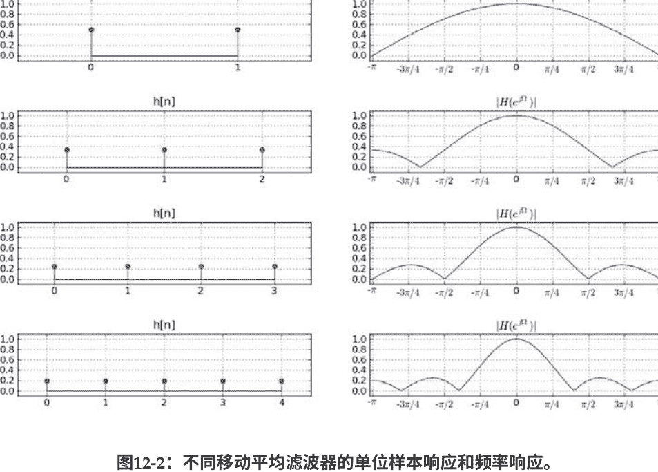

**图12-2：不同移动平均滤波器的单位样本响应和频率响应。**

与我们在示例1中特殊情况 $L=3$ 时所做的一样，我们可以检查 $H_L(\Omega)$ 的幅度和相位，重写前面的表达式会有所帮助。对于奇数 $L$，我们可以写成

$$H_L(\Omega)=\frac{1}{L}e^{-j(L-1)\Omega/2}\left(e^{j(L-1)\Omega/2}+e^{j(L-3)\Omega/2}+\cdots+e^{-j(L-1)\Omega/2}\right)$$
$$=\frac{2}{L}e^{-j(L-1)\Omega/2}\left(\frac{1}{2}+\cos(\Omega)+\cos(2\Omega)+\cdots+\cos\left(\frac{(L-1)\Omega}{2}\right)\right).$$

对于偶数 $L$，我们得到类似的表达式：

$$H_L(\Omega)=\frac{1}{L}e^{-j(L-1)\Omega/2}\left(e^{j(L-1)\Omega/2}+e^{j(L-3)\Omega/2}+\cdots+e^{-j(L-1)\Omega/2}\right)$$
$$=\frac{2}{L}e^{-j(L-1)\Omega/2}\left(\cos(\Omega/2)+\cos(3\Omega/2)+\cdots+\cos\left(\frac{(L-1)\Omega}{2}\right)\right).$$

对于偶数和奇数 $L$，括号前的单个复指数对相位有贡献 $-(L-1)\Omega/2$，但其幅度对所有 $\Omega$ 都为1。对于偶数和奇数情况，括号中的余弦和只是纯实数，并且在任何特定的 $\Omega$ 处要么是正的要么是负的，因此只对相位贡献0或$\pm\pi$。因此，频率响应的幅度，即在这些不同示例中绘制在幻灯片13.12上的幅度，只是上述表达式中给出的余弦和的幅度的总和的幅度。

**示例5（级联滤波器部分）：** 我们在示例1中看到，3点移动平均滤波器的频率响应零点为 $\Omega=\arccos(-1)=\pm 2\pi/3$。回顾一下在那里推导时，你可能会注意到一个简单的方法来调整零点的位置，允许 $h[1]$ 与 $h[0]=h[2]$ 不同。例如，取 $h[0]=h[2]=1$ $h[1]=\alpha$。然后

$$H(\Omega)=1+\alpha e^{-j\Omega}+e^{-j2\Omega}=e^{-j\Omega}(\alpha+2\cos(\Omega))$$

由此可见

$$|H(\Omega)|=|\alpha+2\cos(\Omega)|$$

这个的零点出现在 $\Omega=\pm\arccos(-\alpha/2)$。为了使零点出现在一对频率 $\Omega=\pm\phi_o$，我们会选择 $h[1]=\alpha=-2\cos(\phi_o)$。

如果我们现在级联几个这样的单零点对滤波器部分，就像在图12-3的顶部部分所示，整体频率响应就是各个部分的乘积，如方程式(12.16)所述。因此，整体频率响应将在那些任何一个单独部分具有零点对的频率处具有零点对，并且将具有组成部分的所有零点对。这在图12-3的曲线上是明显的，其中选择了零点以产生首选低频（大约在范围 $|\Omega|\leq\pi/8$）的滤波器。

# 示例6（几乎理想的低通滤波器）

图12-4显示了单位样本响应和频率响应，这是一个接近理想低通滤波器的LTI滤波器。

这样的滤波器在频带 $|\Omega|<\Omega_c$ 时应有 $H(\Omega)=1$，并且在 $\Omega_c<|\Omega|\leq\pi$ 时应有 $H(\Omega)=0$；这里 $\Omega_c$ 被称为截止频率。方程（12.18）表明相应的 $h[n]$ 必须由以下给出

$$h[n]=\frac{1}{2\pi}\int_{-\Omega_c}^{\Omega_c}e^{j\Omega n}\,d\Omega$$
$$=\begin{cases}
\dfrac{\sin(\Omega_c n)}{\pi n}, & n\neq 0\\[4pt]
\dfrac{\Omega_c}{\pi}, & n=0
\end{cases}$$

[PAGE 178]

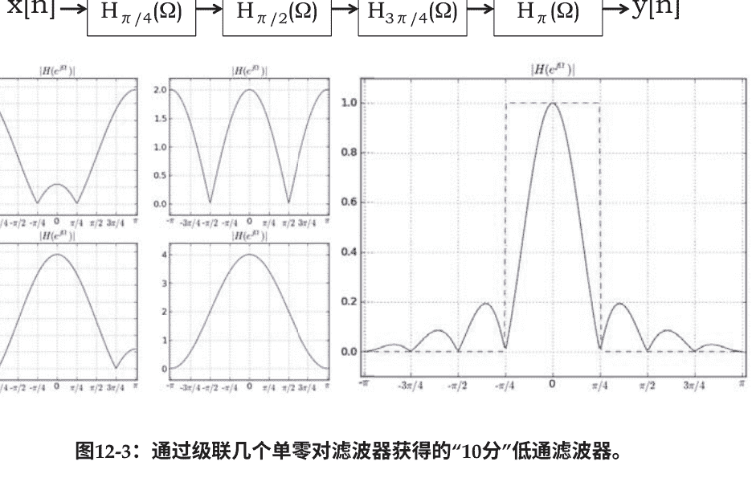

**图12-4：一个更复杂的低通滤波器，通过低频 $\leq \pi/8$ 并阻塞更高频率。**

该单位样本响应在图12-4的左曲线上绘制，对于范围从 -300 到 300 的 *n*。 *H*(*\Omega*) 是实数应该让我们意识到 $h$[-n] = $h$*[n]。 单位样本响应的缓慢衰减，以 $1/*n*$ 的速度下降，在图中清晰可见。 事实上，事实证明，理想的低通滤波器不是有界输入有界输出稳定的，因为其单位样本响应不是绝对可加的。

图12-4右侧的频率响应图实际上显示了两个不同的频率响应：一个是我们用于确定 $h$*[n] 的理想低通特性，另一个是对截断的 $h$*[n] 对应的频率响应，即对于 $|*n*| \leq 300$，使用方程（12.20）计算，对于 $|*n*| > 300$，设置 $h$*[n] = 0。 为了计算后者的频率响应，我们只需将截断的单位样本响应代入定义频率响应的表达式中，即方程（12.11）；得到的频率响应仍然是纯实数。 频率响应的图表显示，截断仍然产生接近理想的频率响应特性。 截断的 $h$*[n] 的一个问题是它对应于一个非因果系统。

为了获得因果系统，我们可以简单地将 $h$*[n] 向前移动300步。我们已经在示例2中看到，这种移动不会影响频率响应的幅度。这种移动会将相位从所有频率为0变为线性的 Ω，取值为 −300Ω。

我们在图12-5中看到了一些其他接近理想滤波器的频率响应幅度和单位样本响应。设计这些滤波器的单位样本响应的一个很好的起点是再次使用方程式（12.18）生成理想版本的滤波器。随后对应的单位样本响应的截断和时间移位产生了近似所需频率响应的因果LTI系统。

# 示例7（自回归滤波器）：图12-6显示了一些其他LTI滤波器的单位样本响应和频率响应幅度。所有这些都可以通过在时间 n 依赖于一些先前的 $y$[\cdot] 值和输入值 $x$[n] 的因果系统的输入输出行为；这些被称为自回归系统。最简单的例子是一个因果系统，其输出和输入之间有关系

$$y[n] = \lambda y[n-1] + \beta x[n] \qquad (12.20)$$

其中 $\lambda$ 和 $\beta$ 是一些常数参数。这被称为一阶自回归模型，因为 $y[n]$ 依赖于 $y$[\cdot] 的值仅仅一个时间步骤之前。与该系统相关的单位样本响应是

$$h[n] = \beta\lambda^n u[n], \qquad (12.21)$$

其中 $u[n]$ 是单位阶跃函数。为了推导出这个结果，设置 $x[n]=\delta[n]$，其中 $y[k]=0$ 对于 $k<0$，因为系统是因果的（因此在时间 k=0 之前无法区分全零输入和单位样本输入），然后使用方程 (12.20) 迭代计算 $y[n]$ 对于 $n\ge 0$。这个 $y[n]$ 将是单位采样响应，$h[n]$。

对于具有上述单位采样响应的系统来说，有界输入有界输出（BIBO）稳定，即要求 $|\lambda|<1$。如果 $0<\lambda<1$，则单位样本的形式如图12-6左上角的绘图所示。从方程（12.11）的定义中，BIBO稳定情况下的相关频率响应是

$$H(\Omega)=\beta\sum_{m=0}^{\infty}\lambda^m e^{-j\Omega m}=\frac{\beta}{1-\lambda e^{-j\Omega}}. \qquad (12.22)$$

这个的幅度是在图12-6的右上角绘制的，对于情况 $0<\lambda<1$.

[PAGE 179]

# 第12.2节 频率响应

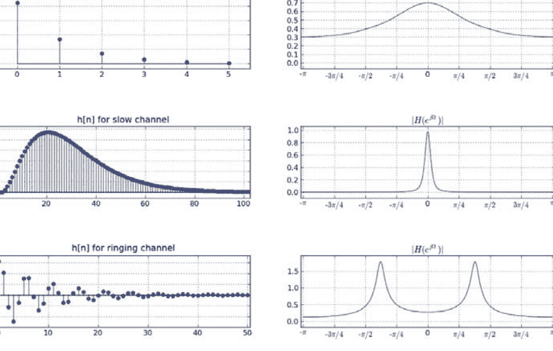

> **图12-6：** $h$[\cdot] 和一些其他有用的理想自回归滤波器的频率响应。

推导单位采样响应和频率响应的另一种方法是从频率域开始。假设方程（12.20）中的系统接收输入 $x[n]=e^{j\Omega n}$。然后，根据频率响应的定义，输出为 $y[n]=H(\Omega)e^{j\Omega n}$。将 $e^{j\Omega n}$ 代入方程（12.20）中的 $x[n]$ 和 $H(\Omega)e^{j\Omega n}$，我们得到

$$H(\Omega)e^{j\Omega n}=\lambda H(\Omega)e^{j\Omega(n-1)}+\beta e^{j\Omega n}.$$

将 $H(\Omega)$ 项移到一边并消除两边的 $e^{j\Omega n}$ 因子（我们可以这样做，因为 $e^{j\Omega n}$ 在复平面上位于单位圆上，不能等于0），我们得到

$$H(\Omega)=\frac{\beta}{1-\lambda e^{-j\Omega}}.$$

这与方程（12.22）中的答案相同。

要获得 $h$，可以展开 $\frac{\beta}{1-\lambda e^{-j\Omega}}$ 为幂级数，利用以下性质 $\frac{1}{1-z}=1+z+z^2+\ldots$。展开式的项形式为 $e^{-j\Omega},e^{-j2\Omega},e^{-j3\Omega},\ldots$，和它们的系数形成了单位采样响应序列。

无论是从时域开始，设置 $x[n]=\delta[n]$，还是从频域开始，设置 $x[n]=e^{j\Omega n}$，都取决于个人偏好和具体问题。这两种方法通常是等价的，尽管在某些情况下，一种方法可能在数学上比另一种方法更简洁。

图12-6中的另外两个系统对应于二阶自回归模型，其定义差分方程为

$$y[n]=-a_1y[n-1]-a_2y[n-2]+bx[n] \qquad (12.23)$$

其中 $a_1$、$a_2$ 和 $b$ 是一些常数。

以一个具体的例子来说，考虑输出和输入相关的系统

根据

$$y[n]=6y[n-1]-8y[n-2]+x[n]$$

(12.24)

我们想要确定 $h$[\cdot] 和 $H$(\Omega)。我们可以通过首先设置 $x[n]=\delta[n]$，找到 $h$[\cdot]”，然后应用方程式(12.11) 找到 $H$(\Omega)，或者首先计算 $H$(\Omega)”。让我们在这里考虑后一种方法。

在方程式 (12.24)中设置 $x[n]=e^{j\Omega n}$”，我们得到

$$e^{j\Omega n}H$$(\Omega)”=6e^{j\Omega(n-1)}H$$(\Omega)”-8e^{j\Omega(n-2)}H$$(\Omega)”+e^{j\Omega n}.$$

解这个方程得到 $H$(\Omega)”的结果是

$$H$$(\Omega)”=\frac{1}{(1-2e^{(-j\Omega)})(1-4e^{(-j\Omega)})}.$$

现在可以通过将 $H$” 展开为涉及各种 $e^{\wedge(-j\Omega)}$” 幂级数的项来计算 $h$”，并推导出 BIBO 稳定性的条件和 $H$”^{(\Omega)}” 为良定义的条件。

回到一般的二阶自回归模型，可以证明（类似于你可能熟悉的线性时不变微分方程分析）在这种情况下，单位采样响应的形式为

$$h$”[n)=(\beta_1\lambda^{\wedge(n-1)}+\beta_2\lambda^{\wedge(n-2)})u[n];$$

其中 $\lambda_1$” 和 $\lambda_2$” 是与该系统相关的特征多项式的根：

$$a($\lambda$)=$( \lambda $)^2+a_1\lambda+a_2$$，

和 $\beta_1”，\beta_2$” 是一些常数。图12-6的第二行图对应于 $\lambda_1$” 和 $\lambda_2$” 都是实数、正数，并且绝对值小于 1 的情况。第三行对应于这些根形成一个复共轭对， $\lambda_2$”=”$\lambda_1$”（以及相应地 $\beta_2$”=$\beta^*$”），并且其大小小于 1”，即在单位圆内的复平面上。

# 例8（反卷积再探）考虑具有单位样本响应的LTI系统

$$h_1$”[n]=\delta[n]+0.8\delta[n-1]”

来自前一章节。正如在那里所指出的，你可以将这个信道看作是理想的，这意味着除了一个一步延迟的回声之外，它的单位采样响应是 $\delta[n]”，而额外的 $0.8\delta[n-1]”则是回声的补偿。相应的频率响应是

$$H_1$$(\Omega”)=1+0.8e^{-j\Omega”}”

根据频率响应的定义（方程式12.11”），我们立即可以得到。在上一章中，我们介绍了反卷积，目的是在接收端撤销信道对输入信号 $x$[\cdot]”进行的卷积。因此，我们希望使用一个LTI反卷积滤波器，从信道的输出 $y$[\cdot]”中重构输入信号 $x$[\cdot]”，满足

[PAGE 183]

””。我们希望解卷积滤波器在每个时间n”的输出z$”[n]”等于该时间的通道输入x$”[n]$”[1]”，]。因此，通道后跟解卷积的整体单位采样响应必须为 $\delta[n]

## 致谢

我们感谢Anirudh Sivaraman提供的几条有用的评论，以及Patricia Saylor修复的一个错误。

## 问题和疑问

1. BenBitdiddle设计了一个简单的因果线性时不变系统，其单位采样响应如下：

```
h[0] = 1
h[1] = 2
h[2] = 1
h[n] = 0, ∀n > 2
```

(a) 频率响应 H(Ω) 是什么？

(b) 在 Ω = 0, π/2, π 时，H 的幅度是多少？

(c) 如果这个LTI系统被用作滤波器，那么被移除的频率集是什么？

2. 假设一个因果线性时不变（LTI）系统，其频率响应为 H，通过以下差分方程描述输入 x 和输出 y 的关系：

```
y[n] = x[n] + αx[n−1] + βx[n−2] + γx[n−3].
```

这里，α、β和γ是与Ω无关的常数。

(a) 确定α、β和γ的值，使系统H的频率响应为 H(Ω) = 1−0.5e^(−j2Ω)cosΩ。

(b) 假设y是具有频率响应H的LTI系统的输出，用作具有频率响应G的第二个因果LTI系统的输入，产生如下所示的W。

(c) 如果 H(e^{jΩ}) = 1−0.5e^{−j2Ω}cosΩ，那么频率响应G应该是什么，以使 w[n] = x[n] 对于所有n成立？

(d) 假设α = 1和γ = 1，在上述方程中，H具有与上面(a)部分所得的不同的频率响应。对于这个不同的H，你被告知当 x[n] = 1 时，y[n] = A(−1)^n，并且对于所有n，x[n] = 1.0 + 0.5(−1)^n。利用这些信息，确定方程(12.26)中的值和y[n]公式中A的值。

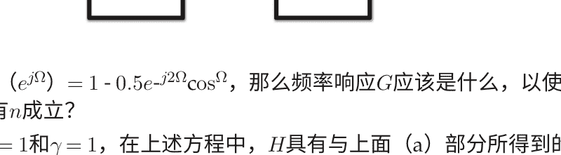

3. 考虑一个输入信号为$x[n]$，输出信号为$y[n]$，单位样本响应的线性时不变滤波器

```
$$h[n]=a\delta[n]+b\delta[n-1]+b\delta[n-2]+a\delta[n-3],$$
```

其中$a$和$b$是正参数，满足$b>a>0$。因此h[0]=h[3]=a，h[1]=h[2]=b，而h[n]在其他时间都为0。你在这个问题中的答案应该是关于$a$和$b$的。

(a) 确定滤波器的频率响应$H(\Omega)$。

(b) 假设$x[n]=(-1)^n$对于所有整数$n$从$-\infty$到$\infty$。使用上面第(a)部分中的$H(\Omega)$表达式来确定所有时间$n$的$y[n]$。

(c) 作为对第（a）部分答案的时域检查，使用卷积来确定当$x[n]=(-1)^n$对于所有整数$n$从$-\infty$到$\infty$时，$y[5]$和$y[6]$的值。

(d) 你在第（a）部分找到的频率响应$H(\Omega)=|H(\Omega)|e^{j\angle H(\Omega)}$可以写成以下形式
$$H(\Omega)=G(\Omega)e^{-j3\Omega/2},$$
其中$G(\Omega)$是$\Omega$的实函数，可以是正数或负数，取决于$a、b$和$\Omega$的值。确定$G(\Omega)$，并以清晰表达它是$\Omega$的实函数的形式写出。

(e) 假设滤波器的输入是$x[n]=(t-1)^n+\cos(t^\pi n+\theta_0)$对于$n$从$-\infty$到$\infty$，其中$\theta_0$是某个常数。**使用频率响应$H(\Omega)$来确定滤波器的输出$y[n]$（用$a、b$和$\theta_0$表示）。**根据你解决问题的方式，回忆一下可能会有帮助
$\cos(\pi/4)=1/\sqrt{2}$和$\cos(3\pi/4)=-1/2$。还要记住我们的假设，即$b>a>0$。

4。考虑以下三个频率响应的幅度图，$|H_I(e^{j\Omega})|$，$|H_{II}(e^{j\Omega})|$和$|H_{III}(e^{j\Omega})|$，如图12-8所示。

假设一个线性时不变系统的频率响应$H_{-A}(e^{\Lambda j\Omega})$由公式给出

```
$$H_{-A}(e^{\Lambda j\Omega})=\left(\frac{1}{\left(1-0.95e^{-j(\Omega-\pi/2)}\right)\left(1-0.95e^{-j(\Omega+\pi/2)}\right)}\right)$$
```

(a) 哪个频率响应图(I、II或III)最符合上述$H_{-A}(e^{\Lambda j\Omega})$？
在你选择的图中，$M$的数值是多少？

(b) 对于差分方程描述的系统，当$a_{-1}$和$a_{-2}$取什么值时，其频率响应为上述$H_{-A}(e^{\Lambda j\Omega})$？
$$y[n]+a_{-1}y[n-1]+a_{-2}y[n-2]=x[n]$$
上述差分方程描述的系统的频率响应为$H_{-A}(e^{\Lambda j\Omega})$吗？

5. 假设线性时不变系统的输入是序列

```
$$x[n]=2+\cos\frac{5\pi}{6}n+\cos\frac{\pi}{6}n+3(-1)^n$$
```

+   (a) 这个序列 \(x\) 的最大值是多少？ \(x\) 达到最大值的最小正值是多少？

(b) 假设上述序列 \(x\) 是一个线性时不变系统的输入，该系统由图12-8中的三个频率响应图之一描述。如果 \(y\) 是结果输出，并且由以下公式给出

```
$$y[n] = 8 + 12(-1)^n,$$
```

哪个频率响应图最能描述该系统？ 在你选择的图中，\(M\) 的值是多少？

6. 假设LTI系统的单位样本响应只有三个非零实值， \(h[0]\)，\(h[1]\)和\(h[2]\)。此外，假设这三个实值满足以下三个方程：

```
$$h[0] + h[1] + h[2] = 5$$
$$h[0] + h[1]e^{-j\pi/2} + h[2]e^{-j2\pi/2} = 0$$
$$h[0] + h[1]e^{j\pi/2} + h[2]e^{j2\pi/2} = 0$$
```

+   (a) 通过直观观察，不需要进行任何代数运算，你应该能够写出一些频率响应 \(H(\Omega)\) 对应的频率。 这些频率是什么？ 在这些频率上 \(H\) 的值是多少？

[PAGE 187]
(b) 在图12-8中，上述哪个图（I、II或III）是该系统频率响应的幅度图，你选择的图中 M 的值是多少？请确保你选择的图和计算 M 的方法是合理的。（c）假设这个LTI系统的输入是

$x[n]=e^{j\pi/6\,n}$.

什么是y的值？$y[n]/x[n]$?

# 7.具有回声的信道可以表示为具有单位采样响应的LTI系统：

$h[n]=a\delta[n-M]+b\delta[n-M-kN_b],$

其中，$a$是一个正实数常量，$M$是信道延迟，$k$是大于0的整数，$N_b$是每比特的采样数，$M+kN_b$是回声延迟。

+   (a) 推导出该信道的频率响应表达式 $H(\Omega)$，作为 $a,b,M,k$和$N_b$的函数。

(b) 如果 $b=-a,k=1$，且 $N_b=4$，在 $\Omega\in[-\pi,+\pi]$ 的范围内找到使 $H(\Omega)=0$ 的值。

(c) 对于 $b=-a,M=4$，以及 $kN_b=12$，推导出输入为 $x[n]$ 时通道的输出表达式（时间序列 $y[n]$）。

+   ii. $x[n]=2\cos(\pi n)$，对于所有的 $n$。

iii. 对于 $x[n]=3\sin(\pi n+\frac{\pi}{8})$，对乎所有的 $n$，推导出 $y[n]$。

# 8.一条有线信道的单位采样响应 $h_1[n]=e^{-an}$，当 $n\geq0$ 时，否则为 0，其中 $a>0$ 是一个实数。（顺便说一下，$a=T_s/\tau$，其中 $T_s$ 是采样率，$\tau$ 是导线的时间常数。无论输入变化多快，导线的电阻和电容都会阻止快速变化。我们用指数单位采样响应 $e^{-an}$ 来捕捉这种时间上的衰减。）最近在 WireSpeed 公司找到工作的 MIT 学生 Ben Bit diddle 正试图说服他的经理，通过在这条有线信道上放置一个具有单位采样响应的滤波器，可以显著提高信号传输速度（从而更快地传输比特）。

$h_2[n]=A\delta[n]+B\delta[n-D],$

在接收端，以便

$(h_1*h_2)[n]=\delta[n].$

+   (a) 推导满足本的 $A,B$和 $D$的值。

(b) 绘制 $H_2(\Omega)$ 的频率响应，并标记在 0 和 $\pm\pi$ 处的值。

(c) 假设 $a=0.1$。那么，$H_2(\Omega)$ 是否表现得像 (1) 低通滤波器，(2) 高通滤波器，(3) 全通滤波器？解释你的答案。

(d) 在什么噪声条件下，本的想法能够正常工作？ 对你的答案给出简要的、定性的解释；这里不需要计算任何东西。

[PAGE 188]

麻省理工学院开放式课程
http://ocw.mit.edu

# 6.02电子工程与计算机科学II：数字通信系统

2012年秋季

有关引用这些材料或我们的使用条款的信息，请访问：http://ocw.mit.edu/terms。

[PAGE 189]

MIT6.02草稿讲义
最后更新日期：2012年11月3日

# 第13章
信号的傅里叶分析和频谱表示

我们在前一章中已经看到，LTI系统对正弦或复指数输入信号的作用可以有效地通过系统的频率响应 $H(\Omega)$ 来表示。通过叠加，使用频率响应可以轻松确定LTI系统对正弦波或复指数的加权线性组合的作用（如前一章的示例3所示）。现在的自然问题是：有多大类的信号可以用这种方式表示。对于大多数你可能感兴趣的信号，将信号分解为正弦波或复指数的加权和的工具是傅里叶分析。我们首先讨论离散时间傅里叶变换（DTFT），这实际上已经有一些线索，并适用于最一般的信号类别。然后我们转向离散时间傅里叶级数（DTFS），它为周期信号的特殊情况或有限持续时间的信号构建了类似的表示。DTFT的发展为更特殊的DTFS发展提供了一些有用的背景、上下文和直观理解，但在初次阅读时可以略过（即理解发展的逻辑流程，但不要过于纠结于数学细节）。

# 13.1 离散时间傅里叶变换

实际上，在前一章中我们已经推导出了一个具有我们所寻找的特点的表达式。回想一下，我们得到了以下单位样本响应的表示形式 $h[n]$ ofan LTI系统：

```
$$h[n]=\frac{1}{2\pi}\int_{<2\pi>} H(\Omega)e^{j\Omega n}\,d\Omega,\qquad (13.1)$$
```

[PAGE 191]

其中频率响应，$H(\Omega)$，被定义为

```
$$H(\Omega)=\sum_{m=-\infty}^{\infty} h[m]e^{-j\Omega m}.\qquad (13.2)$$
```

方程（13.1）可以解释为通过一系列指数的加权组合来表示信号 $h[n]$，形式为 $e^{j\Omega n}$，其中频率 $\Omega$ 在一个 $2\pi$ 范围内，并且相关的权重 $H(\Omega)\,d\Omega$。

就这些表达式而言，信号 $h[n]$ 是相当任意的；我们考虑它作为系统的单位样本响应只是偶然的。我们只需要它是一个使得方程（13.2）右侧的无限和有定义的信号。因此，我们将前面的方程用更中性的符号表示，使用 $X(\Omega)$ 代替 $h[n]$：

```
$$x[n]=\frac{1}{2\pi}\int_{\langle 2\pi\rangle} X(\Omega)e^{j\Omega n}\,d\Omega,\qquad (13.3)$$
```

其中 $X(\Omega)$ 的定义为

```
$$X(\Omega)=\sum_{m=-\infty}^{\infty} x[m]e^{-j\Omega m}.\qquad (13.4)$$
```

**对于一般的信号 $x[\cdot]$，我们将 $X(\Omega)$ 称为离散时间傅里叶变换（DTFT）；不再有频率响应的概念。即使信号是实数，DTFT在每个 $\Omega$ 处通常也是复数。**

DTFT综合方程（方程13.3）显示了如何将 $x$ 表示为连续指数的加权组合，形式为 $e^{j\Omega n}$，其中频率 $\Omega$ 在 $2\pi$ 范围内，相关权重为 $X(\Omega)d\Omega$。从现在开始，除非另有说明，我们将 $\Omega$ 限定在范围 $[-\pi,\pi]$ 内。

DTFT分析方程（方程13.4）显示了如何确定权重。我们还将 $X(\Omega)$ 称为频谱或频谱分布或频谱内容。

例1（单位样本函数的频谱）考虑信号 $x[n]=\delta[n]$，即单位样本函数。根据方程（13.4）的定义，频谱分布为 $X(\Omega)=1$，因为对于所有 $n$，$x[n]=0$，且 $x[0]=1$。频谱分布在整个频率范围 $[-\pi,\pi]$ 上都保持为常数1。这意味着在 $2\pi$ 范围内的所有频率上添加相等数量的复指数才能合成单位样本函数，这可能是一个令人惊讶的结果。这里发生的是，在时间 $n=0$ 时，所有复指数互相增强，但在其他每个时间点上互相抵消。

例子2（相位重要）：如果 $X(\Omega)$ 的幅度与前面的例子中相同，即 $|X(\Omega)|=1$，但具有非零相位特性，即 $\angle X(\Omega)=-\alpha\Omega$，其中 $\alpha=0$？这个相位特性在 $\Omega$ 上是线性的。有了这个，

```
$$X(\Omega)=1\cdot e^{-j\alpha\Omega}=e^{-j\alpha\Omega}.$$## 13.2 离散时间傅里叶级数

然而，我们也知道，该项 \(H(\Omega)X(\Omega)\) 在这个表达式中乘以复指数的术语必须是 \(y[\cdot]\) 的 DTFT，所以

$$Y(\Omega)=H(\Omega)X(\Omega).\qquad (13.7)$$

因此，时域卷积关系 \(y[n]=(h\star x)[n]\) 在频域中被简化为一个简单的乘法。这是我们在前一章中看到的一个结果，当讨论两个线性时不变系统的级联组合的频率响应时：时域中的关系 \(h[n]=(h_1\star h_2)[n]\) 在频域中映射为一个整体的频率响应 \(H(\Omega)=H_1(\Omega)H_2(\Omega)\)，它只是各个频率响应的乘积。这是频域分析的一个重要原因；时间域中复杂的卷积运算被频域中的乘法所取代。

### ■ 13.2.1 合成方程

方程 (13.3) 中的DTFT合成表达式表示为复指数的加权和，涉及到\([ -\pi,\ \pi ]\)范围内的所有频率\(\Omega\)。现在假设 \(x[n]\) 是一个周期信号，周期为 \(P\)，所以

$$x[n+P]=x[n]$$

对于所有的 \(n\)。这个信号完全由它在一个周期内取的 \(P\) 个值来确定，例如 \(x[0],\ x[1],\ \ldots,\ x[P-1]\)。在这种情况下，似乎我们可以通过在区间 \([0,\ P-1]\) 上使用更少的复指数来构造 \(x[n]\)，从而对于所有的 \(n\)。离散时间傅里叶级数（DTFS）表明确实如此。

在我们写下DTFS之前，有一些安慰的话是必要的。下面的表达式可能一开始看起来有些令人困惑，有很多符号和下标，但是一旦我们对这些表达式的含义感到舒适，并以不同的方式进行解释，并进行一些例子，它们就变得非常简单明了。

所以如果你在第一遍阅读材料时没有完全理解，不要担心——给自己一些时间和几次访问来适应它！

任何 \(P\)周期信号 \(x[n]\) 都可以表示（或合成）为 \(P\)个复指数的加权线性组合，其中指数的频率均匀分布在区间 \([ -\pi,\ \pi ]\) 中，从频率 \(\Omega_0=0\)开始，并以步长 \(\Omega_1=2\pi/P\)向外递增。

更具体地说，该论断是任何 \(P\)周期的DT信号 \(x[n]\) 都可以用以下形式表示

$$x[n]=\sum_{k=\langle P\rangle}A_k e^{j\Omega_k n},\qquad (13.8)$$

我们将 \(k=\langle P\rangle\) 表示为 \(k\) 在任意一组 \(P\) 个连续整数上运行。在这个表达式中，傅里叶级数系数或谱权重 \(A_k\) 是一般的复数，谱频率 \(\Omega_k\) 由以下定义

\[
\Omega_k = k\Omega_1,\quad \text{其中}\ \Omega_1=\frac{2\pi}{P}。
\]
(13.9)

我们将 \(\Omega_1\) 称为周期信号的基本频率，将 \(\Omega_k\) 称为第 \(k\) 个谐波。注意 \(\Omega_0=0\)。

请注意，方程 (13.8) 右侧的表达式确实在每 \(P\) 个时间步骤中周期性地重复，因为其中的每个指数项

\[
e^{j\Omega_k n}=e^{jk\Omega_1 n}=e^{jkn(2\pi/P)}=\cos\left(k\frac{2\pi}{P}n\right)+j\sin\left(k\frac{2\pi}{P}n\right)
\]
(13.10)

当 \(P\) 的整数倍改变时，\(n\) 的变化导致 \(P\) 的重复。

改变频率索引 \(k\) 为 \(P\) 或者更一般地为 \(P\) 的任何正负整数倍——将方程中的指数项带回到单位圆上的同一点，因为相应的频率 \(\Omega_k\) 已经改变了 \(2\pi\) 的整数倍。这就是为什么在 DTFS 表示中选择 \(k=\langle P\rangle\) 就足够了。

将所有这些放在一起，可以得出结论，用于合成通过 DTFS 的周期信号 \(x[n]\) 的复指数的频率均匀分布在区间 \([-\pi,\pi]\) 中，从中间的频率 \(\Omega_0=0\) 开始，向外逐渐增加，步长为 \(\Omega_1=2\pi/P\)。对于偶数值的 \(P\)（如图13-1 左侧 \(P=6\)），端点频率为 \(\pm\pi\)；对于奇数值的 \(P\)（如图13-1 右侧 \(P=3\)），端点为 \(\pm(\pi-\Omega_1/2)\)。

权重 \({A_k}\) 共同构成周期信号的频谱，并且我们通常将它们作为频率索引 \(k\) 的函数绘制，如图13-2所示的频谱。

### 图13-1：当 P 为偶数时，端点频率在 ±π 处，Ω_k 的值如左侧图片所示（P=6）；当 P 为奇数时，端点频率在 ±(π-Ω_1/2) 处，如右侧图片所示（P=3）。

### 图13-2：两个周期信号的频谱，分别绘制为频率索引 \|k\| 的实部和虚部。 $P=11$（奇数）。

在这些简单的正弦波示例中，权重是通过检查欧拉恒等式的直接应用来确定的。接下来，我们将转向一种更一般和系统的方法来确定任意实数 $P$ 周期信号的频谱。

### 分析方程

现在我们来计算 $P$ 周期信号 $x[n]$ 的频谱，即确定傅里叶系数 $A_k$。首先注意，$\{A_k\}$ 包含了 $P$ 个系数，一般来说可以是复数，因此我们原则上有 $2P$ 个实数可以选择，以匹配 $P$ 周期实数信号 $x[n]$ 在一个周期内的实际值。因此，似乎我们有足够的自由度来选择傅里叶系数以匹配 $P$ 周期实数信号。（如果信号 $x[n]$ 是任意复数 $P$ 周期信号，因此由 $2P$ 个实数指定，我们将恰好有正确的自由度。）

事实证明，对于一个实信号 $x[n]$，傅里叶系数满足一定的对称性质，从而减少了我们的自由度。

我们可以证明 \(A[k] = A^*[-k]\),

这也意味着 \(A[0]\) 是纯实数，并且在偶数 \(P\) 的情况下，\(A[P/2] = A[-P/2]\) 也是纯实数。（这些性质应该让你想起我们在前一章中介绍的频率响应的对称性质，因为 DTFS 是一种类似的对象。）现在仔细计算实际的自由度，我们发现，为了指定一个实 \(P\) 周期信号的频谱 \(\{A[k]\}\)，需要精确地 \(P\) 个实参数。因此，给定 \(x[n]\) 在一个周期内的 \(P\) 个实值，我们预计方程（13.8）将给出我们 \(P\) 个未知数的 \(P\) 个方程。（对于复杂信号的情况，我们将得到 \(2P\) 个方程和 \(2P\) 个未知数。）

为了确定方程（13.8）中表达式中的第 \(m\) 个傅里叶系数 \(A_m\)，其中 \(m\) 是 \(k\) 可以取的值之一，我们首先将方程（13.8）两边乘以 \(e^{-j\Omega_m n}\)，并对 \(n\) 的 \(P\) 个连续值求和。这导致了相等关系

$$\sum_{n=\langle P \rangle} x[n]e^{-j\Omega_m n}
= \sum_{n=\langle P \rangle}\sum_{k=\langle P \rangle} A_k e^{j(\Omega_k-\Omega_m)n}
= \sum_{k=\langle P \rangle} A_k \sum_{n=\langle P \rangle} e^{j\Omega_1(k-m)n}
= \sum_{k=\langle P \rangle} A_k \sum_{n=\langle P \rangle} e^{j2\pi (k-m)n/P}.$$

最后一个相等关系中对 \(n\) 的求和涉及对 \(P\) 个连续项的几何级数求和。利用 \(r=1\) 的事实

$$1 + r + r^2 + \cdots + r^{P-1} = \frac{1-r^P}{1-r},$$

不难证明上述对 \(n\) 的求和在 \(k\ne m\) 的情况下等于0。唯一使得对 \(n\) 的求和保留的 \(k\) 值是 \(k=m\) 的情况，此时求和中的每一项都变为1，总和等于 \(P\)。因此，我们得到

$$\sum_{n=\langle P \rangle} x[n]e^{-j\Omega_m n} = A_m P$$

或者，重新排列并回到写作 \(k\) 而不是 \(m\)，

$$A_k = \frac{1}{P}\sum_{n=\langle P \rangle} x[n]e^{-j\Omega_k n}.$$

这个 DTFS 分析方程——无论 \(x[n]\) 是实数还是复数——看起来非常类似于 DTFS 合成方程，方程（13.8），除了 \(e^{-j\Omega_k n}\) 替换 \(e^{j\Omega_k n}\)，并且通过 \(P\) 进行缩放。

从分析公式直接得出的两个特定观察结果：

$$A_0=\frac{1}{P}\sum_{n=\langle P\rangle}x[n],\qquad (13.13)$$

对于偶数 $P$ 的情况，其中 $\Omega_{P/2}=\pi$,

$$A_{P/2}=A_{-P/2}=\frac{1}{P}\sum_{n=\langle P\rangle}(-1)^n x[n].\qquad (13.14)$$

我们之前在实信号的情况下所述的 $A_k$ 的对称性质直接来自于这个分析方程，留给你来验证。此外，由于 $A_{-k}=A_k^*$ 对于实信号，我们可以将这些项组合在一起

$$A_k e^{-j\Omega_k n}+A_k e^{j\Omega_k n}$$

成为单个项

$$2|A_k|\cos(\Omega_k n+\angle A_k)。$$

$$x[n]=A_0+\sum_{k=1}^{P/2}2|A_k|\cos(\Omega_k n+\angle A_k),$$

当 $P$ 是奇数时，唯一的变化是上限变为 $(P-1)/2$。

### 无周期极限，$P\to\infty$

有一种稍微修改的形式，DTFS有时被写成：

$$x[n]=\frac{1}{P}\sum_{k=\langle P\rangle}X_k e^{j\Omega_k n},\qquad (13.15)$$

这只是对我们迄今为止使用的 $A_k$ 的缩放版本进行工作的对应。

$$X_k=PA_k=\sum_{n=\langle P\rangle}x[n]e^{-j\Omega_k n}.\qquad (13.16)$$

当考虑到无周期信号的极限情况时，通过让 $P\to\infty$，$(2\pi/P)\to d\Omega$，$\Omega_k\to\Omega$，可以得出DTFS的这种形式很有用。在这种极限情况下，可以从方程(13.12)中轻松推出 $X_k\to X(\Omega)$，正是我们在方程(13.4)中定义的无周期信号的DTFT。相应地，在这种极限情况下，DTFS合成方程(13.8)恰好变为方程(13.3)中的表达式。

### LTI系统对周期输入的作用

假设输入信号 $x[\cdot]$ 到一个具有频率响应 $H(\Omega)$ 的 LTI 系统是 $P$ 周期性的。这个信号可以用指数的加权和表示，由方程中的DTFS给出

（13.8）。立即得出系统的输出为

$$y[n] = \sum_{k=\langle P\rangle} H(\Omega_k)A_ke^{j\Omega_k n} = \frac{1}{P}\sum_{k=\langle P\rangle} H(\Omega_k)X_ke^{j\Omega_k n}.$$

这立即表明输出信号 $y[\cdot]$ 再次是 $P$ 周期性的，其（缩放的）频谱系数由以下给出

$$Y_k = H(\Omega_k)X_k.$$  (13.17)

因此，对输入频谱和系统的频率响应的了解足以确定输出频谱。这正是方程（13.7）中DTFT结果的DTFS版本。

作为对该结果应用的一个示例，图13-3展示了当周期信号通过理想低通滤波器时会发生什么情况，其中 $H(\Omega)=1$ 仅在 $|\Omega|<\Omega_c<\pi$ 时成立，而在 $[-\pi,\pi]$ 范围内的其他地方 $H(\Omega)=0$ 。结果是，所有超过截止频率 $\Omega_c$ 的输入信号的频谱分量都不再出现在输出中。因此，相应的输出信号变化较慢，是输入信号的“模糊”版本，因为它没有允许其快速变化的高频分量。

### 将 DTFS 应用于有限持续信号

DTFS在不涉及周期信号而是有限持续信号的设置中证明是有用的。假设一个信号 $x[n]$ 仅在某个有限区间上取非零值，例如 $[0, P-1]$。我们并不禁止 $x[n]$ 在该区间内取值为0，但是我们说在该区间之外的所有 $n$ 上 $x[n]=0$。如果我们现在根据方程(13.4)的定义计算该信号的DT Fourier变换，我们得到

$$X(\Omega)=\sum_{n=0}^{P-1}x[n]e^{-j\Omega n}.\qquad (13.18)$$

对应的表示为 $x[n]$ 通过复指数的加权组合得到，这可以在方程（13.3）中表示，涉及到一个连续的频率。然而，通过使用DTFourier级数，可以得到更经济的表示 $x[n]$。

为了做到这一点，考虑新的信号 $x_P[\cdot]$，它是通过取 $x[\cdot]$ 在区间 $[0,P-1]$ 内的部分，并在该区间之外周期性地复制得到的，周期为 $P$。这导致 $x_P[n+P]=x_P[n]$ 对于所有的 $n$ 成立，其中 $x_P[n]=x[n]$ 对于在区间 $[0,P-1]$ 内的 $n$ 成立。我们可以通过其DTFS来表示这个周期信号：

$$x_P[n]=\frac{1}{P}\sum_{k=<P>}X_ke^{j\Omega_k n},\qquad (13.19)$$

其中

$$X_k=\sum_{n=<P>}x_P[n]e^{-j\Omega_k n}=\sum_{n=0}^{P-1}x[n]e^{-j\Omega_k n}.\qquad (13.20)$$

（为了保持一致性，也许我们应该使用记号 $X_{Pk}$ 而不是 $X_k$，但我们试图保持我们的记号简洁。）

现在，我们可以用方程（13.19）中的表达式表示 $x[n]$，而不是在频率连续的情况下使用复指数。这个表达式只涉及到我们之前定义的频率 $\Omega_k$ 的复指数。然而，这个表示仅仅捕捉到了 $[0,P-1]$ 区间内的 $x[n]$。在这个区间之外，我们必须忽略这个表达式，而是利用我们知道 $x[n]$ 在外部实际上是0的知识。

从方程（13.18）和（13.20）中可以得出另一个值得注意的观察结果，即（缩放的）DTFS系数 $X_k$ 实际上与有限持续信号的DTFT $X(\Omega)$ 有简单的关系，即：

$$X_k=X(\Omega_k),\qquad (13.21)$$

因此，（缩放的）DTFS系数 $X_k$ 只是DTFT $X(\Omega)$ 的 $P$ 个样本之一。因此，任何计算（有限持续信号的周期扩展的）DTFS的方法都将产生这个有限持续信号的DTFT的样本（请注意我们在这里使用DTFS和DTFT的区别！）。如果想要在更多的样本点上评估这个有限持续信号的DTFT，只需要将 $x[n]$ 视为在一个更大的区间上的有限持续信号，该区间的长度为 $P'>P$，并且额外的信号值都为0；这被称为零填充。然后，计算这个更长区间上（周期扩展的）$x[n]$ 的DTFS将产生 $P'$ 个样本。

### 快速傅里叶变换

根据之前的定义，实现DTFS合成计算或DTFS分析计算似乎需要大约$P^2$个乘法/加法操作：我们必须为每个频率做$P$次乘法/加法。这可能很快导致在大问题中计算成本过高。

令人高兴的是，在1965年，库利和图弟发表了一种快速计算这些DTFS表达式的方法（重新发现了高斯已知的技术！）。他们的算法被称为快速傅里叶变换（FFT），并且需要大约$P\log P$次操作，这是一个很大的节省。（请注意，快速傅里叶变换并不是一种新的变换，尽管它的名字是这样！它是一种用于计算熟悉的变换，即DTFS的快速算法。）

FFT已成为实际数值计算的工作马（或者可能是唯一的工作马）。它最常见的应用是计算有限持续信号的DTFT样本，如前一小节所述。当然，它也可以应用于计算周期信号的DTFS。

### 致谢

感谢PatriciaSaylor、KaiyingLiao和MichaelSanders修复错误。

### 问题和疑问

+   1. 设$x[\cdot]$为周期为$P=12$的信号。对于以下每个$x[\cdot]$，给出离散时间傅里叶级数的相应谱系数$A_k$，其中$k$的范围为$-6\leq k\leq 6$。（提示：在以下大多数情况下，你只需要将信号表示为适当复指数的和。）

## 检查
## 确定当 $x[0:11]=[0,0,1]$ 时的 $A_k$。
## 确定当 $x[n]=1$ 对于所有 $n$ 时的 $A_k$。
## 确定当 $x[n]=\sin(r(2\pi/12)n)$ 时的 $A_k$，其中 $r$ 有以下两个选择：
## i. $r=3$；和
## ii. $r=8$。
## d. 确定当 $x[n]=\sin(3(2\pi/12)n+\phi)$ 时的 $A_k$，其中 $\phi$ 是某个指定的相位偏移。
## 2. 考虑一个低通 LTI 通信信道，输入为 $x[n]$，输出为 $y[n]$，频率响应由 $H(\Omega)$ 给出
## $H(\Omega) = e^{-j3\Omega},\quad 当\ 0\le |\Omega| < \Omega_m\ 时$
## $=0,\quad 当\Omega_m \le |\Omega| \le \pi\ 时$
## 这里 $Ω_m$ 表示信道的截止频率；输出 $y[n]$ 在 $Ω_m\le|\Omega|\le\pi$ 的频率范围内不包含任何频率分量。这个问题的不同部分涉及对 $Ω_m$ 的不同选择。
## +   (a) 当 $Ω_m=\pi/4$ 时，提供频率响应的幅度 $|H(\Omega)|$ 和相位 $\angle H(\Omega)$ 的分别标记的草图，对于 $0\le|\Omega|\le\pi$。（只在 $|H(\Omega)|>0$ 的频率范围内绘制相位。）
## (b) 假设 $Ω_m=\pi$，所以 $H(\Omega)=e^{-j3\Omega}$ 对于所有 $\Omega\in[-\pi,\pi]$，即所有频率分量都通过信道。对于这种情况，$y[n]$ 可以用 $x[\cdot]$ 的简单表达式表示；找到相关的表达式。
## (c) 假设输入信道的 $x[n]$ 是一个周期性的“矩形波”信号，周期为 12。具体来说：
## $x[-1]=x[0]=x[1]=1$
## 并且这些值每 12 步重复一次，所以
## $x[11]=x[12]=x[13]=1$
## 更一般地说
## $x[12r-1]=x[12r]=x[12r+1]$
## 对于所有整数 $r$ 从负无穷到正无穷。在其他所有时间 $n$，我们有 $x[n]=0$。（你可能会发现自己画这个信号很有帮助，例如对于 $r$ 从 -2 到 13 的范围。）
## 找到这个输入 $x[n]$ 的离散时间傅里叶级数（DTFS）的显式值，即表示中的系数 $A_k$。
## $$x[n]=\sum_{k=-6}^{5}A_k e^{j\Omega_k n},$$
## 其中 $\Omega_k = k(2\pi/12)$。请记住
## $$A_k=\frac{1}{12}\sum_{\langle n\rangle}x[n]e^{-j\Omega_k n},$$
## 求和是对 $n$ 的任意 12 个连续值（如 $(n)$ 所示）进行的，因此你只需要为特定的 $x[n]$ 计算这个表达式。
## 由于 $x$ 是 $n$ 的偶函数，所以所有的 $A_k$ 应该是纯实数，请确保你对 $A_k$ 的表达清楚，它是实数。（根据你的处理方式而定，你可能会发现注意到 $e^{-j11(2\pi/12)}=e^{j(2\pi/12)}$ 是有帮助的）检查你的 $A_0$ 和 $A_{-6}=A_6$ 的值是否正确，并明确说明你是如何检查的。
## (d) 假设信道的截止频率是 $\Omega_m=\pi/4$（这是你在第 (a) 部分中绘制的情况），输入是 $x$ 的指定 (c) 部分。计算信道输出 $y$ 的所有非零 Fourier 系数的值，即找到表示中的非零数字 $B_k$ 的值
## $$y[n]=\sum_{k=-6}^{5}B_k e^{j\Omega_k n},$$
## 其中 $\Omega_k=k(2\pi/12)$。不要忘记，在滤波器的通带中，$H(\Omega)=e^{-j3\Omega}$，其中 $0\le |\Omega|<\Omega_m$。
## (e) 将 (d) 中的 $y[n]$ 表达为时间 $n$ 的显式实函数。（如果你画出 $y[n]$，你会发现它是一个低频近似，如果 $\Omega_m=\pi$，那么它将是 $y[n]$ 的近似。）
## 3。下图显示了实部和虚部的所有非零傅里叶级数系数 $X[k]$ of a real periodic discrete-time signal $x[n]$，对于频率 $\Omega_k\in[0,\pi]$。这里 $\Omega_k=k(2\pi/N)$，其中 $N$ 是一个固定的偶数，就像我们对离散时间傅里叶级数（DTFS）的所有分析一样，但下面的图只显示范围 $0\le k\le N/2$。
## (a) 在区间 $[-\pi,0)$ 中找到所有非零的傅里叶级数系数 $x[n]$ 的 $\Omega_k$，即 $-(N/2)\le k<0$。用实部和虚部的仔细标记的图形来给出你的答案（按照上图的风格）。
## (b) 找到 $x[n]$ 的周期，即对于所有 $n$，$x[n+T]=x[n]$ 的最小整数 $T$。
## !
## 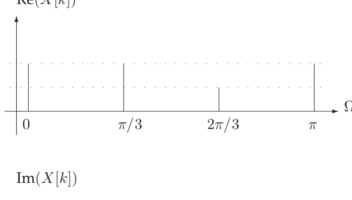
## !
## 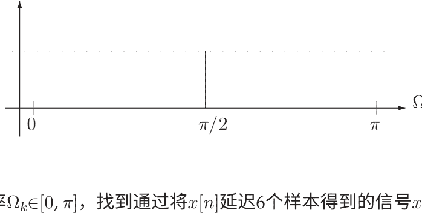
## (c) 对于频率 Ω_k ∈ [0, π]，找到通过将 x[n] 延迟 6 个样本得到的信号 x[n-6] 的所有非零傅里叶级数系数。
## +   4. 考虑一个音频通道，采样率为 8000 个样本/秒。
##   - (a) 钢琴音符 A 的角频率是多少（以弧度/样本表示），给定其连续时间频率为 880 Hz?
##   - (b) 表示音符 A 所需的最小样本数 P 是多少?
##     以整数 k 为参数，表示音符 A 所需的最小样本数 P 是多少？k 的值是多少？
## 麻省理工学院开放式课程
## http://ocw.mit.edu
## # 6.02电子工程与计算机科学II：数字通信系统
## 2012年秋季
## 有关引用这些材料或我们的使用条款的信息，请访问：http://ocw.mit.edu/terms。
## ## 第14章
## ## 调制和解调
## 本章介绍了调制和解调的基本原理，我们在第10章中简要介绍了这些原理。回顾一下，我们的目标是通过通信链路传输数据，我们通过将要传输的比特流映射到模拟信号上来实现这一目标，因为大多数通信链路在最底层只能传输模拟信号，而不能传输二进制数字。最简单、直接表示比特流的信号称为基带信号。我们在第10章中讨论了直接传输基带信号在通信链路上通常是不可行的原因。我们在第14.1节中重申并详细讨论了这些原因，并讨论了调制基带信号的动机。在第14.2节中，我们描述了许多调制方案中使用的一种基本原理，称为混频原理。这个原理是幅度调制（AM）的核心，我们将详细研究这个方案。第14.3节和第14.4节描述了从接收到的版本中恢复原始基带信号的“逆”过程，即解调。最后，第14.5节简要介绍了更复杂的调制方案。
## ## ■ 14.1 为什么要调制?
## 有两个主要的激励原因来进行调制。我们在第10章中描述了第一个原因：匹配媒介的传输特性以及对功率和天线尺寸的考虑，这些因素影响着可携带性。第二个原因是希望在许多同时活跃的用户之间进行多路复用或共享通信媒介。
## ## ■ 14.1.1 可携带性
## 移动电话和其他无线设

## 14.3.1 处理信道失真

图14-6：图14-4的频域表示，显示了实值带限制信号$x[n]$经过输入滤波产生的形状脉冲（左侧）、纯余弦正弦载波信号（中间），以及混频（混合）的基带和载波在两个频率范围上的信号，其宽度与基带信号相同，但频率上偏移了$\pm k_c$，并且每个频率范围都缩放了1/2（右侧）。我们可以通过使用与基带频率重叠的另一个信号的载波频率足够远来避免干扰。

因为在没有任何失真的情况下，它与原始（形状）基带完全相同，只是缩放了1/2。

我们如何单独恢复这个中间部分并忽略左右的聚类，这些聚类以正负方向的频率为中心，频率是载波频率的两倍？我们已经在第12章学习了一种技术：低通滤波器。

通过应用一个截止频率位于$k_x$和$2k_c-k_x$之间的低通滤波器，我们可以完整地恢复原始信号。

我们可以通过进行更加繁琐的计算得出相同的结论，类似于我们对调制所做的计算，导致方程（14.3）。让$z[n]$是通过将载波的本地副本$\cos(k_c\Omega_1 n)$与接收到的信号$r[n]=t[n]$相乘（混合）得到的信号。使用方程14.3，我们可以将$z[n]$表示为其DTFS系数如下：

$$
z[n] = t[n]\left(\frac{1}{2}e^{jk_c\Omega_1 n}+\frac{1}{2}e^{-jk_c\Omega_1 n}\right)
$$

$$
=\left(\frac{1}{2}\sum_{k=-k_x}^{k_x}A_k e^{j(k+k_c)\Omega_1 n}+\frac{1}{2}\sum_{k=-k_x}^{k_x}A_k e^{j(k-k_c)\Omega_1 n}\right)\left(\frac{1}{2}e^{jk_c\Omega_1 n}+\frac{1}{2}e^{-jk_c\Omega_1 n}\right)
$$

$$
=\frac{1}{4}\sum_{k=-k_x}^{k_x}A_k e^{j(k+2k_c)\Omega_1 n}+\frac{1}{2}\sum_{k=-k_x}^{k_x}A_k e^{jk\Omega_1 n}+\frac{1}{4}\sum_{k=-k_x}^{k_x}A_k e^{j(k-2k_c)\Omega_1 n}\qquad (14.4)
$$

下划线标记的中间项是我们想要提取的内容。第一项是基带信号的两倍载波频率，而第三项是基带信号的两倍载波频率的负值；解调器需要将这两项滤除。

### 14.3.1 处理信道失真

到目前为止，我们考虑的是没有信道失真或延迟的理想情况。我们现在放松这种理想化，并考虑信道失真。如果信道是LTI（这是非常……）

通常情况下，可以延伸上述方法。不同之处在于方程式（14.4）中的每个 \(A_k\) 项以及图14-7都将乘以通道的频率响应 \(H(\Omega)\)，在频率为 \(k\Omega\) 时进行评估。因此，每个DTFS系数将进一步缩放为该频率响应在相关频率上的值。

图14-8显示了现在系统的模型。调制输入 \(t[n]\) 经过通道传输到接收端的解调器。结果 \(z[n]\) 可以写成如下形式：

$$
\begin{aligned}
z[n] 
&= y[n]\cos(k_c\Omega_1 n)\\
&= y[n]\left(\frac{1}{2}e^{jk_c\Omega_1 n}+\frac{1}{2}e^{-jk_c\Omega_1 n}\right)\\
&=\left(\frac{1}{2}\sum_{k=-k_x}^{k_x}H((k+k_c)\Omega_1)A_ke^{j(k+k_c)\Omega_1 n}
+\frac{1}{2}\sum_{k=-k_x}^{k_x}H((k-k_c)\Omega_1)A_ke^{j(k-k_c)\Omega_1 n}\right)
\left(\frac{1}{2}e^{jk_c\Omega_1 n}+\frac{1}{2}e^{-jk_c\Omega_1 n}\right)\\
&=\frac{1}{4}\sum_{k=-k_x}^{k_x}A_ke^{jk\Omega_1 n}\big(H((k+k_c)\Omega_1)+H((k-k_c)\Omega_1)\big) + \\
&\quad\frac{1}{4}\sum_{k=-k_x}^{k_x}A_ke^{j(k+2k_c)\Omega_1 n}\big(H((k+k_c)\Omega_1)+H((k-k_c)\Omega_1)\big) + \\
&\quad\frac{1}{4}\sum_{k=-k_x}^{k_x}A_ke^{j(k-2k_c)\Omega_1 n}\big(H((k+k_c)\Omega_1)+H((k-k_c)\Omega_1)\big)
\end{aligned}
\tag{14.5}
$$

在方程式（14.5）的右手边的这三个项中，第一个项包含我们想要提取的基带信号。我们可以通过应用低通滤波器来消除±2\(k_c\)分量。然后，为了恢复每个 \(A_k\)，我们需要将低通滤波器的输出传递给另一个LTI滤波器，该滤波器通过乘以逆 \(H((k+k_c)\Omega_1)+H((k-k_c)\Omega_1)\) 来撤消失真。然而，这样做也会放大通道衰减输入信号 \(t[n]\) 的任何噪声，因此在这些频率上省略反转是更好的解决方案。

为了使这个过程正常工作，信道必须相对低噪声，并且接收器需要知道方程（14.5）中感兴趣的所有频率的频率响应 \(H(\Omega)\)。即，在范围 \([-k_c-k_x,-k_c+k_x]\) 和 \([k_c-k_x,k_c+k_x]\) 内。估计 \(H(\Omega)\) 的一种常见方法是在每个数据包（或帧）的开头发送一个已知的前导码。

传输的一部分。接收器寻找这个已知的前导码来同步接收的开始，并且因为传输的信号模式是已知的，接收器可以从中推断出信道的单位采样响应，使用类似于第11章中概述的方法。然后可以应用第12章中的频率响应方程（2.2）来估计 \(H(\Omega)\)，并使用它来近似地消除信道引入的失真。

然而，我们的兴趣不在于准确地恢复 \(x[n]\)，而是在于底层的比特流。对于这个任务，通常不需要进行逆滤波操作。相反，我们需要一种在比特率处获得的信号，使得可以可靠地对对应的比特进行决策，尽管存在噪声。这个任务的最佳滤波器被称为匹配滤波器。关于匹配滤波器的讨论留给更高级的通信课程。

## 14.4 处理信道延迟：正交解调

现在我们转向发送方和接收方之间的信道延迟情况。这种延迟在解调中很重要，因为我们迄今为止假设发送方和接收方之间没有相位差。当然，这个假设是不正确的，需要以某种方式考虑相位延迟。

让我们首先考虑一个说明性的情况，即发送方之间存在相位误差。

和接收方。然后我们将展示信道上的非零延迟可以被精确地建模为相位误差。通过“相位误差”，我们指的是解调器不是乘以 $\cos(k_c\Omega_1 n)$ 进行混频，而是乘以 $\cos(k_c\Omega_1 n-\varphi)$，其中 $\varphi$ 是某个常数值。让我们了解在这种情况下解调输出会发生什么。

通过解方程，我们可以写成

$$
z[n] \;=\; t[n]\cos(k_c\Omega_1 n-\varphi) \\
\;=\; x[n]\cos(k_c\Omega_1 n)\cos(k_c\Omega_1 n-\varphi)
$$

(14.6)

但是需要注意的是

$$
\cos(k_c\Omega_1 n)\cos(k_c\Omega_1 n-\varphi)
= \frac{1}{2}\left(\cos(2k_c\Omega_1 n-\varphi)+\cos\varphi\right),
$$

由此可知，经过合适增益的低通滤波后，解调输出为

$$
y[n]=x[n]\cos\varphi.
$$

因此，相位误差为 $\varphi$ 弧度会导致解调幅度被 $\cos\varphi$ 缩放。这种缩放是有问题的：如果我们不幸地使误差接近 $\pi/2$，那么几乎没有输出！而且如果 $x[n]$ 可以取正值和负值，那么 $\cos\varphi$ 变为负值会导致更多混乱。

发送方和接收方之间的信道延迟表现为相位误差，使用我们在第14.3节中介绍的解调策略。要了解原因，请考虑图14-10，在发送方和接收方之间插入了 $D$ 个样本的延迟。代数与相位误差情况非常相似：在 $D$ 个样本的采样延迟下，我们发现

$$
y[n]=x[n-D]\cos\!\big(k_c\Omega_1(n-D)\big)\cos(k_c\Omega_1 n).
$$

实际上，第一个 $\cos$ 因子看起来像是有一个相位误差 $k_c\Omega_1 D$，因此输出被 $\cos(k_c\Omega_1 D)$ 衰减。

那么我们如何对抗相位误差呢？一种方法是观察到，在 $\cos\varphi$ 为 0 的情况下，$\sin\varphi$ 接近于 1。因此，在这些情况下，通过与 $\sin(k_c\Omega_1 n)=\cos(\frac{\pi}{2}-k_c\Omega_1 n)$ 相乘（混频）在解调器上纠正相位差。请注意，然而，如果相位误差不存在，那么乘以 $\sin(k_c\Omega_1 n)$ 将……

导致无基带信号-您应该通过编写代码来验证这一事实

$z[n]=t[n]\,\sin(k_c\Omega_1 n)=t[n]\left(-\frac{j}{2}e^{jk_c\Omega_1 n}+\frac{j}{2}e^{-jk_c\Omega_1 n}\right),$

并使用其DTFS展开 $t[n]$。因此，在载波为 $\cos$ 时乘以 $\sin$ 不总是有效；只有当相位误差为幸运值（$\approx \pi/2$）时才有效。

这个观察结果为我们提供了解决这个问题的方法，称为正交解调，在图14-11中描述了通道延迟但没有通道失真的情况（因此我们可以在LPF上应用增益2而不是依赖于 $H(\Omega)$ 的因子）。这个想法是将接收到的信号乘以 $\cos(\Omega_c n)$（其中 $\Omega_c=k_c\Omega_1$ 是载波频率）和 $\sin(\Omega_c n)$。这种方法是一种“押宝”的方式：我们无法确定哪个项，cos还是sin会起作用，但我们可以确定它们不会同时为0！我们可以利用这个事实始终可靠地恢复信号，如下所述。

为了简单起见（和方便起见），假设 $x[n]\geq 0$ 始终（在输入时）。然后，使用图14-11中的符号表示法，定义 $w[n]=I[n]+jQ[n]$（I项通常称为同相项，Q项通常称为正交项）。然后，

$|w[n]|=\sqrt{(I[n])^2+(Q[n])^2}$  
$=|x[n-D]|\,\sqrt{\cos^2\theta+\sin^2\theta}$  
$=|x[n-D]|$  
$=x[n-D]\ \text{因为}\ x[n]\geq 0$

因此，正交解调器除了之前解释的无延迟情况下的步骤外，还要执行以下步骤：计算 $I[n]$ 和 $Q[n]$，并使用方程式（14.8）计算 $|w[n]|$。返回此值，并在电压水平对应于“0”和“1”的中间点处进行阈值处理（以抵抗噪声）。使用正交解调，假设发送方对于“0”发送0伏特，对于“1”发送1伏特，接收方通常会在复平面上解调出旋转的版本，如图14-12所示。

然而，幅度仍然为1，正交解调可以成功恢复输入信号。

图14-13总结了我们在本节中描述的正交解调器的各个步骤。

这就结束了我们对解调的基础知识的讨论。接下来我们简要介绍一下

## ■ 14.5 更复杂的（解）调制方案

我们通过简要概述三种更复杂的调制/解调方案来结束本章。

### ■ 14.5.1 二进制相移键控（BPSK）

在BPSK中，如图14-14所示，发射机为载波选择两个相位之一，例如“0”选择−π/2，而“1”选择π/2。发射机与正弦波进行相同的混合，如前所述。接收机从接收到的波形中计算出I和Q分量，与以前一样。这种方法“几乎”有效，但在存在信道延迟或相位误差的情况下，以前恢复输入的策略将不起作用，因为我们假设x[n]≥0。对于BPSK，x[n]要么是+1，要么是−1，在象限解调后，我们希望区分的两个级别在复平面上具有相同的幅度！

解决方案是将相位编码视为差分而不是绝对值：相位的变化对应于位值的变化。假设每个消息都以“0”位开始。然后，第一个相位变化表示0→1的转变，第二个相位变化表示1→0的转变，依此类推。使用这个想法，可以在解调器中正确恢复所有位，假设没有中间的故障（我们不会担心这样的故障，这在实践中确实会发生，并且必须加以处理）。

### ■ 14.5.2 正交相移键控（QPSK）

正交相移键控是为系统添加一种“自由度”的巧妙想法（从而提取更高的性能）。这种方法在发送器和接收器都使用了正交方案，如图14-15所示。在QPSK中，将位映射到电压值时，我们会选择这样的值，使得振幅的|x[n]|是恒定的。

此外，由于星座现在涉及四个符号，我们将每个符号映射为两个比特。

符号。因此，00可能映射为 $(A，A)$，01映射为 $(-A，A)$，11映射为 $(-A，-A)$，10映射为 $(A，-A)$（因此振幅为$2A$）。在这种映射中有一些灵活性，但它并不完全是任意的；例如，我们在这里小心地将11映射为 $(A，-A)$，而不是将00映射为 $(A，A)$。原因是任何噪声更有可能导致 $(A，A)$ 被误认为是 $(A，-A)$，而不是 $(-A，-A)$，因此我们希望尽可能少地出现符号错误。

### 14.5.3 正交幅度调制（QAM）

QAM可以被看作是QPSK的一种推广（事实上，有时候将QPSK称为QAM-4）。在星座图中选择额外的点，同时改变振幅和相位。在QAM-16中（图14-16），我们每个符号映射四个比特。更密集的QAM星座图也是可能的；现今的实际系统使用的是QAM-4（QPSK）、QAM-16和QAM-64。带有相位调整的正交解调是接收机中使用的解调方案，用于QAM。

对于给定的发射机功率，在输入端对应于不同比特的信号水平会在幅度上被挤压得更近，当使用更多点的星座图时。由于这种减小的间隔，对噪声的抵抗力也会降低，但是可以采用复杂的编码和信号处理技术来处理噪声的影响，以实现更高的通信比特率。在许多实际的通信系统中，物理层提供多种可能的星座图和编码选择；对于任何给定的信道条件（例如，如果信道使用AWGN模型进行良好描述的噪声方差），存在一种星座图、编码方案和编码速率的组合，可以最大化接收比特的速率。

在二进制相移键控（BPSK）中，消息比特选择其中之一载波的两个相位，例如，0 的时候为 π/2，1 的时候为 -π/2。

图14-14：二进制相移键控（BPSK）

并可靠地解码。更高层的“比特率选择”协议使用有关信道质量（信噪比、分组丢失率或比特误码率）的信息来做出这个决策。

## 致谢

感谢Mike Perrot、Charlie Sodini、Vladimir Stojanovic和Jacob White的讲座，这些讲座有助于塑造本章讨论的主题，以及Ruben Madrigal和Patricia Saylor的错误修复。

图14-15：正交相移键控（QPSK）

| 符号 / 比特映射表 |  |
|---|---|
| 00 → -3A |  |
| 01 → -A |  |
| 11 → A |  |
| 10 → 3A |  |
| 格雷码（噪声移动到另一个星座点只会导致单个位错误） |  |

图14-16：正交幅度调制（QAM）

## 问题和疑问

1. 波士顿体育广播电台WEEIAM（“幅度调制”）的广播频率为850 kHz，因此其连续时间（CT）载波信号可以表示为 cos(2π × 850 × 10^3 t)，其中t以秒为单位。将调制到该载波上的CT音频信号表示为x(t)，因此广播电台传播的CT信号为

$$
y(t) = x(t) \cos(2\pi \times 850 \times 10^3 t), \qquad (14.9)
$$

如下图左侧示意所示。$y[n]=x[n]\cos(\Omega_c n) \qquad\qquad (14.10)$

对于适当选择的角频率 $\Omega_c$，假设 $x[n]$ 是周期性的，具有某个周期 $N$，并且 $f_s=2\times10^6$ 样本/秒。

回答以下问题，在提供的空间中解释你的答案。

+   1. 确定方程 (14.10) 中 $\Omega_c$ 的值，将答案限制在范围 $[-\pi,\pi]$ 内。（在接下来的内容中，你可以假设周期 $N$ 的 $x[n]$ 的 $\Omega_c=2k_c\pi/N$，其中 $k_c$ 是整数；这是一个细节，不需要过多关注。）

+   2. 假设方程 (14.10) 中 DT 信号 $x[n]$ 的傅里叶级数系数 $X[k]$ 是纯实数，并且作为 $\Omega_k=2k\pi/N$ 的函数绘制。（注意，图形并非按比例绘制。此外，$\Omega_k$ 的不同值非常接近，我们只是用直线插值相邻的 $X[k]$ 值，而不是显示离散的“柱状”图。）观察到傅里叶级数系数在 $\Omega_k\in[-0.005\pi,0.005\pi]$ 的频率范围内非零，在 $\Omega_k\in[-\pi,\pi]$ 的其他频率范围内为 0。

请绘制一个标记清晰的草图（尽管不一定按比例）来显示 DT 调制信号 $y[n]$ 的傅里叶级数系数 $Y[k]$。然而，你应该用适当的频率 $f_k$（以赫兹为单位）标记轴。

现在假设接收器检测到 CT 信号 $w(t)=10^{-3}y(t-t_0)$，其中 $t_0=3\times10^{-6}$ 秒，并且以 $f_s$ 样本/秒对该信号进行采样，从而获得

$w[n]=10^{-3}y[n-M]=10^{-3}x[n-M]\cos\left(\Omega_c(n-M)\right)\qquad (14.11)$

对于适当选择的整数$M$，

**C.** 确定方程（14.11）中$M$的值。

**D.根据第B部分的答案，确定方程（14.11）中信号$y[n-M]$的傅里叶级数系数在频率轴的哪些区间是非零的。你不需要找到实际的系数，只需要找到这些系数非零的频率范围。还要说明傅里叶系数是否为实数。解释你的答案。**

**E.** 解调步骤是从接收信号中获取DT信号$x[n-M]$，然后通过适当的低通滤波（其通带增益被选择为将信号缩放到所需的任何幅度）将$w[n]$乘以DT载波频率信号。以下六个DT载波频率信号中，你会选择哪一个来将接收信号相乘？请在你的选择上画圈，并给出简要解释。

+   i. 余弦 $\Omega_c n$。

ii. 余弦 $\left(\Omega_c(n-M)\right)$。

iii. 余弦 $\left(\Omega_c(n+M)\right)$。

iv. 正弦 $\Omega_c n$。

v. 正弦 $\left(\Omega_c(n-M)\right)$。

vi. $\sin\left(\Omega_c(n+M)\right)$。

2. 这个问题的所有部分都与图14-17中显示的调制解调系统相关，其中所有信号都是周期性的，周期为 \(P = 10000\)。请还假设与该系统相关的采样率为每秒 10000个样本，因此 $k$既是一个系数索引又是一个频率。在图中，调制频率 $k_m$为 500。

+   (a) 假设在调制/解调图中绘制的区域中，信号 $y[n]$的DFT系数如图14-17所示。

假设 $M = 0$表示 $M$个样本的延迟（无延迟），请绘制调制/解调图中信号$w$和$v$的系数。请确保标记关键特征，如峰值的值和系数索引。

+   (b) 假设信号$y$的系数与第（a）部分相同，请在调制/解调图中绘制信号$x_1$的DTFS系数。请确保标记关键特征，如峰值的值和系数索引。

(c) 如果调制/解调图中的$M$个样本延迟具有正确的延迟样本数，则通过低通滤波器几乎可以完全恢复信号$x_{20}$。确定所需的最小正延迟样本数和低通滤波器的截止频率。

解释你的答案，如果可能的话，使用图片。

3. 图14-18显示了一个标准的调制/解调方案，其中 $N = 100$。

(a) 图14-19显示了输入信号 $x[n]$ 的图形。请绘制近似的时域波形 $y[n]$，即解调器中低通滤波器的输入信号。不需要为每个样本绘制点，只需使用线图表示波形的重要时序特性。

(b) 在第(a)部分所示的方案基础上，假设有多个调制器和解调器都连接到一个共享通道，每个调制器都有不同的调制频率。如果每个解调器中的低通滤波器都是相同的，那么

如果调制器被消除，简要描述对特定发射机频率调谐的解调器输出信号的影响。

4. 图14-20左侧的图表显示了一个N=36的发射机输出信号的DTFS系数。如果信道引入3个采样延迟，请绘制进入接收器的信号的傅里叶级数系数。

图14-20：问题4的系统。

5. 图14-21显示了一个图像抑制混频器。两个滤波器组件（90度相移和低通滤波器）的频率响应如图所示。
上图中左侧的频谱图显示了输入信号x[n]的频谱。使用相同的频谱图标表示，绘制信号p[n]、q[n]、r[n]和s[n]的频谱，注意标注每个频谱分量的中心频率和幅度。如果两个不同的图标重叠，只需将它们放在一起绘制。如果相同的图标重叠，进行指定的加法/减法运算，并用粗线显示净结果。

图14-21：问题5：imagerejectionmixer。

麻省理工学院开放式课程
http://ocw.mit.edu

# 6.02电子工程与计算机科学II：数字通信系统

2012年秋季

有关引用这些材料或我们的使用条款的信息，请访问：http://ocw.mit.edu/terms。

MIT6.02草稿讲义
最后更新日期：2012年11月3日

# 第15章 共享信道：媒体访问（MAC）协议

有许多通信信道，包括无线电和声学信道，以及某些种类的有线连接（同轴电缆），多个节点可以全部连接并听到彼此的传输（完全或以某种非零概率）。

本章讨论了一个基本问题，即如何在不同节点之间共享这样的共同通信信道，也称为共享介质。

共享这样的信道（或介质）有两种基本方式：时间共享和频率共享。¹时间共享的思想是让节点彼此协调，以某种方式逐个划分对介质的访问。频率共享的思想是按照不同传输节点之间可用的频率范围进行划分，以确保同时传输的节点之间几乎没有干扰。这里使用的方法与我们在前一章中描述的频分复用相同。

本章重点介绍时间共享。我们将研究两种常见的方式：时间分割多址（TDMA）和争用协议。这两种方法都被广泛应用于现今的网络。

这些用于时间和频率共享的方案通常被实现为通信协议。协议一词指的是规定每个节点允许做什么以及如何操作的规则。协议捕捉了节点必须遵循的“参与规则”，以便它们可以共同获得良好的性能。因为这些共享方案定义了多个节点如何控制它们对共享介质的访问，所以它们被称为媒体访问（MAC）协议或多址协议。

对我们来说，特别感兴趣的是争用协议，因为节点在没有预先安排确定谁何时传输或保证几乎没有干扰的频率保留的情况下，彼此争用介质。

这些协议以自由放任的方式运作：节点根据自己的意愿发送

> 1 还有其他方法，涉及允许在相同频段上进行多个并发传输的编码，以及解码个别通信的机制。我们不会在这里研究这些更高级的想法。这些想法有时在实践中使用，但所有现实世界的系统都使用时间和频率共享的组合。


图15-1：Alohanet的一些原始地面站的位置显示在浅蓝色标记中。

自愿而无需任何外部机构告诉它们该做什么。这些争用协议非常适用于数据网络，其特点是节点以突发和可变速率传输数据（我们将在后面关于分组交换的章节中详细描述数据网络的属性）。

在本章和后续章节中，我们假设任何消息都被分成一个或多个数据包，并且节点尝试分别通过共享介质发送每个数据包。

# ■ 15.1 共享媒体的示例

**卫星通信。** 也许是共享介质网络的第一个例子是一个用于数据通信的卫星网络：夏威夷的 Alohanet。Alohanet是由Norm Abramson领导的团队在20世纪60年代在夏威夷大学设计的，用于连接不同岛屿上的计算机（图15-1）。卫星上的计算机充当交换机，为岛屿之间提供连接；岛屿之间的任何数据包都必须首先通过上行链路发送到交换机，然后通过下行链路发送到目标位置。两个方向都使用无线电通信，介质是共享的。最终，这个卫星网络与ARPANET（今天的互联网前身）连接起来。

这样的卫星网络在世界各地的各个地区仍然被使用，它们可能是在高海洋和其他偏远地区获得连接性的最常见（尽管昂贵）方式。图15-2显示了连接太平洋上的岛屿并用于远程会议的此类网络的示意图。

在这些卫星网络中，下行通常在不同的频段上运行，而上行通常共享相同的频段。然而，不同的上行通信需要由地面站与卫星之间的不同并发通信共享。

我们将在后面的讲座中更详细地研究交换机。

# 第15.1节：共享媒体的示例


，网络通信基础7无线网络通信8网络口 数据[]传输[]速率[] 这[]网络[]是[]从 我们我们信我们备我们我们送我们我们收我们的()如[]需[]了解[] 请[]访问[]问[]网[] 址[]

**图15-2：卫星网络。地面站到卫星的“上行链路”形成了一个共享的媒介。**

无线网络。至今最常见的共享通信媒介是无线电。而且，它的流行度还在不断增加。例如，包括EDGE、3G和4G等标准的蜂窝无线网络，以及无线局域网（如802.11，即WiFi标准）和其他各种基于无线电的通信形式。另一个具有类似特性的通信媒介是在6.02实验室中探索的声学信道。广播是无线电和声学通信的固有特性，尤其是使用所谓的全向天线，它们在所有（或许多）不同的方向辐射能量。然而，由于干扰和某些路径上的障碍物的存在，无线电和声学广播并不完美，因此不同的节点可能会正确接收到任何给定传输的不同部分。这种接收是概率性的，生成比特错误的潜在随机过程很难建模。

共享总线网络。一个有线共享介质的例子是以太网，它在最初开发时（以及很多年后）使用了一根共享电缆，可以连接多个节点。通过以太网发送的任何数据包都可以被物理连接到网络的所有站点听到，形成了一个完美的共享广播介质。如果两个或更多节点在同一时间发送重叠的数据包，那么这些数据包都会变得混乱并且接收错误。

无线电和电视广播。即使在数据通信之前，世界上许多国家都有（并且仍然有）无线电和电视广播站。在这里，相对较少的发射器共享一个频率范围来传输无线电或电视内容。

因为假设每个电台大部分时间都处于活动状态，所以自然的共享方法是将频率范围划分为较小的子范围，并将每个子范围分配给一个电台（频分复用）。

鉴于这些示例的实际意义以及无线技术带来的网络访问变化，开发共享公共媒介的方法
是一个重要的问题。

# ■ 15.2 模型和目标

在深入研究协议之前，让我们首先为共享介质开发一个简单的抽象，并更严格地对我们试图解决的问题进行建模。这个抽象是对现实的一个合理的一阶近似。

我们有一组共享通信介质的节点。我们假设N是固定的，但我们开发的协议要么在N变化时仍然有效，要么可以通过一些额外的努力使其有效。根据上下文，节点可能能够听到彼此，也可能不能听到彼此；在某些情况下，它们可能根本无法听到，而在某些情况下，它们可能以一定的概率听到彼此。每个节点都有一个产生数据包的数据源。每个数据包可能被发送到网络中的其他节点。现在，我们假设每个节点都有一个发送到网络中给定的“主”节点的数据包。当然，主节点必须能够听到每个其他节点，并接收来自这些节点的数据包。我们假设只要没有“碰撞”（我们将在下面解释“碰撞”是什么），主节点就可以完美地接收来自每个节点的数据包。

我们考虑的模型具有以下规则：

+   1. 时间被分成等长的时隙，τ。
2. 每个节点只能在时隙的开始时发送一个数据包。
3. 所有的数据包都是相同大小的，并且是时隙长度的整数倍。在实际中，数据包的长度当然会有所不同，但这个假设简化了我们的分析，并且不会影响我们研究的任何协议的正确性。
4. 数据包按照某个随机过程到达进行传输；协议应该能够正确工作，无论控制数据包到达的过程如何。如果两个或多个节点在同一时隙发送数据包，则称为碰撞，所有的数据包都无法成功接收。请注意，即使只有部分数据包遇到碰撞，整个数据包也被认为是丢失的。这种“完美碰撞”的假设对于有线共享媒体（如以太网）是一个准确的模型，但对于无线（无线电）通信来说只是一个粗略的近似。原因是可能存在多个节点同时通过无线电传输数据，并且根据接收器的位置和解码数据包的技术，可能会成功接收并发传输的数据。
5. 发送节点可以发现数据包传输冲突，并选择重新传输该数据包。
6. 每个节点都有一个队列；等待发送的数据包都在队列中。队列非空的节点被称为积压节点。

**性能目标。** 一个重要目标是提供高吞吐量，即以尽可能高的速率成功传递数据包，以比特每秒为单位衡量。

吞吐量的度量与信道速率无关的度量是利用率，其定义如下：

# 定义。协议实现的利用率定义为总吞吐量与信道最大数据率之比。

例如，如果有4个节点共享最大比特率为10兆比特/秒的信道，它们的吞吐量分别为1、2、2和3兆比特/秒，则利用率为(1 + 2 + 2 + 3) / 10 = 0.8。显然，利用率始终在0和1之间。请注意，利用率可能小于1，这可能是因为节点的负载足够大而协议效率低下，或者因为负载不足。通过所提供的负载，我们指的是节点对网络的负载，或者所有节点对网络的总负载。负载也以比特每秒为单位进行衡量。

但仅仅利用率是不够的：我们还需要担心公平性。如果我们不关心公平性，问题会很简单，因为我们可以安排一个特定的积压节点始终发送数据。如果所有节点都有足够的负载提供给网络，这种方法将获得高利用率。但在实践中并不太有用，因为它也会使一个或多个其他节点饥饿。

在文献中已经发展了许多公平概念，这是一个持续产生活动和兴趣的主题。对于我们的目的，我们将使用一个简单的、标准的公平定义：我们将测量每个节点在某个时间段内实现的吞吐量，并说标准差较低的分配比标准差较高的分配更“公平”。当然，我们希望这个概念在节点数量变化时能正常工作，所以需要一些归一化处理。我们将使用以下简化的公平指数：

```
F = ( (\sum_{i=1}^{N} x_i)^2 ) / ( N \sum x_i^2 ),
```

其中，x_i表示节点i的吞吐量，总共有N个积压节点。

显然，1/N ≤ F ≤ 1；当F = 1/N时，表示单个节点获得全部吞吐量，而F = 1表示完全公平。我们将考虑长期（数千个“时间槽”）和短期（数十个时间槽）的公平性。事实证明，在我们研究的方案中，有些方案可以实现高利用率但公平性较差，而随着公平性的提高，整体利用率将下降。

下一节将讨论时间分割多址（TDMA）技术，这是一种在节点之间的负载不均匀且节点动态加入和离开时不易以完全分布式方式实现的方案，但可以实现较高的公平性。然而，在某些实际情况下，TDMA可以很好地工作，并且在一些蜂窝无线网络中使用此类协议。然后，我们将讨论Aloha协议的一种变体，这是第一个发明的争用型MAC协议。Aloha是许多广泛使用的争用型协议的基础，包括IEEE 802.11（WiFi）标准中使用的协议。

> 在这门课程中，以及在大多数（如果不是全部）的网络和通信领域中，“kilo”=10^3，“mega”=10^6和“giga”=10^9，当谈论网络速率、速度或吞吐量时。然而，在提到存储单位时，需要更加小心，因为“kilo”、“mega”和“giga”通常（但不总是）分别指的是2^10、2^20和2^30。## ■ 15.4 Aloha

我们将从基本的Aloha协议变体开始，它非常简单，如下所示：

> 如果一个节点被堵塞，它会以概率$p$从其队列中发送一个数据包。

从这里到第15.6节，我们假设每个数据包的长度都是一个时隙。这样的系统也被称为时隙Aloha。

我们还没有指定$p$的值；一旦我们分析了协议作为$p$的函数，我们就会弄清楚。假设有$N$个堵塞的节点，每个节点使用相同的$p$值。然后，我们可以通过简单地计算只有一个节点在一个时隙中发送数据包的时隙数来计算共享介质的利用率，作为$N$和$p$的函数。根据定义，0个或大于1个传输的时隙不对应于成功传递的数据包，因此不对利用率做出贡献。

如果每个节点以概率$p$发送数据包，则在任何给定时隙中只有一个节点发送的概率是$Np(1-p)^{N-1}$。原因是特定节点在时隙中发送的概率是$p$，而要使其传输成功，其他所有节点都不应该发送。这个组合概率是$p(1-p)^{N-1}$。现在，我们可以以$N$种方式选择成功传输的节点，因此在一个时隙中只有一个节点发送的概率是$Np(1-p)^{N-1}$。

该数量是协议实现的利用率，因为它是计入有用吞吐量的时隙的比例。因此，

$U_{分槽阿罗哈}(p)=Np(1-p)^{N-1}$。（15.2）

图15-3显示了当$N=8$时，方程(15.2)关于$p$的函数。最大值为$U$当$p=1/N$时，达到最大值，等于$(1-1/N)^{N-1}$。当$N\to\infty$时，$U\to1/e\approx37\%$。这个结果非常重要：对于大量有积压的节点，分槽阿罗哈的最大利用率大约为$1/e$。

37%可能看起来很小（毕竟，大部分时隙都被浪费了），但请注意，该协议非常简单，并且具有实施难度很高的优点！它是完全分布式的，不需要节点之间的协调或其他特定的通信。系统设计的简单性非常重要-往往，在高性能和优化之间进行权衡是一个很好的主意，只有在系统的特定部分可能成为（或已经成为）瓶颈时才担心优化。

也就是说，迄今为止描述的协议需要一种设置$p$的方式。理想情况下，如果每个节点都知道$N$的值，设置$p=1/N$可以达到最大值。不幸的是，这并不像听起来那么简单，因为$N$是当前队列中有数据的积压节点的数量。那么问题是：节点如何选择最佳的$p$值？我们

> 在这里，我们利用了当$n$趋近无穷大时的极限$(1-1/n)^n=1/e$。为了看到为什么这个极限成立，我们使用泰勒级数展开左边的对数：$\log(1-x)=-x-x^2/2-\cdots-x^n/n-\cdots$对于$|x|<1$。

接下来我们将转向这个重要的问题，因为如果没有这样的机制，协议是不切实际的。

## ■ 15.5 稳定的 Aloha：二进制指数退避

我们对Aloha中选择一个好的“\(p\)”的过程使用一个特殊的术语：稳定化。一般来说，在分布式协议和算法中，“稳定化”是指方法在或接近所需操作点周围运行的过程。在我们的情况下，所需的操作点大约为 \(p=1/N\)，其中 \(N\) 是积压节点的数量。

稳定协议像Aloha一样是一个困难的问题，因为节点可能无法直接相互通信（即使它们可以，所涉及的开销也很大）。此外，每个节点对媒介有突发需求，并且处于积压状态的节点集可能会随时间迅速变化。我们需要的是一种“搜索过程”，通过该过程每个节点都会趋向于最佳的“\(p\)”。

幸运的是，对于正确的\(p\)的搜索可以通过反馈来引导：一个给定的数据包传输是否成功是宝贵的信息。在实践中，这种反馈可以通过以下两种方式获得：从接收方获得每个接收到的数据包的确认（如大多数无线网络中所用），或者通过监听自己的传输来直接检测碰撞（如有线以太网中所用）。无论哪种情况，反馈的形式都是相同的：“是”或“否”，取决于数据包是否成功接收。

鉴于这个反馈，我们的稳定策略对每个节点的概念上很简单：

+   1. 保持当前估计的 \(p\)，\(p\_est\)，初始化为某个值。（我们稍后会谈论初始化。

+   2. 如果“否”，则考虑减小 $p$。

+   3. 如果“是”，则考虑增加 $p$。

这个看起来很简单的结构是许多分布式网络协议的核心，它们试图在某个期望或最优值周围运行。当然，魔鬼在于细节，增加和减少规则的工作方式取决于问题和动态。

让我们首先讨论我们协议的减小规则。这里的直觉是，由于发生了碰撞，节点对最佳 $p$ 的当前估计很可能过高（或者说它对积压节点数量的观察过小）。由于实际节点数量可能要大得多，一个好的策略是快速接近真实值的乘法减小：将 $p$ 减小为原来的一半。类似于二分查找，这种方法可以在从当前值到真实概率之间的对数步骤内达到真实值；在没有其他信息的情况下，这也是最有效的方法。因此，减小规则为：

```
$p \leftarrow p/2$ （15.3）
```

这种乘法减少方案有一个特殊的名字：二进制指数退避。之所以有这个名字，是因为如果一个数据包不成功的次数为 $k$，那么发送它的概率会按照 $2^{-k}$ 次方递减。其中，“2”是“二进制”部分，指数中的 $k$ 是“指数”部分，“退避”是发送方在面对这些失败时所做的操作。

为了制定一个成功传输后的增加规则，需要考虑两个因素：首先，估计在我们成功发送数据包的时间内，其他积压节点的队列可能已经清空的数量；其次，如果 $p$ 的增加值太小，可能会导致潜在的时隙浪费。

一般来说，如果有 $n$ 个积压节点与给定节点 $x$ 竞争，并且 $x$ 最终发送了它的数据包，我们可以预期其中一部分的 $n$ 个节点也成功发送了它们的数据包。因此，增加的 $p$ 至少应该是乘法的。$p\_max$ 是由协议设计者选择的参数，不能超过 1（显然）。因此，一种可能的增加规则是：

```
$p \leftarrow min(2p, p\_max)$。 （15.4）
```

另一种可能的规则更简单：

```
$p \leftarrow p\_max$。 （15.5）
```

上述第二个规则并不不合理；事实上，在突发流量到达时，很可能有更少数量的其他节点继续保持积压状态，在这种情况下，重置为固定的最大概率是一个好主意。

现在，让我们假设 $p\_max = 1$，并使用（15.4）来探索协议的性能；使用（15.5）也可以得到类似的结果。

## ■ 15.5.1 性能

让我们通过使用WSim进行模拟来看看这个协议的工作原理，WSim是一个共享介质模拟器，你将在实验室中使用它。在N = 6个节点的随机模拟中，每个节点以随机方式生成流量，以使在大多数时隙中许多节点都处于积压状态，我们看到以下结果：

```
节点 0 尝试335次，成功196次，冲突139次
节点 1 尝试1691次，成功1323次，冲突367次
节点 2 尝试1678次，成功1294次，冲突384次
节点 3 尝试114次，成功55次，冲突59次
节点 4 尝试866次，成功603次，冲突263次
节点 5 尝试1670次，成功1181次，冲突489次
时间10000次，尝试6354次，成功4652次，利用率0.47
节点间公平性：0.69
```

以上以“节点”开头的每行表示指定节点的传输尝试总数、成功次数和冲突次数。以“时间”开头的行表示模拟时间槽的总数，以及尝试的数据包总数、成功的数据包数（即没有冲突的数据包）和利用率。最后一行列出了公平性。

对于6个节点来说，0.69的公平性实际上相当差（事实上，即使是0.8的值也被认为是很差的，对于N = 6来说）。图15-4显示了每个节点的两行点；顶部行对应于成功传输，而底部行对应于冲突。底部面板中的条形图表示每个节点的吞吐量。观察节点3和0的吞吐量非常低，与其他节点相比，这是长期不公平的一个迹象。此外，对于每个节点，有很长一段时间两个节点都不发送数据包，因为每次冲突都会使它们的传输概率减少两倍，很快两个节点都会被饿死，无法摆脱这种情况。这种“倒霉”经常发生，因为一个严重退避的节点正在与一个成功积压的节点竞争，后者的$p$值要高得多；因此，“富者越富”。

我们如何解决这个公平性问题？一种方法是设置对$p$的下界，这个值要远小于我们预期在网络中积压的节点数量的倒数。在大多数网络中，我们可以假设这样的一个量；例如，我们可以将这样的一个量设置为1/128或1/1024。

设置这样的下界大大减少了长期的不公平性（图15-5），相应的模拟输出如下：

```
节点0尝试1516次，成功1214次，冲突302次
节点1尝试1237次，成功964次，冲突273次
节点2尝试1433次，成功1218次，冲突215次
节点3尝试1496次，成功1207次，冲突289次
节点4尝试1616次，成功1368次，冲突248次
节点 5 尝试1370次，成功1115次，冲突254次
时间10000，尝试8668次，成功7086次，利用率0.71
节点间公平性：0.99
```

图15-6显示了相应的图形，在长时间和短时间尺度上都具有合理的节点公平性。利用率也接近我们计算出的值(1-1/N)^(N-1)。尽管利用率现在较低，但整体结果更好，因为所有被记录的节点在短时间尺度上都能获得相等的媒介份额。

这些实验展示了在实现良好利用率和公平性之间的权衡。如果我们的目标只是前者，那么问题将变得微不足道：让除一个以外的所有积压节点饿死。在许多网络协议设计中，实现各种公平性概念和网络利用率(吞吐量)之间的良好平衡是核心问题。

## ## ■ 15.6 扩展到更大的数据包和“非分槽”Aloha

到目前为止，我们已经研究了完全分槽的Aloha，它假设每个数据包恰好适合一个槽。但是当数据包比单个槽大时会发生什么？事实上，我们甚至可以问为什么我们需要分槽。当节点只是在不考虑槽边界的情况下传输时会发生什么？在本节中，我们将分析这些问题，首先从跨越多个时隙长度的数据包开始。然后，通过使时隙长度远小于单个数据包大小，我们可以计算Aloha协议的利用率，其中节点可以在不考虑时隙边界的情况下发送。这种变体也被称为非分槽Aloha。请注意，纯非分槽Aloha模型是没有任何时隙的，每个节点可以随时发送数据包。然而，这个模型可以近似为一个节点只在一个时间槽的开始发送数据包，但每个数据包有多个时隙长。当我们将数据包的大小与单个时隙的长度相比较大时，我们得到非分槽的情况。我们会稍微滥用术语，并使用非分槽Aloha这个术语来指代有时隙但数据包大小与时隙时间相比较大的情况。

假设每个节点发送大小为T的数据包T时隙。然后可以计算在具有N个积压节点的网络中成功传输的概率，每个节点在没有发送数据包时以概率p尝试发送其数据包。关键的洞察力在于，在当前数据包的任何重叠的2T-1个时隙内开始传输的任何数据包都可能发生碰撞。图15-7说明了这一点，我们将在后面讨论。

图15-7：每个数据包的长度为T个时隙。数据包传输从时隙边界开始。在这个图中，除了U和W之外的每个数据包都与V发生碰撞。给定数据包V，任何在2T-1个时隙中的任何一个时隙内发送的其他数据包（包括V的T个时隙以及紧接着V传输的T-1个时隙）都会与V发生碰撞。

下面将更详细地讨论。

假设某个节点在某个时隙发送了一个数据包。这个传输没有冲突的概率是多少？从图15-7可以看出，为了使这个数据包不发生碰撞，其他节点不能在2T-1个时隙内开始传输。因为p是一个节点在某个时隙发送数据包的概率，并且有N-1个节点，所以这个概率等于(1-p)^(2T-1)(N-1)。（这个表达式有一点不准确，对我们下面的结论没有太大的实质性影响，但值得指出。这个表达式假设一个节点在每个时隙独立地发送数据包的概率为p。当然，在实践中，如果一个节点在前一个时隙发送了一个数据包，那么它将无法在当前时隙发送数据包，除非前一个时隙发送的数据包已经完成。但我们在编写这个公式时的假设是这种“自我干扰”是允许的，这在现实中是不可能发生的。但对于我们的结论来说，这并不重要，因为我们关心的是当N很大时的利用率，这意味着p会非常小。此外，这个公式确实代表了吞吐量的一个准确的下界。）

现在，传输节点可以选择N种方式，并且节点发送数据包的概率为p。因此，利用率U等于

U = 吞吐量 / 最大速率 = Np(1-p

## 而是使用了竞争窗口的概念。

竞争窗口方案的工作原理如下。每个节点维护自己当前的窗口值，我们称之为CW。CW的取值范围可以在CWmin和CWmax之间变化；CWmin可以是1，CWmax可以是像1024这样的数字。当一个节点决定发送时，它通过在[1，CW]范围内均匀选择一个随机数r，并在时间槽C+r发送。其中C是当前时间槽。如果发生碰撞，节点将CW加倍；在成功传输时，节点将CW减半（或者在实践中通常直接重置为CWmin）。

你应该注意到，这个方案与我们之前研究和分析的方案相似。CW的加倍类似于传输概率减半，而CW的减半类似于概率加倍（CW有一个下限；传输概率有一个上限）。但是有两个关键的区别：

1. 具有争用窗口的传输是根据均匀概率分布进行的，而不是几何分布。在之前的情况下，第一次传输从现在开始的先验概率是几何分布；它是p(1-p)^(t-1)，而使用争用窗口时，它等于1/CW，其中t∈[1,CW]，否则为0。这意味着每个节点都保证在CW个时隙内尝试传输，而在之前的方案中并非如此，在任何固定数量的时隙内，节点可能不会传输，尽管几率是指数递减的。

2. 第二个区别更小：每个节点可以避免在每个时隙生成一个随机数；相反，它可以在每个数据包传输尝试时生成一个随机数。

在实验室中，您将实现争用窗口协议的关键部分，并与CSMA一起进行实验。在执行此实现时，请记住一个重要的细微之处。这个问题与在节点决定传输之前如何计算时隙有关。假设一个节点决定在现在之后的x个时隙内传输，只要在x个时隙后介质空闲；如果x包括其他节点传输时的忙时隙，则多个节点可能在另一个节点长数据包传输结束后的同一时隙尝试传输，导致过多的碰撞。因此，只有计算空闲时隙是很重要的；即x应该是节点尝试传输其数据包之前的空闲时隙数（当然，节点应该仅在它认为该时隙介质空闲时才尝试在时隙中发送数据包）。

## ■ 15.9 总结

本讲座讨论了在多个节点之间共享通信介质时涉及的问题。我们重点关注争用协议，开发出使其能够提供合理利用率和公平性的方法。以下是我们学到的内容：

1. 良好的MAC协议通过优化利用率（吞吐量）和公平性来解决问题，但必须能够以分布式方式解决问题。在大多数情况下，一个中央控制节点知道哪些节点有数据包要发送的开销太高。这些协议还必须在动态负载下提供良好的利用率和公平性。

2. 当所有（或大多数）节点都有积压数据时，TDMA提供高吞吐量，且所提供的负载均匀分布在节点之间。当每个节点的负载突发或不同节点发送不同数量的数据时，TDMA是一个不好的选择。

3. 对于如此简单的协议来说，时隙ALOHA具有令人惊讶的高利用率，如果能够正确选择传输概率的话。最大化吞吐量的概率是 1/N，其中 N 是积压节点的数量，结果利用率趋近于 1/e ≈ 37%，如果所有节点呈现相同负载，则公平性接近1。与TDMA相比，即使节点呈现不同负载，利用率仍然保持较高。

在分槽Aloha中，也值得计算（并注意）有多少个空闲槽和有多少个槽同时传输多个节点，其中 p = 1/N。当 N 很大时，这些数字分别为 1/e 和 1-2/e≈26%。

有趣的是，空闲槽的数量与利用率相同：如果我们增加 p 以减少空闲槽的数量，我们不会增加利用率，而是实际上增加了碰撞率。

4. 稳定性对于使Aloha实用非常重要。我们研究了一种方案，当发生碰撞时，通过将传输概率乘以一个因子来减小它，并在成功传输时增加它（要么乘以一个因子，要么增加到一个固定的最大值）。这个想法是试图收敛到最优值。

5. 如果我们想提高公平性，特别是防止某些节点被饥饿，那么传输概率的非零下限是重要的。一个小于1的上限通过缓解捕获效应来改善短时间尺度上的公平性，即一个或少数几个节点连续占据所有传输尝试的情况。

6. 当积压节点增多时，分槽Aloha的利用率是非分槽Aloha的两倍。直观的原因是，如果两个数据包注定要碰撞，那么在非分槽情况下，“脆弱窗口”的大小会增加两倍。

7. 使用多个时隙长度的数据包（即模拟非分槽情况）的广播网络可以在介质是真正的广播介质（或接近真正的广播介质）时使用载波感知。在真正的广播介质中，所有节点都可以可靠地听到彼此，因此它们可以在发送自己的数据包之前感知载波。通过“先听后发”并使用稳定化来设置传输概率，它们可以减少碰撞次数并提高利用率，但是很难（如果不是不可能）消除所有碰撞。公平性仍然需要对传输概率进行限制，就像以前一样。

8. 通过争用窗口，可以使来自积压节点的传输按照均匀分布而不是“以概率p发送”的几何分布发生。有限窗口中的均匀分布保证每个节点在一定数量的时隙内尝试传输，而几何分布则不具备这一特性。

## ■ 致谢

Mythili Vutukuru提供了几个有用的评论，改进了这里的解释。还要感谢Sari Canelake、Katrina LaCurts和Lavanya Sharan提出的有益改进意见，以及Kerry Xing提供的错误修复。

## ■ 问题和疑问

1. 在本章中，我们研究了TDMA、（稳定的）Aloha和CSMA协议。在下面的每个陈述中，假设协议被正确实现。以下哪个陈述是正确的（可能比预期的更多）。

   (a) 当数据包的大小超过一个时隙时，TDMA可能会发生碰撞。

   (b) 存在一些提供的负载，使得TDMA的吞吐量低于时隙随机接入。

   (c) 在稳定的Aloha中，两个节点在一个时间槽中有一定的碰撞概率。如果它们在该时隙中实际发生碰撞，则它们在每次重试时会遇到较低的碰撞概率。

   (d) 当长时间运行时，稳定的Aloha没有任何工作负载可以实现大于(1-1/N)^(N-1)(≈1/e对于大N)的利用率。

   (e) 在带有稳定性的时隙随机接入中，每个节点的传输概率收敛到1/N，其中N是积压节点的数量。

   (f) 在所有节点都可以听到彼此的网络中，当数据包大小大于一个时间槽时，CSMA将不会发生碰撞。

2. 在我们研究的Aloha稳定化协议中，当一个节点发生碰撞时，它会降低传输概率，但设置一个下限pmin。当成功传输时，它会增加传输概率，但设置一个上限pmax。

   (a) 为什么我们要设置一个不太接近0的pmin下限？

   (b) 为什么我们要将pmax设置为远小于1？

   (c) 设N为平均积压节点数。如果我们将pmin设置为大于1/N会发生什么？

3. Alyssa和Ben都在一个共享介质的无线网络上运行一种变种的时隙Aloha（所有数据包大小相同，每个数据包都适合一个时隙）。他们的计算机配置使得Alyssa发送数据包的概率是Ben的1.5倍。假设两台计算机都有积压的数据包。

   (a) 对于Alyssa和Ben，使得他们的网络利用率最大化的传输概率是多少？

   (b) 最大利用率是多少？

4. 你的房间里有两台计算机，A和B，共享一个无线网络。该网络采用分槽Aloha协议，并且数据包大小相等。当两个节点都处于堵塞状态时，你希望B在无线网络上的吞吐量是A的两倍。你将A配置为以概率$p$发送数据包。为了实现你的吞吐量目标，你应该将B的传输概率设置为多少？

5. 以下哪些陈述对于具有$N$个节点的网络（使用正确实现的非分槽Aloha、分槽Aloha、时分多址访问（TDMA）和载波监听多址访问（CSMA））始终是正确的？除非另有说明，否则假设分槽和非分槽版本的Aloha都已稳定，并且使用相同的稳定化方法和参数。解释你的答案对于每个陈述。

   (a) 存在一些负载模式，使得TDMA的吞吐量低于分槽Aloha。

   (b) 假设节点I、II和III在3节点分槽Aloha网络上传输时使用固定的传输概率$p=1/3$。如果所有节点都有积压的数据，则随着时间的推移，利用率平均为$1/e$。

   (c) 当节点数$N$在稳定的分槽Aloha网络中很大时，如果所有节点都有积压的数据，则设置$p_{max}=p_{min}=1/N$将实现与TDMA网络相同的利用率。

   (d) 使用CSMA实现的竞争窗口可以保证数据包在一定时间内成功传输。

6. 假设有三个节点A、B和C，使用分槽Aloha共享介质，每个节点使用固定的传输概率，每个数据包需要一个时隙传输。假设节点始终有积压的数据，并且节点A的传输概率是其他两个节点的一半，即$p_A=p，p_B=p_C=2p$。

   (a) 如果$p_A=0.3$，计算网络的平均利用率。

   (b) 什么值的$p_A$ 最大化了网络的平均利用率，并且对应的最大利用率是多少？

7. 本·比特迪德尔建立了一个共享介质无线网络，其中包括一个接入点和$N$个客户端节点。假设每个客户端节点都有积压的数据包要发送到接入点。接入点也有积压的数据包要发送到某个客户端节点。该网络使用时隙Aloha，每个数据包恰好适应一个时隙。回想一下，在Aloha中，每个有积压的节点以一定的概率$p$发送数据包。两个或更多不同的节点（无论是客户端节点还是接入点）在同一个时隙发送数据包会导致碰撞。本将每个客户端节点的传输概率$p$设置为$1/N$，并将接入点的传输概率设置为$p_a$。

   (a) 以$N$和$p_a$为单位，网络的利用率是多少？

8。考虑与上一个问题相同的设置，但只有客户端节点有积压的数据包 - 接入点没有要发送的数据包。每个客户端节点以概率$p$发送（不要假设它是$1/N$）。

Ben Bitdiddle对接入点的接收器进行了一个很酷的改进。如果只有一个节点传输，那么接收器会像往常一样工作，并能够正确解码数据包。如果恰好有两个节点传输，他使用一种方法来消除每个数据包对另一个数据包造成的干扰，并且（非常令人惊讶地）能够正确解码两个数据包。

   (a) 在一个时隙中，恰好有两个节点传输的概率$P_2$是多少？请注意，我们想要计算在给定时隙中任意两个节点发送的概率。

   (b) 使用本的接收器修改后的时隙Aloha的利用率是多少？请用$N$、$p$和$P_2$来回答问题，其中$P_2$在上述问题中已经定义。

9. 想象一下一个具有$N$个节点的共享介质无线网络。与完美的广播网络不同，我们的网络中的节点以概率方式相互听到彼此的传输。也就是说，在任意两个节点$i$和$j$之间，节点$i$以概率$p_{ij}$听到节点$j$的传输尝试，其中$0 \le p_{ij} \le 1$。假设所有数据包大小相同，并且MAC协议中使用的时间槽远小于数据包大小。

   (a) 当节点都使用载波感知时，吞吐量比不使用载波感知时更高的节点配置。

   (b) 当没有载波感知的时隙Aloha比有载波感知的时隙Aloha吞吐量更高的节点配置。

10. 令牌传递是一种TDMA MAC协议的变种。在这里，共享介质的节点编号为0，1，...，$N-1$。令牌从节点0开始。只有当节点拥有令牌时，才能发送数据包。当拥有令牌的节点有数据包要发送时，它发送数据包，然后将令牌传递给节点\((i+1)\bmod N\)。如果拥有令牌的节点没有要发送的数据包，则将令牌传递给节点\((i+1)\bmod N\)。要传递令牌，节点在介质上广播一个令牌数据包，所有其他节点都能正确接收到。

数据包占用媒介的时间为$T_d$。令牌包占用媒介的时间为$T_k$。如果网络中的$N$个节点在获得令牌时都有数据要发送，那么媒介的利用率是多少？请注意，发送令牌所使用的带宽是纯开销；我们想要的吞吐量对应于数据包发送的速率。

11. Alyssa P. Hacker正在为一个由以下人使用的网络设计一种MAC协议：居住在一个大岛上，从不睡觉，从不接待客人，始终在线。假设岛上的网络有$N$个节点，岛上的居民始终保持恰好**其中四个节点处于积压状态**。节点之间通过将它们的数据传输到天空中的卫星上来相互通信，然后卫星再广播数据。如果两个或更多节点在同一时隙传输，它们的传输会发生碰撞（卫星上行链路不会干扰下行链路）。地面上的节点无法听到彼此的声音，并且每个节点的数据包传输概率非零。Alyssa使用的是一种时隙协议，所有数据包的长度都为一个时隙。

   (a) 对于具有固定每个节点传输概率的时隙Aloha协议，这个网络的最大利用率是多少？（请注意，总共有 N 个节点，其中有四个节点始终处于积压状态。）

   (b) 假设协议是时隙Aloha协议，并且每个岛屿居民都会在每次数据包碰撞时贪婪地将其节点传输概率加倍（但不超过1）。你期望网络利用率是多少？
   (c) 在这个网络中，如上所述，有四个节点始终处于积压状态，但积压节点的集合是不固定的。假设艾丽莎必须在时隙Aloha协议（传输概率为1/5）和时分多址（TDMA）之间做出决策，其中有 N 个节点。对于哪个 N 值，这个时隙Aloha协议的预期利用率超过TDMA的利用率？

   (d) 艾丽莎实施了一种稳定化协议，以调整节点在碰撞和成功传输时的传输概率。她进行了一项实验，并发现测得的利用率为0.5。杰·比特迪德尔声称这个利用率太高了，她肯定在测量中出错了。解释一下，艾丽莎的稳定化实现是否可能与她测得的结果一致。

   12. Tim D. Vider认为时分多址（TDMA）是自面包出现以来最好的东西（他说：“如果面包要切成均匀的片，那么时间也应该切成均匀的片，对于MAC来说也是如此”）。每个数据包的时隙长度都是一样的。然而，在Tim的网络中，节点的负载并不均匀。

   不同的节点。节点i生成新数据包以传输的速率$r_i=\frac{2}{i}$个数据包每个时隙（$1\le i\le N$）。$\frac{1}{i}$也就是说，在每个时隙中，节点i上的应用程序以概率$r_i$生成一个要发送到网络上的数据包。也就是说，在每个时隙中，节点i上的应用程序以概率$r_i$生成一个要发送到网络上的数据包。

   (a) Tim对TDMA进行了大量的时隙实验。在实验结束时，有多少个节点（作为N的函数）会有大量的数据包积压（即，随着时间增长而增长的队列）？

   (b) 让 $N=20$。计算这个非均匀工作负载在TDMA上运行的利用率。

   13。回顾一下具有争用窗口的MAC协议，来自 §15.8。在这里，每个节点维护一个争用窗口 $W$，并在当前时隙之后的空闲时隙发送一个数据包 $t$，其中 $t$是在 [1, W]范围内均匀选择的整数。假设每个数据包都是1个时隙长。

   假设网络中有两个积压的节点，竞争窗口分别为$W_1$和$W_2$（$W_1\ge W_2$）假设两个节点都在同一时间选择了它们的随机值

   *t*的值同时 两个节点在下次传输时发生碰撞的概率是多少?

14. 渴望的 B. 伊弗获得了一台新的计算机，带有两个收音机。 在共享介质网络上有 *N* 个其他设备，他连接到其中的每个设备只有一个收音机。 MAC 协议是带有包大小为 1 个时间槽的时隙 ALOHA。 每个设备使用固定的传输概率，在任何时间槽中只能成功发送一个数据包。所有设备都有积压的数据。

   Eager说服你，因为他为两台收音机付了钱，他的计算机在网络中有两倍的吞吐量的道义权利。你勉强同意。

   - Eager开发了两个协议：
   - 协议A：Eager的计算机上的每个收音机都独立运行其MAC协议。也就是说，每个收音机以固定概率*p*发送一个数据包。 网络上的每个其他设备也以概率*p*发送一个数据包。
   - 协议B：Eager的计算机在其两个收音机之间交替传输，以概率*2p*发送数据包，并且通过单个MAC协议运行。 网络上的每个其他设备以概率*p*发送一个数据包。

   - (a) 使用哪个协议，A还是B，Eager可以获得更高的吞吐量?
   - (b) 你会允许Eager在网络上使用哪个协议，以使他的预期吞吐量是其他设备的两倍?

15. 卡尔·编码者为他的房间的无线网络实现了一个简单的时隙Aloha风格的MAC。 他的房间只有两个积压的节点，*A*和*B*。 卡尔为节点*A*选择了传输概率为*2p*，节点*B*选择了传输概率为*p*。 每个数据包的时隙长度为一个时间槽，所有传输都发生在时间槽的开始。

   - (a) 卡尔的网络在*p*方面的利用率是多少?
   - (b) 什么值的*p*可以最大化这个网络的利用率，最大利用率是多少?
   - (c) 如果不是最大化利用率，假设卡尔选择了*p*，使得*A*的吞吐量是*B*的三倍。现在他的网络的利用率是多少?

16. 卡尔编码者用一个在每个节点上使用争用窗口的MAC替换了前一个问题中的“固定概率发送”。 他配置节点*A*使用MIT6.02讲义
最后更新：2012年11月3日

# 第16章
# 通信网络：共享和交换

到目前为止，我们已经研究了一些技术，用于设计一个点对点的通信链路，以在两个直接连接的设备之间发送消息。这些技术给我们提供了一个通信链路，一般情况下具有一定的错误率和相应的消息丢失率。当错误纠正机制无法纠正由于噪声或其他并发传输引起的所有错误时，消息丢失会发生在争用MAC协议中。

现在我们转向研究多跳通信网络——将三个或更多设备连接在一起的系统。我们将使用组合这一关键思想来设计通信网络：通过组合链路来构建小型网络，并通过组合小型网络来构建更大的网络。

通信网络设计中的基本挑战与通信链路设计者面临的挑战相同：为了效率和可靠性而进行共享。不同之处在于，由于系统现在是分布式的，跨越的地理范围比我们实际上能够构建的最大共享介质要大得多。此外，正如我们将看到的，网络中可能出现的问题不仅仅是点对点链路上的比特错误，使得通信比单个链路的不可靠性更加不可靠。接下来的几章将讨论这两个挑战以及克服它们的关键原则。

除了共享和可靠性之外，许多通信网络（如互联网）面临的一个重要而困难的问题是可扩展性：如何构建一个非常大的全球系统。在本书中，我们不会过多地讨论可扩展性，将这个重要的主题留给更高级的课程。

本章重点讨论共享问题，并讨论以下概念：

+   1. 交换机及其如何在单个链路和整个网络上实现不同通信的复用。两种形式的交换：电路交换和分组交换。
> 1 通过设备，我们指的是计算机、手机、嵌入式传感器等几乎任何具有一定计算和通信能力的东西，可以成为网络的一部分。
> 2 正如有人所说：“网络，只差一个字母就是不工作。”

**图16-1：** 每对设备之间都有一条链路的通信网络具有二次数量的链路。这样的拓扑结构通常太昂贵，尤其是当设备之间距离很远时更是不可行。

+   2. 了解队列在分组交换网络中吸收突发流量的作用。
+   3. 了解导致网络延迟的因素：三个主要固定延迟（传播延迟、处理延迟和传输延迟）和一个重要的可变延迟源（排队延迟）。
+   4. 利特尔定律，将平均延迟与平均到达率和平均队列大小相关联。

## 16.1 使用交换机共享

设计通信链路的一系列技术，包括调制和纠错信道编码，通常在一个称为物理层（或简称为“PHY”）的模块中实现。发送PHY接收一串比特并安排将其发送到接收器；接收PHY提供对从另一端发送的比特流的最佳估计。从表面上看，一旦我们知道如何开发通信链路，连接一组N个设备就变得非常简单：可以简单地用一根电缆连接每对设备，并使用在电缆上运行的物理层在两个设备之间进行通信。图16-1显示了一个小型5节点网络的示意图。

这种使用专用成对连接的简单草图有两个严重问题。首先，它非常昂贵。原因是需要建立的不同通信链路数量与 N 的平方成正比——在这个设计中有双向链路，因此链路数量为 $\binom{N}{2}=\frac{N(N-1)}{2}$。

图16-2：显示通信端点、链路和交换机的简单网络拓扑。

相反，这些链路中的一些必须跨越巨大的距离；想象一下剑桥（美国）的设备如何与剑桥（英国）的设备连接，或者（更远一点）如何与印度或中国的设备连接。这种“长途”链路很难工程化，因此不能假设它们会大量存在。

显然，我们需要一个更好的设计，一个可以“以十分之一的代价做到任何傻瓜都能做到的事情”。一个通信网络的实际设计的关键是一种特殊的计算设备，称为交换机。交换机上有多个“接口”（通常也称为“端口”）；每个接口可以连接一个链路（电线或无线电）。交换机允许不同设备之间的多个不同通信通过每个单独的链路运行——也就是说，它安排网络的链路被不同的通信所共享。除了链路之外，交换机本身还有一些资源（内存和计算），将由所有通信设备共享。

随着时间的推移，已经开发出了两种根本不同的方法来解决这些问题。这些技术在交换机转发数据和分配资源的方式上有所不同（在路由方面也有一些差异，但它们不太重要）。第一种方法，类似于电话网络使用的方法，称为电路交换。第二种方法，类似于互联网使用的方法，称为分组交换。

这两种方法之间有两个关键的区别，一个是哲学上的区别，另一个是机械上的区别。机械上的区别更容易理解，所以我们先谈论它。在电路交换网络中，帧不需要携带任何特殊信息来告诉交换机如何转发信息，而在分组交换网络中，帧确实需要携带这样的信息。哲学上的区别更加实质性：电路交换网络提供了通信实体之间某个比特率的专用链路的抽象，而分组交换网络则没有。当然，这个专用链路会经过多个物理链路和至少一个交换机，因此端点和交换机必须做一些额外的工作来提供专用链路的幻觉。相比之下，分组交换网络不提供这样的幻觉；端点和交换机必须再次做一些工作，以向运行在端点上的应用程序提供可靠和高效的通信服务。

## 16.2 电路交换

电路交换网络中的信息传输通常分为三个阶段：

+   1. 设置阶段，在源和目的地之间的每个交换机上配置一些状态；
+   2. 数据传输阶段，发生感兴趣的通信，以及
+   3. 拆除阶段，在数据传输结束后清理交换机中的状态。

> 4. 可以尝试在分组交换网络上构建这样的抽象层，但我们在这里讨论的是网络提供的固有抽象。

图16-5：带有时分复用（TDM）的电路交换。每种颜色代表不同的对话，在此图片中最多可以同时进行 N = 6 个并发通信。每个通信（颜色）都在一个固定的时隙中发送，模 N。

实现电路交换的一种常见方式是使用时分复用（TDM），也被称为等时传输。在这里，与交换机连接的链路的物理容量或比特率（以比特/秒为单位）被概念上分成 N 个“虚拟链路”，每个虚拟链路被分配 C/N 比特/秒，并与数据传输会话相关联。将这个数量称为 R，每个独立数据传输会话的速率。

现在，如果我们限制每个帧的大小为固定的 s 比特，则交换机可以通过将链路的容量分配为每个时间槽长度为 s/C 单位的时间槽，并将第 i 个时间片与第 i 个传输（模 N）相关联来执行时分复用。很容易看出，这种方法为每个会话提供了所需的速率 R 比特/秒，因为每个会话在 N 秒/C 秒的时间段内发送 s 比特，并且两者的比例等于 C/N = R 比特/秒。

因此，每个数据帧只需使用到达交换机的时间槽来决定应该发送到哪个端口。因此，在第一阶段建立的状态必须将这些通道之一与相应的即将到来的数据传输相关联，通过将第 i 个时间片分配给第 i 个传输。端点传输数据仅在它们被设置阶段告知的特定时间槽发送帧。

进行电路切换的其他方法包括波分复用（WDM）、频分复用（FDM）和码分复用（CDM）；后两者（以及 TDM）在某些无线网络中使用，而 WDM 在某些高速有线光网络中使用。

## 16.2.1 示例：时分复用（TDM）

# ■ 16.2.1 示例：时分复用（TDM）

实现电路交换的一种常见（但不是唯一）方式是使用时分复用（TDM），也被称为等时传输。在这里，与交换机连接的链路的物理容量或比特率（以比特/秒为单位）被概念上分成 N 个“虚拟链路”，每个虚拟链路被分配 C/N 比特/秒，并与数据传输会话相关联。将这个数量称为 R，每个独立数据传输会话的速率。

现在，如果我们限制每个帧的大小为固定的 s 比特，则交换机可以通过将链路的容量分配为每个时间槽长度为 s/C 单位的时间槽，并将第 i 个时间片与第 i 个传输（模 N）相关联来执行时分复用，如图16-5所示。很容易看出，这种方法为每个会话提供了所需的速率 R 比特/秒，因为每个会话在 N 秒/C 秒的时间段内发送 s 比特，并且两者的比例等于 C/N = R 比特/秒。

因此，每个数据帧只需使用到达交换机的时间槽来决定应该发送到哪个端口。因此，在第一阶段建立的状态必须将这些通道之一与相应的即将到来的数据传输相关联，通过将第 i 个时间片分配给第 i 个传输。端点传输数据仅在它们被设置阶段告知的特定时间槽发送帧。

进行电路切换的其他方法包括波分复用（WDM）、频分复用（FDM）和码分复用（CDM）；后两者（以及 TDM）在某些无线网络中使用，而 WDM 在某些高速有线光网络中使用。

## 16.2.2 优点和缺点

电路交换对于工作负载相对均匀的网络是有意义的，所有信息传输都使用相同的容量，并且每个传输使用恒定的比特率（或接近恒定的比特率）。这种工作负载最有说服力的例子是电话，每个数字化语音呼叫可能以64 kbits/s的速率运行。交换首先是为电话网络发明的，在设备出现之前，所以这种设计选择非常有意义。经典电话网络以及大多数国家的蜂窝电话网络仍然以这种方式运行，尽管通过互联网进行电话通信越来越受欢迎，并且一些经典电话网络的网络基础设施正在向数据包交换转变。

然而，如果工作负载具有可变的比特率，或者帧以突发方式到达交换机，电路交换往往会浪费链路容量。由于大量的计算机应用程序会引发突发数据模式，我们应该考虑一种不同的链路共享策略来处理计算机网络。电路交换的另一个缺点是当通信到达一个相关链路已经有最大数量（N）的通信时，它必须被拒绝访问（或接纳）系统，因为没有剩余容量。对于需要一定最低比特率的应用，这种方法可能是合理的，但即使在这种情况下，也会产生“忙音”。然而，有许多应用程序不需要最低比特率要求（文件传输是一个突出的例子）；因此，值得考虑一种不同的共享策略。

分组交换没有这些缺点。

## 16.3 分组交换

克服电路交换的低效率的一种吸引人的方法是允许任何发送方在任何时间传输数据，但同时允许共享链路。分组交换是实现这一任务的一种方式，它使用了一种非常简单的想法：在每个数据帧中添加一点信息，告诉交换机如何转发该帧。这些信息通常添加在负载之前的头部中，生成的帧称为分组。在最常见的分组交换形式中，每个分组的头部包含目的地的地址，唯一标识数据的目的地。交换机使用这些信息来处理和转发每个分组。

数据包通常还包括发送者的地址，以帮助接收者将消息发送回发送者。图16-6显示了一个数据包头的简单示例。除了目的地和源地址之外，该头部还显示了一个用于接收端错误检测的校验和。

该图还显示了IPv6（互联网协议版本6）使用的数据包头，这在今天的互联网上越来越常见。互联网是分组交换网络的最重要和最成功的例子。

交换机的工作是使用目的地址作为关键，并在上面进行查找。有时，术语“数据报”也被用来代替（或附加到）术语“数据包”。

图16-6：左侧是用于分组交换网络的一个简单和基本的数据包头示例。目的地址址在转发过程中由交换机使用。跳数限制字段将在网络路由章节中解释；它用于丢弃在网络中转发超过一定跳数的数据包，因为这些数据包很可能只是陷入了循环中。

在报头之后是与数据包相关的有效载荷（或数据），在这张图片中我们没有展示。右边：为了比较，展示了 IPv6（“IP版本6”）数据包报头的格式。八个字段中的四个与我们简单的报头格式相似。额外的字段是版本号，指定IP的版本，如“6”或“4”（当前版本6试图取代的版本），以及指定或提示交换机如何优先处理或提供其他流量管理功能的字段。

一个称为路由表的数据结构。这个查找操作返回一个用于将数据包转发到目标地址的出站链路。实现路由表的查找操作有很多方法，但对于我们的目的，我们可以将路由表视为将每个目标地址映射到交换机上的一个链路的字典。

尽管转发在数据结构中是相对简单的查找，但我们将花时间解决更棘手的问题，即如何获取路由表中的条目。计划是使用一个名为路由协议的后台进程，通常由交换机以分布式方式实现。有两种常见的路由协议类别，我们将在后面的章节中学习。暂时来说，只需要理解如果路由协议按预期工作，每个交换机都能获得到达每个目的地的路径。

每个交换机参与路由协议，根据从邻居处接收到的信息动态构建和更新其路由表，并向每个邻居提供信息，以帮助它们构建自己的路由表。

在实现本节描述的功能的分组交换网络中，交换机也被称为路由器，我们在谈论分组交换网络时将使用“交换机”和“路由器”这两个术语。

## 16.3.1 为什么分组交换有效：统计复用

分组交换不能提供给任何一对通信终点一个专用链路的错觉，但它有一些优势：

+   1. 它不会浪费任何链路的容量，因为每个交换机都可以发送需要使用该链路的任何可用数据包。
+   2. 它不需要任何设置或拆除阶段，因此即使是小规模的传输也可以使用，没有任何开销。
+   3. 它可以根据需要为不同的通信提供可变的数据速率。

同时，由于没有资源的预留，数据包可能比链路上能够发送的速度更快到达，交换机必须能够处理这种情况。交换机使用队列来处理比链路的比特率更快到达的瞬时突发流量。我们将花一些时间了解队列的作用以及它如何吸收突发流量，但现在，让我们假设交换机具有大型队列，并理解为什么数据包交换实际上是有效的。

数据包交换支持端点以可变速率发送数据。如果大量端点共同以同步方式发送数据以达到链路的最大负载率，那么就必须为处理所有并发通信提供合理的服务而预留链路容量。

幸运的是，在一个拥有良性或者贫婪（但非恶意）发送节点的网络中，所有发送者完全同步的可能性非常小。即使

## ■ 16.3.2 使用队列吸收突发数据

队列是任何分组交换网络中至关重要的组成部分。交换机中的队列会吸收数据突发（见图16-10）：当数据包到达出站链路的速度快于链路速度时，该链路的队列会存储到达的数据包。如果一个数据包到达时队列已满，则该数据包会被简单地丢弃（如果数据包非常重要，则原始发送方可以通过未收到接收方的确认来推断数据包已丢失，并可能决定重新发送）。事实上，队列就像一顿饭中的调味品：它们的数量（大小）需要“恰到好处”。如果队列太小，可能会丢失太多数据包，但如果队列太大，可能会导致数据包过度延迟，使发送方需要更长的时间才能知道数据包只是被卡在队列中而没有被传递。

那么队列应该有多大呢？答案并不那么简单：一种思考的方式是询问我们希望最大数据包延迟是多少，并根据此来确定队列的大小。一个更加细致入微的答案是分析发送方对数据包丢失的反应动态，并根据此来确定队列的大小。回答这个问题超出了本课程的范围，但在网络设计中是一个重要问题。（简单来说，我们通常希望队列大小为几十到约100毫秒；也就是说，我们希望数据包的排队延迟不超过这个数量，因此缓冲区的大小应该是这个数量乘以字节数）

[PAGE 266]

乘以相关链路的速率。

因此，队列可以防止数据包丢失，但会导致数据包延迟。因此，这些延迟是一种“必要的恶”。此外，队列延迟是可变的，不同的数据包通常会经历不同的延迟。因此，分析网络的性能并不是一项简单的任务。接下来，我们将讨论性能指标。

# ## ■ 16.4 网络性能指标

假设你被要求评估一个网络是否工作良好。为了完成你的工作，很明显你需要定义一些可以测量的指标。作为一个用户，如果你试图传输或下载一些数据，一个自然的度量标准是完成数据传输所需的时间。如果数据的大小为 $S$ 字节，并且传输数据需要 $T$ 秒，那么数据传输的吞吐量为 $\frac{S}{T}$ 字节/秒。吞吐量越大，你对网络的满意度就越高。

数据传输的吞吐量显然受限于发送方和接收方之间路径上的最慢链路的速率（假设网络仅使用一条路径传输数据）。当我们讨论可靠的数据传输时，我们将开发一些旨在优化大数据传输吞吐量的协议。我们优化吞吐量的能力更基本地取决于两个因素：第一个因素是每个数据包的延迟，有时被称为每个数据包的延迟，第二个因素是数据包丢失率。

数据包丢失率更容易理解：它简单地等于从发送方到接收方路径上丢失的数据包数量除以发送方传输的总数据包数量。因此，如果发送方发送了 $S_t$ 个数据包，接收方收到了 $S_r$ 个数据包，那么数据包丢失率等于 $1 - S_r/S_t$。也可以用发送和接收速率来等效地考虑这个数量：为了简单起见，假设在发送方和接收方之间有一个丢弃数据包的队列。如果从发送方进入队列的数据包到达速率为 $A$ 个数据包每秒，从队列离开的数据包速率为 $D$ 个数据包每秒，那么数据包丢失率等于 $1 - D/A$。

数据包经历的延迟实际上是四个不同来源的总和：传播、传输、处理和排队，如下所述：

+   1. 传播延迟。这种延迟的来源是由于在介质上发送任何信号所需的时间的基本限制。对于一根导线来说，它是在该材料上的光速（对于典型的光纤链路，它大约是真空中光速的三分之二）。对于无线通信来说，它是真空（空气）中的光速，大约是 $3\times10^8$ 米/秒。

对于链路的传播延迟，最好的理解方式是它等于任何传输的第一个比特到达目标位置所需的时间。对于由多个链路组成的路径，只需将各个传播延迟相加即可得到路径的传播延迟。

+   2. 处理延迟。当一个数据包（或数据帧）进入交换机时，它在发送到出站链路之前需要进行处理。在分组交换网络中，这个处理至少涉及在表中查找数据包的头部以确定出站链路。它还可能涉及对头部的修改。

数据包。所有这些操作所花费的总时间称为交换的处理延迟。

+   3. 传输延迟。链路的传输延迟是一个大小为 $S$ 比特的数据包穿过链路所需的时间。如果链路的比特率为 $R$ 比特/秒，则传输延迟为 $S/R$ 秒。

我们应该注意到，在具有存储转发交换机的网络中，处理延迟会增加到其他延迟源中，这是目前最常见的网络交换机类型。在这样的交换机中，每个数据帧（数据包）在进行任何处理（如查找）之前都会被存储，然后再发送数据包。相比之下，一些极低延迟的交换机设计是透明的：当数据包到达时，头部的目标字段用于表查找，并且数据包在不经过任何存储步骤的情况下发送到出站链路。在这种设计中，交换机在一个链路上的传输与另一个链路上的接收进行流水线处理，并且一个交换机上的处理与链路上的接收进行流水线处理，因此端到端的每个数据包延迟小于各个延迟源的总和。

除非明确提到，否则我们只处理存储转发交换机。

+   4. 排队延迟。队列是分组交换网络中使用的基本数据结构，用于吸收以比特率更快的速度到达出站链路的数据突发。数据包在队列中等待的时间是其排队延迟。

与上述其他组件不同，排队延迟通常是可变的。在许多网络中，它可能也是延迟的主要来源，占据了网络拥塞时数据包经历的延迟的大约50%（或更多）。在某些网络中，例如具有卫星链路的网络，传播延迟可能是延迟的主要来源。

# 16.4.1 Little定律

工程师用于分析网络性能的常见方法，特别是延迟和吞吐量（数据包传递速率），是排队理论。在本课程中，我们将使用排队理论中的一个重要且广泛适用的结果，称为 Little 定律（或 Little 定理）。它在从通信网络到工厂车间再到制造系统的性能评估中被广泛使用。

对于任何稳定的（即，队列不会无限增长）排队系统，Little 定律将物品（例如，数据包）的平均到达率，$\lambda$，队列中物品的平均延迟，$D$，以及队列中物品的平均数量，$N$，相关联。这个公式简单而直观：

$$N = \lambda \times D$$

请注意，如果队列是稳定的，则离开率等于到达率。

> 这个“排队公式”最初是由约翰·D·C·利特在一个普遍的环境中证明的，他现在是麻省理工学院的一位研究所教授（他也在1955年获得了麻省理工学院的博士学位）。除了以他的名字命名的结果外，他还是市场营销科学的先驱。

[PAGE 268]

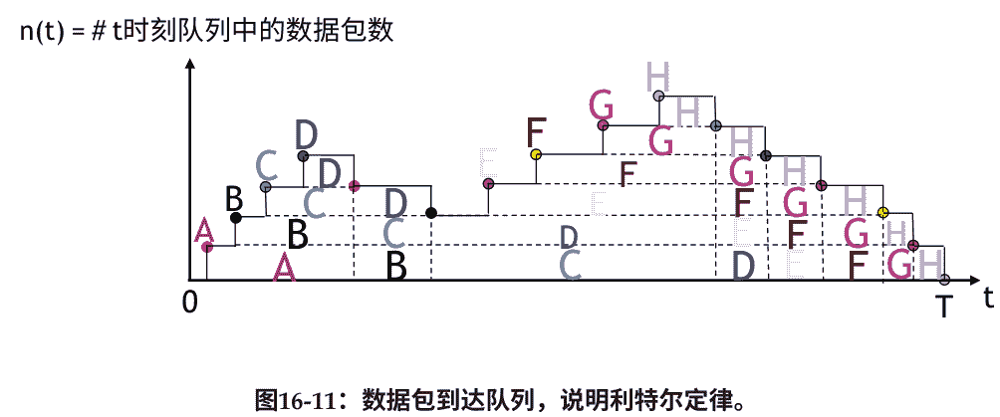

图16-11：数据包到达队列，说明利特尔定律。

例子。 假设数据包以平均每秒1000个数据包的速率到达交换机，并且出站链路的速率大于此数字。（如果出站速率较小，则队列将无限增长。）不管数据包之间的到达如何分布；数据包可以根据复杂的分布以奇怪的突发方式到达。现在，假设队列中平均有50个数据包。也就是说，如果我们在随机时间点对队列大小进行抽样并取平均值，该数字为50个数据包。

**然后，根据利特尔定律，我们可以得出结论：数据包的平均排队延迟为50/1000秒=50毫秒。**

利特尔定律非常了不起，因为它不受物品（数据包）到达或队列服务的方式的影响。数据包可以按任何分布到达。它们可以按任何顺序服务，不仅仅是先进先出（FIFO）。它们可以是任何大小。实际上，唯一的实际要求是队列系统稳定。这是一个有用的结果，可以用于粗略计算来评估实际系统的性能。

为什么这个结果成立？在这门课程中，证明这个结果的普遍性超出了范围，但我们可以通过一些简化的假设用一个基本的图形论证来很容易地展示它。这个论证很有教育意义，可以让我们对队列中数据包的动态有一些了解。

图16-11显示了队列中数据包数量$n(t)$随时间$t$的变化。每当一个数据包进入队列，$n(t)$就增加1。每当数据包离开队列，$n(t)$就减少1。结果是一个阶梯状的曲线，就像图片中所示的那样。

为了简单起见，我们假设队列在时间0时的大小为0，并且在某个时间$T \gg 0$时队列会变为空。我们还假设队列按照先进先出的顺序服务作业（请注意，这个公式无论这些假设是否成立都是成立的）。令$P$为交换机在时间$T$内转发的数据包总数（显然，在我们特殊情况下，当队列完全清空时，这个数字与进入系统的数量相同）。

现在，我们需要定义$N$、$\lambda$和$D$，可以将$N$视为队列中数据包数量的时间平均值，即

$$N = \sum_{t=0}^{T} n(t)/T$$

[PAGE 269]

速率$\lambda$等于$P/T$，因为系统在时间$T$内处理了$P$个数据包。平均延迟$D$可以通过一个小技巧计算 想象一下，将$n(t)$曲线下的总面积分配给数据包，如图16-11所示 也就是说，数据包A、B、C...分别被分配给不同的矩形 每个矩形的高度为1（即一个数据包），长度为直到某个数据包离开系统的时间 每个数据包的矩形持续到数据包本身离开系统为止

现在，应该清楚任何给定数据包所花费的时间只是由该数据包标记的矩形的面积之和。

因此，数据包的平均延迟，$D$，只是由曲线下面积除以数据包的数量。 这是因为曲线下的总面积，即$\sum n(t)$，是所有数据包所经历的总延迟。

因此，

$$D=\sum_{t=0}^{T} n(t)/P.$$

从上述表达式可以得出Little定律：$N=\lambda\times D$。
Little定律在网络系统的分析中非常有用，因为根据上下文，通常可以知道方程（16.1）中的三个量中的两个，并且对第三个感兴趣。 这是关于平均值的陈述，令人惊讶的是它对数据包到达和处理方式的假设很少。

# 致谢

非常感谢Sari Canelake、Lavanya Sharan、Patricia Saylor、Anirudh Sivaraman和Kerry Xing仔细阅读和提供的有益评论。

# ■ 问题和疑问

+   1. 在什么条件下，电路交换比分组交换更好的网络设计？

+   2. 以下哪些陈述是正确的？

(a) 电路交换网络中的交换机处理连接建立和断开消息，而分组交换网络中的交换机不处理。
(b) 在某些情况下，电路交换网络可能会阻止某些发送者开始新的对话。
(c) 一旦连接正确建立，电路交换网络中的交换机可以在不需要数据帧包含目的地址的情况下正确转发数据。
(d) 与分组交换不同，电路交换网络中的交换机不需要任何关于网络拓扑的信息才能正常工作。

+   3. 考虑一个使用时分复用（而不是统计复用）来共享四个并发连接（A、B、C和D）的链路的交换机

数据包以突发方式到达。链路的数据速率为每个时间槽1个数据包。假设交换机运行了很长时间。

+   (a) 四个连接（A到D）的平均数据包到达率，以每个时间槽的数据包数表示，分别为0.2、0.2、0.1和0.1。在交换机处观察到的平均延迟（以时间槽为单位）分别为10、10、5和5。交换机上四个队列（A到D）的平均队列长度是多少？

+   (b) 连接A的数据包到达率现在变为每个时间槽0.4个数据包。其他连接的到达率保持不变，交换机运行不变。现在，四个队列（A到D）的平均队列长度是多少？

4。安妮特·韦克尔开发了一种新的交换机。在这个交换机中，10%的数据包在“慢速路径”上处理，平均延迟为1毫秒。所有其他数据包在“快速路径”上处理，平均延迟为0.1毫秒。安妮特观察了一段时间的交换机，并发现其中的平均数据包数量为19。交换机处理数据包的平均速率是多少，以每秒数据包数表示？

麻省理工学院开放式课程
http://ocw.mit.edu

## 6.02电子工程与计算机科学II：数字通信系统

2012年秋季

有关引用这些材料或我们的使用条款的信息，请访问：http://ocw.mit.edu terms。

*MIT6.02草稿讲义*
**最后更新日期：2012年11月3日**

## 第17章
## 网络路由 - I：没有任何故障

本章和下一章讨论网络路由中的关键技术思想。我们首先描述问题，然后将其分解为一组子问题并解决它们。
你应该在最后理解的关键思想是：

1. 寻址和转发。
2. 分布式路由协议：距离向量和链路状态协议。
3. 路由协议如何处理故障并找到可用路径。

## ## 17.1 问题

如前面的章节所解释的，共享是所有实际网络设计的基础。我们通过连接节点（交换机和终端）使用点对点链接和共享媒体来构建网络。图17-1显示了一个网络拓扑的示例；图片展示了Internet2网络的“骨干”，它连接了美国的许多学术机构，截至2010年初。我们将详细讨论的问题是：在分组交换网络中，交换机（和终端）应该怎么做才能确保从网络中的某个发送者S发送的数据包能够到达其预定目的地D？

“确保”这个词很有力，因为它暗示了某种保证。鉴于数据包可能因各种原因丢失（交换机的队列溢出、共享媒体的重复碰撞等等），我们暂时不会担心保证传递。在这里，我们将考虑所谓的“尽力而为”传递：也就是说，交换机将“尽力”寻找一种方法将数据包从S传输到D，但没有任何保证。事实上，面对我们将遇到的各种故障，即使是合理的尽力而为传递也已经很困难了。

后续章节将讨论如何提高传递可靠性。

[图片描述：由Internet2网络NOC提供。经许可使用。]

**图17-1：截至2010年初，美国Internet2研究和教育网络的拓扑结构。**

为了解决这个问题，我们将网络拓扑模型化为一个图，一个由节点（顶点）通过连接（边）相连的结构，如图17-2顶部所示。节点对应于交换机或终端点。在网络中寻找路径的问题具有以下挑战：

1. **分布式信息**：每个节点只知道其在拓扑中的局部连接性，即其直接邻居（即使可靠地确定这一点也需要一些工作，我们将在后面看到）。网络必须找到一种方法，从这些分布式信息开始提供整个网络的连通性。
2. **效率**：网络找到的路径应该是相对“好”的；它们不应该过长，因为这会增加数据包的延迟。为了具体起见，我们假设链路具有成本（这些成本可以模拟链路延迟），并且我们希望找到一条在任意源和目的地之间最小化总成本的路径。我们假设所有链路成本都是非负的。我们还必须注意网络在寻找良好路径时消耗的额外网络带宽。
3. **故障**：链接和节点可能会随意发生故障和恢复。如果存在路径，网络应该能够找到路径，而不会因为故障而导致数据包在网络中“卡住”。为了应对由链接和交换机的故障和恢复以及新节点和链接的设置或删除引起的变动，

![图片描述：图17-2：显示节点B的路由表的简单网络拓扑。目的地的路由用椭圆形标记。节点B上的三个链路分别是L0、L1和L2；这些名称在其他节点上不可见，但在节点B内部是可见的。]Diagram.png

目的地 | 链路（下一跳） | 成本
---|---|---
A | L1 | 18
B | ‘自身’ | 0
C | L1 | 11
D | L2 | 4
E | L1 | 16

**图17-2：** 显示节点B的路由表的简单网络拓扑。目的地的路由用椭圆形标记。节点B上的三个链路分别是L0、L1和L2；这些名称在其他节点上不可见，但在节点B内部是可见的。

由于数据在传输过程中可能会被损坏（未经纠正的位错误）或者由于交换机实现中的错误，习惯上在数据包的头部包含一个校验和，可能还包括正在发送的数据。

只要网络中没有故障，这些转发步骤就能正常工作。在下一章中，我们将扩展这些步骤以解决由故障、数据包丢失和网络中的其他变化引起的问题，这些问题可能导致数据包在网络中无限循环。我们将在数据包头部使用一个“跳数限制”字段来检测和丢弃被节点重复转发但无法到达目的地的数据包。

路由表只包含路由信息，并且通常放置在更快的内存中，因为每个数据包都需要查询路由表。

## ## 17.2 寻址和转发

显然，为了将数据包发送到某个终点，我们需要一种方式来唯一标识该终点。这些标识符是名称的示例，这是计算机系统中常用的概念：名称提供了一个用于引用各种对象的句柄。在我们的上下文中，我们希望给终点和交换机命名。我们将使用术语地址来指代交换机或终点的名称。对于我们的目的，唯一的要求是地址能够唯一地指代终点和交换机。在大型网络中，我们希望限制地址的分配方式，并区分节点的唯一标识符和其地址之间的区别。这种区别将允许我们使用地址来引用节点上的每个不同的网络链路（也称为“接口”）；因为一个节点可能有多个连接到它的链路，节点的唯一名称与其接口的地址是不同的（如果你有一台计算机有多个活动的网络接口，比如一个无线连接和一个以太网连接，那么该计算机将有多个地址，每个活动接口一个）。在分组交换网络中，发送方发送的每个数据包都包含目的地的地址。它通常还包含发送方的地址，这允许目的地上运行的应用程序和其他协议发送数据包回来。所有这些信息都在数据包的头部，头部还可能包含一些其他有用的字段。当交换机收到一个数据包时，它会查阅一个以目的地地址为键的表，以确定应该通过哪个链路发送数据包以达到目的地。这个过程被称为表查找，所使用的表被称为路由表。² 所选的链路被称为出口链路。

![图片描述：图17-2：显示节点B的路由表的简单网络拓扑。目的地的路由用椭圆形标记。节点B上的三个链路分别是L0、L1和L2；这些名称在其他节点上不可见，但在节点B内部是可见的。]Diagram.png

目的地 | 链路（下一跳） | 成本
---|---|---
A | L1 | 18
B | ‘自身’ | 0
C | L1 | 11
D | L2 | 4
E | L1 | 16

**图17-2：** 显示节点B的路由表的简单网络拓扑。目的地的路由用椭圆形标记。节点B上的三个链路分别是L0、L1和L2；这些名称在其他节点上不可见，但在节点B内部是可见的。

目的地地址和出链路的组合被称为交换机用于目的地的路由。请注意，路由与拓扑中源和目的地之间的路径不同；各个交换机上的路由序列产生一系列链路，从而形成一条路径（假设路由和转发过程正常）。图17-2显示了一个简单网络中一个节点的路由表和路由。

由于数据在传输过程中可能会被损坏（未经纠正的位错误）或者由于交换机实现中的错误，习惯上在数据包的头部包含一个校验和，可能还包括正在发送的数据。

只要网络中没有故障，这些转发步骤就能正常工作。在下一章中，我们将扩展这些步骤以解决由故障、数据包丢失和网络中的其他变化引起的问题，这些问题可能导致数据包在网络中无限循环。我们将在数据包头部使用一个“跳数限制”字段来检测和丢弃被节点重复转发但无法到达目的地的数据包。

路由表只包含路由信息，并且通常放置在更快的内存中，因为每个数据包都需要查询路由表。

## ## 17.3 路由概述

> 如果你不知道你要去哪里，任何路都会带你去那里。

——刘易斯·卡罗尔

路由是交换机构建其路由表的过程。在高层次上，大多数路由协议具有三个组成部分：

1. **确定邻居：对于每个节点，哪些直接连接的节点当前既可达又运行？** 我们将这样的节点称为拓扑中节点的邻居。一个节点可能无法到达直接连接的节点，要么是因为链路故障，要么是因为节点本身由于某种原因故障。链路可能无法传递所有数据包（例如，由于挖掘机切断了电缆），或者可能表现出高丢包率，从而阻止所有或大部分数据包的传递。暂时，我们假设每个节点都知道它的邻居是谁。在下一章中，我们将讨论一种常见的方法，称为“HELLO协议”，通过该方法每个节点确定其当前的邻居。基本思想是每个节点在其所有活动链路上定期发送“HELLO”消息；任何接收到HELLO消息的节点都知道发送者当前是活动的并且是一个有效的邻居。

2. **发送广告：每个节点向其邻居发送路由广告。** 这些广告总结了关于网络拓扑的有用信息。
每个节点定期发送这些广告，有两个原因。首先，在向量协议中，定期广告确保节点随时间具有计算正确路由所需的所有信息。其次，在向量和链路状态协议中，定期广告是用于克服链路和节点故障（以及数据包丢失）影响的基本机制。

3. **整合广告：在此步骤中，节点处理其最近收到的所有广告，并使用该信息生成其版本的路由表。**

由于网络拓扑可能会发生变化，并且新信息可能变得可用，因此这三个步骤必须持续运行，发现当前的邻居集合，向邻居传播广告，并调整路由表。这种持续运行意味着网络交换机维护的状态是软状态：即随着更新的到达而定期刷新，并适应这些更新中所表示的变化。这种软状态意味着用于到达某个目的地的路径可能随时改变，可能导致从源到目的地的数据包流到达时被重新排序；然而，刷新路由的能力意味着系统可以通过“绕过”链路和节点故障来适应。我们将在下一章中研究路由协议如何适应故障。

在文献中已经开发了各种路由协议，并且在实践中使用了几种不同的协议。广义上讲，协议分为两类，具体取决于它们在广告中发送什么以及如何整合广告来计算路由表。属于第一类的协议被称为向量协议，因为每个节点n向其邻居广告发送一个向量，每个目的地有一个分量，该向量提供了关于n到相应目的地的路由信息。

例如，在最简单的向量协议中，n会将到达每个目的地的成本作为目的地-成本元组的向量进行广告。在整合步骤中，广告的每个接收者可以使用来自每个邻居的广告成本，以及一些其他信息（从节点到邻居的链接成本）来计算自己到目的地的成本。广告这些成本的向量协议也被称为距离向量协议。³

第二类路由协议被称为链路状态协议。在这里，每个节点都向其当前邻居的所有链路广告传递关于链路的信息，并且每个接收者在其所有链路上重新发送此信息，通过网络传播关于链路的信息。最终，所有节点都了解整个拓扑中的所有链路和节点。然后，在集成步骤中，每个节点使用算法计算网络中到每个目的地的最小成本路径。

在下一章结束后，我们将对距离向量和链路状态路由协议进行比较和对比，了解它们的工作原理。现在，请记住以下关键区别：在距离向量和链路状态路由协议（实际上，在任何向量协议中），路由计算本身是分布式的，而在链路状态协议中，路由计算过程在每个节点上独立进行，并且网络拓扑的传播是使用分布式泛洪进行的。

接下来的两个部分讨论了距离向量和链路状态协议的基本细节。在本章中，我们将假设网络中没有节点或链路的故障；我们将假设网络中唯一可能发生的变化是节点或链路的添加。在下一章中，我们将放宽这个假设。

我们将假设网络中的所有链路都是双向的，并且每个方向上的成本是对称的（即，从A到B的链路成本与从B到A的链路成本相同，对于任何直接连接的节点A和B）。

## ## 17.4 一个简单的距离向量协议

理解任何路由协议的最佳方法是从发送广告和整合广告这两个独特步骤的工作方式入手。在本节中，我们将解释一个简单的距离向量协议的这两个步骤，以实现最小成本路由。

## ## 17.4.1 距离向量协议广告

距离向量协议中的广告很简单，由一组元组组成，如下所示：

[(目的地1, 成本1), (目的地2, 成本2), (目的地3, 成本3), ...]

在这里，每个“目的地”是节点已知的目的地地址，相应的“成本”是节点已知的当前最佳路径的成本。图17-3展示了一个网络拓扑的示例，显示了每个节点在稳定状态下计算出路由表后发送的距离向量广告。在

> ³实际成本可能与物理距离无关，并且成本不需要满足三角不等式。之所以使用“距离向量”而不是“成本向量”这个术语是有历史原因的。

![图片描述：图17-3：在稳态下，此图片中拓扑中的每个节点都会发送出靠近节点的距离向量广告。]Diagram.png

计算表格的过程中，每个节点都会广告其当前的路由表（即来自表格的目的地和代价字段），从而使邻居节点可以对其表格进行更改并广告更新的信息。

节点如何处理这些广告成本？答案在于节点如何将所有邻居的广告整合起来，生成其路由表。

## ## 17.4.2 距离向量协议：整合步骤

整合步骤中的关键思想是基于贝尔曼-福特算法中关于在图中寻找最短路径的旧观察结果。考虑网络中的节点 n 和某个目标节点 d。假设节点 n 从每个邻居 i 那里听到到达目标节点 d 的成本 c_i。那么，如果节点 n 选择使用链路 n-i 作为到达目标节点 d 的路由，对应的成本将是 c_i + l_i，其中 l_i 是链路 n-i 的成本。因此，从节点 n 的角度来看，它应该选择广告成本加上到该邻居的链路成本最小的那个邻居（链路）。更正式地说，使用最低成本的路径应该经过邻居 j，其中

$$j = \arg\min_i(c_i + l_i).$$

这个计算的美妙之处在于它不需要来自不同邻居的广告同时到达。它们可以在任意时间到达，任意顺序；此外，集成步骤可以在每次到达广告时运行。该算法最终将计算出正确的成本并找到正确的路径（即收敛）。

在实现此算法时需要注意以下几点：

![图片描述：图17-4：每个节点的周期性集成和广告步骤。]Diagram.png

+   1. 如果新的成本比当前估计值小，或者正在使用的路径的成本发生变化，节点应该更新其成本和路径。你可能会问，在节点听到任何目的地的广告之前，成本的初始值应该是多少。显然，它应该是一个很大的数，我们称之为“无穷大”。后来，当我们讨论故障时，我们会发现对于我们简单的距离向量协议来说，“无穷大”实际上并不是那么大。请注意，“无穷大”确实需要大于网络中最长最小成本路径的成本，以便正确地路由任意一对节点之间的通信，因为两个节点之间的“无穷大”路径意味着这两个节点之间没有路径。

+   2. 在广告步骤中，每个节点都应确保通过其所有链路广告当前的最佳（最低）成本。

在这些步骤中，实施者必须进一步注意正确处理数据包丢失、链路和节点故障，因此我们将在下一章中完善这一步骤。
从概念上讲，我们可以想象广告和集成过程定期运行，例如如图17-4所示。在每次广告中，节点发送其当前路由表中的目标：成本元组。在随后的集成步骤中，节点处理从每个邻居最近的广告中接收到的所有信息，以生成更新的路由表，并且随后的广告步骤使用此更新的信息。最终，假设没有数据包丢失、故障或添加，系统达到稳定状态，广告不会改变。

## ## 17.4.3 正确性和性能

这两个步骤足以确保在没有故障的情况下的正确性。为了理解原因，首先考虑一个网络，其中每个节点只有关于自身的信息，没有关于其他节点的信息。此时，每个节点的路由表中只有自己的信息，成本为0。在广告步骤中，节点将该信息发送给每个邻居（使用HELLO协议确定其活性）。现在，集成步骤开始运行，每个节点的路由表中有一组新条目，每个邻居一个条目，路由设置为广告到达的链路，并且路径成本等于链路的成本。

每个节点发送的下一个广告包括每个路由表条目的节点-成本对，只有当当前路径到目的地的成本大于（或大于等于）广告成本加上广告到达的链路的成本时，该信息才会被集成到节点的路由表中。

可以通过对路径长度进行归纳来证明该方法的正确性。很容易看出，如果最小成本路径的长度为1（即1跳），则算法能够正确找到它。现在假设算法能够正确计算最小成本路径。

从节点s到任何最小成本路径≤C跳的目标节点的路径。现在考虑一个目标节点d，其最小成本路径的长度为C+1。很明显，这条路径可以写成s,t,...,d，其中t是s的邻居，从t到d的子路径长度为C。根据归纳假设，从t到d的子路径是长度为C的路径，因此算法必须正确找到它。由于归纳假设，从t到d的子路径是长度为C的路径，因此算法必须正确找到它。Bellman-Ford集成步骤在s处处理所有来自s的邻居的广告，并选择链路成本加上广告路径成本最小的路由。由于这一步骤和最小成本路径长度为C+1的假设，路径s,t,...,d必须是算法正确计算的最小成本路径。这完成了正确性证明。这证明了正确性。

这个协议的工作效果如何？在没有故障的情况下，对于小型网络来说，这是一个相当好的协议。它不会占用太多的网络带宽，尽管广告的大小与网络的大小成线性增长。假设没有数据包丢失或其他故障发生，协议需要多长时间才能收敛？下一章将讨论协议“收敛”的含义；简而言之，我们在这里问的是每个节点获得正确的路由到每个其他目的地所需的时间。为了回答这个问题，观察到在每个集成步骤之后，假设广告和集成步骤以相同的频率发生，每个节点都会获得关于潜在的最小成本路径的信息，这些路径与上一个集成步骤相比多了一跳。这个属性意味着在经过H个步骤之后，每个节点将对所有最小成本路径正确地到达所有目的地，其中最小成本路径的跳数≤H。因此，在没有数据包丢失的情况下，收敛时间等于网络中最长最小成本路径的长度（即跳数）。

在下一章中，当我们扩展协议以处理故障时，我们将计算协议消耗的带宽，并讨论其一些缺点。特别是，我们将发现当链路或节点故障发生时，该协议的行为表现不佳。

不幸的是，事实证明，解决这个问题的许多解决方案是一把双刃剑：它们可以解决问题，但在网络规模扩大时效果不佳。因此，

## LSA泛洪
- LSA在每个方向上通过每个链接传输
- 不要费心去弄清楚LSA来自哪个链接
- 终止：每个节点精确地转发LSA一次
- 所有可达节点最终都会听到每个LSA
  - 所需时间：跨越网络的链接数量

**Figure17-5：** 来自节点Finaetwork的链路状态广告。箭头显示相同的广告作为洪泛过程的一部分，每个节点沿着与节点连接的所有链接重新广播（在不同的时间点）。此示例显示了一个节点的链路状态；实际上，网络中的每个节点都有一个这些节点之一发起的，并由其他节点重新广播。

链路状态路由协议的最后一步是计算网络中每个节点到每个目的地的最小成本路径。每个节点都独立地在其网络拓扑（地图）的版本上执行此计算。因此，这一步非常简单，因为它是一种集中式算法，不需要任何节点间的协调（协调发生在广告的洪泛过程中）。

在过去的几十年中，已经开发出了许多用于计算图上各种属性的算法。特别是，有很多方法可以计算任意两个节点之间的最小成本路径。例如，可以使用在第17.4节中开发的贝尔曼-福特方法。该算法非常适合分布式实现，因为它在新的更新到达时迭代地收敛到正确的答案，但在完全图上应用该算法比一些其他方法要慢。

在贝尔曼-福特方法之后的几年里，计算机科学家埃德斯格·迪科斯特拉开发了另一种替代方法。大多数链路状态协议实现在其集成步骤中使用迪科斯特拉的最短路径算法（以及对其的许多扩展）。这个算法的一个关键假设是，链路成本必须是非负的，幸运的是在大多数网络中都是如此。

迪科斯特拉算法使用最短路径的以下属性：如果从节点X到节点Y的最短路径经过节点Z，则从X到Z的子路径也必须是最短路径。很容易看出为什么这个属性必须成立。如果从X到Z的子路径不是最短路径，那么可以找到一条从X到Y的更短路径，该路径使用了不同且更短的从X到Z的子路径，而不是原始的子路径，然后从Z继续到Y。通过

## 集成步骤：Dijkstra算法（例子）
假设我们想要找到从A到其他节点的路径

**图17-6：Dijkstra最短路径算法的操作，找到从A到所有其他节点的路径。** 最初，算法知道的最短路径的节点集合S为空。节点按照最短路径成本的非递减顺序添加到其中，如果有并列，则任意选择。在这个例子中，节点按照顺序添加（A，C，B，F，E，D，G）。括号中的数字表示算法进行过程中节点的当前spcost值，旧值被划掉。

按照相同的逻辑，从Z到Y的子路径也必须是网络中的最短路径。因此，最短路径可以连接在一起形成连接子路径两端节点的最短路径。

这个特性表明了一种从一个节点N到网络中所有其他目的地的迭代方法。该算法维护两个不相交的节点集合，S和X=V-S，其中V是网络中的节点集合。初始时S为空。在每一步中，我们将会向S中添加一个节点，并相应地从X中移除该节点。我们将要添加的节点v满足以下条件：它是X中从节点N到达的最短路径上的节点。因此，该算法按照最短路径成本的非递减顺序将节点添加到S中。我们将要添加到S中的第一个节点是N本身，因为从N到自身的路径成本为0（且不大于到任何其他节点的路径，因为所有的链接都具有非负权重）。图17-6展示了算法运行的一个示例。幸运的是，有一种高效的方法可以确定下一个要从集合X中添加到S的节点。随着算法的进行，它维护每个节点v的当前最短路径成本spcost(v)。初始时，对于所有节点，除了N，其spcost(v)=∞（在实践中为一个很大的数），N的spcost为0。每当一个节点u被添加到S中时，算法会检查每个u的邻居w，看看spcost(w)的当前值是否大于spcost(u)+linkcost(uw)。如果是的话，则更新spcost(w)。显然，我们不需要检查u的邻居之外的任何其他节点的spcost是否发生了变化，因为u被添加到S中时，它们不可能发生变化。完成这一步后，我们检查集合X以找到下一个要添加到S中的节点。

## 添加到$S$；如前所述，选择具有最小$pcost$的节点（我们任意打破平局）。

最后一部分是要记住算法需要生成每个目的地的路径，这意味着我们需要维护每个目的地的出链路。
为了计算路径，观察Dijkstra算法生成的是以源节点$n$为根的最短路径树，遍历网络中的所有目的地节点。（树是一个没有循环且连通的图，即任意两个节点之间有且仅有一条路径，特别是$n$和其他每个节点之间都有一条路径。）最短路径树中有三种类型的节点：

+   1. 2. 树中直接连接到$n$的节点$v$，其父节点是$n$。对于这些节点，路径是连接$n$和$v$的链路。
2. 3. 树中与$n$不直接连接的节点$u$，其父节点是$v$。对于这些节点，路径是连接$n$和$u$的链路，然后连接$u$和$v$的链路。
3. 所有其他节点，$w$，它们与最短路径树中的$n$不直接连接。对于这样的节点，到$w$的路径与到$w$的父节点的路径相同，父节点是从$w$到$n$的树中的（反向）路径上更接近$n$的节点。显然，这条路径将是$n$的一个链接，但我们可以将其设置为等于到$w$的父节点的路径，并依靠上述第二步来确定链接。

我们还应该注意，仅因为节点$w$与$n$直接连接，并不意味着从$n$到$w$的路径是它们之间的直接链接。如果该链接的成本大于通过另一个链接的路径，则我们将希望使用与该更好路径对应的路径（出站链接）。

## # 致谢
感谢Sari Canelake、Sophie Diehl、Katrina LaCurts和Anirudh Sivaraman的许多有益评论，以及Karl Berggren、Fred Chen和Eduardo Lisker的错误修复。

## ## 问题和疑问
+   1. 考虑图17-7所示的网络。每个链接旁边的数字是其成本。我们对从S到网络中每个其他节点的最短路径（考虑成本）感兴趣。

在这个网络上运行Dijkstra的最短路径算法的结果是什么？为了回答这个问题，在每个节点附近列出一对数字：第一对数字应该是节点被选择的算法的顺序或迭代。

每对数字的第二个元素应该是从S到该节点的最短路径成本。

+   2. Alice和Bob负责在运行链路状态协议的网络中实现Dijkstra算法。在她的节点上，Alice实现了最小成本算法。在他的节点上，Bob实现了“最短跳数”算法。给出一个具有4个或更多节点的网络拓扑的例子，在Alice和Bob的实现同时在同一个网络中运行时会发生路由环路。假设没有故障发生。

（注意：当一组不同的节点$n_0，n_1，n_2，...，nk\!-\!1$存在这样的路由，即$n_i$的下一跳（路由）是$n_{i+1\ \mathrm{mod}\ k}$时，就会发生路由环路。）

## # 图17-7：问题1的拓扑结构。
3。考虑任意两个图（网络）$G$和$G'$，它们除了链路的成本之外完全相同。

+   (a) 图$G$中链路的成本为$cl>0$，而图$G'$中相同链路的成本为$kcl$，其中$k>0$是一个常数。这两个图中任意两个节点之间的最短路径是否相同？请解释你的答案。

+   (b) 现在假设图$G'$中链路的成本为$kcl+h$，其中$k>0$和$h>0$是常数。这两个图中任意两个节点之间的最短路径是否相同？请解释你的答案。

4. Eager B. Eaver在他的网络中实现了距离向量路由，其中所有的链接都有任意正的成本。此外，在网络中任意两个节点之间至少有两条路径。一个节点，$u$，对于集成步骤有一个错误的实现：它从每个邻居那里获取广告成本，并选择对应于每个目的地的最小广告成本的路线作为它到该目的地的路线，而不添加邻居的链接成本。它以任意方式打破平局。所有其他节点都正确实现。

让我们使用术语“正确路线”来表示对应于最小成本路径的路线。以下哪些陈述对于Eager的网络是正确的？

+   (a) 只有$u$可能对任何其他节点有错误的路线。

+   (b) 只有$u$和$u$的邻居可能对任何其他节点有错误的路线。

+   (c) 在某些拓扑中，所有节点可能都有正确的路线。

## # 假设没有故障，并且路由协议已经收敛，以在所有节点上产生到每个目的地的某条路由。
解释每个陈述是真还是假。假设网络中至少有两个节点（可能是所有节点）运行Eagerp的修改版本的代码，而其余节点运行本章讨论的方法。

+   (a) 存在某些节点具有无效路由的网络。
(b) 存在一些网络，其中一些节点将没有正确的路由。
(c) 存在一些网络，其中所有节点都将有正确的路由。

5. Alyssa P. Hacker正在尝试通过在网络中的节点上运行Dijkstra的最短路径算法来逆向工程生成的树，如左侧的图19-9所示。她不知道链路成本，但知道它们都是正数。所有链路成本都是对称的（两个方向相同）。她还知道在这个网络中，任意一对节点之间只有一条最小成本路径。

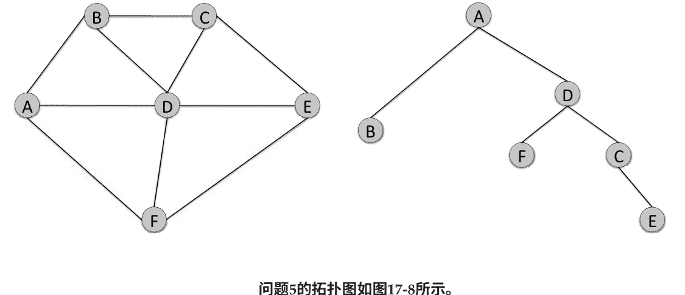

## # 问题5的拓扑图如图17-8所示。
她发现Dijkstra算法在节点A处计算的路由树看起来像右侧的图19-9中的图片。请注意，从这张图片中无法明确看出Dijkstra算法中节点的确切添加顺序。

+   (a) A的哪个链路成本最高？如果可能有多个，请告诉我们它们是什么。

(b) A的哪个链接具有最低成本？如果可能有多个，请告诉我们它们是什么。

Alyssa现在检查节点C，并发现它看起来像图17-9。她确定粗体（而不是虚线）的链接属于从节点C到最短路径树，但对虚线链接不确定。

+   (c) 列出图17-9中在节点C的路由树上保证的所有虚线链接。

(d) 列出图17-9中在节点C的路由树上保证不会出现的所有虚线链接（即确定不会出现的链接）。

6. 考虑使用距离向量协议实现最小成本路由的网络。一个节点S有k个邻居，编号从1到k，与邻居i的链接成本为c_i（所有链接具有对称成本）。最初，S对目标D没有路由。然后，S从每个邻居那里收到D的广告，邻居i广告的成本为p_i。节点集成这个广告。在集成后，S的路由表中目标D的成本是多少？

## # 图17-10：问题6的鱼网拓扑。
图17-9：问题5(c)和5(d)的图片。

图17-10：问题6的鱼网拓扑。

7. 本·比特迪德尔负责鱼网的路由，如图17-10所示。他可以选择不同链路的成本（在链路附近显示的w）。所有成本都是非负的。

目标：确保连接C到A和C到B的链路（显示为较深的线）承载相等的流量负载。所有流量都由S1和S2生成，比例未知。S1和S2一起为目的地A、B和D生成流量的速率（提供的负载）分别为rA、rB和rD。每个网络链路的带宽都高于rA+rB+rD。没有故障。

协议：FishNet使用链路状态路由；每个节点运行Dijkstra算法来选择最小成本的路由。

(a) 如果rA + rD = rB，则链路成本必须满足什么约束（方程或不等式）才能实现目标？请解释你的答案。如果无法实现目标，请说明原因。

[PAGE 291]

(b) 如果 $r_A = r_B = 0$ 且 $r_D > 0$，则链路成本必须满足什么约束才能实现目标？请解释你的答案。如果无法实现目标，请说明原因。

## # 图17-11：问题8的拓扑结构。
8. 考虑图17-11中显示的网络。每个节点使用图片中显示的链路成本实现Dijkstra的最短路径算法。

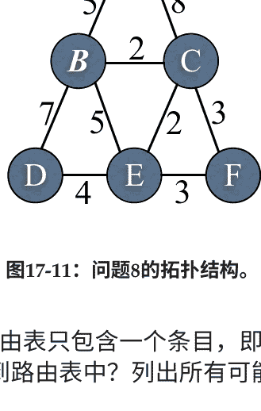

(a) 初始时，节点B的路由表只包含一个条目，即自身。当B运行Dijkstra算法时，节点以什么顺序添加到路由表中？列出所有可能的答案。

(b) 现在假设其中一个链接的链接成本发生变化，但所有成本仍然为非负数。对于下面列出的每个链接成本变化，说明是否可能导致节点B的路由（即B使用的链接）发生变化，如果可能，列出可能发生变化的目的地。

+   i. 链接 $(A, C)$ 的成本增加；

ii. 链接 $(A, C)$ 的成本减少；

iii. 链接 $(B, C)$ 的成本增加；

iv. 链接 $(B, C)$ 的成本减少；

## 9. Eager B. Beaver在本章中实现了距离向量协议，但在某些节点上，他的代码以不同的方式设置了每个广告目的地D的成本和路由。
到达目的地$D$的成本 = $\min($从每个邻居处收到的广告成本$)$。
到达$D$的路由 = 连接到邻居并广告最小成本到$D$的路由

网络中的每个节点定期向所有邻居广告其到已知目的地的成本向量。所有链路成本都是正数。

在每个节点上，对于目的地$D$的路由是有效的，如果使用该路由的数据包最终将到达$D$。
在每个节点上，对于目的地$D$的路由是正确的，如果使用该路由的数据包最终将沿着某条最小成本路径到达$D$。

[PAGE 292]

## # 假设没有故障，并且路由协议已经收敛，以在所有节点上产生到每个目的地的某条路由。
解释每个陈述是真还是假。假设网络中至少有两个节点（可能是所有节点）运行Eagerp的修改版本的代码，而其余节点运行本章讨论的方法。

+   (a) 存在某些节点具有无效路由的网络。
(b) 存在一些网络，其中一些节点将没有正确的路由。
(c) 存在一些网络，其中所有节点都将有正确的路由。

## 10. 超立方体是一种有趣的网络拓扑结构。一个n维超立方体有2^n个节点，每个节点都有一个唯一的n位地址。如果两个节点的地址的汉明距离为1，则它们在超立方体中通过一条链路连接。下图显示了n=3和n=4的超立方体。实线和虚线表示链路。我们对超立方体拓扑结构上的链路状态路由感兴趣。

## # 图17-12：艾丽莎的链路状态路由问题。
回答以下问题，解释每个答案。

+   (a) C在执行Dijkstra算法时，以什么顺序将目的地添加到其路由表中？给出所有可能的答案。

(b) 假设链路⟨CB⟩的成本增加。在网络中的任何路由发生变化之前，它可以增加到的最大值是多少？（如果出现平局，则保留旧路由。）

(c) 假设在任何链路上都没有丢失链路状态广告（LSA）数据包。当C生成一个新的LSA时，在该网络的所有链路上总共会洪泛多少份该LSA的副本，使用6.02中描述的链路状态洪泛协议？

## 麻省理工学院开放式课程
http://ocw.mit.edu

## MIT6.02草稿讲义
最后更新日期：2012年11月3日

## # 第18章
网络路由 - II
绕过故障的路由

本章描述了分布式路由协议用于处理链路和节点故障、数据包丢失（可能导致广告丢失）、链路成本变化以及网络中新增节点和链路的机制。我们将使用术语“变动”来指代网络拓扑的任何变化。我们的目标是在变动的情况下找到最佳路径。特别感兴趣的是在故障情况下绕过路由，从可用路径集合中找到任意两个节点之间的最小成本工作路径。

我们首先讨论路由协议正确性的含义，并在变动的情况下定义我们的正确性目标。解决问题的第一步是发现故障。在路由协议中，每个节点负责发现哪些链路和相应的节点仍在工作；大多数路由协议使用简单的“HELLO协议”来完成此任务。然后，为了处理故障，每个节点定期运行“广告”和“集成”步骤。每个节点的想法是将其对网络拓扑的了解反复传播给邻居节点，以便任何变化都能传播到网络中的所有节点。这些定期消息是路由协议用于应对网络变化的关键机制。当然，路由协议必须能够抵御导致各种消息丢失的数据包丢失；例如，不能仅凭缺少一条消息就假设链路或节点已经故障，因为数据包丢失通常比实际故障更常见。

## # ## 18.1 正确性和收敛性
在理想情况下，正确工作的路由协议具有两个属性：

+   1. 对于任何节点，如果该节点具有到给定目标的路由，则网络拓扑中将存在一条可用路径，该路径经过路由中指定的链路。我们称这个属性为路由有效性。
2. 此外，每个节点将具有到网络拓扑中存在可用路径的每个目标的路由，并且沿着这些路由序列转发的任何数据包都将到达目标（注意，路由是每个交换机的出站链路；路由序列对应于路径）。我们称这个属性为路径可见性，因为它是对网络中交换机可见的可用路径的说明。

如果这两个属性在网络中成立，则该网络的路由协议被认为已经收敛。无法保证这些属性始终成立，因为任何变化需要一定的时间才能在网络中传播到所有节点，并且所有节点需要就网络状态达成一致。因此，我们将满足一个更为有限但仍具有挑战性的目标，即最终收敛。

我们将最终收敛定义如下：假设网络的初始状态是任意的，并且在时间\(t=0\)时，路由表已经建立。假设在一段时间\(\

## ■ 18.1.2 减少路径可见性

当一个失败的链路或节点在故障后恢复，并且网络的一个以前无法到达的部分现在可以通过该链路或节点到达时，通常会出现这个问题。因为协议收敛需要时间，这些信息需要在网络中传播并且所有节点正确计算到达“另一侧”网络的路径需要时间。在此期间，路由表尚未收敛，因此对于数据包而言，以前无法到达的网络部分仍然保持不可达状态。

## ■ 18.2 减轻路由环路：数据包的跳数限制

如果一个数据包沿着一个路由环路的一系列路由器发送，那么该数据包将一直保留在网络中，直到路由环路被消除。典型的路由协议收敛时间可能需要几秒甚至几分钟，在此期间，这些数据包可能会消耗大量的网络带宽，并减少其他成功发送到其他目的地的数据包的可用容量。

为了缓解这个（希望是暂时的）问题，通常在数据包头部包含一个跳数限制。源节点在数据包头部设置“跳数限制”字段，该字段的值大于到达目的地所需的跳数。每个交换机在转发数据包之前，将跳数限制字段减1。如果该字段达到0，则不转发数据包，而是丢弃它（可选地，交换机可以向源节点发送一份诊断数据包，告知源节点数据包被丢弃是因为超过了跳数限制）。

转发过程需要确保如果校验和包括跳数限制字段，则需要调整校验和以反映对跳数限制字段的减少。

结合前一章讨论的转发步骤，我们可以总结在最佳努力网络中转发数据包时所执行的基本步骤如下：

+   1. 检查跳数限制字段。如果为0，则丢弃数据包。可选择地，向数据包的源发送一份诊断数据包，内容为“跳数限制已超过”，作为回应，源可能决定在一段时间内停止向该目的地发送数据包。
+   2. 如果跳数限制大于0，则使用目的地地址进行路由表查找，确定数据包的路由。如果查找没有返回链路，或者链路被交换机认为是“不工作的”，则丢弃数据包。否则，如果目的地是当前节点，则将数据包传递给在节点上运行的适当协议或应用程序。否则，继续下一步。
+   3. 将跳数限制减1。根据需要调整校验和（通常是头部校验和）。将数据包排入对应的出站链路队列。
¹IP版本4具有这样的头部校验和，但IP版本6不需要，因为用于提供可靠传输的更高层协议已经覆盖了IP头部的部分内容。

## ■ 18.3 邻居活跃性：HELLO协议

如前一章所述，确定节点的哪个邻居当前是活动的并且正常工作是任何路由协议的第一步。我们现在来解决这个问题：一个节点如何确定它当前的邻居集合？HELLO协议解决了这个问题。

HELLO协议很简单，它的命名是根据它使用的消息类型。每个节点定期沿着所有链路发送一个HELLO数据包。HELLO的目的是让链路另一端的节点知道发送节点仍然活动。只要链路正常工作，这些数据包就会到达。只要一个节点听到另一个节点的HELLO，它就认为发送节点仍然正常运行。这些消息是周期性的，因为故障可能随时发生，所以我们需要持续监控我们的邻居。

何时应该从邻居列表中删除另一端的节点？如果我们知道HELLO消息发送的频率，那么我们可以等待一段时间，如果在这段时间内没有收到来自该节点的任何HELLO数据包，就可以将该节点移除。当然，由于数据包丢失可能会阻止HELLO数据包的到达，所以即使缺少一个（甚至少数）HELLO数据包，也不一定意味着链路或节点故障。因此，在决定一个我们没有收到其HELLO数据包的节点不再是邻居之前，最好等待足够的时间。

为了使这种方法有效，HELLO数据包必须以某种规律发送，以便在选择的超时时间内预期的HELLO数据包数量大致相同。我们将HELLO数据包传输之间的平均时间称为“HELLO间隔”。实际上，这些传输之间的实际时间具有较小的方差；例如，可以从[HELLO间隔-δ，HELLO间隔+δ]中随机选择一个时间，其中δ < HELLO间隔。

当一个节点在直接链路的另一端没有收到一个HELLO数据包一段时间时，它会将该节点从其邻居列表中移除，并将该链路视为“失败”（节点可能已经失效，或者链路可能只是经历了高丢包率，但我们假设在再次收到HELLO数据包之前，该链路是不可用的）。

选择κ是在确定链路失败所需的时间和错误地将工作正常链路标记为“失败”之间的权衡（当然，持续丢包的时间越长，应该将其视为链路故障，而在选择一个较小的κ时，如果连续丢失了那么多个HELLO数据包，我们将认为该链路已经失败）。在实践中，设计者通过评估在检测到故障之前的延迟（κ·HELLO INTERVAL）以及错误地将链路标记为失败的概率来选择κ。这个概率是ε^κ，其中ε是链路上的丢包概率，假设（这在某些网络中是一个很大的假设）丢包是独立且具有相同分布的。

## ■ 18.4 周期性广告

允许路由协议适应动态网络条件的关键思想是周期性路由广告和随后的集成步骤，每个广告之后都会进行一次集成。这种方法适用于距离向量和链路状态协议。每个节点每隔`ADVERT_INTERVAL`秒向其邻居发送一次广告。作为响应，在距离向量协议中，每个接收节点都会运行集成步骤；在链路状态协议中，如果接收节点尚未为此广告重新广播给其邻居，则会重新广播该广告。然后，每隔`ADVERT_INTERVAL/2`秒，从其自己的广告时间开始偏移，链路状态协议中的每个节点都会运行其集成步骤。也就是说，如果一个节点在时间`t1、t2、t3`等发送其广告，其中`t(i+1)-t(i)`的平均值为`ADVERT_INTERVAL`，则集成步骤在时间`(t1+t2)/2，(t2+t3)/2`等运行。请注意，可以通过在这些偏移量上运行集成步骤来实现距离向量协议，但我们不需要这样做，因为该协议中的集成可以在广告到达时立即增量运行。注意，可以通过在这些偏移量上运行集成步骤来实现距离向量协议，但我们不需要这样做，因为该协议中的集成可以在广告到达时立即增量运行。

需要注意的是，在实践中，不同节点上的广告是不同步的。也就是说，每个节点都有自己的广告发送时间序列。在链路状态协议中，这意味着通常情况下，节点重新广播从邻居节点（无论是邻居节点还是其他节点）收到的广告的时间与其自己生成广告的时间不同。同样，在距离向量协议中，每个节点相对于其他节点异步地发送其广告，并且也异步地集成来自邻居节点的广告。

## ■ 18.5 链路状态协议在故障和变动下的表现

我们现在论证一个链路状态协议在任意初始状态（在`t=0`时）和拓扑变化序列（发生在时间`(0,τ)`内）的情况下，将最终收敛（高概率下），假设每个工作链路传递数据包的概率足够高。为了理解原因，请观察以下内容：

+   1. 存在某个有限时间`t>τ`，在这个时间点上，每个节点都能够正确地知道它的链接和相应的邻居节点是正常的还是失败的，且这种情况具有很高的概率。因为我们假设在`τ`之后没有任何变化，并且所有的数据包都以足够高的概率被传递，所以每个节点上运行的`HELLO`协议将能够正确地使邻居节点推断出它的存活状态。当邻居节点发送第一个`HELLO`数据包时，这将为存活状态提供证据，如果传递概率足够高，以至于在正确的链路状态传播到网络中的所有节点之前，连续的`k`个`HELLO`数据包丢失的机会很小，那么就存在这样一个时间点`t1`。
+   2. 存在某个有限时间`t2>t1`，在这个时间点上，所有的节点都能够以很高的概率接收到其他节点的链路状态广告的至少一份副本。一旦一个节点拥有了自己正确的链路状态，它需要花费与网络直径成比例的时间（即网络中最长最短路径的跳数）来完成这个过程。
[图18-1：距离向量协议显示“无限计数”问题（见第18.6节解释）]

假设没有数据包丢失，广告将传播到所有其他节点 如果有丢失，那么请注意，每个节点将接收到与邻居数量相同的广告副本，因为每个邻居都会沿着各自的链路发送一次广告 这种泛洪机制以增加带宽消耗为代价提供了内置的可靠性 即使一个节点没有收到另一个节点的链路状态广告，只要给予足够的时间，它最终会收到该节点的某个链路状态广告，因为链路具有足够高的数据包传递概率

+   3. 在接收到其他节点的正确链路状态之后，大约在`ADVERT INTERVAL / 2`的时间后，节点将计算出正确的路由表
因此，可以看出，在良好的数据包传递条件下，链路状态协议可以在每个节点广告自己的链路状态广告并且每个广告至少被每个其他节点接收一次后，迅速收敛到正确的路由状态

因此，从某个初始状态开始，因为每个节点平均发送一次广告，即时间间隔为`ADVERT INTERVAL`，预计收敛时间至少为这个时间。我们还应该将大约`ADVERT INTERVAL/2`秒的时间加到这个数量中，以考虑节点实际计算路由表之前的延迟。如果平均重新计算路由的频率较低，则此时间可能较长；如果平均重新计算路由的频率较高，则此时间可能较短。

忽略节点重新计算路由的情况，我们可以说，如果每个节点至少收到每个链路状态广告的一份副本，则协议的预期收敛时间为广告间隔加上LSA消息在网络直径上传播的时间。由于广告间隔比消息传播时间大几个数量级，因此第一项是主导因素。

链路状态协议并不免于路由环路问题，因为数据包丢失可能会导致问题。例如，如果节点A发现其中一个链接失败了，它可能会通过其他相邻节点B重新计算到目的地的路由。如果B没有收到A的链路状态广告，并且如果B将链接到A作为到目的地的路由，那么就会出现路由环路，至少在B了解到链接失败之前。

总的来说，链路状态协议是实现快速收敛的好方法。

## ■ 18.6 距离向量协议在故障和变动下的表现

与链路状态协议不同，其中洪泛是分布式的，但路由计算是每个节点集中的，距离向量协议将计算也分布到了各个节点。因此，它的收敛性质更加复杂。

考虑一个简单的“链式”拓扑结构，有三个节点A、B和目的地D（图18-1）。假设在$t=0$时，所有的路由表都是正确的，然后在某个时间$t<\tau$时，B和D之间的链路失败了。在这个事件之后，拓扑结构不再发生变化。

ideal情况下，协议应该做到以下几点。首先，B的HELLO协议发现了故障，并在下一次路由广告中将成本设置为无穷大（即“不可达”）发送给A。作为回应，A会认为B不再有通往D的路由，并从其路由表中删除通往D的路由。然后协议将收敛，并且收敛所需的时间与链路状态情况下的时间并没有太大的不同（一般与网络的直径成比例）。

不幸的是，情况并不那么明确，因为距离向量协议中的每个节点都会广告宣传关于所有目的地的信息，而不仅仅是直接连接到它的目的地。在B发送其广告告诉A到D的成本已经变为无穷大之前，A的广告可能已经到达B并告诉B到D的成本为2。作为回应，B将这条路由整合到其路由表中，因为2小于B自身的成本，即无穷大。现在问题来了-B有了错误的路由，因为它认为A有一种到达D的成本为2的方法，但实际上它并不知道A的路由是基于B之前告诉它的！所以，现在A认为它有一条成本为2的到达D的路由，而B认为它有一条成本为$2+1=3$的路由。B的下一条广告将导致A将自己的成本增加到$3+1=4$。随后，在收到A的广告后，B将将其成本增加到5，依此类推。实际上，这个混乱将继续下去，两个节点都认为有一种到达目的地D的方法，尽管网络中没有路径（即，路由有效性属性在这里不成立）。

这种行为有一个丰富多彩的名字：无限计数。每个节点意识到D不可达的唯一方法是成本达到无穷大。因此，为了使这个距离向量协议在合理的时间内收敛，无穷大的值必须相当小！当然，无穷大必须至少与网络中最长可用路径的成本一样大，否则对应于该路径的路由将无法找到。

我们有一个问题。距离向量协议很有吸引力，因为它消耗的带宽比链路状态协议少得多，所以我们认为它更适合大型网络，但现在我们发现无穷大（因此协议适用的网络规模）必须相当小！有没有办法解决这个混乱？首先，让我们考虑一个有缺陷的解决方案。如果B在正常的广告时间（平均每隔ADVERT INTERVAL秒）之前等待，那么如果B在集成步骤结束时发现某个目标不可达并且某个目标的成本为无穷大，它会立即发送这个“坏消息”吗？如果每个节点在广告中快速传播这个“坏消息”，那么问题可能会消失。

不幸的是，这种方法不起作用，因为广告数据包很容易丢失。在我们的简单示例中，即使B在发现与D的链接故障后立即发送广告，该消息也很容易被丢弃，无法到达A。在这种情况下，我们又回到了原点，B以成本2获取A的广告，依此类推。显然，我们需要一个更强大的解决方案。我们依次考虑两种方法，每种方法都有独特的名称：分割视域路由和路径向量路由。两种方法都推广了距离向量路由。

## ## ■ 18.7 距离向量与分割视域路由

分割视域扩展到距离向量路由的思想很简单：

如果节点A从邻居B学到了到目的地D的最佳路由，那么A不会向B广告它到D的路由。

事实上，通过让A将到D的路由以INFINITY的代价广告给B，可以进一步确保B不会使用A广告的路由。这种修改被称为毒性反转，因为节点A在向B广告时正在毒害它到D的路由。很容易看出，之前出现的两节点路由环在分割视域技术下消失了。

不幸的是，这种方法并不能更普遍地解决问题；三个或更多跳的环可能仍然存在。要了解原因，请看图18-2中的拓扑结构。在这里，B连接到目的地D，还有两个其他节点A和C连接到B以及彼此。每个节点在t=0时具有以下正确的路由状态：A认为D的代价为2（通过B），B认为D通过直接链路的代价为1，C认为D的代价为5（通过B）。每个节点都使用带有分割视域技术的距离向量协议。

（无论他们是否使用毒性逆转），所以A和C向B广告他们到D的路由成本为无穷大。当然，他们也向彼此广告存在一条到D的成本为2的路由；如果AB（或BC）链路失败，这个广告是有用的，因为A可以通过C路由到达D（或C可以通过A路由）。

现在，假设链路BD在某个时间t<<失败。理想情况下，如果B发现故障并在下一次更新中向A和C发送无穷大的成本，所有节点将具有正确的到D的成本，且没有路由环路。由于分割地平线方案，B在检测到故障后不必立即发送广告，但是越早发送越好，因为这将使A和C更快地收敛。

## ## 18.8 路径向量路由

路径向量协议背后的洞察力在于节点需要知道何时安全且正确地将任何给定的广告集成到其路由表中。分割视域技术只在有限的方式下起作用，因为它不能防止超过两跳的循环。路径向量技术扩展了距离向量广告，不仅包括成本，还包括从节点到目的地的最佳路径上的节点。它看起来像这样：

```
[目的地1成本1路径1 目的地2成本2路径2 目的地3成本3路径3...]
```

在这里，每个“路径”都是沿路径的节点标识符的串联，目的地出现在最后（相反的约定是等效的，只要所有节点都一致地处理路径）。图18-3展示了一个例子。

在节点n处，集成步骤现在应该扩展为仅在广告路径上尚未出现节点n时考虑广告。通过这一步骤，距离向量协议的其余集成步骤可以不变地使用。

假设在t = 0时有一个初始状态和一组变化(0, τ)，并且假设每个链路的数据包传递概率足够高，这个路径向量协议最终会收敛到正确的状态（高概率下）而不会“无限计数”。

## ■ 18.9 总结：比较链路状态和向量协议

> 没有什么东西是好的或坏的，只是思考使其如此。
——《哈姆雷特》第二幕（第二场）

带宽消耗。每个链路状态广告中发送的字节�数与链路数量的平方成正比，而对于距离向量协议，它与链路数量成线性关系。

简单距离向量协议中的广告步骤消耗的带宽比简单链路状态协议少。假设网络中有n个节点和m个链路，并且每个广告中的[node pathcost]或[neighbor linkcost]元组占用k个字节（实际上可能是6个字节）。每个广告还包含一个源地址，为了简单起见，我们将忽略它。

因此，对于距离向量，每个节点的广告大小为kn。每个这样的广告在每个链路上出现两次，因为每个节点都会向每个目的地的每个链路广告其最佳路径成本。因此，消耗的总带宽大约为2knm/ADVERT_INTERVAL字节/秒。

链路状态的计算稍微复杂一些。容易观察到的一部分是每个LSA都有一个“源地址”和序列号，以提高泛洪过程的效率，而这在距离向量中是不需要的。如果序列号的大小为ℓ字节，那么因为每个节点都会广播他节点的LSA一次，发送的字节数为ℓn。然而，这是一个二阶效应；大部分带宽被LSA的其余部分所消耗。LSA的其余部分包含每个邻居的k字节信息。在整个网络中，这个数量占据了k(2m)字节的信息，因为每个节点的邻居数之和为2m。此外，每个LSA都会被每个节点重新广播一次，这意味着每个LSA会出现两次。

在每个链路上。因此，在向所有节点洪泛LSA的过程中消耗的字节总数为\(k(^{2}m)(^{2}m)=4km^2\)。将其与序列号字段消耗的带宽结合起来，我们发现总消耗的带宽为\((4km^2 + ^2gmn) / \mathrm{ADVERT\ InTERVAL}\)字节/秒。

很容易看出，在没有连接的网络中，简单链路状态协议消耗的带宽不低于简单距离向量协议；重要的是前者与链路数的平方成正比，而后者取决于节点数和链路数的乘积。

收敛时间。我们的距离向量和路径向量协议的收敛时间可以达到网络中最长最小成本路径的长度

## ■ 问题和疑问

+   1. 为什么链路状态广告中包含序列号？
+   2. 数据包头部的跳数限制字段的目的是什么？该字段在路由还是转发中使用？
+   3. 清楚地描述为什么我们的距离向量协议的收敛时间可能与网络中最长最小成本路径的长度一样大。
+   4. 假设连接两个节点的链路以10%的概率独立丢包。如果我们希望以不超过0.1%的概率错误报告链路故障，并且HELLO消息每10秒发送一次，那么需要多长时间才能确定链路故障？
+   5. 你在家里建立了一个由6个节点组成的连接网络拓扑，节点的名称为A、B、...、F。检查A的路由表，你发现一些条目被神秘地删除了（用“？”表示），但你找到了以下条目：

| 目的地 | 代价 | 下一跳 |
|---|---:|---|
| B | 3 | C |
| C | 2 | ? |
| D | 4 | E |
| E | 2 | ? |
| F | 1 | ? |

每个链路的代价要么是1，要么是2，并且链路的代价是对称的（从X到Y的代价与从Y到X的代价相同）。路由表条目对应于最小代价路径。

+   (a) 绘制一个与上述路由表条目和提供的代价信息一致的具有最少链路数的网络拓扑。清楚地标记每个节点并显示每个链路的代价。
+   (b) 你知道拓扑中可能还有其他链路。为了弄清楚，你现在去检查D的路由表，但它是空的。在你的家庭网络拓扑中，从D到F的路径的最小可能代价是多少？（假设任意两个节点可能直接连接）

+   6. 一个具有 N 个节点和 N 个双向链路的网络连接成一个环，如图18-4所示，其中 N 是一个偶数。该网络运行距离向量协议，在每个节点上的广告步骤在本地时间运行时执行 T*i 秒，当本地时间为 T*i + δ/2 秒时，积分步骤运行，（i = 1, 2, ...）。每个广告需要时间 δ 到达邻居。每个节点都有一个独立的时钟，并且不同节点之间的时间不同步。

假设在某个时间 t 之后路由已经收敛，节点 N+1 被插入到环中，如上图所示。假设没有其他变化。

在网络中的每个节点都有到节点 N+1 路由之前的最短时间是多少？

在网络中的每个节点都有到节点 N+1 路由之前的最长时间是多少？

7. Alyssa P. Hacker管理着MIT的内部网络，该网络采用链路状态路由。她想尝试几种可能的路由策略。下面列出了四种策略的名称以及每种策略的简要描述。

+   1. **MinCost**：每个节点选择路径上链路成本之和最小的路径。
+   2. **MinHop**：每个节点选择跳数最少的路径（与链路成本无关）。
+   3. **SecondMinCost**：每个节点选择链路成本第二低的路径。也就是说，每个节点选择相对于路径成本的第二好路径。
+   4. **MinCostSquared**：每个节点选择路径上链路成本平方和最小的路径。

假设在链路状态广告中交换了足够的信息，以便每个节点对整个网络有完整的信息，并能正确实施上述策略。你还可以假设链路的属性不会改变，例如，它不会失败。

+   1. 帮助艾丽莎弄清楚哪些策略能正确工作，哪些策略会导致循环路由。对于导致循环路由的策略，请提供一个具有循环路由的网络拓扑示例，以说服艾丽莎。

(b) 在距离向量协议中，你如何实现MinCostSquared？指定广告应包含什么内容以及集成步骤必须执行什么操作。

8. Alyssa P. Hacker在下面的网络上实现了6.02距离向量协议。每个节点都有自己的本地时钟，可能与任何其他节点的时钟不同步。每个节点每隔100秒发送一次距离向量广告。当节点接收到广告时，立即进行集成。在链路上发送消息和集成广告的时间可以忽略不计。没有广告会丢失。在这个网络中没有HELLO协议。

(a) 在时间0时，除了D节点外，所有节点都正常运行。在10秒的时间内，D节点启动并立即向所有邻居发送自己的路由广告。每个其他节点保证在什么最短时间内拥有与到达D节点的最小成本路径相对应的正确路由表项？请解释你的答案。

(b) 如果每个节点都向目的地D发送数据包，并且不发送给其他目的地，哪条链路将承载最多的流量？

Alyssa对网络中的一条链路承载大量流量感到不满，当所有节点都向D发送数据包时。她决定通过Alyssa的向量协议（AVP）来克服这个限制。在AVP中，S位于广告中，为目的地D提供了与到达D的路径上链接成本之和不同的“路径成本”。所有其他节点都实现了标准的距离向量协议，而不是AVP。

(c) S应为D在每条直接链路上广告的成本的最小数值是多少，以确保只有S自己的D的流量使用其直接链路到D？假设所有广告成本都是整数；如果两条路径成本相等，就无法确定将选择哪条路径。

9. 帮助本·比特迪德尔回答关于距离向量协议的问题，他在图18-5所示的网络上运行该协议。链接成本显示在每个链接附近。

本对目标节点D的最小成本路由感兴趣。

每个节点在时间0、T、2T等发送距离向量广告给所有邻居节点。每个节点在时间T/2、3T/2、5T/2等整合广告。你可以假设所有时钟是同步的。在链接上传输广告的时间可以忽略不计。没有故障或数据包丢失。

在每个节点上，对于目标D的路由只有在使用该路由的数据包最终到达D时才有效。

在每个节点上，对于目的地D的路由是正确的，如果使用该路由的数据包最终将沿着某条最小成本路径到达D。

+   1. 所有节点何时将有效路由集成到其路由表中？最后一个集成有效路由到D的节点是哪个？回答这两个问题。
+   2. 所有节点何时将正确（最小成本）的路由集成到其路由表中？最后一个节点是哪一个节点将正确路由集成到D？回答两个问题。

10.继续前进，让我的路线变得更好：杰克·里珀在图18-6中使用最小成本距离向量路由协议。每个链路的成本（未显示）是一个正整数，并且在链路的每个方向上都相同。杰克将“无限”设置为32在协议中。在所有路由收敛之后（以任意方式打破平局），F的路由表如下：

根据提供的信息，回答以下问题：

+   1. 填写上表中的两个空白。

(a) 在时间0时，除了D节点外，所有节点都正常运行。在10秒的时间内，D节点启动并立即向所有邻居发送自己的路由广告。每个其他节点保证在什么最短时间内拥有与到达D节点的最小成本路径相对应的正确路由表项？请解释你的答案。

(b) 如果每个节点都向目的地D发送数据包，并且不发送给其他目的地，哪条链路将承载最多的流量？

Alyssa对网络中的一条链路承载大量流量感到不满，当所有节点都向D发送数据包时。她决定通过Alyssa的向量协议（AVP）来克服这个限制。在AVP中，S位于广告中，为目的地D提供了与到达D的路径上链接成本之和不同的“路径成本”。所有其他节点都实现了标准的距离向量协议，而不是AVP。

(c) S应为D在每条直接链路上广告的成本的最小数值是多少，以确保只有S自己的D的流量使用其直接链路到D？假设所有广告成本都是整数；如果两条路径成本相等，就无法确定将选择哪条路径。

9. 帮助本·比特迪德尔回答关于距离向量协议的问题，他在图18-5所示的网络上运行该协议。链接成本显示在每个链接附近。

本对目标节点D的最小成本路由感兴趣。

每个节点在时间0、T、2T等发送距离向量广告给所有邻居节点。每个节点在时间T/2、3T/2、5T/2等整合广告。你可以假设所有时钟是同步的。在链接上传输广告的时间可以忽略不计。没有故障或数据包丢失。

在每个节点上，对于目标D的路由只有在使用该路由的数据包最终到达D时才有效。

在每个节点上，对于目的地D的路由是正确的，如果使用该路由的数据包最终将沿着某条最小成本路径到达D。

+   1. 所有节点何时将有效路由集成到其路由表中？最后一个集成有效路由到D的节点是哪个？回答这两个问题。
+   2. 所有节点何时将正确（最小成本）的路由集成到其路由表中？最后一个节点是哪一个节点将正确路由集成到D？回答两个问题。

10.继续前进，让我的路线变得更好：杰克·里珀在图18-6中使用最小成本距离向量路由协议。每个链路的成本（未显示）是一个正整数，并且在链路的每个方向上都相同。杰克将“无限”设置为32在协议中。在所有路由收敛之后（以任意方式打破平局），F的路由表如下：

| 目的地 | 成本 | 路由 |
|---|---:|---|
| A | 6 | 链路 (FC) |
| B | 4 | 链路 (FC) |
| C | 3 |  |
| D | 5 | 链接 (FD) |
| E | 1 |  |

(b) 对于图片中的每个链接，请在链接附近的方框中写下链接的成本。每个成本都是一个正整数或者形式为“< c, ≤ c, ≥ c, or > c”的表达式，其中c是一个整数。

(c) 假设链接（FE）失败，但没有其他变化。当协议收敛时，F到E的路由（不是路径）是什么？（如果没有路由，请说“没有路由”。）

(d) 现在假设链接（BC）和（BF）在链接（FE）失败后不久也失败了。没有数据包丢失。在最坏的情况下，C和F进入了“无限计数”阶段。在C确定自己没有任何有效路径到节点A之前，C必须从F听到多少个不同成本的路由广告？

# 11. Alyssa P. Hacker 在下面所示的网络中运行链路状态路由协议。

每个节点都运行Dijkstra算法来计算到所有其他目的地的最小成本路线，任意地打破平局。

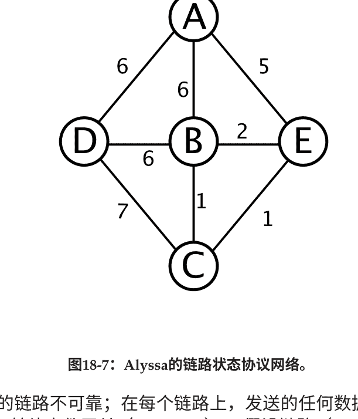

图18-7：Alyssa的链路状态协议网络。

Alyssa网络中的链路不可靠；在每个链路上，发送的任何数据包以概率p被传递到链路的另一端，与其他事件无关（0 < p < 1）。假设链路（CE）和（BD）失败。

回答以下问题。

+   (a) C和E如何发现链路故障？这种方法是如何工作的？

在这个不可靠的网络中，链路状态广告（LSA）根据上述概率丢失。由于软件中的错误，E不会产生任何自己的LSA或者传播它们，但是除了E之外的所有其他节点都正常工作。计算A从C发出的第一个LSA中得知链路（CE）故障的概率，假设C已经发现链路（CE）故障。注意，链路（BD）也已经故障。

(c) 假设只有链路（CE）失败了，而不是（BD），像其他幸存的链路一样，可以以概率p成功传递数据包。现在，对于上面的问题（b），答案会增加、减少还是保持不变？为什么？（不需要数学计算。）

麻省理工学院开放式课程

http://ocw.mit.edu

# 6.02电子工程与计算机科学II：数字通信系统

2012年秋季

有关引用这些材料或我们的使用条款的信息，请访问：http://ocw.mit.edu/terms。

# 可靠数据传输协议

# 第19章

在最佳努力网络中，数据包的生活很艰难。它们可能因为各种原因而丢失，包括因为拥塞导致的交换机队列溢出、共享媒体上的重复碰撞、路由故障和无法纠正的位错误。此外，数据包可能以不同的顺序到达目的地，因为不同的数据包可能采用不同的路径，或者因为某些中间路由器以某种原因重新排序数据包。它们通常会经历可变的延迟，特别是在遇到队列时。在某些情况下，底层网络甚至可能复制数据包。

许多应用程序，如网页下载、文件传输和交互式终端会话，希望获得可靠、有序的数据流，按照发送顺序接收每个字节的确切副本。可靠的传输协议的工作是隐藏不可靠网络的不确定性，如数据包丢失、数据包重排序和重复数据包，为应用程序提供可靠数据包流的抽象。我们将开发一些能够提供有序传递的协议。

**已经开发了大量的协议供各种应用程序使用，提供可靠、有序的抽象有多种方式。本章不会讨论所有这些协议，而是会详细讨论两种协议。第一个协议称为“停止等待”，它可能以一种相对低效的方式解决问题，但确实有效。第二个协议将使用滑动窗口来显著提高性能。**

所有可靠的传输协议都使用相同的强大思想：冗余来应对数据包丢失，接收方缓冲来应对重排序，并且大多数使用自适应定时器。棘手的部分是确定如何以数据包重传的形式应用冗余，确定何时进行重传，并实现良好的性能。本章将研究这些问题，并讨论可靠传输协议如何实现高吞吐量的方法。

# ■ 19.1 问题

我们要解决的问题相对简单。发送方应用程序希望通过最佳努力网络将数据包流发送到接收方应用程序，该网络可以任意丢弃、任意重新排序、任意延迟数据包，并且可能会重复数据包。

接收方希望按照发送方发送的顺序接收数据包，并且希望每个数据包只有一个副本。我们的目标是设计发送方和接收方节点之间实现接收方要求的机制。这些机制涉及发送方和接收方之间的规则，构成协议。除了正确性，我们还将关注协议的吞吐量计算，并提出最大化吞吐量的方法。

可以任意丢弃数据包、任意重新排序数据包、任意延迟数据包，并且可能会重复数据包。接收方希望按照发送方发送的顺序接收数据包，并且希望每个数据包只有一个副本。¹我们的目标是设计发送方和接收方节点之间实现接收方要求的机制。这些机制涉及发送方和接收方之间的规则，构成协议。除了正确性，我们还将关注协议的吞吐量计算，并提出最大化吞吐量的方法。

所有从丢包或损坏比特引起的损失中恢复的机制都使用冗余。我们已经学习了纠错码，例如线性分组码和卷积码，以减轻比特错误的影响。原则上，可以应用类似的编码技术在数据包上（而不是比特上）进行恢复，以从数据包丢失中恢复。然而，我们不仅仅对减少有效数据包丢失率的方案感兴趣，而是要完全消除其影响，并恢复所有丢失的数据包。我们还可以依靠接收方的反馈来帮助发送方确定在任何时间点发送什么，以实现这个目标。因此，我们将重点关注通过重传来从数据包丢失中恢复；在某些条件下，可以将重传和纠错码结合起来以产生进一步提高吞吐量的协议。一般而言，经验表明，如果数据包丢失不是持续发生且以突发方式发生，并且延迟不过长（即不超过多秒），仅通过重传就足以从损失中恢复并实现良好的吞吐量。今天在互联网路径上运行的大多数实用可靠数据传输协议仅使用数据包的重传（单个链路通常使用我们之前学习的纠错方法，并且还可以通过有限数量的重传来降低链路级数据包丢失率）。

我们将为两种可靠的数据传输协议开发关键思想：停止等待和滑动窗口，其中滑动窗口具有固定的窗口大小。我们将使用“发送方”一词来指代传输协议的发送端，使用“接收方”一词来指代接收端。我们将使用“发送方应用程序”和“接收方应用程序”来指代希望以可靠、有序方式发送和接收数据的进程（应用程序）。

# ■ 19.2 停止等待协议

该协议的高级思想很简单。发送方将传输层头部附加到每个数据包上，其中包括数据包的唯一标识符（传输层头部与第17章和第18章讨论的包含目标地址、跳数限制和头部校验和的网络层数据包头部不同）。理想情况下，这个唯一标识符在同一流上永远不会被两个不同的数据包重复使用。

> 1 “仅有一个副本”要求的原因是解决问题的机制会重新传输数据包，因此可能会出现需要过滤的重复数据包。在某些网络中，由于它们用于提高数据包传递概率或比特错误率的机制，可能会出现一些链路重复数据包的情况。

> 2 在理想的实现中，这种重用永远不会发生。然而，在实践中，传输协议可能使用的序列号字段的宽度不够大，序列号可能会循环。在这种情况下，确保两个不同的未确认数据包永远不会具有相同的序列号非常重要。

[PAGE 315]

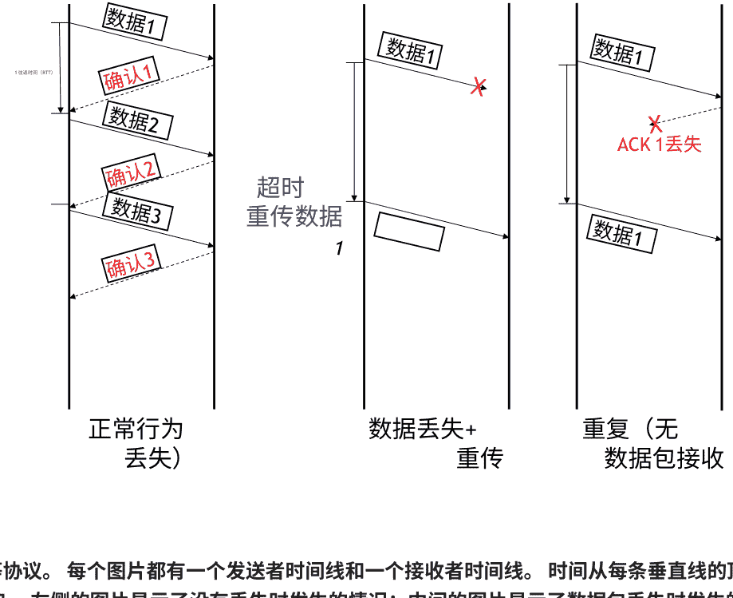

**图19-1：停等协议。** 每个图片都有一个发送者时间线和一个接收者时间线。时间从每条垂直线的顶部开始，向下移动增加。左侧的图片显示了没有丢失时发生的情况；中间的图片显示了数据包丢失时发生的情况；右侧的图片显示了由于ACK丢失而可能到达接收者的重复数据包的情况。

接收者在接收到标识符为k的数据包时，将向发送者发送一个确认（ACK）；此ACK的头部包含k，因此接收者向发送者传达“我收到了数据包k”。数据包和ACK都可能在网络中丢失。在停等协议中，如果发送者收到了k的ACK，它才会在流中发送下一个数据包。如果在一段时间内（称为超时），发送者没有收到ACK，它会重新传输数据包k。

接收器的工作是将接收到的每个数据包传递给接收器应用程序。图19-1显示了协议在数据包未丢失时的基本操作（左侧）和数据包丢失时的操作（右侧）。这个协议的三个特性值得讨论：

+   1. 为什么该协议可能会将重复的数据包传递给接收器应用程序，以及接收器如何防止这种情况发生，以及
+   2. 如何选择超时时间。我们将在下面逐一讨论这些问题。

# 序列号。

+   - 19.2.1 选择唯一标识符：序列号

发送方可以为数据包选择任何唯一的标识符。

+   - 在大多数传输协议中，选择递增的序列号作为唯一标识符是一种方便且有效的实现这个目标的最简单方法是发送方和接收方就标识符的初始值达成一致（对于我们的目的，初始值将被视为1## 图19-2：在许多网络中，RTT变化很大。

解决选择超时值问题的一个好方法使用了我们在课程中已经见过的两个工具：概率分布（在我们的情况下是RTT估计）和简单的滤波器设计。

假设我们有兴趣事后估计一个好的超时值：即，假设我们运行协议并收集一系列RTT样本，如何使用这些值来选择一个好的超时值？我们可以将所有的RTT样本绘制成概率分布，并查看任何给定的超时值在误传概率方面的表现如何。如果超时值为T，则可以估计这个概率为图19-3左侧图片中“T”右侧曲线下的面积，该图片显示了RTT样本的直方图。或者，如果我们观察RTT样本的累积分布函数（图19-3右侧图片），则可以假设误传概率为y轴上与x轴上的T值相对应的值。

实际世界中RTT的分布并不是高斯分布，但所有分布的一个有趣特性是，如果你选择一个足够多个标准差大于均值的阈值，样本超过该阈值的尾概率可以任意小。（对于数学倾向的人来说，一个对任意分布有用的结果是切比雪夫不等式，你可能在其他课程中已经见过（或者即将见到）：P（|X-μ| ≥ kσ）≤ 1/k^2，其中μ是均值，σ是标准差。对于高斯分布，尾概率下降得比1/k^2快得多；例如，当k=2时，高斯尾概率仅约为0.05，当k=3时，尾概率约为0.003。）

协议设计者可以使用过去的RTT样本来确定一个RTT截断，以便只有一小部分样本较大。选择取决于一个人愿意容忍的虚假重传率，并且根据协议的不同，这样做的成本可能很小或很大。从经验上看，互联网传输协议倾向于

## 第19.3节 自适应RTT估计和设置超时

**图19-3：** 在宽区域蜂窝无线网络（Verizon Wireless的3G CDMA RevA服务）上，无论是在空闲时期还是在数据传输进行时，RTT变化都显示出极高的RTT值和高度可变性。两张图片的x轴都是以毫秒为单位的RTT。左边的图片显示了直方图（每个柱状图表示RTT值在该柱状图范围内的总概率），而右边的图片是累积分布函数（CDF）。这些延迟表明网络设计不佳，队列过长只会导致延迟非常大。当然，这意味着超时方法必须尽可能地适应这些变化。（数据收集于2009年11月，位于马萨诸塞州的剑桥和贝尔蒙特。）

要保守并使用 *k = 4*，以尽量减小虚假重传的可能性，因为事实证明在已经拥塞的网络上进行一次重传的成本相当大。

请注意，这种方法与我们在课程早期从电压样本的概率密度函数估计比特错误率时所做的类似，其中超过（或低于）阈值的值将对应于比特错误。在我们的情况下，“错误”是虚假重传。

到目前为止，我们已经讨论了如何在事后的方式中设置超时，假设我们知道RTT样本是什么。现在我们需要讨论两个重要问题来完成这个故事：

+   1. 发送方如何获得RTT估计？
+   2. 发送方如何估计均值和标准差，并选择合适的超时时间？

**获取RTT估计。** 如果发送方跟踪每个数据包发送的时间，那么当它收到该数据包的ACK时，它可以获得一个RTT样本。RTT样本就是ACK到达时间与数据包发送时间之间的时间差。在协议中跟踪这些信息的一种优雅的方式是发送方在每个发送的数据包的头部包含当前时间的“时间戳”字段。接收方只需在其ACK中回显此时间。当发送方收到ACK时，只需查看当前时间并减去回显的时间戳即可获得一个RTT样本。

## 计算超时时间。如上所述，我们的计划是选择一个超时时间，该超时时间同时使用RTT样本分布的平均值和偏差。发送方在估计这些值时必须考虑两个因素：

+   1. 它不能被过大或过小的罕见样本所影响。  
   也就是说，它必须采用某种“平滑”方法。
+   2. 它必须将最近的估计值权重高于旧的估计值，因为网络条件可能在多个RTT之间发生变化。

因此，我们希望能够跟踪变化的条件，同时不被不持续的突然变化所影响。

让我们先看看第一个要求。给定一系列的RTT样本，$r_0,\ r_1,\ r_2,\ \ldots,\ r_n$，我们希望得到一系列平滑的输出，$s_0,\ s_1,\ s_2,\ \ldots,\ s_n$，避免被不持续的突然变化所影响。这个问题听起来像是一个滤波问题，我们之前已经研究过。当然，不同之处在于我们没有将其应用于频分复用，但底层问题是低通滤波器（LPF）所做的。一个简单的低通滤波器，提供我们所需的形式如下：

```
$$s_n = \alpha r_n + (1-\alpha)s_{n-1}, \qquad (19.1)$$
```

其中 $0<\alpha<1$。

为了看清楚等式（19.1）是一个低通滤波器，让我们写下频率响应，$H(\Omega)$。我们知道如果 $r(n)=e^{\Lambda j\Omega n}$，那么 $s(n)=H(\Omega)e^{\Lambda j\Omega n}$。让 $z=e^{\Lambda j\Omega}$，我们可以重写等式（19.1）为

```
$$H(\Omega)z^n = \alpha z^n + (1-\alpha)H(\Omega)z^{(n-1)},$$
```

然后给我们

```
$$H(\Omega)=\frac{\alpha z}{z-(1-\alpha)}, \qquad (19.2)$$
```

这个滤波器有一个实数极点，在 $0<\alpha<1$ 时是稳定的。频率响应的峰值在 $\Omega=0$ 处。

$\alpha$ 是做什么的？显然，较大的 $\alpha$ 值意味着我们更加重视当前样本而不是现有的估计值，因此系统中的记忆较少，并且我们比较容易让高频率通过较小的 $\alpha$ 值。$\alpha$ 的作用是确定LPF的频率响应衰减的速率：较小的 $\alpha$ 值会减少较高频率的成分通过，但同时需要更长的时间来对网络的RTT进行持续性变化的反应。随着 $\alpha$ 的增加，我们允许更多的高频率通过。图19-4说明了这一点。

图19-5展示了不同 $\alpha$ 值对RTT的突然非持久性变化的反应，而图19-6展示了它们对RTT的突然但持久性变化的反应。根据经验，在由于拥塞而导致RTT变化的网络上，研究人员发现 $\alpha$ 在0.1到0.25之间效果良好。实际上，TCP使用 $\alpha=1/8$。

方程式19.1的具体形式在许多网络和计算机系统中非常流行，并且有一个特殊的名称：指数加权移动平均（EWMA）。这是一个“移动平均”，因为低通滤波器产生了平滑的平均行为估计。这是“指数加权”的，因为给予旧样本的权重逐渐衰减。

## 超时时间的指数退避。当发生超时并且发送方重新传输数据包时，它可能再次丢失（或者它的ACK可能丢失）。在这种情况下，可能是网络严重拥塞（在拥塞是数据包丢失的主要原因的网络中）。与其使用相同的超时值并重新传输，不如从我们之前研究过的争用MAC协议的指数退避思想中借鉴一下，将超时值加倍。最终，当重新传输的数据包被确认时，发送方可以恢复到根据平均往返时间和线性偏差计算的超时值。大多数可靠传输协议都使用自适应定时器和这样的指数退避机制。

> 4 平均线性偏差总是至少与样本标准偏差一样大，因此选择超时时间等于平均值加上$k$倍的线性偏差的尾部概率不大于选择超时时间等于平均值加上$k$倍的样本标准偏差。

## 停等协议的吞吐量

我们现在展示如何计算停等协议的吞吐量。显然，当没有数据包丢失时，最大吞吐量发生。发送方每个往返时间发送一个数据包，所以最大吞吐量正好是那样。

当网络的数据包丢失率为 \(C\)时，我们也可以计算停等协议的吞吐量。为了方便起见，我们将 \(C\)视为双向丢包率；即，任何给定数据包或其确认丢失的概率为 \(C\)。我们假设数据包丢失分布是独立且相同分布的。在这种情况下，停等协议的吞吐量是多少？

答案显然取决于使用的超时时间。假设重传超时时间为RTO，为简单起见我们假设它是一个常数（即，在整个连接过程中保持不变，并且发送方不使用指数退避）。这些假设意味着下面的计算可以被视为对吞吐量的一个（较好的）上界。

让\(T\)表示发送数据包并获得ACK的预期时间。观察到，以概率\(1-C\)，数据包能够到达接收方并且其ACK能够到达发送方。另一方面，以概率\(C\)，发送方需要超时并重新传输数据包。我们可以利用这个性质来写出\(T\)的表达式：

```
T = (1-C)\cdot RTT + C(RTO + T),
```

因为一旦发送方超时，发送数据包并获得ACK的预期时间正好是我们要计算的\(T\)。解方程（19.4），我们得到

```
T = RTT + \frac{C}{1-C} \cdot RTO.
```

协议的预期吞吐量等于每秒\(1/T\)个数据包。停等协议的好处在于它非常简单，并且应该在两种情况下使用：首先，当吞吐量不是一个问题，而且需要良好的可靠性；其次，当网络路径具有较小的RTT时，发送一个数据包每个RTT足以饱和发送方和接收方之间的带宽或路径。

另一方面，波士顿和旧金山之间的典型互联网路径可能具有约100毫秒的RTT。如果网络路径的比特率为1兆比特/秒，并且我们使用的数据包大小为10,000比特，则停等协议的最大吞吐量仅为可能速率的10%。而且在面对数据包丢失时，它将远低于这个值。

下一节将介绍一种提供更高吞吐量的协议。

> 一般来说，我们将丢包率视为丢包的概率，因此它是一个无单位的量，介于0和1之间；它不是像吞吐量那样的“速率”。更好的术语可能是“丢包概率”或“丢包比率”，但“丢包率”已成为网络中的标准术语。

> 细心的读者或纯粹主义者可能会注意到，我们只计算了\(T\)，即数据包传输和收到ACK之间的预期时间。然后我们假设\(X\)的倒数的期望值等于\(T\)，其中\(X\)是一个随机变量，其期望值为\(T\)。然而，一般来说，\(1/E[X]\)不等于\(E[1/X]\)。但是我们所写的预期吞吐量的公式确实成立。直观地说，为了理解这一点，定义\(Y_n=X_1+X_2+\cdots+X_n\)。当\(n\to\infty\)时，可以使用切比雪夫不等式证明\(Y_n-nT>\delta_n\)的概率趋近于0（对任何正数\(\delta\)）。也就是说，从长期来看，随机变量\(X\)看起来像一个常数，这是唯一使倒数的期望值等于倒数的期望值的分布。

## 19.5 滑动窗口协议

使用一个数据包窗口，在发送方和接收方之间的路径上有多个未确认的数据包。在这里，“未确认”意味着“未收到确认”。然后，我们的想法是将数据包的传输与 ACK 的接收重叠。对于我们的目的，窗口大小为 W 个数据包意味着发送方在任何时候最多有 W 个未确认的数据包。我们的协议将允许发送方选择 W，并且发送方将尽力始终在网络中保持 W 个未确认的数据包。接收方与停等情况几乎完全相同，只是它还必须缓冲可能无序到达的数据包，以便按顺序将它们传递给接收应用程序。

这个改进使接收器比以前更复杂，但在大多数情况下，这种复杂性是值得的，因为它提高了吞吐量。

协议中的关键思想是，每当发送方收到一个 ACK 时，窗口就会滑动一次。原因是收到 ACK 是一个积极的信号，表示一个数据包离开了网络，因此发送方可以添加另一个数据包来补充窗口。图 19-7 显示了这个计划，图中显示了一个发送方（顶部线条）的窗口大小为 5，以及一个接收方（底部线条）在收到数据包时发送 ACK（虚线箭头）。时间从左到右流动。

在可靠传输协议中，至少有两种不同的定义窗口的方式。在这里，我们将使用以下方式：

## 窗口大小为W意味着发送方和接收方之间未确认的数据包的最大数量是W。

当没有数据包丢失时，滑动窗口协议的操作相当简单。发送方在收到ACK时传输下一个顺序的数据包；如果ACK是针对数据包k且窗口大小为W，则发送的数据包的序列号为k+W。接收方使用ACK来估计平滑的往返时间（RTT）和线性偏差，并设置超时。

当然，只有在数据包在一定时间内没有收到ACK时才会使用超时。现在我们考虑当数据包丢失时会发生什么。

假设接收方已经接收到数据包0到k-1，发送方没有收到数据包k的ACK。如果窗口中的后续数据包到达接收方，则每个数据包都会触发一个ACK。假设没有更多的数据包丢失，发送方将会收到以下ACK：k+1，k+2，…，k+W-1。此外，在收到每个ACK时，会发送一个具有更高序列号的新数据包。但是在这些新数据包传输的过程中，发送方的数据包k的超时会发生，发送方将会重新发送该数据包。如果该数据包到达，它将触发一个ACK，如果该ACK到达发送方，将会发送另一个具有比之前发送的序列号更大的新数据包。如果那个数据包到达，它将触发一个ACK，如果该ACK到达发送方，将会发送一个具有比之前发送的序列号更大的新数据包。

因此，该协议尽力保持尽可能多的未完成数据包，但不超过窗口大小W。如果C个数据包或ACK丢失，则未完成数据包的有效数量减少到W-C，直到其中一个超时，被发送方重新传输并被接收方成功接收并成功接收其ACK。

在本章中，我们将使用固定大小的窗口进行讨论。发送方选择一个最大窗口大小，并在流程中不更改。实际上，互联网上的大多数实际传输协议应该实现拥塞控制策略，以根据当前网络条件（拥塞程度、数据传输速率、数据包丢失率、往返时间等）调整窗口大小。

## ## 19.5.1 滑动窗口发送方

现在，我们描述一下这个固定大小滑动窗口协议的发送方的显著特点。发送方维护未确认数据包的缓冲区。每次发送方被调用时（通过一个细粒度的定时器，我们假设每个时隙触发一次），首先检查是否有任何数据包在“超时”秒之前发送（假设时间以秒为单位）。如果是这样，发送方会重新传输这些数据包，并确保更改每个数据包的传输时间为当前时间。为了方便起见，我们通常在数据包数据结构中维护每个数据包上次发送的时间，尽管也有其他跟踪此信息的方法。

在检查重传之后，发送方继续查看是否可以发送任何新的数据包。为了正确检查是否可以发送任何新的数据包，发送方维护一个变量outstanding，用于跟踪当前未完成的数据包数量。如果这个值小于最大窗口大小，发送方发送一个新的数据包，将序列号设置为最大序列号 +1，其中最大序列号是迄今为止发送的最高序列号。当然，我们还应该记得更新最大序列号，并将未确认增加1。

每当发送方收到一个ACK，它应该从未确认数据包中删除已确认的数据包（假设尚未删除），减少未确认数量，并调用计算超时的过程（该过程将使用当前ACK中回显的时间戳来更新EWMA滤波器并更新超时值）。我们希望未确认能够跟踪发送方和接收方之间未确认的数据包数量。我们已经描述了如何执行此任务的方法：在每次新的数据包传输时将其增加1，在每次未被发送方先前看到的ACK上将其减少1，这对应于发送方认为是首次被确认的先前发送的数据包。现在的问题是，在进行重传时是否应调整未确认。稍加思考就会发现不需要调整。原因是正是在数据包超时时，发送方认为该数据包实际上已丢失，并且在发送方的视图中，该数据包已离开网络。但是，重新传输立即向网络添加了一个数据包，因此未确认数据包的数量保持不变。因此，代码中不需要进行任何更改。

即使完全理解协议，实现滑动窗口协议有时也容易出错。常见的错误有三种。首先，由于EWMA估计器中的错误，超时设置得太低，导致数据包过早地被重新传输，从而产生虚假的重传。除了跟踪发送方的平滑往返时间（srtt）、往返时间偏差和超时估计之外，还建议为每个数据包维护一个重传计数器。如果网络在发送方和接收方之间以及返回的路径上具有一定的总丢包率（即双向丢包率）*p*，重传的次数应该是1-*p*。

的数量级。$\frac{1}{1-p}-1$，假设每个数据包独立且具有相同的丢失概率。（解释为什么这个公式成立是一个有用的练习。）如果你的实现显示出比这个预测值大得多的数字，很可能存在错误。

其次，未完成的数据包数量可能大于配置的窗口大小，这是一个错误。如果发生这种情况，尤其是如果错误导致未完成的数据包数量无限增长，延迟将会增加，同时由于拥塞引起的数据包丢失率也可能增加。有用的是放置一个或两个断言，检查未完成的数据包数量是否超过了配置的窗口大小。

第三，在重新传输数据包时，发送方必须注意修改发送的时间。否则，该数据包将会被重复传输，这是一个相当严重的错误，会导致吞吐量减少。

## ■ 19.5.2 滑动窗口接收器

在接收器端，对于停止等待情况的最大改变是维护一个接收到的乱序数据包列表。将其称为接收缓冲区（rcvbuf）。每个到达的数据包都会被添加到该列表中，假设它尚未在列表中。将其存储起来是很方便的。

> 在我们的实验室中，当你点击发送节点时，这些信息将被打印出来。
[/content]按递增顺序排列。然后，检查是否存在一个或多个连续的数据包，从接收序列号+1开始，并且在接收缓冲区中。如果存在，将它们传递给应用程序，从接收缓冲区中移除，并记住更新接收序列号。

## ■ 19.5.3 吞吐量

我们刚刚开发的滑动窗口协议的吞吐量是多少？显然，当没有数据包或ACK丢失时，我们每个往返时间发送W个数据包，因此在没有丢失的情况下，吞吐量为W/RTT个数据包每秒。因此，人们应该问的问题是，在没有数据包或ACK丢失的情况下，我们应该将W设置为多少才能最大化吞吐量？回答了这个问题之后，我们将为协议在没有丢失的情况下的吞吐量提供一个简单的公式，然后最后考虑数据包丢失的情况。

### 设置 W

可以通过利用Little定律来解决如何选择W的问题。将发送方和接收方之间的整个双向路径视为一个单一队列（实际上比单一队列更复杂，但单一队列的抽象仍然成立）。W是系统中未确认的数据包数量，RTT是数据包传输和发送方收到ACK之间的平均延迟（在此之后发送方会传输新的数据包）。我们希望最大化该系统的处理速率。请注意，该速率不能超过发送方和接收方之间最慢的或瓶颈链路的比特率（即瓶颈链路的速率）。如果该速率为B个数据包每秒，那么根据Little定律，设置W = B × RTT将确保协议接近实现可用比特率的完全利用。

但是在上述公式中RTT应该是多少呢？毕竟，“RTT样本”的定义是数据包传输和接收其ACK之间经过的时间。因此，它取决于使用该路径的其他数据。此外，如果我们看一下公式B = W/RTT，它表明我们可以简单地增加窗口大小W到任意值，B可能相应地增加。显然，那是不对的！考虑一下只有一个连接在网络路径上活动的简单情况。

观察一下，在连接上发送的数据包P所经历的RTT可以分为两部分：一部分不依赖于任何排队延迟（即数据包及其ACK的传播、传输和处理延迟之和），另一部分取决于在瓶颈队列中P之前有多少其他数据包。（在这里，我们假设ACK没有排队，为了简单起见。）将没有排队的RTT表示为RTT_min，即连接可能经历的最小往返时间。

现在，假设连接的往返时间（RTT）等于最小RTT。也就是说，在瓶颈链路上没有队列堆积。那么，连接的吞吐量是W/RTT=W/RTT_min。我们希望这个吞吐量是瓶颈链路的速率B。设置W/RTT_min=B，我们发现W应该等于B·RTT_min。

这个数量——B·RTT_min——是滑动窗口协议（所有滑动窗口协议，不仅仅是我们研究的那个）的一个重要概念。它被称为连接的带宽-延迟乘积，是发送方和接收方之间双向网络路径的一个属性。当窗口大小严格小于带宽时延迟乘积，吞吐量将严格小于瓶颈速率B，并且排队延迟将不存在。在这个阶段，连接的吞吐量随着窗口大小W的增加而线性增加，假设没有其他流量干扰。使吞吐量等于B的最小窗口大小是带宽延迟乘积。

这个讨论表明，对于我们的滑动窗口协议，设置W=B×RTT_{min}可以实现最大可能的吞吐量B，在没有任何数据包或ACK丢失的情况下。当数据包丢失发生时，窗口大小需要更大才能获得最大吞吐量（利用率），因为我们需要足够数量的未确认数据包来保持$B××\ RTTT_{min}$的数据包，即使发生丢失。较小的窗口大小将实现次优吞吐量，与窗口大小成线性关系，与RTT_{min}成反比。

但是一旦W超过B×RTT_{min}，连接所经历的RTT包括排队，而RTT将不再是与W无关的常数！也就是说，增加W将导致RTT增加，但速率B将不再增加。在这种情况下的吞吐量是多少？

我们可以通过两次应用Little定律来回答这个问题。一次在瓶颈链路的队列上，一次在整个网络路径上。我们将展示一个直观的结果，即如果W>B×RTT_{min}，则吞吐量为B个数据包每秒。

首先，让瓶颈链路队列中的平均数据包数量为Q。通过应用Little定律到这个队列，我们知道Q=B·τ，其中B是队列排空的速率（即瓶颈链路速率），τ是队列的平均延迟，所以τ=Q/B。我们还知道

RTT = RTT_{min} + τ = RTT_{min} + Q/B。

考虑窗口大小W，即未确认的数据包数量。我们知道，根据数据包的守恒定律，所有这些数据包必须要么在瓶颈队列中，要么在系统的非队列部分中。也就是说，

W=Q+B·RTT_{min}。

最后，根据Little定律应用于整个双向网络路径，

吞吐量=W/RTT=(B·RTT_{min}+Q)/(RTT_{min}+(Q/B))=B

因此，我们可以得出结论，在没有任何数据包或ACK丢失的情况下，连接的吞吐量如图19-8所示。

### 具有数据包丢失的滑动窗口协议的吞吐量

假设窗口大小设置正确，即W≥B×RTT_{min}始终成立，即使存在数据包或ACK丢失，那么最大的

如果网络有一定的丢包概率，我们滑动窗口协议的吞吐量是多少？

考虑一个简单的模型，网络路径会丢失任何数据包（数据或ACK），使得数据包丢失或其ACK丢失的概率相等，即C，并且数据包丢失的随机过程是独立且相同分布的（与我们对停等协议的分析相同的模型）。然后，我们滑动窗口可靠传输协议实现的利用率最多为 1−C。此外，对于足够大的窗口大小 W，我们的滑动窗口协议接近实现它。

对利用率上限的原因是，在这个协议中，只有当发送方明确收到该数据包的ACK时，数据包才会被确认。现在考虑任何给定数据包在发送方接收到其ACK之前必须经历的传输次数。以概率1−C，我们需要一次传输，以概率C(1−C)，我们需要两次传输，依此类推，给出了我们的预期传输次数。

如果我们进行这么多次传输，一个数据包就成功发送了并得到确认。因此，协议的利用率最多可以达到1−C。实际上，事实证明，1−C是任何通道（网络路径）的容量（即吞吐量的上限）与数据包丢失率C。

事实上，结果证明 1−C 是任何通道（网络路径）丢包率为 C 的吞吐量上限（即容量）。

如果发送方选择的窗口大小足够大，超过带宽最小-往返时间乘积，那么即使在面对数据和ACK丢失的情况下，至少有带宽最小-往返时间的数据包在传输中（未被确认），那么协议的利用率将接近 1−C 的最大值。

## 滑动窗口协议是否需要一个良好的超时时间?

鉴于我们的滑动窗口协议在发送方收到ACK时总是发送数据包，人们可能会合理地问是否设置一个良好的超时值是必要的，尽管在最好的条件下这涉及到一个艰难的权衡。答案是微妙的：超时时间可以相当大，因为只要一些ACK到达，数据包就会继续流动。然而，随着数据包（或ACK）的丢失，有效窗口大小不断减小，最终协议将停止，直到发送方重新传输。因此，不能完全忽视选择超时的任务，但可以选择比停止等待协议中更保守（更长）的超时时间。然而，超时时间越长，接收方应用程序遇到的停顿就越大，即使接收方的传输协议已经接收到数据包，也无法将其传递给应用程序，因为它希望按顺序传递数据。因此，一个良好的超时时间仍然非常有用，并且在设置超时时间方面讨论的原则是广泛适用的。

其次，我们注意到超时时间越长，接收方的缓冲区就越大，当存在丢失时；事实上，在最坏的情况下，接收方的缓冲区大小没有上限。要理解其中的原因，想象一下如果我们不幸丢失了一个具有特定序列号的数据包，但其他所有数据都通过了会发生什么。

上述两个因素影响了传输协议的吞吐量，但是超时时间过长对应用程序（和用户）所感知的延迟有最大的影响。原因是数据包按照协议的顺序传递给应用程序，这意味着丢失一个序列号为k的数据包将导致应用程序停顿，即使序列号大于k的数据包已经到达并在传输协议的接收缓冲区中。因此，过长的超时时间会影响交互性并降低用户体验。

## ■ 19.6 总结

本章介绍了可靠数据传输协议设计中的关键概念。大致思路是利用冗余，通过谨慎的重传来确保数据包的可靠传输。我们引入了序列号来唯一标识数据包，并通过接收方的确认来向发送方表示成功接收了数据包。我们讨论了发送方如何设置合适的超时时间，以在追踪往返时间的持续变化和忽略非持久性故障之间取得平衡。计算超时时间的方法涉及使用指数加权移动平均来估计平滑均值和线性偏差，这相当于一个单零点低通滤波器。超时时间本身设置为均值加上4倍的偏差，以确保虚假重传的尾概率很小。我们在开发简单的停止等待协议中应用了这些思想。

我们开发了滑动窗口的概念来提高性能，并展示了如何修改发送方和接收方以使用这个概念。在停等协议中，发送方和接收方都变得更加复杂，但是当没有丢失时，可以将窗口大小设置为带宽延迟乘积，并在该协议中实现高吞吐量。我们还研究了如何增加窗口大小线性增加吞吐量，直到某一点之后，只有（排队）延迟增加，而不是吞吐量。

## ■ 致谢

感谢Karl Berggren、Katrina LaCurts、Alexandre Megretski、Anirudh Sivaraman、Sari Canelake和Patricia Saylor提出了对本章的各种改进建议。

## ■ 问题和疑问

+   1. 考虑一个具有可变延迟和丢失的尽力而为网络。在这样的网络中，Louis Reasoner建议在正确实现的停等协议中，接收方不需要在ACK中发送序列号，其中发送方仅在接收到数据包k的ACK后才发送数据包k+1。解释他是否正确。

+   2. 802.11（WiFi）链路层使用停等协议来提高链路可靠性。该协议的工作原理如下：

   (a) 发送方在收到数据包k的ACK后，立即将数据包k+1发送给接收方。

   (b) 接收方在接收到完整的数据包后，计算校验和（CRC）。计算CRC的处理时间为Tp，假设它不依赖于数据包大小。

   (c) 如果CRC正确，接收方向发送方发送链路层ACK。ACK的大小可以忽略不计，并且可以瞬间到达发送方。

   发送方和接收方彼此靠近，因此可以忽略传播延迟。
   比特率R=54兆比特/秒，最小数据包大小为540比特，最大数据包大小为5400比特。

   什么是最大处理时间Tp，以确保在没有数据包和ACK丢失的情况下，协议能够实现至少50%的链路比特率的吞吐量？

+   3. Alyssa P. Hacker在家中建立了一个无线网络，使她的计算机（“客户端”）能够与接入点（AP）进行通信。客户端和AP使用一种停等协议进行通信。

   数据包大小为10000比特。AP和客户端之间的往返时间（RTT）等于0.2毫秒（包括处理数据包、传输ACK和处理发送方ACK的时间），加上通过链路传输10000比特数据包的传输时间。

   Alyssa可以为她的链路配置两种可能的传输比特率，具有以下属性：

| 比特率   | 双向数据包丢失概率 | RTT   |
|---------|------------------|------|
| 10兆比特/秒 | 1/11             | ____ |
| 20兆比特/秒 | 1/4              | ____ |

Alyssa的目标是选择一个比特率，以在访问点和客户端之间可靠地传递需要传送的数据包流中提供更高的吞吐量，使用停止和等待协议。对于这两个比特率，重传超时（RTO）为2.4毫秒。

+   （a）计算每个比特率的往返时间（RTT）？

（b）对于每个比特率，计算成功传递一个数据包并获得ACK的预期时间，以毫秒为单位。展示你的计算过程。

（c）根据上述计算，你会选择哪个比特率来实现Alyssa的目标？

4. 假设可靠传输协议中的发送方使用EWMA滤波器来估计平滑的往返时间（srtt），每次收到带有RTT样本r的ACK时。

```
srtt → α·r + (1−α)·srtt
```

我们希望窗口中的每个数据包都对srtt计算贡献至少1%的权重。随着窗口大小的增加，为了实现这个目标，α应该增加、减少还是保持不变？（你应该能够回答这个问题，而不需要写任何方程。）

5. TCP使用EWMA估计器为连接计算平均往返时间（RTT），与前面的问题类似。假设在时间0时，初始估计值srtt等于真实值r0。假设在此时间之后，连接的RTT增加到一个值R，并在连接的剩余时间内保持不变。你可以假设R >> r0。

假设在步骤n处，TCP的重传超时值RTO(n)设置为β·srtt0。计算在我们可以确定没有虚假重传之前的RTT样本数量。旧的TCP实现中，β=2，α=1/8。在解决这个问题之前，需要多少个样本才能避免虚假重传？（如第19.3节所述，TCP现在使用均值线性偏差作为其RTO公式。最初，TCP的RTO公式中没有包含线性偏差。）

6. 考虑一个发送方和接收方之间的滑动窗口协议。接收方应可靠地按顺序将数据包传递给应用程序。

发送方正确地维护以下状态变量：未确认数据包缓冲区。

+   第一个未确认的序列号（如果所有数据包都已确认，则未定义）。____

最后一个未确认的序列号（如果所有数据包都已确认，则未定义）。____

数据包已经被确认
最后发送的 - 到目前为止发送的最高序列号（无论是否被确认）

如果接收方收到的数据包严格大于下一个序列号，它会将数据包添加到缓冲区（如果尚未存在）我们希望确保等待传递的数据包缓冲区的大小永远不会超过一个值 W ≥ 0 写下发送者在发送新的数据包之前应执行的检查，以确保所需的属性

+   7. Alyssa P. Hacker 测量两台计算机之间的网络路径的往返时间（RTT）为100毫秒 排队延迟可以忽略 它们之间的瓶颈链路速率为1兆字节/秒。Alyssa 实现了在6.02中学习的可靠滑动窗口协议，并在这两台计算机之间运行 数据包大小固定为1000字节（可以忽略确认的大小） 没有其他流量

(a) Alyssa将窗口大小设置为10个数据包。瓶颈链路的最大利用率是多少？请解释你的答案。

(b) Alyssa的滑动窗口协议实现中，每个数据包的序列号使用8位字段。假设RTT保持不变，当发生数据包丢失时，导致协议停止正常工作的瓶颈链路带宽的最小值是多少（以M字节/秒为单位）？

假设她的协议中窗口的定义是最后一个传输的序列号与最后一个顺序ACK之间的差值。一个数据包在到达接收方之前丢失了。协议继续进行，没有其他数据包或ACK丢失。接收方希望按顺序将数据传递给应用程序。

在滑动窗口协议中，接收方缓冲区的最大大小（以数据包计）是多少？回答下面两个不同“窗口”定义的问题。

i. 当窗口是发送方最后传输的数据包和接收方最后接收到的顺序ACK之间的最大差异时；ii. 当窗口是发送方未确认的数据包的最大数量时：

+   8. 在我们学习的可靠传输协议中，接收方在接收到序列号为k的数据包时发送一个确认（ACK）说“我收到了 k”。Ben Bitdiddle发明了一种使用累积ACK的不同方法：无论接收方按顺序还是不按顺序收到数据包，它都会发送一个确认说“我收到了直到并包括 C”的所有数据包，其中 C是迄今为止接收到的最高顺序数据包。

窗口的定义与之前相同：窗口大小为 W 意味着未确认数据包的最大数量为 W。每当发送方收到一个ACK，它可以在约束条件下传输一个或多个数据包。

窗口大小。它还实现了一个超时机制，使用这些笔记中描述的算法重新传输它认为丢失的数据包。该协议在最佳努力网络上运行，但网络或链路层不会复制任何数据包或ACK。

发送方根据滑动窗口协议发送一系列新的数据包，并从接收方获得以下累积ACK：

1 2 3 4 4 4 4 4 4 4

(a) 现在，假设发送方超时并重新传输第一个未确认的数据包。当接收方接收到重新传输的数据包时，你能说一下它发送的ACK是什么吗？

+   i. $a = 5$.
ii. $a ≥ 5$.
iii. $5 ≤ a ≤ 11$.
iv. $a = 11$.
v. $a ≤ 11$.

(b) 假设没有丢失ACK，能够产生上述ACK序列的最小窗口大小是多少？

(c) 当数据包在发送到接收器时没有丢失时，给定的累积ACK序列是否可能到达发送器？

(d) 在数据传输的过程中，发送器观察到接收器发送的以下累积ACK序列：21 22 23 25 28

窗口大小为8个数据包。如果发送器希望最大化未确认的数据包数量，在收到上述每个ACK时，应该传输哪些数据包？

| 收到ACK#后，发送什么? | 在收到ACK #后，发送?? |
|------------------|------------------|
| 21               |                  |
| 22               |                  |
| 23               |                  |
| 25               |                  |
| 28               |                  |

9. 给出一个例子，说明在前面问题中描述的累积ACK协议比滑动窗口协议具有更高的吞吐量的情况。

10. 发送方S和接收方R使用滑动窗口协议可靠地通过一系列链路进行通信，窗口大小为W个数据包。S和R之间的路径有一个瓶颈链路（即，其速率限制了可以实现的吞吐量），其数据速率为C个数据包/秒。当窗口大小为W时，瓶颈链路上的队列始终为满状态，其中有Q个数据包。在此数据传输期间，S和R之间的往返时间（RTT）为T秒。

大小为W的窗口协议的排队延迟为T秒，包括排队延迟。在这种情况下，没有数据包或ACK丢失，并且没有其他连接共享此路径。

+   (a) 用其他指定参数的术语写出W的表达式。

(b) 我们希望将窗口大小从W减少，并仍然实现高利用率

## 滑动窗口传输协议优化技术

(b) 您希望将滑动窗口传输协议在上一页所示的网络上的吞吐量加倍。为此，您可以单独应用以下技术之一：

-   ii. 将链路的传播时间减半。
-   iii. 将交换机和接收器之间的链路速率加倍。对于以下每个发送方窗口大小，请列出哪种技术（如果有的话）可以近似加倍吞吐量。如果没有任何技术可以完成任务，请说“无”。对于每个窗口大小，可能有多个答案，如果有多个答案，请列出所有答案。每种技术都可以独立使用。

1.  $W = 10$：____________________
2.  $W = 50$：____________________
3.  $W = 30$：____________________

## EagerB.EaverstartsMyFace社交网络协议分析

12. EagerB.EaverstartsMyFace，一个下一代社交网络网站，在这个网站上，只允许用户上传自己的脸部照片。MyFace有一个简单的请求-响应接口。客户端发送一个请求（请求一个脸部照片），服务器发送一个响应（脸部照片）。请求和响应都放在一个数据包中（响应中的脸部照片是小图片！）。当客户端收到一个响应时，立即发送下一个请求。最大数据包的大小为 $S = 1000$ 字节。

Eager的服务器位于剑桥。客户端来自世界各地。Eager的测量结果显示，典型客户端与服务器之间的往返时间（RTT）为100毫秒（即请求-响应延迟的网络部分，不包括服务器额外的处理时间，为100毫秒）。

如果客户端在时间 $\tau$ 内没有收到服务器的响应，则重新发送请求。它会一直这样做，直到收到响应为止。

-   (a) 上述协议是“至少一次”、“至多一次”还是“恰好一次”？

-   (b) Eager需要为MyFace提供链路带宽。他预计在任何给定时间，发出请求的客户端数量最多为2000。MyFace的最小出站链路带宽是多少，才能确保连接MyFace与互联网的链路不会拥塞？

-   (c) 假设客户端收到服务器对任何给定请求的响应的概率为 $p$。客户端的请求从服务器获得响应的预期时间是多少？你的答案将取决于 $p$、RTT和 $\tau$。

## Tweeter新协议设计

13. Lem E. Tweetit正在为Tweeter设计一种新的协议，这是一个仿Twitter的应用。Tweeter中的所有推文长度为1000字节。每个由客户端发送并由Tweeter服务器接收的推文都会立即得到服务器的确认；如果客户端在超时时间内没有收到确认，则重新发送推文，并重复此过程，直到收到确认为止。

## 数据传输速率与往返时间分析

SirTweetsalot使用的设备的数据传输速率为100K字节/秒，你可以假设这是他的客户端和服务器之间的瓶颈速率。他的客户端和服务器之间的往返传播时间为10毫秒。假设在客户端和服务器之间的任何链路上都没有排队，并且路径上的处理时间为0。你还可以假设ACK非常小，所以消耗的带宽和传输时间可以忽略不计（当然，它们仍然需要从服务器传播到客户端）。不要忽略推文的传输时间。

-   (a) 避免误传输的最小超时值是多少毫秒？

-   (b) 假设超时设置为90毫秒。不幸的是，给定客户端传输获得ACK的概率仅为75%。网络的利用率是多少？

## 停等协议参数计算

14. 发送方A和接收方B使用本章研究的停等协议进行通信。A和B之间的路径上有n个链路，每个链路的数据传输速率为R比特每秒。数据包的大小为S比特，ACK的大小为K比特。每个链路的物理距离为D米，信号传播速度为c米每秒。数据包和其ACK所经历的总处理时间为Tp秒。ACK与数据包在相同的链路上传输，只是在每个链路上的方向相反（链路的传播时间和数据传输速率在链路的两个方向上相同）。在这个网络中没有排队延迟。每个链路的数据包丢失概率为p，数据包丢失是独立发生的。

-   根据给定的参数，以下四个量是什么？

  (a) 数据包在A和B之间的一个链路上的传输时间：__________。

  (b) 数据包在A和B之间n个链路上的传播时间：__________。

  (c) 往返时间（RTT）：A和B之间的__________。（RTT被定义为数据包开始传输到接收方发送ACK完成的经过时间。）

  (d) A发送的数据包到达B的概率：__________。

## 尽力而为网络中的停等协议改进

15. 本章中，Ben Bitdiddle在一个尽力而为的网络上运行的停等传输协议中去掉了数据包头部的时间戳。网络可能会丢失或重新排序数据包，但不会重复数据包。在协议中，接收方对每个接收到的数据包发送一个ACK，回显数据包的序列号。

发送方使用以下方法来估计往返时间（RTT）的连接：

-   1. 当发送方传输一个序列号为k的数据包时，它会记录数据包发送的时间$t_k$。如果传输是序列号为k的数据包的重传，则更新$t_k$。
-   2. 当发送方收到序列号为k的数据包的确认（ACK）时，如果它还没有收到过k的ACK，它会观察当前时间$a_k$，并测量RTT样本$a_k - t_k$。

如果发送方在时间$a_k$收到的ACK是作为对时间$t_k$发送的数据包的响应而发送的，则RTT样本$a_k - t_k$被认为是正确的。
否则，它是不正确的。
对于以下陈述，回答“正确”或“错误”，并解释你的选择。

-   (a) 如果发送方在数据传输过程中从不重新传输数据包，则本方法产生的所有RTT样本都是正确的。
-   (b) 如果网络中从不重新排序数据和ACK数据包，则本方法产生的所有RTT样本都是正确的。
-   (c) 如果发送方在数据传输过程中没有虚假重传（即，仅在所有先前传输的具有相同序列号的数据包在到达接收方之前确实丢失时重新传输数据包），则本方法产生的所有RTT样本都是正确的。

## 修改后的停等协议可靠性分析

16. 选择E。Miser使用本章的停等可靠传输协议，并进行了一项修改：他节俭起见，用一个1位字段替换了序列号字段，决定在数据包之间重复使用序列号。第一个数据包的序列号为1，第二个为0，第三个为1，第四个为0，依此类推。每当接收方收到一个序列号为$s$（=0或1）的数据包时，它会向发送方发送一个ACK，回显$s$。如果接收方收到的数据包的序列号与上一个已传递的数据包的序列号不同，并且在传递后更新了最后传递的序列号，则将数据包传递给应用程序。

他在一个可以丢失数据包（概率小于1）或重新排序数据包，并且延迟是可变的，尽力而为的网络上运行该协议。解释修改后的协议是否始终可靠地按顺序传递数据包流。

## 滑动窗口协议吞吐量分析

17. 考虑使用本章滑动窗口协议的可靠传输连接，其网络路径在没有排队的情况下的往返时延为$RTT_{min}=0.1$秒。连接的瓶颈链路速率为$C=100$个数据包每秒，瓶颈链路前的队列可以容纳$Q=20$个数据包。

假设发送方使用固定窗口大小的滑动窗口协议。
路径上没有其他流量。

-   (a) 如果窗口大小为8个数据包，那么连接的吞吐量是多少？
-   (b) 如果窗口大小为16个数据包，那么连接的吞吐量是多少？
-   (c) 连接的往返时间（RTT）超过RTTmin的最小窗口大小是多少？
-   (d) 发送方窗口大小的最大值是多少，以确保没有数据包因队列溢出而丢失？

## 实验数据包跟踪分析

18. 安妮特·韦尔克正确地实现了本章介绍的固定大小滑动窗口协议。她在发送方添加了仪器，用于存储每个数据包发送的时间和每个ACK接收的时间。下图显示了一次实验中的数据和ACK跟踪的片段。每个+表示一个数据包的传输，x轴表示传输时间，y轴表示序列号。每个×表示一个ACK的接收，x轴表示ACK接收时间，y轴表示ACK序列号。

所有数据包的大小相同。

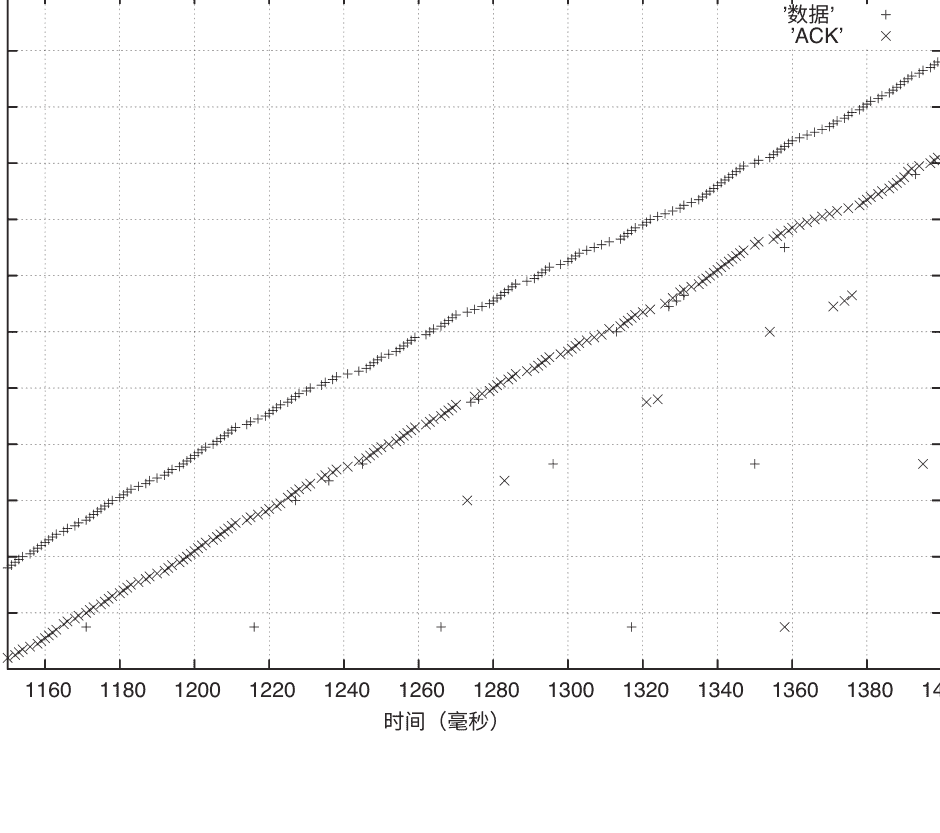

回答以下问题，为每个问题提供简要解释。

-   (a) 估计连接的任何一个往返时间（RTT）。

-   (b) 估计此跟踪的发送方重传超时（RTO）。

-   (c) 在图片上，圈出四个不同序列号的数据包重传。

-   (d) 在此跟踪中，某些数据包可能经历了多次重传？在图片上，画一个方框标记一个这样的重传。

-   (e) 你对发送方的窗口大小有什么最佳估计？

-   (f) 你对连接的吞吐量（每秒数据包数）有什么最佳估计？

-   (g) 仅考虑序列号大于880的数据包，你对DATA数据包的丢包率有什么最佳估计？

## 瓶颈链路参数变化对吞吐量的影响

19. 考虑与上一个问题相同的设置。假设连接的窗口大小等于网络路径的带宽-延迟乘积的两倍。

对于下面给出的网络路径或发送方参数的每次更改，解释连接的吞吐量（而不是利用率）是增加、减少还是保持不变。在每个陈述中，除了该陈述中指定的内容之外，不会发生任何变化。

-   (a) 数据包丢失率C减少到C/3。

-   (b) RTT的最小值R增加到1.8R。

-   (c) 窗口大小W减少到W/3。

## 固定窗口大小下的吞吐量计算

20. Annette Werker在使用本章描述的滑动窗口协议在服务器和客户端之间进行测试。路径上没有其他流量，也没有数据包丢失。Annette发现：

-   • 当窗口大小W为1时，吞吐量为200个数据包每秒。
-   • 当窗口大小W为2时，吞吐量为250个数据包每秒。

安妮特发现，即使这么少的信息也能让她计算出一些东西，假设只有一个瓶颈链路。计算以下内容：

-   (a) 客户端和服务器之间的最小往返时间。
-   (b) 当窗口大小为100个数据包时，瓶颈处的平均排队延迟。
-   (c) 当窗口大小为100个数据包时，平均队列大小。

## 课程信息

麻省理工学院开放式课程
http://ocw.mit.edu

# 6.02电子工程与计算机科学II：数字通信系统

2012年秋季

有关引用这些材料或我们的使用条款的信息，请访问：http://ocw.mit.edu/terms。