# MIT 6.042J：面向计算机科学的数学（MCS）

2015年5月18日星期一修订，01:43

埃里克·莱曼
谷歌公司

F·汤姆森·莱顿
麻省理工学院数学系和计算机科学与人工智能实验室；Akamai Technologies

阿尔伯特·R·迈耶
麻省理工学院电气工程与计算机科学系和计算机科学与人工智能实验室

2015年，埃里克·莱曼，F·汤姆·莱顿，阿尔伯特·R·迈耶。本作品根据创作共用许可条款可获得。
[署名-非商业性使用-相同方式共享3.0许可证。](https://creativecommons.org/licenses/by-nc-sa/3.0/deed.zh)

## 目录

### 证明

- 引言 3
- 0.1 参考文献 4
- 1 什么是证明? 5
- 1.1 命题 5
- 1.2 谓词 8
- 1.3 公理化方法 8
- 1.4 我们的公理 9
- 1.5 证明蕴含 11
- 1.6 证明"如果且仅如果" 13
- 1.7 情况证明 15
- 1.8 反证法证明 16
- 1.9 实践中的好证明 17
- 1.10 参考文献 19
- 2 良序原理 27
- 2.1 良序证明 27
- 2.2 良序证明模板 28
- 2.3 质因数分解 30
- 2.4 良序集合 31
- 3 逻辑公式 41
- 3.1 由命题构造命题 42
- 3.2 计算机程序中的命题逻辑 45
- 3.3 等价性和有效性 48
- 3.4 命题的代数 50
- 3.5 SAT问题 55
- 3.6 谓词公式 56
- 3.7 参考文献 61
- 4 数学数据类型 81
- 4.1 集合 81
- 4.2 序列 86
- 4.3 函数 87
- 4.4 二元关系 89
- 4.5 有限基数 93
- 5 归纳 115
- 5.1 普通归纳 115
- 5.2 强归纳 124
- 5.3 强归纳 vs. 归纳 vs. 良序 129
- 5.4 状态机 130
- 6 递归数据类型 173
- 6.1 递归定义和结构归纳 173
- 6.2 匹配括号的字符串 177
- 6.3 非负整数上的递归函数 180
- 6.4 算术表达式 183
- 6.5 计算机科学中的归纳 188
- 7 无限集合 205
- 7.1 无限基数 206
- 7.2 停机问题 215
- 7.3 集合的逻辑 219
- 7.4 这一切真的有效吗? 222

### II 结构

- 介绍 241
- 8 数论 243
- 8.1 整除性 243
- 8.2 最大公约数 248
- 8.3 素数的奥秘 254
- 8.4 算术基本定理 257
- 8.5 艾伦·图灵 259
- 9 关系 323
- 9.1 关系 323
- 9.2 关系的性质 323
- 9.3 邻接矩阵 323
- 9.4 行走关系 326
- 9.5 有向无环图和调度 327
- 9.6 偏序关系 335
- 9.7 用集合包含表示偏序关系 339
- 9.8 线性顺序 340
- 9.9 乘积顺序 340
- 9.10 等价关系 341
- 9.11 关系属性总结 343
- 10 通信网络 373
- 10.1 完全二叉树 373
- 10.2 路由问题 373
- 10.3 网络直径 374
- 10.4 交换机数量 375
- 10.5 网络延迟 376
- 10.6 拥塞 376
- 10.7 二维数组 377
- 10.8 蝴蝶 379
- 10.9 Benes网络 381
- 11 简单图 393
- 11.1 顶点邻接和度数 393
- 11.2 美国的性别统计 395
- 11.3 一些常见的图 397
- 11.4 同构 399
- 11.5 二分图和匹配 401
- 11.6 稳定婚姻问题 406
- 11.7 着色 413
- 11.8 简单路径 417
- 11.9 连通性 419
- 11.10 森林和树 424
- 11.11 参考文献 433
- 12 平面图 473
- 12.1 在平面上绘制图形 473
- 12.2 欧拉公式 482
- 12.3 外平面图 484
- 12.4 库拉托夫斯基定理 486
- 12.5 对偶图 487
- 12.6 平面图的着色 489
- 12.7 分类多面体 489
- 12.8 平面图的另一种特征描述 492
- 12.9 参考文献 502

### III 计数

- 介绍 501
- 13 和渐近 503
- 13.1 年金的价值 504
- 13.2 幂的和 510
- 13.3 近似求和 512
- 13.4 悬垂边缘 516
- 13.5 乘积 522
- 13.6 双重麻烦 525
- 13.7 渐近符号 528
- 14 基数规则 551
- 14.1 通过计数另一件事来计数一件事 551
- 14.2 计数序列 552
- 14.3 广义乘法规则 555
- 14.4 除法规则 559
- 14.5 计数子集 562
- 14.6 重复序列 564
- 14.7 计数实践：扑克牌手 567
- 14.8 鸽巢原理 572
- 14.9 包含-排除 581
- 14.10 组合证明 587
- 14.11 参考资料 591
- 15 生成函数 627
- 15.1 无穷级数 627
- 15.2 用生成函数计数 629
- 15.3 部分分式 635
- 15.4 解线性递归 638
- 15.5 形式幂级数 643
- 15.6 参考资料 646

### IV 概率

- 介绍 665
- 16 事件和概率空间 667
- 16.1 让我们做个交易 667
- 16.2 四步法 668
- 16.3 奇怪的骰子 677
- 16.4 生日原理 684
- 16.5 集合论和概率 686
- 16.6 参考文献 690
- 17 条件概率 697
- 17.1 蒙提霍尔困惑 697
- 17.2 定义和符号 698
- 17.3 条件概率的四步法 700
- 17.4 为什么树状图有效 702
- 17.5 全概率公式 710
- 17.6 辛普森悖论 712
- 17.7 独立性 714
- 17.8 互相独立 716
- 18 随机变量 739
- 18.1 随机变量示例 739
- 18.2 独立性 741
- 18.3 分布函数 742
- 18.4 估计期望 751
- 18.5 期望的线性性 762
- 19 偏离均值 789
- 19.1 马尔可夫定理 789
- 19.2 切比雪夫定理 792
- 19.3 方差的性质 796
- 19.4 随机抽样估计 800
- 19.5 置信度与概率 806
- 19.6 随机变量的和 807
- 19.7 真正的估计期望 816
- 20 随机游走 839
- 20.1 赌徒破产 839
- 20.2 图上的随机游走 849

### V 递归

- 引言 865
- 21 递归 867
- 21.1 汉诺塔问题 867
- 21.2 归并排序 870
- 21.3 线性递归 874
- 21.4 分治法递归 881
- 21.5 对递归的感觉 888
- 参考文献 895
- 符号表 899
- 索引 902

## I 证明

## 引言

本文介绍如何使用数学模型和方法来分析计算机科学中出现的问题。证明在这项工作中起着核心作用，因为作者与大多数数学家一样，认为证明对于真正的理解是必不可少的。证明在计算机科学中也扮演着越来越重要的角色；它们被用来证明软件和硬件将始终正确地运行，这是无法通过任何测试来实现的。

简单来说，证明是建立真理的一种方法。就像美一样，“真理”有时取决于观察者的眼睛，并且不应该让人感到惊讶的是，什么构成证明在不同领域之间是不同的。例如，在司法系统中，法律真理是由陪审团根据审判中呈现的可接受证据来决定的。在商业世界中，权威真理由可信赖的个人或组织指定，或者可能只是你的老板。在物理学或生物学等领域，科学真理是通过实验来确认的。在统计学中，概率真理是通过对样本数据进行统计分析来建立的。

哲学证明涉及仔细的阐述和说服，通常基于一系列小而合理的论证。最好的例子始于“Cogito ergo sum”，这是一句拉丁文，翻译为“我思故我在”。这个短语来自17世纪数学家/哲学家勒内·笛卡尔的一篇文章的开头，它是世界上最著名的引语之一：在网络上搜索它，你会被淹没在搜索结果中。

从你思考自己存在这一事实推断你的存在是一个相当酷且有说服力的想法。 然而，只需几行代码

1实际上，只有科学的错误可以通过实验来证明——当实验无法按预期进行时。但是无论多少次实验都不能证实下一次实验不会失败。因此，科学家很少谈论真理，而更多地谈论能准确预测过去和未来实验的理论。

在这种论证方式中，笛卡尔继续得出结论，存在一个无限仁慈的上帝。无论你是否相信存在一个无限仁慈的上帝，你都会同意任何对上帝无限仁慈的非常简短的“证明”都是牵强的。 因此，即使在娴熟的手中，这种方法也不可靠。

数学有着自己特定的“证明”概念。

定义。一个命题的数学证明是从一组基本公理出发，通过一系列逻辑推导得出该命题的过程。

在这个定义中，有三个关键概念被强调：命题、逻辑推导和公理。 第一章讨论了这三个概念以及一些基本的证明方法。 第二章介绍了良序原理，一种基本的证明方法；后来，第五章介绍了与之密切相关的归纳法证明方法。

如果你要证明一个命题，你最好对该命题的含义有一个精确的理解。 为了避免普通语言中的歧义和不确定的定义，数学家使用非常精确的语言，他们经常使用逻辑公式来表达命题；这是第三章的主题。

前三章假设读者对一些数学概念如集合和函数有所了解。 第4章和第7章更仔细地研究了这些数学数据类型，特别是证明无限集合性质和方法。 第6章继续研究递归定义的数据类型。

## 0.1 参考文献

- [11], [45], [1]

## 1 什么是证明?

### 1.1 命题

定义。命题是一个陈述，它要么是真的，要么是假的。

例如，以下两个陈述都是命题。第一个是真的，第二个是假的。

命题 1.1.1. $2 + 3 = 5$。

命题 1.1.2. $1 + 1 = 3$。

真或假似乎并不是什么限制，但它排除了诸如“你为何是罗密欧？”和“给我一个$A!$”这样的陈述。它还排除了随情况变化的陈述，例如“现在是五点钟”或“股市明天会上涨”。

不幸的是，判断一个命题是否为真或假并不总是容易的：

命题 1.1.3. 对于每个非负整数，$n$，$n^2 + n + 41$的值是素数。

（素数是大于1且不可被其他大于1的整数整除的整数。例如，2、3、5、7、11是前五个素数。）让我们进行一些数值实验来验证这个命题。

$$
p(n) := n^2 + n + 41. \tag{1.1}
$$

我们从 $p(0) = 41$ 开始，它是素数；然后

$$
p(1) = 43, p(2) = 47, p(3) = 53, \dots, p(20) = 461
$$

都是素数。嗯，看起来像是一个合理的说法。事实上，我们可以一直检查到 $n = 39$并确认 $p(39) = 1601$是素数。

但是 $p(40) = 40^2 + 40 + 41 = 41 \cdot 41$，这不是质数。所以并不是对于所有非负整数，表达式都是质数。事实上，很容易证明没有一个整系数的多项式能够将所有非负数映射到

1符号$::=$表示“定义相等”。我们可以简单地写“$=$”而不是$::=$，但是提醒读者这个等式是根据定义成立的可能会有帮助。

质数，除非它是一个常数（见问题1.17）。但是这个例子的真正重点是要显示一般情况下，你不能通过检查一个无限集合的元素来检查关于该集合的一个断言，无论这个有限集合有多大。顺便说一下，关于所有数字或某种物品的命题是如此常见，以至于有一个特殊的符号表示它们。使用这个符号，命题1.1.3将会是

```
∀ n ∈ ℕ: p(n)是素数: (1.2)
```

这个符号 ∀ 读作“对于所有”。符号 ℕ 代表非负整数：0, 1, 2, 3, ...（请向您的导师索取完整列表）。符号“∈”读作“是成员”，或者“属于”，或者简单地读作“在”。ℕ 后面的句号只是短语之间的分隔符。

这里有两个更极端的例子：

命题 1.1.4. [欧拉猜想] 方程

```
a^4 + b^4 + c^4 = d^4
```

在正整数 a, b, c, d 时，该方程无解。

欧拉（发音为“欧拉”）在1769年提出了这个猜想。但是这个命题在218年后被马萨诸塞大街上的一所文科学院的诺姆·埃尔基斯证明是错误的。他找到的解是 a = 95800, b = 217519, c = 414560, d = 422481。

在逻辑符号中，欧拉猜想可以写成，

```
∀a ∈ ℤ⁺ ∀b ∈ ℤ⁺ ∀c ∈ ℤ⁺ ∀d ∈ ℤ⁺: a⁴ + b⁴ + c⁴ ≠ d⁴.
```

在这里， ℤ⁺ 是正整数的符号。像这样的 ∀ 的字符串通常被缩写以便更容易阅读：

```
∀a, b, c, d ∈ ℤ⁺: a⁴ + b⁴ + c⁴ ≠ d⁴.
```

命题 1.1.5. 313(x³ + y³) = z³ has no solution when x, y, z ∈ ℤ⁺.

这个命题也是错误的，但最小的反例有超过 1000位数！

值得一提的是，还有几个著名的命题在几个世纪之前一直在寻找证明，最终才被发现：

命题 1.1.6 (四色定理)。每张地图都可以用4种颜色着色，使得相邻的²个区域颜色不同。

²只有当两个区域共享一个正长度的边界段时，它们才被认为是相邻的。如果它们的边界只在少数点处相交，则它们不被认为是相邻的。

这个定理的几个错误证明已经发表过，包括一个在19世纪末持续了10年的错误证明。 1976年，数学家阿佩尔和哈肯终于找到了一个费力的证明，他们使用了一个复杂的计算机程序来对四色可着色的地图进行分类。 这个程序留下了几千张未分类的地图，由哈肯和他的助手们手动检查——其中包括他15岁的女儿。

有理由怀疑这是否是一个合法的证明：这个证明太大了，无法在没有计算机的情况下进行检查。 没有人能够保证计算机计算的准确性，也没有人愿意花力气重新检查成千上万张手工绘制的地图的四色问题。 二十年后，人们找到了一个基本可理解的四色定理的证明，但仍需要计算机来检查几百个特殊地图的四色性。

命题 1.1.7 (费马大定理)。不存在正整数 x, y, 和 z，使得

$$x^n + y^n = z^n$$
对于某个大于2的整数n。

在1630年左右他正在阅读的一本书中，费马声称对这个命题有一个证明，但是边距不够写下来。 多年来，该定理已被证明对所有小于等于4,000,000的 n成立，但我们已经看到这并不能保证它对所有 n都成立。 费马大定理和欧拉的错误猜想之间显然存在明显的相似之处。 最终，在1994年，英国数学家安德鲁·怀尔斯在他的阁楼里秘密独自工作了七年后给出了一个证明。他的证明无法适应任何边距。

最后，让我们提到另一个简单陈述的命题，其真实性仍然未知。

命题 1.1.8 (哥德巴赫猜想)。大于2的每个偶数都是两个质数的和。

哥德巴赫猜想可以追溯到1742年。 已知它对于所有小于等于10的18次方的数都成立，但至今没有人知道它是真还是假。

对于计算机科学家来说，证明程序和系统的正确性是最重要的事情之一——无论是一个程序还是一个系统，它们是否按照预期的方式运行。程序通常存在错误，因此有一个不断增长的研究和实践社区致力于寻找证明程序正确性的方法。在CPU芯片的情况下，这些努力已经取得了足够的成功，以至于现在主要芯片制造商常常使用它们来证明芯片的正确性，避免像1990年代那样的臭名昭著的英特尔除法错误。开发数学方法来验证程序和系统仍然是一个活跃的研究领域。我们将在第5章中介绍其中一些方法。

### 1.2 谓词

谓词可以理解为其真值取决于一个或多个变量的命题。因此，“n是一个完全平方数”描述了一个谓词，因为在不知道变量 n 的值之前，无法确定它是真还是假。一旦你知道，例如， n 等于4，那么这个谓词就成为了真命题“4是一个完全平方数”。请记住，命题不一定是真的：如果 n 的值是5，那么你将得到一个假命题“5是一个完全平方数”。

与其他命题一样，谓词通常用一个字母命名。此外，还使用类似函数的符号来表示带有特定变量值的谓词。例如，我们可以使用名称“P”来表示上述谓词：

```
P(n) ::= “n 是一个完全平方数”
```

并通过断言 P(4)为真， P(5)为假来重复上述评论。这种谓词的表示法与普通函数表示法非常相似，容易混淆。如果 P是一个谓词，那么 P(n)要么为 true，要么为 false，具体取决于 n 的值。另一方面，如果 p是一个普通函数，例如 n^2+1，那么 p(n)是一个数值量。不要混淆这两者！

### 1.3 公理化方法

在数学中，建立真理的标准过程是由欧几里得发明的，他是公元前300年左右在亚历山大德里亚的一位数学家。他的想法是从几何学出发，根据直接经验对几何学做出五个不可否认的假设。（例如，“每个点之间都有一条直线段点对"). 像这样的命题被简单地接受为真，被称为公理。

从这些公理开始，欧几里得通过提供“证明”来证明了许多其他命题。证明是从公理和先前证明的命题中进行逻辑推导的一系列步骤，最终得出所讨论的命题。你可能在高中几何课上写过很多证明，而在本文中你将看到更多。

有几个常见的术语用于表示已被证明的命题。不同的术语暗示了命题在更大的工作中的作用。

- 重要的真命题被称为定理.
- 引理是为证明后续命题而有用的初步命题.
- 推论是从定理中经过几个逻辑步骤得出的命题.

这些定义并不精确。事实上，有时一个好的引理比最初用来证明的定理更重要。

欧几里得的公理和证明方法，现在被称为公理化方法，仍然是数学的基础。事实上，只有少数几个公理，称为泽尔梅洛-弗兰克尔与选择公理（ZFC），再加上一些逻辑推导规则，似乎足以推导出几乎所有的数学。我们将在第7章中讨论这些。

## 1.4 我们的公理

ZF+公理在研究和证明数学基础方面非常重要，但是对于实际目的来说，它们太原始了。在ZF+中证明定理有点像用字节码而不是完整的编程语言编写程序——根据一种估算，使用ZF+进行形式化证明2+2=4需要超过20,000步！因此，我们不打算从ZF+开始，而是将一组庞大的公理作为我们的基础：我们将接受高中数学中所有熟悉的事实。

这将为我们提供一个快速启动，但是您可能会发现这个不精确的公理规范有时令人困扰。例如，在证明过程中，您可能会想知道，“我必须证明这个小事实还是可以将其作为公理？”实际上没有绝对的答案，因为合理的假设和需要证明的事实取决于情况和受众。一个很好的一般准则是坦率地说明您假设了什么。

# 第1章 什么是证明?

## 1.4.1 逻辑推导

逻辑推导，或推理规则，用于使用先前证明的命题证明新的命题。

一个基本的推理规则是假言推理。这个规则说，一个 P 的证明和一个 P 蕴含 Q 的证明是 Q 的证明。

推理规则有时以奇怪的符号表示。例如，假言推理被写作：

$$\frac{P,\ P\ \text{蕴含}\ Q}{Q}$$

当上面的陈述被证明时，称为前提，那么我们可以认为下面的陈述，称为结论或推论，也被证明了。

推理规则的一个关键要求是它必须是有效的：对于使所有前提为真的真值分配，P，Q，...，必须也使结论为真。因此，如果我们从真公理开始，并应用有效的推理规则，我们证明的一切也将是真的。

还有许多其他自然的、有效的推理规则，例如：

$$\frac{P\ \text{蕴含}\ Q,\ Q\ \text{蕴含}\ R}{P\ \text{蕴含}\ R}$$

$$\frac{\text{非}\ (P)\ \text{蕴含非}\ (Q)}{Q\ \text{蕴含}\ P}$$

另一方面，

$$\frac{\text{非}\ (P)\ \text{蕴含非}\ (Q)}{P\ \text{蕴含}\ Q}$$

是不正确的：如果 P 被赋值为 T 并且 Q 被赋值为 F，那么前提是真的而结论是假的。

与公理一样，我们对合法推理规则的集合不会过于正式。证明中的每一步都应该清晰和“逻辑”；特别是，你应该说明用于推导每个新结论的先前证明的事实。

## 1.4.2 证明模式

原则上，证明可以是从公理和先前证明的陈述中进行逻辑推导的任何序列，以得出所讨论的命题。在构建证明时，这种自由可能会让人感到不知所措。你甚至如何开始一个证明？

好消息是：许多证明遵循少数几种标准模板之一。每个证明都有其自己的细节，当然，这些模板至少提供了一个填充的大纲。我们将介绍几种标准模式，指出基本思想和常见陷阱，并给出一些例子。许多这些模板可以组合在一起；一个模板可以给出顶层的大纲，而其他模板则可以帮助你进一步细化。我们还将向您展示其他更复杂的证明技巧。

以下的配方有时非常具体，告诉你在纸上写下哪些词。你当然可以用自己的方式说话，我们只是给你一些你可以说的话，这样你就不会完全迷失了。

## 1.5 证明蕴含

形如“如果 P，则 Q”的命题被称为蕴含。这个蕴含经常被重新表述为“P 蕴含 Q”。以下是一些例子：

- (二次方程公式) 如果 ax^2 + bx + c = 0 且 a ≠ 0，则 x = (-b ± √(b^2 - 4ac)) / 2a.
- (哥德巴赫猜想 1.1.8 重新表述) 如果 n 是一个大于2的偶数，则 n 是两个质数的和。
- 如果 0 ≤ □ ≤ 2，那么 -□^3 □ 4□□1 > 0.

有几种标准方法可以证明一个蕴含式。

### 1.5.1 方法 #1

为了证明 □ 蕴含 □ ：

1.  写下 “假设□。”
2.  证明□是逻辑上成立的。

## 例子

**定理 1.5.1.** 如果 $0 \leq x \leq 2$，那么 $-x^3 + 4x + 1 > 0$.

在我们写这个定理的证明之前，我们需要进行一些预备工作来弄清楚它为什么成立。

对于 $x=0$，不等式显然成立，那么左边等于 $1$，而 $1 > 0$。随着 $x$ 的增长，正数项 $4x$ 的绝对值似乎比负数项 $-x^3$ 的绝对值要大。例如，当 $x=1$ 为 $4x = 4$，但是 $-x^3 = -1$ 只有。实际上，看起来 $-x^3$ 并不开始支配直到 $x > 2$。所以，似乎 $-x^3 + 4x$ 部分应该对于所有的 $x$ 在 $0$ 和 $2$ 之间都是非负的，这意味着 $-x^3 + 4x + 1$ 是正的。

到目前为止，一切都很好。但是我们仍然需要用坚实的逻辑论证来替换所有那些“似乎是”短语。通过因式分解，我们可以更好地掌握关键的 $-x^3 + 4x$ 部分，这并不太难：

$$-x^3 + 4x = x(2 - x)(2 + x)$$

啊哈！对于 $x$ 在 $0$ 和 $2$ 之间，右侧所有的项都是非负的。而且，非负项的乘积也是非负的。让我们将这些观察整理成一个清晰的证明。

证明。假设 $0 \leq x \leq 2$。那么 $x, 2 - x,$ 和 $2 + x$ 都是非负数。因此，这些项的乘积也是非负数。把这个乘积加 $1$ 得到一个正数，所以：

$$x(2 - x)(2 + x) + 1 > 0$$

左边展开证明

$$-x^3 + 4x + 1 > 0$$

如所述。

这里有几个适用于所有证明的要点：

- 在你尝试找出证明的逻辑步骤时，你经常需要做一些草稿。你的草稿可以是杂乱无章的，充满了死胡同、奇怪的图表、淫秽的词语，无所谓。但是请将你的草稿与最终的证明分开，最终的证明应该清晰而简洁。
- 证明通常以“证明”一词开始，并以某种分隔符结尾，例如“QED。”这些约定的唯一目的是澄清证明的开始和结束位置。

### 1.5.2 方法 #2 - 证明反命题

蕴含（“P蕴含 Q”）在逻辑上等价于其反命题

非（Q）蕴含非（P）。

证明一个与证明原命题一样好，并且证明反命题有时比证明原命题更容易。如果是这样，那么你可以按照以下步骤进行：

1.  写下“我们证明反命题：”，然后陈述反命题。
2.  按照方法 #1 进行。

## 例子

**定理 1.5.2.** 如果 r 是无理数，则 √r 也是无理数。

当一个数等于整数的商时，它是有理数 —也就是说，如果它等于某些整数 m 和 n 的商。如果它不是有理数，那么它被称为无理数。所以我们必须证明如果 r 不是整数的比率，那么 √r 也不是整数的比率。这很复杂！我们可以通过使用逆否命题来消除 not，并简化证明。

证明。我们证明逆否命题：如果 √r 是有理数，则 r 是有理数。
假设 √r 是有理数。那么存在整数 m 和 n 使得：

$$\sqrt{r} = \frac{m}{n}$$

两边平方得到：

$$r = \frac{m^2}{n^2}$$

由于 m² 和 n² 是整数， r 也是有理数。

## 1.6 证明“如果且仅如果”

许多数学定理断言两个陈述在逻辑上是等价的；也就是说，一个成立当且仅当另一个成立。这是一个已知的例子，已经存在几千年了：

> 如果且仅当两个边长和夹角相同，两个三角形的边长相同。

短语“如果且仅当”经常出现，通常被缩写为“iff”。

### 1.6.1 方法 #1：证明每个陈述都蕴含另一个

陈述 “$P$当且仅当$Q$”等价于两个陈述 “$P$蕴含$Q$”和 “$Q$蕴含$P$”。因此，通过证明两个蕴含关系来证明 “当且仅当”。

1.  写作，“我们证明 $P$ 蕴含 $Q$ 且反之亦然。”
2.  写作，“首先，我们证明 $P$ 蕴含 $Q$。”通过第1.5节中的一种方法来完成。
3.  写作，“现在，我们证明 $Q$ 蕴含 $P$。”同样，通过第1.5节中的一种方法来完成。

### 1.6.2 方法 #2：构建一个Iffs链

为了证明 $P$为真当且仅当 $Q$为真：

1.  写道，“我们构建一个当且仅当蕴含的链。”
2.  证明 $P$等价于第二个陈述，该陈述等价于第三个陈述，依此类推直到达到 $Q$。

这种方法有时比第一种方法需要更多的独创性，但结果可以是一个简短而优雅的证明。

## 例子

一系列值 $x_1, x_2, \ldots, x_n$的标准差 $s$被定义为：

$$ \sqrt{\frac{(x_1 - \mu)^2 + (x_2 - \mu)^2 + \cdots + (x_n - \mu)^2}{n}} \qquad (1.3) $$

其中 $\mu$是值的平均值或均值：

$$ \mu ::= \frac{x_1 + x_2 + \cdots + x_n}{n} $$

**定理 1.6.1.** 一系列数值的标准差 $x_1, \ldots, x_n$等于零当且仅当所有数值都等于均值。

例如，如果每个人的考试成绩都恰好等于班级平均分，则考试成绩的标准差为零。

证明。我们构建了一系列“当且仅当”推论，从标准差（1.3）等于零的陈述开始：

$$ \sqrt{\frac{(x_1 - \mu)^2 + (x_2 - \mu)^2 + \cdots + (x_n - \mu)^2}{n}} = 0. \qquad (1.4) $$

现在，由于零是唯一的平方根为零的数，方程（1.4）成立当且仅当

$$(x_1 - \mu)^2 + (x_2 - \mu)^2 + \cdots + (x_n - \mu)^2 = 0.\qquad(1.5)$$

实数的平方始终为非负数，因此方程（1.5）左侧的每一项都是非负数。这意味着（1.5）成立当且仅当

方程(1.5)左边的每一项都是零。\qquad(1.6)

但是如果一个项 $(x_i - \mu)^2$等于零，那么(1.6)就成立当且仅当

每一个 $x_i$ 都等于平均值。

## 1.7 案例证明

将复杂的证明分解为不同的情况，并分别证明每个情况，这是一种常见且有用的证明策略。下面是一个有趣的例子。

让我们约定，对于任意两个人，他们要么见过面，要么没有见过面。如果一个团体中的每一对人都见过面，我们将称之为一个俱乐部。如果一个团体中的每一对人都没有见过面，我们将称之为一群陌生人。

**定理。** 任意6个人的集合中都包含一个由3个人组成的俱乐部或者一个由3个陌生人组成的群体。

证明。这个证明是通过案例分析$^5$得出的。让 $x$ 表示这六个人中的一个。有两种情况：

1.  在除了 $x$ 之外的其他 5个人中，至少有 3个人见过 $x$。
2.  在其他 5个人中，至少有 3个人没有见过 $x$。

现在，我们必须确保这两种情况中至少有一种成立，$^6$但这很容易：我们将这5个人分成两组，那些与x握过手的人和那些没有握过手的人，所以其中一组必须至少有一半的人。

**情况1：** 假设至少有3个人见过 $x$。

这种情况分为两种子情况：

**案例1.1：** 这些人中没有人彼此见过。那么这些人是至少3个陌生人的一组。该定理在这个子情况下成立。

**案例1.2：** 这些人中有一些人彼此见过。那么那对人，加上$x$，形成一个由3个人组成的俱乐部。因此，该定理在这个子情况下成立。

这意味着该定理在案例1中成立。

**案例2：** 假设至少有3个人没有见过$x$。

这个案例也分为两个子情况：

**案例2.1：** 每对这些人都见过彼此。那么这些人是至少3个人的俱乐部。因此，该定理在这个子情况下成立。

**案例2.2：** 这些人中有一些人没有见过彼此。那么那对人，加上$x$，形成至少3个陌生人的一组。因此，该定理在这个子情况下成立。

这意味着该定理在第二种情况下也成立，因此在所有情况下都成立。

$^5$ 在开始时描述你的方法有助于读者理解。
$^6$ 案例分析的一部分是展示你已经涵盖了所有的情况。这通常是显而易见的，因为这两种情况的形式是“$P$”和“非 $P$”。然而，上述情况并没有这么简单地陈述。

## 1.8 反证法证明

在反证法证明中，你展示了如果一个命题是假的，那么某个错误的事实将会是真的。由于错误的事实根据定义不能是真的，所以该命题必须是真的。

反证法证明总是一种可行的方法。然而，正如其名称所暗示的，间接证明可能有些复杂，因此当直接证明可行时，通常更倾向于使用直接证明。

**方法：** 为了通过反证法证明一个命题 $P$：

1.  写下：“我们使用反证法证明。”
2.  写下：“假设 $P$ 是假的。”
3.  推导出已知为假的事实（逻辑矛盾）。
4.  写下：“这是一个矛盾。因此，$P$必须是真的。”

## 例子

我们将通过反证法证明 √2是无理数。记住，如果一个数等于两个整数的比例，那么它是有理数，例如，3.5 = 7/2和0.1111⋯=1/9都是有理数。

**定理 1.8.1.** √2是无理数。

证明。我们使用反证法。假设命题是错误的，并且 √2是有理数。那么我们可以写成√2作为一个最简分数的形式 $\frac{n}{d}$。

两边平方得到 2 = n^2/d^2，所以 2d^2 = n^2。这意味着 n是 2的倍数（参见问题 1.10 和 1.11）。因此，n^2必须是 4的倍数。

但是由于 2d^2 = n^2，我们知道 2d^2是 4的倍数，所以 d^2是 2的倍数。这意味着 d是 2的倍数。

因此，分子和分母都有2作为公因数，这与 n/d是最简形式相矛盾。因此， √2必须是无理数。

## 1.9 实践中的好证明

证明的一个目的是以绝对的确定性证实一个断言的真实性，并且可以机械地检查长度或复杂性巨大的证明来实现这一点。但是，对于人类来说，只有可理解的证明才能帮助理解这个主题。数学家普遍认为，重要的数学结果在理解其证明之前是无法完全理解的。这就是为什么证明是课程的重要组成部分。

为了易于理解和有帮助，证明需要更多的要求，不仅仅是逻辑正确性：一个好的证明还必须清晰明了。正确性和清晰度通常是一致的；一个写得好的证明更有可能是正确的证明，因为错误更难隐藏。

在实践中，证明的概念是一个不断变化的目标。在专业的研究期刊中，证明通常对除了少数知道证明中使用的所有术语和先前结果的专家以外的人来说是难以理解的。相反，在像6.042这样的初级课程的前几周中，证明会被专业的数学家视为冗长而啰嗦。事实上，在学期后期我们接受的好证明与在6.042的前几周我们认为的好证明是不同的。但即便如此，我们仍然可以提供一些关于写好证明的一般建议：

**明确你的计划。** 一个好的证明从解释推理的一般思路开始，例如，“我们使用案例分析”或“我们通过反证法来证明”。

**保持线性流程。** 有时候证明会像数学马赛克一样编写，独立推理的精彩片段随处可见。这是不好的。一个论证的步骤应该按照一个可理解的顺序进行。

**一个证明是一篇文章，而不是一个计算。** 许多学生最初写证明的方式是他们计算积分的方式。结果是一长串没有解释的表达式，很难理解。这是不好的。一个好的证明通常看起来像一篇文章，其中夹杂着一些方程。使用完整的句子。

**避免过多的符号。** 你的读者可能擅长理解文字，但对阅读晦涩的数学符号的能力较差。在合理的情况下使用文字。

**修改和简化。** 你的读者会感激不尽。

**谨慎引入符号。** 有时候，通过引入一个变量、设计一个特殊的符号或定义一个新的术语，一个论证可以大大简化。但是要节制使用，因为这要求读者记住所有的新内容。并记住实际上定义新变量、术语或符号的含义；不要只是开始使用它们！

**构建长证明。** 长程序通常被分解成一系列较小的过程。长证明也是如此。当你的证明需要易于陈述但不容易证明的事实时，最好将这些事实作为初步引理提取出来。此外，如果你重复地使用基本相同的论证，尝试将该论证捕捉为一个通用引理，以便可以重复引用。

**对“显而易见”的事情要保持警惕。** 当证明中需要熟悉或真正显而易见的事实时，可以将它们标记为这样，并且不需要证明。但要记住，对你来说显而易见的事情可能对你的读者来说并不显而易见。

尤其要注意，不要使用“显然”或“显而易见”等词语试图强迫读者接受你在证明中遇到困难的事情。此外，当你在别人的证明中看到这些词语之一时，要保持警惕。

**完成。** 在证明的某个阶段，你将已经建立了所有必要的事实你需要的。抵制放弃的诱惑，让读者得出“显而易见”的结论。相反，自己把一切联系起来并解释为什么原始的主张成立。

## 1.10 参考文献

创建一个好的证明就像创作一件美丽的艺术品一样。事实上，数学家经常称赞真正好的证明为“优雅”或“美丽”。编写值得称赞的证明需要实践和经验，但为了让你朝着正确的方向开始，我们将为最有用的证明技巧提供模板。

在整个文本中，还有一些伪证—看起来像证明但实际上不是。有时候伪证会得出错误的结论因为错误的步骤或错误的假设。更微妙的伪证会得出正确的结论，但是以不正确的方式，比如循环推理，跳跃到没有理由的结论，或者说证明的难点“留给读者”。学会发现不正确证明中的缺陷将锻炼你从前面的步骤中逻辑地看到每个证明步骤的能力。这也将使你能够发现自己证明中的缺陷。

好的证明和好的程序之间的类比超越了结构。证明所需的严谨思维在关键计算机系统的设计中至关重要。当算法和协议只是“基本工作”时，由于依赖于模糊的论证，结果可能从有问题到灾难性不等。一个早期的例子是Therac 25，这是一台为癌症患者提供放射治疗的机器，但由于软件竞争条件而偶尔导致他们因过量剂量而死亡。一个更近期的例子（2004年8月）涉及到对美国联合航空公司和美国航空公司使用的计算机系统发送了一个错误命令，导致两家公司的整个机队以及所有乘客都被停飞！毫无疑问，我们总有一天会受到你和你的同学设计的关键计算机系统的支配。因此，我们真诚希望你能够发展出能够确保系统实际上做到你所认为的那样的坚实逻辑论证能力！

## 1.10 参考文献

[11], [1], [45], [15], [19]

## 1.1节的问题

**问题1.1.**

毕达哥拉斯定理说，如果 $a$ 和 $b$ 是直角三角形的两边的长度，而 c 是其斜边的长度，那么 \(a^2 + b^2 = c^2\).

这个定理是如此基础和熟悉，以至于我们通常认为它是理所当然的。但仅仅熟悉并不能证明它是“显而易见”的——可以看到人们在过去几千年中一直试图找到不同的证明方法。⁷ 在这个问题中，我们将研究一种特别简单的“无言证明”方法。

这是策略。假设你有四个不同颜色的直角三角形，边长分别为 a，b和 c ，还有一个适当大小的正方形，如图1.1所示。

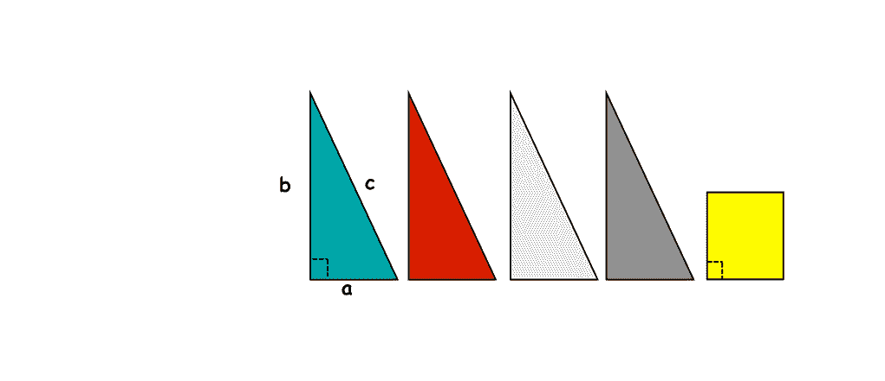

(a) 你首先要安排正方形和四个三角形，使它们形成一个 \(c \times c\) square。从这个安排中，你会看到正方形是 \((b-a) \times (b-a)\)。
(b) 然后，你将安排相同的形状，使它们形成两个正方形，一个是 \(a \times a\)，另一个是 \(b \times b\)。

你知道一个 \(s \times s\) square的面积是 \(s^2\)。所以，根据面积保持不变的原则

通过重新排列，面积保持不变，

你现在可以得出结论 \(a^2 + b^2 = c^2\)，如所述。

这确实是一个优雅而令人信服的勾股定理证明，但它有一些令人担忧的特点。一个担忧是可能有一些特殊的东西

> 在数学网站http://www.cut-the-knot.org/pythagoras/上列出了一百多个不同的证明。

⁷ 可以在 http://www.cut-the-knot.org/pythagoras/ 上找到一个有趣的收集。

关于这些特定三角形和正方形的形状，使得重新排列成为可能 - 例如，假设 $a = b$?

- (c) 你会如何回应这个问题?

- (d) 另一个问题是，在将重新排列成正方形的过程中，隐含地假设了一些关于直角三角形、正方形和线段的事实。列举一些这些假设的事实。

## 问题1.2.

这里发生了什么？！

$$
1 = \sqrt{1} = \sqrt{(-1)(-1)} = \sqrt{-1}\sqrt{-1} = \left(\sqrt{-1}\right)^2 = -1.
$$

- (a) 准确地识别和解释这个错误证明中的错误。

- (b) 正确地证明如果 $1 = -1$, 则 $2 = 1$。

- (c) 每个正实数 $r$ 都有两个平方根，一个是正数，另一个是负数。标准约定是表达式 $\sqrt{r}$ 指的是 $r$ 的正平方根。在假设实数 $r$ 和 $s$ 的乘法具有熟悉的性质的情况下，证明对于正实数 $r$ 和 $s$, $\sqrt{rs} = \sqrt{r} \sqrt{s}$。

## 问题 1.3.

准确地确定以下错误证明中的错误位置。⁸

- (a) 错误声明 : $1/8 > 1/4$。

错误证明.

$$
3 > 2 \\
3 \log_{10}(1/2) > 2 \log_{10}(1/2) \\
\log_{10}(1/2)^3 > \log_{10}(1/2)^2 \\
(1/2)^3 > (1/2)^2,
$$

现在根据乘法分数的规则，得出该声明。

## 第1章 什么是证明？

(b) 错误证明: $1¢ = \$0.01 = (\$0.1)^2 = (10¢)^2 = 100¢ = \$1$. ■

(c) 虚假声明: 如果 $a$ 和 $b$ 是两个相等的实数，那么 $a$ 不等于 0.

错误证明.

$a$ 不等于 $b$  
$a$ 的平方等于 $b$ 的平方  
$a$ 的平方根等于 $b$ 的平方根  
$a$ 的平方等于 $ab$ 的平方 $b$ 的平方  
$(a$ 不等于 $b)(a$ 除以 $b)$ 等于 $(a$ 除以 $b)b$  
$a$ 除以 $b$ 等于 $b$  
$a$ 不等于 0.

## 问题 1.4.

事实上，算术平均数至少与几何平均数一样大，即，$\dfrac{a+b}{2} \geq \sqrt{ab}$ 对于所有非负实数 $a$ 和 $b$。但是以下证明有些不可接受。有什么异议，以及你会如何修复它？

错误证明.

$\dfrac{a+b}{2} \stackrel{?}{\geq} \sqrt{ab},$ 所以

$a+b \stackrel{?}{\geq} 2\sqrt{ab},$ 所以

$a^2 + 2ab + b^2 \stackrel{?}{\geq} 4ab,$ 所以

$a^2 - 2ab + b^2 \stackrel{?}{\geq} 0,$ 所以

$(a - b)^2 \geq 0$ 我们知道是真的。

最后的陈述是真的，因为 $a - b$ 是一个实数，而实数的平方永远不会是负数。这证明了这个说法。 ■

## 1.10. 参考文献

## 问题1.5。

阿尔伯特告诉他的班级，他计划在下周的某个时候给他们一个小测验。

他的学生首先想知道小测验是否可能在下周五。 他们推理出不可能：如果阿尔伯特没有在周五之前给出小测验，那么到周四午夜，他们就会知道小测验必须在周五进行，所以小测验就不再是一个惊喜了。

接下来，学生们想知道阿尔伯特是否可以在周四给出惊喜小测验。他们观察到，如果小测验在周四之前没有给出，那么它必须在周四给出，因为他们已经知道它不能在周五给出。但是，一旦他们弄清楚了这一点，如果小测验在周四进行，那么它也不再是一个惊喜了。
同样，学生们推断出这次测验不可能在星期三、星期二或者星期一。也就是说，阿尔伯特下周不可能突然举行一次测验。所有学生现在都松了口气，他们得出结论认为阿尔伯特一定是在虚张声势。 而且，由于没有人预料到这次测验，所以当阿尔伯特在下周二举行测验时，它真的是一个惊喜！

你认为学生们的推理有什么问题吗？

## 第1.5节的问题

## 作业问题

## 问题1.6.

证明 $\log_7 n$ 要么是整数，要么是无理数，其中 $n$ 是一个正整数。 使用你需要的关于整数和质数的常识，但要明确陈述这些事实。

## 第1.7节的问题

## 课堂问题

## 问题1.7.

如果我们将一个无理数的无理次幂，结果能够是有理数吗？通过考虑以下情况来证明它是可能的 $\sqrt{2}^{\sqrt{2}}$ 并通过案例论证。

## 第1.8节的问题

## 练习题

**问题1.8.**
证明对于任意的 $n > 0$，如果 $a^n$ 是偶数，则 $a$ 是偶数。
提示：反证法。

**问题1.9.**
证明如果 $a \cdot b = n$，则 $a$ 或 $b$ 必须是 $\leq \sqrt{n}$，其中 $a, b$ 和 $n$ 是非负实数。提示：通过反证法，第1.8节。

**问题1.10.**
令 $n$ 为非负整数。
(a) 解释为什么如果 $n^2$ 是偶数（即2的倍数），那么 $n$ 是偶数。
(b) 解释为什么如果 $n^2$ 是3的倍数，那么 $n$ 必须是3的倍数。

**问题1.11.**
举一个例子，两个不同的正整数 $m, n$，使得 $n^2$ 是 $m$ 的倍数，但 $n$ 不是 $m$ 的倍数。 如果 $m$ 小于 $n$，会怎样？

## 课堂问题

**问题 1.12.**
你能推广多远 定理 1.8.1 的证明 $\sqrt{2}$ 是无理数吗？例如，3怎么样？

**问题 1.13.**
证明 $\log_4 6$ 是无理数。

**问题 1.14.**
这里有一个不同的证明 $\sqrt{2}$ 是无理数，摘自《美国数学月刊》，v.116，#1，2009年1月，第69页：
证明。假设为了推导矛盾， $\sqrt{2}$ 是有理数，并选择

证明。假设为了推导矛盾， $\sqrt{2}$ 是有理数，并选择

最小的整数，$q > 0$，使得 $\left(\sqrt{2} - 1\right)^q$ 是非负整数。令 $q' := \left(\sqrt{2} - 1\right) q$。显然 $0 < q' < q$。但是简单的计算表明 $\left(\sqrt{2} - 1\right)^{q'}$ 是非负整数，与 $q$ 的最小性矛盾。

- (a) 这个证明是为大学教师的观众编写的，在这一点上比理想的要简洁一些。写出一个更完整的版本，其中包括每一步的解释。
- (b) 既然你已经证明了这个证明中的步骤，你是否对其中的一个证明更有偏好？为什么？与你的队友讨论这些问题几分钟，并在白板上总结你们团队的答案。

## 问题1.15.

这是一个关于问题1.12的推广，你可能没有考虑到:

引理。设多项式的系数为 $a_0 + a_1 x + a_2 x^2 + \cdots + a_{m-1} x^{m-1} + x^m$ 是整数。那么多项式的任何实根要么是整数，要么是无理数。

- (a) 解释为什么引理立即意味着 $\sqrt[m]{k}$ 当 $k$ 不是某个整数的 $m$ 次幂时，$k$ 是无理数。
- (b) 仔细证明引理。

你可能会发现这对你有帮助:

> 事实。如果一个质数 $p$ 是某个整数的幂的因子，那么它也是这个整数的因子。

你可以假设这个事实而不写下它的证明，但看看你能否解释为什么它是真的。

## 作业问题

## 问题1.16.

在问题1.7中，通过分情况讨论证明了存在无理数 $a$ 和 $b$ 使得 $a^b$ 是有理数。不幸的是，那个证明是非构造性的：它没有揭示出具有这个性质的具体的 $a$ 和 $b$。但事实上，这很容易做到：令 $a$ 等于 2，$b$ 等于 2 的以 2 为底 3 的对数。

通过展示2的以2为底3的对数是无理数，完成对这些 $a$ 和 $b$ 值的证明。证明2的以2为底3的对数是无理数。

## 第1章 什么是证明？

## 问题 1.17.

对于 $n = 40$，多项式 $p(n) := n^2 + n + 41$ 的值不是素数，如第 1.1 节所述。但是根据一般原理，我们可以预测没有非常数多项式可以仅生成素数。

特别地，让 $q(n)$ 是一个具有整数系数的多项式，并且让 $c := q(0)$ 是 $q$ 的常数项。

- (a) 验证对于所有 $m \in \mathbb{Z}$，$q(cm)$ 是 $c$ 的倍数。
- (b) 证明如果 $q$ 是非常数的且 $c > 1$，那么当 $n$ 在非负整数范围内变化时，存在无限多个 $q(n) \in \mathbb{Z}$ 不是素数。
提示：你可以假设任何非常数多项式 $q(n)$ 的大小随着 $n$ 的增长而无限增大的事实。
- (c) 得出结论，对于每个非常数多项式，必须存在一个 $n \in \mathbb{N}$ 使得 $q(n)$ 不是质数。提示：只剩下一个简单的情况。

## 考试问题

## 问题1.18.

证明 $\log_9 12$ 是无理数。

## 问题1.19.

证明 $\log_{12} 18$ 是无理数。

## 2 良序原理

> 每个非空的非负整数集合都有一个最小元素。

这个陈述被称为良序原理。你相信吗？似乎很明显，对吧？但请注意它的严格性：它要求一个非空集合-对于空集来说是错误的，因为它没有最小元素，因为它根本没有元素。并且它要求一个非负整数集合-对于负整数集合和一些非负有理数集合来说是错误的-例如，正有理数集合。因此，良序原理捕捉到了非负整数的一些特殊性质。

虽然良序原理可能看起来很明显，但很难一眼看出它有什么用。但事实上，它提供了离散数学中最重要的证明规则之一。在本章中，我们将通过几个简单的例子来展示这种证明方法的威力。

### 2.1 良序证明

在证明2是无理数时，我们实际上已经默认使用了良序原理。该证明假设对于任意正整数 m 和 n，分数 m/n 可以以最简形式的形式写成 m′/n′，其中 m′ 和 n′ 是没有公共素因子的正整数。我们如何知道这总是可能的？

假设相反，存在正整数 m 和 n 使得分数 m/n 不能以最简形式表示。现在让 C 是这样的正整数集合，它们是这样的分数的分子。那么 m ∈ C，所以 C 是非空的。因此，根据良序性，必须存在一个最小的整数， m_0 ∈ C。所以根据 C 的定义，存在一个整数 n_0 > 0，使得 $\frac{m_0}{n_0}$ 不能以最简形式表示。

这意味着 m_0 和 n_0 必须有一个共同的质因数，p > 1。但是 $$\frac{m_0/p}{n_0/p} = \frac{m_0}{n_0}$$

因此，以任何最简形式表示左手边的分数的方法也适用于 $m_0/n_0$，这意味着这个分数 $m_0/p$ 不能以最简形式表示。所以根据 $C$ 的定义，分子，$m_0/p$，属于 $C$。但是 $m_0/p < m_0$，这与 $C$ 的最小元素的事实相矛盾。由于假设 $C$ 非空导致矛盾，所以 $C$ 必须为空。也就是说，没有分数的分子不能以最简形式表示，因此根本就没有这样的分数。我们从一开始就偷偷使用了良序原理！

## 2.2. 良序证明的模板

更一般地，有一种标准方法可以使用良序原理证明某个属性，$P(n)$ 对于每个非负整数，$n$ 成立。下面是一种标准的组织良序证明的方法：

- 使用良序原理证明“对于所有的 $n \in \mathbb{N}$, $P(n)$ 都为真”：
  - 定义集合 $C$，即 $P$ 为真的反例的集合。具体来说，定义 $C::= \{n \in \mathbb{N} \mid \text{NOT}(P(n)) \text{为真}\}$: (符号 $\{n \mid Q(n)\}$ 表示“所有使得 $Q(n)$ 为真的元素的集合”。参见第4.1.4节。)
  - 假设为了反证法证明 $C$ 是非空的。
  - 根据良序原理，存在一个最小元素，记为 $C$ 中的元素。
  - 通过某种方式得出矛盾，通常是通过证明 $P(n)$ 实际上是真的，或者通过证明 $C$ 中存在比 $n$ 更小的元素。这是证明任务中的开放性部分。
  - 得出结论 $C$ 必须为空，即不存在反例。

### 2.2.1 整数求和

让我们使用这个模板来证明

## 定理2.2.1.

$$
1 + 2 + 3 + \cdots + n = n(n + 1)/2
$$

对于所有非负整数，成立。

首先，在我们被绊倒之前，最好先解决一些模糊的特殊的特殊情况:

- 如果 $n$ 等于1，那么求和式中只有一项，所以 $1 + 2 + 3 + \cdots + n$ 就是第一项。 不要被2和3的外观所误导，也不要被 1和$n$是不同项的建议所误导!
- 如果 $n$ 等于0，那么求和式中根本没有项。 按照惯例，在这种情况下求和结果为0。

因此，虽然省略号表示法很方便，但你必须注意这些特殊情况，其中表示法会误导你。 实际上，每当你看到省略号时，你都应该警惕并确保你理解模式，注意开头和结尾。我们可以通过使用求和符号来重新编写(2.1)式左侧，从而消除猜测的需要:

$$
\sum_{i=1}^{n} i \quad \text{或} \quad \sum_{1 \le i \le n} i。
$$

这两个表达式都表示变量 $i$ 从1到 $n$ 范围内，表达式右边的sigma符号所取的所有值的和。 当 $n = 1$ 时，这两个表达式都清楚地说明了(2.1)的含义。 第二个表达式清楚地说明了当 $n = 0$ 时，求和中没有任何项，尽管你仍然需要知道一个没有数字的求和等于0 (顺便说一句，没有数字的乘积等于1) 。好了，回到证明:

证明。通过反证法。假设定理2.2.1是错误的。 那么，一些非负整数作为反例存在。让我们将它们收集到一个集合中:

$$
C := \{n \in \mathbb{N} \mid 1 + 2 + 3 + \cdots + n \neq \frac{n(n + 1)}{2}\}。
$$

假设存在反例，$C$ 是一个非空的非负整数集合。

因此，根据良序原理，$C$ 有一个最小元素，我们将其称为 $c$。 也就是说，在非负整数中，$c$ 是方程 (2.1) 的最小反例。

由于 $c$ 是最小的反例，我们知道对于所有小于 $c$ 的非负整数 $n$，方程(2.1)是正确的，但对于 $n = c$，方程(2.1)是错误的。但是对于 $n = 0$，方程(2.1)是正确的，所以 $c > 0$。这意味着 $c-1$ 是一个非负整数，并且由于它小于 $c$，方程(2.1)对于 $c-1$ 是正确的。也就是说，

$$
1+2+3+\cdots+(c-1)=\frac{(c-1)c}{2}
$$

但是，将 $c$ 加到两边，我们得到

$$
1+2+3+\cdots+(c-1)+c=\frac{(c-1)c}{2}+c=\frac{c^2-c+2c}{2}=\frac{c(c+1)}{2}
$$

这意味着(2.1)对于 $c$ 是成立的！这是一个矛盾，我们完成了。

## 2.3 分解为质数

我们之前已经默认了质因数分解定理，也被称为唯一分解定理和算术基本定理，它指出每个大于一的整数都可以唯一地表示为质数的乘积。这是另一个那些熟悉的数学事实，我们习以为常，但仔细观察并不明显。我们将在后面的章节中证明质因数分解的唯一性，但良序性给出了一个简单的证明，即每个大于一的整数都可以表示为一些质数的乘积。

## 定理 2.3.1. 每个大于1的正整数都可以分解为质数的乘积。

证明。证明是通过良序性的。设 $C$ 为所有大于1且不能被质数的乘积表示的整数的集合。我们假设 $C$ 非空，并推导出矛盾。如果 $C$ 非空，则根据良序性，存在最小元素 $n \in C$。这个 $n$ 不能是质数，因为质数本身被视为质数的乘积（长度为1的乘积），而 $C$ 中没有这样的乘积。所以 $n$ 必须是两个整数 $a$ 和 $b$ 的乘积，其中 $1 < a, b < n$。由于 $a$ 和 $b$ 比 $C$ 中的最小元素更小，我们知道 $a, b \notin C$。换句话说，$a$ 可以写成质数 $p_1 p_2 \cdots p_k$ 的乘积，而 $b$ 可以写成质数 $q_1 q_2 \cdots q_l$ 的乘积。因此，$n = a \cdot b = p_1 p_2 \cdots p_k q_1 q_2 \cdots q_l$，这是质数的乘积，这与 $n$ 属于 $C$ 相矛盾。因此，$C$ 必须为空，定理得证。 ■

1 . . . 唯一性取决于质因数出现的顺序

## 2.4 有序集合

当一个数字集合的非空子集都有最小元素时，它被称为有序集合。有序集合原理当然适用于非负整数集合，但也适用于许多其他集合，例如每个有限集合，或形如 $r^n$ 的数字集合，其中 $r$ 是一个正实数， $n \in \mathbb{N}$。有序集合常在计算机科学中用作证明计算不会无限运行的方法。这个想法是为计算的连续步骤分配一个值，使得每一步的值都比前一步小。如果这些值都来自一个有序集合，那么计算不会无限运行，因为如果它无限运行，那么分配给其连续步骤的值将定义一个没有最小元素的子集。 在第5.4节，你将看到这种技术应用于证明各种状态机最终会终止的几个例子。

注意，一个集合可能有最小元素但不是良序的。非负有理数集是一个例子：它有一个最小元素零，但也有非空子集没有最小元素，例如正有理数。

下面的定理是良序原理的一个小推广。

> 定理2.4.1. 对于任意非负整数 $n$，大于或等于 $n$ 的整数集是良序的。

这个定理和良序原理一样显然，把它作为另一个公理接受也没有害处。但是，一次又一次地引入公理会让人担忧，当一个潜在的公理实际上可以被证明时，值得注意。 我们可以很容易地使用良序原理证明定理2.4.1：

证明。设 $S$ 是任意非空的整数集 $-n$。现在在 $S$ 的每个元素上加上 $n$，我们称这个新集合为 $S+n$。现在 $S+n$ 是一个非空的非负整数集，根据良序原理，它有一个最小元素 $m$。但是很容易看出 $m - n$ 是 $S$ 的最小元素。 ■

良序的定义规定了每个良序集的子集都是良序的，这导致了定理2.4.1的两个方便的直接推论：

定义 2.4.2. 对于实数集合 $S$，下界（分别是上界）是一个数 $b$，使得对于每个 $S$ 中的元素 $s$，都有 $b \le s$（分别是 $b \ge s$）。

注意，集合 $S$ 的下界或上界不一定是集合中的元素。

推论 2.4.3. 任何具有下界的整数集合都是良序的。

证明。具有下界 $b \in \mathbb{R}$ 的整数集合也会有整数 $\lfloor b \rfloor$ 作为 $\lfloor b \rfloor$ 的下界，其中 $\lfloor b \rfloor$ 称为 $b$ 的底，通过将 $b$ 向下取整得到。因此，定理2.4.1表明该集合是良序的。 ■

推论 2.4.4. 任何具有上界的非空整数集合都有一个最大元素。

证明。假设一个整数集合 $S$ 有一个上界 $b \in \mathbb{R}$。现在将 $S$ 的每个元素乘以-1；我们将这个新的元素集合称为 $-S$。当然，$-b$ 是 $-S$ 的一个下界。所以根据推论 2.4.3， $-S$ 有一个最小元素 $-m$。但是然后很容易看出 $m$ 是 $S$ 的最大元素。 ■

### 2.4.1 另一个不同的良序集合（可选）

另一个良序数集合的例子是可以用形式 $n/(n+1)$ 表示的分数集合 $\mathbb{F}$:

$$
\frac{0}{1}, \frac{1}{2}, \frac{2}{3}, \frac{3}{4}, \ldots, \frac{n}{n+1}, \ldots
$$

任何非空子集 $\mathbb{F}$ 的最小元素就是以形式 $n/(n+1)$ 表示时具有最小分子的那个。

现在我们可以通过将非负整数添加到 $\mathbb{F}$ 中的数字来定义一个非常不同的良序集。也就是说，我们取所有形如 $n + f$ 的数字，其中 $n$ 是非负整数， $f$ 是 $\mathbb{F}$ 中的一个数字。让我们称这组数字为——你猜对了——$\mathbb{N} + \mathbb{F}$。对于 $\mathbb{N} + \mathbb{F}$ 的任何非空子集，有一个简单的方法来找到最小的数字，这解释了为什么这个集合是良序的：

引理 2.4.5. $\quad \mathbb{N} + \mathbb{F}$ 是良序的。

证明。给定任何 $\mathbb{N} + \mathbb{F}$ 的非空子集 $S$，看看所有非负整数 $n$，使得 $n + f$ 对于某个 $f \in \mathbb{F}$ 在 $S$ 中。这是一个非空的非负整数集，所以根据良序原理，存在一个最小的数；称其为 $n_s$。
根据定义，存在某个 $f \in \mathbb{F}$ 使得 $n_s + f$ 在集合 $S$ 中。因此，所有分数 $f$ 使得 $n_s + f \in S$ 的集合是 $\mathbb{F}$ 的一个非空子集，而且由于 $\mathbb{F}$ 是良序的，这个非空集合包含一个最小元素；称之为 $f_s$。现在，很容易验证 $n_s + f_s$ 是 $S$ 的最小元素（问题2.14）。 ■

## 2.4. 有序集合

集合 $\mathbb{N} + \mathbb{Q}$ 与之前的例子不同。在之前的例子中，每个元素都大于只有有限个其他元素。在 $\mathbb{N} + \mathbb{Q}$ 中，大于或等于1的每个元素都可以是任意有限长度的严格递减序列的第一个元素。例如，在 $\mathbb{N} + \mathbb{Q}$ 中，以下递减序列的元素都以1开始：

1, 0.
1, $\frac{1}{2}$, 0.
1, $\frac{2}{3}$, $\frac{1}{2}$, 0.
1, $\frac{3}{4}$, $\frac{2}{3}$, $\frac{1}{2}$, 0.
...

然而，由于 $\mathbb{N} + \mathbb{Q}$ 是良序的，所以在 $\mathbb{N} + \mathbb{Q}$ 中不可能找到一个无限递减的元素序列，因为这样的序列中的元素集合将没有最小值。

## 第2.2节的问题

## 练习题

问题2.1。
为了练习使用良序原理，填写一个易于证明的事实的模板：只使用10美分和15美分邮票可以组装的邮资金额是5的倍数。

特别地，让符号“$j \mid k$”表示整数 $j$ 是整数 $k$ 的除数，并且让 $S(n)$ 表示只使用10美分和15美分邮票可以组装出恰好n美分的邮资。然后证明表明

$S(n)$ 蕴含 $5 \mid n$；对于所有非负整数n：	(2.2)

填写以下（由“…”表示的）证明（2.2）中缺失的部分。

令 $C$ 为 (2.2) 的反例集合，即

$C ::= \{n \mid ...\}$

为了得到矛盾，假设 $C$ 非空。

那么根据WOP，存在一个最小的数，$m \in C$。这个 $m$ 必须是正数，因为....

但是如果 $S(m)$ 成立且 $m$ 是正数，那么 $S(m-10)$ 或 $S(m-15)$ 必须成立，因为....

所以假设 $S(m - 10)$ 成立。那么 $5 \mid (m - 10)$，因为... 但是如果 $5 \mid (m - 10)$，那么显然 $5 \mid m$，与 $m$ 是反例的事实相矛盾。接下来，如果 $S(m - 15)$ 成立，我们以同样的方式得到矛盾。由于两种情况都得到了矛盾，我们得出结论... 这证明了(2.2)成立。

## 第2章 良序原理

### 问题2.2。

斐波那契数列 $F(0), F(1), F(2),\ldots$ 的定义如下:

```
F(0) ::= 0,
F(1) ::= 1,
F(n) ::= F(n - 1) + F(n - 2)  对于 n ≥ 2: (2.3)
```

以下错误证明中的哪个句子包含逻辑错误? 解释。

错误声明。每个斐波那契数都是偶数。

错误的证明。让下面提到的所有变量 $n, m, k$ 都是非负整数。

1.  证明采用WOP方法。
2.  令 $\text{Even}(n)$ 表示 $F(n)$ 是偶数。
3.  令 $C$ 为断言 $\text{Even}(n)$ 对于所有 $n \in \mathbb{N}$ 的反例集合，即 $C ::= \{n \in \mathbb{N} \mid \text{NOT}(\text{Even}(n))\}$。
4.  我们通过反证法证明 $C$ 是空的。所以假设 $C$ 不为空。
5.  根据WOP，存在一个最小的非负整数， $m \in C$,
6.  那么 $m > 0$，因为 $F(0) = 0$ 是一个偶数。
7.  由于 $m$ 是最小的反例，对于所有 $k < m$，$F(k)$都是偶数。
8.  特别地，$F(m - 1)$ 和 $F(m - 2)$ 都是偶数。
9.  但根据定义方程 (2.3) ，$F(m)$等于两个偶数$F(m-1)+F(m-2)$的和，因此它也是偶数。
10. 也就是说，$Even(m)$是真的。
11. 这与 $m$ 的定义中的条件 $NOT(Even(m))$ 相矛盾。
12. 这个矛盾意味着 $C$ 必须为空。因此，对于所有 $n \in \mathbb{N}$，$F(n)$ 都是偶数。

## 2.4. 有序集合

### 问题2.3。

在第2章中，使用了良序原理来证明所有正有理数都可以写成“最简形式”，即作为没有公共质因数的正整数的比值。下面是另一种证明，也得出了这个正确的结论，但这个证明是错误的。确定证明中每一步都做了不合理的推断。

错误的证明。 假设相反，存在一个正有理数 $q$，使得 $q$ 不能写成最简形式。现在让 $C$ 是这样的有理数的集合不能写成最简形式。 那么 $q \in C$，所以 $C$ 是非空的。所以必须存在一个最小的有理数 $q_0 \in C$。 所以由于 $q_0/2 < q_0$，必须能够将 $q_0/2$ 写成最简形式，即

$$\frac{q_0}{2} = \frac{m}{n}$$ (2.4)

对于没有公共质因数的正整数 $m, n$。 现在我们考虑两种情况：

情况1: [$n$ 是奇数]。 那么 $2m$ 和 $n$ 也没有公共质因数，因此

$$q_0 = 2 \cdot \left( \frac{m}{n} \right) = \frac{2m}{n}$$

意味着 $q_0$ 为最简形式，这是一个矛盾。

情况2: [$n$ 是偶数]。 任何 $m$ 和 $n/2$ 的公共质因数也将是 $m$ 和 $n$ 的公共质因数。 因此 $m$ 和 $n/2$ 没有公共质因数，所以

$$q_0 = \frac{m}{n/2}$$

表示 $q_0$ 为最简形式，这是一个矛盾。

由于假设 C 是非空的导致了一个矛盾，所以可以得出结论 C 是空的，也就是说，没有反例。

## 第2章 良序原理

## 课堂问题

### 问题2.4。

使用良序原理 $^2$ 来证明

$$
\sum_{k=0}^{n} k^{2} = \frac{n(n+1)(2n+1)}{6}.
$$

对于所有非负整数，成立。

### 问题 2.5.

使用良序原理证明在正整数范围内没有解的方程：

$$
4a^3 + 2b^3 = c^3.
$$

### 问题 2.6.

给定一系列信封，分别包含1, 2, 4, . . . , $2^m$美元。

定义

> 性质 $m$：对于任何小于 $2^{m+1}$ 的非负整数，存在一种选择的信封，其内容总和为恰好该数目的美元。

使用良序原理（WOP）证明对于所有非负整数 $m$，性质 $m$成立。

提示：考虑两种情况：首先，目标美元数小于 $2^m$，其次，目标数至少为 $2^m$。

## 作业问题

### 问题2.7.

使用良序原理证明任何大于或等于8的整数都可以表示为3和5的非负整数倍之和。

$^2$使用归纳法或已知类似求和公式的其他方法进行证明将不会得到分数。

## 2.4. 有序集合

### 问题2.8.

欧拉在1769年提出的猜想是，该方程没有正整数解

$$
a^4 + b^4 + c^4 = d^4
$$

首次发现满足这个方程的整数值为a，b，c，d是在1986年. 所以欧拉猜错了，但是证明他的错误花了两个多世纪的时间.

现在让我们考虑雷曼的方程，与欧拉的方程类似，但有一些系数:

$$
8a^4 + 4b^4 + 2c^4 = d^4 \quad (2.6)
$$

证明Lehman方程(2.6)确实没有任何正整数解。

提示:考虑(2.6)的所有可能解中的最小值 $a$。

### 问题2.9。

使用良序原理证明

$$
n \leq 3^{n/3} \quad (2.7)
$$

对于每个非负整数，$n$ 成立。

提示:通过明确计算验证 $n \leq 4$的(2.7)。

## 考试题目

### 问题2.10。

除了一个容易修复的遗漏，以下使用良序原理的证明表明，只使用10分和15分邮票可以准确支付的邮资金额是可被5整除的。

即，记号“$j \mid k$”表示整数 $j$是整数 $k$的约数，并且 $S(n)$表示只使用10分和15分邮票可以组合出恰好 $n$分的邮资。 然后证明表明

$$
S(n) \Rightarrow 5 \mid n; \quad 对于所有非负整数n: \quad (2.8)
$$

填写下面证明(2.8)中缺失的部分(用“...”表示)，并且在最后指出证明中的小错误以及如何修复它。

设 $C$ 为(2.8)的反例集合，即

$$
C := \{n \mid S(n) \text{ 和 } \text{NOT}(5 \mid n)\}
$$

为了得到矛盾，假设 C非空。然后根据WOP，存在一个最小的数， m ∈ C。然后 S(m - 10)或者 S(m - 15)必须成立，因为 m分钱邮资由10和15分钱的邮票组成，所以我们移除一个。所以假设 S(m - 10)成立。 那么 5 | (m - 10)，因为... 但是如果 5 | (m - 10)，那么 5 | m，因为... 这与 m 是一个反例的事实相矛盾。接下来假设 S(m - 15)成立。然后对于 m - 10的证明直接适用于 m - 15，从而在这种情况下产生矛盾。由于我们在两种情况下都得到了矛盾，我们得出结论 C必须为空。也就是说，对于(2.8)没有反例，这证明了(2.8)成立。

证明对 m 的值做了一个隐含的假设。陈述这个假设并用一句话证明它。

## 第2章 良序原理

### 问题2.11。

我们将使用良序原理证明对于每个正整数， n，前 n个奇数的和是 n²，也就是说，

$$
\sum_{i=0}^{n-1} (2i + 1) = n^2, \quad (2.9)
$$

对于所有的 n > 0。假设对于某个正整数， n，方程(2.9)不成立。设 m 为最小的这样的数。

(a) 为什么一定存在这样的 m?
(b) 解释为什么 m \geq 2。
(c) 解释为什么(b)部分意味着 \sum_{i=1}^{m-1} (2(i - 1) + 1) = (m - 1)^2, \quad (2.10)
(d) 在(2.10)的左边加上什么项使结果等于 \sum_{i=1}^{m} (2(i - 1) + 1)?
(e)得出方程(2.9)对于所有正整数n成立，n.

## 2.4 有序集合

### 问题2.12.

使用良序原理(WOP)证明

$$
2 + 4 + \dots + 2n = n(n+1) \quad (2.11)
$$

对于所有n > 0.

### 问题2.13.

用良序原理证明对于所有非负整数，n：

$$
\sum_{i=0}^n i^3 = \left( \frac{n(n+1)}{2} \right)^2.
$$

## 第2.4节问题

## 作业问题

### 问题2.14.

通过展示数字nS + fS是S中的最小元素，完成引理2.4.5的证明。

## 练习题

### 问题2.15.

指出以下数字集合中哪些有最小元素，哪些是良序的。对于那些不是良序的，给出一个没有最小元素的子集的例子。

- (a)整数 $-\sqrt{2}.$
- (b)有理数 $\geq \sqrt{2}.$
- (c)形如 $1/n$ 的有理数集合，其中 $n$ 是正整数。
- (d)形如 $m/n$ 的有理数集合，其中$m, n > 0$ 且 $n \leq g$，其中 $g$ 是一个谷歌, $10^{100}$。
- (e)由形如 $n/(n+1)$ 的分数组成的集合 $\mathbb{F}$。
(f)设 $W ::= \mathbb{N} \cup \mathbb{F}$是由非负整数和形如 $n/(n+1)$的分数组成的集合。描述一个长度为5的递减序列，从1开始，... 长度为50的递减序列，... 长度为500的递减序列。

## 第2章 良序原理

### 问题2.16.

使用良序原理证明每个有限的非空实数集合都有最小元素.

## 课堂问题

### 问题2.17.

证明实数集合 $R$是良序的当且仅当不存在无限递减的数列 $R$. 换句话说，不存在一组数 $r_i \in R$满足以下条件

$$
r_0 > r_1 > r_2 > \ldots \quad (2.12)
$$

## 3 逻辑公式

令人惊讶的是人们如何应对英语中的所有歧义。以下是一些说明这个问题的句子：

- “你可以吃蛋糕，或者你可以吃冰淇淋。”
- “如果猪会飞，那么你就能理解切比雪夫界限。”
- “如果你能解决我们提出的任何问题，那么你就能得到课程的 A。”
- “每个美国人都有一个梦想。”

这些句子的确切含义是什么？你可以同时吃蛋糕和冰淇淋，还是必须只能选择一个甜点？猪不能飞，所以第二个句子是否涉及到你对切比雪夫界限的理解？如果你能解决我们提出的一些问题，你能得到一个A吗？如果你不能解决任何一个问题，这是否意味着你不能得到一个A？最后，最后一个句子是否意味着所有美国人都有相同的梦想-比如拥有一所房子-或者不同的美国人有不同的梦想-比如埃里克梦想设计一个杀手级软件应用程序，汤姆梦想成为网球冠军，阿尔伯特梦想能够唱歌？

在正常对话中，一些不确定性是可以容忍的。但是当我们需要精确地表达思想时-如数学和编程中-日常语言中的歧义可能是一个真正的问题。如果我们不确定陈述的确切含义，我们就无法进行精确的论证。因此，在我们开始学习数学之前，我们需要研究如何谈论数学的问题。

为了避免英语的歧义，数学家们发明了一种专门用于描述逻辑关系的语言。这种语言主要使用普通的英语单词和短语，如“或者”，“蕴含”和“对于所有”。但是数学家给这些词汇提供了精确而明确的定义。

令人惊讶的是，在学习逻辑语言的过程中，我们将遇到计算机科学中最重要的未解决问题，这个问题的解决可能会改变世界。

## 3.1 由命题构成的命题

在英语中，我们可以用“不”，“与”，“或”，“蕴含”和“如果-那么”等词汇修改、组合和关联命题。例如，我们可以将三个命题组合成一个命题，如下所示：

> 如果所有人类都是有限的，而所有希腊人都是人类，那么所有希腊人都是有限的。

在接下来的一段时间里，我们不太关心命题的内部结构——无论它们涉及数学还是希腊人的有限性——而是关注命题如何组合和关联。因此，我们经常使用变量如 $P$ 和 $Q$ 来代替具体的命题，如“所有人类都是有限的”和“$2 + 3 = 5$”。理解的是，这些命题变量和命题一样，只能取值 $\mathbf{T}$（真）和 $\mathbf{F}$（假）。命题变量也被称为布尔变量，以纪念它们的发明者、19世纪数学家乔治-布尔。

### 3.1.1 非, 与, 和或

数学家使用词语非, 与, 和或来表示改变或组合命题的操作。这些特殊词语的精确数学含义可以通过真值表来确定。例如，如果 $P$ 是一个命题，那么“非($P$)”也是一个命题，而命题“非($P$)”的真值根据 $P$ 的真值按照以下真值表确定：

| $P$ | 非($P$) |
| :--- | :--- |
| 真 | $\mathbf{F}$ |
| $\mathbf{F}$ | 真 |

表的第一行表示当命题 $P$ 为真时，命题“非($P$)”为假。第二行表示当 $P$ 为假时，“非($P$)”为真。这可能是你所期望的。

一般来说，真值表指示了命题在变量的所有可能真值集合下的真/假值。例如，命题“$P$ 与 $Q$”的真值表有四行，因为有两个变量的四种真值设置。

| $P$ | $Q$ | $P$ AND $Q$ |
| :--- | :--- | :--- |
| $\mathbf{T}$ | $\mathbf{T}$ | 真 |
| $\mathbf{T}$ | $\mathbf{F}$ | $\mathbf{F}$ |
| $\mathbf{F}$ | $\mathbf{T}$ | $\mathbf{F}$ |
| $\mathbf{F}$ | $\mathbf{F}$ | $\mathbf{F}$ |

## 3.1. 由命题构成的命题

根据这个表格，命题“$P$ AND $Q$”只有在 $P$ 和 $Q$ 都为真时才为真。这可能是你通常对“and”这个词的理解方式。对于“$P$ OR $Q$”的真值表中有一个微妙之处：

| $P$ | $Q$ | $P$ OR $Q$ |
|:---:|:---:|:----------:|
| T   | T   | 真         |
| T   | F   | 真         |
| F   | T   | 真         |
| F   | F   | F          |

这个表格的第一行表示，即使$P$和$Q$都为真，“$P$ OR $Q$”也为真。这并不总是日常语言中“或”的预期含义，但这是数学写作中的标准定义。因此，如果一个数学家说：“你可以有蛋糕，也可以有冰淇淋”，他的意思是你可以两者都有。

如果你想排除同时拥有蛋糕和冰淇淋的可能性，你应该使用异或运算符 $XOR$ 来组合它们：

| $P$ | $Q$ | $P$ XOR $Q$ |
|:---:|:---:|:-------------:|
| T   | T   | F             |
| T   | F   | 真            |
| F   | T   | 真            |
| F   | F   | F             |

### 3.1.2 蕴含

具有最不直观技术含义的组合操作是“蕴含”。下面是它的真值表，带有标签的行方便我们以后参考。

| $P$ | $Q$ | $P$ 蕴含 $Q$ | 注释     |
|:---:|:---:|:--------:|:---:|:--------:|
| T   | T   | 真       |     | (真真)   |
| T   | F   | F        |     | (真假)   |
| F   | T   | 真       |     | (假真)   |
| F   | F   | 真       |     | (ff)     |

蕴含的真值表可以用以下话总结：

> 当假设部分为假或结论部分为真时，蕴含为真。

这个句子值得记住；所有数学陈述中有很大一部分都是以如果-那么的形式！让我们用这个定义进行实验。例如，以下命题是真还是假？

# 第3章 逻辑公式

> “如果哥德巴赫猜想成立，那么对于每个实数$x$，$x^{2} \geq 0$。”

现在，我们已经提到没有人知道哥德巴赫猜想，命题1.1.8，是真还是假。但这并不妨碍你回答这个问题！这个命题的形式是 $P$ 蕴含 $Q$，其中假设 $P$ 是“哥德巴赫猜想成立”，结论 $Q$ 是“对于每个实数$x$，$x^{2} \geq 0$。”由于结论明确为真，我们在真真行或假真行上。无论如何，整个命题都是真！我们最初的例子展示了蕴含的更奇怪的一面。

> “如果猪会飞，那么你可以理解切比雪夫界限。”

请不要把这当作侮辱；我们只是需要弄清楚这个命题是真还是假。有趣的是，答案与你是否能理解切比雪夫界限无关。猪不会飞，所以我们在真值表的行（ft）或行（ff）上。在这两种情况下，命题是真的！相比之下，这是一个错误蕴含的例子：

> “如果月亮发白光，那么月亮是由白色切达干酪制成的。”

是的，月亮发白光。但是，不，月亮不是由白色切达奶酪制成的。所以我们在真值表的行（tf）上，命题是假的。

### 假设错误

当人们刚开始学习具有错误假设的蕴含时，通常会感到困扰。但是，在普通情况下，几乎不会出现具有错误假设的蕴含，所以没有太多理由为逻辑学家和数学家选择的真值分配感到困扰。

当然，数学约定的一个好理由是，当假设条件为假时，蕴涵式为真。一个说明性的例子是一个系统规范（见问题3.12），它由一系列规则组成，

如果 $C_i$: 系统传感器处于条件 $i$，则 $A_i$: 系统采取行动 $i$，

或更简洁地说，

$C_i$ 蕴涵 $A_i$

那么系统遵守规范的事实可以通过说 AND

$$[C_{1} \text{ 蕴涵 } A_{1}] \text{ AND } [C_{2} \text{ 蕴涵 } A_{2}] \text{ AND } \cdots \text{ AND } [C_{12} \text{ 蕴涵 } A_{12}] \quad (3.1)$$

这些规则中总是有一个是正确的。

## 3.1.3 当且仅当

数学家通常以一种在日常语言中不会出现的方式来连接命题。命题“$P$当且仅当$Q$”断言$P$和$Q$具有相同的真值。要么两者都为真，要么两者都为假。

| $P$ | $Q$ | $P$当且仅当$Q$ |
| :--- | :--- | :--- |
| T | T | 真 |
| T | F | F |
| F | T | F |
| F | F | 真 |

例如，对于每个实数$x$，以下当且仅当语句都为真：$x^2-4\geq0$当且仅当$|x|\geq2$：对于某些值的$x$，两个不等式都为真。对于其他值的$x$，两个不等式都不为真。然而，在每种情况下，当且仅当命题作为一个整体是真的。

## 3.2 计算机程序中的命题逻辑

命题和逻辑连接词在计算机程序中经常出现。例如，考虑以下代码片段，可以是C、C++或Java：

```
if (x > 0 || (x <= 0 && y > 100) )
    ...

(进一步的说明)
```

Java使用符号 `||` 表示“或”，使用符号 `&&` 表示“与”。只有在单词 `if` 后面的命题为真时，才执行进一步的说明。

仔细观察，这个复杂的表达式由两个更简单的命题构成。

设 A为命题x > 0，设 B为命题y > 100。

那么我们可以将条件重写为

```
A OR (NOT(A) AND B).          (3.2)
```

### 3.2.1 真值表计算

真值表计算显示，更复杂的表达式3.2总是与A OR B具有相同的真值:

```
(3.3)
```

我们从只有 A和B的真值表开始:

| A | B | A OR | (NOT(A) AND B) | A OR B |
|---|---|---|---|---|
| 真值表如下: | | | | |
| 真 | 真 | | | |
| 假 | 假 | | | |
| 真 | 假 | | | |

这些值足以填充另外两列:

| A | B | A OR | (NOT(A) AND B) | A OR B |
|---|---|---|---|---|
| T | T | | F | 真 |
| T | F | | F | 真 |
| F | T | | 真 | 真 |
| F | F | | 真 | F |

现在我们有了填充 AND列所需的值:

| A | B | A OR | (NOT(A) AND B) | A OR B |
|---|---|---|---|---|
| T | T | | F F | 真 |
| T | F | | F F | 真 |
| F | T | | 真 真 | 真 |
| F | F | | 真 F | F |

这提供了填充第一个 OR列所需的值:

| A | B | A OR | (NOT(A) AND B) | A OR B |
|---|---|---|---|---|
| T | T | 真 | F F | 真 |
| T | F | 真 | F F | 真 |
| F | T | 真 | 真 真 | 真 |
| F | F | F | 真 F | F |

真值始终匹配的表达式被称为等价。 由于两个强调的真值列是相同的，它们是等价的。因此，我们可以通过用一个等价的简单表达式替换复杂的表达式来简化代码片段而不改变程序的行为：

```
if ( x > 0 || y > 100 )
:
(进一步的说明)
```

通过案例推理，可以确认(3.2)和(3.3)的等价性：

A是 T。形式为 (的表达式。 T OR任何)等价于T。由于 A是 T，在这种情况下，(3.2)和(3.3)都是这种形式，因此它们具有相同的真值，即 T。

A是 F (一个形式为 (的表达式F或任何东西)的真值与任何东西的真值相同 ( 由于 A是F，(3(3)与 B具有相同的真值一个形式为.的表达式T和 任何东西)等价于任何东西，同样地任何形式为 F或任何东西的表达式 。所以在这种情况下 A或 (非(A)和B)等价于 (非(A)和 B)，进而等价 于 B。因此在这种情况下，(3(2)和(3(3)的真值相同，即 B的值。

简化逻辑表达式在计算机科学中具有实际重要性。像上面的程序中的表达式简化可以使程序更易读和理解。简化的程序可能运行更快，因为它们需要更少的操作。在硬件中，简化表达式可以减少芯片上的逻辑门数量，因为数字电路可以用逻辑公式描述（参见问题3.5和3.6）。最小化逻辑公式对应于减少电路中的门数量。门最小化的回报潜力巨大：门数量较少的芯片更小，耗电量更低，缺陷率更低，制造成本更低。

### 3.2.2 神秘符号

Java使用符号“&&”和“||”代替 AND和 OR。电路设计师使用符号“·”和“+,”，实际上将 AND称为乘积，将 OR称为和。数学家使用下表中的其他符号。

| 英语 | 符号表示法 |
| :--- | :--- |
| NOT (P) | → ¬P (或者, $\overline{P}$) |
| P AND Q | → P ∧ Q |
| P OR Q | → P ∨ Q |
| P IMPLIES Q | → P → Q |
| 如果 P 那么 Q | → P → Q |
| P 当且仅当 Q | → P ↔ Q |
| P 异或 Q | → P ⊕ Q |

例如，使用这种记法 n, “如果 P 且非(Q), 那么 R” 将被写成: $(P \wedge \overline{Q}) \to R$.

数学记法中的“OR”更容易简洁但晦涩。诸如“AND”和 d 不会与数字运算混淆。 记住，我们经常使用 P 作为 缩写，除非特别说明，我们 表示 NOT(P)的缩写，但除此之外，我们大多数 将坚持使用单词。 n公式可能会超出页面。

## 3.3 等价和有效性

### 3.3.1 蕴含和逆否命题

这两个句子是否表达了相同的意思 同一件事吗？

如果我饿了，那么我会发脾气。
如果我发脾气，那么我不饿。

我们可以通过重新表述来解决这个问题，用命题逻辑术语同时表达这两个句子。 设 P 为命题“我很高兴”， ungary 和 Q 是“我发脾气。”第一个句子 说“P IMPLIES Q”, 而另一个说“NOT(Q) 蕴含 NOT(P)。”一旦 此外，我们可以比较这两个 o 真值表中的语句：

| P | Q | (P 蕴含 Q) | (非(Q) 蕴含非(P)) |
|---|---|---|---|
| 真 | 真 | 真 | 真 |
| 真 | F | F | F |
| F | 真 | 真 | 真 |
| F | F | 真 | 真 |

果然，这两个语句的真值显示的突出列是相同的。形如“非(Q)蕴含非(P)” 的语句被称为蕴含和它的逆否命题是等价的——它们只是表达同一件事情的不同方式。

相比之下，“P蕴含Q”的逆命题是“Q蕴含P”。我们的例子的逆命题是：

如果我心情不好，那么我饿了。

这听起来像是一个完全不同的主张，一个真值表证实了这个怀疑：

| P | Q | P 蕴含 Q | Q 蕴含 P |
|---|---|---|---|
| 真 | 真 | 真 | 真 |
| 真 | F | F | 真 |
| F | 真 | 真 | F |
| F | F | 真 | 真 |

现在突出显示的列在第二行和第三行不同，证实了蕴含通常不等同于它的逆命题。

最后一个关系：蕴含和它的逆命题一起等价于一个当且仅当语句，具体来说，等价于这两个语句一起。例如，

如果我脾气暴躁，那么我饿了，如果我饿了，那么我脾气暴躁。

等价于单个语句：

我脾气暴躁当且仅当我饿了。

再次，我们可以通过真值表来验证这一点。

| P | Q | (P 蕴含 Q) 并且 (Q蕴含 P) | P当且仅当 Q |
|---|---|---|---|
| 真 | 真 | 真 | 真 |
| 真 | F | F | F |
| F | 真 | F | F |
| F | F | 真 | 真 |

第四列给出了真值 $(P \text{ 蕴含 } Q) \text{ 并且 } (Q \text{ 蕴含 } P)$ 与 $P \text{当且仅当 } Q$的真值相同，这证实了蕴含的 AND等价于 IFF语句。

### 3.3.2 有效性和可满足性

一个有效的公式是无论其变量的真值如何，都为真的公式。最简单的例子是

$P \text{ OR NOT}(P).$

你可以将有效的公式视为捕捉基本逻辑真理。例如，我们认为蕴含的一个属性是，如果一个陈述蕴含第二个陈述，第二个陈述蕴含第三个陈述，那么第一个陈述蕴含第三个陈述。以下有效的公式确认了蕴含属性的真实性。

$[(P \text{ 蕴含 } Q) \text{ 并且 } (Q \text{ 蕴含 } R)] \text{ 蕴含 } (P \text{ 蕴含 } R).$

公式的等价实际上是有效性的特例。换句话说，当语句F IFF G是有效的时，语句F and G是等价的。例如，表达式 (3.3) 和 (3.2) 的等价性意味着

$(A \text{ OR } B) \text{ IFF } (A \text{ OR } (\text{NOT}(A) \text{ AND } B))$

是有效的。当然，有效性也可以看作是等价性的一种方面。换句话说，一个公式是有效的当且仅当它等价于 T。

一个可满足的公式是指可以有时为真的公式，也就是说，存在一些变量的真值赋值使其为真。满足性问题常常出现在存在一系列系统规范的情况下。系统设计师的工作是设计一个符合所有规范的系统。这意味着所有规范的 AND 必须是可满足的，否则设计师的工作将变得不可能（参见问题3.12）。

有效性和可满足性之间也存在着密切的关系：一个语句P是可满足的当且仅当其否定 NOT(P) 不是有效的。

## 3.4 命题的代数

### 3.4.1 正常形式的命题

每个命题公式都等价于一个“和积”或析取形式。更准确地说，析取形式就是 OR 的 AND 项，其中每个 AND 项是变量或变量的否定的 AND，例如，

$(A \text{ AND } B) \text{ OR } (A \text{ AND } C). \quad (3.4)$

你可以直接从真值表中读取任何命题公式的析取范式。例如，公式

$$A \text{ AND } (B \text{ OR } C) \quad (3.5)$$

的真值表如下：

| $A$ | $B$ | $C$ | $A$ AND ($B$ OR $C$) |
| :---: | :---: | :---: | :---: |
| 真 | 真 | 真 | 真 |
| 真 | 真 | 假 | 真 |
| 真 | 假 | 真 | 真 |
| 真 | 假 | 假 | 假 |
| 假 | 真 | 真 | 假 |
| 假 | 真 | 假 | 假 |
| 假 | 假 | 真 | 假 |
| 假 | 假 | 假 | 假 |

当 $A$, $B$, 和 $C$ 都为真时，公式(3.5)在第一行为真，即当 $A$ AND $B$ AND $C$ 为真时。当 $A$ AND $B$ AND $C$ 为真时，公式(3.5)也在第二行为真，在第三行当 $A$ AND $\overline{B}$ AND $C$ 为真时也为真，这就是全部。所以(3.5)在以下情况下为真：

$(A \text{ AND } B \text{ AND } C) \text{ OR } (A \text{ AND } B \text{ AND } \overline{C}) \text{ OR } (A \text{ AND } \overline{B} \text{ AND } C) \quad (3.6)$

为真。

#### 定理3.4.1. [AND的分配律 OR]
$$A \text{ AND } (B \text{ OR } C) \text{ 等价于 } (A \text{ AND } B) \text{ OR } (A \text{ AND } C).$$

定理3.4.1被称为分配律，因为它类似于算术中的乘积分配律。

同样，我们有（问题3.10）：

#### 定理3.4.2. [OR的分配律 AND]
$$A \text{ OR } (B \text{ AND } C) \text{ 等价于 } (A \text{ OR } B) \text{ AND } (A \text{ OR } C).$$

请注意定理3.4.2与算术之间的对比，在算术中，求和不能分配到乘积上。

表达式（3.6）是一个析取范式，其中每个 AND 项是变量或其否定的 AND。这种形式的表达式被称为析取范式（DNF）。DNF公式通常可以简化为更小的析取范式。例如，DNF（3.6）进一步简化为等价的析取范式（3.4）上方。

将相同的推理应用于真值表的F条目，可以得到任何公式的合取范式，其中合取范式是变量或其否定的OR项的AND。例如，公式(3.5)在其真值表(3.4.1)的第四行中为假，其中A为T，B为F，C为F。但这恰好是(A OR B OR C)为F的那一行！同样，(3.5)在第五行也为假，恰好是(A OR B OR C)为F的地方。这意味着当这两个OR项的AND为假时，(3.5)将为F。继续以这种方式处理(3.5)为假的剩余三行对应的OR项，我们得到了一个等价于(3.5)的合取范式(CNF)，即

(¬A 或 B 或 C) 且 (A 或 ¬B 或 C) 且 (A 或 B 或 ¬C) 且 (A 或 B 或 C)

> **定理3.4.3.** 每个命题公式都等价于析取范式和合取范式。

### 3.4.2 证明等价性

通过真值表检查等价性或有效性很快就会失去效果：一个具有n个变量的命题的真值表有2ⁿ行，因此检查一个命题所需的工作量随着变量数量的增加呈指数增长。对于只有30个变量的命题，需要检查的行数已经超过了十亿行！一种有时有用的替代方法是使用代数来证明等价性。命题公式中可能出现许多不同的运算符，因此一个有用的第一步是除去了与或和非之外的所有运算符。这很容易，因为每个运算符都等价于只使用这三个运算符的简单公式。例如，A蕴含B等价于非(A)或B。只使用与、或和非的公式留给问题3.13。下面列出了一些等价公理，其中用符号“→”表示等价的公式。这些公理很重要，因为它们是证明所有可能等价性所需的全部内容。我们将从一些与的等价性开始，它们看起来像是数字乘法的熟悉等价性：

- $A \text{ AND } B \to B \text{ AND } A$ （交换律 AND）(3.7)
- $(A \text{ AND } B) \text{ AND } C \to A \text{ AND } (B \text{ AND } C)$ （结合律 AND）(3.8)
- $T \text{ AND } A \to A$ （恒等律 AND）
- $F \text{ AND } A \to F$ （零律 AND）

与数字属性没有直接对应的三个公理是

$A \text{ AND } A \to A$ (幂等律 AND)

$A \text{ AND } \neg A \to F$ (矛盾律 AND) (3.9)

$\text{NOT}(\neg A) \to A$ (双重否定) (3.10)

正是结合律 (3.8) 使得写作 $A \text{ AND } B \text{ AND } C$ 时不需要指定是否加括号，可以是 $A \text{ AND } (B \text{ AND } C)$ or $(A \text{ AND } B) \text{ AND } C$。插入括号的两种方式得到的公式是等价的。

对于 OR 也有一组对应的等价性质，我们不再列举，除了对应于矛盾律 AND (3.9) 的 OR rule:

$A \text{ OR } \neg A \to T$ (对于或的有效性)

最后，还有德摩根定律解释了如何在 AND 和 OR 之间分配 NOT:

$\text{NOT}(A \text{ AND } B) \to \neg A \text{ OR } \neg B$ (对于 AND 的德摩根定律) (3.11)

$\text{NOT}(A \text{ OR } B) \to \neg A \text{ AND } \neg B$ (对于 OR 的德摩根定律) (3.12)

所有这些公理都可以通过真值表轻松验证。这些公理是将任何公式转换为析取范式所需的全部内容。我们可以通过将它们应用于否定的公式(3.5)来说明它们的工作原理，

$\text{NOT}((A \text{ AND } B) \text{ OR } (A \text{ AND } C)). \quad (3.13)$

转换为析取范式。我们首先应用德摩根定律对 OR(3.12) 和 (3.13) 进行操作，以便将 NOT 更深入地移动到公式中。这给出 $\text{非 (A 且 B) 且非 (A 且 C)}$。

现在应用德摩根定律到且(3.11)的两个最内层且项，得到 $(\neg A \text{ 或 } \neg B) \text{ 且 } (\neg A \text{ 或 } \neg C)。 \quad (3.14)$ 此时非仅适用于变量，并且我们不再需要德摩根定律。

现在我们将重复应用且的分配律到或(定理 3.4.1)将(3.14)转化为析取范式。首先，我们将 $(\neg A \text{ 或 } \neg B)$ 分配到且上，得到 $((\neg A \text{ 或 } \neg B) \text{ 且 } \neg A) \text{ 或 } ((\neg A \text{ 或 } \neg B) \text{ 且 } \neg C)$。

$((\neg A \text{ 或 } \neg B) \text{ 且 } \neg A) \text{ 或 } ((\neg A \text{ 或 } \neg B) \text{ 且 } \neg C)$

## 第3章 逻辑公式

使用分配律对两个且进行操作，得到

```
((A与 A)或 (B与 A))或 ((A与C)或 (B与 C )).
```

顺便提一下，我们在这里隐式地使用了交换律 (3.7) 来证明从右边分配到且的操作是合理的。现在应用幂等律来消除重复出现的 A, 得到

```
(A或 (B与 A))或 ((A与 C)或 (B与 C )).
```

结合律现在允许省略括号，将被或的项转化为以下析取范式(3.13):

```
A或 (B与 A)或 (A与 C)或 (B与 C ). (3.15)
```

最后一步是将每个与项转化为合取范式，包含所有三个变量 A, B, 和 C. 我们将为第二个与项 (B与 A)说明如何做这个。这个项需要提及 C才能处于合取范式。为了引入 C, 我们使用或的有效性和与的恒等性得出结论

```
(B与 A) = (B与 A)与 (C或 C ).
```

现在将 (B与 A)分配到或正得到析取范式

```
(B AND A AND C ) OR (B AND A AND C ).
```

对(3.15)中的其他 AND项进行相同操作，最终得到(3.5)的析取范式:

```
(A AND B AND C ) OR (A AND B AND C ) OR
(A AND B AND C ) OR (A AND B AND C ) OR
(B AND A AND C ) OR (B AND A AND C ) OR
(A AND C AND B) OR (A AND C AND B) OR
(B AND C AND A) OR (B AND C AND A).
```

使用交换律对项进行排序，并使用 OR幂等律去除重复项，最终得到唯一的排序后的析取范式:

```
(A AND B AND C ) OR
(A AND B AND C ) OR
(A AND B AND C ) OR
(A AND B AND C ) OR
(A AND B AND C ).
```

这个例子说明了将任何公式转换为析取范式的等价转换策略，转换为合取范式的方法类似，这解释了:

定理3.4.4. 任何命题公式都可以使用上述等价关系转化为析取范式或合取范式。

这与等价性有什么关系？ 很简单：为了证明两个公式等价，将它们都转化为在项中出现的变量的析取范式。 然后使用交换律对变量和AND-项进行排序，使它们以某种标准顺序出现。 我们声称，如果这些公式具有相同的排序后的析取范式，则它们是等价的。 如果它们确实具有相同的析取范式，这是显然的。 但是相反地，我们从真值表中读取析取范式的方式表明，对于相同的变量集合上的两个不同的排序后的DNF，对应于不同的真值表，因此对应于不等价的公式。这证明了

定理 3.4.5(命题等价公理的完备性).两个命题公式等价当且仅当它们可以使用上述等价公理证明它们等价。

公理的好处在于它们为巧妙地应用它们留下了空间，以比真值表方法更少的努力证明等价关系。 定理 3.4.5进一步保证了公理能够证明每个等价关系，这是本节的一个重要结论。 但我们不想误导你：要意识到使用我们提供的应用公理的策略基本上需要与构造真值表相同的努力，而且应用公理通常并不比使用真值表更容易。

### 3.5 SAT 问题

确定一个更复杂的命题是否可满足并不容易。这个怎么样？

(P或 Q 或 R)且(P或 Q)且(P或 R)且(R或 Q)

判断一个命题是否可满足的一般问题被称为SAT。解决SAT的一种方法是构建真值表并检查是否出现了T，但是与测试有效性一样，对于具有许多变量的公式，这种方法很快变得复杂，因为真值表的大小随着变量的数量呈指数增长。

是否有更高效的SAT解决方案？ 特别地，是否存在一些聪明的过程，可以在多项式时间内确定SAT的解决方案，即运行的基本步骤数量受到多项式s的限制，其中s是输入的大小。

没有人知道，即使给定大小为n的命题是否可满足。答案对很多事情都有重大影响。

“高效”过程的一般定义是指在多项式时间内运行的过程，即基本步骤数量受到s的多项式限制，其中s是输入的大小。事实证明，SAT的高效解决方案将立即导致许多涉及调度、路由、资源分配和电路验证等重要问题的高效解决方案，涉及多个学科，包括编程、代数、金融和政治理论。这将是很好的，但也会导致全球混乱。解密编码消息也将变得容易，因此在线金融交易将不安全，秘密通信可以被所有人阅读。为什么会发生这种情况在第8.12节中有解释。

当然，对于有效性检查，情况也是一样的，因为你可以通过检查否定公式的可满足性来检查有效性。这也解释了为什么在第3.2节提到的公式简化会很困难 - 验证测试是确定一个公式是否简化为T的特殊情况。最近在实际应用中，如数字电路验证，SAT求解器取得了令人兴奋的进展。这些程序即使对于具有数百万个变量的公式也能以惊人的效率找到满足的赋值。不幸的是，很难预测哪种类型的公式适合SAT求解器的方法，对于不可满足的公式，SAT求解器通常无法进展。

因此，没有人对如何在多项式时间内解决SAT问题，或者如何证明无法解决SAT问题有一个好的想法 - 研究人员完全陷入困境。确定SAT是否有多项式时间解决方案的问题被称为“P vs. NP”问题。这是理论计算机科学中未解答的重要问题。这也是七个千禧年难题之一：如果你解决了P vs. NP问题，克莱研究所将奖励你100万美元。

### 3.6 谓词公式

#### 3.6.1 量词

“对于所有”符号, ∀, 在1.1节中已经提到过。例如，谓词

```
$x^2 \ge 0$
```

> 1P代表可以在多项式时间内解决实例的问题。NP代表非确定性多项式时间，但我们将在关于计算复杂性理论的文本中解释其含义。

当 x 是一个实数时，它总是成立。也就是说，
$$
\forall x \in \mathbb{R}. x^2 \geq 0
$$
是一个真命题。另一方面，谓词
$$
“5x^2 - 7 = 0”
$$
只有在 $x = \pm \sqrt{7/5}$ 时才为真。有一个“存在”符号, $\exists$, 表示一个谓词对于至少一个，但不一定所有的对象。所以
$$
\exists x \in \mathbb{R} \text{ 使得 } 5x^2 - 7 = 0
$$
是真的，而
$$
\forall x \in \mathbb{R} \text{ 使得 } 5x^2 - 7 = 0
$$
不是真的。

有几种方式可以用英语表达“总是真实”和“有时候真实”的概念。下表给出了一些常见的格式在左边，以及使用这些格式的具体例子在右边。你可以期望在数学写作中看到这样的短语数百次！

##### 总是真实
| 通用表达 | 具体例子 |
| :--- | :--- |
| 对于所有的 $x \in D$，$P(x)$是真的。 | 对于所有的 $x \in \mathbb{R}$，$x^2 \geq 0$。 |
| 对于集合中的每个 $x$，$P(x)$都是真的。 | 对于每个 $x \in \mathbb{R}$，$x \geq 0$。 |

##### 有时候真实
| 通用表达 | 具体例子 |
| :--- | :--- |
| 存在一个 $x \in D$ 使得 $P(x)$是真的。 | 存在一个 $x \in \mathbb{R}$ 使得 $5x^2 - 7 = 0$。 |
| 对于集合中的某个 $x$，$P(x)$是真的。 | 对于某个 $x \in \mathbb{R}$，存在一个 $x \in \mathbb{R}$，使得 $5x^2 - 7 = 0$。 |
| $P(x)$ 至少有一个 $x \in D$ 是真的。 | 对于至少一个 $x \in \mathbb{R}$，存在一个 $x \in \mathbb{R}$，使得 $5x^2 - 7 = 0$。 |

所有这些句子都“量化”了谓词的真实性。具体来说，断言一个谓词总是真的被称为全称量化，而断言一个谓词有时是真的被称为存在量化。有时候，英语句子在量化方面不够清晰：

> 如果你能解决我们提出的任何问题，那么你就能得到这门课的 A。

短语“你能解决我们能提出的任何问题”可以合理地解释为全称量化或存在量化：你可以解决每一个我们提出的问题，或者

你可以解决 至少一个 我们提出的问题. (3.18)准
确地说，让Probs表示我们提出的问题的集合，Solves(x)表示“你可以解决问题 $x$”的谓词，$G$表示命题，“你得到一个 $A$的课程。”那么(3.16)的两种不同解释可以写成如下形式:

```
$(\forall x \in \text{Probs.} \text{ Solves}(x))$ IMPLIES $G$, \qquad 对于(3.17).
```

```
$(\exists x \in \text{Probs.} \text{ Solves}(x))$ IMPLIES $G$. \qquad 对于(3.18).
```

#### 3.6.2 混合量词

许多数学陈述涉及到多个量词。例如，我们已经描述了

> 哥德巴赫猜想 1.1.8: 大于2的每个偶数都是两个质数的和。

让我们更详细地写出来，以便对量化进行精确描述:

```
对于每个大于2的偶数 $n$, 存在质数 $p$ 和 $q$, 使得 $n = p + q$.
```

让Evens表示大于2的偶数集合，Primes表示质数集合。那么我们可以用逻辑符号来表示哥德巴赫猜想如下:

```
$\forall n \in \text{Evens} \; \exists p \in \text{Primes} \; \exists q \in \text{Primes}. \; n = p + q.$
```

#### 3.6.3 量词的顺序

交换不同类型的量词（存在量词或全称量词）通常会改变命题的含义。例如，让我们回到最初的一个令人困惑的陈述:

> “每个美国人都有一个梦想。”

这个句子含糊不清，因为量词的顺序不明确。设 $A$为美国人的集合，设 $D$为梦想的集合，并定义谓词$H(a, d)$为“美国人 $a$有梦想 $d$。”现在这个句子可以表示每个美国人共享一个梦想，比如拥有自己的家的梦想:

```
$\exists d \in D \; \forall a \in A. \; H(a, d)$
```

或者它可以表示每个美国人都有自己的梦想：

```
$\forall a \in A \; \exists d \in D. \; H(a, d)$
```

例如，一些美国人可能梦想安享退休生活，而其他人可能梦想继续从事自己的职业，还有些人可能梦想变得非常富有，不需要考虑工作。将哥德巴赫猜想中的量词交换会得到一个显然错误的陈述，即每个偶数 ≥ 2 都是相同的两个质数的和：

```
$\exists p \in \text{Primes} \; \exists q \in \text{Primes}. \; \forall n \in \text{Evens} \; n = p + q.$
（存在质数p和q，使得对于任意大于2的偶数n都成立。）
```

#### 3.6.4 一个域上的变量

当一个公式中的所有变量都被理解为来自同一个非空集合 D 时，习惯上省略对 D 的提及。例如，我们可以写成 $\forall x \exists y. Q(x, y)$，而不是 $\forall x \in D \exists y \in D. Q(x, y)$。未命名的非空集合在其中变量 x 和 y 范围的称为公式的 domain of discourse，或者简称为 domain。

很容易让所有的变量都在一个域上范围。例如，哥德巴赫猜想可以表示为所有变量都在域 $\mathbb{N}$ 上范围的形式

```
$\forall n. n \in \text{Evens} \text{ 蕴含 } (\exists p \exists q. p \in \text{Primes} \text{ 且 } q \in \text{Primes} \text{ 且 } n = p + q).$
```

#### 3.6.5 否定量词

这两种量词之间有一个简单的关系。下面的两个句子意思相同：

- 并不是每个人都喜欢冰淇淋。
- 有人不喜欢冰淇淋。

这些句子的等价性是谓词公式的一个实例：

```
NOT(∀x. P(x)) 等价于 ∃x. NOT(P(x)). (3.19)
```

同样，这些句子意思相同：

- 没有人喜欢被嘲笑。
- 每个人都不喜欢被嘲笑。

相应的谓词公式等价性是

```
NOT(∃x. P(x)) 等价于 ∀x. NOT(P(x)). (3.20)
```

一般原则是，将 NOT移过量词会改变量词的类型。注意，(3.20)是通过对(3.19)的两边取反得到的。

#### 3.6.6 谓词公式的有效性

有效性的概念扩展到谓词公式，但是为了有效，一个公式现在必须在任何论域、任何变量取值范围以及任何谓词变量的解释下都能评估为真。例如，给出否定全称量词的规则的等价式(3.19)意味着以下公式是有效的：

```
NOT(∀x. P(x)) 当且仅当 ∃x. NOT(P(x)). (3.21)
```

另一个有用的有效断言的例子是

```
$\exists x \forall y. P(x, y)$ 蕴含 $\forall y \exists x. P(x, y).$ (3.22)
```

这里有一个解释为什么这是有效的：

设 $D$为变量的定义域，$P_0$为某个二元谓词，作用于 $D$上。我们需要证明如果

$\forall y \in D. \exists x \in D. P_0(x, y)$, (3.23)

在这个解释下成立，那么

$\forall y \in D. \exists x \in D. P_0(x, y)$. (3.24)

所以假设(3.23)是真的。 那么根据 $\exists$的定义，这意味着存在一个元素 $d_0 \in D$，使得对于所有的 $y \in D. P_0(d_0, y)$成立。根据$\forall$的定义，这意味着

$P_0(d_0, d)$

对于所有的 $d \in D$都成立。 所以对于任意的 $d \in D$，存在一个元素 $d_0$在 $D$中，使得 $P_0(d_0, d)$成立。 但这正是(3.24)的意思，所以我们证明了(3.24)在这个解释下成立，如所需。

> 2也就是说，这是一个依赖于两个变量的谓词。

我们希望这个解释对你有帮助，但我们并不真正希望称其为一个“证明”。问题在于，对于像（3.22）这样基本的东西，很难看出在证明它时可以使用哪些更基本的公理。上面的解释是将逻辑公式（3.22）翻译成英语，然后依靠“对于所有”和“存在”在英语中的含义来作为理由。

与（3.22）相比，公式

```
$\forall y \exists x. P(x, y)$ 蕴含 $\exists x \forall y. P(x, y)$               (3.25)
```

是不成立的。我们可以通过描述一个解释来证明这一点，在这个解释中，假设 $\forall y \exists x. P(x, y)$ 是真的，但结论 $\exists x \forall y. P(x, y)$ 是不真的。例如，让域为整数，$P(x, y)$表示 $x > y$。那么假设将是真的，因为对于给定的值 $n$，对于 $y$ 我们可以选择 $x$ 的值为 $n + 1$，例如。但在这种解释下，结论断言存在一个大于所有整数的整数，这显然是错误的。像这样对一个断言进行反证的解释被称为该断言的反例模型。

### ## 3.7 参考文献

[18]

### ## 第3.1节的问题

#### ### 练习题

##### #### 问题3.1.

有些人对于从一个错误的假设中可以证明一切的想法感到不舒服，而不是当 P 为假时，他们希望 P IMPLIES Q 为假。这将导致 IMPLIES 与哪个命题联结词具有相同的真值表?

##### #### 问题3.2.

你的班级有一本教科书和一次期末考试。假设 P， Q 和 R如下：

P ::= 你在期末考试中得到A。
Q ::= 你完成了书中的每个练习。
R ::= 你在课程中得到A。

使用 P, Q, R和命题联结词AND, NOT, IMPLIES将以下断言翻译为命题公式。

- (a) 你在课上得到了A，但你没有做完书上的每个练习。
- (b) 你在期末考试中得到了A，你做完了书上的每个练习，并且你在课上得到了A。
- (c) 要在课上得到A，你必须在期末考试中得到A。
- (d) 你在期末考试中得到了A，但你没有做完这本书上的每个练习；尽管如此，你在这门课上得到了A。

##### 课堂问题

问题3.3. 当数学家对他的学生说，“如果一个函数不连续，那么它就不可微”，那么让 D代表“可微”， C代表连续，数学家的陈述的唯一正确翻译是 NOT(C) IMPLIES NOT(D), 或者等价地说， D IMPLIES C. 但是当一个母亲对她的儿子说：“如果你不做作业，那么你就不能看电视”，那么让 T代表“可以看电视”， H代表“做作业”，母亲的陈述的一个合理翻译将是 $\neg H$ 当且仅当 $\neg T$。

或者等价地说，

$H$ 当且仅当 $T$.

解释为什么将这两个IF-THEN语句以不同的方式翻译为命题公式是合理的。

##### 作业问题

##### 问题3.4.

描述一个简单的过程，给定一个正整数参数，$n$，生成一个宽度为 $n$ 的真值数组，其行将是所有可能的真值赋值给命题变量。例如，对于 $n=2$，数组将是：

| 真值表 |
| :--- |
| 如下: |
| 真 真 |
| 真 假 |
| 假 真 |
| 假 假 |

你的描述可以用英语，或者用一些熟悉的语言如Python或Java编写一个简单的程序。如果你写一个程序，请确保包含一些示例输出。

### ### 第3.2节的问题

#### #### 课堂问题

##### 问题3.5.

命题逻辑在使用约定 $\mathbf{T}$ 对应于1和 $\mathbf{F}$ 对应于0的数字电路设计中出现。一个简单的例子是一个2位半加器电路。这个电路有 3个二进制输入，$a_1, a_0$ 和 $b$，以及 3个二进制输出，$c, s_1, s_0$。2位字 $a_1a_0$ 给出了一个介于0和3之间的整数 $k$ 的二进制表示。3位字 $cs_1s_0$ 给出了 $k + b$ 的二进制表示。第三个输出位，$c$，被称为最终进位位。

因此，如果 $k$ 和 $b$ 都是1，那么 $a_1a_0$ 的值将是 01，输出 $cs_1s_0$ 的值将是 010，即 $1+1$ 的3位二进制表示。

事实上，当三个二进制输入都为1时，最终的进位位等于1，也就是说，当 $k=3$ 和 $b=1$ 时。在这种情况下，$cs_1s_0$ 的值是 100，即 $3+1$ 的二进制表示。

这个2位半加器可以用以下公式描述：

```
c0 = b
s0 = a0 XOR c0
c1 = a0 AND c0        进入第1列的进位
s1 = a1 XOR c1
c2 = a1 AND c1        进入第2列的进位
c = c2.
```

- (a)将上述2位半加器的构造推广到具有输入 $a_n, . . . , a_1, a_0$ 和 $b$ 的 $n +1$ 位半加器，并给出 $s_i$ 和 $c_i$ 的简单公式，其中 $c_i$ 是进入第 $i +1$ 列的进位，$0 \leq i \leq n + 1$，且 $c = c_{n+1}$。也就是说，给出si和ci的简单公式，其中ci是进入第i+1列的进位，$0 \le i \le n+1$。
- (b)为两个n位二进制数的和编写类似的定义，包括数字和进位。

将上述加法器可视化为数字电路，由一系列串联的单个数字半加器或加法器组成。这些电路模拟了普通的纸笔加法，其中进位到某一列直接从前一列的进位计算得出，并且进位必须在所有列中连续传递，直到确定进入最后一列的进位。具有这种设计的电路被称为级联进位加法器。级联进位加法器易于理解和记忆，并且需要几乎最少的操作。但是高阶输出位和最终进位需要与n成比例的时间才能达到它们的最终值。

- (c)你的加法器从第(b)部分使用了多少个命题运算符来计算和？

#### #### 作业问题

##### 问题3.6.

有一种比问题3.5中的串行进位电路快得多且只稍微大一点的加法器电路。它们通过同时计算0进位和1进位的情况下的后续列的值来工作，并行计算。然后，当来自前面列的进位最终到达时，可以快速选择预先计算的答案。我们将通过解算一个 $(n + 1)$位并行半加器的方程来说明这个想法。

并行半加器由并行 add1 模块构建。一个 $(n + 1)$位 add1 模块以一个整数的 $(n + 1)$位二进制表示 $a_n . . . a_1 a_0$ 作为输入，并产生一个整数 $s +1$的二进制表示 $c p_n . . . p_1 p_0$ 作为输出。

## 3.7. 参考文献

(a) 一个1位加法器模块只有一个输入 a0。为其输出 c 和 p0 编写命题公式。

(b) 通过使用仅包含变量 ai、pi 和 b 的命题公式，解释如何从一个 (n+1) 位并行半加器构建一个 (n+1) 位加法器模块。

我们可以使用两个具有 n+1 个输入的单个大小加法器模块构建一个双倍大小的加法器模块。假设双倍大小模块的输入为 a2n+1,...,a1,a0，输出为 c, p2n+1,...,p1,p0。该设置在图 3.1 中有示意图。

也就是说，第一个单大小加法器模块处理第一个 n+1 个输入。该模块的输入是低位的 n+1 个输入位 an,...,a1,a0，它的输出将作为双倍大小模块的第一个 n+1 个输出 pn,...,p1,p0。让 c(1) 是该模块的剩余进位输出。

第二个单大小模块的输入是高位的 n+1 个输入位 a2n+1,...,an+2,an+1。称其第一个 n+1 个输出位 rn,...,r1,r0，并且让 c(2) 是它的进位。

(c) 用 c(1) 和 c(2) 写出进位 c 的公式。

(d) 通过编写命题公式来完成双倍大小模块的规范，以完成剩余输出的定义，即 pi，对于 n+1 ≤ i ≤ 2n+1。pi 的公式应仅涉及变量 ai，ri-(n+1) 和 c(1)。

(e) 并行半加器比串行进位半加器快指数倍。通过确定计算任何一个输出位所需的命题操作的最大数量来确认这一点，对于一个 n 位加法模块。（您可以假设 n 是 2 的幂。）

### 考试问题

#### 问题 3.7。

对于变量 M, N, P, Q, R, S，有且仅有两个真值环境（赋值）满足以下公式：

$(\overline{S} \text{ OR } P) \text{ AND } M \text{ AND } \overline{N}$ \n 条款 (1) 条款 (2) 条款 (3) 条款 (4)

(a) 这个命题可以通过真值表证明。真值表应该有多少行？

(b) 不使用真值表，根据 P 的真值进行情况分析来证明这个命题。

## 第 3 章 逻辑公式

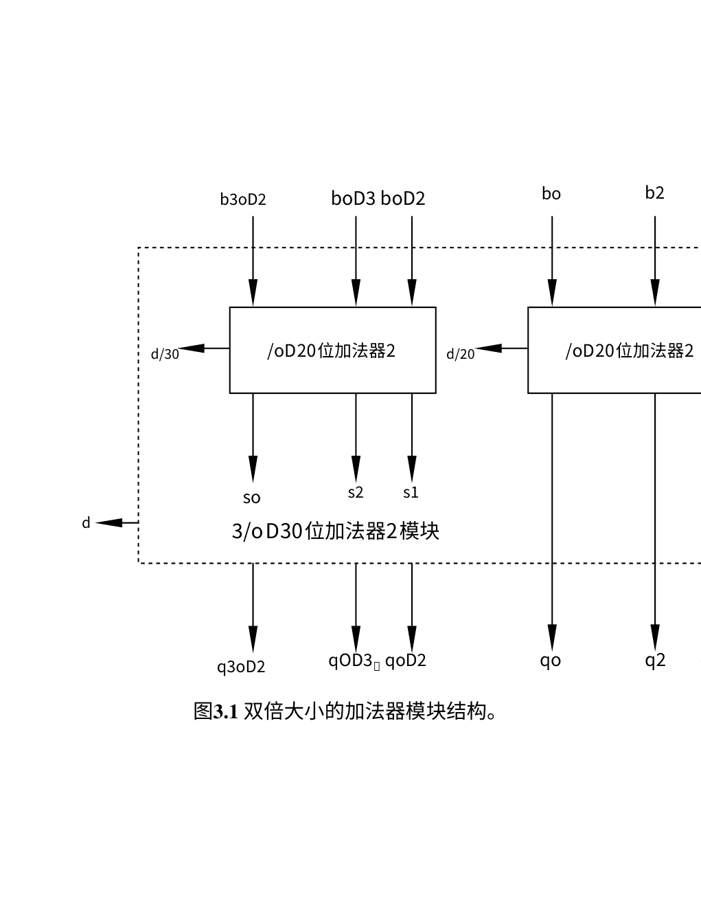

图 3.1 双倍大小的加法器模块结构。

## 第 3.3 节的问题

### 练习问题

#### 问题 3.8。

判断以下命题公式是否有效（V），可满足但不有效（S），或不可满足（N）。对于可满足的命题，指出一个满足的真值赋值。

- $M \text{ 蕴含 } Q$
- $M \text{ 蕴含 } (P \text{或} \overline{Q})$
- $M \text{ 蕴含 } [M \text{且} (P \text{蕴含} M)]$
- $(P \text{或} Q) \text{蕴含} Q$
- $(P \text{或} Q) \text{蕴含} (P \text{且} \overline{Q})$
- $(P \text{或} Q) \text{蕴含} [M \text{且} (P \text{蕴含} M)]$
- $(P \text{异或} Q) \text{蕴含} Q$
- $(P \text{异或} Q) \text{蕴含} (P \text{或} \overline{Q})$
- $(P \text{异或} Q) \text{蕴含} [M \text{且} (P \text{蕴含} M)]$

#### 问题 3.9。

证明命题公式

$P \text{或} Q \text{或} R$

和

$(P \text{与非}(Q)) \text{或} (Q \text{与非}(R)) \text{或} (R \text{与非}(P)) \text{或} (P \text{与} Q \text{与} R)$

是等价的。

#### 问题 3.10。

通过真值表证明或分配律成立，即

$P \text{或}(Q \text{与} R) \text{等价于} (P \text{或} Q) \text{与}(P \text{或} R) \quad (3.26)$

### 课堂问题

问题 3.11。

(a) 通过真值表验证

$$ (P \text{ 蕴含 } Q) \text{ 或 } (Q \text{ 蕴含 } P) $$

是有效的。

(b) 设 $P$ 和 $Q$ 为命题公式。描述一个只使用 AND、OR、NOT 和 $P$、$Q$ 的副本的单个公式 $R$，使得 $R$ 成立当且仅当 $P$ 和 $Q$ 等价。

(c) 一个命题公式是可满足的，当且仅当存在一个真值赋值给它的变量——一个环境——使其为真。解释为什么 $P$ 是有效的当且仅当 $\text{NOT}(P)$ 是不可满足的。

(d) 一组命题公式 $P_1, \ldots, P_k$ 是一致的，当且仅当存在一个环境使它们都为真。写一个公式，$S$，使得集合 $P_1, \ldots, P_k$ 是不一致的当且仅当 $S$ 是有效的。

问题 3.12。

这个问题³检查以下规范是否可满足：

1. 如果文件系统没有被锁定，那么
   (a) 新消息将被排队。
   (b) 新消息将被发送到消息缓冲区。
   (c) 系统正常运行，反之亦然，如果系统正常运行，则文件系统没有被锁定。
2. 如果新消息没有排队，则它们将被发送到消息缓冲区。
3. 新消息将不会被发送到消息缓冲区。

(a) 首先，使用四个命题变量将五个具体规范翻译成命题公式：$L ::= $ 文件系统被锁定；$Q ::= $ 新消息已排队；$B ::= $ 新消息被发送到消息缓冲区；

$$ N ::= \text{系统正常运行：} $$

³ 改编自 Rosen 的第 5 版，练习 1.1.36

(b) 通过描述变量 L, Q, B, N 的一个真值赋值，并验证在此赋值下，所有规范都为真，证明这组规范是可满足的。

(c) 论证在第 (b) 部分确定的赋值是唯一能够完成任务的赋值。

## 第 3.4 节的问题

### 练习题

问题 3.13。 命题公式中可能出现六种不同的运算符，但只需要 AND, OR 和 NOT 就足够了。这是因为每个运算符都等价于只使用这三个运算符的简单公式。例如，A IMPLIES B 等价于 NOT(A) OR B。因此，公式中所有的 IMPLIES 都可以用 NOT 和 OR 来替换。

(a) 使用只有 AND, OR, NOT 的公式，与 A IFF B 和 A XOR B 等价。得出结论，每个命题公式都等价于一个 AND-OR-NOT 公式。
(b) 解释为什么甚至不需要 AND。
(c) 解释如何只使用单个运算符 NAND，其中 A NAND B 等价于 NOT(A AND B)。

### 课堂问题

问题 3.14。 命题连接词 NOR 由以下规则定义

```
P NOR Q ::= (NOT(P) AND NOT(Q)).
```

解释为什么每个命题公式——可能涉及任何常见的运算符，如 IMPLIES, XOR, ...——等价于只有一个连接词的公式 NOR。

问题 3.15。 解释如何直接从其补集的析取式中找到命题公式的合取式形式。

## 第 3 章 逻辑公式

### 家庭作业问题

问题 3.16.
使用第 3.4.2 节的等价公理将以下公式转换为析取式形式:

```
$A \text{ XOR } B \text{ XOR } C.$
```

## 第 3.5 节的问题

### 家庭作业问题

问题 3.17.
3-合取式形式 (3CF) 公式是一个合取式形式公式，其中每个 OR 项是最多 3 个变量或变量的否定的 OR. 尽管很难判断命题公式 F 是否可满足，但总是可以轻松构造一个公式 C(F), 以便以 3-合取式形式表示，

- 最多有 24 个变量出现的次数 F, 且
- 当且仅当 F 可满足时，它才可满足。

为了构建 C(F)，为每个在 F 中出现的运算符引入一个不同的新变量。例如，如果 F 是
$((P\text{异或}Q)\text{异或}R)\text{或}(\overline{P}\text{与}S) \qquad (3.27)$
我们可以使用新变量 $X_1$, $X_2$, $O$ 和 $A$ 来对应运算符出现的位置，如下所示:

```
$( ( P \underbrace{\text{异或} Q}_{X_1} \underbrace{\text{异或} R}_{X_2} \underbrace{\text{或}}_{O} \underbrace{\overline{P} \text{与} S}_{A} ) )$:
```

接下来，我们编写一个公式来约束每个新变量具有与其对应运算符确定的子公式相同的真值。对于上面的例子，这些约束公式将是

```
$X_1$ 当且仅当 $(P\text{异或}Q)$,
$X_2$ 当且仅当 $(X_1\text{异或}R)$,
$A$ 当且仅当 $(P\text{与}S)$,
$O$ 当且仅当 $(X_2\text{或}A)$
```

## 3.7. 参考文献

(a) 解释为什么上述四个约束公式的 AND 与仅包含变量 O 的第五个公式当且仅当 (3.27) 可满足时可满足。
(b) 解释为什么每个约束公式都等价于至多包含 24 个变量的 3CF 公式。
(c) 利用前面部分所示的思想，解释如何构造任意命题公式 F 的 C(F) 。

#### 问题 3.18。

无论我们将 SAT 问题（第 3.5 节）以命题公式还是数字电路的形式表达，都没有关系。原因如下：

设 f 是 k 个变量的布尔函数。即， f : {T, F}^k → {T, F}。当 P 是一个命题公式，其中包含命题变量 X_1, ..., X_k。对于任意的真值 b_1, ..., b_k ∈ {T, F}，我们定义 P(b_1, ..., b_k) 为将 b_i 替换为 X_i 在 P 中的所有出现的结果，其中 1 ≤ i ≤ k。

如果 P_f 是一个公式，使得当 P_f(b_1, ..., b_k) 在 f(b_1, ..., b_k) = T 时可满足，我们称 P_f SAT-represents f。

假设有一个使用两个输入、一个输出的二进制门的数字电路（例如问题 3.5 和 3.6 中的二进制加法电路），该电路有 n 根线并计算函数 f。解释如何构造一个大小为 cn 的公式 P_f，使其 SAT-represents f 对于某个小常数 c。（取 c = 6 将起作用）。

得出结论，对于数字电路的 SAT 问题——即确定是否存在一组输入值使电路输出为 1——与命题公式的 SAT 问题一样困难。

提示：为每个线路引入一个新变量。这个想法与问题 3.17 中用于证明 3CNF 命题公式的可满足性与任意公式一样困难的想法类似。

## 第 3.6 节的问题

### 练习问题

#### 问题 3.19。

对于以下命题中的每一个：

1. ∀x ∃y. 2x − y = 0
2. $\forall x \exists y. x - 2y = 0$
3. $\forall x. x < 10 \text{ IMPLIES } (\forall y. y < x \text{ IMPLIES } y < 9)$
4. $\forall x \exists y. [y > x \land \exists z. y + z = 100]$

确定当变量范围为:

(a) 非负整数时，哪些命题为真。
(b) 整数时，哪些命题为真。
(c) 实数时，哪些命题为真。

#### 问题 3.20。

令 $Q(x, y)$ 为命题
"$x$ 曾经参加过电视节目 $y$ 。"

对于 $x$ 的论域是你学校的所有学生，对于 $y$ 的论域是曾经在电视上播出的所有问答节目。

确定以下表达式是否逻辑上等价于句子:
"你学校没有学生曾经参加过电视问答节目。"

(a) $\forall x \forall y. \text{ 非 } (Q(x, y))$
(b) $\exists x \exists y. \text{ 非 } (Q(x, y))$
(c) 非(存在$x$存在$y. Q(x, y))$
(d) 非(任意$x$任意$y. Q(x, y))$

#### 问题 3.21。

找到一个反例来证明以下命题不成立。

$\exists x. P(x)$ 蕴含 $\forall x. P(x)$

(只需定义你的反例，无需验证其正确性。)

## 3.7. 参考文献

#### 问题 3.22。

找到一个反例来证明以下命题不成立。
[∃x. P(x)并且 ∃x.Q(x)]蕴含 ∃x.[P(x)并且 Q(x)]
(只需定义你的反例，无需验证其正确性。)

#### 问题 3.23。

以下哪些是有效的？
(a) ∃x∃y. P(x, y) 蕴含 ∃y∃x. P(x, y)
(b) ∀x∃y. Q(x, y) 蕴含 ∃y∀x. Q(x, y)
(c) ∃x∀y. R(x, y) 蕴含 ∀y∃x. R(x, y)
(d) 非(∃x S(x)) 当且仅当∀x 非(S(x))

### 课堂问题

#### 问题 3.24。

一位媒体大亨有一个关于全新闻电视网络的想法，名为 LNN：逻辑新闻网。每个片段都将以领域的定义和几个谓词开始。然后可以用逻辑符号简洁地传达当天的事件。例如，一个广播可能会这样开始：这是 LNN。领域的定义是{阿尔伯特,本,克莱尔,大卫,艾米莉}。让 D(x) 是一个谓词，如果 x 是欺骗的，则为真。让 L(x, y) 是一个谓词，如果 x 喜欢 y，则为真。让 G(x, y) 是一个谓词，如果 x 给 y 礼物，则为真。

将以下逻辑符号的广播翻译成（英文）陈述。

(a) 非(D(本)或 D(大卫 ))蕴含 (L(阿尔伯特,本)且 L(本,阿尔伯特 ))

(b) ∀x ((x =克莱尔 AND NOT(L(x,艾米莉 ))) OR (x ≠克莱尔 AND L(x,艾米莉 ))) AND ∀x ((x =大卫 AND L(x,克莱尔 )) OR (x ≠大卫 AND NOT(L(x,克莱尔 ))))

```
$NOT(D(\text{克莱尔})) IMPLIES (G(\text{阿尔伯特}, \text{本}) AND \exists x. G(\text{本}, x))$
```

```
$\forall x \exists y \exists z (y \neq z) AND L(x, y) AND NOT (L(x, z))$
```

你如何用命题连接词来表达“除了克莱尔之外，每个人都喜欢艾米莉”而不使用任何量词 (∀, ∃)? 你能推广解释一下在这个论域上的任何逻辑公式如何不使用量词来表达吗? 如果用这种方式表达，前面部分的公式会有多大?

## 问题 3.25.

这个问题的目标是将关于二进制字符串的一些断言转化为逻辑符号表示。论域是所有有限长度的二进制字符串的集合：λ, 0, 1, 00, 01, 10, 11, 000, 001, ………… (这里 λ 表示空字符串。) 在你的翻译中，你可以使用所有普通的逻辑符号（包括 =）、变量和二进制符号 0 , 1 表示 0 和 1。像 01x0y 这样的由二进制符号和变量组成的字符串表示符号和由变量表示的二进制字符串的连接。例如，如果 x 的值是 011， y 的值是 1111， 那么 01x0y 的值就是二进制字符串 0101101111。这里有一些公式及其英文翻译的例子。这些谓词的名称列在第三列中，这样你就可以在解决方案中重复使用它们（就像我们在谓词 NO-1S 的定义中所做的那样）。

| 含义 | 公式 | 名称 |
|---|---|---|
| x是y的前缀 | ∃z (xz = y) | PREFIX(x, y) |
| x是y的子串 | ∃u∃v (uxv = y) | SUBSTRING(x, y) |
| x为空或者是一个由0组成的字符串 | NOT(SUBSTRING(1, x)) | NO-1S(x) |

(a) x由某个字符串的三个副本组成。
(b) x是一个偶数长度的由0组成的字符串。
(c) x不同时包含0和1。
(d) x是 2的k + 1 的二进制表示，其中 k 是某个整数。 ≥ 0。

## 3.7. 参考文献

(e) 一种优雅且稍微复杂的定义 NO-1S(x)是：PREFIX (x, 0x). (*) 解释为什么(*)只有在x是一串0时才为真。

#### 问题 3.26.

对于每个逻辑公式，请指示当论域是 N（非负整数0,1,2,...）、Z（整数）、Q（有理数）、R（实数）和 C（复数）时，它是否为真。对于少数需要解释的情况，请添加简要说明。

- ∃x. x² = 2
- ∀x.∃y. x² = y
- ∀y.∃x. x² = y
- ∀x ≠ 0.∃y. xy = 1
- ∃x.∃y. x + 2y = 2 AND 2x + 4y = 5

#### 问题 3.27.

证明 (∀x∃y. P(x, y)) → ∀z. P(z, z) 通过描述一个反例来证明它是无效的。

#### 问题 3.28.

如果在不同的地方使用过程的名称或其参数，那么如果相同的变量名恰好出现，实际上并不重要，并且将“局部”名称更改为全新的名称总是安全的。谓词公式中也发生了同样的事情。例如，我们可以将变量 x 在“∀x. P(x)”中重命名为“y”以获得 ∀y. P(y) 这两个公式是等价的。因此，像这样的公式 (∀x. P(x)) AND (∀x. Q(x)) (3.28) 可以重写为等价的公式 (∀y. P(y)) AND (∀x. Q(x)), (3.29)

## 第 3 章 逻辑公式

这更清楚地显示了(3.28)中分开出现的 ∀x 是无关的。

以这种方式重命名变量允许将每个谓词公式转换为一个等价的公式，在该公式中每个变量名只能以一种方式使用。具体来说，如果一个谓词公式满足唯一变量约定，则

- 对于每个变量 x，最多只能有一个量化出现，即“∀ x”或“∃ x”，而且，“∀ x”和“∃ x”不能同时出现，而且
- 如果公式中存在形如 ∀x. F或形如 ∃x. F的子公式，则整个公式中出现的所有 x 都在公式 F 内部。

因此，公式（3.28）违反了唯一变量约定，因为“∀ x”出现了两次，但公式（3.29）是正确的。另一个例子是公式

```
[∀x ∃y. P(x) AND Q(x, y)] IMPLIES       (3.30)
(∃x. R(x, z)) OR ∃x ∀z. S(x, y, w, z).
```

公式 (3.30) 违反了唯一变量约定，因为在公式中有三个量化出现，即初始的“∀ x”，然后是两个后续的“∃ x”。它还以其他方式违反了约定。例如，存在一个不在子公式 ∃y. P(x) AND Q(y) 内的 y 的出现。

事实证明，每个谓词公式都可以通过重命名变量的一些出现来转换为满足唯一变量约定的等价公式，就像我们在将(3.28)中的前两个出现重命名为 y 以获得等价公式(3.29)时所做的那样。**(a)** 重命名(3.30)中的变量出现，以获得满足唯一变量约定的等价公式。尽量少地重命名变量出现。

**(b)** 描述一般的过程，用于在任何谓词公式中重命名变量，以获得满足唯一变量约定的等价公式。

### 作业问题

#### 问题 3.29.

用形式逻辑符号表示以下谓词和命题。
论域是非负整数，N。此外，除了## 3.7. 参考文献

命题运算符、变量和量词之外，您可以使用加法、乘法和等号符号来定义谓词，并使用非负整数 constants (0, 1, ...), 但不能使用 exponentiation (像 x^y)。例如，谓词“n是偶数”可以通过以下任一公式定义：

```
∃m. (2m = n), ∃m. (m + m = n).
```

- (a) m是n的除数。
- (b) n是一个质数。
- (c) n是一个质数的幂。

## 问题 3.30.

将以下句子翻译成谓词公式：班级中有一个学生，除了可能是他自己，最多给其他两个人发送了电子邮件。

论域应为班级中的学生集合；此外，您只能使用以下谓词•相等性和

- • E(x, y)，表示“x发送了电子邮件给 y。”

## 问题 3.31.

将以下句子翻译成谓词公式：班级中有一个学生，除了可能是她自己，给其他两个人发送了电子邮件。

论域应为班级中的学生集合；此外，您只能使用以下谓词•相等性和

- • E(x, y)，表示“x发送了电子邮件给 y。”

## 第3章 逻辑公式

### 考试问题

### 问题 3.32.

以下谓词逻辑公式是无效的：

$$\forall x, \exists y. P(x, y) \longrightarrow \exists y, \forall x. P(x, y)$$

以下哪些是其反例模型？

- 1. 谓词 $P(x, y) = ‘y \cdot x = 1’$, 其中论域为 $\mathbb{Q}$。
- 2. 谓词 $P(x, y) = ‘y < x’$, 其中论域是 $\mathbb{R}$。
- 3. 谓词 $P(x, y) = ‘y \cdot x = 2’$, 其中论域是 $\mathbb{R} \setminus \{0\}$。
- 4. 谓词 $P(x, y) = ‘y^x = x’$, 其中论域是所有二进制字符串，包括空字符串。

### 问题 3.33.

一些来自大班级的学生将从左到右排队。队伍中至少有两个学生。将以下每个断言翻译为以班级学生为论域的谓词公式。你只能使用以下谓词

- 相等和，
- $F(x, y)$，表示“x在排队中在 y的左边。”例如，在排队“CDA”中，$F(C, A)$和$F(C, D)$都为真。

一旦你定义了一个谓词 P的公式，你可以在后续的公式中使用缩写“P”。

- (a) 学生 $x$ 在队伍中。
- (b) 学生 $x$是第一个在队伍中的。
- (c) 学生 $x$紧挨着学生 $y$在右边。
- (d) 学生 $x$ 是第二个。

## 3.7. 参考文献

### 问题 3.34.

我们想要找到关于非负整数 $\mathbb{N}$ 的谓词公式，其中 $\leq$ 是唯一出现的谓词，且没有常数出现。

例如，有一个定义相等谓词的公式：

```
$$[x = y] ::= [x \leq y \text{ AND } y \leq x].$$
```

一旦谓词被证明仅能用 $\leq$ 来表示，它可以在后续的翻译中使用。例如，

```
$$[x > 0] ::= \exists y. \text{ NOT }(x = y) \text{ AND } y \leq x.$$
```

- (a) $[x = 0]$.
- (b) $[x = y + 1]$
- (c) $x = 3$

## 4 数学数据类型

我们假设您已经了解了集合、序列和函数的概念，并且在之前的几个部分中我们已经非正式地使用了它们。在本章中，我们将更仔细地研究这些数学数据类型。我们将快速回顾基本定义，并添加一些可能不熟悉的定义，如“图像”和“逆像”，并以一些比较集合大小的方法结束本章。

### 4.1 集合

非正式地说，一个集合是一堆对象，这些对象被称为集合的元素。集合的元素可以是任何东西：数字、空间中的点，甚至其他集合。书写集合的常规方式是在花括号内列出元素。例如，这里是一些集合：

```
A = {亚历克斯, 蒂皮, 贝壳, 影子}    死去的宠物
B = {红色, 蓝色, 黄色}          原色
C = {{a, b}, {a, c}, {b, c}}       一组集合
```

这对于小的有限集合来说很好。其他集合可以通过指示如何生成它们的列表来定义：

```
D ::= {1, 2, 4, 8, 16, ...}        2的幂
```

元素的顺序不重要，所以 {x, y} 和 {y, x} 是相同的集合，以两种不同的方式书写。此外，任何对象都是或不是给定集合的元素 - 在集合中没有元素出现多次的概念。^1 因此，写 {x, x} 只是两次表示同一件事： x 在集合中。特别地， {x, x} = {x}。

表达式 e ∈ S 断言 e 是集合 S 的元素。例如， 32 ∈ D 和 蓝色 ∈ B，但 Tailspin ∉ A — 然而。

集合是简单、灵活且无处不在的。你会在本文的几乎每个部分都找到一些提到集合的内容。

> ^1 发展一个可以多次出现元素的多重集合的概念并不难，但多重集合不是普通的集合，本文不涵盖多重集合。

### 4.1.1 一些常见的集合

| 符号 | 集合 | 元素 |
|------|------|------|
| ∅ | 空集 | 无 |
| ℕ | 非负整数 | {0, 1, 2, 3, …} |
| ℤ | 整数 | {…, −3, −2, −1, 0, 1, 2, 3, …} |
| ℚ | 有理数 | 1/2, −5/3, 16, 等等 |
| ℝ | 实数 | π, e, −9, √2, 等等 |
| ℂ | 复数 | i, 19/2, √2−2i, 等等 |

上标“+”表示将集合限制为其正元素；例如，ℝ⁺表示正实数的集合。同样地，ℤ⁻表示负整数的集合。

### 4.1.2 比较和组合集合

表达式 S ⊆ T 表示集合 S 是集合 T 的子集，这意味着 S 的每个元素也是 T 的元素。例如，ℕ ⊆ ℤ是因为每个非负整数都是整数；ℚ ⊆ ℝ是因为每个有理数都是实数，但ℂ ⊈ ℝ是因为不是每个复数都是实数。

作为记忆技巧，将“⊆”符号看作左侧有较小集合或数字的“≤”符号。请注意，就像对于任何数字 n，n ≤ n 一样，S ⊆ S 对于任何集合 S 也是成立的。

还有一种关系，⊂，用于集合上，比如“小于”关系 < 在数字上。S ⊂ T 意味着 S 是 T 的子集，但两者不相等。所以就像对于每个数字 n，都有 n < n，对于每个集合 A，也有 A ⊂ A。“S ⊂ T”读作“S是T的严格子集。”

有几种基本的集合组合方式。例如，假设 X := {1, 2, 3}, Y := {2, 3, 4}.

#### 定义 4.1.1.

- 集合 A 和 B 的并集，表示为 A ∪ B，包括出现在 A 或 B 或两者中的元素。也就是说， x ∈ A ∪ B 当且仅当 x ∈ A 或者 x ∈ B.
- 集合 A 和 B 的交集，表示为 A ∩ B，包含出现在 A 和 B 中的所有元素。也就是说，x ∈ A ∩ B 当且仅当 x ∈ A 且 x ∈ B.
- 集合 A 和 B 的差集，表示为 A - B，包含在 A 中但不在 B 中的所有元素。也就是说，x ∈ A - B 当且仅当 x ∈ A 且 x ∉ B.

所以 X ∪ Y = {1, 2, 3, 4}.

所以，$X \cap Y = \{2, 3\}$。

所以，$X - Y = \{1\}$ 和 $Y - X = \{4\}$。

通常，所有被考虑的集合都是已知领域 $D$ 的子集，那么对于 $D$ 的任何子集 $A$，我们定义 $\overline{A}$ 为 $D$ 中不在 $A$ 中的所有元素的集合。也就是说，

$$\overline{A} ::= D - A.$$

集合 $\overline{A}$ 被称为 $A$ 的补集。

所以

$$\overline{A} = \varnothing \quad \text{当且仅当} \quad A = D.$$

例如，如果我们所使用的域是整数，非负整数的补集就是负整数的集合：

$$\overline{\mathbb{N}} = \mathbb{Z}^-.$$

我们可以使用补集来用等式重新表达子集

$$A \subseteq B \text{ 等价于 } A \cap \overline{B} = \varnothing.$$

### 4.1.3 幂集

一个集合 $A$ 的所有子集构成的集合被称为 $A$ 的幂集，记作 $\text{pow}(A)$。所以

$$B \in \text{pow}(A) \quad \text{当且仅当} \quad B \subseteq A.$$

例如，$\text{pow}(\{1, 2\})$ 的元素是 $\varnothing$, $\{1\}$, $\{2\}$ 和 $\{1, 2\}$。

更一般地，如果 $A$ 有 $n$ 个元素，则在 $\text{pow}(A)$ 中有 $2^n$ 个集合—参见定理 4.5.5。因此，一些作者使用符号 $2^A$ 代替 $\text{pow}(A)$。

### 4.1.4 集合构建符号

谓词在集合构建符号中有重要的应用。我们经常需要讨论不能通过明确列出元素或通过取并集、交集等来很好地描述的集合。集合构建符号经常派上用场。其思想是使用一个谓词来定义一个集合；特别地，该集合包含使谓词为真的所有值。以下是一些集合构建符号的示例：

```
$$A ::= \{ n \in \mathbb{N} \mid n \text{是质数且} n = 4k + 1, \text{其中} k \text{是整数} \}$$
$$B ::= \{ x \in \mathbb{R} \mid x^3 - 3x + 1 > 0 \}$$
$$C ::= \{ a + bi \in \mathbb{C} \mid a^2 + 2b^2 \le 1 \}$$
```

集合 $A$ 由所有非负整数 $n$ 组成，其中谓词为

$$"n \text{是一个素数且} n = 4k + 1, \text{其中} k \text{是一个整数}"$$

是真的。因此，集合 $A$ 的最小元素是：

- 5, 13, 17, 29, 37, 41, 53, 61, 73, ....

试图通过列举这些前几个元素来表示集合 $A$ 是不太行的；即使是十个元素之后，模式也不明显！类似地，集合 $B$ 由所有实数 $x$ 组成，其中谓词为

$$x^3 - 3x + 1 > 0$$

是真的。在这种情况下，用区间的显式描述来表示集合 $B$ 需要解一个三次方程。最后，集合 $C$ 由所有复数 $a + bi$ 组成，其中：

$$a^2 + 2b^2 \le 1$$

这是复平面上原点周围的一个椭圆形区域。

### 4.1.5 证明集合的相等性

如果两个集合的元素完全相同，则它们被定义为相等。也就是说，如果且仅如果对于所有元素 $z$，$z \in X$ 当且仅当 $z \in Y$。因此，集合的相等可以被表述和证明为“当且仅当”定理。例如，外延公理指出，对于任意两个集合 $X$ 和 $Y$，$X = Y$ 当且仅当 $X \subseteq Y$ 且 $Y \subseteq X$。

这实际上是集合论中ZFC公理的第一个，该公理在1.3节末尾提到，并在7.3.2节中进一步讨论。

### 定理4.1.2. [集合的分配律] 设 $A$、$B$ 和 $C$ 为集合。那么：

$$A \cap (B \cup C) = (A \cap B) \cup (A \cap C) \quad (4.1)$$

**证明**。等式(4.1)等价于以下断言

$$z \in A \cap (B \cup C) \text{ 当且仅当 } z \in (A \cap B) \cup (A \cap C) \quad (4.2)$$

对于所有 $z$。现在我们将通过一系列的等价关系来证明 (4.2)。

现在我们有

$$z \in A \cap (B \cup C)$$

等价于 $(z \in A) \text{并且} (z \in B \cup C)$（定义为 $\cap$）

等价于 $(z \in A) \text{并且} (z \in B \text{或者} z \in C)$（定义为 $\cup$）

等价于 $(z \in A \text{并且} z \in B) \text{或者} (z \in A \text{并且} z \in C)$（根据分配律定理3.4.1）

等价于 $(z \in A \cap B) \text{或者} (z \in A \cap C)$（定义为 $\cap$）

等价于 $z \in (A \cap B) \cup (A \cap C)$（定义为 $\cup$）

■

尽管基本的集合操作和命题连接词相似，但是重要的是不要混淆它们。例如，$\cup$类似于或，并且实际上是直接根据或定义的：

$$x \in A \cup B \text{等价于} (x \in A \text{或者} x \in B).$$

同样地，$\cap$类似于 $\text{AND}$，而补集类似于 $\text{NOT}$。

但是如果 $A$ 和 $B$ 是集合，写作 $A \text{ AND } B$ 是一个类型错误，因为 $\text{AND}$ 是一个对真值而不是集合的操作。同样地，如果 $P$ 和 $Q$ 是命题变量，写作 $P \cup Q$ 是另一种类型错误。

定理4.1.2的证明展示了一种通过检查相应命题公式的有效性来证明集合相等性的一般方法。作为进一步的例子，根据De Morgan定律(3.11)对于命题

$$\text{NOT}(P \text{ AND } Q) \text{等价于} \text{NOT } P \text{ OR } \text{NOT } Q$$

我们可以推导出(问题4.5)相应的De Morgan定律对于集合相等性：

$$\overline{A \cap B} = \overline{A} \cup \overline{B} \quad (4.3)$$

尽管这两种操作之间存在对应关系，但重要的是不要混淆命题操作和集合操作。例如，如果 $X$ 和 $Y$ 是集合，那么写“X AND Y”而不是“X ∩ Y”是错误的。将AND应用于集合会导致编译器或者评分者抛出类型错误，因为一个只能应用于真值的操作被应用于了集合。同样地，如果P和Q是命题，那么写“P ∪ Q”而不是“P OR Q”是一个类型错误。

### 4.2 序列

集合提供了一种将一组对象分组的方式。另一种方式是通过序列，它是一组称为项或组成元素的对象的列表。短序列通常通过在括号之间列出元素来描述；例如，(a, b, c)是一个包含三个项的序列。

虽然集合和序列都起到了收集的作用，但是它们有几个不同之处。

- 集合中的元素必须是不同的，但是序列中的项可以相同。因此，(a, b, a)是一个有效的长度为三的序列，但是 {a, b, a}是一个有两个元素而不是三个的集合。
- 序列中的项有指定的顺序，但是集合中的元素没有。例如，(a, b, c)和(a, c, b)是不同的序列，但是 {a, b, c}和 {a, c, b}是相同的集合。
- 关于空序列的符号表示在不同的文本中有所不同，我们使用 λ表示空序列。

乘积运算是集合和序列之间的一个联系。集合 S₁ × S₂ × ··· × Sₙ的笛卡尔积是一个由所有序列组成的新集合，其中第一个分量来自 S₁，第二个分量来自 S₂，以此类推。长度为两个的序列称为对。³例如， ℕ × {a, b}是所有第一个元素是非负整数，第二个元素是 a或者 b的对的集合：

```
ℕ × {a, b} = {(0, a), (0, b), (1, a), (1, b), (2, a), (2, b), . . .}
```

一个集合 S 的 n 个副本的乘积表示为 Sⁿ。例如， {0, 1}³是所有 3位序列的集合：

```
{0, 1}³ = {(0, 0, 0), (0, 0, 1), (0, 1, 0), (0, 1, 1), (1, 0, 0), (1, 0, 1), (1, 1, 0), (1, 1, 1)}
```

### 4.3 函数

#### 4.3.1 域和值域

一个函数将一个集合中的元素，称为定义域，映射到另一个集合中的元素，称为值域。表示法

$ f : A \rightarrow B $

表示 $ f $ 是一个具有定义域 $ A $ 和值域 $ B $ 的函数。熟悉的表示法“$ f(a) = b $”表示 $ f $ 将元素 $ a \in A $ 映射到元素 $ b \in B $。这里 $ b $ 被称为函数 $ f $ 在参数 $ a $ 处的值。函数通常通过公式来定义，如下所示：

$ f_1(x) ::= \frac{1}{x^2} $

其中 $ x $ 是一个实数变量，或者

$ f_2(y, z) ::= y \text{ concatenate } y \text{ and } z $

其中 $ y $ 和 $ z $ 取值范围为二进制字符串，或者

$ f_3(x, n) ::= \text{长度为 } n \text{ 的序列 } \underbrace{(x, \ldots, x)}_{n \text{个 } x} $

其中 $ n $ 取值范围在非负整数上。

具有有限定义域的函数可以通过一个表格来指定，在该表格中显示了定义域中每个元素的函数值。例如，一个函数 $ f_4(P, Q) $ 其中 $ P $ 和 $ Q $ 是命题变量，可以通过以下方式来指定：

| P | Q | f4(P,Q) |
|---|---|---------|
| T | T | T       |
| T | F | F       |
| F | T | T       |
| F | F | T       |

注意，函数 $ f_4 $ 也可以通过以下公式来描述：

$ f_4(P, Q) ::= [P \text{ IMPLIES } Q]. $

函数还可以通过计算其在定义域中任意元素的值的过程或其他类型的规范来定义。例如，定义 $ f_5(y) $ 为从左到右搜索二进制字符串 $ y $ 直到出现 1 的长度，所以

> $ f_5(0010) = 3, f_5(100) = 1, f_5(0000) \text{ 是未定义的 }. $

注意到 $ f_5 $ 不会给只有 0的字符串赋值。这说明了一个重要的事实：函数不需要为定义域中的每个元素赋值。实际上，在我们的第一个例子中 $ f_1(x)=1/x^2 $ 中就出现了这个问题，它没有为 0赋值。因此，一般来说，函数可以是部分函数，这意味着可能存在函数未定义的定义域元素。如果一个函数在其定义域的每个元素上都有定义，那么它被称为全函数。

当应用于参数集合中的元素时，找到函数取值的集合通常很有用。因此，如果 $ f : A \rightarrow B $，且 $ S $ 是 $ A $ 的子集，我们定义 $ f(S) $ 为 $ f $ 应用于 $ S $ 的元素时取得的所有值的集合。也就是说，

> $ f(S)::= \{b \in B \mid \text{存在 } s \in S \text{ 使得 } f(s) = b\} $

例如，如果我们让 $[r, s ]$ 表示实数线上从 $ r $ 到 $ s $ 的数集，那么 $ f_1([1, 2])=[1/4, 1] $。

再举一个例子，让我们来看看“搜索一个 1”的函数， $ f_5 $。如果我们让 $ X $ 是以偶数个 0开头后跟一个 1的二进制字符串的集合，那么 $ f_5(X) $ 将是奇数非负整数。

将 $ f $ 应用于一个集合 $ S $ 的参数被称为“逐点应用 $ f $ 到 $ S $”，而集合 $ f(S) $ 被称为 $ f $ 在 $ S $ 下的像。将 $ f $ 应用于所有可能的参数所得到的值的集合被称为 $ f $ 的值域。也就是说，

> $\text{range}(f) :: = f(\text{domain}(f)).$

一些作者将值域称为函数的范围，但他们不应该这样做。

在第4.5节中，当我们将集合的大小与它们之间的函数的属性相关联时，值域和范围之间的区别将变得重要。

#### 4.3.2 函数复合

逐步进行事情是一种普遍的想法。散步是一个字面上的例子，但照着食谱做饭、执行计算机程序、评估公式以及从物质滥用中恢复也是如此。函数复合的形式化概念捕获了这一想法。如果 $ f : A \rightarrow B $ 且 $ g : B \rightarrow C $，那么复合函数 $ g \circ f : A \rightarrow C $ 定义为 $ (g \circ f)(a) ::= g(f(a)) $。

函数复合是结合性的：如果 $ f : A \rightarrow B $，$ g : B \rightarrow C $，和 $ h : C \rightarrow D $，那么 $ h \circ (g \circ f) = (h \circ g) \circ f $。结合性意味着在多个函数的复合中，括号是无关紧要的，所以我们可以直接写 $ h \circ g \circ f $。

恒等函数 $ id_A : A \rightarrow A $ 定义为 $ id_A(a) ::= a $。恒等函数是复合运算的单位元：对于任何函数 $ f : A \rightarrow B $，有 $ f \circ id_A = f $ 和 $ id_B \circ f = f $。

如果存在一个函数 $ g : B \rightarrow A $ 使得 $ g \circ f = id_A $ 且 $ f \circ g = id_B $，那么函数 $ f : A \rightarrow B $ 是可逆的。这样的函数 $ g $ 被称为 $ f $ 的反函数，记作 $ f^{-1} $。并非所有函数都是可逆的；一个函数是可逆的当且仅当它既是单射（一一对应）又是满射（映上）。

${}^4$ 函数 $ f $ 应用于 $ A $ 的元素和逐点应用于 $ A $ 的子集的函数之间有一个严格的区别，因为 $ f $ 的定义域是 $ A $，而逐点- $ f $ 的定义域是 pow($ A $)。通常从上下文中可以清楚地知道是指 $ f $ 还是逐点- $ f $，所以用这种方式重载符号 $ f $ 没有问题。

## 4.4 二元关系

抽象地说，迈出一步就是应用一个函数，一步一步地进行就是一个接一个地应用函数。这通过函数的组合操作来捕捉。组合函数 f 和 g 意味着首先将 f 应用于某个参数 x，得到 f(x)，然后将 g 应用于该结果，得到 g(f(x))。

**定义 4.3.1.** 对于函数 f : A → B 和 g : B → C，组合 g 和 f 的结果 g ∘ f 定义为从 A 到 C 的函数，其规则如下：

(g ∘ f)(x) ::= g(f(x)),

对于所有的 x 属于 A。

函数的组合在初等微积分中是一个熟悉的基本概念，在离散数学中也起着同样基本的作用。

二元关系定义了两个对象之间的关系。例如，在实数上的“小于”关系将每个实数 a 与一个实数 b 相关联，当且仅当 a < b 时。类似地，子集关系将一个集合 A 与另一个集合 B 相关联，当且仅当 A 是 B 的子集。函数 f 从集合 A 到集合 B 的特殊情况是二元关系，其中元素 a 属于 A 与元素 b 属于 B 相关联，当且仅当 b 等于 f(a)。在本节中，我们将定义一些二元关系的基本词汇和性质。

**定义 4.4.1.** 二元关系 R 由一个称为关系的定义域 A，一个称为关系的值域 B，以及 A × B 的子集，称为关系的图形组成。

一个定义域为 A 和值域为 B 的关系被称为“从 A 到 B 的关系”。与函数类似，我们用 R : A → B 表示 R 是从 A 到 B 的关系。当定义域和值域是同一个集合 A 时，我们简单地说这个关系是“在 A 上的”。通常我们用“a R b”表示这个关系的图中有一对(a, b)。

注意，定义 4.4.1 与第 4.3 节中关于函数的定义完全相同，只是不需要每个元素都满足函数的条件。

> 将关系或运算符符号写在其参数之间称为中缀表示法。中缀表达式如“m < n”或“m + n”是通常用于表示小于关系或加法运算的表示法，而不是前缀表示法如“< (m, n)”或“+(m, n)”。

域元素，一个，图中最多有一个第一个坐标为一个的配对。正如我们所说，函数是二元关系的特例。“负责”关系 Chrg，对于 MIT 在 Spring '10 的科目和教师是一个很好的二元关系的例子。它的域 Fac，是所有 MIT 教职员工的姓名，它的值域是秋季 '09-'10 MIT 科目列表中的科目编号集合 SubNums。图 Chrg 包含形式为的配对

```
((教师姓名),(科目编号))
```

这样，名为〈教师姓名〉的教职员工负责在 Spring '10 开设的科目编号为〈科目编号〉的科目。所以图(Chrg)包含类似的配对

- (T. Eng., 6.UAT)
- (G. 弗里曼, 6.011)
- (G. 弗里曼, 6.UAT)
- (G. 弗里曼, 6.881)
- (G. 弗里曼, 6.882)
- (J. Guttag, 6.00)
- (A. R. Meyer, 6.042)
- (A. R. Meyer, 18.062)
- (A. R. Meyer, 6.844)
- (T. Leighton, 6.042)
- (T. Leighton, 18.062)
- :

在值域 SubNums 中，有些主题在这个列表中没有出现，即它们不在范围内(Chrg)。这些是仅秋季学期的课程。

同样，域 Fac 中有一些教师没有出现在列表中，因为他们没有负责任何春季学期的课程。

### 4.4.1 关系图

一些关系的标准属性可以通过图表来可视化。二元关系 R 的图表中，点对应于域中的元素，这些元素在一列中出现（如果域(R)是无限的，则是一列非常长的列）。目标域中的所有元素出现在另一列中，通常我们将其画在域列的右侧。当相应的元素由 R 相关时，从左侧的域列中的一个点 a 到右侧的目标域列中的一个点 b 有一条箭头。例如，这里是两个函数的图表:

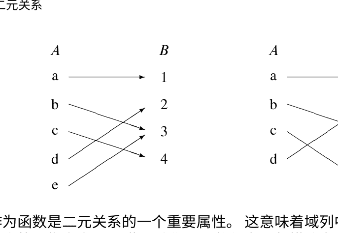

作为函数是二元关系的一个重要属性。这意味着域列中的每个点最多只有一个箭头指向它。因此，我们可以将作为函数描述为“≤ 1 箭头出去”的属性。关系中还有四个常见的标准属性。以下是用箭头定义的所有五个属性：

**定义 4.4.2.** 一个二元关系，R，是：

- 一个函数当它具有 [≤ 1 箭头输出] 属性时。
- 满射当它具有 [≥ 1 箭头输入] 属性时。也就是说，右侧的每个点都至少有一个指向它的箭头。
- 全射当它具有 [≥ 1 箭头输出] 属性时。
- 单射当它具有 [≤ 1 箭头输入] 属性时。
- 双射当它既具有 [= 1 箭头输出] 又具有 [= 1 箭头输入] 属性时。

从这里开始，我们将不再提及这些属性中的箭头，例如，只需写 [≤ 1 in] 而不是 [≤ 1箭头in]。

因此，在上面的图中，左侧的关系具有 [= 1 out] 和 [≥ 1 in] 属性，这意味着它是一个全射函数。但它没有 [≤ 1 in] 属性，因为元素 3 有两个箭头指向它；它不是单射的。

右侧的关系具有 [= 1 out] 和 [≤ 1 in] 属性，这意味着它是一个全射函数。但它没有 [≥ 1 in] 属性，因为元素 4 没有箭头指向它；它不是满射的。

图中的箭头与 R 的图形中的对应关系完全一致。请注意，仅仅根据箭头是不足以确定 R 是否具有 [≥ 1 out] 的全射属性的，例如。如果我们只知道箭头，我们就不会知道域列中没有箭头的任何点。换句话说，仅仅图(R)本身不能确定 R 是否是全射的：我们还需要知道域(R)是什么。

**示例 4.4.3.** 由公式 1/x^2 定义的函数在其定义域为 ℝ^+ 时具有 [≥ 1 out] 属性，但在其定义域为包括 0 的一些实数集时则没有。如果其定义域和值域都是 ℝ^+，则具有 [= 1 in] 和 [= 1 out] 属性，但如果其定义域和值域都是 ℝ，则既没有 [≤ 1 in] 属性也没有 [≥ 1 out] 属性。

### 4.4.2 关系图像

函数的图像概念直接扩展到关系。

**定义 4.4.4.** 关系 R 下集合 Y 的图像，记作 R(Y)，是关系 R 的值域 B 中与 Y 中的某个元素相关联的元素的集合。在关系图中，R(Y) 是从 Y 中某个点开始的指向该点的箭头的集合。

例如，迈耶在 2010 年春季负责的科目编号集合是 Chrg({A. Meyer})。为了弄清楚这是什么，我们寻找所有以“A. Meyer”为起点的箭头在 Chrg 图中，并查看这些箭头的另一端有哪些科目编号。查看图中的配对列表(4.4)，我们可以看到这些科目编号是 {6.042, 18.062, 6.844}。类似地，要找到弗里曼或恩格负责的科目编号，我们可以收集所有以“G. Freeman”或“T. Eng”为起点的箭头，并再次查看这些箭头的另一端有哪些科目编号。这是 Chrg({G. Freeman, T. Eng})。再次查看列表(4.4)，我们可以看到这些科目编号是：

```
Chrg({G. Freeman, T. Eng}) = {6.011, 6.881, 6.882, 6.UAT}
```

最后，Fac 是所有负责教师的集合，所以 Chrg(Fac) 是所有在 Spring '10 中列出的学科的集合。

### 逆关系和映像

**定义 4.4.5.** 关系 R 的逆关系 R^{-1} 是由规则定义的从 B 到 A 的关系

```
b R^{-1} a 当且仅当 a R b.
```

换句话说，R^{-1} 是通过颠倒 R 图中箭头方向得到的关系。

**定义 4.4.6.** 关系 R^{-1} 下的集合的映像被称为集合的逆映像。也就是说，集合 X 在关系 R 下的逆映像被定义为 R^{-1}(X)。

继续上面的例子，春季 '10 学期负责 6.UAT 课程的讲师集合恰好是 {6.UAT} 在 Chrg 关系下的逆像。从列表(4.4)中，我们可以看到 Eng 和 Freeman 都负责 6.UAT 课程，也就是说，

```
{T. Eng, D. Freeman} ⊆ Chrg^{-1}({6.UAT}).
```

我们不能在这里断言相等，因为列表中可能还有其他的配对，显示其他讲师也是 6.UAT 的共同负责人。现在让 Intro 成为介绍性课程 6 的科目号集合。这些是以“6.0”开头的科目号。因此，春季 '10 学期负责介绍性课程 6 的讲师姓名集合是 Chrg^{-1}(Intro)。从(4.4)中显示的 Chrg 列表的一部分中，我们可以看到 Meyer，Leighton，Freeman 和 Guttag 是春季 '10 学期负责介绍性课程的讲师。也就是说，

```
{Meyer, Leighton, Freeman, Guttag} ⊆ Chrg^{-1}(Intro).
```

最后，Chrg^{-1}(SubNums)，是所有在 Spring '10' 列出的课程中负责的所有讲师的集合。

## 4.5 有限基数

有限集是只有有限个元素的集合。这个元素的数量是集合的“大小”或基数：

**定义 4.5.1.** 如果 A 是一个有限集合，那么 A 的基数，写作 |A|，是 A 中元素的数量。

有限集合可能没有元素（空集），或一个元素，或两个元素，……，所以有限集合的基数总是非负整数。

现在假设 R : A → B 是一个函数。这意味着 A 的每个元素最多对 R 的图表贡献一个箭头，所以箭头的数量最多是 A 中元素的数量。也就是说，如果 R 是一个函数，那么

```
|A| ≥ #箭头。
```

如果 R 也是满射的，那么 B 的每个元素都有一个箭头指向它，所以图表中的箭头数量至少与 B 的大小相同。也就是说，

```
#箭头 ≥ |B|。
```

结合这些不等式可以推出，如果 R 是满射函数，那么 |A| ≥ |B|。简而言之，如果我们写 A surj B 表示存在一个满射函数从 A 到 B，那么我们刚刚证明了一个引理：如果 A surj B 对于有限集合 A, B 成立，则 |A| ≥ |B|。以下定义和引理列出了这个陈述和三个类似的关于定义域和值域大小与关系属性的规则。

**定义 4.5.2.**

1.  如果存在从 A 到 B 的满射函数，则 A 满射 B 当且仅当存在从 A 到 B 的满射函数。
2.  如果存在从 A 到 B 的单射全关系，则 A 单射 B 当且仅当存在从 A 到 B 的单射全关系。
3.  如果存在从 A 到 B 的双射函数，则 A 双射 B 当且仅当存在从 A 到 B 的双射函数。

**引理 4.5.3.** 对于有限集合 A 和 B：

1.  如果 A 满射 B，则 |A| ≥ |B|。
2.  如果 A 单射 B，则 |A| ≤ |B|。
3.  如果 A 双射 B，则 |A| = |B|。

**证明。** 我们已经给出了蕴含关系 1 的“箭头”证明。蕴含关系 2。根据 R 具有“[≤ 1 out]”函数属性和“[≥ 1 in]”满射属性，则 R^{-1} 是全关系和单射的，因此 A 满射 B 当且仅当 B 单射 A。最后，由于双射既是满射函数又是全射单射关系，所以蕴含关系 3。是第一和第二的直接结果。 ■

引理 4.5.3.1 有一个逆命题：如果一个有限集合 A 的大小大于等于另一个有限集合 B 的大小，那么总是可以定义一个满射函数从 A 到 B。事实上，这个满射函数可以是一个全函数。为了看到这是如何工作的，举个例子，假设

```
A 等于集合 {a0, a1, a2, a3, a4, a5}
B 等于集合 {b0, b1, b2, b3}
```

然后根据以下规则定义一个全函数 f : A → B

```
f(a0) ::= b0, f(a1) ::= b1, f(a2) ::= b2, f(a3) = f(a4) = f(a5) ::= b3.
```

更简洁地说，

```
f(ai) ::= bmin(i,3),
```

由于 5 ≥ 3，这个函数是一个满射。所以我们已经弄清楚，如果 A 和 B 是有限集合，那么当且仅当 A 满射 B 时，|A| ≥ |B|。总而言之，这个论证总结了整个有限基数的故事的证明：

**定理 4.5.4. [映射规则]** 对于有限集合，A，B，

- |A| ≥ |B| 当且仅当 A 满射 B， (4.5)
- |A| ≤ |B| 当且仅当 A 单射 B， (4.6)
- |A| = |B| 当且仅当 A 双射 B， (4.7)

### 4.5.1 一个有限集合有多少个子集？

作为双射映射规则(4.7)的一个应用，我们可以给出一个简单的证明：

**定理 4.5.5.** 一个 n 元素集合有 2^n 个子集。也就是说，|A| = n 意味着 |pow(A)| = 2^n。

例如，三元集合 {a1, a2, a3} 有八个不同的子集：

- ∅
- {a1}
- {a2}
- {a1, a2}
- {a3}
- {a1, a3}
- {a2, a3}
- {a1, a2, a3}

定理 4.5.5 是因为从 A 的子集到 {0, 1}^n，即 A 的 n 位序列，存在一个简单的双射。具体来说，设 a1, a2, …, an 是 A 的元素。这个双射将 S ⊆ A 的每个子集映射到位序列 (b1, …, bn)，规则如下定义：

bi = 1 当且仅当 ai ∈ S。

例如，如果 n = 10，那么子集 {a2, a3, a5, a7, a10} 将映射到一个 10 位序列如下：

子集：{ a2, a3, a5, a7, a10 }
序列：( 0, 1, 1, 0, 1, 0, 1, 0, 0, 1 )

现在根据映射规则 4.5.4.(4.7) 的双射情况，

|pow(A)| = |{0, 1}^n|。

但是每个计算机科学家都知道^6存在 2^n 个 n 位序列！所以我们已经证明了定理 4.5.5！

> 6如果你是一个不知道有多少个 n 位序列的人，你可以在第 14.2.2 节中找到解释。

## ## 第4.1节的问题

练习问题

**问题 4.1.** 对于任何集合 A，让 pow(A) 表示它的幂集，即所有子集的集合；注意 A 本身是 pow(A) 的成员。

- (a) pow({1, 2}) 的元素是：
- (b) pow({∅, {∅}}) 的元素是：
- (c) pow({1, 2, ..., 8}) 中有多少个元素？

**问题 4.2.** 用集合论的公式表示以下关于集合的断言。7

- (a) x = ∅。
- (b) x = {y, z}。 (x 是 y 的一个子集，可能等于 y。)

现在我们可以解释如何用我们已经知道的东西来表达“x 是 y 的真子集”作为一个集合论公式。也就是说，让“x ≠ y”缩写为 NOT(x = y)，这个表达式 (x ⊆ y AND x ≠ y)，描述了一个集合论公式，意味着 x ⊂ y。

从这里开始，可以自由地使用以前表达的属性来描述以下公式：

- (d) x = y ∪ z。
- (e) x = y - z。
- (f) x = pow(y)。
- (g) x = ∪_{z∈y} z。 这意味着 y 应该是一组集合，而 x 是它们的并集。“∪”的更简洁表示法 ∪_{z∈y} z 就是简单地“∪ y。”

> 7见第 7.3.2 节。

课堂问题

**问题 4.3.**

集合公式和命题公式。

(a) 验证命题公式 (P AND Q) OR (P AND Q) 等价于 P。
(b) 证明对于所有集合 A, B，通过展示对于所有元素 x，使用部分(a)的等价性在一系列 IFF 中链式推导出 x ∈ A IFF x ∈ (A - B) ∪ (A ∩ B)。

**问题 4.4.**

证明定理（并集对交集的分配律）。

A ∪ (B ∩ C) = (A ∪ B) ∩ (A ∪ C) (4.8)

对于所有集合 A, B, C，通过使用一系列的当且仅当来证明 x ∈ A ∪ (B ∩ C) 当且仅当 x ∈ (A ∪ B) ∩ (A ∪ C) 对于所有元素 x。你可以假设相应的命题等价性定理 3.4.2。

**问题 4.5.**

证明德摩根定律在集合相等性中的成立

overline{A ∩ B} = overline{A} ∪ overline{B} (4.9)

通过使用一系列的当且仅当来证明 x ∈ (4.9) 的左边当且仅当 x ∈ 右边。你可以假设德摩根定律的命题版本 (3.11)。

**问题 4.6.**

幂集的性质。

让 A 和 B 是集合。

(a) 证明 pow(A ∩ B) = pow(A) ∩ pow(B)。

(b) 证明 pow(A) ∪ pow(B) ⊆ pow(A ∪ B)，当且仅当 A 或 B 中的一个是另一个的子集时，等式成立。

**问题 4.7.**

子集减去⁸是一个由有限集合 A 中的数字组成的双人游戏。
玩家轮流选择 A 的非空子集，但有以下条件：
一个玩家不能选择

- 整个集合 A，或者
- 包含先前命名的集合的任何集合。

第一个无法移动的玩家输掉游戏。
例如，如果 A 的大小为一，则没有合法的移动，第二个玩家获胜。如果 A 恰好有两个元素，则唯一的合法移动是 A 的两个单元素子集。每个都是对方的好回应，因此第二个玩家再次获胜。

第一个有趣的情况是 A 有三个元素。这次，如果第一个玩家选择一个元素的子集，第二个玩家选择另外两个元素的子集。如果第一个玩家选择两个元素的子集，第二个玩家选择唯一的成员是第三个元素的子集。在这两种情况下，这些移动导致的局面与在具有两个元素的集合上开始的游戏相同，因此导致第二个玩家获胜。

验证当 A 有四个元素时，第二个玩家仍然有一个获胜策略。⁹

作业问题

**问题 4.8.**

设 A, B 和 C 是集合。证明：
A ∪ B ∪ C = (A - B) ∪ (B - C) ∪ (C - A) ∪ (A ∩ B ∩ C)。 (4.10)

⁸来自 Christenson & Tilford, David Gale 的子集取走游戏，美国数学月刊，1997年10月
⁹David Gale 研究了这个游戏的一些性质，并猜想第二个玩家在任何集合 A 中都能赢得游戏。这仍然是一个未解决的问题。

## 4.5. 有限基数

提示： $P$ 或 $Q$ 或 $R$ 等价于 $(P \land Q)$ 或 $(Q \land R)$ 或 $(R \land P)$ 或 $(P \land Q \land R)$。

## 问题4.9.

并集分配于两个集合的交集：

$A \cup (B \cap C) = (A \cup B) \cap (A \cup C)$ (4.11)

(见问题4.4)。

使用(4.11)和良序原理证明并集分配于交集的分配律 $n$ 个集合： $A \cup (B_1 \cap \dots \cap B_{n-1} \cap B_n) = (A \cup B_1) \cap \dots \cap (A \cup B_{n-1}) \cap (A \cup B_n)$ (4.12) 将公式推广到任意数量的项是良序原理的常见(但平凡)应用。

## 考试问题

## 问题4.10.

你已经看到了如何从相应的命题等价性中得出某些集合恒等式。 例如，你通过一系列的当且仅当证明了

$(A - B) \cup (A \cap B) = A$

使用命题公式 $(P \land Q) \lor (P \land Q)$ 等价于 $\overline{P}$。

陈述一个类似的命题等价性，以证明以下集合相等的关键步骤：

$\overline{A - B} = (\overline{A - C}) \cup (B \cap C) \cup ((A \cup B) \cap \overline{C})$ (4.13)

(你不需要写出一个当且仅当证明的等式证明或命题等价性的证明。 只需陈述等价关系。)

## 第4章 数学数据类型

使用命题公式 $(P \land Q) \lor (P \land Q)$ 等价于 $P$。

陈述一个类似的命题等价性，以证明以下集合相等的关键步骤：

$\overline{A \cap B \cap C} = \overline{A} \cup (\overline{B} - \overline{A}) \cup \overline{C}$

(你不需要写出一个当且仅当证明的等式证明或命题等价性的证明。只需陈述等价关系。)

## 第4.2节的问题

## 作业问题

问题4.12. 证明对于任意集合 $A, B, C$ 和 $D$，如果笛卡尔积 $A \times B$ 和 $C \times D$ 是不相交的，则要么 $A$ 和 $C$ 是不相交的，要么 $B$ 和 $D$ 是不相交的。

问题4.13. (a)给出一个简单的例子，说明以下结果失败，并简要解释原因：

错误定理。对于集合 $A, B, C$ 和 $D$，让

$L :: = (A \cup B) \times (C \cup D),$  $R :: = (A \times C) \cup (B \times D).$

那么 $L = R$。

(b)在以下错误定理的证明中找出错误。

虚假证明。由于 $L$ 和 $R$ 都是一对的集合，只需证明 $(x, y) \in L \rightarrow (x, y) \in R$ 对于所有的 $x, y$ 成立。

证明将是一系列的当且仅当蕴含：

```
$(x, y) \in R$
当且仅当 $(x, y) \in (A \times C) \cup (B \times D)$
当且仅当 $(x, y) \in A \times C$，或$(x, y) \in B \times D$
当且仅当 $(x \in A \text{ 且 } y \in C)$ 或者 $(x \in B \text{ 且 } y \in D)$
当且仅当要么 $x \in A$ 或者 $x \in B$，且要么 $y \in C$ 或者 $y \in D$
当且仅当 $x \in A \cup B$ 且 $y \in C \cup D$
当且仅当 $(x, y) \in L.$
```

## 4.5. 有限基数

(c)修正证明以显示 $R \subseteq L$。

## 问题4.14.

二进制字是由 0和 1组成的有限序列。例如，(1,1,0)和 (1)分别是长度为三和一的字。我们通常在字的描述中省略括号和逗号，所以上述二进制字可以简写为 110和 1。

将一个单词紧接在另一个单词之后的基本操作被称为连接。例如，将 110和 1连接起来得到 1101，将 110与自身连接起来得到 110110。

我们可以将这个基本操作扩展到词组的操作上。为了强调单词和词组之间的区别，从现在开始我们将把一个词组称为语言。现在，如果 R和 S是语言，那么 $R \cdot S$是由从 R中选择一个单词与从 S中选择一个单词连接而成的语言。也就是说，

> $R \cdot S ::= \{ rs \mid r \in R \text{ AND } s \in S \}.$

例如，

> $\{0,00\} \cdot \{00,000\} = \{000,0000,00000\}$

另一个例子是 $D \cdot D$，简称 $D^2$，其中 $D::=\{1,0\}$只是两个二进制数字。

> $D^2 = \{00,01,10,11\}.$

换句话说，$D^2$是由所有长度为两个字的语言组成。更一般地说，$D^n$将是长度为 n的字的语言。

如果 S是一个语言，通过连接 S中的任意数量的副本的字，可以得到的语言称为 $S^*$—发音为“ S 星”。（按照惯例，空字，$\lambda$，始终包含在$S^*$中。）例如，$\{0,11\}^*$是由 0和 11串联在一起形成的所有字的语言。这个语言也可以描述为由块的 1始终具有偶数长度的字组成。另一个例子是 $(D^2)^*$，它由所有偶数长度的字组成。最后，B的语言，即所有二进制字，只是 $D^*$。

如果一个语言可以通过从有限语言开始，然后应用连接、并集和补集（相对于B）的操作有限次数来构建，则称其为连接定义的（c-d）语言。

## 第4章 数学数据类型

请注意，*操作是不允许的。因此，c-d语言也被称为“无星语言”[32]。

许多有趣的语言都被证明是连接定义的，但有些

我们可以为每个c-d语言分配一个计数，该计数限制了允许的操作（并集、连接和补集）的次数。

由于有限语言被认为是c-d语言，它们是0计数语言。例如，

- {00, 111},
- 长度为 ≤ 10^10的单词，以及
- 空语言, ∅,

都是0计数。

通过对0计数语言应用其中一种操作，我们得到1计数语言。因此，对上述0计数语言应用补集操作，得到以下1计数语言：

- {00, 111}，除了00和111之外的所有二进制词的语言，
- 长度> 10^10的词，以及
- 所有词的语言 B。

这些语言都是无限的，因此它们都不是0计数的。

请注意，通过使用并集操作来组合两个0计数语言，你不会得到任何新的东西，因为有限集合的并集是有限的。同样，通过连接两个0计数语言也不会得到任何新的东西，因为两个有限语言的连接是有限的——如果 R和S分别是包含n和m个词的有限语言，则 R·S最多包含mn个词。

（练习，给出一个例子，其中 R·S包含少于mn个单词。）

因此，不是0计数的1计数语言正是来自于补集的有限语言。也就是说，它们是包含除有限数量单词之外的所有语言。

我们可以将0计数语言和1计数语言进行串联，得到2计数语言。例如，

```
{00,111}·B
```

是一个由以00或111开头的所有单词组成的2计数语言。请注意，这个语言既不是0计数也不是1计数，因为它和它的补集都是无限的。

将1计数语言 B与这个2计数语言进行串联，得到一个 1+1+2 = 4-计数语言

```
B·{00, 111}·B
```

它由所有具有连续两个0或连续三个1的单词组成。我们目前不知道这种语言是否也是3-count，甚至2-count，因为我们还没有排除它可能是使用少于4个操作构建的可能性（尽管我们认为不可能）。

现在对这个4-count语言取补集得到一个5-count语言，其中包含所有的单词

- 每个0的出现后面都跟着一个1，除了可能在单词末尾有一个0，还有
- 每个11的出现后面都跟着一个0，除了可能在单词末尾有一个11。

c-d语言正是那些对于某个非负整数n而言是n-count的语言。

## 4.5. 有限基数

非常简单的语言不是。这个问题以结论结束，即长度为偶数且位都是0的单词的语言 {00}*不是一个c-d语言。

- (a)证明如果 R 和 S是c-d的，那么 R ∩ S 也是c-d的。

现在我们可以证明所有二进制单词的集合 B是c-d的，如下所示。假设 u 和 v 是任意两个不同的二进制单词。那么 {u} ∩ {v} 等于空集。但是根据定义，{u} 和 {v} 是c-d的，所以根据(a)部分，空集也是c-d的，因此 ∅ = B 也是c-d的。

现在一个更有趣的例子是包含三个连续1的所有二进制单词的语言：

```
B111B.
```

注意这里的正确表达是“B·{111}·B。”但是省略连接符号中的点和集合中的花括号对于可读性没有影响。

- (b)证明以 0开头且以 1结尾的二进制单词的语言是c-d的。
- (c)证明 0*是c-d的。
- (d)证明 {01}*是c-d的。

假设一个语言 S是 0-有限的，当它只包含有限数量的所有位都是0的单词时，即 S ∩ 0*是一个有限的单词集合。一个语言 S是0-无聊的，简称为无聊，当 S 或 S 是 0-有限的时。

- (e) 解释为什么 {00}* 不是无聊的。
- (f)验证如果 R 和 S是无聊的，那么 R ∪ S 也是无聊的。
- (g)验证如果 R 和 S是无聊的，那么 R · S 也是无聊的。

提示：根据情况： R 和 S 是否都是 0-有限的， R 或 S 是否都不包含任何全是0的单词（包括空单词 λ），以及这两种情况是否都不成立。

- (h)解释为什么所有的c-d语言都很无聊。

所以我们证明了偶数长度的全-0字集合不是一个c-d语言。

## 第4章 数学数据类型

## 第4.4节的问题

### 练习题

#### 问题4.15.

二元关系 $R^{-1}$的逆关系是从 A到 B的关系，定义如下：

b $R^{-1}$ a 当且仅当 a R b。

换句话说，你可以通过“反转图中的箭头”从 R的图中得到 $R^{-1}$的图。现在，R的许多关系属性对应于 $R^{-1}$的不同属性。例如，R是全域的当且仅当 $R^{-1}$是一个满射。

填写表格中的其余条目：

| R是 | 当且仅当 R^{-1}是 |
| --- | --- |
| 总的 | 一个满射 |
| 一个函数 | |
| 一个满射 | |
| 一个单射 | |
| 一个双射 | |

提示：用图示中从 A到 B的“箭头”来解释 R的含义。

#### 问题4.16.

描述一个总的单射函数 [= 1到], [≤ 1到]从 R到 R，它不是一个双射。

#### 问题4.17.

对于一个二元关系 R：A到 B，可以从图(R)中确定 R的一些性质，而其他性质则需要知道定义域 A或值域 B中是否存在不在图(R)中的元素。对于下面的每个可能的 R的性质，指出它是否总是可以确定的。

1. 图 (R) 独立,
2. 图 (R) 和 A 独立,
3. 图 (R) 和 B 独立,
4. R的所有三个部分。

性质：
(a) 满射
(b) 单射
(c) 全射
(d) 函数
(e) 双射

## 4.5. 有限基数

## 问题4.18.

对于下面的实值函数，请指出它是双射、满射但不是双射、单射但不是满射，还是既不是单射也不是满射。

(a) x → x + 2
(b) x → 2x
(c) x → x²
(d) x → x³
(e) x → sin x
(f) x → x sin x
(g) x → e^x

## 问题4.19.

设 f : A → B 和 g : B → C 是函数， h : A → C 是它们的复合函数，即 h(a) := g(f(a)) 对于所有的 a ∈ A 成立。

(a) 证明如果 f 和 g 是满射，则 h 也是满射。
(b) 证明如果 f 和 g 是双射函数，那么 h 也是。
(c) 如果 f 是双射函数，那么 f^{-1} 也是。

## 第4章 数学数据类型

## 问题4.20.

举一个从集合 A到自身的全射函数 R的例子，但不是双射函数。

## 问题4.21.

设 R是从集合 A到集合 B的二元关系。以下每个公式都表示 R具有一种熟悉的关系“箭头”属性，例如是满射或是函数。 确定以下每个关系表达式所表示的关系属性。解释你的推理过程。

(a) $R \circ R^{-1} \subseteq \text{Id}_B$
(b) $R^{-1} \circ R \subseteq \text{Id}_A$
(c) $R^{-1} \circ R \supseteq \text{Id}_A$
(d) $R \circ R^{-1} \supseteq \text{Id}_B$

## 课堂问题

## 问题4.22.

(a) 证明如果 $A$满射 $B$且 $B$满射 $C$, 那么 $A$满射 $C$。
(b) 解释为什么 $A$满射 $B$当且仅当 $B$单射 $A$。
(c) 由 (a) 和 (b) 推出如果 $A$单射 $B$且 $B$单射 $C$, 那么 $A$单射 $C$。
(d) 解释为什么 $A$单射 $B$当且仅当存在一个全射函数 ([= 1 out, ≤ 1 in]) 从 $A$到 $B$。

## 问题4.23.

二元关系 $R : A \to B$的五个基本性质是：

1. $R$是满射 $[\geq 1 \text{ in}]$
2. $R$是单射 $[\leq 1 \text{ in}]$
3. $R$是函数 $[\geq 1 \text{ out}]$
4. $R$是总的 $[\geq 1 \text{ 输出}]$

> 11inj的官方定义是具有总的单射关系 ([≥ 1输出, ≤ 1输入])

## 4.5. 有限基数

## 5. R是空的 [= 0输出]

以下是关于关系 R的一些断言。对于每个断言，写出关系 R必须具有的所有属性的编号；如果R可能没有这些属性中的任何一个，则写“无”。例如，你应该在第一个断言旁边写上“(1), (4)”。

变量a, a1, ...范围在 A上，b, b1, ...范围在 B上。

(a) ∀a ∀b. a R b。
(b) NOT₀ ∀a ∀b. a R b。
(c) ∀a ∀b. QNOT (a R b)。
(d) ∀a ∃b. a R b。
(e) ∀b ∃a. a R b。
(f) R 是一个双射。
(g) ∀a ∃b₁ a R b₁ ∧ ∀b. a R b IMPLIES b = b₁。
(h) ∀a, b. a R b OR a ≠ b。
(i) ∀b₁, b₂, a. (a R b₁ AND a R b₂) IMPLIES b₁ = b₂。
(j) ∀a₁, a₂, b. (a₁ R b AND a₂ R b) IMPLIES a₁ = a₂。
(k) ∀a₁, a₂, b₁, b₂. (a₁ R b₁ AND a₂ R b₂ AND a₁ ≠ a₂) IMPLIES b₁ ≠ b₂。
(l) ∀a₁, a₂, b₁, b₂. (a₁ R b₁ AND a₂ R b₂ AND b₁ ≠ b₂) IMPLIES a₁ ≠ a₂。

## 作业问题

## 问题4.24.

设 f : A → B 和 g : B → C 是函数。

(a)证明如果组合 g ∘ f 是双射，则 f 是全射且 g 是满射。
(b)证明存在一个全射 f 和一个双射 g，使得 g ∘ f 不是双射。

## 问题4.25.

设 A, B和 C 是非空集合，并且 f : B → C 和 g : A → B是函数。设 $h := f \circ g$ 为 $f$ 和 $g$ 的复合函数，即定义域为 $A$，值域为 $C$ 的函数，满足 $h(x) = f(g(x))$。

(a) 证明如果 $h$ 是满射且 $f$ 是全射且单射的，则 $g$ 必须是满射的。

提示：反证法。

(b) 假设 $h$ 是单射且 $f$ 是全射。证明 $g$ 必须是单射的，并提供一个反例说明如果 $f$ 不是全射，则该命题可能失败。

## 问题4.26.

设 $A$，$B$ 和 $C$ 为集合， $f: B \rightarrow C$ 和 $g: A \rightarrow B$ 为函数。设 $h: A \rightarrow C$ 为复合函数，即 $f \circ g$，即 $h(x) := f(g(x))$ 对于 $x \in A$ 成立。证明或反驳以下命题：

(a) 如果 $h$ 是满射，则 $f$ 必须是满射的。
(b) 如果 $h$ 是满射的，那么 $g$ 必须是满射的。
(c) 如果 $h$ 是单射的，那么 $f$ 必须是单射的。
(d) 如果 $h$ 是单射的且 $f$ 是全射的，那么 $g$ 必须是单射的。

## 问题4.27.

设 $R$ 是集合 $D$ 上的二元关系。设变量 $x, y$ 范围在 $D$ 上。在下面的表达式中圈出那些表示 $R$ 是一个注射 [≤ 1在]中的含义。记住$R$不一定是全射或函数。

1. $R(x) = R(y)$ 蕴含 $x = y$
2. $R(x) \cap R(y) = \emptyset$ 蕴含 $x \neq y$
3. $R(x) \cap R(y) \neq \emptyset$ 蕴含 $x \neq y$
4. $R(x) \cap R(y) \neq \emptyset$ 蕴含 $x = y$
5. $R^{-1}(R(x)) = \{x\}$
6. $R^{-1}(R(x)) \subseteq \{x\}$
7. $R^{-1}(R(x)) \supseteq \{x\}$
8. $R(R^{-1}(x)) = x$## 问题 4.28.

集合和关系的语言可能与编程的实际世界相距甚远，但实际上与关系数据库有着密切的联系，关系数据库是一种非常流行的软件应用构建块，如MySQL等软件包实现。本问题通过考虑如何使用集合和关系运算符来操作和分析大型数据集，探讨了这种联系。像MySQL这样的系统能够在标准计算机硬件上高效地执行非常相似的高级指令，这有助于程序员专注于高级设计。

考虑一个基本的网络搜索引擎，它存储网页信息并处理用户提供的条件来查找满足条件的页面。在高层次上，我们可以将关键信息形式化为：

- 一组 P 页面，搜索引擎了解的页面
- 一个二元关系 L（用于链接）在页面上，定义为页面 p1 链接到页面 p2 当且仅当页面 p1 链接到页面 p2
- 一组 E 认可者，记录了他们对高质量页面的意见
- 一个二元关系 R（用于推荐）在认可者和页面之间，当且仅当人 e 推荐了页面 p 时成立
- 一组 W 可能出现在页面上的词
- 一个二元关系 M（用于提及）在页面和词之间，当且仅当词 w 出现在页面 p 上时成立

问题的每个部分描述了对数据的直观、非正式的查询，你的任务是使用标准的集合和关系运算符，产生一个单一的表达式，该表达式可以被解释为正确回答查询，对于任何数据集。你的答案应该只使用上面给出的集合和关系符号，以及表示 E 或 W 的常量元素的术语，再加上文本中介绍的以下运算符：

- 集合的并，∪.
- 集合的交，∩.
- 集合的差，-.
- 关系的像——例如，对于某个集合 A，或者对于某个特定元素 a，关系 R(A) 表示 R 中以 A 为起点的箭头，关系 R(a) 表示 R 中以 a 为起点的箭头。
- 关系的逆 ⁻¹
- 关系的合成，它推广了函数的复合

```
a (R ∘ S) c ::= ∃b ∈ B. (a S b) AND (b R c)
```

换句话说，如果从 a 开始，你可以沿着一个 S 箭头到达一个 R 箭头的起点，然后沿着 R 箭头到达 c，那么 a 与 c 在 R ∘ S 中是相关的。

下面是一个示例来帮助你入门：

- 搜索描述：包含单词“逻辑”的页面集合
- 解决方案表达式：M⁻¹(“逻辑”)

为以下每个搜索找到相似的解决方案：

- (a) 包含单词“逻辑”但不包含单词“谓词”的页面集合
- (b) 包含单词“集合”的页面集合，这些页面是由“梅耶”推荐的
- (c) 推荐了包含单词“代数”的页面的推荐者集合
- (d) 关系，当且仅当推荐者 e 推荐了包含单词 w 的页面时，关联推荐者 e 和单词 w
- (e) 至少有一个入链或出链的页面集合
- (f) 关系，当且仅当单词 w 出现在链接到页面 p 的页面上时，关联单词 w 和页面 p
- (g) 关系，当且仅当单词 w 出现在链接到推荐者 e 推荐的页面的页面上时，关联单词 w 和推荐者 e
- (h) 关系，当且仅当页面 p₂ 可以通过跟随恰好 3 个链接的序列从页面 p₁ 到达时，关联页面 p₁ 和 p₂

> ¹²注意在定义中 R 和 S 的反转；这是为了使关系组合像函数组合一样工作。对于函数，f ∘ g 意味着先应用 g。也就是说，如果我们让 h 等于 f ∘ g，那么 h(x) = f(g(x))。

## 4.5. 有限基数

## 考试题目

## 问题4.29.

让 A 是包含五个集合的集合：{a}；{b, c}；{b, d}；{a, e}；{e, f}，并且让 B 是包含三个集合的集合：{a, b}；{b, c, d}；{e, f}。让 R 是从 A 到 B 的“是子集”的二元关系，根据规则定义如下：

> X R Y 当且仅当 X ⊆ Y:

### (a) 填写箭头，使下图描述关系图 R：

| A | 箭头 | B |
|---|---|---|
| {a} |  | {a, b} |
| {b, c} |  | {b, c, d} |
| {b, d} |  | {e, f} |
| {a, e} |  |  |
| {e, f} |  |  |

### (b) 圈出关系 R 具有的属性：

- 函数
- 总的
- 单射
- 满射
- 双射

### (c) 圈出关系 R⁻¹ 具有的属性：

- 函数
- 总的
- 单射
- 满射
- 双射

## 问题4.30.

### (a)
关于二元关系 $R : A \rightarrow B$ 的五个断言如下：有九个谓词公式表达了其中的一些断言。在表达的断言旁边写上公式的编号。例如，你应该在最后一个断言旁边写上“4”，因为公式(4)表达了 $R$ 是恒等关系的断言。

变量 $a, a_1, \ldots$ 在定义域 $A$ 上取值，在值域 $B$ 上取值。一个断言可以有多个公式来表达。

- $R$ 是一个满射
- $R$ 是一个单射
- $R$ 是一个函数
- $R$ 是全射
- $R$ 是恒等关系。

1. $\forall b. \exists a. a R b.$
2. $\forall a. \exists b. a R b.$
3. $\forall a. a R a.$
4. $\forall a, b. a R b$ 当且仅当 $a = b.$
5. $\forall a, b. a R b$ 或者 $a \neq b.$
6. $\forall b_1, b_2, a. (a R b_1 \text{ AND } a R b_2) \text{ IMPLIES } b_1 = b_2.$
7. $\forall a_1, a_2, b. (a_1 R b \text{ AND } a_2 R b) \text{ IMPLIES } a_1 = a_2.$
8. $\forall a_1, a_2, b_1, b_2. (a_1 R b_1 \text{ AND } a_2 R b_2 \text{ AND } a_1 \neq a_2) \text{ IMPLIES } b_1 \neq b_2.$
9. $\forall a_1, a_2, b_1, b_2. (a_1 R b_1 \text{ AND } a_2 R b_2 \text{ AND } b_1 \neq b_2) \text{ IMPLIES } a_1 \neq a_2.$

### (b)
给出一个关系 $R$ 的例子，满足满射、单射、全射和函数中的三个性质（你指明哪些性质）但不是双射。

## 问题4.31.

证明如果关系 $R : A \rightarrow B$ 是一个全射的单射，$[\geq 1 \text{ out}]$, $[\leq 1 \text{ in}]$, 那么 $R^{-1} \circ R = \text{Id}_A$, 其中 $\text{Id}_A$ 是集合 $A$ 上的恒等函数。（用“箭头”进行简单的论证即可。）

## 问题4.32.

设 $R : A \to B$ 为二元关系。
### (a)
证明 $R$ 是函数当且仅当 $R \circ R^{-1} \subseteq \text{Id}_B$。
写出类似的包含公式，涉及 $R^{-1} \circ R$, $R \circ R^{-1}$, $\text{Id}_A$, $\text{Id}_B$，它们等价于 $R$ 具有以下各种性质的断言。不需要证明。
### (b) 全域的。
### (c) 满射的。
### (d) 单射的。

## 问题4.33.

设 $R : A \to B$ 和 $S : B \to C$ 为二元关系，使得 $S \circ R$ 是双射，且 $|A| = 2$。
给出一个例子，其中 $R$, $S$ 既不是函数。
提示: 让 $|B| = 4$。

## 第4.5节的问题

## 练习题

## 问题4.34.

假设 $f : A \to B$ 是一个全函数，并且 $A$ 是有限的。用以下符号替换 $\star$ 以得到以下陈述的最强正确版本:
### (a) $|f(A)| \star |B|$。
### (b) 如果 $f$ 是一个满射，则 $|A| \star |B|$。
### (c) 如果 $f$ 是一个满射，则 $|f(A)| \star |B|$。
### (d) 如果 $f$ 是一个单射，则 $|f(A)| \star |A|$。
### (e) 如果 $f$ 是一个双射，则 $|A| \star |B|$。

## 课堂练习题

## 问题4.35.

让 $A = \{a_0, a_1, ..., a_{m-1}\}$ 一个大小为 $m$ 的集合，$B = \{b_0, b_1, ..., b_{n-1}\}$ 一个大小为 $n$ 的集合。定义并且简单的双射从 $A \times B$ 到非负整数 $0$ 到 $mn - 1$，证明 $| A \times B | = mn$。

## 问题4.36.

设 $R : A \to B$ 是一个二元关系。使用箭头计数论证证明映射规则1的以下推广。

引理. 如果 $R$ 是一个函数，并且 $X \subseteq A$, 则 $|X| \geq |R(X)|.$

## 5 归纳法

归纳法是一种用于证明所有非负整数上的性质成立的强大方法。归纳法在离散数学和计算机科学中起着核心作用。事实上，它的使用是离散数学与连续数学的一个定义特征。本章介绍了普通归纳法和强归纳法的两个版本，并解释了它们的原理以及如何在证明中使用它们。它还介绍了不变量原理，这是一种专门用于推理逐步过程的归纳法版本。

## 5.1 普通归纳法

为了理解归纳法的工作原理，假设有一位教授给她的大班带来了一个无底的袋子，里面装满了各种各样的迷你糖果。她提出以下方式分享糖果。首先，她按顺序排列学生。接下来，她规定了两个规则：

1. 排在队伍最前面的学生会得到一颗糖果。
2. 如果一个学生得到了一颗糖果，那么接下来的学生也会得到一颗糖果。

让我们按照他们在队伍中的顺序给学生编号，从0开始计数，就像在计算机科学中一样。现在我们可以将第二条规则理解为一系列陈述的简短描述：

- 如果学生0得到了一颗糖果，那么学生1也会得到一颗。
- 如果学生1得到了一颗糖果，那么学生2也会得到一颗。
- 如果学生2得到了一颗糖果，那么学生3也会得到一颗。
- …

当然，这个序列有一个更简洁的数学描述：

如果学生 $n$ 得到一个糖果，那么学生 $n + 1$ 也会得到一个糖果，对于所有非负整数 $n$。

假设你是第17个学生。按照这些规则，你有资格得到一个迷你糖果吗？嗯，第0个学生通过第一条规则得到一个糖果。因此，根据第二条规则，学生1也得到一个，这意味着学生2也得到一个，这意味着学生3也得到一个，依此类推。通过教授的第二条规则的17次应用，你得到了你的糖果！当然，这些规则确实保证了每个学生都能得到一个糖果，无论他们在队伍中排在多远的位置。

### 5.1.1 普通归纳法的规则

导致我们得出每个学生都能得到一个糖果的推理基本上就是归纳法的全部内容。

> ## 归纳原理。
> 设 P 为非负整数上的谓词。 如果
> - P (0) 为真，并且
> - P (n) 蕴含 P (n + 1) 对于所有非负整数 n,
> 那么
> - P (m) 对于所有非负整数 m 为真。

由于我们将在后面的章节中考虑几种有用的归纳法变体，所以当我们需要区分时，我们将把上述归纳方法称为普通归纳法。如在1.4.1节中的证明规则形式化，这将是

> ## 规则。 归纳规则
> ```
> P (0), 对于所有 n 属于自然数且 n 大于等于 0. P (n) 蕴含 P (n + 1)
> ----------------------------------------------------------
>                      对于所有 m 属于自然数. P (m)
> ```

这个归纳规则之所以有效，是因为所有学生都得到了糖果棒，我们希望用糖果棒的解释能清楚地说明为什么普通归纳法的正确性可以被认为是理所当然的。事实上，这个规则是如此显而易见，以至于很难看出还有什么更基本的原理可以用来证明它。<sup>1</sup>不太明显的是我们通过使用它能得到多少好处。

<sup>1</sup>但请参见第5.3节。

### 5.1.2 一个熟悉的例子

下面是求非负整数和的公式 (5.1) ：$n$。该公式对所有非负整数都成立，因此它是归纳法直接适用的类型的陈述。我们已经使用良序原理 (定理2.2.1) 证明了这个公式，但现在我们将使用归纳法来证明它，也就是使用归纳原理。
定理5.1.1. 对于所有 $n \in \mathbb{N}$，

> $$1+2+3+\cdots+n = \frac{n(n+1)}{2} \quad \quad (5.1)$$

为了通过归纳法证明定理，定义谓词 $P(n)$ 为等式 (5.1)。现在，定理可以重新表述为 $P(n)$ 对于所有 $n \in \mathbb{N}$ 都成立。这很好，因为归纳原理让我们得出了这个结论，只要我们证明了两个更简单的事实：
- $P(0)$ 是真的。
- 对于所有的 $n \in \mathbb{N}$， $P(n)$ 蕴含 $P(n+1)$。

现在我们的任务是证明这两个陈述。第一个陈述是因为零个数的和等于0的约定。所以 $P(0)$ 是一个真实的陈述，零个数的和等于 $0(0+1)/2=0$。

第二个陈述更加复杂。但是记住在1.5节中证明任何蕴含式的有效性的基本计划：假设左边的陈述，然后证明右边的陈述。在这种情况下，我们假设 $P(n)$，即方程 (5.1)，以证明 $P(n+1)$，这是方程

> $$1+2+3+\cdots+n+(n+1) = \frac{(n+1)(n+2)}{2}. \quad \quad (5.2)$$

这两个方程非常相似；实际上，在方程 (5.1) 的两边都加上 $(n+1)$ 并简化右边得到方程 (5.2)：

> $$\begin{aligned}
> 1+2+3+\cdots+n+(n+1) &= \frac{n(n+1)}{2} + (n+1) \\
> &= \frac{(n+2)(n+1)}{2}
> \end{aligned}$$

因此，如果 $P(n)$ 为真，则 $P(n+1)$ 也为真。这个论证对于每个非负整数 $n$ 都是有效的，因此这证实了归纳证明所需的第二个事实。因此，归纳原理表明谓词 $P(m)$ 对于所有非负整数 $m$ 都为真。定理得证。

### 5.1.3 归纳证明的模板

方程（5.1）的证明相对简单，但即使是最复杂的归纳证明也遵循完全相同的模板。它包括五个组成部分：

1. 说明证明使用归纳法。这立即传达了证明的整体结构，有助于读者理解你的论证。
2. 定义一个适当的谓词P(n)。谓词P(n)被称为归纳假设。归纳论证的最终结论将是对于所有非负整数n，P(n)都为真。清晰陈述的归纳假设通常是归纳证明中最重要的部分，而其遗漏是学生混淆证明的最大原因。
在最简单的情况下，归纳假设可以直接从你试图证明的命题中得出，就像我们在方程（5.1）中所做的那样。有时，归纳假设将涉及多个变量，在这种情况下，你应该指出哪个变量作为n。
3. 证明P(0)为真。这通常很容易，就像上面的例子一样。证明的这部分被称为基本情况或基础步骤。
4. 证明P(n)蕴含P(n+1)对于每个非负整数n。这被称为归纳步骤。基本计划总是相同的：假设P(n)为真，然后利用这个假设证明P(n+1)为真。
这两个陈述应该是相似的，但是要填补这个差距可能需要一些独创性。无论你给出的论证是什么，都必须对每个非负整数n有效，因为目标是证明以下所有蕴含式都为真:
P(0) → P(1), P(1) → P(2), P(2) → P(3), …
5. 应用归纳法。根据这些事实，归纳原理允许你得出结论：对于所有非负整数n，P(n)为真。这是整个论证的逻辑顶点，但它是如此标准，以至于通常不会明确提及它。

始终确保明确标记基本情况和归纳步骤。这样做将使你的证明更清晰，并减少你忘记关键步骤的机会——比如检查基本情况。

### 5.1.4 一个干净的写作

上面给出的定理5.1.1的证明是完全有效的；然而，它包含了很多不必要的解释，在归纳证明中通常不会看到。下面的写作更接近你在印刷品中可能看到的，并且你应该准备自己写作。

定理5.1.1的修订证明。我们使用归纳法。归纳假设，P(n)，将是方程(5.1)。

基本情况：P(0)是真的，因为当n = 0时，方程(5.1)的两边都等于零。

归纳步骤：假设P(n)是真的，即方程(5.1)对于某个非负整数n成立。然后，将方程的两边都加上n + 1，得到

```
1 + 2 + 3 + \cdots + n + (n + 1) = \frac{n(n + 1)}{2} + (n + 1)
= \frac{(n + 1)(n + 2)}{2} \text{ (通过简单的代数)}
```

这证明了 P(n + 1)。所以根据归纳法，对于所有非负整数 n，P(n)成立。

归纳法证明这个求和公式可能会让你感到困扰，因为它没有提供直观的理解方式，也没有解释这个公式最初是从哪里来的。这既是一个弱点，也是一个优点。当一个证明没有提供洞察力时，这是一个弱点。但是，证明可以为读者提供可靠的正确性保证，而不需要洞察力，这是一个优点。

### 5.1.5 一个更具挑战性的例子

在麻省理工学院著名的斯塔塔中心的开发过程中，随着成本不断超出预算，一些激进的筹款想法被提出。有传言称计划安装一个由单位正方形组成的大正方形庭院。大正方形的边长为 $2^n$ 个单位，其中一个单位正方形中有一个富有潜力的捐助者的雕像，筹款人私下称之为“比尔”。 $n =3$ 情况如图5.1所示。

一个复杂的问题是，建筑师弗兰克·盖里（Frank Gehry）的建筑风格非常传统，据说只需要特殊的L形砖块（如图5.2所示）

用于庭院。对于 $n=2$，满足这些约束条件的庭院如图5.3所示。但是对于更大的n值呢？有没有办法在中心的雕像周围用L形砖块铺设一个 $2^n \times 2^n$ 的庭院？让我们试着证明这是可能的。

> 定理 5.1.2. 对于所有的 $n$，存在一个用Bill在中心的 $2^n \times 2^n$ 庭院的铺砖方式。

证明。（注定失败的尝试）证明通过归纳法进行。设 $P(n)$ 是存在一个用Bill在中心的 $2^n \times 2^n$ 庭院的铺砖方式的命题。
基本情况：$P(0)$ 成立，因为Bill填满了整个庭院。
归纳步骤：假设对于某个 $n$，存在一个用Bill在中心的 $2^n \times 2^n$ 庭院的铺砖方式。我们必须证明存在一种方式将一个 $2^{n+1} \times 2^{n+1}$ 庭院铺满，并且Bill在中心。现在我们有麻烦了！无法将较小的庭院用Bill铺满。

# 第5章 归纳

## 5.1 普通归纳法

在将Bill放在中心的情况下，中心并不能帮助我们平铺更大的庭院。我们还没有找到如何填补P(n)和P(n+1)之间差距的方法。因此，如果我们要通过归纳法证明定理5.1.2，我们需要一些其他的归纳假设，而不仅仅是关于n的陈述。

当出现这种情况时，你的第一个备选方案应该是寻找一个更强的归纳假设；也就是说，一个可以推导出你之前假设的陈述。例如，我们可以将P(n)定义为在一个2^n × 2^n的庭院中，Bill可以位于任何位置，其余部分都可以平铺。这个建议听起来可能很奇怪：“如果你证明不了某个东西，试着证明一些更宏大的东西！”但对于归纳论证来说，这是有道理的。在归纳步骤中，你需要证明P(n)蕴含P(n+1)，这时你的处境会更好，因为你可以假设P(n)，这是一个更有力的陈述。让我们看看这在庭院平铺的情况下是如何发挥作用的。

证明（成功尝试）。这个证明是通过归纳法进行的。设P(n)是命题对于比尔在一个2^n × 2^n庭院中的每个位置，存在一种铺砌方式的命题。

基本情况：P(0)成立，因为Bill填满了整个庭院。

归纳步骤：假设对于某个n ≥ 0，即对于比尔在一个2^n × 2^n庭院中的每个位置，存在一种铺砌方式，命题P(n)成立。将2^{n+1} × 2^{n+1}庭院分成四个象限，每个象限的大小为2^n × 2^n。一个象限中包含了比尔（如下图中的B）。在这个象限之外的中间三个方格中，分别放置一个临时的比尔（如下图中的X），如图5.4所示。

图5.4 使用更强的归纳假设证明定理5.1.2。

现在我们可以通过归纳假设来铺设四个象限。用一个L形砖块替换三个临时砖块就完成了工作。这证明了对于所有的n，P(n)蕴含P(n+1)。其中n≥0。因此，对于所有的m∈N，P(m)都成立，定理作为一个特例成立，我们把Bill放在中央的方格中。■

这个证明有两个好的性质。首先，这个论证不仅保证了铺设存在，而且还提供了一个找到这样铺设的算法。其次，我们有一个更强的结果：如果Bill想要一个在庭院边缘的雕像，远离鸽子，我们可以满足他！

当归纳证明行不通时，加强归纳假设通常是一个好的策略。但要记住，更强的断言必须实际上是真的；否则，构造一个有效的证明几乎没有希望。有时候，找到恰当的归纳假设需要尝试、错误和洞察力。例如，数学家们花了将近二十年的时间试图证明或证伪每个平面图都是5可选的猜想。然后，在1994年，Carsten Thomassen给出了一个足够简单的归纳证明，可以在餐巾纸上解释清楚。关键是找到一个极其巧妙的归纳假设；有了这个假设，完成论证就很容易了！

## 5.1.6 一个错误的归纳证明

如果我们在撰写本文时做得很好，现在你应该在想：“嘿，这个归纳证明的东西并不那么难——只需证明P(0)是真的，并且对于任意的数字 n，P(n) 蕴含 P(n + 1)。” 你是对的，尽管有时当你开始自己做归纳证明时，可能会遇到麻烦。例如，我们现在将使用归纳法来“证明”所有的马都是同一颜色的——就在你以为可以安全地跳过课程而去写机器人程序时。对不起！错误的定理。所有的马都是同一颜色。

注意这个断言中没有提到 n，所以我们需要重新表述它，以使其明确。特别地，我们将（错误地）证明

错误的定理5.1.3. 在任何一组 n ≥ 1 匹马中，所有的马都是相同的颜色。

这是关于所有整数 n ≥ 1 的陈述，所以使用归纳法的一个略微变体是很自然的：证明基本情况下的 P(1)，然后证明 P(n)蕴含 P(n + 1)对于所有 n ≥ 1 的归纳步骤。这是归纳法的一个完全有效的变体，不是下面证明的问题所在。

虚假证明。这个证明是关于 n 的归纳法。归纳假设 P(n)将会是

在任何一组 n 匹马中，所有的马都是相同的颜色。 (5.3)

基本情况: (n = 1). P(1)是真的，因为在一个大小为1的马集合中，只有一匹马，而这匹马肯定和自己的颜色相同。

归纳步骤: 假设对于某个 n ≥ 1, P(n)是真的。也就是说，假设在每个 n 匹马的集合中，所有的马都是同一种颜色。现在假设我们有一组 n + 1 匹马:

h1, h2, ..., hn, hn+1.

我们需要证明这些 n + 1 匹马都是同一种颜色。根据我们的假设，前 n 匹马是同一种颜色的:

h1, h2, ..., hn, hn+1
同一种颜色

同样根据我们的假设，后 n 匹马是同一种颜色的:

h1, h2, ..., hn, hn+1
同一种颜色

所以h₁与除了hₙ₊₁之外的其他马的颜色相同，即h₂, ..., hₙ。同样地，hₙ₊₁与除了h₁之外的其他马的颜色相同，即h₂, ..., hₙ，再次相同。由于h₁和hₙ₊₁与h₂, ..., hₙ的颜色相同，所有n + 1匹马的颜色必须相同，因此P(n + 1)成立。因此，P(n)蕴含P(n + 1)。

根据归纳原理，对于所有的n ≥ 1，P(n)都成立。 ■

我们证明了一个错误的命题！这是否意味着数学出错了，我们都应该都去学诗歌呢？当然不是！这只是一个意味着这个证明有一个错误。

这个论证中的错误在于句子“所以h₁与除了hₙ₊₁之外的其他马的颜色相同；...；hₙ；...。”中。省略号符号（“...”）在表达式“h₁；h₂；...；hₙ；hₙ₊₁”中给人一种印象，即除了h₁和hₙ₊₁之外还有一些其他的马，即h₂；...；hₙ。

然而，当n = 1时，这个说法是不正确的。在这种情况下，h₁；h₂；...；hₙ；hₙ₊₁只是h₁；h₂，并且没有“剩余”的马与h₁共享颜色。当然，在这种情况下，h₁和h₂真的不需要是相同的颜色。

这个错误使我们的归纳论证中的一个关键环节失效。我们证明了P(1)和我们正确地证明了P(2) → P(3), P(3) → P(4)等等。但我们未能证明P(1) → P(2)，所以一切都崩溃了：我们无法得出P(2), P(3)等等是真的结论。而且自然地，这些命题都是假的；对于所有的n，存在不同颜色的n匹马的集合。

学生有时解释说证明中的错误是因为P(n)对于n ≥ 2是假的，而证明假设了一个假设，即P(n)，以证明P(n+1)。你应该思考如何帮助这样的学生理解为什么这种解释在计算机科学数学考试中不会得到任何分数。

## 5.2 强归纳法

强归纳法是归纳法的一个有用的变体。强归纳法和普通归纳法用于完全相同的目的：证明谓词对于所有非负整数都为真。当一个简单的证明不能仅仅因为谓词在n处为真而证明谓词在n+1处也为真时，强归纳法就很有用。

### 5.2.1 强归纳法的规则

> 强归纳法原理。
设 P 为非负整数上的谓词。如果
- P(0) 为真，并且
- 对于所有 n ∈ ℕ, P(0), P(1), ..., P(n) 一起暗示 P(n+1)，
那么对于所有 m ∈ ℕ, P(m) 都为真。

与普通归纳法原理唯一的区别是在归纳步骤中可以做更多的假设！在普通归纳法论证中，你假设 P(n) 为真并试图证明 P(n+1) 也为真。在强归纳法论证中，你可以假设 P(0), P(1), ..., P(n) 都为真。当你去证明 P(n+1) 时，你可以假设 P(0), P(1), ..., P(n) 都为真。因此，你可以假设更强的假设，这可以让你的工作更容易。

强归纳法可以被表述为一个证明规则

规则。强归纳规则

```
P(0), ∀n ∈ ℕ. (P(0) AND P(1) AND ... AND P(n)) IMPLIES P(n+1)
-------------------------------------------------------------
                                  对于所有m属于自然数. P(m)
```

更简洁地说，这个规则是

规则。

```
P(0), [∀k ≤ n ∈ ℕ. P(k)] IMPLIES P(n+1)
----------------------------------------
             对于所有m属于自然数. P(m)
```

强归纳证明的模板与普通归纳证明的模板完全相同，只有两个不同之处：

- 你应该声明你的证明是通过强归纳得到的，以及
- 你可以假设 P(0), P(1), ..., P(n) 都是真的，而不仅仅是 P(n) 在归纳步骤中成立。

### 5.2.2 素数的乘积

作为第一个例子，我们将使用强归纳法重新证明定理2.3.1，该定理之前我们使用了良序性证明过。

定理。大于1的每个整数都是质数的乘积。

证明。我们将通过强归纳法证明定理，假设归纳假设为 $P(n)$。

$n$是质数的乘积：

因此，如果我们证明 $P(n)$ 对于所有的 $n \ge 2$ 成立，那么定理就成立。

基本情况：$(n = 2)$： $P(2)$ 是真的，因为 2是质数，所以根据约定，它是一个长度为一的质数乘积。

归纳步骤：假设 $n \ge 2$，并且从2到 $n$ 的每个数都是质数的乘积。 我们必须证明 $P(n+1)$ 成立，即 $n+1$ 也是质数的乘积。我们通过情况进行论证：

如果 $n+1$ 本身是素数，则按照惯例，它是一个长度为一的素数乘积，因此 $P(n+1)$ 在这种情况下成立。

否则，$n+1$不是素数，根据定义，意味着 $n+1 = k \cdot m$，其中k和m是介于2和 $n$ 之间的整数。现在根据强归纳假设，我们知道k和m都是素数的乘积。通过将这些乘积相乘，可以立即得出 $k \cdot m = n+1$ 也是素数的乘积。因此，$P(n+1)$ 在这种情况下也成立。

因此，$P(n+1)$ 在任何情况下都成立，这通过强归纳法完成了证明对于所有的 $n \ge 2$。

### 5.2.3 找零钱

国家Inductia的货币单位是Strong，有价值为3Sg (3 Strongs) 和5Sg的硬币。尽管Inductians在找零钱方面有些困难，比如4Sg或7Sg，但事实证明他们可以收集硬币来找零任何至少为8 Strongs的金额。

强归纳法使得对于n个+1的硬币来说，这个问题很容易证明 $(n + 1) -11$，因为接下来.nC $1)-38$，所以根据强归纳法，Inductians可以准确地找零给

.nC1/3Strongs，然后他们可以加一个3Sg硬币得到.nC1/Sg。所以唯一要做的就是检查他们是否可以找零给从8到10Sg的所有金额，这并不难做到。

这是一个详细的写作，使用官方格式：

证明。我们通过强归纳法证明Inductians可以找零至少8Sg的任意金额。 归纳假设，$P(n)$ 将是：

存在一组硬币，其价值为 $.n+8$ Strongs。

我们现在进行归纳证明：
基本情况：P(0)是真的，因为一枚3新币和一枚5新币可以凑成8新币。
归纳步骤：我们假设对于所有k ≤ n，P(k)成立，并证明P(n + 1)成立。我们通过情况进行推理：
情况（n + 1 = 1）：我们需要凑成 (n + 1) + 8 = 9新币。我们可以使用三枚3新币来实现这一点。
情况（n + 1 = 2）：我们需要凑成 (n + 1) + 8 = 10新币。使用两枚5新币。
情况（n + 1 ≥ 3）：那么0 ≤ n - 2 ≤ n，所以根据强归纳假设，他们可以凑出 (n - 2) + 8新币。现在通过添加一枚3新币，他们可以凑出 (n + 1) + 8新币，所以在这种情况下P(n + 1)成立。
由于n ≥ 0，我们知道n + 1 ≥ 1，因此这三种情况涵盖了所有可能性。由于P(n + 1)在每种情况下都成立，我们可以通过强归纳得出结论，对于所有n ≥ 0，Inductians可以为n + 8Strong找零。也就是说，他们可以为八个或更多Strong的任何数量找零。

### 5.2.4 堆叠游戏

这是另一个即将席卷全国的令人兴奋的游戏！你从一个有n个盒子的堆开始。然后你进行一系列的移动。在每一步中，你将一个盒子堆分成两个非空的堆。游戏在你有n个堆，每个堆只包含一个盒子时结束。每次移动你都会得到一定的分数；特别地，如果你将一个高度为a + b的堆分成两个高度为a和b的堆，那么你将得到ab分。你的总分是你为每次移动所得分数的总和。你应该使用什么策略来最大化你的总分？

| 堆叠高度 | 得分 |
| :--- | :--- |
| 10 | 25分 |
| 5 5 | 6 |
| 5 3 2 | 4 |
| 4 3 2 1 | 4 |
| 2 3 2 1 2 | 2 |
| 2 2 2 1 2 1 | 1 |
| 1 2 2 1 2 1 1 | 1 |
| 1 1 2 1 2 1 1 1 | 1 |
| 1 1 1 1 2 1 1 1 1 | 1 |
| 1 1 1 1 1 1 1 1 1 1 | 1 |
| **总分** | **= 45 分** |

图5.6 一个有10个盒子的堆叠游戏示例。 每行中，下划线下的堆叠在下一步中被分割。

举个例子，假设我们开始时有一个有10个盒子的堆叠。 然后游戏可能按照图5.6所示的方式进行。你能找到更好的策略吗？

#### 分析游戏

让我们使用强归纳法来分析这个堆叠游戏。 我们将证明你的得分完全取决于盒子的数量，你的策略是无关紧要的！

定理5.2.1. 每种堆叠方式都得分为n(n - 1)/2 分。

在证明中需要注意几个技术细节：

- 强归纳法证明的模板与普通归纳法相似。
- 与普通归纳法一样，我们有一些调整指数的自由。 在这种情况下，我们证明P(1)在基本情况下成立，并证明P(1)，...，P(n)暗示P(n + 1) 对于所有的 n >= 1 在归纳步骤中。

证明。这个证明是通过强归纳法完成的。 设P(n)是每一种拆分n个方块的方式都得到得分n(n - 1)/2的命题。

基本情况：如果n = 1，则只有一个方块。 没有可行的移动，因此游戏的总得分为1(1 - 1)/2 = 0。 因此，P(1)是真的。

归纳步骤：现在我们必须证明$P(1), \dots, P(n)$暗示$P(n+1)$对于所有的$n \geq 1$。因此假设$P(1), \dots, P(n)$都是真的，并且我们有一个由$n+1$个方块组成的堆栈。第一步必须将这个堆栈分割成具有正大小的子堆栈$a$和$b$，其中$a + b = n + 1$且$0 < a, b \leq n$。现在游戏的总得分是这个第一步得分与拆分两个结果子堆栈所获得的得分之和：

总分 $= \text{(第一步的得分)} + \text{(拆分堆栈a的得分)} + \text{(拆分堆栈b的得分)}$
$= ab + \frac{a(a-1)}{2} + \frac{b(b-1)}{2}$ 通过$P(a)$和$P(b)$
$= \frac{(a+b)^2 - (a+b)}{2} = \frac{(a+b)((a+b)-1)}{2}$
$= \frac{(n+1)n}{2}$

这表明$P(1),P(2), \dots, P(n)$意味着$P(n+1)$。因此，通过强归纳法，该命题成立。

## 5.3 强归纳法 vs. 归纳法 vs. 良序性

强归纳法看起来确实比普通归纳法“更强大”——毕竟，在证明归纳步骤时，你可以假设更多的条件。由于普通归纳法是强归纳法的特例，你可能会想知道为什么有人还要费心使用普通归纳法。

但是强归纳法并不比普通归纳法更强，因为一个简单的文本处理程序可以自动将使用强归纳法证明的任何证明重新格式化为使用普通归纳法的证明 - 只需按照标准方式装饰归纳假设的全称量词。尽管如此，区分这两种归纳法是值得的，因为你使用哪种将表明对于$n+1$的归纳步骤是直接从$n$的情况中得出的，还是需要比$n$更小的情况，并且这对于你的读者来说通常是有好处的。

这两种归纳规则的模板看起来与良序原理的模板完全不同，但本章包括了一些例子，其中归纳法被用来证明已经使用良序性证明的东西。事实上，这总是可以做到。正如例子可能暗示的那样，任何良序性证明都可以自动重新格式化为归纳证明。因此从理论上讲，没有人需要再费心使用良序性原理。

也不需要费心使用良序性原理。
但是同样容易反过来做，自动重新格式化任何强归纳证明为良序证明。
这三种证明方法——良序、归纳和强归纳——只是呈现相同数学推理的不同格式！

那么为什么有三种方法？嗯，有时候归纳证明更清晰，因为它们不需要通过反证法来证明。此外，归纳证明通常提供将大输入减小为小输入的递归过程。另一方面，良序证明可能会稍微更短，并且有时对初学者来说更自然、更不令人担忧。

那么你应该使用哪种方法？没有简单的配方。有时候唯一的决定方法是使用多种方法编写证明并比较它们的结果。但无论选择哪种方法，一定要在前面声明该方法，以帮助读者理解你的证明。

## 5.4 状态机

状态机是一种简单的、抽象的逐步过程模型。由于计算机程序可以被理解为定义逐步计算过程，所以状态机在计算机科学中经常出现并不足为奇。它们也在许多其他情境中出现，例如设计数字电路和建模概率过程。本节介绍了弗洛伊德的不变原理，这是一种专门用于证明状态机属性的归纳版本。

在计算机科学中，归纳法的最重要的用途之一是证明在一个过程的每一步中一个或多个期望的属性仍然保持不变。
通过一系列操作或步骤保持不变的属性被称为保持不变的不变量。一些期望的不变量的例子包括变量永远不会超过某个特定值，飞机的高度永远不会在未部署襟翼的情况下低于1,000英尺，核反应堆的温度永远不会超过熔毁的临界点。

### 5.4.1 状态和转换

严格来说，状态机只是一个集合上的二元关系，只是集合的元素被称为“状态”，关系被称为转换关系，在转换关系的图中的箭头被称为转换。
从状态 \(q\) 到状态 \(r\) 的转换将被写作 \(q \longrightarrow r\)。转换关系

图5.7 99位计数器的状态转换。

也被称为机器的状态图。 状态机还配备了一个指定的开始状态。

一个简单的例子是一个有界计数器，它从0计数到99并在100处溢出。这个状态机在图5.7中被描绘出来，状态被描绘为圆圈，转换由箭头表示，并且起始状态0由双圈表示。准确地说，图片告诉我们的是这个有界计数器机器有

```
状态 ::= {0, 1, . . . , 99, overflow},
开始状态 ::= 0,
转换 ::= {n → n + 1 | 0 ≤ n < 99}
       ∪ {99 → overflow, overflow → overflow}.
```

一旦溢出，这台机器就没有用处了，因为它没有办法摆脱溢出状态。

用于数字电路和字符串模式匹配算法的状态机通常只有有限个状态。模拟持续计算的机器通常有无限个状态。例如，我们可以很容易地定义一个“无界”计数器，它只是不断计数而不会溢出，而不是99个计数器。无界计数器具有无限的状态集，即非负整数，这使得它的状态图更难绘制。

状态机通常在状态和/或转换上带有标签，以指示输入或输出值、成本、容量或概率等信息。我们的状态机不包含任何这样的标签，因为对于我们的目的来说它们是不需要的。我们给状态命名，如图5.7所示，这样我们就可以谈论它们，但这些名称不是状态机的一部分。

### 5.4.2 对角移动机器人的不变量

假设我们有一个机器人从原点开始，在一个无限的二维整数网格上移动。机器人在任何时候的状态可以通过机器人当前位置的整数坐标(x, y)来指定。所以起始状态是(0, 0)。在每一步中，机器人可以移动到一个对角相邻的网格点，如图5.8所示。

## 第5章 归纳

准确地说，机器人的转换是：
$\{(m,n) \longrightarrow (m \pm 1, n \pm 1) \mid m, n \in \mathbb{Z}\}$。

例如，在第一步之后，机器人可能处于状态$(1, 1), (1, -1), (-1, 1)$, 或 $(-1, -1)$。经过两步，机器人有9种可能的状态，包括$(0, 0)$。问题是，机器人能否达到位置$(1, 0)$?

如果你稍微玩一下机器人，你可能会注意到机器人只能到达$(m, n)$这样的位置，其中$m+n$是偶数，这当然意味着它不能到达$(1, 0)$。这是因为坐标的和的偶数性在转换中得到保持。

这一次，让我们仔细地通过这个保持性的论证，突出归纳法的应用。具体地说，定义状态的偶数和属性为：

偶数和 $((m, n)) ::= [m+n \text{ 是偶数}]$.

**引理 5.4.1.** 对于对角线移动的机器人的任何转换$q \longrightarrow r$, 如果$Even\text{-}sum(q)$, 那么$Even\text{-}sum(r)$。

这个引理立即从机器人转换的定义中得出：$(m, n) \longrightarrow (m \pm 1, n \pm 1)$。在一次转换之后，坐标的和会发生变化$\pm1)$, 也就是说，通过0、2或-2。当然，给一个偶数加上0、2或-2会得到一个偶数。因此，通过对过渡次数进行简单归纳，我们可以证明：

### 定理5.4.2.
机器人沿对角线移动可达到的任何状态的坐标之和是偶数。

**证明。** 证明是对机器人所做的过渡次数进行归纳。归纳假设是
$P(n)$：如果 $q$是在$n$次过渡中可达到的状态，则Even-sum($q$)成立。

基本情况: $P(0)$成立，因为在0次过渡中唯一可达的状态是起始状态$(0, 0)$，且 $0 + 0$是偶数。

归纳步骤: 假设$P(n)$为真，并且让 $r$是在 $n + 1$ 转换中可达的任何状态。我们需要证明 Even-sum($r$) 成立。

由于 $r$是在 $n + 1$转换中可达的状态，必然存在一个状态$q$，在 $n$ 转换中可达，并且 $q \longrightarrow r$。由于$P(n)$被假设为真，Even-sum($q$) 成立，因此根据引理 5.4.1，Even-sum($r$) 也成立。这证明了 $P(n)$ 蕴含 $P(n + 1)$，如所需，完成归纳步骤的证明。

通过归纳法，我们得出结论: 对于所有的 $n \ge 0$，如果$q$在$n$ 转换中可达，则 Even-sum($q$) 成立。这意味着每个可达状态都具有 Even-sum 属性。

### 推论 5.4.3.
机器人永远无法到达位置$(1, 0)$。

**证明。** 根据定理5.4.2，我们知道机器人只能到达坐标之和为偶数的位置，因此它无法到达位置$(1, 0)$。

## 5.4.3 不变量原理

使用偶数和不变量来理解对角移动的机器人是一个基本证明方法的简单例子，该原理总结了如何对达到某个状态的步骤数进行归纳的不变量。

状态机执行描述了机器可能采取的一系列步骤。

### 定义5.4.4.
状态机的执行是具有以下属性的（可能是无限的）状态序列：

+   它以起始状态开始，并且
+   如果 q 和 r 是序列中的连续状态，则 q —→ r。

如果一个状态在某个执行中出现，则称其为可达状态。

### 定义5.4.5.
状态机的保持不变式是对状态的谓词 P，当谓词 P(q) 对一个状态 q 成立，并且存在一个状态 r 使得 q —→ r 时，谓词 P(r) 也成立。

> **不变性原理**
如果状态机的保持不变式对于初始状态成立，则对于所有可达状态也成立。

不变性原理实际上只是归纳原理在状态机中的一种便利形式。证明谓词在初始状态成立是归纳的基础情况，证明谓词是保持不变式对应于归纳步骤。

在程序正确性的文献中，保持不变式通常被称为“不变式”，但我们决定加上额外的形容词以避免与其他定义混淆。例如，其他文本（以及MIT的另一个学科）使用“不变式”来表示“对所有可达状态成立的谓词”。让我们称这个定义为“不变式-2”。现在不变式-2似乎是一个合理的定义，因为根据定义，不可达状态并不重要，我们只想证明一个期望的属性是不变式-2。但这混淆了证明一个属性是不变式-2的目标与找到一个保持不变式来证明它是不变式-2的方法。

## 罗伯特·W·弗洛伊德

不变原理是由罗伯特·W·弗洛伊德在1967年的卡内基理工学院提出的。（卡内基理工学院在随后的一年更名为卡内基梅隆大学。）弗洛伊德因为对形式语法的工作而闻名，这改变了编程语言解析领域；这也是他成为教授的原因，尽管他从未获得博士学位。（他在十几岁时被录取到博士项目，但是失败了，从此再也没有回去过。）在同一年，阿尔伯特·R·迈耶被任命为卡内基理工学院计算机科学系的助理教授，他在那里第一次遇到了弗洛伊德。弗洛伊德和迈耶是该系唯一的理论学家，他们都很高兴地讨论他们共同的兴趣。在仅仅几次交谈之后，弗洛伊德的新晋同事决定他是自己见过的最聪明的人。自然而然地，弗洛伊德最想告诉迈耶的事情之一就是他的新的、尚未发表的不变原理。弗洛伊德向迈耶解释了这个结果，迈耶私下里想知道，像弗洛伊德这样聪明的人怎么会对如此微不足道的观察感到兴奋。弗洛伊德不得不向迈耶展示了一堆例子，直到迈耶理解了弗洛伊德的兴奋之处——不是对显而易见的不变原理的真理感到兴奋，而是对这样一个简单的方法如何广泛而容易地应用于程序验证的洞察力感到兴奋。

弗洛伊德在随后的一年离开了斯坦福大学。他在20世纪70年代末获得了图灵奖，这是计算机科学的“诺贝尔奖”，以表彰他在语法和程序验证基础上的工作。他从1968年一直留在斯坦福大学，直到2001年9月去世。您可以通过阅读以下网址上的悼词了解更多关于弗洛伊德生平和工作的信息：

[http://oldwww.acm.org/pubs/membernet/stories/floyd.pdf](http://oldwww.acm.org/pubs/membernet/stories/floyd.pdf)

> 这篇悼词是由他最亲密的同事唐纳德·克努斯撰写的。

## 5.4.4 《铁汉不倒翁》的例子

电影《铁汉不倒翁3：与复仇同行》中包含了一个有趣的状态机例子。塞缪尔·杰克逊和布鲁斯·威利斯饰演的主角必须拆除由恶毒的西蒙·格鲁伯安置的炸弹:

> > 西蒙：喷泉上应该有两个水罐，你看到了吗？ 一个5加仑和一个3加仑。 用水罐装满4加仑的水，并将其放在秤上，计时器就会停止。 你必须非常准确；多一盎司或少一盎司都会引发爆炸。如果你在5分钟内还活着，我们会交谈。
>
> 布鲁斯：等等，等一下。我不明白。你明白吗?
>
> 塞缪尔：不明白。
>
> 布鲁斯：拿来那些水罐。 显然，我们不能用4加仑的水装满3加仑的水罐。
>
> 塞缪尔：显然。
>
> 布鲁斯：好吧。我知道了，我们来吧。我们把3加仑的水罐装满，对吧?
>
> 塞缪尔：嗯。
>
> 布鲁斯：好的，现在我们把这3加仑倒入5加仑的水罐，这样我们就有5加仑的水罐里正好有3加仑的水，对吧?
>
> 塞缪尔：对，然后呢?
>
> 布鲁斯：好的。我们拿起3加仑的水罐，倒入三分之一的水...
>
> 塞缪尔：不！他说，“要准确”。正好4加仑。
>
> 布鲁斯：嘘 - -. 50英里内的每个警察都在拼命奔跑，而我在这里在公园里玩儿孩子游戏。
>
> 塞缪尔：嘿，你想专注于手头的问题吗?

幸运的是，他们在最后一刻找到了解决方案。你可以计算出来。

### 《虎胆龙威3》状态机

倒水问题可以用一个状态机来建模，该状态机跟踪大水罐中的水量 b 和小水罐中的水量 l。使用3加仑和5加仑的水罐，状态形式上将是一对实数(b, l)。

使得 $0 \le b \le5$, $0 \le l \le 3$。（我们可以证明 b 和 l 的可达值将是非负整数，但我们不假设这一点。）起始状态是 $(0, 0)$，因为两个水罐都是空的。

由于水罐中的水量必须准确知道，我们只考虑完全装满或完全倒空水罐的移动。有几种类型的转换：

+   1. 填满小水罐: $(b, l) \longrightarrow (b, 3)$ 对于 $l < 3$。
+   2. 填满大水罐: $(b, l) \longrightarrow (5, l)$ 对于 $b < 5$。
+   3. 倒空小水罐: $(b, l) \longrightarrow (b, 0)$ 对于 $l > 0$。
+   4. 倒空大水罐: $(b, l) \longrightarrow (0, l)$ 对于 $b > 0$。
+   5. 从小水罐倒入大水罐: 对于 $l > 0$，
    $(b, l) \longrightarrow \begin{cases} (b + l, 0) & \text{如果 } b + l \leq 5,\\ (5, l - (5 - b)) & \text{否则。} \end{cases}$
+   6. 从大水罐倒入小水罐: 对于 $b > 0$,
    $(b, l) \longrightarrow \begin{cases} (0, b + l) & \text{如果 } b + l \leq 3,\\ (b - (3 - l), 3) & \text{否则} \end{cases}$

请注意，与99计数器状态机相比，Die Hard机器中的状态有多个可能的转换。像99计数器这样的机器，每个状态最多只有一个转换，被称为确定性机器。Die Hard机器是非确定性的，因为某些状态有多个转换到不同状态的可能。

Die Hard 3 炸弹成功被拆除，因为状态 $(4,3)$ 是可达的。

### 一劳永逸的 Die Hard

Die Hard 系列已经有些疲倦了，所以我们提议最后一部 Die Hard Once and For All。在这里，Simon的兄弟回来为他复仇，提出了同样的挑战，但是用9加仑的水壶代替了5加仑的水壶。状态机的规格与 Die Hard 3 版本相同，只是所有的“5”都被“9”替换了。

现在，达到任何形式为 $(4, l)$ 的状态是不可能的。我们通过使用不变原理来证明这一点。具体来说，我们定义保持不变的谓词，$P((b, l))$，使得 $b$ 和 $l$ 是3的非负整数倍。

为了证明 P是Die-Hard-Once-and-For-All机器的保持不变量，我们假设对于某个状态 $q ::=(b, l)$，有 $P(q)$成立，并且 $q \to r$。我们必须证明$P(r)$成立。证明分为几种情况，根据使用的转换规则而定。

一种情况是“填满小水罐”的转换。这意味着 $r =(b, 3)$。但是 $P(q)$意味着 $b$是3的整数倍，当然3是3的整数倍，所以$P(r)$仍然成立。

另一个案例是“从大水罐倒入小水罐”的转换。对于子案例当小水罐中没有足够的空间来容纳所有的水时，也就是说，当 $b + l > 3$时，我们有 $r = (b - (3 - l), 3)$。但是 $P(q)$意味着 $b$ 和 $l$都是3的整数倍，这意味着 $b - (3 - l)$也是，所以在这种情况下，$P(r)$成立。我们不会费力去计算剩下的情况，因为它们都可以很容易地检查。现在根据不变性原理，我们得出结论，每个可达状态都满足 P。但是由于没有形式为$(4, l)$的状态满足 P，我们已经严格证明了布鲁斯永远死亡!

顺便提一下，注意状态$(1,0)$，它满足 NOT(P)，有一个转换到$(0,0)$的过程，它满足 P。因此，保留不变量的否定可能不是一个保留不变量。

## 5.4.5 快速指数运算

### 部分正确性和终止性

Floyd区分了验证程序所需的两个属性。第一个属性被称为部分正确性；这是指过程的最终结果（如果有的话）必须满足系统要求。

你可能会认为，如果一个结果只是部分正确，那么它也可能是部分不正确，但这不是Floyd的意思。“部分”一词来自于将可能不终止的过程视为计算一个部分关系。

部分正确性意味着当有一个结果时，它是正确的，但是这个过程可能不总是产生结果，可能因为它陷入了一个循环中。

第二个正确性属性，称为终止性，是指该过程总是会产生一些最终值。

部分正确性通常可以使用不变量原理来证明。终止性通常可以使用良序原理来证明。我们将通过验证一个快速指数运算的过程来说明这一点。

### 指数运算

计算一个数 a 的 $b$次方的最直接的方法是将 a 乘以自身 $b$次。但是通过使用一种称为快速指数运算的技术，可以找到更少的乘法解决方案。

快速指数运算是一种使用较少乘法的技术。 下面的寄存器机器程序定义了快速指数运算算法。字母$x$、$y$、$z$、$r$表示保存数字的寄存器。赋值语句的形式为“$z := a$”，其效果是将寄存器$z$中的数字设置为数字$a$。

### 一个快速指数运算程序

给定输入 $a \in \mathbb{R}, b \in \mathbb{N}$，将寄存器$x, y, z$初始化为$a, 1, b$，然后重复以下步骤直到终止：

+   * 如果 $z = 0$，则返回 $y$并终止
+   * $r := \text{余数} \quad (z, 2)$
+   * $z := \text{商} \quad (z, 2)$
+   * 如果 $r = 1$，则 $y := xy$
+   * $x := x^2$

我们声称该程序始终终止并使 $y = a^b$。
首先，我们将使用状态机模拟程序的行为：

+   1. 状态 $::= \mathbb{R} \times \mathbb{R} \times \mathbb{N}$,
+   2. 起始状态 $::= (a, 1, b)$,
+   3. 转换由以下规则定义

$(x, y, z) \longrightarrow \begin{cases} (x^2, y, \text{商} \quad (z, 2)) & \text{如果 } z \text{非零且为偶数}; \\ (x^2, xy, \text{商} \quad (z, 2)) & \text{if } z \text{不为零且为奇数}. \end{cases}$

保持不变的不变量， $P ((x, y, z))$, 将会

$z \in \mathbb{N} \text{并且 } yx^z = a^b.$

为了证明 $P$ 是保持不变的, 假设 $P ((x, y, z))$ 成立且 $(x, y, z) \longrightarrow (x_t, y_t, z_t)$。我们必须证明 $P ((x_t, y_t, z_t))$ 成立, 即,

$z_t \in \mathbb{N} \text{ 并且 } y_t x_t^{z_t} = a^b.$

由于存在从$(x, y, z)$的转换, 我们有 $z \neq 0$, 并且由于 $z \in \mathbb{N}$ 根据(5.4), 我们只需要考虑两种情况:

如果 z 是偶数, 那么我们有 $x_t = x^2$, $y_t = y$, $z_t = z/2$. 因此, $z_t \in \mathbb{N}$ 并且

$y_t x_t^{z_t} = y(x^2)^{z/2} = yx^{2 \cdot z/2} = yx^z = a^b \quad \text{(通过 (5.4))}$

如果 z 是奇数, 那么我们有 $x_t = x^2$, $y_t = xy$, $z_t = (z - 1)/2$. 因此, $z_t \in \mathbb{N}$ 并且

$y_t x_t^{z_t} = xy(x^2)^{(z-1)/2} = yx^{1+2 \cdot (z-1)/2} = yx^{1+(z-1)} = yx^z = a^b \quad \text{(通过 (5.4))}$

因此，在这两种情况下，(5.5) 成立，证明 P 是一个保持不变量。

现在很容易证明部分正确性：如果快速指数程序终止，那么它会以 $a^b$ 在寄存器 $y$ 中终止。这是因为 $1 \cdot a^b = a^b$，这意味着起始状态$(a, 1, b)$满足 P。根据不变性原理，对于所有可达状态，P 成立。但是程序只有在 $z = 0$ 时才停止。如果一个终止状态$(x, y, 0)$是可达的，那么 $y = yx^0 = a^b$，符合要求。

好的，这部分是正确的，但是它有什么快速的地方呢？答案是计算 $a^b$ 所需的乘法次数大致等于 $b$ 的二进制表示的长度。也就是说，快速指数算法使用大约 $\log b$ 次乘法，而朴素方法则需要将 a 乘以 b 一共 $b - 1$ 次。

更准确地说，快速指数算法至多需要 $2\lfloor \log b \rfloor + 1$ 次乘法。对于 $b > 1$，快速指数算法计算 $a^b$ 最多需要 $\lfloor \log b \rfloor + 1$ 次乘法。原因是寄存器 $z$ 中的数字初始为 $b$，并且每次迭代至少减半。因此，在程序终止之前，它最多可以被减半 $\lfloor \log b \rfloor + 1$ 次。由于每次迭代最多涉及两次乘法，直到 $z$ 等于 0 之前的总乘法次数最多为 $2(\lfloor \log b \rfloor + 1)$次。对于 $b > 0$ (参见问题5.36)，$\lfloor \log b \rfloor + 1$)次乘法。

## 5.4.6 派生变量

前面的终止证明涉及为状态分配非负整数值的度量。我们可以将这个度量称为状态的“大小”。
然后我们证明了状态的大小在每个状态转换中都会减小。根据良序原理，大小不能无限地减小，因此当达到最小大小的状态时，就不可能进行任何转换：过程已经终止。

更一般地，为状态分配值的技术——不一定非负整数，也不一定在转换下减小——在算法分析中经常很有用。在物理学中，势函数起到类似的作用。在计算过程的上下文中，为状态分配这样的值被称为派生变量。

例如，对于Die Hard机器，我们可以引入一个派生变量，$f : \text{states} \rightarrow \mathbb{R}$，表示两个水罐中的水的数量，通过设置$f((a, b))::= a + b$。同样，在机器人问题中，机器人沿着$x$轴的位置将由派生变量$x$-coord给出，其中$x\text{-coord}((i, j))::= i$。

在分析状态机时，派生变量有一些标准属性非常有用。

> **定义 5.4.6.** 一个派生变量 $f : \text{states} \rightarrow \mathbb{R}$ 是严格递减的，如果
> $$q \longrightarrow q' \text{ 蕴含 } f(q') < f(q).$$
> 它是弱递减的，如果
> $$q \longrightarrow q' \text{ 蕴含 } f(q') \leq f(q).$$
> 严格递增和弱递增的派生变量的定义类似。

我们通过观察派生变量$z$是非负整数且严格递减的来确认快速指数过程的终止。我们可以总结证明终止的方法如下：

### 定理5.4.7.
如果$f$是状态机的一个严格递减的$\mathbb{N}$值派生变量，则从状态$q$开始的任何执行的长度最多为$f(q)$。

当然，我们可以通过对$f(q)$的值进行归纳来证明定理5.4.7，但是想一想它的意思：“如果你从某个非负整数$f(q)$开始倒数，那么你不能倒数超过$f(q)$次。”这样说，显而易见。

## 5.4. 状态机

定理 5.4.7 可以直接推广到取值在一个良序集合中的派生变量（第2.4节）.

定理 5.4.8. 如果存在一个严格递减的派生变量，其范围是一个良序集合，则每个执行都会终止.

定理 5.4.8 立即得出的观察结果是，一个数集是良序的当且仅当它没有无限递减的序列（问题 2.17）。请注意，存在一个弱递减的派生变量并不保证每个执行都会终止。一个无限执行可能会经过弱递减变量保持不变的状态.

## 东南跳跃机器人（可选）

这是一个人为的、简单的例子，用于证明基于一个在良序集合上严格递减的变量的终止性。让我们考虑一个位于平面的东北象限的整数格点上的机器人，即 (x, y) ∈ ℕ^2.

在离原点 (0,0) 越远的每一秒，机器人必须进行一次移动，这可能是：

- 当机器人不在东北象限的边界上时，向西移动一个单位距离（即 (x, y) ⟶ (x−1, y) 对于 x > 0），或者
- 向南移动一个单位距离，结合任意向东跳跃（即 (x, y) ⟶ (z, y−1) 对于 z ≥ x）。

定理 5.4.9. 机器人将始终卡在原点.

如果我们...那么定理 5.4.9 是一个终止断言。...那么定理 5.4.9 仍然看起来很明显吗？

如果你看到了这个技巧，那么它就是正确的。定义一个派生变量，v，将机器人状态映射到有序集合 ℕ + 𝔽 的数字 ℕ + 𝔽 的引理 2.4.5 中。特别地，定义 v: ℕ^2 → NCF 如下：

```
v(x, y) := y + \frac{x}{x + 1}.
```

## 第5章 归纳

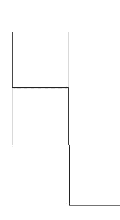

图5.10 盖里的新瓷砖。

现在很容易检查，如果 (x, y) → (x′, y′) 是一个合法的机器人移动，那么 v((x′, y′)) < v((x, y))。特别地，v 是一个严格递减的派生变量，所以定理 5.4.8 暗示着机器人总是会被卡住——尽管我们无法说出需要多少步才能卡住。

## 第5.1节的问题

### 练习题

- 问题 5.1. 用归纳法证明每个非空有限实数集合都有最小元素。

问题 5.2. 弗兰克·盖里改变了主意。与图 5.3 中的 L 形砖块不同，他想使用一种奇数偏移的砖块图案（或其镜像反射），如图 5.10 所示。为了证明这是可能的，他使用了类似于文中证明的推理方法，但与文中的证明不同，这个证明是有缺陷的。下面的证明中哪个部分包含了逻辑错误？

错误声明。这个证明是通过归纳法进行的。设 P(n) 是关于比尔在一个 2^n × 2^n 庭院中的位置的命题，存在一种砖块图案可以填满剩余部分。

错误的证明。基本情况: P(0) 是真的，因为比尔填满了整个庭院。

归纳步骤：假设对于某个 n ≥ 0，P(n) 为真，即对于 Bill 在一个 2^n × 2^n 的庭院中的每个位置，存在一个剩余部分的平铺。将 2^{n+1} × 2^{n+1} 的庭院分为四个象限，每个象限为 2^n × 2^n。一个象限包含了图中的 Bill（B）。在这个象限附近的三个方格中分别放置一个临时的 Bill（X），如图 5(11) 所示。我们可以通过归纳假设来平铺每个象限。用一个偏移平铺替换这三个临时的 Bill 就完成了任务。这证明了对于所有的 n ≥ 0，P(n) 蕴含 P(n+1)。因此，对于所有的 m ∈ ℕ，P(m) 为真，而将 Bill 放在庭院中心的能力则是一个特殊情况。

### 课堂问题

问题 5.3. 使用归纳法证明

$$1^3 + 2^3 + \cdots + n^3 = \left( \frac{n(n+1)}{2} \right)^2. \tag{5.6}$$

对于所有的 n ≥ 1.

记得要正式地

1. 声明归纳证明.
2. 确定归纳假设 P(n).
3. 建立基本情况.
4. 证明 P(n) ⇒ P(n+1).
5. 得出结论 P(n) 对于所有的 n ≥ 1 成立.

如同五部分模板中所示.

问题 5.4.

通过对 n 进行归纳证明

$$1 + r + r^2 + \cdots + r^n = \frac{r^{n+1} - 1}{r - 1} \quad (5.7)$$

所有的 n ∈ ℕ 和数值 r ≠ 1 成立.

问题 5.5.

通过归纳法证明:

$$1 + \frac{1}{4} + \frac{1}{9} + \cdots + \frac{1}{n^2} < 2 - \frac{1}{n} \quad (5.8)$$

对于所有 n > 1.

问题 5.6.

(a) 通过归纳法证明一个 2^n × 2^n 庭院与一个 1 × 1 比尔雕像在一个角落可以用 L 形砖块覆盖。（不要假设或重新证明定理 5.1.2 的（更强的）结果，即比尔可以放在任何地方。这个问题的重点是展示一个不同的归纳假设可以起作用。）

(b) 使用部分 (a) 的结果证明原始断言，即存在一个以比尔为中心的铺砖方案。

问题 5.7.

我们已经用两种不同的方法证明了

$$1 + 2 + 3 + \cdots + n = \frac{n(n+1)}{2}$$

但我们现在将证明一个矛盾的定理!

错误定理。对于所有 n ≥ 0,

$$2 + 3 + 4 + \cdots + n = \frac{n(n+1)}{2}$$

证明。我们使用归纳法。设 P(n) 是命题 2 + 3 + 4 + ... + n = n(n+1)/2。

基础情况：P(0) 成立，因为等式两边都等于零。（回忆一下，没有项的和为零。）

归纳步骤：现在我们必须证明对于所有的 n ≥ 0，P(n) 蕴含 P(n+1) 成立。

所以假设 P(n) 成立；也就是说，2 + 3 + 4 + ⋯ + n = n(n+1)/2。然后我们可以这样推理：

$$2 + 3 + 4 + \cdots + n + (n+1) = [2 + 3 + 4 + \cdots + n] + (n+1) = \frac{n(n+1)}{2} + (n+1) = \frac{(n+1)(n+2)}{2}$$

在上面，我们将一些项分组，使用假设 P(n)，然后简化。这表明 P(n) 意味着 P(n+1)。根据归纳原理，对于所有的 n ∈ ℕ，P(n) 都是真的。

这个证明中到底哪里出了错误？

### 作业问题

问题 5.8.

斐波那契数 F(0), F(1), F(2), ... 的定义如下：

- F(0) ::= 0,
- F(1) ::= 1,
- F(n) ::= F(n-1) + F(n-2) 对于 n ≥ 2:

因此，前几个斐波那契数是 0、1、1、2、3、5、8、13 和 21。通过归纳证明对于所有的 n ≥ 1，

$$F(n-1) \cdot F(n+1) - F(n)^2 = (-1)^n. \quad (5.9)$$

问题 5.9.

对于任何二进制字符串，α，令 num(α) 为它在二进制表示中所代表的非负整数。例如，num(10) = 2, num(0101) = 5。

一个 n + 1 位加法器将两个 n + 1 位二进制数相加。更准确地说，一个 n + 1 位加法器接受两个长度为 n + 1 的二进制字符串

$$\alpha_n ::= a_n ... a_1 a_0,$$
$$\beta_n ::= b_n ... b_1 b_0,$$

和一个二进制数字， c_0，作为输入，并产生一个长度为 n + 1 的二进制字符串

$$\sigma_n ::= s_n ... s_1 s_0,$$

和一个二进制数字， c_{n+1}，作为输出，并满足规范：

$$\text{num} (\alpha_n) + \text{num} (\beta_n) + c_0 = 2^{n+1} c_{n+1} + \text{num} (\sigma_n). \quad (5.10)$$

有一种直接的方法可以将一个 n + 1 位加法器实现为数字电路：一个 n + 1 位三进位电路具有 1 + 2(n + 1) 二进制输入

$$a_n, ..., a_1, a_0, b_n, ..., b_1, b_0, c_0,$$

和 n + 2 二进制输出，

$$c_{n+1}, s_n, ..., s_1, s_0.$$

如问题 3.5 中所述，串行进位电路由以下公式指定：

$$s_i ::= a_i \text{ XOR } b_i \text{ XOR } c_i \quad (5.11)$$
$$c_{i+1} ::= (a_i \text{ AND } b_i) \text{ OR } (a_i \text{ AND } c_i) \text{ OR } (b_i \text{ AND } c_i), \quad (5.12)$$

对于 0 ≤ i ≤ n.

(a) 验证定义 (5.11) 和 (5.12) 意味着

$$a_n + b_n + c_n = 2c_{n+1} + s_n. \quad (5.13)$$

对于所有 n ∈ ℕ.

(b) 通过对 n 进行归纳证明一个 n + 1 位连续进位电路确实是一个 n + 1 位加法器，即它的输出满足 (5.10)。

提示：根据整数的二进制表示的定义，你可以假设 num (α_{n+1}) = a_{n+1}2^{n+1} + num (α_n).

$$\text{num} (\alpha_{n+1}) = a_{n+1}2^{n+1} + \text{num} (\alpha_n). \quad (5.14)$$

问题 5.10.

计算机科学的数学基础吉祥物，理论河马，在周末玩他珍藏的单位正方形时，做出了一个惊人的发现。这里发生了什么事。

首先，理论河马将他最喜欢的单位正方形放在地板上，如图 5.12（a）所示。他注意到得到的形状的周长长度为 4，是一个偶数。接下来，他将第二个单位正方形放在第一个正方形旁边，使得两个正方形共享一个边，如图 5.12（b）所示。他注意到得到的形状的周长长度现在为 6，也是一个偶数。

（图中每个形状的周长由粗线表示。）理论河马继续放置正方形，使得每个新的正方形与至少一个先前放置的正方形共享一个边，且没有正方形重叠。最终，他得到了图 5.12（c）中的形状。他意识到这个形状的周长长度为 36，又是一个偶数。

我们勇敢的猪朋友对这个奇怪的模式感到困惑。使用归纳法证明，无论 Theory Hippotamus 放置了多少个正方形或者他们如何排列，周长的长度始终是偶数。

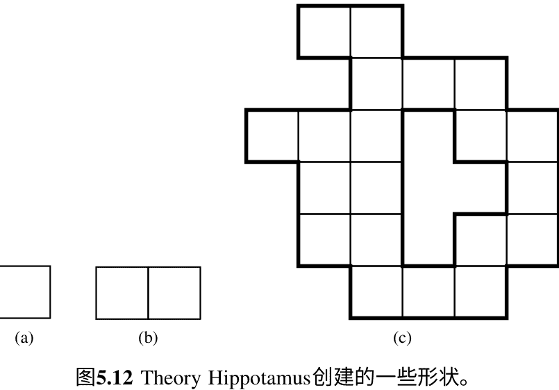

通过归纳法证明交集的分配律：

$$A \cup \bigcup_{i=1}^{n} B_i = \bigcup_{i=1}^{n} (A \cap B_i). \quad (5.15)$$

提示：定理 4.1.2 给出了 n = 2 的情况。

问题 5.12.

这是一个有趣的几何对象构造，被称为科赫雪花。

通过递归定义一个多边形序列 S_0, S_1，起始于边长为 1 的等边三角形。我们通过去除 S_n 的每条边的中间三分之一，并用两条相同长度的线段替换它，构造 S_{n+1}，如图 5.13 所示。

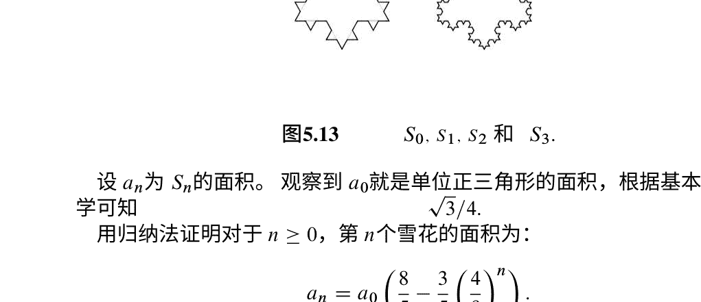

图 5.13 S_0, S_1, S_2 和 S_3。

设 a_n 为 S_n 的面积。观察到 a_0 就是单位正三角形的面积，根据基本几何学可知 √3/4。

用归纳法证明对于 n ≥ 0，第 n 个雪花的面积为：

$$a_n = a_0 \left( \frac{8}{5} - \frac{3}{5} \left( \frac{4}{9} \right)^n \right). \quad (5.16)$$

### 考试题

问题 5.13.

通过归纳法证明:

$$\sum_{i=0}^{n} i^{3} = \left( \frac{n(n+1)}{2} \right)^2, \ \forall n \geq 0. \qquad\qquad (5.17)$$

使用等式本身作为归纳假设，证明基本情况 (n = 0).

现在证明归纳步骤。

问题 5.14.

假设 P(n) 是自然数上的谓词，且假设对于所有的 k，P(k) 成立则 P(k+2) 成立：(5.18)

对于满足 (5.18) 的 P，以下断言中的一些可能对某些情况成立，但不对所有情况成立，而另一些断言无论 P 是什么都始终成立，而有些断言对于任何 P 都不成立。指出每个断言适用的情况，并简要解释原因。

(a) ∀n ≥ 0. P(n)
(b) ¬P(0) ∧ ∀n ≥ 1. P(n)
(c) ∀n ≥ 0. ¬P(n)
(d) (∀n ≤ 100. P(n)) ∧ (∀n > 100. ¬P(n))
(e) (∀n ≤ 100. ¬P(n)) ∧ (∀n > 100. P(n))
(f) P(0) ⇒ ∀n. P(n+2)
(g) [∃n. P(2n)] ⇒ ∀n. P(2n+2)
(h) P(1) ⇒ ∀n. P(2n+1)
(i) [∃n. P(2n)] ⇒ ∀n. P(2n+2) (注：与(g)重复，可能原文有误)
(j) ∃n. ∃m > n. [P(2n) ∧ ¬P(2m)]
(k) [∃n. P(n)] ⇒ ∀n. ∃m > n. P(m)
(l) ¬P(0) ⇒ ∀n. ¬P(2n)

问题 5.15.

考虑以下谓词序列：

$$Q_1(x_1) ::= x_1$$
$$Q_2(x_1, x_2) ::= x_1 \text{ IMPLIES } x_2$$
$$Q_3(x_1, x_2, x_3) ::= (x_1 \text{ IMPLIES } x_2) \text{ IMPLIES } x_3$$
$$Q_4(x_1, x_2, x_3, x_4) ::= ((x_1 \text{ 蕴含 } x_2) \text{ 蕴含 } x_3) \text{ 蕴含 } x_4$$
$$Q_5(x_1, x_2, x_3, x_4, x_5) ::= (((x_1 \text{ 蕴含 } x_2) \text{ 蕴含 } x_3) \text{ 蕴含 } x_4) \text{ 蕴含 } x_5$$
$$\vdots \quad \vdots$$

设 T_n 为变量 x_1, x_2, …, x_n 的不同真/假设置的数量使得 Q_n(x_1, x_2, …, x_n) 为真。例如，T_2 = 3 因为对于变量 x_1 和 x_2 有 3 种不同的设置使得 Q_2(x_1, x_2) 为真:

| x₁ | x₂ | Q₂(x₁, x₂) |
|----|----|------------|
| T  | T  | 真         |
| T  | F  | 假         |
| F  | T  | 真         |
| F  | F  | 真         |

(a) 用 T_n 的表达式表示 T_{n+1}，假设 n ≥ 1。
(b) 使用归纳法证明 T_n = 1/3(2^{n+1} + (-1)^n) 对于 n ≥ 1。你可以假设你之前的答案没有证明。

问题 5.16.

给定 n 个信封，编号为 0, 1, …, n-1。信封 0 包含 2^0 = 1 美元，信封 1 包含 2^1 = 2 美元，…，而信封 n-1 包含 2^{n-1} 美元。设 P(n) 为命题：

> 对于所有非负整数 k < 2^n，存在一个信封的子集其内容总和恰好为 k 美元。

通过归纳证明对于所有整数 n, P(n) 成立。

## 第5.2节的问题

### 练习题

问题 5.17.

关于非负整数的一些基本推理原则是：

1. 归纳原理，
2. 强归纳原理，
3. 良序原理。

确定上述每个推理规则是否包含在以下推理规则中。

(a)
$$
\frac{P(0); \quad \forall m, (\forall k, k \le m \land P(k)) \Rightarrow P(m + 1)}{\forall n, P(n)}
$$

(b)
$$
\frac{P(b); \quad \forall k, k \le b \land P(k) \Rightarrow P(k + 1)}{\forall k, k \le b, \text{ 则 } P(k)}
$$

(c)
$$
\frac{\forall n, P(n)}{\forall m, [P(m) \land \forall k, P(k) \Rightarrow k \le m]}
$$

(d)
$$
\frac{P(0), \quad \forall k > 0. P(k) \Rightarrow P(k + 1)}{\forall n, P(n)}
$$

(e)
$$
\frac{\forall m. (\forall k < m. P(k)) \Rightarrow P(m)}{\forall n, P(n)}
$$

问题 5.18.

第 n 个斐波那契数, F(n), 定义如下

$$
\begin{align*}
F(0) &= 0, \\
F(1) &= 1, \\
F(n) &::= F(n-1) + F(n-2) \quad \text{对于 } n \ge 2.
\end{align*}
$$

以下证明中哪些句子存在逻辑错误？

错误声明。每个斐波那契数都是偶数。

错误的证明.
1. 我们使用强归纳法.
2. 归纳假设是 F(n) 是偶数.
3. 我们首先证明这个假设对于 n 等于 0 成立.
4. 这是真的，因为 F(0) 等于 0，是一个偶数.
5. 现在，假设 n ≥ 2. 我们将证明对于所有 k < n，假设 F(k) 是偶数，则 F(n) 也是偶数.
6. 根据假设，F(n-1) 和 F(n-2) 都是偶数.
7. 因此，F(n) 是偶数，因为 F(n) 等于 F(n-1) 加上 F(n-2)，而两个偶数的和仍然是偶数.
8. 因此，强归纳原理表明对于所有的 n > 0，F(n) 都是偶数.

问题 5.19.

第 n 个斐波那契数，F(n)，定义如下
$$F(0) \text{ 等于 } 0, \quad\quad\quad (5.19)$$
$$F(1) \text{ 等于 } 1, \quad\quad\quad (5.20)$$
$$F(n) ::= F(n-1) + F(n-2) \quad \text{对于 } n > 1. \quad (5.21)$$

请准确指出以下错误证明中的哪些句子存在逻辑错误？并解释。

错误声明。每个斐波那契数都是偶数。

错误的证明。假设下面提到的所有变量 n, m, k 都是非负整数。假设 Even(n) 表示 F(n) 是偶数。该证明采用强归纳法，归纳假设为 Even(n)。

基本情况: F(0) = 0 是一个偶数，所以 Even(0) 为真。

归纳步骤: 我们假设强归纳假设可能成立对于 0 ≤ k ≤ n，我们假设 Even(k) 成立; 我们必须证明 Even(n+1)。

## 第5章 归纳

### 5.4. 状态机

然后根据强归纳假设，Even(n)和Even(n-1)都为真，也就是说，F(n)和F(n-1)都是偶数。但是根据定义方程（5.21），F(n+1)等于两个偶数的和，因此它也是偶数。这证明了Even(n+1)是必需的。

因此，根据强归纳原理，对于所有的 m ∈ ℕ, F(m)都是偶数。

#### 问题 5.20.

爱丽丝想要通过归纳法证明一个谓词，P，在某些非负整数上成立。她已经证明了对于所有非负整数 n=0,1,…

```
P (n) 蕴含    P (n + 3).
```

(a)假设爱丽丝还证明了P(5)成立。她可以推断出以下哪个命题？

- 1. 对于所有 n ≥ 5, P(n)成立
- 2. 对于所有 n ≥ 5, P(3n)成立
- 3. 对于 n = 8, 11, 14, …, P(n)成立
- 4. 对于 n < 5, P(n)不成立
- 5. 对于所有n, P(3n + 5)
- 6. 对于所有 n > 2, P(3n – 1)
- 7. P(0)蕴含对于所有n, P(3n + 2)
- 8. P(0) 蕴含 ∀n, P(3n)

(b)为了得出结论P(n)对于所有的 n ≥ 5，Alice可以证明以下哪个命题？

- 1. P(0)
- 2. P(5)
- 3. P(5) 和 P(6)
- 4. P(0), P(1), 和P(2)
- 5. P(5), P(6), 和P(7)
- 6. P(2), P(4), 和P(5)
- 7. P(2), P(4), 和P(6)
- 8. P(3), P(5), 和P(7)

#### 课堂问题

#### 问题 5.21.

斐波那契数列 $F_{0}, F_{1}, F_{2}, \ldots$ 的定义如下：
$$
F_{n} := \begin{cases}
0 & \text{如果 } n = 0, \\
1 & \text{如果 } n = 1, \\
F_{n-1} + F_{n-2} & \text{if } n > 1.
\end{cases}
$$
使用强归纳法证明，对于 $F_{n}$ 的以下闭式公式$^{8}$
$$
F_{n} = \frac{p^{n} - q^{n}}{\sqrt{5}}
$$
其中 $p = \frac{1+\sqrt{5}}{2}$ 并且 $q = \frac{1-\sqrt{5}}{2}$。
提示: 注意 $p$ 和 $q$ 是方程 $x^{2} - x - 1 = 0$ 的根，因此 $p^{2} = p + 1$ 和 $q^{2} = q + 1$。

#### 问题 5.22.

一个数列在每个数都不大于它之后的数时被称为弱递减的。$\ge$ 这意味着一个只有一个数的数列也是弱递减的。

下面是一个关于一个非常重要的真实事实的错误证明，即大于1的每个整数都是唯一的弱递减质数序列的乘积—简称为pusp。
解释证明中的错误之处。

引理。大于1的每个整数都是pusp。

例如，$252 = 7 \cdot 3 \cdot 3 \cdot 2 \cdot 2$，没有其他弱递减的素数序列的乘积等于252。

错误的证明。 我们将通过强归纳法证明引理，假设归纳假设 $P(n)$ 成立。

$n$ 是pusp:
因此，如果我们证明 $P(n)$ 对所有 $n \ge 2$ 成立，那么引理就成立。
基本情况 $(n = 2)$ ： $P(2)$ 是真的，因为2是素数，所以它是一个长度为一的素数乘积，显然这是唯一的一个乘积等于2的素数序列。

这个令人费解的公式被称为Binet公式。 我们将在第15章和第21章再次解释它的由来。

### 5.4. 状态机

归纳步骤：假设i是一个整数，且对于每个整数i满足条件2 ≤ i < n + 1。我们必须证明P(n + 1)成立，即n + 1也是一个pusp。我们通过案例进行论证：如果n + 1本身是素数，则它是由一个长度为一的序列组成它本身的乘积。这个序列是唯一的，因为根据素数的定义，n + 1没有其他素因子。所以n + 1是一个pusp，即P(n + 1)在这种情况下成立。否则，n + 1不是素数，根据定义意味着n + 1 = km对于一些整数k, m使得2 ≤ k, m < n + 1。现在根据强归纳假设，我们知道k和m是pusp。由此可知，通过按排序顺序合并k和m的唯一素数序列，我们得到一个唯一的弱递减素数序列，其乘积等于n + 1。所以n + 1也是一个pusp，在这种情况下。所以P(n + 1)在任何情况下都成立，这通过强归纳法完成证明那么P(n)对于所有的n ≥ 2都成立。

#### 问题5.23.

定义堆叠块的势能, S, 为k(k - 1)/2其中k是堆叠块的数量。定义一组堆叠的势能, A, 为A中所有堆叠的势能之和。将关于堆叠游戏中得分的定理5.2.1推广到任意一组堆叠A，如果从A开始的一系列移动导致另一组堆叠B，则p(A) ≥ p(B)，并且这一系列移动的得分为p(A) - p(B)。提示：尝试对从A到B的移动次数进行归纳。

#### 作业问题

#### 问题5.24.

一组n ≥ 1人可以分成若干个团队，每个团队包含4个或7个人。所有可能的n值是什么？使用归纳法证明你的答案是正确的。

#### 问题5.25.

以下引理是正确的，但下面给出的证明有缺陷。准确地指出证明中第一次不合理的步骤，并解释为什么它是不合理的。引理。对于任意的质数p和正整数n；x₁；x₂；: : : ; xₙ，如果p | x₁x₂: : : : xₙ，那么对于某个$n$的值，$p \mid x_i$成立，其中$i$的取值范围是$1 \leq i \leq n$。虚假证明。通过对$n$进行强归纳来证明。归纳假设，$P(n)$，是引理对于$n$成立的假设。基本情况$n = 1$：当$n = 1$时，我们有$p \mid x_1$，因此我们可以让$i = 1$并得出结论$p \mid x_i$。归纳步骤：现在假设对于所有的$k \leq n$，我们必须证明它对于$n + 1$也成立。所以假设$p \mid x_1 x_2 \cdots x_{n+1}$。令$y_n = x_n x_{n+1}$，所以$x_1 x_2 \cdots x_{n+1} = x_1 x_2 \cdots x_{n-1} y_n$。由于这个等式的右边是$n$项的乘积，根据归纳法，我们知道$p$可以整除其中的一个。如果存在某个$i < n$使得$p \mid x_i$，那么我们就得到了所需的$i$。否则，$p \mid y_n$。但由于$y_n$是两个项$x_n$和$x_{n+1}$的乘积，根据强归纳法，我们知道$p$可以整除其中的一个。所以在这种情况下，当$i = n$或$i = n + 1$时，$p \mid x_i$。

#### 考试问题

##### 问题5.26.

```
F_n ::= \begin{cases} 
    0 & \text{如果 } n = 0, \\
    1 & \text{如果 } n = 1, \\
    F_{n-1} + F_{n-2} & \text{if } n > 1.
\end{cases}
```

这些数字满足许多意想不到的等式，例如

```
$$F_0^2 + F_1^2 + \cdots + F_n^2 = F_n F_{n+1}$$
```

方程（5.22）可以通过归纳法证明对于所有的$n \in \mathbb{N}$成立，使用方程本身作为归纳假设，$P(n)$. (a)证明

基本情况 $(n = 0)$.

(b)现在证明

归纳步骤.

##### 问题5.27.

使用强归纳法证明对于每个整数$n \leq 3^{n/3}$都成立 $\geq 0$.

### 5.4. 状态机

#### 问题5.28.

可以从大小为4和7的学生团队组成任意规模为18或更大的班级。通过归纳法（某种形式）证明这一点，使用归纳假设：

S(n) ::= 可以从大小为4和7的团队组成一个包含18名学生的班级。

#### 问题5.29.

任何大于或等于十美分的邮资金额，只使用10美分和15美分的邮票即可制作
通过归纳法证明这一点（普通归纳法或强归纳法，但要说明使用的是哪种归纳法）

可以使用10美分和15美分的邮票制作 $S(n) ::= (5n + 10)¢$邮资：

#### 第5.4节的问题

#### 练习题

#### 问题5.30.

下面的Die Hard 3机器的哪些状态有恰好两个转换状态？

##### Die Hard转换

- 1. 填满小瓶子: $(b, l) \longrightarrow (b, 3)$ 对于 $l < 3$.
- 2. 填满大瓶: $(b, l) \longrightarrow (5, l)$ 对于 $b < 5$.
- 3. 倒空小瓶: $(b, l) \longrightarrow (b, 0)$ 对于 $l > 0$.
- 4. 倒空大瓶: $(b, l) \longrightarrow (0, l)$ 对于 $b > 0$.
- 5. 从小罐倒入大罐: 对于 $l > 0$,
$(b, l) \longrightarrow \begin{cases} (b + l, 0) & \text{如果 } b + l \leq 5, \\ (5, l - (5 - b)) & \text{否则。} \end{cases}$
- 6. 从大罐倒入小罐: $b > 0$,
$(b, l) \longrightarrow \begin{cases} (0, b + l) & \text{如果 } b + l \leq 3, \\ (b - (3 - l); 3) & \text{否则。} \end{cases}$

## 第5章 归纳

#### 问题 5.31。

证明每个大于等于12美分的邮资都可以只用4美分和5美分的邮票组成。

#### 作业问题

#### 问题 5.32。

在20世纪60年代末，推翻了小国家尼尔迪亚政府的军事政变完全禁止了内置的乘法运算，并且禁止了除以除了3以外的任何数字。 幸运的是，一位年轻的持不同政见者找到了一种方法，可以帮助人们在不冒受迫害的风险下相乘任意两个非负整数。 他教给人们的过程是：

```
过程乘法(x, y: 非负整数)
r := x;
s := y;
a := 0;
当 s ≠ 0时
    如果 3 | s则
        r := r + r + r;
        s := s/3;
    否则如果 3 | (s - 1)则
        a := a + r;
        r := r + r + r;
        s := (s - 1)/3;
    其他
        a := a + r + r;
        r := r + r + r;
        s := (s - 2)/3;
return a;
```

我们可以将算法建模为一个状态机，其状态是非负整数的三元组(r, s, a)。初始状态是(x, y, 0)。转换由以下规则给出对于s > 0:(3r, s/3, a)

(r, s, a) → \begin{cases} (3r, s/3, a) & \text{如果 3可以整除 s} \ (3r, (s-1)/3, a+r) & \text{如果 3可以整除 (s-1)} \ (3r, (s-2)/3, a+2r) & \text{否则.} \end{cases} (a)列出算法在

输入 x等于 5和 y等于 10时执行的步骤序列。

### 5.4. 状态机

(b)使用不变量方法证明算法部分正确，即如果 = 0，则 = xy。

(c)证明算法在最多 1 + log3 y次执行循环体后终止。

#### 问题5.33.

一个名为Wall-E的机器人在二维网格上漫游。他从(0, 0)开始，并被允许采取四种不同类型的步骤：

- 1. (+2, -1)
- 2. (+1, -2)
- 3. (+1, +1)
- 4. (-3, 0)

因此，例如，Wall-E可能按照以下方式行走。步骤类型列在箭头上方。

```
 `(0, 0) → (2, -1) → (3, 0) → (4, -2) → (1, -2) → ...`
```

Wall-E的真爱，时尚高能的机器人Eve，在(0, 2)等着。

(a)描述这个问题的状态机模型。

(b)Wall-E会找到他真爱吗？要么从Wall-E到Eve找到一条路径，要么使用不变原理证明不存在这样的路径。

#### 问题5.34.

一个饥饿的蚂蚁被放在一个无界的网格上。网格的每个方格要么包含一个面包屑，要么为空。包含面包屑的方格形成一条路径，在路径的除了两端以外的每个面包屑都与其他两个面包屑相邻。蚂蚁被放在路径的一端，并且在一个包含面包屑的方格上。例如，下图显示了一个情况，蚂蚁面朝北方，有一条大致向东南方向的食物路径。蚂蚁已经吃掉了最初放置的面包屑

蚂蚁只能直接闻到前方的食物。蚂蚁只能记住少量的事物，每次移动后它记住的内容只取决于移动前它所记住和闻到的内容。基于闻到的和

在这种情况下，蚂蚁可以选择向前移动一个方格，或者向右或向左转向。当蚂蚁降落在面包屑上时，它会吃掉它。

上述情景可以很好地建模为一个状态机，其中每个状态都是一个由“蚂蚁的记忆”和“其他所有东西”组成的对，例如，关于网格上物体位置的信息。详细设计这样一个模型状态机；设计蚂蚁记忆部分，使蚂蚁能够在任何有限路径上开始时吃掉所有的面包屑，然后在完成时发出信号。请确切描述模型中可能的状态、转换和输入输出（如果有的话）。简要解释为什么你的蚂蚁会吃掉所有的面包屑。

请注意，最后一个转换是一个自循环；蚂蚁永远发出完成的信号。也可以添加另一个结束状态，这样蚂蚁只会发出一次完成的信号。

#### 问题 5.35.

假设你有一副按照以下方式排列的常规扑克牌，从上到下：

```
A♡2♡…K♡ A♠2♠…K♠ A♣2♣…K♣ A♢2♢…K♢
```

只允许对牌堆进行两种操作：洗牌和分牌。在两种操作中，你首先将牌堆准确地对半切开，将上半部分放在右手中，下半部分放在左手中。然后你将两半洗牌在一起，使得牌完全交错；也就是说，洗牌后的牌堆由左手中的一张牌，右手中的一张牌，左手中的一张牌，右手中的一张牌等等组成。洗牌后的牌堆中的顶部牌在分牌操作中来自右手，而在洗牌操作中来自左手。

- (a)将这个问题建模为状态机。

(b)使用不变性原理证明通过一系列洗牌操作无法使整个牌堆的前半部分变为黑色。
注意：找到一个合适的不变量可能很困难！这通常是正确性证明的一部分，需要一些洞察力，而且没有简单的方法来找到不变量。一个标准的初始方法是确定一堆可达状态，然后寻找一个共同的特征或模式。

##### 问题5.36.

证明第5.4.5节中的快速指数状态机将在从任何状态开始的转换后停止。

```
[log₂ n] + 1 (5.23)
```

提示：强归纳法。

##### 问题5.37.

Nim是一个由一些石堆开始的双人游戏。玩家的一步移动是从一个石堆中移除一个或多个石头。玩家轮流进行移动，输家是没有石头可移除的人。

事实证明，其中一位玩家有一种容易实施但不太明显的获胜策略。

为了解释这种获胜策略，我们需要从两个方面考虑一个数字：作为非负整数和作为等于二进制表示的位串—可能带有前导零。

例如，XOR的定义是基于它们的二进制表示：使用XOR组合二进制表示的相应位串的对应位，然后将结果的位串解释为一个数字。例如，

```
2 XOR 7 XOR 9 = 12
```

因为，按列进行XOR运算，我们有

```
0 0 1 0 (2的二进制表示)
0 1 1 1 (7的二进制表示)
1 0 0 1 (9的二进制表示)
1 1 0 0 (十二的二进制表示)
```

这与对数字进行二进制加法相同，但是舍弃进位（参见问题3.5）。

石堆中的数字的异或被称为它们的Nim和。在这个问题中，我们将验证如果在玩家的回合上Nim和不为零，则玩家有一种获胜策略。例如，如果游戏从五个大小相等的石堆开始，那么第一个玩家有一种获胜策略，但是如果游戏从四个大小相等的石堆开始，那么第二个玩家可以强迫获胜。

- (a)证明如果石堆的Nim和为零，则任何一步都会留下一个非零的Nim和。
- (b)证明如果有一个石堆的石头比其他石堆的Nim和多，那么存在一步操作使得Nim和等于零。
- (c)证明如果Nim和不为零，则其中一个堆比其他所有堆的Nim和更大。
- 提示：注意最大的堆可能不是比其他堆的Nim和更大的那个；三个大小为2、2、1的堆就是一个例子。
- (d)得出结论，如果游戏以非零的Nim和开始，则第一个玩家有获胜策略。
- 提示：描述一个第一个玩家可以保持的不变量。
- (e) (额外加分) 有时候Nim游戏的胜者和失败者是相反的，也就是说，拿走最后一块石头的人会输。这被称为游戏的吝啬版本。利用上面常规游戏的获胜策略的思路，找到一个吝啬版本的获胜策略。

#### 课堂问题

#### 问题5.38.

在这个问题中，你将使用不变量的方法来证明一个名为 “十五拼图” 的益智玩具的基本属性。十五拼图由一个 4 × 4的框架中滑动的方形块状瓷砖组成，编号为1； : : : ; 15，其中有一个空白方块。任何与空白方块相邻的瓷砖都可以滑入其中。标准初始位置为

| 1 | 2 | 3 | 4 |
|---|---|---|---|
| 5 | 6 | 7 | 8 |
| 9 | 10 | 11 | 12 |
| 13 | 14 | 15 | |

我们希望达到目标位置（在最古老的作者年轻时称为

### 5.4. 状态机

“不可能的”）：

| 15 | 14 | 13 | 12 |
|----|----|----|----|
| 11 | 10 | 9  | 8  |
| 7  | 6  | 5  | 4  |
| 3  | 2  | 1  |    |

拼图的状态机模型由一个 4 × 4矩阵组成，有16个条目，包括整数1, . . . , 15以及一个“空”条目—就像上面的两个数组一样。

状态转换对应于交换空方块和相邻的编号方块。例如，位于位置(2, 2)的空方块可以与其上方的方块交换位置，即位于位置(1, 2):

| n1 | n2 | n3 | n4 |
|----|----|----|----|
| n5 |    | n6 | n7 |
| n8 | n9 | n10| n11|
| n12| n13| n14| n15|

| n1 |    | n3 | n4 |
|----|----|----|----|
| n5 | n2 | n6 | n7 |
| n8 | n9 | n10| n11|
| n12| n13| n14| n15|

我们将使用不变量方法证明从初始状态开始无法达到目标状态的方式。

我们首先注意到，一个状态也可以表示为由两个元素组成的一对：

- 1. 按照它们出现的顺序列出的数字1, . . . , 15—从上到下从左到右读取行，忽略空方块，并且
- 2. 空方块的坐标——左上方块的坐标为(1, 1)，右下方块的坐标为(4, 4)。

(a)写出起始状态和“不可能”状态的“列表”表示。

设 L 为一个按某种顺序排列的数字列表1, . . . , 15。在列表 L 中，当一对整数的第一个元素既在列表中出现得更早，且比第二个元素大时，这对整数称为“逆序对”。例如，列表1, 2, 4, 5, 3有两个逆序对: (4,3) 和 (5,3)。递增列表1, 2 . . . n没有逆序对。

设状态 S 为一个描述如上所述的一对(L, (i, j))。我们定义状态 S 的奇偶性为0或1，取决于列表 L 中逆序对的数量和空方块所在行的行号之和是偶数还是奇数。即

```
奇偶性(S) ::= \begin{cases} 0 & \text{if } p(L) + i \text{ 是偶数}, \\ 1 & \text{否则} . \end{cases}
```

## 第5章 归纳

- (b) 验证起始状态和目标状态的奇偶性不同。
- (c) 证明状态的奇偶性在转换过程中保持不变。得出结论“不可能”是无法达到的。

顺便说一下，如果两个状态具有相同的奇偶性，那么实际上有一种方法可以从一个状态到达另一个状态。 如果你喜欢解谜，你会喜欢自己解决这个问题。

### 问题5.39

马萨诸塞州高速公路管理局对新的Zakim桥的完整性表示关注。 他们的咨询建筑师警告说，如果同时有超过1000辆车在桥上，桥可能会坍塌。 管理局还收到了交通顾问的警告，称从车辆超速通过桥梁引起的事故率正在增加。

为了减轻交通压力和阻止超速，管理局决定将桥设为单行道，并在桥的两端设置收费站（别笑，这是马萨诸塞州的做法）。因此，汽车将在进入和离开桥梁时分别支付过路费，但过路费会有所不同。 特别地，汽车进入桥梁需要支付3美元，离开桥梁需要支付2美元。 为了确保桥上没有太多的车辆，管理局只允许一辆车进入桥梁，前提是入口收费亭的金额与出口收费亭的金额之差严格小于某个阈值金额$T_0$。

顾问们决定用一个状态机来模拟这种情况，其状态是非负整数的三元组，(A, B, C)，其中
- A是入口处的金额,
- B是出口处的金额，以及
- C是桥上的车辆数量。

任何C > 1000的状态都被称为collapsed状态，这是当局非常希望避免的。在collapsed状态下不会发生状态转换。

由于收费亭收费员可能需要一些金额来找零，而且在对公众开放之前，桥上可能已经有一些“官方”车辆，顾问们必须准备好分析从任何未折叠状态开始的系统。 所以让$A_0$是入口收费亭的初始金额，$B_0$是出口收费亭的初始金额，$C_0 \leq 1000$是桥上的官方车辆数量。 你应该假设即使是官方车辆在桥开放后也要支付过桥费。

### 5.4. 状态机

#### (a)
通过指定形式为(A, B, C) above的状态之间的转换关系，给出权威系统的数学模型，用于控制车辆上下桥。

#### (b)
描述以下每个派生变量的特征

```
A, B, A + B, A - B, 3C - A, 2A - 3B, B + 3C, 2A - 3B - 6C, 2A - 2B - 3C
```

作为以下其中之一

| 类别 | 代码 |
|------|------|
| 常数 | C |
| 严格递增 | SI |
| 严格递减 | SD |
| 弱递增但不是常数 | WI |
| 弱递减但不是常数 | WD |
| 以上都不是 | N |

并简要解释你的推理。

权威机构已经要求他们的工程顾问确定$T$并验证这个政策将保持车辆数量不超过1000辆。顾问们推断，如果$C_0$是桥上的官方车辆数量，在桥开放时，可以再允许进入$1000 - C_0$辆车。只要$A - B$没有增加$3(1000 - C_0)$，桥上就不应该超过1000辆车。 所以他们建议定义

```
T_0 ::= 3(1000 - C_0) + (A_0 - B_0), \quad (5.24)
```

其中$A_0$是入口收费亭的初始金额，$B_0$是出口收费亭的初始金额。

#### (c)
使用(b)部分的结果来定义一个简单的谓词$P$，该谓词适用于过渡系统的起始状态——即$P (A_0, B_0, C_0)$成立——不适用于任何折叠状态，并且是系统的保持不变量。

解释为什么你的$P$具有这些属性。得出结论，交通不会导致桥梁坍塌。

#### (d)
一位聪明的麻省理工学院实习生同意高速公路管理局的桥梁管理政策是安全的：桥梁不会坍塌。但她警告她的老板，这个政策会导致死锁——桥上的交通无法移动，即使桥梁没有坍塌。

用系统转换的术语更准确地解释实习生的意思，并简要但清楚地证明她的说法。

### 问题5.40

桌子上有102枚硬币，98枚正面朝上，4枚反面朝上。有两种改变硬币的方法：
- (i) 翻转任意十枚硬币，或
- (ii) 令$n$表示正面朝上的硬币数。在桌子上放置$n$个额外的硬币，全部反面朝上。

例如，你可以先翻转九个正面朝上的硬币和一个反面朝上的硬币，得到90个正面朝上的硬币和12个反面朝上的硬币，然后再加上91个反面朝上的硬币，得到90个正面朝上的硬币和103个反面朝上的硬币。

(a) 将这种情况建模为状态机，仔细定义状态集、起始状态和可能的状态转换。

(b) 解释如何达到只有一个正面朝上的状态。

(c) 定义以下派生变量：

| C ::= 桌上的硬币数量, | H ::= 正面朝上的硬币数量, |
| T ::= 反面朝上的硬币数量, | C₂ ::= 余数 (C /2). |
| H₂ ::= 余数 (H/2), | T₂ ::= 余数 (T /2). |

这些变量中哪个是

- 1. 严格递增
- 2. 弱递增
- 3. 严格递减
- 4. 弱递减
- 5. 常数

(d) 证明不可能达到只有一个正面朝上的状态。

### 问题5.41

一个教室设计成学生坐在一个正方形的排列中。有时候，爆发了海狸流感会感染到班级里的学生；海狸流感是鸟流感的一种罕见变种，它会永远持续下去，症状包括渴望更多的测验和深夜解题的刺激。

这里是一个6×6座位教室的示意图，座位用方块表示。被感染的学生的位置用星号标记。

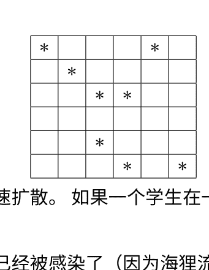

感染的爆发会逐步迅速扩散。如果一个学生在一步之后被感染，那么要么

- 这个学生在上一步已经被感染了（因为海狸流感会永远持续下去），或者
- 这个学生在上一步与至少两个已经被感染的学生相邻。

这里的相邻指的是学生们的个别方块共享一个边（前、后、左或右）；如果他们只共享一个角点，则不被视为相邻。所以每个学生都与其他2、3或4个学生相邻。

在这个例子中，感染会像下面展示的那样传播。

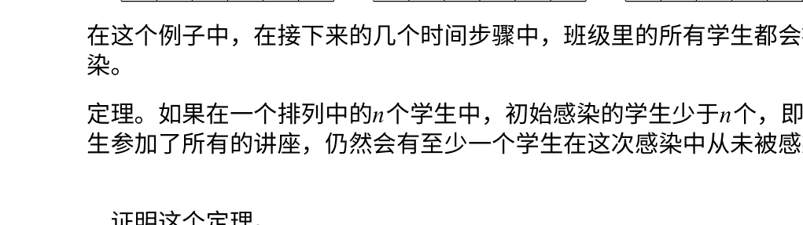

在这个例子中，在接下来的几个时间步骤中，班级里的所有学生都会被感染。

> 定理。如果在一个排列中的$n$个学生中，初始感染的学生少于$n$个，即使学生参加了所有的讲座，仍然会有至少一个学生在这次感染中从未被感染。

证明这个定理。
提示：将感染的状态看作是上面的一个$n \times n$方格，星号表示感染。感染传播的规则定义了状态机的转换。找到一个弱递减的派生变量，可以证明这个定理。

## 第5章 归纳

### 考试题

#### 问题5.42

有一个桶里面有比红球多的蓝球。只要蓝球比红球多，可以使用以下任何一条规则向桶中添加和/或移除球：
- (i) 添加一个红球。
- (ii) 移除一个蓝球。
- (iii) 添加两个红球和一个蓝球。
- (iv) 移除两个蓝球和一个红球。

(a) 从10个红球和16个蓝球开始，通过应用这些规则，桶中最多可以容纳多少个球？设$b$为蓝球的数量，$r$为红球的数量，在任何给定时间桶中的数量。

(b) 证明$b - r \geq 0$是根据规则（i）-（iv）添加和移除球的过程中的一个保持不变的量。

(c) 证明无论桶中包含多少个球，重复应用规则（i）-（iv）最终会导致无法再应用规则的状态。

#### 问题5.43

下面的问题是我们在课堂上讨论的Fifteen-Puzzle问题的一个变体。

设$A$是由数字$1, \dots, n$以某种顺序组成的序列。在$A$中，如果一对整数满足第一元素在序列中出现在第二元素之前且比第二元素大，则称其为一个out-of-order pair。例如，序列$(1, 2, 4, 5, 3)$有两对out-of-order pairs: $(4, 3)$和$(5, 3)$。我们将$t(A)$定义为$A$中的out-of-order pairs的数量。例如，$t((1, 2, 4, 5, 3)) = 2$。

可以使用旋转三元组操作重新排列$A$中的元素，其中$A$的三个连续元素被旋转以将其中最小的元素移至第一位。例如，在序列$(2, 4, 1, 5, 3)$中，旋转三元组操作可以将连续的数字$4, 1, 5$旋转为$1, 5, 4$，从而

$(2, 4, 1, 5, 3) \longrightarrow (2, 1, 5, 4, 3)$。

旋转三元组还可以将连续的数字$2, 4, 1$旋转为$1, 2, 4$，从而

$(2, 4, 1, 5, 3) \longrightarrow (1, 2, 4, 5, 3)$。

我们可以将序列$A$看作是一个状态机的状态，其转换对应于旋转三元组操作的可能应用。

- (a) 证明派生变量$t$是弱递减的。
- (b) 证明具有偶数个逆序对是该机器的一个保持不变量。
- (c) 从$S ::= (2014, 2013, 2012, . . . , 2, 1)$开始，解释为什么不可能达到$T ::= (1, 2, . . . , 2012, 2013, 2014)$。

## 6 递归数据类型

递归数据类型在编程中起着核心作用，归纳法实际上就是关于它们的。

递归数据类型由递归定义来指定，递归定义说明如何从先前的数据元素构造新的数据元素。 对于每个递归数据类型，都有关于数据类型的属性或函数的递归定义。 最重要的是，基于递归定义，有一种结构归纳方法来证明给定类型的所有数据都具有某些属性。

本章讨论了一些递归数据类型的示例以及对它们进行递归定义的函数。
- 字符串,
- “平衡”的括号字符串,
- 非负整数和
- 算术表达式。

### 6.1 递归定义和结构归纳

我们将从字符串的例子开始说明递归定义和证明。 通常我们会认为字符串是理所当然的，但将它们视为递归数据类型是很有启发性的。 特别是，字符串是一个很好的第一个例子，因为你将看到易于理解或已知的递归定义，这样你就可以专注于定义的工作方式，而不必弄清楚它们的用途。递归数据类型的定义有两个部分：
- 基本情况，指定某些已知的数学元素属于数据类型，以及
- 构造情况，指定如何从先前构造的元素或基本元素构造新的数据元素。

给定字符集的字符串的定义，$A$，遵循这个模式：

定义6.1.1. 令 $A$ 为一个非空集合，称为字母表，其元素被称为字符、字母或符号。字符串的递归数据类型， $A^*$，如下定义：
- 基本情况: 空字符串， $\lambda$，属于 $A^*$。
- 构造情况: 如果 $a \in A$ 且 $s \in A^*$，则对偶 $\langle a, s \rangle \in A^*$。

所以 $\{0, 1\}^*$ 是二进制字符串。

处理二进制字符串的常规方法是将其视为0和1的序列。例如，我们将长度为4的二进制字符串1011识别为位的序列，即4元组(1, 0, 1, 1)。但根据递归定义6.1.1，该字符串将被表示为嵌套对，即

$$\langle 1, \langle 0, \langle 1, \langle 1, \lambda \rangle \rangle \rangle \rangle$$

这些嵌套的对可能看起来很繁琐，也可能看起来很奇怪，但实际上它们反映了在Scheme或Python等编程语言中表示字符列表的方式，其中 $\langle a, s \rangle$ 将对应于 $\text{cons}(a, s)$。

请注意，我们还没有明确说明空字符串的表示方式。实际上并不重要，只要我们能够识别空字符串并将其与任何非空字符串区分开即可。

继续递归的方法，让我们定义字符串的长度。

定义 6.1.2. 字符串 $s$ 的长度，记为 $|s|$，根据 $s \in A^*$ 的定义进行递归定义：
- 基本情况: $|\lambda| ::= 0$。
- 构造函数案例: $|\langle a, s \rangle| ::= 1 + |s|$。

这个长度的定义遵循一个标准模式：对递归数据类型的函数可以使用与数据类型定义相同的情况进行递归定义。具体来说，要定义一个递归数据类型上的函数 $f$，需要在数据类型定义的基本情况下定义 $f$ 的值，然后根据组成数据项的 $f$ 的值来定义每个构造函数情况下的 $f$ 的值。

让我们再做一个例子：字符串 $s$ 和 $t$ 的连接 $s \cdot t$ 是由 $s$ 的字母后跟 $t$ 的字母组成的字符串。这是一个完全清晰的连接的数学定义（也许除了对空字符串的处理），在Scheme/Python列表中，$s \cdot t$ 将是列表 $\text{append}(s, t)$。这是连接的一个递归定义。

定义 6.1.3. 字符串$s$和$t$的连接$s \cdot t \in A^*$的递归定义如下：

基本情况：
$$\lambda \cdot t ::= t.$$

构造情况：
$$\langle a, s\rangle \cdot t ::= \langle a, s \cdot t\rangle.$$

### 6.1.1 结构归纳

结构归纳是一种证明递归定义数据类型的所有元素具有某种属性的方法。结构归纳证明分为两个部分，对应于递归定义：
- 证明每个基本情况元素具有该属性。
- 证明每个构造情况元素具有该属性，当构造器应用于具有该属性的元素时。

例如，我们可以使用结构归纳来验证两个字符串的连接长度等于它们长度之和：

定理 6.1.4. 对于所有的$s, t \in A^*$, 有

$$|s \cdot t| = |s| + |t|.$$

证明。通过对$s \in A^*$的结构归纳定义进行归纳。归纳假设是

$$P (s) ::= \forall t \in A^*. |s \cdot t| = |s| + |t|.$$

基本情况 ($s = \lambda$) :

$$\begin{align*}
|s \cdot t| &= |\lambda \cdot t| \\
&= |t| & (\text{定义} \cdot, \text{基本情况})\\
&= 0 + |t| \\
&= |s| + |t| & (\text{定义长度}, \text{基本情况})
\end{align*}$$

构造情况：假设$s$是由$a$和$r$组成的，并且假设归纳假设 $P(r)$成立。我们必须证明 $P(s)$成立：

```
|s·t| = |⟨a, r⟩·t|
       = |⟨a, r·t⟩|          (连接 def, 构造函数 case)
       = 1 + |r·t|          (长度 def, 构造函数 case)
       = 1 + (|r| + |t|)          since P(r) holds
       = (1 + |r|) + |t|
       = |⟨a, r⟩| + |t|          (长度 def, 构造函数 case)
       = |s| + |t|.
```

这证明了 $P(s)$按要求成立，完成了构造函数 case。通过结构归纳，我们得出结论： $P(s)$对于所有字符串 $s \in A^*$成立。

这个证明说明了一个通用原理：

> **结构归纳原理。**
>
> 设$P$为一个递归定义的数据类型$R$上的谓词。如果
> - 对于每个基本情况元素 $b \in R$， $P(b)$为真，并且
> - 对于所有二元构造函数 $c$，
>   $[P(r) \text{ AND } P(s)] \text{ IMPLIES } P(c(r, s))$
>   对于所有 $r, s \in R$成立。
>   同样地，对于所有接受其他数量参数的构造函数，
>
> 然后
> $P(r)$ 对于所有的 $r \in R$， $P(r)$都成立。

### 6.1.2 另外一件事

字符串 $s$中字符 $c \in A$的出现次数， $\#_c(s)$， 具有一个简单的递归定义，基于 $s \in A^*$的定义：

定义 6.1.5.
基本情况： $\#_c(\lambda) ::= 0$.

构造情况:
$$\#_c(\langle a, s \rangle) ::= \begin{cases} \#_c(s) & \text{如果 } a \neq c, \\ 1 + \#_c(s) & \text{if } a = c. \end{cases}$$

我们将在下一节中需要以下引理:

引理 6.1.6.
$$\#_c(s \cdot t) = \#_c(s) + \#_c(t).$$
通过结构归纳的简单证明是一个练习（问题6.7）。

### 6.2 匹配括号的字符串

设 $\{, [\}^*$ 为所有方括号字符串的集合。例如，以下两个字符串都在 $\{, [\}^*$ 中：

$[ ] ] [ [ [ [ ] ] \text{ 和 } [ [ [ ] ] [ ] ] [ ]$ (6.1)

一个字符串， $s \in \{, [\}^*$ ，如果它的括号“匹配”，则称为匹配字符串。例如，上面的左边字符串不匹配，因为它的第二个右括号没有匹配的左括号。右边的字符串是匹配的。

我们将通过递归定义的集合和函数来研究定义和证明匹配字符串的几种不同方法。这些属性相当直观，你可能会想它们在计算机科学中是否有特殊的相关性。诚实的回答是“不再有太多相关性了”。这是计算机科学的一项巨大成功，如下面的文本框所解释的那样。

### 表达式解析

在20世纪50年代和60年代计算机科学的早期发展阶段，创建有效的编程语言编译器是一个核心关注点。 在编译程序的处理过程中，表达式解析是一个关键方面。 一个重要的问题是如何处理类似的表达式

$$x + y * z^2 \div y + 7$$

并将其放入确定其评估方式的括号中-它应该是

$[[x + y] * z^2 \div y] + 7, \text{ or,}$
$x + [y * z^2 \div [y + 7]], \text{ or,}$
$[x + [y * z^2]] \div [y + 7], \text{ or ...?}$

图灵奖（计算机科学的“诺贝尔奖”）最终授予了罗伯特·W·弗洛伊德，他发现了一些简单的过程，可以正确地插入括号。

在70年代和80年代，这种解析技术被打包成高级编译器生成器，可以自动生成表达式语法的解析器。 这种解析的自动化效果非常好，以至于这个主题不再需要关注。 到了90年代，它在计算机科学课程中几乎消失了。

匹配的字符串可以很好地被描述为递归数据类型：

定义6.2.1. 递归地定义字符串集合RecMatch如下：
- 基本情况: $\lambda \in RecMatch$。
- 构造情况: 如果$s, t \in RecMatch$, 则 $[ s ] t \in RecMatch$。

这里 $[ s ] t$ 表示字符串的连接，完整写为

$$[ \cdot (s \cdot ( ] \cdot t)).$$

从现在开始，我们通常省略“·”。

使用这个定义， $\lambda \in RecMatch$ 通过基本情况，所以让 $s = t = \lambda$ 在构造函数中意味着

$$[\lambda]\lambda = [ ] \in RecMatch.$$

## 6.2. 匹配括号的字符串

现在，

$$[\lambda][] = [][] \in \text{RecMatch} \qquad (\text{让} \quad s = \lambda, \; t = [])$$
$$[[]]\lambda = [[]] \in \text{RecMatch} \qquad (\text{让} \quad s = [], \; t = \lambda)$$
$$[[]][] \in \text{RecMatch} \qquad (\text{让} \; s = [], \; t = []\text{)通过重复应用构造函数，这些也是RecMatch中的字符串；等等。}$$

很明显，为了使括号匹配，左右括号的数量最好是相等的。为了进一步练习，让我们从递归定义中仔细证明这一点。

引理。$RecMatch$中的每个字符串都有相等数量的左右括号。

证明。证明通过结构归纳和归纳假设
$$P(s) ::= \#_{[}(s) = \#_{]}(s).$$

基本情况：$P(\lambda)$成立，因为
$$\#_{[}(\lambda) = 0 = \#_{]}(\lambda) \text{根据Definition 6.1.5的基本情况。} \#_{c}().$$

构造情况：通过结构归纳假设，我们假设$P(s)$和$P(t)$，并且必须证明$P([s]t)$：

$$\begin{align*} \#_{[}([s]t) &= \#_{[}([]) + \#_{[}(s) + \#_{[}([]) + \#_{[}(t) \quad &\text{(引理6.1.6)} \ &= 1 + \#_{[}(s) + 0 + \#_{[}(t) \quad &\text{(def \#_{[}())} \ &= 1 + \#_{]}(s) + 0 + \#_{]}(t) \quad &\text{(通过} P(s) \text{和} P(t)\text{)} \ &= 0 + \#_{]}(s) + 1 + \#_{]}(t) \ &= \#_{]}([]) + \#_{]}(s) + \#_{]}([]) + \#_{]}(t) \quad &\text{(def \#_{]}())} \ &= \#_{]}([s]t) \quad &\text{(引理 6.1.6)这} \end{align*}$$

完成了构造器情况的证明。我们通过结构归纳得出结论，对于所有的$P(s)$，它都成立。

警告：当一个数据类型的递归定义允许以多种方式构造相同的元素时，该定义被称为模糊的。我们小心地选择了一个不含糊的RecMatch定义，以确保在其定义上递归定义的函数始终是良定义的。在一个含糊的数据类型定义上递归定义函数通常是行不通的。为了说明问题，这里有另一个匹配字符串的定义。

## 第6章 递归数据类型

### 定义6.2.2.
递归地定义集合AmbRecMatch ⊆ {}, [ ]*如下:

- 基本情况: λ ∈ AmbRecMatch,
- 构造情况: 如果s, t ∈ AmbRecMatch, 则字符串 [ s ] 和 st 也在AmbRecMatch中。

很容易看出AmbRecMatch的定义只是另一种定义RecMatch的方式, 即AmbRecMatch = RecMatch (见问题6.15)。 AmbRecMatch的定义可能更容易理解, 但我们没有使用它, 因为它是含糊的, 而RecMatch的更复杂的定义是明确的。

这就是为什么这很重要。 让我们定义操作的数量, f(s), 以递归地构造匹配的字符串 s 在 s ∈ AmbRecMatch的定义上: f(λ) ::= 0,

f([s]) ::= 1 + f(s),
f(st) ::= 1 + f(s) + f(t).

(f基本情况)
(f连接情况) 这

这个定义可能看起来没问题, 但实际上不是: f(λ)最终会得到两个值, 因此:

```
0 = f(λ)                      (f基本情况)
  = f(λ · λ)                   (连接定义, 基本情况)
  = 1 + f(λ) + f(λ)            (f 连接情况),
  = 1 + 0 + 0 = 1              (f基本情况):
```

这绝对不是我们想要的情况!

## 6.3 非负整数上的递归函数

非负整数可以理解为递归数据类型。

### 定义 6.3.1.
集合 ℕ, 是递归定义的数据类型:

- 0 ∈ ℕ。
- 如果 n ∈ ℕ, 则 n的后继, 记作 n + 1, 也属于 ℕ

这里的重点是明确普通归纳法只是递归定义 6.3.1 上结构归纳的特殊情况。这也证明了在非负整数上的函数的熟悉的递归定义。

## 6.3. 非负整数上的递归函数

### 6.3.1 一些标准的递归函数在 ℕ上

### 例子 6.3.2. 阶乘函数。
这个函数通常写作“n!”。你将在后面的章节中经常看到它。在这里，我们将使用符号 fac(n):

- fac(0) ::= 1.
- fac(n + 1) ::= (n + 1) · fac(n) 对于n为0的情况

### 例子 6.3.3. 斐波那契数列.
斐波那契数列起源于800年前对人口增长建模的努力。它们拥有一群持续关注它们非凡特性的粉丝（参见问题5.8、5.21、5.26）。第n个斐波那契数，记为fib，可以通过递归定义:

```
F (0) ::= 0,
F (1) ::= 1,
F (n) ::= F (n - 1) + F (n - 2)     对于n为2的情况
```

这里递归步骤从n为2开始，同时还有n为0和n为1的基本情况。这是必要的，因为递归依赖于前两个值。 F(4)是多少？嗯，F(2)等于F(1)加上F(0)等于1，F(3)等于F(2)加上F(1)等于2，所以F(4)等于3。数列开始为0, 1, 1, 2, 3, 5, 8, 13, 21, ...。

### 示例 6.3.4. 求和符号。
让“S(n)”缩写表示表达式“Σᵢ₌₁ⁿ f(i)。”我们可以用以下规则递归地定义 S(n)

- S(0) ::= 0.
- S(n + 1) ::= f(n + 1) + S(n) 对于 n ≥ 0.

### 6.3.2 错误的函数定义

在递归定义函数时要注意一些其他错误。主要问题出现在递归定义不遵循底层数据类型的递归定义时。以下是一些函数规范，看起来像是对非负整数上的函数进行良好定义，但实际上并不是。

```
f₁(n) ::= 2 + f₁(n - 1).      (6.2)
```

这个“定义”没有基本情况。如果某个函数，f₁，满足(6.2)，那么通过将常数添加到f₁的值中得到的函数也满足。因此方程(6.2)并不能唯一地定义f₁。

## 第6章 递归数据类型

$$f_2(n) ::= \begin{cases} 0, & \text{如果 } N = 0; \ f_2(n + 1) & \text{否则}. \end{cases} \quad \quad (6.3)$$

这个“定义”有一个基本情况，但仍然不能唯一确定 $f_2$。任何在0处为0且在其他地方恒定的函数都满足规范，所以(6.3)也不能唯一地定义任何东西。

在典型的编程语言中，对 $f_2(1)$ 的求值将从对 $f_2(2)$ 的递归调用开始，这将导致对 $f_2(3)$ 的递归调用，依此类推。递归调用将无休止地继续下去。这个“操作”方法将(6.3)解释为定义了一个部分函数 $f_2$，在除了0以外的所有地方都是未定义的。

$$f_3(n) ::= \begin{cases} 0, & \text{if } n \text{ 是2的倍数}, \ 1, & \text{if } n \text{ 是3的倍数}, \ 2, & \text{否则}. \end{cases} \quad \quad (6.4)$$

这个“定义”是不一致的: 它要求 $f_3(6) = 0$ 和 $f_3(6) = 1$，所以 (6.4) 并没有定义任何东西。

数学家们一直对这个函数规范感到困惑，它被称为Collatz猜想:

$$f_4(n) ::= \begin{cases} 1, & \text{如果 } n \leq 1, \ f_4(n/2) & \text{如果} n > 1 \text{是偶数}, \ f_4(3n + 1) & \text{if} n > 1 \text{是奇数}. \end{cases} \quad \quad (6.5)$$

例如, $f_4(3) = 1$ 因为

$f_4(3) ::= f_4(10) ::= f_4(5) ::= f_4(16) ::= f_4(8) ::= f_4(4) ::= f_4(2) ::= f_4(1) ::= 1$.

常数函数等于1将满足（6.5），但不知道是否还有其他函数也满足。问题在于第三种情况下，$f_4(n)$ 是以大于 $n$ 的参数来定义的，因此不能通过对 $N$ 的归纳来证明。已知任何满足 (6.5) 的 $f_4$ 在所有小于等于 $10^{18}$ 的 $n$ 上都等于1。

最后一个例子是阿克曼函数，它是两个非负参数的一个增长非常快的函数。它的反函数增长非常慢——它的增长速度比 $\log n$、$\log \log n$、$\log \log \log n$ 等都要慢，但它的增长是无界的。

这个逆运算实际上在分析一个有用的、高效的过程中出现，被称为并查集算法。这个算法被猜测在步骤数量上与其输入的大小呈线性增长，但事实证明它是“线性”的。

但是它的增长系数几乎等于反阿克曼函数的倒数。 这意味着从实际角度来看，并查集是线性的，因为理论上的增长系数对于任何可能出现的输入都小于5。阿克曼函数可以通过以下规则递归地定义为函数A:

A(m, n) = 2n, 如果 m = 0 或者 n ≤ 1, (6.6)
A(m, n) = A(m - 1, A(m, n - 1)), 否则. (6.7)

现在这些规则很不寻常，因为A(m, n)的定义涉及到对 A的参数进行评估，这些参数可能比 m和 n要大得多。 上述 f2的定义显示了如何通过较大的参数值来定义小参数值的函数值，这很容易导致无限计算。 阿克曼函数的定义实际上是正确的，但要证明这一点需要一些独创性（见问题6.17）。

## 6.4 算术表达式

表达式求值是编程语言的一个关键特性，将表达式识别为递归数据类型是理解它们如何被处理的关键。

为了说明这种方法，我们将使用一个玩具示例：只涉及一个变量“x”的算术表达式，如 3x² + 2x + 1。我们将称这种表达式的数据类型为Aexp。以下是它的定义:

- • 定义 6.4.1.
- • 基本情况:
  - 变量, x, 在 Aexp 中。
  - 阿拉伯数字, k, 对于任何非负整数, k, 在 Aexp 中。
- • 构造情况: 如果e, f ∈Aexp, 则
  - [e + f] ∈Aexp。表达式 [e + f]被称为和。Aexp 的e和 f被称为和的组成部分；它们也被称为加数。

## 第6章 递归数据类型

- $[e * f] \in \text{Aexp}$。表达式 $[e * f]$ 被称为乘积。Aexp 的 $e$ 和 $f$ 被称为乘积的组成部分；它们也被称为乘数和被乘数。

- $-[e] \in \text{Aexp}$。表达式 $-[e]$ 被称为负数。

注意 Aexp 是完全括号化的，不允许指数。因此，多项式表达式的 Aexp 版本 $3x^2+2x+1$ 将正式写为

$[[3*[x*x]] + [[2*x] + 1]]$. (6.8)

这些括号和 * 在示例中会使其变得混乱，因此我们经常使用更简单的表达式，例如“$3x^2+2x+1$”而不是(6.8)。但是重要的是要认识到 $3x^2+2x+1$ 不是 Aexp；它是 Aexp 的缩写。

### 6.4.1 评估和替换 Aexp 的

### 评估 Aexp

由于 Aexp 中唯一的变量是 $x$，Aexp 的值由 $x$ 的值确定。例如，如果 $x$ 的值为3，则 $3x^2 + 2x + 1$ 的值为34。通常情况下，给定任何 Aexp，$e$ 和整数值 $n$，对于变量 $x$，我们可以通过 $eval(e, n)$ 来评估 $e$ 的值。用递归定义来指定这个评估过程是简单且有用的。

### 定义 6.4.2. 评估函数
$eval : \text{Aexp} \times \mathbb{Z} \rightarrow \mathbb{Z}$，对于表达式 $e \in \text{Aexp}$，递归地定义如下。让 $n$ 是任意整数。

- • 基本情况：

评估$(x, n) ::= n$, （变量 $x$ 的值是 $n$。） (6.9)

）评估$(\text{k}, n) ::= k$, （数字 $\text{k}$ 的值是 $k$，与 $x$ 无关。） (6.10)

- • 构造函数案例 ：

评估$([e_1 + e_2], n) ::= eval(e_1, n) + eval(e_2, n)$, (6.11)

1) 评估$([e_1 * e_2], n) ::= eval(e_1, n) \cdot eval(e_2, n)$, (6.12)

2) 评估$(-[e_1], n) ::= -eval(e_1, n)$. (6.13)

## 6.4. 算术表达式

例如，这是递归定义的评估函数在 x为2时得出值为3 + x²的过程：

```
eval([3 + [x * x]], 2) = eval(3, 2) + eval([x * x], 2) \quad \text{(根据定义6.4.2.6.11)} \\
= 3 + eval([x * x], 2) \quad \text{(根据定义6.4.2.6.10)} \\
= 3 + (eval(x, 2) \cdot eval(x, 2)) \quad \text{(根据定义6.4.2.6.12)} \\
= 3 + (2 \cdot 2) \quad \text{(根据定义6.4.2.6.9)} \\
= 3 + 4 = 7.
```

### 将表达式代入Aexp

将表达式代入变量是编译器和代数系统中常用的操作。 例如，在表达式 x(x - 1)中将表达式 3x代入x的结果将是 3x(3x - 1)。 我们将使用通用符号subst(f, e)表示将Aexp中的每个 x替换为Aexp f的结果，就像我们刚才解释的那样。

```
subst(3x, x(x - 1)) = 3x(3x - 1).
```

这个替换函数有一个简单的递归定义：

### 定义6.4.3. 替换函数
从Aexp到Aexp的替换函数在表达式上递归地定义，如下所示。让 f是任何Aexp。

- - **基本情况：**

```
subst(f, x) ::= f, \quad \text{(将 f 替换为变量 x，只会得到 f)} \quad (6.14)
```

```
subst(f, k) ::= k \quad \text{(对数字进行替换不会产生任何变化。)} \quad (6.15)
```

- - **构造函数案例：**

```
subst(f, [e1 + e2]) ::= [ subst(f, e1) + subst(f, e2) ] \quad (6.16)
```

```
subst(f, [e1 * e2]) ::= [ subst(f, e1) * subst(f, e2) ] \quad (6.17)
```

```
subst(f, -[e1]) ::= -[ subst(f, e1) ]. \quad (6.18)
```

## 第6章 递归数据类型

这是递归定义的替换函数如何在 \(x(x - 1)\) 中将 \(3x\) 替换为 \(x\) 的结果：

```

subst(3x, x(x - 1))
= subst([3 * x], [x * [x + -[1]]])                     (unabbreviating)
= [ subst([3 * x], x) *
    subst([3 * x], [x + -[1]])]                  (根据定义6.4.3 6.17)
= [[3 * x] * subst([3 * x], [x + -[1]])]        (根据定义6.4.3和6.14)
= [[3 * x] * [ subst([3 * x], x)
                + subst([3 * x], -[1])]]       (根据定义6.4.3和6.16)
= [[3 * x] * [[3 * x] + -[ subst([3 * x], 1)]]](根据定义6.4.3、6.14和6.18)
= [[3 * x] * [[3 * x] + -[1]]]                 (根据定义 6.4.3 6.15)
= 3x(3x - 1)                                   (缩写)
```

现在假设我们需要找到\(subst(3x, x(x - 1))\)的值，当 \(x = 2\)时。
有两种方法。

首先，我们可以实际进行上述替换以获得 \(3x(3x - 1)\)，然后我们可以在 \(x = 2\)时计算 \(3x(3x - 1)\)的值，也就是说，我们可以递归计算\(eval(3x(3x - 1), 2)\)以获得最终值30。这种方法可以用以下表达式描述

```
math
eval(subst(3x, x(x - 1)), 2)    (6.19)
```

，这被称为使用替换模型进行评估。使用这种方法，公式 \(3x\)在替换后出现两次，因此计算其值的乘法 \(3 \cdot 2\)将执行两次。

另一种方法称为使用环境模型进行评估。也就是说，要计算(6.19)的值，我们在 \(x\)为2时使用1次乘法计算 \(3x\)的值为6。然后，我们在 \(x\)为6时使用1)计算 \(x(x - 1)\)的值为30。这种方法可以用以下表达式描述

```
math
eval(x(x - 1), eval(3x, 2)).    (6.20)
```

环境模型只计算 \(3x\)的值一次，因此它比替换模型少进行一次乘法运算来计算(6.20)。这是一个很好的地方，你可以自己解决这个例子(问题6.18)。但是我们如何知道这两种方法达到的最终值，也就是(6.19)和(6.20)的最终整数值，是一致的呢？实际上，我们可以通过对这两种方法的定义进行结构归纳来很容易地证明这两种方法总是一致的。更准确地说，我们要证明的是## 6.4. 算术表达式

定理 6.4.4. 对于所有的表达式 $e, f \in Aexp$ 和 $n \in \mathbb{Z}$，
$$
\text{eval}(\text{subst}(f, e), n) = \text{eval}(e, \text{eval}(f, n)). \tag{6.21}
$$

证明. 证明通过对 $e$ 的结构归纳进行。¹

基本情况:
- 情况 $[x]$
  方程式 (6.21) 的左边通过基本情况中的 Definition 6.4.3 的替换函数等于 $\text{eval}(f, n)$，而右边也通过基本情况中的 Definition 6.4.2 的 eval 等于 $\text{eval}(f, n)$。
- 情况 $[k]$。
  方程式 (6.21) 的左边通过基本情况中的 Definitions 6.4.3 和 6.4.2 的替换和评估函数等于 $k$。同样地，右边通过 eval 的 Definition 6.4.2 中两次应用基本情况等于 $k$。

构造函数案例:
- 案例 $[[e_1 + e_2]]$
  根据结构归纳假设 (6.21)，我们可以假设对于所有 $f \in Aexp$ 和 $n \in \mathbb{Z}$ 成立，
  $$
  \text{eval}(\text{subst}(f, e_i), n) = \text{eval}(e_i, \text{eval}(f, n)) \tag{6.22}
  $$
  对于 $i = 1, 2$，我们希望证明
  $$
  \text{eval}(\text{subst}(f, [[e_1 + e_2]]), n) = \text{eval}([[e_1 + e_2]], \text{eval}(f, n)) \tag{6.23}
  $$
  (6.23) 的左边等于
  $$
  \text{eval}([[\text{subst}(f, e_1) + \text{subst}(f, e_2)]], n)
  $$
  根据替换到求和表达式的定义 6.4.3.6.16，这等于
  $$
  \text{eval}(\text{subst}(f, e_1), n) + \text{eval}(\text{subst}(f, e_2), n)
  $$
  根据 eval 的定义 6.4.2.(6.11) 对于求和表达式。根据归纳假设 (6.22)，这又等于
  $$
  \text{eval}(e_1, \text{eval}(f, n)) + \text{eval}(e_2, \text{eval}(f, n)).
  $$
  最后，根据 eval 的定义 6.4.2.(6.11) 对于求和表达式，这个最后的表达式等于右边的 (6.23)。这证明了这种情况下的 (6.23)。
- Case $[[e_1 * e_2]]$ 类似。
- Case $[- [e_1] ]$ 更容易。

这涵盖了所有构造器的情况，从而通过结构归纳完成了证明。

## 6.5 计算机科学中的归纳法

归纳法是一种强大且广泛适用的证明技术，这就是为什么我们专门为它撰写了两个章节。强归纳法及其普通归纳法的特例适用于具有非负整数大小的任何类型的事物，这包括所有逐步计算过程。

结构归纳法超越了数字计数，为证明关于递归数据类型和递归计算的事物提供了一种简单、自然的方法。

在许多情况下，可以为递归定义的数据（例如字符串的长度或 Aexp 中的操作数）定义非负整数大小。然后可以通过对其大小进行普通归纳来证明数据的属性。但是，这种方法通常会产生比结构归纳法更繁琐的证明。

事实上，结构归纳法在理论上比普通归纳法更强大。然而，它只在推理无限数据类型（例如无限树）时更强大，所以这种更大的能力在实践中并不重要。重要的是，对于递归定义的数据类型，结构归纳法是一种简单而自然的方法。这使得它成为每个计算机科学家都应该采用的技术。

### 第6.1节的问题

#### 课堂问题

问题6.1. 证明对于所有字符串 $r, s, t \in A^*$
$(r \cdot s) \cdot t = r \cdot (s \cdot t)$。

问题6.2. 字符串的反转是将字符串倒过来写，例如，$\text{rev}(abcde) = edcba$。
(a) 给出基于递归定义 6.1.1 的简单递归定义 $\text{rev}(s)$ 的方法，并使用连接操作 6.1.3。
(b) 证明
对于所有字符串 $s, t \in A^*$，证明 $\text{rev}(s \cdot t) = \text{rev}(t) \cdot \text{rev}(s)$ 成立。

问题6.3. 基础 18.01 函数 (F18) 是一组递归定义的一元实函数，如下所示：
基本情况：
- 恒等函数，$\text{id}(x) := x$ 是一个 F18，
- 任何常数函数都是一个 F18，
- 正弦函数是一个 F18，

构造情况：
如果 $f, g$ 是 F18，那么以下函数也是 F18：
1. $f + g$，$f \cdot g$，$2^g$，
2. 反函数 $f^{-1}$，
3. 组合函数 $f \circ g$。

(a) 证明函数 $1/x$ 是一个 F18。
警告：不要将 $1/x = x^{-1}$ 与恒等函数的反函数 $\text{id}^{-1}$ 混淆 $\text{id}(x)$。反函数 $\text{id}^{-1}$ 等于恒等函数 $\text{id}$。

(b) 通过对这个定义进行结构归纳证明基础 18.01 函数在求导运算下是封闭的。也就是说，如果 $f(x)$ 是一个 F18，那么 $f' ::= df/dx$ 也是一个 F18。（只需计算 2 或 3 个最有趣的构造情况；可以跳过较不有趣的情况。）

### 问题 6.4.

这里是一个简单的递归定义集合 $E$ 的例子：
- **定义. 基本情况** : $0 \in E$。
- **构造情况**: 如果 $n \in E$，那么 $n+2$ 和 $-n$ 也是 E 的元素。

请提供以下集合的类似简单递归定义：
(a) 集合 $S ::= \{2^k 3^m 5^n \in \mathbb{N} \mid k, m, n \in \mathbb{N}\}$。
(b) 集合 $T ::= \{2^k 3^{2k+m} 5^{m+n} \in \mathbb{N} \mid k, m, n \in \mathbb{N}\}$。
(c) 集合 $L ::= \{(a, b) \in \mathbb{Z}^2 \mid (a - b)\text{是 } 3 \text{的倍数}\}$。
(d) 通过对 $L'$ 的结构归纳证明 $L' \subseteq L$。
(e) 通过证明确认你的定义是否正确 $L \subseteq L'$。
(f) 看看你能否给出 $L$ 的一个明确的递归定义。

让 $L'$ 是你在前面给出的递归定义中的集合 $L$。现在如果你做对了，那么 $L'$ 等于 $L$，但也许你犯了一个错误。所以让我们检查一下你是否正确地定义了它。

### 问题6.5。

定义。具有叶子标签的二叉树的递归数据类型 binary-2PTG 的定义如下：
- 基本情况: $(\text{leaf}, l)$ 对于所有标签 $l \in L$ 属于 binary-2PTG。
- 构造情况: 如果 $G_1, G_2 \in \text{binary-2PTG}$，则 $(\text{bintree}, G_1, G_2) \in \text{binary-2PTG}$。

二进制-2PTG 的大小, $|G|$, 是通过以下递归定义的:
- 基本情况:
    $| \langle \text{leaf}, l \rangle | ::= 1$, 对于所有 $l \in L$。
- 构造情况:
    $| \langle \text{bintree}, G_1, G_2 \rangle | ::= |G_1| + |G_2| + 1$。

例如，二进制-2PTG 的大小 $G$, 如图 6.1 所示，为 7。
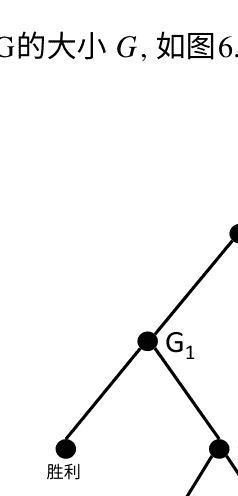
图 6.1 一棵二叉树的图片 $G$。

(a) 使用尖括号和标签二叉树，叶子节点等，写出图 6.1 中的二进制-2PTG, $G$。

二进制-2PTG $G \in$ 的 $\text{flatten}(G)$ 的值是 $G$ 的叶子节点标签的序列 $L$。例如，对于图 6.1 中的二进制-2PTG, $G$，
$\text{flatten}(G) = (\text{win}, \text{lose}, \text{win}, \text{win})$。

(b) 给出 $\text{flatten}$ 的递归定义。(你可以使用两个序列的连接操作。)

(c) 通过对 $\text{flatten}$ 和 $\text{size}$ 的定义进行结构归纳证明
$$2 \cdot \text{length}(\text{flatten}(G)) = |G| + 1. \tag{6.24}$$

### 作业问题

### 问题6.6.

设 $m, n$ 为整数，且不同时为零。递归地定义一个整数集合 $L_{m, n}$，如下所示：
- 基本情况：$m, n \in L_{m, n}$。
- 构造情况：如果 $j, k \in L_{m, n}$，则
    1. $-j \in L_{m, n}$,
    2. $j + k \in L_{m, n}$。

在本问题的其余部分中，用 $L$ 作为 $L_{m, n}$ 的缩写。

(a) 通过结构归纳证明，每个公约数 $m$ 和 $n$ 也是 $L$ 的成员的公约数。
(b) 证明 $L$ 的任何整数倍元素也是 $L$ 的成员。
(c) 证明如果 $j, k \in L$ 且 $k \neq 0$，则 $(j, k) \in L$ 的余数。
(d) 证明存在一个正整数 $g \in L$，它能够整除 $L$ 的每个成员。
提示： $L$ 中最小的正整数。
(e) 由部分 (d) 得出结论， $\text{GCD}(m, n)$ 的最大公约数 $g$ 为 $g$。

### 问题 6.7。

定义。递归地定义字符 $c$ 在字符串 $s$ 中出现的次数，记为 $#c(s)$，其中 $c \in A$， $s$ 是字符串 $A^*$ 的基本情况： $#c(\lambda) :: = 0$。

构造函数案例：
$$#c(\langle a, s\rangle) ::= \begin{cases} $#c(s)$ & \text{如果 } a \neq c, \\ 1 + $#c(s)$ & \text{如果 } a = c. \end{cases}$$
通过结构归纳证明对于所有的 $s, t \in A^*$ 和 $c \in A$
$$#c(s \cdot t) = $#c(s) + $#c(t).$$

### 问题6.8.

分形是可以通过递归定义的数学对象的一个例子。在这个问题中，我们考虑科赫雪花。任何科赫雪花都可以通过以下递归定义来构造。
- 基本情况: 边长为正整数的等边三角形是一个科赫雪花。
- 构造情况: 假设 $K$ 是一个科赫雪花， $l$ 是雪花上的一条线段。将 $l$ 的中间三分之一去掉，并用两条与之相同长度的线段替换，如图 6.2 所示，得到的图形也是一个科赫雪花。

通过结构归纳证明，科赫雪花内部的面积是 $q \sqrt{3}$ 的倍数，其中 $q$ 是一个有理数。
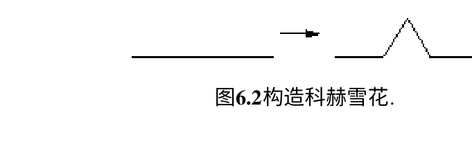

### 问题 6.9.

设 $L$ 是一些方便的集合，其元素被称为标签。标记的二叉树，LBT (Labeled Binary Trees)，按照以下递归方式定义:
- 定义。基本情况：如果 $l$ 是一个标签，那么 $\langle l, \text{leaf} \rangle$ 是一个 LBT。
- 构造情况：如果 $B$ 和 $C$ 是 LBT，那么 $\langle l, B, C \rangle$ 是一个 LBT。

LBT 的叶子标签和内部标签按照明显的方式递归定义:
- 定义。基本情况：LBT $\langle l, \text{leaf} \rangle$ 的叶子标签集合是 $\{l\}$，其内部标签集合为空集。
- 构造情况：LBT $\langle l, B, C \rangle$ 的叶子标签集合是 $B$ 和 $C$ 的叶子标签的并集；内部标签的集合是 $\{l\}$ 和 $B$ 和 $C$ 的内部标签的并集。

LBT 的标签集合是其叶子标签和内部标签的并集。具有唯一标签的 LBT 也可以递归地定义:
定义。 基本情况: LBT 的叶子 $l$ 具有唯一标签。构造情况: 如果 $B$ 和 $C$ 是具有唯一标签的 LBT，$B$ 的标签不是 $C$ 的标签，反之亦然，并且 $l$ 不是 $B$ 或 $C$ 的标签，则 $\langle l, B, C \rangle$ 具有唯一标签。

如果 $B$ 是一个 LBT，那么 $B$ 中出现的不同内部标签的数量为 $n_B$，不同叶子标签的数量为 $f_B$。通过结构归纳证明
$$f_B = n_B + 1 \quad (6.25)$$
对于所有具有唯一标签的 LBT $B$。

如果标签不唯一，这个方程显然会失败，所以你的证明最好在某个地方使用标签的唯一性；一定要指出在哪里。

### 考试问题

### 问题6.10.

算术三角函数 ($Atrig$) 是一组对于一个实变量的函数，按照以下递归方式定义:
- 恒等函数，$\mathrm{id}(x) ::= x$ 是一个 $Atrig$。
- 任何常数函数都是一个 $Atrig$。
- 正弦函数是一个 $Atrig$。

构造情况: 如果 $f, g$ 是 $Atrig$，那么
1. $f + g$ 也是 $Atrig$
2. $f \cdot g$
3. 组合函数 $f \circ g$。

通过对这个定义进行结构归纳证明，如果 $f(x)$ 是一个 $Atrig$，那么 $f' ::= df/dx$ 也是一个 $Atrig$。

### 问题6.11。

定义. 有理函数的集合 RAF 是由以下递归定义的函数集合:
基本情况:
- 恒等函数 $\text{id}(r) := r$ 对于 $\mathbb{R}$ (实数) 是一个 RAF。
- 任何常数函数在 $\mathbb{R}$ 上都是一个 RAF。

构造情况: 如果 $f, g$ 是 RAF，那么 $f \odot g$ 也是 RAF，其中 $\odot$ 是以下操作之一
1. 加法, $+$,
2. 乘法, $\cdot$, 和
3. 除法   $/$。

(a) 通过结构归纳证明 RAF 在组合下是封闭的。也就是说，使用归纳假设，
$$P(h) ::= \forall g \in \text{RAF} . h \circ g \in \text{RAF}, \quad (6.26)$$
证明对于所有的 $h \in \text{RAF}$，$P(h)$ 成立。请明确指出
- 每个基本情况，和
- 每个构造函数情况。提示：一个关于 $\odot$ 的证明涵盖了所有三种情况。

(b) 简要说明在使用非常相似的归纳假设时证明会出现问题的地方
$$Q(g) ::= \forall h \in \text{RAF} . h \circ g \in \text{RAF}.$$

### 第6.2节的问题

### 练习题

问题6.12。
递归地定义集合 $F_1$ 和 $F_2$:
- $F_1$:
  - $5 \in F_1$,
  - 如果 $n \in F_1$，则 $5n \in F_1$。
- $F_2$:
    - $5 \in F_2$,
    - 如果 $n, m \in F_2$，则 $nm \in F_2$。

(a) 证明这些定义中的一个在技术上是模糊的。（请记住，“模糊的递归定义”在技术上有一个数学上的含义，这并不意味着模糊的定义是不清楚的。）
(b) 简要解释无歧义递归定义相对于有歧义定义的优势。
(c) 证明 $F_1 = F_2$ 的一种方法是首先证明 $F_1 \subseteq F_2$，然后证明 $F_2 \subseteq F_1$。其中一个包含关系很容易通过结构归纳得出。哪一个？归纳假设是什么？（你不需要完成一个证明。）

问题6.13. (a) 要证明匹配字符串集合 RecMatch，即定义 6.2.1 中的匹配字符串，等于有歧义匹配字符串集合 AmbRecMatch，即定义 6.2.2 中的有歧义匹配字符串，你可以首先证明
$$\forall r \in \text{RecMatch}.\ r \in \text{AmbRecMatch},$$
然后证明
$$\forall u \in \text{AmbRecMatch}.\ u \in \text{RecMatch}.$$
在这两个陈述中，圈出一个通过从定义直接进行结构归纳证明更简单的陈述。

(b) 假设使用结构归纳来证明 $\text{AmbRecMatch} \subseteq \text{RecMatch}$。在这样的证明中，圈出一个符合结构归纳假设格式的谓词。
- $P_0(n)$ 当 $|s| \leq n$ 时，有 $s \in \text{RecMatch}$。
- $P_1(n)$ 当 $|s| \leq n$ 时，有 $s \in \text{AmbRecMatch}$。
- $P_2(s)$ 当 $s$ 为 $\epsilon$ 时，有 $s ::= \text{RecMatch}$。
- $P_3(s)$ 当 $s$ 为 $\epsilon$ 时，有 $s ::= \text{AmbRecMatch}$。
- $P_4(s)$ 当 $s$ 为 $\epsilon$ 时，有 $s ::= \text{RecMatch}$ IMPLIES $s$ 为 $\epsilon$ 时，有 $s ::= \text{AmbRecMatch}$。

(c) 递归定义 AmbRecMatch 是有歧义的，因为它允许在 $s$ 或 $t$ 为空字符串时应用构造函数。但即使修复了这个问题，歧义仍然存在。通过给出两个不同的推导，根据 AmbRecMatch 对字符串 “[][][]” 进行演示，但只使用 $s \neq \epsilon$ 和 $t \neq \epsilon$ 构造函数。

### 课堂问题

### 问题6.14.

设 $p$ 为字符串 `[]`。如果一个括号字符串可以通过重复擦除 $p$ 的出现来减少到空字符串，则称其为可擦除的。例如，下面是如何擦除字符串 `[[[[]]] []]` 的过程：
`[[[[]]] []] → [[[]]] → [[]] → [] → λ`。
然而，字符串 `][[[[[]]]]` 不可擦除，因为当我们尝试擦除时，会卡住: `][ [`。
`][[[[[]]]] → ][[[[]]] → ][[[ → ...`
设 Erasable 为可擦除的括号字符串集合。设 RecMatch 为根据定义 6.2.1 给出的匹配括号字符串的递归数据类型。
(a) 使用结构归纳法证明 $\text{RecMatch} \subseteq \text{Erasable}$。
(b) 补充以下证明中缺失的部分（标记为“(*)”) $\text{Erasable} \subseteq \text{RecMatch}$。

证明。我们通过强归纳法证明，Erasable 中的每个长度为 $n$ 的字符串也在 RecMatch 中。归纳假设是
$P(n) ::= \forall x \in \text{Erasable}.\ |x| = n \text{ IMPLIES } x \in \text{RecMatch}$。

基本情况:
(*) 基本情况是什么？证明在这种情况下 $P$ 是真的。

归纳步骤：为了证明 $P(n + 1)$，假设 $|x| = n + 1$ 且 $x \in \text{Erasable}$。我们需要证明 $x \in \text{RecMatch}$。

假设字符串 $y$ 是字符串 $z$ 的擦除，当且仅当 $y$ 是将 $z$ 中的一个 $p$ 擦除后得到的结果。

# 第6章 递归数据类型

由于x属于Erasable且长度为正，必定存在一个擦除后的字符串y属于Erasable，其中y是x的结果。所以 |y| = n - 1 ≥ 0，并且由于y属于Erasable，根据归纳假设我们可以假设y属于RecMatch。现在我们按情况进行论证：

情况 (y是空字符串)：
(*) 证明在这种情况下 x ∈ RecMatch。

情况 (y = [s]t 对于一些字符串s, t ∈ RecMatch)：现在我们通过子情况来证明。

- 子情况 (x = py)：
  (*) 证明在这个子情况下 x ∈ RecMatch。
- 子情况 (x的形式为 [s']t 其中s是s'的擦除)：由于s ∈ RecMatch，根据部分(b)的推论，它是可擦除的。但是 |s'| < |x|，所以根据归纳假设，我们可以假设 s' ∈ RecMatch。这表明 x是RecMatch的构造步骤的结果，因此 x ∈ RecMatch。
- 子情况 (x的形式为 [s]t' 其中 t是 t'的擦除)：(*) 证明在这个子情况下 x ∈ RecMatch。

(*) 解释为什么上述情况是充分的。
通过对n进行强归纳，我们完成了证明，因此我们得出结论：对于所有 n ∈ N, P(n) 成立。因此，对于每个字符串 x ∈ Erasable，都有 x ∈ RecMatch。也就是说，Erasable ⊆ RecMatch。结合(a)部分，我们得出结论：

Erasable = RecMatch。

问题6.15.
(a) 证明匹配字符串集合RecMatch，根据定义6.2.1，对于字符串连接是封闭的。也就是说，如果s, t ∈ RecMatch，则 s·t ∈ RecMatch。
(b) 证明 AmbRecMatch ⊆ RecMatch，其中 AmbRecMatch 是定义6.2.2中的模糊匹配字符串集合。
(c) 证明 RecMatch = AmbRecMatch。

## 6.5. 计算机科学中的归纳

### 作业问题

### 问题6.16.

确定一个字符串是否具有匹配的括号，即是否属于定义6.2.1中的集合RecMatch。一种方法是从0开始，从左到右读取字符串，对于每个左括号增加1，对于每个右括号减去1。例如，这里是两个示例字符串的计数：

```
[ ] ] [ [ [ [ ] ] ] ]
0 1 0 -1 0 1 2 3 4 3 2 1 0
```

```
[ [ [ ] ] [ ] ] [ ]
0 1 2 3 2 1 2 1 0 1 0
```

如果一个字符串的运行计数从不变为负数并以0结束，则它具有良好的计数。因此，上面的第二个字符串具有良好的计数，但第一个字符串在第三步时计数变为负数。

GoodCount ::= { s ∈ {[, ]}* | s 具有良好的计数 }.

空字符串的长度为0，我们将其作为良好计数的约定。现在可以精确地描述匹配的字符串，即具有良好计数的字符串集合。

- (a) 通过对RecMatch的定义进行结构归纳，证明GoodCount包含RecMatch。
- (b) 反过来，证明RecMatch包含GoodCount。
提示：通过对GoodCount中字符串长度进行归纳。考虑当第二次运行计数等于0时。

### 第6.3节的问题

### 作业问题

### 问题6.17.

Ackermann函数的一个版本，A: N² → N，通过以下递归规则定义：

```
A(m, n) ::= 2n,          如果 m = 0 或者 n ≤ 1   (A-base)
A(m, n) ::= A(m - 1, A(m, n - 1)),   否则.                 (AA)
```

证明如果 $B : \mathbb{N}^{2} \to \mathbb{N}$是满足相同定义的部分函数，那么 $B$是全函数且 $B = A$。

### 第6.4节的问题

### 练习题

### 问题6.18.
(a) 写出评估的过程

eval(subst(3x, x(x - 1)), 2)

根据环境模型和替换模型，指出递归定义的每种情况的规则首次使用的位置。比较算术运算和变量查找的次数。

- (b) 描述一个类似于部分 (a) 的例子，其中环境模型比替换模型少执行6次乘法。你不需要执行评估。
- (c) 描述一个类似于部分 (a) 的例子，其中替换模型比环境模型少执行6次乘法。你不需要执行评估。

### 作业问题

### 问题6.19.
(a) 给出一个递归定义的函数 erase(e)，它擦除Aexp中除括号外的所有符号。例如

erase([[ 3 * [x * x] ] + [[ 2 * x] + 1]] ) = [[[ ]][[ 2 * x] + 1] ].

- (b) 证明对于所有的 $e \in \text{Aexp}$， $erase(e) \in \text{RecMatch}$。
- (c) 给出一个小字符串 $s \in \text{RecMatch}$的例子，使得 $[ s ] \neq erase(e)$对于任何的 $e \in \text{Aexp}$。

### 问题 6.20.

我们将把一个大类别的游戏描述为一个递归数据类型，然后通过结构归纳证明关于游戏策略的一个基本定理。

我们将考虑的游戏被称为确定性完全信息游戏，因为在每一步，玩家都知道完整的游戏情况，这个信息完全决定了游戏的其余部分如何进行。象棋、跳棋、围棋和井字棋等游戏符合这个描述。相反，大多数纸牌游戏都不符合，因为纸牌玩家通常不知道其他玩家的牌是什么。而涉及随机特性如掷骰子的游戏，玩家的一步并不能唯一确定接下来会发生什么。

象棋被视为一种确定性的完全信息游戏，因为在任何时候的游戏中，双方玩家都知道轮到谁移动以及棋盘上每个棋子的位置。[2] 游戏开始时，有20种可能的第一步移动：白方玩家可以将他的八个兵前进1或2步，或者将他的两个马前进并向左或向右。对于第二步，黑方玩家可以进行与之对应的20种移动。然后白方玩家会进行第三步移动，但是现在可能的第三步移动数量取决于前两步移动的具体情况。

一种很好的思考这些游戏的方式是将每个游戏局面视为一个独立的游戏。例如，在象棋游戏中进行了五步之后，我们将玩家视为处于一个新的“象棋”游戏的开局，该游戏由当前的棋盘位置和轮到黑方下一步的事实决定。

在国际象棋游戏结束时，如果白方赢了，我们可能会给予1分，如果白方输了，则给予-1分，如果游戏以和局（平局）结束，则给予0分。现在我们可以说白方的目标是最大化最终得分，黑方的目标是最小化最终得分。我们还可以选择以更复杂的方式评分游戏，不仅考虑谁赢了，还考虑游戏进行了多少步，或者最终的棋盘配置。

这导致了这款游戏的一种优雅的抽象。我们假设有两个玩家，分别称为最大玩家和最小玩家，他们的目标分别是最大化和最小化最终得分。一个游戏将指定其可能的初始移动集，其中每个移动只是另一个游戏。没有可能移动的游戏称为结束游戏，并且只有一个最终得分。从战略上讲，关于结束游戏的一切都与其得分有关。如果游戏没有结束，它将有一个标签max或min，表示哪个玩家应该首先移动。

这激发了以下正式定义：

定义。设 V是一个非空的实数集。VG类是指具有完美信息的 V值确定性最大-最小游戏，其定义是递归的，如下所示：

[2] 为了防止无尽的游戏可能性，国际象棋规则规定了移动次数的限制，或者给定棋盘位置重复的次数的限制。因此，移动次数或位置重复的次数将作为游戏情况的一部分，为双方所知。

基本情况：一个值 $v \in V$ 是一个VG，并且被称为一个结束游戏。

构造情况：如果 $\{G_0, G_1, \ldots\}$ 是一个非空的VG集合，且 $a$ 是一个等于 $\text{max}$ 或 $\text{min}$ 的标签，那么
$G ::= (a, \{G_0, G_1, \ldots\})$
是一个VG。每个游戏 $G_i$ 被称为一个可能的 first move of G。

在我们熟悉的所有类似的游戏中，只有有限数量的可能的第一步。值得注意的是，VG的定义并不要求这一点。由于有限性不需要证明下面的任何结果，假设有无限数量的可能的第一步可能会产生误导。稍后，我们将提出如何出现具有无限数量的可能的第一步的游戏的建议。

游戏的一次玩耍是一个合法移动的序列，要么无限进行下去，要么以结束的游戏结束。更正式地说：

定义。游戏 $G \in VG$ 的一次玩耍在VG的定义上递归地定义：

基本情况：（$G$ 是一个结束的游戏。）然后长度为一的序列 $(G)$ 是一个 play of G。

构造案例：($G$ 不是一个已结束的游戏。) 那么 $G$ 的一次游戏是以可能的第一步开始的序列， $G_i$，然后继续以 $G_i$ 的游戏的元素继续进行。

如果一次游戏不会无限进行下去，它的回报被定义为它结束时的值。
让我们首先排除无限进行游戏的可能性。也就是说，每次游戏都会有一个回报。

(a) 证明每次 $G \in VG$ 的游戏都是以一个值结束的有限序列。提示：通过对 $VG$ 的定义进行结构归纳。

游戏的策略是告诉玩家在轮到他时应该做出哪个移动的规则。形式上：

定义。如果 $a$ 是标签 $\text{max}$ 或 $\text{min}$ 之一，则 $a$-策略是一个函数 $s : VG \to VG$，使得
$s(G) \text{ is } \begin{cases} \text{如果 $G$ 的标签是 $a$，} & \text{否则。} \end{cases}$

对于两个玩家的任意策略对，都可以确定一场游戏的唯一进程和唯一的收益。换句话说，在游戏 G 中，当轮到某个玩家行动时，他会选择由他的策略指定的行动。当与任意一个最小化玩家的策略配对时，最大化玩家的策略被称为确保收益 v 的策略，此时得到的收益至少为 v。相反地，当与任意一个最大化玩家的策略配对时，最小化玩家的策略将收益限制在 v 以下，此时得到的收益至多为 v。

假设为了简单起见，游戏的可能值集合 V 是有限的，那么WOP（第2.4节）意味着存在一种最大化玩家的策略，可以确保获得最大可能的收益；这被称为游戏的最大确保值。对于最小玩家，也会有一种策略将游戏的回报限制在最小可能值，这被称为游戏的最小限制值。

当然，最大保证值不能大于最小限制值。当这两个值相等时，可以为游戏分配一个唯一的值：

定义。如果一个游戏的最大保证值和最小限制值相等，则它们的共同值被称为游戏的值。

因此，如果在一个具有值 v 的游戏中，两个玩家都以最佳策略进行游戏，那么实际上没有必要进行游戏。由于回报被保证至少为 v，并且被限制为最多 v，所以它必须恰好为 v。因此，最小玩家可以跳过游戏，只需向最大玩家支付 v（负数表示最大玩家向最小玩家支付）。

我们故事的要点是最大保证值和最小限制值总是相等的。

定理（确定性极小极大完全信息博弈的基本定理）。设 V 为一组有限的实数。每个 V 值确定性极小极大完全信息博弈都有一个值。

- (b) 通过结构归纳证明这个VG的基本定理。
- (c) 立即得出结论，在国际象棋中，白方有获胜策略，或黑方有获胜策略，或者两位玩家都有至少保证和局的策略。（唯一的困难是没有人知道哪种情况成立。）那么我们在哪里遇到了有无限数量的首步的游戏呢？

嗯，假设我们进行了一个包含 n 个国际象棋游戏的锦标赛，其中 n 是一个正整数。如果我们如何将每个国际象棋游戏的回报组合成整个锦标赛的最终回报达成一致，则这个锦标赛将成为一个 VG。

在任何阶段的国际象棋比赛中，仍然只有有限数量的可能走法，但我们可以定义一个元国际象棋比赛，其第一步是选择任何正整数 $n$，之后我们进行一个 $n$ 局的国际象棋比赛。现在元国际象棋比赛有无限多个第一步。

当然，只有元国际象棋比赛的第一步是无限的，但然后我们可以建立一个由 $n$ 个元国际象棋比赛组成的比赛。这将是一个有 $n$ 个可能无限步骤的游戏。然后我们可以有一个元-元-国际象棋比赛，其第一步是选择要玩多少个元国际象棋比赛。这个元-元-国际象棋比赛将有无限多个无限步骤。然后我们可以继续进行元-元-元-国际象棋比赛......

尽管这些元游戏可能看起来很愚蠢或奇怪，但它们的奇特性并不使基本定理失效：每个游戏仍然有一个值。

(d) 陈述一些关于具有无限可能支付的游戏的合理概括。可选：证明你的概括。

# 7 无限集合

本章讨论无限集合及其在证明方面的一些挑战。

等一下！为什么在《计算机科学的数学基础》中提到无限呢？毕竟，计算机中的任何数据集都受计算机内存大小的限制，而计算机内存的大小有一个上限，原因很简单，宇宙是有界的（至少看起来是这样）。那么为什么不坚持某个大但有界大小的有限集合呢？这是一个很好的问题，但让我们看看能否说服你处理无限集合是不可避免的。

你可能没有注意到，但到目前为止，你已经接受了整数、有理数和无理数以及它们的序列的例行使用——无限集合，全部都是。此外，你真的希望物理学或其他科学放弃实数，理由是在有界宇宙中只能进行有界数量的有界测量吗？这是相当有说服力的，也更简单——忽略这样的大而不确定的界限（宇宙似乎一直在变大），接受使用实数的理论。

同样，在计算机科学中，认为编写一个程序来添加非负整数，其位数多达天上的星星数量（每个星系都有数十亿颗星星）与编写一个程序来添加任意两个整数，无论它们有多少位数，是不可信的。在设计编译器时也是如此：利用在有界宇宙中只会编译有限数量的程序既不实用也不明智。

无限集合也为练习证明方法提供了一个很好的环境，因为很难在直觉的伪装下悄悄插入不合理的步骤。而对无限集合的研究产生了一个真正令人惊讶的结果。它们的研究导致了对计算机可能做什么的基本逻辑限制的发现。例如，在第7.2节中，我们将使用为无限集合开发的推理来证明对于编程语言来说，没有完美的类型检查器是不可能的。

因此，在本章中，我们要求您勇敢面对无限。

# 第7章 无限集合

## 7.1 无限基数

19世纪末，数学家Georg Cantor研究傅里叶级数的收敛性，并发现了一些他想要说“大部分时间”收敛的级数，尽管有无限多个点它们不收敛。因此，Cantor需要一种比较无限集合大小的方法。为了理解这一点，他扩展了映射规则定理4.5.4到无限集合：当两个无限集合之间存在双射时，他认为它们具有“相同的大小”。同样，当集合 $A$ 满射到集合 $B$ 时，应该认为无限集合 $A$ “和”集合 $B$ “一样大”。因此，我们可以认为集合 $A$ “严格小于”集合 $B$，简写为 $A \text{ strict } B$，当 $A$ 不“和”$B$“一样大”时：

定义 7.1.1.
$A \text{ 严格 } B$ 当且仅当 非($A$ 满 $B$).

在有限集上，这个严格关系确实意味着“严格更小”。这个结论立即来自于映射规则定理4.5.4.

推论 7.1.2.
对于有限集 $A, B$,
$A \text{ 严格 } B$ 当且仅当 $|A| < |B|$.

证明.
$$ \begin{aligned} A \text{ 严格 } B &\text{ 当且仅当 非}(A\text{满} B) &&\text{(定义 7.1.1)} \\ &\text{当且仅当 非}(|A| \neq |B|) &&\text{(定理 4.5.4.(4.5))} \\ &\text{当且仅当 } |A| < |B|. \end{aligned} $$

康托尔在研究傅立叶级数时，被他努力发展基于这些思想的无限大小理论所吸引。他的理论最终对数学和计算机科学的基础产生了深远的影响。但是康托尔在他的时代因为他的工作而招致了很多敌人：数学界怀疑他们所称之为“康托尔的天堂”的未知无限大小的相关性。

康托尔的一个很好的技术特点是它避免了对无限集合的“大小”进行定义的需要，它只是比较“大小”。警告：我们没有，也不会定义无限集合的“大小”。无限“大小”的定义需要对一些被称为的无限集合进行定义具有特殊良序性质的序数。序数理论需要深入研究技术集合论，而我们可以很好地在不定义无限大小的情况下进行。我们所需要的只是集合之间的“与...一样大”和“同样大小”的关系，即surj和bij。

但还有一件事需要注意：我们将surj称为集合之间的“与...一样大”关系，将bij称为集合之间的“同样大小”关系。当然，surj和bij在有限集合上的大部分“与...一样大”和“同样大小”的性质也适用于无限集合，但一些重要的性质却不适用——正如我们即将展示的那样。所以你必须小心：在没有证明之前，不要假设surj在无限集合上具有任何特定的“与...一样大”的性质。

让我们从一些关于“与...一样大”和“相同大小”的熟悉性质开始，这些性质确实适用于无限集合：

引理 7.1.3. 对于任意集合，A, B, C,
1. A满射 B 当且仅当 B单射 A.
2. 如果 A满射 B 且 B满射 C，那么 A满射 C.
3. 如果 A双射 B 且 B双射 C，那么 A双射 C.
4. A双射 B 当且仅当 B双射 A.

第一部分。这是因为 R具有 [≤ 1外, ≥ 1内]满射函数属性 当且仅当 R⁻¹具有 [≥ 1外, ≤ 1内]总体，单射属性。第二部分。这是因为满射的组合仍然是满射。第三部分和第四部分。这是因为 R是双射 当且仅当 R和 R⁻¹都是满射函数。我们将把这些事实的验证留给问题4.22。有限集合的另一个熟悉性质适用于无限集合，但这次需要一些真正的创造力来证明它：

定理 7.1.4. [Schröder -Bernstein] 对于任意集合A, B，如果 A surj B 并且 B surj A，那么 A bij B。

也就是说，Schröder -Bernstein 定理表明，如果 A至少和 B一样大并且相反地， B至少和 A一样大，那么 A和 B的大小是相同的。这样说，你可能会认为这个定理是理所当然的，但那是一个错误。对于无限集合 A和 B，Schröder -Bernstein 定理实际上是相当技术性的。仅仅因为存在一个满射函数 f : A → B—它不一定是双射函数—和一个满射函数 g : B → A—它也不一定是双射函数—并不清楚是否一定存在一个双射函数 e : A → B。思路是从 f和 g的部分构造出 e。具体的构造过程留给问题 7.11。

## 第7章 无限集合

另一个熟悉的集合属性是对于任意两个集合，要么第一个至少和第二个一样大，要么反之。对于有限集合，这个结论可以从映射规则中轻易得出。对于无限集合，这个结论仍然成立，但是假设它是显而易见的是错误的。

**定理7.1.5.** 对于所有的集合*A*和*B*，*A*到*B*的映射满射 或者 *B*到*A*的映射满射。

定理7.1.5让我们证明了有限集合的另一个基本性质也适用于无限集合：

**引理7.1.6.**

*A*严格小于*B* 并且 *B*严格小于*C* &emsp;&emsp;&emsp;&emsp;&emsp;&emsp;&emsp;&emsp;&emsp;&emsp;&emsp;&emsp; (7.1)

意味着

对于所有的集合*A*、*B*、*C*，*A*严格小于*C*。

证明。(引理7.1.6的证明)

假设7.1成立，并且为了推导矛盾，假设*A*不严格小于*C*，这意味着*A*到*C*的映射满射。现在由于*B*严格小于*C*，定理7.1.5让我们得出结论*C*到*B*的映射满射。因此我们有

*A* surj *C* AND *C* surj *B*,

而引理7.1.3.2让我们得出结论， *A* surj *B*, 与事实相矛盾 *A* strict *B*.

我们省略了定理7.1.5的证明，因为证明它涉及到技术集合论，通常是序数理论，我们不打算深入研究。但是由于证明引理7.1.6是我们对定理7.1.5唯一的使用，我们希望你不会觉得被骗了没有看到证明。

### 7.1.1 无限是不同的

有限集合的一个基本性质是，添加新的元素会使集合变大。也就是说，如果*A*是一个有限集合，*A*中有*b* ∉ *A*，那|*A* ∪ {*b*}| = |*A*| + 1，所以*A*和*A* ∪ {*b*}的大小不相同。但是如果*A*是无限的，那么这两个集合是相同大小的!

**引理 7.1.7.** 设*A*是一个集合，*b* ∉ *A*. 那么*A*是无限的当且仅当*A*和*A* ∪ {*b*}存在双射关系。

### 7.1. 无限基数

证明.由于 \(A\) 和 \(A \cup \{b\}\) 的大小不同，当 \(A\) 是有限的时候，我们只需要证明当 \(A\) 是无限的时候，\(A\) 和 \(A \cup \{b\}\) 的大小相同即可。
也就是说，我们需要找到一个 \(A\) 和 \(A \cup \{b\}\) 之间的双射关系，当 \(A\) 是无限的时候。具体方法如下：由于 \(A\) 是无限的，它肯定至少有一个元素；我们称之为 \(a_0\)。但是由于 \(A\) 是无限的，它至少有两个元素，其中一个不等于 \(a_0\)；我们称这个新元素为 \(a_1\)。但是由于 \(A\) 是无限的，它至少有三个元素，其中一个既不等于 \(a_0\) 也不等于 \(a_1\)；我们称这个新元素为 \(a_2\)。继续这样进行下去，我们可以得出一个无限序列 \(a_0; a_1; a_2; \ldots; a_n, \ldots\) \(A\) 中的不同元素。现在很容易定义一个双射关系 \(e: A \cup \{b\} \to A\)：

$$
\begin{aligned}
e(b) &::= a_0, \ne(a_n) &::= a_{n+1} &\text{对于 } n \in \mathbb{N}, \ne(a) &::= a &\text{对于 } a \in A - \{b, a_0, a_1, \ldots\}.
\end{aligned}
$$

■

### 7.1.2 可数集合

一个集合，\(C\)，是可数的，当且仅当它的元素可以按顺序列出，也就是说，\(C\) 中的元素正好是序列中的元素
\[c_0, c_1, \ldots, c_n, \ldots\]
假设列表中没有重复项，说 \(C\) 可以以这种方式列出，形式上等同于说函数，\(f: \mathbb{N} \to C\)，根据规则定义为 \(f(i)::=c_i\)，是一个双射。

**定义 7.1.8.** 一个集合，\(C\)，是可数无穷的，当且仅当 \(\mathbb{N}\) 和 \(C\) 之间存在双射。一个集合是可数的，当且仅当它是有限的或可数无穷的。

如果我们允许重复，我们也可以使用有限的元素构建一个无限列表。例如，我们可以将三个元素的集合 \(\{2, 4, 6\}\) 列出来
\[2, 4, 6, 6, 6, \ldots\]
这个简单的观察结果导致了可数集合的另一种特征描述，它不区分有限集和无限集。换句话说，一个集合 \(C\) 是可数的，当且仅当存在一个列表
\[c_0, c_1, \ldots, c_n, \ldots\]
包含 \(C\) 的元素，可能会有重复。

**引理 7.1.9.** 一个集合 \(C\) 是可数的，当且仅当存在一个从 \(\mathbb{N}\) 到 \(C\) 的满射。事实上，一个非空集合 \(C\) 是可数的，当且仅当存在一个从 \(\mathbb{N}\) 到 \(C\) 的全射函数 \(g\)。

证明留给问题 7.12。最基本的可数无限集合是集合 $\mathbb{N}$本身。但是整数集合 $\mathbb{Z}$也是可数无限的，因为整数可以按照以下顺序列出：

$0, -1, 1, -2, 2, -3, 3, \ldots$ (7.2)

在这种情况下，列表的第$n$个元素 (7.2) 有一个简单的公式。也就是说，存在一个双射 $f : \mathbb{N} \to \mathbb{Z}$，使得 $f(n)$是列表的第$n$个元素可以定义为：

$$ f(n) = \begin{cases} n/2 & \text{如果} n \text{是偶数} \\ -(n+1)/2 & \text{如果} n \text{是奇数} \end{cases} $$

还有一种简单的方法来列举所有非负整数对，这表明 $(\mathbb{N} \times \mathbb{N})$也是可数无穷的（问题7(16)。由此可以得出结论，非负有理数集合$\mathbb{Q}^{\geq 0}$是可数的。这可能会让人感到惊讶——毕竟，有理数在整数之间密集地填满了空间，对于任意两个数，之间还有另一个数。因此，看起来似乎无法将所有有理数写成一个列表，但问题7(10)说明了如何做到这一点。更一般地，很容易证明可数集合在并集和乘积下是封闭的（问题7(1)和7(16)），这意味着一些熟悉的集合是可数的：

推论 7.1.10. 以下集合是可数无穷的：

$\mathbb{Z}^+, \mathbb{Z}, \mathbb{N} \times \mathbb{N}, \mathbb{Q}^+, \mathbb{Z} \times \mathbb{Z}, \mathbb{Q}$.

对引理 7.1.7 的证明进行小的修改可以证明可数无穷集合是“最小”的无穷集合，更准确地说，如果 $A$是一个无穷集合，$B$是可数的，那么 $A$到 $B$的映射是满射（见问题 7.9）。此外，由于向无穷集合中添加一个新元素不会改变其大小，你可以通过逐个添加元素来添加任意有限数量的元素而不改变大小。甚至更强的是：你可以向一个无穷集合中添加一个可数无穷的新元素，仍然得到一个大小相同的集合（问题 7.13）。

顺便说一下，认为因为你可以向一个无限集合中添加任意有限数量的元素并且与原始集合具有双射，所以你也可以添加无限多个新元素，这是一个常见的错误。一般来说，并不是因为某件事情可以做任意有限次就可以做无限次。例如，从3开始，你可以无限次地增加1，结果将是大于或等于3的某个整数。但是如果你无限次增加，你根本不会得到一个整数。

### 7.1.3 幂集更大

康托尔的惊人发现是，并不是所有的无限集合都具有相同的大小。特别地，他证明了对于任何集合 $A$，幂集$\text{pow}(A)$比 $A$“严格更大”。也就是说，

**定理 7.1.11. [康托尔]** 对于任何集合, $A$, $A$严格小于$\text{pow}(A)$的幂集。

证明.为了证明 $A$严格小于$\text{pow}(A)$，我们必须证明如果 $g$是从 $A$到$\text{pow}(A)$的函数，则 $g$不是满射。为了做到这一点，我们只需找到一个子集 $A_g \subseteq A$，它不在$g$的值域中。思路是，对于任何元素$a \in A$，看看集合 $g(a) \subseteq A$中是否包含元素 $a$。首先，定义 $A_g := \{a \in A \mid a \notin g(a)\}$。

现在，$A_g$是 $A$的一个明确定义的子集，这意味着它是$\text{pow}(A)$的一个成员。但是$A_g$不能在 $g$的值域中，因为如果它在其中，我们将有：对于某些 $a_0 \in A$，根据 $A_g$的定义，有 $A_g(a_0)=1$当且仅当 $a_0 \notin g(a_0)$；而对于所有的$a \in A$，有 $A_g(a)=1$当且仅当 $a \notin g(a)$。现在令 $a = a_0$，导致矛盾。

因此 $g$不是一个满射，因为在 $A$的幂集中存在一个元素，具体来说是集合 $A_g$，它不在 $g$的值域中。

**推论 7.1.12.** $\text{pow}(\mathbb{N})$是不可数的。

用于证明定理 4.5.5的一个映射是从一个具有 $n$个元素的集合的子集到长度为 $n$的二进制字符串的双射，$\{0,1\}^n$，这个映射同样适用于从可数无限集合到无限二进制字符串的双射，$\{0,1\}^\omega$。也就是说，$\text{pow}(\mathbb{N})$ bij $\{0,1\}^\omega$：这立即得出推论 7.1.13. $\{0,1\}^\omega$是不可数的。

### 更多可数和不可数集合

一旦我们有了一些我们知道是可数或不可数的集合，我们可以使用引理7.1.3得到更多的例子。特别地，我们可以引用引理的以下直接推论：

### 推论7.1.14.

- (a) 如果 U是一个不可数集合且 A满射 U，则 A是不可数的。
- (b) 如果 C是一个可数集合且 C满射 A，则 A是可数的。

例如，现在我们知道无限位字符串集合 {0, 1}! 是不可数的，那么我们可以得出以下结论：

### 推论7.1.15.实数集合 ℝ是不可数的。

要证明这一点，考虑一个实数的无限小数展开：

√2 = 1.4142 ....
5 = 5.000 ....
1/10 = 0.1000 ....
1/3 = 0.333 ....
1/9 = 0.111 ....
4 1/99 = 4.010101 ....

让我们将任何实数 r映射到无限位字符串 b(r)，该字符串等于从小数点开始的实数的十进制展开中的位序列。如果实数 r的十进制展开中包含除0或1之外的数字，则将 b(r)定义为未定义。

例如，

b(5) = 000 ....
b(1/10) = 1000 ....
b(1/9) = 111 ....
b(4 1/99) = 010101 ...
b(√2), b(1/3) 是未定义的。

> 1一些有理数可以以两种方式展开——作为以所有0结尾的无限序列或以所有9结尾的无限序列。例如，
> $$5 = 5.000 \ldots = 4.999 \ldots,$$
> $$\frac{1}{10} = 0.1000 \ldots = 0.0999 \ldots.$$
> 在这种情况下，将 b(r) 定义为以所有0结尾的序列。

### 7.1. 无限基数

现在 b 是一个从实数到无限位字符串的函数。它不是一个全函数，但显然是一个满射。这表明

$$\mathbb{R} \text{ surj } \{0, 1\}^{\omega},$$

而实数的不可数性现在由推论 7.1.14.(a) 得出。
举个例子，让我们证明

**推论 7.1.16** (集合 $(\mathbb{Z}^{+})^{*}$ 是所有正整数的有限序列的可数集。

为了证明这一点，考虑非负整数的素因数分解：

$$20 = 2^{2} \cdot 3^{0} \cdot 5^{1} \cdot 7^{0} \cdot 11^{0} \cdot 13^{0} \cdots,$$
$$6615 = 2^{0} \cdot 3^{3} \cdot 5^{1} \cdot 7^{2} \cdot 11^{0} \cdot 13^{0} \cdots.$$
让我们将任何非负整数映射为其素因数分解中非零指数的有限序列 e(n)。例如，

e(20) = (2, 1),
e(6615) = (3, 1, 2),
e(5^{13} \cdot 11^{9} \cdot 47^{817} \cdot 103^{44}) = (13, 9, 817, 44),
e(1) = \lambda,        (空字符串)
e(0) \text{ 未定义}   .

现在 e 是从 $\mathbb{N}$ 到 $(\mathbb{Z}^{+})^{*}$ 的函数。它在所有正整数上都有定义，并且显然是一个满射。这表明

$$\mathbb{N} \text{ surj } (\mathbb{Z}^{+})^{*},$$

而有限正整数字符串的可数性现在可以通过推论 7.1.14.(b) 得出。

更大的无穷大

有很多不同大小的无穷集合。例如，从非负整数的无穷集合 N 开始，我们可以构建无穷序列的集合

N 严格幂 (N) 严格幂 (幂 (N)) 严格幂 (幂 (幂 (N))) 严格 ...

根据康托尔定理7.1.11，这些集合中的每一个都严格大于前面的所有集合。但这还不是全部：序列中所有集合的并集严格大于序列中的每个集合（见问题7.23）。通过这种方式，您可以无限地构建“更大”的无穷大。

### 7.1.4 对角线论证

定理7.1.11和类似的证明被统称为“对角线论证”，因为证明的一个更直观的版本是用无限方阵来描述的。也就是说，假设存在一个双射将N和{0,1}^ω对应起来。如果存在这样的关系，我们将能够将其显示为一串无限位串的列表，按某种可数的顺序排列。一旦我们找到了一种可行的方法来组织这个列表，任何给定的字符串在{0,1}^ω中都会在有限的步骤内出现，就像你能够命名的任何整数都会在离0有限的步骤内出现一样。这个假设的列表看起来像下面这样，无限地延伸到垂直和水平方向：

A0 = 1 0 0 0 1 1 ...
A1 = 0 1 1 1 0 1 ...
A2 = 1 1 1 1 1 1 ...
A3 = 0 1 0 0 1 0 ...
A4 = 0 0 1 0 0 0 ...
A5 = 1 0 0 1 1 1 ...
:   : : : : : : \ddots

但是现在我们可以展示一个在我们所谓的完整列表中缺失的序列。看看我们样本列表中的对角线：

A0 = 1 0 0 0 1 1 ...
A1 = 0 1 1 1 0 1 ...
A2 = 1 1 1 1 1 1 ...
A3 = 0 1 0 0 1 0 ...
A4 = 0 0 1 0 0 0 ...
A5 = 1 0 0 1 1 1 ...
:   : : : : : : \ddots

这就是为什么对角线论证有其名字的原因：我们可以形成一个序列 D 由对角线上的位组成。

D = 1 1 1 0 0 1 ...

然后，我们可以通过沿对角线切换 1 和 0 来形成另一个序列。将此序列称为 C:

C = 0 0 0 1 1 0 ...

现在，如果 A 的第 n 个项是 1，那么 C 的第 n 个项是 0，反之亦然，这保证了 C 与 A 不同。换句话说，C 与我们列表中的每个序列至少有一个位不同。因此，C 是 {0,1}! 中的一个元素，它没有出现在我们的列表中-我们的列表不能完整！

这个对角线序列 C 对应于定理 7.1.11 证明中的集合 {a ∈ A | a ∉ g(a)}。两者都是根据可数子集的方式定义的，以排除它们不属于该子集，从而证明了没有可数子集可以与不可数集一样大。

### 7.2 停机问题

尽管越来越大的无限集合的塔只是计算机科学家的一种浪漫关注，但导致这些结论的推理在计算理论中起着关键作用。对角线论证用于表明许多问题无法通过计算解决，而且无法绕过这一点。例如，编译是指将用某种“高级”编程语言（如Java、C++、Python等）编写的任何给定程序文本转换为针对可用硬件运行良好的低级指令程序。然后生成一段执行相同功能的低级指令程序。

同样地，解释器或虚拟机是一种将程序文本设计为在一种计算机上运行并在另一种计算机上模拟的过程。编译器的常见功能包括对程序进行“类型检查”，以确保某些类型的运行时错误不会发生，并对生成的程序进行“优化”，使其运行更快或使用更少的内存。

计算无法完成的基本事情是类型检查、优化或者对程序整体运行时间行为的任何分析。在本节中，我们将通过一个基本示例来说明这一点，即停机问题。对于某种编程语言的一般停机问题是指对于任意程序，确定如果不中断，程序是否会永远运行。如果程序不会永远运行，就称为停机。真实的程序可能以多种方式停机，例如返回某个最终值、以某种错误中止或等待用户输入。但是，检测任何给定程序是否会停机很容易：只需在虚拟机上运行它并等待它停止。问题出现在给定程序不会停机的情况下，你可能会一直等待而不知道等待是徒劳的。那么，如何检测程序是否不会停机呢？我们将使用对角线论证来证明，如果分析程序试图识别不会停机的程序，它必定会对无限数量的程序给出错误答案或者没有答案！

为了准确起见，让我们称编程过程为字符串过程，当它适用于标准字母表（比如256个ASCII字符）上的字符串时。举个简单的例子，你可以考虑如何编写一个字符串过程，当应用于双字母ASCII字符串时，即每个字符连续出现两次的字符串时，它会精确停止。例如，aaCC33和zz++ccBB是双字母字符串，但aa;bb，b33和AAAAA不是。

如果存在一个字符串过程，当应用于该集合中的任何字符串时会停止，并且当应用于不在集合中的任何字符串时不会停止，我们将称该集合为可识别的。例如，我们刚刚同意双字母字符串集合是可识别的。

让ASCII*为ASCII字符的（有限）字符串集合。假设每个程序都可以使用ASCII字符编写，这没有任何问题；它们通常都是这样的。当一个字符串 $s \in$ ASCII*实际上是某个字符串过程的ASCII描述时，我们将称该字符串过程为 $P_s$。你可以将 $P_s$看作是编译 $s$的结果。从技术上讲，将每个ASCII字符串视为字符串过程的程序是有帮助的。因此，当一个字符串 $s^2$ ASCII*不能解析为正确的字符串过程时，我们将定义 $P_s$为某个默认的字符串过程，比如在任何输入上都不会停止的过程。

仅关注字符串过程，一般的停机问题是决定给定字符串 $s$和 $t$时，当应用于 $t$时，过程 $P_s$是否停机。我们将证明一般问题无法解决，通过证明一个特殊情况无法解决，即过程 $P_s$应用于 $s$时是否停机。因此，让我们定义

2字符串 $s \in$ ASCII*和过程 $P_s$必须区分开来以避免类型错误：不能将字符串应用于字符串。例如，假设 $s$是你编写的用于识别双字母字符串的程序的字符串。将 $s$应用于字符串参数，比如 aabbccdd，应该引发类型异常；你需要做的是将 $s$编译为过程 $P_s$，然后将 $P_s$应用于aabbccdd。

## 7.2. 停机问题

**定义 7.2.1.**
不停机 ::= { s ∈ ASCII* | P_s 应用于 s 不会停机 }.
(7.3)

我们将证明

**定理 7.2.2.** 不停机是不可识别的.

我们将使用与Cantor在定理7.1.11的证明中类似的论证。

**证明.** 对于任意字符串 s ∈ ASCII*，令 f(s) 为被 P_s 识别的字符串集合：

f(s) ::= { t ∈ ASCII* | P_s 在应用于 t 时停机 }.

按照惯例，我们将每个字符串 P_s 与一个字符串过程关联起来，s ∈ ASCII*，这使得 f 成为一个全函数，并且根据定义，

s ∈ 不停机 当且仅当 s ∉ f(s), (7.4)

对于所有的字符串 s ∈ ASCII*。

现在假设相反，即 不停机 是可识别的。这意味着存在一个过程 P_{s_0} 可以识别 不停机，也就是说

不停机 = f(s_0).

结合(7.4)，我们得到

s ∈ f(s_0) 当且仅当 s ∉ f(s) (7.5)

对于所有的 s ∈ ASCII*。现在让 s = s_0 在(7.5)中得到直接矛盾

s_0 ∈ f(s_0) 当且仅当 s_0 ∉ f(s_0).

这个矛盾意味着 不停机 不能被任何字符串过程识别。

所以这就是答案：对于任何特定语言的程序来说，解决这个特殊情况的一般停机问题是逻辑上不可能的。并且通过证明无法有一个过程来确定任意程序是否停机，很容易证明无法有一个完美的识别器来确定任何总体运行时间属性。³

³这里的“总体”这个词用来排除一些很容易识别的运行时属性，因为它们仅依赖于部分运行时行为。例如，执行最多100条指令后停机的程序集是可识别的。

例如，大多数编译器在编译时进行“静态”类型检查，以确保程序不会发生运行时类型错误。进行类型检查的程序保证不会引发运行时类型错误。但由于无法完美地识别程序是否会引发类型错误，因此类型检查器必须拒绝一些实际上不会引发类型错误的程序。结论是没有完美的类型检查器，你总是可以做得更好！

如果我们考虑编写程序分析器的实际可能性，情况就不同了。事实上，逻辑上不可能完美分析任意程序并不意味着在实践中不能对出现的有趣程序进行很好的分析。实际上，这些“有趣”的程序通常被设计为可分析的，以确认它们是否按照预期工作。

最后，这个理论限制在实践中到底有多大障碍并不清楚。但是这个理论确实为程序的一般分析方法提供了一些视角。这个理论告诉我们，那些声称拥有这样的方法的人要么夸大了他们的方法的能力（如果有的话），可能是为了销售或者获得资助，要么是为了简化问题而没有涉及他们所了解的技术限制，要么是因为他们对自己的方法有一些有用的实际成功感到兴奋，而没有考虑到必然存在的限制。

所以从现在开始，如果你听到有人声称拥有一般的程序分析/验证/优化方法，你就会知道他们不可能讲述完整的故事。

还有一个重要的观点：通过切换编程语言是没有希望的。我们的证明涵盖了使用某种给定的编程语言（例如Java）编写的程序，并得出结论：没有一个Java程序能够完美地分析所有的Java程序。可能有一个能够成功处理所有Java程序的C++分析过程吗？毕竟，C++允许比Java更深入地操作计算机内存。但是这里没有任何漏洞：可以用Java编写一个C++虚拟机，所以如果有一个C++过程可以分析Java程序，那么Java虚拟机也能够做到，而这是不可能的。无论使用什么类型的程序或计算机，计算能力的这些逻辑限制都适用。

## # 7.3 集合的逻辑

### ## 7.3.1 罗素悖论

天真地推理集合的结果是冒险的。事实上，19世纪末逻辑学家戈特洛布·弗雷格曾试图提出精确的集合公理，但被称为罗素悖论的三行论证击败了。这个论证与康托尔定理7.1.11的证明几乎以相同的方式推理。这对于提供数学公理基础的努力来说是一个惊人的打击：

```
罗素悖论

设 $S$ 为一个变量，范围是所有集合，并定义

$$W ::= \{ S \mid S \in S \}.$$

所以根据定义，

$$S \in W \text{ 当且仅当 } S \in S;$$

对于每个集合 $S$。特别地，我们可以让 $S$ 为 $W$，并得到矛盾的结果：

$$W \in W \text{ 当且仅当 } W \in W.$$

```

对集合的最简单的推理使数学崩溃！罗素和他的同事怀特海德花了多年的时间试图发展一种既不矛盾，又能作为数学的坚实逻辑基础的集合论。

实际上，罗素和其他人在当时已经清楚地找到了一个解决悖论的方法：假设 $W$ 是一个集合是不合理的。证明中我们让 $S$ 为 $W$ 的那一步没有合理的依据，因为 $S$ 是在集合范围内，而 $W$ 可能不是一个集合。事实上，这个悖论暗示着 $W$ 最好不是一个集合！

> ⁴伯特兰·罗素是二十世纪初剑桥大学的数学家/逻辑学家。他报告说，当他觉得自己年纪太大无法从事数学时，他开始研究和写作哲学，当他不再足够聪明从事哲学时，他开始写作政治。他因为广泛的哲学和政治著作而获得了诺贝尔文学奖，并因为在第一次世界大战期间拒绝服兵役而入狱。

### ## 7.3.2 集合的ZFC公理

集合论的一个公式是一个只使用谓词“x = y”和“x ∈ y”的谓词公式。论域是集合的集合，而“x ∈ y”被解释为

普遍认为，使用一些简单的逻辑推理规则，基本上可以从一些称为Zermelo-Fraenkel集合论公理的集合论公式中推导出所有的数学。

例如，由于 x 是 y 的子集当且仅当 x 的每个元素也是 y 的元素，我们可以用集合论的公式来表示 x 是 y 的子集：

```
(x ⊆ y) ::= ∀ z. (z ∈ x 蕴含 z ∈ y). (7.6)
```

现在我们可以使用“x ⊆ y”作为公式 (7.6) 的缩写来表示集合论的公式。

在本文中，我们不会研究ZFC的公理，但我们认为你可能想看看它们，并在此过程中练习阅读量化公式：

**外延性.** 如果两个集合具有相同的成员，则它们相等。

```
∀ z. (z ∈ x 当且仅当 z ∈ y) 蕴含 x 等于 y.
```

**配对.** 对于任意两个集合 x 和 y，存在一个集合，记作 {x, y}，它的唯一元素是 x 和 y：

```
∀ x, y. ∃ u. ∀ z. [z ∈ u 当且仅当 (z 等于 x 或 z 等于 y)]
```

**并集.** 一个集合的集合, $z$, 的并集也是一个集合: \[ \forall z. \exists u. \forall x. (\exists y. x \in y \text{ 并且 } y \in z) \text{ 当且仅当 } x \in u. \]

**无穷.** 存在一个无穷集合。具体而言，存在一个非空集合 $x$，对于任意集合 $y$ 属于 $x$，集合 $\{y\}$ 也是 $x$ 的成员之一。

**子集.** 给定任何集合，以及任何可定义的集合属性，存在一个集合，恰好包含那些具有该属性的元素 $y \in x$. \[ \forall x. \exists z. \forall y. y \in z \text{ 当且仅当 } [y \in x \text{ 并且 } \phi (y)] \] 其中 $\phi (y)$ 是关于 $y$ 在集合论符号中可定义的任何断言.

**幂集.** 一个集合的所有子集构成另一个集合: \[ \forall x. \exists p. \forall u. u \subseteq x \text{ 当且仅当 } u \in p. \]

**替换.** 假设集合论的一个公式 $\phi$ 定义了一个函数的图形，即, \[ \forall x, y, z. [\phi (x, y) \text{ 并且 } \phi (x, z)] \text{ 蕴含 } y = z. \] 那么任何集合 $t$ 在该函数下的像也是一个集合 $t'$. 即, \[ \forall s \exists t \forall y. [\exists x. \phi (x, y) \text{ 当且仅当 } y \in t]. \]

**基础.** 不能有无限序列 \[ \ldots \in x_n \in \ldots \in x_1 \in x_0 \] 每个集合都是前一个集合的成员。这等价于说每个非空集合都有一个“成员最小”的元素。即，定义 \[ \text{成员最小} (m, x) :: = [m \in x \text{ AND } \forall y \in x. y \notin m]. \] 然后基础公理是 \[ \forall x. x \neq \emptyset \text{ IMPLIES } \exists m. \text{成员最小} (m, x). \]

**选择.** 给定一个集合，其成员是没有共同元素的非空集合，那么存在一个集合，由 $s$ 中每个集合中的一个元素组成。该公式在问题7.28中给出。

### ## 7.3.3 避免罗素悖论

这些现代集合论的ZFC公理比Russell和Whitehead最初提出的系统要简单得多，以避免悖论。事实上，ZFC公理与Frege最初的公理一样简单和直观，只是增加了一个技术性的附加条件：基础公理。基础公理捕捉了集合必须以某些标准方式从“更简单”的集合构建起来的直观观念。特别地，基础公理意味着没有任何集合是它自己的成员。因此，对于罗素悖论的现代解决方案如下：由于对于所有集合S，S∉S，所以定义的W包含了每个集合。这意味着W不能是一个集合，否则它将成为它自己的成员。

## 7.4 这一切真的有效吗？

所以，这就是当今主流数学的现状：有一小部分ZFC公理，几乎可以从中逻辑地推导出数学中的所有其他内容。这听起来像是一个美好的局面，但是有几个阴云，表明数学中的真理本质并没有完全解决。

- ZFC公理并非由上帝刻在石头上，而是由策梅洛主要创造的，他可能是一位杰出的逻辑学家，但也是一个可能有时忘记带钥匙的可犯错误的人。所以也许策梅洛和弗雷格一样，没有得到正确的公理，并且会被罗素的某个继任者用他的公理来证明一个命题 P及其否定 P。那么我们理解的数学将会被打破，这听起来可能很疯狂，但这之前已经发生过。

事实上，虽然人们普遍认为ZFC公理能够证明所有标准数学，但这些公理还有一些看起来自相矛盾的后果。例如，巴拿赫-塔斯基定理说，作为选择公理的结果，一个实心球可以被分成六块，然后这些块可以被刚性重新排列，形成两个与原来一样大小的实心球！

- 关于集合性质的一些基本问题仍然没有解决。例如，康托尔提出了一个问题，是否存在一个集合，其大小严格介于最小的无限集合 N（见问题7.9）和严格较大的集合，pow(ℕ)之间？康托尔猜测不会：

**康托尔的连续统假设：** 不存在一个集合，记作 $A$，使得 $\mathbb{N}$ 严格 $A$ 严格幂 $(\mathbb{N})$。

连续统假设在一个世纪后仍然是一个未解决的问题。它的困难源于现代集合论中最深刻的结果之一——哥德尔部分发现的结果在20世纪30年代和60年代，哥德尔和保罗·科恩发现了一个事实——ZFC公理不足以解决连续统假设：存在两个集合的集合，每个集合都遵守ZFC的规则，在一个集合中连续统假设为真，在另一个集合中为假。直到一个对集合有深入理解的数学家能够用有说服力的新公理扩展ZFC，连续统假设将保持未决状态。

换句话说，没有一个一致的系统足够强大以验证自身。换句话说，没有一个一致的系统足够强大以验证自身。

### ## 7.4.1 计算机科学中的大无穷

如果不同大小的无穷和连续假设的浪漫对你没有吸引力，那么不了解它们不会限制你作为一名计算机科学家。这些关于无限集合的抽象问题在主流数学中很少出现，在计算机科学中根本不会出现，因为重点通常是“可数”的，而且通常只是有限的集合。实际上，只有逻辑学家和集合论学家才需要担心“太大”而无法成为集合的集合。这也是19世纪数学界对“康托尔的天堂”中的奇怪无限数的笑话的一部分原因。但是正确推理这些遥远的东西的挑战直接导致了第7.2节中描述的关于计算逻辑限制的深刻发现，这确实是每个计算机科学家都应该了解的东西。

## 问题

### 练习题

**问题 7.1.**
证明如果 $A$ 和 $B$ 是可数集合，那么 $A \cup B$ 也是可数集合。

**问题 7.2.**
证明有限二进制字符串集合 {0, 1}* 是可数的。

**问题 7.3.**
举一个不可数集合 A 和 B 的例子，使得 A 和 B 之间没有双射。

**问题 7.4.**
证明如果存在一个全射 (≥ 1 out, ≤ 1 in) 从 S 到 ℕ 的关系，那么 S是可数的。

**问题 7.5.**
对于以下每个集合，指出它是有限的、可数无限的还是不可数的。

1. 方程 x³ - x = -0.1 的解集。
2. 自然数集合 ℕ。
3. 有理数集合 ℚ。
4. 实数集合 ℝ。
5. 整数集合 ℤ。
6. 复数集合 ℂ。
7. 英语单词长度不超过20个字符的集合。
8. 从 {1, 2, ..., 10} 到自身的所有可能双射的幂集。
9. 一个具有性质的无限集合 S：存在一个全射函数 f : ℕ → S。
10. 一个集合 A ∪ B，其中 A 是可数的，B 是不可数的。

**问题 7.6.**
圈出正确的完成方式（可能有多个）
A 严格 ℕ 当且仅当 .

- |A| 未定义.
- A是可数无穷的.
- A是不可数的.
- A是有限的.
- ℕ surj A.
- ∀n ∈ ℕ, |A| ≤ n.
- ∀ n ∈ ℕ, |A| ≥ n.
- ∃ n ∈ ℕ. |A| ≤ n.
- ∃ n ∈ ℕ. |A| < n.

**问题 7.7.**
令 A 为某个无限集合，B 为某个可数集合。根据引理 7.1.7，我们知道
对于任意元素 b_i 属于 B，存在一个双射 {b_i}。
一个简单的归纳可以证明

```
对于任意有限子集 {b_0, b_1, …, b_n} ⊂ B, (7.7)
```

对于任何有限子集 {b_0, b_1, …, b_n} ⊂ B。

学生有时会认为 (7.7) 表明 A 与 B 之间存在双射。现在确实对于所有这样的 A 和 B，对于任意可数集合 B 成立 (问题 7.13)，但是上述事实并不能证明这一点。

为了解释这个，我们假设一个谓词 P(C) 在 P(A ∪ F) 对于每个有限子集 F ⊂ B 都为真，但是 P(A ∪ B) 为假时是 finitely discontinuous。在 (7.7) 暗示 A bij (A ∪ B) 的缺陷是（没有证明的）假设谓词

```
P0(C) ::= [A bij C]
```

不是 finitely discontinuous。关于 P0 的这个假设是正确的，但是它并不完全明显，需要一些证明。

为了说明这一点，让 A 是非负整数，B 是非负有理数，并记住 A 和 B 都是可数无穷的。

下面的一些谓词 P(C) 是 finitely discontinuous，而另一些是 not。指出哪个是哪个。

1. C是有限的。
2. C 是可数的。
3. C 是不可数的。
4. C只包含有限个非整数。
5. C包含有理数2/3。
6. 在 C中存在一个最大的非整数。
7. 存在一个 ε > 0 such that any two elements of C are ε apart.
8. C 是可数的。
9. C 是不可数的。
10. C没有无限递减序列 c0> c1 >⋯。
11. 每个非空子集 C都有一个最小元素。
12. C 有一个最大元素。
13. C有一个最小元素。

### 课堂问题

**问题 7.8.**
证明非负整数的有限序列集合 ℕ*是可数的。

**问题 7.9.**
(a) 几个学生认为引理 7.1.7 的证明令人担忧，如果不是循环的话。你怎么看？
(b) 使用引理 7.1.7 的证明来证明如果 A是一个无限集合，那么 A映满 ℕ，也就是说，每个无限集合都“和”非负整数集一样大。

**问题 7.10.**
有理数填满了整数之间的空间，所以最初的想法是有理数比整数多，但这是不正确的。在这个问题中，你将证明正有理数和正整数的数量是相同的。也就是说，正有理数是可数的。

(a) 定义一个双射，将正整数集合 $\mathbb{Z}^+$ 和集合 (联系起来。$\mathbb{Z}^+ \times \mathbb{Z}^+$ )，表示所有正整数对的集合：

```
(1, 1), (1, 2), (1, 3), (1, 4), (1, 5), ... \\
(2, 1), (2, 2), (2, 3), (2, 4), (2, 5), ... \\
(3, 1), (3, 2), (3, 3), (3, 4), (3, 5), ... \\
(4, 1), (4, 2), (4, 3), (4, 4), (4, 5), ... \\
(5, 1), (5, 2), (5, 3), (5, 4), (5, 5), ... \\
\vdots
```

(b) 证明集合 $\mathbb{Q}^+$，即所有正有理数的集合是可数的。

**问题 7.11.**
这个问题提供了 [Schröder -Bernstein]定理的证明：

> 如果 $A$ 到 $B$ 的映射是满射，且 $B$ 到 $A$ 的映射也是满射，那么 $A$ 和 $B$ 是双射的。 (7.8)

(a) 假设 $A$ 和 $B$ 是不相交的，这是可以的。为什么？

(b) 解释为什么存在总的单射函数 $f : A \rightarrow B$ 和 $g : B \rightarrow A$。画出 $f$ 和 $g$ 的图表，每个元素都有且只有一个箭头指向它——如果元素在 $A$ 中，则是从左到右的 $f$箭头；如果元素在 $B$ 中，则是从右到左的 $g$箭头。这是因为 $f$ 和 $g$ 是总函数。此外，对于任何元素，最多只有一个箭头指向它，因为 $f$ 和 $g$ 是单射。

因此，从任何元素开始，都存在一条唯一且无限延伸的箭头路径。还有一条唯一的反向箭头路径，可能是无限延伸的，或者可能在没有箭头指向它的元素处终止。这些路径是完全独立的：如果两条路径相交，那么它们相交的元素将有两个箭头指向它。

这将所有元素分为四种不同的路径：
i. 无限延伸的双向路径，
ii. 从 $A$ 的某个元素开始，无限延伸的前向路径。
iii. 从 $B$ 的某个元素开始，无限延伸的前向路径。
iv. 无限延伸但有限的路径。

(c) 最后一种路径（iv）是什么样的？

# 第7章 无限集合

(d) 证明对于每种路径类型，要么
- f-箭头在路径上定义了 A 和 B 元素之间的双射，或者
- g-箭头在路径上定义了 B 和 A 元素之间的双射，或者
- 两组箭头都定义了双射关系。
哪种类型的路径可以通过两组箭头定义双射？

(e) 解释如何将这些双射组合在一起，证明 A 和 B 的大小相同。

问题 7.12. (a) 证明如果一个非空集合 C 是可数的，那么存在一个满射函数 f: ℕ → C。
(b) 反过来，假设 ℕ surj D，也就是说，存在一个不一定是满射的函数 f: ℕ → D。证明 D 是可数的。

# 作业问题

问题 7.13. 证明如果 A 是一个无限集合，B 是一个可数无限集合，且与 A 没有共同元素，则 A bij (A ∪ B)。
提醒：你可以假设课堂、MITx或教材中的任何结果，只要你明确声明。

问题 7.14. 在这个问题中，你将证明一个可能会让你惊讶的事实，或者让你更加相信集合论是荒谬的：半开区间实际上与非负象限的实平面“相同大小”！⁶换句话说，存在一个从(0, 1]到 [0, ∞) × [0, ∞)的双射。

(a) 描述一个从(0, 1]到 [0, ∞)的双射。
提示：1/x 几乎可以满足要求。

(b) 一个无限的十进制数字序列 {0, 1, …, 9} 如果不以所有的0结尾，则称为长序列。另一种等价的说法是，一个长序列是具有无限多个非零数字出现的数。让 L 是所有这样的长序列的集合。描述一个从 L 到半开实数区间(0, 1]的双射。
提示：在序列的开头放一个小数点。

⁶半开区间(0, 1]，是 {r ∈ ℝ | 0 < r ≤ 1}。同样，[0, ∞)::= {r ∈ ℝ | r ≥ 0}。

(c) 描述一个从 L 到 L^2的满射，其中涉及两个长序列的交替数字。提示：满射不一定是总的。

(d) 证明以下引理，并使用它得出从 L^2到(0, 1]^2的双射存在。

> 引理 7.4.1. 让 A 和 B 是非空集合。如果存在从 A 到 B 的双射，那么也存在从 A × A 到 B × B 的双射。

(e) 从前面的部分得出存在从(0, 1]到(0, 1]^2的满射。然后利用Schröder -Bernstein定理来证明实际上存在一个从(0, 1]到(0, 1]^2的双射。

(f) 完成证明存在一个从(0, 1]到[0, ∞)^2的双射。

# 考试问题

## 问题 7.15.

证明如果 A0, A1, ..., An, ...是一个可数集合的无限序列，那么也是如此

⋃_{n=0}^{∞} A_n

## 问题 7.16.

设 A 和 B 是可数无限集合：

A = {a₀, a₁, a₂, a₃, …}
B = {b₀, b₁, b₂, b₃, …}

通过展示如何列举 A × B 的元素，证明它们的乘积 A × B 也是可数集合。你只需要展示足够多的初始项来清晰地展示模式——通常半打左右的项就足够了。

问题 7.17. (a) 证明如果 A 和 B 是可数集合，那么 A ∪ B 也是可数集合。

(b) 证明如果 C 是可数集合且 D 是无限集合，则 D 和 C ∪ D 之间存在一一对应关系。

## 问题 7.18.

令 {0, 1}^*为有限二进制序列的集合，{0, 1}^ω为无限二进制序列的集合，F 为 {0, 1}^ω中只包含有限个 1的序列的集合。

(a) 描述一个简单的满射函数从 {0, 1}^*到 F。

(b) 集合 F' := {0, 1}^ω - F 包含了所有具有无限个1的二进制序列。使用前面的问题部分证明 F 是不可数的。
提示: 我们知道 {0, 1}^*是可数的，而 {0, 1}^ω是不可数的。

## 问题 7.19.

令 {0, 1}^ω为无限二进制字符串的集合，B ⊂ {0, 1}^ω为包含无限个1的无限二进制字符串的集合。证明 B 是不可数的。(我们已经证明了 {0, 1}^ω是不可数的。) 提示: 定义一个适当的函数从 {0, 1}^ω到 B。

## 问题 7.20.

当一个实数是一个具有整数系数的二次多项式的根时，它被称为二次的。解释为什么只有可数多个二次实数。

## 问题 7.21.

描述以下哪些集合之间存在双射：

- ℤ (整数)
- ℝ (实数)
- ℂ (复数)
- ℚ (有理数)
- pow(ℤ) (整数的所有子集)
- pow(∅)
- pow(pow(∅))
- {0, 1}^* (有限二进制序列)
- {0, 1}^ω (无限二进制序列)
- {T, F} (真值)
- pow({T, F})
- pow({0, 1}^ω)

## 第7.2节的问题

### 课堂问题

## 问题 7.22.

设 ℕ^ω 为非负整数的无限序列的集合。例如，一些这种类型的序列是：

- (0, 1, 2, 3, 4, …),
- (2, 3, 5, 7, 11, …),
- (3, 1, 4, 5, 9, …)。

证明这个序列的集合是不可数的。

## 问题 7.23.

有很多不同大小的无穷集合。例如，从非负整数的无穷集合 ℕ 开始，我们可以构建无穷序列的集合

ℕ strict pow(ℕ) strict pow(pow(ℕ)) strict pow(pow(pow(ℕ))) strict …

其中每个集合都比下一个集合“严格更小”，根据定理 7.1.11。让 powⁿ(ℕ) 是序列中的第 n 个集合，且

U ::= ⋃_{n=0}^{∞} powⁿ(ℕ).

**(a)** 证明

U surj powⁿ(ℕ), (7.9)

对于所有的 n > 0.

**(b)** 证明

powⁿ(ℕ) strict U

对于所有的 n ∈ ℕ.

现在当然，我们可以继续使用 U, pow(U), pow(pow(U)), … 这种方式无限地构建更大的无限大数。

## 问题 7.24.

用于证明康托尔定理的方法表明幂集比集合“更大”，这导致了逻辑和计算机科学中的许多重要结果。在这个问题中，我们将应用这个思想来描述一个不能用普通逻辑公式描述的二进制字符串集合。为了引起争议，我们可以说我们将描述一个无法描述的字符串集合！

下面的逻辑公式说明了一个公式如何描述一组字符串。

NOT[∃y. ∃z. s = y1z], (没有1s(s))

其中变量范围在集合 {0, 1}* 的有限二进制字符串上，表示二进制字符串 s 不包含1。

我们将称这样的谓词公式为 G(s)，关于字符串的字符串公式，并且我们将使用字符串(G)的符号表示具有 G 描述的属性的二进制字符串的集合。

字符串(G) ::= {s ∈ {0, 1}* | G(s)}

如果一组二进制字符串可以被描述，则称其为可描述的，如果它等于字符串(G)对于某个字符串公式 G。因此，finite strings of 0's 的集合 0* 是可描述的，因为它等于字符串(no-1s).⁷

对于计算机科学家来说，用二进制表示数据的想法是显而易见的，因此同意任何字符串公式都可以用二进制字符串表示不会有任何困难。我们将使用符号 Gₓ 表示具有二进制表示 x∈ {0, 1}* 的字符串公式。表示的细节并不重要，除了应该有一个显示过程可以实际显示 Gₓ 给定 x。

标准的二进制表示通常是基于逐个字符转换为二进制，这意味着只有一小部分二进制字符串实际上表示字符串公式。在技术上方便的是，每个二进制字符串都表示某个字符串公式。这很容易做到：调整显示过程，当它接收到一个不是字符串公式标准表示的二进制字符串时，显示一些默认公式，比如 no-1s。通过这个调整，每个二进制字符串，x，现在都表示一个字符串公式，G(x)。

现在我们正好有一个类似康托对角线论证的情况，即我们将询问一个字符串是否描述了自身的属性！这可能听起来像是一个令人费解的问题，但我们只是在问一个问题，即 x 是否是 G(x) 的字符串。

例如，使用逐个字符将公式转换为二进制，字符串 0000 和字符串 10 都不是公式的二进制表示，因此应用于它们的显示过程将显示 no-1s。也就是说，G₀₀₀₀ = G₁₀ = 没有-1s 和 字符串(G₀₀₀₀) = 字符串(G₁₀) = 0*。这意味着 0000 ∈ 字符串(G₀₀₀₀) 和 10 ∉ 字符串(G₁₀)。现在我们可以给出一个精确的数学描述一个“不可描述”的二进制字符串集合的定义，即，让定理。定义

U ::= {x ∈ {0, 1}* | x ∉ 字符串(Gₓ)}. (7.10)

集合 U 是不可描述的。使用类似于康托尔定理7.1.11的推理来证明这个定理。

# 作业问题

## 问题 7.25.

对于任意集合，A 和 B，让 [A → B] 为从 A 到 B 的全函数集合。证明如果 A 非空且 B 有多于一个元素，则 NOT(A surj [A → B])。

提示：假设 σ 是从 A 到 [A → B] 的函数，将每个元素 a ∈ A 映射到函数 σₐ : A → B. 选择 B 中的任意两个元素；称它们为0和1. 然后定义 对角线(a) ::= 
\begin{cases} 0 & \text{如果 } \sigma_a(a) = 1, \\ 1 & \text{否则.} \end{cases}

# 考试问题

## 问题 7.26.

让 {1, 2, 3}^ω 为只包含数字1、2和3的无限序列的集合。例如，这种序列有：(1, 1, 1, 1...), (2, 2, 2, 2...), (3, 2, 1, 3...)。

证明 {1, 2, 3}^ω 是不可数的。提示: 一种方法是定义一个从 {1, 2, 3}^ω 到幂集 pow(ℕ) 的满射函数。

## 第7.3节的问题

### 课堂问题

**问题7.27.**
形成一对(a, b)项的数学操作是我们可以放心地假设的。但是当我们试图展示如何将所有的数学都归结为集合论时，我们需要一种将一对(a, b)表示为集合的方法。
**(a)** 解释为什么用{a, b}来表示(a, b)不起作用。

**(b)** 解释为什么用{a, {b}}来表示(a, b)也不起作用。提示：{{1}, {2}}代表什么一对？

**(c)** 定义
$$\text{pair}(a, b) ::= \{a, \{a, b\}\}.$$
解释为什么用(a, b)表示成对的(a, b)可以唯一确定a和b。提示：集合不能间接成为自己的成员：对于任何集合a，都不成立a ∈ a，也不能对于任何b成立a ∈ b ∈ a。

**问题7.28.**
选择公理说如果S是一个成员都是非空集合且两两不相交的集合的集合，那么存在一个集合C，它由S中每个集合的一个元素组成。在形式逻辑中，我们可以用公式描述S如下：

两两不相交(s)
::= ∀x ∈ S. x ≠ ∅ AND
     ∀x, y ∈ S. x ≠ y IMPLIES x ∩ y = ∅.

同样地，我们可以用公式描述c。

选择集 (c, s) ::= ∀x ∈ s. ∃! z. z ∈ c ∩ x.

这里，“∃! z.”是“存在唯一的z”的标准符号。
现在我们可以给出正式定义：

# 定义（选择公理）。

∀s. 两两不相交(s) IMPLIES ∃c. 选择集(c, s).

唯一的问题在于，集合论在技术上应该用纯集合语言来表达，这意味着只使用成员关系 ∈、命题连接词、两个量词 ∀ 和 ∃，以及变量范围为所有集合的公式。通过解释如何用等价的纯公式替换上述所有不纯子公式，验证选择公理可以表示为纯公式。

例如，公式 x = y 可以用纯公式 ∀z：z ∈ x当且仅当 z ∈ y 来替代。

**问题7.29.**
设 R: A → A 是集合 A 上的二元关系。如果 a₁ R a₀，我们称 a₁ 比 a₀ “R-小”。当不存在无限“R-递减”序列时，称 R 为良基关系：

… R aₙ R … R a₁ R a₀, 元素 aᵢ ∈ A 的 (7.11)。

例如，如果 A = ℕ 且 R 是 < 关系，则 R 是良基关系，因为如果你用非负整数一直往下数，最终会停在零上：

0 < … < n – 1 < n.

但是你可以无限计数，所以 > 关系不是良好基础：

… > n > … > 1 > 0.

此外，≤ 关系在 ℕ 上也不是良好基础，因为一个常数序列，比如说，2的，会永远 ≤ 变小：

… ≤ 2 ≤ … ≤ 2 ≤ 2 ≤ 2.

(a) 如果 B 是 A 的子集，B 中的元素 b ∈ B 被定义为 R-最小的元素，如果在 B 中没有 R-更小的元素。证明 R: A → A 是良好基础的，当且仅当 A 的每个非空子集都有一个 R-最小元素。

集合论的逻辑公式只有形如“x ∈ y”的谓词，其中变量x, y范围是集合，以及量词和命题操作。
例如，
isempty(x)::= ∀w. NOT(w ∈ x)是集合论中表示“x为空”的公式。
(b) 写一个集合论公式，member-minimal(u, v)，表示 u 在 v 中是 ∈-最小的。

(c) 集合论的基础公理说 ∈ 是一个在集合上良好定义的关系。将基础公理表示为集合论公式。你可以在公式中使用“member-minimal”和“isempty”作为上面定义的公式的缩写。

(d) 解释为什么基础公理意味着没有集合是它自己的成员。

# 作业问题

问题7.30. (a) 解释如何写一个集合论公式，Subsetsₙ(x, y₁, y₂, ..., yₙ)，表示 x 是 {y₁, y₂, ..., yₙ} 的子集。

(b) 现在使用集合论的公式 Subsetsₙ 来写一个公式 Atmostₙ(x)，表示集合 x 最多有 n 个元素。

(c) 解释如何写一个集合论的公式 Exactlyₙ，表示集合 x 恰好有 n 个元素。你的公式长度应该只是公式 Atmost n 的两倍左右。

(d) 写一个集合论的公式 Dₙ(y₁, ..., yₙ)，表示元素 y₁, ..., yₙ 是不同的。可以通过写一个子公式“ yᵢ ≠ yⱼ ”的 AND 来实现，其中 1 ≤ i < j ≤ n。由于存在 n(n - 1)/2 个这样的子公式，这种方法导致公式 Dₙ 的长度与 n² 成正比增长。描述如何写一个公式 Dₙ(y₁, ..., yₙ)，其长度只与 n 成正比增长。提示：使用 Subsetsₙ 和 Exactlyₙ。

# 考试问题

问题7.31. (a) 解释如何编写一个公式 Members (p, a, b) 集合论中的意思是 p = {a, b}。提示: 说一切都在 p 中要么是 a 要么是 b。可以使用子公式形式为“x = y”，因为我们可以将“x = y”视为真正的集合论公式的缩写。

一个二元组(a, b)只是一个长度为两个的序列，其第一个项目是a，第二个项目是b。序列是我们认为理所当然的基本数学数据类型，但是当我们试图展示如何将所有数学归约为集合论时，我们需要一种将有序对(a, b)表示为集合的方法。一种可行的方法⁸是表示(a, b)的一种方式⁹是

pair(a, b) ::= {a, {a, b}}.

(b) 解释如何编写一个集合论公式 Pair(p, a, b)，表示 p = pair(a, b)。

提示: 现在可以使用形如“Members(p, a, b)”的子公式了。

(c) 解释如何编写一个集合论公式 Second(p, b)，表示 p 是一个其第二项为 b 的 pair。

⁸ 参见第7.3.2节。
⁹ 参见第7.3.2节。
¹⁰ 一些类似的方法在问题7.27中描述了。

## 7.4. 这一切真的有效吗？

### 作业问题

问题7.32.

对于任意集合 x，定义 next(x)为由 x 及其所有元素组成的集合：

根据定义，next(x)是由 x 及其所有元素组成的集合。

x ∈ next(x) 和 x ⊂ next(x). (7.12)

现在我们给出一个递归定义的集合 Ord，称为序数，它提供了一种计数无限集合的方法。具体来说，

定义。

∅ ∈ Ord,
如果 ν ∈ Ord; 那么 next(ν) ∈ Ord;
如果 S ⊂ Ord; 那么 ⋃_{ν∈S} ν ∈ Ord.

有一种方法可以直接从序数的定义中推导出关于序数的性质。具体来说，假设 P(x)是一些集合的性质。序数归纳规则说，要证明对于所有的序数 ν，P(ν) 都成立，你只需要证明两件事

- 如果 P 对于 next(x) 的所有成员都成立，那么它对于 next(x) 也成立，而且
- 如果对于某个集合 S 的所有成员都成立 P，那么它对它们的并集也成立。

## 第7章 无限集合

也就是说：

## 规则。序数归纳

$$
\frac{\forall x. (\forall y \in \text{next}(x). P (y)) \text{ 蕴含 } P (\text{next}(x)), \quad \forall S. (\forall x \in S. P (x)) \text{ 蕴含 } P (\bigcup_{x \in S} x)}{\forall \nu \in \text{Ord}. P (\nu)}
$$

序数归纳规则的直观解释与强归纳的解释类似。 我们将接受序数归纳规则的正确性作为基本公理。

(a) 一个集合 $x$ 在成员关系下是封闭的，如果 $x$ 的每个元素也是 $x$ 的子集，即

$$\forall y \in x.\ y \subset x.$$

证明每个序数 $\nu$ 在成员关系下是封闭的。

(b) 一个序列

$$\cdots \in \nu_{n+1} \in \nu_n \in \cdots \in \nu_1 \in \nu_0 \tag{7.13}$$

关于序数的 $\nu_i$ 被称为递减成员序列，起始于 $\nu_0$。 使用序数归纳证明没有序数开始一个无限递减成员序列。

## II 结构

## 引言

整数集的性质是数论的主题。本文的这部分从这个主题开始，因为整数是一种非常熟悉的数学结构，具有很多易于陈述和有趣的证明性质。这使得数论成为开始认真练习第一部分中概述的证明方法的好地方。此外，数论在计算机科学中已经有了多个应用。例如，大多数现代数据加密方法都基于数论。

我们将数字作为一个具有不同种类的多个部分的“结构”进行研究。当然，其中一部分是所有整数的集合。第二部分是基本集合整数运算：加法、乘法、指数运算，等等。其他部分是重要的整数子集——如素数——通过乘法可以构建出所有整数。

结构化对象在计算机科学中是基础。无论你是在编写代码、解决优化问题还是设计网络，你都会处理结构。

图，也被称为网络，是计算机科学中的基本结构。图可以模拟对象之间的关联；例如，不能同时进行的两个考试，相互喜欢的两个人，或者可以独立运行的两个子程序。在第9章中，我们研究了有向图，它们模拟了单向关系，如大于、喜欢（可悲的是，通常不是相互的），以及作为先决条件。一个亮点是无环有向图（DAGs），它们对应于一类称为偏序关系的关系。偏序经常在调度和并发性的研究中出现。

有向图作为数据通信和路由问题的模型是第10章的主题。

在第11章中，我们专注于表示相互或对称关系的简单图。例如，冲突、兼容、独立和并行运行能力。平面图——可以在平面上绘制的简单图——在第12章中进行了研究，这是第二部分的最后一章。本章将得出一个结论，即无法将50颗地心卫星放置在轨道上，以便它们均匀地覆盖地球。

## 第二部分 结构

## 8 数论

数论是对整数的研究。为什么有人想要研究整数可能不太明显。首先，有什么需要了解的呢？有0，有1，2，3，等等，哦对了，还有-1，-2，...............你不明白哪一个？什么它有实际价值吗？
数学家G.H.哈代对它的不实用性感到高兴。他写道：

> [数论学家]可能会为此感到高兴，至少有一门科学，他们自己的科学，它与普通人的活动相距甚远，这使得它变得温和而纯洁。

哈代特别担心数论被用于战争；他是个和平主义者。你可能会赞同他的观点，但他错了：数论是现代密码学的基础，这使得安全的在线通信成为可能。安全通信在战争中当然至关重要，这让可怜的哈代在坟墓里翻来覆去。它也是在线商务的核心。每当你从亚马逊购买一本书，使用证书访问网页，或使用PayPal账户时，你都依赖于数论算法。

数论还为我们提供了一个优秀的环境，让我们练习和应用我们在前几章中开发的证明技巧。我们将推导出最大公约数（gcd）的性质，并用它们证明整数可以唯一地分解为质数。然后我们将介绍模运算，并推导出足够的性质来解释RSA公钥加密系统。

由于我们将专注于整数的性质，在本章中我们将采用默认约定变量范围为整数集合 ℤ。

### 8.1 整除性

只要我们考虑整除关系，数论的本质就会显现出来。

**定义 8.1.1.** $a$ 整除 $b$ (记作 $a \mid b$) 当且仅当存在整数 $k$ 使得
$$ak = b.$$
整除关系经常出现，因此经常使用多个同义词来表示。以下短语都表示同一件事情：

- $a \mid b$,
- $a$ 整除 $b$,
- $a$ 是 $b$ 的约数,
- $a$ 是 $b$ 的因子,
- $b$ 可被 $a$ 整除,
- $b$ 是 $a$ 的倍数.

定义 8.1.1 的一些直接推论是对所有的 $n$
$$n \mid 0, \qquad n \mid n, \quad \text{和} \quad \pm 1 \mid n.$$
另外，
$$0 \mid n \quad \text{意味着} \quad n = 0.$$

除法似乎很简单，但让我们来玩一下这个定义。毕达哥拉斯学派是一群古代的数学秘教成员，他们说一个数如果等于它的正整数除数之和（不包括它自己），那么它就是完美数。例如，$6 = 1 + 2 + 3$ 和 $28 = 1 + 2 + 4 + 7 + 14$ 都是完美数。另一方面，$10$ 不是完美数，因为 $1 + 2 + 5 = 8$，而 $12$ 也不是完美数，因为 $1 + 2 + 3 + 4 + 6 = 16$。欧几里得在公元前300年左右（问题8.2）描述了所有的偶完美数。但是有没有奇完美数呢？两千多年过去了，我们仍然不知道！所有大约小于等于 $10^{300}$ 的数都被排除了，但没有人证明不存在一个奇完美数就在地平线的另一边等着我们。

所以在数论的前半页，我们已经超出了人类知识的边界。这是相当典型的；数论充满了容易提出但难以回答的问题。我们将在后面的章节中提到更多类似的问题。¹

### 8.1.1 除法性质

以下引理收集了一些关于除法的基本事实。

#### 引理 8.1.2.

1. 如果 $a \mid b$ 且 $b \mid c$，则 $a \mid c$。
2. 如果 $a \mid b$ 且 $a \mid c$，则对于所有的 $s$ 和 $t$，$a \mid sb + tc$。
3. 对于所有的 $c \neq 0$，如果且仅如果 $ca \mid cb$，则 $a \mid b$。

证明。这些事实都直接来自于定义8.1.1。为了说明这一点，我们将证明第2部分：

假设 $a \mid b$，那么存在某个 $k_1 \in \mathbb{Z}$，使得 $a k_1 = b$。同样地，$a k_2 = c$，

$ sb + tc = s(k_1 a) + t(k_2 a) = (s k_1 + t k_2)a $。

因此 $sb + tc = k_3 a$，其中 $k_3 := (s k_1 + t k_2)$，这意味着

$ a \mid sb + tc $。

形如 $sb + tc$ 的数被称为 $b$ 和 $c$ 的整数线性组合，或者，由于本章我们只讨论整数，只是一个线性组合。

所以引理8.1.2.2可以重新表述为

> > 如果 $a$ 整除 $b$ 和 $c$，则 $a$ 整除 $b$ 和 $c$ 的每个线性组合。

我们将充分利用线性组合，所以让我们先来看一下一般定义：

> > 定义8.1.3. 一个整数 $n$ 是一组数字 $b_0, \dots, b_k$ 的线性组合，当且仅当
$$n = s_0 b_0 + s_1 b_1 + \dots + s_k b_k$$
对于一些整数 $s_0, \dots, s_k$。

### 8.1.2 当除法出现问题时

正如你在小学学到的那样，如果一个数不能整除另一个数，你会得到一个“商”和一个“余数”。更准确地说：定理8.1.4. [除法定理]设 $n$ 和 $d$ 是整数，且 $d > 0$。

那么存在一对唯一的整数 $q$ 和 $r$，使得

$$n = q \cdot d + r \quad \text{AND} \quad 0 \leq r < d. \tag{8.1}$$

数 $q$ 被称为商，数 $r$ 被称为余数，当 $n$ 被 $d$ 除时。 我们使用记号 $\text{qcnt}(n, d)$ 表示商，$\text{rem}(n, d)$ 表示余数。 例如，$\text{qcnt}(2716, 10) = 271$ 和 $\text{rem}(2716, 10) = 6$，因为 $2716 = 271 \cdot 10 + 6$。 同样，$\text{rem}(-11, 7) = 3$，因为 $-11 = (-2) \cdot 7 + 3$。 许多编程语言中都内置了余数运算符。 例如，在Java、C和C++中，“$32 \% 5$”作为余数符号对程序员来说是熟悉的，它在这三种语言中的计算结果都是 $\text{rem}(32, 5) = 2$。 另一方面，这些和其他语言对涉及负数的余数处理不一致，所以不要被你所使用的编程语言的行为所干扰，记住要遵循除法定理8.1.4的定义。 除以 $n$ 的余数是一个在（整数）区间从 $0$ 到 $n - 1$ 的数。 这样的区间经常出现，因此为它们提供一个简单的表示法是很有用的。

```
(k..n) ::= { i | k < i < n },
(k..n] ::= (k, n) ∪ {n},
[k..n) ::= {k} ∪ (k, n),
[k..n] ::= {k} ∪ (k, n) ∪ {n} = { i | k ≤ i ≤ n }.
```

### 8.1.3 铁汉

铁汉³只是一部B级动作电影，但我们认为它有一个内在的信息：每个人都应该学习至少一点数论。 在第5.4.4节中，我们使用3和5加仑的水壶以及3和9加仑的水壶对铁汉倒水问题进行了形式化处理，并对炸弹爆炸问题得出了不同的结论。 总的来说，发生了什么？ 例如，如何使用12加仑和18加仑的水壶得到4加仑，如何使用899加仑和1147加仑的水壶得到32加仑，或者如何仅使用21加仑和26加仑的水壶将3加仑装入一个水壶中？

### 8.1.4 一个水壶不变量

假设我们有容量为 $a$ 和 $b$ 的水壶，其中 $b \ge a$。 让我们执行一些状态机的示例操作，看看会发生什么，假设 $b$ 壶足够大：

```
(0, 0) → (a, 0)    倒满第一个壶
→ (0, a)    将第一个壶倒入第二个壶
→ (a, a)    倒满第一个壶
→ (2a – b, b)    将第一个壶倒入第二个壶（假设 2a ≥ b）
→ (2a – b, 0)    倒空第二个壶
→ (0, 2a – b)    将第一个壶倒入第二个壶
→ (a, 2a – b)    倒满第一个壶
→ (3a – 2b, b)    将第一个倒入第二个（假设 3a ≥ 2b）
```

最引人注目的是，在每一步中，每个容器中的水量都是 $a$ 和 $b$ 的线性组合。通过对转换次数进行归纳，这很容易证明：

引理 8.1.5 (水壶问题)。在第 5.4.4 节的 Die Hard 状态机中，容器的大小为 $a$ 和 $b$，每个容器中的水量始终是 $a$ 和 $b$ 的线性组合。

证明。归纳假设 $P(n)$ 是指经过 $n$ 次转换后，每个容器中的水量都是 $a$ 和 $b$ 的线性组合。基本情况 ($n = 0$) ：$P(0)$ 为真，因为两个容器最初都是空的，且 $0 \cdot a + 0 \cdot b = 0$。

归纳步骤：假设机器在状态 $(x, y)$ 经过 $n$ 步之后，也就是说，小瓶中有 $x$ 加仑，大瓶中有 $y$ 加仑。有两种情况：

- 如果我们从喷泉中装满一个瓶子或者倒空一个瓶子，那么这个瓶子就是空的或者满的。另一个瓶子中的数量仍然是 $a$ 和 $b$ 的线性组合。所以 $P(n + 1)$ 成立。
- 否则，我们将水从一个瓶子倒入另一个瓶子，直到一个瓶子为空或者另一个瓶子满了。根据我们的假设，在我们开始倒水之前，每个瓶子中的 $x$ 和 $y$ 都是 $a$ 和 $b$ 的线性组合。倒水后，一个瓶子要么为空（含有 $0$ 加仑），要么为满（含有 $a$ 或 $b$ 加仑）。因此，另一个瓶子中要么含有 $x + y$ 加仑，$x + y – a$ 加仑，或者 $x + y – b$ 加仑，所有这些都是 $a$ 和 $b$ 的线性组合，因为 $x$ 和 $y$ 是。所以 $P(n + 1)$ 在这种情况下也成立。

由于 $P(n + 1)$ 在任何情况下都成立，这证明了归纳步骤，完成了归纳证明。

因此，我们已经证明了这个壶问题有一个保持不变的量，即每个壶中的水量是壶容量的线性组合。引理8.1.5有一个重要的推论：

推论。在试图从12加仑和18加仑的壶中取得4加仑，以及从899加仑和1147加仑的壶中取得32加仑时，

> **布鲁斯会死！**

证明。根据水壶引理8.1.5，使用12加仑和18加仑的壶，任何壶中的量都是12和18的线性组合。根据引理8.1.2.2，这总是6的倍数，所以布鲁斯无法得到4加仑。同样，使用899加仑和1147加仑的壶中的量是31的倍数，所以他也无法得到32加仑。■

但是水壶引理并不能完全解释这个问题。例如，它没有解决如何用21加26加仑的水壶得到3加仑的问题：21和26的唯一正因数是1，而1可以整除3，所以引理既不能排除也不能确认得到3加仑的可能性。

更大的问题是，我们刚刚将一个关于水壶的相当容易理解的问题转化为了一个关于线性组合的技术问题。这可能看起来进展不大。幸运的是，线性组合与更熟悉的最大公约数密切相关，并将帮助我们解决一般的水壶问题。

## 8.2 最大公约数

$a$ 和 $b$ 的公共约数是能够同时整除它们的数。$a$ 和 $b$ 的最大公约数写作 $\gcd(a, b)$。例如，$\gcd(18, 24) = 6$。

只要 $a$ 和 $b$ 不同时为0，它们就会有一个最大公约数。最大公约数在推理关于 $a$ 和 $b$ 之间的关系以及关于整数的推理中非常有价值。在接下来的内容中，我们将大量使用最大公约数。

最大公约数的定义有一些直接的推论，对于 $n > 0$，
$$\gcd(n, n) = n, \quad \gcd(n, 1) = 1, \quad \gcd(n, 0) = n,$$
最后一个等式是因为任何数都是0的约数。

### 8.2.1 欧几里得算法

首先要弄清楚的是如何找到最大公约数。 已经有一种很好的方法被称为欧几里得算法已经存在了几千年。 它基于以下基本观察。

**引理 8.2.1.** 对于 $b \neq 0$，$\gcd(a, b)$ 等于 $\gcd(b, \text{rem}(a, b))$。

**证明.** 根据除法定理 8.1.4，$a$ 等于 $qb$ 加上 $r$ (8.2)，其中 $r$ 等于 $(a, b)$ 的余数。 所以 $a$ 是 $b$ 和 $r$ 的线性组合，这意味着任何 $b$ 和 $r$ 的除数也是 $a$ 的除数，根据引理 8.1.2.2。 同样地， $r$ 是 $a$ 和 $b$ 的线性组合，所以任何 $a$ 和 $b$ 的除数也是 $r$ 的除数。 这意味着 $a$ 和 $b$ 与 $b$ 和 $r$ 有相同的公约数，因此它们有相同的最大公约数。

引理 8.2.1 对于快速计算两个数的最大公约数非常有用。 例如，我们可以通过反复应用它来计算1147和899的最大公约数:

```
gcd(1147, 899) = gcd(899, rem(1147, 899) = 248)
= gcd(248, rem(899, 248) = 155)
= gcd(155, rem(248, 155) = 93)
= gcd(93, rem(155, 93) = 62)
= gcd(62, rem(93, 62) = 31)
= gcd(31, rem(62, 31) = 0)
= 31
```

通过这个计算，我们发现使用容量为1147和899的水桶，布鲁斯试图得到32加仑的水时会死亡。 另一方面，对26和21应用欧几里得算法得到

gcd(26, 21) = gcd(21, 5) = gcd(5, 1) = 1.

所以我们不能使用上面的推理来排除布鲁斯将3加仑倒入大瓶的可能性。 事实上，因为这里的最大公约数是1，布鲁斯可以将任意数量的加仑倒入大瓶，直到其容量为止。 为了解释这一点，我们需要更多的数论知识。

### 欧几里德算法作为一个状态机

欧几里德算法可以很容易地形式化为一个状态机。状态集合为 $\mathbb{N}^2$，并且有一个转换规则：

$$ (x, y) \longrightarrow (y, \text{rem}(x, y)), \quad (8.3) $$

对于 $y > 0$。根据引理8.2.1，最大公约数在一个状态到下一个状态保持不变。这意味着谓词

$$ \text{gcd}(x, y) = \text{gcd}(a, b) $$

是状态 $(x, y)$ 的一个保持不变量。当然，在起始状态 $(a, b)$ 中，这个保持不变量是真的。因此，根据不变性原理，如果 $y$ 变为 0，那么这个不变量将为真，因此

$$ x = \text{gcd}(x, 0) = \text{gcd}(a, b) $$

也就是说，$x$ 的值将是所需的最大公约数。

更重要是，$x$，因此 $y$，很快就会变为0。要理解为什么，注意到从 $(x, y)$ 开始，经过两次转换会得到一个第一个坐标为 $\text{rem}(x, y)$ 的状态，该值最多是 $x$ 的一半。³ 由于 $x$ 最初等于 $a$，并且每两步就会减半或更小，它将在最多 $2 \log a$ 次转换后达到最小值——即 $\text{gcd}(a, b)$。之后，算法最多再进行一次转换以终止。换句话说，欧几里得算法在最多 $1 + 2 \log a$ 次转换后终止。⁴

### 8.2.2 研磨机

我们将从以下关键事实中获得很多收益：

> > 定理8.2.2. 最大公约数 $a$ 和 $b$ 是 $a$ 和 $b$ 的线性组合的形式，即 $\text{gcd}(a, b)$ 等于 $sa$ 加上 $tb$，其中 $s$ 和 $t$ 是整数。

我们已经从引理8.1.2.2中知道，$a$ 和 $b$ 的每个线性组合都可以被 $a$ 和 $b$ 的任何公因数整除，因此它肯定可以被最大公约数整除。

³ 换句话说，$\text{rem}(x, y) \le x/2$ 对于 $0 < y \le x$. (8.4) 如果 $y \le x/2$，这是显然的，因为 $x$ 除以 $y$ 的余数小于 $y$ 的定义。另一方面，如果 $y > x/2$，则 $\text{rem}(x, y)$ 等于 $x$ 减去 $y$，小于 $x/2$。

⁴ 更严格的分析表明，最多可能有 $\log_\varphi(a)$ 个转换，其中 $\varphi$ 是黄金比例 $(1 + \sqrt{5})/2$，见问题8.14。

| 区间类型 | 定义 |
| :--- | :--- |
| $(k..n)$ | $\{ i \mid k < i < n \}$ |
| $(k..n]$ | $(k, n) \cup \{n\}$ |
| $[k..n)$ | $\{k\} \cup (k, n)$ |
| $[k..n]$ | $\{k\} \cup (k, n) \cup \{n\} = \{ i \mid k \le i \le n \}$ |这些公共因子中的一个。由于线性组合的任何常数倍也是线性组合，定理8.2.2意味着gcd的任何倍数都是线性组合，得到：

## 推论8.2.3
一个整数是 a 和 b 的线性组合当且仅当它是 gcd(a, b) 的倍数。

我们将直接证明定理8.2.2，通过解释如何找到 s 和 t。这个工作是由一个数学工具来解决的，它可以追溯到六世纪的印度，那时它被称为 kuttak，意思是“粉碎机”。今天，这个粉碎机更常被称为“扩展欧几里德gcd算法”，因为它与欧几里德算法非常接近。

例如，按照欧几里得算法，我们可以计算259和70的最大公约数如下：
```
gcd(259, 70) = gcd(70, 49)       因为 rem(259, 70) = 49
            = gcd(49, 21)       因为 rem(70, 49) = 21
            = gcd(21, 7)        因为 rem(49, 21) = 7
            = gcd(7, 0)         因为 rem(21, 7) = 0
            = 7.
```

Pulverizer通过相同的步骤，但需要一些额外的记录：当我们计算 gcd(a, b) 时，我们跟踪如何将每个余数（例如49、21和7）写成 a 和 b 的线性组合。这是值得的，因为我们的目标是将最后一个非零余数（即GCD）写成这样的线性组合。对于我们的例子，这是额外的记录：

| x   | y   | (rem(x, y)) | = x - q·y |
|-----|-----|-------------|-----------|
| 259 | 70  | 49          | a - 3·b   |
| 70  | 49  | 21          | b - 1·49  |
| 49  | 21  | 7           | 49 - 2·21 |
| 21  | 7   | 0           |           |

我们首先初始化了两个变量，x = a 和 y = b。在上面的前两列中，我们进行了欧几里得算法。在每一步中，我们计算了 rem(x, y)，它等于 x - qcnt(x, y) · y。然后，在这个线性组合中，我们使用了 x 和 y。

用等价线性组合的方式将 x 和 y 替换为 a 和 b，我们已经计算过了。简化后，我们得到了一个关于 a 和 b 的线性组合，等于 rem(x, y)，正如我们所希望的。最终解决方案已经标记出来了。

这应该清楚地说明了Pulverizer的工作原理以及原因。如果你有疑问，通过解决问题8.13可能会有所帮助，其中Pulverizer被形式化为一个状态机，并使用一个扩展了欧几里得算法的不变量进行验证。

由于Pulverizer只需要比欧几里得算法多一点计算量，所以通过使用这个算法可以非常快速地“粉碎”非常大的数字。正如我们很快将看到的，Pulverizer的速度使其成为密码学领域中非常有用的工具。

现在我们可以用最大公约数的术语重新陈述水壶引理8.1.5:

推论 8.2.4. 假设我们有容量为 a 和 b 的水壶。那么每个水壶中的水量始终是 gcd(a, b) 的倍数。

例如，使用3加仑和6加仑的水壶无法形成4加仑，因为4不是 gcd(3, 6) 的倍数，等于 3。

### 8.2.3 所有水壶问题的一个解决方案

推论 8.2.3 表明3可以被写成21和26的线性组合，因为3是 gcd(21, 26) 的倍数，等于 1。因此，Pulverizer将给我们整数 s 和 t，使得
$$3 = s \cdot 21 + t \cdot 26 \qquad (8.5)$$

系数 s 可以是正数也可以是负数。然而，我们可以轻松地将这个线性组合转化为一个等价的线性组合
$$3 = s' \cdot 21 + t' \cdot 26 \qquad (8.6)$$

其中系数 s' 是正数。关键是注意到，如果在方程 (8.5) 中我们增加 s 26 并减少 t 21，那么表达式的值 s · 21 + t · 26 整体上不变。因此，通过反复增加 s（每次增加26）和减少 t（每次减少21），我们得到一个线性组合 s' · 21 + t' · 26 = 3 其中系数 s' 是正数。（当然，t' 必须是负数；否则，这个表达式将远大于3。）现在我们可以使用容量为21和26的容器来制作3加仑：我们只需重复以下步骤 s' 次：

- 1. 将21加仑的水倒满。

### 8.2. 最大公约数

- 2. 将21加仑的水倒入26加仑的容器中。如果26加仑的容器变满了，就倒掉它，然后继续将21加仑的水倒入26加仑的容器中。

在这个过程结束时，我们必须准确地倒空26加仑的容器 −t′次。原因如下：我们从喷泉中取出了 s'·21 加仑的水，并倒掉了26加仑的水的某个倍数。如果我们倒空的次数少于 −t′次，那么根据(8.6)，大容器中至少还剩下3 + 26加仑的水，这超过了它的容量；如果我们倒空的次数多了，大容器中最多还剩下3 − 26加仑的水，这是不合理的。但是一旦我们准确地倒空26加仑的容器 −t′次，方程(8.6)表明还剩下3加仑的水。

令人惊讶的是，我们甚至不需要知道系数 s′和 t′。为了使用这个策略，我们不需要重复外循环 s′次，我们只需要重复直到我们得到3加仑，因为那最终会发生。当然，我们必须跟踪两个水壶中的数量，这样我们才知道何时完成。以下是使用这种方法从空水壶开始的解决方案，即(0, 0)：
```
倒满21 → (21, 0)    将21倒入26 → (0, 21)
倒满21 → (21, 21)   倒 21 到 26 → (16, 26)   倒空26 → (16, 0)   将21倒入26 → (0, 16)
倒满21 → (21, 16)   将21倒入26 → (11, 26)   倒空26 → (11, 0)   将21倒入26 → (0, 11)
倒满21 → (21, 11)   将21倒入26 → (6, 26)    倒空26 → (6, 0)    将21倒入26 → (0, 6)
倒满21 → (21, 6)    倒 21 到 26 → (1, 26)    倒空26 → (1, 0)    将21倒入26 → (0, 1)
倒满21 → (21, 1)    将21倒入26 → (0, 22)
倒满21 → (21, 22)   将21倒入26 → (17, 26)   倒空26 → (17, 0)   将21倒入26 → (0, 17)
倒满21 → (21, 17)   将21倒入26 → (12, 26)   倒空26 → (12, 0)   将21倒入26 → (0, 12)
倒满21 → (21, 12)   将21倒入26 → (7, 26)    倒空26 → (7, 0)    将21倒入26 → (0, 7)
倒满21 → (21, 7)    倒满21 到 26 → (2, 26)   倒空26 → (2, 0)    将21倒入26 → (0, 2)
倒满21 → (21, 2)    倒 21 到26 → (0, 23)
倒满21 → (21, 23)   倒 21 到 26 → (18, 26)   倒空26 → (18, 0)   将21倒入26 → (0, 18)
倒满21 → (21, 18)   倒 21 到 26 → (13, 26)   倒空26 → (13, 0)   倒 21 到 26 → (0, 13)
倒满21 → (21, 13)   倒 21 到 26 → (8, 26)    倒空26 → (8, 0)    将21倒入26 → (0, 8)
倒满21 → (21, 8)    倒 21 到 26 → (3, 26)    倒空26 → (3, 0)    倒 21 到 26 → (0, 3)
```

无论水壶容量如何，甚至无论我们要生产的水量如何，这种方法都适用！只需重复这两个步骤，直到获得所需的水量为止：

- 1. 倒满较小的水壶。

- 2. 将较小的容器中的所有水倒入较大的容器中。如果较大的容器变满了，就将其倒空，然后继续将较小的容器中的水倒入较大的容器中。

按照之前的推理，这种方法最终会生成所有的倍数——最多是较大容器的大小——最大公约数的容量，即我们可能产生的所有数量。完全不需要巧思！现在我们有了完整的水壶故事：

> 定理 8.2.5. 假设我们有容量为 a 和 b 的水壶。对于任意的 c ∈ [0..a]，如果 c 是 gcd(a, b)的倍数，则可以在大小为 a 的水壶中得到 c加仑的水。

### 8.3 素数的奥秘

数论中一些最大的奥秘和洞察力涉及素数的性质：

定义 8.3.1. 素数是大于1且只能被自身和1整除的数。除了0、1和-1之外的数，如果不是素数，则被称为合数。⁵

这里有三个著名的谜题：

> 孪生素数猜想 存在无限多个素数 p 使得 p + 2 也是一个素数。

1966年，陈氏证明了存在无限多个素数 p 使得 p + 2 是至多两个素数的乘积。所以这个猜想几乎是真实的！

因子分解的低效性猜想 给定两个大素数 p 和 q 的乘积 n = pq，没有有效的方法可以恢复出这两个素数 p 和 q。也就是说，没有多项式时间的过程（见第3.5节）可以保证在有限步骤内找到p和q，这个步骤的上界是二进制表示长度的多项式（而不是 n 本身）。二进制表示的长度最多为 1 + log₂ n。

⁵ 所以0、1和-1是唯一既不是素数也不是合数的整数。

### 8.3. 素数的奥秘

已知的最好算法是“数域筛法”，其运行时间与之成比例：
$$e^{1.9(\ln n)^{1/3}(\ln \ln n)^{2/3}}.$$

这个数字的增长速度比 $\log n$ 中的任何多项式都要快，当 n 有300位数或更多时，是不可行的。

高效的因式分解是计算机科学中的一个重要谜题，我们将在本章后面解释。

哥德巴赫猜想 我们已经多次提到过哥德巴赫猜想1.1.8：每个大于2的偶数都可以表示为两个质数的和。例如，$4=2+2$，$6=3+3$，$8=3+5$等。1939年，Schnirelman证明了每个偶数都可以表示为不超过300,000个质数的和，这是一个开始。今天，我们知道每个偶数最多可以表示为6个质数的和。

质数在整数序列中出现得不规律。事实上，它们的分布几乎是随机的：

- 2, 3, 5, 7, 11, 13, 17, 19, 23, 29, 31, 37, 41, 43, ……

关于质数的一个重要洞察是它们在整数中的密度有一个精确的极限。具体来说，让 $\pi(n)$ 表示小于等于 n 的质数的数量：

## 定义8.3.2
$$\pi(n)\text{是质数}p\text{满足} p \in [2..n] \text{的数量。}$$

例如，$\pi(1)$ 等于 0；$\pi(2)$ 等于 1；$\pi(10)$ 等于 4，因为2、3、5和7是小于等于10的质数。逐步地，$\pi$ 根据连续质数之间的不规则间距而不规则增长，但它的整体增长速度已知会平滑到与函数 $n/\ln n$ 的增长速度相同。

## 定理 8.3.3（素数定理）
$$\lim_{n\to\infty} \frac{\pi(n)}{n/\ln n} = 1.$$

因此，素数逐渐减少。根据经验法则，在每个 $\ln n$ 附近的整数中，大约有1个是素数。

素数定理由勒让德在1798年提出，并在一个世纪后的1896年由德拉瓦莱·普桑和阿达马尔德证明。然而，在他去世后，高斯的一个笔记本中发现了相同的猜想，他似乎在1791年15岁时提出。（你得为那些不幸与高斯同时代的“伟大”数学家感到遗憾。）

素数定理的证明超出了本文的范围，但我们有一个可行的证明（见问题8.22）一个相关结果，足以满足我们的应用需求：

## 定理8.3.4（切比雪夫关于素数密度的定理）
对于 $n > 1$,
$$\pi(n) > \frac{n}{3 \ln n}$$

### 谷歌的质数

2004末，在全国各地出现了一块广告牌：

> $$\left\{ \begin{array}{c} \text{在连续的数字中找到的第一个10位质数} \ \text{在}e\text{的小数位中} \end{array} \right\} .\text{com}$$

将正确的数字替换为花括号中的表达式，可以得到谷歌就业页面的URL。这个想法是，谷歌对能够解决这样一个问题的人感兴趣并愿意雇佣他们。

这个问题有多难？你需要查看数千、数百万或数十亿位的 $e$ 的小数位才能找到一个10位质数吗？从素数定理推导出的经验法则表明，在10位数中，大约有1个
$$\ln 10^{10} \approx 23$$
是质数。这表明这个问题并不是那么难！果然，在 $e$ 的小数位中连续的数字中出现了第一个10位质数：

$e = 2.71828182845904523536028747135266249775724709369995957496696762772407663035354759457138217852516642\color{blue}{7427466391}9320030599218174135966290435729003342952605956307381323286279434...$

### 8.4 算术基本定理

关于质数有一个重要的事实，你可能已经知道：每个正整数都有一个唯一的质因数分解。因此，每个正整数都可以通过质数唯一地构建出来。这些奇特的质数是整数的构建基块。

由于数的乘积的值在数字出现的顺序不同的情况下是相同的，通常没有一种唯一的方式将一个数表示为质数的乘积。例如，有三种方式将12写成质数的乘积：
```
12 = 2 · 2 · 3 = 2 · 3 · 2 = 3 · 2 · 2.
```

关于12的质因数分解的独特之处在于，任何等于12的质数乘积都会有一个3和两个2。这意味着，如果我们按大小对质数进行排序，那么乘积确实是唯一的。

让我们更仔细地陈述这一点。当序列中的每个数字至少与其后的数字一样大时，数字序列是弱递减的。请注意，只有一个数字的序列以及没有数字的序列（空序列）都按照这个定义是弱递减的。

> 定理8.4.1. [算术基本定理] 每个正整数都是一个唯一的弱递减质数序列的乘积。

例如，75237393是质数的弱递减序列的乘积。
```
23, 17, 17, 11, 7, 7, 7, 3,
```
没有其他递减的素数序列会得到75237393。⁶

⁶ “乘积”仅由一个数字定义为该数字，而没有数字的乘积按照惯例定义为1。因此，每个质数，p，都是由长度为1的序列中的质数唯一确定的，该序列仅由p和1组成，而你会记得1不是质数，是空序列的唯一乘积。

请注意，如果将1视为素数，则该定理将是错误的；例如，15可以写为 5 · 3，或 5 · 3 · 1，或 5 · 3 · 1 · 1，等等。

独特因子分解中有一种奇妙之处，尤其是考虑到我们已经提到的素数数学之谜。即使你从婴儿时代就知道它，认为它是理所当然的是一个错误。事实上，独特因子分解实际上对于人类是失败的
```
的形式 n + m √-5 for m, n ∈ ℤ (见问题8.25)。
```

基本定理也被称为唯一分解定理，这是一个更具描述性和不太炫耀的名称，但我们真的想引起您对唯一分解的重要性和非显而易见性的注意。

### 8.4.1 证明唯一因式分解

基本定理并不难证明，但我们需要一些初步事实。

**引理8.4.2.** 如果 $p$ 是一个质数且 $p \mid ab$， 则 $p \mid a$ 或 $p \mid b$。

引理8.4.2立即由唯一因式分解得出： $ab$ 的质数正好是来自 $a$ 和 $b$ 的质数。但是以这种方式证明引理将是作弊的：我们需要这个引理来证明唯一因式分解，所以假设它是循环的。相反，我们将使用最大公约数和线性组合的性质来提供一种简单、非循环的方法来证明引理8.4.2。

证明。一种情况是如果 $\gcd(a, p) = p$. 那么这个命题成立， 因为 $a$ 是 $p$ 的倍数。

否则，$\gcd(a, p) \neq p$. 在这种情况下，$\gcd(a, p)$ 必须为 $1$，因为 $1$ 和 $p$ 是 $p$ 的唯一正因数。现在 $\gcd(a, p)$ 是 $a$ 和 $p$ 的线性组合，所以我们有 $1 = sa + tp$ 对于一些 $s, t$. 然后 $b = s(ab) + (tb)p$， 也就是说， $b$ 是 $ab$ 和 $p$ 的线性组合。由于 $p$ 同时整除 $ab$ 和 $p$，它也整除它们的线性组合 $b$。

一个常规的归纳论证将这个陈述扩展到：

**引理 8.4.3.** 设 $p$ 是一个素数。 如果 $p$ 整除 $a_1 a_2 \cdots a_n$， 那么 $p$ 整除某个 $a_i$。

现在我们准备证明算术的基本定理。

证明。定理2.3.1使用良序原理证明了每个正整数都可以表示为质数的乘积。所以我们只需要证明这个表达式是唯一的。我们将使用良序原理来证明这一点。证明是通过反证法进行的：假设与该命题相反，存在可以用多种方式表示为质数乘积的正整数。根据良序原理，存在一个具有这种性质的最小整数。将这个整数称为 $n$，并且让

$$\begin{aligned}
n &= p_1 \cdot p_2 \cdots p_j, \\
  &= q_1 \cdot q_2 \cdots q_k,
\end{aligned}$$

其中两个乘积都是弱递减顺序的，且 $p_1 \le q_1$。

如果 $q_1 = p_1$， 那么 $n/q_1$ 也将是不同弱递减质数序列的乘积，即

$$\begin{aligned}
p_2 \cdots p_j, \\
q_2 \cdots q_k.
\end{aligned}$$

由于 $n/q_1 < n$，这是不可能的，因此我们得出结论 $p_1 < q_1$。
由于 $p_i$ 是弱减的，所有的 $p_i$ 都小于 $q_1$。但是
$$q_1 | n = p_1 \cdot p_2 \cdots p_j,$$
所以引理8.4.3表明 $q_1$ 能够整除其中一个 $p_i$，这与 $q_1$ 大于它们中的任何一个事实相矛盾。

### 8.5 艾伦·图灵

图8.1中的人是艾伦·图灵，他是计算机科学史上最重要的人物。几十年来，他的生平故事被政府保密、社会禁忌甚至他自己的欺骗所掩盖。

图灵在24岁时写了一篇名为论可计算数的论文，附带一个应用于决策问题的。这篇论文的关键是一种优雅的方式以数学术语建模计算机。这是一个突破，因为它使得数学工具可以应用于计算问题。

例如，有了他手头的模型，图灵立即证明了存在一些问题，无论程序员多么聪明，计算机都无法解决。
图灵的论文之所以更加引人注目，是因为他在1936年就写下了这篇论文，整整提前了十年。

## 第8章 数论

在任何电子计算机实际存在之前。
标题中的“Entscheidungsproblem”一词指的是大卫·希尔伯特在1900年提出的28个数学问题之一，作为20世纪数学家的挑战。图灵在同一篇论文中解决了这个问题。也许你听说过“Church-Turing论题”？同一篇论文。所以图灵是一个聪明的人，产生了许多令人惊叹的想法。但是这个讲座是关于图灵的一个不那么令人惊叹的想法。它涉及到密码。它涉及到数论。而且它有点愚蠢。

让我们回顾一下1937年的秋天。纳粹德国在阿道夫·希特勒的领导下进行再武装，世界大战看起来不可避免，而—就像我们一样—艾伦·图灵正在思考数论的实用性。他预见到在即将到来的冲突中保护军事机密将至关重要，并提出了一种使用数论加密通信的方法。这是一个一直持续到我们现在的想法。如今，数论是众多公钥密码系统、数字签名方案、密码哈希函数和电子支付系统的基础。此外，军事资助机构是密码研究中最大的投资者之一。抱歉，哈代！

图灵设计完他的密码后，就从公众视野中消失了，半个世纪过去了，世界才了解到了他去了哪里，以及他在那里做了什么。我们稍后会回到图灵的生活，现在让我们来研究图灵留下的密码。由于他从未正式发表这个想法，所以细节不确定，因此我们将考虑几种可能性。

## 8.5.1 图灵代码（版本1.0）

第一个挑战是将文本消息转换为整数，以便我们可以对其进行数学运算。这一步骤并不意味着使消息更难阅读，因此细节并不太重要。这里有一种方法：用两个数字（$A = 01$, $B = 02$, $C = 03$ 等）替换消息的每个字母，并和所有数字串联在一起形成一个巨大的数字。例如，消息“胜利”可以这样翻译：

胜 i c t 利 r y
→ 22 09 03 20 15 18 25

图灵代码要求消息是一个质数，因此我们可能需要用一些额外的数字来填充结果，使其成为一个质数。质数定理表明，用相对较少的数字填充将起作用。在这种情况下，附加数字13给出了数字2209032015182513，这是一个质数。

加密过程如下。在下面的描述中，$m$ 是未编码的消息（我们想保密的消息），$m'$（它可能会被拦截），而 $k$ 是密钥。

## 8.5. 艾伦·图灵

事先发送者和接收者同意一个秘密密钥，它是一个大素数 $k$。

加密 发送者通过计算将消息 $m$ 加密为：

$\hat{m} = m \cdot k$

解密 接收者通过计算将消息 $m$ 解密为：

$\frac{\hat{m}}{k} = m.$

例如，假设秘密密钥是素数 $k = 22801763489$ 而消息 $m$ 是“胜利”。那么加密后的消息是：

$\hat{m} = m \cdot k$
$= 2209032015182513 \cdot 22801763489$
$= 50369825549820718594667857$

关于图灵代码有几个基本问题需要问。

1.  发送者和接收者如何确保 $m$ 和 $k$ 是素数，如所需？

确定一个大数是素数还是合数的一般问题已经研究了几个世纪，即使在图灵的时代，也已经知道了一些在实践中表现良好的素数测试方法。在过去的几十年里，已经找到了非常快速的素性测试方法，如下面的文本框所述。

2.  图灵的代码安全吗？

纳粹只能看到加密的消息 $\hat{m}$ = $m \cdot k$，因此恢复原始消息 $m$ 需要对 $\hat{m}$ 进行因式分解。尽管付出了巨大的努力，但仍然没有找到真正高效的因式分解算法。这似乎是一个根本性的困难问题。因此，尽管总有一天可能会有突破，但普遍认为没有高效的因式分解方法的猜想是被广泛接受的。实际上，图灵的代码将他发现的计算能力的限制实际应用起来。因此，只要 $m$ 和 $k$ 足够大，纳粹似乎没有希望了！

这听起来很有前途，但图灵的代码中存在一个重大缺陷。

### 素性测试：

很容易看出一个整数 $n$ 是素数当且仅当它不能被2到 $\sqrt{n}$ 之间的任何数整除。（见问题1.9）当然，这种测试 $n$ 是否为素数的天真方法需要超过 $\sqrt{n}$ 步骤，这在 $n$ 的十进制或二进制表示中的位数方面是指指数级的。直到1970年代早期，没有人知道一种不会像这样爆炸的素数测试过程。

1974年，沃尔克·斯特拉森发明了一种简单、快速的概率素性测试。斯特拉森的测试在应用于任何素数时都能给出正确答案，但在非素数上可能给出错误答案的概率存在。然而，对于任何给定的数，给出错误答案的概率是如此之小，以至于依赖于答案是你能做出的最好的选择。

然而，一个错误答案的理论可能性在智力上令人困扰，即使错误的概率远小于导致错误答案的不可检测的计算机硬件错误的概率。

最终在2002年，Manindra Agrawal、Neeraj Kayal和Nitin Saxena在一篇突破性的论文中以高斯的引语开头，强调了素性测试的重要性和古老性，他们提出了一个令人惊叹的、只有十三行的多项式时间素性测试的描述。

这明确地将素性测试置于指数级的工作量之下，而SAT和类似问题显然需要指数级的工作量。Agrawal等人的测试的多项式界限为12，随后的研究将界限降低到5，但这仍然对于实际应用来说太大了，概率素性测试仍然是今天实际应用中使用的方法。降低界限的可能性是有的，但要与已知的概率测试的速度相匹配仍然是一个艰巨的挑战。

## 8.6 模运算

在他关于数论的杰作的第一页上，高斯引入了“同余”的概念。高斯是另一个偶尔能提出不错想法的家伙，所以让我们来看看这个概念。高斯说，如果$a$对模$n$同余于$b$，那么$n$整除$(a-b)$。这可以写成

$$a \equiv b \pmod{n}.$$

例如：
$$29 \equiv 15 \pmod{7}$$ 因为 $7$ 整除 $(29-15)$。允许模数$n$小于等于1是没有意义的，所以我们从现在开始假设模数大于1。

同余和余数之间有着密切的联系：

### 引理8.6.1（余数）。

$$a \equiv b \pmod{n} \quad \text{iff} \quad \text{rem}(a, n) = \text{rem}(b, n).$$

证明。 根据除法定理8.1.4，存在唯一的整数对 $q_1, r_1$ 和 $q_2, r_2$ 使得：
$$\begin{aligned}
a &= q_1 n + r_1 \\
b &= q_2 n + r_2,
\end{aligned}$$
其中 $r_1, r_2 \in [0..n)$。 从第二个方程中减去第一个方程得到：

$$a - b = (q_1 - q_2)n + (r_1 - r_2),$$

其中 $r_1 - r_2$ 在区间 $(-n, n)$ 内。现在 $a \equiv b \pmod{n}$ 当且仅当 $n$ 整除方程的左边。这是真的当且仅当 $n$ 整除方程的右边，这成立当且仅当 $r_1 - r_2$ 是 $n$ 的倍数。但是，在 $(-n, n)$ 中，$n$ 的唯一倍数是0，所以 $r_1 - r_2$ 实际上必须等于0，即当 $r_1 ::= \text{rem}(a, n) = r_2 ::= \text{rem}(b, n)$ 时。

所以我们也可以看到

$$29 \equiv 15 \pmod{7} \quad \text{因为} \quad \text{rem}(29, 7) = 1 = \text{rem}(15, 7).$$

请注意，即使“$\pmod{7}$”出现在末尾，$\equiv$ 符号与15的关联并不比与29的关联更强。例如，写成 $29 \equiv_{\pmod{7}} 15$ 可能会更清晰，但是以模数在末尾的表示法已经根深蒂固，我们只能接受它。

余数引理8.6.1解释了同余关系具有类似等式关系的属性。特别地，以下属性立即成立：

### 引理8.6.2.

- $a \equiv a \pmod{n}$ (自反性)
- $a \equiv b$ 当且仅当 $b \equiv a \pmod{n}$ (对称性)
- $(a \equiv b \text{ AND } b \equiv c)$ IMPLIES $a \equiv c \pmod{n}$ (传递性)

我们将经常使用余数引理8.6.1的另一个直接推论:

### 推论8.6.3.

$$a \equiv \text{rem}(a, n) \pmod{n}$$

思考模$n$同余的另一种方式是，它将整数划分为$n$个集合，使得同余的数都在同一个集合中。例如，假设我们在模3下工作。那么我们可以按照以下方式将整数划分为3个集合:

- $\{ ..., -6, -3, 0, 3, 6, 9, ... \}$
- $\{ ..., -5, -2, 1, 4, 7, 10, ... \}$
- $\{ ..., -4, -1, 2, 5, 8, 11, ... \}$

根据它们除以3的余数是0、1还是2。总结起来，当在模$n$下进行算术运算时，只需要关心$n$种不同的数字，因为只有$n$种可能的余数。从这个意义上讲，模算术是普通算术的简化形式。

关于同余的下一个最有用的事实是它们被加法和乘法保持不变：

### 引理8.6.4 (同余)。如果 $a \equiv b \pmod{n}$ 且 $c \equiv d \pmod{n}$, 则

$$a + c \equiv b + d \pmod{n},$$
$$ac \equiv bd \pmod{n}.$$

证明。 让我们从 (8.7) 开始。由于 $a \equiv b \pmod{n}$, 根据定义，我们有 $n | (b - a)$。注意到 $(b + c) - (a + c) = b - a$，因此

$$a + c \equiv b + c \pmod{n}.$$

由于 $c \equiv d \pmod{n}$, 同样的推理导致

$$b + c \equiv b + d \pmod{n}.$$

现在根据传递性 (引理8.6.2) 得到

$$a + c \equiv b + d \pmod{n}.$$

对于 (8.8) 的证明几乎相同，使用了这样一个事实，即如果 $n$ 整除 $(b - a)$，那么它肯定也整除 $(bc - ac)$。

## 8.7 余数算术

同余引理8.6.1说两个数同余当且仅当它们的余数相等，因此我们可以通过计算余数来理解同余。如果我们只想要一系列加法、乘法、减法的结果模 $n$，我们可以在每一步都取余数，这样整个计算只涉及范围在 $[0..n)$ 的数字。

### 余数算术的一般原理

为了找到一系列加法和乘法的结果除以 $n$ 的余数，应用于一些整数：

- 将每个整数操作数替换为它除以 $n$ 的余数，
- 将每个加法或乘法的结果保持在范围 $[0..n)$ 内，通过立即将超出该范围的结果替换为它除以 $n$ 的余数。

例如，假设我们想要找到

$$\mathrm{rem}((44427^{3456789} + 15555858^{5555})403^{6666666}, 36), \quad (8.9)$$

如果你考虑计算这些大幂然后取余数，这看起来确实令人生畏。例如，$44427^{3456789}$ 的十进制表示大约有2000万位数，所以我们肯定不想走这条路。但是记住整数指数指定了一系列乘法，我们遵循通用原则并将被乘数替换为它们的余数。

由于 $\mathrm{rem}(44427, 36) = 3$, $\mathrm{rem}(15555858, 36) = 6$, 以及 $\mathrm{rem}(403, 36) = 7$, 我们发现 (8.9) 等于除以 $36$ 的余数

$$(3^{3456789} + 6^{5555})7^{6666666}, \quad (8.10)$$

这样好一点，但是 $3^{3456789}$ 的十进制表示大约有一百万位数，所以我们还是不想计算它。但是让我们来看一下 $3$ 的前几个幂的余数：

$$\begin{aligned}
\mathrm{rem}(3, 36) &= 3 \\
\mathrm{rem}(3^2, 36) &= 9 \\
\mathrm{rem}(3^3, 36) &= 27 \\
\mathrm{rem}(3^4, 36) &= 9.
\end{aligned}$$

我们在只经过两个步骤之后就得到了第二步的重复，$\mathrm{rem}(3^2, 36)$。这意味着从 $3^2$ 开始，连续幂的余数序列将每隔 $2$ 步重复一次。因此，至少对于奇数个 $3$ 的乘积，在除以 $36$ 后将与只有三个 $3$ 的乘积具有相同的余数。

$$\mathrm{rem}(3^{3456789}, 36) = \mathrm{rem}(3^3, 36) = 27.$$

真是一场胜利！

6的幂更容易，因为 $\mathrm{rem}(6^2, 36) = 0$，所以 0 会在第二步之后重复出现。7 的幂在六步之后会重复，但在第六步会得到 1，即 $\mathrm{rem}(7^6, 36) = 1$，所以 (8.10) 会逐步简化为以下项的余数：

$$(3^{3456789} + 6^{5555})7^{66666666}$$

$$(3^3 + 6^2 \cdot 6^{5553})(7^6)^{1111111}$$

$$(3^3 + 0 \cdot 6^{5553})1^{1111111}$$

$$= 27.$$

请注意，用余数替换指数将是一个灾难性的错误。这个通用原则适用于作为加法和乘法的操作数，而指数是控制要执行多少次乘法的数字。请小心。

## 8.7.1 环

现在是时候更加准确地说明一般原理及其工作原理了。首先，让我们引入符号 $+_n$ 来表示加法并在除以 $n$ 后立即取余数，如一般原理所规定的；同样适用于乘法：

$$i +_n j := \mathrm{rem}(i + j, n),$$

$$i \cdot_n j := \mathrm{rem}(ij, n).$$

现在，一般原理就是对以下引理的重复应用。

### 引理8.7.1.

$$\mathrm{rem}(i + j, n) = \mathrm{rem}(i, n) +_n \mathrm{rem}(j, n), \quad (8.11)$$

$$\mathrm{rem}(ij, n) = \mathrm{rem}(i, n) \cdot_n \mathrm{rem}(j, n). \quad (8.12)$$

证明。根据推论 8.6.3，$i \equiv \mathrm{rem}(i, n)$ 和 $j \equiv \mathrm{rem}(j, n)$，因此根据同余引理 8.6.4

$$i + j \equiv \mathrm{rem}(i, n) + \mathrm{rem}(j, n) \pmod{n}.$$

根据推论8.6.3再次，这个同余式两边的余数是相等的，这立即给出了(8.11)。对(8.12)同样的证明适用。

整数集合在范围 $[0..n)$ 内，加上运算 $+_n$ 和 $\cdot_n$，被称为 $\mathbb{Z}_n$，模 $n$ 的整数集合。根据引理8.7.1的结果，在 $\mathbb{Z}_n$ 中，常见的算术规则成立，例如：

$$(i \cdot_n j) \cdot_n k = i \cdot_n (j \cdot_n k).$$

这些下标 $-n$ 的算术运算真的很混乱，所以我们会在一边写上“($\mathbb{Z}_n$)”来得到一个更简单的方程：

$$(i \cdot j) \cdot k = i \cdot (j \cdot k) \quad (\mathbb{Z}_n).$$

特别地，在 $\mathbb{Z}_n$ 中以下所有的等式$^8$都是成立的：

- $(i \cdot j) \cdot k = i \cdot (j \cdot k)$ (结合律 $\cdot$)
- $(i + j) + k = i + (j + k)$ (结合律 $+$)
- $1 \cdot k = k$ (单位元 $\cdot$)
- $0 + k = k$ (单位元 $+$)
- $k + (-k) = 0$ (逆元 $+$)
- $i + j = j + i$ (交换律 $+$)
- $i \cdot (j + k) = (i \cdot j) + (i \cdot k)$ (分配律)
- $i \cdot j = j \cdot i$ (交换律 $\cdot$)

结合律意味着在乘法中可以安全地省略括号：

$$k_1 \cdot k_2 \cdot \ldots \cdot k_m$$

无论如何加括号，结果都是一样的。总体主题是余数算术与普通算术非常相似。但是有几个例外我们即将讨论。

具有满足这些等式的加法和乘法运算的集合被称为可交换环。除了整数、有理数、实数和具有整数系数的多项式之外，还有 $\mathbb{Z}_n$ 也是可交换环的例子。另一方面，具有 OR 作为加法和 AND 作为乘法的真值集合 $\{T, F\}$ 不是可交换环，因为它不满足其中一个等式。整数矩阵不是可交换环，因为它们不满足另一个等式。

## 8.8 图灵代码（版本2.0）

1940年，法国在希特勒的军队面前沦陷，英国独自对抗纳粹在西欧的侵略。英国的抵抗依赖于从美国横渡北大西洋带来的物资——这些船队与德国的“U艇”进行了一场猫鼠游戏——潜艇在大西洋上游弋，试图击沉补给船只并使英国屈服。这场斗争的结果取决于信息的平衡：德国人能否比盟军更好地找到船队，或者反之亦然？

德国失败了。直到1974年，德国失败的一个重要原因才被公之于众：德国的海军密码机恩尼格玛被波兰密码局破解，并在纳粹入侵波兰前几周将秘密交给了英国。在战争的大部分时间里，盟军能够通过监听德国通信来避开德国潜艇。英国政府直到1996年才解释恩尼格玛是如何被破解的。当这个故事最终被公开（由美国发布）时，它揭示了艾伦·图灵于1939年加入了位于布莱切利公园的秘密英国密码破译工作，他成为了快速批量解密德国恩尼格玛消息的主要开发者。

图灵的谜题解密对于盟军战胜希特勒起到了无价的贡献。

政府对于密码学总是守口如瓶，但是对于图灵在破解谜题和拯救英国方面的作用的半个世纪的官方沉默可能与战后的一些令人不安的事件有关——稍后会详细讨论。让我们回到数论并考虑图灵代码的另一种解释。

也许我们的基本想法是正确的（将消息乘以密钥），但是在使用传统算术而不是模算术方面犯了错误。也许这就是图灵的意思：

事先，发送者和接收者同意一个大数 $n$，这个数可以公开。（这将成为我们所有算术运算的模数。）与1.0版本一样，他们还同意某个小于 $n$ 的质数 $k$ 将作为秘密密钥。

加密 与1.0版本一样，消息 $m$ 应该是 $[0..n)$ 中的另一个质数。发送者通过计算 $mk$ 对消息 $m$ 进行加密，但这次是模 $n$ 运算：

$$\hat{m} = m \cdot k \pmod{n} \quad (8.13)$$

解密 （哎呀。）解密步骤是一个问题。我们可能希望像之前一样通过将加密消息 $\hat{m}$ 除以密钥 $k$ 来解密。问题在于 $\hat{m}$ 是 $mk$ 被 $n$ 除时的余数。因此，用 $k$ 除以 $\hat{m}$ 甚至可能不会得到一个整数！通过更好地理解何时可以在模运算中除以 $k$，可以克服这种解码困难。

## 8.9 乘法逆元和约分

一个数 $x$ 的乘法逆元是另一个数 $x^{-1}$，使得 $x^{-1} \cdot x = 1$。

从现在开始，当我们说“逆”，我们指的是乘法逆（而不是关系逆）。

例如，在有理数上，$1/3$ 当然是 $3$ 的逆，因为 $\frac{1}{3} \cdot 3 = 1$。

事实上，除了0之外，每个有理数 $n/m$ 都有一个逆，即 $m/n$。另一方面，在整数上，只有 $1$ 和 $-1$ 有逆。

在环 $\mathbb{Z}_n$ 上，事情变得更加复杂。例如，在 $\mathbb{Z}_{15}$ 中，$2$ 是 $8$ 的乘法逆元，因为 $2 \cdot 8 = 1 \quad (\mathbb{Z}_{15})$。

另一方面，在 $\mathbb{Z}_{15}$ 中，$3$ 没有乘法逆元。我们可以通过反证法证明这一点：假设存在一个逆元 $j$ 使得

$$1 = 3 \cdot j \quad (\mathbb{Z}_{15}).$$

然后将等式两边乘以 $5$，直接导致矛盾 $5 = 0$：

$$5 = 5 \cdot (3 \cdot j) = (5 \cdot 3) \cdot j = 0 \cdot j = 0 \quad (\mathbb{Z}_{15}).$$

所以不存在任何这样的逆元 $j$。

所以有些数在模 $15$ 下有逆元，而有些数则没有。这可能一开始会有点不安，但是对于发生的事情有一个简单的解释。

## 8.9. 乘法逆元和约分

### 8.9.1 相对互质

没有共同质因数的整数被称为相对互质。${}^{10}$这与没有大于1的公共除数（质数或非质数）相同。这也等价于说 $\gcd(a, b) = 1$。

例如，8和15是相对互质的，因为 $\gcd(8, 15) = 1$。另一方面，3和15不是相对互质的，因为 $\gcd(3, 15) = 3 \neq 1$。这事实解释了为什么8在 $\mathbb{Z}_{15}$ 上有逆元而3没有。

引理 8.9.1. 如果 $k \in [0..n)$ 与 $n$ 互质，则 $k$ 在 $\mathbb{Z}_n$ 中有逆元。

证明。如果 $k$ 与 $n$ 互质，则 $\gcd(n, k)$ 等于 1，根据 $\gcd$ 的定义。这意味着我们可以使用第 8.2.2 节中的 *Pulverizer* 找到一个线性组合，使得 $n$ 和 $k$ 的系数之和等于 1：

> $sn + tk = 1$.

因此，根据余数算术的一般原理（引理 8.7.1），我们得到

> $(\text{rem}(s, n) \cdot \text{rem}(n, n)) + (\text{rem}(t, n) \cdot \text{rem}(k, n)) = 1 (\mathbb{Z}_n)$.

但是 $\text{rem}(n, n)$ 等于 0，而 $\text{rem}(k, n)$ 等于 $k$，因为 $k \in [0..n)$，所以我们得到

> $\text{rem}(t, n) \cdot k = 1 (\mathbb{Z}_n)$.

因此，$\text{rem}(t, n)$ 是 $k$ 的乘法逆元。 $\blacksquare$

顺便说一句，很高兴知道，当存在逆元时，它们是唯一的。也就是说，

引理 8.9.2. 如果 $i$ 和 $j$ 都是 $k$ 在 $\mathbb{Z}_n$ 中的逆元，则 $i = j$。

证明。

> $i = i \cdot 1 = i \cdot (k \cdot j) = (i \cdot k) \cdot j = 1 \cdot j = j (\mathbb{Z}_n)$.

$\blacksquare$

因此，引理8.9.1的证明表明，对于任何与 $n$ 互质的 $k$，在 $\mathbb{Z}_n$ 中 $k$ 的逆元就是我们可以轻松找到的系数的余数。

在这里使用素数模数是有吸引力的，因为像有理数和实数一样，当 $p$ 是素数时，每个非零数在 $\mathbb{Z}_p$ 中都有一个逆元。但是，对于一个合数的模运算实际上只比对一个素数的模运算稍微痛苦一点——尽管你可能会认为这就像医生在给你注射大针头之前说，“这只会有点疼。”

### 8.9.2 取消

实数的另一个好处是可以取消公共因子。换句话说，如果我们知道对于实数 $ r, s, t $，有 $ tr = ts $，只要 $ t \neq 0 $，我们可以取消 $ t $ 并得出结论 $ r = s $。一般来说，在 $ \mathbb{Z}_n $ 中取消是无效的。例如，$ 3 \cdot 10 = 3 \cdot 5 \pmod{15} $, (8.14)

但是取消3会导致荒谬的结论，即10等于5。乘法项不能被取消是 $ \mathbb{Z}_n $ 算术与普通整数算术最重要的区别。

**定义 8.9.3.** 一个数 $ k $ 在 $ \mathbb{Z}_n $ 中是可取消的，如果 $ k \cdot a = k \cdot b $ 则 $ a = b \pmod{n} $ 对于所有的 $ a, b \in [0..n) $。

如果一个数与15互质，那么它可以通过乘以它的倒数来消除。因此，对于具有倒数的数字，可以进行消除操作：**引理 8.9.4.** 如果 $ k $ 在 $ \mathbb{Z}_n $ 中有倒数，那么它是可消除的。但是3与15不互质，这就是为什么它不可消除的原因。更一般地说，如果 $ k $ 与 $ n $ 不互质，那么我们可以用与我们在(8.14)中证明3不可消除的方式证明它在 $ \mathbb{Z}_n $ 中也不可消除。总结一下，我们有 **定理 8.9.5.** 对于 $ k \in [0..n) $，以下条件是等价的：$ \gcd(k, n) = 1 $，$ k $ 在 $ \mathbb{Z}_n $ 中有倒数；$ k $ 在 $ \mathbb{Z}_n $ 中是可消除的。

### 8.9.3 解密（版本2.0）

乘法倒数是图灵密码解密的关键。具体来说，我们可以通过将编码的消息乘以密钥的 $ \mathbb{Z}_n $ 倒数 $ j $ 来恢复原始消息：$ m = j \cdot \hat{m} \pmod{n} $。所以我们只需要找到密钥 $ k $ 的逆元就可以解密消息了，使用Pulverizer很容易找到逆元，前提是 $ k $ 有逆元。但是 $ k $ 是正数且小于模数 $ n $，所以确保 $ k $ 与模数互质的一种简单方法是选择 $ n $ 为质数。

### 8.9.4 破解图灵密码（2.0版本）

德国人并没有使用高度安全的恩尼格玛系统对天气报告进行加密。毕竟，如果盟军得知冰岛南海岸有雨，又有什么关系呢？但令人惊讶的是，这种做法为英国在1941年的大西洋海战中提供了关键优势。

问题在于，其中一些天气报告最初是通过恩尼格玛从大西洋上的潜艇传输的。因此，英国获得了既未加密的报告，又加密了的报告。通过比较这两者，英国能够确定德国当天使用的密钥，并能够阅读所有其他恩尼格玛编码的通信。今天，这被称为已知明文攻击。

让我们看看一个已知明文攻击如何对图灵的代码进行操作。假设纳粹知道明文和加密后的形式。现在是2.0版本，

```
m̂ = m · k (ℤn)
```

由于 m 是正数且小于素数 n，纳粹可以使用Pulverizer算法找到 k 在 ℤn 中的逆元 j。现在

```
j · m̂ = j · (m · k) = (j · k) · m = 1 · m = m (ℤn).
```

通过计算 j · m̂ = m (ℤn)，纳粹获得了秘密明文 m，然后可以推断出密钥 k，进而解密任何消息！

因此，通过计算 j·m̂=m，纳粹获得了秘密消息并可以进一步推导出密钥！这是一个巨大的漏洞。幸运的是，在设计这个代码之后，图灵在密码学方面有了很大的进步；他随后参与了破解Enigma密码机的工作，无疑挽救了成千上万的生命，甚至可能是整个英国的命运。

### 8.9.5 图灵后记

战争结束几年后，图灵的家被盗。侦探们很快确定图灵的前同性恋情人参与了抢劫。所以他们逮捕了他——也就是逮捕了艾伦·图灵——因为在当时的英国，同性恋是一项可判最高两年监禁的罪行。图灵被判处进行激素“治疗”以治疗他的同性恋倾向：他接受了雌激素注射。他开始长胸部。

三年后，计算机科学的创始人艾伦·图灵去世了。他的母亲在自己儿子的传记中解释了发生的事情。尽管她多次警告，图灵还是在自己的家中进行了化学实验。显然，她最担心的事情发生了：他在吃苹果时接触了氰化钾，导致自己中毒。

然而，图灵一直是个谜。他的母亲是一个虔诚的女人，认为自杀是一种罪过。而且，其他传记作者指出，图灵曾经讨论过通过吃毒苹果来自杀。

显然，创立计算机科学并拯救国家的艾伦·图灵最终选择了结束自己的生命，而且以一种让他的母亲相信是意外的方式。

图灵在1939年从公众视野中消失之前的最后一个项目涉及构建一个复杂的机械装置来测试一个叫做黎曼猜想的数学猜想。这个猜想最早出现在伯恩哈德·黎曼于1859年的一篇简略论文中，现在是数学中最著名的未解决问题之一。

## 第8章 数论

## 8.10 欧拉定理

下一节将讨论RSA加密系统以及其他当前用于编码秘密消息的方案，这些方案涉及计算数的幂的余数。关于幂的余数的一个基本事实来自于欧拉关于同余的定理。

定义 8.10.1. 对于 n > 0，定义¹¹

φ(n) ::= [0..n) 中与 n 互质的整数的数量。

这个函数 φ 被称为欧拉函数。¹²

例如，φ(7) = 6，因为在 [0..7) 中的所有6个正数都与质数7互质。只有0与7不互质。此外，φ(12) = 4，因为1、5、7和11是 [0..n) 中与12互质的唯一数字。

更一般地，如果 p 是质数，则 φ(p) = p - 1，因为在[0..p)中的每个正数都与 p 互质。然而，当 n 是合数时，φ函数会变得有点复杂。我们将在下一节中回到这个问题。

欧拉定理传统上是以同余的形式陈述的：

定理 (欧拉定理). 如果 n 和 k 互质，那么

k^φ(n) ≡ 1 (mod n). (8.15)

¹¹ 由于0与任何数都不互质，φ(n)也可以用区间 (0..n)来定义，而不是 [0..n)。

¹² 有些教材称之为欧拉的 totient 函数。

### 黎曼猜想

无限几何级数的求和公式如下：

$$1 + x + x^2 + x^3 + \cdots = \frac{1}{1 - x}$$

将 x 代入得到 $1/2^s$, $x$ 代入得到 $1/3^s$, $x$ 代入得到 $1/5^s$，对于每个素数都有一个方程组成的序列：

$$1 + \frac{1}{2^s} + \frac{1}{2^{2s}} + \cdots = \frac{1}{1 - 1/2^s}$$

$$1 + \frac{1}{3^s} + \frac{1}{3^{2s}} + \cdots = \frac{1}{1 - 1/3^s}$$

$$1 + \frac{1}{5^s} + \frac{1}{5^{2s}} + \cdots = \frac{1}{1 - 1/5^s}$$

等等。

将所有左边和右边的项相乘得到：

$$\sum_{n=1}^{\infty} \frac{1}{n^s} = \prod_{p \in \text{质数}} \left( \frac{1}{1 - 1/p^s} \right)$$

左边的求和是通过展开所有无限级数并应用算术基本定理得到的。例如，求和中的项 $1/300^s$ 是通过将第一个方程中的 $1/2^{2s}$ 与第二个方程中的 $1/3^s$ 和第三个方程中的 $1/5^{2s}$ 相乘得到的。黎曼注意到每个质数都出现在右边的表达式中。因此，他提议通过研究左边的等价但更简单的表达式来了解质数。特别地，他将 $\zeta(s)$ 视为一个复变函数。黎曼发现质数的分布与 $\zeta(s)$ 为 0 的值相关，这导致了他著名的猜想：

定义 8.9.6. 黎曼猜想： zeta函数的每个非平凡零点都位于复平面上的线 $s = 1/2 + ci$ 上。

一个证明将立即暗示着，除其他事情外，一个强形式的素数定理。

研究人员继续紧张地工作，以解决这个猜想，就像他们已经做了一个多世纪一样。这是另一个千禧年难题，其解决者将从克莱研究所获得100万美元。

定义 8.10.2. 让 $\mathbb{Z}_n^*$ 是 $(0..n)$ 中与 $n$ 互质的整数集合：

$$\mathbb{Z}_n^* ::= \{k \in (0..n) \mid \gcd(k, n) = 1\}.$$  (8.16)

因此，

$$\phi(n) = |\mathbb{Z}_n^*|.$$

定理 8.10.3 (欧拉定理对于 $\mathbb{Z}_n$). 对于所有 $k \in \mathbb{Z}_n^*$,

$$k^{\phi(n)} = 1 \pmod{n}.$$  (8.17)

定理 8.10.3 将从两个非常简单的引理中得出。

让我们首先观察到 $\mathbb{Z}_n^*$ 在 $\mathbb{Z}_n$ 中的乘法封闭性：

引理 8.10.4. 如果 $j, k \in \mathbb{Z}_n^*$，则 $j \cdot_n k \in \mathbb{Z}_n^*$。

有很多简单的方法来证明这一点（见问题 8.67）。

定义 8.10.5. 对于任何元素 $k$ 和子集 $S$ of $\mathbb{Z}_n$，定义

$$kS ::= \{k \cdot_n s \mid s \in S\}.$$

引理 8.10.6. 如果 $k \in \mathbb{Z}_n^*$ 且 $S \subseteq \mathbb{Z}_n$，则

$$|kS| = |S|.$$

证明。由于 $k \in \mathbb{Z}_n^*$，根据定理 8.9.5，它是可取消的。因此，

$$[ks = kt \pmod{n}] \text{ 意味着 } s = t.$$

因此，乘以 $k$ 在 $\mathbb{Z}_n$ 中映射 $S$ 的所有元素到 $kS$ 的不同元素，这意味着 $S$ 和 $kS$ 具有相同的大小。

推论 8.10.7. 如果 $k \in \mathbb{Z}_n^*$，

$$k\mathbb{Z}_n^* = \mathbb{Z}_n^*.$$

证明。在 $\mathbb{Z}_n^*$ 中的元素乘积仍然在 $\mathbb{Z}_n^*$ 中，根据引理 8.10.4。因此，如果 $k \in \mathbb{Z}_n^*$，那么 $k\mathbb{Z}_n^* \subseteq \mathbb{Z}_n^*$。但是根据引理 8.10.6，$k\mathbb{Z}_n^*$ 和 $\mathbb{Z}_n^*$ 具有相同的大小，所以它们必须相等。

$^{13}$ 其他一些文本使用符号 $n^*$ 表示 $\mathbb{Z}_n^*$。

### 8.10. 欧拉定理

证明。（对于 $\mathbb{Z}_n$ 的欧拉定理8.10.3）

令 $P$ 是 $\mathbb{Z}_n^*$ 中所有数字的乘积。令

$Q ::= (k \cdot k_1) \cdot (k \cdot k_2) \cdots (k \cdot k_{\phi(n)}) \pmod{n}$

对于某个 $k \in \mathbb{Z}_n^*$。将 $k$ 因子分解后得到

$Q = k^{\phi(n)} P \pmod{n}.$

但是 $Q$ 与 $k\mathbb{Z}_n^*$ 中的数字的乘积相同，而 $k\mathbb{Z}_n^*$ 与 $\mathbb{Z}_n^*$ 相同（根据推论8.10.7），所以我们意识到 $Q$ 是与 $P$ 相同的数字的乘积，只是顺序不同。

因此，我们有

$P = Q = k^{\phi(n)} P \pmod{n}.$

此外，根据引理8.10.4，我们可以得到 $P \in \mathbb{Z}_n^*$，因此它可以从等式的两边消去：

$1 = k^{\phi(n)} \pmod{n}.$

欧拉定理提供了另一种在模 $n$ 下找到逆元的方法：如果 $k$ 与 $n$ 互质，那么 $k^{\phi(n)-1}$ 是 $k$ 的 $\mathbb{Z}_n$ 逆元，我们可以使用快速幂运算高效地计算这个幂次。然而，这种方法需要计算 $\phi(n)$。在下一节中，我们将展示如果我们知道 $n$ 的质因数分解，计算 $\phi(n)$ 是容易的。但是我们知道当 $n$ 很大时，找到 $n$ 的因数通常是困难的，因此 Pulverizer 仍然是计算模 $n$ 逆元的最佳方法。

### 费马小定理

为了记录，我们提到了欧拉定理的一个著名特例，这个特例在费马之前一个世纪就已经被知道了。

推论 8.10.8 (费马小定理). 假设 $p$ 是一个质数，$k$ 不是 $p$ 的倍数。那么：

$k^{p-1} \equiv 1 \pmod{p}$

### 8.10.1 计算欧拉函数

RSA使用两个大质数的乘积进行算术模运算，因此我们首先从基本解释开始，解释如何计算 $\phi(pq)$，其中 $p$ 和 $q$ 是质数：

引理 8.10.9.

$$\phi(pq) = (p-1)(q-1)$$

对于质数 $p \neq q$ 成立。

证明。由于 $p$ 和 $q$ 是质数，任何与 $pq$ 不互质的数必须是 $p$ 的倍数或 $q$ 的倍数。在 $[0..pq)$ 中，有 $q$ 个 $p$ 的倍数和 $p$ 个 $q$ 的倍数。由于 $p$ 和 $q$ 是互质的，$[0..pq)$ 中同时是 $p$ 和 $q$ 的倍数的数只有0。因此，在 $[0..pq)$ 中，有 $p + q - 1$ 个数与 $n$ 不互质。这意味着

$$\begin{aligned}
\phi(pq) &= pq - (p + q - 1) \\
&= (p - 1)(q - 1),
\end{aligned}$$

如所述。

以下定理提供了一种计算 $\phi(n)$ 的方法，适用于任意的 $n$。

定理 8.10.10.

+   (a) 如果 $p$ 是一个质数，那么 $\phi(p^k) = p^k - p^{k-1}$ 对于 $k \geq 1$ 成立。
    (b) 如果 $a$ 和 $b$ 互质，那么 $\phi(ab) = \phi(a) \phi(b)$。

以下是使用定理8.10.10计算 $\phi(300)$ 的一个例子：

$$\begin{aligned}
\phi(300) &= \phi(2^2 \cdot 3 \cdot 5^2) \\
&= \phi(2^2) \cdot \phi(3) \cdot \phi(5^2) \quad \text{(根据定理8.10.10.(b))} \\
&= (2^2 - 2^1)(3^1 - 3^0)(5^2 - 5^1) \quad \text{(根据定理8.10.10.(a))} \\
&= 80.
\end{aligned}$$

请注意，引理8.10.9也是定理8.10.10.(b)的特例，因为我们知道对于任何素数 $p$， $\phi(p) = p-1$。

为了证明定理8.10.10.(a)，注意到在 $[0..p^k)$ 中的每个 $p$ 个数中有一个可以被 $p$ 整除，而只有这些数可以被 $p$ 整除。所以这些数中有 $1/p$ 个数可以被 $p$ 整除，剩下的数则不能。也就是说，

$$\phi(p^k) = p^k - (1/p)p^k = p^k - p^{k-1}.$$

我们将把定理8.10.10.(b)的证明留给问题8.62。

根据定理8.10.10的结果，我们有## 8.11 RSA公钥加密

推论 8.10.11. 对于任意的数字 $n$，如果 $p_1, p_2, \ldots, p_j$ 是 $n$ 的（不同的）质因数，则
$$\phi(n) = n \left(1 - \frac{1}{p_1}\right)\left(1 - \frac{1}{p_2}\right)\cdots\left(1 - \frac{1}{p_j}\right).$$

我们将根据第 14.9.5 节中的计数规则给出推论 8.10.11 的另一个证明。

图灵的代码并没有像他希望的那样工作。然而，他的基本思想——以数论为基础的密码学——在他去世后的几十年里取得了巨大的成功。

1977 年，麻省理工学院的罗纳德·里维斯特、阿迪·夏密尔和伦纳德·阿德曼提出了一个基于数论的高度安全的加密系统，称为 RSA。RSA 方案的目的是在公共通信渠道上传输秘密信息。与图灵码一样，传输的消息是一些固定大小的非负整数。

此外，RSA 相对于传统密码有一个重要优势：发送方和接收方在事先不需要见面就可以协商一个秘密密钥。接收方拥有一个严密保管的私钥和一个广泛分发的公钥。想要向接收方传输秘密消息的发送方使用接收方广泛分发的公钥对消息进行加密。接收方可以使用自己严密保管的私钥解密接收到的消息。使用这样的公钥密码系统，你和亚马逊等公司可以在不事先见面的情况下进行安全交易，而不需要在黑暗的巷子里交换密钥。

有趣的是，RSA 不是在模一个质数的情况下运算，正如图灵的假设版本 2.0 可能会有的，而是在模两个大质数的乘积下运算——通常是由数百位数的质数组成。此外，RSA 不是通过与秘密密钥进行乘法加密，而是通过秘密幂进行指数运算——这就是为什么欧拉定理对于理解 RSA 至关重要的原因。

RSA 公钥加密方案出现在方框中。如果消息 $m$ 与 $n$ 互质，则欧拉定理的简单应用表明，这种解码加密消息的方式确实能够还原原始的未加密消息。事实上，解码总是有效的——即使在（极不可能的）情况下，$m$ 与 $n$ 不互质。问题 8.81 中详细解释了这些细节。

## RSA密码系统

想要能够接收秘密数字消息的接收者创建一个私钥，将其保密，并创建一个公钥，将其公开。拥有公钥的任何人都可以成为发送者，可以公开向接收者发送秘密消息——即使他们从未进行过任何通信或共享除公钥之外的任何信息。以下是他们的操作步骤：

事先接收者创建一个公钥和一个私钥如下。

- 1.  生成两个不同的质数，$p$和$q$。这些用于生成私钥，必须保密。（在当前实践中，$p$和$q$被选择为数百位数。）
- 2.  让 $n := pq$。
- 3.  选择一个整数 $e \in [0..n)$ 使得 $\gcd(e, (p-1)(q-1)) = 1$。公钥是一对$(e, n)$。这应该广泛分发。
- 4.  让私钥 $d \in [0..n)$ 是环 $\mathbb{Z}_{(p-1)(q-1)}$ 中 $e$ 的逆元。可以使用 Pulverizer 找到这个私钥。私钥 $d$ 应该保密！

编码为了传输一条消息 $m \in [0..n)$ 到接收者，发送者使用公钥将 $m$加密成数字消息
$$\widehat{m} := m^e \pmod{n}$$
发送者然后可以公开传输 $\widehat{m}$ 到接收者。

解码接收者使用私钥将消息 $\widehat{m}$ 解密回消息 $m$：
$$m = \widehat{m}^d \pmod{n}$$

### 8.12 SAT与此有何关系？

为什么 RSA 被认为是安全的？如果你知道 p 和 q，你可以像接收者一样使用 Pulverizer 来轻松找出私钥 d。但是假设猜想是这样的：要因式分解一个由数百位素数相乘的数是无望的困难，那么试图因式分解 n 不会破解 RSA。

是否存在另一种方法来逆向工程私钥 d 从公钥中，而不涉及因式分解 n？实际上不是。事实证明，仅凭私钥和公钥，很容易因式分解¹⁵（这在问题 8.83 中概述了证明）。因此，如果我们确信因式分解是无望的困难，那么我们同样可以确信仅凭公钥找到私钥也是无望的。

但即使我们确信无法找到 RSA 私钥，这并不排除绕过私钥解码 RSA 消息的可能性。这是密码学中一个重要的未经证明的猜想，即任何破解 RSA 的方法（不仅仅是通过找到秘密密钥）都将意味着能够因式分解。这将是比目前已知的 RSA 安全性更强的理论保证。

但是对于 RSA 加密算法来说，真正的信心来源于它在近 40 年来抵御了世界上最复杂的密码学家的所有攻击。尽管经历了几十年的这些攻击，但没有发现任何重大弱点。这就是为什么数学、金融和情报界都押注于 RSA 加密的安全性的原因。

你可以希望通过更多地研究数论，你能够第一个找到快速因式分解的方法，并且破解 RSA 加密等等。但是请进一步警告，即使高斯也花了多年时间研究因式分解，但是没有取得太多成果——如果你真的找到了方法，你可能会遇到一些对安全负责的联邦机构的严肃人士...

### 8.12 SAT与此有何关系？

那么为什么如果存在一个高效的可满足性测试（SAT），社会或者至少所有人的秘密代码会崩溃呢？正如我们在第 3.5 节中所说的那样？为了解释这一点，记住 RSA 之所以可以在计算上进行管理，是因为两个质数的乘法很快，但是将两个质数的乘积进行因式分解似乎是非常困难的。

> ¹⁵在实践中，因此，公钥和私钥应该随机选择，以便两者都不“太小”。

## 第8章 数论

让我们从第 3.2 节的观察开始，数字电路可以用一堆命题公式来描述，其总大小与电路大致相同。因此，对电路进行可满足性测试等同于对命题公式进行 SAT 问题求解（参见问题 3.18）。

现在设计数字乘法电路是完全例行公事。我们可以使用 AND、OR 和 NOT 门以及 1 个输出线和 $4n$ 个数字输入线轻松构建一个数字“乘积检查器”电路。前 $n$ 个输入用于整数 $i$ 的二进制表示，接下来的 $n$ 个输入用于整数 $j$ 的二进制表示，剩下的 $2n$ 个输入用于整数 $k$ 的二进制表示。电路的输出为 1 当且且仅当 $ij$ 等于 $k$ 且 $i$、$j$ 大于 1。这样一个乘积检查器的直接设计使用与 $n^2$ 成比例的门。

现在，这里是如何分解任何数字 $m$ 具有长度 $2n$ 二进制表示使用 SAT 求解器。首先，固定最后 $2n$ 个数字输入——用于二进制表示 $k$——使 $k$ 等于 $m$。

接下来，将表示 $i$ 的第一个数字输入设置为 1。进行一次 SAT 测试，看看是否存在对于剩余的 $2n$ 个输入的满足赋值的情况，用于 $i$ 和 $j$ 的表示。也就是说，看看是否可以填充剩余的 $i$ 和 $j$ 的输入，使电路输出为 1。如果存在这样的赋值，将第一个 $i$ 输入设置为 1，否则设置为 0。所以现在我们已经设置了第一个 $i$ 输入等于一个 $i$ 的二进制表示的第一个数字，使得 $i j = m$。

现在对于第二个 $n$ 数字输入进行相同的修复操作，然后依次处理第三个数字输入，以此类推，直到处理完所有的数字输入 $i$。到这一点，我们已经得到了一个完整的 $n$ 位二进制表示 $i>1$，其中 $i j = m$ 对于某个 $j>1$。换句话说，我们找到了一个整数 $i$ 它是 $m$ 的一个因子。现在我们可以通过将 $m$ 除以 $i$ 来找到 $j$。

所以经过 $n$ 次 SAT 测试，我们已经分解了 $m$。这意味着，如果对于具有 $4n$ 个输入和大约 $2^n$ 个门的数字电路的 SAT 可以通过一个步骤数上界为多项式度数 $d$ 的过程来确定，那么 $2n$ 位数可以在这么多步骤中分解，也就是说，步骤数可以由多项式度数 $d + 1$ 在 $n$ 中界定。因此，如果 SAT 问题可以在多项式时间内解决，那么分解问题也可以，因此 RSA 将变得“容易”破解。

## 8.13 参考文献

[2], [41]

## 8.13 参考文献

## 第8.1节的问题

## 练习题

- 问题 8.1. 证明整数的线性组合的线性组合是整数的线性组合 $a_0, \ldots, a_n$ 是整数的线性组合 $a_0, \ldots, a_n$。

## 课堂问题

- 问题 8.2. 如果一个数等于除了它本身以外的所有正因子的和，则它是一个完美数。例如，6 是完美数，因为 $6 = 1 + 2 + 3$。同样，28 是完美数，因为 $28 = 1 + 2 + 4 + 7 + 14$。解释为什么 $2^{k-1}(2^k - 1)$ 是完美数当 $2^k - 1$ 是质数。$^{16}$

## 第8.2节的问题

## 练习题

- 问题 8.3. 令
  ```
  x ::= 21212121
  y ::= 12121212
  ```
  使用欧几里得算法找到 $x$ 和 $y$ 的最大公约数。提示：看起来吓人，但其实不难。
- 问题 8.4. 令
  ```
  x ::= 17^{88} * 31^{5} * 37^{2} * 59^{1000}
  y ::= 19^{(9^{22})} * 37^{12} * 53^{3678} * 59^{29}
  ```
  - (a) 什么是最大公约数(x, y)?
  - (b) 什么是最小公倍数(x, y)?
  (最小公倍数是最小公倍数。)

¹⁶欧几里得在 2300 年前证明了这个。逆命题：每个偶完全数都是这种形式的（有一个简单的证明，请参见 http://primes.utm.edu/notes/proofs/EvenPerfect.html)。正如在数论中典型的情况一样，表面上简单的结果常常隐藏着未知的边界。例如，目前还不知道是否存在无限多个偶完全数或者是否存在任何奇完全数。

- 问题 8.5. 使用良序原理证明整数的最大公约数是这些整数的整数线性组合。
  你可以假设两个整数的最大公约数是它们的整数线性组合，这在定理 8.2.2 中已经证明。你还可以假设易于验证的事实是
  $\text{最大公约数}(A \cup B) = \text{最大公约数}(\text{最大公约数}(A), \text{最大公约数}(B))$, (8.18)
  对于任意有限集合 $A, B$ of 整数。
  请确保定义并清楚标记你所假设的反例集合是非空的。
- 问题 8.6. 证明方程
  $ax \equiv b \pmod{n}$ 可解当且仅当 $\gcd(a, n) \mid b$

## 课堂问题

- 问题 8.7. 使用欧几里得算法证明
  $\gcd(13a + 8b, 5a + 3b) = \gcd(a, b)$。
- 问题 8.8.
  - (a)使用 Pulverizer 找到整数 $x, y$ such that
    $x30 + y22 = \gcd(30, 22)$。
  - (b) 现在找到整数 $x', y'$ with $0 \leq y' < 30$ such that
    $x'30 + y'22 = \gcd(30, 22)$
- 问题 8.9.
  - (a) 使用 Pulverizer 找到 gcd (84, 108)
  - (b) 找到整数 $x, y$ with $0 \leq y < 84$ such that $x \cdot 84 + y \cdot 108 = \gcd(84, 108)$。
  - (c)在 $\mathbb{Z}_{108}$ 中，84有乘法逆元吗？如果没有，请简要解释为什么，否则找出它。
- 问题8.10. 对于最大公约数的以下陈述，判断是否正确，并提供错误的反例。
  - (a)如果 $\gcd(a, b) \neq 1$ 且 $\gcd(b, c) \neq 1$，则 $\gcd(a, c) \neq 1$。 正确 错误
  - (b)如果 $a \mid bc$ 且 $\gcd(a, b) = 1$，则 $a \mid c$。 正确 错误
  - (c) $\gcd(a^n, b^n) = (\gcd(a, b))^n$ 正确 错误
  - (d) $\gcd(ab, ac) = a \gcd(b, c)$。 正确 错误
  - (e) $\gcd(1 + a, 1 + b) = 1 + \gcd(a, b)$。 正确 false
  - (f)如果整数线性组合 $a$和 $b$等于1，则某个整数线性组合 $a$和 $b^2$也等于1。 正确 false
  - (g)如果没有整数线性组合 $a$和 $b$等于2，则没有整数线性组合 $a^2$和 $b^2$等于2。 正确 false
- 问题8.11. 对于非零整数 $a$和 $b$，证明除法和最大公约数的以下性质。 (你可以使用 $\gcd(a, b)$ 是 $a$和 $b$ 的整数线性组合这一事实。 你不能使用素因数分解的唯一性，因为下面的性质需要用来证明唯一分解定理。)
  - (a) $a$和 $b$的每个公约数都能整除 $\gcd(a, b)$。
  - (b) 如果 $a$整除 $bc$ 且 $\gcd(a, b)$ 等于 1，则 $a$也整除 $c$。
  - (c) 如果某个素数 $p$整除 $bc$，则 $p$也整除 $b$或 $c$。
  - (d)让 $m$是正的最小整数线性组合 $a$和 $b$。 证明 $m = \gcd(a, b)$。

## 作业问题

- 问题 8.12. 这是一个你可以用数论分析并且总是战胜我的游戏。我们从黑板上写下两个不同的正整数。称它们为 a 和 b。现在轮流进行。（我让你决定谁先开始。）每一轮，玩家必须在黑板上写下一个新的正整数，该整数是已经存在的两个数的差。如果一个玩家无法进行操作，则他们输了。
  例如，假设初始时黑板上写着12和15。你的第一步必须是3，即 15 - 12。然后我可能会选择9，即 12 - 3。然后你可能会选择6，即 15 - 9。然后我无法进行操作，所以我输了。
  - (a)证明游戏结束时黑板上的每个数字都是 $\gcd(a, b)$ 的倍数。
  - (b)证明游戏结束时，黑板上的每个正倍数都是 $\gcd(a, b)$ 的倍数，且不超过 $\max(a, b)$。
  - (c)描述一种策略，让你每次都能赢得这个游戏。
- 问题8.13. 定义Pulverizer状态机如下：
  ```
  状态 ::= N^6
  起始状态 ::= (a, b, 0, 1, 1, 0)  (其中 a ≥ b > 0)
  转换 ::= (x, y, s, t, u, v) →
      (y, rem(x, y), u - q*s, v - q*t, s, t) (对于 q = qcnt(x, y), y > 0).
  ```
  - (a)证明以下属性是Pulverizer机器的保持不变量：
    gcd(x, y) = gcd(a, b), (8.19)
    sa + tb = y, and (8.20)
    ua + vb = x. (8.21)
  - (b)得出Pulverizer机器部分正确的结论。
  - (c)解释为什么该机器在最多与欧几里得算法相同数量的转换后终止。
- 问题8.14 证明最小的正整数 $a \geq b$，从状态 $(a, b)$ 开始，欧几里得状态机将进行 $n$ 次转换，分别为 $F (n + 1)$ 和 $F (n)$，其中 $F (n)$ 是第 $n$ 个斐波那契数。
  提示：归纳法。在后面的章节中，我们将证明 $F (n) \leq \phi^n$，其中 $\phi$ 是黄金比例 $(1 + \sqrt{5})/2$。这意味着欧几里得算法在最多 $\log_\phi(a)$ 次转换后停止。这比从方程 (8.4) 推导出的 $2 \log_2 a$ 界限稍小。
- 问题8.15 让我们将第 8.1.3 节的倒水场景扩展到三个水壶和一个容器。假设水壶分别可以容纳 $a$, $b$ 和 $c$ 加仑的水。容器可以用来存储无限量的水，但没有测量标记。多余的水可以倒入排水口。可能的移动方式包括：
  - - 从水管中倒水到桶中，
  - - 从容器中倒水到桶中，直到桶满或容器为空，以先到者为准，
  - - 将桶中的水倒入排水口，
  - - 将桶中的水倒入容器中，以及
  - - 将一个桶中的水倒入另一个桶中，直到第一个桶为空或第二个桶满为止。
  - (a)用状态机模拟这个场景。 （有哪些状态？在移动的响应下，状态如何改变？）
  - (b)证明布鲁斯可以通过上述操作将 $k$ 个加仑的水倒入容器中，其中 $\gcd(a, b, c) \mid k$。
- 问题8.16 二进制GCD状态机使用只能进行除以2和减法的操作来计算正整数 $a$ 和 $b$ 的最大公约数，这使得它在使用二进制表示数字的硬件上运行非常高效。在实践中，它比第 8.2.1 节中描述的更著名的欧几里得算法运行得更快。
  ```
  状态 ::= N³
  起始状态 ::= (a, b, 1)
  转换 ::= 如果 min(x, y) > 0, 则 (x, y, e) →
      (x/2, y/2, 2e)                (如果 2 | x 且 2 | y)       (8.22)
      (x/2, y, e)                   (否则如果 2 | x)             (8.23)
      (x, y/2, e)                   (否则如果 2 | y)             (8.24)
      (x - y, y, e)                 (否则如果 x > y)             (8.25)
      (y - x, x, e)                 (否则如果 y > x)             (8.26)
      (1, 0, ex)                    (另外 (x = y)).              (8.27)
  ```
  - (a)使用不变原理证明，如果这台机器停止，即达到一个没有可能的转换的状态，则 $e = \gcd(a, b)$。
  - (b)证明规则 (8.22) $(x, y, e) \rightarrow (x/2, y/2, 2e)$ 在执行其他规则之后，永远不会执行。
  - (c)证明机器在最多 $1 + 3 (\log a + \log b)$ 步骤内达到最终状态。(这是一个粗略的界限；你可能能够得到一个更好的界限。)
- 问题8.17. 扩展问题8.16的二进制gcd过程，以获得一个只使用除以2和减法的新粉碎机。
  提示：在二进制gcd过程中，将2因子分解后，它开始计算至少一个奇数的 $\gcd(a, b)$。它通过连续更新一对数字 $(x, y)$ 来实现这一点，使得 $\gcd(x, y) = \gcd(a, b)$。扩展该过程以找到并更新系数 $u_x, v_x, u_y, v_y$，使得
  ```
  u_x a + v_x b = x 和 u_y a + v_y b = y.
  ```
  当至少有一个 $a$ 和 $b$ 是奇数且 $ua + vb$ 是偶数时，观察如何更新系数，证明要么 $u$ 和 $v$ 都是偶数，要么 $u - b$ 和 $v + a$ 都是偶数。

## 考试题

- 问题 8.18. 证明对于所有整数 $m, b, r$， $\gcd(mb + r, b) = \gcd(b, r)$。提示：我们在课堂上证明了一个类似的结果，当 $r$ 是 $[0..b)$ 的余数时。
- 问题 8.19. 通过归纳证明，非空有限整数集的最大公约数是集合中数字的整数线性组合。你可以假设两个整数的最大公约数是它们的整数线性组合，这是定理 8.2.2 证明的。你还可以假设一个容易验证的事实，即 $\text{最大公约数}(A \cup B) = \text{最大公约数}(\text{最大公约数}(A), \text{最大公约数}(B))$, (8.28) 对于任意有限的、非空的整数集合 $A, B$。请确保清楚地陈述和标记你的归纳假设、基本情况和归纳步骤。
- 问题8.20. 斯塔塔中心的微妙平衡依赖于一个秘密房间中隐藏的两个水桶。大桶的容积为 25 加仑，小桶的容积为 10 加仑。如果任何时候一个桶恰好含有 13 加仑，斯塔塔中心将会倒塌。有一个互动展示，游客可以根据一定的规则远程填充和倒空桶。我们将桶表示为一个状态机。
  机器的状态是一对 $(b, l)$，其中 $b$ 是大桶中的水量，$l$ 是小桶中的水量。
  - (a)我们以非正式的方式描述游客可以执行的一些合法操作，将以下每个操作表示为状态机的转换。第一个例子已经为你完成。
    - 1. 填满大桶。
      $(b, l) \rightarrow (25, l)$。
    - 2. 把小桶倒空。

# 第8章 数论

3. 把大桶里的水倒入小桶中。根据状态 (b, l) 定义两种情况：如果大桶中的水全部能倒入小桶中，则倒入全部水。如果不能，倒满小瓶，留下一些水在大瓶中。

(b) 使用不变性原理证明，从空桶开始，斯塔塔中心永远不会倒塌。也就是说，状态 (13, x) 是无法到达的。（在验证不变性保持的过程中，可以限制在 a) 部分的典型转换。）

### 问题 8.21

设
$$m = 2^9 5^{24} 7^4 11^7,$$
$$n = 2^3 7^{22} 11^{21} 19^7,$$
$$p = 2^5 3^4 7^{60} 42^{19} 30.$$

(a) 什么是最大公约数 $(m, n, p)$？

(b) 什么是最小公倍数 $\text{lcm}(m, n, p)$？

设 $\nu_k(n)$ 是能整除 $n$ 的最大幂次 $k^i$ 的指数 $i$，其中 $k > 1$。也就是说，
$$\nu_k(n) \text{ 是满足 } k^i \text{ 能整除 } n \text{ 的最大整数 } i.$$
如果 $A$ 是一个非空的非负整数集合，定义
$$\nu_k(A) \text{ 为 } \{\nu_k(a) \mid a \in A\} \text{ 的最小值}.$$

(c) 表达 $\nu_k(\gcd(A))$ 为 $\nu_k(A)$ 的表达式。

(d) 设 $p$ 是一个质数。表达 $\nu_p(\text{lcm}(A))$ 为 $\nu_p(A)$ 的表达式。

(e) 给出整数 $a, b$ 的一个例子，其中 $\nu_6(\text{lcm}(a, b)) > \max(\nu_6(a), \nu_6(b))$。

(f) 设 $\prod A$ 是 $A$ 中所有元素的乘积。用 $\nu_p(\prod A)$ 来表示 $A$ 的元素。

(g) 设 $B$ 也是一个非空的非负整数集合。得出结论
$$\gcd(A \cup B) = \gcd(\gcd(A), \gcd(B)).\qquad(8.29)$$
提示：考虑 (8.29) 左右两边的 $\nu_p()$。你可以假设
$$\min(A \cup B) = \min(\min(A), \min(B)).\qquad(8.30)$$

## 第 8.3 节的问题

### 作业问题

#### 问题 8.22

待定：基于 Shoup pp.75–76 的 Chebyshev 素数密度下界

## 第 8.4 节的问题

### 练习题

#### 问题 8.23

用归纳法证明，如果 $p$ 是质数，那么对于所有的 $a_1, a_2, \ldots, a_n$ 其中 $n \geq 1$，如果 $p \mid a_1 \cdot a_2 \cdots a_n$，那么 $p$ 能整除某个 $a_i$。你可以假设 $n = 2$ 这个情况已经在引理 8.4.2 中证明过了。请确保清楚地陈述和标记你的归纳假设、基本情况和归纳步骤。

### 课堂问题

#### 问题 8.24

(a) 令 $m = 2^9 5^{24} 11^7 17^{12}$ 和 $n = 2^3 7^{22} 11^{21} 13^1 17^9 19^2$。求 $(m, n)$ 的最大公约数是多少？求 $m$ 和 $n$ 的最小公倍数，即 $\operatorname{lcm}(m, n)$，验证一下
$$\gcd(m, n) \cdot \operatorname{lcm}(m, n) = mn. \qquad (8.31)$$

(b) 从 $m$ 和 $n$ 的质因数分解中一般描述如何找到最大公约数 $(m, n)$ 和最小公倍数 $(m, n)$。得出方程式 (8.31) 对于所有正整数 $m, n$ 成立。

### 作业问题

#### 问题 8.25

形如 $m + n \sqrt{-5}$ 的数，其中 $m, n$ 为整数，属于集合 $\mathbb{Z}[\sqrt{-5}]$。事实证明，在 $\mathbb{Z}[\sqrt{-5}]$ 中，不是所有的数字都有唯一的因式分解。集合 $\mathbb{Z}[\sqrt{-5}]$ 是复数的一个子集，对于它，所有常规的加法和乘法规则都成立。但是一些奇怪的事情确实会发生。例如，素数 29 有因子。

(a) 找到 $x, y \in \mathbb{Z}[\sqrt{-5}]$ 使得 $xy = 29$ 且 $x \neq \pm 1, y \neq \pm 1$。

## 第 8 章 数论

另一方面，数字 3 即使在 $\mathbb{Z}[\sqrt{-5}]$ 中仍然是“素数”。更准确地说，一个数 $p \in \mathbb{Z}[\sqrt{-5}]$ 被称为 $\mathbb{Z}[\sqrt{-5}]$ 上的不可约数，当且仅当 $xy = p$ 对于某些 $x, y \in \mathbb{Z}[\sqrt{-5}]$，要么 $x = \pm 1$，要么 $y = \pm 1$。

声明：数字 $3$, $2+\sqrt{-5}$，以及 $2-\sqrt{-5}$ 在 $\mathbb{Z}[\sqrt{-5}]$ 上是不可约的。

特别地，这个声明意味着数字 9 可以分解为 $\mathbb{Z}[\sqrt{-5}]$ 中的不可约数，并以两种不同的方式表示：
$$3 \cdot 3 = 9 = (2 + \sqrt{-5})(2 - \sqrt{-5}). \tag{8.32}$$
所以 $\mathbb{Z}[\sqrt{-5}]$ 是所谓的非唯一因式分解环的一个例子。

为了验证这个命题，我们将（未经证明）引用复数的一个熟悉的技术性质，如下引理所示。

定义：对于一个复数 $c = r + si$，其中 $r, s \in \mathbb{R}$ 和 $i$ 是 $\sqrt{-1}$， $c$ 的范数，$|c|$，是 $\sqrt{r^2 + s^2}$。

引理：对于 $c, d \in \mathbb{C}$，
$$|cd| = |c||d|.$$

(b) 证明对于所有的 $x \in \mathbb{Z}[\sqrt{-5}]$, $|x| \neq \sqrt{3}$。

(c) 证明如果 $x \in \mathbb{Z}[\sqrt{-5}]$ 和 $|x| = 1$，那么 $x = \pm 1$。

(d) 证明如果 $|xy| = 3$ 对于一些 $x, y \in \mathbb{Z}[\sqrt{-5}]$，那么 $x = \pm 1$ 或者 $y = \pm 1$。
提示：$|z|^2 \in \mathbb{N}$ 对于 $z \in \mathbb{Z}[\sqrt{-5}]$。

(e) 完成该命题的证明。

## 第 8.6 节的问题

### 练习题

#### 问题 8.26

证明如果 $a \equiv b \pmod{14}$ 并且 $a \equiv b \pmod{5}$，那么 $a \equiv b \pmod{70}$。

### 课堂问题

#### 问题 8.27

(a) 证明如果 $n$ 不能被 3 整除，那么 $n^2 \equiv 1 \pmod{3}$。

(b) 证明如果 $n$ 是奇数，则 $n^2 \equiv 1 \pmod{8}$。

(c) 推断如果 $p$ 是大于 3 的素数，则 $p^2 - 1$ 可被 $24$ 整除。

## 8.13. 参考文献

### 问题 8.28

对于所有整数从 0 到 39（见第 1.1 节），多项式 $p(n) = n^2 + n + 41$ 的值都是素数。嗯，$p$ 不起作用，但还有其他的多项式它们的值总是素数吗？没门！事实上，我们将证明一个更强的命题。

定义。整数多项式集合 $P$ 可以递归地定义如下：

基本情况：
- 恒等函数，$Id_{\mathbb{Z}}(x) ::= x$ 在 $P$ 中。
- 对于任何整数 $m$，常数函数，$c_m(x) ::= m$ 在 $P$ 中。

构造函数情况。如果 $r, s \in P$，那么 $r + s$ 和 $r \cdot s \in P$。

(a) 使用上述递归定义的整数多项式，通过结构归纳证明对于所有 $q \in P$，
$j \equiv k \pmod{n} \text{ IMPLIES } q(j) \equiv q(k) \pmod{n},$
对于所有整数 $j, k, n$ 其中 $n > 1$。
请确保清楚陈述和标记您的归纳假设、基本情况和构造步骤。

(b) 我们将说 $q$ 产生多个，如果对于 $q$ 的范围内大于一的每个整数，在该范围内都有无限多个不同的该整数的倍数。
例如，如果 $q(4) = 7$ 并且 $q$ 产生多个，则在 $q$ 的范围内有无限多个不同的 7 的倍数，当然，除了 7 本身，这些倍数都不是质数。
证明如果 $q$ 具有正次数和正首项系数，则 $q$ 产生多个倍数。你可以假设每个这样的多项式在大的参数下严格递增。

部分 (b) 意味着具有正首项系数和次数的整数多项式在其范围内有无限多个非素数。这个事实对于多变量多项式不再成立。Matiyasevich [31] 解决 Hilbert 十问题的一个惊人结果是，多变量多项式可以被理解为生成整数集合的通用程序。如果一个非负整数集合可以由任何程序生成，则它等于多变量整数多项式的非负整数集合！特别地，存在一个整数多项式 $p(x_1, \ldots, x_7)$ 其非负值作为 $x_1, \ldots, x_7$ 在 $\mathbb{N}$ 上取值，恰好是所有素数的集合！

## 第 8.7 节的问题

### 练习题

#### 问题 8.29

以下大部分陈述是等价的。列出这个“大部分”的所有陈述。假设 $n > 0$，$a$ 和 $b$ 是整数。简要解释你的推理。
1. $a \equiv b \pmod{n}$
2. $a = b$
3. $\text{rem}(a, n) = \text{rem}(b, n)$
4. $n \mid (a - b)$
5. $\exists k \in \mathbb{Z}.\ a = b + nk$
6. $a - b$ 是 $n$ 的倍数
7. $n \mid a$ OR $n \mid b$

### 作业问题

#### 问题 8.30

证明算术表达式保持同余。即，证明如果 $a \equiv b \pmod{n}$，那么 (8.33)
$\text{eval}(e, a) \equiv \text{eval}(e, b) \pmod{n}$， (8.34)
对于所有的 $e \in \text{Aexp}$（见第 6.4 节）。

#### 问题 8.31

一个整数的十进制表示的各位数字之和与该整数模 9 同余。例如
$$763 \equiv 7 + 6 + 3 \pmod{9}.$$
然而，对于十六进制（基数 16）表示，这并不总是成立。例如，
$$(763)_{16} = 7 \cdot 16^2 + 6 \cdot 16 + 3 \equiv 1 \equiv 7 + 6 + 3 \pmod{11}.$$
（注：原文模 9 有误，根据上下文应为模 11）

(a) 对于哪些整数 $k > 1$，一个整数的十六进制表示的各位数字之和与该整数模 $k$ 同余？请解释你的答案。

(b) 给出一个将这个数字求和规则从基数 $b = 16$ 推广到任意基数 $b > 1$ 的规则，并解释为什么你的规则是正确的。

### 问题 8.32

一个可交换环是一个由元素 $R$ 组成的集合，以及两个二元运算 $\oplus$ 和 $\otimes$，从 $R \times R$ 到 $R$。在 $R$ 中有一个称为零元素的元素 $\mathbf{0}$，还有另一个称为单位元素的元素 $\mathbf{1}$。一个可交换环中的运算满足以下环公理，对于 $r, s, t \in R$ 成立：
- $(r \otimes s) \otimes t = r \otimes (s \otimes t)$ (结合性 $\otimes$);
- $(r \oplus s) \oplus t = r \oplus (s \oplus t)$ (结合性 $\oplus$);
- $r \oplus s = s \oplus r$ ($\oplus$ 的交换性);
- $r \otimes s = s \otimes r$ ($\otimes$ 的交换性);
- $\mathbf{0} \oplus r = r$ ($\oplus$ 的单位元);
- $\mathbf{1} \otimes r = r$ ($\otimes$ 的单位元);
- $\exists r' \in R. r \oplus r' = \mathbf{0}$ ($\oplus$ 的逆元);
- $r \otimes (s \oplus t) = (r \otimes s) \oplus (r \otimes t)$ (分配律).

(a) 证明零元素是唯一的，即证明如果 $z \in R$ 具有这个性质
$z \oplus r = r$， (8.35)
那么 $z = \mathbf{0}$。

(b) 证明加法逆元是唯一的，即证明
$r \oplus r_1 = \mathbf{0}$ 和 (8.36)
$r \oplus r_2 = \mathbf{0}$ (8.37)
意味着 $r_1 = r_2$。

(c) 证明乘法逆元是唯一的，即证明
$r \otimes r_1 = \mathbf{1}$
$r \otimes r_2 = \mathbf{1}$
意味着 $r_1 = r_2$。

### 问题 8.33

这个问题将使用同余的基本性质来证明每个正整数都可以无限地被斐波那契数整除。
一个函数 $f : \mathbb{N} \rightarrow \mathbb{N}$ 满足
$$f(n) = c_1f(n - 1) + c_2f(n - 2) + \cdots + c_d f(n - d) \quad (8.38)$$
对于某个 $c_i \in \mathbb{N}$ 和所有的 $n \geq d$，被称为度 $d$ 线性递归的。
一个函数 $f : \mathbb{N} \rightarrow \mathbb{N}$ 在 $n$ 和 $k$ 时具有度 $d$ 重复模 $m$，当它满足以下重复同余：
$$\begin{aligned}
f(n) &\equiv f(k) &&\pmod m,\\
f(n - 1) &\equiv f(k - 1) &&\pmod m,\\
&\vdots &&\\
f(n - (d - 1)) &\equiv f(k - (d - 1)) &&\pmod m.
\end{aligned}$$
对于 $k > n \geq d - 1$。
在解决这个问题的其余部分中，假设线性递归函数和重复次数为度 $d > 0$。

(a) 证明如果一个线性递归函数在模 $m$ 下有一个重复的值 $n$ 和 $k$，那么它在模 m 下也有一个重复的值 $n + 1$ 和 $k + 1$。

(b) 证明对于所有 $m > 1$，每个线性递归函数在模 $m$ 下都会在某个值 $n$ 和 $k$ 处重复，其中 $n, k \in [d - 1, d + m^d)$。

(c) 如果一个线性递归函数在其第 $d$ 个系数 $c_d$ 处是反线性的，则它是反线性的。证明如果一个反线性函数在某个 $n$ 和 $k$ 处对模 $m$ 重复，则它也在 $n+1$ 和 $k+1$ 处对模 $m$ 重复。

(d) 得出结论，每个反线性函数必须在某个 $d$ 处对模 $m$ 重复，并且在 $d$ 处对模 $m$ 重复的周期为 $1 + j$，其中 $j > 0$。

(e) 得出结论，如果 $f$ 是一个反线性函数且 $f(k)=0$ 对某个 $k \in [0,d]$ 成立，则对于无限多个正整数 $n$，$f(n)$ 的所有因数都是 $n$ 的因数。

(f) 得出结论，每个正整数都是无限多个斐波那契数的因数。
提示：将斐波那契数列的起始值从 1,1 改为 0,1。

## 课堂问题

### 问题 8.34

求
$$
\text{余数} \quad \left(9876^{3456789} + 9^{99^{5555}} - 6789^{3414259}, 14\right). \qquad(8.39)
$$

### 问题 8.35

等价模 $n$ 的以下属性直接来自其定义和除法的简单属性。看看你能否在不查阅文本中的证明的情况下证明它们。
- (a) 如果 $a \equiv b \pmod{n}$, 那么 $ac \equiv bc \pmod{n}$。
- (b) 如果 $a \equiv b \pmod{n}$ 并且 $b \equiv c \pmod{n}$, 那么 $a \equiv c \pmod{n}$。
- (c) 如果 $a \equiv b \pmod{n}$ 并且 $c \equiv d \pmod{n}$, 那么 $ac \equiv bd \pmod{n}$。
- (d) $\operatorname{rem}(a, n) \equiv a \pmod{n}$。

### 问题 8.36

(a) 为什么一个十进制数能够被 9 整除，当且仅当它的各位数字之和是 9 的倍数？提示：$10 \equiv 1 \pmod{9}$。

(b) 取一个大数，比如 37273761261。将数字相加，其中每隔一个数字取反：
$$3+(-7)+2+(-7)+3+(-7)+6+(-1)+2+(-6)+1 = -11$$
解释为什么原始数字是 11 的倍数当且仅当这个和是 11 的倍数。

### 问题 8.37

曾经，吉尼斯世界纪录报告称“最伟大的人类计算器”是一个能够计算 100 位数的 13 次方根的人。多么奇特的任务选择。...
在这个问题中，我们证明
$$
n^{13} \equiv n \pmod{10} \qquad(8.40)
$$
对于所有的 $n$。
(a) 解释为什么 (8.40) 不能直接从欧拉定理推导出来。
(b) 证明
$$ d^{13} \equiv d \pmod{10} \qquad (8.41) $$
对于 $0 \leq d < 10$。
(c) 现在证明同余式 (8.40)。

### 问题 8.38

(a) 十个海盗找到了一个装满金币和银币的宝箱。宝箱里的银币数量是金币数量的两倍。他们将金币分配给海盗，使得任意两个海盗得到的金币数量之差不能被 10 整除。如果能以同样的方式分配银币，他们将带走银币。这是否可能，还是他们必须留下银币？请证明你的答案。

(b) 宝箱里还有 3 个袋子，分别装有 5、49 和 51 颗红宝石。海盗船上的财务主管感到无聊，决定玩一个游戏，规则如下：
- 他可以将任意两堆合并成一堆。
- 他可以将具有偶数个红宝石的一堆分成两堆大小相等的堆。

他每天进行一次移动，当他将红宝石分成 105 堆时，他将完成游戏。他能完成游戏吗？

### 考试题

#### 问题 8.39

一个整数的十进制表示的各位数字之和与该整数模 9 同余。例如，
$$ 763 \equiv 7 + 6 + 3 \pmod{9}. $$
然而，对于基数为 11 的表示并不总是成立。例如，
$$ (763)_{11} = 7 \cdot 11^{2} + 6 \cdot 11 + 3 \equiv 3 \equiv 5 \equiv 7 + 6 + 3 \pmod{11}. $$
对于哪些整数 $k \in (1, 10]$，每个非负整数的基数为 11 的表示的各位数字之和与该整数模 $k$ 同余？

## 第8章 数论

### 8.13. 参考文献

**问题 8.40.**

我们定义了一系列的数字

$$a_n = \begin{cases} 1, & \text{对于 } n \le 3, \\ a_{n-1} + a_{n-2} + a_{n-3} + a_{n-4}, & \text{对于 } n > 3. \end{cases}$$

使用强归纳法证明余数 $a_n \pmod{3} = 1$ 对于所有的 $n \ge 0$。

### 第 8.8 节的问题

**考试问题**

**问题 8.41.**

定义：单变量整数多项式的集合 $P$，可以通过递归方式定义：

基本情况：

- 恒等函数，$\operatorname{Id}_{\mathbb{Z}}(x) := x$ 在 $P$ 中。
- 对于任何整数 $m$，常数函数，$c_m(x) := m$ 在 $P$ 中。

构造情况：如果 $r, s \in P$，则 $r + s$ 且 $r \cdot s \in P$。

通过结构归纳法证明对于所有的 $q \in P$,

$$j \equiv k \pmod{n} \implies q(j) \equiv q(k) \pmod{n},$$

对于所有整数 $j, k, n$ 其中 $n > 1$。

请确保清楚陈述和标记您的归纳假设、基本情况和构造步骤。

### 第8.9节的问题

**练习题**

**问题8.42.**

(a) 给定输入 $m, n \in \mathbb{Z}^+$, Pulverizer 将产生 $x, y \in \mathbb{Z}$, 使得:

(b) 假设 $n > 1$。解释如何使用数字 $x, y$ 来找到 $m$ 模 $n$ 的逆元。

**问题8.43.** 2的乘法逆元（模7）是多少？提醒：根据定义，你的答案必须是0到6之间的整数。

**问题8.44.** (a) 找到整数系数 $x, y$，使得 $25x + 32y = \gcd(25, 32)$。 (b) 32的逆元（模25）是多少？

**问题8.45.** (a) 使用Pulverizer找到整数 $s, t$，使得 $40s + 7t = \gcd(40, 7)$。 (b) 将(a)部分的答案调整为在 $[1, 40)$ 中找到7的模40的逆元。

**课堂问题**

**问题8.46.** 实平面上的两条非平行线相交于一点。从代数上讲，这意味着方程 $y = m_1x + b_1$ 和 $y = m_2x + b_2$ 有唯一解 $(x, y)$，前提是 $m_1 \neq m_2$。如果我们将 $x$ 和 $y$ 限制为整数，这个陈述将是错误的，因为两条线可能在一个非整数点相交。然而，如果我们在素数 $p$ 的模意义下工作，类似的陈述是成立的。找到同余方程 $y \equiv m_1x + b_1 \pmod{p}$ 和 $y \equiv m_2x + b_2 \pmod{p}$ 的解，以形式表达你的解答 $x \equiv? \pmod{p}$ 和 $y \equiv? \pmod{p}$，其中 ? 表示涉及 $m_1, m_2, b_1$ 和 $b_2$ 的表达式。你可能会发现先在实数上解决原始方程有所帮助。

### 8.13. 参考文献

### 第8.10节的问题

**练习题**

**问题8.47.**
证明 $k \in [0, n)$ 在模 $n$ 下有逆元素当且仅当它在 $\mathbb{Z}_n$ 中有逆元素。

**问题8.48.**
$\text{rem}(24^{79}, 79)$ 的结果是什么？
提示：你不需要进行任何实际的乘法运算！

**问题8.49.** **(a)** 证明 $22^{12001}$ 在模175下有乘法逆元。
**(b)** 当 $\phi$ 是欧拉函数时，$\phi(175)$ 的值是多少？
**(c)** $22^{12001}$ 除以175的余数是多少？

**问题8.50.**
在1到6042之间（包括1和6042），有多少个与3780互质的数？
提示：53是一个因子。

**问题8.51.**
在1到3780之间（包括1和3780），有多少个与3780互质的数？

**问题8.52.**

(a) 从1到360中随机选择一个整数，与360互质的概率是多少？
(b) 当 $7^{98}$ 除以360时的余数是多少？

**课堂问题**

**问题8.53.**
求 $26^{1818181}$ 除以 297 的余数。
提示：使用欧拉定理， $1818181 = (180 \cdot 10101) + 1$。

**问题8.54.**
找出 $7^{7^{7}}$ 的最后一位数字。

**问题8.55.**
证明 $n$ 和 $n$ 的 $5$ 次方有相同的最后一位数字。例如：
$2^5 = 32$
$79^5 = 3077056399$

**问题8.56.**
使用费马定理找到13模23的逆元，其中 $1 \leq i < 23$。

**问题8.57.**
令 $\phi$ 为欧拉函数。

(a) $\phi(2)$ 的值是多少？
(b) 找出三个大于1的非负整数 $k$，使得 $\phi(k) = 2$？
(c) 证明对于 $k > 2$， $\phi(k)$ 是偶数。提示：考虑 $k$ 是否有奇数质因数。
(d) 简要解释为什么 $\phi(k)$ 对于恰好三个 $k$ 值为2。

### 8.13. 参考文献

**问题 8.58.**
假设 $a, b$ 是互质且大于1的数。在这个问题中，你将证明中国剩余定理，它说对于所有的 $m, n$，存在一个 $x$ 使得

$$x \equiv m \pmod{a} \qquad (8.42)$$
$$x \equiv n \pmod{b} \qquad (8.43)$$

此外， $x$ 在模 $ab$ 下是唯一的，也就是说，如果 $x'$ 也满足 (8.42) 和 (8.43)，那么

$$x' \equiv x \pmod{ab}.$$

(a) 证明对于任意的 $m, n$，存在某个 $x$ 满足 (8.42) 和 (8.43)。提示：让 $b^{-1}$ 成为 $b$ 模 $a$ 的逆元，并定义 $e_a$ 为 $b^{-1}b$。类似地，定义 $e_b$ 为 $a^{-1}a$。令 $x = m e_a + n e_b$。

(b) 证明 $[x \equiv 0 \pmod{a} \text{ AND } x \equiv 0 \pmod{b}]$ 意味着 $x \equiv 0 \pmod{ab}$。

(c) 得出结论 $[x \equiv x' \pmod{a} \text{ AND } x \equiv x' \pmod{b}]$ 意味着 $x \equiv x' \pmod{ab}$。

(d) 得出结论中国剩余定理是真的。

(e) 关于(c)部分的蕴含的逆命题呢？

**问题8.59.**
令 $S_k = 1^k + 2^k + ... + (p - 1)^k$, 其中 $p$ 是一个奇素数，$k$ 是 $p$ 的正整数倍。使用费马定理证明 $S_k \equiv -1 \pmod{p}$。

**问题8.60.**

(a) 证明 $k^m \equiv 1 \pmod{n}$ IMPLIES $\text{ord}(k, n) \mid m$。提示: 取 $m$ 除以 order 的余数。提醒: $k \in \mathbb{Z}_n$ 的 order 是最小的正数 $m$, 使得 $k^m \equiv 1 \pmod{n}$。

现在假设 $p > 2$ 是一个形如 $2^s + 1$ 的素数。例如， $2^1 + 1, 2^2 + 1, 2^4 + 1$ 是这样的素数。

(b) 由(a)部分得出结论，如果 $0 < k < p$，则 $\text{ord} (k, p)$ 是2的幂次。

(c) 证明 $\text{ord} (2, p) = 2s$ 并得出结论， $s$ 是2的幂次。 $^{17}$

提示： $2^k - 1$ 对于 $k \in [1..r]$ 是正数，但太小以至于不能等于0 $\pmod{p}$。

**作业问题**

**问题 8.61.**
这个问题是关于在一个质数模 $p$ 下找到平方根。

(a) 证明 $x^2 \equiv y^2 \pmod{p}$ 当且仅当 $x \equiv y \pmod{p}$ 或者 $x \equiv -y \pmod{p}$。提示：$x^2 - y^2 = (x + y)(x - y)$

当整数 $x$ 被称为模 $p$ 的一个平方根时
$$ x^2 \equiv n \pmod{p} $$
具有平方根的整数被称为模 $p$ 的平方。例如，如果 $n$ 被模 $p$ 同余于0或1，则 $n$ 是一个平方数且它是它自己的平方根。

所以让我们假设 $p$ 是一个奇素数且 $n \not\equiv 0 \pmod{p}$。事实证明我们可以执行一个简单的测试来判断 $n$ 是否是模 $p$ 的平方数：

**欧拉准则**

i. 如果 $n$ 对于模 $p$ 是一个平方数，则 $n^{(p-1)/2} \equiv 1 \pmod{p}$。
ii. 如果 $n$ 对于模 $p$ 不是一个平方数，则 $n^{(p-1)/2} \equiv -1 \pmod{p}$。

(b) 证明欧拉准则的情况 (i)。提示：使用费马定理。

(c) 证明欧拉准则的情况 (ii)。提示：使用部分 (a)。

(d) 假设 $p \equiv 3 \pmod{4}$，并且 $n$ 对于模 $p$ 是一个平方数。找到一个简单的表达式，用 $n$ 和 $p$ 表示 $n$ 的平方根。提示：将 $p$ 写成 $p = 4k + 3$ 并使用欧拉准则。在某个时候，你可能需要将方程的两边乘以 $n$。

$^{17}$ 形式为 $2^{2^k} + 1$ 的数字被称为费马数，因此我们可以重新表述这个结论为说，任何形式为 $2^s + 1$ 的素数实际上必须是一个费马数。费马数在 $k = 1, 2, 3, 4$ 时是素数，但在 $k = 5$ 时不是。实际上，我们不知道 $k > 4$ 的任何费马数是否为素数。

**问题 8.62.**
假设 $a, b$ 是大于1的互质整数。在这个问题中，你将证明欧拉函数是乘性的，也就是说
$$ \phi(ab) = \phi(a)\phi(b) $$
这个证明是中国剩余定理（问题 8.58）的一个简单推论。

(a) 从中国剩余定理推断出由函数 $f : [0..ab) \to [0..a) \times [0..b)$ 定义的 $f(x) ::= (\text{rem}(x, a), \text{rem}(x, b))$ 是一个双射。

(b) 对于任意正整数 $k$，令 $\mathbb{Z}_k^*$ 为与 $k$ 互质的 $[0..k)$ 中的整数。证明部分 (a) 中的函数 $f$ 也定义了一个双射，从 $\mathbb{Z}_{ab}^*$ 到 $\mathbb{Z}_a^* \times \mathbb{Z}_b^*$。

(c) 从这个问题的前面部分得出结论，即 $\phi(ab) = \phi(a)\phi(b)$。

(d) 证明推论 8.10.11：对于任何大于 1 的数 $n$，如果 $p_1, p_2, \ldots, p_j$ 是 $n$ 的（不同的）质因数，则 $\phi(n) = n \left(1 - \frac{1}{p_1}\right)\left(1 - \frac{1}{p_2}\right)\cdots\left(1 - \frac{1}{p_j}\right)$。

**问题 8.63.**

定义 $k$ 在 $\mathbb{Z}_n$ 上的次序为 $\text{ord}(k, n) ::= \min\{m > 0 \mid k^m \equiv 1 \pmod{n}\}$。
如果在 $\mathbb{Z}_n$ 中没有正的 $k$ 的幂等于 1，则 $\text{ord}(k, n)::= \infty$。

(a) 证明 $k \in \mathbb{Z}_n^*$ 当且仅当 $k$ 在 $\mathbb{Z}_n$ 中具有有限阶。

(b) 证明对于每个 $k \in \mathbb{Z}_n^*$，k 在 $\mathbb{Z}_n$ 中的阶数整除 $\phi(n)$。提示：令 $m = \text{ord}(k, n)$。考虑 $\phi(n)$ 除以 $m$ 的商和余数。

**问题8.64.**
中国剩余定理的一般版本（见问题8.58）适用于超过两个互质模数。即，

**定理（一般中国剩余定理）。** 假设 $a_1, \ldots, a_k$ 是大于1的整数，并且彼此互质。那么对于任意的整数 $m_1, m_2, \ldots, m_k$，存在唯一的 $x \in [0..n)$，使得
$$ x \equiv m_i \pmod{a_i}, $$
对于 $1 \leq i \leq k$。

证明是通过对 $k$ 进行常规归纳，使用一个立即从唯一分解中得到的事实：如果一个数与其他一些数互质，则它与它们的乘积互质。

广义中国剩余定理是在“大”数上执行长系列加法和乘法的有效方法的基础。

即，假设 $n$ 很大，但每个因子 $a_i$ 足够小，可以由廉价和可用的算术硬件单元处理。假设需要执行许多加法和乘法的计算。在这种情况下，以通常的方式对两个大数 $x$ 和 $y$ 进行单个乘法或加法将涉及将 $x$ 和 $y$ 分解成足够小的部分，以便由算术单元处理，使用算术单元对（许多）对小部分进行加法和乘法，然后重新组装部分以得到答案。此外，对部分进行操作的顺序受到部分之间依赖关系的限制-例如，由于“进位”。并且对于需要在大数上执行的每个加法和乘法，都必须执行此分解和重新组装的过程。

解释了如何将广义中国剩余定理应用于对“大”数进行长系列的加法和乘法运算，比上述常规方法更高效。

**问题 8.65.**
在这个问题中，我们将证明对于所有整数 $a, m$ 其中 $m > 1$，
$$ a^{m} \equiv a^{m-\phi(m)} \pmod{m}. \qquad (8.45) $$
注意，$a$ 和 $m$ 不一定要互质。

假设 $m = p_1^{k_1} \cdots p_n^{k_n}$ 为不同的质数，$p_1, \ldots, p_n$ 和正整数 $k_1, \ldots, k_n$。

(a) 证明如果 $p_i$ 不能整除 $a$, 则 $a^{\phi(m)} \equiv 1 \pmod{p_i^{k_i}}$。

(b) 证明如果 $p_i \mid a$, 则 $a^{m-\phi(m)} \equiv 0 \pmod{p_i^{k_i}}$。

(c) 从上述事实中得出结论 (8.45)。

提示: $a^m - a^{m-\phi(m)} = a^{m-\phi(m)}(a^{\phi(m)} - 1)$。

### 8.13. 参考文献

**考试问题**

**问题 8.66.**
$63^{9601}$ 除以220的余数是多少？

**问题 8.67.**
证明如果 $k_1$ 和 $k_2$ 与 $n$ 互质，则 $k_1 \cdot_n k_2$ 也是互质的，

(a) ... 利用 $k$ 与 $n$ 互质当且仅当 $k$ 在模 $n$ 下有逆元的事实。
提示: 回想一下 $k_1 k_2 \equiv k_1 \cdot_n k_2 \pmod{n}$。

(b) ... 利用 $k$ 与 $n$ 互质的事实，当且仅当 $k$ 在模 $n$ 下可取消。

(c) ... 利用唯一分解定理和基本的最大公约数性质，例如引理8.2.1。

**问题 8.68.**
对于下面的陈述，用真或假回答，并为那些假的陈述提供反例。变量 $a, b, c, m, n$ 范围在整数上，且 $m, n > 1$。

(a) $\gcd(1+a,1+b)=1+\gcd(a,b)$。 true false
(b) 如果 $a \equiv b \pmod{n}$，那么 $p(a) \equiv p(b) \pmod{n}$ (对于任何具有整数系数的多项式 $p(x)$)。 true false
(c) 如果 $a \mid bc$ 且 $\gcd(a,b)=1$，则 $a \mid c$。 true false
(e) 如果 $\gcd(a, b) \neq 1$ 并且 $\gcd(b, c) \neq 1$，那么 $\gcd(a, c) \neq 1$。 true false
(f) 如果整数线性组合 $a$ 和 $b$ 等于1，那么某个整数线性组合 $a^2$ 和 $b^2$ 也等于1。 true false
(g) 如果没有整数线性组合 $a$ 和 $b$ 等于2，那么没有整数线性组合 $a^2$ 和 $b^2$ 等于2。 true false
(h) 如果 $ac \equiv bc \pmod{n}$ 和 $n$ 不整除 $c$，那么 $a \equiv b \pmod{n}$。 true false
(i) 假设 $a, b$ 在模 $n$ 下有逆元，如果 $a^{-1} \equiv b^{-1} \pmod{n}$，那么 $a \equiv b \pmod{n}$。 true false
(j) 如果 $ac \equiv bc \pmod{n}$ 和 $n$ 不能整除 $c$，那么 $a \equiv b \pmod{n}$。 true false
(k) 如果 $a \equiv b \pmod{\phi(n)}$ 对于 $a, b > 0$，那么 $c^a \equiv c^b \pmod{n}$。 true false
(l) 如果 $a \equiv b \pmod{nm}$，那么 $a \equiv b \pmod{n}$。 true false
(m) 如果 $\gcd(m, n) = 1$，那么 $[a \equiv b \pmod{m} \text{ AND } a \equiv b \pmod{n}]$ 当且仅当 $[a \equiv b \pmod{mn}]$。 true false
(n) 如果 $\gcd(a, n) = 1$，那么 $a^{n-1} \equiv 1 \pmod{n}$。 true false
(o) 如果 $a, b > 1$，那么 $[a$ 具有模 $b$ 的逆元当且仅当 $b$ 具有模 $a$ 的逆元。] true false

**问题8.69.** 找到一个整数 $k > 1$ 使得当 $n$ 和 $n^k$ 在它们的最后三位数上一致时，$n$ 既不能被2整除也不能被5整除。提示：欧拉定理。

**问题8.70.** (a) 解释为什么 $12^{482}$ 在模175下具有乘法逆元。(b) 当 $\phi$ 是欧拉函数时，$\phi(175)$ 的值是多少？

## 8.13. 参考文献

(c) 称从0到174的数为强大的，当且仅当该数的某个正整数幂与175模同余于1时。随机选择一个从0到174的数，它是强大的概率是多少？

(d) $(-12)^{482}$除以175的余数是多少？

## 问题 8.71.
- (a) 计算 $35^{86}$除以29的余数。
- (b) 根据(a)的结果，$35^{86}$除以29的余数不等于1。因此，在下面的证明中，所有的同余关系都是在模29下进行的，必定存在错误：
```
$1 \equiv 35^{86}$ (通过(a)部分) (8.47)
$\equiv 6^{86}$ (因为 $35 \equiv 6 \pmod{29}$) (8.48)
$\equiv 6^{28}$ (因为 $86 \equiv 28 \pmod{29}$) (8.49)
$\equiv 1$ (通过费马小定理) (8.50)
```
确定包含错误的确切行，并解释逻辑错误。

## 问题8.72.
为下面每个错误的陈述给出反例。所有变量范围为整数，$\mathbb{Z}$。
- (a) 对于所有的 $a$ 和 $b$，存在 $x$ 和 $y$ 使得：$ax + by = 1$。
- (b) $\gcd(mb + r, b) = \gcd(r, b)$ 对于所有的 $m, r$ 和 $b$。
- (c) 对于每个素数 $p$ 和每个 $k$，$k^{p-1} \equiv 1 \pmod{p}$)成立。
- (d) 对于不同的素数 $p$ 和 $q$，$\phi(pq) = (p-1)(q-1)$，其中 $\phi$ 是欧拉函数。
- (e) 如果 $a$ 和 $b$ 与 $d$ 互质，则 $[ac \equiv bc \mod d]$ 蕴含 $[a \equiv b \mod d]$。

## 第8章 数论
问题8.73. (a) 证明如果存在素数 $p$和整数$n > 0$使得 $p$整除 $n$，则 $(p - 1) \mid \phi(n)$。
(b) 推断出对于所有$n > 2$，$\phi(n)$是偶数。

问题8.74. (a) 计算 $\phi (6042)$的值。
提示: 53是 6042的一个因子。
(b) 考虑一个与6042互质的正整数$k > 0$. 解释为什么 $k^{9361} \equiv k \pmod{6042}$。
提示:使用你在(a)部分的解答。

## 第8.11节的问题
## 练习题
问题 8.75.
假设一个黑客知道如何将RSA模数 $n$分解为不同的质数 $p$和 $q$的乘积。解释一下黑客如何使用公钥对$(e, n)$找到一个允许他解读使用公钥加密的任何消息的私钥对$(d, n)$。

问题 8.76.
假设RSA模数 $n = pq$是不同的 200位质数 $p$和$q$的乘积。如果$\gcd(m, n) = p$ ，则称消息 $m \in [0..n)$为危险的，因为这样的 $m$可以用来分解 $n$并破解RSA。圈出在$[0..n)$中危险消息的最佳估计比例。
- $\dfrac{1}{200}$
- $\dfrac{1}{400}$
- $\dfrac{1}{200^{10}}$
- $\dfrac{1}{10^{200}}$
- $\dfrac{1}{400^{10}}$
- $\dfrac{1}{10^{400}}$

问题 8.77.
使用RSA加密系统，发布者生成一个私钥$(d, n)$并发布一个公钥$(e, n)$，任何人都可以使用该公钥发送加密消息给$Pete$。RSA具有一个有用的特性，即这些相同的密钥可以互换角色：如果皮特想要广播一个不可伪造的“签名”消息，他可以使用他的私钥加密他的消息，就像它是某人的公钥一样。从一个纯文本 $m \in[0, n)$，皮特会广播一个“签名”版本，$s ::= \text{rem}(m^d, n)$。然后任何人都可以使用皮特的公钥解密和阅读皮特的广播消息，就像它是他们自己的私钥一样。阅读皮特消息的人可以确信该消息来自皮特，如果他们相信生成这样一条消息的唯一方法是使用只有皮特知道的私钥。（这种信念被广泛接受，但不确定。）
- (a) 解释在使用公钥$(e,n)$上必须对$s$执行的确切计算以恢复$m$。
- (b) 解释为什么第(a)部分的计算会产生明文$m$。

问题 8.78.
本·比特迪德决定使用RSA加密他的所有数据。不幸的是，他丢失了他的私钥。他整夜都在寻找它，突然一个精灵从他的灯中出现。他向本提供了一台可以对大数进行一次精确计算的量子计算机。本应该选择以下哪个过程来恢复他的数据，给定公钥$(e, n)$和私钥$(d, n)$？
- 找到最大公约数$(e, d)$。
- 找到$n$的质因数分解。
- 确定$n$是否为质数。
- 找到余数$(e^d, n)$。
- 找到$e$模$n$的逆元（$e$在$\mathbb{Z}_n$中的逆元）。
- 找到$e$模$\phi(n)$的逆元。

## 课堂问题
## 问题 8.79.
让我们试试RSA！
- (a) 按照事先的步骤进行。
    - 选择相对较小的素数$p$和$q$，例如在10-40的范围内。实际上，$p$和$q$可能包含数百位数，但小数更容易用纸和笔处理。
    - 计算$n = p \cdot q$。
    - 尝试 $e = 3, 5, 7, \ldots$直到找到有效的解决方案。使用欧几里得算法计算最大公约数。
    - 找到 $d$（使用Pulverizer或欧拉定理）。
    完成后，将你的公钥放在突出标有“公钥”的板上。这样另一个团队就可以给你发送消息。
- (b) 现在使用另一个团队的公钥发送加密消息。从下面的密码本中选择你的消息 $m$：
    - 2 = 问候和祝福！
    - 3 = 嘿，怎么样？
    - 4 = 你们真慢！
    - 5 = 你们的基地都属于我们了。
    - 6 = 我们团队的某人认为你们团队的某人有点可爱。
    - 7 = 你是最弱的环节。再见。
- (c) 解密发送给你的消息，并验证你收到了对方发送的内容！

问题8.80. (a) 就像RSA知道公钥中n的两个质因数的因式分解一样容易破解，解释为什么RSA知道 $\phi(n)$也很容易破解。
(b) 证明如果你知道 $n, \phi(n)$ 和 $n$是两个质数的乘积，那么你可以很容易地分解 $n$。

## 问题8.81.
RSA的一个关键事实是，解密一个加密的消息总是会得到原始消息，$m$。也就是说，如果 $n = pq$其中 $p$和$q$是不同的质数，$m \in [0..pq)$，并且
$$d \cdot e \equiv 1 \pmod{(p-1)(q-1)}$$
那么
$$\hat{m}^d ::= (m^e)^d = m \pmod{\mathbb{Z}_n}. \qquad (8.51)$$
我们现在来证明这个。
(a) 解释为什么当 $m$ 与 $n$ 互质时，(8.51)非常简单地遵循欧拉定理。
这个问题的其余部分都是关于去除 $m$ 与 $n$ 互质的限制。也就是说，我们的目标是证明对于所有 $m \in [0..n)$，方程(8.51)成立。
重要的是要意识到，即使在理论上是必要的，也没有实际的理由去担心或者检查这个相对素性条件在使用RSA发送消息之前。这是因为整个RSA企业是建立在因子分解的困难性上的。如果存在一个与 $n$ 不是相对素的 $m$，那么我们可以通过计算$\gcd(m, n)$来分解 $n$。因此，相信RSA的安全性意味着相信出现一个与n不是相对素的消息$m$的概率是可以忽略的。
但是让我们成为纯粹的、不切实际的数学家，摆脱这个技术上不必要的相对素性条件，即使它是无害的。这样做的一个好处是，关于RSA的陈述将变得更简单，不需要这个附加条件。更重要的是，下面的证明说明了一种有用的通用方法，通过分别对 $n$ 的质因数进行证明，来证明关于一个数 $n$ 的性质。
(b) 证明如果 $p$ 是质数且 $a \equiv 1 \pmod{p - 1}$，那么
$$m^a = m \pmod{\mathbb{Z}_p}. \tag{8.52}$$
(c) 给出一个初等证明<sup>18</sup>如果 $a \equiv b \pmod{p_i}$ 对于不同的质数 $p_i$，那么 $a \equiv b$ 对这些质数的乘积取模。
(d) 注意(8.51)是一个特例声明。如果 $n$ 是不同质数的乘积且 $a \equiv 1 \pmod{\phi(n)}$，那么
$$m^a = m \pmod{\mathbb{Z}_n}.$$
使用前面的部分证明这个声明。

## 作业问题
问题8.82.
尽管RSA在密码攻击方面经受住了一个多世纪的考验，但目前还不知道破解RSA是否意味着因子分解变得容易。
在这个问题中，我们将研究具有这种安全认证的Rabin加密系统。也就是说，如果有人有能力破解Rabin加密系统，那么他们也有能力分解由两个质数相乘得到的数字。
为什么这能让我们相信破解密码系统是困难的？嗯，数学家们几个世纪以来一直在努力高效地分解数字，但他们仍然没有找到方法。
什么是Rabin密码系统？公钥将是一个由两个非常大的质数p和q相乘得到的数字 N，满足 $p \equiv q \equiv 3 \pmod{4}$. 要发送消息 m，发送 $\text{rem}(m^{2}, N)^{19}$。
私钥是 N的因数分解，即质数p和q。我们需要证明，如果接收消息的人知道质数p和q，那么他们可以解码消息。另一方面，如果一个不知道质数p和q的窃听者监听，那么我们必须证明他们很难破解这条消息。
如果存在一个 $m \in [0, N)$使得 s是 N的一个平方模N，那么 $s \equiv m^{2} \pmod{N}$。这样的 m是 N的一个平方根模N。
(a) 模5的平方数是哪些？在区间[0, 5)中的每个平方数，有多少个平方根？
(b) 在[1, 15)中与15互质的每个整数，模15有多少个平方根？注意，所有的平方根也都与15互质。我们不会在这里详细讨论为什么这样，但请记住这是一个普遍现象！
(c) 假设 p是一个满足 $p \equiv 3 \pmod{4}$的素数。事实证明，模 p的平方数恰好有2个平方根。首先证明 $(p + 1)/4$是一个整数。接下来，找出模 p下的两个平方根。然后证明，通过将一个数的 $(p + 1)/4$次方，可以找到一个模质数 p的“平方根”。也就是说，给定 s，找到一个 m使得 $s \equiv m^{2} \pmod{p}$。在模 p)下，你可以计算出余数$(s^{(p+1)/4}; p)$。
(d) 中国剩余定理 (问题8.58) 表明，如果p, q是不同的质数，那么 s在模 pq下是一个平方数，当且仅当 s在模 p和模 q下都是平方数。特别地，如果 $s \equiv x^{2} \equiv (x')^{2} \pmod{p}$，其中 $x \neq x'$，同样地， $s \equiv y^{2} \equiv (y')^{2} \pmod{q}$，那么 s在模N下有四个平方根，分别是：
$s \equiv (xy)^{2} \equiv (x'y)^{2} \equiv (xy')^{2} \equiv (x'y')^{2} \pmod{pq}$。
因此，如果你知道p, q，那么使用第(c)部分的解，你可以高效地找到 s的平方根！因此，给定私钥，解码很容易。
但是如果你不知道 $p$, $q$ 呢？假设邪恶的消息拦截者声称拥有一个程序，可以找到任何数模 $N$ 的四个平方根。证明他实际上可以使用这个程序来高效地找到 $N$ 的因数分解。因此，除非这个邪恶的消息拦截者非常聪明并且已经找到了科学界多年来一直在研究的某些东西，否则这个高效的平方根程序几乎不可能存在！
> > 提示：从$[1, N)$中任意选择一个数 $r$。如果 $\gcd(N, r) > 1$，那么你就完成了（为什么？）所以你可以停止。否则，使用程序找到 $r$ 的所有四个平方根，称它们为 $-r$, $r'$, $-r'$。注意 $r^2 \equiv r'^2 \pmod{N}$。你如何使用这些根来分解 $N$？
- (e) 如果邪恶的消息拦截者知道消息是两个可能候选消息之一的编码（即 “meet at dome at dusk” 或 “meet at dome at dawn”），并且只是试图弄清楚其中哪一个，那么他能破解这个加密系统吗？

## 问题8.83.
你已经看到RSA加密方案的工作原理，但是为什么很难破解？在这个问题中，你会发现找到私钥和找到整数的质因数分解一样困难。由于在加密社区中有一个普遍共识（足以说服许多大型金融机构，例如），对于几百位数的数字进行因数分解需要天文般的计算资源，因此我们可以确定，找到几百位数的RSA私钥也需要同样巨大的努力。这意味着我们可以确信，私钥RSA密钥不会通过公钥泄露。
对于这个问题，假设 $n = p \cdot q$ 其中 $p$, $q$ 都是奇素数，$e$是公钥，$d$是RSA协议的私钥。让 $c ::= e \cdot d - 1$。
- (a) 证明 $\phi(n)$ 能整除 $c$。
- (b) 得出结论，4能整除 $c$。
- (c) 证明如果 $\gcd(r, n) = 1$，那么 $r^c \equiv 1 \pmod{n}$。
对于给定的整数 $n$ 和模数 $n$, 如果存在整数 $s$ 满足 $s^2 \equiv m \pmod{n}$, 则称 $s$ 为 $m$ 的平方根。这是一个有趣的事实: 当 $n$ 是两个奇素数的乘积时, 对于任意整数 $m$ 满足 $\gcd(m, n) = 1$, 在模 $n$ 下有4个平方根。
特别地，数字1在模 $n$ 下有四个平方根。其中两个是1和 $n - 1$ (即 $\equiv -1 \pmod{n}$)。另外两个被称为1的非平凡平方根。
(d) 既然你知道 $c$，那么对于任何整数$r$，你也可以计算出余数$y$，使得 $r^{c/2}$除以 $n$ 的余数是$y$。所以 $y^2 \equiv r^c \pmod{n}$。现在如果 $r$ 与 $n$ 互质，那么$y$ 将是 $n$ 的一个平方根，根据(c)部分。
证明如果 $y$ 是 $n$ 的一个非平凡的1的根，那么你可以分解 $n$。提示：根据 $y^2 - 1 = (y + 1)(y - 1)$的事实，证明 $y + 1$必须被 $q$ 和 $p$ 中的一个整除。
(e) 事实证明，至少一半的正整数 $r < n$ 与 $n$ 互质，会产生在(d)部分中非平凡的 $y$。总结一下，如果除了 $n$ 和公钥 $e$ 之外，你还知道私钥 $d$，那么你可以确保能够分解 $n$。

## 第9章 有向图和偏序
有向图，简称为有向图，提供了一种方便的方式来表示事物之间的连接以及通过这些连接从一个事物到另一个事物的方法。它们通常被描绘为一堆点或圆圈，点之间有箭头连接，如图9.1所示。这些点被称为节点或顶点，线被称为有向边或箭头；图9.1中的有向图有4个节点和6条有向边。
有向图在计算机科学中随处可见。例如，图9.2中的有向图表示了一个通信网络，这是我们将要在第10章中深入探讨的一个主题。图9.2有三个“in”节点（以小方块表示），表示数据包可能到达网络的位置，三个“out”节点表示数据包的目标位置，剩下的六个节点（以小圆圈表示）表示交换机。这16条边表示数据包可以通过路由器的路径。
在计算机科学中，另一个出现有向图的地方是在万维网的超链接结构中。让顶点 $x_1, \ldots, x_n$ 对应于网页，并使用箭头表示一个页面是否有超链接指向另一个页面，结果就是一个有向图，就像图9.3中的那样—尽管真实的万维网图可能有数十亿甚至数万亿个顶点。乍一看，这个图看起来似乎并不是很有趣。但是在1995年，斯坦福大学的两位学生，拉里·佩奇和谢尔盖·布林，最终从这个图的结构中意识到了它在构建搜索引擎方面的巨大用处，从而成为了亿万富翁。所以要注意图论，谁知道会发生什么呢！
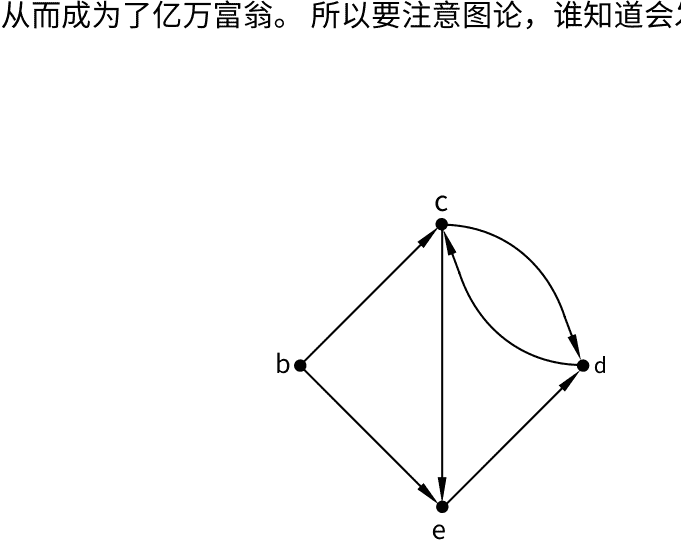
图9.1 一个有6条边的4个节点的有向图。
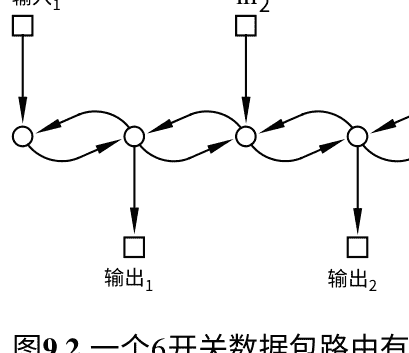
图9.2 一个通信网络有向图。
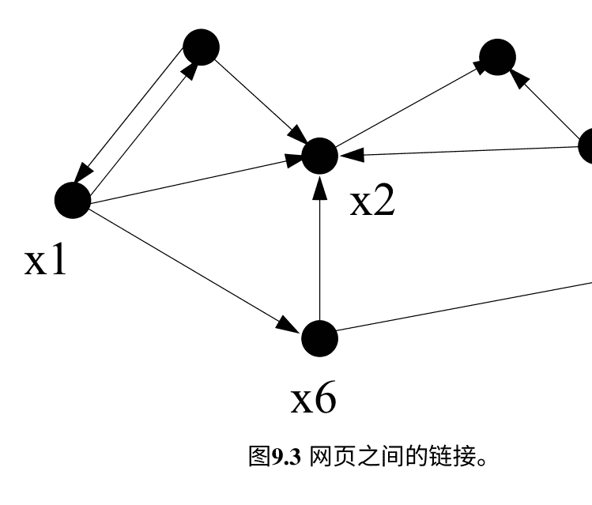
图9.3 万维网的一个小子图。
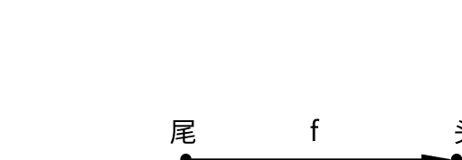
图9.4 一个有向边 $e = \langle u \to v \rangle$。边 $e$ 从尾顶点 $u$ 开始，并且结束于头顶部点 $v$。
定义9.0.1. 一个有向图 $G$由非空集合$V(G)$组成，称为 $G$的顶点集合，以及集合 $E(G)$，称为 $G$的边集合。集合 $V(G)$的元素称为顶点。顶点也称为节点；术语“顶点”和“节点”可以互换使用。集合 $E(G)$的元素称为有向边。有向边也称为“箭头”或简称为“边”。有向边从某个顶点开始，称为边的尾部，以某个顶点结束，称为边的头部，如图9.4所示。这样的边可以用有序对$(u, v)$表示。记号 $( u \to v)$表示这条边。
在定义9.0.1中没有什么新的东西，除了很多词汇。严格地说，有向图 $G$与集合 $V = V(G)$上的二元关系是相同的——也就是说，有向图只是一个定义域和值域相同的二元关系。实际上，我们已经把关系 $G$中的箭头称为 $G$的“图形”。例如，整数区间 $[1..12]$上的可除性关系可以用图9.5中的有向图表示。

## 9.1 顶点度数
有向图中一个顶点的入度是指指向它的箭头的数量，而它的出度是指从它出发的箭头的数量。更准确地说，
定义9.1.1. 如果 $G$是一个有向图且 $v \in V(G)$, 那么
$$\text{indeg}(v) ::= |\{ e \in E(G) \mid \text{head}(e) = v \}|$$
$$\text{outdeg}(v) ::= |\{ e \in E(G) \mid \text{tail}(e) = v \}|$$
这个定义的一个直接结果是
引理 9.1.2.
$$\sum_{v\in V(G)} \text{indeg}(v) = \sum_{v\in V(G)} \text{outdeg}(v).$$
证明。这两个求和等于 $|E(G)|$。

---
<sup>18</sup> 没有必要诉诸中国剩余定理。
<sup>19</sup> 我们很快会看到，还有其他的数字会被$\text{rem}(m^{2}, N)$加密，所以我们必须禁止这些其他数字作为可能的消息，以便能够解码这个密码系统，但现在先忽略这一点。
<sup>20</sup> 这是一种非常弱的“安全性”属性,因为它甚至不能排除通过某种不需要知道私钥的方法来解密RSA编码的消息的可能性。然而,二十多年的经验证明了RSA在实践中的安全性。

## 第9章 有向图和偏序关系

[图片引用]

## 9.2 行走和路径

用点和箭头来描绘有向图，可以自然地讨论沿着图中连续的边进行遍历。

例如，在图 9.5 中的有向图中，你可以从顶点 1 开始，依次沿着边从顶点 1 到顶点 2，从 2 到 4，从 4 到 12，然后从 12 到 12 两次（或者任意多次）进行遍历。按照这种方式遵循的边的序列被称为图的一条行走。一条路径是一条不重复访问顶点的行走。所以从1到2再到4再到12的行走是一条路径，但如果再次到12，它就不再是一条路径了。

表示一条行走的自然方式是它所经过的连续顶点的序列，在这种情况下：

1 2 4 12 12 12.

然而，按照惯例，一条行走由交替的连续顶点和边的序列表示，因此这条行走正式地是

1 ⟨1→2⟩ 2 ⟨2→4⟩ 4 ⟨4→12⟩ 12 ⟨12→12⟩ 12 ⟨12→12⟩ 12. (9.1)

这个定义的冗余足以让任何计算机科学家感到不安，但它确实使得讨论顶点和边在行走中出现的次数变得容易。下面是一个正式的定义：

**定义 9.2.1.** 在有向图 G 中，一条行走是由顶点和边交替组成的序列，以顶点开始，以顶点结束，并且对于行走中的每条边⟨u→v⟩，顶点 u 是边之前的元素，顶点 v 是边之后的元素。

因此，一条行走 **v**，是一个形式为的序列

```
**v** ::= v₀ ⟨v₀→v₁⟩ v₁ ⟨v₁→v₂⟩ v₂ … ⟨vₖ₋₁→vₖ⟩ vₖ
```

其中 ⟨vᵢ → vᵢ₊₁⟩ ∈ E(G) 对于 i ∈ [0..k)。行走被称为从 v₀ 开始，以 vₖ 结束，并且行走的长度 |**v**| 定义为 k。

如果所有的 vᵢ 都不同，那么行走就是一条路径，即如果 i ≠ j，则 vᵢ ≠ vⱼ。闭合行走是一条从起点到终点的行走。一个循环是一条正长度的闭合行走，其顶点除了起点和终点外都是不同的。

请注意，单个顶点被视为长度为零的路径，起点和终点相同。它也是一条闭合行走，但不被视为循环，因为根据定义，循环必须具有正长度。当一个节点有一条指向自身的箭头时，长度为一的循环是可能的。图9.1中没有长度为一的循环，但是图9.5中的可除性关系有一个长度为一的循环。长度为一的循环有时被称为自环。

尽管行走正式上是顶点和边的交替序列，但它完全由其上连续顶点的序列或边的序列决定。在方便的时候，我们将以这些方式描述行走。例如，对于图9.1中的图

- (a, b, d), 或者简单地 abd, 是一个（顶点序列描述的）长度为二的路径，
- ⟨a→b⟩ ⟨b→d⟩, 或者简单地 ⟨a→b⟩ ⟨b→d⟩, 是（边序列描述的）相同长度为二的路径，
- abcbd 是一个长度为四的行走，
- dcbcbd 是一个长度为五的闭合行走，
- bdcb 是一个长度为三的循环，
- ⟨b→c⟩ ⟨c→b⟩ 是一个长度为二的循环，和
- ⟨c→b⟩ ⟨b a⟩ ⟨a→d⟩ 不是一个行走。行走不允许沿着错误的方向走边。

如果你行走一段时间后，在某个顶点停下来休息，然后继续行走，你已经将行走分成了两部分。例如，在行走（9.1）通过可除性图的两条边后停下来休息，将行走分成了第一部分

```
1 ⟨1→2⟩ 2 ⟨2→4⟩ 4 (9.2)
```

从1到4，剩下的行走

```
4 ⟨4→12⟩ 12 ⟨12→12⟩ 12 ⟨12→12⟩ 12. (9.3)
```

从4到12，我们将整个行走 (9.1) 称为行走 (9.2) 和 (9.3) 的合并。一般来说，如果一个行走 **f** 以顶点 *v* 结束，而一个行走 **r** 以相同的顶点 *v* 开始，我们将称其合并为行走 **f^r**，它以 **f** 开始并继续以 **r**。只有当第一个行走以相同的顶点 *v* 结束时，才能合并两个行走。有时候给合并的节点 *v* 命名是有用的；我们将使用符号 **fvr** 来描述以 *v* 结束的行走 **f** 与以 *v* 开始的行走 **r** 的合并。这个定义的一个结果是

### 引理 9.2.2.

|**f^r**| = |**f**| + |**r**|.

在下一节中，我们将得到引理 通过这种方式行走。

### 9.2.1 寻找路径

如果你试图快速走到某个地方，如果你两次来到同一个地方，你就知道自己有麻烦了。这实际上是图论的一个基本定理。

### 定理 9.2.3. 从一个顶点到另一个顶点的最短路径是一条路径。

证明。如果存在从顶点 *u* 到另一个顶点 *v* 的行走 **w**，那么根据良序原理，必定存在一条最小长度的行走 **w** 从 *u* 到 *v*。我们声称**w**是一条路径。

为了证明这个命题，假设相反，即 **w** 不是一条路径，意味着在这条行走上某个顶点 *x* 出现了两次。也就是说，

**w = e^x f^x g**

对于一些行走 **e**, **f**, **g**，其中 **f** 的长度是正的。但是，"删除" **f** 会导致一个严格更短的行走

**e^x g**

从 *u* 到 *v*，与 **w** 的最小性相矛盾。

### 定义 9.2.4. 在图中，从顶点 *u* 到顶点 *v* 的距离，记为 *dist(u, v)*，是最短路径的长度。

正如预期的那样，这个距离的定义满足以下条件：

### 引理 9.2.5. [三角不等式]

> $dist(u, v) \leqslant dist(u, x) + dist(x, v)$

对于所有的顶点 $u, v, x$，当且仅当 $x$ 在从 $u$ 到 $v$ 的最短路径上时，等号成立。

当然，你可能期望这个属性是真实的，但是距离有一个技术上的定义，它的属性不能被视为理所当然。例如，与空间中的普通距离不同，从 $u$ 到 $v$ 的距离通常与从 $v$ 到 $u$ 的距离不同。因此，让我们证明三角不等式。

证明。为了证明不等式，假设 $\mathbf{f}$ 是从 $u$ 到 $x$ 的最短路径，$\mathbf{r}$ 是从 $x$ 到 $v$ 的最短路径。然后根据引理9.2.2，$\mathbf{f} \cdot \mathbf{r}$ 是从 $u$ 到 $v$ 的长度为 $dist(u, x) + dist(x, v)$ 的路径，因此这个和是从 $u$ 到 $v$ 的最短路径的上界，根据定理9.2.3。

“当且仅当”的证明在问题9.3中。

最后，路径和闭合路径之间的关系扩展到闭合路径和循环：

### 引理 9.2.6. 通过一个顶点的最短正长度闭合行走是一个环通过该顶点。

引理 9.2.6 的证明与定理 9.2.3 本质上相同；参见问题9.7。

### 9.3 邻接矩阵

如果一个图，$G$，有$n$个顶点，$v_0; v_1; \ldots; v_{n-1}$，一种有用的表示方法是使用一个$n \times n$矩阵，元素为零和一，称为其邻接矩阵，$A_G$。邻接矩阵，$(A_G)_{ij}$，的第$i,j$个元素为$1$，如果存在从顶点$v_i$到顶点$v_j$的边，否则为$0$。也就是说，

> $(A_G)_{ij}$ 是什么 \begin{cases} 1 & \text{if } (v_i \neq v_j) \in E(G), \\ 0 & \text{否则}. \end{cases}

例如，让 H 是图 9.1 中显示的 4 节点图。它的邻接矩阵，$A_H$，是一个 $4 \times 4$ 矩阵：

|   | a | b | c | d |
|---|---|---|---|---|
| a | 0 | 1 | 0 | 1 |
| b | 0 | 0 | 1 | 1 |
| c | 0 | 1 | 0 | 0 |
| d | 0 | 0 | 1 | 0 |

这种表示的一个好处是我们可以使用矩阵幂来计算顶点之间的行走次数。例如，在图 H 中，顶点 a 和 c 之间有两条长度为 2 的行走路径：

- $a \ \langle a \to b \rangle \ b \ \langle b \to c \rangle \ c$
- $a \ \langle a \to d \rangle \ d \ \langle d \to c \rangle \ c$

这些是从 a 到 c 的唯一两条长度为 2 的行走路径。此外，从 b 到 c 和从 c 到 c 以及从 d 到 b，都只有一条长度为 2 的行走路径，这些是图 H 中唯一的长度为 2 的行走路径。事实证明，我们可以从矩阵 $(A_H)^2$ 的条目中读取这些计数：

|   | a | b | c | d |
|---|---|---|---|---|
| a | 0 | 0 | 2 | 1 |
| b | 0 | 1 | 1 | 0 |
| c | 0 | 0 | 1 | 1 |
| d | 0 | 1 | 0 | 0 |

更一般地，矩阵 $(A_G)^k$ 提供了在任何有向图 G 中顶点之间长度为 k 的路径的数量，我们现在来解释一下。

**定义 9.3.1.** 对于一个 n 个顶点的图 G，长度为 k 的路径计数矩阵 C 是一个 $n \times n$ 矩阵 C，其中

$C_{uv}$ 表示从 u 到 v 的长度为 k 的路径数量: (9.4)

注意，邻接矩阵 $A_G$ 是图 G 的长度为 1 的路径计数矩阵，而 $(A_G)^0$，按照惯例是单位矩阵，是长度为 0 的路径计数矩阵。

根据这个定理，邻接矩阵的平方 \((A_G)^2\) 是图 \(G\) 的长度为两步的行走计数矩阵。再次应用该定理到 \((A_G)^2 A_G\) 上，可以得到长度为3步的行走计数矩阵 \((A_G)^3\)。更一般地，通过归纳可以得到

### 推论 9.3.3

有向图 \(G\) 的长度为\(k\)的行走计数矩阵是 \((A_G)^k\)，对于所有的 \(k \in \mathbb{N}\)。

换句话说，你可以通过计算邻接矩阵的 \(k\) 次幂来确定任意两个顶点之间长度为 \(k\) 的行走数！这看起来可能很神奇，但证明揭示了矩阵乘法和行走数之间的简单关系。

#### 定理9.3.2的证明

任意长度为 \((k + m)\) 的行走从顶点 \(u\) 开始以长度为 \(k\) 的行走从 \(u\) 开始并以某个顶点 \(w\) 结束，然后以长度为 \(m\) 的行走从 \(w\) 开始并以 \(v\) 结束。因此，从 \(u\) 到 \(v\) 经过 \(w\) 的第 \(k\) 步的长度为 \((k + m)\) 的行走数等于从 \(u\) 到 \(w\) 的长度为 \(k\) 的行走数 \(C_{uw}\) 乘以从 \(w\) 到 \(v\) 的长度为 \(m\) 的行走数 \(D_{wv}\)。我们可以通过对所有可能的顶点 \(w\) 求和，得到从 \(u\) 到\(v\)的长度为 \((k + m)\) 的行走总数，这些行走在第 \(k\) 步经过 \(w\)。换句话说，

> \[ \text{\#长度 } (k + m) \text{从 } u \text{到 } v \text{的路径数} \sum_{w \in V(G)} C_{uw} \cdot D_{wv} \quad (9.5) \]

但是(9.5)式右边恰好是 \((CD)_{uv}\) 的定义。因此， \(CD\) 的确是长度为\((k + m)\) 的路径计数矩阵。

■

### 9.3.1 最短路径

邻接矩阵的幂与路径数之间的关系很酷——至少对我们这些数学迷来说——但更重要的问题是找到节点对之间的最短路径。例如，当你开车回家度假时，通常希望选择最短时间的路线。

一种简单的方法是逐个计算 \(A_G\) 的连续幂，直到第一个幂中的每个元素变为正数，从而找到图\(G\)中所有最短路径的长度。这是因为定理9.3.2暗示了如果存在最短路径，则 \(u\) 和 \(v\) 之间的最短路径长度将是使得 \((A_G)^k_{uv}\) 非零的最小值 \(k\)，并且如果存在最短路径，则其长度将为 \(\le n - 1\)。这个想法的改进导致了以相当高效的方式找到最短路径的方法。这些方法同样适用于带权重的图，其中边带有权重标签或成本，目标是找到最小权重、最便宜的路径。这些细化通常在入门算法课程中涵盖，我们不会进一步讨论。

### 9.4 行走关系

关于有向图的一个基本问题是是否存在一种方法从一个特定的顶点到达另一个顶点。因此，对于任何有向图 \(G\)，我们对一个二元关系 \(G^*\)感兴趣，称为 \(V(G)\)上的行走关系，其中

> 如果在 \(G\)中存在从 \(u\)到 \(v\)的行走，则有 &emsp;&emsp;&emsp;&emsp;&emsp;&emsp;&emsp;&emsp;&emsp;&emsp;&emsp;&emsp; (9.6)

类似地，存在一个正行走关系

> 如果在 \(G\)中存在从 \(u\)到 \(v\)的正长度行走，则有 &emsp;&emsp;&emsp;&emsp;&emsp;&emsp;&emsp;&emsp;&emsp;&emsp;&emsp;&emsp; (9.7)

**定义9.4.1.** 当存在从顶点 \(v\)到顶点 \(w\)的行走时，我们说 \(w\)是从 \(v\)可达的，或者等价地说，\(v\)与 \(w\)是连通的。

### 9.4.1 关系的合成

有一种简单的方法可以将函数的合成扩展到关系的合成，并且这给了我们另一种讨论有向图中的路径和路径的方式。

**定义9.4.2.** 设 \(R: B \to C\)和 \(S: A \to B\)是二元关系。那么 \(R\)与 \(S\)的合成是二元关系 \((R \circ S): A \to C\)，它由以下规则定义：

> \(a \ (R \circ S) \ c ::=(9.8)\) 这与特殊情况下的函数合成的定义4.3.1一致。²

记住有向图是其顶点上的二元关系，将有向图 \(G\) 与其自身合成是有意义的。然后，如果我们将 \(G^n\) 表示为\(G\)与自身合成 \(n\)次，很容易检查（见问题9.9） \(G^n\)是长度为 \(n\)的行走关系：

> 如果在\(G\)中从\(a\)到\(b\)存在一条长度为\(n\)的路径，则存在一条长度为\(n\)的行走路径： (9.9)

²在(9.8)中，\(R\)和\(S\)的顺序颠倒不是一个打字错误。这样做是为了使关系组合泛化函数组合。函数\(f\)和函数\(g\)在参数\(x\)处的组合值为\(f.g(x))\)。因此，在组合中，函数\(g\)首先被应用。

即使对于\(n=0\)的情况，也适用，通常约定\(G^0\)是顶点集上的单位关系\(\text{Id}_{V(G)}\)。³ 由于存在行走路径当且仅当存在路径，并且每个路径的长度最多为\(|V(G)|-1\)，我们现在有

$$G^* = G^0 \cup G^1 \cup G^2 \cup ... \cup G^{|V(G)|-1} = (G \cup G^0)^{|V(G)|-1}. \quad (9.10)$$

最终的等式指向了使用重复平方作为一种计算 $G^*$ 与对数 $n$ 而不是 $n - 1$ 关系的组合。

### 9.5 有向无环图和调度

MIT计算机科学课程的一些先修课程在图9.6中显示。从课程 $s$ 到课程 $t$ 的边表示 $s$ 被列为 $t$ 的直接先修课程。当然，在你可以选修课程 $t$ 之前，你不仅需要选修课程 $s$，还需要选修 $s$ 的所有先修课程，以及这些先修课程的先修课程，以此类推。我们可以用正向路径关系来明确陈述这一点：如果 $D$ 是课程之间的直接先修关系，那么在选修课程 $v$ 之前，必须先完成课程 $u$，即 $u \mathrel{D^+} v$。当然，如果这个直接先修图中存在正长度的闭合路径，那么毕业将需要很长时间。我们需要禁止这样的闭合路径，根据引理9.2.6，这与禁止循环是一样的。因此，课程之间的直接先修图最好是无环的：

### 定义 9.5.1. 有向无环图（DAG）是一个没有循环的有向图。

在计算机科学中，DAGs具有特殊重要性。它们捕捉了在分析任务调度和并发控制中使用的关键概念。当将程序分布在多个处理器上时，如果程序的一部分需要另一部分尚未生成的输出，我们就会遇到麻烦！因此，让我们更深入地研究DAGs及其与调度的关系。

3 恒等关系，$\text{Id}_A$，是集合 $A$上的相等关系：
$$a \mathrel{\text{Id}_A} b \quad \text{当且仅当} \quad a = b;$$
对于 $a, b$ 属于 $A$。

4 方程 (9.9) 涉及一种无害的符号滥用：我们应该写成
$$\text{图}(G^*) = \text{图}(G^0) \cup \text{图}(G) \cup ...$$

[图片引用]

图9.6 麻省理工学院计算机科学(6-3)专业的先修课程。

### 9.5. 调度

在调度问题中，有一组任务，以及一组约束条件，指定了开始某些任务取决于其他任务在之前完成。我们可以将这些集合映射到一个有向图，其中任务作为节点，直接的先决条件约束作为边。

例如，图9.7中的有向无环图描述了一个人在正式场合下如何穿衣。正如我们上面所描述的，顶点对应于服装，边指定了哪些服装必须先穿上哪些服装。

当面临这样一个先决条件集合时，最基本的任务是找到一种顺序，一次执行所有任务，同时遵守依赖约束。以这种方式对任务进行排序被称为拓扑排序。

**定义 9.5.2.** 有向无环图的拓扑排序是一个包含所有顶点的列表，使得每个顶点v在列表中出现的位置早于从v可达的其他顶点。

有很多方法可以一次穿一件衣服，同时遵守图9.7的约束条件。我们在图9.8中列出了两种拓扑排序。

[图片引用]

图9.8 图9.7中描述的先决条件的两种可能的拓扑排序

事实上，我们可以证明每个有限有向无环图都有一个拓扑排序。你可以把它看作是一个数学证明，证明你确实可以在早上穿衣服。从最小元素开始，可以很容易地构造有限有向无环图的拓扑排序：

> **定义9.5.3.** 有向无环图D的顶点v是极小的，当且仅当没有从其他顶点到v的边。一个顶点 v是极小的当且仅当 v不能从任何其他顶点到达。

使用“极小”和“最小的”这些词来描述起始路径的顶点可能看起来很奇怪。这些词来自于一个顶点比它连接的任何其他顶点都“更小”的观点。我们将在下一节中探讨这种思考有向无环图的方式，但现在我们将使用这些术语，因为它们是常规的。

这种术语的一个奇特之处是有向无环图可能没有最小元素，但有很多极小元素。特别是，衣服的例子有四个极小元素：左袜、右袜、内衣和衬衫。

为了建立一个穿衣顺序，我们选择其中一个极小元素——比如说，衬衫。现在有一个新的极小元素集合；我们没有选择作为步骤1的三个元素仍然是极小的，一旦我们移除了衬衫，领带也变成了极小的。我们选择另一个极小元素，以此类推，直到所有元素都被选择。按照它们被选择的顺序排列的元素序列将是一个拓扑排序。这就是上面的拓扑排序是如何构建的。

因此，我们的构造显示：## 9.5. 有向无环图和调度

定理9.5.4. 每个有限的有向无环图都有一个拓扑排序。

还有许多其他构造拓扑排序的方法。例如，我们可以不从路径开始的最小元素开始，而是从路径结束的最大元素开始构建拓扑排序。实际上，我们可以通过从有限的有向无环图中任意选择顶点，并将它们插入到列表中适当的位置来构建拓扑排序。

### 9.5.2 并行任务调度

对于任务依赖关系，拓扑排序提供了一种按顺序执行任务并尊重这些依赖关系的方法。但是，如果我们有能力同时执行多个任务呢？例如，假设任务是程序，有向无环图表示数据依赖关系，我们有一台具有许多处理器的并行机器，而不是只有一个处理器的顺序机器。我们应该如何安排任务的调度？我们的目标应该是最小化完成所有任务所需的总时间。

为了简单起见，假设所有任务所需的时间相同，并且所有处理器都是相同的。

因此，给定一组有限的任务，在最优并行调度下完成它们需要多长时间？我们可以使用无环图上的行走关系来分析这个问题。

在第一个时间单位，我们应该完成所有最小的任务，所以我们会穿上左袜子、右袜子、内衣和衬衫。在第二个时间单位，我们应该穿上裤子和领带。请注意，我们还不能穿左鞋或右鞋，因为我们还没有穿上裤子。在第三个时间单位，我们应该穿上左鞋、右鞋和腰带。最后，在最后一个时间单位，我们可以穿上夹克。这个调度在图9.9中有所说明。完成这些任务的总时间为4个单位。我们无法做得比4个单位的时间更好，因为有一个必须在下一个任务之前完成的4个任务的序列。

我们必须先穿上衬衫，然后穿裤子，再系腰带，最后穿夹克。这样的一系列物品被称为一个链。

定义9.5.5. 在有向无环图中，当其中一个顶点可以从另一个顶点到达时，这两个顶点是可比较的。在有向无环图中，一个链是一组顶点，其中任意两个顶点是可比较的。在链中，可以从链中的所有其他顶点到达的顶点被称为最大元素。有限链被称为在其最大元素处结束。

事实上，有向无环图甚至不需要是有限的，但你会欣慰地知道我们不需要讨论这个。

是的，我们知道你实际上不能同时穿两只袜子，但想象一下你被一群机器人处理器穿衣服，而且你很匆忙。对你来说还不管用吗？好吧，忘记衣服，想象它们是具有图9.7中所示的优先约束的程序。

# 第9章 有向图和偏序关系

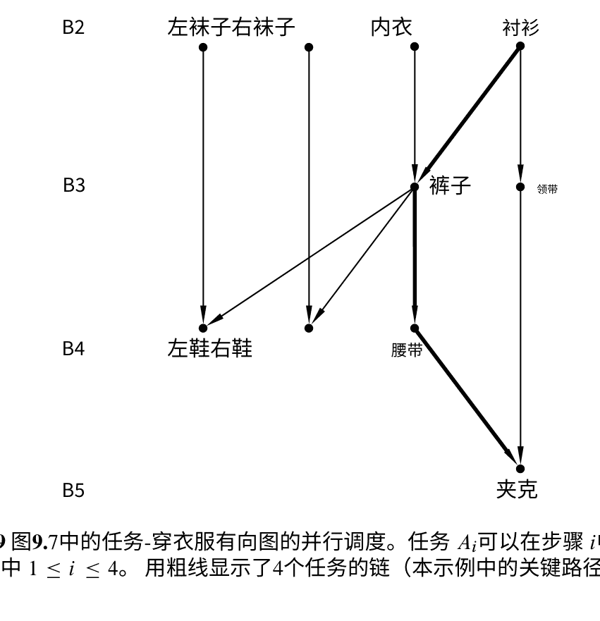

图9.9 图9.7中的任务-穿衣服有向图的并行调度。任务 $A_i$可以在步骤 $i$中执行，其中 $1 \le i \le 4$。用粗线显示了4个任务的链（本示例中的关键路径）。

## 9.5. 有向无环图和调度

即使有无限数量的处理器，调度任务所需的时间至少与任何链中的顶点数一样多。这是因为如果我们使用的时间少于某个链的大小，那么链中的两个项目将必须在同一步骤中完成，违反了先决条件。因此，最长的链也被称为关键路径。例如，图9.9显示了穿衣服有向图的关键路径。

在这个例子中，我们能够用 $t$ 步骤来调度所有的任务，其中 $t$ 是最长链的大小。DAG的一个好处是这总是可能的！换句话说，对于任何DAG，都存在一个合法的并行调度，总共运行 $t$ 步骤。

一般来说，执行任务的计划指定了在连续的步骤中要执行哪些任务。每个任务，都必须在某个步骤中安排，并且在任务 $a$ 之前必须完成的所有任务都必须在较早的步骤中安排。下面是对计划的严格定义。

> 定义9.5.6. 集合 $A$ 的一个划分是 $A$ 的一组非空子集，称为划分的块，使得 $A$ 的每个元素恰好属于一个块。

例如，集合 $\{a, b, c, d, e\}$ 的一个可能的划分是

$\{a, c\} \quad \{b, e\} \quad \{d\}$.

> 定义9.5.7. 有向无环图 $D$ 的一个并行计划是 $V(D)$ 的一个划分，使得当 $j < k$ 时，$A_j$ 中的任何顶点都无法从 $A_k$ 中的任何顶点到达。块 $A_k$ 被称为在步骤 $k$ 中安排的元素集合，计划的时间是块的数量。在任何步骤中安排的元素的最大数量被称为计划所需的处理器数量。

以元素 $a$ 结尾的最长链被称为关键路径，链中小于元素 $a$ 的元素数量被称为深度。因此，在任何可能的并行调度中，在任务 $a$ 开始之前必须至少有深度 $(a)$ 步骤。特别地，最小元素恰好是深度为0的元素。

有一种非常简单的调度方式可以在最少的步骤中完成每个任务：只需尽早执行任务。在第 $k$ 步调度深度为 $k$ 的所有元素。这就是我们找到上述穿衣服的调度方式的方法。

> 我们认为将它们称为分区的部分会更好，但“块”是标准术语。

# 第9章 有向图和偏序关系

**定理9.5.8.** 对于有限DAG $D$ 的最小时间调度由集合 $A_0, A_1, \ldots$组成，其中 $A_k ::= \{a \in V(D) \mid \text{深度} (a) = k\}$.

我们将问题9.19的证明留给后面。根据定义9.5.7，我们可以总结上面的故事：使用无限数量的处理器，完成所有任务的并行时间仅仅是关键路径的长度：

**推论9.5.9.** 并行时间 = 关键路径的长度。

当处理器数量受限时，情况变得更加复杂；请参见问题9.20的例子。

### 9.5.3 Dilworth引理

**定义9.5.10.** 有向无环图中的反链是指一组顶点，其中任意两个不可比较——集合中的任意两个不同顶点之间不存在路径。

我们对调度的结论也告诉我们一些关于反链的东西。

**推论9.5.11.** 在一个有向无环图中，如果最大链的大小为 $t$，则 $V(D)$ 可以被划分为 $t$ 个反链。

**证明.** 让反链为集合 $A_k::= \{a \in V(D) |\text{深度} (a) = k\}$。很容易验证每个 $A_k$ 都是一个反链（问题9.19）。

推论9.5.11暗示了一个关于无环有向图的著名结果：

**引理9.5.12 (Dilworth).** 对于所有 $t > 0$，具有 $n$ 个顶点的每个有向无环图必须要有么有大小大于 $t$ 的链，要么有大小至少为 $n/t$ 的反链。

**证明.** 假设不存在大小大于 $t$ 的链。让 $\ell$ 为最大反链的大小。如果我们按照推论9.5.11的证明进行并行调度，我们会创建与最大链的大小相等的反链数量，这个数量小于或等于 $t$。每个元素属于且仅属于一个反链，其中没有一个反链的大小大于 $\ell$。因此，元素的总数最多为 $\ell \times t$—即， $\ell t \geq n$。简单的除法表明 $\ell \geq n/t$。

推论9.5.13. 每个有向无环图(DAG)有$n$个顶点，都存在一个长度大于$\sqrt{n}$的链或者至少有一个大小为$\sqrt{n}$的反链。

证明. 设 $t= \sqrt{n}$ 在引理9.5.12中。

例子 9.5.14. 当我们的例子中的人穿衣服时，有$n$个 = 10。存在一个长度为 4的链。不存在长度为 5的链，但存在一个大小为 4的反链。

## 9.6 偏序

在将“直接先决条件”关系映射到有向图上之后，我们能够使用计算机科学家的图形工具来推断出一些关于像穿衣服这样平凡事情的结论。这可能会或可能不会给你留下深刻的印象，但我们可以做得更好。在本章的引言中，我们提到了一个有用的事实，值得重复：任何有向图在形式上都与其顶点为定义域和值域的二元关系相同。这意味着任何定义域与值域相同的二元关系都可以转化为有向图！谈论二元关系的边或有向图下的集合的图像可能一开始看起来很奇怪，但这样做将使我们能够在不同类型的关系之间建立重要的联系。例如，我们可以将Dilworth引理应用于穿衣服的“直接先决条件”关系，因为该关系的图是一个有向无环图(DAG)。

但是我们如何判断一个二元关系是否是有向无环图（DAG）？而一旦我们知道一个关系是DAG，我们到底可以得出什么结论呢？在本节中，我们将抽象出二元关系可能具有的一些属性，并使用这些属性来定义关系的类别。特别地，我们将解释本节的标题，偏序关系。

### 9.6.1 DAG中行走关系的属性

首先，让我们谈谈所有有向图共有的一些特点。由于将从$u$到$v$的行走与从$v$到$w$的行走合并会得到从$u$到$w$的行走，因此行走关系和正行走关系都具有一个被称为传递性的关系属性：

定义9.6.1. 在集合$A$上的二元关系$R$，如果满足以下条件，则称为传递关系：
$$
\text{若} a \; R \; b \text{ 且 } b \; R \; c \text{，则 } a \; R \; c
$$
对于每个 $a, b, c \in A$。

# 第9章 有向图和偏序关系

所以我们有

引理 9.6.2. 对于任何有向图, G, 路径关系 G+和 G*是传递的.

由于从任何顶点到自身存在长度为零的路径，路径关系具有另一个称为自反性的关系属性:

定义 9.6.3. 二元关系, R, 在集合, A, 上是自反的，当且仅当对于所有 a ∈ A，有 a R a.

现在我们有

引理 9.6.4. 对于任何有向图, G, 路径关系 G* 是自反的.

我们知道有向无环图是指没有正长度闭合路径的图。由于闭合路径上的任何顶点都可以作为路径的起点和终点，所以说一个图是有向无环图等价于说从任何顶点到自身不存在正长度的路径。这意味着有向无环图的正路径关系 $D^+$ 具有一个称为非自反性的关系属性.

定义9.6.5. 一个二元关系， R，在一个集合， A，上是非自反的当且仅当

非(a R a)

对于所有的 a ∈ A.

所以我们有

引理9.6.6. R是一个DAG当且仅当 R+是非自反的.

### 9.6.2 严格偏序

这是我们开始定义有趣的关系类的地方:

定义9.6.7. 一个传递且非自反的关系被称为严格偏序.

从引理9.6.6中现在可以得出严格偏序和DAG之间的简单联系:

定理9.6.8. 一个关系 R是严格偏序当且仅当 R是一个DAG的正向行走关系.

严格偏序在许多看起来与有向图无关的情况下出现。例如，数字上的小于关系， <，是一个严格偏序:

# 9.6. 偏序

-   如果x < y且y < z那么x < z，所以小于是传递的，且
-   不成立 x < x，所以小于是非自反的。

适当的包含关系 ⊂ 也是一个偏序关系:

-   如果 A ⊂ B且 B ⊂ C那么 A ⊂ C，所以包含是传递的，且
-   不成立 A ⊂ A，所以适当的包含是非自反的。

如果有两个顶点彼此可达，则存在一个正长度的闭合行走，从一个顶点开始，到达另一个顶点，然后返回。因此，有向无环图是指没有两个顶点彼此可达的有向图。这对应于一个称为反对称性的关系属性。

> 定义9.6.9. 集合 A上的二元关系 R是反对称的当且仅当 a R b 蕴含 非 (b R a) 对于所有a, b ∈ A.

因此，我们还可以用不对称性来描述有向无环图:

> 推论 9.6.10. 一个有向图 D是有向无环图当且仅当 D⁺是不对称的。

推论 9.6.10 和定理 9.6.8结合起来得到

> 推论 9.6.11. 一个集合 A上的二元关系 R是严格偏序当且仅当它是传递的和不对称的。

严格偏序可能是不同有向无环图的正向行走关系。这引发了一个问题，即找到具有最少边的有向无环图，以确定给定的严格偏序。对于有限的严格偏序，最小的这样的有向无环图是唯一的且易于找到（见问题9.25）。

### 9.6.3 弱偏序

小于或等于关系， ≤，至少和小于严格偏序关系一样熟悉，而普通的包含关系， ⊆，甚至比真包含关系更常见。这些是弱偏序关系的例子，它们只是带有额外条件的严格偏序关系，即每个元素与自身相关。为了准确地陈述这一点，我们必须放宽不对称性质，使其不适用于将顶点与自身进行比较; 这种放宽的性质称为反对称性:

# 第9章 有向图和偏序关系

**定义9.6.12.** 集合 $A$ 上的二元关系 $R$ 是反对称的，当且仅当对于所有 $a \neq b \in A$ 成立时，
$$a R b \text{ 蕴含 } \neg(b R a)$$

现在我们可以给出弱偏序关系的公理定义，与严格偏序关系的定义相类似。

**定义9.6.13.** 集合上的二元关系是弱偏序当且仅当它是传递的、自反的和反对称的。

下面的引理从这个定义直接得出了弱偏序的另一个特征。

**引理9.6.14.** 集合 $A$ 上的关系 $R$ 是弱偏序当且仅当存在一个严格偏序 $S$ 在 $A$ 上，使得
$$a R b \text{ 当且仅当 } a S b \text{ 或者 } a = b,$$
对于所有 $a, b \in A$。

由于长度为零的路径从一个顶点到它自身，结合引理和定理9.6.8可得：

**推论9.6.15.** 一个关系是弱偏序当且仅当它是一个有向无环图的路径关系。

对于一般的弱偏序，我们经常使用类似于排序的符号，如 $\geq$ 或 $\sqsubseteq$ 而不是使用字母符号 $R$。同样，我们通常使用 $>$ 或 $\sqsubset$ 来表示严格偏序。

还有两个部分排序的例子值得一提：
**例子9.6.16.** 假设 $A$ 是一些集合的家族，并定义 $a R b$ 当且仅当 $a \supset b$。那么 $R$ 是一个严格的部分排序。
**例子9.6.17.** 整除关系是非负整数上的弱部分排序。

为了练习定义，你可以验证另外两个例子是集合 $D$ 上的虚假部分排序：恒等关系 $\text{Id}_D$ 是弱部分排序，而空关系——没有箭头的关系——是严格部分排序。

## 9.7 用集合包含表示偏序关系

公理可以是抽象和推理重要属性的好方法，但是对于满足公理的事物有一个清晰的概念会有所帮助。DAGs提供了一种将偏序关系可视化的方法，但是将它们与其他熟悉的数学对象联系起来也会有所帮助。在本节中，我们将展示每个偏序关系都可以被视为一组通过包含关系相关联的集合。也就是说，每个偏序关系都具有与这样一组集合“相同的形状”。“相同的形状”的技术术语是“同构”。

定义9.7.1. 在集合A上的二元关系R与集合B上的关系S是同构的，如果存在一个保持关系的双射从A到B；也就是说，存在一个从A到B的双射f，使得对于所有的a，a'∈A，

a R a'  iff  f(a) S f(a').

为了描述一个偏序关系， ≥在一个集合上，我们简单地将每个元素 A表示为与该元素相关的元素的集合，即

a → {b ∈ A | b ≥ a}.

例如，如果 ≥是整数集上的可除性关系， {1, 3, 4, 6, 8, 12}，那么我们将每个整数表示为能够整除它的整数的集合。所以

| 元素 | 映射为 |
| :--- | :--- |
| 1 | {1} |
| 3 | {1, 3} |
| 4 | {1, 4} |
| 6 | {1, 3, 6} |
| 8 | {1, 4, 8} |
| 12 | {1, 3, 4, 6, 12} |

所以，事实上 3 | 12 对应于 {1, 3} ⊆ {1, 3, 4, 6, 12}。通过对应集合上的子集关系，我们完全捕捉了弱偏序 ≥ 的方式。形式上，我们有

引理 9.7.2. 让 ≥是集合 A上的弱偏序。然后 ≥同构于逆映射集合上的子集关系 ⊆，关于元素 a ∈ A的 ≥关系。

# 第9章 有向图和偏序关系

我们将证明留给问题 9.29。本质上相同的构造还表明严格偏序可以用集合表示，通过适当的子集关系， ⊂ (问题 9.30)。总结一下：

> 定理 9.7.3. 每个弱偏序 ≥ 都同构于子集关系， ⊆，关于一组集合。每个严格的偏序关系， >，都同构于适当的子集关系， ⊂，关于一组集合。

## 9.8 线性序

数字上熟悉的序关系具有一个重要的附加属性：给定两个不同的数字，其中一个将比另一个大。具有此属性的偏序关系被称为线性序。你可以将线性序看作是所有元素都排列在一起，以便每个人都准确地知道谁在前面，谁在后面的顺序。

定义 9.8.1. 设 R是集合 A上的二元关系， a, b是 A的元素。则对于关系 R， a和 b在可比性方面是可比的，如果 $a R b \lor b R a$。每两个不同元素可比的偏序关系称为线性序。

所以 <和 ≤在 ℝ上是线性顺序。另一方面，子集关系不是线性的，因为例如，任意两个不同的有限集合的大小相同，它们在 ⊆下是不可比较的。课程6的先决关系所需的科目也不是线性的，因为例如，8.01和6.042都不是对方的先决条件。

## 9.9 乘积顺序

将两个关系的乘积作为构建新关系的有用方法。

线性顺序通常被称为“全序”，但这个术语与“全关系”的定义相冲突，经常让学生感到困惑。成为线性顺序比成为是一个包含全关系的偏序条件要强得多。例如，任何弱偏序都是一个全关系，但通常不会是线性的。

# 定义9.9.1. 关系 $R_1 \times R_2$的乘积被定义为具有

域 $(R_1 \times R_2) ::= \text{域} (R_1) \times \text{域} (R_2)$,
余域 $(R_1 \times R_2) ::= \text{余域} (R_1) \times \text{余域} (R_2)$,
$(a_1, a_2) (R_1 \times R_2) (b_1, b_2)$ 当且仅当 $[a_1 R_1 b_1 \text{ 并且 } a_2 R_2 b_2]$。

根据定义直接推导出乘积保持传递性、自反性、非自反性和反对称性的性质（见问题9.41）。如果 $R_1$ 和 $R_2$ 都具有这些性质，则 $R_1 \times R_2$ 也具有这些性质。这意味着如果 $R_1$ 和 $R_2$ 都是偏序关系，则 $R_1 \times R_2$ 也是偏序关系。

示例 9.9.2. 定义一个关系， $Y$, 对于年龄-身高对来说是年龄更小和身高更矮的。这是对一组 $(y, h)$ 的关系，其中 $y$ 是一个非负整数 $\le 2400$，我们将其解释为以月为单位的年龄，而 $h$ 是一个非负整数 $\le 120$，描述以英寸为单位的身高。我们通过以下规则定义 $Y$

$(y_1, h_1) Y (y_2, h_2)$ 当且仅当 $y_1 \le y_2$ 且 $h_1 \le h_2$时：

也就是说， $Y$是年龄关系和身高关系的乘积。

由于年龄和身高都是按数字顺序排列的，年龄-身高关系 $Y$ 是一个偏序关系。现在假设我们有一个101名学生的班级。然后我们可以应用Dilworth引理9.5.12得出结论，存在一个由11名学生组成的链——即，随着年龄增长而身高增加的11名学生，或者存在一个由11名学生组成的反链——即，没有年龄和身高的关联。有11个学生，随着年龄变小而变高，这在课堂上很有趣的演示。

另一方面，线性排序的属性不被保留。例如，年龄-身高关系 $Y$ 是两个线性排序的乘积，但它不是线性的：年龄240个月，身高68英寸的配对(240,68)和配对(228,72)在 $Y$ 下是不可比较的。

## 9.10 等价关系

定义9.10.1. 如果关系具有自反性、对称性和传递性，则称其为等价关系。

模n同余是等价关系的一个重要例子：

-   它是自反的，因为 $x \equiv x \pmod{n}$。

## 第9章 有向图和偏序关系

- 它是对称的，因为 \( x \equiv y \pmod{n} \) 意味着 \( y \equiv x \pmod{n} \)。
- 它是可传递的，因为 \( x \equiv y \pmod{n} \) 和 \( y \equiv z \pmod{n} \) 意味着 \( x \equiv z \pmod{n} \)。

还有一个更为著名的等价关系的例子：相等本身。

任何总函数都在其定义域上定义了一个等价关系：

定义 9.10.2. 如果 \( f : A \rightarrow B \) 是一个总函数，根据规则定义一个关系 \( \equiv_f \) 如下：

\( a \equiv_f a' \) 当且仅当 \( f(a) = f(a') \).

从其定义可知， \( \equiv_f \) 是自反的、对称的和传递的，因为这些是等式的性质。也就是说， \( \equiv_f \) 是一个等价关系。这个观察结果给出了另一种看待模 \( n \) 同余是一个等价关系的方法：剩余引理 8.6.1 暗示了模 \( n \) 同余与 \( \equiv_r \) 相同，其中 \( r(a) \) 是 \( a \) 除以 \( n \) 的余数。

事实上，一个关系是等价关系当且仅当它等于 \( \equiv_f \) 对于某个全函数 \( f \) （见问题9.47）。因此，等价关系可以使用定义9.10.2来定义。

### 9.10.1 等价类

等价关系与划分密切相关，因为等价关系下的元素的映射是划分的块。

定义9.10.3. 给定一个等价关系 \( R : A \rightarrow A \)，元素 \( a \in A \) 的等价类, \( [a]_R \) 是所有与 \( a \) 相关的 \( A \) 的元素的集合。即，

\( [a]_R ::= \{ x \in A \mid a \, R \, x \} \).

换句话说， \( [a]_R \) 是 \( R(a) \) 的图像。

例如，假设 \( A = \mathbb{Z} \) 且 \( a \, R \, b \) 意味着 \( a \equiv b \pmod{5} \)。那么

\( [7]_R = \{ \ldots, -3, 2, 7, 12, 22, \ldots \}. \)

注意到7、12、17等都有相同的等价类；也就是说， \( [7]_R = [12]_R = [17]_R = \ldots \)。

等价关系和集合的划分之间存在着精确的对应关系。换句话说，给定一个集合的划分，同一块中的元素显然构成了一个等价关系。另一方面，我们有：

### 9.11. 关系性质总结

> 定理9.10.4. 集合 $A$ 上的等价关系的等价类是 $A$ 的划分块。

我们将留下定理9.10.4的证明作为公理推理的基本练习（见问题9.46），但让我们看一个例子。模5同余关系将整数划分为五个等价类：

- $\{..., -5, 0, 5, 10, 15, 20, ...\}$
- $\{..., -4, 1, 6, 11, 16, 21, ...\}$
- $\{..., -3, 2, 7, 12, 17, 22, ...\}$
- $\{..., -2, 3, 8, 13, 18, 23, ...\}$
- $\{..., -1, 4, 9, 14, 19, 24, ...\}$

用这些术语来说， $x \equiv y \pmod{5}$ 等价于断言 $x$ 和 $y$ 都在同一个分区中。例如， $6 \equiv 16 \pmod{5}$，因为它们都在第二个分区，但 $2 \not\equiv 9 \pmod{5}$，因为2在第三个分区，而9在最后一个分区。

从社交角度来看，如果“喜欢”是一个等价关系，那么每个人都会被划分为只喜欢彼此而不喜欢其他人的朋友圈。

### 9.11 关系属性总结

一个关系 $R : A \to A$ 与一个具有顶点 $A$ 的有向图相同。

自反性 $R$ 是指当 $\forall x \in A.\ x R x.$ 在 $R$ 中的每个顶点都有一个自环。

非自反性 $R$ 是指当 $\text{NOT}[\exists x \in A.\ x R x].$ 在 $R$ 中没有自环。

对称性 $R$ 是指当 $\forall x, y \in A.\ x R y \text{ IMPLIES } y R x.$ 如果在 $R$ 中存在从 $x$ 到 $y$ 的边，那么也会存在从 $y$ 到 $x$ 的边。

反对称性 $R$ 是指当 $\forall x, y \in A. x R y \text{ IMPLIES NOT}(y R x).$ 在 $R$ 中，任意两个顶点之间最多只有一条有向边，且没有自环。

反对称性 $R$ 是指当 $\forall x \neq y \in A. x R y \text{ IMPLIES NOT }(y R x).$

等价地说， $\forall x, y \in A. (x R y \text{ AND } y R x) \text{ IMPLIES } x = y.$

在任意两个不同的顶点之间最多只有一条有向边，但可能存在自环。

传递性 $R$ 是指当 $\forall x, y, z \in A. (x R y \text{ AND } y R z) \text{ IMPLIES } x R z.$

如果从 $u$ 到 $v$ 存在一条正长度的路径，则存在一条从 $u$ 到 $v$ 的边。线性 $R$ 是指当 $\forall x \neq y \in A. (x R y \text{ OR } y R x)$

在 $R$ 中给定任意两个顶点，它们之间存在一个方向上或另一个方向上的边。

对于任意有限的、非空的顶点集合 $R$，存在一条经过这些顶点的有向路径。

严格偏序关系 $R$ 是严格偏序关系当且仅当 $R$ 是传递的和非自反的，当且仅当 $R$ 是传递的和反对称的，当且仅当它是一个有向无环图的正长度行走关系。

弱偏序关系 $R$ 是弱偏序关系当且仅当 $R$ 是传递的、反对称的和自反的，当且仅当 $R$ 是一个有向无环图的行走关系。

等价关系 $R$ 是等价关系当且仅当 $R$ 是自反的、对称的和传递的，当且仅当 $R$ 等于域的某个划分的在同一块中关系。

## 第9.1节的问题

### 考试题目

问题9.1. 握手引理9.1.2的证明引用了一个“显而易见”的事实，在任何有限的有向图中，顶点的入度之和等于图中箭头的数量。也就是说，对于任何有限的有向图,

$$ \sum_{v \in V(G)} \text{indeg}(v) = |E(G)|, \tag{9.10} $$

但是这个声明对于每个人来说可能并不明显。所以通过对箭头的数量进行归纳来证明它，$|E(G)|$.

## 第9.4节的问题

### 练习题

问题9.2. 让

- $A ::= \{1, 2, 3\}$
- $B ::= \{4, 5, 6\}$
- $R ::= \{(1, 4), (1, 5), (2, 5), (3, 6)\}$
- $S ::= \{(4, 5), (4, 6), (5, 4)\}$.

注意 $R$ 是从 $A$ 到 $B$ 的关系，而 $S$ 是从 $B$ 到 $B$ 的关系。列出以下每个关系中的配对。

- (a) $S \circ R$.
- (b) $S \circ S$.
- (c) $S^{-1} \circ R$.

问题9.3. 引理9.2.5表明，$\text{dist}(u, v) \leq \text{dist}(u, x) + \text{dist}(x, v)$。它还表明，当且仅当 $x$ 在从 $u$ 到 $v$ 的最短路径上时，等式成立。

(a) 从左到右证明“当且仅当”语句。

(b) 从右到左证明“当且仅当”语句。

### 问题9.4.

在循环赛中，每两个不同的选手只对阵一次。对于没有平局的循环赛，可以用一个锦标赛有向图来描述谁打败了谁，其中顶点对应于选手，如果在比赛中 $x$ 击败了 $y$，则存在一条边 $(x \to y)$。

排名是包括所有选手的路径。所以在排名中，每个选手都赢了比自己排名低的选手，但很可能输给了排名更低的选手——排名者可能有很大的偏好空间。

- (a) 给出一个有多个排名的锦标赛有向图的例子。
- (b) 证明如果一个锦标赛有向图是一个有向无环图(DAG)，那么它最多有一个排名。
- (c) 证明每个有限锦标赛有向图都有一个排名。

### 可选

- (d) 证明有理数集合上的大于关系，$>$，是一个有向无环图和一个没有排名的锦标赛图。

### 问题9.5.

一个3位字符串是由3个字符组成的字符串，每个字符是0或1。假设你想以任意方便的顺序写出所有八个3位字符串的一个字符串。
例如，如果按照通常的顺序从000开始写出3位字符串001 010...，你可以将它们连接在一起得到一个长度为 $3 \cdot 8 = 24$ 的字符串它以000001010开头。
但是你可以通过从00010开始得到一个包含所有八个3位字符串的较短字符串00010...，现在000作为位1到3存在，而001作为位2存在通过4，并且010以位3到5的形式存在，...

- (a) 假设一个字符串是3-好的，如果它包含每个3位字符串作为3连续的位子串在其中的某个位置。找到一个长度为10的3-好字符串，并解释为什么这是任何3-好字符串的最小长度。

- (b) 解释在图9.10中包含每条边的任何行走如何确定一个3-好字符串。在这个图中找到确定的行走-

从第(a)部分中找出你的3位好字符串

(c) 解释为什么图9.10中包含每条边恰好一次的路径提供了最短的3位好字符串13

(d) 将2位图推广到k位有向图 $B_k$，其中 $V(B_k) ::= \{0,1\}^k$，并且通过 $B_k$ 的任何包含每条边恰好一次的路径确定了一个最小长度为 $(k+1)$ 的好位字符串14这个最小长度是多少？

定义 $B_k$ 的转换 验证每个顶点的入度和出度都是偶数，并且从任意顶点到任意其他顶点（包括自身）的路径长度最多为 $k$

### 作业问题

问题 9.6. (a) 给出一个有向图的例子，其中顶点 $v$ 在一个正偶长的闭合路径上，但没有顶点在一个偶长的循环上。

> 13这里解释的 3-好字符串可以推广到 n-好字符串，其中 n ≥ 3。它们是由荷兰伟大的数学家/逻辑学家尼古拉斯·德布鲁因研究的，被称为德布鲁因序列. 德布鲁由于2012年2月去世，享年94岁。

14问题 9.8 解释了为什么存在这样的“欧拉”路径。

(b) 给出一个有向图的例子，其中一个顶点 $v$ 在一个奇数长的闭合路径上，但不在一个奇数长的循环上。

(c) 证明每个奇数长的闭合路径都包含一个在奇数长循环上的顶点。

### 问题 9.7.

- (a) 给出一个有向图的例子，其中有一个包含两个顶点的闭合路径，但没有包含这些顶点的循环。

- (b) 证明引理 9.2.6：
引理。通过一个顶点的最短正长度闭合行走是一个循环。

### 问题 9.8。

图的欧拉游览¹⁵是一个包含每条边恰好一次的闭合行走。
这样的行走以17世纪著名数学家莱昂哈德·欧拉（Leonhard Euler）命名。（与常数 $e \approx 2.718$ 和欧拉函数 $\phi$ 相同的欧拉。他做了很多事情。）

那么如何一般性地判断一个图是否有欧拉游览？乍一看，这似乎是一个令人生畏的问题（与寻找一个恰好一次触及每个顶点的循环的类似问题是一个被称为“哈密顿循环问题”的百万美元NP-完全问题）—但事实证明这很容易。

- (a) 证明如果一个图有欧拉游览，则每个顶点的入度等于出度。

如果两个顶点之间存在一条“路径”，可以沿着边反向或正向移动，则有向图是弱连通的。¹⁶在剩下的部分中，我们将证明相反的情况。假设一个图是弱连通的，并且每个顶点的入度等于出度。我们将证明该图具有欧拉回路。

一条路径是一种每条边最多出现一次的行走方式。

- (b) 假设在一个弱连通图中，一条路径不包括每条边。

$$ V(H) = V(G), \text{ 和 } E(H) = E(G) \cup \{\langle v \to u \rangle \mid \langle u \to v \rangle \in E(G)\}. $$
换句话说 $H = G \cup G^{-1}$。

解释为什么必须有一条不在路径上的边，它起始或结束于路径上的一个顶点。

在剩下的部分中，假设图是弱连通的，并且每个顶点的入度等于出度。让 $w$ 是图中最长的路径。

- (c) 证明如果 $w$ 是闭合的，那么它必须是一个欧拉回路。
提示：部分(b)

- (d) 解释为什么从 $w$ 的末尾开始的所有边都必须在 $w$ 上。

- (e) 证明如果 $w$ 不是闭合的，那么末尾的入度将大于出度。
提示：部分(d)

- (f) 总结出在一个有限的、弱连通的有向图中，如果每个顶点的入度等于出度，则该有向图有一个欧拉回路。

### 问题 9.9。

让 $R$ 是集合 $A$ 上的二元关系。将 $R$ 视为有向图，在有向图 $R$ 中，让 $W^{(n)}$ 表示长度为 $n$ 的路径关系。

$a W^{(n)} b ::= 从 a 到 b 有一段长度为 n 的步行路程在 R 中$

- (a) 证明 $W^{(n)} \circ W^{(m)} = W^{(m+n)}$ (9.11) 对于所有的 $m, n \in \mathbb{N}$，其中 $\circ$ 表示关系合成。

- (b) 设 $R^n$ 是 $R$ 与自身合成了 $n$ 次的结果对于 $n \geq 0$。所以 $R^0 ::= \text{Id}_A$, 并且 $R^{k+1} ::= R \circ R^k$。得出结论 $R^n = W^{(n)}$ (9.12) 对于所有的 $n \in \mathbb{N}$。

- (c) 得出结论 $R^+ = \bigcup_{i=1}^{|A|} R^i$ 其中 $R^+$ 是由 $R$ 在集合 $A$ 上确定的正长度步行关系。

### 问题9.10。

有一种简单而有用的方法可以将函数的合成扩展到关系的合成。即，设 $R : B \to C$ 和 $S : A \to B$ 是关系。那么 $R$ 与 $S$ 的合成是二元关系 $(R \circ S) : A \to C$，根据规则定义。

$$ a (R \circ S) c ::= \exists b \in B. (b R c) \text{ AND } (a S b). $$

这与特殊情况下的组合定义4.3.1一致，当 $R$ 和 $S$ 是函数时。

我们可以将关系 $S$ 表示为两个集合 $A = \{a_1, ..., a_n\}$ 和 $B = \{b_1, ..., b_m\}$ 之间的关系，作为一个 $n \times m$ 矩阵 $M_S$，其中 $M_S$ 的元素由规则定义。

$$ M_S(i, j) = 1 \text{ 当且仅当 } a_i S b_j. $$

如果我们以这种方式将关系表示为矩阵，则可以通过它们的矩阵的“布尔”矩阵乘法 $\otimes$ 来计算两个关系 $R$ 和 $S$ 的组合。布尔矩阵乘法与矩阵乘法相同，只是将加法替换为 OR，将乘法替换为 AND，并使用0和1作为布尔值 False 和 True。即，假设 $R : B \to C$ 是一个二元关系，其中 $C = \{c_1, ..., c_p\}$。因此，$M_R$ 是一个 $m \times p$ 矩阵。然后，$M_S \otimes M_R$ 是一个 $n \times p$ 矩阵，由规则定义：

$$ [M_S \otimes M_R](i, j) ::= \bigvee_{k=1}^{m} [M_S(i, k) \wedge M_R(k, j)]. \tag{9.13} $$

证明矩阵表示, $M_{R \circ S}$, 等于 $M_S \otimes M_R$ (注意 $R$ 和 $S$ 的颠倒).

### 问题9.11.

假设农场里有 $n$ 只鸡。鸡是相当具有攻击性的鸟类，它们倾向于通过啄击来建立优势关系；因此有了“啄击顺序”这个术语。特别地，对于每对不同的鸡，要么第一个啄击第二个，要么第二个啄击第一个，但不能同时发生。
我们说鸡 $u$ 虚拟啄击鸡 $v$ 如果：

- 鸡 $u$ 直接啄击鸡 $v$，或者
- 鸡 $u$ 啄击其他鸡 $w$，而鸡 $w$ 又啄击鸡 $v$。

一只几乎啄击其他每只鸡的鸡被称为王鸡。

我们可以用一个鸡有向图来模拟这种情况，其中顶点是鸡，从鸡 $u$ 到鸡 $v$ 的边表示鸡 $u$ 啄击鸡 $v$。在图9.11中，四只鸡中有三只是王鸡。在这个例子中，鸡 $c$ 不是王鸡，因为它不啄击鸡 $b$，也不啄击啄击鸡 $b$ 的任何鸡。鸡 $a$ 是一个王鸡，因为它啄击鸡 $d$，而鸡 $d$ 又啄击鸡 $b$ 和鸡 $c$。

一般来说，一个锦标赛有向图是一个有向图，每对不同的顶点之间恰好有一条边。

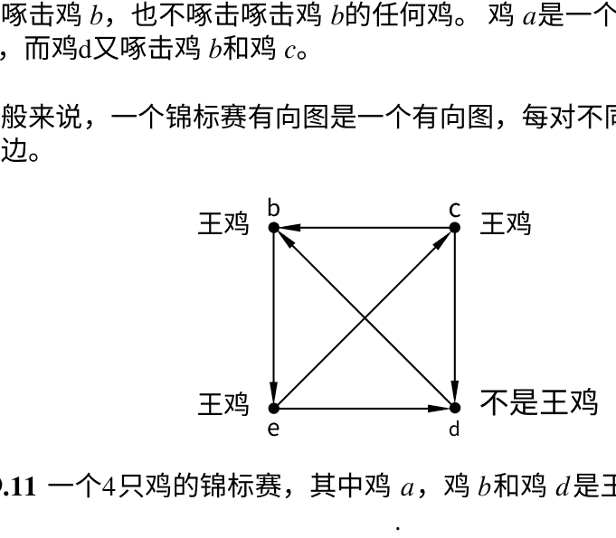

图9.11 一个4只鸡的锦标赛，其中鸡 $a$，鸡 $b$ 和鸡 $d$ 是王鸡。

- (a) 定义一个有10只鸡的锦标赛图，其中有一只出度为1的王鸡。
- (b) 描述一个5只鸡的锦标赛图，其中每个选手都是国王。
- (c) 证明

> 定理 (国王鸡定理). 在一个 $n$ 只鸡的锦标赛中，出度最大的鸡是国王。

国王鸡定理意味着，如果拥有最多胜利的选手被另一个选手 $x$ 打败，那么至少他/她会打败一些第三个选手，而这些选手又打败了 $x$。从这个意义上说，拥有最多胜利的选手对其他每个选手都有某种吹嘘的权利。不幸的是，正如图9.11所示，可能会有许多其他具有这种吹嘘权利的选手，甚至有些选手的胜利次数更少。

## 第9.5节的问题

### 练习题

问题9.12. 在任何部分有序集合中，最长链的大小是多少？ 最大的反链呢？

### 问题9.13。

让 $\{A, ..., H\}$ 成为我们必须完成的任务集合。下面的有向无环图描述了哪些任务必须在其他任务之前完成，如果从 $a$ 到 $b$ 有一条箭头，则表示必须在 $b$ 之前完成 $a$。

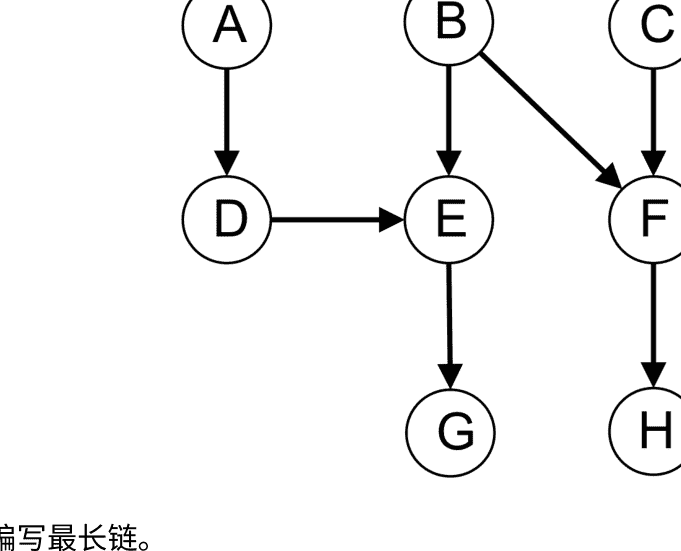

- (a) 编写最长链。
- (b) 编写最长反链。
- (c) 如果我们允许并行调度，并且每个任务需要1分钟完成，完成所有任务所需的最短时间是多少？

### 问题9.14。

描述一个由1到10,000的整数组成的序列，使得没有大小为101的递增或递减子序列。

### 问题9.15。

对于哪些部分有序任务，如果有无限数量的处理器，可能会有多个最小时间调度？解释你的答案。

### 课堂问题

### 问题9.16。

下表列出了MIT一些学科的先修课程信息。

## 9.11. 关系性质总结

计算机科学专业（于2006年）这定义了一种间接的先决关系，它是一个以这些科目为顶点的有向无环图（DAG）。

```
18.01 → 6.042            18.01 → 18.02
18.01 → 18.03            6.046 → 6.840
8.01 → 8.02              6.001 → 6.034
6.042 → 6.046            18.03, 8.02 → 6.002
6.001, 6.002 → 6.003     6.001, 6.002 → 6.004
6.004 → 6.033            6.033 → 6.857
```

(a) 如果你每学期可以选修任意多门科目，解释为什么需要恰好六个学期才能完成所有这些科目。使用贪心的科目选择策略，你应该每学期尽可能多地选修科目。使用贪心策略，展示你每学期的完整课程安排。

(b) 在贪心策略的第二个学期，你选修了包括18.03在内的五门科目。找出一组不包括18.03的五门科目，使得在任何一个学期内都可以选修它们（使用非贪心的安排）。你能计算出有多少这样的组合吗？

(c) 展示一个按照课程安排的时间表，但每学期只能选一门课。

(d) 假设你想修完所有科目，但每学期只能修两门。需要多少学期才能毕业？请解释原因。需要多少学期才能毕业？请解释原因。

(e) 如果你每学期能修三门课，会怎样呢？

### 问题9.17。

一对计算机科学教学助理，丽莎和安妮，决定利用他们这学期的空闲时间来征服整个银河系。鉴于这是一个雄心勃勃的项目，他们在安妮的讲义背面制定了以下任务表。

- 1. 设计一个标志和酷炫的帝国主题音乐 - 8天。
- 2. 用从洛布德尔偷来的餐具制造一支超光速星际驱逐舰舰队 - 18天。
- 3. 掌控联合国 - 在任务#1之后的9天。
- 4. 为丽莎的猫Tailspin打疫苗 - 在任务#1之后的11天。
- 5. 为军队开设一家星巴克连锁店以供他们获取咖啡因 - 在任务#3之后的10天。
- 6. 通过多次观看《幽灵危机》来训练一支精英星际战士的军队 - 在任务#3、#4和#5之后的4天。
- 7. 发射星际驱逐舰舰队，粉碎所有有感知能力的外星物种，并建立一个银河帝国 - 在任务#2和#6之后的6天。
- 8. 击败微软 - 在任务#2和#6之后的8天。

我们通过在图9.12中为每个任务绘制一个点，并用任务的名称和权重标记它来展示这些信息。 两个点之间的边表示较高点的任务必须在开始较低点的任务之前完成。

图9.12 表示任务先决约束的图形。

(a) 给出一些可能完成任务的有效顺序。

丽莎和安妮希望以最短的时间完成所有这些任务。然而，他们已经就一些限制性工作规则达成了一致。

- 只能指派一个人来完成特定的任务；他们不能在同一个任务上一起工作。
- 一旦一个人被指派到一个任务，他必须专心地工作直到任务完成。 因此，例如，丽莎不能在几天内同时工作于建造舰队、为Tailspin接种疫苗，然后再返回建造舰队。

(b) 丽莎和安妮想知道征服银河需要多长时间。 安妮建议将工作总天数除以工人人数，即两天。这给出了征服银河所需时间的下界，为什么实际所需时间可能更长？

(c) 丽莎提出了一种不同的确定项目持续时间的方法。她建议查看关键路径的持续时间，即最耗时的任务序列，每个任务依赖于前一个任务。 这给出了什么下界，为什么它可能也太低？

(d) 丽莎和安妮征服银河需要多少天？不需要证明。

## 作业问题

### 问题9.18。

以下操作可应用于任何有向图 \(G\)：

- 1. 删除一个在循环中的边。
- 2. 如果从顶点\(u\)到顶点\(v\)存在一条不包括边\(<u \to v>\)的路径，则删除边\(<u \to v>\)。
- 3. 如果顶点\(u\)和顶点\(v\)之间没有路径，则添加边\(<u \to v>\)。

重复这些操作直到没有一个操作适用的过程可以被建模为一个状态机。 起始状态是 \(G\)，状态是所有可能的具有与 \(G\)相同顶点的有向图。

(a) 假设 \(G\)是具有顶点 \(\{1, 2, 3, 4\}\)和边的图
\[ \{<1\to2>,<2\to3>,<3\to4>,<3\to2>,<1\to4>\} \]
从 \(G\)可以到达的可能最终状态是什么？
线图是一种所有边都在一条路径上的图。 在(a)部分中，所有最终的图都是线图。

(b) 证明如果过程以一个有向图 H 终止，则 H 是具有与 G 相同顶点的线图。

提示：证明如果 H 不是一个线图，则必须适用某种操作。

(c) 证明成为有向无环图是该过程的保持不变量。

(d) 证明如果 G 是一个有向无环图且该过程终止，则最终线图的行走关系是 G 的拓扑排序。提示：验证谓词
$$P(u, v) ::= 存在一条从 u 到 v 的有向路径$$
是该过程的保持不变量，对于任意两个DAG的顶点u, v。

(e) 证明如果 G 是有限的，则该过程终止。
提示：令s为循环的数量，e为边的数量，p为具有有向路径（无论方向）的顶点对的数量。注意这里 $p \leq n^2$ 其中 n 是 G 的顶点数量。找到系数a, b, c使得 $as + bp + e + c$ 是非负整数值且在每个转换中递减。

### 问题 9.19.

设 $\geq$ 是集合 A 上的严格偏序关系，且
$$A_k ::= \{a \mid depth(a) = k\}$$
其中 k 为自然数。

- (a) 证明根据定义 9.5.7，$A_0, A_1, \ldots$ 是 $\geq$ 的并行调度。
- (b) 证明 $A_k$ 是一个反链。

### 问题 9.20.

我们想要根据有向无环图中的任务之间的先决条件来安排 n 个任务。

(a) 解释为什么只需要 p 个处理器的任何调度都需要至少 $\lceil n/p \rceil$ 的时间。

(b) 设 $D_{n,t}$ 是由 t 个元素组成的链状图，链的底部元素是所有其他元素的先决条件，如下图所示：

什么是 $D_{n,t}$ 的最短时间安排？解释为什么它是独特的。需要多少个处理器？

- (c) 写一个简单的公式，$M(n, t, p)$，用于完成 $D_{n,t}$ 的最小时间的 $p$ 处理器安排。
- (d) 证明每个具有 $t$ 个顶点和最大链大小的偏序关系都有一个在时间 $M(n, t, p)$ 内运行的 $p$ 处理器安排。

提示：使用 $t$ 的归纳法。

## 第9.6节的问题

## 练习题

### 问题9.21。

在这个DAG (图9.13) 中，对于 $\{1, . . . , 12\}$ 上的可除性关系，从 $a$ 到 $b$ 存在一个向上的路径当且仅当 $a|b$。如果添加了24作为一个顶点，那么必须添加的最小边数是多少，以表示 $\{1, . . . , 12, 24\}$ 上的可除性？这些边是什么？

- 问题9.22. (a) 为什么每个严格的偏序都是有向无环图(DAG)?
- (b) 给出一个不是严格偏序的有向无环图(DAG)的例子。
- (c) 为什么有向无环图(DAG)的正向行走关系是严格偏序？

## 课堂问题

- 问题9.23. (a) 在空关系下，幂集 pow({1, ..., n})的最大和最小元素是什么，如果有的话，其中n是一个正整数？
- (b) 在整除关系下，所有非负整数集合 N 的最大和最小元素是什么，如果有的话？是否存在最小或最大元素？
- (c) 在整除关系下，大于1的整数集合的最小和最大元素是什么，如果有的话？
- (d) 描述一个没有最小或最大元素的偏序集合。
- (e) 描述一个具有唯一最小元素但没有最小元素的偏序集。提示：它必须是无限的。

- 问题9.24. 子集关系 ⊂ 在 [1..6]的子集上定义了严格的偏序关系，即在pow([1..6])上定义了严格的偏序关系。
- (a) 在这个偏序关系中，最大链的大小是多少？描述一个。
- (b) 描述你能在这个偏序关系中找到的最大反链。
- (c) 什么是最大和最小元素？它们是最大和最小的吗？
- (d) 回答上一个部分关于集合pow[1..6]上的 ⊂ 偏序关系的问题；

### 问题9.25.
如果a和b是有向图的不同节点，则a被称为覆盖b，如果存在从a到b的边，并且从a到b的每条路径都包括这条边。如果a覆盖b，则从a到b的边称为覆盖边。

- (a) 在图9.14中的DAG中，有哪些覆盖边？
- (b) 令覆盖(D)为只包含覆盖边的子图 D。假设 D是一个有限的DAG。解释为什么覆盖(D)与 D具有相同的正向行走关系。提示：考虑两个顶点之间的最长路径。
- (c) 证明如果两个DAG具有相同的正向行走关系，则它们具有相同的覆盖边集合。
- (d) 得出结论，覆盖(D)是具有与 D相同正向行走关系的所有有向图中边数最小的唯一DAG。以下示例显示上述结果在具有循环的有向图中通常不适用。
- (e) 描述两个具有顶点 {1, 2}的图，它们具有相同的覆盖边集合，但不具有相同的正向行走关系（提示：自环）。
- (f) (i) 不带自环的完全有向图的顶点为1, 2, 3，其边连接了任意两个不同的顶点。它的覆盖边是什么？
- (ii) 具有顶点1, 2, 3和边 ⟨1→2⟩, ⟨2→3⟩, ⟨3→1⟩的图的覆盖边是什么？
- (iii) 它们的正向行走关系是什么？

## 第9.6节的问题

## 作业问题

### 问题 9.26.
证明如果R是集合A上的传递二元关系，则R = R^+。

## 课堂问题

### 问题 9.27.
设R是集合D上的二元关系。下面的等式和包含关系表达了R具有基本关系性质之一：自反性，非自反的，对称的，非对称的，反对称的，传递的。确定每个公式表示的属性，并解释你的推理。

(a) $R \cap \mathrm{Id}_D = \varnothing$

(b) $R \subseteq R^{-1}$

(c) $R = R^{-1}$

(d) $\mathrm{Id}_D \subseteq R$

(e) $R \circ R \subseteq R$

(f) $R \cap R^{-1} = \varnothing$

(g) $R \cap R^{-1} \subseteq \mathrm{Id}_D$

## 第9.7节的问题

## 课堂问题

### 问题9.28.

| 直接先决条件 | 主题 |
| :--- | :--- |
| 18.01 | 6.042 |
| 18.01 | 18.02 |
| 18.01 | 18.03 |
| 8.01 | 8.02 |
| 8.01 | 6.01 |
| 6.042 | 6.046 |
| 18.02, 18.03, 8.02, 6.01 | 6.02 |
| 6.01, 6.042 | 6.006 |
| 6.01 | 6.034 |
| 6.02 | 6.004 |

(a) 对于上述MIT主题先决条件表，绘制一个图表，显示每个主题从其（直接先决条件）下降的线。

(b) 给出一个由适当子集关系部分排序的集合集合的例子，该集合与（a）部分中的MIT主题的先决条件关系同构（“形状相同”）。

(c) 解释为什么空关系是一个严格的偏序关系，并描述一个由真子集关系部分有序的集合的集合，这个集合同构于五个元素上的空关系，即没有任何五个元素相关的关系。

(d) 描述一个由真子集关系部分有序的简单集合的集合，这个集合同构于“包含”关系，⊃，对于pow{1, 2, 3, 4}。

### 问题9.29.
这个问题要求证明引理9.7.2，证明每个弱偏序关系都可以通过集合包含关系（⊆）来表示（同构于）一个集合的集合。

引理。对于集合 A 上的弱偏序关系 ≥。对于任意元素 a ∈ A，令

```
L(a) ::= {b ∈ A | b ≥ a},
L ::= {L(a) | a ∈ A}.
```

那么函数 L(): A → L 是从集合 A 上的关系到集合 L 上的子集关系的同构。

- (a) 证明函数L(): A → L是一个双射。
- (b) 通过展示以下内容来完成证明：
    $$ a \ge b \text{ 当且仅当 } L(a) \subseteq L(b) \quad (9.14) $$
    对于所有a, b ∈ A.

## 作业问题

### 问题9.30.
每个偏序关系都可以同构于集合之间的子集关系（见第9.7节）。特别地，如果 R是集合 A上的严格偏序关系，且 a ∈ A，则定义

$$ L(a) := \{a\} \cup \{x \in A \mid x R a\} \quad (9.15) $$

然后

$$ a R b \text{ 当且仅当 } L(a) \subset L(b) \quad (9.16) $$

对于所有的a, b ∈ A成立.

- (a) 仔细证明命题(9.16)，从严格偏序和严格子集关系的定义开始， $\subset$.
- (b) 证明如果 L(a) = L(b)那么 a = b.
- (c) 给出一个例子，说明如果在等式(9.15)中省略了表达式“{a}∪”，则部分(b)的结论不成立。

## 第9.8节的问题

## 练习题

### 问题9.31.
对于下面的二元关系，说明它是严格偏序、弱偏序还是都不是. 如果它不是偏序，指出它违反了哪个偏序公理.

- (a) 幂集上的超集关系， $\supseteq$ 在幂集pow {1, 2, 3, 4, 5}上。
- (b) 任意两个非负整数之间的关系， a, b满足a ≡ b (mod 8)。
- (c) 命题公式之间的关系， G, H满足G IMPLIES H是有效的。
- (d) 对于“石头、剪刀、布”游戏中的“击败”关系（对于不了解“石头、剪刀、布”游戏的人来说：石头击败剪刀，剪刀击败布，布击败石头）。
- (e) 实数集上的空关系。
- (f) 整数集上的恒等关系。

### 问题9.32.
(a) 验证非负整数集上的整除关系是一个弱偏序关系。
(b) 整数集上的整除关系如何？

### 问题9.33.
直接从定义证明（不依赖于DAG属性），如果集合A上的二元关系R是传递的和非自反的，则它是反对称的。

## 课堂问题

### 问题9.34.
证明非负整数集在除法关系下是偏序的。
- (a) ... 有最小元素。
- (b) ... 有最大元素。
- (c) ... 有无限链。
- (d) ... 有无限反链。
- (e) 大于1的整数上的除法的最小元素是什么？最大元素是什么？

### 问题9.35.
集合 {0, 1} 上有多少个二元关系？有多少个是传递的？... 反对称的？... 自反的？... 非自反的？... 严格偏序？... 弱偏序？提示：找到这些数字的更简单方法，而不是列出所有的关系并检查每个关系的属性。

## 问题9.36.
证明如果 $R$ 是一个偏序关系，那么 $R^{-1}$ 也是一个偏序关系。

## 问题9.37.
指出下面的关系中哪些是等价关系（E），严格偏序关系（St），弱偏序关系（W）。对于偏序关系，还要指出是否是线性的（L）。

如果一个关系不属于上述任何一种，指出它是否是传递的（T），对称的（Sym），非对称的（A）。

- (a) 整数之间的关系 $a = b + 1$，其中 $a, b,$
- (b) 整数的幂集上的超集关系 $\supseteq$。
- (c) 实值随机变量 $R, S$之间的关系 $\text{Ex}[R] < \text{Ex}[S]$。
- (d) 实值随机变量 $R, S$之间的关系 $\text{Pr}[R = S] = 1$。
- (e) 有理数集上的空关系。
- (f) 整数集上的恒等关系 $\text{Id}_{\mathbb{Z}}$。
- (g) 非负整数集上的整除关系, $\mathbb{N}$。
- (h) 整数集上的整除关系, $\mathbb{Z}$。
- (i) 4的正幂集上的整除关系。
- (j) 非负整数集上的互质关系。
- (k) 实值函数, $f(x)$上的小于关系 $<$, 形式为 $f(x) = ax + b$的常数$a, b \in \mathbb{R}$的关系。
- (l) 整数集上的“具有相同质因数”关系。
对于接下来的部分，让 $f, g$是从整数到实数的非负函数。
- (m) “大O”关系, $f = O(g)$。
- (n) “小o”关系, $f \text{从}= \text{到} g)$。
- (o) “渐近相等”关系, $f \sim g$。

### 问题9.38.
在一个\(n\)人循环赛中，每对不同的选手进行一场比赛。假设每场比赛都有一个获胜者，没有平局。这样的比赛结果可以用一个比赛有向图表示，其中顶点对应于选手，如果\(x\)在他们的比赛中击败了\(y\)，则有一条从\(x\)到\(y\)的边。

(a) 解释为什么比赛有向图不能有长度为一或两的循环。

(b) 比赛图的“击败”关系总是/有时/从不：
- 对称的？
- 自反的？
- 非自反的？
- 传递的？
解释。

(c) 证明一个锦标赛图是一个线性序列当且仅当没有长度为三的循环。

## 作业问题

### 问题9.39.
设 \(R\) 和 \(S\) 是作用于同一集合 \(A\) 的传递二元关系。以下哪个新关系也必须是传递的？对于每个部分，如果新关系是传递的，请用简要的论证来证明你的答案；如果不是，请举一个反例。

- (a) \(R^{-1}\)
- (b) \(R \cap S\)
- (c) \(R \circ R\)
- (d) \(R \circ S\)

## 考试问题

### 问题9.40.
假设对一组32个单位时间任务的优先约束与幂集pow({1, 2, 3, 4, 5})在严格子集关系下，是同构的。例如，与集合 {2, 4} 对应的任务必须在与集合 {1, 2, 4} 对应的任务之前完成，因为 {2, 4} ⊂ {1, 2, 4}；该任务对应于空集的任务必须首先安排，因为 $\emptyset \subset S$ 对于每个非空集合 $S \subseteq \{1, 2, 3, 4, 5\}$。

- (a) 完成这些任务的最小并行时间是多少？
- (b) 描述这个偏序集中的最大大小反链。
- (c) 简要解释为什么完成这些任务所需的最小并行时间的处理器数量等于最大反链的大小。

## 第9.9节的问题

## 课堂问题

问题 9.41。
设 $R1$, $R2$ 是作用于同一集合 $A$ 的二元关系。如果 $R1$ 和 $R2$ 都具有某个性质，那么该性质在乘积下是保持不变的，即 $R1 \times R2$ 具有该性质。

- (a) 验证以下每个性质在乘积下是否保持不变。
  1. 自反性,
  2. 反对称性,
  3. 传递性.
- (b) 验证如果 $R1$ 或 $R2$ 中的任意一个是非自反的，则 $R1 \times R2$ 也是非自反的。

注意，现在可以立即得出结论，如果 $R1$ 和 $R2$ 是偏序关系，并且至少其中一个是严格的，则 $R1 \times R2$ 是严格偏序关系。

问题 9.42.
对于集合 $A$ 上的偏序关系，当 $A$ 的每个非空子集都有一个最小元素时，它被称为良序的。例如，实数的良序集合上的小于关系（参见 2.4）是一个良序的线性关系。

证明如果 $R$ 和 $S$ 是良序的偏序关系，那么它们的乘积 $R \times S$ 也是良序的。

## 作业问题

问题 9.43.
设 $S$ 是一个包含不同数字的序列。$S$ 的一个子序列是通过删除 $S$ 的元素得到的序列。

例如，如果
$$S = (6, 4, 7, 9, 1, 2, 5, 3, 8)$$
那么 647 和 7253 都是 $S$ 的子序列（为了方便阅读，我们省略了序列中的括号和逗号，所以 647 代表 $(6, 4, 7)$，例如）。

$S$ 的一个递增子序列是其连续元素逐渐变大的子序列。例如，1238 是 $S$ 的一个递增子序列。递减子序列的定义类似；641 是 $S$ 的一个递减子序列。
- (a) 列出 $S$ 的所有最长递增子序列和最长递减子序列。

现在，设 $A$ 是 $S$ 中的数字集合。（对于上面的例子，$A$ 是整数 $[1..9]$。） $A$ 有两种直观的线性排序方式。第一种是按数字顺序排序 $A$，使用 $<$ 关系。第二种是按照在 $S$ 中出现的顺序排序元素，称为 $<_{s}$ 的顺序。所以对于上面的例子，我们会有
$$6 <_{s} 4 <_{s} 7 <_{s} 9 <_{s} 1 <_{s} 2 <_{s} 5 <_{s} 3 <_{s} 8$$
令 $\succeq$ 为线性顺序 $<_{s}$ 和 $<$ 的乘积关系。也就是说，$\succeq$ 由以下规则定义
$$a \succeq a' \quad ::= \quad a < a' \; \text{AND} \; a <_{s} a'.$$
因此，$\succeq$ 是 $A$ 上的偏序关系（第 9.9 节）。

- (b) 在 $A$ 上绘制偏序关系 $\succeq$ 的图。最大和最小元素是什么？
- (c) 解释 $S$ 的递增和递减子序列与 $\succeq$ 下的链和反链之间的关系。
- (d) 证明长度为 $n$ 的每个序列 $S$ 都有长度大于 $\sqrt{n}$ 的递增子序列或长度至少为 $\sqrt{n}$ 的递减子序列。
- (e)（可选，棘手）为在任何给定的整数序列中找到最长递增和最长递减子序列设计一个高效的过程。
（有一个很好的。）

## 第9.10节的问题

练习题

问题 9.44.
对于以下每个关系，确定它是否是自反的，是否是对称的，是否是传递的，以及是否是等价关系。

- (a) $\{(a, b) \mid a \text{ 和 } b \text{ 年龄相同 }\}$
- (b) $\{(a, b) \mid a \text{ 和 } b \text{ 有相同的父母 }\}$
- (c) $\{(a, b) \mid a \text{ 和 } b \text{ 说同一种语言}\}$

## 问题 9.45.

对于下面的二元关系，说明它是严格偏序、弱偏序、等价关系还是这些都不是。如果它是偏序，说明它是否是线性序。如果它是这些都不是，则指出它违反了偏序和等价关系的哪些公理。

- (a) 幂集上的超集关系 $\supseteq$ 在幂集 $\text{pow} \{1, 2, 3, 4, 5\}$ 上。
- (b) 任意两个非负整数 $a$ 和 $b$ 之间的关系，使得 $a \equiv b \pmod{8}$。
- (c) 命题公式 $G$ 和 $H$ 之间的关系，使得 $[G \text{ IMPLIES } H]$ 成立。
- (d) 命题公式 $G$ 和 $H$ 之间的关系，使得 $[G \text{ IFF } H]$ 成立。
- (e) 在石头、剪刀和布上的‘击败’关系（对于那些不了解石头、剪刀、布游戏的人，石头击败剪刀，剪刀击败布，布击败石头）。
- (f) 实数集上的空关系。
- (g) 整数集上的恒等关系。
- (h) 整数集上的整除关系，$\mathbb{Z}$。

## 课堂问题

## 问题 9.46.

证明定理 9.10.4：等价关系的等价类构成了域的一个划分。

也就是说，设 $R$ 是集合 $A$ 上的一个等价关系，定义元素 $a \in A$ 的等价类为

$$[a]_R ::= \{b \in A \mid a R b\}.$$

也就是说，$[a]_R = R(a)$.

- (a) 证明每个块都是非空的，并且 $A$ 的每个元素都属于某个块。
- (b) 证明如果 $[a]_R \cap [b]_R \neq \emptyset$，则 $a R b$。得出结论，集合 $[a]_R$ 对于 $a \in A$ 是 $A$ 的一个划分。
- (c) 证明 $a R b$ 当且仅当 $[a]_R = [b]_R$。

## 问题 9.47.

对于任何全函数 $f : A \rightarrow B$，根据规则定义一个关系 $\equiv_f$:

$$a \equiv_f a' \quad \text{当且仅当} \quad f(a) = f(a') : (9.17)$$

- (a) 观察（并证明）$\equiv_f$ 是 $A$ 上的等价关系。
- (b) 证明对于集合 $A$ 上的每个等价关系 $R$，都等于函数 $f : A \rightarrow \text{pow}(A)$ 的 $\equiv_f$ 。
$$f(a) ::= \{a' \in A \mid a R a'\}.$$
也就是说，$f(a) = R(a)$.

## 问题 9.48.

设 $R$ 是集合 $D$ 上的二元关系。以下每个公式都表达了 $R$ 具有熟悉的关系特性，如自反性、非对称性、传递性。谓词公式用罗马数字 i、ii、... 表示。而关系公式（等式和包含关系）用字母标记 (a)、(b)、...。

在每个关系公式旁边，写出与之等价的所有谓词公式的罗马数字。不需要给出表达的属性名称，但如果给出了部分分数也是可以的。例如，部分 (a) 标记为“i”。它表示了非自反性。

- i. $\forall d. \neg (d R d )$
- ii. $\forall d. d R d$
- iii. $\forall c, d. c R d \text{ 当且仅当 } d R c$
- iv. $\forall c, d. c R d \text{ 蕴含 } d R c$
- v. $\forall c, d. c R d \text{ 蕴含 } \neg (d R c)$
- vi. $\forall c \neq d. \quad c R d \text{ 蕴含 } \neg (d R c)$
- vii. $\forall c \neq d. \quad c R d \text{ 当且仅当 } \neg (d R c)$
- viii. $\forall b, c, d. \quad (b R c \text{ AND } c R d ) \text{ IMPLIES } b R d$
- ix. $\forall b, d. \quad [\exists c. (b R c \text{ AND } c R d )] \text{ IMPLIES } b R d$
- x. $\forall b, d. \quad b R d \text{ IMPLIES } [\exists c. (b R c \text{ AND } c R d )]$

- (a) $R \cap \text{Id}_D = \emptyset$
- (b) $R \subseteq R^{-1}$
- (c) $R = R^{-1}$
- (d) $\text{Id}_D \subseteq R$
- (e) $R \circ R \subseteq R$
- (f) $R \subseteq R \circ R$
- (g) $R \cap R^{-1} \subseteq \text{Id}_D$
- (h) $\overline{R} \subseteq R^{-1}$
- (i) $\overline{R} \cap \text{Id}_D = R^{-1} \cap \text{Id}_D$
- (j) $R \cap R^{-1} = \emptyset$

## 作业问题

## 问题 9.49.

令 $R_1$ 和 $R_2$ 在一个集合 $A$ 上有两个等价关系。证明或者给出反例来说明以下也是等价关系的说法:

- (a) $R_1 \cap R_2$.
- (b) $R_1 \cup R_2$.

## 问题 9.50.

证明对于任何非空集合 $D$，存在唯一的二元关系在 $D$ 上既是弱偏序又是等价关系。

## 考试题目

问题 9.51.
指出以下关系中哪些是等价关系（**E**），严格偏序（**S**），弱偏序（**W**）。
对于偏序关系，还要指出是否是线性的（**T**）。

如果一个关系不属于上述任何一种，指出是否是传递的（**Tr**），对称的（**Sym**），非对称的（**Asym**）。

- (a) 整数之间的关系 $a = b + 1$，其中 $a, b$，
- (b) 整数的幂集上的超集关系 $\supseteq$。
- (c) 有理数集上的空关系。
- (d) 非负整数上的整除关系。
- (e) 整数上的整除关系。
- (f) 4的正幂上的整除关系。
- (g) 非负整数上的互质关系。
- (h) 实值函数 $f (x)$ 的小于关系 $<$, 形式为 $f (x) = ax + b$, 其中 $a, b \in \mathbb{R}$。
- (i) 整数上的“具有相同质因数”关系。

# 10 通信网络

在计算机科学中，建模通信网络是一个重要的应用。在这样的模型中，顶点表示计算机、处理器和交换机；边表示数据流经过的电线、光纤或其他传输线路。对于一些通信网络，比如互联网，相应的图非常庞大且混乱。相比之下，高度结构化的网络在电话交换系统和并行计算机的通信硬件中找到应用。在本章中，我们将介绍一些最好和最常用的结构化网络。

## 10.1 完全二叉树

让我们从一个完全二叉树开始。这是一个具有4个输入和4个输出的示例。我们考虑的通信网络旨在在计算机、处理器、电话或其他设备之间传输数据包。术语数据包指的是大约固定大小的数据量——256字节或4096字节或其他大小。在这个图表和许多后续图表中，方块表示终端，数据包的源和目的地。圆圈表示交换机，它们通过网络传输数据包。交换机在传入边上接收数据包，并沿着传出边向前中继它们。因此，你可以想象一个数据包从输入终端通过一系列通过有向边连接的交换机，到达输出终端。

回想一下，在树中，每对顶点之间都有一条唯一的路径。因此，在完全二叉树中，将数据包从输入终端路由到输出终端的自然方式是沿着相应的有向路径。例如，从输入1到输出3的数据包路径以粗体显示。

## 10.2 路由问题

通信网络的目标是将数据包从输入传输到输出，每个数据包在网络中通过自己的输入交换机进入，并到达自己的输出交换机。我们将考虑几种不同的通信网络设计，每个网络都有 $N$ 个输入和 $N$ 个输出；为了方便起见，我们将假设 $N$ 是2的幂。
哪个输入应该放在哪里由一个排列 $\{0, 1, ..., N−1\}$ 来指定。因此，一个排列 $\pi$ 定义了一个路由问题：将从输入 $i$ 开始的数据包传输到输出 $\pi(i)$。解决路由问题 $\pi$ 的一个路由 $P$ 是从每个输入到其指定输出的一组路径。也就是说，$P$ 是一组路径 $P_i$，其中每个路径 $P_i$ 从输入 $i$ 到输出 $\pi(i)$。

## 10.3 网络直径

在通信网络中，数据包从输入到达目标输出的延迟是一个关键问题。一般来说，这个延迟与数据包所经过的路径长度成正比。假设数据包在电线上传输需要一个时间单位，那么数据包的延迟将是它从输入到输出所经过的电线数量。

数据包通常通过最短路径从输入到输出进行路由。
在最短路径路由中，最坏情况下的延迟是输入和输出之间最远距离。这被称为网络的直径。换句话说，网络的直径是任意最短路径的最大长度。

在一般图（简单或有向）的常规定义中，直径是任意两个顶点之间的最大距离，但在通信网络的上下文中，我们只关心输入和输出之间的距离，而不是任意顶点对之间的距离。

输入和输出之间的路径。例如，在上面的完全二叉树中，从输入1到输出3的距离是六。没有任何输入和输出的距离比这更远，因此这棵树的直径也是六。

更广泛地说，具有 $N$ 个输入和输出的完全二叉树的直径是 $2\log N+2$。这非常好，因为对数函数增长非常缓慢。我们可以使用完全二叉树连接 $2^{10} = 1024$ 个输入和输出，任何数据包的最坏输入-输出延迟将为 $2\log(2^{10}) + 2 = 22$。

### 10.3.1 开关大小

减小网络直径的一种方法是使用更大的开关。例如，在完全二叉树中，大多数开关有三个入边和三个出边，这使它们成为 $3 \times 3$ 开关。如果我们有 $4 \times 4$ 开关，那么我们可以构建一个直径更小的完全三叉树。原则上，我们甚至可以通过一个巨大的 $N \times N$ 开关连接所有的输入和输出。

然而，这并不是很有效率。使用一个 $N \times N$ 开关只会隐藏在这个抽象开关中的原始网络设计问题。最终，我们将不得不使用更简单的组件来设计这个巨型开关的内部，然后我们又回到了起点。因此，在设计通信网络时的挑战在于找出如何使用固定大小的基本设备（如 $3 \times 3$ 开关）来实现一个 $N \times N$ 开关的功能。

## 10.4 开关数量

设计通信网络的另一个目标是尽量少使用开关。完全二叉树中的开关数量是 $1+2+4+8+⋯+N$，因为顶部有1个开关（“根开关”），下面有2个开关，再下面有4个开关，依此类推。根据问题 5.4 中的等比数列求和公式，

$$\sum_{i=0}^{n} r^{i} = \frac{r^{n+1} - 1}{r - 1}$$

开关的总数为 $2N − 1$，这几乎是最佳的选择 $3 \times 3$ 开关。

## 10.5 网络延迟

有时候我们会选择通过网络的路由来优化除了延迟之外的一些量。例如，在下一节中，我们将尝试最小化数据包拥塞。当我们不是在最小化延迟时，最短的路由并不总是最好的，而且一般来说，数据包的延迟取决于它的路由方式。

对于任何一种路由，最延迟的数据包将是沿着路由中最长路径的那个。路由中最长路径的长度被称为它的延迟。网络的延迟取决于正在优化的内容。它是通过假设在将输入传送到指定的输出时总是选择最优路由来测量的。也就是说，对于每个路由问题 $\pi$，我们选择一个解决 $\pi$ 的最优路由。然后，网络延迟被定义为这些最优路由中的最大路由延迟。如果路由总是被选择来优化延迟，那么网络延迟将等于网络直径，但如果路由被选择来优化其他内容，它可能会显著增加。

对于我们下面考虑的网络，从输入到输出的路径是唯一确定的（在树的情况下）或者所有路径长度相同，因此网络延迟将始终等于网络直径。

## 10.6 拥塞

完全二叉树有一个致命的缺点：根交换机是一个瓶颈。在最好的情况下，这个交换机必须处理右边的数据，反之亦然。通过一个交换机传递所有这些数据包可能需要很长时间。在最坏的情况下，如果这个交换机出现故障，网络将被分成两个大小相等的部分。

事实上，如果路由问题由恒等排列给出，即 $\pi(i)::=i$，则存在一个简单的路由 $P$ 来解决问题：让 $P_i$ 是从输入 $i$ 通过一个交换机再返回到输出 $i$ 的路径。另一方面，如果问题由 $\pi(i)::=(N-1)-i$ 给出，则在任何解 $Q$ 中，对于 $\pi$，每个从输入 $i$ 开始的路径 $Q_i$ 必须最终完全通过根交换机并返回到输出 $(N-1)-i$。下面分别给出了这两种情况的示例。我们可以根据拥塞情况区分“好”的路径集和“坏”的路径集。路由 $P$ 的拥塞等于通过单个交换机的路径数的最大值。例如，左侧路由的拥塞为1，因为最多只有1条路径通过每个交换机。然而，右侧路由的拥塞为4，因为有4条路径通过根交换机。

开关（以及根节点下方的两个开关）。一般来说，较低的拥塞是更好的，因为在过载的开关上可能会延迟数据包。

通过将拥塞的概念扩展到网络，我们还可以区分“好”的和“坏”的网络与瓶颈问题有关。对于网络的每个路由问题，$\pi$，我们假设选择了一种优化拥塞的路由，即在解决 $\pi$ 的所有路由中具有最小拥塞的路由。然后，开关将遭受的最大拥塞将是这些最优路由中的最大拥塞。这种“最大最小”拥塞被称为网络的拥塞。

因此，对于完全二叉树，最坏的排列将是 $\pi(i) ::= (N - 1) - i$。然后，在 $\pi$ 的每个可能的解决方案中，每个数据包都必须经过根开关的路径。因此，完全二叉树的最大拥塞是 $N$ - 这是可怕的！让我们总结一下我们迄今为止的分析结果：

| 网络 | 直径 | 交换机大小 | # 交换机 | 拥塞 |
| :--- | :--- | :--- | :--- | :--- |
| 完全二叉树 | $2\log N + 2$ | $3 \times 3$ | $2N - 1$ | $N$ |

## 10.7 2维数组

让我们看看另一个通信网络。这个被称为2维数组或网格。

这里有四个输入和四个输出，所以 $N = 4$。

在这个例子中，直径为8，即输入0和输出3之间的边的数量。更一般地，具有 $N$ 个输入和输出的数组的直径为 $2N$，这比完全二叉树中的 $2\log N + 2$ 的直径要糟糕得多。但我们得到了一些交换：用一个数组替换完全二叉树几乎消除了拥塞。

> 定理 10.7.1. $N$ 输入数组的拥塞为2。

证明。首先，我们证明拥塞最多为2。设 $\pi$ 为任意排列。定义一个解决方案，$P$，对于 $\pi$ 来说是指路径的集合，$P_i$，其中 $P_i$ 从输入 $i$ 向右移动到列 $\pi(i)$，然后向下移动到输出 $\pi(i)$。因此，在第 $i$ 行和第 $j$ 列的交换机最多传输两个数据包：源自输入 $i$ 的数据包和目标为输出 $j$ 的数据包。

接下来，我们证明拥塞最少为2。这是因为在任何路由问题 $\pi$ 中，其中 $\pi(0) = 0$ 和 $\pi(N – 1) = N – 1$，两个数据包必须通过左下交换机。 $\blacksquare$

与树一样，当最小化拥塞时，网络延迟与直径相同。这是因为给定输入和输出之间的所有路径长度相同。

现在我们可以记录2-D数组的特征。

| 网络 | 直径 | 交换机大小 | # 交换机 | 拥塞 |
|---|---|---|---|---|
| 完全二叉树 | $2\log N + 2$ | $3 \times 3$ | $2N – 1$ | $N$ |
| 2-D数组 | $2N$ | $2 \times 2$ | $N^2$ | $2$ |

这里的关键是开关的数量，即 $N^2$。这是2-D数组的一个主要缺陷；一个大小为 $N = 1000$ 的网络将需要一百万个开关！然而，对于 $N$ 较小的应用，数组的简单性和低拥塞使其成为一个有吸引力的选择。

## 10.8 蝴蝶

交换网络的圣杯将结合完全二叉树（直径小，开关少）和数组（拥塞低）的最佳特性。蝴蝶是两者之间广泛使用的折衷方案。

理解蝴蝶网络的一个好方法是将其视为递归数据类型。如果我们只定义开关及其连接而省略终端，则递归定义更好。因此，我们递归地将 $F_n$ 定义为具有 $N ::= 2^n$ 输入和输出开关的蝴蝶网络的开关和连接。

基本情况是 $F_1$，其中有2个输入开关和2个输出开关连接如图 10.1 所示。

在构造步骤中，我们构造 $F_{n+1}$，其中有2个 $F^{n+1}$ 输入和输出，由两个连接到新的一组 $2^{n+1}$ 输入开关的 $F^n$ 网组成，如图 10.2 所示。也就是说，第 $i$ 个和第 $2^{n} + i$ 个新的输入开关分别连接到相同的两个开关，每个开关都是两个 $F_n$ 组件的第 $i$ 个输入开关的输入开关。

## 第10章 通信网络

图10.1中的 $F_1$，蝴蝶网络开关与 $N = 2^1$。

$i = 1, \ldots, 2^n$。$F_{n+1}$的输出开关就是每个$F_n$副本的输出开关。

所以 $F_{n+1}$ 以列的高度排列 $2^n$ 通过在 $F_n$ 中的列上添加一列开关来实现。由于构造从两列开始当 $n = 1$ 时，$F_{n+1}$ 个开关排列在 $n+1$ 列中。开关的总数是列的高度乘以列的数量，$2^{n+1}(n+1)$。记住 $n = \log N$ ，我们得出结论，具有 $N$ 个输入的蝴蝶网具有 $N(\log N + 1)$ 个开关。

由于从输入开关到输出的每条路径长度相同，$n+1$，具有 $2^n$ 个输入的蝴蝶网的直径是这个长度加上两个因为有两条边连接到终端（方框） - 一条从输入终端到输入开关（圆圈），一条从输出开关到输出终端。

有一个简单的递归过程可以通过蝴蝶网络路由数据包。在基本情况下，从两个输入之一到两个输出之一只有一种路由方式。现在假设我们想要在 $F_{n+1}$ 中将数据包从输入交换机路由到输出交换机。如果输出交换机在“顶部” $F_n$ 副本中，那么路由的第一步必须是从输入交换机到顶部副本中与其连接的唯一交换机；其余的路由由在 $F_n$ 的顶部副本中递归路由来确定。同样，如果输出交换机在 $F_n$ 的“底部”副本中，那么路由的第一步必须是到底部副本中的交换机，其余的路由由在 $F_n$ 的底部副本中递归路由来确定。实际上，这个论证表明路由是唯一的：从每个输入到每个输出的蝴蝶网络中只有一条路径，这意味着在最小化拥塞时网络的延迟与直径相同。

蝴蝶网络的拥塞情况大约为 $\sqrt{N}$。更准确地说，拥塞情况是 $\sqrt{N}$ 如果 $N$ 是 2 的偶次幂，则 $N$ 为 $\sqrt{N/2}$ 如果 $N$ 是 2 的奇次幂，则 $N/2$ 为。

## 10.9. Benes 网络

图10.2 $F_{n+1}$，蝴蝶网络与 $2^{n+1}$个输入和输出的开关。

这个问题的一个简单证明见问题10.8。
让我们将蝴蝶数据添加到我们的比较表中：

| 网络 | 直径 | 交换机大小 | # 交换机 | 拥塞 |
| :--- | :--- | :--- | :--- | :--- |
| 完全二叉树 | 2对数 $N$ + 2 | $3 \times 3$ | $2N - 1$ | $N$ |
| 2-D数组 | $2N$ | $2 \times 2$ | $N^2$ | $2$ |
| 蝴蝶 | $\log N + 2$ | $2 \times 2$ | $N(\log(N) + 1)$ | $\sqrt{N}$ 或 $\sqrt{N/2}$ |

蝴蝶网络的拥塞情况低于完全二叉树。它还使用较少的开关，并且比数组的直径更小。然而，蝴蝶网络并没有捕捉到每个网络的最佳特性，而是在两者之间做出了妥协。我们对路由网络的追求仍在继续。

## 10.9 Benes 网络

在20世纪60年代，贝尔实验室的一位名叫瓦克拉·E·贝内什的研究员提出了一个非凡的想法。他通过将两个蝴蝶背靠背放置，得到了一个令人惊叹的拥塞程度为1的通信网络。这相当于通过在每个阶段添加输入和输出来递归地扩展贝内什网络。现在我们递归地定义 $B_n$

图10.3中的 \( B_{n+1} \)，贝内什网络开关与 \( 2^{n+1} \) 个输入和输出的开关。

是贝内什网络的开关和连接（不包括终端）与输入和输出开关数为 \( N := 2^n \) 的情况。

基本情况下， \( B_1 \)，具有2个输入开关和2个输出开关，与图10.1中的 \( F_1 \) 完全相同。

在构造步骤中，我们通过连接到一个新的 \( 2^{n+1} \) 输入开关和一个新的 \( 2^{n+1} \) 输出开关的两个 \( B^n \) net来构建 \( B^{n+1} \)。这在图10.3中有所说明。

第 \( i \) 个和第 \( 2^n \) 个新输入开关分别连接到相同的两个开关：两个 \( B_n \) 组件的每个输入开关的第 \( i \) 个开关，就像蝴蝶网络中一样。此外，第 \( i \) 个和第 \( 2^n \) 个新输出开关连接到相同的两个开关，即每个 \( B^n \) 组件的输出开关的第 \( i \) 个开关。

现在， \( B_n \) 按照高度为 \( 2^{n+1} \) 的列布局，添加了两列开关到 \( B_n \) 中的列中。因此， \( B_{n+1} \) 的开关按照 \( 2(n+1) \) 列排列。开关的总数是列数乘以列的高度，即 \( 2(n+1)2^{n+1} \)。

从输入开关到输出开关的所有路径长度都是 \( 2(n+1)-1 \)，以及Benes网络的直径为 \( 2(n+1)-1 \) 加上连接到终端的两条边。

所以Benes网络的开关数量和直径都翻了一倍，但是通过这样做他完全消除了拥塞问题！这个事实的证明依赖于

一个巧妙的归纳论证，我们马上就会讲到。 首先让我们看看Benes网络的情况:

| 网络 | 直径 | 交换机大小 | # 交换机 | 拥塞 |
| :--- | :--- | :--- | :--- | :--- |
| 完全二叉树 | 2对数 \(N + 2\) | \(3 \times 3\) | \(2N - 1\) | \(N\) |
| 2-D数组 | \(2N\) | \(2 \times 2\) | \(N^2\) | 2 |
| 蝴蝶 | \(\log N + 2\) | \(2 \times 2\) | \(N(\log(N) + 1)\) | \(\sqrt{N}\) 或 \(\sqrt{N/2}\) |
| Beneš | \(2 \log N + 1\) | \(2 \times 2\) | \(2N \log N\) | 1 |

Benes网络的规模和直径都很小，并且完全消除了拥塞。 路由网络的圣杯已经到手了!

**定理 10.9.1.** \(N\)输入的\(Benes\)网络的拥塞程度为\(1\)。

证明。 通过对\(n\)的归纳证明，其中 \(N = 2^n\)。所以归纳假设是

\[P(n) ::= \text{拥塞 } B_n \text{ 是 } 1.\]

基本情况 \((n = 1)\): \(B_1 = F_1\)在图10.1中显示。在 \(F_1\)中的唯一路由拥塞为\(1\)。

归纳步骤: 我们假设一个 \(N = 2^n\)输入的\(Benes\)网络的拥塞为\(1\)，并证明一个 \(2N\)输入的\(Benes\)网络的拥塞也为\(1\)。

离题。超时! 让我们通过一个例子来进行工作，培养一些直觉，然后完成证明。 在图10.4中显示的\(Benes\)网络中，具有 \(N = 8\)输入和输出的两个4输入/输出子网络在虚线框中。

根据归纳假设，子网络可以路由任意排列，并且拥塞为\(1\)。 因此，如果我们可以安全地引导数据包通过仅第一个和最后一层，那么我们可以依靠归纳来完成其余部分! 让我们看看这在一个例子中是如何工作的。 考虑以下排列路由问题:

- \(\pi(0) = 1\)
- \(\pi(1) = 5\)
- \(\pi(2) = 4\)
- \(\pi(3) = 7\)
- \(\pi(4) = 3\)
- \(\pi(5) = 6\)
- \(\pi(6) = 0\)
- \(\pi(7) = 2\)

我们可以通过上层子网络或下层子网络将每个数据包路由到其目的地。 然而，一个数据包的选择可能会限制另一个数据包的选择。 例如，我们不能同时通过同一网络路由数据包0和数据包4，因为这会导致两个数据包在一个交换机上碰撞，从而导致拥塞。 相反，一个数据包必须通过上层网络，另一个数据包必须通过下层网络。

网络，另一个数据包必须通过下层网络。类似地，数据包1和5，2和6，以及3和7必须通过不同的网络路由。让我们在图中记录这些约束。顶点是8个数据包。如果两个数据包必须通过不同的网络，则它们之间有一条边。因此，我们的约束图如下所示：

请注意，每个顶点最多与一条边相连。
网络的输出端还有一些进一步的限制。例如，目标输出为0的数据包（即数据包6）和目标输出为4的数据包（即数据包2）不能同时通过同一网络；这需要两个数据包都从同一个交换机到达。同样，目标输出为1和5的数据包、目标输出为2和6的数据包以及目标输出为3和7的数据包也必须通过不同的交换机。
我们可以用灰色的边在图中记录这些额外的限制：

请注意，每个顶点最多与一条新边相连。在顶点2和6之间画的两条线反映了这些数据包必须通过不同网络的两个不同原因。然而，我们希望这是一个简单的图；这两条线仍然表示一条边。

现在这是关键的洞察力：假设我们可以将每个顶点涂成红色或蓝色，使相邻的顶点颜色不同。如果我们将红色数据包发送到上层网络，将蓝色数据包发送到下层网络，则所有约束条件都得到满足。图的这种2-着色对应于路由问题的解决方案。唯一剩下的问题是约束图是否可以进行2-着色，这很容易验证：

> **引理 10.9.2.** 证明如果一个图的边可以分为两组，使得每个顶点至多有一条边与每组相连，则该图是可2着色的。

证明。很容易证明一个图是可2着色的当且仅当它的每个环的长度都是偶数（见定理 11.9.3）。我们在这里将其作为已知条件。
所以我们只需要证明每个环的长度都是偶数。由于两组边可能有重叠，我们将同时在两组中的边称为重复边。
有两种情况：
**情况1:** [该环包含一条重复边]。其他边不能与重复边的任一端点相连，因为该端点将与两条来自同一组的边相连。因此，经过一条重复边的环只能沿着边来回移动偶数次。
**案例2:** [循环中没有边被重复。] 由于每个顶点至多与每个集合中的一条边相邻，没有重复边的路径必须穿过连续的边，这些边在两个集合之间交替。特别地，一个循环必须穿过一条交替边的路径，该路径以不同集合的边开始和结束。这意味着循环的长度必须是偶数。
■

例如，这是约束图的一个二色图：

这个图着色问题的解决方案为数据包路由问题提供了一个起点：

我们可以通过归纳法完成两个较小的Benes网络的路由！回到证明。分歧结束。

设π是{0, 1, ..., N-1}的任意排列。设G是图，其顶点是数据包编号0, 1, ..., N-1，边来自这两个集合的并集：

```
$E_1::=\{\langle u—v\rangle \mid |u-v| = N/2\}$, 和
$E_2::=\{\langle u—w\rangle \mid |\pi(u) - \pi(w)| = N/2\}$.
```

现在任何顶点，$u$，最多与两条边相连：一条唯一的边 $\langle u—v\rangle \in E_1$和一条唯一的边 $\langle u—w\rangle \in E_2$。根据引理10.9.2，对于 $G$的顶点存在一种2-着色。现在将一种颜色的数据包通过上层子网络路由，将另一种颜色的数据包通过下层子网络路由。由于对于 $E_1$中的每条边，一个顶点进入上层子网络，另一个进入下层子网络，在第一层中不会发生任何冲突。由于对于 $E_2$中的每条边，一个顶点来自上层子网络，另一个来自下层子网络，在最后一层中不会发生任何冲突。我们可以通过归纳假设$P(n)$在每个子网络内完成路由。

### 第10.9节的问题

### 考试问题

#### 问题10.1.

考虑以下通信网络：

(a)最大拥塞是多少？

(b)给出一个输入/输出置换, π₀, 强制最大拥塞:
π₀(0) = ___    π₀(1) = ___    π₀(2) = ___

(c)给出一个输入/输出置换, π₁, 允许最小拥塞:
π₁(0) = ___    π₁(1) = ___    π₁(2) = ___

(d)置换π₁的延迟是多少?(如果你找不到π₁, 只需选择一个置换并找到其延迟.)

### 课堂问题

#### 问题10.2.

Benes’网络的最大拥塞度为1，也就是说，每个排列都可以通过这样的方式进行路由，使得每个交换机只通过一个数据包。让我们通过一个例子来进行演示。在图10.4中显示的大小为N = 8的Benes’网络中，标记了大小为N = 4的两个子网络。我们将这些子网络称为上部子网络和下部子网络。

(a)现在考虑以下排列路由问题:

- π(0) = 3
- π(1) = 1
- π(2) = 6
- π(3) = 5
- π(4) = 2
- π(5) = 0
- π(6) = 7
- π(7) = 4

每个数据包必须通过上层子网络或下层子网络进行路由。构建一个具有顶点0、1、...7并在每对不能通过相同子网络的数据包之间绘制一个虚线边，因为在交换机的第二列中会发生碰撞。

(b) 在你的图中，为每对不能通过相同子网络的数据包之间添加一条实线边。

因为在倒数第二列的交换机中会发生碰撞，所以通过相同子网络的数据包不能通过。

(c) 将你的图的顶点着色为红色和蓝色，以使相邻的顶点获得不同的颜色。为什么无论排列如何，都必须能够实现这一点 π？

(d) 假设红色顶点对应于通过上层子网络路由的数据包，蓝色顶点对应于通过下层子网络路由的数据包。在附上的Benes网络的副本上，突出显示每个数据包经过的第一条和最后一条边。

(e)唯一剩下的就是通过上下子网络路由数据包。一种方法是在每个子网络上递归地应用上述过程。然而，由于剩下的问题很小，请尝试自己完成所有路径。

#### 问题10.3.

一个多重二叉树网络具有n个输入和n个输出，其中n是2的幂。每个输入都连接到具有n/2个叶子节点和指向根节点的边的二叉树的根节点。同样，每个输出都连接到具有n/2个叶子节点和指向根节点的边的二叉树的根节点。
每个输入树的叶子节点有两条边指向输出树的叶子节点。叶子节点的匹配安排得以确保对于每个输入和输出树，都存在一条从输入树的叶子节点指向输出树的叶子节点的边，并且每个输出树的叶子节点恰好有两条边指向它。(a)为n=4的情况绘制这样的多重二叉树网络。

(b)填写表格，并解释你的条目。

| # 交换机 | 交换机大小 | 直径 | 最大拥塞 |
| :--- | :--- | :--- | :--- |
| | | | |

#### 问题 10.4.

显示了一个具有拥塞 2 的 n 输入 2-D 数组网络。由两个 n 输入 2-D 数组连接而成的 n 输入 2 层数组如下图所示，其中 n = 4。

一般来说，一个 n 输入 2 层数组有两层开关，每一层都像一个 n 输入 2-D 数组一样连接。每个开关还有一条边连接到第二层对应的开关。

第一层的每个开关都与第二层对应的开关相连。 2层数组的输入从第一层的左侧进入，输出从任一层的底部行离开。

(a)对于任何给定的输入-输出排列，都有一种方式来路由数据包，使得拥塞为 1。 描述如何以这种方式路由数据包。

(b)设计用于最小化延迟的路由的延迟是多少?

(c)解释为什么任何最小延迟 (CML) 数据包路由的拥塞大于网络的拥塞。

#### 问题10.5.

下面显示了一个5路径通信网络。 从这个可以很容易看出一个 n路径网络会是什么样子。填写下面的属性表，并准备好解释你的答案。

| 网络 | # 交换机 | 交换机大小 | 直径 | 最大拥塞 |
| :--- | :--- | :--- | :--- | :--- |
| 5路径 |  |  |  |  |
| n路径 |  |  |  |  |

#### 问题10.6.

厌倦了当助教，Megumi决定通过提出一个

新的、更好的通信网络设计。她的网络具有以下规格：每个输入节点将被发送到一个蝶形网络、Benes'网络和一个2维数组网络。最后，所有三个网络的输出将汇聚到新的输出上。

在Megumi-net中，最小延迟路由并不具有最小拥塞。最小拥塞的延迟（LMC）是使用最小化拥塞的路由实现的延迟的最佳界限。最小延迟的拥塞（CML）是使用最小化延迟的路由实现的拥塞的最佳界限。

填写以下Megumi新网络的表格并解释你的答案。

| 网络 | 直径 | #交换机 | 拥塞 | LMC | CML |
|------|------|---------|------|-----|-----|
| Megumi的网络 |      |         |      |     |     |

### 作业问题

#### 问题10.7.

Louis Reasoner认为，尽管Benes网络非常出色，但蝴蝶网络具有一些优势，即：更少的交换机，更小的直径以及通过它路由数据包的简单方法。因此，Louis设计了一个名为Reasoner-net的N输入/输出网络，旨在结合蝴蝶网络和Benes网络的最佳特点：

在Reasoner-net中，第i个输入开关连接到两个开关，即a_i和b_i，同样地，第j个输出开关连接到两个开关，即y_j和z_j。然后，Reasoner-net使用a_i开关作为输入开关，使用y_j开关作为输出开关，连接了一个N输入的Benes网络。Reasoner-net还使用b_i开关作为输入，z_j开关作为输出，连接了一个N输入的蝶形网络。

在Reasoner-net中，最小延迟路由并不意味着最小拥塞。对于一个网络来说，最小拥塞的延迟（LMC）是使用最小化拥塞的路由所能达到的最佳延迟界限。同样地，最小延迟的拥塞（CML）是使用最小化延迟的路由所能达到的最佳拥塞界限。

填写以下表格，对Reasoner-net进行简要解释。

| 直径 | 开关大小(s) | # 交换机 | 拥塞 | LMC | CML |
|------|-------------|----------|------|-----|-----|
|      |             |          |      |     |     |

#### 问题10.8.

证明蝴蝶网络的拥塞情况，$F_n$, 正好是 $\sqrt{N}$ 当n为偶数时，是 $\sqrt{N/2}$ 当n为奇数时。

提示:

- 每个输入到每个输出都有一条唯一的路径，因此拥塞是任何路由问题中通过顶点的最大消息数。
- 如果v是蝴蝶网络第i列的顶点，则存在从v到恰好$2^i$个输入顶点的路径，以及从v到恰好$2^{n-i}$个输出顶点的路径。
- 在蝴蝶网络的哪一列拥塞最严重？该列网络中最顶部开关的拥塞情况是多少？

## 11 简单图

简单图模拟对称关系，即关系是相互的。这种相互关系的例子包括结婚、说同一种语言、不说同一种语言、在重叠的时间间隔内发生，或者通过导线连接。它们在各种应用中都会出现，包括调度、约束满足、计算机图形和通信，但我们将从一个旨在引起您注意的应用开始：我们将对性行为进行专业调查。具体来说，我们将查看一些关于平均而言，谁有更多异性伴侣的数据：男性还是女性。

性别统计学已经成为许多研究的主题。在其中一项最大规模的研究中，芝加哥大学的研究人员在几年时间里对2500名随机抽样的人进行了访谈，试图找到这个问题的答案。他们的研究于1994年发表，题为《性别的社会组织》，发现男性的异性伴侣平均比女性多74%。

其他研究发现这种差距甚至更大。特别是，ABC新闻声称，男性平均有20个伴侣，而女性平均只有6个，差距达到233%。ABC新闻在2004年的《Primetime Live》节目中播出的这项研究声称是有史以来最科学的研究之一，误差仅为2.5%。它被称为“美国性调查：窥视床单之间”，这引发了人们对他们报道的严肃性的质疑。

2007年8月，纽约时报报道了美国国家卫生统计中心的一项研究，结果显示男性有七个伴侣，而女性有四个。那么，你认为哪个数字更准确：芝加哥大学、ABC新闻还是国家中心？

不要回答，这是一个设计用来让你出错的问题。通过一点图论，我们将解释为什么这些发现都不可能接近真实。

### 11.1 顶点邻接和度

简单图被定义为有向图，其中边是无向的——它们连接两个顶点，不指向任何方向。所以，与其有一个从顶点v到顶点w的有向边 (v → w)，一个简单图只有一个无向边⟨v—w⟩，连接v和w。

图只有一个无向边 ⟨v—w⟩，连接 v 和 w。

定义 11.1.1. 一个简单图，G，由一个非空集合 V(G) 组成，称为图 G 的顶点，以及一个集合 E(G) 称为图 G 的边。图 G 的一个元素称为顶点。顶点也被称为节点；“顶点”和“节点”这两个词可以互换使用。图 G 的一个元素是一个无向边或简称为“边”。一个无向边有两个顶点 u 和 v，称为它的端点。这样的边可以用两个元素的集合 {u, v} 表示。记号 ⟨u—v⟩ 表示这条边。

无论是 ⟨u—v⟩ 还是 ⟨v—u⟩，都定义了相同的无向边，其端点是 u 和 v。

例如，让 H 是图11.1中所示的图形。图11.1中的九个点对应于 H 的顶点，即，

V(H) = {a, b, c, d, e, f, g, h, i}。

边对应于八条线，即，

E(H) = { ⟨a—b⟩, ⟨a—c⟩, ⟨b—d⟩, ⟨c—d⟩, ⟨c—e⟩, ⟨e—f⟩, ⟨e—g⟩, ⟨h—i⟩ }。

从数学上讲，这就是图 H 的全部内容。

定义11.1.2. 在简单图中，两个顶点被称为相邻，如果它们是同一条边的端点，并且一条边被称为与它的每个端点关联。与顶点 v 关联的边的数量被称为顶点的度数，用 deg(v) 表示。等价地，顶点的度数是与它相邻的顶点的数量。

例如，对于图 H 的图11.1，顶点 a 与顶点 b 相邻，并且 b 与 d 相邻。边 ⟨a—c⟩ 与其端点 a 和 c 相交。顶点 h 的度为1，d 的度为2，而 deg(e) = 3。顶点可能具有度为0，这种情况下它与任何其他顶点都不相邻。一个简单图 G 根本不需要任何边。|E(G)|可以为零，这意味着每个顶点的度也将为零。但是简单图必须至少有一个顶点——|V(G)|至少为一。

### 11.2 美国的性别统计

让我们用图论的术语来建模异性伴侣的问题。为了做到这一点，我们将 G 定义为图，其顶点 V 是美国所有的人。然后我们将 V 分成两个独立的子集：M，其中包含所有男性，和 F，其中包含所有女性。如果一个男性和一个女性有性伴侣关系，则在它们之间放置一条边。这个图在图11.2中以男性在左边，女性在右边的方式呈现。

实际上，这是一个相当难以理解的图形，更不用说画出来了。这个图形是巨大的：美国人口约为3亿，所以 |V|≈300,000,000。其中，大约50.8%是女性，49.2%是男性，所以 |M| ≈ 147,600,000，|F| ≈ 152,400,000。而且，我们甚至没有可靠的估计有多少边，更不用说哪些夫妻是相邻的了。但事实证明，我们不需要知道这些——我们只需要弄清楚男性和女性之间的平均伴侣数之间的关系。为了做到这一点，我们注意到每条边在一个 M 顶点上有且只有一个端点（记住，我们只考虑男女关系）；所以 M 顶点的度数之和等于边的数量。出于同样的原因，F 顶点的度数之和等于边的数量。所以这些求和是相等的：

$$
\sum_{x \in \text{男性}} \deg(x) = \sum_{y \in F} \deg(y).
$$

现在假设我们将这个方程两边除以两个集合的大小的乘积，|M| ⋅ |F|：

$$
\left( \frac{\sum_{x \in \text{男性}} \deg(x)}{|M|} \right) \cdot \frac{1}{|F|} = \frac{\sum_{y \in \text{女性}} \deg(y)}{|F|} \cdot \frac{1}{|M|}
$$

上述括号中的项是 M 顶点的平均度数和 F 顶点的平均度数。所以我们知道：

$$
\text{平均度在 } M = \frac{|F|}{|M|} \cdot \text{平均度在 } F \qquad (11.1)
$$

换句话说，我们证明了在人口中，男性的平均女性伴侣数量与女性的平均男性伴侣数量之比仅由男性和女性的相对数量决定。

现在，人口普查局报告美国的女性稍微多于男性；特别地 |F|/|M| 约为1.035。因此，我们知道男性平均比女性多3.5%的异性伴侣，而这并不说明任何性别的放荡或选择性。相反，这只与男性和女性的相对数量有关。总的来说，男性和女性的异性伴侣数量是相同的，因为每个伴侣关系都需要男性和女性各自的一方。但是由于男性较少，所以他们的比例较高。这意味着芝加哥大学、ABC和联邦政府的研究完全错误。经过巨大的努力，他们给出了完全错误的答案。

对于为什么这些调查一直错误，没有明确的解释。一个假设是男性夸大了他们的伴侣数量，或者女性低估了自己的伴侣数量，但这些解释都是推测性的。有趣的是，国家卫生统计中心研究的主要作者报告说，她知道结果一定是错误的，但那就是收集到的数据，她的工作就是报告它。

同样的根本问题导致了对其他调查数据的严重误解。例如，几年前，波士顿环球报报道了波士顿地区校园学生学习习惯的调查。他们的调查显示，平均而言，少数族裔学生倾向于与非少数族裔学生一起学习，而不是相反。他们详细解释了为什么这个“显著现象”可能是真实的。但这一点并不令人惊讶。使用我们的图论公式，我们可以看到它只是说少数族裔学生比非少数族裔学生少，这当然是“少数族裔”的意思。

### 11.2.1 握手引理

前面的论证依赖于度的总和和边的数量之间的联系。在任何图中，它们之间存在一个简单的联系：

> 引理 11.2.1. 图中顶点的度的总和等于边的数量的两倍。

证明。每条边对度的总和贡献两个，分别对应于它的两个端点。■

我们将引理 11.2.1 称为握手引理：如果我们统计每个人在派对上与其他人握手的次数，总数将是握手次数的两倍。

### 11.3 一些常见的图

有些图出现得如此频繁，以至于它们有了名字。一个完全图 K_n 有 n 个顶点，并且每两个顶点之间都有一条边，总共有 n(n - 1)/2 条边。例如，图 K_5 在图 11.3 中显示。

空图没有边。例如，具有5个节点的空图在图11.4中显示。

包含 n 个节点的 n 边图中，边按顺序排列，被称为线图 L_n。更正式地说，L_n 具有 V(L_n) = {v_1, v_2, ..., v_n} 和 E(L_n) = { ⟨v_1—v_2⟩, ⟨v_2—v_3⟩, ..., ⟨v_{n-1}—v_n⟩ }。

例如，L_5 如图11.5所示。

还有一个单向无限线图 L_∞，可以通过让非负整数 ℕ 成为顶点，边为 ⟨k—(k+1)⟩（其中 k 属于 ℕ）来定义。如果我们在线图 L_n 中添加边 ⟨v_n—v_∞⟩，则得到一个称为长度为 n 的循环 C_n 的图。图11.6 显示了一个长度为5的循环的图片。

### 11.4 同构

两个看起来不同的图在形式上可能是相同的。例如，图11.7中的两个图都是4个顶点，5条边的图，你可以通过将图(a)顺时针旋转90度得到图(b)。

严格来说，这些图是不同的数学对象，但这种差异并不反映出这两个图可以用相同的图形描述，除了顶点上的标签。这种“在重标记的情况下具有相同图形”的想法可以通过调整有向图同构的定义9.7.1来简洁地捕捉到简单图。两个图之间的同构是它们顶点集之间的保边双射：

> 定义 11.4.1. 图 G 和 H 之间的同构是一个双射 f : V(G) → V(H) 满足以下条件
>
> ⟨u—v⟩ ∈ E(G) 当且仅当 ⟨f(u)—f(v)⟩ ∈ E(H)
>
> 对于所有的 u, v ∈ V(G)。当两个图之间存在同构时，它们是同构的。

这里是一个同构映射，f，在图 11.7 中的两个图之间：

```
f(a) := 2    f(b) := 3
f(c) := 4    f(d) := 1.
```

你可以检查左边图中的两个顶点之间是否存在边，当且仅当右边图中的两个对应顶点之间存在边。

两个同构图可能会被绘制得非常不同。例如，图11.8展示了绘制 C₅ 的两种不同方式。

请注意，如果 f 是 G 和 H 之间的同构映射，那么 f⁻¹ 是 H 和 G 之间的同构映射。同构也是可传递的，因为同构映射的组合是同构映射。事实上，同构是一个等价关系。

同构保持图的连接性质，抽象出顶点的名称、构成和在图的绘制中的位置。更准确地说，如果一个图具有某个性质，并且与 G 同构的每个图也具有该性质，则该性质在同构下被保持。例如，由于同构是集合之间的双射，同构图必须具有相同数量的顶点。此外，如果 f 是将一个图的顶点 v 映射到同构图的顶点 f(v) 的图同构映射，则根据同构的定义，第一个图中与 v 相邻的每个顶点都将被 f 映射到同构图中与 f(v) 相邻的顶点。因此，v 和 f(v) 具有相同的度数。如果一个图具有度数为4的顶点，而另一个图没有，则它们不能是同构的。事实上，如果两个图中度数为4的顶点的数量不相同，它们也不能是同构的。

寻找保留的属性可以方便地确定两个图形不同构，或者在存在一个同构时指导同构的搜索。在实践中，通常很容易判断两个图形是否同构。然而，迄今为止还没有人找到一种确定两个图形是否同构的过程可以保证在所有图形对上都能在多项式时间内运行。拥有这样的过程将会很有用。例如，它可以使在给定分子键的情况下，在数据库中搜索特定分子变得容易。另一方面，知道没有这样的高效过程也是有价值的：可以基于图同构在计算上是困难的假设构建用于加密和远程认证的安全协议。

双射和同构的定义适用于无限图和有限图，本章的大部分结果也是如此。但是图论主要关注有限图，我们也会如此。在本章的其余部分，我们将假设图是有限的。

自从我们写下“$K_n$ 有 $n$ 个顶点...”以来，我们实际上一直默认了同构性。在第11.3节的开头。图论关注的是同构性保持的属性。

### 11.5 二分图和匹配

“美国性生活”图中有两种顶点，男性和女性，边只在两种顶点之间存在。这样的图形经常出现，它们已经赢得了一个特殊的名字：二分图。

**定义11.5.1.** 一个二分图是一个图，其顶点可以被划分为两个集合，L(G)和R(G)，每条边的一个端点在L(G)中，另一个端点在R(G)中。

因此，每个二分图看起来都像图11.2中的图形。

### 11.5.1 二分匹配问题

二分图匹配问题与我们刚刚学习的美国性问题有关；现在的目标是让每个人都幸福地结婚。正如你可能想象的那样，由于美国的女性比男性多，这是不可能的。因此，不可能让每个女人嫁给一个男人，以便每个男人最多结婚一次。

但是，是否可能为每个男人找到一个配偶，以便每个女人最多结婚一次？是否可能这样做，以便每个男人都与一个女人配对他喜欢吗？当然，答案取决于表示谁喜欢谁的二分图的自然属性，但好消息是可以完全确定这个问题的答案。

一般来说，假设我们有一组男人和一个等大或更大的女人集合，并且如果男人喜欢女人，则图中存在一条边连接男人和女人。在这种情况下，“喜欢”关系不一定是对称的，因为目前我们只关心为每个男人找到一个伴侣，他喜欢的女人。例如，我们可能得到图11.9中的图。匹配被定义为为每个男人分配一个女人，以便不同的男人分配给不同的女人，并且男人总是分配给他喜欢的女人。例如，图11.10中显示了男人的一个可能匹配。

### 11.5.2 匹配条件

一个著名的结果，即霍尔匹配定理给出了二分图中存在匹配的必要和充分条件。事实证明，这是一个非常有用的数学工具。

我们将使用男人喜欢女人的术语来陈述和证明霍尔定理。定义给定一组男人喜欢的女人的集合为所有被喜欢的女人的集合。

> 顺便说一下，我们并不意味着婚姻应该是异性恋的或者不应该是异性恋的。我们也不意味着男人应该得到他们的选择而不是女人。只是在美国，男人比女人少，所以不可能将所有女人与不同的男人配对。所以请不要生气。

例如，在图11.9中，汤姆和约翰喜欢的女人的集合包括玛莎、莎拉和默加特罗伊德。为了有任何机会将男人配对，必须满足以下匹配条件：每个男人的子集都喜欢至少和女人一样多的集合。

例如，如果一些4个男人只喜欢3个女人，那么我们无法找到匹配。霍尔定理说这个必要条件实际上是充分的；如果匹配条件成立，那么就存在一个匹配。

定理11.5.2. 对于一组男人 M 和一组女人 W，如果匹配条件成立，就可以找到一个匹配。

证明。首先，假设存在一个匹配，并证明匹配条件成立。对于任意一组男人的子集，每个男人至少喜欢与他匹配的女人，而一个女人最多与一个男人匹配。因此，每个男人的子集都喜欢至少与之匹配的女人的集合一样大。因此，匹配条件成立。

接下来，假设匹配条件成立，并证明存在一个匹配。我们对男人的数量 |M| 使用强归纳法，对谓词进行论证：

> 如果匹配条件对于一个集合 M 的 m 个男人成立，
> 则存在一个匹配。

基本情况 (当 |M| = 1 时)：如果 |M| = 1，则匹配条件意味着孤独的男人至少喜欢一个女人，因此存在一个匹配。

归纳步骤：假设 |M| = m + 1 ≥ 2。为了找到 M 的一个匹配，有两种情况。

情况1：至多 m 个男人的任意非空子集都喜欢一个严格更大的女人集合。在这种情况下，我们有一些自由度：我们将一个任意的男人与他喜欢的女人配对并将他们送走。这样剩下 m 个男人和一个更少的女人，匹配条件仍然成立。因此归纳假设 P(m) 意味着我们可以匹配剩下的 m 个男人。

情况2：最多有 m 个男人喜欢一个大小不超过 m 的非空子集 X 和一个等大小的集合 Y 的女人。匹配条件必须在 X 中成立，因此强归纳假设意味着我们可以将 X 中的男人与 Y 中的女人配对。这样，问题就变成了将男人集合 M-X 与女人集合 W-Y 进行配对。

但是，将 M-X 与 W-Y 进行配对的问题也满足匹配条件，因为 M-X 中喜欢较少女人的任何子集都意味着整个集合 W 中有一组喜欢较少女人的男人。换句话说，如果子集 M₀⊆M-X 只喜欢较小的女人子集 W₀⊆W-Y，则男人集合 M₀∪X 只会喜欢较小的女人集合 W₀∪Y。因此，强归纳假设再次意味着我们可以将 M-X 中的男人与 W-Y 中的女人配对，从而完成了 M 的匹配。

因此，在这两种情况下，男性都有一个匹配，这完成了归纳步骤的证明。该定理通过归纳得出。

定理11.5.2的证明给出了在二分图中找到匹配的算法，尽管不是非常高效。然而，存在高效的算法来找到二分图中的匹配。因此，如果一个问题可以归约为寻找匹配问题，那么从计算的角度来看，问题基本上已经解决了。

### 11.5.3 一个正式的陈述

让我们用抽象的术语重新陈述定理11.5.2，这样你就不必总是说，“现在这组男性至少喜欢同样多的女性...”

定义11.5.3. 图G中的一个匹配是G的一组边M，使得M中的每个顶点都不是M中超过一条边的端点。如果一个匹配覆盖了一个顶点集合S中的每个顶点，则称该匹配覆盖了集合S。如果一个匹配覆盖了V(G)，则称之为完美匹配。在任何图G中，集合N(S)的## 11.5. 二分图和匹配

某个顶点集合 $S$ 的邻居是 $S$ 在边关系下的图像，也就是说，对于某个 $S$ 中的某个顶点 $s$，如果存在某个顶点 $r \in S$，使得 $N(S) ::= \{ r \mid (s—r) \in E(G) \}$，那么 $S$ 被称为一个瓶颈。

> 定理 11.5.4 （霍尔定理）。设 $G$ 是一个二分图。当且仅当 $G$ 中不存在 $L(G)$ 的任何子集是一个瓶颈时，存在一个覆盖 $L(G)$ 的匹配。

## 一个简单的匹配条件

二分图匹配条件要求每个男人的子集具有某种属性。一般来说，验证每个子集是否具有某种属性，即使对于特定的子集来说很容易检查该属性，也很快变得不可承受，因为即使是相对较小的集合也有巨大的子集数量——对于一个大小为30的集合，子集数量超过十亿。然而，在二分图中，顶点度数的一个简单属性可以保证存在一个匹配。如果左侧顶点的度数至少与右侧顶点的度数一样大，则称该二分图为度数受限的。更准确地说，

> 定义 11.5.5. 当 $\deg(l) \geq \deg(r)$ 对于每个 $l \in L(G)$ 和 $r \in R(G)$ 时，一个二分图 $G$ 是度约束的。

例如，图 11.9 中的图是度约束的，因为左边的每个节点都与右边至少两个节点相邻，而右边的每个节点都与左边至多两个节点相邻。

> 定理 11.5.6. 如果 $G$ 是一个度约束的二分图，则存在一个覆盖 $L(G)$ 的匹配。

证明。我们将证明 $G$ 满足霍尔条件，即如果 $S$ 是 $L(G)$ 的任意子集，则

$|N(S)| \geq |S|$. (11.2)

由于 $G$ 是度约束的，存在一个 $d > 0$ 使得 $\deg(l) \geq d \geq \deg(r)$ 对于每个 $l \in L$ 和 $r \in R$。由于每条与 $S$ 中的一个端点相连的边都有其另一个端点在 $N(S)$ 中，根据定义，$N(S)$ 中的每个节点至多与 $d$ 条边相连，我们知道

$$d |N(S)| \geq \text{#以 $S$ 为端点的边数}.$$

此外，由于 $S$ 中的每个节点都是至少有 $d$ 条边的端点，

$$\text{#以 $S$ 中的顶点为端点的边数为 $d |S|$}.$$

由此可知，$d|N(S)| \geq d|S|$. 消去 $d$ 完成了方程（11.2）的推导。

正则图是一类常见的度约束图，在实践中经常出现。因此，我们可以使用定理11.5.6来证明每个正则二分图都有一个完美匹配。这在计算机科学中是一个令人惊讶的有用结果。

定义11.5.7. 如果每个节点的度数相同，则称图为正则图。

定理11.5.8. 每个正则二分图都有一个完美匹配。

证明. 设 $G$ 为一个正则二分图。由于正则图是度约束的，根据定理11.5.6，$G$ 中必定存在一个覆盖 $L(G)$ 的匹配。这样的匹配只有在 $|L(G)| \leq |R(G)|$ 时才可能存在。但是，如果将 $L(G)$ 和 $R(G)$ 的角色互换，$G$ 仍然是度约束的，这意味着 $|R(G)| \leq |L(G)|$ 也成立。也就是说，$L(G)$ 和 $R(G)$ 的大小相同，并且覆盖 $L(G)$ 的任何匹配也会覆盖 $R(G)$。因此，$G$ 中的每个节点都是匹配中的一个端点，因此 $G$ 有一个完美匹配。

## 11.6 稳定婚姻问题

让我们来看看另一个男人/女人匹配问题，男人和女人的数量相等。设置是每个人都对他们想要嫁给的人有偏好：每个男人都有一个对所有女人的偏好列表，每个女人都有一个对所有男人的偏好列表。

偏好不一定对称。也就是说，詹妮弗可能最喜欢布拉德，但布拉德不一定最喜欢詹妮弗。目标是让每个人结婚：每个男人必须娶一个女人，反之亦然——没有一夫多妻制。此外，我们希望找到一种男人和女人之间的匹配，这种匹配在稳定的意义上没有人对另一个人更喜欢自己的配偶。

例如，假设布拉德最喜欢安吉丽娜，安吉丽娜最喜欢布拉德，但布拉德和安吉丽娜已经与其他人结婚，比如詹妮弗和比利·鲍勃。现在布拉德和安吉丽娜更喜欢彼此而不是他们的配偶，这使得他们的婚姻面临风险。很快，他们可能会开始一起熬夜做问题集！

这种不幸的情况在图11.11中有所体现，图中的数字“1”和“2”表示一个男人对两个女人的排名，分别表示他将哪个女人排在第一和第二位，女人也是如此。

更一般地，在任何匹配中，一个男人和一个女人如果彼此不结婚且彼此比自己的配偶更喜欢对方，则被称为“流氓夫妻”。在图11.11所示的情况下，布拉德和安吉丽娜将成为一个流氓夫妻。

拥有流氓夫妻并不是一件好事，因为它会威胁到婚姻的稳定性。另一方面，如果没有流氓夫妻，那么对于任何彼此不结婚的男人和女人，至少有一个人比另一个更喜欢自己的配偶，因此不会有任何相互引诱开始婚外情的诱惑。

> 定义 11.6.1. 稳定匹配是指没有不合适的夫妻的匹配。

问题是，根据每个人的偏好，你能找到一个稳定的婚姻组合吗？在仅由图11.11中的四个人组成的例子中，我们可以让布拉德和安吉丽娜通过互相结婚来满足他们的第一选择。

现在，布拉德和安吉丽娜都不喜欢其他人胜过自己的配偶，所以他们都不会成为不合适的夫妻。这样一来，珍妮就不太幸福地嫁给了比利·鲍勃，但是珍妮和比利·鲍勃都无法吸引其他人与他们结婚，所以这是一个稳定的匹配。

事实证明，在一群男人和女人中，总是存在一个稳定的匹配。

我们不知道任何立即识别这一点的方法，这似乎令人惊讶。

事实上，在明显类似的“伙伴”匹配问题中，人们应该成对地配对，而不考虑性别，可能无法找到一个稳定的匹配。在四个人之间的偏好示例中，没有稳定的伙伴匹配，问题11.22中给出了一个例子。但是当只允许男人与女人结婚，反之亦然时，我们将能够描述一个简单的过程来产生一个稳定的匹配。

### 11.6.1 配对仪式

找到稳定配对的过程可以用一个难忘的方式来描述，就像是一场持续几天的配对仪式。每天发生以下事件:

早上: 每个男人站在他名单上最喜欢的女人的阳台下，向她唱情歌。他被称为她的求爱者。 如果一个男人的名单上没有女人了，他就呆在家里做数学作业。

下午: 每个有一个或多个求爱者的女人对她最喜欢的求爱者说:“我们可能会订婚。 请留在这里。”对其他求爱者，她说:“不。 我永远不会嫁给你!滚开！”

晚上: 任何被女人告知滚开的男人都会从他的偏好列表中划掉那个女人。

终止条件: 当每个女人最多有一个追求者的一天到来时，仪式以每个女人与她的追求者结婚而结束，如果她有一个的话。关于这个交配仪式，我们想要证明一些仪式最终达到终止条件。

- 每个人最终都结婚了。
- 所得到的婚姻是稳定的。

## Akamai的交配仪式

互联网基础设施公司Akamai，由Tom Leighton共同创立，也使用了一种变种的交配仪式来分配网页流量到其服务器上。
在早期，Akamai使用了其他组合优化算法，但随着服务器数量（2010年超过65,000台）和请求数量（每天超过8000亿次）的增加，这些算法变得太慢了。Akamai转向了类似仪式的方法，因为仪式快速且可以以分布式方式运行。在这种情况下，网页请求对应女性，网页服务器对应男性。网页请求根据延迟和数据包丢失率有偏好，而网页服务器根据带宽成本和共同位置有偏好。

### 11.6.2 有一个结婚日

很容易理解为什么交配仪式有一个终止日，人们最终结婚。在仪式终止之前的每一天，至少有一个男人会从他的名单上划掉一个女人。（如果仪式没有终止，必定有至少两个男人向某个女人求爱，其中至少有一个人会划掉她）。如果我们从 $n$ 个男人和 $n$ 个女人开始，那么每个男人的名单最初都有 $n$ 个女人，总共有 $n^2$ 个名单条目。由于没有女人会被添加到名单上，名单上的条目总数在仪式继续的每一天都会减少，因此仪式最多可以持续 $n^2$ 天。

### 11.6.3 他们都过上了幸福的生活...

我们将证明交配仪式会让每个人都处于稳定的婚姻中。为了做到这一点，我们注意到仪式的一个非常有用的事实：如果在某个早晨一个女人有任何追求者，那么她的最喜欢的追求者第二天仍然会向她求爱-他的名单不会改变。所以她肯定会在明天的追求者中有今天的最喜欢的追求者。这意味着她明天可以选择一个至少和今天的最喜欢的追求者一样令她满意的追求者。所以，她最喜欢的追求者每天都可以保持不变或变得更好，从不变得更差。这听起来像是一个不变量，并且它是。

定义11.6.2. 让 $P$ 为谓词：对于每个女人 $w$ 和男人 $m$，如果 $w$ 被划掉 $m$ 的名单，那么 $w$ 有一个她比 $m$ 更喜欢的追求者。

引理11.6.3. $P$ 是配对仪式的保持不变量。

证明。只有当 $w$ 有一个她比 $m$ 更喜欢的追求者时，女人 $w$ 才会被划掉 $m$ 的名单。此后，她最喜欢的追求者不会改变，直到有一个更好的出现。因此，如果她最喜欢的追求者比 $m$ 更可取，那么任何新的最喜欢的追求者也是如此。

注意到不变量 $P$ 在开始时是空虚的，因为没有女人被划掉。因此，根据不变量原理，$P$ 在整个仪式中保持不变。现在我们可以证明：

定理11.6.4. 每个人在配对仪式结束时都结婚了。

证明。假设相反，在交配仪式的最后一天，有一个男人——我们称他为鲍勃——没有结婚。这意味着鲍勃不能给任何人唱情歌，也就是说，他的名单必须是空的。所以每个女人都必须从他的名单上划掉，而且由于 $P$ 是真的，每个女人都有一个比鲍勃更喜欢的追求者。特别是，每个女人都有一个追求者，由于这是最后一天，她们只有一个追求者，这个人就是她们要嫁给的人。但是男人和女人的数量是相等的，所以如果所有女人都结婚了，那么所有男人也都结婚了，这与鲍勃没有结婚的假设相矛盾。

定理 11.6.5. 交配仪式会产生稳定的匹配。

证明。假设布拉德和詹恩是交配仪式最后一天没有结婚的男人和女人。我们将证明布拉德和詹恩不是一个不稳定的夫妻，因此最后一天的所有婚姻都是稳定的。有两种情况需要考虑。

+   情况1：詹恩在布拉德的名单上最后没有出现。根据不变性 $P$ ，我们知道詹恩有一个她更喜欢的追求者（因此也有一个丈夫），她不会和布拉德私奔。所以他们不可能是一个不正当的夫妻。
+   情况2：詹恩在布拉德的名单上。由于布拉德选择要唱情歌的女人是按照名单顺序的，他的妻子一定比詹恩在他的偏爱名单上更靠前。所以他不会和詹恩私奔。再次强调，布拉德和詹恩不是一个不正当的夫妻。

### 11.6.4 ...........尤其是男性

求偶仪式中，男性还是女性更受青睐？女性似乎拥有所有的权力：每天她们都可以选择她们最喜欢的追求者并拒绝其他人。
而且，我们知道随着仪式的进行，她们的追求者只会越来越好。同样，男性会继续向他名单上最喜欢的女性唱情歌，直到他不得不将她划掉，然后他会向名单上下一个最喜欢的女性唱情歌。所以从男性的角度来看，他正在唱情歌的女性只会变得更差。听起来对女性来说是个不错的交易。

但事实并非如此！我们将证明男性在交配仪式下是受青睐的性别。

虽然交配仪式会产生一个稳定的匹配，但稳定的匹配不一定是唯一的。例如，颠倒男性和女性的角色通常会产生他们之间不同的稳定匹配。因此，一个男人在不同的稳定婚姻集合中可能有不同的妻子。在某些情况下，一个男人可以稳定地娶每一个女人，但在大多数情况下，有些女人不能成为一个男人的妻子在任何稳定的匹配中。例如，给定图11.11中所示的偏好，詹妮弗不能成为布拉德在任何稳定匹配中的妻子，因为如果他和安吉丽娜结婚，他们将成为一个流氓夫妻。詹妮弗与布拉德稳定结婚是不可行的。

定义11.6.6. 给定男性和女性的偏好集合，当存在一个稳定的匹配使得这两个人结婚时，一个人对另一个人来说是一个可行的配偶。

定义11.6.7. 让 $Q$ 是一个谓词：对于每个女人 $w$，和男人 $m$，如果 $w$ 被划掉 $m$ 的名单，那么 $w$ 对于 $m$ 来说不是一个可行的配偶。

引理11.6.8. $Q$ 是配对仪式的一个保持不变量。

证明。假设在仪式的某个时刻 $Q$ 成立，并且某个女人，爱丽丝，即将被某个男人，鲍勃，划掉名单。我们声称爱丽丝对于鲍勃来说不可行。因此，在爱丽丝被划掉后，$Q$ 仍然成立，证明了 $Q$ 是不变量。

为了验证这个声明，注意当爱丽丝被划掉鲍勃的名单时，这是因为爱丽丝有一个追求者，泰德，她比鲍勃更喜欢。而且由于 $Q$ 成立，泰德的所有可行妻子仍然在他的名单上，而爱丽丝在顶部。所以泰德比他的其他可行配偶更喜欢爱丽丝。现在，如果爱丽丝能够与鲍勃结婚在一些稳定婚姻中，那么泰德必须与一个他不如爱丽丝喜欢的妻子结婚，这使得爱丽丝和泰德成为一个不合法的夫妻，与稳定性相矛盾。所以爱丽丝不能与鲍勃结婚，也就是说，爱丽丝对于鲍勃来说不是一个可行的妻子，正如所声称 ■

定义 11.6.9. 一个人的最佳配偶是他们最喜欢的可行配偶。一个人的最差配偶是他们最不喜欢的可行配偶。

每个人都有一个最佳和一个最差的配偶，因为我们知道至少有一个稳定匹配，即由配对仪式产生的匹配。引理 11.6.8 暗示了配对仪式的一个关键属性：

定理 11.6.10. 配对仪式将每个男人嫁给他的最佳配偶，每个女人嫁给她的最差配偶。

证明。如果鲍勃在仪式的最后一天与爱丽丝结婚，那么在鲍勃的偏好列表上爱丽丝上方的所有人都被划掉了，并且根据性质 $Q$，所有这些被划掉的女人对鲍勃来说都是不可行的。所以爱丽丝是鲍勃最高排名的可行配偶，也就是他的最佳配偶。此外，由于鲍勃比其他任何可行妻子都更喜欢爱丽丝，如果爱丽丝与一个比鲍勃更不喜欢的丈夫结婚，他们将成为一个不合法的夫妻。所以鲍勃必须是爱丽丝最不喜欢的可行丈夫。

### 11.6.5 应用

交配仪式最早是由D. Gale和L.S. Shapley在1962年的一篇论文中宣布的，但在Gale-Shapley论文发表之前的十年里，一个名为Na-tional Resident Matching Program (NRMP)的机构正在使用类似的算法将居民分配到医院。自20世纪初以来，NRMP每年都会将医学院毕业生分配到医院住院医师岗位（以前称为“实习”），医院和毕业生分别扮演男性和女性的角色。在采用类似仪式的算法之前，为了保留不稳定的毕业生分配到住院医师岗位的情况，经常出现问题和尴尬的对策。这个仪式解决了这些问题，取得了巨大的成功，至少在1989年之前基本上没有改变。因为这项工作以及相关工作，Shapley获得了2012年的诺贝尔经济学奖。毫不奇怪，这个交配仪式至少被一个大型在线约会机构所使用。当然，这里没有情歌唱给对方听——一切都由计算机处理。

## 11.7 着色

在第11.2节中，我们使用边来表示两个节点之间的亲和关系。但是在许多情况下，边将对应于节点之间的冲突。考试调度是一个典型的例子。

### 11.7.1 考试调度问题

每个学期，MIT的课程安排办公室必须为每个期末考试分配一个时间段。这并不容易，因为一些学生正在参加多门带有期末考试的课程，而且（即使在MIT）一个学生在特定时间段内只能参加一次考试。课程安排办公室希望避免所有冲突。当然，你可以通过将每个考试安排在不同的时间段来制定这样的计划，但是那样的话，你需要数百个时间段来安排数百门课程的考试，而且考试期将持续一整年！因此，课程安排办公室还希望保持考试期的短暂性。

办公室的日程问题很容易用图形来描述。每门有期末考试的课程都会有一个顶点，当有学生同时选修这两门课程时，两个顶点将相邻。例如，假设我们需要为6.041、6.042、6.002、6.003和6.170安排考试。调度图可能如图11.12所示。

由于两门课程都有学生，所以6.002和6.042不能同时进行考试，因此它们的节点之间有一条边。另一方面，如果6.042和6.170在同一时间上课（有时是这样），则它们可以同时进行考试，因为没有学生可以同时选修这两门课程（也就是说，在时间冲突时，没有学生应该同时选修这两门课程）。

我们接下来将每个时间段与一种颜色进行对应。例如，星期一上午是红色，星期一下午是蓝色，星期二上午是绿色，以此类推。将考试安排到一个时间段等同于给相应的顶点着色。主要约束是相邻的顶点必须使用不同的颜色——否则，某个学生会在同一时间有两门考试。此外，为了使考试时间段尽可能短，我们应该尝试使用尽可能少的不同颜色来给所有顶点着色。如图11.13所示，我们的例子只需要三种颜色就足够了。

图11.13中的着色对应于星期一上午一门期末考试（红色），星期一下午两门期末考试（蓝色），星期二上午两门期末考试（绿色）。我们能使用少于三种颜色吗？不行！因为图中存在一个三角形，而三角形的三个顶点必须使用不同的颜色。

这是一个图着色问题的示例：给定一个图 $G$，为每个节点分配颜色，使相邻节点具有不同的颜色。具有这种属性的颜色分配称为图的有效着色-简称为“着色”。
如果一个图 $G$ 可以使用最多 $k$ 种颜色进行着色，则它是 $k$-可着色的。

定义11.7.1. 图 $G$ 的最小 $k$ 值，使得它有一个有效的着色，称为它的色数，记作 $\chi(G)$。

因此，图 $G$ 是 $k$-可着色的当且仅当 $\chi(G) \leq k$。

一般来说，尝试确定是否可以使用固定数量的颜色对图进行着色可能需要很长时间。这是一个没有快速算法的经典问题的例子。事实上，检查着色是否有效很容易，但是找到有效着色似乎非常困难。（如果你找到了方法，你可以获得100万美元的克莱奖金。）

### 11.7.2 一些着色界限

图的一些简单性质可以给出有用的着色界限。
最简单的性质是循环：偶数长度的闭合循环可以用2种颜色着色。

按照惯例，简单图中的循环具有正长度，因此不能用1种颜色着色。所以

$$\chi(C_{\text{偶数}}) = 2.$$

另一方面，奇数长度的循环需要3种颜色，即

$$\chi(C_{\text{奇数}}) = 3. (11.3)$$

你应该花点时间思考为什么这个等式成立。

另一个简单的例子是完全图 $K_n$:

$$\chi(K_n) = n$$

因为没有两个顶点可以有相同的颜色。

二分图是与着色密切相关的另一个性质。如果一个图是二分图，则可以使用2种颜色对其进行着色，一种颜色用于“左侧”节点，另一种颜色用于“右侧”节点。相反，具有色数2的图都是二分图，其中一种颜色的所有顶点位于“左侧”，另一种颜色的所有顶点位于“右侧”。由于只有没有边的图——空图——的色数为1，我们有：

引理 11.7.2. 一个至少有一条边的图 $G$ 是二分图当且仅当 $\chi(G) = 2$。

一个图的色数也可以通过图的顶点度数的大小来确定。特别地，如果我们对图中所有顶点的度数有一个上界，那么我们可以很容易地找到一个比度数上界多一个颜色的着色方案。

定理 11.7.3. 一个最大度数不超过 $\Delta$ 的图是 $(\Delta + 1)$ 可着色的。

由于 $\Delta$ 是定理中唯一提到的非负整数变量，你可能会尝试使用对 $\Delta$ 的归纳证明这个定理。不幸的是，这种方法会导致灾难——我们不知道任何合理的方法来做这个证明，如果你在问题集上尝试这种方法，那肯定会让你一周都过得很糟糕。当你在图的归纳证明中遇到这种灾难时，通常最好改变你的归纳对象。在图中，归纳参数的典型选择是节点数 $n$ 或边数 $e$。

定理11.7.3的证明。我们对图中的顶点数量使用归纳法，用 $n$ 表示。令 $P(n)$ 为一个最大度数不超过 $\Delta$ 的 $n$ 个顶点的图是 $(\Delta + 1)$ 可着色的命题。

基本情况 ($n = 1$): 一个1个顶点的图的最大度数为0，可着色为1个颜色，因此 $P(1)$ 为真。

第11章 简单图

归纳步骤：现在假设P(n)为真，并且G是一个(n+1)个顶点的图最大度数不超过k。移除一个顶点v（以及与之相连的所有边），得到一个有n个顶点的子图H。子图H的最大度数不超过k，因此根据我们的假设P(n)，它是(k+1)可着色的。现在添加回顶点v。我们可以为顶点v分配一种颜色（来自k+1个颜色的集合），该颜色与其相邻的所有顶点都不同，因为与v相邻的顶点最多有k个，所以至少还有一个k+1个颜色可用。因此，G是(k+1)可着色的。归纳步骤完成，通过归纳法得出定理的结论。

有时候k+1颜色是你能做的最好的选择。例如，χ(K_n) = n并且每个节点在K_n has degree k = n - 1这是一个例子，其中定理11.7.3给出了最佳的界限。通过类似的论证，我们可以证明定理11.7.3给出了任何度数受限制为k的图的最佳界限其中K_k+1是一个子图。

但有时候k+1颜色远非你能做的最好选择。例如，在图11.14中显示的节点星形图具有最大度数为n-1但只需要2种颜色就可以着色。

## 11.7.3 为什么需要着色？

着色问题经常在实践中出现的一个原因是因为调度冲突非常常见。例如，在Akamai，每隔几天就会在65000个服务器上部署一个新版本的软件。由于服务器需要关闭才能部署软件，因此无法同时进行更新。此外，由于更新所有服务器需要很长时间（每个服务器需要大约一个小时），因此也不能逐个处理服务器。此外，由于某些服务器对具有共同关键功能的服务器不能同时关闭，因此也不能同时关闭某些服务器。这个问题最终通过创建一个65000个节点的冲突图并使用8种颜色进行着色来解决——因此只需要8次安装！另一个例子来自于需要为无线电台分配频率的需求。如果两个站点在其广播区域中有重叠，它们不能使用相同的频率。频率是宝贵且昂贵的，因此您希望尽量减少分配的数量。这相当于找到一个图的最小着色，其中顶点是站点，边连接具有重叠区域的站点。

着色还出现在为程序变量分配寄存器中。在变量使用时，需要将其值保存在寄存器中。寄存器可以用于不同的变量，但是如果在程序执行的重叠时间段内引用了两个变量，则两个变量需要不同的寄存器。因此，寄存器分配是一个图的着色问题，其中顶点是变量：如果它们的时间段重叠，则顶点是相邻的，颜色是寄存器。再次，目标是最小化着色图所需的颜 色数量。

最后，有一个著名的地图着色问题，即命题1.1.6中所述。问题是需要多少种颜色来给地图着色，以使相邻的领土获得不同的颜色？这与需要多少种颜色来给可以在平面上绘制而不交叉的图着色是相同的。大约三十年前，当被发现四色足够用于平面图时，一个被称赞的证明是隐含在那个证明中的，该证明的时间与图中的顶点数（地图中的国家）成比例的4-着色过程。

令人惊讶的是，这又是一个价值百万美元的问题，要找到一种高效的方法来判断一个平面图是否真的需要四种颜色，或者三种颜色就足够了。在问题11.39中给出了一个证明，测试图的3-可着色性与百万美元的SAT问题一样困难；这个结论对于平面图也是成立的。（判断一个图是否可2-着色很容易，如第11.9.2节所述。）在第12章中，我们将发展足够的平面图理论，以便给出一个简单的证明，即所有的平面图都可以用5种颜色着色。

## 11.8 简单路径

### 11.8.1 简单图中的行走、路径和循环

在简单图中，行走和路径与有向图中的行走和路径基本相同。我们只需修改有向图的定义，使用无向边而不是有向边。例如，在简单图中，行走的形式定义与有向图中行走的定义几乎相同，如定义9.2.1所示：

> 定义 11.8.1.在简单图 G中，一条行走是一个交替的顶点和边的序列，以一个顶点开始，以一个顶点结束，并且对于行走中的每一条边 (u—v)，其中一个端点 u, v是边之前的元素，另一个端点是边之后的元素。

一个端点是边之后的元素。 一条行走的长度是其中边的总数。所以一条行走，v，是一个形式为

```
v ::= v0 〈v0—v1〉 v1 〈v1—v2〉 v2 ... 〈vk-1—vk〉 vk
```

在哪里 〈vi—vi+1〉例如 )对于 i ∈ [0..k)。 据说这次散步是从v0开始的，到vk结束在,并且这次散步的长度为 k。 这次散步是一条路径，当且仅当所有的 vi都不相同，也就是说，如果 i ≠ j, 则 vi ≠ vj。

闭合散步是以同一个顶点开始和结束的散步。 一个单独的顶点既可以被计为长度为零的闭合散步，也可以被计为长度为零的路径。

一个循环是一条长度为三或更长的闭合散步，其顶点除了开始和结束顶点外都是不同的。

请注意，与有向图不同的是，在简单图中，我们不将长度为二的闭合散步视为循环。 这是因为在简单图中，来回走在同一条边上总是可能的，而且没有重要性。 此外，在简单图中没有长度为一的闭合散步，因为简单图没有自环。

与有向图一样，一条路径的长度比其中顶点的数量少一个。 例如，图11.15中的图通过七个连续的顶点abcdefg有一条长度为6的路径。 这是图中最长的路径。 图11.15中还有三个通过连续顶点的循环路径bhecb、cdec和bcdehb。

## 11.8.2 循环作为子图

一个循环实际上没有一个开始或结束，所以它可以通过围绕它的任何路径来描述。例如，在图11.15中的图中，从 b开始并通过顶点 bcdehb穿过的循环也可以描述为从b开始从 d 开始并通过 dehbcd 穿过的循环。此外，简单图中的循环没有方向： dcb hed 描述的循环与从 d 开始并以相反方向前进的循环相同。

解释哪些闭合路径描述相同的循环的精确方法是将循环定义为子图而不是闭合路径。具体来说，我们可以将 G 中的循环定义为 G 的子图，它看起来像一个长度为 n 的循环，其中 n 是 3。

**定义 11.8.2.** 如果 V(G) ⊆ V(H) 且 E(G) ⊆ E(H)，则称图 G 是图 H 的子图。

例如，只有一条边的图 G，其中
\[ V(G) = \{g, h, i\} \quad \text{且} \quad E(G) = \{\langle h—i \rangle\} \]
是图 H 中的子图（见图 11.1）。另一方面，包含边 \(\langle g—h \rangle\) 的任何图都不是图 H 的子图，因为这条边不在 E(H) 中。另一个例子是一个空图，它有 n 个节点，它将是具有相同节点集的 L_n 的子图；同样， L_n 是 C_n 的子图， C_n 是 K_n 的子图。

**定义 11.8.3.** 对于 n ≥ 3，让 C_n 是具有顶点 1, …, n 和边的图
\[ \langle 1—2 \rangle, \langle 2—3 \rangle, \ldots, \langle (n-1)—n \rangle, \langle n—1 \rangle. \]
图 G 的一个循环是 G 的一个子图，它同构于 C_n，其中 n ≥ 3。

这个定义正式地捕捉了循环没有方向、起点或终点的概念。

## 11.9 连通性

**定义 11.9.1.** 当图中存在一条从一个顶点开始到另一个顶点结束的路径时，这两个顶点是连通的。按照惯例，每个顶点都与自身通过长度为零的路径相连。当图中的每对顶点都连通时，图是连通的。

### 11.9.1 连通分量

连通通常是图形具有的良好特性。例如，它可能意味着可以从任何节点到达任何其他节点，或者可以在任意一对节点之间进行通信，具体取决于应用程序。

但并非所有图形都是连通的。例如，节点表示城市，边表示高速公路的图形可能对北美城市来说是连通的，但如果还包括澳大利亚的城市，则肯定不是连通的。同样，对于像互联网这样的通信网络来说也是如此——为了避免在互联网上传播的病毒的影响，一些政府网络完全与互联网隔离开来。

图11.16中还有另一个例子，看起来像是三个图形的图片，但实际上是一个图形的图片。这个图形由三个部分（子图）组成。每个部分本身都是连通的，但不同部分之间没有路径。图形的这些连通部分被称为它的连通分量。

定义 11.9.2.图的一个连通分量是由某个顶点及与该顶点相连的每个节点和边组成的子图。

因此，一个图是连通的当且仅当它有且仅有一个连通分量。另一方面，具有 n 个顶点的空图有 n 个连通分量。

### 11.9.2 奇数环和2-可着色性

我们已经看到确定图的色数是一个具有挑战性的问题。有一种特殊情况下这个问题非常容易，即当图是2可着色的时候。

定理 11.9.3. 以下图的性质是等价的：

+   1. 图不包含一个奇数长度的环。
    2. 图是2可着色的。
    3. 图不包含一个奇数长度的闭行走。

换句话说，如果一个图具有上述任何一个性质，则它具有所有这些性质。

我们将展示以下属性之间的推论：

+   1. 蕴含 2.
    2. 蕴含 3.
    3. 蕴含 1.

因此，这些属性相互蕴含，这意味着它们都是等价的。

**1蕴含2** 证明。 这可以从方程11.3得出。

**2蕴含 3** 如果我们证明了对于连通图的这个蕴含关系，那么它对于任意图都成立，因为它对于每个连通分量都成立。因此，我们可以假设G是连通的。

证明.选择一个任意的顶点 r of G。由于 G 是连通的，对于每个节点 u ∈ V(G)，都会有一条从 u 开始并以 r 结束的路径 w_u。给 G 的顶点分配颜色如下：

```
颜色(u) = \begin{cases} 黑色, & \text{if } |w_u| \text{ 是偶数}, \\ 白色, & \text{否则}. \end{cases}
```

现在由于 G 不是2可着色，这不能是一个有效的着色。所以必须存在两个节点 u 和 v 之间的边具有相同的颜色。但在这种情况下

```
w_u^\frown 反转 (w_v)^\frown \langle v—u \rangle
```

是一个从起点开始并且闭合的路径 以 u 为终点，并且 其长度为

```
|w_u| + |w_v| + 1
```

这是奇数。

**3蕴含 1** 证明。由于存在一个奇数长度的闭合路径，WOP蕴含存在一个最小长度的奇数长度闭合路径 w。我们声称 w必须是一个循环。为了证明这一点，假设相反，即 w不是一个循环，因此除了起点和终点之外还有一个重复的顶点出现。然后有两种情况要考虑，取决于额外的重复是否与起点不同或者与起点相同。

在第一种情况下，起始顶点有一个额外的出现。也就是说，

```
w = f \widehat{x} r
```

对于一些正长度的行走 f 和 r，它们从 x开始并以x结束。因为
$$|w| = |f| + |r|$$
是奇数，f和r中只有一个必须具有奇数长度，并且该长度将是一个小于 w的奇数长度闭合行走，这是一个矛盾。

在第二种情况下，
$$w = f\widehat{y} g\widehat{y} r$$
其中f是从 x到 y的行走，对于某个 y ≠ x，而r是从 y到x的行走，并且 |g|> 0。现在g不能具有奇数长度，否则它将是一个小于 w的奇数长度闭合行走。所以g具有偶数长度。 这意味着f^\frown g^\frown r必须是一个小于 w的奇数长度闭合行走，再次矛盾。

这完成了定理11.9.3的证明。

定理11.9.3证明是有用的，因为二分图在实践中经常出现。当我们在第12章讨论平面图时，我们将看到一些例子。

### 11.9.3  k-连通图

如果我们将图形视为电话网络中的电缆，或者是油管，或者是电力线路，那么我们不仅需要连通性，还需要在组件故障时保持连通性。因此，更一般地说，我们想要定义两个顶点之间的连接强度。连接强度的一个度量是在连接性失败之前必须失败的链接数量。特别地，当至少需要 k个“边失败”才能断开它们时，两个顶点是 k-边连通的。更准确地说：

定义11.9.4. 当通过删除最多 k – 1条边获得的每个子图中它们仍然连通时，图中的两个顶点是 k-边连通的。当图形具有多于一个顶点，并且图中的一对不同顶点是k-边连通的时，图是 k-边连通的。

根据定义11.9.4，注意如果一个图是 k-边连通的，那么它也是j-边连通的，其中 j ≤ k。这个方便的约定意味着根据定义11.9.1，两个顶点是相连的，当且仅当它们是1-边相连的，根据定义11.9.4。从现在开始，我们将省略“边”修饰词，只说“k-连通”。

例如，在图11.15中，顶点 c 和 e 是3-连通的， b 和 e 是2-连通的， g 和 e 是1-连通的，而没有顶点是4-连通的。 整个图只有1个连通分量。 一个完全图， K_n ，是 (n-1)- 连通的。 每个环都是2-连通的。

割边的概念是解释2连通性的有用方式。

定义11.9.5.如果在图 G 中两个顶点相连，但是当移除一条边 e 时它们不再相连， 则 e 被称为图 G 的割边。

所以一个有多个顶点的图是2-连通的当且仅当它是连通的且没有割边。 下面的引理是定义的另一个直接推论：

引理11.9.6.一条边是割边当且仅当它不在一个环上。

更一般地说，如果两个顶点通过 k 条边不相交的路径相连——也就是说，没有边在两条路径中出现——那么它们必须是 k-连通的， 因为至少需要从每条路径中移除一条边才能使它们断开连接。

一个基本事实是Menger定理，其巧妙的证明我们省略了，它证实了相反的情况也是正确的： 如果两个顶点是k-连通的，则存在k条边不相交的路径连接它们。 证明这一点需要一些独创性， 仅针对k==2的情况。

### 11.9.4 连通图中的最小边数

下面的定理表明，边数较少的图必须有许多连通分量。

定理11.9.7. 对于任意图G，至少有 |V(G)|-|E(G)| 个连通分量。

当然，对于定理11.9.7有任何用处，边的数量必须少于顶点的数量。

证明。我们对边的数量k使用归纳法。设P(k)为命题

对于任意具有k条边的图G，至少有 |V(G)|-k 个连通分量。

基本情况 (k = 0): 在没有边的图中，每个顶点本身就是一个连通分量，因此有 |V(G)| = |V(G)| - 0 个连通分量。

所以P(0)成立。

归纳步骤:

假设 G_e 是通过删除一条边 e ∈ E(G) 得到的图。所以 G 有 k+1 条边，并且根据归纳假设 P(k)，我们可以假设 G_e 至少有 |V(G)| - k 个连通分量。现在将边 e 添加回来，得到原始图 G。如果边 e 的端点在 G_e 的同一个连通分量中，那么 G 和 G_e 具有相同的连通顶点集合，因此 G 至少有 |V(G)| - k > |V(G)| - (k + 1) 个连通分量。或者，如果边 e 的端点在 G_e 的不同连通分量中，那么这两个分量在 G 中合并为一个分量，而其他分量保持不变，因此 G 比 G_e 少一个连通分量。也就是说，G 至少有 |V(G)| - k - 1 = |V(G)| - (k + 1) 个连通分量。因此，在任何情况下，G 至少有 |V(G)| - (k + 1) 个连通分量，正如所述。

这完成了归纳步骤，从而完成了整个归纳证明。 ■

推论11.9.8. 每个具有 n 个顶点的连通图至少有 n - 1 条边。

关于定理11.9.7的证明有几点值得注意。首先，我们对图中的边数使用归纳法。这在涉及图的证明中非常常见，对顶点数使用归纳法也是如此。当你面对一个图问题时，这两种方法应该是你首先考虑的。

第二点更加微妙。注意，在归纳步骤中，我们取了一个任意的 (k + 1)-边图，去掉了一条边，以便我们可以应用归纳假设，然后再放回这条边。你会经常在与图相关的归纳步骤中看到这种缩小、增长的过程。这可能看起来是多余的努力：为什么不从一个 k-边图开始，再添加一条边，得到一个 (k + 1)-边图呢？在这种情况下，这样做是可以的，但会引发一个严重的逻辑错误，称为 buildup error，在问题11.48中有所说明。

## 11.10 森林与树

我们已经在计算机科学中充分利用了没有循环的有向图，但是没有循环的简单图可以说是计算机科学中最重要的图。

### 11.10.1 叶子、父节点和子节点

定义 11.10.1. 无环图被称为森林。一个连通的无环图被称为树。

图 11.17 所示的图是一个森林。根据定义，它的每个连通分量都是一棵树。

关于树的第一件事是，你会注意到它们往往有很多度为1的节点。这样的节点被称为叶子。

定义 11.10.2.森林中的度为1的节点称为叶子节点。

图11.17中的森林有4个叶子节点。 图11.18中的树有5个叶子节点。

树是计算机科学中的基本数据结构。例如，信息通常存储在类似树的数据结构中，并且许多递归程序的执行可以建模为树的遍历。在这种情况下，通常有用将节点按层级排列，顶层节点被标识为根节点，并且每条边连接一个父节点和下一层级的子节点。

图11.19展示了图11.18的树以这种方式重新绘制。节点 d是节点 e的子节点，也是节点 b和 c的父节点。

### 11.10.2 属性

树具有许多独特的属性。我们在以下定理中列出了其中一些属性。

> 定理 11.10.3.每个树都具有以下属性：

+   1. 每个连通子图都是一棵树。
    2. 每对顶点之间都存在唯一的路径。

## 第11章 简单图

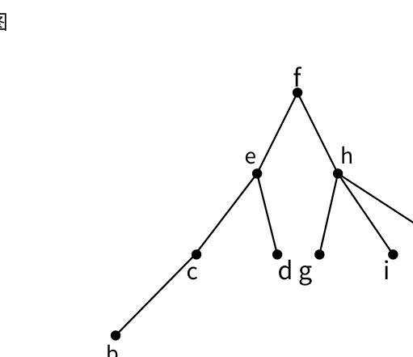

图 11.19 使用节点e作为根节点，将图 11.18 中的树重新绘制，并将其他节点按层级排列。

- 3. 在树中的非相邻节点之间添加一条边会创建一个具有循环的图。
- 4. 移除任意一条边会断开图的连接。 也就是说，每条边都是一个割边。
- 5. 如果树至少有两个顶点，则它至少有两个叶子节点。
- 6. 树中的顶点数比边数多一个。

## 证明

1. 子图中的循环也是整个图的循环，因此无环图的任何子图也必定是无环的。 如果子图也是连通的，则根据定义，它是一棵树。
2. 由于树是连通的，每对顶点之间至少存在一条路径。 假设为了推导矛盾，某对顶点之间存在两条不同的路径。 那么在相同的两个顶点之间存在两条不同的路径 **p** ≠ **q**，它们的总长度最小为 |**p**| + |**q**|。 如果这些路径在除了起点和终点之外的某个顶点 w处相交，那么从起点到 w的部分或从 w到终点的部分，必然是相同的路径，它们的总长度小于 |**p**| + | **q**|，这与总长度的最小性矛盾。 因此， **p**和 **q**除了起点和终点之外没有其他公共顶点， 所以**p**是**q**的反向路径，即 **q**是一个循环。
3. 额外的边 (*u*—*v*) 和 *u* 到 *v* 之间的唯一路径构成一个循环。

## 11.10. 森林与树

- 4. 假设我们移除边 <u, v>。由于树中存在唯一的路径在 u 和 v之间，该路径必定是 <u, v>。因此，当移除该边时，没有路径保留，所以图不连通。
- 5. 由于树至少有两个顶点，树中最长的路径将有不同的端点 u 和 v。我们断言 u 是一个叶子节点。这是因为，根据端点的定义，u最多与路径上的一条边相邻。此外，如果 u 与路径上的一条边不相邻，则可以通过添加该边来延长路径的长度，这与路径已经是最长的事实相矛盾。由此可知，u只与一条边相邻，即 u 是一个叶子节点。同样的情况也适用于 v。
- 6. 我们对命题使用归纳法：P(n) ::= 任何 n 个顶点的树中有 n-1 条边。
  - 基本情况 (n = 1): P(1)是正确的，因为只有一个节点的树没有边，1 - 1 = 0。
  - 归纳步骤: 现在假设 P(n) 是正确的，并考虑一个 (n+1) 个顶点的树, T。让 v 成为树的叶子节点。你可以验证从任何连通图中删除一个度为1的顶点（以及与之相关的边）后仍然得到一个连通的子图。所以根据定理 11.10.3.1, 删除 v 及其相关边会得到一个更小的树，而这个更小的树有 n-1 条边，根据归纳法。如果我们重新连接顶点 v 及其相关边, 我们会发现 T 有 (n + 1) - 1 条边。因此, P(n + 1) 是正确的，归纳证明完成。

定理11.10.3中的各种属性子集提供了树的替代特征。例如，

## 引理11.10.4

图 G 是一棵树当且仅当 G 是一棵森林且 |V(G)| = |E(G)| + 1。

这个证明是定理11.9.7.6 (问题11.55)的一个简单推论。

## 11.10.3 生成树

树无处不在。 事实上，每个连通图都包含一个与图具有相同顶点的子图，该子图是一棵树。 这被称为图的生成树。例如，图11.20是一个连通图，其中突出显示了一棵生成树。

## 定义11.10.5

定义图 G 的生成子图为包含 G 所有顶点的子图。

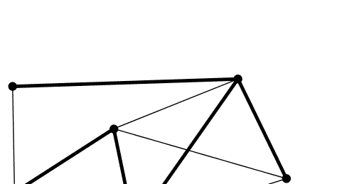

## 定理 11.10.6

每个连通图都包含一棵生成树。

证明：假设G是一个连通图，所以图G本身是一个连通的生成子图。所以根据WOP原理，G必须有一个最小边连通的生成子图，T。我们声称T是一棵生成树。由于T是一个连通的生成子图，根据定义，我们只需要证明T是无环的。

但是假设相反，T包含一个环C。根据引理11.9.6，环C的一条边e不会是割边，因此删除它会得到一个比T更小的连通生成子图，这与T的最小性矛盾。■

## 11.10.4 最小权重生成树

生成树很有趣，因为它们使用最少的边连接图的所有节点。例如，在图11.20中显示的6个节点的生成树有5条边。

在许多应用中，图的边上有与之相关的数值成本或权重。例如，假设图的节点表示建筑物，边表示它们之间的连接。连接的成本可能因建筑物或城镇对的不同而有很大差异。另一个例子是节点表示城市，边的权重表示它们之间的距离：洛杉矶/纽约之间的权重要比纽约/波士顿之间的权重高得多。图的权重简单地定义为其边权重的总和。例如，图11.21中显示的生成树的权重为19。

## 定义11.10.7

带权图G的最小生成树(MST)是G的一棵生成树，其边权重之和最小。

图11.21(a)中显示的生成树是否是图11.21(b)中显示的带权图的最小生成树(MST)? 实际上不是，因为图11.22中显示的树也是图11.21(b)中显示的图的生成树，而且这棵生成树的权重为17。

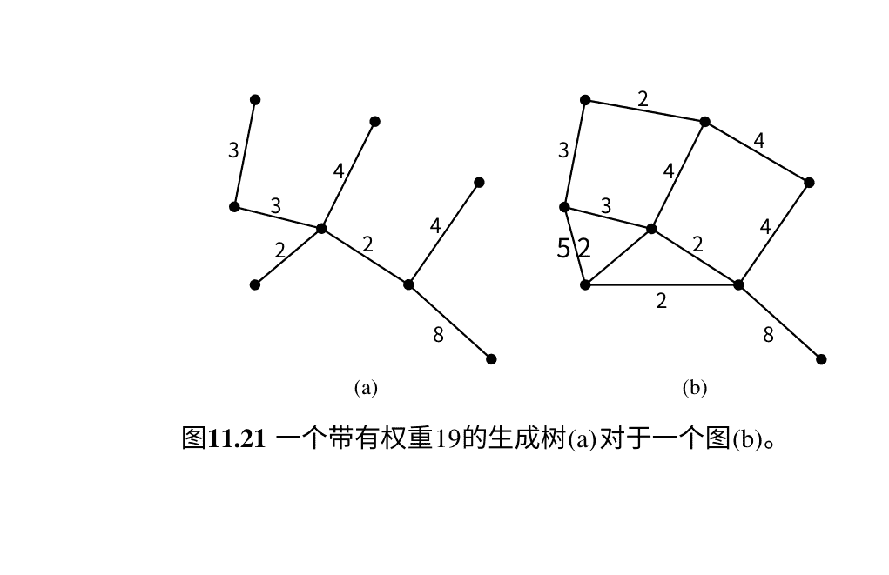
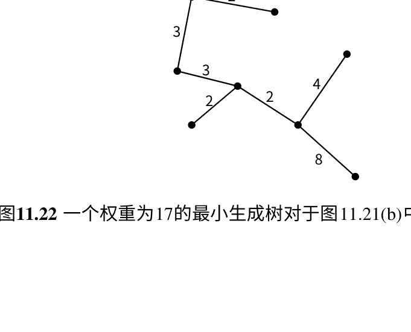

那么图11.22中展示的树怎么样？它看起来像是一个最小生成树，但是我们如何证明呢？一般来说，我们如何找到一个连通图 G的最小生成树？我们可以尝试枚举 G的所有子树，但是对于大型图来说这种方法是无望的。

实际上，有很多基于 G的一些子图属性的方法可以找到最小生成树。

## 定义11.10.8

一个图 G的预最小生成树是 G的一个生成子图，也是 G的某个最小生成树的子图。

因此，预最小生成树必然是一个森林。

例如，与 G具有相同顶点的空图被保证是 G的一个预MST，任何实际的 G的MST也是如此。

如果 e是 G的一条边， S是一个生成子图，我们将写作 S + e表示具有边 E(S) ∪ {e}的生成子图。

## 定义11.10.9

如果 F是一个预MST，E是一条新边，即E ∈ E(G) − E(F )，则当 F + e也是一个预MST时， e扩展 F。

因此，作为预MST是在扩展边的情况下不变的，这是根据扩展的定义。

寻找MST的标准方法都是从空生成森林开始，通过逐个添加扩展边来构建MST。由于空生成森林是一个预MST，并且根据定义，在扩展下是不变的，通过这种方式构建的每个森林都将是一个预MST。但是，没有生成树可以是不同生成树的子图。因此，当预MST最终增长到足够成为一棵树时，它将成为MST。根据引理11.10.4，在 |V(G)|− 1边扩展后，这将发生。

因此，寻找最小生成树的问题可以简化为如何判断一条边是否为扩展边。下面是解决方法：

## 定义11.10.10

设 F为一个预生成树，并且将每个连通分量中的顶点染成全黑或全白。每种颜色至少需要一个连通分量。将这称为 F的一种固定染色方式。固定染色方式中的灰色边是 G中具有不同颜色端点的边。

显然，从白色顶点到黑色顶点的任何路径都必须经过一条灰色边，因此对于任何固定染色方式，至少存在一条灰色边。事实上，灰色边的数量至少与具有相同颜色的连通分量数量相同。下面是关键：

## 引理11.10.11

如果一条边是 F的某种固定染色方式中的最小权重灰色边，则它扩展了预生成树 F。

因此，要扩展一个预生成树，选择任意一种实色，找到灰色边，然后在它们中选择一条权重最小的。这些步骤都很容易完成，所以很容易不断扩展并得到一棵生成树。例如，以下是三个已知算法，它们由引理11.10.11解释：

算法1. [Prim] 通过添加一条在树中只有一个端点的最小权重边，逐步构建一棵树。

这个算法是通过将正在增长的树涂成白色，将不在树中的顶点涂成黑色得到的。然后，灰色边就是那些只有一个端点在树中的边。

算法2. [Kruskal] 通过添加一条在不同连通分量之间的最小权重边，逐步构建一片森林。

当一条边连接不同的连通分量时，它不会形成环。当Kruskal算法选择的边连接的是不同颜色的连通分量时，它将是最小权重的灰色边。

例如，在我们考虑的加权图中，我们可以按照以下方式运行算法1。首先选择其中一条权重为1的边，因为这是图中最小的权重。假设我们选择了三角形底部的权重为1的边。这条边与两条权重为1的边，一条权重为4的边，一条权重为7的边和一条权重为3的边相邻。然后我们选择最小权重的相邻边。在这种情况下，我们选择两条权重为1的边。此时，我们无法选择第三条权重为1的边：它不会变为灰色，因为它的端点都在树中，所以都是白色的。但是我们可以继续选择一条权重为2的边。我们可能得到如图11.23所示的生成树，它的权重为17，是目前为止最小的。

现在假设我们在图上运行算法2。我们可能会再次选择底部的权重为1的三角形中的权重为1的边。现在，我们不再选择它接触的权重为1的边，而是选择图的顶部的权重为1的边。这条边仍然具有最小权重，并且如果我们简单地将其端点着色不同，它将变为灰色，因此算法2可以选择它。然后我们将选择剩余的权重为1的边之一。请注意，两者都不会导致我们形成一个循环。继续算法，我们可能会得到与图11.23中相同的生成树，尽管这取决于用于在具有相同最小权重的灰色边之间进行选择的打破平局的规则。例如，如果G中每条边的权重都是1，那么所有的生成树都是具有权重|V(G)|-1的MST，并且这两个算法都可以通过适当的打破平局来得到这些生成树中的每一个。

解释算法1的着色也证明了一个更灵活的算法，它将算法1作为一个特殊情况：

算法3. 通过选择任何一个组件并添加离开该组件的最小权重边来逐步增加森林。

该算法允许不太接近的组件并行和独立地增长，这对于“分布式”计算非常有用，其中独立的处理器之间的通信有限。

这些都是优化问题的贪婪方法的例子。有时贪婪法有效，有时不有效。好消息是它确实可以找到最小生成树。因此，我们可以确定我们的示例图的最小生成树的权重为17，因为它是由算法2生成的。此外，我们还有一种快速算法可以找到任何图的最小生成树。

好的，为了结束这个故事，剩下的就是证明最小灰色边是扩展边。这听起来可能很繁琐，但它只是使用了我们用来确保在需要时会有一条灰色边的相同推理。

证明（引理11.10.11的证明）：

设F是某个最小生成树M的子图，且F是一个预生成树。假设e是F下某个实色着色方案下的最小权重灰边。我们想要证明F + e也是一个预生成树。

如果e恰好是M的一条边，则F + e仍然是M的子图，因此也是一个预生成树。

另一种情况是e不是M的一条边。在这种情况下，M + e将是一个连通的生成子图。此外，M有一条路径p连接不同颜色的端点，因此M + e有一个由e和p组成的环。现在p既有一个黑色端点又有一个白色端点，因此它必定包含某条灰边g ≠ e。关键是从M + e中移除g以得到一个子图M + e - g。由于灰色边g不是F的边，图 M + e - g 包含 F + e。我们声称 M + e - g 是最小生成树，这证明了 F 的扩展。

为了证明这个命题，注意 M + e 是一个连通的、跨越的子图，而 g 不是 M + e 的一个环，所以根据引理11.9.6，移除 g 不会断开任何东西。因此，M + e - g 仍然是一个连通的、跨越的子图。此外，M + e - g 具有与 M相同数量的边，所以引理11.10.4暗示它必须是一棵跨越树。最后，由于 e 在灰色边中具有最小权重，

$$w(M + e - g) = w(M) + w(e) - w(g) \leq w(M).$$

这意味着 M + e - g 是一个权重不超过最小生成树的生成树，这意味着 M + e - g 也是最小生成树。

从引理11.10.11的证明中可以得出另一个有趣的事实：

## 推论11.10.12

如果加权图中的所有边的权重都不相同，则图有一个唯一的最小生成树。

推论11.10.12的证明留给问题11.70。

## 11.11 参考文献

- [7], [12], [21], [24], [26]

## 第11.2节的问题

## 课堂问题

- 问题11.1.
  - (a)证明在每个简单图中，奇数度顶点的数量是偶数。
  - (b)得出结论，在一个握手的聚会上，握手次数为奇数的人的数量是偶数。
  - (c)如果聚会上的每个人都与下一个人（如果有的话）握过手，则称该序列称为一个握手序列。假设乔治参加了派对，并与奇数个人握手。解释为什么从乔治开始，必须存在一个以握过奇数次手的不同的人为结尾的握手序列。

## 考试问题

### 问题11.2

一位研究人员在一组男性和女性的异性性行为数据上进行分析，发现在该组中，男性的平均女性伴侣数量比女性的平均男性伴侣数量多10%。

- (a)对以下说法发表评论。“由于我们假设每次相遇都涉及一名男性和一名女性，所以平均数量应该相同，因此男性必须夸大了。”
- (b)对于什么常数$c$是$m = c \cdot f$？
- (c)数据显示，大约20%的女性是处女，而只有5%的男性是。研究人员想知道从人群中排除处女会如何改变平均值。如果他了解图论，研究人员将意识到非处女男性的平均伴侣数量将是非处女女性的平均伴侣数量的x倍。那么x是多少？
- (d)为了进一步研究，将组中的每个女性与组中的一个唯一男性配对将会有帮助。解释为什么这是不可能的。

## 第11.4节的问题

## 练习题

### 问题11.3

以下哪些项目是同构保持的简单图属性？

- (a)顶点可以编号为1到7。
- (b)存在一个包含所有顶点的循环。
- (c)存在两个度为8的顶点。
- (d)两条边的长度相等。
- (e)无论移除哪条边，任意两个顶点之间都存在一条路径。
- (f)存在两个不共享任何顶点的循环。
- (g)一个顶点是另一个顶点的子集。
- (h)图可以以所有边长度相等的方式呈现。
- (i)两个在同构下保持的属性的逻辑或。
- (j)在同构下保持的属性的否定。

## 课堂问题

### 问题11.4

对于以下每对图形，要么定义它们之间的同构，要么证明它们之间不存在。 (我们将 ab 简写为 ⟨a−b⟩。)

- (a) G1具有 V1= {1, 2, 3, 4, 5, 6}, E1= {12, 23, 34, 14, 15, 35, 45}；G2具有 V2= {1, 2, 3, 4, 5, 6}, E2= {12, 23, 34, 45, 51, 24, 25}
- (b) G3具有 V3= {1, 2, 3, 4, 5, 6}, E3= {12, 23, 34, 14, 45, 56, 26}；G4具有 V4= {a, b, c, d, e, f}, E4= {ab, bc, cd, de, ae, ef, cf}

### 问题11.5

列出图 11.24 中给定的两个图之间的所有同构。解释为什么没有其他的。

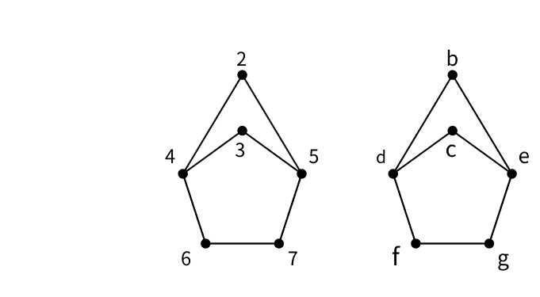

## 作业问题

### 问题11.6

确定图 11.25 中的四个图中哪些是同构的。 对于每对同构的图，描述它们之间的同构。 对于不同构的每对图，给出一个在同构下保持不变的属性。

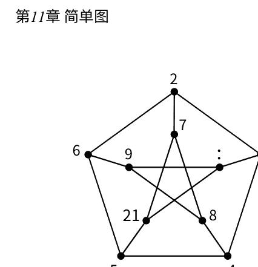
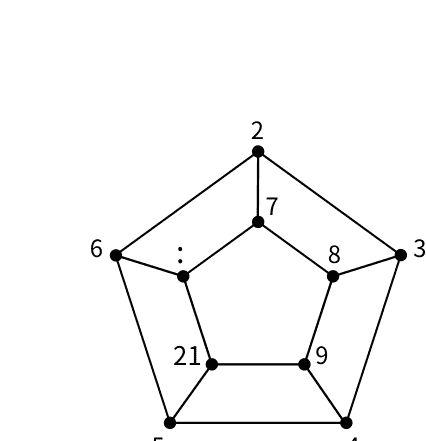
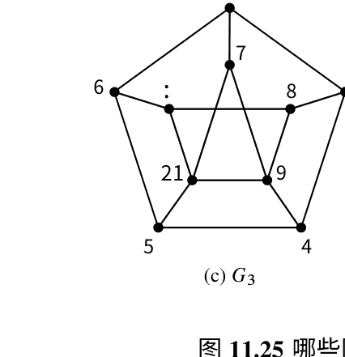
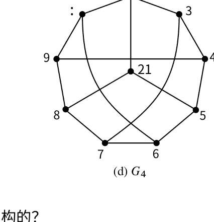

图 11.25 哪些图是同构的？

同构使得一个图具有该属性，而另一个图则没有。对于你选择的至少一个属性，证明它确实在同构下保持不变（你只需要证明其中一个）。

### 问题11.7

- (a)对于图中的任意顶点 v，令 N(v) 为 v 的邻居集合，即与 v 相邻的顶点： N(v):= {u | ⟨u−v⟩是图}的一条边。假设 f 是从图 G 到图 H 的同构。证明 f (N(v)) = N(f (v))。你的证明应该通过简单的推理使用同构的定义和邻居的定义来完成，不需要图片或者手势。
  - 提示：通过一系列的当且仅当来证明：$h \in N(f(v))$ 当且仅当 $h \in f(N(v))$ 对于每一个 $h \in V_H$。使用这个事实 $h = f(u)$对于某个 $u \in V_G$。
- (b)推断出如果 $G$和 $H$是同构图，那么对于每一个 $k \in \mathbb{N}$, 它们有相同数量的度为 $k$的顶点。

### 问题11.8

我们说一个图有“两个端点”如果它有恰好两个度为1的顶点，并且所有其他的顶点都有度为2。例如，这是一个这样的图:

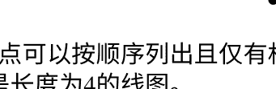

- (a)线图是一种顶点可以按顺序列出且仅有相邻顶点之间有边的图。因此，上面的双端图也是长度为4的线图。
  通过绘制反例证明以下定理是错误的。错误定理。每个双端图都是线图。
- (b)指出以下错误证明中的第一个错误陈述并描述错误。
  错误证明：我们使用归纳法。归纳假设是每个具有$n$条边的双端图都是路径。
  - 基本情况 ($n = 1$): 只有一条边的双端图由两个顶点通过一条边连接:
    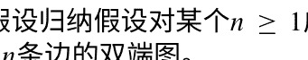
    果然，这是一个线图。
  - 归纳情况：我们假设归纳假设对某个$n \geq 1$成立，并证明它对$n + 1$成立。设$G_n$是任意具有$n$条边的双端图。根据归纳假设，$G_n$是一个线图。现在假设我们通过在$G_n$上添加一条边来创建一个双端图$G_{n+1}$。这只能以一种方式完成：新的边必须连接$G_n$的一个端点和一个新的顶点；否则，$G_{n+1}$将不是双端图。

## 第11章 简单图

显然，$G_{n+1}$也是一个线图。因此，归纳假设对于具有$n+1$条边的所有图形都成立，这完成了归纳证明。

## 第11.5节的问题

## 课堂问题

### 问题11.9

某个技术学院有很多学生俱乐部；这些俱乐部由学生协会松散监督。每个合格的俱乐部都希望委派其中一名成员向院长申请资金，但院长不允许一名学生成为多个俱乐部的代表。幸运的是，协会副主席学过计算机科学数学课程，当她看到这个问题时，她认出了一个匹配问题。

- (a) 解释如何将代表选举问题建模为二分图匹配问题。
- (b) 副校长的记录显示，没有学生是超过9个俱乐部的成员。副校长还知道，要获得院长办公室的支持，一个俱乐部必须至少有13个成员。这足以让她保证有一个适当的代表选举。解释一下。（如果副校长参加了算法课程，她甚至可以轻松找到一个代表选举。）

### 问题11.10

拉丁方阵是一个$n \times n$数组，其元素是数字$1, \ldots, n$。这些元素满足两个约束条件：每一行都包含所有$n$个整数的某种顺序，每一列也都包含所有$n$个整数的某种顺序。拉丁方阵在科学实验设计中经常出现，原因可以通过一个脚注中的小故事来说明\textsuperscript{10}。

\textsuperscript{10}在20世纪初的吉尼斯啤酒厂，W. S. Gosset（一位化学家）和E. S. Beavan（一位“麦芽师”）他们试图改进用于酿造的大麦。酿酒厂根据价格和可用性使用不同品种的大麦，他们的农业顾问建议每个品种使用不同的肥料配方和最佳种植月份。

对于为定制肥料支付高价持怀疑态度，戈塞特和比文计划对肥料和种植月份对大麦产量的影响进行一个季度的长期测试。对于大麦的品种数量，他们将每个品种种植一个样本，使用不同的肥料。因此，每个月，他们都会种植所有的大麦品种，并使用所有的肥料，这样他们就可以评判该种植月份的整体质量。

但他们还想评判肥料，所以他们希望每种肥料在整个季节中都被用于每种作物。现在他们有一个小的数学问题，我们可以抽象为以下形式。

假设有 $n$ 种大麦品种和相同数量的推荐肥料。形成一个 $n \times n$ 数组，每个肥料对应一列，每个种植月份对应一行。我们想要填写这个数组的条目，使用整数$1，\ldots，n$编号为大麦品种的数字，以便每一行都包含所有$n$个整数的某种顺序（因此每个月都种植每种作物并使用每种肥料），并且每一列也包含所有 $n$ 个整数（因此在整个生长季节中每种肥料都用于所有的品种）。

例如，这是一个 4×4 拉丁方阵：

| 1 | 2 | 3 | 4 |
|---|---|---|---|
| 3 | 4 | 2 | 1 |
| 2 | 1 | 4 | 3 |
| 4 | 3 | 1 | 2 |

- (a) 这是一个可能是 5×5拉丁方阵的三行：

| 2 | 4 | 5 | 3 | 1 |
|---|---|---|---|---|
| 4 | 1 | 3 | 2 | 5 |
| 3 | 2 | 1 | 5 | 4 |
|   |   |   |   |   |
|   |   |   |   |   |

填写最后两行，将这个“拉丁矩形”扩展为完整的拉丁方阵。

- (b) 证明在一个 n×n 拉丁矩形中填充下一行等价于在某个 2n-顶点二分图中找到一个匹配。
- (c) 证明在这个二分图中必定存在一个匹配，因此拉丁矩形总是可以扩展为拉丁方阵。

### 问题 11.11

当每个顶点具有相同的度时，一个简单的图被称为正则图。 当一个图既是正则图又是具有相同数量左右顶点的二分图时，它被称为平衡图。

证明如果 G是一个平衡图，则 G的边可以被划分为块，每个块都是一个完美匹配。
例如，如果 G是一个具有 2k个顶点和度为 j的平衡图，则 G的边可以被划分为 j个块，每个块包含 k条边，每条边都是一个完美匹配。 也就是说，同一个块中的两条边永远不会与同一个顶点关联。

## 考试问题

### 问题11.12

过度劳累和过度咖啡因的助教们决定驱逐讲师，自己教授辅导课。 他们将在同一个房间里的4个不同时间进行辅导课。 每个辅导课有20个座位可供学生分配。 每个学生都向助教提供了她的课表允许的辅导课列表，每个学生的课表最多与两个辅导课冲突。 如果可能的话，助教必须将每个学生分配到一个她可以参加的辅导课的座位上。

- (a) 描述如何将这个情况建模为一个匹配问题。 请确保明确指定顶点/边应该是什么，并简要描述匹配如何确定每个学生在与他的时间表不冲突的辅导课中的座位分配。 (这是一个建模问题; 我们不是在寻找解决问题的算法描述。)
- (b) 假设有41名学生。 根据上述提供的信息，是否有一个匹配保证？ 简要解释。

### 问题11.13

由于《计算机科学数学基础》的极高受欢迎度，Rajeev决定放弃常规办公时间。 相反，每个学生可以加入一些学习小组。
每个小组必须选择一名代表与工作人员交流，但是有一个工作人员规定，一个学生只能代表一个小组。 问题是在遵守工作人员规定的情况下，从每个小组中找到一名代表。

- (a) 解释如何将代表选举问题建模为二分匹配问题。
- (b) 员工的记录显示每个学生最多是4个小组的成员，而且所有的小组都有4个或更多的成员。这足以保证有一个适当的代表选举。解释一下。

### 问题11.14

令 $R$ 为命题公式上的“蕴含”二元关系，其定义规则如下：

$$F\ \widehat{R}\ G\ \text{当且仅当}\ [(F\text{蕴含}G)\text{是一个有效的公式}]. \quad (11.4)$$

例如，$(P\ \text{AND}\ Q)\ \widehat{R}\ P$，因为公式 $(P\ \text{AND}\ Q)$ 蕴含 $P$ 是有效的。同时，它不是真的，而 $(P\ \text{OR}\ Q)\ \widehat{R}\ P$ 因为 $(P\ \text{OR}\ Q)$ 蕴含 $P$ 不是有效的。

- **(a)** 令 $A$ 和 $B$ 为列出的公式集合。下面。解释为什么 $\widehat{R}$ 不是集合 $A \cup B$ 上的弱部分序关系。
- **(b)** 填写 $R$ 从集合 $A$ 到集合 $B$ 的箭头。

| $A$ | 箭头 | $B$ |
| :--- | :---: | :--- |
| | | $Q$ |
| $P$ 异或 $Q$ | | |
| | | $\overline{P}\ \text{OR}\ \overline{Q}$ |
| $P\ \text{AND}\ Q$ | | |
| | | $\overline{P} \text{或} \overline{Q} \text{或} (\overline{P}\ \text{且}\ Q)$ |
| 非 $(P\ \text{且}\ Q)$ | | |
| | | $P$ |

- **(c)** 部分 (b) 中的图定义了一个二分图 图 $G$ 与 $L(G) = A$， $R(G) =$ 相对 $B$ 以及 $F$ 和 $G$ 之间的边，当且仅当 $F\ \widehat{R}\ G$ 应。展示一个集合 $S$ of $A$，使得 $S$ 和 $A - S$ 非空，并且集合的邻居集合的大小 $S$， 即 $|N(S)| = |S|$。
- **(d)** 让 $G$ 是一个任意的有限二分图。对于任意的集合 $S \subseteq L(G)$，令 $\overline{S}::= L(G) - S$， 同样对于任意的 $M \subseteq R(G)$， 令 $\overline{M}::= R(G) - M$。假设 $S$ 是 $L(G)$ 的子集，使得 $|N(S)| = |S|$，且 $S$ 和 $\overline{S}$ 都非空。

圈出正确完成以下陈述的公式：
如果存在从 $L(G)$ 到 $R(G)$ 的匹配，那么存在一个匹配
从 $S$ 到其邻居，$N(S)$，以及从 $\overline{S}$ 到

```
N(¯S)    ¯N(S)    N^{-1}(N(S))    N^{-1}(N(¯S))    N(¯S)−¯N(S)    N(S)−N(¯S)
```

提示：Hall瓶颈定理的证明。

## 作业问题

### 问题11.15

拿一副普通的52张牌。每张牌都有一个花色和一个值。花色有四种可能性：红心、方块、梅花、黑桃。值有13种可能性，A；2；3；...；10；J；Q；K。每种花色和值的组合中都恰好有一张牌，共4×13种可能组合。

请你的朋友将卡片按照4行13列的网格布置出来。
他们可以任意填充卡片。在这个问题中，你将证明你总是可以从网格的每一列中选择一张卡片，这样你最终会得到所有13种可能的值的卡片。

- (a) 解释如何将这个技巧建模为13个列顶点和13个值顶点之间的二分匹配问题。图形是否必然受到度数限制的限制？
- (b) 证明任意n列必须包含至少n个不同的值，并证明必然存在一个匹配。

### 问题11.16

学者们通过各个时代已经确定了二十个基本的人类美德：诚实、慷慨、忠诚、谨慎、完成每周的课程阅读回应等。在学期开始时，计算机科学数学课的每个学生都具有八种这些美德。此外，每个学生都是独一无二的；也就是说，没有两个学生具有完全相同的美德集合。计算机科学数学课的教职员工必须在学期结束前为每个学生选择一个额外的美德。证明有一种方法可以为每个学生选择一个额外的美德，以便在学期结束时每个学生都是独一无二的。

建议：使用霍尔定理。尝试对双分图的左侧和右侧的顶点进行各种解释。

## 第11.6节的问题

### 练习题

#### 问题11.17

四名学生希望分别分配给四家VI-A公司。以下是他们的偏好排名：

| 学生       | 公司                         |
|------------|------------------------------|
| 阿尔伯特: | 惠普、贝尔科尔、AT&T、德雷珀 |
| 莎拉:     | AT&T、贝尔科尔、德雷珀、惠普 |
| 塔莎:     | 惠普、德雷珀、AT&T、贝尔科尔 |
| 伊丽莎白: | 德雷珀、AT&T、贝尔科尔、惠普 |

| 公司       | 学生                         |
|------------|------------------------------|
| AT&T:      | 伊丽莎白、阿尔伯特、塔莎、莎拉 |
| 贝尔科尔: | 塔莎、莎拉、阿尔伯特、伊丽莎白 |
| 惠普:     | 伊丽莎白、塔莎、阿尔伯特、莎拉 |
| 德雷珀:   | 莎拉、伊丽莎白、塔莎、阿尔伯特 |

- (a) 使用配对仪式找到两个学生到公司的稳定分配。
- (b) 描述一个简单的过程来确定任何给定的稳定婚姻问题是否有唯一解，即只有一个可能的稳定匹配。

#### 问题11.18

假设哈利是男孩中的一个，艾丽斯是女孩中的一个，在交配仪式中。

以下哪些属性是保持不变的？为什么？

- a. 艾丽斯是哈利名单上唯一的女孩。
- b. 有一个女孩没有任何男孩在向她求爱。
- c. 如果艾丽斯不在哈利的名单上，那么艾丽斯有一个她更喜欢的追求者。
- d. 艾丽斯被划掉了哈利的名单，而哈利更喜欢艾丽斯胜过他向任何人求爱。
- e. 如果艾丽斯在哈利的名单上，那么她更喜欢哈利胜过任何追求者。

### 问题 11.19

证明在一个稳定的婚姻集合中，每个男人都是他最理想的妻子的最差丈夫。

> 提示：直接从“流氓夫妇”的定义得出。

## 课堂问题

### 问题 11.20

4个男孩和4个女孩之间的偏好在下表中部分指定：

|    |    |    |    |    |
|---|---|---|---|---|
| B1: | G1 | G2 | - | - |
| B2: | G2 | G1 | - | - |
| B3: | - | - | G4 | G3 |
| B4: | - | - | G3 | G4 |
| G1: | B2 | B1 | - | - |
| G2: | B1 | B2 | - | - |
| G3: | - | - | B3 | B4 |
| G4: | - | - | B4 | B3 |

- **(a)** 验证 (B1, G1), (B2, G2), (B3, G3), (B4, G4) 无论未指定的偏好如何，上述匹配都将是稳定的。
- **(b)** 解释为什么上述稳定匹配既不是男孩最优也不是男孩最差，因此不会成为交配仪式的结果。
- **(c)** 描述如何定义一组在$n$个男孩和$n$个女孩之间至少有2个稳定分配的婚姻偏好。
提示：将男孩们排成一组$n$/2对，同样将女孩们排成一组$n$/2对。选择偏好，使第$k$对男孩将第$k$对女孩排在前一对女孩的下面，对于第$k$对女孩也是如此。在第$k$对中，确保每个男孩在这对中的第一个选择女孩更喜欢这对中的另一个男孩。

### 问题11.21

在寻找稳定婚姻的11.6.1节中，男性和女性的数量不相等时也适用。与以前一样，一组男性和女性之间的（一夫一妻制）婚姻称为稳定婚姻，当中没有“不合适的夫妻”。

- (a) 扩展“不合适的夫妻”定义，使其包括未婚男性和女性的情况。验证在一组稳定婚姻中，要么所有男性都已婚，要么所有女性都已婚。
- (b) 解释为什么即使在男女人数不相等的情况下，应用交配仪式也会产生稳定的匹配。

## 作业问题

### 问题11.22

假设我们想要分配一对“伙伴”，他们可以是任意性别，每个人都对他们想要成为伙伴的人有一个偏好排名。对于图11.26中给出的偏好排名，证明没有稳定的伙伴分配。在这个图中，Mergatroid的偏好没有显示出来，因为它们甚至都不重要。

### 问题11.23

稳定匹配最著名的应用是将毕业医学生分配到医院住院医师岗位。每个医院对学生有一个偏好排名，每个学生对医院也有一个偏好排名，但与男女人数相等的稳定婚姻不同，医院通常有不同数量的可用住院医师岗位，而住院医师岗位的总数可能不等于毕业学生的人数。

解释如何将稳定匹配问题适应男孩和女孩数量相等的更一般情况。特别地，修改稳定匹配的定义使其适用于这种情况，并解释如何调整配对仪式来处理它。

### 问题11.24

给出一个在3个男孩和3个女孩之间的稳定匹配的例子，其中没有人得到他们的第一选择。 简要解释为什么你的匹配是稳定的。 你的匹配可以从配对仪式或男孩和女孩颠倒的仪式中获得吗?

### 问题11.25

在由配对仪式产生的n个男孩和女孩之间的稳定匹配中，如果一个人与他们的前⌈$n/2$⌉个选择之一配对，我们称之为幸运。 我们将证明:

**定理。** 必须至少有一个幸运的人。

为了证明这一点，为配对仪式定义以下派生变量: $q(B) = j$，其中j是男孩B追求的女孩的排名。 也就是说，男孩B总是追求他名单上的第j个女孩。

$r(G)$是女孩G拒绝的男孩数量。

$$ S := \sum_{B \in \text{男孩}} q(B) - \sum_{G \in \text{女孩}} r(G). $$
(11.5)

- (a) 证明 $S$ 在交配仪式中从一天到下一天保持不变。
- (b) 证明上述定理。 (为简单起见，可以假设 n是偶数。 )
提示: 如果一个女孩拒绝了一半的男孩，她肯定会幸运。

### 问题11.26

假设有两组稳定的婚姻。 所以每个男人都有一个第一任妻子和一个第二任妻子，同样每个女人都有一个第一任丈夫和一个第二任丈夫。
在给定的婚姻中，某人是一个赢家当他们更喜欢他们当前的配偶而不是他们的另一半时，他们是一个 输家 当他们更喜欢他们的另一半而不是他们当前的配偶时。 (如果某人在两个婚姻中都有同样的配偶，那么他们既不是赢家也不是输家。 )
我们将证明
在每个婚姻中，如果某人的配偶是失败者，则该人是赢家。 (11.6)

- (a) (11.6)的从左到右方向等价于已婚伴侣不能同时是赢家的断言。解释为什么这直接遵循于流氓夫妇的定义。
(11.6)的从右到左方向等价于已婚夫妇不能同时是失败者的断言。通过比较婚姻中赢家和失败者的数量，可以得出这个结论。
- (b) 解释为什么赢家的数量必须等于两组婚姻中失败者的数量。
- (c) 通过展示如果某对已婚夫妇都是失败者，则必定存在另一对夫妇都是赢家，来完成(11.6)的证明。
- (d) 得出结论，在稳定的婚姻中，某人的配偶是最优的，当且仅当他们对配偶来说是最差的。

### 问题11.27

假设存在两组稳定的婚姻，第一组和第二组。因此，每个男人有一个第一任妻子和一个第二任妻子（可能是同一个），同样，每个女人有一个第一任丈夫和一个第二任丈夫。我们可以通过将每个男人与他在第一任妻子和第二任妻子中更喜欢的那个配对，形成第三组婚姻。

- (a) 证明这第三组婚姻是一个完美的匹配：没有女人嫁给两个男人。
- (b) 证明这第三组婚姻是稳定的。
提示：你可以假设问题11.26中的以下事实。
> 在每次婚姻中，如果某人的配偶是失败者，则该人是赢家。 (11.7)

## 考试题

### 问题11.28

四个不幸的孩子想要被四个声誉不佳的寄养家庭收养。一个孩子只能被一个家庭收养，一个家庭只能收养一个孩子。以下是他们的偏好排名（最喜欢到最不喜欢）：

| 孩子 | 家庭 |
|------|------|
| 瓶盖： | 哈特菲尔德家族、麦科伊家族、格林奇家族、斯克鲁奇家族 |
| 露西： | 格林奇家族、斯克鲁奇家族、麦科伊家族、哈特菲尔德家族 |
| 丁冬： | 哈特菲尔德家族、斯克鲁奇家族、格林奇家族、麦科伊家族 |
| 齐皮： | 麦考伊家族、格林奇家族、斯克鲁奇家族、哈特菲尔德家族 |

| 家庭 | 孩子们 |
| --- | --- |
| 格林奇家族: | 齐皮，丁冬，瓶盖，露西 |
| 哈特菲尔德家族: | 齐皮，瓶盖，丁冬，露西 |
| 斯克鲁奇家族: | 瓶盖，露西，丁冬，齐皮 |
| 麦考伊家族: | 露西，齐皮，瓶盖，丁冬 |

- (a) 展示孩子和家庭之间的两种不同的稳定匹配。

| 家庭 | 第一次匹配中的孩子 | 第二次匹配中的孩子 |
| --- | --- | --- |
| 格林奇家族: |  |  |
| 哈特菲尔德家族: |  |  |
| 斯克鲁奇家族: |  |  |
| 麦考伊家族: |  |  |

- (b) 检查来自第(a)部分的匹配，并解释为什么这些匹配是孩子和家庭之间唯一可能的两种稳定匹配。提示:一般来说，对于相同的偏好，可能会有多于两种稳定匹配。

### 问题11.29

当男性至少与女性一样多，甚至更多时，寻找稳定婚姻的配对仪式11.6仍然适用。你可以假设这一点。因此，仪式以所有女性结婚并且没有流氓夫妇结束，其中一个未婚男子和一个比她的丈夫更喜欢他的已婚女子也被认为是“流氓夫妇”。

让艾丽斯成为其中一位女性，鲍勃成为其中一位男性。指出在配对仪式11.6中至少有相同数量的男性和女性时，下列属性中哪些是保持不变的。简要解释你的答案。

- (a) 艾丽斯有一个求爱者（她更喜欢的男人），他比鲍勃更受她欢迎。
- (b) 艾丽斯是鲍勃名单上唯一的女性。
- (c) 艾丽斯没有求爱者。
- (d) 鲍勃更喜欢艾丽斯而不是他正在求爱的女性。
- (e) 鲍勃正在向艾丽斯求爱。
- (f) 鲍勃没有向艾丽斯求爱。
- (g) 鲍勃的求爱女性名单为空。

## 第11章 简单图

## 第11.7节的问题

### 课堂问题

#### 问题11.30。
一个简单图 G是2-可移除的当且仅当它包含两个顶点 v和 w，使得 G − v是连通的，且 G − w也是连通的。证明至少有两个顶点的每个连通图都是2-可移除的。

提示：考虑最长路径。

#### 问题11.31。
设 G为下图所示的图11。仔细解释为什么 χ(G) = 4。

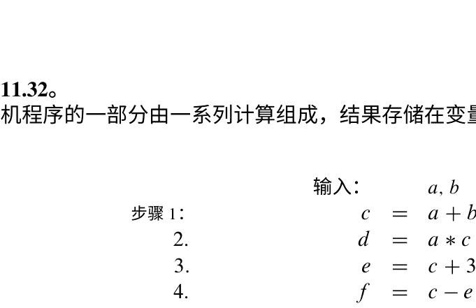

#### 问题11.32。
计算机程序的一部分由一系列计算组成，结果存储在变量中，如下所示：

```
输入: a, b
步骤1: c = a + b
2. d = a * c
3. e = c + 3
4. f = c - e
5. g = a + f
6. h = f + 1
输出: d, g, h
```

如果每个变量的值存储在寄存器中，计算机可以最快地执行这样的计算，寄存器是微处理器内部的一块非常快速的内存。编程语言编译器面临的问题是为每个变量分配寄存器。计算机通常只有少量的寄存器，因此必须明智地使用并经常重复使用。这被称为寄存器分配问题。

在上面的示例中，变量 a和 b必须分配不同的寄存器，因为它们保存不同的输入值。此外，变量 c和 d必须分配不同的寄存器；如果它们使用相同的寄存器，那么在第二步中会覆盖 c的值，并且在第三步中得到错误的答案。另一方面，变量 b和 d可以使用相同的寄存器；在第一步之后，我们不再需要 b并且可以覆盖保存其值的寄存器。同样，变量 f和 h可以使用相同的寄存器；一旦在最后一步中计算出 f + 1，就可以覆盖保存 f值的寄存器。

- (a)将寄存器分配问题重新定义为关于图着色的问题。顶点对应什么？在什么条件下两个顶点之间应该有一条边？构建与上面示例对应的图。
- (b)用尽可能少的颜色给图上色。将计算机的寄存器命名为R1, R2等。描述你的着色方案中变量与寄存器的对应关系。你需要多少个寄存器？
- (c)假设一个变量在代码片段中被赋值多次，如下所示：
```
...
t = r + s
u = t * 3
t = m - k
v = t + u
...
```
你如何处理这个复杂情况？

#### 问题11.33。
假设一个具有 k个连通分量的v-顶点二分图，每个连通分量都有两个或更多个顶点。 使用给定的两种颜色，有多少种方式可以给它上色？

### 作业问题

#### 问题11.34。
6.042经常使用辅导课进行教学。假设需要8个辅导课，每个辅导课由两到三名工作人员负责。将工作人员分配到辅导课中，使用他们的秘密代号，如下所示：

- R1: Maverick, Goose, Iceman
- R2: Maverick, Stinger, Viper
- R3: Goose, Merlin
- R4: Slider, Stinger, Cougar
- R5: Slider, Jester, Viper
- R6: Jester, Merlin
- R7: Jester, Stinger
- R8: Goose, Merlin, Viper

如果某个工作人员被分配到两个讲座，那么两个讲座不能在同一个90分钟的时间段内举行。 问题是确定完成所有讲座所需的最小时段数。

(a)将这个问题重新表述为关于某个特定图的顶点着色的问题。 画出图并解释顶点、边和颜色的含义。

(b)展示使用最少颜色的图的着色方案。 这意味着什么样的讲座安排?

#### 问题11.35。
这个问题推广了定理11.7.3的结果，即任何最大度数不超过 w 的图都是 (w + 1)可着色的。

一个简单的图， G， 如果它的顶点可以按照一定的顺序排列， 使得每个顶点至多与前面的 w个顶点相邻， 则称其宽度为 w。 如果每个顶点的度数都不超过 w， 则图的宽度显然不超过 w- 只需按任意顺序列出顶点即可。

(a)证明宽度不超过 w 的图是 (w + 1)可着色的。

(b)描述一个最小宽度为 n 的2可着色图。

(c)证明宽度为 w 的图的平均度数不超过 2w。

(d)描述一个具有100个顶点、 宽度为3的图， 但平均度数超过5的例子。

#### 问题11.36。
图的一个顶点序列具有宽度 w，如果每个顶点至多与前面的 w个顶点相邻。
一个简单的图， G，如果存在一个宽度为 w的顶点序列，其中包含了图的所有顶点。

(a)解释为什么图的宽度显然至少要等于其顶点的最小度数。

(b)证明如果一个有限图的宽度为 w，则存在一个以最小度数顶点结尾的宽度-w序列的所有顶点。

(c)描述一种简单的算法来找到图的最小宽度。

#### 问题11.37。
设 G 是一个简单图，其顶点度数都为 ≤ k。通过对顶点数进行归纳证明，
如果 G 的每个连通分量都有一个度数严格小于 k 的顶点，则 G 是 k可着色的。

#### 问题11.38。
一个简单图的一个基本例子，其色数为 n，是完全图，即具有 n个顶点的图，即 χ(K_n) = n。这意味着任何具有 K_n作为子图的图的色数至少为 n。人们常常错误地认为，具有高色数的图必然包含一个大的完全子图。在这个问题中，我们展示了一个简单的例子来反驳这个误解，即一个色数为四的图，不包含三角形—长度为三的循环—因此也不包含与 K_n同构的子图，其中 n ≥ 3。具体来说，设 G是图11.27的11个顶点的图。读者可以验证 G是无三角形的。

(a)证明 G 是4可着色的。

(b)证明 G不能用3种颜色着色。

#### 问题11.39。
这个问题将证明给一个图着3种颜色和为命题公式找到一个满足的真值赋值一样困难。考虑的图都会有三个指定的颜色顶点，它们通过一个三角形相连以确保在图的任何着色中它们有不同的颜色。分配给颜色顶点的颜色将被称为 T, F 和 N。

假设 f 是一个有 n 个参数的真值函数。也就是说，
$$f : \{T, F\}^n \rightarrow \{T, F\}.$$
如果一个图 G 被称为 3-颜色-f-门，那么 G 有 n 个指定的输入顶点和一个指定的输出顶点，满足以下条件：

- 只有当 G 的输入顶点被着色为 T 和 F 时，G才能被3着色。
- 对于每个序列 b_1, b_2, …, b_n ∈ {T, F}，图 G 中存在一种三色着色，其中输入顶点 v_1, v_2, …, v_n ∈ V(G) 的颜色为 b_1, b_2, …, b_n ∈ {T, F}。
- 在任何三色着色的 G 中，输入顶点 v_1, v_2, …, v_n ∈ V(G) 的颜色为 b_1, b_2, …, b_n ∈ {T, F}，输出顶点的颜色为 f(b_1, b_2, …, b_n)。

例如，一个三色 NOT 门只是由两个相邻的顶点组成。一个顶点被指定为输入顶点 P，另一个被指定为输出顶点。这两个顶点必须受到限制，只能在任何正确的三色着色中被着色为 T 或 F。可以通过将它们与颜色顶点 N 相邻来施加这个限制，如图11.28所示。
(a)验证图11.29中的图形是一个三色 OR 门。（虚线表示与颜色顶点 N 相连的边，这些边将 P、Q 和 P OR Q 顶点限制为在任何正确的三色着色中被着色为 T 或 F。）

(b)让 E 是一个 n 变量命题公式，并假设 E 定义了一个真值函数 f: {T, F}^n → {T, F}。解释一种构建一个 3-颜色- f-门的简单方法。

(c)解释为什么一个有效的确定图是否可 3-着色的过程会导致一个有效的解决可满足性问题，SAT 的过程。

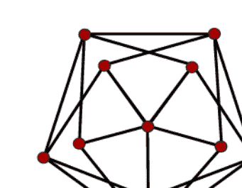

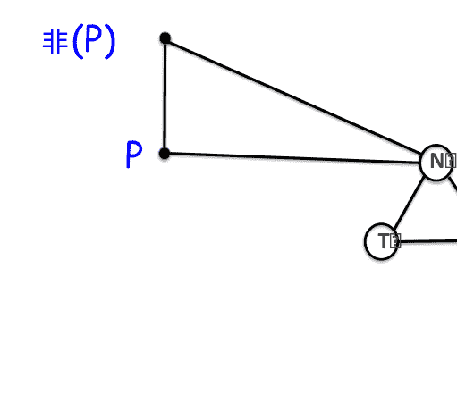
图11.28 一个3-颜色非门

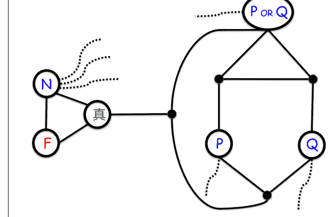
图11.29 一个3-颜色或门

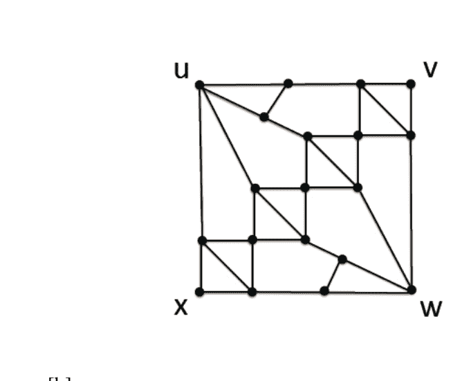
图11.30 一个3-颜色交叉装置。

#### 问题11.40。
对于平面图来说，3-着色问题与任意图的3-着色问题一样困难。这个断言非常简单地由于存在一个“3-颜色交叉装置”。这样的装置是一个平面图，其外部面是一个带有四个指定顶点 u, v, w, x 的循环，顺时针出现。

1. 对于顶点 u 和 v 的任意颜色分配都可以完成成一个3-颜色的图案。
2. 在每个3-颜色的图案中， u 和 w 的颜色是相同的， v 和 x 的颜色也是相同的。

图11.30展示了这样一个3-颜色的交叉装置。因此，要找到一个任意简单图的3-颜色图案，只需将其绘制在平面上，需要时交叉边，然后将每个边交叉的位置替换为图11.31所示的装置的副本。这样得到的平面图具有3-颜色图案，当且仅当原始图具有3-颜色图案。

(a)通过展示所声称的3-颜色图案，证明图11.30中的图满足条件（1）。

提示：只需要两种着色，一种是u和v相同颜色的，另一种是它们不同颜色的。

(b)证明图11.30中的图满足条件(2)。

提示：部分(a)的着色几乎完全由u和v的着色决定。

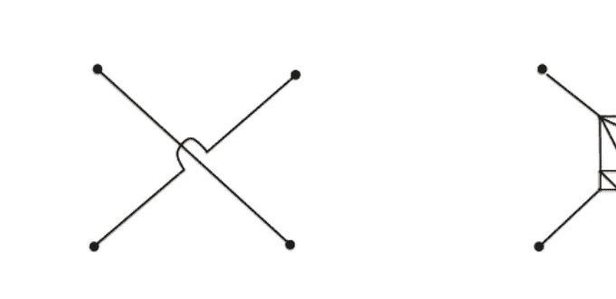
图11.31 用平面装置替换边交叉。

### 考试问题

#### 问题11.41。
错误声明。让 G 是一个顶点度数都在 ≤ k 的图。如果 G 有一个顶点的度数严格小于 k，则 G 是 k可着色的。

(a)给出一个反例来证明当 k=2 时，错误声明是错误的。

(b)在以下错误证明中，划线标出第一个不合理的句子或句子的一部分。

虚假的证明。通过对顶点数量进行归纳证明：

归纳假设，P(n)是：

假设 G 是一个顶点数为 n 的图，其顶点度数都小于等于 k。如果 G 还有一个顶点的度数严格小于 k，则 G 是 k可着色的。

基本情况：(n = 1) G 有一个顶点，其度数为0。由于 G 是 1可着色的，P(1) 成立。

归纳步骤：我们可以假设 P(n) 成立。为了证明 P(n + 1)，假设 G_{n+1} 是一个顶点数为 n + 1 的图，其顶点度数都小于等于 k。此外，假设 G_{n+1} 有一个顶点 v，其度数严格小于 k。现在我们只需要证明 G_{n+1} 是 k 可着色的。

为了做到这一点，首先移除顶点 v 以产生一个图 G_n，其中有 n 个顶点。设 u 是与顶点 v 在图 G_{n+1} 中相邻的顶点。移除顶点 v 会使顶点 u 的度数减少1。因此，在图 G_n 中，顶点 u 的度数严格小于 k。由于没有添加边，图 G_n 的顶点度数保持在 ≤ k。因此，图 G_n 满足归纳假设 P(n) 的条件，因此我们得出结论，图 G_n 是可以用 k 种颜色着色的。

现在，对于图 G_n 的 k 着色给出了除了顶点 v 之外的所有顶点的着色。由于顶点 v 的度数小于 k，与顶点 v 相邻的节点上分配的颜色将少于 k 个。因此，在 k 个可能的颜色中，将有一种颜色未被用于着色这些相邻节点，这种颜色可以分配给顶点 v 以形成图 G_{n+1} 的 k 着色。

(c)通过稍微加强条件，前面的错误论证可以修正为以下论证的正确形式：

论证。设 G 是一个顶点度数都为 ≤ k 的图。如果 (从下面插入的语句) 中存在一个度数严格小于 k 的顶点，则 G 是 k 可着色的。

在下面的陈述中，圈出可以插入以使证明正确的每个陈述。

- G 是连通的且
- G 没有度数为零的顶点且
- G 不包含 k 个顶点的完全图且
- G 的每个连通分量
- G 的某个连通分量

#### 问题11.42。
在图11.32中所示的图中，左侧三角形中连接的顶点被称为颜色顶点；由于它们形成一个三角形，在图的任何着色中它们被迫具有不同的颜色。分配给颜色顶点的颜色将被称为 T、F 和 N。虚线表示到颜色顶点 N 的边。

(a)解释为什么对于任何将 P 和 Q 赋予不同真值的赋值，图中存在唯一的三色着色。

(b)证明在整个图的任何三色着色中，标记为 P xor Q 的顶点被着色为顶点 P 和 Q 的颜色的 xor。

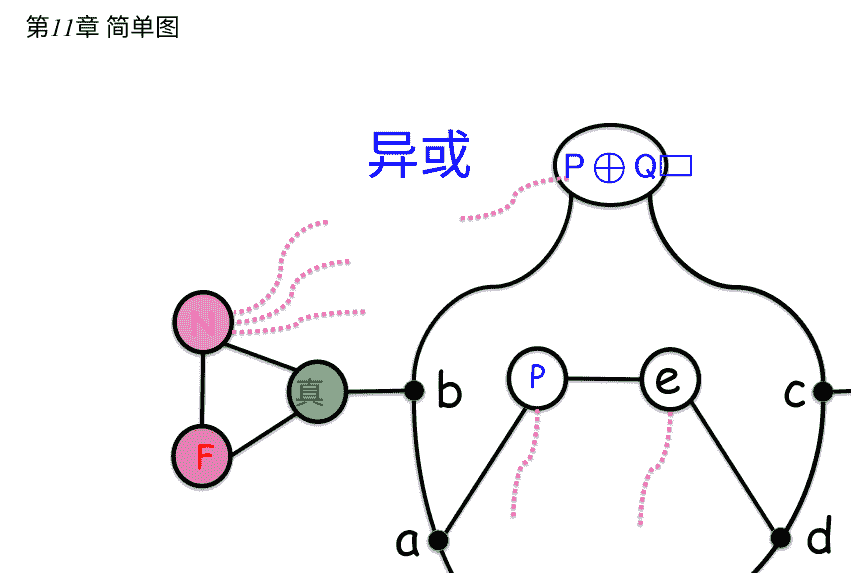
图11.32 一个三色 XOR门

## 第11.8节的问题

### 作业问题

- 问题11.43.
  - (a)给出一个简单图的例子，该图有两个顶点 u ≠ v 和 u 和 v 之间的两条不同路径，但没有包含 u 或 v 的循环。
  - (b)证明如果简单图中两个顶点之间存在不同的路径，则该图有一个循环。

问题11.44. 图论的整个领域始于欧拉提出的一个问题：是否可以只穿过 Königsberg 的七座桥一次。 抽象地说，我们可以将城市中被河流分隔的部分表示为顶点，将桥表示为连接顶点的边。 然后欧拉的问题是问是否存在一条通过图中每条边恰好一次的闭合路径。 为了纪念他，这样的路径被称为欧拉路径。 那么，你如何一般性地判断一个图是否有欧拉回路？ 乍一看这似乎是一个令人生畏的问题。 寻找一条恰好经过每个顶点一次的循环的类似问题是那些千禧年大奖 NP-完全问题之一，被称为哈密顿回路问题)。但事实证明，可以很容易地刻画哪些图有欧拉回路。

定理。一个连通图有欧拉回路，当且仅当每个顶点的度数都是偶数。

- (a)证明如果一个图有欧拉回路，则每个顶点的度数都是偶数。

在剩下的部分，我们将证明逆命题：如果一个连通有限图的每个顶点的度数都是偶数，则它有欧拉回路。 为了证明这一点，让我们将欧拉路径定义为一条最多包含每条边一次的路径。

- (b)假设一个连通图中的欧拉路径不包含每条边。
解释为什么必须有一个未包含的边与一条路径上的顶点相邻。

在剩下的部分中，让 w 是某个有限连通图中最长的欧拉路径。

- (c)证明如果 w 是一条闭合路径，那么它必定是一条欧拉回路。
提示：部分 (b)

- (d)解释为什么与 w 的末尾相邻的所有边必须已经在 w 中。

- (e)证明如果 w 的末尾不等于 w 的起点，那么末尾的顶点的度数将是奇数。
提示：部分 (d)

- (f)得出结论，如果一个有限连通图的每个顶点的度数都是偶数，则它有一条欧拉回路。

## 第11.9节的问题

### 课堂问题

#### 问题11.45。
n维超立方体 H_n 是一个图，其顶点是长度为 n 的二进制字符串。两个顶点相邻当且仅当它们在恰好 1位上不同。例如，在 H_3中，顶点 111和 011是相邻的，因为它们只在第一位上不同，而顶点 101和 011不相邻，因为它们在第一位和第二位上都不同。

- (a)证明不可能找到两个不共享边的 H_3 的生成树。

- (b)验证对于 H_3 中的任意两个顶点 x 和 y，存在3条从 x 到 y 的路径，除了 x 和 y 之外，这些路径中的任意两条路径没有公共顶点。

- (c)得出结论，H_3 的连通性为3。

- (d)尝试将推理扩展到 H_4。（实际上，H_n 的连通性对于所有 n ≥ 1 都是 n。证明见问题解答。）

#### 问题11.46。
图的一个顶点集 M 是一个最大连通集，如果集合中的任意两个顶点都是连通的，并且任何包含 M 的顶点集都将包含两个不连通的顶点。

- (a)以下非连通图的最大连通子集是什么？

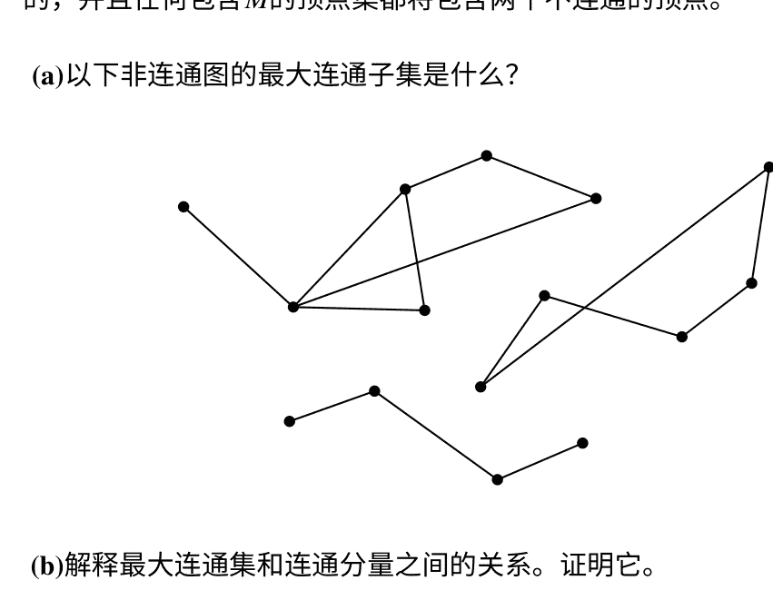

- (b)解释最大连通集和连通分量之间的关系。证明它。

#### 问题11.47。
(a)证明 K_n 是 (n-1)边连通的，对于 n > 1。
设 M_n 是一个如下定义的图：首先取具有不重叠顶点集的N个图，其中每个图都是 (n-1)边连通的（例如，它们可以是 K_n 的不相交副本）。这些将是 M_n 的子图。
然后从每个子图中选择一个顶点，并在所选顶点之间添加足够的边，使得所选顶点的子图也是 (n-1)边连通的。

- (b)画出 M_4 的图。

(c)解释为什么 \(M_n\) 是 \((n-1)\) 边连通的。

#### 问题 11.48.
错误的声明。如果图中的每个顶点都有正度，则图是连通的。

- (a)通过提供一个反例来证明这个声明确实是错误的。

- (b)既然这个声明是错误的，那么以下错误证明中一定存在逻辑错误。找出证明中的第一个逻辑错误（不合理的步骤）。

错误的证明。我们通过归纳法证明上述声明。设 \(P(n)\) 是命题，即如果图中的每个顶点都有正度，则图是连通的。

基本情况: \((n \leq 2)\). 在一个只有1个顶点的图中，该顶点不能有正度，因此 \(P(1)\) 是空洞的。
由于只有一个具有两个正度顶点的图，即顶点之间有一条边的图，而这个图是连通的，所以 \(P(2)\) 成立。

归纳步骤：我们必须证明 \(P(n)\) 蕴含 \(P(n+1)\) 对于所有的 \(n \geq 2\)。考虑一个有 \(n\) 个顶点的图，其中每个顶点的度数都是正的。根据假设 \(P(n)\)，这个图是连通的；也就是说，每对顶点之间都存在一条路径。现在我们添加一个额外的顶点 \(x\) 来得到一个有 \((n+1)\) 个顶点的图：

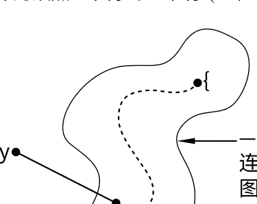

唯一剩下的就是检查是否存在一条从 \(x\) 到其他每个顶点 \(z\) 的路径。由于 \(x\) 的度数是正的，所以存在一条从 \(x\) 到另一个顶点 \(y\) 的边。因此，我们可以通过从 \(x\) 到 \(y\)，然后沿着从 \(y\) 到 \(z\) 的路径来得到一条从 \(x\) 到 \(z\) 的路径。这证明了 \(P(n+1)\)。

# 第11章 简单图

根据归纳原理，对于所有的 $n \geq 0$， $P(n)$都成立，这证明了该命题。

# 作业问题

### 问题 11.49.

+   如果边的一端在集合中，另一端不在集合中，则称其为离开集合的边。
+   (a) 如果每个集合都有一条边离开，那么一个有$n$个节点的图被称为混乱的，其中$\lfloor n/2 \rfloor$或更少的顶点。证明以下命题：命题. 每个混乱的图都是连通的。
+   如果每个集合都有一条边离开，那么一个有$n$个节点的图被称为纠缠的，其中$\lfloor n/3 \rfloor$或更少的顶点。
+   (b) 画一个不连通的纠缠图。
+   (c) 找出以下错误的证明

错误命题. 每个纠缠的图都是连通的。

错误的证明. 该证明是对图中顶点数量进行强归纳的。令$P(n)$为命题，如果一个有$n$个节点的纠缠图，则它是连通的。在基本情况下，$P(1)$是真的，因为只有一个节点的图是显然连通的。

对于归纳情况，假设 $n \geq 1$和$P(1), \ldots, P(n)$成立。我们必须证明$P(n + 1)$，即如果一个 $(n + 1)$节点的图是纠缠的，则它是连通的。
所以让 $G$是一个纠缠的，$(n + 1)$节点的图。选择 $\lfloor n/3 \rfloor$作为顶点，并让 $G_1$是由这些顶点构成的纠缠子图，$G_2$是由其余顶点构成的纠缠子图。注意，由于 $n \geq 1$，图 $G$至少有两个顶点，因此 $G_1$和 $G_2$都至少包含一个顶点。由于 $G_1$和 $G_2$是纠缠的，根据强归纳法，我们可以假设它们都是连通的。而且，由于 $G$是纠缠的，存在一条从$G_1$的顶点出发的边，必然连接到 $G_2$的一个顶点。这意味着 $G$的任意两个顶点之间存在一条路径：如果两个顶点在同一个子图中，则路径在该子图内部；如果顶点在不同的子图中，则路径经过连接边。因此，整个图 $G$是连通的。这完成了归纳情况的证明，根据强归纳法，结论成立。

### 11.11. 参考文献

### 问题 11.50.

在长度为 $2n$ 的循环 $C_{2n}$ 中，如果两个顶点在循环的相对位置上，即在 $C_n$ 中相距 $n$ 个位置，则称它们为相对的。设 $G$ 是由 $C_{2n}$ 形成的图，通过在每对相对顶点之间添加一条称为交叉边的边而形成。所以 $G$ 有 $n$ 条交叉边。

(a) 给出 $G$ 中任意两个顶点之间最短路径的简单描述。提示：证明 $G$ 中任意两个顶点之间的最短路径最多使用一条交叉边。
(b) $G$ 的直径是多少，即两个顶点之间的最大距离是多少？
(c) 证明该图不是4连通的。
(d) 证明该图是3连通的。

# 考试题目

### 问题 11.51.

我们对一个简单图 $G$ 应用以下操作：选择两个顶点 $u \neq v$ 使得要么

1.  $G$ 中存在一条边连接 $u$ 和 $v$，并且存在一条从 $u$ 到 $v$ 的路径该路径不包括这条边；在这种情况下，删除边 $\{u, v\}$。
2.  从 $u$ 到 $v$ 不存在路径；在这种情况下，添加边 $\{u, v\}$。

重复这些操作，直到不再存在可以应用操作的两个顶点 $u \neq v$。

假设 $G$ 的顶点是整数 $1, 2, \dots, n$，其中 $n \geq 2$。这个过程可以建模为一个状态机，其状态是所有可能的具有顶点 $1, 2, \dots, n$ 的简单图。$G$ 是初始状态，最终状态是无法进行任何操作的图。

(a) 假设 $G$ 是具有顶点 $\{1, 2, 3, 4\}$ 和边的图 $\{\{1, 2\}, \{3, 4\}\}$ 从起始状态 $G$ 有多少个可能的最终状态可达？
(b) 在下面的每个派生状态变量旁边，指示变量保证满足的最强属性，无论起始图 $G$ 是什么。这些属性包括：常数、递增、递减、非递增、非递减、无法确定。

| 变量 | 属性 |
| :--- | :--- |
| (0) $e$ | 无法确定 |
| (i) $c$ | 非递增 |
| (ii) $c + e$ | 无法确定 |
| (iii) $2c + e$ | 严格递减 |
| (iv) $c + \frac{e}{e+1}$ | 无法确定 |

(c) 解释为什么从任何状态开始，过程都会终止。如果你的解释依赖于你对部分(b)的答案，你必须证明这些答案的合理性。
(d) 证明任何最终状态必须是顶点集上的无序树，即生成树。

### 问题11.52.

如果一个简单图有 $e$ 条边，$v$ 个顶点和 $k$ 个连通分量，那么它至少有 $e - v + k$ 个环。
通过对边数进行归纳来证明这一点，$e$。

# 第11.10节的问题

# 练习题

问题11.53. (a) 证明一棵树的平均度数小于2。
(b) 假设图中的每个顶点的度至少为 $k$。解释为什么图中存在一条长度为 $k$ 的路径。提示：考虑最长路径。

问题 11.54. (a) 图中的图 $G$ 有多少个生成树？
(b) 对于 $G - e$，删除顶点 $e$ 后，描述两个没有公共边的生成树。
(c) 对于删除边 $\{a—d\}$ 的图 $G – e$，解释为什么不能有两个边不相交的生成树。提示：计算顶点和边的数量。

### 问题 11.55.

证明如果 $G$ 是一棵森林且

$$|V(G)| = |E(G)| + 1, \tag{11.8}$$

那么 $G$ 是一棵树。

### 问题 11.56.

让 $H_3$ 是图 11.34 中显示的图。解释为什么不可能找到两个没有公共边的 $H_3$ 的生成树。

# 考试问题

问题 11.57. (a) 让 $T$ 是一棵树，$e$ 是两个顶点之间的新边。
解释为什么 $T + e$ 必须包含一个循环。
(b) 证明 $T + e$ 除了 $T$ 之外必须还有另一棵生成树。

### 问题11.58

一个连通图的直径是任意两个顶点之间的最大距离。
+   (a) 在具有 $n$ 个顶点的任意连通图中，最大可能的直径是多少？描述一个具有这个最大直径的图。
+   (b) 对于具有 $n$ 个顶点的树，最小可能的直径是多少（$n > 2$）？描述一个具有这个最小直径的 $n$ 个顶点的树。

### 问题11.59

(a) 在图同构下保持以下属性的选项用圈出来。
+   存在一个包含所有顶点的循环。
+   两条边的长度相等。
+   如果移除任意两条边，图仍然连通。
+   存在一条边是每个生成树的边。
+   在同构下保持的属性的否定。
(b) 对于关于有限树的以下陈述，圈出 true 或 false，并为那些为 false 的提供反例。
+   任何连通的子图都是一棵树。 正确 / false
+   在两个非相邻的顶点之间添加一条边会形成一个环。 真 / 假
+   顶点的数量比叶子的数量少一。 真 / 假
+   顶点的数量比边的数量少一。 真 / false

### 问题11.60。

(a) $G$有一棵生成树。 正确 / false
(b) $|V(G)| = O(|E(G)|)$ 对于连通的 $G$。 正确 / false
(c) $\chi(G) \leq \max\{\deg(v) \mid v \in V(G)\}$。$^{13}$ 正确 / false
(d) $|V(G)| = O(\chi(G))$。 正确 / false

### 问题11.61。

一个简单图 $G$ 的宽度为1，如果存在一种方式将所有顶点列出，使得每个顶点至多与出现在列表中较早的一个顶点相邻。下面提到的所有图都被假定为有限图。
(a) 证明宽度为一的图是森林。提示：通过归纳法，移除最后一个顶点。
(b) 证明每个有限树的宽度为一。得出结论，图是森林当且仅当它的宽度为一。

### 问题11.62。

通过归纳法证明，在使用固定的 $n > 1$ 个颜色的情况下，任何具有 $m$ 个顶点的树有恰好 $n^m$ 种不同的着色方式。

# 课堂问题

### 问题11.63。

过程标记从一个连接的简单图开始，所有边都未标记，然后标记一些边。
在过程的任何时刻，只包括已标记边的路径称为完全标记路径，而没有完全标记路径的边称为可选边。
过程马克简单地标记符合条件的边，并在没有边符合条件时终止。
证明马克终止，并且当它终止时，标记的边集合形成原始图的生成树。

### 问题 11.64.

连接（可能是不连通的）简单图并创建生成树的过程可以建模为一个状态机，其状态是有限的简单图。当没有进一步的转换时，状态是最终的。转换由以下规则确定：

> **创建生成树的过程**
>
> 1.  如果在一个循环上存在边 $u—v$，则删除边 $u—v$。
> 2.  如果顶点 $u$ 和 $v$ 不相连，则添加边 $u—v$。

**(a)** 绘制从具有顶点 $\{1, 2, 3, 4\}$ 和边的图开始可达的所有可能的最终状态。
$\{\{1—2\}, \{3—4\}\}$。

**(b)** 证明如果机器达到最终状态，则最终状态将是起始图上的树的顶点图。

**(c)** 对于任何图 $G'$，让 $e$ 为 $G'$ 中的边数，$c$ 为它的连通分量数，$s$ 为循环数。对于下面的每个量，指出它所保证满足的最强属性，无论起始图是什么。属性的选择为：常数，严格增加，严格减少，弱增加，弱减少，无法确定。

| 量 | 属性 |
| :--- | :--- |
| (i) $e$ | 无法确定 |
| (ii) $c$ | 弱减少 |
| (iii) $s$ | 严格减少 |
| (iv) $e - s$ | 弱减少 |
| (v) $c + e$ | 无法确定 |
| (vi) $3c + 2e$ | 严格减少 |
| (vii) $c + s$ | 严格减少 |

**(d)** 证明在每次转换中，部分(c)中的某个量严格减少。得出结论，对于每个起始状态，机器将达到一个最终状态。

### 问题11.65。

证明一个图是一棵树当且仅当它的每两个顶点之间有一条唯一路径。

### 问题11.66。

设 $G$ 是一个加权图，并假设存在一条唯一的边 $e \in E(G)$ 具有最小权重，即 $w(e) < w(f)$ 对于所有的边 $f \in E(G) - \{ e\}$。证明 $G$ 的任何最小权重生成树(MST)必须包括边 $e$。

### 问题11.67。

设 $G$ 是一个 $4 \times 4$ 的网格，相邻顶点之间有垂直和水平边。形式上，
$$V(G) = [0,3]^2 ::= \{ (k,j) \mid 0 \leq k, j \leq 3 \}.$$
令 $h_{i,j}$ 为水平边 $((i, j) — (i+1, j))$, $v_{j,i}$ 为垂直边 $((j, i) — (j, i+1))$, 这些边的权重为
$$w(h_{i,j}) ::= \frac{4i + j}{100}, \quad w(v_{j,i}) ::= 1 + \frac{i + 4j}{100}.$$
(画一个 $G$ 的图片会有帮助；你可能想画一个。)
+   (a) 通过首先选择最小权重的边，然后连续选择不与先前选择的边形成环的最小权重的边，构建 $G$ 的最小权重生成树 (MST)。当选择的边形成 $G$ 的生成树时停止。 (这是Kruskal的MST算法。)
+   (b) 从只包含单个顶点(1,2)开始，使用最小权重的边将其添加到树中，直到生成 $G$ 的最小生成树。当树覆盖了 $G$时停止。(这是Prim的最小生成树算法。)
+   (c) 通过将顶点(0,0), (0,3), (2,3)视为1个顶点树，并且并行地为每个树添加最小权重的边来生成$G$的最小生成树。在具有一个端点在树中的边中选择最小权重的边。只要没有两个树之间的边，就继续执行，然后返回应用一般的灰色边方法，直到并行树合并形成G的生成树。（这是6.042的并行MST算法。）
+   (d) 验证你每次得到的最小生成树是相同的。

### 问题 11.68.

在这个问题中，你将证明：
**定理.** 一个图 $G$是2可着色的当且仅当它不包含奇数长度的闭合路径。
和“当且仅当”断言一样，证明分为两个部分：部分（a）要求你证明左边的“当且仅当”蕴含右边。其他问题部分证明右边蕴含左边。
（a）假设左边，证明右边。三到五个句子足够了。
（b）现在假设右边。作为证明左边的第一步，解释为什么我们可以将焦点放在图 $G$中的一个单独连通分量 $H$上。
（c）作为第二步，解释如何对任何树进行2着色。
（d）选择一个生成树 $T$的任意2着色，$H$的。通过展示任何不在 $T$中的边也连接了不同颜色的顶点，证明 $H$是2可着色的。

# 作业问题

### 问题 11.69.

设 $D = (d_1, d_2, ..., d_n)$ 是一系列正整数，其中 $n \geq 2$.
(a) 假设 $D$是某个 $n$-顶点树 $T$的顶点度数列表，即，$d_i$是 $T$的第 $i$个顶点的度数。解释为什么
$$\sum_{i=1}^{n} d_i = 2(n - 1) \qquad (11.9)$$
(b) 反过来证明，如果 $D$满足方程 (11.9)，那么 $D$是某个 $n$-顶点树的顶点度数列表。提示：归纳法。
(c) 假设 $D$ 满足方程 (11.9)。证明可以将 $D$ 分成两个集合 $S_1$, $S_2$，使得每个集合中元素的和相等。提示：树是二分的。

### 问题 11.70.

证明推论 11.10.12：如果有限加权图中的所有边都具有不同的权重，则该图具有唯一的最小生成树。提示：假设 $M$ 和 $N$ 是同一图的不同最小生成树。令 $e$ 是其中一个最小生成树中最小的边，而不是另一个最小生成树中的边，假设 $e$ 在 $M$ 中而不在 $N$ 中，观察到 $N$ 中的任意 $e$ 边必定形成一个环。

# ## 12 平面图

### 12.1 在平面上绘制图形

假设有三个狗窝和三个人类住宅，如图 12.1 所示。你能找到一条从每个狗窝到每个人类住宅的路径，使得没有路径相交吗？

关于一种叫做四足兽的鲜为人知的动物，也会出现类似的问题，它看起来像一个有四只伸缩臂的章鱼，而不是八只。 如果有五只四足兽在海底休息，如图 12.2 所示，是否可以使每只四足兽同时与其他每只握手，而不交叉？

这两个谜题都可以理解为在平面上绘制图形的问题。 将狗和房子替换为节点，狗屋谜题可以重新表述为是否存在一个具有六个节点和边的平面图的绘制。 这个图被称为完全二分图$K_{3,3}$，并在图12.3.(a)中显示。 四角谜题问的是是否存在一个完全图$K_5$的平面绘制，如图12.3.(b)所示。

在每种情况下，答案都是“不行，但几乎可以！ ”实际上，如果从这些图中删除一条边，那么结果图可以重新绘制在平面上，使得没有边相交，如图12.4所示。

平面绘制在电路布局中有应用，并且有助于显示图形数据，如程序流程图、组织结构图和调度冲突。 对于这些应用，目标是在平面上尽可能少地交叉绘制图形。 （请参见下一页上的一个示例框。）

### 12.2 平面图的定义

在前一节中，我们对平面图的绘制理念已经默认了，但是如果我们要证明关于平面图的事实，我们最好有准确的定义。

**定义 12.2.1.** 图的绘制将每个节点分配给平面上的一个不同点，并将每条边分配给平面上的一条光滑曲线，其端点对应于与边关联的节点。 如果没有边相交，那么这个绘制是平面的。

曲线交叉自身或其他曲线，即，在任何曲线上出现多次的点只有节点。当图形具有平面绘制时，它是平面的。

定义12.2.1是精确的，但依赖于进一步的概念：“平滑的平面曲线”和它们上面“出现多次”的点。我们还没有定义这些概念-我们只是在图12.4中展示了简单的图片，并希望你能理解。

图片可以是传达新想法的好方法，但通常不是用图片来替代精确的数学的好主意。仅仅依靠图片有时可能导致灾难-或者至少导致虚假的证明。关于平面图的虚假证明有着悠久的历史，这些证明是基于误导性的图片。

坏消息是，要使用定义12.2.1的平面绘制来证明关于平面图的事实，我们必须进行一个长篇章的连续数学之旅，以便从平面几何和点集拓扑学中发展出所需的概念。好消息是，还有另一种方法来定义平面图，只使用离散数学。特别地，我们可以将平面图定义为递归数据类型。为了理解它的工作原理，我们首先需要理解平面绘制中“面”的概念。

#### 12.2.1 面

平面图中的曲线将平面分割成连通区域，称为图的连续面$^{1}$。例如，图12.5中的图有四个连续面。面IV在所有方向上延伸到无穷远，称为外部面。

图12.5中每个连续面的边界上的顶点形成一个循环。例如，如图12.6所示，将顶点标记为$a,b,c,d$，每个面的边界循环可以用顶点序列来描述。

$$abca, \quad abda, \quad bcdb, \quad acda. \tag{12.1}$$

这四个循环与图12.6中的四个连续面相对应，非常匹配，事实上，我们可以通过循环来识别图12.6中的每个面。例如，循环$abca$可以识别面III。列表12.1中的循环称为图12.6中的离散面。我们使用“离散”这个术语，因为图中的循环是一种离散数据类型，与平面上的区域相对应，后者是一种连续数据类型。

---
$^{13}$ $\chi(G)$是图G的色数。

## 第12章 平面图

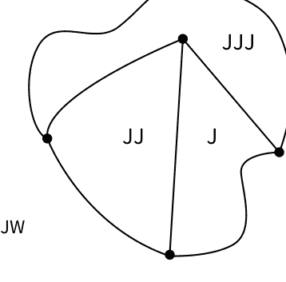

图12.5 一个具有四个连续面的平面图。

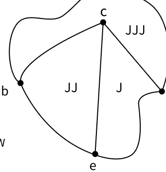

图12.6 带有标记顶点的图。

### 12.2 平面图的定义

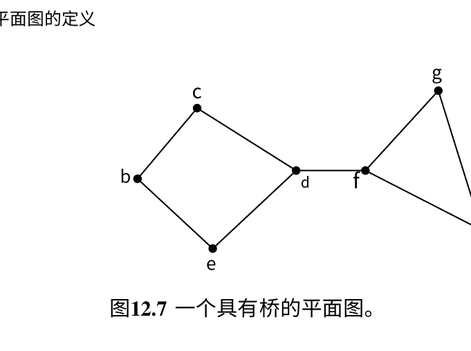

不幸的是，平面图中的连续面并不总是由图中的环界定的——情况可能会变得更加复杂。例如，图12.7中的平面图具有我们称之为桥的特征，即一条割边（c—e）。沿着绘图外部区域边界的顶点序列是

```
abce fgecda.
```

这个序列定义了一个闭合行走，但不构成一个环，因为该行走中有两个桥（c—e）及其各自的端点。

图12.8中的平面图示了另一个复杂情况。这个图有一个我们称之为“dongle”的东西，即节点 v, x, y 和 w 以及与它们相连的边。沿着内部区域边界的顶点序列是

```
rstvxyxvwvtur.
```

这个序列定义了一个闭行走，但是再次强调，它并不定义一个循环，因为它对于dongle的每条边都有两次出现——一次“来”一次“去”。

#### 12.2.2 平面嵌入的递归定义

平面图的连续面与闭合路径之间的关联提供了离散数据类型，我们可以用它来代替连续图。我们将连通图的平面嵌入定义为其面边界的闭合路径集合。由于我们在图中只关心连接顶点——而不是图的绘图样式——平面嵌入正是我们所需要的。

问题是如何在不依赖连续绘图的情况下定义平面嵌入。有一种简单的方法可以基于连续绘图逐步绘制：

- 要么在平面上的某个位置绘制一个新点来表示一个顶点，
- 要么在已经放置的两个顶点之间绘制一条曲线，确保新曲线不会穿过先前绘制的任何曲线。

当一条新曲线保持在连续面之一内时，它不会与任何其他曲线相交。或者，当一条新曲线能够在两个不同绘图的外部面之间移动时，它就不需要与任何其他曲线相交。因此，为了确保可以画出一条新曲线，我们只需要检查它的端点是否在同一个面的边界上，或者它的端点是否在不同绘图的外部面上。当然，画出新曲线会稍微改变面的形状，因此一旦画出新曲线，面的边界将需要更新。这是以下递归定义的思想。

定义12.2.2. 一个连通图的平面嵌入包括图的一组闭合行走，称为嵌入的离散面。平面嵌入的定义如下递归进行：

基本情况：如果 G 是由单个顶点 v 组成的图，则 G 的平面嵌入有一个离散面，即长度为零的闭合行走 v。

构造情况（分割面）：假设 $G$ 是一个具有平面嵌入的连通图，并且假设 $a$ 和 $b$ 是 $G$ 中某个离散面 $\gamma$ 中的不同、不相邻的顶点。也就是说，$\gamma$ 是一个闭行走，形式为

$$\gamma = \alpha \beta$$

其中 $\alpha$ 是从 $a$ 到 $b$ 的行走，$\beta$ 是从 b 到 a 的行走。然后，通过在 $G$ 的边上添加边 $\langle a—b \rangle$，得到的图具有与 $G$ 相同的平面嵌入的离散面，只是面 $\gamma$ 被两个离散面 $\langle b—a\rangle$ 和 $\langle a—b\rangle^\beta$ 替代。(12.2)

如图12.9所示。3

构造情况（添加一座桥）：假设 $G$ 和 $H$ 是具有平面嵌入和不相交顶点集的连通图。设 $\gamma$ 是 $G$ 的一个离散面，并假设 $\gamma$ 从顶点 $a$ 开始并结束。同样，设 $\delta$ 是 $H$ 的一个离散面，从顶点 $b$ 开始并结束。

然后，通过一条新边连接 G 和 H，得到的图具有一个平面嵌入，其离散面是 G 和 H 的离散面的并集，只是将面 γ 和 δ 替换为一个新面

```
`γ ^ 〈a—b〉 ^ δ ^ 〈b—a〉.`
```

这在图12.10中有所说明，其中 G 和 H 的顶点序列为：

```
`G : {axyza, axya, ayza } H : {btuvwb, btvwb, tuvt }`
```

在添加桥之后，有一个单连通图，其面的顶点序列为

```
`{axyzabtuvwba, axya, ayza, btvwb, tuvt }`
```

桥只是一个割边，在平面嵌入的上下文中，桥正好是在同一离散面上出现两次的边，而不是在两个面上各出现一次。Dongles是由桥构成的树；我们只在插图中使用dangles，所以没有必要更精确地定义它们。

2在特殊情况下，当 $G$ 是以 $a$ 开始并以 $b$ 结束的线图时，对于嵌入的定义有一个小例外。在这种情况下，$\gamma$ 分裂成的循环实际上是相同的。这是因为添加边缘 $\langle a—b\rangle$ 会创建一个将平面分割为“内部”和“外部”连续面的循环，而这两个面都由该循环作为边界。为了在这种情况下保持连续面和离散面之间的对应关系，我们将嵌入的两个离散面定义为这个相同循环的两个“副本”。

3从形式上讲，合并是对路径的操作，而不是对路径和边的操作，所以在（12.2）中，我们应该使用一条路径 $(a \langle a—b\rangle b)$ 而不是一条边 $\langle a—b\rangle$ 并且写成

$\alpha \langle b \langle b—a\rangle a\rangle$ 和 $(a \langle a—b\rangle b)\beta$

#### 12.2.3 它有效吗？

是的！一般来说，如果一个图根据定义12.2.1有一个平面图绘制，那么它是平面的，当且仅当它的每个连通分量都有一个根据定义12.2.2指定的平面嵌入。当然，我们不能在不进行一次对连续数学的探索的情况下证明这一点，而我们正试图避免这种情况。但是，现在递归定义了平面图，我们将不再需要回到连续的东西上。这是好消息。

坏消息是，定义12.2.2比直观的不相交边的绘图概念更加技术性。在许多情况下，更容易坚持平面绘图的概念并在这些术语中给出证明。例如，从平面绘图中删除边肯定会得到一个平面绘图。另一方面，虽然当然是真的，但从平面嵌入中删除一条边仍然可以得到一个平面嵌入（参见问题12.9）。对于专家来说，也许对于你来说，通过绘图来证明关于平面图的证明是令人信服和可靠的。但考虑到此类证明中的长期错误历史，从精确的平面嵌入定义开始工作更安全。更一般地说，看到如何成功地使用离散数据类型来模拟平面曲线绘图的抽象属性也很重要。

#### 12.2.4 外部面去哪了？

每个平面图都有一个立即可识别的外部面——它是那个在所有方向上都无限延伸的面。但是在平面嵌入中，外部面在哪里？

其实没有！这是因为没有必要区分一个面和另一个面。事实上，可以用任何给定的面作为外部面来绘制平面嵌入。对此的一个直观解释是将嵌入绘制在一个球面上，而不是平面上。然后，通过“穿孔”球面上的那个面，将穿孔孔洞拉伸成环绕其他面的圆，并将圆形绘制展平到平面上，任何一个面都可以成为外部面。

因此，显示不同“外部”边界的图片实际上可能是相同平面嵌入的插图。例如，图12.11中显示的两个嵌入实际上是相同的——检查一下：它们具有相同的边界循环。

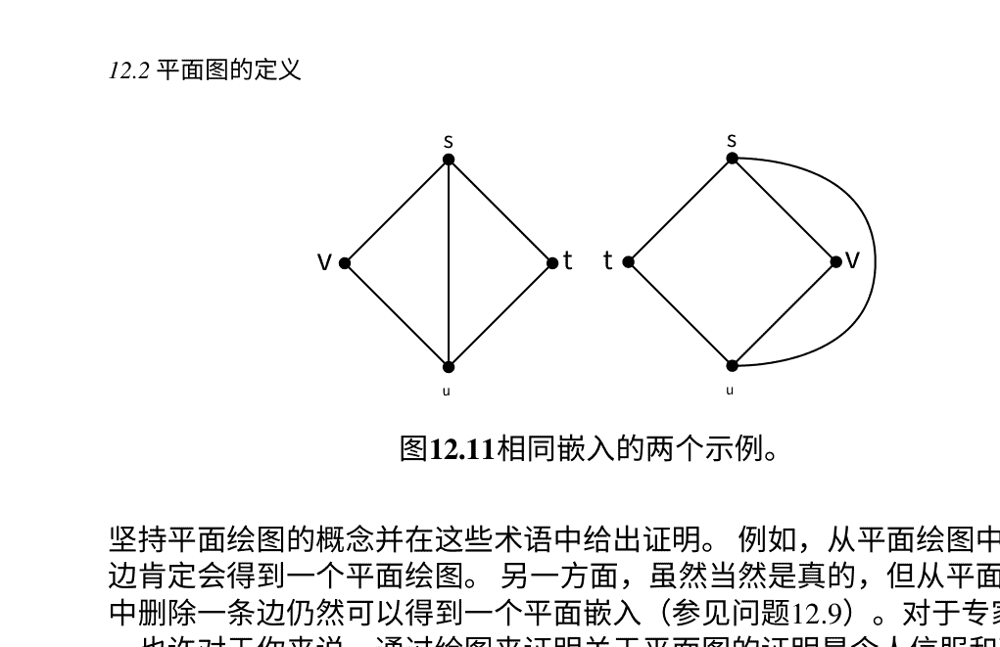

图12.11 相同嵌入的两个示例。

这就是在定义12.2.2中证明“添加桥梁”情况的原因：无论在每个不相交的平面图的嵌入中选择哪个面，我们都可以在绘图中在它们之间画一座桥梁，而不需要穿越任何其他边，因为我们可以假设这座桥梁连接两个“外部”面。

### 12.3 欧拉公式

递归定义的价值在于它提供了一种强大的技术，用于证明平面图的性质，即结构归纳。例如，我们现在将使用定义12.2.2和结构归纳来建立一个连接的平面图的最基本性质，即顶点和边的数量完全确定了图的每个可能的平面嵌入中的面的数量。

定理12.3.1（欧拉公式）。如果一个连通图有一个平面嵌入，那么

$$v - e + f = 2$$

其中 $v$ 是顶点的数量，$e$ 是边的数量，$f$ 是面的数量。

例如，在图12.5中，$v = 4$, $e = 6$, $f = 4$。果然，$4 - 6 + 4 = 2$，正如欧拉公式所述。

证明。该证明通过对平面嵌入定义的结构归纳进行。设 $P.(\mathcal{E})$ 是嵌入 $\mathcal{E}$ 的命题，其中 $v - e + f = 2$。

基本情况（$\mathcal{E}$ 是单顶点平面嵌入）：根据定义，$v = 1$, $e = 0$，并且 $f = 1$，所以 $1 - 0 + 1 = 2$，因此 $P.(\mathcal{E})$ 确实成立。

构造器情况（分割一个面）：假设 $G$ 是一个具有平面嵌入的连通图，并且假设 $a$ 和 $b$ 是 $G$ 上的不同的、不相邻的顶点，它们出现在平面嵌入的某个离散面 $\gamma = a \ldots b \cdots a$ 上。

那么通过在 $G$ 的边上添加边 $\langle a\text{---}b \rangle$，得到的图具有比 $G$ 多一个面和一个边的平面嵌入。因此，对于这两个图，数量 $v - e + f$ 保持不变，而且由于结构归纳可知，对于 $G$ 的嵌入，这个数量为2，对于带有添加边的 $G$ 的嵌入，这个数量也为2。因此，对于构造的嵌入，$P$ 成立。

构造器情况（添加桥）：假设 $G$ 和 $H$ 是具有平面嵌入和不相交顶点集的连通图。然后，通过桥连接这两个图，将两个桥接面合并为一个面，并保持所有其他面不变。因此，桥操作产生了一个连通图的平面嵌入。

具有v个顶点的图G + H，具有e个边的图G + H，具有f个面的图G + H。由于 $(v_G + v_H) - (e_G + e_H + 1) + (f_G + f_H - 1) = (v_G - e_G + f_G) + (v_H - e_H + f_H) - 2 = (2) + (2) - 2 \quad （通过结构归纳假设）= 2,$ $v - e + f$ 对于构造的嵌入仍然等于2。也就是说，$P.(\mathcal{E})$ 在这种情况下也成立。这完成了构造情况的证明，通过结构归纳，定理得证。

### 12.4 限制平面图中边的数量

像欧拉公式一样，以下引理直接通过结构归纳从定义12.2.2得出。

引理12.4.1. 在一个连通图的平面嵌入中，每条边在两个不同的面中各出现一次，或者在一个面中出现两次。

引理12.4.2. 在一个至少有三个顶点的连通图的平面嵌入中，每个面的长度至少为三。

将引理12.4.1和12.4.2与欧拉公式结合起来，我们现在可以证明平面图的边数是有限的：

定理12.4.3. 假设一个连通的平面图有 $v \geq 3$ 个顶点和 $e$ 条边。那么 $e \leq 3v - 6.$ (12.3)

证明。根据定义，一个连通图是平面图当且仅当它有一个平面嵌入。所以假设一个具有 $v$ 个顶点和 $e$ 条边的连通图有一个平面嵌入，其中 $f$ 个面。根据引理12.4.1，每条边在面的边界上恰好出现两次。因此，面边界的长度之和正好为 $2e$。根据引理12.4.2，当 $v \geq 3$ 时，每个面的边界长度至少为三，所以这个和至少为 $3f$。这意味着 $3f \leq 2e.$ (12.4)

但是根据欧拉公式，有 $f = e - v + 2$，代入(12.4)得到
$$3(e - v + 2) \le 2e$$
$$e - 3v + 6 \le 0$$
$$e \le 3v - 6$$

### 12.5 回到 $K_5$ 和 $K_{3,3}$

最后，我们有一个简单的方法来回答本章开头的四足动物问题：这五个四足动物不能都握手而不交叉。原因是我们知道四足动物问题等同于问完全图 $K_5$ 是否可平面，而定理12.4.3立即得到：

推论 12.5.1. $K_5$ 不是可平面的。

证明. $K_5$ 是连通的，有5个顶点和10条边。但是由于 $10 > 3 \cdot 5 - 6$，$K_5$ 不满足所有可平面图中的不等式（12.3）。

我们还可以使用欧拉公式来证明 $K_{3,3}$ 不是可平面的。证明与定理 12.3 的证明类似，只是我们使用了额外的事实，即 $K_{3,3}$ 是一个二分图。

引理 12.5.2. 在一个至少有3个顶点的可平面二分图的嵌入中，每个面的长度至少为4。

证明. 根据引理 12.4.2，图的每个面在可平面嵌入中的长度至少为3。但是根据引理 11.7.2 和定理 11.9.3.3，二分图不能有奇数长度的闭合路径。由于可平面嵌入的面是闭合路径，在二分嵌入中不能有长度为3的面。因此，每个面的长度至少为4。

定理12.5.3. 假设一个具有 $v \ge 3$ 个顶点和 $e$ 条边的连通二分图是可平面的。那么
$$e \le 2v - 4. \tag{12.5}$$
证明. 引理12.5.2表明，图的嵌入的所有面的长度至少为4。现在，按照定理12.4.3的证明中的论证，我们发现面边界的长度之和恰好为 $2e$，并且至少为 $4f$。因此，
$$4f \le 2e \tag{12.6}$$

根据欧拉公式，$f = e - v + 2$，代入(12.6)得到
$$4(e - v + 2) \le 2e$$
$$4e - 4v + 8 \le 2e$$
$$2e \le 4v - 8$$
$$e \le 2v - 4$$

### 12.6 平面图的着色

我们已经涵盖了很多关于平面图的内容，但还远远不足以证明著名的四色定理。但我们可以非常接近。事实上，我们已经做了几乎足够的工作，证明了每个平面图只需要使用5种颜色就可以着色。

关于可平面性，有两个我们需要知道的熟知事实。

引理12.6.1. 任何平面图的子图仍然是可平面的。

引理 12.6.2. 合并平面图中相邻的两个顶点会得到另一个平面图。

合并两个相邻的顶点，$n_1$ 和 $n_2$ 意味着删除这两个顶点，然后用一个新的“合并”顶点，$m$，替换它们，该顶点与原来与 $n_1$ 或 $n_2$ 相邻的所有顶点都相邻，如图12.12所示。许多作者在描述由定义12.2.1描述的平面图的连续绘制时都默认使用引理12.6.1和12.6.2。通过递归定义12.2.2，这两个引理实际上可以使用结构归纳法证明（见问题12.9）。我们只需要另一个引理：

引理 12.6.3. 每个平面图都有一个度数不超过五的顶点。

证明。假设相反，某个平面图的每个顶点的度数至少为6，则顶点度数的总和至少为 $6v$。但是根据握手引理11.2.1，顶点度数的总和等于 $2e$，所以我们有 $e \geq 3v$ 与定理12.4.3的事实相矛盾，即 $e \leq 3v -6 < 3v$。

定理12.6.4. 每个平面图都可以用五种颜色着色。

证明。证明将通过对顶点数 $v$ 进行强归纳来进行。归纳假设为：

具有 $v$ 个顶点的每个平面图都可以用五种颜色着色。

基本情况 $(v \le 5)$：立即。

归纳情况: 假设 $G$ 是一个具有 $v+1$ 个顶点的平面图。我们将描述一个五色染色的 $G$。

首先，选择一个度数不超过5的顶点 $g$，引理12.6.3保证一定存在这样的顶点。

情况1: ($\deg(g) < 5$): 从 $G$ 中删除 $g$ 得到一个图 $H$，根据引理12.6.1，$H$ 是平面图，并且由于 $H$ 有 $v$ 个顶点，根据归纳假设，它是五色染色的。现在定义 $G$ 的五色染色如下: 对于除 $g$ 之外的所有顶点，使用 $H$ 的五色染色，并为 $g$ 分配与其邻居的颜色不同的五种颜色之一。由于邻居少于5个，总会有一种颜色可用于 $g$。

情况2: ($\deg(g) = 5$): 如果 $g$ 在 $G$ 中的五个邻居都相邻，则这五个顶点将形成一个同构于非平面子图 $K_5$ 的子图，与引理12.6.1相矛盾 (因为 $K_5$ 不是平面图)。所以必须存在两个邻居，$n_1$ 和 $n_2$，它们与 $g$ 不相邻。现在将 $n_1$ 和 $g$ 合并为一个新顶点 $m$。在这个新图中，$n_2$ 与 $m$ 相邻，并且根据引理12.6.2，该图是平面图。因此，我们可以将 $m$ 和 $n_2$ 合并为另一个新顶点 $m'$，得到一个新图 $G'$，根据引理12.6.2，该图也是平面图。由于 $G'$ 有 $v - 1$ 个顶点，根据归纳假设，它可以用五种颜色着色。

现在定义 $G$ 的五着色如下：除了 $g, n_1$ 和 $n_2$ 之外的所有顶点都使用 $G'$ 的五着色。接下来，将 $G'$ 中的 $m'$ 的颜色分配给邻居 $n_1$ 和 $n_2$。由于 $n_1$ 和 $n_2$ 在 $G$ 中不相邻，这定义了 $G$ 的一个合适的五着色，除了顶点 $g$。但由于 $g$ 的这两个邻居具有相同的颜色，$g$ 的邻居总共使用的颜色少于五种。因此，通过将五种颜色中与其邻居分配的颜色不同的一种颜色分配给 $g$，完成 $G$ 的五着色。

### 12.7 多面体的分类

毕达哥拉斯学派有两个伟大的数学秘密，即无理数性质 $\sqrt{2}$ 和一个我们即将重新发现的几何构造！一个正多面体是一个由有限个多边形面界定的凸三维区域。如果面是相同的正多边形，并且每个角相交的多边形数量相等，则多面体是正则的。图12.13中显示了三个正则多面体的例子：四面体、立方体和八面体。

我们可以通过考虑平面性来确定还有多少个正则多面体。假设我们取任何多面体并将一个球体放在其中。然后我们可以将多面体的面边界投影到球体上，这将给出一个嵌入在球体上的平面图像，其中多面体角的图像对应于图的顶点。我们已经观察到在球体上的嵌入与在平面上的嵌入是相同的，因此欧拉的平面图公式可以帮助我们寻找正则多面体。

例如，图12.1中的三个多面体的平面嵌入显示在图12.14中。

设 $m$ 为每个角上相交的面的数量，设 $n$ 为每个面上的边的数量。在相应的平面图中，每个顶点有 $m$ 条边与之相连。根据握手引理11.2.1，我们## 第12章 平面图

图12.13 四面体 (a)、立方体 (b) 和八面体 (c)。

图12.14 四面体 (a)、立方体 (b) 和八面体 (c) 的平面嵌入。

## 12.7 对多面体进行分类

| n | m | v | e | f | 多面体 |
|---|---|---|---|---|--------|
| 3 | 3 | 4 | 6 | 4 | 四面体 |
| 4 | 3 | 8 | 12 | 6 | 立方体 |
| 3 | 4 | 6 | 12 | 8 | 八面体 |
| 3 | 5 | 12 | 30 | 20 | 二十面体 |
| 5 | 3 | 20 | 30 | 12 | 十二面体 |

图12.15 唯一可能的正多面体。

知道：$mv = 2e.$

此外，每个面都由 $n$ 条边界。由于每条边界都在两个面的边界上，我们有：$n f = 2e$

通过解这些方程并将其代入欧拉公式中，可以得到：$\frac{2e}{m} - e + \frac{2e}{n} = 2$

这简化为 $\frac{1}{m} + \frac{1}{n} = \frac{1}{e} + \frac{1}{2}$ (12.7)

方程12.7对多面体的结构施加了严格的限制。每个非退化多边形至少有3条边，所以 $n \ge 3$。而至少有3个多边形相交形成一个角，所以 $m \ge 3$。另一方面，如果 $n$ 或 $m$ 大于等于6，那么方程的左边最多只能是$1/3 + 1/6 = 1/2$，这小于右边。检查剩下的有限情况只有五个解，如图12.15所示。对于每个有效的 $n$ 和 $m$ 的组合，我们可以计算出相应的顶点数 $v$，边数 $e$ 和面数 $f$。并且确实存在具有这些属性的多面体。最大的多面体，十二面体，是毕达哥拉斯派的另一个伟大的数学秘密。

图12.15中的5个多面体是唯一可能的正多面体。所以，如果你想要将超过20颗地心卫星放入轨道，以便它们均匀地覆盖地球——那就太倒霉了！

## 12.8 平面图的另一种特征描述

我们选择不以K_5和K_{3,3}为例子，并不是因为它们与狗窝或四足动物握手有关。我们之所以选择它们，是因为它们提供了另一种著名的离散特征描述平面图的方法：

定理12.8.1（库拉托夫斯基）. 一个图是非平面图当且仅当它包含K_5或K_{3,3}作为子图。

定义12.8.2. 图G的一个子图是通过重复删除顶点、删除边和合并G的相邻顶点而获得的图。^4

例如，图12.16说明了为什么C_3是图中图12.16(a)的一个子图。实际上，只有当G不是一棵树时，C_3才是一个连通图G的子图。

Kuratowski定理12.8.1的已知证明太长了，无法包含在入门文本中，所以我们不会给出证明。

## 第12.2节的问题

## 练习题

### 问题12.1

以下两个图的面是什么？
将每个循环表示为一个没有空格的字母序列，按顺时针方向从字母表中最早的字母开始，例如“adbfa。”用空格分隔序列。

(a)

(b)

^4这三个操作可以以任意顺序和任意次数执行。

图12.16 通过这种方法，可以将图(a)缩减为 C3(f)，从而证明 C3 是该图的一个子图。步骤如下：合并与 e1相邻的节点(b)，删除 v1及其所有相邻的边(c)，删除 v2(d)，删除 e2，删除 v3(f)。

## 第12章 平面图

## 第12.8节的问题

## 考试问题

### 问题12.2

(a) 描述图 $G_1$ 和 $G_2$ 之间的同构，以及图 $G_2$ 和 $G_3$ 之间的另一个同构。

(b) 为什么部分 (a) 暗示图 $G_1$ 和图 $G_3$ 之间存在同构？

设 $G$ 和 $H$ 是平面图。图 $G$ 的嵌入 $E G$ 与图 $H$ 的嵌入 $E H$ 同构，当且仅当存在从 $G$ 到 $H$ 的同构，该同构还将 $E_G$ 的每个面映射到 $E_H$ 的一个面。

(c) 上面的嵌入中有一个不同构于其他两个。哪一个？简要解释为什么。

(d) 解释为什么两个同构的平面图的所有嵌入必须具有相同数量的面。

### 问题12.3

(a) 给出一个具有两个平面嵌入的平面图的例子，其中第一个嵌入的一个面的长度不等于第二个嵌入中的任何一个面的长度。绘制这两个嵌入以证明这一点。

(b) 将平面嵌入的长度ε定义为ε的所有面的长度之和。证明相同平面图的所有嵌入具有相同的长度。

### 问题12.4

仅当平面图是连通的时，才适用于平面图嵌入的定义12.2.2。可以通过向定义中添加以下附加构造器情况来将定义扩展到不一定连通的平面图：

- 构造器情况：（收集不相交的图）假设ε₁和ε₂是没有公共顶点的平面嵌入。那么ε₁∪ε₂是一个平面嵌入。

欧拉平面图定理现在推广到非连通图，如下所示：如果一个平面嵌入ε有v个顶点，e条边，f个面和c个连通分量，则

$$v - e + f - 2c = 0. (12.8)$$

这可以通过对平面嵌入的定义进行结构归纳来证明。

(a) 陈述并证明结构归纳的基本情况。

(b) 设v_i; e_i; f_i; 和c_i为嵌入ε_i中的顶点数、边数、面数和连通分量数，设v; e; f; 和c为来自（收集不相交图形）构造器情况的嵌入的数目。用v; e; f; 和c来表示v_i; e_i; f_i; 和c_i。

(c) 证明结构归纳的（收集不相交图形）情况。

### 问题12.5

(a) 一个简单图有8个顶点和24条边。每个顶点的平均度是多少？

(b) 一个连通的平面简单图的边数比顶点数多5个。它有多少个面？

(c) 一个连通的简单图的顶点数比边数多1个。解释为什么它是一个平面图。

(d) 图c中的平面图有多少个面？

(e) 图12.17和自身之间有多少个不同的同构？（包括恒等同构。）

## 课堂问题

### 问题12.6

(a) 对于每个图片，描述它的面（定义区域边界的闭合路径）。
(b) 哪些图片的图是同构的？哪些图片代表相同的平面嵌入？即它们具有相同的面。
(c) 根据平面嵌入的递归定义12.2.2，描述构造图4中的嵌入的方法。对于每个构造规则的应用，请确保指示应用规则的面（循环）以及应用后产生的循环。

### 问题12.7

(a) 在图的平面嵌入中，每条边在嵌入的面中恰好出现两次。
(b) 在具有至少三个顶点的连通图的平面嵌入中，每个面的长度至少为三。

## 作业问题

### 问题12.8

当一个简单图没有长度为三的循环时，它是无三角形的。

(a) 对于任何具有 $v > 2$ 个顶点和 $e$ 条边的连通无三角形平面图，证明

$$ e \leq 2v - 4. $$ (12.9)

(b) 证明任何连通的无三角形平面图至少有一个度数小于等于三的顶点。

(c) 证明任何连通的无三角形平面图是可4着色的。

### 问题12.9

(a) 证明

> 引理(交换边). 假设从一些具有不相交顶点集的平面图嵌入开始，通过两次连续的构造操作可以添加边\(e\)和然后添加边\(f\)以获得一个平面嵌入 \(\mathcal{F}\)。
>
> 那么从相同的嵌入开始，通过两次连续的构造操作也可以通过添加边\(f\)然后添加边 \(e\)来获得 \(\mathcal{F}\)。

提示：有四种情况需要分析，取决于添加边 \(e\)然后添加边 \(f\)时应用的两个构造操作。不需要结构归纳法。

(b) 证明

> 推论(置换边). 假设从一些具有不相交顶点集的平面图嵌入开始，通过连续的构造操作可以添加一系列边\(e_0, e_1, \ldots, e_n\)以获得一个平面嵌入 \(\mathcal{F}\)。
>
> 那么从相同的嵌入开始，通过连续的构造操作可以逐步添加任意排列\(^5\)of the edges \(e_0, e_1, \ldots, e_n\)来获得 \(\mathcal{F}\)。

提示：通过对需要转换为排列\(\pi_0, \pi_1, \ldots, \pi_n\)的序列\(0,1,\ldots, n\)进行相邻元素交换的归纳证明，将\(n\)转换为排列 \(\pi(0), \pi(1), \ldots, \pi(n)\)的过程。

(c) 证明

推论(删除边). 从平面图中删除一条边后仍得到一个平面图。

(d) 得出结论：

平面图的任何子图都是平面图。

^5如果 \(\pi: \{0, 1, \ldots, n\} \to \{0, 1, \ldots, n\}\)是一个双射，那么序列 \(e_{\pi(0)}, e_{\pi(1)}, \ldots, e_{\pi(n)}\)被称为序列\(e_0, e_1, \ldots, e_n\)的一个排列。

## III 计数

## 引言

计数似乎很简单：1、2、3、4等等。这种直接的方法对于计算简单的事物（比如你的脚趾头）效果很好，并且可能是处理没有可识别结构的极其复杂的事物的唯一方法。然而，更微妙的方法可以帮助你计算许多处于广阔中间地带的事物，比如：

- 当有五种口味可选时，选择一打甜甜圈的不同方式的数量。
- 恰好有4个1的16位数的数量。

也许令人惊讶的是，但肯定不是巧合的是，这两个数字是相同的：1820。

计数在计算机科学中有几个重要原因：

- 确定解决计算问题所需的时间和存储空间——这是计算机科学的一个核心目标——通常归结为解决一个计数问题。
- 密码和加密安全依赖于具有非常大的可能密码和加密密钥集合。
- 计数是概率论的基础，在所有科学领域中都起着核心作用，包括计算机科学。

我们在第13章开始研究计数，其中包括一系列用于找到常见求和和乘积的闭式表达式的规则和方法，例如 \(\sum_{i=1}^{n} i\) 和 \(\prod_{i=1}^{n} i\)。我们还介绍了渐近符号，如 ~，\(O\)，以及 \(\Theta\)（这些在计算机科学中常用）用来表示程序运行时间随输入规模增长的方式。

## 第三部分 计数

第14章描述了确定集合基数的最基本规则。这些规则实际上是定理，但我们在这里的重点不是它们的证明，而是将它们作为实际技能（如积分）在简单计数中的应用。

但计数可能很棘手，人们经常犯计数错误，所以计数技能的关键部分是能够验证计数论证。

有时，可以通过找到另一种计数方法并比较答案来简单地进行验证-它们应该一致。但大多数初级计数论证都可以归结为在要计数的对象和易于计数的序列之间找到双射。本章展示了明确定义这些双射并验证它们是双射的另一种有用的验证计数论证的方法。

第14章的材料简单而强大，为你未来的职业提供了一个很好的工具集。

最后，第15章介绍了生成函数，它可以通过简单的代数公式简化来解决许多计数问题。

## 12.9 参考文献

- [4], [8], [17], [22] [46].

## 13 求和与渐近

求和与乘积经常在算法分析、金融应用、物理问题和概率系统中出现。例如，根据定理2.2.1，

$$1 + 2 + 3 + \cdots + n = \frac{n(n+1)}{2} \tag{13.1}$$

当然，左边的求和可以简洁地表示为下标求和

$$\sum_{i=1}^{n} i$$

但是右边的表达式 $n(n+1)/2$ 不仅简洁而且更容易计算。此外，它更清楚地揭示了求和的增长率。像 $n(n+1)/2$ 这样不使用下标求和或乘积的表达式，或者那些方便但有时麻烦的三个点的序列，被称为闭式形式。

另一个例子是几何级数的闭式形式

$$1 + x + x^{2} + x^{3} + \cdots + x^{n} = \frac{1 - x^{n+1}}{1 - x} \tag{13.2}$$

在问题5.4中给出。如(13.2)左侧所述的求和涉及到 $n$ 次加法和 $1+2+\cdots+(n-1) = (n-1)n/2$ 次乘法，但是它的闭式形式可以使用快速幂运算进行求值，最多需要 $2 \log n$ 次乘法、一次除法和几次减法。此外，闭式形式使得求和的增长和极限行为更加明显。

方程(13.1)和(13.2)很容易通过归纳法验证，但是，通常情况下，归纳证明并没有给出这些公式是如何被发现的线索。找到它们是数学和艺术的一部分，我们将在本章开始研究。

我们的第一个激励例子将是一种被称为年金的金融工具的价值。这个价值将是一个庞大而难看的总和。然后，我们将描述几种方法来找到几种总和的闭合形式，包括年金的总和。在某些情况下，总和的闭合形式可能不存在，因此我们将提供一种通用方法来找到总和的上下界的闭合形式。

我们为总和开发的方法也适用于乘积，因为任何乘积都可以通过取其对数转换为总和。例如，在本章后面的

## 第13章 总和与渐近符号

中，我们将使用这种方法来找到对阶乘函数的一个很好的闭合形式近似值。

$$n!::=1 \cdot 2 \cdot 3 \cdots n.$$

我们用对渐近符号的讨论来结束本章，特别是“大O”符号。当没有精确的闭合形式表达式来表示总和或乘积时，渐近符号经常用于限制误差项。它还提供了一种方便的方式来表示总和或乘积的增长率或数量级。

## 13.1 年金的价值

你更喜欢今天一百万美元还是每年五万美元终身享受？一方面，即时满足很好。另一方面，如果你活得足够长，每年五万美元的总金额要大得多。从形式上讲，这是关于年金价值的问题。年金是一种金融工具，每年在开始时支付一定金额的钱，持续一定年数。特别是，一个年限为$n$，每年支付$m$美元的年金，在$n$年内每年开始时支付$m$美元。在某些情况下，$n$是有限的，但并不总是。例子包括彩票奖金、学生贷款和房屋抵押贷款。甚至有华尔街的公司专门从事年金交易。$^1$一个关键是，“年金的价值是多少？”例如，彩票经常在多年内支付奖金。直观地说，连续20年每年五万美元应该比一百万美元现在的价值低。如果你立即拥有所有现金，你可以投资并开始收取利息。但如果选择是在连续20年每年五万美元和今天五十万美元之间呢？突然间，哪个选项更好就不清楚了。

^1这种交易最终导致了2008-2009年的次贷危机。我们将在后面的章节中详细讨论这个问题。

^2美国的利率在过去几年里一直稳步下降，普通银行存款现在的利率大约为1.0%。但是几年前的利率是8%，这个利率使得我们的一些例子更加引人注目。在过去的三十年里，利率曾经高达17%。

## 13.1 年金的价值

这就是为什么利率 \(p\) 很重要。以利率 \(p\) 投资的十美元将在一年后变成 \((1+p)\cdot 10 = 10.80\) 美元，在两年后变成 \((1+p)^2 \cdot 10 \approx 11.66\) 美元，依此类推。从另一个角度来看，一年后支付的十美元今天的真正价值只有 \(1/(1+p)\cdot 10 \approx 9.26\) 美元，因为如果我们今天有9.26美元，我们可以投资它，一年后就会有10.00美元。因此，\(p\) 决定了未来支付的货币的价值。

因此，对于一个 \(n\) 年期，每年支付 \(m\) 美元的年金，第一笔支付的价值为 \(m\) 美元。但是一年后的第二笔支付只值 \(m/(1+p)\) 美元。同样地，第三笔支付的价值为 $m/(1+p)^2$，第 \(n\) 笔支付只值 $m/(1+p)^{(n-1)}$。年金的总价值 \(V\) 等于所有支付价值的总和。这可以表示为：

$$
\begin{aligned}
V &= \sum_{i=1}^{n} \frac{m}{(1+p)^{i-1}} \\
&= m \cdot \sum_{j=0}^{n-1} \left( \frac{1}{1+p} \right)^{j} \quad \text{(代入 } j = i-1 \text{)} \\
&= m \cdot \sum_{j=0}^{n-1} x^{j} \quad \text{(代入 } x = 1/(1+p) \text{).} \qquad (13.3)
\end{aligned}
$$

前面的替换的目的是将求和式转化为简单的几何级数形式。这引导我们解释了一种使用摄动法来发现闭式形式(13.2)的方法。

## 13.1.2 扰动方法

给定一个具有良好结构的求和，通常可以通过“扰动”求和，以便我们可以将求和与扰动相结合，得到更简单的结果。例如，假设

$$ S = 1 + x + x^{2} + \dots + x^{n}. $$

扰动的一个例子是

$$ xS = x + x^{2} + \dots + x^{n+1}. $$

\(S\) 和 \(xS\) 之间的差异并不大，因此如果我们从 \(S\) 中减去 \(xS\)，将会有大量的抵消：

$$
\begin{aligned}
S &= 1 + x + x^{2} + x^{3} + \dots + x^{n} \\
-xS &= \phantom{1 +} -x - x^{2} - x^{3} - \dots - x^{n} - x^{n+1}.
\end{aligned}
$$## 第13章 总和与渐近符号

减法的结果是

$$S - xS = 1 - x^{n+1}.$$

通过求解 $S$ 可以得到方程13.2中所需的闭式表达式，即

$$S = \frac{1 - x^{n+1}}{1 - x}.$$

在第15章中介绍生成函数时，我们将看到更多的例子。

### 13.1.3 年金价值的闭式形式

使用方程13.2，我们可以推导出一个简单的公式，用于计算每年支付 $m$ 美元的年金的价值 $V$，持续 $n$ 年。

$$V = m \left( \frac{1 - x^{n}}{1 - x} \right) \qquad \text{(通过方程13.3和13.2)} \qquad (13.4)$$

$$= m \frac{1 + p - (1/(1 + p))^{n-1}}{p} \qquad \text{(代入} \quad x = 1/(1 + p)). \qquad (13.5)$$

方程13.5比具有数十个项的求和式更容易使用。例如，一个连续20年每年支付5万美元的中奖彩票的实际价值是多少？将 $m = 5$万美元, $n = 20$, $p = 0.08$ 代入计算得到 $V \approx 53$万零180美元。因此，由于付款被推迟，百万美元的彩票实际上只值约50万美元！这是彩票广告商的一个好伎俩。

### 13.1.4 无限几何级数

我们在本章开始时问过你是否愿意今天拿到一百万美元还是每年拿五万美元终身。当然，这取决于你活多久，所以乐观地假设第二个选择是每年拿五万美元永远。听起来像是无限的钱！但我们可以通过将方程式13.2中的几何级数的极限作为 $n$ 趋向于无穷大来计算无限次支付的年金的价值。

**定理13.1.1.** 如果 $|x| < 1$，那么

$$\sum_{i=0}^{\infty} x^{i} = \frac{1}{1 - x}.$$

### 13.1 年金的价值

证明.

$$\sum_{i=0}^{\infty} x^i ::= \lim_{n \to \infty} \sum_{i=0}^{n} x^i = \lim_{n \to \infty} \frac{1 - x^{n+1}}{1 - x} = \frac{1}{1 - x}. \quad (\text{根据方程式13.2})$$

最后一行是根据当 $|x| < 1$ 时, $\lim_{n \to \infty} x^{n+1} = 0$ 的事实得出的。

在我们的年金问题中，$x = 1/(1+p) < 1$, 所以定理13.1.1适用，我们得到

$$V = m \cdot \sum_{j=0}^{\infty} x^j \quad (\text{根据方程13.3}) \\
= m \cdot \frac{1}{1 - x} \quad (\text{根据定理13.1.1}) \\
= m \cdot \frac{1 + p}{p} \quad (x = 1/(1+p)).$$

将 $m = \$50,000$ 和 $p = 0.08$ 代入，我们可以看到价值 $V$ 只有$\$675,000$。令人惊讶的是，今天的一百万美元比每年支付五万美元要多得多！但仔细观察，如果我们今天在银行里有一百万美元，以8%的利率赚取利息，我们可以每年取出和花费八万美元，永远。所以事实证明，这个答案并不那么令人惊讶。

### 13.1.5 例子

方程13.2和定理13.1.1在计算机科学中非常有用。

这里有一些其他常见的求和问题，可以使用等式来表示闭合形式-

### 第13章 总和与渐近符号

式子13.2和定理13.1.1:

$$1 + 1/2 + 1/4 + \cdots = \sum_{i=0}^{\infty} \left(\frac{1}{2}\right)^i = \frac{1}{1 - (1/2)} = 2 \quad (13.6)$$

$$0.99999\cdots = 0.9\sum_{i=0}^{\infty} \left(\frac{1}{10}\right)^i = 0.9\frac{1}{1 - 1/10} = 0.9\frac{10}{9} = 1 \quad (13.7)$$

$$1 - 1/2 + 1/4 - \cdots = \sum_{i=0}^{\infty} \left(\frac{-1}{2}\right)^i = \frac{1}{1 - (-1/2)} = \frac{2}{3} \quad (13.8)$$

$$1 + 2 + 4 + \cdots + 2^{n-1} = \sum_{i=0}^{n-1} 2^i = \frac{1 - 2^n}{1 - 2} = 2^n - 1 \quad (13.9)$$

$$1 + 3 + 9 + \cdots + 3^{n-1} = \sum_{i=0}^{n-1} 3^i = \frac{1 - 3^n}{1 - 3} = \frac{3^n - 1}{2} \quad (13.10)$$

如果几何级数中的项变小，如方程13.6中所示，则该和被称为几何递减。如果几何级数中的项逐渐变大，如方程13.9和13.10中所示，则该和被称为几何递增。无论哪种情况，该和通常近似等于具有最大绝对值的项。例如，在方程13.6和13.8中，最大的项等于1，和分别为2和2/3，都相对接近1。在方程13.9中，该和约为最大项的两倍。在方程13.10中，最大的项是$3^{n-1}$，和为$0.5 \cdot 3^{n-1}$，只比1.5大约一倍。

通过仔细观察方程式13.2和定理13.1.1，你可以看到为什么这个经验法则有效。

### 13.1.6 几何级数的变化

现在我们对于几何级数了如指掌——如果你有一个，生活就很轻松。但是在实践中，我们经常遇到无法通过简单的变量替换转化为形式 $x^i$ 的求和。

一个不明显但有用的方法，从旧的求和公式中获得新的求和公式的一种方法是通过对 $x$ 进行微分或积分。举个例子，考虑以下求和：

$$\sum_{i=1}^{n-1} i x^i = x + 2x^2 + 3x^3 + \cdots + (n-1)x^{n-1}$$

这不是一个几何级数。比例不是固定的，因此我们不能直接应用几何级数的求和公式。但是对方程式13.2进行微分得到：

### 13.1 年金的价值

导出不同方程式13.2：

$$\frac{d}{dx} \sum_{i=0}^{n-1} x^i = \frac{d}{dx} \left( \frac{1-x^n}{1-x} \right) \quad (13.11)$$

方程式13.11的左边简单地是

$$\sum_{i=0}^{n-1} \frac{d}{dx} (x^i) = \sum_{i=0}^{n-1} i x^{i-1}.$$

方程式13.11的右边是

$$\frac{-n x^{n-1} (1 - x) - (-1)(1 - x^n)}{(1 - x)^2} = \frac{-n x^{n-1} + n x^n + 1 - x^n}{(1 - x)^2} = \frac{1 - n x^{n-1} + (n - 1) x^n}{(1 - x)^2}.$$

因此，方程式13.11意味着

$$\sum_{i=0}^{n-1} i x^{i-1} = \frac{1 - n x^{n-1} + (n - 1) x^n}{(1 - x)^2}.$$

顺便说一下，问题13.2展示了如何应用摄动法推导出这个公式。

通常，微分或积分会使每个项中的 $x$ 的指数混乱。在这种情况下，我们现在有一个形式为 $ix^{i-1}$ 的求和公式，但我们想要一个关于序列 $\sum ix^i$ 的公式。解决方案很简单：乘以 $x$。这给出了：

$$\sum_{i=1}^{n-1} i x^i = \frac{x - n x^n + (n - 1) x^{n+1}}{(1 - x)^2} \quad (13.12)$$

我们得到了所需的闭式表达式。它看起来有点复杂，但比求和更容易处理。

请注意，如果 $|x| < 1$，即使有无限多个项，该级数也会收敛到一个有限值。

将方程13.12的极限取为 $n$ 趋于无穷大，得到以下定理：

> 定理13.1.2. 如果 $|x| < 1$，那么
$$\sum_{i=1}^{\infty} i x^i = \frac{x}{(1 - x)^2} \quad (13.13)$$

因此，假设存在一笔年金，在每年末支付 $im$ 美元，永远。例如，如果 $m = \$50,000$，则支付为 $\$50,000$，然后是 $\$100,000$，然后是 $\$150,000$，以此类推。很难相信这笔年金的价值是有限的！但是我们可以使用定理13.1.2来计算其价值：

$$
\begin{aligned}
V &= \sum_{i=1}^{\infty} \frac{im}{(1+p)^i} \\
&= m \cdot \frac{1/(1+p)}{(1 - \frac{1}{1+p})^2} \\
&= m \cdot \frac{1 + p}{p^2}.
\end{aligned}
$$

第二行是通过应用定理13.1.2得到的。第三行是通过将分子和分母乘以 $(1+p)^2$ 得到的。例如，如果 $m = \$50,000$，并且 $p = 0.08$ 像往常一样，那么年金的价值为 $V = \$8,437,500$。尽管支付每年增加，但增加只是随时间的累加；相比之下，未来支付的美元随时间指数级地减少。几何级数的减少淹没了累加的增加。遥远未来的支付几乎没有价值，因此年金的价值是有限的。

记住的重要事情是掌握求导（或积分）的技巧在求和公式中。当然，这种技巧要求正确计算复杂的导数，但至少在理论上是可能的！

## 13.2 幂的求和

在第5章中，我们验证了公式（13.1），但这个公式的来源仍然是一个谜。当然，我们可以使用良序性或归纳法证明它是正确的但这个右边的表达式最初是从哪里来的呢？更加令人费解的是连续平方和的闭式表达式：

$$\sum_{i=1}^{n} i^2 = \frac{(2n + 1)(n + 1)n}{6}. \tag{13.14}$$

### 13.2. 幂的求和

当他还是个小男孩时，高斯据说证明了方程式13.1，我们认为向你展示这个过程可能会很有趣。
高斯的想法与我们在第13.1.2节中使用的摄动方法相关。让

$$S = \sum_{i=1}^{n} i.$$

然后我们可以用两种顺序写出总和：
$$S = 1 + \quad 2 \quad + \ldots + (n-1) + n,$$
$$S = n + (n-1) + \ldots + \quad 2 \quad + 1.$$

将这两个方程相加得到
$$2S = (n+1) + (n+1) + \cdots + (n+1) + (n+1)$$
$$= n(n+1).$$

因此，
$$S = \frac{n(n+1)}{2}.$$

对于一个年轻的孩子来说不错——高斯展示了一些潜力。...

不幸的是，同样的技巧不能用于求和连续的平方数。然而，我们可以观察到结果可能是一个关于$n$的三次多项式，因为总和包含$n$个项，这些项的平均值呈二次增长在$n$中。所以我们可以猜测

$$\sum_{i=1}^{n} i^{2} = an^{3} + bn^{2} + cn + d.$$

如果我们的猜测是正确的，那么我们可以通过插入一些值来确定参数$a$, $b$, $c$和$d$。每个这样的值都会得到一个关于$a$, $b$,$c$和$d$的线性方程。如果我们插入足够多的值，我们可能会得到一个具有唯一解的线性系统。将这种方法应用于我们的例子得到：
$$n = 0 \quad \text{意味着} \quad 0 = d$$
$$n = 1 \quad \text{意味着} \quad 1 = a + b + c + d$$
$$n = 2 \quad \text{意味着} \quad 5 = 8a + 4b + 2c + d$$
$$n = 3 \quad \text{意味着} \quad 14 = 27a + 9b + 3c + d.$$

解这个系统得到解$a = 1/3, b = 1/2, c = 1/6, d = 0.$
因此，如果我们对解的形式的初始猜测是正确的，那么总和等于$n^{3}/3 + n^{2}/2 + n/6$，与方程13.14相符。

### 第13章 总和与渐近符号

关键是，如果所需的公式是一个多项式，那么一旦你得到了多项式的次数的估计，所有的多项式系数都可以自动找到。

要小心！这种方法可以帮助你发现公式，但不能保证它们是正确的！在用这种方法得到一个公式之后，重要的是回过头来用归纳法或其他方法来证明它。如果对解的初始猜测不是正确的形式，那么得到的公式将完全错误！后面的章节将描述一种基于生成函数的方法，它不需要任何猜测。

## 13.3 近似求和

不幸的是，并不总是能够找到一个求和的闭式表达式。例如，对于没有已知闭式形式的求和

$$S = \sum_{i=1}^{n} \sqrt{i}.$$

在这种情况下，如果我们想要得到一个闭合形式，我们需要使用近似值来表示 $S$。好消息是，有一种通用的方法可以找到上下界的闭合形式，这对许多求和问题都很有效。更好的是，这种方法简单易记。它的工作原理是用积分替代求和，然后将求和中的第一个或最后一个项相加。

**定义13.3.1.** 一个函数 $f: \mathbb{R}^+ \to \mathbb{R}^+$ 是**严格递增的**当

$$x < y \text{ 蕴含 } f(x) < f(y),$$

并且它是 **弱递增的** $^3$ 当

$$x < y \text{ 蕴含 } f(x) \leq f(y);$$

类似地，$f$ 是**严格递减的**当

$$x < y \text{ 蕴含 } f(x) > f(y),$$

并且它是 **弱递减的** $^4$ 当

$$x < y \text{ 蕴含 } f(x) \geq f(y).$$

$^3$ 弱增函数通常被称为非递减函数。为了避免混淆，我们将避免使用这个术语，以防止非递减函数和不递减函数之间的混淆。

$^4$ 弱减函数通常被称为非增函数。

### 13.3. 近似求和

图13.1 第i个矩形的面积是$f(i)$。阴影区域的面积为$\sum_{i=1}^n f(i)$。

例如，$2^x$和$\sqrt{x}$是严格增函数，而$\max\{x,2\}$和$\lceil x\rceil$是弱增函数。函数$1/x$和$2^{-x}$是严格减函数，而$\min\{1/x,1/2\}$和$\lfloor 1/x \rfloor$是弱减函数。

定理13.3.2. 设$f : \mathbb{R}^+ \to \mathbb{R}^+$是一个非递减函数。定义 $S := \sum_{i=1}^n f(i)$ (13.15) 和 $I := \int_1^n f(x) dx$. 那么 $I + f(1) \leq S \leq I + f(n)$. (13.16) 同样地，如果$f$是非递增的，则 $I + f(n) \leq S \leq I + f(1)$.

证明。假设 $f : \mathbb{R}^+ \to \mathbb{R}^+$是一个非递减函数。和式$S$在(13.15)中的值是高度为$f(1), f(2), \ldots, f(n)$的单位宽度矩形的面积之和。这些矩形的面积在图13.1中被阴影表示。$I = \int_1^n f(x) dx$ 是从1到n的曲线下的阴影面积，如图13.2所示。

### 第13章 总和与渐近符号

图13.2 在 $f(x)$ 的曲线下方的阴影区域从1到n（用粗体显示）是 $I = \int_{1}^{n} f(x)\,dx$.

比较图13.1和图13.2中的阴影区域可以看出，$S$ 至少是 $I$ 加上最左边矩形的面积。因此，

$$S \geq I + f(1) \tag{13.17}$$

这是 $S$ 的下界（见式（13.16））。

为了得到 $S$ 的上界（见式（13.16）），我们将 $f(x)$ 的曲线从1到n向左移动一个单位，如图13.3所示。

比较图13.1和图13.3中的阴影区域可以看出，$S$ 至多是 $I$ 加上最右边矩形的面积。也就是说，

$$S \leq I + f(n).$$

这是在(13.16)中给出的上界 $S$ 的情况。

对于递减的情况，类似的论证留给问题13.10。

定理13.3.2为大多数求和提供了良好的界限。最坏的情况下，界限可能会与求和中的最大项有所偏差。例如，我们可以使用定理13.3.2来界定求和

$$S = \sum_{i=1}^{n} \sqrt{i}$$

如下所示。

### 13.3. 近似求和

图13.3 这条曲线与图13.2中的曲线向左平移1个单位相同。

我们首先计算

$$I = \int_1^n \sqrt{x} dx = \left. \frac{x^{3/2}}{3/2} \right|_1^n = \frac{2}{3}(n^{3/2} - 1).$$

然后我们应用定理13.3.2得出结论

$$\frac{2}{3}(n^{3/2} - 1) + 1 \leq S \leq \frac{2}{3}(n^{3/2} - 1) + \sqrt{n}$$

因此

$$\frac{2}{3}n^{3/2} + \frac{1}{3} \leq S \leq \frac{2}{3}n^{3/2} + \sqrt{n} - \frac{2}{3}.$$

换句话说，总和非常接近 $ \frac{2}{3} n^{3/2} $。在本章的最后，我们将定义几种物体之间“非常接近”的方式。

作为定理13.3.2的第一个应用，我们将在下一节中解释它如何帮助解决结构工程中的一个经典悖论。

## 13.4 悬挂在边缘上

假设你有一堆书，你想以某种偏离中心的方式将它们堆叠在一起，这样顶部的书就会超出下面的书而不会倒下。如果你将书堆移到桌子的边缘，你认为顶部的书能够超出桌子的边缘多远？顶部的书能够完全超出桌子的边缘吗？你不能使用胶水或任何其他支撑物来固定书堆。

大多数人对于书堆叠问题的第一反应 - 有时也是第二和第三反应 - 是“不，顶部的书永远不会完全超出桌子的边缘。”但实际上，你可以让顶部的书伸出任意远的距离：一个书长，两个书长，任意数量的书长！

### 13.4.1 正式化问题

我们将以递归的方式解决这个问题。我们能让一本书超出桌子的边缘多远？只要它的质心在桌子上方，它就不会倾斜，所以我们可以让它超出一半的长度，如图13.4所示。

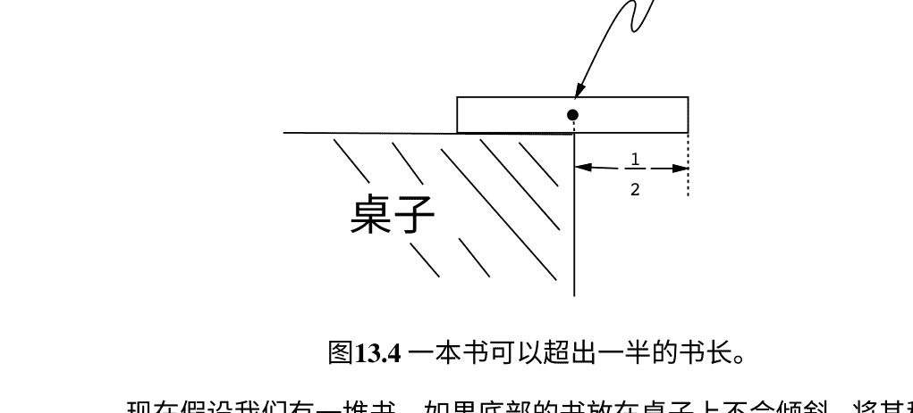

现在假设我们有一堆书，如果底部的书放在桌子上不会倾斜 - 将其称为稳定堆叠。让我们将稳定堆叠的悬挑定义为从堆叠的质心到顶部书的最远边缘的水平距离。因此，悬挑完全是堆叠的属性，与其在桌子上的放置位置无关。如果我们将稳定堆叠的质心放在桌子的边缘，如图13.5所示，悬挑就是我们可以让顶部书超出的距离。

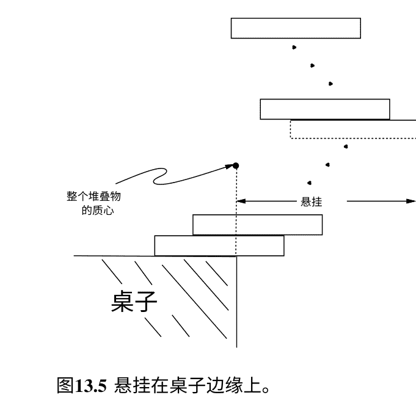

堆叠中的书超出边缘。

一般来说，如果堆叠的 $n$ 本书的质心恰好位于第一本书上，则堆叠将稳定。

因此，我们希望得到一个公式，用于计算具有 $n$ 本书的稳定堆叠的最大可能悬挂长度。

我们已经观察到一本书的悬挂长度为1/2本书的长度。即，

$$B_1 = \frac{1}{2}$$

现在假设我们有一个具有 $n-1$ 本书的稳定堆叠，并且其悬挂长度最大。如果顶部书堆叠的悬挂长度不是最大的，我们可以通过用具有更大悬挂长度的 $n$ 本书的堆叠替换顶部堆叠来使一本书更进一步地突出。因此，$n$ 本书的堆叠的最大悬挂长度，$B_{n-1}$，是通过将具有最大悬挂长度的稳定堆叠放在底部书上获得的。通过将 $n$ 本书的质心放在底部书的边缘上，我们可以得到 $n$ 本书堆叠的最大悬挂长度，如图13.6所示。

所以我们知道在哪里放置第一本书以获得最大的悬挑。事实上，上述推理实际上表明这种堆叠书的方式是唯一的，可以构建一个顶部书籍尽可能延伸的稳定堆叠。
我们只需要计算这个延伸是多少。

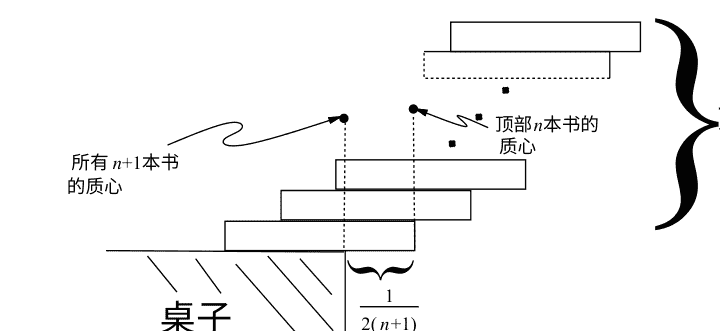

最简单的方法是让顶部 $n$ 本书的质心成为原点。这样，整个 $n+1$ 本书堆叠的质心的水平坐标将等于悬挑的增加。但是现在底部书的质心的水平坐标为 $1/2$，因此整个 $n+1$ 本书堆叠的质心的水平坐标为 $0 \cdot n + (1/2) \cdot 1$

$$\frac{1}{n + 1} = \frac{1}{2(n + 1)}.$$

换句话说，

$$B_{n+1} = B_n + \frac{1}{2(n+1)} \tag{13.18}$$

如图13.6所示。
展开方程(13.18)，我们有

$$B_{n+1} = B_{n-1} + \frac{1}{2n} + \frac{1}{2(n+1)}$$
$$= B_1 + \frac{1}{2 \cdot 2} + \dots + \frac{1}{2n} + \frac{1}{2(n+1)}$$
$$= \frac{1}{2} \sum_{i=1}^{n+1} \frac{1}{i}. \tag{13.19}$$

因此，我们的下一个任务是研究 $B_n$ 随着 $n$ 的增长而表现的行为。

### 13.4.2 调和数

定义13.4.1. 第 $n$ 个调和数, $H_n$, 是

$$H_n ::= \sum_{i=1}^{n} \frac{1}{i}.$$

所以(13.19)的意思是

$$B_n = \frac{H_n}{2}.$$

前几个调和数很容易计算。例如， $H_4 = 1 + \frac{1}{2} + \frac{1}{3} + \frac{1}{4} = \frac{25}{12} > 2$。事实上， $H_4$ 大于2具有特殊意义：它意味着4本书的总延伸长度大于一本完整的书！这就是图13.7所示的情况。

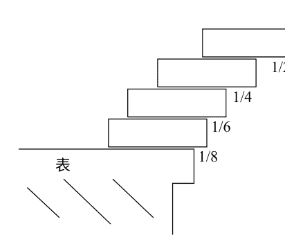

关于调和数有好消息和坏消息。坏消息是，调和数没有已知的闭式表达式。好消息是，我们可以使用定理13.3.2来得到关于 $H_n$ 的近似上下界。特别地，由于

$$\int_{1}^{n} \frac{1}{x} \,dx = \ln(x) \Big|_{1}^{n} = \ln(n),$$

定理13.3.2意味着

$$\ln(n) + \frac{1}{n} \le H_n \le \ln(n) + 1. \qquad \qquad (13.20)$$

换句话说，第 $n$ 个调和数非常接近 $\ln(n)$。由于调和数在实践中经常出现，数学家们努力寻找更好的近似值。事实上，现在已经知道

$$H_n = \ln(n) + \gamma + \frac{1}{2n} - \frac{1}{12n^2} + \frac{\epsilon(n)}{120n^4} \qquad \qquad (13.21)$$

这里 γ 有一个值0.577215664…称为欧拉常数，对于所有的 $n$，$\epsilon(n)$ 在0和1之间。我们不会证明这个公式。

我们现在已经完成了对书堆叠问题的分析。将第 $n$ 个 $H$ 的值代入(13.19)中，我们发现 $n$ 本书的最大悬挂长度非常接近于 $1/2 \ln(n)$。由于 $\ln(n)$ 随着 $n$ 的增加而趋向无穷大，这意味着如果我们有足够多的书，我们可以让一本书悬挂在桌子的边缘上任意远的地方。当然，我们需要的书的数量将以指数函数的方式增长；仅仅为了达到3的悬挂长度，就需要227本书，更不用说100的悬挂长度了。

## 超出表格末端的进一步扩展

我们上面分析的悬挂是书顶能够超出桌子的最远距离。这引出了一个问题，是否有一种更好的方法来构建一个稳定的堆栈，其中除了顶部的书之外，其他书都能够最远地突出。例如，图13.8显示了一个稳定的两本书堆栈，其中底部的书比顶部的书突出得更远。此外，底部的书超出桌子末端3/4个书长度，这与两本书堆栈中顶部书的最大悬挂距离相同。

由于图13.8(a)中的两本书排列与图13.8(b)中的最大悬挂堆栈相同，我们可以将最远突出的顶部两本书交换，使其看起来像图13.8(a)。这将得到一个稳定的n本书堆栈，其中第二本书从顶部开始具有相同的最大悬挂距离。因此，对于n > 1，至少有两种构建稳定的n本书堆栈的方法，两种方法都能够达到最大悬挂距离——一种是顶部的书最远，另一种是第二本书从顶部开始最远。

事实证明，没有办法击败这两种稳定堆叠的方式。事实上，证明这是唯一能够实现最大悬挑的稳定书堆的两种方式并不太难。

但故事还没有结束。我们之前的推理都是关于一个书放在另一个书上的堆叠。事实证明，通过构建更多书放在另一本书上的结构——想象一个倒置的金字塔——可以让一个由n本书组成的堆叠的延伸长度与 $\sqrt{n}$ 成比例，远远超过 $\ln n$ 的书长度，而不会倒下。参见[1³]，《最大悬挑》。

### 13.4.3 渐近相等

对于像方程13.21这样的情况，我们了解函数 $H_n$ 的增长，直到某些（不重要的）误差项，我们使用特殊符号 $\sim$ 来表示函数的主导项。例如，我们说 $H_n \sim \ln(n)$ 来表示

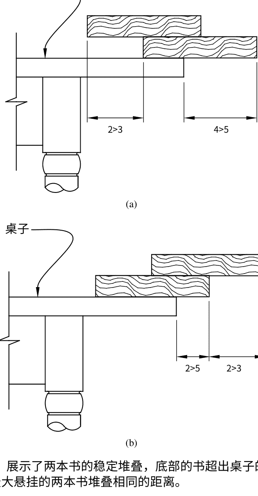

图13.8 图 (a) 展示了两本书的稳定堆叠，底部的书超出桌子的末端与图 (b) 中显示的最大悬挂的两本书堆叠相同的距离。

$H_n$ 的主导项是 $\ln(n)$。更准确地说：

定义13.4.2. 对于函数 $f, g : \mathbb{R} \to \mathbb{R}$，我们说 $f$ 与 $g$ 渐近相等，用符号表示

$f(x) \sim g(x)$

iff

$\lim_{x\to\infty} f(x)/g(x) = 1.$

虽然写成 $H_n \sim \ln(n) + \gamma$ 来表示两个主导项很诱人，但这并不完全正确。根据定义13.4.2，$H_n \sim \ln(n) + c$，其中 $c$ 是任意常数。正确表示 $\gamma$ 为第二大项的方式是 $H_n - \ln(n) \sim \gamma$。

$\sim$ 符号有用的原因是我们通常不关心低阶项。例如，如果 $n = 100$，那么我们只需要计算前两项就可以得到很高的精度：

$|H_n - \ln(n) - \gamma| \leq \left| \frac{1}{200} - \frac{1}{120000} + \frac{1}{120 \cdot 100^4} \right| < \frac{1}{200}.$

我们将在本章末尾花费更多时间讨论渐近符号。但现在，让我们回到使用求和的方法。

## 13.5 乘积

我们已经介绍了几种找到求和的闭合形式的技巧，但没有处理乘积的方法。幸运的是，当我们遇到像这样的乘积时，我们不需要开发全新的工具集。

$n! ::= \prod_{i=1}^{n} i.$ (13.22)

这是因为我们可以通过取对数将任何乘积转化为求和。例如，如果

$P = \prod_{i=1}^{n} f(i),$

那么

$\ln(P) = \sum_{i=1}^{n} \ln(f(i))$

然后，我们可以应用我们的求和工具来找到 $\ln(P)$ 的一个闭合形式（或近似闭合形式），然后在最后进行指数运算以撤销对数。例如，让我们看看这对于阶乘函数 $n!$ 如何工作。我们首先取对数：

$$ \ln(n!) = \ln(1 \cdot 2 \cdot 3 \cdots (n-1) \cdot n) $$
$$ = \ln(1) + \ln(2) + \ln(3) + \cdots + \ln(n-1) + \ln(n) $$
$$ = \sum_{i=1}^{n} \ln(i). $$

不幸的是，目前还没有找到这个求和的闭合形式。然而，我们可以应用定理13.3.2来找到求和的良好闭合形式上界。为了做到这一点，我们首先计算

$$ \int \ln(x) \, dx = x \ln(x) - x \Big|_{1}^{n} $$
$$ = n \ln(n) - n + 1. $$

将其代入定理13.3.2，这意味着

$$ n \ln(n) - n + 1 \leq \sum_{i=1}^{n} \ln(i) \leq n \ln(n) - n + 1 + \ln(n). $$

然后进行指数运算

$$ \frac{n^n}{e^{n-1}} \leq n! \leq \frac{n^{n+1}}{e^{n-1}}. \qquad (13.23) $$

这意味着 $n!$ 在 $n$ 的 $n^n / e^{n-1}$ 因子范围内。

### 13.5.1 斯特林公式

离散数学中最常用的乘积可能是 $n!$，数学家一直在努力寻找其值的紧闭合形式界限。最有用的界限在定理13.5.1中给出。

定理13.5.1（斯特林公式）。对于所有的 $n \geq 1$，

$$ n! = \sqrt{2\pi n} \left( \frac{n}{e} \right)^n e^{\epsilon(n)} $$

在哪里

$$ \frac{1}{12n + 1} \leq \epsilon(n) \leq \frac{1}{12n}. $$

定理13.5.1可以通过归纳法证明（虽然有些痛苦），并且有很多使用基本微积分的证明，但我们不会深入讨论。

关于斯特林公式有几个重要的事情需要注意。首先，$\epsilon(n)$ 始终为正。这意味着

$$
n! > \sqrt{2\pi n} \left( \frac{n}{e} \right)^n
$$
(13.24)

对于所有的 $n \in \mathbb{N}^+$，都成立。

其次，$\epsilon(n)$ 随着 $n$ 的增大趋近于零。这意味着

$$
n! \sim \sqrt{2\pi n} \left( \frac{n}{e} \right)^n
$$
(13.25)

这令人印象深刻。毕竟，谁会预料到 $\pi$ 和 $e$ 都会出现在一个渐近等于 $n!$ 的闭式表达式中呢？

第三，$\epsilon(n)$ 对于小的 $n$ 值来说是很小的。这意味着 Stirling 公式对于大多数 $n$ 值的 $n!$ 提供了很好的近似。例如，如果我们使用

$$
\sqrt{2\pi n} \left( \frac{n}{e} \right)^n
$$

作为 $n!$ 的近似值，就像很多人一样，这样做，我们保证在一个因子范围内

$$
e^{\epsilon(n)} \le e^{\frac{1}{12n}}
$$

的正确值。对于 $n \geq 10$，这意味着我们将在正确值的1%范围内。对于 $n \geq 100$，误差将小于0.1%。

如果我们需要一个更接近 $n!$ 的近似值，那么我们可以使用

$$
\sqrt{2\pi n} \left( \frac{n}{e} \right)^n e^{1/12n}
$$

或

$$
\sqrt{2\pi n} \left( \frac{n}{e} \right)^n e^{1/(12n+1)}
$$

这取决于我们是想要一个上界还是一个下界。根据定理13.5.1，我们知道这两个界限将在一个因子范围内。

$$
e^{\frac{1}{12n} - \frac{1}{12n+1}} = e^{\frac{1}{144n^2 + 12n}}
$$

正确值的。对于 $n \geq 10$，这意味着任一边界都将在正确值的0.01%之内。对于 $n \geq 100$，误差将小于0.0001%。为了快速参考，这些事实总结在推论13.5.2和表13.1中。

| 近似 | n≥1 | n≥10 | n≥100 | n≥1000 |
| --- | --- | --- | --- | --- |
| $\sqrt{2\pi n} \left( \frac{n}{e} \right)^n$ | <10% | <1% | <0.1% | <0.01% |
| $\sqrt{2\pi n} \left( \frac{n}{e} \right)^n e^{1/12n}$ | <1% | <0.01% | <0.0001% | <0.000001% |

表 13.1 常见近似的误差界限

对于 $n!$ 来自定理13.5.1。例如，如果 $n \geq 100$，则 $\sqrt{2\pi n} \left( \frac{n}{e} \right)^n$ 近似 $n!$ 到 0.1%以内。

推论 13.5.2。

$n! < \sqrt{2\pi n} \left( \frac{n}{e} \right)^n \cdot \begin{cases} 1.09 & \text{对于 } n \geq 1; \\ 1.009 & \text{对于 } n \geq 10; \\ 1.0009 & \text{对于 } n \geq 100 \end{cases}$

## 13.6 双重麻烦

有时我们需要计算求和的求和，也称为双重求和。听起来很复杂，有时确实如此。但通常情况下，它很简单——你只需计算内部求和，用一个闭式表达式替换它，然后计算外部求和（不再包含内部求和）。例如，

$$
\begin{aligned}
\sum_{n=0}^{\infty} y^{n} \sum_{i=0}^{n} x^{i} &= \sum_{n=0}^{\infty}\left(y^{n} \frac{1-x^{n+1}}{1-x}\right) \\
&=\left(\frac{1}{1-x}\right) \sum_{n=0}^{\infty} y^{n}-\left(\frac{1}{1-x}\right) \sum_{n=0}^{\infty} y^{n} x^{n+1} \\
&=\frac{1}{(1-x)(1-y)}-\left(\frac{x}{1-x}\right) \sum_{n=0}^{\infty}(x y)^{n} \\
&=\frac{1}{(1-x)(1-y)}-\frac{x}{(1-x)(1-x y)} \\
&=\frac{(1-x y)-x(1-y)}{(1-x)(1-y)(1-x y)} \\
&=\frac{1-x}{(1-x)(1-y)(1-x y)} \\
&=\frac{1}{(1-y)(1-x y)}.
\end{aligned}
$$

当内部求和没有明显的闭合形式时，一个常用的特殊技巧是尝试交换求和的顺序。例如，假设我们想计算前 $n$ 个调和数的和

$$\sum_{k=1}^{n} H_{k}=\sum_{k=1}^{n} \sum_{j=1}^{k} \frac{1}{j} \tag{13.26}$$

为了对这个求和有直观的理解，我们可以将定理13.3.2应用于方程式13.20，得出

$$\int_{1}^{n} \ln (x) d x=x \ln (x)-x\left|_{1}^{n}=n \ln (n)-n+1 .\right.$$

现在让我们寻找一个精确的答案。如果我们考虑关于 $(k, j)$ 的配对

| k \ j | 1 | 2 | 3 | 4 | 5 | ... | n |
|-------|---|---|---|---|---|-----|---|
| 1     | 1 |   |   |   |   |     |   |
| 2     | 1 | 1/2 |   |   |   |     |   |
| 3     | 1 | 1/2 | 1/3 |   |   |     |   |
| 4     | 1 | 1/2 | 1/3 | 1/4 |   |     |   |
| ...   | ... | ... | ... | ... | ... | ... | ... |
| n     | 1 | 1/2 | ... | ... | ... | ... | 1/n |

方程式13.26中的求和是对每一行进行求和，然后将行求和相加。相反，我们可以对列进行求和，然后将列求和相加。检查表格，我们可以看到这个双重求和可以写成

$$
\begin{aligned}
\sum_{k=1}^n H_k &= \sum_{k=1}^n \sum_{j=1}^k \frac{1}{j} \\
&= \sum_{j=1}^n \sum_{k=j}^n \frac{1}{j} \\
&= \sum_{j=1}^n \frac{1}{j} \sum_{k=j}^n 1 \\
&= \sum_{j=1}^n \frac{1}{j} (n - j + 1) \\
&= \sum_{j=1}^n \frac{n+1}{j} - \sum_{j=1}^n \frac{j}{j} \\
&= (n+1) \sum_{j=1}^n \frac{1}{j} - \sum_{j=1}^n 1 \\
&= (n+1) H_n - n.
\end{aligned}
$$
(13.27)## 13.7 渐近符号

渐近符号是一种简写，用于快速衡量函数 $f(n)$ 随着 $n$ 的增大而增长的行为。例如，渐近符号 $\sim$ 在定义 13.4.2 中表示两个函数以相同的速度增长。还有一种二元关系“小 $o$”，表示一个函数的增长速度明显比另一个函数慢，而“大 $O$”表示一个函数的增长速度不比另一个函数快多少。

### 13.7.1 小 o

定义 13.7.1. 对于函数 $f, g : \mathbb{R} \to \mathbb{R}$，其中 $g$ 非负，我们说 $f$ 比 $g$ 渐近小，用符号表示

$$f(x) = o(g(x)),$$

iff

$$\lim_{x \to \infty} f(x)/g(x) = 0.$$

例如，$1000x^{1.9} = o(x^2)$，因为 $1000x^{1.9}/x^2 = 1000/x^{0.1}$ 并且由于 $x^{0.1}$ 随着 $x$ 趋向无穷大，而 $1000$ 是常数，我们有 $\lim_{x \to \infty} 1000x^{1.9}/x^2 = 0$。这个论证可以直接推广

引理 13.7.2. $x^a = o(x^b)$ 对于所有非负常数 $a < b$。

利用已知事实 $\log x < x$ 对于所有 $x > 1$，我们可以证明

引理 13.7.3. $\log x = o(x^\epsilon)$ 对于所有 $\epsilon > 0$ 成立。

证明。选择 $\epsilon > \delta > 0$ 并且令 $x = z^\delta$ 在不等式 $\log x < x$ 中。这意味着

$$\log z < z^\delta / \delta = o(z^\epsilon) \quad \text{根据引理 13.7.2:} \quad (13.28)$$

推论 13.7.4. $x^b = o(a^x)$ 对于任意的 $a, b \in \mathbb{R}$ 且 $a > 1$ 成立。

引理 13.7.3 和推论 13.7.4 也可以使用 l'Hôpital's 规则或者 $\log x$ 和 $e^x$ 的 Maclaurin 级数来证明。大多数微积分教材中都可以找到证明。

### 13.7.2 大O

大O是最常用的渐近符号。它用于给出函数增长的上界，例如算法的运行时间。下面是13.7.9中的标准定义，但我们将从一个替代定义开始，以显示大O的几个基本属性。

定义13.7.5. 给定函数 $f, g : \mathbb{R} \to \mathbb{R}$，其中 $g$ 非负，我们说

$$f = O(g)$$

iff

$$\limsup_{x \to \infty} |f(x)| / g(x) < \infty.$$

这里我们使用了技术概念极限上确界[6]而不仅仅是极限。但是因为当极限存在时，极限和极限上确界是相同的，这个表述使得检查大O的基本属性变得容易。我们将接受以下引理。

引理13.7.6. 如果函数 $f : \mathbb{R} \to \mathbb{R}$ 随着自变量趋近无穷时有有限或无穷的极限，那么它的极限和极限上确界相同。

现在引理13.7.5的定义立即得出：

引理13.7.7. 如果 $f = o(g)$ 或 $f \sim g$，那么 $f = O(g)$。

证明。当 $\lim f/g = 0$ 或 $\lim f/g = 1$ 时，意味着 $\lim f/g < \infty$，所以根据引理13.7.6，$\limsup f/g < \infty$。

请注意，引理13.7.7的逆命题是不成立的。例如，$2x = O(x)$，但是 $2x \sim x$ 并且 $2x \neq o(x)$。

我们还有：

引理13.7.8. 如果 $f = o(g)$，那么 $g = O(f)$ 是不正确的。

证明。

$$\limsup_{x \to \infty} \frac{g(x)}{f(x)} = \limsup_{x \to \infty} \frac{1}{f(x)/g(x)}$$

当 $x$ 趋近于 $\infty$ 时，$f(x)/g(x)$ 趋近于0或 $\infty$，所以根据引理13.7.6，$g \neq O(f)$。

6 lim sup的精确定义是

$$\limsup_{x \to \infty} h(x) = \limsup_{x \to \infty} \text{lub}_{y \geq x} h(y),$$

其中“lub”是“least upper bound”的缩写。

我们需要引理13.7.5中的lim sup来处理极限不存在的情况。例如，如果 $f(x)/g(x)$ 在 $x$ 增大时在3和5之间振荡，那么 $\lim_{x \to \infty} f(x)/g(x)$ 不存在，但 $f = O(g)$，因为 $\limsup_{x \to \infty} f(x)/g(x)=5$。

大O符号的一个等价且更常见的表述方式不涉及lim sup的概念:

### 定义13.7.9

给定函数 $f,g:\mathbb{R}\to\mathbb{R}$，其中 $g$ 非负，我们说

$f = O(g)$

当且仅当存在常数 $c \geq 0$ 和一个 $x_0$，对于所有的 $x \geq x_0$，有 $|f(x)| \leq cg(x)$.

这个定义相当复杂，但是思想很简单：$f(x) = O(g(x))$ 意味着 $f(x)$ 小于等于 $g(x)$，只是我们愿意忽略一个常数因子，即 $c$，并且对于小的 $x$，即 $x < x_0$，允许例外情况。所以在 $f(x)/g(x)$ 在3和5之间振荡的情况下，根据定义13.7.9，$f = O(g)$，因为 $f \leq 5g$.

### 命题13.7.10

证明. 选择 $c = 100$ 和 $x_0 = 1$。 那么命题成立，因为对于所有的 $x \geq 1$, $|100x^2| \leq 100x^2$.

### 命题13.7.11

证明. $(x^2 + 100x + 10)/x^2 = 1 + 100/x + 10/x^2$ 所以当 $x$ 趋近于无穷大时，它的极限是 $1+0+0 = 1$。事实上，$x^2 + 100x + 10 \sim x^2$，因此 $x^2 + 100x + 10 = O(x^2)$。事实上，反过来也成立，即 $x^2 = O(x^2 + 100x + 10)$。

命题13.7.11推广到任意多项式:

### 命题13.7.12

我们将省略常规证明。大O符号在描述算法的运行时间时特别有用。例如，通常的矩阵乘法算法 $\times n$ 矩阵在最坏情况下需要的操作数与 $n^3$ 成比例。这个事实可以简洁地表达为运行时间为 $O(n^3)$。因此，这种渐近符号允许讨论算法的速度，而不涉及可能是机器特定的常数因子或低阶项。事实证明，还有另一种矩阵乘法过程，它使用 $O(n^{2.55})$ 操作。这个过程渐近地更快，表明它涉及了超越 $O(n^3)$ 方法的新思想。当然，渐近地更快的过程在足够大的矩阵上也肯定更高效，但渐近地更快并不意味着这是一个更好的选择。$O(n^{2.55})$ 操作的乘法过程在实践中几乎不会被使用，因为它只在不切实际的矩阵大小上比通常的 $O(n^3)$ 过程更有效率。

### 13.7.3 Theta

有时我们想要指定一个运行时间 $T(n)$ 在常数因子上精确地是二次的（上界和下界都是如此）。我们可以通过说 $T(n) = O(n^2)$ 和 $n^2 = O(T(n))$ 来做到这一点，但数学家们不是这样说的，他们设计了另一个符号 $\Theta$ 来完成这个任务。

**定义13.7.13.**

$$f = \Theta(g) \quad \text{当且仅当} \quad f = O(g) \text{和} g = O(f).$$

语句 $f = \Theta(g)$ 可以直观地解释为“$f$ 和 $g$ 在一个常数因子内相等。”

Theta符号允许我们突出增长率并抑制分散因素和低阶项。例如，如果算法的运行时间是

$$T(n) = 10n^3 - 20n^2 + 1,$$

那么我们可以更简单地写成

$$T(n) = \Theta(n^3).$$

在这种情况下，我们可以说 $T$ 的阶数是 $3$，或者 $T(n)$ 呈立方增长，这通常是我们真正想知道的主要内容。另一个例子是

$$\pi^2 3^{x-7} + \frac{(2.7x^{113} + x^9 - 86)^4}{\sqrt{x}} - 1.08^{3x} = \Theta(3^x).$$

仅仅知道算法的运行时间是 $\Theta(n^3)$，例如，就是有用的，因为如果 $n$ 翻倍，我们可以预测运行时间最多会增加 $8$ 倍，对于大的 $n$ 来说。这样，Theta符号保留了有关算法或系统的可扩展性的信息。可扩展性在算法和系统的设计中当然是一个重要问题。

### 13.7.4 渐近符号的陷阱

在渐近符号中，有很多容易犯错的地方。本节介绍了一些使用大O符号可能导致问题的方式。只需付出最小的努力，你就能用其他符号造成同样的混乱。

#### 指数灾难

有时候涉及大O的关系并不那么明显。例如，有人可能猜测 $4^x = O(2^x)$，因为4只比2大一个常数因子。然而，这种推理是错误的；$4^x$ 实际上是 $2^x$ 的平方增长。

#### 常数的困惑

每个常数都是 $O(1)$。例如，$17x = O(1)$。这是因为如果我们令 $f(x) = 17$ 和 $g(x) = 1$，那么存在一个 $c>0$ 和一个 $x_0$，使得 $|f(x)| \leq c|g(x)|$。特别地，我们可以选择 $c=17$ 和 $x_0=1$，因为 $|17| \leq 17 \times 1$ 对于所有 $x\leq1$。我们可以构造一个利用这个事实的错误定理。

> 错误的定理 13.7.14.
> 
> $$ \sum_{i=1}^{n} i = O(n) $$
> 
> 虚假的证明。定义 $f(n)$ 为 $\sum_{i=1}^{n} i$ 为 1加2加3加···加n。由于我们已经证明每个常数 $i$ 是 $O(1)$，$f(n)$ 为 $O(1)$ 加 $O(1)$ 加···加 $O(1)$ 为 $O(n)$。

当然在现实中 $\sum_{i=1}^{n} i = n(n+1)/2$ 是 $\Theta(n^2)$。

错误的定理中的错误源于对 $i = O(1)$ 的含义的混淆。对于任何常数 $i$ 属于 $\mathbb{N}$，都成立 $i$ 为 $O(1)$。更准确地说，如果 $f$ 是任何常数函数，则 $f$ 为 $O(1)$。但在这个错误的定理中，$i$ 不是常数—它的取值范围是依赖于 $n$ 的值的集合 $0, 1, ..., n$。

#### 等式错误

记号 $f = O(g)$ 太过固定，无法避免，但使用“=”是令人遗憾的。例如，如果 $f = O(g)$，写 $O(g) = f$ 似乎是合理的。但这样做可能引诱我们犯下以下错误：因为 $2n = O(n)$，我们可以说 $O(n) = 2n$。但是 $O(n) = O(n)$，所以我们得出结论 $O(n) = O(n) = 2n$，因此 $O(n) = 2n$。为了避免这种荒谬，我们永远不会写“$O(f) = g$。”

同样，你经常会看到像这样的陈述

$$H_n = \ln(n) + \gamma + O \left(\frac{1}{n}\right)$$

或

$$n! = (1 + o(1))\sqrt{2\pi n} \left(\frac{n}{e}\right)^n$$

在这种情况下，真正的意思是

$$H_n = \ln(n) + \gamma + f(n)$$

对于一些 $f(n)$ 其中 $f(n) = O(1/n)$，以及

$$n! = (1 + g(n))\sqrt{2\pi n} \left(\frac{n}{e}\right)^n$$

其中 $g(n) = o(1)$。只要你（和你的读者）知道你的意思，这些最后的错误是可以接受的。

#### 操作应用错误

很容易假设熟悉的操作保持渐近关系，但事实并非总是如此。例如， $f \sim g$ 通常甚至不意味着 $3^f = \Theta (3^g)$。另一方面，有些操作保持甚至加强了渐近关系，例如，

$$f = \Theta(g) \quad \text{IMPLIES} \quad \ln f \sim \ln g.$$

> 参见问题13.24。

### 13.7.5 欧米伽（可选）

有时人们在下界的上下文中错误地使用大O符号。例如，他们可能会说，“运行时间，$T(n)$，至少是 $O(n^2)$。”这是另一个错误！大O符号只能用于上界。正确的表达下界的方式应该是

$$n^2 = O(T(n)).$$

下界也可以用另一种特殊的符号“大欧米伽”来描述。

定义13.7.15. 给定函数 $f, g : \mathbb{R} \rightarrow \mathbb{R}$，其中 $f$ 非负，定义 $f = \Omega(g)$

表示

$$g = O(f).$$

例如，$x^2 = \Omega(x)$， $2x = \Omega(x^2)$，以及 $x/100 = \Omega(100x + \sqrt{x})$。所以，如果你的算法在输入大小为 $n$ 时的运行时间是 $T(n)$，并且你想说它至少是二次的，那么说

$$T(n) = \Omega(n^2).$$

有一个类似的“小欧米伽”符号用于下界，对应于小o：

定义 13.7.16. 对于函数 $f, g: \mathbb{R} \to \mathbb{R}$，其中 $f$ 非负，定义

$$f = \omega(g)$$

表示

$$g = o(f).$$

例如， $x^{1.5} = \omega(x)$ 和 $\sqrt{x} = \omega(\ln^2(x))$。小欧米伽符号不像我们定义的其他渐近符号那样广泛使用。

### 问题

#### 问题 13.1.

我们从两个大杯子开始。第一个杯子里有一品脱水，第二个杯子里有一品脱酒。我们从第一个杯子倒出1/3品脱到第二个杯子里，搅拌第二个杯子中的酒/水混合物，然后将1/3品脱的混合物倒回第一个杯子，并重复这个倒来倒去的过程共 $n$ 次。

- (a) 描述一个封闭形式的公式，用于描述在来回倒酒后第一杯酒的数量 $n$。
- (b) 当 $n$ 趋近于无穷大时，每个杯子中的酒的数量的极限是多少？

#### 问题13.2.

你已经看到了这个评估几何级数的巧妙技巧：

```
$$
\begin{aligned}
S &= 1 + z + z^2 + \ldots + z^n\\
zS &= z + z^2 + \ldots + z^n + z^{n+1}\\
S - zS &= 1 - z^{n+1}\\
S &= \frac{1 - z^{n+1}}{1 - z} \quad (\text{其中} \ z \neq 1)
\end{aligned}
$$
```

使用相同的方法来找到这个求和的封闭形式表达式：

$$ T = 1z + 2z^2 + 3z^3 + \ldots + nz^n $$

#### 问题13.3.

萨米鲨鱼是一家金融服务提供商，提供以下贷款条件。

- 早上，萨米借给一个客户 $m$ 美元。这使得客户欠萨米 $m$ 美元。
- 每天晚上，萨米首先收取一笔服务费，将客户的债务增加 $f$ 美元，然后萨米收取利息，将债务乘以一个因子 $p$。例如，萨米可能收取“适度”的十美分的服务费和每天1%的利率，那么 $f$ 将是 0.1， $p$ 将是 1.01。
- (a) 第一天结束时，客户的债务是多少？
- (b) 第二天结束时，客户的债务是多少？
- (c) 写出客户在 $d$ 天后的债务公式，并找到一个等价的闭合形式。
- (d) 如果你向萨米借了10美元一年，你将欠他多少钱？

#### 问题13.4.

哈佛学位真的比麻省理工学位更值钱吗？假设一个拥有哈佛学位的人从毕业开始年薪为$40,000，并且每年涨薪$20,000，而一个拥有麻省理工学位的人从毕业开始年薪为$30,000，但每年涨薪20%。假设通胀率每年固定为 8% 。也就是说，一年后的$1.08价值今天的$1.00。

- (a)如果持有人毕业后工作n年，那么今天哈佛学位值多少钱？
- (b)在这种情况下，麻省理工学位值多少钱？
- (c)如果你计划在二十年后退休，哪个学位会更值钱？

#### 问题13.5.

假设你今天在麻省理工学院信用合作社账户中存入$100，一个月后存入$99，两个月后存入$98，以此类推。假设利率恒定为每月0.3%，需要多长时间才能存到$5,000?

#### 问题13.6.

找出以下每个求和式的闭式形式:

(a)
$$\sum_{i=1}^{n} \left( \frac{1}{i+2012} - \frac{1}{i+2013} \right)$$

(b)假设以下求和式等于一个关于n的多项式，找出这个多项式。然后通过归纳验证求和式等于你找到的多项式。

$$\sum_{i=1}^{n} i^3$$

#### 问题13.7.

让

$$S := \sum_{n=1}^{5} \sqrt{3n}$$

使用第13.3节的积分方法，我们可以找到整数 $a$、$b$、$c$、$d$ 和一个实数 $e$，使得

$$\int_{a}^{b} x^e dx \leq S \leq \int_{c}^{d} x^e dx$$

对于 $a$、$b$、$c$、$d$ 和 $e$，什么是合适的值？

#### 问题13.8.

假设 $f : \mathbb{R} \to \mathbb{R}$ 是一个连续的、弱增函数。当 $f$ 增长缓慢时

$$f(n) = o \left( \int_{1}^{n} f(x) dx \right).$$

- (a)证明对于任意的 $a > 0$，函数 $f_a(n) ::= n^a$ 增长缓慢。
- (b)证明函数 $e^n$ 不增长缓慢。
- (c) 证明如果函数 $f$ 增长缓慢，那么

$$\int_{1}^{n} f(x) dx \sim \sum_{i=1}^{n} f(i).$$

#### 问题 13.9.

假设 $n$ 是大于1的整数。圈出所有正确的不等式。

不需要解释，但是如果没有解释，错误答案将不会得到部分分数。提示：你可能会发现图13.9中的图表有帮助。

- $\sum_{i=1}^{n} \ln(i+1) \leq \ln 2 + \int_{1}^{n} \ln(x+1)dx$
- $\sum_{i=1}^{n} \ln(i+1) \leq \int_{0}^{n} \ln(x+2)dx$
- $\sum_{i=1}^{n} \frac{1}{i} \geq \int_{0}^{1} \frac{1}{x+1} dx$

## 第13章 总和与渐近符号

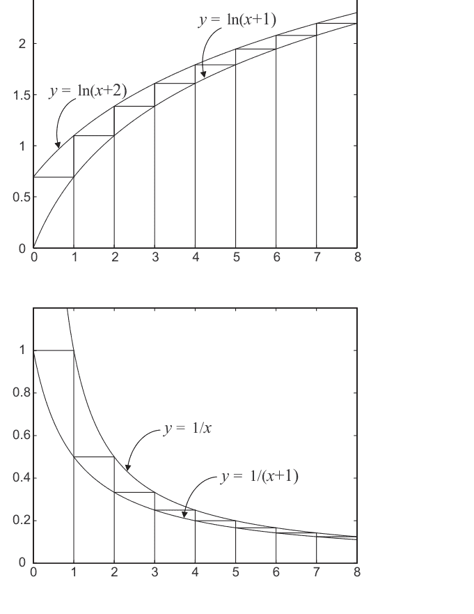

图13.9 两个求和的积分边界

### 13.7. 渐近符号

### 作业问题

#### 问题13.10.
设 $f : \mathbb{R}^+ \to \mathbb{R}^+$ 是一个递减的函数。定义

$$S ::= \sum_{i=1}^{n} f(i)$$

和

$$I ::= \int_{1}^{n} f(x) \, dx.$$

证明

$$I + f(n) \leq S \leq I + f(1).$$

(可以用非常清晰的图片来证明。)

#### 问题13.11.
使用积分找到上下界，使其之间的差异最多为0.1，对于以下求和。(您可能需要明确添加前几项，然后使用积分来限制剩余项的和。)

$$\sum_{i=1}^{\infty} \frac{1}{(2i+1)^2}$$

### 第13.4节的问题

### 课堂问题

#### 问题13.12.
一位探险家正试图到达圣杯，她相信圣杯位于离最近的绿洲有$d$天的步行距离的沙漠神殿中。在沙漠的炎热中，探险家必须持续饮水。她最多可以携带1加仑的水，足够维持1天。然而，她可以自由地进行多次旅行，每次携带最多一加仑的水，在沙漠中创建水库。

例如，如果神殿离沙漠有 2/3天的步行路程，那么她可以使用以下策略在两天内找到圣杯。她带着1加仑的水离开绿洲，走 1/3天进入沙漠，存储 1/3加仑的水，然后返回绿洲——正好在她的水用完之前到达。然后她在绿洲拿起另外1加仑的水，走 1/3天进入沙漠，通过取出她存储的 1/3加仑水来补充水供应，然后走剩下的 1/3天到达神殿。

她拿起圣杯后，再走 2/3天回到绿洲——同样是没有多余的水。

但是如果神殿离得更远呢？

- (a) 如果她只从绿洲带走1加仑的水，没有在沙漠中存储水，她能够到达并返回绿洲的最远距离是多少？
- (b) 探险家可以到达最远的点并且仍然能够从绿洲返回，如果她只从绿洲取走总共2加仑的水？不需要证明；尽力而为。
- (c) 探险家将使用递归策略在沙漠中远行并返回，从绿洲取走总共n加仑的水。 她的策略是建立一个包括n-1加仑水的缓存，再加上足够的水回到家，这是一天的一定比例的距离。在最后一次向缓存交付水后，她不返回家，而是继续使用n-1加仑的策略递归地前进到沙漠更远的地方，并返回缓存。 此时，缓存只剩下足够的水让她回家。

证明使用n加仑的水，这个策略将使她在沙漠中前进和返回$H_n$/2天的距离，其中$H_n$是第n个调和数：

$H_N::=1+\frac{1}{2}+\frac{1}{3}+\cdots+\frac{1}{N}$

得出结论，无论离绿洲有多远，她都能到达神殿。

- (d) 假设神殿在沙漠深处行走了 $d=10$天。 使用渐近近似 $H_N\sim\ln N$证明探险家需要超过一百万年才能找回圣杯。

### 问题13.13
存在一个数字 $a$ 使得 $\sum_{i=1}^\infty i^p$收敛当且仅当 $p < a$。求$a$的值是多少？

提示：找到一个你认为有效的$a$的值，然后应用积分界限。

### 作业问题

### 问题13.14
在一张1米长的地毯边缘有一只虫子。虫子想要穿过地毯到达另一边。它每秒爬行1厘米。然而，每秒结束时，一个恶意的一年级学生名叫米尔德里德·安德森，将地毯拉长了1米。假设她的行动是瞬间的，并且地毯均匀地拉长。因此，在最初的几秒钟内发生了以下情况：

- 虫子在第一秒内走了1厘米，所以前方还剩下99厘米。
- 米尔德里德将地毯拉长了1米，使其长度加倍。所以现在虫子后方有2厘米，前方有198厘米。
- 虫子在下一秒又走了1厘米，留下了3厘米后方和197厘米前方。
- 然后米尔德里德拉长地毯从2米到3米。所以现在后方有3·(3/2) = 4.5厘米，前方有 197·(3/2) = 295.5厘米。
- 虫子在第三秒又走了1厘米，以此类推。

你的工作是确定这只可怜的虫子的命运。

- (a) 在第i秒期间，虫子穿过地毯的什么比例？
- (b) 在前n秒内，虫子总共穿过地毯的什么比例？用调和数 Hₙ来表示你的答案。
- (c) 已知宇宙直径约为 3·10¹⁰光年。虫子必须穿过多少个宇宙直径才能到达地毯的尽头？（这个距离不是由于伸展而引起的膨胀距离，而仅仅是虫子实际行走的距离）。

### 考试问题

#### 问题13.15.
证明

$$\sum_{i=1}^{\infty} i^p$$当且仅当 $p < -1$ 时，收敛到有限值。

### 第13.7节问题

### 练习问题

#### 问题13.16.
找到最小的非负整数 $n$，使得 $f(x)$ 是 $O(x^n)$，当 $f$ 被定义为以下表达式中的每一个时：
- (a) $2x^{3} + (\log x)x^{2}$
- (b) $2x^{2} + (\log x)x^{3}$
- (c) $(1.1)^{x}$
- (d) $(0.1)^{x}$
- (e) $(x^{4} + x^{2} + 1) / (x^{3} + 1)$
- (f) $(x^{4} + 5 \log x) / (x^{4} + 1)$
- (g) $2^{(3 \log_{2} x^{2})}$

#### 问题 13.17.
令 $f(n) = n^{3}$. 对于下表中的每个函数 $g(n)$，指出哪些渐近关系成立。

| $g(n)$ | $f = O(g)$ | $f = o(g)$ | $g = O(f)$ | $g = o(f)$ |
| :--- | :---: | :---: | :---: | :---: |
| $6 - 5n - 4n^{2} + 3n^{3}$ | | | | |
| $n^{3} \log n$ | | | | |
| $(\sin(\pi n/2) + 2) n^{3}$ | | | | |
| $n^{\sin(\pi n/2) + 2}$ | | | | |
| $\log n!$ | | | | |
| $e^{0.2n} - 100n^{3}$ | | | | |

#### 问题 13.18.
在下面的陈述中圈出每个正确的陈述。
不需要解释，但是如果没有解释，错误答案将不会得到部分分数。

- $n^{2} \sim n^{2} + n$
- $3^{n} = O(2^{n})$
- $n^{\sin(n\pi/2)+1} = o(n^{2})$
- $n = \Theta\left(\dfrac{3n^{3}}{(n+1)(n-1)}\right)$

#### 问题 13.19.
证明

$$\ln(n^2!) = \Theta(n^2 \ln n)$$

提示：Stirling公式对于$(n^2)!$。

#### 问题 13.20.
数量

$$\frac{(2n)!}{2^{2n} (n!)^2} \quad \quad (13.29)$$

这个概念在课程中会稍后讲到（它是在抛掷公平硬币的 $2^{2n}$次中，正面朝上的概率）。

证明它渐近地等于

$$\frac{1}{\sqrt{\pi n}}.$$

#### 问题13.21.
假设 $f$ 和 $g$ 是实值函数.

- (a) 给出一个 $f$, $g$ 的例子，使得
$$\lim \sup fg < \lim \sup f \cdot \lim \sup g,$$
并且所有的$\lim \sup$都是有限的.
- (b) 给出一个 $f$, $g$ 的例子，使得
$$\lim \sup fg > \lim \sup f \cdot \lim \sup g.$$
并且所有的$\lim \sup$都是有限的.

### 作业问题

#### 问题13.22.
- (a) 证明对于所有的$x > 1$，$\log x < x$ (需要基本微积分) .
- (b) 证明关系 $R$，对于函数$f R g$当且仅当 $g = o(f)$是一个严格的偏序关系.
- (c) 证明 $f \sim g$当且仅当存在函数$h$使得 $f = g + h$对于某个函数$h = o(g)$成立.

#### 问题 13.23.
请指出下表中每对函数(f(n), g(n))满足的条件。假设 $k \geq 1$, $\epsilon > 0$, 和 $c > 1$ 是常数。选择你认为最具挑战或有趣的四个表格条目，并对你的答案进行解释。

| $f(n)$ | $g(n)$ | $f = O(g)$ | $f = o(g)$ | $g = O(f)$ | $g = o(f)$ | $f = \Theta(g)$ | $f \sim g$ |
|--------|--------|-------------|------------|-------------|------------|------------------|------------|
| $2^n$ | $2^{n/2}$ | | | | | | |
| $\sqrt{n}$ | $n^{\sin(n\pi/2)}$ | | | | | | |
| $\log(n!)$ | $\log(n^n)$ | | | | | | |
| $n^k$ | $c^n$ | | | | | | |
| $\log^k n$ | $n^\epsilon$ | | | | | | |

#### 问题 13.24.
设 $f$, $g$ 是非负实值函数，满足 $\lim_{x \to \infty} f(x) = \infty$ 和 $f \sim g$。

- (a) 给出一个例子，使得 $\text{NOT}(2^f \sim 2^g)$。
- (b) 证明 $\log f \sim \log g$。
- (c) 使用斯特林公式证明实际上 $\log(n!) \sim n \log n$。

#### 问题 13.25.
确定这些选择中的哪一个

$\Theta(n)$, $\Theta(n^2 \log n)$, $\Theta(n^2)$, $\Theta(1)$, $\Theta(2^n)$, $\Theta(2^{n \ln n})$, none of these

描述每个函数的渐近行为。不需要完整的证明，但请简要解释你的答案。

- (a) $n + \ln n + (\ln n)^2$
- (b) $\frac{n^2 + 2n - 3}{n^2 - 7}$

#### 问题 13.26.
- (a) 证明或证伪以下每个陈述。
    - \( n! = O((n + 1)!) \)
    - \( (n + 1)! = O(n!) \)
    - \( n! = \Theta((n + 1)!) \)
    - \( n! = o((n + 1)!) \)
    - \( (n + 1)! = o(n!) \)
- (b) 证明 \( \left( \frac{n}{3} \right)^{n+e} = o(n!) \).

#### 问题 13.27.
证明 \( \sum_{k=1}^n k^6 = \Theta(n^7). \)

提示：一种解决方案使用积分方法，还有其他可行的方法避免使用微积分。

### 课堂问题

#### 问题 13.28.
给出一个初等证明（不使用斯特林公式）：\( \log(n!) = \Theta(n \log n) \).

#### 问题 13.29.
假设 \( f, g : \mathbb{N}^+ \to \mathbb{N}^+ \) 且 \( f \sim g \).

- (a) 证明 $2f \sim 2g$.
- (b) 证明 $f^2 \sim g^2$.
- (c) 给出 $f$和 $g$的例子，使得 $2^f \sim 2^g$.

#### 问题 13.30.
回顾一下，对于函数 $f, g$ 在 $\mathbb{N}$ 上， $f = O(g)$ 当且仅当
$$\exists c \in \mathbb{N} \exists n_0 \in \mathbb{N} \forall n \geq n_0 \quad c \cdot g(n) \geq |f(n)|. \tag{13.30}$$

对于下面的每一对函数，确定 $f = O(g)$和$g =O(f)$是否成立。在一个函数是另一个函数的O()的情况下，指出最小的非负整数 $c$, 并且对于这个最小的 $c$, 确保条件 (13.30) 成立的最小的非负整数 $n_0$.

- (a) $f(n) = n^2$, $g(n) = 3n$.
    $f = O(g)$       是的       不       如果是的， C = ____, $n_0$ = ____
    $g = O(f)$       是的       不       如果是的， C = ____, $n_0$ = ____
- (b) $f(n) = (3n - 7)/(n + 4)$, $g(n) = 4$
    $f = O(g)$       是的       不       如果是的， C = ____, $n_0$ = ____
    $g = O(f)$       是的       不       如果是的， C = ____, $n_0$ = ____
- (c) $f(n) = 1 + (n \sin(n\pi/2))^2$, $g(n) = 3n$
    $f = O(g)$       是的       不       如果是的， C = ____    $n_0$ = ____
    $g = O(f)$       是的       不       如果是的， C = ____    $n_0$ = ____

#### 问题 13.31.
错误的声明.
$$2^n = O(1). \tag{13.31}$$

解释为什么这个声明是错误的。然后找出并解释以下错误证明中的错误。

错误的证明。证明是通过对 $n$进行归纳来完成的，其中归纳假设， $P(n)$, 是断言(13.31)。

基本情况：$P(0)$是显然成立的。
归纳步骤：我们可以假设 $P(n)$成立，因此存在一个常数 $c > 0$ 使得 $2^{n} \leq c \cdot 1$。因此，
$$2^{n+1} = 2 \cdot 2^{n} \leq (2c) \cdot 1,$$
这意味着 $2^{n+1} = O(1)$。也就是说，$P(n+1)$成立，这完成了归纳步骤的证明。
我们通过归纳法得出结论，对于所有的$n$，有 $2^n = O(1)$。也就是说，指数函数被一个常数所限制。

#### 问题13.32.
- (a) 证明函数之间的关系 $R$，其中$f \mathrel{R} g$当且仅当 $f = o(g)$ 是一个严格的偏序关系。
- (b) 描述两个函数 $f$, $g$在大O记号下是不可比较的：
    $$f \neq O(g) \text{ AND } g \neq O(f).$$
    得出结论 $R$不是一个线性顺序。这样的三个函数怎么样？

### 考试问题

#### 问题13.33.
给出一对严格递增的总函数，$f : \mathbb{N}^{+} \rightarrow \mathbb{N}^{+}$和 $g : \mathbb{N}^{+} \rightarrow \mathbb{N}^{+}$，满足 $f \sim g$但不满足 $3^{f} = O(3^{g})$。

#### 问题13.34.
证明
$$f = \Theta(g) \text{ IMPLIES } \ln f \sim \ln g,$$
对于所有非负实值函数 $f$, $g$。

#### 问题13.35.
- (a) 证明
    $$(an)^{b/n} \sim 1.$$
    其中$a$, $b$是正常数，$\sim$表示渐近相等。提示：$an = a2^{\log_2 n}$。
- (b) 你可以假设如果 $f(n) \geq 1$ 且 $g(n) \geq 1$ 对于所有的 $n$，那么 $f \sim g \rightarrow f^{\frac{1}{n}} \sim g^{\frac{1}{n}}$. 证明 $\sqrt[n]{n!} = \Theta(n)$.

#### 问题 13.36.
- (a) 定义一个函数 $f(n)$ 使得 $f = \Theta(n^2)$ 且 $\text{NOT}(f \sim n^2)$.
    $f(n) =$
- (b) 定义一个函数 $g(n)$ 使得 $g = O(n^2)$, $g \neq \Theta(n^2)$, $g \neq o(n^2)$,并且 $n = O(g)$.
    $g(n) =$

#### 问题 13.37.
- (a) 证明
    $(an)^{b/n} \sim 1$.
    其中$a, b$是正常数，$\sim$表示渐近相等。提示: $an = a2^{\log_2 n}$。
- (b) 证明
    $\sqrt[n]{n!} = \Theta(n)$.

#### 问题 13.38.
- (a) 指出以下非负实值函数集合上的渐近关系中，哪些是等价关系 (**E**)，严格偏序关系 (**S**)，弱偏序关系 (**W**)，或者都不是 (**N**)。
    - $f \sim g$，即“渐近相等”关系。
    - $f = o(g)$，即“小o”关系。
    - $f = O(g)$，即“大O”关系。
    - $f = \Theta(g)$，即“Theta”关系。
- (b) 指出 (a) 部分中各个断言之间的蕴含关系。例如，$f = o(g)$ 蕴含 $f = O(g)$。

#### 问题13.39.
回顾一下，如果 $f$ 和 $g$ 是 $\mathbb{Z}^+$ 上的非负实值函数，则 $f = O(g)$ 当且仅当存在 $c, n_0 \in \mathbb{Z}^+$ ，使得对于所有的 $n \geq n_0$，都有 $f(n) \leq c g(n)$。

对于下面的每一对函数 $f$ 和 $g$ ，请指出最小的 $c \in \mathbb{Z}^+$ ，以及对于该最小的 $c$ ，通过上述定义确定的最小的相应 $n_0 \in \mathbb{Z}^+$ ，使得 $f = O(g)$ 成立。不存在这样的 $c$ ，则写 $\infty$。

- (a) $f(n) = \frac{1}{2} \ln n^2, g(n) = n.$ $c = \underline{\quad}, n_0 = \underline{\quad}$
- (b) $f(n) = n, g(n) = n \ln n.$ $c = \underline{\quad}, n_0 = \underline{\quad}$
- (c) $f(n) = 2^n, g(n) = n^4 \ln n$ $c = \underline{\quad}, n_0 = \underline{\quad}$
- (d) $f(n) = 3 \sin\left(\frac{\pi(n-1)}{100}\right) + 2, g(n) = 0.2.$ $c = \underline{\quad}, n_0 = \underline{\quad}$

#### 问题13.40.
设 $\mathcal{G}$ 为所有有限连通简单图的集合，并且 $f, g : \mathcal{G} \to \mathbb{R}^+$。我们将扩展 $O()$ 表示法如下：

$[f = O(g)]$ 当且仅当 存在 $c \in \mathbb{R}^+$ 存在 $n_0 \in \mathbb{N}$ $\forall n > n_0$ $\forall n$-vertex $G \in \mathcal{G}$. $f(G) \leq c g(G)$.

对于以下每个断言，说明它是真还是假，并简要解释你的答案 。你不需要提供仔细的证明或详细的反例。

提醒：$V(G)$ 是顶点的集合， $E(G)$ 是边的集合， $G$ 的意思是图。

- (a) $|V(G)| = O(|E(G)|)$.
- (b) $|E(G)| = O(|V(G)|)$.
- (c) $|V(G)| = O(\chi(G))$, 其中 $\chi(G)$ 是 $G$ 的色数。
- (d) $\chi(G) = O(|V(G)|)$.## 14 基数规则

### 14.1 通过计算另一件事来计算一件事

你如何计算拥挤房间中的人数？你可以计算头数，因为每个人都有一个头。或者，你可以计算耳朵数并除以二。当然，如果有人在海盗袭击中失去了一只耳朵，或者有人天生就有三只耳朵，你可能需要调整计算。这里的重点是，你经常可以通过计算另一件事来计算一件事，尽管可能需要一些调整。这是计数的一个核心主题，从最简单的问题到最困难的问题。事实上，我们已经在定理4.5.5中看到了这种技术的应用，其中一个集合的子集的数量被证明与长度为$n$的二进制字符串的数量相同，通过描述子集和二进制字符串之间的双射关系。

通过找到两者之间的双射，最直接的计算一件事的方法是通过计算另一件事，因为如果两个集合之间存在双射，那么这两个集合的大小相同。这个重要的事实通常被称为双射规则。我们已经在映射规则的双射情况(4.7)中看到过它。

### 14.1.1 双射规则

双射规则可以增强计数能力；如果你弄清楚一个集合的大小，那么你可以通过双射立即确定许多其他集合的大小。例如，让我们来看一下第三部分开头提到的两个集合：

- $A =$在有五种口味可选时选择一打甜甜圈的所有方法
- $B =$所有具有恰好4个1的16位序列

集合$A$的一个元素的例子是：

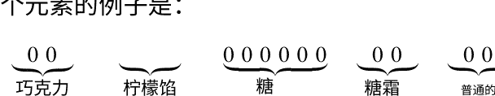

在这里，我们用一个图形表示每个甜甜圈0和左边一个间隙在不同的品种之间。因此，上面的选择包含两个巧克力甜甜圈，没有柠檬馅，六个糖甜甜圈，两个糖霜甜甜圈和两个普通甜甜圈。现在让我们在这四个间隙中放入一个

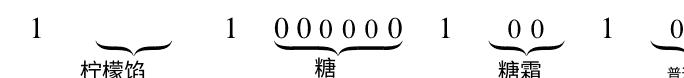

并关闭这些间隙：

```
0011000000100100 .
```

我们刚刚形成了一个有4个1的16位数——一个属于 B的元素。这个例子暗示了从集合 A到集合 B的双射：将一打甜甜圈映射为：

- c巧克力
- l柠檬馅
- s糖
- g糖霜
- p普通的

到序列：

```
0...0 1 0...0 1 0...0 1 0...0 1 0...0
  c         l         s         g         p
```

结果序列始终有16位，且恰好有4个1，和因此是 B的一个元素。此外，这个映射是一个双射：每个这样的位序列都来自一打甜甜圈的一个顺序。因此， |A| = |B|根据双射规则。更一般地说，

> > 引理 14.1.1.当有 k种口味可选时，选择 n个甜甜圈的方式数与具有恰好 n个零和 k个- 1的二进制序列数相同。

这个例子展示了双射规则的威力。我们成功证明了两个非常不同的集合实际上具有相同的大小，尽管我们不知道任何一个集合的确切大小。但是 一旦我们弄清楚一个集合的大小，我们就会立即知道另一个集合的大小。

如果你以前没有见过这个特殊的双射，它可能看起来非常巧妙。但是你将一遍又一遍地使用基本相同的论证，很快你会认为这是例行公事。

## 第14章 基数规则

### 14.2 计数序列

双射规则允许我们通过计数另一件事来计数一件事。这提示了一个一般的策略：精通计数少数几个事物，然后使用双射来计数其他一切！这是我们 将要遵循的策略。特别是，我们将精通计数序列。当我们想要确定某个集 合 T的大小时，我们将找到从 T 到一个序列集合 S的双射。然后，我们将使 用我们超级忍者级别的序列计数技巧来确定 S的大小 |S|，这立即给出了 T 的大小 |T|。随着我们的学习，我们需要进一步完善这个想法，但基本上就是这样！

### 14.2.1 乘法法则

乘法法则给出了集合乘积的大小。回想一下，如果 $P_1, P_2, \ldots, P_n$ 是集合，那么 $P_1 \times P_2 \times \cdots \times P_n$ 是所有序列的集合，其第一个项来自 $P_1$，第二个项来自 $P_2$，依此类推。

> 规则14.2.1（乘法法则）。如果 $P_1, P_2, \ldots, P_n$ 是有限集合，则： $|P_1 \times P_2 \times \cdots \times P_n| = |P_1| \cdot |P_2| \cdots |P_n|$

例如，假设每天的饮食由从集合 $B$ 中选择的早餐，从集合 $L$ 中选择的午餐和从集合 $D$ 中选择的晚餐组成，其中： $B = \{\text{煎饼}; \text{培根和鸡蛋}; \text{百吉饼}; \text{多力多滋}\}$, $L = \{\text{汉堡和薯条}; \text{花园沙拉}; \text{多力多滋}\}$, $D = \{\text{通心粉},\text{披萨},\text{冷冻卷饼},\text{意大利面},\text{多力多滋}\}$

- (煎饼, 汉堡和薯条, 披萨)
- (培根和鸡蛋, 花园沙拉, 意大利面)
- (多力多滋, 多力多滋, 冷冻卷饼)

乘法法则告诉我们有多少不同的每日饮食可能： $|B \times L \times D| = |B| \cdot |L| \cdot |D| = 4 \cdot 3 \cdot 5 = 60.$

### 14.2.2 一个 $n$ 元素集合的子集

定理4.5.5证明了一个 $n$ 元素集合有 $2^n$ 个子集，通过建立子集和长度为 $2n$ 的二进制字符串之间的双射。因此，关于子集的原始问题被转化为一个关于序列的问题-完全按计划进行！现在我们可以填补关于为什么存在 $2^n$ 个长度为 $2n$ 的二进制字符串的缺失解释：我们可以将所有 $2^n$ 位序列的集合写成一个集合的乘积：

```
$\{0, 1\}^n ::= \{0, 1\} \times \{0, 1\} \times \cdots \times \{0, 1\}$.
```

那么 乘积法则给出答案： $|\{0, 1\}^n| = |\{0, 1\}|^n = 2^n.$

## 第14章 基数规则

### 14.2.3 求和法则

巴特给他的妹妹丽莎分配了20天脾气暴躁的日子，40天易怒的日子，和60天一般性暴躁的日子。丽莎有多少天会情绪不好？令集合 \(C\) 为她脾气暴躁的日子，\(I\) 为她易怒的日子，\(S\) 为一般性暴躁的日子。用这些术语来回答问题，答案是 \(|C \cup I \cup S|\)。现在假设她每天最多允许有一个不好的品质，这个集合的大小由求和法则给出：

规则14.2.2 (求和规则)。如果 \(A_1, A_2, \ldots, A_n\) 是不相交的集合，则：

\[|A_1 \cup A_2 \cup \ldots \cup A_n| = |A_1| + |A_2| + \ldots + |A_n|\]

因此，根据巴特的预算，丽莎可以不高兴的天数为：
\[|C \cup I \cup S| = |C| + |I| + |S|\]
\[= 20 + 40 + 60\]
\[= 120\text{ 天}\]

请注意，求和规则仅适用于不相交集合的并集。计算重叠集合的并集大小是一个更复杂的问题，我们将在第14.9节中讨论。

### 14.2.4 计算密码

很少有计数问题可以用单一规则解决。更常见的情况是，解决方案是一系列的求和、乘积、双射和其他方法。

对于解决涉及密码、电话号码和车牌的问题，和规则和乘法规则一起很有用。例如，在某台计算机系统上，一个有效的密码是一个由六到八个符号组成的序列。第一个符号必须是一个字母（可以是小写或大写），剩下的符号必须是字母或数字。有多少种不同的密码可能性？

让我们定义两个集合，分别对应于密码中第一个和后续位置的有效符号。

\[F = \{a, b, \ldots, z, A, B, \ldots, Z\}\]

\[S = \{a, b, \ldots, z, A, B, \ldots, Z, 0, 1, \ldots, 9\}\]

用这些术语来说，所有可能的密码集合是：¹

\[(F \times S^5) \cup (F \times S^6) \cup (F \times S^7)\]

¹符号 \(S^5\) 表示 \(S \times S \times S \times S \times S\)。

因此，长度为六的密码在集合 F × S^5中，长度为七的密码在集合 F × S^6中，长度为八的密码在集合 F × S^7中。由于这些集合是不相交的，我们可以应用求和法则，并按照以下方式计算可能的密码总数：

```
| (F × S^5) ∪ (F × S^6) ∪ (F × S^7) |
= |F × S^5| + |F × S^6| + |F × S^7|  求和法则
= |F|·|S|^5 + |F|·|S|^6 + |F|·|S|^7  乘法法则
= 52·62^5 + 52·62^6 + 52·62^7
≈ 1.8·10^{14} 不同的密码
```

### 14.3 广义乘法法则

有多少种方式可以给n个人颁发诺贝尔奖、日本奖和普利策奖？使用我们将奖项问题转化为序列问题的策略，这个问题很容易回答。设 P为参加课程的n个人的集合。那么从颁发三个奖项的方式到集合 P^3 := P × P × P存在一个双射。 特别地，这个分配：

> > “巴拉克获得诺贝尔奖，乔治获得日本奖，比尔获得普利策奖”

映射到序列 (巴拉克,乔治,比尔)。根据乘法法则，我们有 |P^3| = |P|^3 = n^3，所以有n^3种方式给n个人颁发奖项。 注意 P^3包括像 (巴拉克,比尔,巴拉克) 这样一个人获得多个奖项的三元组。

但是如果三个奖品必须分别颁发给不同的学生呢？和之前一样，我们可以将分配映射到三元组 (比尔,乔治,巴拉克) ∈ P^3。但是这个函数不再是双射 .例如，没有有效的分配映射到这个三元组 (巴拉克,比尔,巴拉克)因为现在我们不允许巴拉克获得两个奖品. 然而，从奖品分配到集合之间存在一个双射：

```
S = {(x, y, z) ∈ P^3 | x, y, 和 z是不同的人}
```

这将原始问题简化为一个计数序列的问题.不幸的是，乘法原理不能直接应用于这种类型的计数序列，因为条目之间相互依赖；特别是，它们必须都是不同的. 然而，稍微更精确的工具可以解决这个问题.

## 真正优秀的课程作业的奖励

鉴于大家在这个材料上的努力，教师们考虑奖励一些真正优秀的课程作业。这里有三个可能的奖项类别：

最佳行政评论我们明确表示这次测验是闭卷的。在封面上，一个强有力的候选人写道：“没有书。”

尴尬问题奖“好吧，左袜子、右袜子和裤子是一个反链，但是——即使有帮助——我怎么能同时穿上这三样？”

最佳合作声明受到一位学生在第一次测验中写道“我独自完成”的启发。

### 规则14.3.1（广义乘法规则）

设 S 为长度为 k 的序列集合。如果存在：

- $n_1$ 个可能的第一项，
- $n_2$ 个可能的第二项对于每个第一项，
- ...
- 每个序列的可能 k 个条目，每个序列的第 k 个条目为 $first_k - 1$ 条目，

然后：

```
$|S| = n_1 \cdot n_2 \cdot n_3 \cdots n_k$
```

在奖项示例中，$S$由序列$(x, y, z)$组成。有 $n$ 种方法来选择 $x$，获得奖项#1。对于每个这些，有 $n - 1$ 种方法来选择 $y$，获得奖项#2，因为除了人 $x$ 之外的每个人都有资格。对于每个 $x$ 和 $y$ 的组合，有 $n - 2$ 种方法来选择 $z$，获得奖项#3，因为除了 $x$ 和 $y$ 之外的每个人都有资格。因此，根据广义乘法规则，有

```
$|S| = n \cdot (n - 1) \cdot (n - 2)$
```

将3个奖项授予不同的人的方法。

### 14.3.1 有缺陷的美元钞票

如果8位数的序列号中有某个数字出现超过一次，则一美元钞票是有缺陷的。如果你检查你的钱包，你会伤心地发现有很多有缺陷的钞票。事实上，非有缺陷的钞票有多常见？假设序列号的数字部分出现的频率相等，我们可以通过计算来回答这个问题。

非有缺陷的钞票的比例 = \frac{具有所有不同数字的序列号的数量}{序列号} . (14.1)

让我们首先考虑分母。在这里没有限制；有10个可能的第一位数字，10个可能的第二位数字，10个第三位数字，依此类推。因此，8位数的序列号的总数是 $10^8$，根据乘法原则。接下来，让我们转向分子。现在我们不允许使用任何数字两次。因此，第一个数字有10种可能性，但第二个数字只有9种可能性，第三个数字只有8种可能性，依此类推。因此，根据广义乘法规则，有

10·9·8·7·6·5·4·3 = \frac{10!}{2} = 1,814,400

具有所有不同数字的序列号。将这些结果代入方程14.1，我们得到：

非缺陷票据的比例 = \frac{1,814,400}{100,000,000} = 1.8144\%

### 14.3.2 一个国际象棋问题

我们如何以多少种不同的方式将一个兵（P），一个马（N）和一个象（B）放在国际象棋棋盘上，以便任何两个棋子都不共享一行或一列？图14.1（a）显示了一个有效的配置，图14.1（b）显示了一个无效的配置。

首先，我们将这个关于棋子的问题映射为一个关于序列的问题。从配置到序列存在一个双射

$(r_P, c_P, r_N, c_N, r_B, c_B)$

其中，$r_P$，$r_N$和$r_B$是不同的行，$c_P$，$c_N$和$c_B$是不同的列。特别地，$r_P$是兵的行，$c_P$是兵的列，$r_N$是马的行，等等。现在我们可以使用广义乘法法则计算这样的序列的数量：

- $r_P$ 是8行之一
- cP是8列之一
- rN是7行之一（除了rP之外的任意一行）
- cN是7列之一（除了cP之外的任意一列）
- rB是6行之一（除了rP或rN之外的任意一行）
- cB是6列之一（除了cP或cN之外的任意一列）

因此，总的配置数为 (8 · 7 · 6)^2。

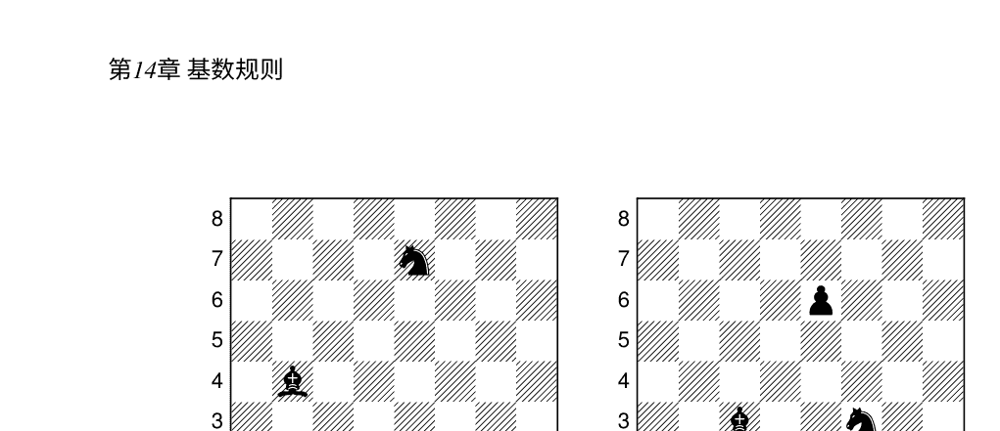

图14.1 在棋盘上放置一个兵（♙）、一个马（♘）和一个象（♗）的两种方式。（b）中的配置是无效的，因为象和马在同一行。

### 14.3.3 排列

集合 S的一个排列是一个包含集合 S的每个元素恰好一次的序列。例如，以下是集合 {a, b, c} 的所有排列：

```
(a, b, c)  (a, c, b)  (b, a, c)
(b, c, a)  (c, a, b)  (c, b, a)
```

一个有n个元素的集合有多少种排列方式？嗯，第一个元素有n种选择方式。对于每一种选择方式，第二个元素有n-1种剩余选择方式。对于前两个元素的每一种组合方式，第三个元素有n-2种选择方式，依此类推。因此，总共有

```
n · (n-1) · (n-2) ··· 3 · 2 · 1 = n!
```

n个元素的集合有这么多种排列方式。特别地，这个公式表示有

3个元素的集合 $\{a, b, c\}$ 有 $3! = 6$ 种排列方式，这也是我们之前找到的数量。

排列组合在这门课程中将出现大约1.6亿亿次。事实上，排列组合是阶乘经常出现的原因，也是我们教给你斯特林逼近的原因：

$$ n! \sim \sqrt{2\pi n} \left(\frac{n}{e}\right)^n. $$

### 14.4 除法原则

通过数耳朵并除以二来计算房间里的人数是一种愚蠢的方法，但这种方法代表了一种强大的计数原则。一个 $k$对$1$的函数将域中的每个元素映射到目标域中的 $k$个元素。例如，将每只耳朵映射到它的主人的函数是2对$1$的。同样，将每个手指映射到它的主人的函数是10对1，将每个手指和脚趾映射到它的主人的函数是20对1。一般规则是：

**规则14.4.1（除法原则）**。如果 $f : A \rightarrow B$ 是 $k$对$1$的，那么 $|A| = k \cdot |B|$

例如，假设 $A$ 是房间里的耳朵的集合，$B$ 是人的集合。从耳朵到人的映射是2对$1$的，所以根据除法原则， $|A| = 2 \cdot |B|$。等价地， $|B| = |A|/2$，表达了我们一直知道的事实：人的数量是耳朵数量的一半。尽管看起来不太可能，但是通过最初多次计数每个项目，然后使用除法原则来纠正答案，许多计数问题变得更容易。让我们看一些例子。

### 14.4.1 另一个国际象棋问题

在国际象棋棋盘上，有多少种不同的方式可以放置两个相同的车，使它们不共享一行或一列？一个有效的配置如图14.2(a)所示，一个无效的配置如图14.2(b)所示。让 $A$ 是所有序列的集合

$$ (r_1, c_1, r_2, c_2) $$

其中 $r_1$ 和 $r_2$ 是不同的行，$c_1$ 和 $c_2$ 是不同的列。设 $B$ 为所有有效的车配置的集合。存在一个自然函数 $f$ 从集合 $A$ 到集合 $B$；特别地，$f$ 将序列 $(r_1, c_1, r_2, c_2)$ 映射到一个配置，其中一个车在第 $r_1$ 行，第 $c_1$ 列，另一个车在第 $r_2$ 行，第 $c_2$ 列。


图14.2 在棋盘上放置2个车（♜）的两种方式。（b）中的配置是无效的，因为车在同一列。

但现在出现了一个问题。考虑以下序列：

$(1, a, 8, h)$ 和 $(8, h, 1, a)$

第一个序列映射到一个左下角有车的配置和一个右上角有车的配置。第二个序列映射到一个右上角有车的配置和一个左下角有车的配置。问题在于这两种描述方式实际上是描述同一个配置！事实上，这个排列如图14.2(a)所示。

更一般地说，函数 $f$ 将恰好两个序列映射到每个棋盘配置；$f$ 是一个2对1的函数。因此，根据商规则，$|A| = 2 \cdot |B|$。重新排列项得到：

```
$$|B| = \frac{|A|}{2} = \frac{(8 \cdot 7)^2}{2}.$$
在第二行，我们使用了通用乘法规则计算了 $A$ 的大小就像之前的国际象棋问题一样。
```

### 14.4.2 圆桌骑士

亚瑟王有多少种方式可以安排他的 n different 骑士在他的圆桌上就座？座位安排定义了谁坐在哪里。如果每个骑士在两个座位之间坐在相同的两个骑士之间，那么两个座位安排被认为是相同的。

## 14.4. 除法原则

座位安排。另一种等价的说法是，当两个座位安排产生相同的从骑士1开始顺时针绕桌子的骑士序列时，它们产生相同的安排。例如，以下两个座位安排确定了相同的安排：


座位安排由顺时针绕桌子开始于顶部座位的骑士序列确定。因此，座位安排对应于骑士的排列，共有 n! 个。例如，


如果两个座位安排在旋转桌子时是相同的，那么它们确定了相同的安排，其中骑士1在顶部座位。例如，对于 n = 4，有4个不同的序列对应于座位安排：


从座位到安排的映射实际上是一个 n 对 1 的函数，因为座位中骑士序列的所有循环移位都映射到相同的安排。

因此，根据除法规则，循环座位安排的数量为：

座位 / n = n! / n = (n - 1)!

## 第14章 基数规则

### 14.5 计数子集

一个 n 元素集合中有多少 k 元素的子集？这个问题经常以各种形式出现：

- 我从我的100本书中选择5本带去度假，有多少种方式？
- 从一副52张牌的牌组中，有多少种不同的13张桥牌手牌？
- 如果有14种可用的配料，我要为我的披萨选择5种配料，有多少种方式？

这个数字出现得如此频繁，以至于有一个特殊的符号表示它：

$$\binom{n}{k} := \text{一个 } n \text{ 元素集合中的 } k \text{ 元素子集的数量。}$$

表达式 \(\binom{n}{k}\) 读作“n选择k”。现在我们可以立即回答上面的三个问题：

- 我可以从100本书中选择5本，有 \(\binom{100}{5}\) 种方式。
- 有 \(\binom{52}{13}\) 种不同的桥牌手牌。
- 有 \(\binom{14}{5}\) 种方式（如果有14种配料可用）。

### 14.5.1 子集规则

我们可以使用除法规则推导出一个简单的公式来计算组合数 n 选择 k。我们通过将任意一个 n 元素集合 \(\{a_1, \ldots, a_n\}\) 的排列映射到一个 k-元素子集，只需取排列的前 k 个元素即可。也就是说，排列 \(a_1 a_2 \ldots a_n\) 将映射到集合 \(\{a_1, a_2, \ldots, a_k\}\)。注意，任何其他具有相同前 k 个元素 \(a_1, \ldots, a_k\) 的排列，无论顺序如何，以及相同剩余元素 \(n-k\) 个元素的排列，无论顺序如何，也将映射到这个集合。而且，只有当排列的前 k 个元素是元素 \(a_1, \ldots, a_k\) 的某种排列时，排列才能映射到 \(\{a_1, a_2, \ldots, a_k\}\)。由于前 k 个元素有 \(k!\) 种可能的排列，剩余元素有 \((n - k)!\) 种排列，根据乘法规则，我们得出结论：恰好有 \(k!(n - k)!\) 个排列将 S 映射到这个特定的子集。换句话说，从排列到 k 元素子集的映射是 \(k!(n - k)!\) 对一的。

但是我们知道一个 \(n\) 个元素集合有 \(n!\) 个排列，所以根据除法原则，我们得出结论

$$n! = k!(n - k)! \binom{n}{k}$$

这证明了：

**规则 14.5.1 (子集规则).** 一个 \(n\) 个元素集合的 \(k\) 个元素子集的数量是

$$\binom{n}{k} = \frac{n!}{k!(n - k)!}$$

请注意，即使对于0个元素的子集也适用：\(n!/0!n! = 1\)。在这里，我们使用了一个事实，即 \(0!\) 是0个项的乘积，根据惯例等于1。

### 14.5.2 位序列

有多少个 \(n\) 位序列恰好包含 \(k\) 个1？我们已经看到了一个直接的双射，将一个 \(n\) 个元素集合的子集与 \(n\) 位序列对应。例如，这是一个包含3个元素的子集 \(\{ x_1, x_2, \ldots, x_8 \}\) 和相应的8位序列：

```
{ x1, x4, x5 }
( 1, 0, 0, 1, 1, 0, 0, 0 )
```

注意到这个序列恰好有3个1，每个1对应一个3元素子集的元素。更一般地，与 \(k\) 个元素子集对应的 \(n\) 位序列将恰好有 \(k\) 个1。因此根据双射规则，

**推论 14.5.2.** 恰好有 \(k\) 个1的 \(n\) 位序列的数量是 \(\binom{n}{k}\)。

而且，根据引理14.1.1中选择有味道的甜甜圈和位序列之间的双射，

**推论 14.5.3.** 当有 \(k\) 种口味可选时，选择 \(n\) 个甜甜圈的方式数为 \(\binom{n + k - 1}{n}\)。

## 14.6 重复序列

### 14.6.1 子集序列

选择一个 \(k\) 元素的子集，从一个 \(n\) 元素的集合中划分出一对子集：第一个子集的大小为 \(k\)，第二个子集由剩余的 \(n - k\) 个元素组成。因此，子集规则可以理解为计算这种划分成一对子集的数量的规则。

我们可以将这个推广到计算划分成多于两个子集的方式。设 \(A\) 为一个 \(n\) 元素的集合，\(k_1, k_2, \ldots, k_m\) 为非负整数，它们的和为 \(n\)。\(A (k_1, k_2, \ldots, k_m)\)-划分是一个序列 \((A_1, A_2, \ldots, A_m)\) 其中 \(A_i\) 是 \(A\) 的不相交子集，且 \(|A_i| = k_i\) 对于 \(i =1, \ldots, m\)。

计算划分的数量，我们采用与子集规则相同的方法。即，我们将任何一个由 \(n\) 元素的集合 \(A\) 的排列 \(a_1 a_2 \ldots a_n\) 映射到一个 \((k_1, k_2, \ldots, k_m)\)-划分，其中划分中的第一个子集是排列的前 \(k_1\) 个元素，划分中的第二个子集是接下来的 \(k_2\) 个元素，等等，而划分中的第 \(m\) 个子集是排列的最后 \(k_m\) 个元素。这个映射是从 \(n\) 个排列到 \(A\) 的 \((k_1, k_2, \ldots, k_m)\)-划分的一个 \(k_1! k_2! \cdots k_m!\) 到 1 的函数，因此根据除法规则，我们得出子集分割规则：

**定义 14.6.1.** 对于 \(n, k_1, \ldots, k_m \in \mathbb{N}\), 使得 \(k_1 + k_2 + \cdots + k_m = n\), 定义多项式系数

$$\binom{n}{k_1, k_2, \ldots, k_m} ::= \frac{n!}{k_1! k_2! \ldots k_m!}$$

**规则 14.6.2 (子集分割规则).** 一个 \(n\)-元素集合的 \(k_1; k_2; \ldots; k_m\)-分割的数量是 \(\binom{n}{k_1, \ldots, k_m}\)。

### 14.6.2 账簿员规则

我们还可以将我们对具有 \(k\) 个元素的 \(n\) 位序列的计数推广到计算具有超过两个字母的字母表上的序列。例如，通过重新排列10个字母的单词 BOOKKEEPER，可以形成多少个序列？

注意到在 BOOKKEEPER 中有1个B，2个O，2个K，3个E，1个P和1个R。这导致了 BOOKKEEPER 的排列与 \((1,2,2,3,1,1)\)-分割 \(\{1,2,...,10\}\) 之间的直接双射。即，将排列映射到不同字母出现的位置集合的序列。

例如，在排列 BOOKKEEPER 中，B位于第1个位置，O出现在第2和第3个位置，K出现在第4和第5个位置，E出现在第6、第7和第9个位置，P出现在第8个位置，R位于第10个位置。所以 BOOKKEEPER 映射到

\((\{1\}, \{2, 3\}, \{4, 5\}, \{6, 7, 9\}, \{8\}, \{10\}).\)

根据这个双射和子集分割规则，我们得出重新排列单词 BOOKKEEPER 的方法数为：

$$\frac{10!}{1! 2! 2! 3! 1! 1!}$$
（分子是总字母数10的阶乘，分母分别是B、O、K、E、P、R的出现次数的阶乘）

这个例子直接推广到一个非常有用的计数原理，我们称之为

**规则 14.6.3 (Bookkeeper规则).** 设 \(l_1, \ldots, l_m\) 是不同的元素。具有 \(k_1\) 个 \(l_1\) 的出现次数，\(k_2\) 个 \(l_2\) 的出现次数，... 以及 \(k_m\) 个 \(l_m\) 的出现次数的序列的数量为

$$\binom{k_1 + k_2 + \dots + k_m}{k_1, \dots, k_m}$$

例如，假设你计划走20英里，其中包括5个北向英里，5个东向英里，5个南向英里和5个西向英里。有多少种不同的行走方式?

这样的行走方式与具有5个N、5个E、5个S和5个W的序列之间存在一种双射关系。根据记账员规则，这样的序列的数量是：

$$\frac{20!}{(5!)^4}$$

### 关于单词的说明

有一天，你可能会在同事面前提到子集分割规则或记账员规则，并发现他们都茫然地盯着你。这不是因为他们愚蠢，而是因为我们编造了“记账员规则”的名字。然而，这个规则非常好，名字也很贴切，所以我们建议你可以这样说：“你知道吗？记账员规则？你们什么都不知道吗？”

记账员规则有时被称为“具有不可区分对象的排列的公式”。一个n元素集合的大小为k的子集有时被称为k组合。其他类似的描述有“重复组合，重复排列，r排列，具有不可区分对象的排列”等等。然而，我们教给你的计数规则足以解决所有这些问题，而不需要了解这些术语，所以我们不会给你增加负担。

### 14.6.3 二项式定理

计数揭示了代数的一个基本定理。一个二项式是两个项的和，比如 \(a + b\)。现在考虑它的四次方，\((a + b)^4\)。通过反复使用乘法分配律将这个四次方表达式完全展开，我们得到

$$(a + b)^4 = aaaa + aaab + aaba + aabb + abaa + abab + abba + abbb + baaa + baab + baba + babb + bbaa + bbab + bbba + bbbb$$

注意到每个 \(a\) 和 \(b\) 的序列都有一个项。因此，有 \(2^4\) 个项，其中有 \(k\) 个 \(a\) 和 \(n-k\) 个 \(b\) 的项的数量是：

$$\frac{n!}{k!(n-k)!} = \binom{n}{k}$$

根据记账员法则，因此，\(a^{n-k} b^k\) 的系数是 \(\binom{n}{k}\)。所以对于 \(n = 4\)，这意味着：

$$(a + b)^4 = \binom{4}{0} a^4 b^0 + \binom{4}{1} a^3 b^1 + \binom{4}{2} a^2 b^2 + \binom{4}{3} a^1 b^3 + \binom{4}{4} a^0 b^4$$

一般来说，这种推理给出了二项式定理：

> **定理 14.6.4 (二项式定理).** 对于所有的 \(n \in \mathbb{N}\) 和 \(a, b \in \mathbb{R}\):
>
> $$(a + b)^n = \sum_{k=0}^n \binom{n}{k} a^{n-k} b^k$$

这种关于二项式的推理很好地扩展到多项式，它们是两个或多个项的和。例如，假设我们想要的系数是 \(bo^2k^2e^3pr\) 在展开式中 \((b + o + k + e + p + r)^{10}\)。这个展开式中的每一项都是一个由10个变量的乘积组成，其中每个变量都是 \(b\)，\(o\)，\(k\)，\(e\)，\(p\)，或 \(r\) 之一。现在，\(bo^2k^2e^3pr\) 的系数是那些恰好有1个 \(b\)，2个 \(o\)，2个 \(k\)，3个 \(e\)，1个 \(p\) 和1个 \(r\) 的项的数量。而这样的项的数量正是单词 BOOKKEEPER 的重新排列数量：

$$\binom{10}{1,2,2,3,1,1} = \frac{10!}{1!2!2!3!1!1!}$$

这种推理可以推广到一个一般的定理：

> **定理 14.6.5 (多项式定理).** 对于所有的 \(n \in \mathbb{N}\),
>
> $$(z_1 + z_2 + \cdots + z_m)^n = \sum_{\substack{k_1, \ldots, k_m \in \mathbb{N} \\ k_1 + \cdots + k_m = n}} \binom{n}{k_1, k_2, \ldots, k_m} z_1^{k_1} z_2^{k_2} \cdots z_m^{k_m}$$
>
> 但是记住多项式定理背后的推理比记住这个繁琐的正式陈述更好。

## 14.7 计数实践：扑克牌手

五张牌抽牌是一种纸牌游戏，每个玩家最初从一副52张牌的牌组中抽取5张牌。$^3$ 不同手牌的数量为

$$\binom{52}{5} = 2,598,960$$

$^3$ 标准牌组中有52张牌。每张牌都有一个花色和一个等级。有四种花色：

- ♠ (黑桃)
- ♥ (红心)
- ♣ (梅花)
- ◇ (方块)

并且有13个等级，从低到高列出如下：

- A, 2, 3, 4, 5, 6, 7, 8, 9, J, Q, K.

因此，例如，8♥是红心8，A♠是黑桃A。

让我们通过计算具有不同特殊属性的手的数量来进行一些计数练习。

### 14.7.1 四条

四条是由四张相同等级的牌组成的。有多少种不同的手包含四条？以下是一些例子：

- {8♠, 8♢, Q♡, 8♡, 8♣}
- {A♣, 2♣, 2♡, 2♢, 2♠}

通常情况下，第一步是将这个问题映射为一个序列计数问题。一个四条的手牌可以完全由一个序列来描述：

1. 四张牌的等级。
2. 额外牌的等级。
3. 额外牌的花色。

因此，四条的手牌和由两个不同等级后跟一个花色组成的序列之间存在一个双射关系。例如，上面的三个手牌与以下序列相关联：

| 序列 | 手牌 |
| :--- | :--- |
| \((8, Q, \heartsuit)\) | \(\{8\spadesuit, 8\diamondsuit, 8\heartsuit, 8\clubsuit, Q\heartsuit\}\) |
| \((2, A, \clubsuit)\) | \(\{2\clubsuit, 2\heartsuit, 2\diamondsuit, 2\spadesuit, A\clubsuit\}\) |

现在我们只需要计算序列。选择第一名有13种方式，选择第二名有12种方式，选择花色有4种方式。因此，根据广义乘法规则，有 \(13 \cdot 12 \cdot 4 = 624\) 手是四条。这意味着大约4165手中只有1手是四条。毫不奇怪，四条被认为是一手非常好的扑克牌！

### 14.7.2 有一个葫芦的手

一个葫芦是一手有三张相同点数的牌和两张相同点数的牌。
以下是一些例子：

- {2♠, 2♣, 2♢, J♣, J♢}
- {5♢, 5♣, 5♡, 7♡, 7♣}

再次，我们转向一个关于序列的问题。完全满堂和指定序列之间存在一个双射：

1. 三张牌的等级，可以选择13种方式。
2. 三张牌的花色，可以选择 \(\binom{4}{3}\) 种方式。
3. 一对牌的等级，可以选择12种方式。
4. 一对牌的花色，可以选择 \(\binom{4}{2}\) 种方式。

示例手牌对应的序列如下所示：

| 序列 | 手牌 |
| :--- | :--- |
| \((2, \{\spadesuit, \clubsuit, \diamondsuit\}, J, \{\clubsuit, \diamondsuit\})\) | \(\{2\spadesuit, 2\clubsuit, 2\diamondsuit, J\clubsuit, J\diamondsuit\}\) |
| \((5, \{\diamondsuit, \clubsuit, \heartsuit\}, 7, \{\heartsuit, \clubsuit\})\) | \(\{5\diamondsuit, 5\clubsuit, 5\heartsuit, 7\heartsuit, 7\clubsuit\}\) |

通过广义乘法规则，满堂彩的数量是：

$$13 \cdot \binom{4}{3} \cdot 12 \cdot \binom{4}{2}$$

我们正处于高潮，但我们即将遇到一个障碍。

### 14.7.3 有两对的手牌

有多少手牌有两对；也就是说，一副牌中有两张相同点数的牌，两张相同点数的牌，和一张不同点数的牌？以下是一些例子：

- {3♢, 3♠, Q♢, Q♡, A♣}
- {9♡, 9♢, 5♡, 5♣, K♠}

每个有两对的手牌由一个序列描述，该序列包括：

1. 第一对的点数，有13种选择方式。
2. 第一对的花色，可以选择 \(\binom{4}{2}\) 种方式。
3. 第二对的点数，有12种选择方式。
4. 第二对的花色可以以 \(\binom{4}{2}\) 种方式选择。
5. 额外牌的等级可以选择11种方式。
6. 额外牌的花色可以以 \(\binom{4}{1} = 4\) 种方式选择。

因此，可能会出现两对的手牌数量是：

$$13 \cdot \binom{4}{2} \cdot 12 \cdot \binom{4}{2} \cdot 11 \cdot 4$$

错误答案！问题在于从这样的序列到两对手牌之间没有双射。实际上，这是一个2对1的映射。例如，以下是映射到上述手牌的序列对：

| 序列对 | 手牌 |
| :--- | :--- |
| \((3, \{\diamondsuit, \spadesuit\}, Q, \{\diamondsuit, \heartsuit\}, A, \clubsuit)\) | \(\{3\diamondsuit, 3\spadesuit, Q\diamondsuit, Q\heartsuit, A\clubsuit\}\) |
| \((Q, \{\diamondsuit, \heartsuit\}, 3, \{\diamondsuit, \spadesuit\}, A, \clubsuit)\) | \(\{3\diamondsuit, 3\spadesuit, Q\diamondsuit, Q\heartsuit, A\clubsuit\}\) |
| \((9, \{\heartsuit, \diamondsuit\}, 5, \{\heartsuit, \clubsuit\}, K, \spadesuit)\) | \(\{9\heartsuit, 9\diamondsuit, 5\heartsuit, 5\clubsuit, K\spadesuit\}\) |
| \((5, \{\heartsuit, \clubsuit\}, 9, \{\heartsuit, \diamondsuit\}, K, \spadesuit)\) | \(\{9\heartsuit, 9\diamondsuit, 5\heartsuit, 5\clubsuit, K\spadesuit\}\) |

问题在于没有任何区别第一对和第二对。一对5和一对9与一对9和一对5是一样的。我们在计算Full Houses时避免了这个困难，因为例如一对6和三个国王与一对国王和三个6是不同的。

上次我们遇到了这个困难，当我们从计算棋盘上不同棋子的排列到计算两个相同车的排列时。那时的解决办法是应用除法规则，我们在这里也可以这样做。在这种情况下，除法规则表示序列的数量是手牌的两倍，所以两对的手牌实际上是：

$$\frac{13 \cdot \binom{4}{2} \cdot 12 \cdot \binom{4}{2} \cdot 11 \cdot 4}{2}$$

### 另一种方法

前面的例子令人不安！一个人很容易忽视这样一个事实，即在考试中映射是2对1的，不及格了，就会走上犯罪的道路。你可以通过两种方式使世界变得更安全：## 14.7. 统计实践: 扑克牌手

每当你使用一个映射 $f : A \rightarrow B$将一个计数问题转化为另一个问题时，请检查在 $A$中映射到每个元素的元素数量与 $B$中的元素数量是否相同。如果 $A$中的 $k$个元素映射到 $B$的每个元素，则使用常数 $k$应用除法规则。

作为额外的检查，尝试用不同的方法解决同一个问题。通常有多种方法可用，而且最好给出相同的答案！(有时不同的方法给出看起来不同的答案，但在进行一些代数运算后，它们会变成相同的。)

我们已经使用了第一种方法，现在尝试第二种。两对手牌和指定序列之间存在双射关系：

可以选择的两对的等级 $\binom{13}{2}$ 种方式。
可以选择的较低等级对的花色 $\binom{4}{2}$ 种方式。
可以选择的较高等级对的花色 $\binom{4}{2}$ 种方式。
可以选择的额外卡牌的等级 11 种方式。
可以选择的额外卡牌的花色 $\binom{4}{1} = 4$ 种方式。

例如，以下序列和手牌对应：
$({3, Q}, {\diamondsuit, \spadesuit}, {\diamondsuit, \heartsuit}, A, \clubsuit) \leftrightarrow {3\diamondsuit, 3\spadesuit, Q\diamondsuit, Q\heartsuit, A\clubsuit}$
$({9, 5}, {\heartsuit, \clubsuit}, {\heartsuit, \diamondsuit}, K, \spadesuit) \leftrightarrow {9\heartsuit, 9\diamondsuit, 5\heartsuit, 5\clubsuit, K\spadesuit}$

因此，具有的手数为两对是：
$$\binom{13}{2} \cdot \binom{4}{2} \cdot \binom{4}{2} \cdot 11 \cdot 4.$$
这是我们之前得到的相同答案，只是形式稍微不同。

## 14.7.4 每个花色都有的手

至少包含一张每个花色的手有多少？这是一个例子这样的手：
{7\diamondsuit, K\clubsuit, 3\diamondsuit, A\heartsuit, 2\spadesuit}
每个这样的手由一个序列描述，该序列指定了：

钻石、梅花、红心和黑桃的等级，可以选择的方式有 $13 \cdot 13 \cdot 13 \cdot 13 = 13^4$种。
额外卡片的花色，可以选择的方式有4种。
额外卡片的等级，可以选择的方式有12种。

例如，上面的手由以下序列描述：
$(7, K, A, 2, \diamondsuit, 3) \leftrightarrow \{7\diamondsuit, K\clubsuit, A\heartsuit, 2\spadesuit, 3\diamondsuit\}$.

是否存在其他与相同手牌对应的序列？还有一个！我们可以将 $3\diamondsuit$ 或 $7\diamondsuit$ 视为额外的牌，因此这实际上是一个2对1的映射。以下是对应用于示例手牌的两个序列：
$(7, K, A, 2, \diamondsuit, 3) \searrow \{7\diamondsuit, K\clubsuit, A\heartsuit, 2\spadesuit, 3\diamondsuit\}$
$(3, K, A, 2, \diamondsuit, 7) \nearrow$

因此，每种花色的手牌数量为：
$$\frac{13^4 \cdot 4 \cdot 12}{2}$$

## 第14章 基数规则

## 14.8 鸽巢原理

这是一个古老的谜题：

> 一个黑暗的房间里有红袜子、绿袜子和蓝袜子。你必须取出多少只袜子才能确保你有一双相同的袜子？

例如，挑选三只袜子是不够的；你可能会得到一只红袜子、一只绿袜子和一只蓝袜子。解决方案依赖于

> **鸽巢原理**
>
> 如果有比洞更多的鸽子，那么至少有两只鸽子必须在同一个洞里。

鸽巢原理与在光线不好的条件下选择鞋履有什么关系可能不是立即显而易见的，但是如果我们让袜子成为鸽子，颜色成为三个鸽巢，那么一旦你挑选了四只袜子，必定会有两只在同一个洞里，也就是说，颜色相同。所以四只袜子足以确保一双相配的袜子。例如，一种可能的将四只袜子映射到三种颜色的方式如图14.3所示。

鸽巢原理的严格陈述如下：

> 规则14.8.1（鸽巢原理）。 如果 |A| > |B|，那么对于每个总函数 f: A → B，存在两个不同的 A元素被 f 映射到相同的 B元素。

以这种方式陈述原则可能不太直观，但现在应该听起来很熟悉：它只是映射规则单射情况（4.6）的逆否命题。在这里，鸽子形成集合 A，鸽笼是集合 B，f描述了每只鸽子占据的鸽笼。

数学家们已经想出了许多巧妙的鸽笼原理应用。如果有一种生成这种论证的烹饪书程序，我们会给你的。不幸的是，没有这样的程序。不过，有一个有用的提示：当你尝试用鸽笼原理解决问题时，关键是清楚地确定三件事：

集合 A（鸽子）。
集合 B（鸽笼）。
函数 f（将鸽子分配到鸽笼的规则）。

## # 第14章 基数规则

## 14.8.1 头上的头发

鸽笼原理有许多推广。例如：

> 规则 14.8.2 (广义鸽巢原理)。如果 |A|> k · |B|，则每个总函数 f : A → B 至少将 k +1 个不同的元素映射到 A 的同一个元素 of B。

例如，如果你随机选择两个人，他们几乎不可能 exactly有相同数量的头发。然而，在马萨诸塞州的波士顿这个非凡的城市中，有一个由 three人组成的团体他们恰好有相同数量的头发！当然，波士顿有很多完全秃头的人，他们的头发为零。但我们谈论的是非秃头的人；如果一个人的头上至少有一万根头发，那么他就是非秃头的。

波士顿有大约 500,000 个非秃头的人，一个人头上的头发数量最多为 200,000。让 A是波士顿的非秃头人群，让 B ={10,000,10,001,...,200,000}，让 f将一个人映射到他或她头上的头发数量。由于 |A|> 2|B|，广义鸽巢原理暗示至少有三个人恰好有相同数量的头发。我们不知道他们是谁，但我们知道他们存在！

## 14.8.2 具有相同和的子集

为了您的阅读愉快，我们在图14.4中展示了九十个25位数。这些25位数中是否存在两个不同的子集具有相同的和？例如，也许第一列的最后十个数字的和等于第二列的前十一个数字的和？

找到两个和相同的子集可能看起来像一个愚蠢的难题，但解决这类问题在各种应用中非常有用，比如找到将包装箱装满的好方法和解码秘密信息。

事实证明，找到不同的和相同的子集是困难的，这就是为什么这个问题出现在密码学中的原因。但是很容易证明存在两个这样的子集。这就是鸽巢原理的应用之处。

设 A为列表中所有子集的集合。现在，任何数字的子集的和最多为 90 · 10^25，因为只有90个数字，而每个25位数都小于 10^25。所以，设 B为整数集合 {0,1,...,90 * 10^25}, 并让 f将每个数字子集 (在 A中) 映射到其和 (在 B中)。我们证明了在第14.2节中，一个有 n个元素的集合有 2^n个不同的子集。因此：
$$|A| = 2^90 \ge 1.237 \times 10^{27}$$
另一方面：
$$|B| = 90 \cdot 10^{25} + 1 \le 0.901 \times 10^{27}.$$
这两个数量都非常大，但是 |A| 稍微大于 |B|。这意味着 f 将至少两个 A 的元素映射到 B 的相同元素。换句话说，根据鸽巢原理，两个不同的子集必须有相同的和！请注意，这个证明没有指示哪两组数字具有相同的和。这种令人沮丧的论证方式被称为非构造性证明。

## 两个相同和子集的100美元奖金

为了确定是否可能实际上找到两个不同的子集，使得这两个子集的和相等，我们向第一个成功的学生提供了100美元的奖金。我们没有预料到要支付这个赌注，但我们低估了学生们的聪明才智和主动性。一位计算机科学专业的学生编写了一个程序，巧妙地在一个相对较小的“可行”集合中进行搜索，按照它们的和进行排序，并实际上找到了一对和相等的子集。他赢得了奖金。几天后，一位数学专业的学生找到了将求和问题重新表述为“格基约简”问题的方法；然后他找到了一个实现高效基约简过程的软件包，并且使用它，他很快找到了许多和相等的子集对。他没有赢得奖金，但他得到了全班（包括教职员工）的起立鼓掌。

## 奖励$500给具有不同子集和的集合

我们如何构建一个由正整数组成的集合，使得它的所有子集的和都不相同？一种方法是使用二的幂：
$$\{1, 2, 4, 8, 16\}$$
这种方法是如此自然，以至于人们怀疑所有其他这样的集合都必须包含更大的数字。（例如，我们可以安全地将16替换为17，但不能替换为15。）令人惊讶的是，存在涉及更小数字的例子。这是一个例子：
$$\{6, 9, 11, 12, 13\}$$
二十世纪最顶尖的数学家之一，保罗·埃尔德什在1931年猜测不存在涉及显著较小数字的这样的集合。更准确地说，他猜测这样一个集合中最大的数字必须大于某个常数c*2^n，其中c > 0。他向任何能够证明或反驳他的猜想的人提供了500美元的奖金，但这个问题仍然没有解决。

## 14.8.3 一个魔术

一个魔术师让助手带着一副52张牌的牌组进入观众席，而魔术师则背过身去。

五个观众中的每个人从牌组中选择一张牌。然后助手收集起这五张牌，并展示其中四张给魔术师看。魔术师专注片刻，然后准确地说出了秘密的第五张牌！

由于我们并不真的相信魔术师能够读心，我们知道助手以某种方式将秘密的牌传达给了魔术师。真正的魔术师和助手是不值得信任的，所以我们预计助手会用编码的短语或肢体语言秘密地向魔术师发出信号，但是对于这个魔术，他们不需要作弊。事实上，魔术师和助手可以相互看不见，而某个观众举起助手指定给魔术师看的四张牌。

当然，没有作弊的情况下，助手仍然有一种明显的方法可以与魔术师沟通：他可以选择任意一种排列方式来展示这4张卡片。然而，仅凭这一点还不够：牌堆中还剩下48张牌，所以助手没有足够的选择来准确指示秘密卡片是哪张（尽管他可以缩小范围到两张卡片）。

## 14.8.4 秘密

助手可以用来准确传达第五张卡片的方法是我们对计数和匹配的了解的一个很好的应用。

助手有第二种合法的沟通方式：他可以选择隐藏其中的哪张卡片。当然，魔术师如何通过观察四张可见卡片来确定助手选择的这五种可能性中的哪一种并不清楚，但我们现在将解释一种方法。

魔术师和助手面临的问题实际上是一个二分匹配问题。左边的每个顶点都对应于助手可用的信息，即一组5张卡片。因此，左手边顶点的集合 $X$ 将有 $C(52,5)$ 个元素。

右边的每个顶点都对应于魔术师可用的信息，即一组4张不同的卡片。因此，右手边顶点的集合 $Y$ 将有 $52 \cdot 51 \cdot 50 \cdot 49$ 个元素。当观众选择一组5张卡片时，助手必须从那手中揭示一组4张卡片。这个约束通过在左边的一组5张卡片和右边的一组4张卡片之间存在一条边来表示，当且仅当序列中的每张卡片也在集合中时。这定义了二分图。图中显示了一些边。

例如，
$\{8\heartsuit, K\spadesuit, Q\spadesuit, 2\diamondsuit, 6\diamondsuit\}$ (14.2) 是 X 的一个元素在左边。如果观众选择这组5张牌，那么在集合 Y 中右边有很多不同的4张牌序列助手可以选择揭示，包括 $(8\heartsuit, K\spadesuit, Q\spadesuit, 2\diamondsuit)$, $(K\spadesuit, 8\heartsuit, Q\spadesuit, 2\diamondsuit)$, 和 $(K\spadesuit, 8\heartsuit, 6\diamondsuit, Q\spadesuit)$。

魔术师和他的助手需要进行一次匹配，以便执行这个魔术，匹配的对象是 X 的顶点。如果他们事先达成一致，选择一些匹配，那么当观众选择一组5张牌时，助手会揭示匹配的4张牌序列。魔术师使用匹配来找到观众选择的5张牌，因此他可以说出那张还没有被揭示的牌。

例如，假设助手和魔术师在图14.5中的两条粗线上达成一致。如果观众选择了这个集合
$\{8\heartsuit, K\spadesuit, Q\spadesuit, 9\clubsuit, 6\diamondsuit\}$, (14.3)
那么助手就会揭示相应的序列
$(K\spadesuit, 8\heartsuit, 6\diamondsuit, Q\spadesuit)$. (14.4)
使用这个匹配，魔术师可以看到手牌（14.3）与序列（14.4）匹配，所以他可以说出对应集合中尚未揭示的一张牌，即 $9\clubsuit$。注意，集合之间的匹配是必要的，也就是说，不同的集合与不同的序列配对。例如，如果观众选择了之前的手牌（14.2），助手可以揭示相同的序列（14.4），但最好不要这样做；如果他这样做了，魔术师就无法判断剩下的牌是 $9\clubsuit$ 还是 $2\diamondsuit$。那么我们如何确保可以找到所需的匹配呢？答案是左侧的每个顶点的度数为 5·4! = 120，因为有五种方法可以选择保密的牌，剩下的四张牌有 4!种排列方式。此外，右侧的每个顶点的度数为48，因为第五张牌有48种可能性。因此，根据定义11.5.5，这个图是度受限的，并且根据定理11.5.6有一个匹配。

事实上，这种推理表明，如果剩下120张卡片而不是48张，魔术师仍然可以完成这个把戏，也就是说，这个把戏可以用一副多达124张不同的卡片来完成——没有任何魔法！

## 14.8.5 真正的秘密

但是等一下！原则上，魔术师和他的助手可以达成一致，但是他们应该如何记住一副有52张卡片的配对呢？
$C(52,5) = 2,598,960$ 边？为了让这个把戏在实践中起作用，必须有一种方法可以在脑海中和即兴中匹配手牌和卡片序列。

我们将描述一种方法。 作为一个运行的例子，假设观众选择：
$10\heartsuit \enspace 9\diamondsuit \enspace 3\heartsuit \enspace Q\spadesuit \enspace J\diamondsuit$.

助手挑出两张相同花色的牌。 在这个例子中，助手可能选择 $3\heartsuit$ 和 $10\heartsuit$。这总是可能的，因为鸽笼原理——有五张牌和四种花色，所以必定有两张牌属于同一种花色。

助手在图14.6中的循环中找到了这两张牌的排名。对于这个循环中的任意两个不同的排名，一个总是在另一个的顺时针方向上1到6个跳跃之间。 例如， $3\heartsuit$ 距离 $10\heartsuit$ 顺时针方向上6个跳跃。

这两张牌中更逆时针的那张首先被揭示，另一张成为秘密牌。因此，在我们的例子中， $10\heartsuit$ 将被揭示，而 $3\heartsuit$ 将成为秘密牌。因此：# 第14章 基数规则


- 秘密牌的花色与第一张揭示的牌的花色相同。
- 秘密牌的排名在第一张揭示的牌的排名顺时针方向上1到6个跳跃之间。

剩下的就是在1到6之间传递一个数字。魔术师和助手事先商定了一副牌的顺序，从最小到最大，如下所示：

```
A♣ A♢ A♡ A♠ 2♣ 2♢ 2♡ 2♠ ... K♡ K♠
```

最后三张牌被揭示的顺序按照以下方案传递数字：

| 序列 | 数值 |
|------|------|
| (小, 中, 大) | 1 |
| (小, 大, 中) | 2 |
| (中, 小, 大) | 3 |
| (中, 大, 小) | 4 |
| (大, 小, 中) | 5 |
| (大, 中, 小) | 6 |

在这个例子中，助手想要发送6，因此按照大、中、小的顺序展示了剩下的三张牌。以下是魔术师看到的完整序列：

```
10♡ Q♠ J♢ 9♢
```

魔术师从第一张牌开始，从10♥开始顺时针跳过6个等级，到达了秘密牌3♥!

这就是这个魔术的原理，可以使用标准的52张牌组成的牌组来完成。另一方面，霍尔定理表明，魔术师和助手原则上可以使用多达124张牌的牌组来完成这个魔术。事实证明，他们实际上可以学会一种方法来处理124张牌组，只需适量的练习即可，但我们在这里不会解释这个方法。

## 14.8.6 四张卡片的相同把戏？

假设观众只选择了四张卡片，并且助手向魔术师透露了一个包含三张卡片的序列。魔术师能够确定第四张卡片吗？设 $X$ 为观众可能选择的所有四张卡片的集合，设 $Y$ 为助手可能透露的所有三张卡片的序列。现在，一方面，我们有

$$|X| = \binom{52}{4} = 270,725$$

根据子集规则。另一方面，我们有

$$|Y| = 52 \cdot 51 \cdot 50 = 132,600$$

根据广义乘法规则。因此，根据鸽巢原理，助手必须至少透露相同的三张卡片序列

$$\left\lceil \frac{270,725}{132,600} \right\rceil = 3$$

给不同的四张卡片组合。这对魔术师来说是个坏消息：如果他看到了那个三张卡片的序列，那么对于第四张卡片，他至少有三种无法区分的可能性。因此，助手没有合法的方式来准确地传达第四张卡片是什么！

## 14.9 包含-排除

集合的并集有多大？例如，假设有60个数学专业学生，200个计算机科学专业学生和40个物理学专业学生。这三个专业中有多少学生？令 $M$ 为数学专业学生的集合，$E$ 为计算机科学专业学生的集合，$P$ 为物理学专业学生的集合。用这些术语来说，我们正在询问 $|M \cup E \cup P|$ 的大小。和规则说，如果 $M$，$E$ 和 $P$ 是不相交的，那么它们大小的和是 $|M \cup E \cup P| = |M| + |E| + |P|$。

然而，集合 $M$，$E$ 和 $P$ 可能不是不相交的。例如，可能有一名学生同时主修数学和物理学。这样的学生会在等式的右边被计算两次，一次作为 $M$ 的元素，一次作为 $P$ 的元素。更糟糕的是，可能有一名三重专业学生在等式的右边被计算三次！

我们最复杂的计数规则确定了不一定不相交的集合的并集的大小。在我们陈述规则之前，让我们通过考虑一些更简单的特殊情况来建立一些直觉：只有两个或三个集合的并集。

### 14.9.1 两个集合的并集

对于两个集合 $S_1$ 和 $S_2$，包含-排斥规则是它们并集的大小为：

$$|S_1 \cup S_2| = |S_1| + |S_2| - |S_1 \cap S_2|$$

直观上，集合 $S_1$ 的每个元素都在第一项中计算，集合 $S_2$ 的每个元素都在第二项中计算。既在 $S_1$ 中又在 $S_2$ 中的元素被计算了两次 - 一次在第一项中，一次在第二项中。这种重复计数通过最后一项进行修正。

### 14.9.2 三个集合的并集

那么数学、电子工程与计算机科学以及物理学系有多少学生？换句话说，如果：$|M| = 60$，$|E| = 200$，$|P| = 40$，那么 $|M \cup E \cup P|$ 是什么？

三个集合的并集大小由一个更复杂的包含-排除公式给出：

$$|S_1 \cup S_2 \cup S_3| = |S_1| + |S_2| + |S_3| - |S_1 \cap S_2| - |S_1 \cap S_3| - |S_2 \cap S_3| + |S_1 \cap S_2 \cap S_3|$$

值得注意的是，右边的表达式恰好计算了集合 $S_1$、$S_2$ 和 $S_3$ 的每个元素一次。例如，假设 $x$ 是这三个集合的元素。那么 $x$ 会被计算三次（通过 $|S_1|$、$|S_2|$ 和 $|S_3|$ 这些项），被减去三次（通过 $|S_1 \cap S_2|$、$|S_1 \cap S_3|$ 和 $|S_2 \cap S_3|$ 这些项），然后再计算一次（通过 $|S_1 \cap S_2 \cap S_3|$ 这一项）。最终效果是 $x$ 只被计算了一次。

如果 $x$ 在两个集合中（比如，$S_1$ 和 $S_2$），那么 $x$ 会被计算两次（通过 $|S_1|$ 和 $|S_2|$ 项）并减去一次（通过 $|S_1 \cap S_2|$ 项）。在这种情况下，$x$ 不会对其他项有任何贡献，因为 $x \notin S_3$。

所以我们不能在不知道各个交集的大小的情况下回答原始问题。假设有：

- 4个数学 - 电子工程学双学位
- 3个数学 - 物理学双学位
- 11个电子工程学 - 物理学双学位
- 2个三学位

那么 $|M \cap E| = 4 + 2$，$|M \cap P| = 3 + 2$，$|E \cap P| = 11 + 2$，以及 $|M \cap E \cap P| = 2$。将所有这些代入公式得到：

$$
\begin{aligned}
|M \cup E \cup P| &= |M| + |E| + |P| - |M \cap E| - |M \cap P| - |E \cap P| + |M \cap E \cap P| \\
&= 60 + 200 + 40 - 6 - 5 - 13 + 2 \\
&= 278
\end{aligned}
$$

### 14.9.3 含有42、04或60的序列

在集合 $\{0, 1, 2, ..., 9\}$ 的排列中，4和2、0和4，或者6和0是否连续出现？例如，以下这些对中没有任何一对出现：$(7, 2, 9, 5, 4, 1, 3, 8, 0, 6)$。末尾的06不计入；我们需要60。另一方面，在这个排列中，04和60是连续出现的：$(7, 2, 5, 6, 0, 4, 3, 8, 1, 9)$。

设 $P_{42}$ 为所有包含42的排列的集合。类似地，定义 $P_{60}$ 和 $P_{04}$。因此，例如，上述排列既包含在 $P_{60}$ 中，也包含在 $P_{04}$ 中，但不包含在 $P_{42}$ 中。用这些术语来说，我们要求的是集合 $P_{42} \cup P_{04} \cup P_{60}$ 的大小。

首先，我们必须确定各个集合的大小，例如 $|P_{60}|$。我们可以使用一个技巧：将6和0组合在一起作为一个符号。然后，排列中包含连续的6和0的排列与以下集合的排列之间存在一个直接的双射关系：$\{60, 1, 2, 3, 4, 5, 7, 8, 9\}$。例如，以下两个序列对应：$(7, 2, 5, 6, 0, 4, 3, 8, 1, 9) \rightarrow (7, 2, 5, 60, 4, 3, 8, 1, 9)$。集合中包含60的排列有 $9!$ 个，所以根据双射规则，$|P_{60}| = 9!$。同样地，$|P_{04}| = |P_{42}| = 9!$。

接下来，我们必须确定两个集合的交集大小，例如 $|P_{42} \cap P_{60}|$。再次使用组合技巧，与以下集合的排列存在一个双射关系：$\{42, 60, 1, 3, 5, 7, 8, 9\}$。因此，$|P_{42} \cap P_{60}| = 8!$。同样地，$|P_{60} \cap P_{04}| = 8!$ 通过一个双射与集合对应：$\{604, 1, 2, 3, 5, 7, 8, 9\}$。并且 $|P_{42} \cap P_{04}| = 8!$ 同样地通过类似的论证。最后，注意到 $|P_{60} \cap P_{04} \cap P_{42}| = 7!$ 通过一个双射与集合对应：$\{6042, 1, 3, 5, 7, 8, 9\}$。

将所有这些代入公式得到：

$$|P_{42} \cup P_{04} \cup P_{60}| = 9! + 9! + 9! - 8! - 8! - 8! + 7!$$

### 14.9.4 集合的并集

并集的大小由以下规则给出。

**规则 14.9.1 (包含-排除).**

$$|S_1 \cup S_2 \cup \dots \cup S_n| =$$

- 个体集合的大小之和
- 减去所有两两交集的大小
- 加上所有三个交集的大小
- 减去所有四个交集的大小
- 加上所有五个交集的大小，等等。

两个和三个集合的并集公式是这个通用规则的特殊情况。

这种表达包含-排除的方式易于理解，几乎和用数学符号表达一样准确，但我们现在需要解密下面的符号版本。

我们已经有了对个体集合大小之和的简洁表示，即

$$\sum_{i=1}^{n} |S_i|.$$

“双向交集”是一个形如 $S_i \cap S_j$ 的集合，其中 $i \neq j$。我们将 $S_j \cap S_i$ 视为与 $S_i \cap S_j$ 相同的双向交集，因此我们可以假设 $i < j$。现在，我们可以表示两个双向交集的大小之和为

$$\sum_{1 \leq i < j \leq n} |S_i \cap S_j|.$$

类似地，三个交集的大小之和为

$$\sum_{1 \leq i < j < k \leq n} |S_i \cap S_j \cap S_k|.$$

这些求和在包含-排除公式中具有交替的符号，其中 $k$ 个交集的和获得符号 $(-1)^{k-1}$。这最终导致了一个符号版本的规则：

**规则 (包含-排除).**

$$\left| \bigcup_{i=1}^{n} S_i \right| = \sum_{i=1}^{n} |S_i| - \sum_{1 \leq i < j \leq n} |S_i \cap S_j| + \sum_{1 \leq i < j < k \leq n} |S_i \cap S_j \cap S_k| + \cdots + (-1)^{n-1} \left| \bigcap_{i=1}^{n} S_i \right|.$$

虽然通常将规则表示为求和的形式很方便，因此，另一种表达规则的方式是：

**规则 (包含-排除-II)**

$$\left| \bigcup_{i=1}^n S_i \right| = \sum_{I \subseteq \{1, \ldots, n\}, I \neq \emptyset} (-1)^{|I|+1} \left| \bigcap_{i \in I} S_i \right| \qquad (14.6)$$

### 14.9.5 计算欧拉函数

问题14.52中给出了这些规则的证明。

如果 $n$ 的质因数分解为 $p_1^{e_1} p_2^{e_2} \ldots p_m^{e_m}$，其中 $p_i$ 是不同的质数，则

$$\phi(n) = n \prod_{i=1}^{m} \left(1 - \frac{1}{p_i}\right). \qquad (14.7)$$

首先，让 $S$ 为 $[0..n)$ 中与 $n$ 不互质的整数集合。因此，$\phi(n) = n - |S|$。接下来，让 $C_a$ 为 $[0..n)$ 中可被 $a$ 整除的整数集合：

$$C_a := \{k \in [0..n) \mid a \mid k\}.$$

因此，$S$ 中的整数正好是 $[0..n)$ 中至少可被一个 $p_i$ 整除的整数。即，

$$S = \bigcup_{i=1}^{m} C_{p_i}. \qquad (14.8)$$

我们可以使用包含-排除原理来计算这个并集的大小，因为 $C_{p_i}$ 的交集很容易计算。例如，$C_p \cap C_q \cap C_r$ 是 $[0..n)$ 中同时可被 $p$，$q$ 和 $r$ 整除的整数集合。但由于 $p, q, r$ 是不同的质数，同时被它们整除等同于被它们的乘积整除。现在，如果 $k$ 是 $n$ 的正因子，则 $[0..n)$ 中恰好有 $n/k$ 个 $k$ 的倍数。因此，$[0..n)$ 中恰好有 $n/pqr$ 个整数可被三个质数 $p$，$q$，$r$ 整除。换句话说，

$$|C_p \cap C_q \cap C_r| = \frac{n}{pqr}.$$

这种推理可以扩展到任意交集 $C_{p_j}$ 的情况，即

$$\left| \bigcap_{j \in I} C_{p_j} \right| = \frac{n}{\prod_{j \in I} p_j}. \qquad (14.9)$$

对于任何非空集合 $I \subseteq [1..m]$。这让我们可以计算：

$$
\begin{aligned}
|S| &= \left| \bigcup_{i=1}^{m} C_{p_i} \right| && \text{(通过 (14.8) )} \\
&= \sum_{\emptyset \neq I \subseteq [1..m]} (-1)^{|I|+1} \left| \bigcap_{i \in I} C_{p_i} \right| && \text{(通过包含-排除 (14.6) )} \\
&= \sum_{\emptyset \neq I \subseteq [1..m]} (-1)^{|I|+1} \frac{n}{\prod_{j \in I} p_j} && \text{(通过 (14.9) )} \\
&= -n \sum_{\emptyset \neq I \subseteq [1..m]} \frac{1}{\prod_{j \in I} p_j} \\
&= -n \left( \prod_{i=1}^{m} \left( 1 - \frac{1}{p_i} \right) - 1 \right) + n,
\end{aligned}
$$

所以

$$\phi(n) = n - |S| = n \prod_{i=1}^{m} \left( 1 - \frac{1}{p_i} \right),$$

这证明了 (14.7)。

天啊！那真是相当复杂。你是否对所有那些讨厌的代数感到厌倦了？如果是这样，那么好消息即将到来。在下一节中，我们将向您展示如何在不使用任何代数的情况下证明一些重要的公式。只需几句话，您就完成了。不开玩笑。

## 14.10 组合证明

假设你有 $n$ 件不同的T恤，但只想保留 $k$ 件。你可以同样地选择你想要保留的 $k$ 件衬衫，或者选择你想要丢弃的剩余 $n-k$ 件衬衫的补集。因此，从 $n$ 件中选择 $k$ 件的方式数必须等于从 $n$ 件中选择剩余 $n-k$ 件的方式数。

因此：

$$\binom{n}{k} = \binom{n}{n-k}.$$

这在代数上很容易证明，因为两边都相等：

$$\frac{n!}{k!(n-k)!}.$$

但我们实际上并不需要求助于代数；我们只是使用了计数原理。

### 14.10.1 帕斯卡三角恒等式

著名的计算机科学数学助教鲍勃决定尝试参加美国奥林匹克拳击队的选拔。毕竟，他看过所有的《洛奇》电影，并在镜子前花了几个小时嘲笑地说：“嘿，你想要一块我的吗？！”鲍勃认为有 $n$ 人（包括他自己）在争夺队伍的名额，只有 $k$ 人会被选中。作为争夺队伍名额的一部分，他需要计算有多少种不同的队伍可能性。有两种情况需要考虑：

- 鲍勃被选入团队，他的 $k-1$ 队友从其他参赛者中选出。以这种方式可以组成的不同团队数量为：$\binom{n-1}{k-1}$
- 鲍勃没有被选入团队，所有 $k$ 团队成员从其他参赛者中选出。以这种方式可以组成的团队数量为：$\binom{n-1}{k}$

所有第一类团队都包含鲍勃，而第二类团队则不包含；因此，这两组团队是不相交的。因此，根据求和法则，可能的奥林匹克拳击队的总数为：

$$\binom{n-1}{k-1} + \binom{n-1}{k}$$

同样有名的助教泰德认为鲍勃并不那么强大，所以他也可以试试。他推理说，有 $k$ 个位置供 $n$ 人（包括他自己）试图争夺。因此，选择团队的方式数量就是：$\binom{n}{k}$

泰德和鲍勃都正确地计算了可能的拳击队伍的数量。因此，他们的答案必须相等。所以我们知道：

**引理 14.10.1 (帕斯卡三角恒等式)**

$$\binom{n}{k} = \binom{n-1}{k-1} + \binom{n-1}{k}. \qquad (14.10)$$

我们证明了帕斯卡三角恒等式，没有使用任何代数！相反，我们完全依赖于计数技巧。

### 14.10.2 给出组合证明

组合证明是一种通过依赖计数原理来建立代数事实的论证。许多这样的证明都遵循相同的基本概述：

1. 定义一个集合 $S$。
2. 通过一种计数的方式证明 $|S| = n$。
3. 通过另一种计数的方式证明 $|S| = m$。
4. 得出结论：$n = m$。

在前面的例子中，$S$ 是所有可能的奥林匹克拳击队的集合。鲍勃计算了

$$|S| = \binom{n-1}{k-1} + \binom{n-1}{k}$$

通过一种方式计算，而泰德计算

$$|S| = \binom{n}{k}$$

通过另一种方式计算。将这两个表达式等同起来得到帕斯卡恒等式。

### 检查组合证明

组合证明是基于以不同方式计数相同事物的。当你熟练掌握不同的计数方法时，这是可以的，但是当你有疑问时，你可以借助双射和序列计数来检查这样的证明。
例如，让我们更仔细地看一下帕斯卡恒等式 (14.10) 的组合证明。在这种情况下，要计数的事物集合 $S$ 是所有在区间 $[1..n]$ 中的整数的大小为 $k$ 的子集的集合。现在我们已经通过记账员法则一种方式计数了 $S$，并找到了 $|S| = k^n$。另一种“方式”对应于在 $S$ 和两个集合 $A$ 和 $B$ 的不相交并集之间定义一个双射，其中，

$$
\begin{aligned}
A &::= \{(1, X) \mid X \subseteq [2, n] \text{ AND } |X| = k-1\} \\
B &::= \{(0, Y) \mid Y \subseteq [2, n] \text{ AND } |Y| = k\}
\end{aligned}
$$

显然 $A$ 和 $B$ 是不相交的，因为两个集合中的对具有不同的第一个坐标，所以 $|A \cup B| = |A| + |B|$。此外，

$$
\begin{aligned}
|A| &= \text{\# 指定的集合 } X = \binom{n-1}{k-1}, \\
|B| &= \text{\# 指定的集合 } Y = \binom{n-1}{k}.
\end{aligned}
$$

现在找到一个双射 $f : (A \cup B) \to S$ 将证明恒等式 (14.10)。特别地，我们可以定义

$$
f(c) := \begin{cases} X \cup \{1\} & \text{if } c = (1, X), \\ Y & \text{如果 } c = (0, Y). \end{cases}
$$

很明显，$f$ 是一个双射。

### 14.10.3 一个丰富多彩的组合证明

在组合证明中，通常会以不同的方式计算一个集合，而不是通过一个关于助教的复杂故事来定义。这里是另一个丰富多彩的组合论证明的例子。

**定理 14.10.2.**

$$\sum_{r=0}^{n} \binom{n}{r} \binom{2n}{n-r} = \binom{3n}{n}$$

证明。我们给出一个组合证明。设 $S$ 为从包含 $n$ 个不同的红色卡片和 $2n$ 个不同的黑色卡片的牌组中发出的所有 $n$ 张卡片的组合。首先，注意每个 $3n$ 元素集合都有

$$|S| = \binom{3n}{n}$$

## 14.11. 参考文献

n元素子集。从另一个角度来看，具有恰好红色卡片的手牌的数量是 $r$ $$\binom{n}{r} \binom{2n}{n-r}$$ 因为有 $\binom{n}{r}$ 种选择 $r$ 张红牌的方式和 $\binom{2n}{n-r}$ 种选择黑牌的方式。由于红牌的数量可以是0到 $n$ 之间的任何值，$n$张手牌的总数是：
$$|S| = \sum_{r=0}^{n} \binom{n}{r} \binom{2n}{n-r}.$$

将这两个关于 $|S|$ 的表达式相等可以证明定理。 ■

### 寻找组合证明

组合证明几乎是神奇的。定理14.10.2看起来很吓人，但是我们完全没有进行任何代数运算就证明了它。构建组合证明的关键是正确选择集合 $S$，这可能有些棘手。通常，方程的简单一侧应该提供一些指导。例如，定理14.10.2的右侧是 $3^{n} n$，这表明选择 $S$ 为所有 $n$-元素子集将会有帮助。

### 14.11 参考文献

[4], [8], [14]

## 第14章 基数规则

### 问题14.1

爱丽丝正在想一个介于1和1000之间的数字。你最少需要问她多少个是/否问题才能确切地知道是什么数字？（爱丽丝总是诚实回答。）

### 问题14.2

如果：

- 第一个问题有四个真/假问题，
- 第二个问题需要从四个选择中选择一个，而
- 第三个问题的答案是一个整数 ≥15和 ≤20，有多少种不同的方式可以回答下一章的练习题？

### 问题14.3

如果集合A的大小为3，集合B的大小为7，那么从集合A到集合B的总函数有多少个？

### 问题14.4

令X为包含六个元素的集合 {$x_1, x_2, x_3, x_4, x_5, x_6$}。

(a) 有多少个包含 $x_1$ 的 $X$ 的子集？

(b) 有多少个包含 $x_2$ 和 $x_3$ 但不包含 $x_6$ 的 $X$ 的子集？

### 课堂问题

### 问题14.5

车牌号码由以下任一形式组成：

- 3个字母后跟3个数字（标准车牌）
- 5个字母（个性化车牌）
- 2个字符（字母或数字）（大牌）

设L为所有可能的车牌号码的集合。

(a) 用以下方式表示 $L$
$A = \{A, B, C, \dots, Z\}$
$D = \{0, 1, 2, \dots, 9\}$
使用并集（∪）和集合乘积（×）计算。

(b) 使用求和和乘法规则计算 $|L|$，即不同车牌号码的数量。

## 14.11. 参考文献

### 问题14.6

(a) 在从1到 $10^9$ 的十亿个数字中，有多少个数字包含数字 1？（提示：有多少个不包含数字1的数字？）

(b) 书架上排列着20本书。描述一种双射，它将选择这些书中的6本，使得没有两本相邻的书被选择，与具有6个1的15位字符串之间建立联系。

### 问题14.7

(a) 让 $S_{n,k}$ 为不等式 $x_1 + x_2 + \cdots + x_k \le n$ 的可能非负整数解的数量。也就是说，描述一种双射，它将 $S_{n,k}$ 与具有 $n$ 个零和 $k$ 个一的二进制字符串集合之间建立联系。

(b) 让 $L_{n,k}$ 为长度为 $k$ 的非负整数 $\le n$ 的弱递增序列的数量。也就是说，描述一个双射函数 $L_{n,k}$ 和 $S_{n,k}$ 之间的对应关系。

### 问题14.8

一个有编号的 $n$ 个顶点的树是指顶点集为 {1, 2, ..., n} 的树，其中 $n > 2$。我们定义编号树的编码为从 1 到 $n$ 得到的一串 $n-2$ 个整数，通过以下递归过程获得：

> 如果还剩下两个以上的顶点，写下最大叶子的父节点，删除这个叶子，并继续对得到的较小树进行这个过程。如果只剩下两个顶点，那么停止—编码完成。

例如，一些编号树的编码如图 14.7 所示。

6与叶子相邻的必然唯一的节点称为它的父节点。

594

## 第14章 基数规则

### 树编码


76733


543

### 图 14.7

(a) 描述从编码重构编号树的过程。

(b) 得出结论，编号为 $n$ 的顶点树与集合 {1, ..., n} 的 $n-2$ 元组之间存在双射，并说明有多少个编号为 $n$ 的顶点树。

### 问题14.9

设 $X$ 和 $Y$ 为有限集合。

(a) 从 $X$ 到 $Y$ 的二元关系有多少个?

(b) 定义一个从集合 $[X \to Y]$ 到所有从 $X$ 到 $Y$ 的全函数集合 $Y^{|X|}$ 的双射。(回顾一下， $Y^n$ 是 $Y$ 与自身的 $n$ 次笛卡尔积。) 基于此， $|[X \to Y]|$ 是多少?

(c) 根据前面的部分，从 $X$ 到 $Y$ 有多少个函数，不一定是全函数? 随着 $X$ 的大小增长，函数与全函数的比例如何增长? 是 $O(1)$, $O(|X|)$, $O(2^{|X|})$, ... 吗?

(d) 展示幂集和集合 $[X \to \{0, 1\}]$（所有从 $X$ 到 $\{0, 1\}$ 的函数）之间的双射关系，其中 $X$ 是一个集合。

(e) 假设 $X$ 是一个大小为 $n$ 的集合， $B_X$ 是从 $X$ 到 $X$ 的所有双射的集合。描述一个从 $B_X$ 到 $X$ 的置换集合的双射。这意味着从 $X$ 到 $X$ 有多少个双射？

## 第14.4节的问题

### 课堂问题

### 问题14.10

使用归纳法证明一个 $2^n$ 元素集合有 $2^n$ 个子集（定理4.5.5）。

### 作业问题

### 问题14.11

这是费马小定理8.10.8的纯组合证明。

(a) 假设有 $a$ 种不同颜色的珠子，其中 $a > 1$，并且 $p$ 是一个素数。有多少种不同颜色的长度为 $p$ 的珠子序列可以串在一起？其中有多少个包含至少两种不同颜色的珠子？

(b) 将至少有两种颜色的每个珠子串成一条手链，将字符串的两端绑在一起。如果一个手链可以旋转得到另一个手链，则它们是相同的。（注意，不能将手链翻转或反射。）证明对于每个手链，恰好有 $p$ 个字符串的珠子串可以得到它。提示：这个结论需要 $p$ 是质数以及手链至少由两种颜色组成。

(c) 由此得出 $p \mid (a^p - a)$，并由此得出费马小定理。

## 第14.5节的问题

### 练习题

### 问题14.12

八名学生——安娜、布莱恩、凯恩，等等。——将在一个圆形房间的圆桌周围就座。如果两个座位安排中每个学生右边的学生相同，则被视为定义相同的座位安排：这不无论它们面向哪个方向。我们将对这8个学生的安排数量感兴趣，给定一些限制。

(a) 首先，在没有任何限制的情况下，这8个学生在桌子周围有多少种不同的安排方式？

(b) 如果安娜坐在布莱恩旁边，这8个学生有多少种安排方式？

(c) 如果布莱恩旁边同时坐着安娜和凯恩，有多少种安排方式？

(d) 如果布莱恩旁边坐着安娜或者凯恩，有多少种安排方式？

### 问题14.13

如果有红色、黄色、粉色、白色、紫色和橙色的玫瑰可供选择，有多少种不同的方式可以选择三打彩色玫瑰？

### 问题14.14

假设有 $n$ 本书排在书架上。选择 $m$ 本书，使得所选的书之间至少有三本未选的书的数量与具有 $m$ 个1的长度为 $k$ 的二进制字符串的数量相同。

(a) $k$ 的值是多少？

(b) 描述一个从具有 $k$ 个二进制位且恰好有 $m$ 个1的字符串到书籍选择之间的双射。

### 问题14.15

一个学校的EECS系有六名女性和九名男性教职员工。这些个体是可区分的。如果委员会中至少要有一名女性，有多少种选择5名成员的方式？

### 课堂问题

### 问题14.16

你的班级教程有12名学生，他们应该分成4组，每组3名学生。你的助教观察到学生们在尝试形成平衡的小组时浪费了太多时间，所以他决定预先分配学生到小组，并将小组分配结果通过电子邮件发送给学生。

(a) 你的助教面前有一个包含12名学生的名单，所以他将名单分成连续的3人小组。例如，如果名单是ABCDEFGHIJKL，助教将定义一个由四个小组组成的序列为 $\{\{A, B, C\}, \{D, E, F\}, \{G, H, I\}, \{J, K, L\}\}$。这种形成小组的方式定义了从12名学生的名单到一个四个小组的序列的映射。这是一个 $k$ 对一的映射，对于什么 $k$?

(b) 一个小组作业规定了哪些学生在同一组，但没有规定组的顺序。如果我们一系列4个小组映射到 $\{\{A, B, C\}, \{D, E, F\}, \{G, H, I\}, \{J, K, L\}\}$，一个小组分配中 $\{\{A, B, C\}, \{D, E, F\}, \{G, H, I\}, \{J, K, L\}\}$，这个映射是 $j$ 对1的吗?

(c) 有多少种可能的小组分配方式?

(d) 有多少种方式可以将 $3n$ 个学生分成 $n$ 个3人小组?

### 问题14.17

一家披萨店正在进行促销活动。他们的广告宣传词是：
> 我们提供9种不同的配料供您选择！以常规价格购买 3个大披萨，您可以免费选择任意多种不同的配料。这样有22,369,621种不同的选择方式！

广告撰写者是一位曾在哈佛大学就读的学生，他在计算器上评估了这个公式 $(2^9)^3/3!$，并得到了接近22,369,621的结果。不幸的是，$(2^9)^3/3!$ 不能是一个整数，所以显然有些地方出错了。广告撰写者可能犯了什么错误的推理？解释如何修正错误并得到一个正确的公式。

### 问题14.18

使用广义乘积法回答以下问题。

(a) 下周，我要变得非常健康！第一天，我会锻炼5分钟。在接下来的每一天，我会比前一天多锻炼0、1、2或3分钟。例如，下周的七天中我锻炼的分钟数可能是5、6、9、9、9、11、12。有多少种可能的序列？

(b) 一个集合的 $r$-排列是该集合中 $r$ 个不同元素的序列。例如，以下是集合 $\{a, b, c, d\}$ 的所有2-排列：

| (a, b) | (a, c) | (a, d) |
|--------|--------|--------|
| (b, a) | (b, c) | (b, d) |
| (c, a) | (c, b) | (c, d) |
| (d, a) | (d, b) | (d, c) |

一个 $n$ 元素集合的 $r$-排列有多少种？用阶乘表示你的答案。

(c) 有多少个 $n \times n$ 矩阵，其不同元素来自于集合 $\{1, ..., p\}$，其中 $p \ge n \ge 2$？

### 问题14.19

(a) 有30本书排列在书架上。有多少种方式可以选择其中八本书，使得任意两本选中的书之间至少有两本未选中的书？

(b) 以下等式有多少个非负整数解？
$$x_1 + x_2 + \cdots + x_m = k. \quad (14.12)$$

(c) 以下不等式有多少个非负整数解？
$$x_1 + x_2 + \cdots + x_m \le k. \quad (14.13)$$

(d) 有多少长度为 $m$ 的非负整数弱递增序列 $\le k$？

### 作业问题

### 问题14.20

这个问题涉及到定义在区间 $[1, n]$ 上的二元关系和以 $[1, n]$ 为顶点集的图。

(a) 有多少个有向图?
(b) 有多少个简单图?
(c) 有多少个非对称二元关系?
(d) 有多少个线性严格偏序关系?

## 14.11. 参考文献

### 问题14.21

用一个数字或包含阶乘和二项式系数的简单公式回答以下问题。简要解释你的答案。

(a) 有多少种方式可以排列字母表的26个字母，使得没有两个元音字母 a, e, i, o, u 连续出现，并且排列的最后一个字母不是元音字母？
提示：每个元音字母都出现在一个辅音字母的左边。

(b) 有多少种方式可以排列字母表的26个字母，使得每个元音字母后面至少有两个辅音字母？

(c) 有多少种不同的方式可以将 $2n$ 个学生配对？

(d) 由数字0,1,... 组成的两个 $n$ 位数字序列被称为相同类型，如果其中一个序列的数字是另一个序列的排列。例如，对于 $n = 8$，序列 03088929 和 0023 8899 是相同类型的。有多少种不同类型的 $n$ 位数字序列？

### 问题14.22

在标准的52张牌的牌组中，每张牌都有13个不同的等级之一， $R$，并且有四种不同的花色之一， $S$，其中
$R := \{A, 2, . . . , 10, J, Q, K\},$
$S := \{\clubsuit, \diamondsuit, \heartsuit, \spadesuit\}.$

一副5张牌的手牌是从牌组中选择的五张不同的牌。
对于每个部分，描述一个可以使用乘法和加法原则进行简单计数的集合与符合规定的手牌集合之间的双射。给出双射，而不是数值答案。

例如，考虑包含所有4种花色的5张牌的手牌集合。这样的手牌必须有2张同花色的牌。我们可以描述一个双射，将这样的手牌与集合 $S \times R_2 \times R_3$ 对应起来，其中 $R_2$ 是 $R$ 的二元子集的集合。换句话说，一个元素
$(s, \{r_1, r_2\}, (r_3, r_4, r_5)) \in S \times R_2 \times R_3$
表示

1. 重复的花色,  $s \in S$,
2. 集合 $\{r_1, r_2\} \in R_2$, 花色 $s$ 的牌的等级集合, 和
3. 剩下三张牌的等级 $(r_3, r_4, r_5)$ 按照花色递增的顺序列出
> $\clubsuit \ge \diamondsuit \ge \heartsuit \ge \spadesuit$.
例如， $(\clubsuit, \{10, A\}, (J, J, 2)) \to \{A\clubsuit, 10\clubsuit, J\diamondsuit, J\heartsuit, 2\spadesuit\}.$

(a) 一对相同等级的牌（没有三条、四条或第二对）。
(b) 三个或更多的A

### 问题14.23

假设你有七个骰子，每个骰子都是彩虹的不同颜色；除此之外，骰子的面上标有1到6的数字。一个掷骰子的序列指定了彩虹（红橙黄绿蓝靛紫）顺序中每个骰子的值。例如，一个掷骰子的结果是 (3, 1, 6, 1, 4, 5, 2) 表示红色骰子显示3，橙色骰子显示1，黄色骰子显示6，...。

对于下面的问题，描述一个双射（一一对应）将指定的掷骰子集合与另一个可以使用乘积、广义乘积和类似规则轻松计数的集合对应起来。然后，写出一个简单的算术公式，可能涉及阶乘和二项式系数，来计算掷骰子集合的大小。你不需要证明你描述的集合之间的对应关系是双射，也不需要简化你得到的表达式。

例如，让 $A$ 是4个骰子都显示相同数字的组合的集合，其他3个骰子也显示相同数字但不同于前面的数字。让 $R$ 是七种彩虹颜色的集合， $S$ 是骰子的值的集合。定义 $B$ 为 $P_{S,2} \times \mathcal{R}_3$，其中 $P_{S,2}$ 是 $S$ 的2-排列的集合， $\mathcal{R}_3$ 是 $R$ 的大小为3的子集的集合。然后通过将 $A$ 中的一个组合映射到 $B$ 中的一个序列来定义从 $A$ 到 $B$ 的双射，该序列的第一个元素是一个由三次出现的数字和四次出现的数字组成的对，第二个元素是三个匹配骰子的颜色的集合。
例如，组合 $(4, 4, 2, 2, 4, 2, 4) \in A$ 映射到 $((2, 4), \{\text{黄色，绿色，靛蓝}\}) \in B$。
现在根据双射规则 $|A| = |B|$，以及广义乘积和子集规则，
$|B| = 6 \cdot 5 \cdot \binom{7}{3}.$

**(a)** 对于多少次掷骰子，恰好有两个骰子的值为6，其余五个骰子的值都不同？
请记得描述一个双射并写出一个简单的算术公式。
例子：$(6, 2, 6, 1, 3, 4, 5)$ 是这种类型的掷骰子结果，但是 $(1, 1, 2, 6, 3, 4, 5)$ 和 $(6, 6, 1, 2, 4, 3, 4)$ 不是。

**(b)** 对于多少次掷骰子，两个骰子的值相同，其余五个骰子的值都不同？请记得描述一个双射并写出一个简单的算术公式。
例子： $(4, 2, 4, 1, 3, 6, 5)$ 是这种类型的一个结果，但 $(1, 1, 2, 6, 1, 4, 5)$ 和 $(6, 6, 1, 2, 4, 3, 4)$ 不是。

**(c)** 有多少种结果满足两个骰子有一个值，另外两个骰子有不同的值，剩下的三个骰子有第三个值？记得描述一个双射并写一个简单的算术公式。
例子： $(6, 1, 2, 1, 2, 6, 6)$ 是这种类型的一个结果，但 $(4, 4, 4, 4, 1, 3, 5)$ 和 $(5, 5, 5, 6, 6, 1, 2)$ 不是。

### 问题14.24 (计数树)

从一组不同的顶点中可以形成多少种不同的树？Cayley公式给出了答案 $T_n = n^{n-2}$。一个推导这个公式的方法出现在问题14.8中。Aigner & Ziegler (1998) 给出了三个额外的推导，他们评论说“其中最美丽的一个”是Jim Pitman提出的计数论证，我们现在来描述一下。

Pitman的推导以两种不同的方式计算了在一个空图上添加到一个根树上的不同边序列的数量。形成这样一个序列的一种方法是从可能的非根树中选择一个作为根，然后选择其中一条可能的序列来添加它的边。因此，以这种方式可以形成的序列的总数是
> $T_n \cdot n \cdot (n - 1)! = T_n \cdot n!.$

另一种计算这些边序列的方法是从空图开始，通过按顺序添加边来构建一个根树的生成森林。当添加了 $n - k$ 条边后，具有这些边的图将成为一个生成森林，由 $k$ 个根树组成。要添加下一条边，我们选择任意一个顶点作为新树的根。然后我们在这个新根和不包含所选顶点的任意一个 $k-1$ 子树的根之间添加一条边。因此，下一条边可以选择在 $k-1$ 种方式中形成一个由 $k-1$ 个根树组成的新生成森林。
因此，如果将第一步、第二步等的选择数相乘，总的选择数为
$$\prod_{k=2}^n n(k-1) = n^{n-1}(n-1)! = n^{n-2}n!.$$
将这两个公式等式化为边序列的数量，我们得到 $T_n n! = n^{n-2}n!$，并且取消 $n!$ 我们得到Cayley的公式
$$T_n = n^{n-2}.$$
将Pitman的推导推广到计算由 $k$ 个根树组成的生成森林的数量，其中有 $k$ 个根树在 $k$ 个顶点上。

### 考试问题

**问题14.25**
假设两副相同的52张牌的牌组被混合在一起。写一个简单的公式来计算104张卡片的不同排列数。

## 第14.6节的问题

### 课堂问题

**问题14.26**
BOOKKEEPER的道：我们通过思考这个单词 $BOOKKEEPER$ 来寻求启示。

(a) 你可以用多少种方式排列单词 $POKE$ 的字母？
(b) 你可以用多少种方式排列单词 $BO_1O_2K$？请注意，我们已经给O加了下标，使它们成为不同的符号。
(c) 假设我们将 $BO_1O_2K$ 的字母排列映射到 $BOOK$ 的字母排列，通过删除下标。用箭头表示左边的排列如何映射到右边的排列。

## 14.11. 参考文献

$O_2BO_1K$
$KO_2BO_1$
$O_1BO_2K$
$KO_1BO_2$
$BO_1O_2K$
$BO_2O_1K$
$\cdots$

$BOOK$
$OBOK$
$KOBO$
$\cdots$

- (d)年轻的蚂蚁，这是什么样的映射？
- (e)根据除法原则，有多少种 $BOOK$的排列方式？
- (f)非常好，年轻的大师！字母$KE_1E_2PE_3R$的排列有多少种方式？
- (g)假设我们将每个 $KE_1E_2PE_3R$的排列映射到一个$KEEPER$的排列，通过擦除下标。列出所有不同的$KE_1E_2PE_3R$的排列以这种方式映射到$REPEEK$。
- (h)这是什么样的映射？
- (i)那么 $KEEPER$的字母排列有多少种？

现在你已经准备好面对$BOOKKEEPER$了！

- (j) $BO_1O_2K_1K_2E_1E_2PE_3R$有多少种排列？
- (k) $BOOK_1K_2E_1E_2PE_3R$有多少种排列？
- (l) $BOOKKE_1E_2PE_3R$有多少种排列？
- (m) $BOOKKEEPER$有多少种排列？

> 牢记你所学的知识：打开下标，关闭下标。
这是记账员的道。

- (n) $VOODOODOLL$有多少种排列方式？
- (o)长度为52的数字序列中，恰好包含17个2，23个5和12个9的序列有多少个？

## 第14章 基数规则

### 第14.6节的问题

#### 练习题

##### 问题14.27。
“MISSISSIPPI”字母序列有多少种不同的排列方式？

#### 课堂练习题

##### 问题14.28。
求解

(a)在 $(1+x)^{11}$ 中， $x$ 的系数是多少？
(b)在 $(3x+2y)^7$ 中， $x$ 的系数是多少？ $y$ 的系数是多少？
(c)在 $(a^2+b^3)^5$ 中， $a$ 的系数是多少？ $b$ 的系数是多少？

##### 问题14.29.
(a)使用多项式定理14.6.5证明
$(x_1+x_2+\cdots+x_n)^p \equiv x_1^p+x_2^p+\cdots+x_n^p \pmod{p}$ (14.14)
对于所有的质数 $p$。 (不要使用费马的“小”定理来证明。这个问题的重点是提供一个独立的 费马定理的证明。)

提示：解释为什么 $\binom{p}{k_1,k_2,...,k_n}$ (如果所有的 $k_i$ 都是小于 $p$ 的正整数，则 $k_1;k_2;\cdots;k_n$ 是p的倍数。

(b) 解释为什么 (14.14) 立即证明了费马小定理8.10.8: $n^{p-1} \equiv 1 \pmod{p}$ 当 $n$ 不是 $p$ 的倍数时。

#### 作业问题

##### 问题14.30。
一个简单图的度序列是其顶点度数的非严格递减序列。 例如，在问题14.8中图14.7中编号为5的顶点的树的度序列是(2, 2, 2, 1, 1)，而在编号为7的顶点的树中是(3, 3, 2, 1, 1, 1, 1)。

我们对具有给定度序列的编号树的数量感兴趣。 我们将使用问题14.8中定义的双射来完成这个任务，该双射将 $n$ 个顶点编号树和长度为 $n$ 的2进制代码单词相互对应，其中字符是介于1和 $n$ 之间的整数。

一个单词中字符的出现次数是指该字符在单词中出现的次数。例如，在单词65622中，字符6的出现次数为2，字符5的出现次数为1。一个单词的出现序列是指单词中字符的出现次数的非严格递减序列。这个单词的出现序列是(2, 2, 1)，因为它包含两个字符6和2的出现次数，以及一个字符5的出现次数。

(a) 一个n个顶点编号树的度序列与其代码的出现序列之间存在简单的关系。描述这个关系并解释为什么它成立。得出结论，计算具有给定度序列的n个顶点编号树的数量与计算具有给定出现序列的长度为n的2进制代码单词的数量相同。

> 提示：在代码中，顶点的度数为d的出现了多少次？

为了简单起见，让我们专注于计算具有给定度序列的9个顶点编号的树的数量。根据(a)部分，这与计算具有给定出现序列的长度为7的代码单词的数量相同。

任何长度为7的代码单词都有一个模式，它是另一个长度为7的字母表为a、b、c、d、e、f、g的单词，具有相同的出现序列。

(b)有多少长度为7的模式，其中a出现3次，b出现2次，c和d各出现1次？
(c)有多少种方法可以为整数1、2、...、9分配出现数字，使得具有这些出现数字的代码单词具有出现序列3、2、1、1、0、0、0、0、0？

一般来说，要找到一个代码单词的模式，按出现次数递减的顺序列出其字符，并按相同出现次数的字符按递减顺序列出。然后，将列表中连续的字符替换为连续的字母a, b, c, d, e, f, g。例如，代码单词2468751的模式是fecabdg，通过将其字符8,7,6,5,4,2,1分别替换为a,b,c,d,e,f,g获得。代码单词2449249的模式是caabcab，通过将其字符4,9,2分别替换为a,b,c获得。

(d)有三个7出现次数，两个8出现次数，一个2和一个9出现次数的长度为7的代码单词，其模式为abacbad是什么？
(e)解释为什么具有度序列(4, 3, 2, 2, 1, 1, 1, 1, 1)的9个顶点编号树的数量是部分(b)和(c)的答案的乘积。

### 问题 14.31.
设G为一个简单图，有6个顶点，并且每对顶点之间都有一条边（也就是说，G是一个完全图）。在G中，长度为3的循环被称为一个三角形。

共享一个顶点的两条边的集合被称为一个关联对（i.p.）；共享的顶点被称为中心 of the i.p. 也就是说，一个 i.p. 是一个集合，
{⟨u−v⟩,⟨v−w⟩}
其中u, v和 w是不同的顶点，它的中心是 v。

(a)有多少个三角形？
(b)有多少个关联对？

现在假设 G中的每条边都被涂成红色或蓝色。 当一个三角形或 i.p. 的边不全同是一种颜色时，称其为多彩的。

(c)映射这些关联对。
{⟨u−v⟩,⟨v−w⟩}
到三角形
{⟨u−v⟩,⟨v−w⟩,⟨u−w⟩}.
注意到多彩的i.p.映射到多彩的三角形。 解释为什么这个映射在这些多彩的对象上是2对1的。
(d)如果两个人不是朋友，他们被称为陌生人。 如果一个群体中的每对人都是朋友，或者每对人都是陌生人，那么这个群体被称为统一的。 这个问题的一部分将证明最多有36个多彩的i.p.。

解释为什么这个事实和(a)和(c)部分的结果意味着每组六个人中包括两个统一的三人组。
(e)证明最多有六个多彩的i.p.可以有相同的中心。 得出结论，最多有36个可能的多彩i.p。

提示：一个顶点与红色边和蓝色边相邻，是红色和蓝色不同颜色的多彩i.p.的中心。

#### 考试问题

##### 问题14.32。
有一个机器人在三维空间的整数位置之间移动。 机器人的每一步都会增加一个坐标，而其他两个坐标保持不变。

(a) 从原点(0, 0, 0)到(3, 4, 5)有多少条路径可以让机器人跟随？
(b) 从原点(i, j, k)到(m, n, p)有多少条路径可以让机器人跟随？

### 第14.7节的问题

#### 练习问题

##### 问题14.33。
指出以下各种类型的5张牌手中有多少种。

- (a) 一个序列是由任意花色的五张连续的牌组成的手，例如 5♡-6♡-7♠-8♢-9♣。 请注意，A可以是高牌（如10-J-Q-K-A），也可以是低牌（如A-2-3-4-5），但不能“绕过拐角”（即，Q-K-A-2-3不是一个顺子）。 有多少种不同的顺子手牌可能性？
- (b)一副相同花色的手牌是由任意顺序的相同花色的牌组成的。 有多少种不同的相同花色手牌可能性？
- (c)一副同花顺是既是顺子又是相同花色的手牌。 有多少种不同的同花顺手牌可能性？
- (d)一副顺子是一个顺子但不是一个相同花色的手牌。 有多少种可能的顺子？
- (e)一副同花是一个相同花色但不是一个顺子的手牌。 有多少种可能的同花？

#### 课堂问题

##### 问题14.34.
以下是下一个7个简答题的解答，没有特定顺序。 指出问题的解答并简要解释你的答案。

- 1. $\frac{n!}{(n-m)!}$
- 2. $\binom{n+m}{m}$
- 3. $(n-m)!$
- 4. $m^n$
- 5. $\binom{n-1+m}{m}$
- 6. $\binom{n-1+m}{n}$
- 7. $2^{mn}$
- 8. $n^m$

(a)从一个$n$个字母的字母表中，如果每个字母只能使用一次，可以形成多少个长度为$m$的单词？
(b)从一个 n 个字母的字母表中，如果字母可以重复使用，可以形成多少个长度为 m 的单词？
(c)从集合 A 到集合 B 有多少个二元关系，其中 |A| = m 且 |B| = n?
(d)从集合 A 到集合 B 有多少个总的单射函数，其中 |A| = m 且 |B| = n >= m?
(e)将 m 个可区分的球放入 n 个可区分的盒子中，有些盒子可能为空或有多个球，有多少种方法？
(f)将 m 个不可区分的球放入 n 个可区分的盒子中，有些盒子可能为空或有多个球，有多少种方法？
(g)将 m 个可区分的球放入 n 个不可区分的盒子中，每个盒子最多放一个球，有多少种方法？

#### 考试问题

##### 问题14.35.
(a)正整数解的不等式有多少个：
x1 + x2 + ... + x10 <= 100
(b)格鲁珀森夫妇如何将13个相同的煤块分给他们的三个孩子，使得每个孩子至少得到一个煤块的方法有多少种？

### 第14.8节的问题

#### 练习题

##### 问题14.36.
下面是一组人可能具有的特性列表。 对于每个特性，要么给出必须在一组中的最小人数以确保该特性成立，要么指出即使是任意大的人群也不需要满足该特性。

(假设每年都有365天；忽略闰年。)

(a) 至少有2个人在一年中的同一天出生（忽略出生年份）。
(b) 至少有2个人在1月1日出生。
(c) 至少有3个人在同一周的同一天出生。
(d) 至少有4个人在同一个月份出生。
(e) 至少有2个人的出生日期相差一周。

#### 课堂问题

##### 问题14.37.
使用鸽巢原理解以下问题。对于每个问题，尝试确定鸽子、鸽巢和将每只鸽子分配到鸽巢的规则。

(a)在某个理工学院，每个学号都以9开头。假设班级中的75名学生中，每个人将他们的学号的九个数字相加。解释为什么两个人必须得到相同的和。
(b)在每组100个整数中，存在两个差是37的倍数。
(c)对于单位正方形内的任意五个点（不在边界上），存在两个点的距离小于$1 = \sqrt{2}$的情况。
(d)证明如果从 $\{1, 2, 3, \ldots, 2n\}$ 中选择了 $n + 1$个数，那么必定存在两个连续的数，即等于 $k$和 $k + 1$的数。

##### 问题14.38.
(a)证明每个正整数都能整除一个由一个或多个7后跟一个或多个0组成的数，如70、700、7770、77000。
提示：7；77；777；7777；:::

(b) 得出结论，如果一个正数不能被2或5整除，则它可以整除一个十进制表示全为7的数。

##### 问题14.39.
(a) 证明魔术师在一副大于124张的牌中无法完成这个把戏。
提示：比较一副$n$张牌中的5张手牌的数量与4张序列的数量。
(b) 证明原则上，魔术师可以用一副124张的牌完成这个卡片把戏。
提示：霍尔定理和度约束（11.5.5）图。

##### 问题14.40.
当助手展示其他4张牌时，魔术师可以确定扑克牌手中的第5张牌。描述一种类似的方法，当助手展示其他7张牌时，可以确定一手9张牌中的2张隐藏牌。

#### 作业问题

##### 问题 14.41.
(a)证明在范围 $10^9 < x < 2 \cdot 10^9$ 包含所有十个数字0, 1, . . . , 9的任何奇数 $x$ 必须有连续的偶数位数。 提示:你能得出关于第一个和最后一个数字的奇偶性的结论吗？
(b)证明在任何有限无向图中，存在两个度数相等的顶点有 $n \geq 2$ 个顶点。提示:根据度数为零的顶点的存在进行条件判断。

##### 问题 14.42.
证明对于任何小于300的201个正整数集合，必定存在两个其商是三的幂次方（没有余数）。

##### 问题 14.43.
(a)设 $R$ 是一个 $82 \times 4$ 的矩形矩阵，其每个元素都被涂成红色、白色或蓝色。 解释为什么 $R$ 中至少有两行82具有相同的颜色模式。
(b)得出结论 $R$ 包含四个颜色相同的点，形成一个矩形的角落。
(c)现在证明部分 (b) 的结论即使在 $Rh$ 只有19行的情况下也成立。
提示：在长度为四的一行中，有多少种方式可以选择两个位置并将它们着色相同？

##### 问题14.44.
第14.8.6节解释了为什么不可能用一个隐藏的卡片进行四张卡片的隐藏卡片魔术。 但是魔术师和她的助手决心找到一种使这样的魔术成为可能的方法。他们决定稍微改变规则：助手不再为魔术师排列三张可见的卡片，而是排列四张卡片，其中一张面朝下，其他三张可见。我们将其称为面朝下的四张卡片魔术。

例如，假设观众选择了卡片 9♡, 10◇, A♣, 5♣。然后助手可以选择以任何顺序排列这四张卡片，只要其中一张面朝下，其他的可见。有两种可能性：

(a) 解释如何将这个面朝下的四张牌问题建模为一个匹配问题，并证明必须存在一个二分匹配，理论上可以让魔术师和助手完成这个魔术。
(b) 实际上，有一种简单的方法来完成这个面朝下的四张牌魔术。

> 情况1. 有两张花色相同的牌：假设有两张 ♠ 牌。助手按照原始的魔术步骤进行：他将其中一张 ♠ 牌翻面作为第一张牌。他将第二张 ♠ 牌翻面。然后，他使用一种排列将面朝下的牌和剩下的两张面朝上的牌编码为面朝下的牌与第一张牌之间的偏移量。

情况2. 所有四张牌的花色都不同：以某种约定的方式将数字 0；1；2；3 分配给四种花色。助手计算出四张牌的等级之和对4取模的结果 s，并选择花色为 s 的牌作为第一张面朝下的牌。然后，他使用剩下的三张面朝上的牌的排列来编码面朝下的牌的等级。

解释在情况2中如何魔术师可以从助手展示的卡片中确定背面的卡片。
(c) 解释如何将执行背面四张牌的任何方法改编为使用52张牌的常规 (5张手牌，展示4张牌)，其中包括通常的52张牌和第53张被称为小丑的牌。

这种优雅的方法是由学生 Katie E Everett 在 09 年秋季设计的。

#### 考试问题

##### 问题14.45。
标准的52张牌组中每种花色有13张牌。 使用鸽巢原理确定最小的k，使得牌组中的每组k张牌都包含五张相同花色的牌（称为“同花”）。 清楚地指出鸽子、洞和分配鸽子到洞的规则。

##### 问题14.46.
使用鸽巢原理确定最小的非负整数 n such that every set of n integers is guaranteed to contain three integers that are congruent mod 211. 清楚地指出鸽子、洞和分配鸽子到洞的规则，并给出 n 的值。

### 第14.9节的问题

#### 练习题

##### 问题14.47.
设 \(A_1, A_2, A_3\) 是集合，其中 \(|A_1| = 100, |A_2| = 1,000\), and \(|A_3| = 10,000\)。
在以下情况下确定 \(|A_1 \cup A_2 \cup A_3|\) 的值：

- (a) \(A_1 \subset A_2 \subset A_3\).
- (b) 这些集合两两不相交.
- (c) 对于任意两个集合，它们恰好有一个元素相同.
- (d) 每对集合中都有两个共同元素，并且三个集合中都有一个元素。

##### 问题14.48.
明年的工作日可以编号为1、2、3、...、300。 我想尽可能地避免。

- 在偶数天，我会说我生病了。
- 在3的倍数天，我会说我被堵在交通中了。
- 在5的倍数天，我会拒绝离开被子。

总共，在未来一年中，我会避免多少个工作日？

##### 问题14.49.
CantorCorp是一家小型的不成功的初创公司，有二十个员工。将组建一个由六个人组成的委员会。（该委员会的唯一任务是努力证明连续统假设。）被任命加入委员会的员工是平等的，他们不会被分配不同的角色或职位。

- (a) 让 D 表示所有可能的委员会的集合。找到 |D|。
- (b) 如果 Aleph 和 Beth 被安排在一起，他们中的两个工人将感到不满意。 让 P 表示 Aleph 和 Beth 将一起服务的所有可能委员会的集合。找到 |P|。
- (c) 如果 Beth 不得不与 Ferdinand 和 Georg 一起服务，她也会感到不满意。让 Q 表示 Beth，Ferdinand 和 Georg 都将一起服务的所有可能委员会的集合。找到 |Q|。
- (d) 找到 |P ∩ Q|.
- (e) 让 S 表示至少有一个不满意的员工的所有可能委员会的集合。仅用 P 和 Q 来表示 S。
- (f) 找到 |S|.
- (g) 如果我们想要组建一个没有不满意员工的委员会，我们有多少选择？
- (h) 突然，我们意识到最好有两个六人委员会而不是一个。（一个委员会将致力于证明连续统假设，而另一个委员会将致力于反驳它！）每个员工最多可以参加一个委员会。如果不考虑员工的幸福感，有多少种方式可以组成这样一对委员会？

#### 课堂问题

##### 问题14.50.
为了确保密码安全，一家公司要求员工选择一个密码。一个包含以下每个字符的长度为10的单词：

- a, d, e, f, i, l, o, p, r, s,

被称为一个 cword的单词。密码可以是一个不包含任何子单词“fails”，“failed”或“drop”的cword。例如，以下两个单词是密码：adefiloprs, srpolifeda,

但以下三个cword不是：一个掉落了失败的掉落了失败.

- (a)有多少个单词包含子词“掉落”?
- (b)有多少个单词同时包含“掉落”和“失败”?
- (c)使用容斥原理，找到一个简单的算术公式，其中包含阶乘，用于计算密码的数量.

##### 问题14.51.
我们想要计算平面上具有整数坐标的点之间的逐步路径。只允许两种步骤：向右移动一步，增加x坐标；向上移动一步，增加y坐标。

- (a)从(0, 0)到(20, 30)有多少条路径?
- (b)从(0, 0)到(20, 30)经过点(10, 10)有多少条路径?
- (c)有多少条路径从(0, 0)到(20, 30)而不经过(10, 10)和(15, 20)这两个点?

提示：令 P为从(0, 0)到(20, 30)的路径集合，令 N₁为 P中经过(10, 10)的路径，令 N₂为 P中经过(15, 20)的路径。

##### 问题 14.52.
让我们使用高中代数来证明包含-排除公式。
(a)大多数高中学生会对下面的公式感到恐慌，尽管他们实际上知道它表达的规则。你会如何向他们解释这个公式?

$$\prod_{i=1}^n (1 - x_i) = \sum_{I \subseteq \{1, ..., n\}} (-1)^{|I|} \prod_{j \in I} x_j. \qquad (14.15)$$

提示：给他们一个例子。

## 14.11. 参考文献

现在开始证明 (14.15)，让 $M_S$ 是任意集合 $S$ 的特征函数：

$$M_S(x) = \begin{cases} 1, & \text{如果 } x \text{ 属于集合 } S, \\ 0, & \text{如果 } x \text{ 不属于集合 } S. \end{cases}$$

让 $S_1, \ldots, S_n$ 是一系列有限集合，并将 $M_{S_i}$ 简写为 $M_i$。让论域 $D$ 是 $S_i$ 的并集。也就是说，我们将其定义为

$$D ::= \bigcup_{i=1}^{n} S_i,$$

并相对于 $D$ 取补集，即，

$$\overline{T} ::= D - T,$$

对于 $T \subseteq D$ 进行验证。

(b) 验证对于 $T \subseteq D$ 和 $I \subseteq \{1, \ldots, n\}$，

$$M_{\overline{T}} = 1 - M_T \text{ 成立。} \tag{14.16}$$

$$M_{(\bigcap_{i \in I} S_i)} = \prod_{i \in I} M_i, \tag{14.17}$$

$$M_{(\bigcup_{i \in I} S_i)} = 1 - \prod_{i \in I} (1 - M_i). \tag{14.18}$$

(注意，当 $I$ 为空时，(14.17) 成立，因为按照惯例，空乘积等于1，空交集等于论域 $D$。) (c) 使用 (14.15) 和 (14.18) 证明

$$M_D = \sum_{\substack{I \subseteq \{1, \ldots, n\} \\ I \neq \emptyset}} (-1)^{|I|+1} \prod_{j \in I} M_j. \tag{14.19}$$

(d) 证明

$$|T| = \sum_{u \in D} M_T(u). \tag{14.20}$$

(e) 现在使用前面的部分证明

$$|D| = \sum_{\substack{I \subseteq \{1, \ldots, n\} \\ I \neq \emptyset}} (-1)^{|I|+1} \left| \bigcap_{i \in I} S_i \right|. \tag{14.21}$$

## 第14章 基数规则

(f) 最后，解释为什么 (14.21) 立即暗示了常见形式的包含-排斥原理：

$$|D| = \sum_{i=1}^{n} (-1)^{i+1} \sum_{\substack{I \subseteq \{1, ..., n\} \\ |I|=i}} \left| \bigcap_{j \in I} S_j \right| \quad (14.22)$$

## 作业问题

### 问题 14.53.

一个错排是一个排列 $(x_1, x_2, \ldots, x_n)$ 的集合 $\{1, 2, \ldots, n\}$，使得 $x_i \neq i$ 对于所有的 $i$ 成立。例如，$(2, 3, 4, 5, 1)$ 是一个错排，但是 $(2, 1, 3, 5, 4)$ 不是，因为 3 出现在第三个位置。这个问题的目标是计算错排的数量。

事实证明，从计算不是错排的排列开始更容易。让 $S_i$ 是所有不是错排的排列 $(x_1, x_2, \ldots, x_n)$ 的集合，因为 $x_i = i$。所以非错排的集合是 $\bigcup_{i=1}^{n} S_i$。

(a) $|S_i|$ 是什么?

(b) $|S_i \cap S_j|$ 是什么? 其中 $i \neq j$?

(c) 什么是 $|S_{i_1} \cap S_{i_2} \cap \dots \cap S_{i_k}|$ 其中 $i_1, i_2, \dots, i_k$ 都是不同的吗?

(d) 使用容斥原理来表示非错排的数量，以集合 $S_1, \ldots, S_n$ 的可能交集大小为基础。

(e) 在 (d) 中有多少项表达式具有形式 $|S_{i_1} \cap S_{i_2} \cap \dots \cap S_{i_k}|$?

(f) 将前面部分的答案结合起来证明非错排的数量是：$n! \left( \frac{1}{1!} - \frac{1}{2!} + \frac{1}{3!} - \dots \pm \frac{1}{n!} \right)$ 得出结论，错排的数量是 $n! \left( 1 - \frac{1}{1!} + \frac{1}{2!} - \frac{1}{3!} + \dots \pm \frac{1}{n!} \right)$。

(g) 当 $n$ 趋向于无穷大时，错排的数量接近于所有排列的一个常数分数。那个常数是多少？提示：

$$ e^x = 1 + x + \frac{x^2}{2!} + \frac{x^3}{3!} + \dots $$

### 问题14.54.

在数字 $2, \ldots, n$ 中有多少个是质数？包含-排除原理提供了一种在 $n$ 很大时计算答案的有用方法。实际上，我们将使用包含-排除原理来计算从 2 到 $n$ 之间的合数（非质数）的数量。从 $n - 1$ 中减去这个数得到质数的数量。

让 $C_n$ 是从 2 到 $n$ 的合数集合，让 $A_m$ 是范围在 $m + 1, \ldots, n$ 内且可被 $m$ 整除的数字集合。注意根据定义，$A_m = \emptyset$；对于 $m \geq n$。所以

$$ C_N = \bigcup_{i=2}^{n-1} A_i. \qquad (14.23) $$

- (a) 验证如果 $m \mid k$，那么 $A_m \supseteq A_k$。

- (b) 解释为什么 (14.23) 的右边等于

$$ \bigcup_{\substack{\text{质数 } p \\ p \leq \sqrt{n}}} A_p. \qquad (14.24) $$

- (c) 解释为什么 $|A_m| = \lfloor n/m \rfloor - 1$ 对于 $m \geq 2$。

- (d) 考虑任意两个互质的数 $p, q \leq n$。在 $(A_p \cap A_q) - A_{p \cdot q}$ 中，有一个数是什么？

- (e) 设 $\mathcal{P}$ 是至少有两个质数的有限集合。给出一个简单的公式

$$ \left| \bigcap_{p \in \mathcal{P}} A_p \right|. $$

- (f) 使用容斥原理得到一个关于 $|C_{150}|$ 的公式，以集合 $A_2, A_3, A_5, A_7, A_{11}$ 的交集大小为条件（省略空交集；例如，这些集合中超过三个的任何交集都为空。）

- (g) 使用这个公式来找到 150 以内的质数的数量。

## 第14章 基数规则

### 问题14.55.

(a) 让 $r$ 是长度为 $n$ 的二进制字符串中以第4个位置开始出现的 $011$ 的数量。用 $n$ 的公式表示 $r$。

(b) 让 $A_i$ 是长度为 $n$ 的二进制字符串中以第 $i$ 个位置开始出现的 $011$ 的集合。(所以 $A_i$ 对于 $i > n - 2$ 是空的。如果 $i \neq j$，则交集 $A_i \cap A_j$ 要么为空，要么大小为 $s$。用 $n$ 的公式表示 $s$。

(c) 让 $t$ 是非空交集 $A_i \cap A_j$ 的数量，其中 $i < j$。用 $n$ 的二项式系数表示 $t$。

(d) 有多少长度为 9 的二进制字符串包含子字符串 $011$？你应该将答案表示为整数或简单的表达式，其中可能包含常数，$r$，$s$ 和 $t$。

提示：包含排除原理 $|\cup_i A_i|$。

### 问题14.56.

有 10 个学生 A, B, ..., J 将按照以下规则从左到右排列。

规则I：学生 A 不能是最右边的。

规则II：学生 B 必须与 C 相邻（直接在 C 的左边或右边）。

规则III：学生 D 始终是第二个。

(a) 满足这三个规则的可能排列有多少种？

(b) 满足至少一个规则的可能排列有多少种？

## 14.11. 参考文献

### 问题14.57.

在 3D 整数格点上，一个机器人可以一次向一个正方向移动一个单位距离。也就是说，从位置 $(x, y, z)$，它可以移动到 $(x + 1, y, z)$，$(x, y + 1, z)$ 或 $(x, y, z + 1)$。对于空间中的任意两个点 $P$ 和 $Q$，设 $n(P, Q)$ 表示机器人从 $P$ 到 $Q$ 的不同路径数。让

$$A = (0, 10, 20), B = (30, 50, 70), C = (80, 90, 100), D = (200, 300, 400).$$

- (a) 将 $n(A, B)$ 表示为一个单一的多项式系数。
- 用涉及 $n(P, Q)$ 的算术表达式回答以下问题 $P, Q \in \{A, B, C, D\}$ (不要使用数字)：
- (b) 有多少条从 A 到 C 经过 B 的路径？
- (c) 有多少条从 B 到 D 不经过 C 的路径？
- (d) 有多少条从 A 到 D 既不经过 B 也不经过 C 的路径？

### 问题14.58.

在标准的 52 张牌的牌组中（13 个等级和 4 个花色），一手牌是 52 张牌的一个 5 张子集。将每个部分的答案表示为使用阶乘、二项式或多项式符号的公式。

- (a) 让 $H$ 是所有手牌的集合。什么是 $|H|$?
- (b) 让 $H_{NP}$ 是不包含对子的所有手牌的集合；也就是说，手牌中没有两张牌的点数相同。什么是 $|H_{NP}|$?
- (c) 让 $H_S$ 是所有顺子的手牌的集合，即五张牌的点数连续。点数的顺序是 (A, 2, 3, 4, 5, 6, 7, 8, 9, 10, J, Q, K, A); 注意 A 出现了两次。什么是 $|H_S|$?
- (d) 让 $H_F$ 是所有同花的手牌的集合；也就是说，五张牌的花色相同。什么是 $|H_F|$?
- (e) 让 $H_{SF}$ 是所有同花顺的集合；也就是说，这手牌既是顺子又是同花。什么是 $|H_{SF}|$?
- (f) 让 $H_{HC}$ 是所有高牌的集合；也就是说，这些手牌既不包含对子，也不是顺子，也不是同花。什么是 $|H_{HC}|$?

## 第14.10节的问题

### 练习题

#### 问题14.59.

通过代数运算和组合论的论证来证明以下恒等式：

$$\binom{n}{r}\binom{r}{k} = \binom{n}{k}\binom{n-k}{r-k}$$

#### 问题14.60.

给出这个恒等式的组合论证明：

$$\sum_{\substack{i+j+k=n \\ i,j,k\geq 0}} \binom{n}{i,j,k} = 3^n$$

### 课堂问题

#### 问题14.61.

根据多项式定理，$(w + x + y + z)^n$ 可以表示为一系列形式的求和项

$$\binom{n}{r_1,r_2,r_3,r_4} w^{r_1}x^{r_2}y^{r_3}z^{r_4}.$$

(a) 这个求和中有多少项？

(b) 这些多项式系数的和有一个容易表达的值。是什么？

$$\sum_{r_1+r_2+r_3+r_4=n, r_i \in \mathbb{N}} \binom{n}{r_1, r_2, r_3, r_4} = ? \tag{14.25}$$

提示：当 $(w + x + y + z)^n$ 被表示为 $w, x, y, z$ 的单项式和之前，有多少项？在这些变量的幂相同的项被合并到一个系数下之前。

#### 问题14.62.

(a) 通过让 $S$ 为所有长度为 $n$ 的字母序列 $a$，$b$ 和一个 $c$，并计算 $|S|$ 有两种不同的方式，给出以下恒等式的组合证明。

$$n2^{n-1} = \sum_{k=1}^{n} k \binom{n}{k} \tag{14.26}$$

(b) 现在通过将二项式定理应用于 $(1 + x)^n$ 并取导数来代数地证明 (14.26)。

#### 问题14.63.

以下表达式的值是多少？给出代数和组合证明。

(a)
$$\sum_{i=0}^{n} \binom{n}{i}$$

(b)
$$\sum_{i=0}^{n} \binom{n}{i}(-1)^i$$

提示：考虑具有偶数个1和奇数个1的二进制字符串。

## 第14章 基数规则

#### 问题14.64.

当一个整数 $k$ 出现在序列的第 $k$ 个元素时，我们称其为“在位”。例如，在序列中

$$12453678$$

精确地说，整数1, 2, 6, 7 和 8 出现在位。我们将根据不在位的整数对从 1 到 $n$ 的不同整数序列进行分类，即 $[1, n]$ 的排列，然后利用这个分类来证明组合恒等式¹⁰

$$n! = 1 + \sum_{k=1}^n (k-1) \cdot (k-1)! \tag{14.27}$$

如果 $\pi$ 是 $[1, n]$ 的一个排列，让 $mnp(\pi)$ 是 $[1, n]$ 中不在 $\pi$ 中出现的最大整数。例如，对于 $n = 8$,

- $mnp(12345687) = 8$
- $mnp(21345678) = 2$
- $mnp(23145678) = 3$

(a) 有多少个 $[1, n]$ 的排列使得每个元素都在正确的位置上?
(b) 有多少个 $\pi$ 的排列使得 $mnp(\pi) = 1$?
(c) 有多少个 $\pi$ 的排列使得 $mnp(\pi) = k$?
(d) 得出方程式 (14.27) 的结论。

#### 问题14.65.

每天，麻省理工学院的学生从中选择早餐 $b$ 种可能性之一，午餐从中选择 $l$ 种可能性之一，晚餐从中选择 $d$ 种可能性之一。在每种情况下，可能性之一是多力多滋(Doritos)。然而，一个合法的每日菜单最多只能包括多力多滋(Doritos)的一餐。根据合法每日菜单的数量给出一个组合学的（而不是代数的）证明，该证明基于

$$bld - [(b-1)+(l-1)+(d-1)+1] = b(l-1)(d-1) + (b-1)l(d-1) + (b-1)(l-1)d -3(b-1)(l-1)(d-1) + (b-1)(l-1)(d-1)$$

¹⁰ 这个问题基于“使用到处发散的生成函数”，MathOverflow，回应 8,147 由 Aaron Meyerowitz, 2010年11月12日。

提示: 让 $M_b$ 是只有在早餐时出现的菜单数量; 同样，对于 $M_l, M_d$。

## 作业问题

### 问题 14.66.

(a) 找到一个组合学的（不是代数的）证明
$$
\sum_{i=0}^{n} \binom{n}{i} = 2^{n}.
$$

(b) 下面是一个等式的组合学证明。这个等式是什么？

证明。Stinky Peterson 拥有 $n$ 只蝾螈，$t$ 只蟾蜍和 $s$ 只蛞蝓。方便的是，他住在一个宿舍里，有 $n + t + s$ 其他学生。（学生是可区分的，但是同一种类的生物是不可区分的。）Stinky 想要把每个邻居的床上放一个生物。让 $W$ 是所有可能的方式的集合。

一方面，他可以首先确定谁得到了蛞蝓。然后，他可以决定谁在他剩下的邻居中赢得了蟾蜍。因此，$|W|$ 等于左边的表达式。

另一方面，Stinky 可以首先决定哪些人应该得到蝾螈和蛞蝓，然后再从中确定谁真正值得得到蝾螈。这表明 $|W|$ 等于右边的表达式。

由于两个表达式都等于 $|W|$，它们必须相等。

> （组合证明是真正的证明。它们不仅严谨，而且传达了纯代数论证可能无法揭示的直观理解。然而，组合证明通常比这个证明更加朴素。）

### 问题14.67.

给出这个恒等式的组合论证明：

$$
\sum_{i=0}^{n} \binom{k+i}{k} = \binom{k+n+1}{k+1}
$$

提示：让 $S_i$ 是具有恰好 $n$ 个零，$k+1$ 个一和在最右边一出现之前恰好 $i$ 个零的二进制序列的集合。

## 第14章 基数规则

### 问题14.68.

根据多项式定理 14.6.5, $(x_1 + x_2 + \cdots + x_k)^n$ 可以表示为一系列项的和

$$ \binom{n}{r_1, r_2, \ldots, r_k} x_1^{r_1} x_2^{r_2} \ldots x_k^{r_k} $$

(a) 这个求和中有多少项?

(b) 这些多项式系数的和有一个容易表达的值:

$$ \sum_{\substack{r_1+r_2+\cdots+r_k=n, \\ r_i \in \mathbb{N}}} \binom{n}{r_1, r_2, \ldots, r_k} = k^n $$

给出这个恒等式的组合证明。

提示: 当 $(x_1 + x_2 + \cdots + x_k)^n$ 表示为一系列单项式的和时，有多少项在 $x_i$ 被展开之前，这些变量的幂次相同的项被合并到一个系数下?

### 问题 14.69.

你想从一群申请者中选择一个由 $m$ 人组成的创业团队，并从这些人中选择 $k$ 人作为团队经理。你学过计算机科学的数学课程，所以你知道你可以做到这一点

$$ \binom{n}{m} \binom{m}{k} $$

种方式。 但是你的首席财务官，他毕业于哈佛商学院，提出了一个公式

$$ \binom{n}{k} \binom{n-k}{m-k} $$

在做出合理的决定之前——对你的首席财务官或哈佛商学院进行指责——你决定检查他的答案是否与你的一致。

(a) 给出一个组合证明，证明你的首席财务官的公式与你的一致。

(b) 通过给出一个代数证明来验证这个组合证明的正确性。

## 考试题

### 问题 14.70.

每天，麻省理工学院的学生从中选择早餐 $b$ 种可能性之一，午餐从中选择 $l$ 种可能性之一，晚餐从中选择 $d$ 种可能性之一。在每种情况下，可能性之一是多力多滋(Doritos)。然而，一个合法的每日菜单最多只能包括多力多滋(Doritos)的一餐。根据合法每日菜单的数量给出一个组合学的（而不是代数的）证明，该证明基于

$$bld - [(b - 1) + (l - 1) + (d - 1) + 1] = (l - 1)(d - 1) + (b - 1)(d - 1) + (b - 1)(l - 1) + (b - 1)(l - 1)(d - 1).$$

## 15 生成函数

生成函数是离散数学中最令人惊讶和有用的发明之一。粗略地说，生成函数将关于序列的问题转化为关于代数的问题。这很棒，因为我们有大量的代数规则。多亏了生成函数，我们可以将关于序列的问题简化为检查代数表达式的属性。这将使我们能够使用生成函数来解决各种计数问题。

在组合数学中，常见的生成函数有普通生成函数、指数生成函数和Dirichlet生成函数等几种类型。此外，与普通生成函数密切相关的Z变换在控制理论和信号处理中非常重要。但是普通生成函数足以说明这个思想的威力，所以我们将坚持使用它们。因此，从现在开始，生成函数将指代普通生成函数，并且我们将展示如何使用生成函数来解决某些类型的计数问题，并找到线性递归函数的简单公式。

### 15.1 无限级数

非正式地，生成函数，$F(x)$，是一个无限级数

$$F(x) = f_0 + f_1 x + f_2 x^2 + f_3 x^3 + \cdots \qquad (15.1)$$

我们使用记号$[x^n]F(x)$表示生成函数$F(x)$中的系数$x^n$。也就是说，$[x^n]F(x)::= f_n$。

我们可以通过将数列的元素视为生成函数的连续系数，来分析任何数列$f_0, f_1 \dots f_n\dots$的行为。事实证明，由计数、递归定义和编程问题引起的复杂数列的性质可以通过将它们视为生成函数来轻松解释。

生成函数即使在系数序列是平凡的情况下也能产生重要的洞察力。例如，让$G(x)$是无穷序列1, 1, ...的生成函数。

$$G(x) ::= 1 + x + x^2 + \cdots + x^n + \cdots \qquad (15.2)$$

我们将使用典型的生成函数推理来推导出一个简单的公式$G(x)$。这种方法实际上是第13.1.2节中的微扰方法的简化版本。具体来说，

$$
\begin{aligned}
G(x) &= 1 + x + x^2 + x^3 + \cdots + x^n + \cdots \\
-xG(x) &= -x - x^2 - x^3 \cdots - x^n \cdots \\
G(x) - xG(x) &= 1.
\end{aligned}
$$

解$G(x)$的方程得到

$$\frac{1}{1-x} = G(x) := \sum_{n=0}^{\infty} x^n. \quad (15.3)$$

换句话说，

$$[x^n]\left(\frac{1}{1-x}\right) = 1$$

继续使用这种方法得到一个很好的公式

$$N(x) := 1 + 2x + 3x^2 + \cdots + (n+1)x^n + \cdots. \quad (15.4)$$

具体来说，

$$
\begin{aligned}
N(x) &= 1 + 2x + 3x^2 + 4x^3 + \cdots + (n+1)x^n + \cdots \\
-xN(x) &= -x - 2x^2 - 3x^3 \cdots - nx^n \cdots \\
N(x) - xN(x) &= 1 + x + x^2 + x^3 + \cdots + x^n + \cdots \\
&= G(x).
\end{aligned}
$$

解出 $N(x)$ 得

$$\frac{1}{(1-x)^2} = \frac{G(x)}{1-x} = N(x) := \sum_{n=0}^{\infty} (n+1)x^n. \quad (15.5)$$

换句话说，

$$[x^n]\left(\frac{1}{(1-x)^2}\right) = n+1.$$

#### 15.1.1 不要在意收敛性

方程式 (15.3) 和 (15.5) 仅在 $|x|<1$时数值上成立，因为两个生成函数级数在$|x|\geq1$时发散。但在生成函数的上下文中，我们将无限级数视为形式化的代数对象。例如 (15.3) 和 (15.5) 这样的方程式定义了纯代数原因成立的符号等式。事实上，可以利用由不收敛于任何地方的无限级数确定的生成函数($x=0$)。我们将在本章末尾的第15.5节进一步解释这一点，但现在，请相信你不需要担心收敛性。

### 15.2 用生成函数进行计数

生成函数特别适用于表示和计数选择物品的方式。例如，假设有两种甜甜圈口味，巧克力和普通的。让 $d_n$ 表示选择巧克力或普通口味甜甜圈的方式的数量。$d_n = n + 1$，因为有 $n + 1$ 种甜甜圈选择方式——全部是巧克力，1 个普通的和 $n-1$ 个巧克力，2 个普通的和 $n-2$ 个巧克力，...，全部是普通的。我们定义一个生成函数，$D(x)$，用于计数这些甜甜圈的选择，其中 $x^n$ 的系数为 $d_n$。这给出了方程 (15.5)

$$D(x) = \frac{1}{(1-x)^2}. \qquad (15.6)$$

#### 15.2.1 苹果和香蕉也是一样的

更一般地，假设我们有两种东西——比如，苹果和香蕉——以及一些对每种东西选择数量的限制。假设有 $a_n$ 种方法选择 $n$ 个苹果和 $b_n$ 种方法选择 $n$ 个香蕉。计算苹果的生成函数为

$$A(x) = \sum_{n=0}^{\infty} a_n x^n,$$

香蕉的生成函数为

$$B(x) = \sum_{n=0}^{\infty} b_n x^n.$$

现在假设苹果是装在篮子里的，每个篮子里有6个苹果，所以无法选择 1 到 5 个苹果，有一种方法选择6个苹果，无法选择7个等等。换句话说，

$$a_n = \begin{cases} 1 & \text{if } n \text{ 是6的倍数}, \\ 0 & \text{否则}. \end{cases}$$

在这种情况下，我们会有

$$
\begin{aligned}
A(x) &= 1 + x^6 + x^{12} + \cdots + x^{6n} + \cdots \\
&= 1 + y + y^2 + \cdots + y^n + \cdots \quad \text{其中 } y = x^6, \\
&= \frac{1}{1 - y} = \frac{1}{1 - x^6}.
\end{aligned}
$$

假设还有两种香蕉-红色和黄色。现在，通过与计算巧克力和普通甜甜圈选择的相同推理，我们可以得出结论，根据(15.6)我们有

$$B(x) = \frac{1}{(1-x)^2}.$$
那么有多少种方法可以选择一种混合的苹果和香蕉？首先，我们决定选择多少个苹果。这可以是任意数量 $k$ 从0到 $n$。我们可以以 $a_k$ 种方式选择这些苹果，根据定义。这样留下 $n-k$ 个香蕉可以以 $b_{n-k}$ 种方式选择，根据定义。因此，选择 $k$ 个苹果和 $n-k$ 个香蕉的总方法数是 $a_k b_{n-k}$。这意味着选择一些大小为 $n$ 的苹果和香蕉混合物的总方法数是

$$a_0 b_n + a_1 b_{n-1} + a_2 b_{n-2} + \cdots + a_n b_0. \qquad (15.7)$$

#### 15.2.2 生成函数的乘积

现在让我们来看看计数和生成函数之间的有趣联系：式子 (15.7) 等于乘积 $A(x) B(x)$ 中 $x^n$ 的系数。换句话说，我们声称规则(乘积)。

$$[x^n](A(x) \cdot B(x)) = a_0 b_n + a_1 b_{n-1} + a_2 b_{n-2} + \cdots + a_n b_0. \qquad (15.8)$$

为了解释生成函数的乘积规则，我们可以考虑使用表格来计算乘积 $A(x) \cdot B(x)$，并找出所有交叉项：

| | $b_0 x^0$ | $b_1 x^1$ | $b_2 x^2$ | $b_3 x^3$ | $\cdots$ |
| :--- | :--- | :--- | :--- | :--- | :--- |
| $a_0 x^0$ | $a_0 b_0 x^0$ | $a_0 b_1 x^1$ | $a_0 b_2 x^2$ | $a_0 b_3 x^3$ | $\cdots$ |
| $a_1 x^1$ | $a_1 b_0 x^1$ | $a_1 b_1 x^2$ | $a_1 b_2 x^3$ | $\cdots$ | |
| $a_2 x^2$ | $a_2 b_0 x^2$ | $a_2 b_1 x^3$ | $\cdots$ | | |
| $a_3 x^3$ | $a_3 b_0 x^3$ | $\cdots$ | | | |
| $\vdots$ | $\vdots$ | | | | |

在这个布局中，所有涉及相同幂次的项都位于一个45度斜线对角线上。因此，指数-$n$对角线包含所有的 $x^n$-项，并且在这个对角线上的所有项的系数的和是 $x^n$在乘积$A(x) \cdot B(x)$中的系数。这个和就是(15.7)。乘积$A(x) \cdot B(x)$的系数序列被称为序列$(a_0, a_1, a_2, \dots)$和$(b_0, b_1, b_2, \dots)$的卷积。除了在代数中的作用外，序列的卷积在信号处理和控制理论中也起着重要的作用。

这个乘积法则提供了代数上的理由，即使在收敛性不成立的情况下，一个几何级数等于$1/(1 - x)$。具体来说，常数1描述了生成函数

$$1 = 1 + 0x + 0x^2 + \dots + 0x^n + \dots$$

同样，表达式$1 - x$描述了生成函数

$$1 - x = 1 + (-1)x + 0x^2 + \dots + 0x^n + \dots$$

因此，对于级数$G(x)$其系数都等于1，乘积法则以纯粹形式暗示了

$$(1 - x) \cdot G(x) = 1 + 0x + 0x^2 + \dots + 0x^n + \dots = 1.$$

换句话说，在乘法法则下，几何级数$G(x)$是$1 - x$的乘法逆元，即$1/(1 - x)$。

类似的推理证明了逐项乘以常数项的生成函数。也就是说，乘法法则的一个特例是规则（常数因子）。对于任意常数$c$和生成函数$F(x)$，

$$[x^n](c \cdot F(x)) = c \cdot [x^n]F(x). \qquad (15.9)$$

#### 15.2.3 卷积法则

我们可以用以下方式总结上面的讨论：

规则（卷积）。设$A(x)$是从集合$\mathcal{A}$中选择项目的生成函数，$B(x)$是从与$\mathcal{A}$不相交的集合$\mathcal{B}$中选择项目的生成函数。从并集$\mathcal{A} \cup \mathcal{B}$中选择项目的生成函数是$A(x) \cdot B(x)$。

规则取决于对“从联合集合$\mathcal{A} \cup \mathcal{B}$中选择项目”的精确定义。非正式地说，这意味着对从集合$\mathcal{A}$和$\mathcal{B}$中选择项目的限制也适用于从$\mathcal{A} \cup \mathcal{B}$中选择项目。

¹从形式上讲，卷积规则适用于在集合$\mathcal{A} \cup \mathcal{B}$和包含总共$n$个元素的集合$\mathcal{A}$和$\mathcal{B}$之间存在双射的情况下。我们认为非正式的陈述已经足够清楚了。

#### 15.2.4 使用卷积规则计数甜甜圈

我们可以使用卷积规则以另一种方式推导出给定于(15.6)中的选择巧克力和普通甜甜圈的生成函数$D(x)$的方法。首先，只有一种方法可以选择恰好 $n$ 个巧克力甜甜圈。这意味着选择 $n$ 个巧克力甜甜圈的生成函数的每个系数都等于一。因此，选择巧克力甜甜圈的生成函数是 $1/(1-x)$；同样地对于只选择普通甜甜圈的生成函数。现在根据卷积规则，当巧克力和普通口味都可用时，选择 $n$ 个甜甜圈的方法的生成函数为

$$D(x) = \frac{1}{1-x} \cdot \frac{1}{1-x} = \frac{1}{(1-x)^2}.$$

因此，我们已经推导出（15.6），而没有使用（15.5）。

我们对两种口味的卷积规则的应用可以直接推广到 $k$ 种口味的一般情况；当有 $k$ 种口味可用时，选择甜甜圈的生成函数是 $1/(1-x)^k$。我们已经推导出了当有 $k$ 种口味可用时，选择$n$个甜甜圈的方法数的公式，即 $\binom{n+(k-1)}{n}$（根据推论14.5.3，我们已经得到了

$$[x^n]\left(\frac{1}{(1-x)^k}\right) = \binom{n+(k-1)}{n}. \qquad (15.10)$$

#### 从麦克劳林定理中提取系数

我们使用了一个甜甜圈计数的方法来推导出 $1/(1-x)^k$ 的系数，但是通过代数方法推导这个系数也是有益的，我们可以使用麦克劳林定理来做到这一点：

定理 15.2.1 （麦克劳林定理）。

$$f(x) = f(0) + f'(0)x + \frac{f''(0)}{2!}x^2 + \frac{f'''(0)}{3!}x^3 + \cdots + \frac{f^{(n)}(0)}{n!}x^n + \cdots.$$

这个定理说， $n$次系数等于它的 $n$次导数在0处的值除以 $n$!。计算 $n$次导数并不是很困难

$$\frac{d^n}{dx^n} \frac{1}{(1-x)^k} = k(k+1)\cdots(k+n-1)(1-x)^{-(k+n)}$$

(见问题15.5)，所以

$$[x^n] \left( \frac{1}{(1-x)^k} \right) = \left( \frac{d^n}{dx^n} \frac{1}{(1-x)^k} \right)(0) \frac{1}{n!} = \frac{k(k+1) \cdots (k+n-1)(1-0)^{-(k+n)}}{n!} = \binom{n+(k-1)}{n}.$$

换句话说，我们可以使用卷积规则和代数论证来推导出甜甜圈计数公式，而不是使用甜甜圈计数公式（15.10）来找到$x^n$的系数。

#### 15.2.5 从卷积规则推导出二项式定理

卷积规则还为二项式定理（14.6.4）提供了新的视角。首先，我们使用单元素集合 $\{a_1\}$ 进行计算。 从这个集合中选择 $n$ 个不同的元素的方法数的生成函数简单地为 $1 + x$：选择零个元素有1种方法，选择一个元素有1种方法，选择多于一个元素有0种方法。 同样，从任何单元素集合 $\{a_i\}$ 中选择 $n$ 个元素的方法数也是相同的生成函数 $1 + x$。 现在根据卷积规则，从集合 $\{a_1, a_2, \dots, a_m\}$ 中选择 $n$ 个元素的生成函数是每个单元素集合选择的生成函数的乘积，即 $(1 + x)^m$。 由于我们知道从大小为 $m$ 的集合中选择 $n$ 个元素的方法数是 $\binom{m}{n}$。

可以得出结论
$$[x^n](1+x)^m = \binom{m}{n},$$

这是二项式定理14.6.4的重新陈述。因此，我们已经证明了二项式定理，而不需要分析表达式 $(1+x)^m$ 的展开式。

这些计算甜甜圈和推导二项式系数的例子说明了生成函数的强大之处：

> 生成函数可以通过代数运算解决计数问题，反之亦然，它们可以通过计数技巧推导出代数恒等式。

#### 15.2.6 一个荒谬的计数问题

到目前为止，我们用生成函数做的一切都可以用另一种方式完成。但这里有一个荒谬的计数问题——真的太过分了！在满足以下约束条件的情况下，我们可以用多少种方式将一个袋子装满$n$个水果？

- 苹果的数量必须是偶数。
- 香蕉的数量必须是5的倍数。
- 橙子的数量最多只能有四个。
- 梨的数量最多只能有一个。

例如，有7种方式可以选择6个水果放入袋子中：

| 苹果 | 6 | 4 | 4 | 2 | 2 | 0 | 0 |
| :--- | :--- | :--- | :--- | :--- | :--- | :--- | :--- |
| 香蕉 | 0 | 0 | 0 | 0 | 0 | 5 | 5 |
| 橙子 | 0 | 2 | 1 | 4 | 3 | 1 | 0 |
| 梨 | 0 | 0 | 1 | 0 | 1 | 0 | 1 |

这些约束条件非常复杂，以至于获得一个好的答案似乎是不可能的。但是让我们看看生成函数能够揭示什么。

首先，我们将构建一个选择苹果的生成函数。我们可以以一种方式选择0个苹果，以零种方式选择1个苹果（因为苹果的数量必须是偶数），以一种方式选择2个苹果，以零种方式选择3个苹果，依此类推。因此，我们有：

$$A(x) = 1 + x^2 + x^4 + x^6 + \cdots = \frac{1}{1 - x^2}$$

同样地，选择香蕉的生成函数是：

$$B(x) = 1 + x^5 + x^{10} + x^{15} + \cdots = \frac{1}{1 - x^5}$$

现在，我们可以以一种方式选择0个橙子，以一种方式选择1个橙子，依此类推。然而，我们不能选择超过四个橙子，因此我们有以下生成函数：

$$O(x) = 1 + x + x^2 + x^3 + x^4 = \frac{1 - x^5}{1 - x}.$$

这里右边的表达式只是一个有限几何和的公式（13.2）。最后，我们只能选择零或一个梨，所以我们有：

$$P(x) = 1 + x$$

卷积规则表明，从四种水果中选择的生成函数是：

$$
\begin{aligned}
A(x)B(x)O(x)P(x) &= \frac{1}{1-x^2} \frac{1}{1-x^5} \frac{1-x^5}{1-x} (1+x) \\
&= \frac{1}{(1-x)^2} = 1 + 2x + 3x^2 + 4x^3 + \cdots
\end{aligned}
$$

几乎所有的东西都抵消了！我们得到了 $1/(1-x)^2$，这是我们之前找到的一个幂级数：$x^n$的系数就是 $1+n$。因此，形成一个包含 $n$ 个水果的袋子的方式的数量就是 $1+n$。这与我们之前解决的例子一致，因为有7种不同的水果袋，每个袋子里有6个水果。太神奇了！

### 15.3 部分分式

我们对于15.2.6节中看似不可能的计数问题得到了一个简单的解决方案，因为它的生成函数简化为表达式 $1/(1-x)^2$，而这个幂级数的系数我们已经知道。你可能已经猜到了，这个问题是刻意设计的，所以答案能够整洁地得出。但是其他问题可能不那么整洁。为了使用生成函数解决更一般的问题，我们需要找到给定公式的幂级数系数的方法。Maclaurin定理15.2.1是一种非常通用的方法，用于找到系数，但它只适用于可以找到重复导数的公式，这种情况并不常见。然而，对于任何多项式的商作为公式的情况，有一种自动找到幂级数系数的方法，即基本微积分中的部分分式方法。

部分分式法基于多项式的商可以表示为系数具有良好公式的项的和的事实。例如，当分母多项式具有不同的非零根时，该方法依赖于

引理15.3.1. 设 $p(x)$ 是一个次数小于 $n$ 的多项式， $\alpha_1, \ldots, \alpha_n$ 是不同的非零数。那么存在常数 $c_1, \ldots, c_n$ 使得

$$\frac{p(x)}{(1-\alpha_1 x)(1-\alpha_2 x)\cdots(1-\alpha_n x)} = \frac{c_1}{1-\alpha_1 x} + \frac{c_2}{1-\alpha_2 x} + \cdots + \frac{c_n}{1-\alpha_n x}.$$

让我们通过找到函数的幂级数系数来说明引理15.3.1的使用

$$R(x) := \frac{x}{1-x-x^2}.$$

## 第15章 生成函数

我们可以使用二次公式来找到分母的根 $r_1, r_2$。

$$r_1 = \frac{-1 - \sqrt{5}}{2}, r_2 = \frac{-1 + \sqrt{5}}{2}.$$

所以

$$1 - x - x^2 = (x - r_1)(x - r_2) = r_1r_2(1 - x/r_1)(1 - x/r_2).$$

通过一点代数运算，我们发现

$$R(x) = \frac{x}{(1 - \alpha_1 x)(1 - \alpha_2 x)}$$

其中

$$\alpha_1 = \frac{1 + \sqrt{5}}{2}$$
$$\alpha_2 = \frac{1 - \sqrt{5}}{2}.$$

接下来我们找到满足条件的$c_1$和$c_2$

$$\frac{x}{(1 - \alpha_1 x)(1 - \alpha_2 x)} = \frac{c_1}{1 - \alpha_1 x} + \frac{c_2}{1 - \alpha_2 x} \qquad (15.11)$$

一般来说，我们可以通过为$x$插入一些值来生成两个关于$c_1$和$c_2$的线性方程，然后解这些方程得到$c_1$和$c_2$。在这种情况下，一个更简单的方法是将(15.11)的两边都乘以左手分母，得到

### 15.3. 部分分式

部分分式展开中的每一项都有一个简单的幂级数，由几何级数公式给出：

$$\frac{1}{1-\alpha_1 x} = 1 + \alpha_1 x + \alpha_1^2 x^2 + \cdots$$

$$\frac{1}{1-\alpha_2 x} = 1 + \alpha_2 x + \alpha_2^2 x^2 + \cdots$$

将这些级数代入得到生成函数的幂级数：

$$R(x) = \frac{1}{\sqrt{5}} \big((1+\alpha_1 x+\alpha_1^2 x^2+\cdots) - (1+\alpha_2 x+\alpha_2^2 x^2+\cdots)\big),$$

所以

$$[x^n] R(x) = \frac{\alpha_1^n - \alpha_2^n}{\sqrt{5}} = \frac{1}{\sqrt{5}}\left(\left(\frac{1+\sqrt{5}}{2}\right)^n - \left(\frac{1-\sqrt{5}}{2}\right)^n\right) \quad (15.12)$$

#### 15.3.1 重复根的部分分式

引理 15.3.1 推广到分母多项式具有重复非零根的情况，通过将商展开为形式的和来实现

$$\frac{c}{(1-\alpha x)^k}$$

其中 $\alpha$ 是根的倒数，$k \le m$。这样一个项的系数的公式可以从卷积公式 (15.10) 得到。

$$[x^n] \left( \frac{c}{(1-\alpha x)^k} \right) = c\alpha^n \binom{n+(k-1)}{n} \quad (15.13)$$

当 $\alpha = 1$ 时，这可以从卷积公式 (15.10) 和常数 $c$ 的逐项乘法得到。对于任意 $\alpha$ 的情况，通过将幂级数中的 $x$ 替换为 $\alpha x$，这会将 $x^n$ 变为 $(\alpha x)^n$，从而将 $x^n$ 的系数乘以 $\alpha^n$。

$$[x^n]F(\alpha x) = \alpha^n \cdot [x^n]F(x).$$

## 15.4 解线性递归

#### 15.4.1 斐波那契数列的生成函数

斐波那契数列 $f_0, f_1, \ldots, f_n, \ldots$的递归定义如下：

$$
\begin{aligned}
f_0 &::= 0\\
f_1 &::= 1\\
f_n &::= f_{n-1} + f_{n-2} && (\text{对于 } n \ge 2).
\end{aligned}
$$

生成函数现在将允许我们推导出一个惊人的闭式公式 $f_n$。

设$F(x)$为斐波那契数列的生成函数，即

$$F(x) ::= f_0 + f_1x + f_2x^2 + \cdots f_n x^n + \cdots.$$

像我们在本章开始时推导几何级数公式那样进行推理，我们有

$$
\begin{aligned}
F(x) &= f_0 & + & f_1x & + f_2x^2 & + \cdots & + f_nx^n & + \cdots\\
-xF(x) &= & - & f_0x & - f_1x^2 & - \cdots & - f_{n-1}x^n & + \cdots\\
-x^2F(x) &= & & & - f_0x^2 & - \cdots & - f_{n-2}x^n & + \cdots\\
\hline
F(x)(1-x-x^2) &= f_0 & + & (f_1-f_0)x & + 0x^2 & + \cdots & + 0x^n & + \cdots\\
&= 0 & + & 1x & + 0x^2 & = x.
\end{aligned}
$$

所以

$$F(x) = \frac{x}{1-x-x^2}.$$

但是$F(x)$与我们在第15.3节中用来说明部分分数法找到系数的函数是相同的。所以根据方程（15.12），我们得到了所谓的Binet公式：

$$f_n = \frac{1}{\sqrt{5}}\left(\left(\frac{1 + \sqrt{5}}{2}\right)^n - \left(\frac{1 - \sqrt{5}}{2}\right)^n\right)\qquad (15.14)$$

斐波那契数的Binet公式令人惊讶，也许有些可怕。甚至不明显右侧的表达式（15.14）是一个整数。但是这个公式非常有用。例如，它通过重复平方法提供了一种比通过递归计算斐波那契数更高效的方法。它还明确了这些数的指数增长。

### 15.4.2 汉诺塔

根据传说，河内有一座寺庙，有三根柱子和64个不同大小的金盘。 每个盘子的中心都有一个孔，可以放在柱子上。 在遥远的过去，所有的盘子都放在第一根柱子上，最大的在底部，最小的在顶部，如图15.1所示。 寺庙里的僧侣们多年来一直努力将所有的盘子移动到另外两根柱子之一，遵循以下规则：

-   唯一允许的操作是从一根柱子上移除顶部的盘子，并将其放在另一根柱子上。
-   较大的盘子永远不能放在较小的盘子上面。

因此，例如一次性拿起整个盘子堆并将其放在另一根柱子上是不合法的。 这是好事，因为传说当僧侣们完成这个谜题时，世界将会终结！

为了澄清问题，假设只有3个金盘而不是64个。 然后根据图15.2所示，这个难题可以在7个步骤中解决。 我们必须回答的问题是，“在足够的时间内，僧侣们能成功吗？”如果可以，“世界末日还有多久？”最重要的是，“这会在期末考试之前发生吗？”

#### 递归解法

汉诺塔问题可以通过递归解决。 在描述过程的同时，我们将分析解决n个盘子问题所需的最小步数，即$t_n$。 例如，一些实验表明$t_1 = 1$和$t_2 = 3$。

上面所示的过程使用了7个步骤，这表明$t_3$最多为7。 递归解法有三个阶段，如下所述，并在图15.3中进行了说明。 为了清晰起见，图中最大的盘子被阴影覆盖。

第一阶段。 将顶部的$n - 1$个盘子从第一个柱子移动到第二个柱子，使用解决方案对于$n - 1$个盘子。 这可以在 $t_{n-1}$步骤中完成。

第二阶段。将最大的盘子从第一个柱子移动到第三个柱子。这只需要1步。

第三阶段。将第二个柱子上的 \( n - 1 \) 个盘子移动到第三个柱子，再次使用解决方案对于 \( n - 1 \) 个盘子。 这也可以在 \( t_{n-1} \) 步骤中完成。

这个算法表明 \( t_n \)，将 \( n \) 个盘子移动到另一个柱子所需的最小步骤数，最多为 \( t_{n-1} + 1 + t_{n-1} = 2t_{n-1} + 1 \)。我们可以使用这个 事实上，上界限制了移动不同高度的塔所需的操作次数：

$$t_3 \leq 2 \cdot t_2 + 1 = 7$$
$$t_4 \leq 2 \cdot t_3 + 1 \leq 15$$

继续这样做，我们最终可以计算出对于 \( t_{64} \), 移动64个盘子所需的步骤的上界。 所以这个算法回答了我们的第一个问题：在足够的时间内，僧侣们可以完成他们的任务并结束世界。

这真是遗憾。 经过那么多努力，他们可能想要击掌庆祝一下，然后出去吃汉堡和冰淇淋，但是不行——世界已经结束了。

#### 寻找递归关系

我们目前还无法计算僧侣们移动64个盘子所需的确切步骤数，只能得到一个上界。 也许，自从问题开始以来，僧侣们已经设计出了一个更好的算法。

幸运的是，没有更好的算法。 原因如下：在某个步骤中，僧侣们必须将最大的盘子从第一个柱子移动到另一个柱子。 为了实现这一点，所有较小的盘子必须都堆放在剩下的唯一柱子上。 以这种方式排列较小的盘子至少需要 \( t_{n-1} \) 次移动。 移动最大的盘子后，至少需要另外 \( t_{n-1} \) 次移动来堆叠较小的圆盘在上面。

这个论证表明所需的步骤数至少为 \( 2t_{n-1} + 1 \)。由于我们给出了一个使用恰好这个步骤数的算法，现在我们可以写出一个关于 \( t_n \) 的表达式，即完成汉诺塔问题所需的移动次数与 \( n \) 个圆盘的关系：

$$t_0 = 0$$
$$t_n = 2t_{n-1} + 1 \quad \text{(为 } n \geq 1).$$

#### 解决递归

我们现在可以使用生成函数找到一个关于 \( t_n \) 的公式。 让 \( T(x) \) 是 \( t_n \) 的生成函数，即

$$T(x) ::= t_0 + t_1 x + t_2 x^2 + \cdots t_n x^n + \cdots .$$

像我们对于斐波那契递归一样推理，我们有

$$
\begin{aligned}
T(x) &= t_0 + t_1x + ... + t_nx^n + ...\\
-2xT(x) &= -2t_0x - ... - 2t_{n-1}x^n + ...\\
-1/(1-x) &= -1 - 1x - ... - 1x^n + ...\\
\hline
T(x)(1-2x) - 1/(1-x) &= t_0-1 + 0x + ... + 0x^n + ...\\
&= -1,
\end{aligned}
$$

所以

$$T(x)(1-2x) = \frac{1}{1-x} - 1 = \frac{x}{1-x},$$

和

$$T(x) = \frac{x}{(1-2x)(1-x)}.$$

使用部分分式,

$$\frac{x}{(1-2x)(1-x)} = \frac{c_1}{1-2x} + \frac{c_2}{1-x}$$

对于一些常数 c_1, c_2。 现在将等式两边乘以左手边的分母，得到

$$x = c_1(1-x) + c_2(1-2x).$$

将 1/2代入 x得到 c_1 =1, 将 1代入 x得到 c_2 = -1, 这样得到

$$T(x) = \frac{1}{1-2x} - \frac{1}{1-x}.$$

最后，我们可以得到移动一个堆栈中n个盘子所需步骤的简单公式：

$$t_n = [x^n]T(x) = [x^n]\left(\frac{1}{1-2x}\right) - [x^n]\left(\frac{1}{1-x}\right) = 2^n - 1.$$

### 15.4.3 解决一般线性递归

一个形式为

$$f(n) = c_1f(n-1) + c_2f(n-2) + ... + c_df(n-d) + h(n) \quad (15.15)$$

对于常数 $c_i \in \mathbb{C}$ 被称为具有非齐次项 $h(n)$ 的 $d$ 线性递归方程。

上述方法可以用来解决具有大类非齐次项的线性递归方程。特别地，当非齐次项本身具有可以表示为多项式的商的生成函数时，这种方法可以使用。

## 15.5 形式幂级数

上述用于推导斐波那契数列和汉诺塔问题的生成函数的例子可以推广到定义生成函数的多项式商，即 $f(0) + f(1)x + f(2)x^2 + \cdots$。然后可以使用部分分式来找到 $f(n)$ 的公式，该公式是形如 $n^k \alpha^n$ 的项的线性组合，其中 $k$ 是非负整数 $\leq d$，而 $\alpha$ 是分母多项式的根的倒数。例如，请参见问题15.15、15.16、15.20和15.21。

### 15.5.1 发散生成函数

设 $F(x)$ 为 $n!$ 的生成函数，即

$$F(x) ::= 1 + 1x + 2x^2 + \cdots + n!x^n + \cdots.$$

因为 $x^n = o(n!)$ 对于所有的 $x \neq 0$，这个生成函数只在 $x = 0$ 处收敛。$^{3}$

接下来，让 $H(x)$ 成为 $n \cdot n!$ 的生成函数，也就是说，

$$H(x) ::= 0 + 1x + 4x^2 + \cdots + n \cdot n! x^n + \cdots.$$

同样地，$H(x)$ 只在 $x = 0$ 处收敛，所以 $H(x)$ 和 $F(x)$ 描述了相同的，平凡的，实数上的部分函数。

另一方面，$F(x)$ 和 $H(x)$ 在大于1的所有幂次的系数上是不同的，我们可以有用地将它们区分为形式上的，符号对象。

为了说明这一点，注意到通过从 $F(x)$ 中减去1，然后将剩余项除以 $x$，我们得到一个系数为 $x^n$ 的级数，其值为 $(n + 1)!$。也就是说

$$[x^n]\left( \frac{F(x) - 1}{x} \right) = (n + 1)!.$$

现在我们进一步对 $F(x)$ 和 $H(x)$ 进行形式推理，可以得出以下关于 $n!$ 的恒等式$^{4}$

$$n! = 1 + \sum_{i=1}^{n} (i - 1) \cdot (i - 1)! \quad (15.17)$$

> $^{3}$本节基于2010年11月12日Aaron Meyerowitz在“Use of everywhere divergent generating function” mathoverflow的回答8147中的一个例子。
> $^{4}$ (15.17)的组合证明见问题14.64

为了证明这个恒等式，注意从(15.16)我们有

$$[x^{n}] H(x) :: = n \cdot n! = (n+1)! - n! = [x^{n}] \left( \frac{F(x) - 1}{x} \right) - [x^{n}] F(x).$$

换句话说，

$$H(x) = \frac{F(x) - 1}{x} - F(x), \quad (15.18)$$

解方程(15.18)得到 $F(x)$，我们得到

$$F(x) = \frac{xH(x) + 1}{1 - x}. \quad (15.19)$$

但是 $[x^{n}](xH(x)+1)$ 是 $(n-1) \cdot (n-1)!$ 对于 $n \geq 1$ 而且对于 $n=0$，所以根据卷积公式，

$$[x^{n}] \left( \frac{xH(x) + 1}{1 - x} \right) = 1 + \sum_{i=1}^{n} (i-1) \cdot (i-1)!.$$

根据(15.19)，(15.17)的恒等式立即得到。

### 15.5.2 幂级数环

那么为什么我们不用担心收敛半径为零的级数，以及我们如何证明前一节中的推导公式(15.19)呢？答案来自于对无限数列和可以对其进行的运算进行抽象思考。

例如，将两个无限序列进行坐标对应相加是一种基本操作。也就是说，如果我们让

$$G ::= (g_0, g_1, g_2, \dots),$$
$$H ::= (h_0, h_1, h_2, \dots),$$

那么我们可以通过以下规则定义序列求和，$\oplus$：

$$G \oplus H ::= (g_0 + h_0, g_1 + h_1, \dots, g_n + h_n, \dots).$$

另一种基本操作是序列乘法，$\otimes$，通过卷积规则定义（不是坐标对应相乘）：

$$G \otimes H ::= \left( g_0 h_0, g_0 h_1 + g_1 h_0, \dots, \sum_{i=0}^{n} g_i h_{n-i}, \dots \right).$$

对于无限序列的这些运算具有许多良好的性质。例如，很容易验证序列的加法和乘法是可交换的：

$$G \oplus H = H \oplus G, \ G \otimes H = H \otimes G.$$

如果我们让

$$Z := (0, 0, 0, \ldots), \ I := (1, 0, 0, \ldots, 0, \ldots).$$

那么同样容易验证 $Z$ 在序列中起到零的作用，$I$ 起到数字一的作用：

$$Z \oplus G = G, \ Z \otimes G = Z, \ I \otimes G = G.$$

现在如果我们定义

$$-G := (-g_0, -g_1, -g_2 \ldots)$$

那么

$$G \oplus (-G) = Z.$$

事实上，操作 $\oplus$ 和 $\otimes$ 满足所有在第8.7.1节中描述的交换环公理。这些操作与数字的无限序列集合一起被称为这些数字的形式幂级数环。$^{5}$ 一个序列 $H$ 是序列 $G$ 的倒数时

$$G \otimes H = I.$$

$G$ 的倒数也被称为乘法逆元或简称为“逆元”。环公理意味着如果存在倒数，它是唯一的（见问题8.32），因此如果存在，可以明确地使用符号 $1/G$ 来表示这个倒数。例如，让

$$J := (1, -1, 0, 0, \ldots, 0, \ldots) \ K := (1, 1, 1, 1, \ldots, 1, \ldots),$$

定义 $\otimes$ 意味着 $J \otimes K = I$，因此 $K = 1/J$ 且 $J = 1/K$。

$^{5}$ 脚注5原文未提供内容。

# 第15章 生成函数

在形式幂级数环中，方程（15.20）意味着零序列 Z没有逆元素，因此 1/Z是未定义的——就像在实数或第8.7.1节中的环 Zn上表达式1/0是未定义的一样。很容易验证一个级数是否有逆元素（见问题15.26）。现在我们可以解释正确理解生成函数定义的方法。

$$G(x) ::= \sum_{n=0}^{\infty} g_n x^n.$$

它简单地意味着 G(x) 实际上是指其形式幂级数环中的无限系数序列 (g_0, g_1, ...) 。简单的表达式x可以理解为指代序列。

$$X ::= (0, 1, 0, 0, \ldots, 0, \ldots).$$

同样地，$1 - x$缩写了上面的序列 J，并且熟悉的方程

$$\frac{1}{1-x} = 1 + x + x^2 + x^3 + \cdots \quad\quad\quad (15.21)$$

可以理解为重新陈述 K是 1/J的方式。换句话说，变量 x的幂只是作为占位符和卷积定义的提醒。方程式（15.21）与变量 x的值或级数的收敛无关。相反，它陈述了在形式幂级数环中成立的性质。关于发散级数的推理在前一节中完全合理，作为形式幂级数的性质。

### 15.6 参考文献

- [46], [22], [8] [17]

### 练习题

**问题 15.1.**
符号 $[x^n] F(x)$ 表示生成函数中的 $x^n$的系数 $F(x)$。指出下面所有与 $[x^n] 4xG(x)$相等的表达式（大多数都相等）。

- $4[x^n]xG(x)$
- $([x^n]4x) \cdot [x^n]G(x)$
- $4x[x^n]G(x)$
- $([x]4x) \cdot [x^n]xG(x)$
- $[x^{n-1}]4G(x)$
- $[x^{n+1}]4x^2 G(x)$

### 15.6. 参考资料

### 问题 15.2.

在生成函数 $\frac{1 + x}{(1 - x)^2}$ 中, $x^n$ 的系数是多少?

### 练习题

### 问题 15.3.

你想买一束花。你找到了一个在线服务，可以制作百合花束、玫瑰花束和郁金香花束，但需要满足以下条件：
- 最多只能有一朵百合花
- 郁金香花的数量必须是奇数
- 至少要有两朵玫瑰花。

例子：一束没有百合花，3朵郁金香花和5朵玫瑰花满足条件。将选择一束花的方法数的生成函数B(x)表示为多项式的商（或多项式的乘积）。你不需要简化这个表达式。

### 问题 15.4.

编写一个生成函数的公式，其连续系数由序列给出：
(a) 0, 0, 1, 1, 1, ...
(b) 1, 1, 0, 0, 0, ...
(c) 1, 0, 1, 0, 1, 0, 1, ...
(d) 1, 4, 6, 4, 1, 0, 0, 0, ...
(e) 1, 2, 3, 4, 5, ...
(f) 1, 4, 9, 16, 25, ...
(g) 1, 1, 1/2, 1/6, 1/24, 1/120, ...

# 第15章 生成函数

### 课堂问题

### 问题 15.5.

然后很容易检查到

$$a_n = \frac{A^{(n)}(0)}{n!},$$

其中 $A^{(n)}$ 是 $A$ 的第 $n$ 个导数。使用这个事实（你可以假设）来证明，而不是使用卷积计数原理 15.2.3，证明

$$\frac{1}{(1-x)^k} = \sum_{n=0}^{\infty} {n+k-1 \choose k-1} x^n.$$

所以，如果我们之前不知道第14.6节的记账员规则，我们可以从这个计算和生成函数的卷积规则来证明它。

### 问题 15.6.

(a) 让

$$S(x) ::=\frac{x^2+x}{(1-x)^3}.$$

在生成函数序列中，$x^n$ 的系数是多少？$S(x)$ 的系列？

**(b)** 解释为什么 $S(x)/(1-x)$ 是平方和的生成函数。
也就是说，$S(x)/(1-x)$ 的系列中，$x^n$ 的系数是 $\sum_{k=1}^n k^2$。

**(c)** 使用前面的部分证明

$$\sum_{k=1}^{n} k^2 = \frac{n(n+1)(2n+1)}{6}.$$

### 作业问题

### 问题 15.7.

我们将使用生成函数来确定使用一分硬币、五分硬币、十分硬币、二十五分硬币和五十分硬币给出 $n$ 美分的找零方式有多少种。

### 15.6. 参考资料

- (c) 编写生成函数计算只使用五分和一分硬币组成n分的方式数。
- (d) 编写生成函数计算使用一分、五分、十分、二十五分和五十分硬币组成n分的方式数。
- (e) 解释如何使用这个函数来计算50分有多少种找零方式；你不需要提供答案或实际进行计算。

### 问题 15.8.

通过生成函数推导出的“荒谬”计数问题的答案在15.2.6节中并不是非常复杂。描述一种直接简单的计数方法来推导出这个答案，而不使用生成函数。

### 课堂问题

### 问题 15.9.

我们对于以不同限制条件组合n个甜甜圈的方式感兴趣。对于下面的限制条件(a)-(e)，找到相应生成函数的闭式形式。

- (a) 所有的甜甜圈都是巧克力味的，且至少有3个。
- (b) 所有的甜甜圈都是糖霜味的，且最多有2个。
- (c) 所有的甜甜圈都是椰子味的，且要么有2个，要么一个都没有。
- (d) 所有的甜甜圈都是普通味的，且数量是4的倍数。
- (e) 甜甜圈必须是巧克力、糖霜、椰子或普通味的，且数量受到上述限制条件的约束。
- (f) 现在找到在上述限制条件下选择n个甜甜圈的方式的闭式形式。

### 作业问题

### 问题 15.10.

麦吉利卡迪小姐从不出门不带一群宠物。特别是：

- 她带来了一对一对的鸟儿，它们总是成对出现。
- 她可能会带上她的鳄鱼弗雷迪，也可能不带。
- 她至少带了2只猫。
- 她带来了两只或更多的吉娃娃和拉布拉多犬，用绳子拴在一起。

让 \( P_n \) 表示可以陪伴她的不同宠物组合的数量，我们将吉娃娃和拉布拉多犬以不同的顺序拴在一起视为不同的组合。

例如， \( P_6 = 4 \)，因为有 4 种可能的 6 只宠物组合：

- 2只鸟儿，2只猫，2只吉娃娃拴在一起
- 2只鸟儿，2只猫，2只拉布拉多犬拴在一起
- 2只鸟儿，2只猫，一只拉布拉多犬拴在一只吉娃娃后面
- 2只鸟，2只猫，一只被拴在拉布拉多身后的吉娃娃犬

(a) 让

$$ P(x) ::= P_0 + P_1x + P_2x^2 + P_3x^3 + \cdots $$

是Miss McGillicuddy宠物收藏的生成函数。

验证

$$ P(x) = \frac{4x^6}{(1-x)^2(1-2x)} $$

(b) 找到 \( P_n \) 的闭式表达式。

### 问题 15.11.

危险丹的每一天都是一场灾难，充满了不幸的事故。

- 丹可能会在他的计算机键盘上洒下这个早餐谷物。
- 丹会说出愚蠢的话，次数是偶数。
- 丹会打破两个或更多餐具的序列（每个餐具可以是碗、盘子或杯子）。

设 \(T_n\) 为丹一天中可能遭受的不同事故组合的数量（我们将不同的 \(breaks\) 序列视为不同的组合）。例如，\(T_0 = T_1 = 0\)，因为总是有两个或更多的破裂。另一方面，\(T_3 = 36\)；推理是可以有三个破裂（可以以 \(3^3 = 27\) 种不同的组合方式发生），或者是洒出来和两个破裂（可以以 \(3^2 = 9\) 种不同的组合方式发生）。

(a) 表达生成函数

$$T(x) :: = T_0 + T_1x + T_2x^2 + T_3x^3 + \cdots$$

作为多项式的商，并解释你的推导过程。

(b) \(T(x)\) 可以写成以下形式

$$T(x) = \frac{9x}{2} \left( \frac{1}{1-3x} - \frac{1}{1-x} \right).$$

利用这个事实，证明对于 \(n \ge 2\),

$$T_n = \frac{3^{n+1} - 9}{2}.$$

### 考试问题

### 问题 15.12.

T-Pain正在计划一次史诗船旅，他需要决定要带什么。

- 他必须带一些汉堡包，但它们只有6个一包。
- 他和他的两个朋友无法决定他们是想正式还是随便穿着。他要么不带任何一双人字拖，要么带3双。
- 他的行李箱里没有太多空间放毛巾，所以他最多只能带2条。
- 为了使船上的旅行真正史诗般，他必须至少带一条航海主题的披肩。

(a) 让 \(B(x)\) 表示带来汉堡的方式的生成函数，\(F(x)\) 表示带来翻转拖鞋对的方式的生成函数，\(T(x)\) 表示毛巾的方式的生成函数，\(A(x)\) 表示披肩的方式的生成函数。为每个生成函数写出简单的公式。

(b) 让 \( g_n \) 表示T-Pain带n个物品（汉堡、翻转拖鞋对、毛巾和/或披肩）的不同方式的数量。让 \( G(x) \) 表示 \( \sum_{n=0}^{\infty} g_n x^n \) 的生成函数。验证一下

$$ G(x) = \frac{x^7}{(1-x)^2} $$

(c) 找到 \( g_n \) 的一个简单公式。

### 问题 15.13.

危险丹的生活中每一天都潜藏着灾难的可能性：

- 丹可能会在他的计算机键盘上洒下早餐麦片，也可能不会。
- 丹可能会在出门时摔倒在前台阶上，也可能不会。
- 丹可能会碰到脚趾头零次或多次。
- 丹可能会说出愚蠢的话偶数次。

设 \( T_n \) 为丹在一天中可能遭受的不同组合的数量。例如， \( T_3 = 7 \)，因为有七种可能的三个灾难的组合：

| 洒下 | 0 | 1 | 0 | 1 | 1 | 0 | 0 |
| --- | --- | --- | --- | --- | --- | --- | --- |
| 摔倒 | 0 | 0 | 1 | 1 | 0 | 1 | 0 |
| 碰到 | 3 | 2 | 2 | 1 | 0 | 0 | 1 |
| 说出 | 0 | 0 | 0 | 0 | 2 | 2 | 2 |

(a) 表示生成函数

$$ T(x) ::= T_0 + T_1 x + T_2 x^2 + \cdots $$

作为多项式的商。

(b) 将整数放入方框中，使得该等式成立：

$$ T(x) = \frac{\square}{1-x} + \frac{\square}{(1-x)^2} $$

(c) 写出 \( T_n \) 的闭式表达式。

### 练习题

### 问题 15.14.

是实数，满足

$$ a_n = b(a_{n-1}) + c $$

对于 \( n \ge 1 \) 成立。

设 \( G(x) \) 为该序列的生成函数。

- (a) 用 b 和 a_i 的适当 i 表示 b x G(x) 的级数展开中 x^n 的系数。
- (b) 在 cx/(1 - x) 的级数展开中，-1 的系数是多少？
- (c) 使用前面的结果，给出 G(x) 的一个非常简单的表达式。
- (d) 使用部分分式的方法，我们可以找到实数 d 和 e，使得 G(x) 等于 d/L(x) 加上 e/M(x): L(x) 和 M(x) 分别是多少？

### 课堂问题

### 问题 15.15.

著名数学家斐波那契决定开办一个养兔场，以填补他在不折磨未来大学生的新数列之余的时间。
斐波那契在零月开始他的养兔场（作为一个数学家），在第一个月开始时，他收到了他的第一对兔子。每对兔子需要一个月的时间成熟，之后每个月繁殖出一对新的兔子。
斐波那契决定为了永远不会用完兔子或金钱，每次新生兔子的一批出生时，他将卖出数量等于三个月前他拥有的总兔对数的新生兔对数。斐波那契相信这样他永远不会卖光库存。

- (a) 使用递归关系定义 Fibonacc_i 在第 n 个月的兔子对数，记为 r_n。也就是说，用不同的 r_i（其中 i < n）来定义 r_n。
- (b) 令 \(R(x)\) 为兔子对数的生成函数。\(R(x)\) 等于 \(r_0 + r_1x + r_2x^2 + \cdots\)。将 \(R(x)\) 表示为多项式的商。
- (c) 找到生成函数 \(R(x)\) 的部分分解。
- (d) 最后，使用部分分解得出一个闭式表达式，表示斐波那契在第 \(n\) 个月农场上的兔子对数。

### 问题 15.16.

比汉诺塔更为鲜为人知的是Sheboygan塔，但同样令人着迷。与汉诺塔一样，Sheboygan的难题涉及3个柱子和不同大小的圆环。圆环按照大小顺序放在柱子#1上，最小的圆环在顶部，最大的在底部。

目标是通过一系列的移动将所有的圆环转移到柱子#2上。与汉诺塔版本一样，一次移动包括从一个柱子上移除顶部的圆环，并将其放在另一个柱子上，限制条件是较大的圆环永远不能放在较小的圆环上方。但与汉诺塔不同的是，当地法规要求只能将圆环从柱子#1移动到柱子#2，从柱子#2移动到柱子#3，或者从柱子#3移动到柱子#1。因此，例如，直接将圆环从柱子#1移动到柱子#3是不允许的。

(a) 解决Sheboygan难题的一个过程可以通过递归定义：将初始堆栈中的 \(n\) 个字符串移动到下一个柱子，将顶部堆栈中的 \(n - 1\) 个字符串移动两次到最远的柱子，然后将大的 \(n\) 个字符串移动到下一个柱子，最后再将顶部堆栈移动两次以落在大的字符串之上。令 \(s_n\) 为此过程使用的移动次数。为 \(s_n\) 编写一个简单的线性递归公式。

(b) 令 \(S(x)\) 为序列 \(s_0, s_1, s_2, \dots\) 的生成函数。仔细展示

$$ S(x) = \frac{x}{(1 - x)(1 - 4x)} $$

(c) 给出 \(s_n\) 的一个简单公式。

(d) 解决Sheboygan难题的一个更好的（确实是最优的，但我们不会证明）过程可以通过两个相互递归的过程来定义，过程 \(P_1(n)\) 用于将 \(n\) 个字符串的堆栈向前移动1个柱子，过程 \(P_2(n)\) 用于将 \(n\) 个字符串的堆栈向前移动2个柱子。

用于将一堆 $n$ 个环移动到前面的两根柱子上。对于 $n=0$，这是微不足道的。对于 $n > 0$，定义如下：

$P_1(n)$：将前面的 $n$ 个环移动到第三根柱子上。然后将剩下的大环移动一次，落在第二根柱子上。然后再次应用 $P_2(n-1)$，将从第三根柱子上的 $n$ 个环移动到大环上。

$P_2(n)$：将前面的 $n$ 个环移动到第三根柱子上。然后将剩下的大环移动到第二根柱子上。然后应用 $P_1(n-1)$，将从第三根柱子上的 $n$ 个环移动到第一根柱子上。现在再次将大环向前移动一根柱子，落在第三根柱子上。最后，再次应用 $P_2(n-1)$，将从第三根柱子上的 $n$ 个环移动到大环上。

设 $t_n$ 为使用过程 $P_1(n)$ 解决 Sheboygan 难题所需的移动次数。证明

$$t_n = 2t_{n-1} + 2t_{n-2} + 3, \qquad (15.22)$$

对于 $n > 1$。

提示：设 $u_n$ 为使用过程 $P_2(n)$ 所需的移动次数。将 $t_n$ 和 $u_n$ 表示为 $t_{n-1}$ 和 $u_{n-1}$ 的线性组合，并解出 $t_n$ 的值。

(e) 求出 $a, b, c, \alpha, \beta$ 使得

$$t_n = a\alpha^n + b\beta^n + c.$$

得出结论 $t_n = o(s_n)$。

### 作业问题

### 问题 15.17.

对生成函数进行求导是另一个有用的操作。这是逐项进行的，即如果

$$F(x) = f_0 + f_1x + f_2x^2 + f_3x^3 + \cdots,$$

那么

$$F'(x) := f_1 + 2f_2x + 3f_3x^2 + \cdots.$$

例如，

$$\frac{1}{(1-x)^2} = \left(\frac{1}{1-x}\right)' = 1 + 2x + 3x^2 + \cdots$$

所以

$$H(x) ::= \frac{x}{(1-x)^2} = 0 + 1x + 2x^2 + 3x^3 + \cdots$$

是非负整数序列的生成函数。因此

$$\frac{1+x}{(1-x)^3} = H'(x) = 1 + 2^2 x + 3^2 x^2 + 4^2 x^3 + \cdots,$$

所以

$$\frac{x^2 + x}{(1-x)^3} = xH'(x) = 0 + 1x + 2^2 x^2 + 3^2 x^3 + \cdots + n^2 x^n + \cdots$$

是非负整数平方的生成函数。

- (a) 证明对于所有 $k \in \mathbb{N}$，非负整数$k$次幂的生成函数是 $x$的多项式商。也就是说，对于所有 $k \in \mathbb{N}$，存在多项式 $R_k(x)$和 $S_k(x)$，使得
$$[x^n] \left( \frac{R_k(x)}{S_k(x)} \right) = n^k. \tag{15.23}$$
提示：观察到多项式商的导数也是多项式商。证明这一部分不需要计算 $R_k$ 和 $S_k$的显式公式。

- (b) 推断如果 $f(n)$是以递归形式定义的非负整数函数
$$f(n) = af(n-1) + bf(n-2) + cf(n-3) + p(n)\alpha^n$$
其中$a, b, c, \alpha \in \mathbb{C}$和 $p$是具有复系数的多项式，那么序列$f(0), f(1), f(2), \ldots$的生成函数将是多项式的商，因此 $f(n)$有一个闭式表达式。提示：考虑
$$\frac{R_k(\alpha x)}{S_k(\alpha x)}$$

### 问题 15.18.

部分分式法只能应用于有理函数，即多项式的商，而有许多有趣的生成函数不是这种形式。卡塔兰数在计算各种递归定义集合的大小时经常出现。事实上，对这些数字有数百种解释！

我们只会看一个与递归定义的匹配括号字符串集合RecMatch相关的。根据定义6.2.1，Catalan数，记作$c_n$，等于RecMatch中具有n个左括号的字符串的数量。

注意，当 $n$为0时，$c_0$等于1，因为RecMatch中只有一个字符串`()`具有0个左括号。

- (a) 给出$c_n$的递归定义，其中$c_0, c_1, ..., c_{n-1}$为已知。（提示：假设$s$和$t$在$RecMatch$中，描述左括号数量的整数对有哪些可能，使得`[` + s + `]` + t中总共有 $n$个左括号？）
- (b) 证明生成函数$C(x)$对应于$c_0, c_1, c_2, ...$的方程式如下
$$C(x) = 1 + xC(x)^2. \quad (15.24)$$
求解 $C(x)$在(15.24)中的值表明，与Catalan数对应的两个可能的生成函数之一是
$$C(x) = \frac{1 - \sqrt{1-4x}}{2x}$$
- (c) 使用这个生成函数来证明
$$c_n = \frac{1}{n+1} \binom{2n}{n} \quad \text{对于 } n \ge 0.$$
提示：找到一个封闭形式的系数 $[x^n]2xC(x)$可能更容易。

### 问题 15.19.

生成函数提供了一种有趣的方法来计算匹配括号的字符串的数量。为了做到这一点，我们将使用一个描述这些字符串的集合GoodCount，这些字符串具有良好的计数。

换句话说，确定一个字符串是否匹配的一种准确的方法是从0开始，从左到右读取字符串，对每个左括号计数加1，对每个右括号计数减1，并且计数永远不要低于零，并在字符串的末尾结束于零。

## 第15章 生成函数

并从计数中减去每个右括号。例如，这是上面两个字符串的计数

```
[ ] ] [ [ [ [ [ ] ] ] ]
0 1 0 -1 0 1 2 3 4 3 2 1 0
```

```
[ [ [ ] ] [ ] ] [ ]
0 1 2 3 2 1 2 1 0 1 0
```

如果一个字符串的运行计数从不变为负数并以0结束，则它具有良好的计数。所以上面的第二个字符串有一个良好的计数，但第一个字符串没有，因为它的计数在第三步时变为负数。

定义。让
$$\mathrm{GoodCount} ::= \{ s \in \{\text{[, ]}\}^* \mid s \text{ 具有良好的计数} \}.$$
现在可以准确地将匹配的字符串描述为具有良好计数的字符串集合。

让 $c_n$ 是 GoodCount 中具有恰好 $n$ 个左括号的字符串的数量，让 $C(x)$ 是这些数字的生成函数：
$$C(x) ::= c_0 + c_1x + c_2x^2 + \cdots.$$

(a) 字符串的包装，$s$，是以左括号开头，后跟 $s$ 的字符，然后以右括号结尾的字符串，解释为什么具有良好计数的字符串的包装的生成函数是 $xC(x)$。提示：具有良好计数的字符串的包装也具有以0开头和以正数结尾的良好计数。

(b) 解释为什么对于每个具有良好计数的字符串 $s$，都存在唯一的字符串序列 $s_1, \ldots, s_k$，它们是具有良好计数的字符串的包装，并且 $s = s_1 \cdots s_k$。例如，字符串 $r ::= [[][ ]][[]] \in \mathrm{GoodCount}$ 等于 $s_1 s_2 s_3$，其中 $s_1 ::= [[]]$, $s_2 ::= []$, $s_3 ::= [[]]$，这是唯一的表达方式将 $r$ 表示为具有良好计数的字符串的包装序列。

(c) 得出结论

$$C = 1 + xC + (xC)^2 + \cdots + (xC)^n + \cdots , \qquad (15.25)$$

所以

$$C = \frac{1}{1-xC}, \qquad (15.26)$$

因此

$$ C = \frac{1 \pm \sqrt{1 - 4x}}{2x} \tag{15.27} $$

令 $D(x) ::= 2x C(x)$。将 $D$ 表示为幂级数 $D(x) = d_0 + d_1 x + d_2 x^2 + \cdots$，我们有

$$ c_n = \frac{d_{n+1}}{2} \tag{15.28} $$

(d) 使用(15.27)、(15.28)和 $c_0$ 的值得出结论 $D(x) = 1 - \sqrt{1 - 4x}$。

(e) 证明

$$ d_n = \frac{(2n - 3) \cdot (2n - 5) \cdots 5 \cdot 3 \cdot 1 \cdot 2^n}{n!}. $$

提示: $d_n = D^{(n)}(0)/n!$

(f) 得出结论

$$ c_n = \frac{1}{n+1} \binom{2n}{n}. $$

### 考试题目

问题 15.20.

通过规则递归地定义序列 $r_0, r_1, r_2, \ldots$，其中 $r_0 ::= 1$ 并且 $r_n ::= 7r_{n-1} + (n+1)$ 对于 $n > 0$。令 $R(x) ::= \sum_{n=0}^{\infty} r_n x^n$ 为该序列的生成函数。将 $R(x)$ 表示为多项式的商或多项式的乘积。你不需要找到 $r_n$ 的闭式形式。

问题 15.21.

Alyssa Hacker 在 UToob 网络上发布了一段像野火一样传播的视频。在发布的第一天（称为 day zero）和第二天（称为 day one）视频没有收到任何点击。然而，从第二天开始，点击数 $r_n$ 可以表示为前一天点击数的七倍，前两天点击数的四倍，以及自视频发布以来经过的天数加一。例如，在第二天，将有 $7 \times 0 + 4 \times 0 + 3 = 3$ 次点击。

(a) 给出一个线性递归关系式 $r_n$。

(b) 将生成函数 $R(x) := \sum_{n=0}^{\infty} r_n x^n$ 表示为多项式的商或多项式的乘积。你不需要找到 $r_n$ 的闭式形式。

### 问题15.22.

通过以下规则递归地定义 *Triple Fibonacci* 数列 $T_0, T_1, \ldots$
$$
\begin{aligned}
T_0 &= T_1 ::= 3, \\
T_n &::= T_{n-1} + T_{n-2} \qquad (\text{对于 } n \geq 2). \qquad (15.29)
\end{aligned}
$$

(a) 证明所有的 Triple Fibonacci 数都能被3整除。

(b) 证明每一对连续的 Triple Fibonacci 数的最大公约数是3。

(c) 将 Triple Fibonacci 的生成函数 $T(x)$ 表示为多项式的商。(你不需要找到 $[x^n]T(x)$ 的公式。)

### 问题 15.23.

通过以下规则递归地定义双斐波那契数 $D_0, D_1, \ldots$
$$
\begin{aligned}
D_0 &= D_1 ::= 1, \\
D_n &::= 2D_{n-1} + D_{n-2} \qquad (\text{对于 } n \geq 2). \qquad (15.30)
\end{aligned}
$$

(a) 证明所有的双斐波那契数都是奇数。

(b) 证明每两个连续的双斐波那契数是互质的。

(c) 将双斐波那契数的生成函数 $D(x)$ 表示为多项式的商。(你不需要找到 $[x^n]D(x)$ 的公式。)

### 第 15.5 节的问题

### 练习题

问题 15.24.

在形式级数的背景下，一个数字 $r$ 可以用来表示序列 $(r, 0, 0, \ldots, 0, \ldots)$。例如，数字1可以用来表示恒等级数，$I$，而0可以表示零级数，$Z$。无论“$r$”表示数字还是序列，都应该从上下文中清楚。

验证在形式幂级数环中，

$$r \otimes (g_0, g_1, g_2, \ldots) = (r g_0, r g_1, r g_2, \ldots).$$

特别地，

$$-(g_0, g_1, g_2, \ldots) = -1 \otimes (g_0, g_1, g_2, \ldots).$$

### 问题15.25.

定义形式幂级数

$$X ::= (0, 1, 0, 0, \ldots, 0, \ldots).$$

+   (a) 解释为什么 $X$ 没有倒数。提示：你能说出关于 $x \cdot (g_0 + g_1 x + g_2 x^2 + \cdots)$ 的什么吗？
(b) 使用幂级数乘法的定义，仔细证明 $X \otimes (g_0, g_1, g_2, \ldots) = (0, g_0, g_1, g_2, \ldots)$。
(c) 通过递归定义 $n \in \mathbb{N}$ 的情况下的 $X^n$ 为 $X^0 ::= I ::= (1, 0, 0, \ldots, 0, \ldots), \quad X^{n+1} ::= X \otimes X^n$。验证单项式 $x^n$ 引用的是相同的幂级数 $X^n$。

### 课堂问题

### 问题 15.26.

证明在形式幂级数环中，序列 $G ::= (g_0, g_1, \ldots)$ 存在乘法逆元的充要条件是 $g_0 \neq 0$。

## IV 概率

## 引言

概率是所有科学中最重要的学科之一。 它也是最不被理解的学科之一。

概率在计算机科学中尤为重要——它几乎出现在该领域的每个分支中。例如，在算法设计和博弈论中，经常在某些步骤中随机选择的算法和策略往往优于确定性算法和策略。在信息论和信号处理中，理解随机性对于滤除噪声和压缩数据至关重要。在密码学和数字版权管理中，概率对于实现安全性至关重要。这些例子的列表很长。

考虑到概率对计算机科学的影响，很奇怪为什么概率在很多人中间如此被误解。问题在于，当涉及到随机事件的问题时，“常识”直觉在可靠性上是不可靠的。因此，许多学生对概率产生了恐惧。

我们见证了许多研究生口试，学生们会解决最可怕的计算问题，然后被最简单的概率问题绊倒。即使一些教职员工被问到以“什么是概率...”开头的问题，他们也会开始不安。

在剩下的章节中，我们的目标是为您提供能够轻松自信地解决涉及概率的基本问题的工具。

第16章介绍了基本定义和一个可以用来确定特定事件发生概率的基本4步骤过程。我们将在两个著名问题上演示这种方法，您的直觉可能会失败。条件概率和独立性的关键概念被介绍，并且给出了它们在实践中的遗憾的误用的例子：在诊断测试显示您患有疾病的情况下，您患病的概率，以及在血型与现场发现的血液相匹配的情况下，嫌疑人有罪的概率。

## 第四部分 概率

随机变量提供了一种更定量的测量随机事件的方式，我们在第18章中研究它们。例如，我们可以不确定下雨的概率，而是想确定下雨的程度或者下雨的时间可能有多长。随机变量的期望值是一个基本概念，我们介绍了它的一些关键性质。

第19章研究了随机变量与其期望值显著偏离的概率。偏离的概率为科学、工程和人类事务中的抽样估计提供了理论基础。在工程实践中，它也尤为重要，如果事情按预期进行，一切都很好，而且您希望确保意外事件的概率非常低。

最后一章将之前的概率工具应用于解决涉及更复杂的随机过程的问题。您将了解到为什么您在赌场上可能永远不会走得太远，以及两位斯坦福大学研究生如何将图论和概率论结合起来设计出更好的网络搜索引擎而成为亿万富翁。

## 16 事件和概率空间

### 16.1 让我们来做个交易

在1990年9月9日的 *Parade* 杂志上，专栏作家Marilyn vos Savant回答了这封信：

> 假设你参加一个游戏节目，有三扇门供你选择。其中一扇门后面是一辆汽车，其他的门后面是山羊。你选择了一扇门，比如说是第1扇门，主持人，他知道每扇门后面是什么，打开了另一扇门，比如说是第3扇门，里面是一只山羊。他对你说：“你想换成第2扇门吗？”如果你换门，会对你有利吗？

Craig. F. Whitaker
Columbia, MD

这封信描述了类似于1970年代游戏节目 *Let's Make a Deal* 中选手面临的情况，由Monty Hall和Carol Merrill主持。Marilyn回答说选手确实应该换门。她解释说，如果汽车在两扇未选中的门后面——这种情况的概率是汽车在选中的门后面的两倍——选手通过换门就能赢得比较大的概率。但她很快收到了大量来自数学家的信件，告诉她她是错的。这个问题被称为Monty Hall问题，引发了数千个小时的激烈辩论。

这个事件突显了概率的一个事实：这个主题揭示了很多例子，普通直觉会导致完全错误的结论。所以在你学习足够的概率知识以提炼你的直觉之前，避免错误的方法是采用严谨、系统的方法，比如我们即将描述的四步法。首先，让我们确保我们真正理解这个问题的设置。在处理概率时，这总是一件好事。

### 16.1.1 澄清问题

克雷格给玛丽莲·沃斯·萨凡特的原始信件有点含糊，所以我们必须做一些假设，以便有希望正式地对这个游戏进行建模。例如，我们将假设：

+   1. 汽车被隐藏在三个门后的可能性是相等的。
2. 无论汽车在哪个位置，玩家选择每个门的可能性都是相等的。
3. 当玩家选择一个门后，主持人必须打开另一扇门，门后面是一只山羊，并给玩家选择是否保持原来的选择或者换门。
4. 如果主持人可以选择要打开的门，那么他对每个门的选择是等概率的。

在做出这些假设时，我们对克雷格·惠特克的信读得很多。还有其他合理的解释会得出不同的答案。但是，让我们暂时接受这些假设，并回答这个问题：“一个换门的玩家获得汽车的概率是多少？”

### 16.2 四步法

每个概率问题都涉及某种随机实验、过程或游戏。而每个这样的问题都包含两个不同的挑战：

+   1. 我们如何在数学上对这种情况建模？
2. 我们如何解决由此产生的数学问题？

在本节中，我们介绍了一种四步方法来回答“什么是…的概率？”这种问题。在这种方法中，我们逐步构建一个概率模型，将原始问题用该模型的术语进行形式化。令人惊讶的是，这种结构化方法为许多著名的令人困惑的问题提供了简单的解决方案。例如，正如你将看到的，四步法像一把锋利的金属刀一样解决了围绕蒙提霍尔问题的困惑。

### 16.2.1 步骤1：找到样本空间

我们的第一个目标是确定实验的所有可能结果。一个典型的实验涉及几个随机确定的量。例如，蒙提霍尔游戏涉及三个这样的量：

+   1. 藏车的门。
2. 玩家最初选择的门。
3. 主持人打开揭示山羊的门。

这些随机确定量的每种可能组合称为一个结果。所有可能结果的集合称为实验的样本空间。

树状图是一个可以帮助我们在结果数量不太大或问题结构良好时进行四步法分析的图形工具。特别是，我们可以使用树状图来帮助理解实验的样本空间。我们实验中的第一个随机确定量是藏奖品的门。我们将其表示为一个有三个分支的树状图，如图16.1所示。在这个图中，门被称为A、B和C，而不是1、2和3，因为我们将在后面的图中添加很多其他数字。

对于奖品的每个可能位置，玩家最初可以选择任意三个门。我们在树上添加了第二层来表示这一点。然后，第三层表示主持人打开门揭示山羊的最后一步的可能性，如图16.2所示。

请注意，第三层反映了主持人根据汽车的位置和玩家最初选择的门而有一个或两个选择。例如，如果奖品在A门后面，玩家选择了B门，那么主持人必须打开C门。然而，如果奖品在A门后面，玩家选择了A门，那么主持人可以打开B门或C门。现在让我们将这个图与我们之前介绍的术语联系起来：树的叶子表示实验的结果，所有叶子的集合表示样本空间。因此，对于这个实验，样本空间由12个结果组成。

为了参考，我们在图16.3中用三个门的组合标记了每个结果：（隐藏奖品的门,初始选择的门,打开揭示山羊的门）。

$$S = \{ (A, A, B), (A, A, C), (A, B, C), (A, C, B), (B, A, C), (B, B, A), (B, B, C), (B, C, A), (C, A, B), (C, B, A), (C, C, A), (C, C, B) \}$$

树状图还有一个更广泛的解释：我们可以将整个实验看作是从根到叶子的路径，每个阶段所采取的分支是“随机”确定的。记住这个解释；我们以后还会用到它。

### 16.2.2 步骤2：定义感兴趣的事件

我们的目标是回答“什么是……的概率”这种问题？例如，缺失的短语可能是“玩家通过换门赢得”，“玩家最初选择了藏有奖品的门”，或者“奖品在门C后面。”

一组结果被称为一个事件。前面的短语中的每一个都描述了一个事件。例如，事件 [奖品在门C后面] 指的是集合：$\{(C, A, B), (C, B, A), (C, C, A), (C, C, B)\}$；而事件 [玩家最初选择的门后面有奖品] 是：$\{(A, A, B), (A, A, C), (B, B, A), (B, B, C), (C, C, A), (C, C, B)\}$。

在这里，我们使用方括号来表示满足某个属性的结果的事件的符号表示。

我们真正追求的是事件 [玩家通过换门获胜]：

$$\{ (A, B, C), (A, C, B), (B, A, C), (B, C, A), (C, A, B), (C, B, A)\}$$

在这个事件中，图16.4中的结果被标记为勾号。请注意，恰好一半的结果被标记，这意味着玩家在一半的结果中通过换门获胜。你可能会倾向于得出结论，换门的玩家获胜的概率为1/2。这是错误的。原因是这些结果并不是等可能发生的，我们很快就会看到。

### 16.2.3 第3步：确定结果概率

到目前为止，我们列举了实验的所有可能结果。现在，我们必须开始评估这些结果的可能性。特别地，这一步的目标是为每个结果分配一个概率，表示预计该结果发生的时间比例。所有结果概率的总和必须等于一，反映了总会有一个结果的事实。

最终，结果的概率由我们建模的现象决定，因此不是我们可以通过数学推导得出的量。然而，数学可以帮助我们基于更少和更基础的建模决策计算每个结果的概率。具体而言，我们将确定结果概率的任务分为两个阶段。

### 步骤3a：分配边缘概率

首先，在树状图的每条边上记录一个概率。这些边缘概率由我们在开始时做出的假设确定：奖品在每个门后的概率相等，玩家选择每个门的概率相等，如果主持人有选择的话，他揭示每只山羊的概率也相等。请注意，当主持人没有选择要打开的门时，单个分支的概率为1。例如，参见图16.5。

### 步骤3b：计算结果概率

我们的下一个任务是将边缘概率转换为结果概率。这是一个纯机械的过程：

通过将根到该结果路径上的边缘概率相乘来计算结果的概率。

例如，在图16.5中，最顶层结果的概率是(A, A, B)，为

$$1/3 \cdot 1/3 \cdot 1/2 = 1/18 \quad (16.2)$$

我们将在第17.4节中研究这个规则的官方理由，但这里有一个简单直观的理由：在实验的步骤随机沿着从树的根到叶子的路径进行时，边缘上的概率表示路径沿着每个分支前进的可能性有多大。例如，在我们的例子中，从根开始的路径同样有可能沿着三个顶层分支中的任意一个下降。

这样的路径到达最顶层结果(A, A, B)的可能性有多大？嗯，有1/3的机会路径会在顶层跟随 A-分支，1/3的机会会继续沿着第二层的 A-分支，以及1/2的机会...## 16.2 四步法

在第三层，有一半的机会会跟随 \(B\)-分支。因此，有二分之一的三分之一的机会，到达 \((A, A, B)\) 叶子。也就是说，机会是 \(1/3 \cdot 1/3 \cdot 1/2 = 1/18\)——这是我们在(16.2)中得到的相同的乘积（反向排列）。我们在图16.5中展示了所有的结果概率。指定每个结果的概率相当于定义一个将每个结果映射到概率的函数。这个函数通常被称为 \(\mathrm{Pr}[\cdot]\)。用这些术语来说，我们刚刚确定了：

\[
\begin{aligned}
&\mathrm{Pr}[(A, A, B)] = \frac{1}{18}, \\
&\mathrm{Pr}[(A, A, C)] = \frac{1}{18}, \\
&\mathrm{Pr}[(A, B, C)] = \frac{1}{9},
\end{aligned}
\]

等等。

### 16.2.4 第4步：计算事件概率

现在我们对每个结果都有一个概率，但我们想要确定一个事件的概率。事件 \(E\)的概率用 \(\mathrm{Pr}[E]\) 表示，它是 \(E\) 中每个结果的概率之和。例如，[交换胜利] 事件 (16.1) 的概率是

\[
\begin{aligned}
\mathrm{Pr}[\text{交换胜利}] 
&= \mathrm{Pr}[(A, B, C)] + \mathrm{Pr}[(A, C, B)] + \mathrm{Pr}[(B, A, C)]+ \\
&\quad \mathrm{Pr}[(B, C, A)] + \mathrm{Pr}[(C, A, B)] + \mathrm{Pr}[(C, B, A)] \\
&= \frac{1}{9} + \frac{1}{9} + \frac{1}{9} + \frac{1}{9} + \frac{1}{9} + \frac{1}{9} \\
&= \frac{2}{3}.
\end{aligned}
\]

看起来玛丽莲的答案是正确的！换门的玩家以2/3的概率赢得汽车。相反，坚持原来的门的玩家以1/3的概率赢得胜利，因为只有坚持才能赢，换门就会输。

我们完成了这个问题！我们不需要任何直觉或巧妙的类比。事实上，除了加法和乘法分数之外，没有比这更困难的数学了。唯一困难的部分是抵制跳到“直观明显”的答案的诱惑。


图16.5 蒙蒂霍尔问题的树状图，边的权重表示在父节点处选择该分支的概率。例如，如果汽车在A门后面，那么玩家最初选择B门的概率是1/3。最右列显示了蒙蒂霍尔问题的结果概率。每个结果概率只是从根节点到结果叶子的路径上的概率的乘积。

### 16.2.5 蒙提霍尔问题的另一种解释

玛丽莲真的对吗？我们的分析表明她是对的。但更准确的结论是，只要我们接受她对问题的解释，她的答案是正确的。同样有道理的解释是玛丽莲的答案是错误的。请注意，克雷格·惠特克的原始信件并没有说主持人必须揭示一只山羊并给玩家选择换门的选项，只是说他做了这些事情。实际上，在《让我们来做个交易》节目中，蒙提·霍尔有时只是打开了选手最初选择的门。因此，如果他愿意，蒙提可以只给最初选择正确门的选手提供换门的选项。在这种情况下，换门永远不起作用！

## 16.3 奇怪的骰子

这个四步方法出奇地强大。让我们用它再多练习一下。请想象以下情景。

这是一个典型的星期六晚上。当一个粗壮的摩托车手坐在你旁边的凳子上时，你正在你最喜欢的酒吧思考无限基数的真正含义。就在你刚刚开始理解 \(\text{pow}(\text{pow}(\mathbb{R}))\)，摩托车手朋友在吧台上拍了三个奇怪的骰子，并向你提出了100美元的赌注。他的规则很简单。每个玩家选择一个骰子并投掷一次。数值较小的玩家向另一个玩家支付100美元。

自然地，你会持怀疑态度，特别是在你看到这些不是普通的骰子之后。每个骰子都有通常的六个面，但相对的两面上有相同的数字，并且骰子上的数字是不同的，如图16.6所示。骑行者注意到你的犹豫，所以他提出了更好的条件：如果你掷出更高的数字，他将支付你105美元，但如果他掷出更高的数字，你只需要支付他100美元，并且他会先让你选择一个骰子，然后他会选择另外两个中的一个。这个更好的条件听起来很有说服力，因为它给了你选择你认为最好的骰子的机会，所以你决定玩一下。但是你应该选择哪个骰子呢？骰子 B很吸引人，因为它有一个9，如果它出现，那肯定是赢家。另一方面，骰子 A有两个相当大的数字，骰子 C有一个8，没有真正小的值。

最后，你选择了骰子 B，因为它有一个9，然后骑车的家伙选择了骰子 A。让我们看看你赢的概率是多少。（当然，在选择骰子 B之前，你可能应该先做这个。）毫不奇怪，我们将使用四步法来计算这个概率。


### 16.3.1 骰子 A对比骰子 B

步骤I：找到样本空间。
这种情况的树状图如图16.7所示。特别地，这个实验的样本空间是可能用骰子 A和骰子 B掷出的九对值：
对于这个实验，样本空间是一个由九个结果组成的集合：

\[
S = \{ (2, 1), (2, 5), (2, 9), (6, 1), (6, 5), (6, 9), (7, 1), (7, 5), (7, 9) \}.
\]

第二步：定义感兴趣的事件。
我们对于骰子 A上的数字大于骰子 B上的数字感兴趣。这个事件是一个由五个结果组成的集合：

\[
\{ (2, 1), (6, 1), (6, 5), (7, 1), (7, 5) \}.
\]

这些结果在图16.7的树状图中被标记为 A。
第三步：确定结果的概率。
为了找到结果的概率，我们首先给树状图中的边分配概率。每个骰子上的数字都以概率 1/3出现，不论另一个骰子的值如何。因此，我们给所有边分配概率 1/3。一个结果的概率是对应根到叶子路径上的概率的乘积，这意味着每个结果的概率都是 1/9。这些概率记录在图16.7的树状图的右侧。


图16.7 骰子 \(A\) 对骰子 \(B\) 的树状图。骰子 \(A\) 以 \(5/9\) 的概率获胜。

步骤4：计算事件的概率。
事件的概率是该事件中各个结果的概率之和。在这种情况下，所有结果的概率都相同，因此我们称样本空间为均匀的。对于均匀样本空间，计算事件的概率特别容易，因为你只需要计算事件中的结果数量。特别地，对于均匀样本空间 \(S\) 中的任何事件 \(E\)，

\[
\text{Pr}[E] = \frac{|E|}{|S|}.
\]
(16.3)

在这种情况下，\(E\) 是骰子 \(A\) 击败骰子 \(B\) 的事件，所以 \(|E| = 5\)， \(|S| = 9\)，并且

\[
\text{Pr}[E] = 5/9.
\]

这对你来说是个坏消息。骰子 \(A\) 比骰子 \(B\) 赢的次数多过一半，所以不出所料，你刚刚输了100美元。
摩托车酷哥安慰你的“倒霉”，并且考虑到他在所有皮革下面是个敏感的人，他提议加倍赌注。考虑到你的钱包里只有25美元，这听起来是个好计划。此外，你认为选择骰子 \(A\) 会给你优势。

所以你选择了 \(A\)，然后摩托车酷哥选择了 \(C\)。你能猜到谁更有可能赢吗？（提示：在酒吧与陌生人赌博通常不是一个好主意，尤其是当你在赌陌生的骰子时。）

### 16.3.2 骰子 \(A\) 对骰子 \(C\)

我们可以像以前一样构建树状图和结果概率。结果如图16.8所示，又是个坏消息。骰子 \(C\) 以概率5/9击败骰子 \(A\)，你又输了一次。
你现在欠那个摩托车手200美元，他要求你还钱。你回答说你需要去洗手间。

### 16.3.3 掷骰子 \(B\) 对抗掷骰子 \(C\)

作为一个敏感的人，摩托车手理解地点点头，并再次提出赌注。这次，他会让你使用掷骰子 \(C\)。他甚至会让你将赌注提高到200美元，这样你就能赢回你的钱。
这个交易太好了，你知道掷骰子 \(C\) 很可能会打败掷骰子 \(A\)，而掷骰子 \(A\) 很可能会打败掷骰子 \(B\)，所以掷骰子 \(C\) 肯定是最好的选择。无论摩托车手

> 1双倍或什么都没有是在你输掉第一次赌注后再进行另一份赌注的俚语。如果你再次输了，你将欠摩托车手比之前多一倍的钱。如果你赢了，你将不欠他任何东西；事实上，由于如果他输了他应该支付给你210美元，你将赚10美元。


图16.8 骰子 \(C\) 与骰子 \(A\) 相比的树状图。骰子 \(C\) 以5/9的概率获胜。

家伙选择 \(A\) 或 \(B\)，这次你的胜算会更大。骑车的家伙一定是个好人。

所以你选择 \(C\)，然后骑车的家伙选择 \(B\)。等等，你为什么还没有弄清楚并在下注之前计算出树状图呢？如果你现在这样做，你会发现以相同的推理，\(B\) 以5/9的概率击败 \(C\)。但肯定有错误！怎么可能

- \(C\) 以5/9的概率击败 \(A\)
- \(A\) 以5/9的概率击败 \(B\)
- \(B\) 以5/9的概率击败 \(C\)

问题不在于数学，而在于你的直觉。由于 \(A\) 通常会战胜 \(B\)，而 \(B\) 通常会战胜 \(C\)，所以看起来 \(A\) 通常会战胜 \(C\)，也就是说，“更常战胜”关系应该是传递的。但是这种直觉是错误的：无论你选择哪个骰子，骑车的家伙都可以选择其他骰子之一，并有可能获胜。所以先选是一个劣势，结果是你现在欠骑车的家伙400美元。

就在你认为事情不能再糟糕时，骑车的家伙向你提出最后一次赌注，1000美元。这一次，你们每个人都会掷两次骰子，你的得分是两次掷骰子的总和，而他甚至会让你在他选择之后再选择你的骰子。骑车的家伙选择了骰子 \(B\)。现在你知道骰子 \(A\) 在一次掷骰子中以 5/9的概率战胜骰子 \(B\)，所以趁这个机会领先，你同意参加，并选择了骰子 \(A\)。毕竟，你认为由于骰子 \(A\) 的一次掷骰子通常战胜骰子 \(B\)，那么两次掷骰子的骰子 \(A\) 更有可能战胜两次掷骰子的骰子 \(B\)，对吗？

> 错误！（我们提到过在酒吧与陌生人玩奇怪的赌博游戏是个坏主意吗？）

### 16.3.4 掷两次

如果每个玩家都掷两次骰子，树状图将有四个层级和 \(3^4 = 81\) 个结果。这意味着写下整个树状图需要一些时间。但是写下前两个层级很容易，如图16.9(a)所示，然后注意到剩下的两个层级由图16.9(b)中的九个相同的树组成。

每个结果的概率是 \((1/3)^4 = 1/81\)，因此，我们再次得到一个均匀概率空间。根据方程（16.3），这意味着A获胜的概率是 \(A\) 击败 \(B\) 的结果数除以81。

为了计算 \(A\) 击败 \(B\) 的结果数，我们观察到骰子 \(A\) 的两次掷骰有九个等可能的结果，位于样本空间 \(S_A\) 中


图16.9 掷骰子 \(B\) 对比掷骰子 \(A\)，每个骰子都掷两次。（a）中显示了前两个层级。最后两个层级由（b）中的九个树的副本组成。

两次掷骰子的和取值为

\[
(4, 8, 8, 9, 9, 12, 13, 13, 14).
\]

同样，掷两次骰子 \(B\) 的结果在样本空间 \(S_B\) 中有九种等可能的结果，其中两次掷骰子的和取值为

\[
(2, 6, 6, 10, 10, 10, 14, 14, 18).
\]

我们可以将掷两次骰子的结果视为一对 \((x, y) \in S_A \times S_B\)，其中当结果 \(x\) 的两次 \(A\)-掷骰子的和大于结果 \(y\) 的两次 \(B\)-掷骰子的和时， \(A\) 获胜。如果 \(A\)-和为4，则只有一个 \(B\)-和较小的 \(y\)，即 \(B\)-和为2时。如果 \(A\)-和为8，则有三个 \(B\)-和较小的 \(y\)，即 \(B\)-和为2或6时。继续这样计数，使得 \(A\)-和大于 \(B\)-和的对 \((x, y)\) 的数量为

\[
1 + 3 + 3 + 3 + 3 + 6 + 6 + 6 + 6 = 37.
\]

类似的计数表明，有42对 \(B\)-和大于 \(A\)-和的情况，有两对和相等的情况，即它们都等于14。这意味着 \(A\) 输给 \(B\) 的概率为 \(42/81 > 1/2\)，并且以概率 \(2/81\) 打平。骰子 \(A\) 只有 \(37/81\) 的概率获胜。

为什么 \(A\) 在一次掷骰中比 \(B\) 更有可能获胜，但在两次掷骰中 \(B\) 更有可能获胜？嗯，为什么不呢？唯一让我们认为不同的原因是我们不可靠、未经训练的直觉。（即使作者们第一次了解这一点时也感到惊讶，但至少他们没有输给骑自行车的家伙1400美元。）实际上，无论我们选择哪两个骰子，骰子的强度都会反转。所以对于一次掷骰，

\[
A \geq B \geq C \geq A
\]

但对于两个骰子来说，

\[
A \geq B \geq C \geq A
\]

我们使用符号 \(\geq\) 和 \(\geq\) 来表示哪个骰子更有可能产生较大的值。

上述三个奇怪骰子的奇怪行为在一个引人注目的方式中推广开来：根据骰子被掷的次数，存在着任意大的骰子集合，这些骰子将按照所需的任何模式相互击败。\(^\text{2}\)

## 16.4 生日原理

一个班级有95名学生。有两个人共享生日的概率是多少？将95名学生与365个可能的生日进行比较，你可能会猜测概率大约在 \(1/4\) 左右，但你会错：在班级中有两个人拥有相同生日的概率实际上超过 \(0.9999\)。

为了计算这个概率，我们假设随机选择的学生具有给定生日的概率为 \(1/d\)。我们还假设一个班级由随机选择的学生组成，彼此之间是独立的。当然，在这种情况下，\(d = 365\) 和 \(n = 95\)，但我们感兴趣的是一般情况下的计算。这些随机性假设实际上并不准确，因为某些时间段出生的婴儿更多，学生的选课通常不是相互独立的，但通过这种简化方式，我们可以开始分析这个问题。更重要的是，这些假设在生日匹配的重要计算机科学应用中是合理的。例如，生日匹配是对随机插入散列表中的项之间的碰撞的良好模型。因此，我们不会担心像春季繁殖偏好使得一月份的生日更常见，或者关于双胞胎是否喜欢一起上课的问题。

> 待定 - 参考Ron Graham的论文。

### 16.4.1 匹配概率的精确公式

有 \(d^n\) 个生日序列，并且根据我们的假设，它们是等可能的。有 \(d(d-1)(d-2)\cdots(d-(n-1))\) 长度 \(n\) 个不同生日的序列。这意味着每个人生日不同的概率是：

\[
\begin{aligned}
\frac{d(d-1)(d-2)\cdots(d-(n-1))}{d^n} &= \frac{d}{d}\cdot\frac{d-1}{d}\cdot\frac{d-2}{d}\cdots\frac{d-(n-1)}{d} \quad (16.4) \\
&= \left(1-\frac{0}{d}\right)\left(1-\frac{1}{d}\right)\left(1-\frac{2}{d}\right)\cdots\left(1-\frac{n-1}{d}\right) \\
&< e^0\cdot e^{-1/d}\cdot e^{-2/d}\cdots e^{-(n-1)/d} \quad (\text{因为 }1+x<e^x) \\
&= e^{-(\sum_{i=1}^{n-1}i/d)} \\
&= e^{-(n(n-1)/2d)}. \quad (16.5)
\end{aligned}
\]

对于 \(n=95\) 和 \(d=365\)，(16.5)的值小于 \(1/200,000\)，这意味着实际上有一些生日匹配的概率大于 \(1-1/200,000>0.99999\)。因此，如果班级中没有一对生日匹配，那将是非常令人惊讶的。

对于 \(d \leq n^2/2\)，没有匹配的概率渐近地等于上界(16.5)。特别地，对于 \(d = n^2/2\)，没有匹配的概率渐近地等于 \(1/e\)。这导致了一个经验法则，在计算机科学的许多情境中都很有用：

> **生日原理**
> 如果一年有 \(d\) 天，而且一个房间里有 \(\sqrt{2d}\) 人，那么两个人有相同生日的概率约为 \(1-1/e \approx 0.632\)。

例如，生日原理说如果你有一个房间里有 \(2\cdot 365 \approx 27\) 人，那么两个人有相同生日的概率约为 \(0.632\)。实际的概率约为 \(0.626\)，所以这个近似值非常接近。

除了其他应用之外，它还意味着如果要使用一个将 \(n\) 个项目映射到大小为 \(d\) 的哈希表的哈希函数，如果 \(n^2\) 大于

> 3事实上，对于所有 \(x>0\)，截断泰勒级数 \(e^{-x} = 1^{-x} + x^2/2! - x^3/3! +\cdots\) 可以得到 \(1^{-x} - x < e^{-x}\)。当 \(x\) 很小时，近似值 \(e^x \approx 1+x\) 非常准确。

一个小部分 \(d\)。生日原理也以“生日攻击”的形式出现，用于破解某些加密系统。

## 16.5 集合论和概率

让我们将刚刚所做的抽象成一个一般的数学定义，定义了样本空间和概率。

### 16.5.1 概率空间

**定义 16.5.1.** 一个可数的样本空间 \(S\) 是一个非空的可数集合。\(^\text{4}\) 一个元素 \(\omega\) 属于 \(S\) 被称为一个结果。\(S\) 的一个子集被称为一个事件。

**定义 16.5.2.** 一个样本空间 \(S\) 上的概率函数是一个总函数 \(\text{Pr}: S \to \mathbb{R}\)，满足以下条件

- \(\text{Pr}[\omega] \geq 0\) 对于所有的 \(\omega\) 属于 \(S\)，以及
- \(\sum_{\omega \in S} \text{Pr}[\omega] = 1\).

一个样本空间和一个概率函数一起被称为一个概率空间。
对于任何事件 \(E \subseteq S\)，事件 \(E\) 的概率定义为事件 \(E\) 中结果的概率之和：

\[
\text{Pr}[E] ::= \sum_{\omega \in E} \text{Pr}[\omega].
\]

在之前的例子中，可能的结果只有有限个，但是我们很快就会遇到有可数无限个结果的例子。

概率的研究与集合论密切相关，因为任何集合都可以是样本空间，任何子集都可以是事件。一般的概率论处理的是不可数集合，比如实数集，但是我们不需要这些，而且只考虑可数集合可以让我们使用求和而不是积分来定义事件的概率。这也让我们避免了集合论中一些令人分心的技术问题，比如第7章提到的Banach-Tarski“悖论”。

### 16.5.2 集合论中的概率规则

我们为有限集合开发的大多数规则和恒等式都很自然地扩展到概率。

> \(^\text{4}\) 是的，样本空间可以是无限的。如果你没有读第7章，不用担心——可数只是意味着你可以将样本空间的元素列出来，如 \(\omega_0, \omega_1, \omega_2, \ldots\)。

### 16.5. 集合论和概率

事件概率的定义的一个直接结果是对于不相交的事件 E 和 F, $$Pr[E \cup F] = Pr[E] + Pr[F].$$

这一推广适用于可数个事件：

### 规则 16.5.3 (求和规则)

如果 $E_0, E_1, \dots, E_n, \dots$ 是两两不相交的事件，那么

$$Pr\left[\bigcup_{n\in\mathbb{N}} E_n\right] = \sum_{n\in\mathbb{N}} Pr[E_n].$$

和规则允许我们通过将复杂事件分解为更简单的情况来进行分析。例如，如果随机选择的 MIT 学生是美国本土的概率为 60%，加拿大本土的概率为 5%，墨西哥本土的概率为 5%，那么随机选择的 MIT 学生是这三个国家本土的概率为 70%。

和规则的另一个结果是 $$Pr[A] + Pr[\overline{A}] = 1$$，这是因为 $$Pr[S] = 1$$ 且 $S$ 是不相交集合 $A$ 和 $\overline{A}$ 的并集。这个方程经常以以下形式出现：

$$Pr[\overline{A}] = 1 - Pr[A].$$ (补集规则)

有时，计算一个事件的概率最简单的方法是计算其补集的概率，然后应用这个公式。

关于概率和有限集的一些进一步的基本事实，特别地：

- 差异规则: $$Pr[B - A] = Pr[B] - Pr[A \cap B],$$
- 包含-排除: $$Pr[A \cup B] = Pr[A] + Pr[B] - Pr[A \cap B],$$
- 布尔不等式: $$Pr[A \cup B] \leq Pr[A] + Pr[B],$$
- 单调性规则: 如果 $A \subseteq B$，那么 $$Pr[A] \leq Pr[B].$$

这些规则是由和规则推导出来的，因为 $B$ 是 $B - A$ 和 $A \cap B$ 的并集。包含-排除是由和规则和差异规则推导出来的，因为 $A \cup B$ 是 $A$ 和 $B - A$ 的并集。布尔不等式是包含-排除的直接推论，因为概率是非负的。单调性是根据事件概率的定义和结果概率非负的事实推导出来的。

上述的两事件包含-排除方程推广到任意有限事件集合的方式与相应的包含-排除规则推广到集合的方式相同。布尔不等式也推广到有限和可数无限事件集合：

## 第16章 事件和概率空间

### 规则 16.5.4 (并集界)

$$\Pr[E_1 \cup \dots \cup E_n \cup \dots] \leq \Pr[E_1] + \dots + \Pr[E_n] + \dots$$

并集界在许多计算中非常有用。例如，假设 $E_i$ 是太空船中的第 $i$ 个关键部件在 $n$ 个部件中发生故障的事件。那么 $E_1 \cup \cdots \cup E_n$ 是某个关键部件发生故障的事件。如果 $\sum_{i=1}^{n} \Pr[E_i]$ 很小，那么并集界可以提供一个令人放心的小上界，用于计算整体关键故障的概率。

### 16.5.3 统一概率空间

定义 16.5.5. 一个有限概率空间 $\mathcal{S}$，如果对于每个结果 $\omega \in \mathcal{S}$，$\Pr[\omega]$ 都相同，则称其为均匀的。

正如我们在奇怪的骰子问题中看到的，均匀样本空间特别容易处理。这是因为对于任何事件 $E \subseteq \mathcal{S}$，

$$\Pr[E] = \frac{|E|}{|\mathcal{S}|}.$$

这意味着一旦我们知道 $E$ 和 $\mathcal{S}$ 的基数，我们就可以立即得到 $\Pr[E]$。这是个好消息，因为我们在第三部分中开发了很多计算集合基数的工具。

例如，假设你从一副标准牌中随机选择五张牌。获得一个葫芦的概率是多少？通常，这个问题需要一些努力才能回答。但是根据第14.7.2节的分析，我们知道

$$|\mathcal{S}| = \binom{52}{5}$$

和

$$|E| = 13 \cdot \binom{4}{3} \cdot 12 \cdot \binom{4}{2}$$

其中 $E$ 是我们拥有一个满堂彩的事件。由于每个五张牌的手牌都是等可能的，我们可以应用方程 (16.7) 来找到

$$\begin{align*}
\Pr[E] &= \frac{13 \cdot 12 \cdot \binom{4}{3} \cdot \binom{4}{2}}{\binom{52}{5}} \\
&= \frac{13 \cdot 12 \cdot 4 \cdot 6 \cdot 5 \cdot 4 \cdot 3 \cdot 2}{52 \cdot 51 \cdot 50 \cdot 49 \cdot 48} = \frac{18}{12495} \\
&\approx \frac{1}{694}.
\end{align*}$$

### 16.5. 集合论和概率

图16.10 玩家轮流翻转一个公平的硬币的游戏的树状图。第一个翻到正面的玩家获胜。

### 16.5.4 无限概率空间

无限概率空间相当常见。例如，两个玩家轮流翻转一个公平的硬币。谁先翻到正面就被宣布为获胜者。第一个玩家获胜的概率是多少？这个问题的树状图如图16.10所示。

第一个玩家获胜的事件包含无限多个结果，但是我们仍然可以对它们的概率进行求和：

$$\Pr[\text{第一个玩家获胜}] = \frac{1}{2} + \frac{1}{8} + \frac{1}{32} + \frac{1}{128} + \cdots = \frac{1}{2} \sum_{n=0}^{\infty} \left(\frac{1}{4}\right)^n = \frac{1}{2} \left( \frac{1}{1 - 1/4} \right) = \frac{2}{3}.$$

类似地，我们可以计算第二个玩家获胜的概率:

$$\Pr[\text{第二个玩家获胜 }] = \frac{1}{4} + \frac{1}{16} + \frac{1}{64} + \frac{1}{256} + \cdots = \frac{1}{3}.$$

在这种情况下，样本空间是无限集合

$$S ::= \{ T^n H \mid n \in \mathbb{N} \},$$

## 第16章 事件和概率空间

其中，$\mathsf{T}^n$ 代表长度为 $n$ 的 $\mathsf{T}$ 字符串。概率函数为

$$\Pr[\mathsf{T}^n \mathsf{H}] ::= \frac{1}{2^{n+1}}.$$

要验证这是否是一个概率空间，我们只需要检查所有概率是否非负且它们的和为1。给定的概率都是非负的，并且应用几何级数求和公式，我们可以得到

$$\sum_{n \in \mathbb{N}} \Pr[\mathsf{T}^n \mathsf{H}] = \sum_{n \in \mathbb{N}} \frac{1}{2^{n+1}} = 1.$$

请注意，该模型没有对应于两个玩家永远都翻到反面的可能性的结果。(在图中，永远翻转对应于沿着树的无限路径而不达到叶子/结果。) 如果忽略模型中的这种可能性让你感到困扰，可以通过添加另一个结果，即 $\omega_{\text{forever}}$，来表示发生了这种情况。 当然，由于其他结果的概率已经总和为1，你必须将 $\omega_{\text{forever}}$ 的概率定义为0。 现在，概率为零的结果对我们的计算没有影响，所以如果添加它会让你更开心，没有任何问题。 另一方面，在可数概率空间中，没有必要有概率为零的结果，我们通常会忽略它们。

### 16.6 参考文献

- [16], [23], [27], [30], [34], [35], [39], [38], [47]

### 第16.2节的问题

### 练习题

### 问题16.1.

设 $B$ 是公平硬币独立投掷 $2n$ 次后正面朝上的次数。

(a) $\Pr[B = n]$ 渐近地等于下面给出的表达式之一. 解释哪一个.

1. $\frac{1}{\sqrt{2\pi n}}$
2. $\frac{2}{\sqrt{\pi n}}$
3. $\frac{1}{\sqrt{\pi n}}$
4. $\sqrt{\frac{2}{\pi n}}$

### 16.6. 参考文献

### 考试问题

(a) 在独立且均匀随机选择的 $k$ 个数字中，不出现 0的概率是多少？

(b) 一个盒子里有 90 个好的和 10 个有缺陷的螺钉。 如果我们从盒子中取出 10 个螺钉，没有一个是有缺陷的概率是多少？

(c) 首先从集合 {1, 2, 3, 4, 5} 中均匀随机选择一个数字，并将其移除；然后从剩余的数字中均匀随机选择第二个数字。 第二次选择的数字是奇数的概率是多少？

(d) 假设你随机排列数字 1, 2,..., $n$，也就是说，你以均匀随机的方式选择一个排列。 在排列后，数字 $k$ 以什么概率出现在第 $i$ 个位置上？

(e) 一枚公平的硬币被抛掷 $n$ 次。 在序列的末尾出现所有正面的概率是多少？ (如果没有正面出现，则“所有正面都在序列的末尾”是真空的真。)

### 课堂问题

### 问题16.3.

纽约洋基队和波士顿红袜队正在进行一场两胜三局的比赛。 换句话说，他们会一直比赛，直到一支球队赢得两场比赛。 然后，该球队被宣布为总冠军，比赛结束。 假设无论之前的比赛结果如何，红袜队以 3/5 的概率赢得每场比赛。 使用四步法回答以下问题。 你可以在三个问题中使用相同的树状图。

(a) 总共进行3场比赛的概率是多少？

(b) 系列赛的获胜者输掉第一场的概率是多少？

(c) 正确的团队赢得系列赛的概率是多少？

### 问题16.4.

为了确定两个人中谁获得奖品，硬币被翻转两次。 如果翻转是一个正面和一个反面，第一个玩家获胜。如果是一个反面和一个正面，第二个玩家获胜。然而，如果两个硬币都朝同一方向落下，翻转不计入，并且整个过程重新开始。

假设每次翻转都有概率 $p$ 出现正面，不管其他翻转的结果如何。使用四步方法找到第一个玩家获胜的简单公式。两个玩家都不获胜的概率是多少？

提示：树状图和样本空间是无限的，所以你不会完成树的绘制。尝试只绘制足够多的内容以观察模式。直接求和所有获胜结果的概率很麻烦。然而，一个巧妙的技巧可以解决这个问题和其他许多问题。设 $s$ 为整个树中所有获胜结果的概率之和。注意，你可以将某些子树中所有获胜概率的和写成 $s$ 的函数。利用这个观察，写出一个关于 $s$ 的方程，然后解决它。

### 作业问题

### 问题16.5.

让我们看看当有四个门时，玩让我们做个交易会发生什么。一个奖品藏在四个门中的一个后面。然后参赛者选择一个门。接下来，主持人打开一个未选择的门，门后没有奖品。参赛者可以选择坚持原来的门或者换到另外两个未打开、未选择的门。如果参赛者最终选择的门是藏有奖品的门，则获胜。

让我们做与原始问题相同的假设：

1. 奖品在每扇门后的概率相等。
2. 参赛者最初选择每扇门的概率相等，不考虑奖品的位置。
3. 主持人揭示不含奖品且玩家未选择的每扇门的概率相等。

使用四步法计算以下概率。树状图可能会变得非常庞大，如果是这样，只需绘制足够清晰的部分即可。

(a) 参赛者斯图来自新泽西州特伦顿，是一名环卫工程师，他坚持选择原始的门。斯图赢得奖品的概率是多少？

(b) 参赛者泽尔达来自蒙大拿州海伦娜，是一名外星人绑架研究员，她以相等的概率转换到剩下的两扇门中的一扇。泽尔达赢得奖品的概率是多少？

### 16.6. 参考文献

现在让我们修改有关参赛者选择门的假设。假设门的标签为 A、B、C 和 D。假设卡罗尔总是打开最早的门（字母表中最早的标签），但不能揭示奖品或打开玩家选择的门。

这为来自剑桥大学的工程学学生 Mergatroid 提供了有关奖品位置的更多信息。假设 Merga-troid 总是选择最早的门，除了他最初选择的门和 Carol 打开的门。

(c) Mergatroid 赢得奖品的概率是多少？

### 问题16.6.

我们的世界出生了 $n$ 个不朽的战士，但最终只能有一个。不朽者最初的计划是在戏剧性的景观中，在世界上游荡数个世纪，用古老的剑进行决斗，直到只剩下一个幸存者。然而，在经过一次发人深省的概率讨论后，他们决定尝试以下协议：

- (i) 不朽者铸造了一枚硬币，正面朝上的概率为 $p$。
- (ii) 每个不朽者翻转硬币一次。
- (iii) 如果恰好有一个不朽者翻到正面，那么他们被宣布为“唯一的不朽者”。否则，协议被宣布失败，他们将继续用剑互相残杀。

一个不朽者（来自俄罗斯草原的库尔甘）认为随着 $n$ 的增大，这个协议成功的概率必须趋近于零。另一个（来自苏格兰高地的麦克劳德）认为只要选择得当，这并不一定是真的。

(a) 用于模拟这个问题的一个自然样本空间是长度为 $n$ 的序列，其中连续的 H 和 T 的出现对应于每次翻转的正面或反面。解释一棵树状图如何导致为每个结果分配一个仅依赖于 $p$、$n$ 和结果中 H 的数量的概率。

(b) 作为 $p$ 和 $n$ 的函数，实验成功的概率是多少？

(c) 为了最大化实验成功的概率，应该如何选择硬币的偏倚 $p$？

(d) 如果以这种方式选择 \( p \)，成功的概率是多少？当不朽战士的数量 \( n \) 增长时，这种方法会产生什么数量？

### 问题16.7.

我们用一副 52 张普通纸牌玩游戏，其中 26 张是红色的，26 张是黑色的。我随机洗牌并将牌堆面朝下放在桌子上。你可以选择“拿”或“跳过”顶部的牌。如果你跳过顶部的牌，那张牌会被揭示出来，我们继续用剩下的牌玩游戏。如果你拿走顶部的牌，游戏结束；如果你拿走的牌被揭示为黑色，你赢了，如果是红色，你输了。如果我们到达只剩下一张牌的时候，你必须拿走它。证明你没有比拿走顶部的牌更好的策略——这意味着你赢的概率是1/2。

提示：通过归纳证明更一般的结论，对于一副随机洗牌的红黑牌组，不管红牌和黑牌的数量是否相同，没有比拿走顶部牌更好的策略。

### 第16.5节的问题

### 课堂问题

### 问题16.8.

假设有一个由加州理工学院毕业生建造的系统，有 $n$ 个组件。我们从过去的经验知道，任何一个特定的组件在给定的一年内失败的概率为 $p$。也就是说，设 $F_i$ 为第 $i$ 个组件在一年内失败的事件，我们有

$$Pr[F_i] = p$$

如果系统中的任何一个组件失败，系统将会失败。关于系统在一年内失败的概率，我们能说什么？

设 $F$ 为系统在一年内失败的事件。在没有任何额外假设的情况下，我们无法得到 $\text{Pr}[F]$ 的确切答案。然而，我们可以给出有用的上界和下界，即

$$p \leq \text{Pr}[F] \leq n p \tag{16.8}$$

我们可以假设 $p < 1/n$，否则上界就是平凡的。例如，如果 $n = 100$ 和 $p = 10^{-5}$，我们可以得出结论，在一年内系统故障的可能性最多为 1000 分之一，最少为 100,000 分之一。

让我们用样本空间 $S := \text{pow}([1, n])$ 来模拟这种情况，其结果是正整数 $\leq n$ 的子集，其中 $s \in S$ 对应于索引

### 16.6. 参考文献

例如，$\{2, 5\}$ 是指第二个和第五个组件在一年内发生故障，而其他组件都没有发生故障。因此，系统没有发生故障的结果对应于空集合 $\emptyset$。

(a) 证明系统失败的概率可以通过描述适当的结果概率来达到 $p$ 的小值。请确保验证你的结果概率之和为1。

(b) 证明系统失败的概率可以通过描述适当的结果概率来达到 $n p$ 的大值。请确保验证你的结果概率之和为1。

(c) 证明不等式 (16.8)。

### 问题16.9.

以下是一些关于概率推理的有用规则，这些规则都直接遵循不相交和规则。请证明它们。

$$Pr[A - B] = Pr[A] - Pr[A \cap B]$$ (差异规则)

$$Pr[\bar{A}] = 1 - Pr[A]$$ (补集规则)

$$Pr[A \cup B] = Pr[A] + Pr[B] - Pr[A \cap B]$$ (包含-排除)

$$Pr[A \cup B] \leq Pr[A] + Pr[B]$$ (2事件并集界)

如果 $A \subseteq B$; 那么 $Pr[A] \leq Pr[B]$ (单调性)

### 作业问题

### 问题16.10.

证明以下概率不等式，称为并集界。设 $A_1, A_2, \dots, A_n, \dots$ 为事件。那么

$$Pr\left[\bigcup_{n\in\mathbb{N}} A_n\right] \leq \sum_{n\in\mathbb{N}} Pr[A_n].$$

提示：将 $A_n$ 替换为两两不相交的事件，并使用求和规则。

## 第16章 事件和概率空间

### 问题16.11.

每两个人之间进行一场循环赛，其中一个人获胜的循环赛结果可以建模为锦标赛有向图——每对不同顶点之间恰好有一条边的有向图，但我们将继续使用玩家互相击败的语言。

对于某个 $k$ 中立的 $n$ 人锦标赛，当对于每组 $k$ 个选手，都有另一个选手能击败他们时，它是 $k$ 中立的。例如，1-中立意味着没有一个“最好”的选手能击败其他所有选手。

这个问题表明，对于任意固定的 $k$，如果 $k$ 足够大，就会存在一个 $k$ 中立的 $n$ 人锦标赛。 我们将通过重新表述问题来解决这个问题，用概率的术语来描述。 特别地，对于任意固定的 $k$ 和 $n$，我们为每个 $n$ 个顶点的锦标赛有向图分配概率，通过在任意两个顶点之间选择边的方向，独立且等概率地选择。

(a) 对于任意 $k$ 个选手的集合 $S$，令 $B_S$ 表示没有选手能击败 $S$ 中的每个人的事件。 用 $k$ 和 $n$ 来表示 $\Pr[B_S]$ 的概率。

(b) 设 $Q_k$ 为不是 $k$-中性的 $n$ 个顶点的锦标赛有向图的集合。证明  
$ \Pr[Q_k] \leq \binom{n}{k} \alpha^{n-k} $，  
其中 $ \alpha ::= 1 - (1/2)^k $。  
提示：让 $S$ 遍历大小为 $k$ 的选手子集，所以 $ Q_k = \bigcup_S B_S $。  
使用布尔不等式。

(c) 得出结论，如果 $k$ 远大于 $n$，则 $ \Pr[Q_k] < 1 $。

(d) 解释为什么前面的结果意味着对于每个整数 $k$，都存在一个 $k$-中性的锦标赛。

### 作业问题

### 问题16.12.

假设你反复抛一枚公平的硬币，直到出现三次连续的正面（HHT）或者出现三次连续的反面（TTH）。你首先看到的是 HHT 的概率是多少？定义一个适当的概率空间来模拟硬币的抛掷，并用它来解释你的答案。

提示：头和尾之间的对称性。

# 17 条件概率

## 17.1 蒙提霍尔困惑

还记得我们说过蒙提霍尔问题连专业的数学家都感到困惑吗？ 根据我们在树图中的工作，这可能看起来令人惊讶——我们得出的结论是例行和逻辑的。

为什么这个问题会让这么多人感到困惑呢？

嗯，一个错误的论证如下：假设参赛者选择了A门。假设卡罗尔，蒙提的助手，打开了B门并给我们看了一只山羊。让我们使用第16章的树图16.3来描述这种情况。有三种情况下，参赛者选择了门$A$，并且门$B$后面是一只山羊：

$(A, A, B), (A, A, C), (C, A, B). \qquad (17.1)$

这些情况的概率分别为1/18, 1/18, 1/9。

在这些结果中，只有在最后一个结果上换门才能赢得比赛，$(C, A, B)$。其他两个结果一起与最后一个结果具有相同的1/9概率。所以在这种情况下，我们通过换门赢得比赛的概率与输掉比赛的概率相同。换句话说，在这种情况下，换门并不比坚持更好!

在这里出现了一些问题，因为我们知道换门赢得比赛的实际概率是2/3。坚持或换门都是同样好的策略的错误结论来自于对于发生了什么事情的信息如何改变概率的常见错误推理。

我们询问的是在另一个事件发生的情况下，[通过换门赢得比赛]发生的概率，即$g$给定另一个事件[选择A并且在B处选择了山羊]发生的情况。

我们使用以下符号表示

$\Pr[\text{[通过换门赢得比赛]} \mid \text{[选择A并且在B处选择了山羊]}]$

根据上述推理，这个概率等于1/2。

### 17.1.1 幕后

“给定”条件本质上是一种只关注可能结果中的一部分的指示。严格来说，我们正在定义一个仅包含部分结果的新样本空间。在这个特定的例子中，我们知道玩家选择了A门，并且B门后面是一只山羊。因此，我们的新样本空间包含以下三种结果。

## 17.2 定义和符号

表达式 $Pr[X \mid Y]$ 表示在[事件 Y]发生的情况下事件 X 的概率。在上面的例子中，事件X是在换门时获胜的事件，事件Y是指门后有一只山羊且参赛者选择了门A的事件。我们使用一个公式计算了 $Pr[X \mid Y]$，该公式作为条件概率的定义：

> **定义 17.2.1.** 设 X 和 Y 是具有非零概率的事件。那么
> $$Pr[X \mid Y] := \frac{Pr[X \cap Y]}{Pr[Y]}.$$

当事件 Y 的概率为零时，条件概率 $Pr[X \mid Y]$ 是未定义的。为了避免语句中出现无趣的假设，如 Y的条件事件，我们将从现在开始做一个隐含的假设，即所有这样的事件都有非零概率。

纯概率通常是反直觉的，但条件概率可能更糟糕。条件可能会微妙地改变概率并产生意想不到的结果，在随机算法和计算机系统以及赌博游戏中都是如此。但是，如果正确应用，定义17.2.1非常简单且不会引起麻烦。

### 17.2.1 出了什么问题

所以，如果开头的第17.1节中的一切在数学上是正确的，为什么它似乎与我们在第16章中建立的结果相矛盾呢？问题在于常见的一个：我们选择了错误的条件。 在我们最初描述情景时，我们得知卡罗尔打开B门时山羊的位置。但是当我们将条件定义为“参赛者打开A门且山羊在B门后面”时，我们包括了结果 $(A, A, C)$ 其中卡罗尔打开C门！ 正确的条件概率应该是“如果参赛者选择A门并且卡罗尔打开B门，换门后获胜的几率是多少。”通过选择一个没有反映所有已知信息的条件，我们无意中包含了一个多余的结果在我们的计算中。 在正确的条件下，我们仍然有1/9的几率通过换门获胜，但已知结果的集合更小，总概率也更小：

$\Pr[\{(A, A, B), (C, A, B)\}] = 1/18 + 1/9 = 3/18.$

条件概率将会是：

$\Pr[\text{[通过换门赢得]} \mid \text{[选择A AND 卡罗尔打开B]}] = \frac{\Pr[(C, A, B)]}{\Pr[\{(C, A, B), (A, A, B)\}]} = \frac{1/9}{1/9 + 1/18} = \frac{1}{2}.$

这正是我们在上一章节中从树状图16.2中推导出的。

## O·J·辛普森审判

在《纽约时报》的一篇评论文章中，史蒂文·斯特罗加茨指出O·J·辛普森审判是一个选择条件不当的例子。O·J·辛普森是一名退休的足球运动员，他被指控并最终被无罪释放，涉嫌谋杀妻子妮可·布朗·辛普森。这场审判广为报道，被称为“世纪审判”。种族紧张、警察不当行为的指控以及当时的DNA证据引起了公众的关注。但斯特罗加茨引用了数学家和作家I.J. Good的观点，关注了案件中一个不太为人知的方面：O·J.对妻子的虐待历史是否可以作为证据。

控方辩称虐待往往是谋杀的前兆，指出统计数据表明，虐待者谋杀的可能性比随机个体高出十倍。然而，辩护方则以统计数据反驳，表明虐待丈夫谋杀妻子的几率“微不足道”，大约为2500分之1。基于这些数字，滥用历史对谋杀案的实际相关性似乎非常有限。根据辩护方的说法，介绍这段历史会让陪审团憎恨辛普森，但缺乏任何证明价值。应禁止讨论其具有偏见的性质。换句话说，辩护方和控方都在争论条件概率，具体来说，妻子被丈夫谋杀的可能性，前提是她的丈夫虐待她。但是，辩护方和控方都在计算中忽略了一项重要的数据：尼科尔·布朗·辛普森被谋杀了。斯特罗加茨指出，根据辩护方的数字和当时的犯罪统计数据，一个女人被虐待者谋杀的概率，前提是她被虐待和谋杀，约为80%。

> Strogatz的文章详细介绍了80% figure背后的计算。但我们真正想要表达的是条件概率一直被使用和误用，即使专家在公众审查下也会犯错误。

## 17.3 条件概率的四步方法

在一场三局两胜的比赛中，当地的C级曲棍球队以 1/2的概率赢得第一场比赛。在随后的比赛中，他们的获胜概率由上一场比赛的结果决定。如果当地队赢得了上一场比赛，那么他们会因胜利而士气高涨，并以 2/3的概率赢得当前比赛。如果他们输掉了上一场比赛，那么他们会因失败而士气低落，只有 1/3的概率赢得当前比赛。在他们赢得第一场比赛的情况下，他们赢得整个锦标赛的概率是多少？

在他们赢得第一场比赛的情况下，当地队赢得整个锦标赛的概率是多少？这是一个关于条件概率的问题。设 $A$ 为本地队赢得比赛的事件，设 $B$ 为他们赢得第一场比赛的事件。我们的目标是确定条件概率 $\Pr[A \mid B]$。我们可以像解决问题一样解决条件概率问题：普通的概率使用树状图和四步法。完整的树状图如图17.1所示。


| 第一场比赛 | 第二场比赛 | 第三场比赛 | 结果 | 事件A: 胜利 | 事件B: 第一场比赛 | 结果概率 |
|------------|------------|------------|------|-------------|-------------------|----------|
| W          | W          |            | WW   | 真          | 真                | 1/3      |
| W          | L          | W          | WLW  | 真          | 真                | 1/18     |
| W          | L          | L          | WLL  | 假          | 真                | 1/9      |
| L          | W          | W          | LWW  | 真          | 假                | 1/9      |
| L          | W          | L          | LWL  | 假          | 假                | 1/18     |
| L          | L          |            | LL   | 假          | 假                | 1/3      |

1.  **找到样本空间**
    树状图中的每个内部节点都有两个子节点，一个对应本地队赢得比赛（标记为 $W$），一个对应失败（标记为 $L$）。完整的样本空间为：
    $$S = \{WW, WLW, WLL, LWW, LWL, LL\}.$$

2.  **定义感兴趣的事件**
    本地队赢得整个比赛的事件是：
    $$T = \{WW, WLW, LWW\}.$$
    本地队赢得第一场比赛的事件是：
    $$F = \{WW, WLW, WLL\}.$$

这些事件中的结果在图17.1的树状图中用勾号表示。

**第三步：确定结果的概率**

接下来，我们必须为每个结果分配一个概率。我们首先按照问题陈述中的要求标记边。具体而言，本地队赢得第一场比赛的概率是1/2，因此根节点出发的两条边分别被分配概率1/2。其他边根据前一场比赛的结果标记为1/3或2/3。然后，我们通过将沿着相应的根到叶子节点路径上的所有概率相乘来计算每个结果的概率。例如，结果W LL的概率为：

$$\frac{1}{2} \cdot \frac{1}{3} \cdot \frac{2}{3} = \frac{1}{9}$$

**步骤4：计算事件概率**

现在我们可以计算本地队赢得比赛的概率，假设他们赢得了第一场比赛：

$$\begin{aligned}
\Pr[A \mid B] &= \frac{\Pr[A \cap B]}{\Pr[B]} \\
&= \frac{\Pr[\{WW, WLW\}]}{\Pr[\{WW, WLW, WLL\}]} \\
&= \frac{1/3 + 1/18}{1/3 + 1/18 + 1/9} \\
&= \frac{7}{9}.
\end{aligned}$$

我们完成了！如果本地队赢得了第一场比赛，那么他们赢得整个比赛的概率为7/9。

## ## 17.4 为什么树形图有效

我们现在已经习惯使用树形图来解决概率问题。但是我们还有一个重要的问题没有解决：那些有趣的小图背后的数学解释。为什么它们有效？

答案涉及条件概率。事实上，我们在树状图的边缘记录的概率是条件概率。例如，考虑冰球队问题的树状图中的最上面的路径，它对应于结果W W。第一条边标记为1/2，这是本地队赢得第一场比赛的概率。第二条边标记为2/3，这是本地队赢得第二场比赛的概率，在已经赢得第一场的情况下——一个条件概率！更一般地，在树状图的每条边上，我们记录实验沿着该路径进行的概率，假设它达到了父节点。

所以我们一直在使用条件概率。例如，我们得出结论：

$\text{Pr}[W W] = \frac{1}{2} \cdot \frac{2}{3} = \frac{1}{3}$

为什么这是正确的？答案可以追溯到条件概率的定义17.2.1，它可以以一种称为条件概率乘法规则的形式来表示：

**规则(条件概率乘法规则：2个事件)**
$\text{Pr}[E_1 \cap E_2] = \text{Pr}[E_1] \cdot \text{Pr}[E_2 \mid E_1]$

在树状图中，将边的概率相乘等于计算等式的右侧。例如：

$\text{Pr}[\text{第一场赢} \cap \text{第二场赢}] = \text{Pr}[\text{第一场赢}] \cdot \text{Pr}[\text{第二场赢} \mid \text{第一场赢}] = \frac{1}{2} \cdot \frac{2}{3}$

因此，条件概率乘法规则是将边的概率相乘以获得结果概率的正式证明。为了证明沿着长度为三的路径将边的概率相乘，我们需要一个三个事件的规则：

**规则(条件概率乘法规则：3个事件)**
$\text{Pr}[E_1 \cap E_2 \cap E_3] = \text{Pr}[E_1] \cdot \text{Pr}[E_2 \mid E_1] \cdot \text{Pr}[E_3 \mid E_1 \cap E_2]$

一个n事件版本的规则在问题中给出，但其形式应该从三个事件版本中清楚地看出。

### 17.4.1 大小为$k$的子集的概率

作为条件概率乘法规则的一个简单应用，我们可以使用该规则计算整数$[1..n]$的大小为k的子集的数量。当然，我们已经知道这个数量是$\binom{n}{k}$。公式的新推导。

让我们选择一个大小为 $k$ 的子集 $S \subseteq [1..n]$ 作为目标。假设我们随机选择一个大小为 $k$ 的子集，所有 $[1..n]$ 的子集被选择的概率相等，令 $p$ 为我们随机选择的子集等于目标子集的概率。也就是说，选择 $S$ 的概率是 $p$，由于所有集合被选择的概率相等，大小为 $k$ 的子集的数量等于 $1/p$。

那么什么是 $p$？好吧，随机集合中最小的数是 $S$ 中的一个数字的概率是 $k/n$。然后，假设随机集合中最小的数在 $S$ 中，那么剩下的 $k-1$ 个元素中，第二小的数是 $S$ 中的一个数字的概率是 $(k-1)/(n-1)$。所以根据乘法规则，随机集合中最小的两个数都在 $S$ 中的概率是
\[\frac{k}{n} \cdot \frac{k-1}{n-1}\]
接下来，假设随机集合中最小的两个数在 $S$ 中，那么剩下的 $k-2$ 个元素中，第三小的数是 $S$ 中的一个数字的概率是 $(k-2)/(n-2)$。所以根据乘法规则，随机集合中最小的三个数都在 $S$ 中的概率是
\[\frac{k}{n} \cdot \frac{k-1}{n-1} \cdot \frac{k-2}{n-2}\]
按照这种方式继续，可以得出随机选择的集合中所有 $k$ 个元素都在 $S$ 中的概率，即随机选择的集合等于目标的概率为
\[\begin{aligned}
p &= \frac{k}{n} \cdot \frac{k-1}{n-1} \cdot \frac{k-2}{n-2} \cdots \frac{k-(k-1)}{n-(k-1)} \\
&= \frac{k \cdot (k-1) \cdot (k-2) \cdots 1}{n \cdot (n-1) \cdot (n-2) \cdots (n-(k-1))} \\
&= \frac{k!}{n!/(n-k)!} \\
&= \frac{k!(n-k)!}{n!}
\end{aligned}\]
因此，我们再次证明了大小为 $k$ 的子集的数量，即 $[1..n]$ 的，是 $1/p$，即
\[\frac{n!}{k!(n-k)!}\]

### 17.4.2 医学测试

乳腺癌是一种致命的疾病，每年夺走数千人的生命。早期检测和准确诊断是重中之重，常规乳腺X线检查是其中之一。它们在医学测试中并不是非常准确，但在90%至95%的时间内是正确的，这似乎相当不错，而且价格相对较低，不需要侵入性的测试。 然而，乳腺X线检查结果也是条件概率产生直观结果的一个例子。

如果你或你所爱的人的乳腺癌检测结果呈阳性，并且该检测的准确率超过90%，你自然会期望这意味着疾病存在的可能性超过90%。但是数学分析却不支持这种直觉。让我们首先精确地定义乳腺X线检查的准确性：

- 如果你患有该疾病，有10%的可能性检测结果会显示你没有患病。这被称为“假阴性”。
- 如果你没有这个条件，测试结果显示你有5%的几率。这是一个“假阳性”。

### 17.4.3 再次四步

现在假设我们正在测试没有家族史的中年妇女，没有患癌症的家族史。在这个群体中，乳腺癌的发病率约为1%。

**第二步：定义感兴趣的事件**
设 A 为患有乳腺癌的事件。 设 B 为测试结果为阳性的事件。每个事件的结果都在树状图中标记出来。 我们希望找到 $\Pr[A \mid B]$，即在测试结果为阳性的情况下，一个人患有乳腺癌的概率。

**步骤3：找到结果概率**
首先，我们给边分配概率。 这些概率直接从问题陈述中得出。 根据乘法规则，结果的概率是对应的根到叶路径上概率的乘积。 所有概率在图17.2中显示。

**步骤4：计算事件概率**
根据定义17.2.1，我们有

$\Pr[A \mid B] = \Pr[A \cap B] / \Pr[B] = 0.009 / (0.009 + 0.0495) \approx 15.4\%.$

因此，如果测试结果为阳性，则结果错误的可能性为84.6%，即使测试准确率接近95%！所以这个看似相当准确的测试并没有给我们太多信息。 要了解为什么百分比准确率不能保证价值，

> 这个例子中的统计数据大致基于实际医疗数据，但已经进行了舍入或简化以进行说明。

**步骤1: 找到样本空间**
样本空间可以在图17.2的树状图中找到。

| 健康? | 测试结果 | 正确? | 结果概率 |
|-------|----------|-------|----------|
| 健康 (0.99) | 阳性 (0.05) | 否 | 0.0495 |
| 健康 (0.99) | 阴性 (0.95) | 是 | 0.9405 |
| 患病 (0.01) | 阳性 (0.90) | 是 | 0.0090 |
| 患病 (0.01) | 阴性 (0.10) | 否 | 0.0010 |

图17.2 乳腺癌测试的树状图。

## 17.4. 为什么树状图有效

请注意，有一种简单的方法可以制作一个准确率为99%的测试：始终返回阴性结果！这个测试对所有健康人都给出了正确答案，只对实际患有癌症的1%给出了错误答案。这个准确率为99%的测试并没有给我们任何信息；相比之下，“准确度较低”的乳腺X线检查仍然更有用。

### 17.4.4 自然频率

当测试结果显示患者患有该病的时候，实际上患者确实患有该病的概率只有约15%，这一点可能一开始看起来令人惊讶，但稍加思考就能理解。患者可能有两种情况会测试呈阳性：第一，患者确实患有该病且测试结果正确；第二，患者健康但测试结果错误。但几乎每个人都是健康的！健康人数如此之多，以至于仅有5%的假阳性结果就能压倒真正患病的阳性结果的数量。

以“自然频率”这种思维方式来解释一些看似奇怪的结果可以是一个有用的工具。例如，让我们更仔细地看一下乳腺X光检查的例子。

想象一下我们人群中的1万名女性。根据该疾病的发病率，我们预计其中有100人患有乳腺癌。其中90人会得到阳性结果。剩下的9900名女性是健康的，但其中5%（大约500人）在乳腺X光检查中会出现假阳性。这给我们带来了不到600个阳性结果中的90个真正的阳性结果。85%的错误率并不令人意外。

### 17.4.5 后验概率

如果你仔细思考一下，刚才我们考虑的医学测试问题可能会困扰你。你可能会想，像“如果有人测试结果为阳性，那么这个人患病的概率是18%”这样的陈述是否有意义，因为被测试的人要么患有疾病，要么没有。

理解这样的陈述的一种方式是，它只是意味着15%的测试结果为阳性的人实际上患有该病。任何一个特定的人要么患有该病，要么没有，但在那些测试结果为阳性的人中，随机选择的人将以15%的概率患有该病。

但是，如果你个人得到了阳性结果，这15%的概率告诉你什么呢？你应该松了一口气，因为你患病的可能性不到五分之一吗？你应该担心你有将近五分之一的可能性患病吗？你应该开始治疗以防万一吗？你应该进行更多的测试吗？

这些是关键的实际问题，但重要的是要理解它们不是数学问题。相反，这些是关于统计判断的问题。

## 第17章 条件概率

概率论和概率的哲学意义。在看完另一个事后概率的例子之后，我们会再多说一点关于这个的。

### 逆向思考的曲棍球队

假设我们把曲棍球问题反过来问：在他们赢得系列赛的情况下，当地C级曲棍球队赢得他们的第一场比赛的概率是多少？

正如我们之前讨论过的，有些人觉得这个问题荒谬。如果球队已经赢得了锦标赛，那么第一场比赛早就结束了。谁赢得了第一场比赛是一个事实问题，而不是概率问题。然而，我们的数学概率理论中没有一个事件在另一个事件之前发生的概念。在数学的角度上，时间根本没有概念。因此，从数学的角度来看，这是一个完全有效的问题。从实际的角度来看，这也是一个有意义的问题。假设你被告知当地队赢得了系列赛，但没有告诉你个别比赛的结果。那么，从你的角度来看，想知道当地队赢得第一场比赛的可能性有多大是完全有道理的。

如果事件B在时间上先于事件A发生，则条件概率Pr[B | A]被称为后验概率。以下是一些后验概率的其他例子：
- 如果下午下雨，那么早上是否多云的概率。
- 如果我最初在德州无限制Hold'Em扑克中被发到两张皇后，那么最终得到四条的概率。

与普通概率不同，这种区别源于我们对因果关系的看法，这是一个哲学问题而不是数学问题。让我们回到最初的问题。概率当地球队赢得系列赛后，他们赢得第一场比赛的概率是Pr[B | A]。我们可以使用条件概率的定义和图17.1中的树状图来计算这个值：

$$
\Pr[B | A] = \frac{\Pr[B \cap A]}{\Pr[A]} = \frac{1/3 + 1/18}{1/3 + 1/18 + 1/9} = \frac{7}{9}.
$$

一般来说，这些概率对是由贝叶斯定理相关的：

**定理 17.4.1 (贝叶斯定理).**

$$
\Pr[B | A] = \frac{\Pr[A | B] \cdot \Pr[B]}{\Pr[A]} \tag{17.2}
$$

证明。我们有

$$
\Pr[B | A] \cdot \Pr[A] = \Pr[A \cap B] = \Pr[A | B] \cdot \Pr[B]
$$

通过条件概率的定义。除以 $\Pr[A]$ 得到 (17.2)。

### 17.4.6 概率的哲学

让我们尝试为事件分配一个概率：

$[2^{6972607} – 1 \text{ 是一个质数}]$

很难判断这样一个大数是否为质数，所以你可以基于质数的密度进行估计。素数定理暗示在这个范围内大约只有五百万分之一的数是质数，所以你可以说概率大约是 $2 \cdot 10^{-8}$。另一方面，考虑到我们选择这个例子是为了阐述一些哲学观点，你可能猜测我们可能故意选择了一个看起来晦涩的质数，并且你可能愿意以等额赌注的方式打赌这个数是质数。换句话说，你可能认为概率是1/2。最后，我们可以认为为这个陈述分配一个概率是无意义的，因为其中没有涉及随机性；这个数要么是质数，要么不是。这是我们在本文中的观点。

另一种观点是贝叶斯方法，其中概率被解释为对命题的信任程度。贝叶斯主义者会同意上面的数字要么是素数要么是合数，但他们愿意为每种可能性分配一个概率。贝叶斯方法在愿意为任何事件分配概率方面非常广泛，但问题在于对于一个事件来说没有单一的“正确”概率，因为概率取决于一个人的初始信念。另一方面，如果你对一些初始信念有信心，那么贝叶斯主义为你更新信念提供了一个令人信服的框架，随着进一步的信息出现。

顺便说一下，贝叶斯本人是否以这种意义上的贝叶斯主义者还不清楚。然而，贝叶斯主义者愿意讨论贝叶斯是否是贝叶斯主义者的概率。

另一种观点认为概率只能在像掷骰子或翻硬币这样的可重复过程中有意义地应用。在这种频率主义观点中，事件的概率表示事件发生的试验次数的比例。因此，我们可以通过想象进行了许多曲棍球系列赛，并且在他们赢得系列赛的情况下，本地队赢得第一场比赛的概率仅仅是他们赢得所有系列赛中赢得第一场比赛的系列的比例来理解第17.4.5节中C-联盟曲棍球示例的后验概率。

回到质数问题，我们在第8.5.1节中提到了一种概率性素性测试。如果一个数 $N$ 是合数，那么测试至少有 3/4的几率会发现这一点。在剩下的 1/4的时间里，测试是不确定的。但只要结果是不确定的，测试就可以独立地运行一次又一次，比如说1000次。所以如果 $N$ 实际上是合数，那么概率上，1000次概率性测试不发现这一点的概率最多为： $\left(\frac{1}{4}\right)^{1000}$。

如果经过1000次测试后仍然不确定，逻辑上仍然有可能 $N$ 是合数，但是打赌 $N$ 是质数将是你能做出的最好的赌注！如果你对使用概率来描述你个人对素性的信念感到舒适，那么你是一个贝叶斯派。频率学派不会给 $N$ 的素性分配概率，但他们也会非常自信地打赌素性。当我们在第19.5节讨论民意调查和置信水平时，我们将再次讨论这个问题。

尽管贝叶斯派和频率派在哲学上存在分歧，但他们从概率中得出的真实世界结论几乎是相同的，即使他们的解释不同，他们也使用相同的概率理论。

## 17.5 总概率法则

将概率计算分为不同情况可以简化许多问题。这个想法是根据另一个事件是否发生将事件 $A$ 的概率分为两种情况进行计算。也就是说，计算 $A$ 在 $E$ 发生和 $E$ 不发生的情况下的概率。根据求和法则，这些概率的总和等于 $\Pr[A]$。将交集概率表示为条件概率得到：

**法则 17.5.1 (总概率法则：单个事件).**
$$
\Pr[A] = \Pr[A \mid E] \cdot \Pr[E] + \Pr[A \mid \overline{E}] \cdot \Pr[\overline{E}]
$$

例如，假设我们进行以下实验。首先，我们抛一枚公平的硬币。如果正面朝上，我们掷一颗骰子并记录结果。如果反面朝上，我们掷两颗骰子并记录两个结果的总和。这个过程产生2的概率是多少？设 $E$ 为硬币正面朝上的事件，设 $A$ 为总体上得到2的事件。假设硬币是公平的，那么 $\Pr[E] = \Pr[\overline{E}] = 1/2$。现在有两种情况。如果我们抛出正面，那么单颗骰子掷出2的概率是 $\Pr[A \mid E] = 1/6$。另一方面，如果我们抛出反面，那么两颗骰子总和为2的概率是 $\Pr[A \mid \overline{E}] = 1/36$。因此，整个过程产生2的概率是 $\Pr[A] = \frac{1}{2} \cdot \frac{1}{6} + \frac{1}{2} \cdot \frac{1}{36} = \frac{7}{72}$。

这个规则适用于构成整个样本空间的任何不相交事件集合。例如，

**法则 (总概率法则: 3个事件).** 如果 $E_1, E_2,$ 和 $E_3$ 是不相交的且 $\Pr[E_1 \cup E_2 \cup E_3] = 1$, 那么
$$
\Pr[A] = \Pr[A \mid E_1] \cdot \Pr[E_1] + \Pr[A \mid E_2] \cdot \Pr[E_2] + \Pr[A \mid E_3] \cdot \Pr[E_3]
$$

这反过来导致了贝叶斯法则的三个事件版本。在贝叶斯法则中，事件 $E_1$ 在给定 $A$ 的条件下，通过“逆”条件概率 $A$ 给定 $E_1$, $E_2$ 和 $E_3$ 来计算概率:

**法则 (贝叶斯规则: 3个事件).**
$$
\Pr[E_1 \mid A] = \frac{\Pr[A \mid E_1] \cdot \Pr[E_1]}{\Pr[A \mid E_1] \cdot \Pr[E_1] + \Pr[A \mid E_2] \cdot \Pr[E_2] + \Pr[A \mid E_3] \cdot \Pr[E_3]}
$$

将这些规则推广到 $n$ 个不相交的事件是一个例行练习 (问题17.3和17.4)。

### 17.5.1 对单个事件进行条件概率计算

我们在第16.5.2节中推导的概率规则也适用于对同一事件进行条件概率计算。例如，当两个集合的情况下，包含-排斥公式成立时所有的概率在事件 $C$ 发生的条件下:
$$
\Pr[A \cup B \mid C] = \Pr[A \mid C] + \Pr[B \mid C] - \Pr[A \cap B \mid C]
$$

这个很容易通过代入验证在定义 17.2.1 of 条件概率-性。$^{2}$ 重要的是不要混淆条件线前后的事件。例如，以下不是一个有效的等式:

**错误的声明.**
$$
\Pr[A \mid B \cup C] = \Pr[A \mid B] + \Pr[A \mid C] - \Pr[A \mid B \cap C] \quad (17.3)
$$

一个简单的反例是让 $B$ 和 $C$ 成为事件在一个均匀的空间中大部分结果在 $A$ 中，但不重叠。这确保了 $\Pr[A \mid B]$ 和 $\Pr[A \mid C]$ 都接近于1。例如， $B ::= [0..9],$ $C ::= [10..18] \cup \{0\},$ $A ::= [1..18],$

> $^2$ 问题17.14解释了为什么这些类似的条件恒等式可以从相应的无条件恒等式推导出来。

所以

$$
\Pr[A | B] = \frac{9}{10} = \Pr[A | C]
$$

此外，由于0是 $B \cap C$ 和 0 的唯一结果 $\notin A$，我们有

$$
\Pr[A | B \cap C] = 0
$$

因此，(17.3)式的右边是1.8，而左边是一个最大为1的概率。实际上，它是18/19。

## 17.6 辛普森悖论

1973年，一所著名的大学因性别歧视而受到调查[5]。调查是因为有证据表明，乍一看，情况似乎是明确的：1973年，该学校研究生项目中有44%的男性申请者被录取，但只有35%的女性申请者被录取。

然而，这些数据最终被证明是完全误导人的。对各个学院的分析不仅显示出很少有明显的偏见证据，而且在那些显示出统计异常的少数学院中，大多数都偏向于女性。这表明，如果存在任何性别歧视，那么它是针对男性的！

鉴于这些发现的差异，感觉好像有人在故意或无意中进行了错误的数学计算。但是这些数字实际上并不矛盾。事实上，这种统计上的小插曲很常见，以至于它有自己的名字：辛普森悖论。当多个小数据组都呈现出相似的趋势，但当这些组合在一起时，趋势却反转。为了解释这是如何可能的，让我们首先通过以条件概率的形式表达两个论点来澄清问题。为了简单起见，假设只有两个部门，EE和CS。考虑我们随机选择一个候选人的实验。定义以下事件：
- $A ::= \text{候选人被录取到他或她选择的项目中},$
- $F_{EE} ::= \text{候选人是申请EE部门的女性},$
- $F_{CS} ::= \text{候选人是申请CS部门的女性},$
- $M_{EE} ::= \text{候选人是申请EE部门的男性},$
- $M_{CS} ::= \text{该候选人是一个申请计算机科学系的男性。}$

| 部门 | 描述 | 百分比 |
|------|------|--------|
| 计算机科学 | 5个候选人中有2个男性被录取 | 40% |
| | 100个候选人中有50个女性被录取 | 50% |
| 电子工程 | 100个候选人中有70个男性被录取 | 70% |
| | 5个候选人中有4个女性被录取 | 80% |
| 总体 | 105个候选人中有72个男性被录取，录取率为69% | |
| | 105个候选人中有54个女性被录取，录取率为51% | |

*表17.1 一个情景，在这个情景中，男性总体上比女性更有可能被录取到学校，尽管在任何给定的专业中，男性更不容易被录取。*

假设所有候选人都是男性或女性，并且没有候选人同时属于两个系。也就是说，事件 $F_{EE}$、$F_{CS}$、$M_{EE}$ 和 $M_{CS}$ 都是不相交的。

用这些术语来说，原告提出了以下论点:

$$
\Pr[A \mid M_{EE} \cup M_{CS}] > \Pr[A \mid F_{EE} \cup F_{CS}]
$$

用通俗的英语来说，在整个大学范围内，女性候选人被录取的总概率小于男性的概率。

大学反驳说，在任何给定的部门中，女性候选人的机会与男性候选人相等或更大；更正式地说，

$$
\Pr[A \mid M_{EE}] \le \Pr[A \mid F_{EE}] \quad \text{和} \quad \Pr[A \mid M_{CS}] \le \Pr[A \mid F_{CS}]
$$

很容易相信这两个立场是矛盾的。但是表17.1显示了一组录取统计数据，这些数据既支持原告的主张，也支持大学的主张。在这种情况下，每个部门录取的女性申请者比例更高，但总体上男性的录取比例更高！因此，这些看似矛盾的主张实际上都是正确的。我们如何理解这个看似矛盾的情况？

最初，我们和原告都认为大学的整体录取统计数据只能通过歧视来解释。然而，逐个部门的分析显示，差异的根源在于计算机科学系整体录取的候选人数量要少约20%，但吸引了比较宽松的电子工程系更多的女性申请者。

> $^3$ 在诉讼中的实际大学中，更受女性欢迎的“独家”系别是那些不需要数学基础的系别，如英语和教育。女性对这些职业的不成比例选择反映了性别偏见，但这种偏见早于大学的参与。

这使我们得出结论，录取差距不是学校有意进行的任何系统性偏见造成的。

但是假设我们将“候选人是男性/女性申请电子工程系”替换为“候选人是男性/女性，在月份的奇数日做出录取决定”，并且类似地对待计算机科学系和偶数日。由于我们不认为日期的奇偶性是录取决策结果的原因，我们很可能会忽视女性在奇数和偶数日期都更容易被录取的“巧合”。相反，我们会根据显示女性录取率较低的整体数据来判断，性别偏见是大学中的一个问题。

请记住，在部门对部门的情况和偶数日和奇数日的情况下，我们使用的是相同的数值数据来证明我们不同的结论。我们根据我们的隐含因果信念对相同的数字进行了不同的解释，具体来说，部门很重要，日期的奇偶性则不重要。声称数据证实了我们对是否存在歧视的信念是循环论证的。相反，我们对数据相关性的解释取决于我们对入学原因的信念。这个例子突显了统计学中一个基本原则，即人们经常忽视的一点：不要假设相关性意味着因果关系。

## 17.7 独立性

假设我们在房间的相对面同时抛两个公平的硬币。直观上，一个硬币的落地方式不会影响另一个硬币的落地方式。捕捉这种直觉的数学概念被称为独立性。

**定义 17.7.1.** 概率为 0 的事件被定义为与每个事件（包括自身）独立。如果 $\Pr[B] \neq 0$，则事件 $A$ 与事件 $B$ 独立

$$
\Pr[A \mid B] = \Pr[A]
$$

换句话说，$A$ 和 $B$ 是独立的，如果知道 $B$ 发生不会改变 $A$ 发生的概率，就像在房间的两面硬币翻转一样。

> $^4$ 这些问题在《因果关系：模型、推理和推断》，Judea Pearl，剑桥大学出版社，2001年中得到了深入研究。

### 潜在陷阱

学生有时会认为不相交的事件是独立的。相反的是：如果 $A \cap B = \emptyset$，则知道 $A$ 发生意味着你知道 $B$ 不会发生。不相交的事件从不独立 - 除非其中一个事件的概率为零。

### 17.7.1 替代公式

有时候，用一个紧接着Definition 17.7.1的替代形式来表达独立性是很有用的：

**定理 17.7.2.** 如果且仅如果 $A$ 独立于 $B$

$$
\Pr[A \cap B] = \Pr[A] \cdot \Pr[B] \tag{17.5}
$$

注意到定理 17.7.2 显露了 $A$ 独立于 $B$ 和 $B$ 独立于 $A$ 之间的对称性：

**推论 17.7.3.** 如果且仅如果 $A$ 独立于 $B$，那么 $B$ 独立于 $A$。

### 17.7.2 独立性是一个假设

一般来说，在建模一个现象时，独立性是一个你假设的东西。例如，考虑抛两个公平的硬币的实验。设 $A$ 为第一个硬币正面朝上的事件，设 $B$ 为第二个硬币正面朝上的事件。如果我们假设 $A$ 和 $B$ 是独立的，那么两个硬币都正面朝上的概率是:

$$
\Pr[A \cap B] = \Pr[A] \cdot \Pr[B] = 1/2 \cdot 1/2 = 1/4
$$

在这个例子中，独立性的假设是合理的。一个硬币抛掷的结果对另一个硬币抛掷的结果几乎没有影响。而且，如果我们重复这个实验很多次，大约有1/4的时间会出现 $A \cap B$。

另一方面，有很多事件的例子，假设独立性是不合理的。例如，一个每小时天气预报可能会在中午到午夜的每个小时列出10%的降雨几率，意味着每个小时有90%的干燥几率。但这并不意味着没有降雨的一天的几率只有 $0.9^{12} \approx 0.28$。实际上，如果到了下午5点还没有下雨，那么下午6点保持干燥的几率高于90%——如果下午5点开始倾盆大雨，一小时后仍然下雨的几率要高于10%。

决定何时假设事件是独立的是一个棘手的问题。实际上，有很强的动机假设独立性，因为许多有用的公式（如方程（17.5））只有在事件独立时才成立。但是你需要小心：我们将描述几个著名的例子，其中（错误的）独立性假设导致了麻烦。当有超过两个事件参与时，这个问题变得更加棘手。

## 17.8 互相独立

我们已经定义了两个事件独立的含义。如果有超过两个事件呢？例如，我们如何说硬币的翻转是相互独立的？如果一组事件的概率无论其他事件发生了哪个都是相同的，那么这组事件被称为相互独立。这等价于说对于任意选择的两个或更多事件，所有选择的事件发生的概率等于选择的事件的概率的乘积。

例如，四个事件 $E_1, E_2, E_3, E_4$ 如果且仅如果以下所有方程成立：

- $Pr[E_1 \cap E_2] = Pr[E_1] \cdot Pr[E_2]$
- $Pr[E_1 \cap E_3] = Pr[E_1] \cdot Pr[E_3]$
- $Pr[E_1 \cap E_4] = Pr[E_1] \cdot Pr[E_4]$
- $Pr[E_2 \cap E_3] = Pr[E_2] \cdot Pr[E_3]$
- $Pr[E_2 \cap E_4] = Pr[E_2] \cdot Pr[E_4]$
- $Pr[E_3 \cap E_4] = Pr[E_3] \cdot Pr[E_4]$
- $Pr[E_1 \cap E_2 \cap E_3] = Pr[E_1] \cdot Pr[E_2] \cdot Pr[E_3]$
- $Pr[E_1 \cap E_2 \cap E_4] = Pr[E_1] \cdot Pr[E_2] \cdot Pr[E_4]$
- $Pr[E_1 \cap E_3 \cap E_4] = Pr[E_1] \cdot Pr[E_3] \cdot Pr[E_4]$
- $Pr[E_2 \cap E_3 \cap E_4] = Pr[E_2] \cdot Pr[E_3] \cdot Pr[E_4]$
- $Pr[E_1 \cap E_2 \cap E_3 \cap E_4] = Pr[E_1] \cdot Pr[E_2] \cdot Pr[E_3] \cdot Pr[E_4]$

对于$n$个事件的相互独立性的推广现在应该很清楚了。

### 17.8.1 DNA测试

在实践中，通常会做出关于独立性的假设。经常情况下，这样的假设是相当合理的。然而，有时候一个假设的合理性并不那么明确，而一个错误的假设的后果可能是严重的。

独立性假设的合理性并不总是那么清楚，而一个错误的假设的后果可能是严重的。

让我们回到O.J.辛普森谋杀案审判。以下是1995年5月15日提供的专家证词：

> 先生·克拉克：当你进行这些频率估计时，我相信你稍微提到了一个叫做独立性的概念？
>
> 科顿博士：是的，我提到了。
>
> 先生·克拉克：那是什么？
>
> 科顿博士：这意味着你是否继承了一个等位基因不会影响你可能获得的第二个等位基因。也就是说，如果你继承了一个在5000个碱基对处的带状物，那并不意味着你会自动或以某种概率继承一个在6000个碱基对处的带状物。 你从一个父母那里继承的就是你从另一个父母那里继承的。
>
> 先生·克拉克：为什么这很重要？
>
> 科顿博士：从数学上讲，这很重要，因为如果不是这样的话，在不同的遗传位置之间乘以频率将是不恰当的。
>
> 先生·克拉克：你怎么——首先，你所描述的这些标记是否独立？

可以推测，这段对话对你和陪审团来说都很令人困惑。 实际上，陪审团被告知在犯罪现场发现的血液中的基因标记与辛普森的相匹配。此外，他们被告知这些标记在随机选择的人身上出现的概率最多为1/1.7亿。

这个天文数字是通过以下统计数据得出的：

- 100个人中有1个人有标记A。
- 50个人中有1个人有标记B。
- 40个人中有1个人有标记C。
- 5个人中有1个人有标记D。
- 170个人中有1个人有标记E。

然后将这些数字相乘，得出随机选择的人拥有所有五个标记的概率：

$$ \text{Pr}[A \cap B \cap C \cap D \cap E] = \text{Pr}[A] \cdot \text{Pr}[B] \cdot \text{Pr}[C] \cdot \text{Pr}[D] \cdot \text{Pr}[E] = \frac{1}{100} \cdot \frac{1}{50} \cdot \frac{1}{40} \cdot \frac{1}{5} \cdot \frac{1}{170} = \frac{1}{170,000,000}. $$

辩护方指出，这假设标记是相互独立出现的。此外，所有的统计数据都是基于几百个血液样本。

审判结束后，陪审团因未能“理解”DNA证据而广受嘲笑。如果你是陪审员，你会接受1/1亿7千万的计算吗？

### 17.8.2 两两独立性

相互独立的定义似乎非常复杂——需要考虑这么多事件的选择！以下是一个例子，说明了当涉及到两个以上事件时独立性的微妙之处。假设我们抛掷三枚公平且相互独立的硬币。定义如下事件：

- $A_1$是硬币1与硬币2相匹配的事件。
- $A_2$是指硬币2与硬币3相匹配的事件。
- $A_3$是指硬币3与硬币1相匹配的事件。

事件 $A_1$， $A_2$， $A_3$是否相互独立？
这个实验的样本空间是：

$$ \{HHH, HHT, HTH, HTT, THH, THT, TTH, TTT\}. $$

根据硬币相互独立的假设，每个结果的概率为 $(1/2)^3 = 1/8$。

要确定事件 $A_1$， $A_2$和 $A_3$是否相互独立，我们必须检查一系列等式。首先计算每个事件 $A_i$的概率将会很有帮助：

$$ \text{Pr}[A_1] = \text{Pr}[HHH] + \text{Pr}[HHT] + \text{Pr}[TTH] + \text{Pr}[TTT] = \frac{1}{8} + \frac{1}{8} + \frac{1}{8} + \frac{1}{8} = \frac{1}{2}. $$

根据对称性，$\text{Pr}[A_2] = \text{Pr}[A_3] = 1/2$也成立。现在我们可以开始检查所有相互独立所需的等式：

$$\text{Pr}[A_1 \cap A_2] = \text{Pr}[HHH] + \text{Pr}[TTT] = \frac{1}{8} + \frac{1}{8} = \frac{1}{4} = \frac{1}{2} \cdot \frac{1}{2} = \text{Pr}[A_1] \text{Pr}[A_2].$$

根据对称性，$\text{Pr}[A_1 \cap A_3] = \text{Pr}[A_1] \cdot \text{Pr}[A_3]$和$\text{Pr} [A_2 \cap A_3] = \text{Pr}[A_2] \cdot \text{Pr}[A_3]$也必须成立。最后，我们必须检查最后一个条件：

$$\text{Pr}[A_1 \cap A_2 \cap A_3] = \text{Pr}[HHH] + \text{Pr}[TTT] = \frac{1}{8} + \frac{1}{8} = \frac{1}{4} \neq \frac{1}{8} = \text{Pr}[A_1] \text{Pr}[A_2] \text{Pr}[A_3].$$

这三个事件 $A_1, A_2,$ 和 $A_3$ 虽然任意两个事件是独立的，但它们并不是相互独立的！这种不完全的相互独立性似乎很奇怪，但它确实存在。它甚至有一般化的形式：

**定义 17.8.1.** 一个事件集合 $A_1, A_2,\ldots$ 如果每个 $k$ 个事件的集合都是相互独立的，则该事件集合是 $k$-相互独立的。如果一个集合是两两独立的，则它是两两独立的。

因此，事件 $A_1$，$A_2$，$A_3$ 之间是两两独立的，但不是互相独立的。两两独立性是比互相独立性要弱得多的性质。

例如，假设奥·J·辛普森案中的检察官是错误的，并且标记 $A$，$B$，$C$，$D$ 和 $E$ 只出现在两两独立的情况下。那么，随机选择的人具有所有五个标记的概率不会超过：

$$\text{Pr}[A \cap B \cap C \cap D \cap E] \le \text{Pr}[A \cap E] = \text{Pr}[A] \cdot \text{Pr}[E] = \frac{1}{100} \cdot \frac{1}{170} = \frac{1}{17,000}.$$

第一行使用了 $A \cap B \cap C \cap D \cap E$ 是 $A \cap E$ 的子集这一事实。（我们选择了 $A$ 和 $E$ 标记，因为它们是最稀有的。）第二行使用了两两独立性。现在，随机匹配的概率是17,000分之一，与1亿7千万分之一相去甚远！而这是我们在只有两两独立性的情况下能得出的最强结论。

另一方面，我们假设两两独立得到的1/17,000的界限要比完全没有独立性得到的界限好得多。例如，如果标记是相关的，那么有可能每个带有标记 $E$ 的人都有标记 $A$，每个带有标记 $A$ 的人都有标记 $B$，每个带有标记 $B$ 的人都有标记 $C$，而且每个带有标记 $C$ 的人都有标记 $D$。

在这种情况下，匹配的概率是

$$ \text{Pr}[E] = \frac{1}{170} $$

因此，更强的独立性假设会导致匹配概率的较小界限。关键是要弄清楚什么样的独立性假设是合理的。假设标记是相互独立的可能不合理，除非你已经检查了数亿个血样本。否则，你怎么知道当其他四个标记同时出现时，标记 $D$ 不会更频繁地出现？

## 17.4节的问题

作业问题

### 问题17.1.

事件的条件概率乘法法则是

$$ \begin{aligned}
\text{Pr}[E_1 \cap E_2 \cap \ldots \cap E_n] &= \text{Pr}[E_1] \cdot \text{Pr}[E_2 \mid E_1] \cdot \text{Pr}[E_3 \mid E_1 \cap E_2] \ldots \\
&\qquad \cdot \text{Pr}[E_n \mid E_1 \cap E_2 \cap \ldots \cap E_{n-1}].
\end{aligned} $$

- (a) 不使用省略号重新陈述规则。
- (b) 通过归纳法证明它。

## 17.5节的问题

练习问题

### 问题17.2.

Dirty Harry将两颗子弹随机放入他的六发弹夹的空腔中。他随机旋转弹夹，将枪口对准你的心脏，说：“感觉幸运吗？”

- (a)如果他扣动扳机，你被击中的概率是多少？
- (b)假设他扣动扳机，你没有被击中。 如果他第二次扣动扳机，你被击中的概率是多少？
- (c)假设你注意到他把两颗子弹放在了转筒旁边。 这对前两个问题的答案有什么影响吗？

### 问题17.3.

陈述并证明一个适用于互不相交事件 $E_1, \ldots, E_n$ 且它们的并集是整个样本空间的总概率法则的版本。

### 问题17.4.

陈述并证明一个适用于互不相交事件 $E_1, \ldots, E_n$ 且它们的并集是整个样本空间的贝叶斯法则的版本。 你可以假设 $n$-事件的总概率法则，问题17.3。

## 课堂问题

### 问题17.5.

有两副牌。一副是完整的，但另一副缺少黑桃A。 假设你以相等的概率选择其中一副牌，然后从该副牌中均匀随机地选择一张牌。 如果你选择了红心8，那么你选择的是完整的牌组的概率是多少？使用四步法和树状图。

### 问题17.6.

假设你有三张牌： $A\heartsuit$, $A\spadesuit$ 和一张J。从中选择两张牌组成一个随机手牌（即，每张牌被选择的概率相等），并设 $K$ 为你手牌中的A的数量。然后随机选择手牌中的一张牌并展示它。

- (a)为这个场景描述一个简单的概率空间（即，结果和它们的概率），并列出以下事件中的结果：
  1. $[K \geq 1]$ (即，你的手牌中有一张A)
  2. 一张$\heartsuit$在你手中,
  3. 被揭示的牌是一张 $A\heartsuit$,
  4. 被揭示的牌是一张 Ace.
- (b)然后计算 $\Pr[K = 2 \mid E]$ 对于 (a)中的四个事件中的每一个事件。注意大多数, 但不是全部,这些概率是相等的。
- (c) 证明 $\Pr[A\heartsuit \text{ 在你手中}] = h/d.$
- (d) 证明

$$\mathrm{Pr}[K = 2 \mid A\heartsuit \text{ 在你手中} ] = \mathrm{Pr}[K = 2] \cdot \frac{2d}{ah}. \qquad (17.6)$$

- (e)得出结论

$$\mathrm{Pr}[K = 2 \mid \text{ 被揭示的牌是一张 Ace } ] = \mathrm{Pr}[K = 2 \mid A\heartsuit \text{ 在你手中} ].$$

### 问题 17.7.

在一个最高安全级别的监狱里有三个虚构恶棍: 邪恶巫师伏地魔、黑暗领主索伦和小兔子富富。假释委员会宣布将随机释放其中两人，但尚未公布他们的名字。自然而然，索伦认为他有2/3的概率被释放回他的家——魔多，那里有阴影。

一名警卫提议告诉索伦另外一个将被释放的囚犯的名字 (无论是伏地魔还是富富)。如果警卫可以选择告诉伏地魔或富富的名字 (因为两者都将被释放)，他会等概率地选择其中一个。

索伦知道这名警卫是个诚实的人。然而，索伦拒绝了这个提议。他推理说，知道警卫说什么会降低他的机会，所以不知道会更好。例如，如果警卫说：“小兔子富富将被释放”，那么索伦自己被释放的概率将降低到1/2，因为他会知道他或伏地魔中的一个也将被释放，而这两个事件是等可能的。

黑暗领主索伦在推理条件概率时犯了一个典型的错误。使用树状图和四步法，解释他的错误。
如果守卫说Foo-Foo被释放，那么索伦被释放的概率是多少？

提示：定义事件$S$、$F$和“$F$”如下：

- “$F$”表示守卫说$Foo-Foo$被释放
- $F$表示$Foo-Foo$被释放
- $S$表示索伦被释放

### 问题17.8.

每个天行者要么侍奉光明面，要么侍奉黑暗面。
● 第一个天行者侍奉黑暗面。
● 对于$n \ge 2$，第$n$个天行者与第$n-1$个天行者侍奉相同一面的概率为$1/4$，侍奉相反一面的概率为$3/4$。
设$d_n$为第$n$个天行者侍奉黑暗面的概率。

- (a) 用递归方程和足够的基本情况来表示 $d_n$。
- (b) 推导出生成函数 $D(x) := \sum_1^\infty d_n x^n$的简单表达式。
- (c) 给出 $d_n$的简单闭式公式。

### 问题17.9.

- (a)对于有向无环图(DAG) $G_0$在图17.3中，可以通过删除一些边来获得具有相同路径关系的最小边DAG。列出这些边(使用符号 $\langle u \rightarrow v \rangle$表示从 $u$到 $v$的边)：
- (b)列出 $G_0$中的最大链中的顶点。

让 $G$是图17.4中所示的简单图。
有向图 $\vec{G}$可以通过独立地以相等的可能性为每条边分配方向来随机构造。

- (c) 什么是 $\overrightarrow{G} = G_0$ 的概率？

对于随机图 $\overrightarrow{G}$，定义以下事件：

- $T_1 ::= $ 顶点2,3,4在长度为三的有向循环上；
- $T_2 ::= $ 顶点1,3,4在长度为三的有向循环上；
- $T_3 ::= $ 顶点1,2,4在长度为三的有向循环上；
- $T_4 ::= $ 顶点1,2,3在长度为三的有向循环上：

- (d) 什么是
  - $\Pr[T_1]?$
  - $\Pr[T_1 \cap T_2]?$
  - $\Pr[T_1 \cap T_2 \cap T_3]?$

- (e) $\overrightarrow{G}$具有以下性质：如果它有一个有向循环，则它有一个长度为三的有向循环。利用这个事实，找出 $\overrightarrow{G}$是有向无环图的概率。

## 作业问题

### 问题17.10.

除了作为计算机科学教学助理的单调职责外，奥斯卡正在尝试只使用强烈的专注力学会漂浮，而丽兹则试图成为世界冠军火把杂耍者。假设奥斯卡成功的概率是 1/6，丽兹成功的机会是 1/4，并且这两个事件是独立的。

- (a)如果他们中至少有一个成功，奥斯卡学会漂浮的概率是多少？
- (b)如果他们中至多有一个成功，丽兹成为世界火把杂耍冠军的概率是多少？
- (c)如果只有一个人成功，那么这个人是奥斯卡的概率是多少？

### 问题17.11.

有一个科目，自然不是计算机科学，其中 10% 的分配问题存在错误。 如果你问一个教学助理 (TA) 一个问题是否有错误，无论问题是否有错误，他们都会以 80% 的准确率回答。 如果你问一个讲师，他只能以 75% 的准确率确定是否存在错误。
我们将这个问题定义为随机选择一个问题并向特定的TA和讲师询问。定义以下事件：

$E ::= \text{问题存在错误},$
$T ::= \text{TA说问题存在错误},$
$L ::= \text{讲师说问题存在错误}.$

- (a)将上述描述转化为涉及事件 E, T 和 L 的一组精确方程.
- (b)假设你对一个问题有疑问，并向TA询问，他们告诉你问题是正确的。为了进行双重检查，你向讲师询问，他说问题存在错误。假设讲师的答案和TA的答案相互独立，无论是否存在错误，问题存在错误的概率是多少?
- (c) 事件 T 是否独立于事件 L (即，$\Pr[T \mid L] = \Pr[T]$)?

### 问题17.12.

假设你反复抛一枚公平的硬币，直到出现序列 HTT 或 HHT。你首先看到序列 HTT的概率是多少?
提示：尝试找到在首次抛掷一个H或T的情况下，HHT出现在 HTT之前的概率。答案不是 1/2。

### 问题17.13.

一副52张的牌经过充分洗牌，你被发了一手13张牌。

## 17.8. 相互独立性

(a) 如果你有一张A，那么你有第二张A的概率是多少？

(b) 如果你有黑桃A，那么你有第二张A的概率是多少？令人惊讶的是，答案与(a)部分不同。

### 问题17.14.

假设 $\Pr[\cdot] : S \rightarrow [0, 1]$ 是一个样本空间上的概率函数，$S$，并且让 $B$ 是一个事件，使得 $\Pr[B] > 0$。根据规则，通过定义一个函数 $\Pr_B[\cdot]$ 在结果 $\omega \in S$ 上：

$$\Pr_B[\omega] ::= \begin{cases} \Pr[\omega]/\Pr[B] & \text{如果 } \omega \in B \\ 0 & \text{如果 } \omega \notin B \end{cases} \qquad (17.7)$$

+   (a) 证明 $\Pr_B[\cdot]$ 也是根据定义16.5.2在 $S$ 上的概率函数。
+   (b) 证明 $\Pr_B[A] = \frac{\Pr[A \cap B]}{\Pr[B]}$ 对于所有的 $A \subseteq S$ 成立。
+   (c) 解释为什么不相交和规则也适用于条件概率，即 $\Pr[C \cup D \mid B] = \Pr[C \mid B] + \Pr[D \mid B]$ ($C, D$ 不相交)。给出几个类似的规则的例子。

### 考试问题

### 问题17.15.

这是蒙蒂霍尔游戏的一个变种：参赛者仍然选择三个门中的一个，其中一个门后随机放置奖品，另外两个门后放置山羊。但是现在，蒙蒂不总是打开一扇门来揭示一只山羊，而是指示卡罗尔随机打开参赛者没有选择的两扇门中的一扇。这意味着她可能揭示一只山羊，也可能揭示奖品。如果她揭示了奖品，那么整个游戏将重新开始，也就是说，奖品将再次随机放置在某个门后，参赛者再次选择一扇门，依此类推，直到卡罗尔最终选择到一扇后面有山羊的门。然后参赛者可以选择坚持原来选择的门，或者换到另一扇未打开的门。如果最后他选择的门后有奖品，他就赢了。

为了分析这个设置，我们定义了两个事件：

GP: 参赛者第一次猜测时，奖品在门后的事件。
OP: 游戏重新开始的事件。另一种描述方式是，卡罗尔第一次打开的门后有奖品的事件。

给出以下概率的值：
+   (a) Pr[GP]
+   (b) Pr[OP | $\overline{GP}$]
+   (c) Pr[OP]
+   (d) 游戏将永远继续的概率
+   (e) 当卡罗尔最终选择了山羊时，参赛者可以选择坚持还是换门。假设参赛者采用坚持的策略。设 W 为参赛者采用该策略获胜的事件，设 w 为 := Pr[W]。用 w 的简单闭合形式表示以下条件概率。
    i) Pr [W | GP]
    ii) Pr [W | $\overline{GP} \cap OP$]
    iii) Pr [W | $\overline{GP} \cap \overline{OP}$] =
+   (f) Pr[W] 的值是多少？
+   (g) 对于任何使用“坚持”策略获胜的最终结果，如果他使用“开关”策略，他将会输，反之亦然。在原始的蒙提霍尔游戏中，我们立即得出结论，他使用“开关”策略获胜的概率是 1 - Pr[W]。为什么对于这个新的、可重新开始的游戏，这个结论并不那么明显呢？这个结论还有效吗？简要解释一下。

### 问题17.16.

有两副牌，红色牌组和蓝色牌组。它们在某种程度上有所不同，使得从红色牌组中抽到红心八的概率略高于从蓝色牌组中抽到。

其中一副牌被随机选择并隐藏在盒子里。你伸手进盒子里随机抽了一张牌，结果是红心八。你直觉上认为这使得红色牌组更有可能在盒子里而不是蓝色牌组。

你对红色牌组的直觉判断可以通过一些涉及概率和条件概率之间的不等式进行形式化和验证，这些不等式涉及事件
+   红：红色牌组在盒子里，
蓝：蓝色牌组在盒子里，
从盒子里的牌组中抽取红心八。

+   (a) 陈述一个概率和/或条件概率之间的不等式，形式化地表达“从红色牌组中抽取红心八的概率比从蓝色牌组中抽取红心八的概率更高”。
+   (b) 陈述一个类似的不等式，形式化地表达“从盒子里的牌组中抽取红心八使得红色牌组比蓝色牌组更有可能在盒子里”。
+   (c) 假设每个牌组被选为盒子里的牌组的可能性相等，证明部分(a)的不等式蕴含部分(b)的不等式。
+   (d) 假设你不能确定红色牌组和蓝色牌组在盒子里的可能性相等。你仍然可以得出结论，从盒子里的牌组中抽取红心八使得红色牌组比蓝色牌组更有可能在盒子里吗？简要解释。

### 问题 17.17.

硬币 1 的正面朝上的概率是硬币 2 的 $x$ 倍。将从这些硬币中进行一个有偏差的随机选择，选择硬币 1 的概率是选择硬币 2 的 $w$ 倍。

+   (a) 将上述信息重新表述为涉及事件的条件概率之间的方程式
    $C1 ::= 选择了硬币1$
    $C2 ::= 选择了硬币2$
    $H ::= 选择的硬币正面朝上$
+   (b) 给出上述事件的条件概率之间的不等式，形式化地表达了“给定选择的硬币正面朝上，选择的硬币更有可能是硬币 1 而不是硬币 2”的断言。
+   (c) 证明，给定选择的硬币正面朝上，选择的硬币更有可能是硬币1而不是硬币2，当且仅当 $wx > 1$。

### 问题17.18.

有一种令人不愉快的退化性疾病叫做海狸热，它会导致人们在社交场合不停地讲数学笑话，认为别人会觉得它们很有趣。幸运的是，海狸热很少见，只有大约1000人中的1人患病。Meyer医生有一种相当可靠的诊断测试来确定谁会患这种疾病:
+   - 如果一个人会患海狸热，Meyer医生诊断出这种情况的概率为0.99。
+   - 如果一个人不会患海狸热，Meyer医生诊断出这种情况的概率为0.03。

设 $B$ 为随机选择的人患有海狸热的事件， $Y$ 为Meyer医生的诊断为“是的，这个人会患海狸热”的事件， $\overline{B}$ 和 $\overline{Y}$ 是这些事件的补集。

(a) 上面的描述明确给出了以下数量的值。它们的值是什么？
$\text{Pr}[B]$
$\text{Pr}[Y | B]$
$\text{Pr}[Y | \overline{B}]$

(b) 用 $\text{Pr}[B]$, $\text{Pr}[Y | B]$ 和 $\text{Pr}[Y | \overline{B}]$ 的公式，仅使用部分(a)中明确给出的数量的表达式，而不是它们的数值，表示 $\text{Pr}[Y]$。

(c) 用 $\text{Pr}[B]$, $\text{Pr}[Y | B]$ 和 $\text{Pr}[Y | \overline{B}]$ 的公式计算 Dr. Meyer 说一个人会患上海狸热的概率。

(d) 用部分(a)中给出的表达式写出一个公式，表示当Meyer医生说一个人会患上海狸热时，这个人确实会患上海狸热的概率。然后计算公式的数值。

假设有一种预防海狸热的疫苗，但这种疫苗本身很昂贵或稍微有些风险。如果你确定自己会患上海狸热，接种疫苗是值得的，但即使Meyer医生诊断你将来会患上海狸热，你实际上会患上海狸热的概率仍然很低（根据部分(d)约为1/32）。

在这种情况下，你可能明智地决定不接种疫苗——毕竟，海狸热并不那么严重的疾病。所以在你的情况下，诊断测试没有任何意义。你可能还不如不去接受诊断。即使如此，这个测试可能是有用的：

(e) 假设Meyer医生有足够的疫苗来治疗2%的人口。如果他随机选择人们接种疫苗，他只能预计接种到需要接种的人口的2%。但是通过对每个人进行测试，并只接种那些被诊断为未来患者的人，他可以预计接种到更大比例的将要患上海狸热的人。估计这个比例。

### 问题17.19.

假设根据稍微不同的规则玩“让我们做个交易”，并且有一只红山羊和一只蓝山羊。有三扇门，其中一扇门后面有奖品，其他两扇门后面是山羊。在参赛者做出最终选择（坚持或者换门）之前，不会打开任何门。参赛者可以选择一扇门，并提出一个特定的问题，主持人会诚实地回答。参赛者可以坚持选择的门，也可以换到其他两扇门之一。

(a) 如果参赛者问“在未选择的门后面是否有一只山羊？”并且主持人回答“是”，如果参赛者坚持选择，换门还是无所谓？请明确确定你用来模拟这种情况的结果和它们的概率的概率空间。如果参赛者使用最佳策略，他获胜的概率是多少？

(b) 如果参赛者问“红色山羊是否在未选择的门后面？”并且主持人回答“是”，如果参赛者坚持选择，换门还是无所谓？请明确确定你用来模拟这种情况的结果和它们的概率的概率空间。如果参赛者使用最佳策略，他获胜的概率是多少？

### 问题17.20.

你正在组织一个社区人口普查，并指示普查员敲门并记录任何回答敲门的孩子的性别。假设每个家庭都有两个孩子，并且男孩和女孩同样有可能成为孩子并同样有可能开门。

这个实验的样本空间的结果是三元组，其第一个元素可以是 B 或 G 表示大孩子的性别，第二个元素可以是 B 或 G 表示小孩子的性别，第三个元素可以是 E 或 Y 表示是大孩子还是小孩子开门。例如，(B, G, Y)表示大孩子是男孩，小孩子是女孩，并且女孩开门。

+   (a) 设 O 为一个女孩开门的事件，设 T 为家庭有两个女孩的事件。列出 O和T的结果。
+   (b) 给定一个女孩开门，两个孩子都是女孩的概率是多少? $\Pr[T \mid O]$
+   (c) 以下论证中犯了什么错误? (注意: 仅仅陈述正确的概率并不能解释错误。)
    如果一个女孩打开了门，那么我们知道至少有一个女孩在家里。至少有一个女孩的概率是
    $$1 - \Pr[\text{两个孩子都是男孩}] = 1 - (1/2 \times 1/2) = 3/4. \qquad (17.8)$$
    所以，
    $$\begin{align*}
    \Pr[T \mid \text{家里至少有一个女孩}] &= \frac{\Pr[T \cap \text{家里至少有一个女孩}]}{\Pr[\text{家里至少一个女孩}]} \qquad (17.9) \\
    &= \frac{\Pr[T]}{\Pr[\text{家里至少一个女孩}]} \qquad (17.10) \\
    &= (1/4)/(3/4) = 1/3. \qquad (17.12)
    \end{align*}$$
    因此，假设一个女孩打开了门，家庭中有两个女孩的概率是1/3。

### 问题17.21.

一个警卫将释放三个囚犯中的两个，索伦、伏地魔和兔子傻傻，他同样有可能释放任意两个囚犯。

+   (a) 伏地魔被释放的概率是多少?

警卫会真实地告诉伏地魔即将被释放的囚犯之一的名字。我们对以下事件感兴趣：
$V$: 伏地魔被释放。
“F”: 警卫告诉伏地魔 Foo Foo 将被释放。
“S”: 警卫告诉伏地魔 Sauron 将被释放。

警卫选择告诉谁的规则有两条：
+   * 永远不要说伏地魔将被释放，
*   如果 Foo Foo 和 Sauron 都要被释放，说“Foo Foo”。

(b) $\Pr[V | “F”]$ 是多少？
(c) $\Pr[V | “S”]$ 是多少？
(d) 展示如何使用总概率法则结合你对(b)和(c)部分的答案来验证结果是否与(a)部分的答案相符。

## 第17.8节的问题

### 练习题

**问题17.22。**
假设 $A$、 $B$ 和 $C$ 是相互独立的事件，那么 $A \cap B$ 和 $B \cup C$ 呢？

### 课堂问题

**问题17.23。**
假设你抛掷三枚公平、相互独立的硬币。定义以下事件：
+   * 令 $A$ 为第一枚硬币为正面的事件。
*   令 $B$ 为第二枚硬币为正面的事件。
*   令 $C$ 为第三枚硬币为正面的事件。
*   令 $D$ 为硬币正面朝上的数量为偶数的事件。

(a) 使用四步法确定该实验的概率空间以及 $A$、$B$、$C$、$D$ 的概率。
(b) 证明这些事件不是相互独立的。
(c) 证明它们是三路独立的。

### 问题17.24。

设 $A$、$B$、$C$ 为事件。对于以下每个陈述，证明它或给出一个反例。
+   (a) 如果 $A$ 与 $B$ 独立，那么 $A$ 也与 $\overline{B}$ 独立。
+   (b) 如果 $A$ 与 $B$ 独立，并且 $A$ 与 $C$ 独立，那么 $A$ 与 $B \cap C$ 独立。
    提示：选择 $A$、$B$、$C$ 两两独立但不是三路独立的。
+   (c) 如果 $A$ 与 $B$ 独立，并且 $A$ 与 $C$ 独立，那么 $A$ 与 $B \cup C$ 独立。
    提示：参考(b)部分。
+   (d) 如果 $A$ 与 $B$ 独立，并且 $A$ 与 $C$ 独立，并且 $A$ 与 $B \cap C$ 独立，那么 $A$ 与 $B \cup C$ 独立。

### 问题17.25。

设 $A$、$B$、$C$、$D$ 为事件。举出反例证明以下论断是错误的。
+   (a) 错误论断。如果 $A$ 和 $B$ 在给定 $C$ 的条件下是独立的，并且在给定 $D$ 的条件下也是独立的，那么在给定 $C \cup D$ 的条件下，$A$ 和 $B$ 也是独立的。
+   (b) 错误论断。如果 $A$ 和 $B$ 在给定 $C$ 的条件下是独立的，并且在给定 $D$ 的条件下也是独立的，那么在给定 $C \cap D$ 的条件下，$A$ 和 $B$ 也是独立的。
    提示：选择 $A$、$B$、$C$、$D$ 为3路独立而不是4路独立。所以在给定 $C \cap D$ 的条件下，$A$ 和 $B$ 不是独立的。

## 考试题

### 问题 17.26.

莎莉·斯玛特刚刚从高中毕业。她被三所有声望的大学录取了。
+   - 以概率 4/12，她上耶鲁大学。
-   以概率 5/12，她上麻省理工学院。
-   以概率 3/12，她上小篮球社区学院。

Sally在大学里要么开心要么不开心。
+   - 如果她上耶鲁大学，她有4/12的概率开心。
-   如果她上麻省理工学院，她有7/12的概率开心。
-   如果她上小跳跳学院，她有11/12的概率开心。

(a) 下面是一个树状图，帮助Sally预测她的幸福机会。在图上，填写边的概率，并在每个叶子上写下相应结果的概率。
(b) Sally在大学里开心的概率是多少?
(c) 如果Sally在大学里开心，她上耶鲁大学的概率是多少?

## 作业问题

**问题17.27.**
定义事件 $A$, $F_{EE}$, $F_{CS}$, $M_{EE}$, 和 $M_{CS}$ 如17.6节所述。根据这些术语，在针对大学的歧视诉讼中，原告提出的论点是，在这两个部门中，女性获得终身职位的概率都低于男性的概率。也就是说，
$$\begin{aligned}
\Pr[A \mid F_{EE}] &< \Pr[A \mid M_{EE}] \qquad (17.13) \\
\Pr[A \mid F_{CS}] &< \Pr[A \mid M_{CS}]. \qquad (17.14)
\end{aligned}$$
大学的辩护律师反驳说总体上，女性申请者获得终身职位的可能性比男性更高，即
$$\Pr[A \mid F_{EE} \cup F_{CS}] > \Pr[A \mid M_{EE} \cup M_{CS}] \qquad (17.15)$$
然后法官打断了审判，并叫停原告和辩护律师在他的办公室召开会议，解决他认为关于终身数据的矛盾陈述。法官指出：
$$\begin{aligned}
\Pr[A \mid F_{EE} \cup F_{CS}] 
&= \Pr[A \mid F_{EE}] + \Pr[A \mid F_{CS}] \quad (\text{因为 } F_{EE} \text{ 和 } F_{CS} \text{ 是不相交的}) \\
&< \Pr[A \mid M_{EE}] + \Pr[A \mid M_{CS}] \quad (\text{根据}(17.13)\text{和}(17.14)) \\
&= \Pr[A \mid M_{EE} \cup M_{CS}] \quad (\text{因为 } M_{EE} \text{ 和 } M_{CS} \text{ 是不相交的})
\end{aligned}$$
所以
$$\Pr[A \mid F_{EE} \cup F_{CS}] < \Pr[A \mid M_{EE} \cup M_{CS}]$$
这直接与大学的立场相矛盾 $(17.15)$！但是法官错了；在第17.6节中有一个例子，其中原告和辩护方的陈述都是真实的。法官的证明中有什么错误？

**问题17.28。**
可能存在三个事件 $A$, $B$和 $C$，满足“乘法规则”。也就是说，
$$ \Pr[A \cap B \cap C] = \Pr[A] \cdot \Pr[B] \cdot \Pr[C], $$
但不是互相独立的。
(a) 通过选择概率为零的 $A$ 来描述一个微不足道的例子。
(b) 描述三个具有非零概率的事件。
提示：为包含这三个事件的 $S$ 绘制一个维恩图可能会有帮助，然后逐步填写不相交区域的概率。

### 问题17.29。
图形、逻辑和概率

设 $G$ 是一个具有 $n > 3$ 个顶点的无向简单图。设 $E(x, y)$ 表示 $G$ 的两个顶点 $x$ 和 $y$ 之间有一条边，设 $P(x, y)$ 表示 $G$ 中存在一条长度为2的路径连接 $x$ 和 $y$。
(a) 用谓词逻辑公式来定义 $P(x, y)$ 与 $E(x, y)$ 的关系。

对于以下部分 (b) - (d)，让 $V$ 是一个固定的包含 $n > 3$ 个顶点的集合，让 $G$ 是一个按照以下方式随机构建的图：对于所有不同的顶点 $x, y \in V$，以概率 $p$ 独立地将边 $\{x-y\}$ 包含为 $G$ 的一条边。特别地，对于所有的 $x \neq y$，有 $\Pr[E(x, y)] = p$。

(b) 对于不同的顶点 $w, x, y$ 和 $z$ 在 $V$ 中，标出相互独立的事件对。
1. $E(w, x)$ 与 $E(x, y)$ 相比
2. $[E(w, x) \text{ AND } E(w, y)]$ 与 $[E(z, x) \text{ AND } E(z, y)]$ 相比
3. $E(x, y)$ 与 $P(x, y)$ 相比
4. $P(w, x)$ 与 $P(x, y)$ 相比
5. $P(w, x)$ 对比 $P(y, z)$

(c) 用 $n$ 和 $p$ 写一个简单的公式来表示 $\Pr[\text{NOT } P(x, y)]$，其中 $x$ 和 $y$ 是 $V$ 中的不同顶点。提示：使用(b)部分，第2项。

# 第17章 条件概率

(d) 在 G 中，两个不同的顶点 x 和 y 在一个三角循环上的概率是多少？用一个简单的表达式回答，其中包含 p 和 r，其中 r := Pr[NAND(x, y)] 是 (c) 部分的正确答案。

提示：将 x 和 y 在一个三角循环上表示为一个简单的公式，其中涉及 E(x, y) 和 P(x, y)。

# 第18章 随机变量

到目前为止，我们关注的是事件的概率。例如，我们计算了你赢得蒙提霍尔游戏的概率，或者在你测试阳性的情况下，你患有罕见的医学状况的概率。但是，在许多情况下，我们想要知道更多。例如，有多少位参赛者必须玩蒙提霍尔游戏，直到其中一位最终获胜？这种情况会持续多久？整晚和奇怪的骰子赌博，我会损失多少？为了回答这些问题，我们需要处理随机变量。

## 18.1 随机变量示例

定义 18.1.1. 在概率空间上，随机变量 R 是一个定义域为样本空间的全函数。

随机变量 R 的值域可以是任何值，但通常是实数的子集。注意，“随机变量”这个名称是一个误称；随机变量实际上是函数。

例如，假设我们抛掷三个独立、无偏的硬币。令 C 为出现的正面朝上的硬币的数量。令 M = 1 表示三个硬币全部为正面朝上或全部为反面朝上，令 M = 0 表示其他情况。现在，三次硬币翻转的每个结果都唯一确定了 C 和 M 的值。例如，如果我们翻转了正面朝上、反面朝上、正面朝上，那么 C = 2 且 M = 0。如果我们翻转了反面朝上、反面朝上、反面朝上，那么 C = 0 且 M = 1。实际上，C 计算了正面朝上的硬币数量，而 M 表示所有硬币是否匹配。由于每个结果都唯一确定 C 和 M，我们可以将它们视为将结果映射到数字的函数。对于这个实验，样本空间是：

```
S = {HHH, HHT, HTH, HTT, THH, THT, TTH, TTT}.
```

现在 C 是一个将样本空间中的每个结果映射到一个数字的函数，如下所示：

| 输入  | 输出 | 输入  | 输出 |
| :--- | :--- | :--- | :--- |
| C(HHH) | 3    | C(THH) | 2    |
| C(HHT) | 2    | C(THT) | 1    |
| C(HTH) | 2    | C(TTH) | 1    |
| C(HTT) | 1    | C(TTT) | 0    |

类似地，M 是将每个结果映射到另一种方式的函数：

```
M(HHH) = 1   M(THH) = 0
M(HHT) = 0   M(THT) = 0
M(HTH) = 0   M(TTH) = 0
M(HTT) = 0   M(TTT) = 1.
```

所以 C 和 M 都是随机变量。

### 18.1.1 指示随机变量

指示随机变量是一种将每个结果映射到 0 或 1 的随机变量。指示随机变量也被称为伯努利变量。随机变量 M 是一个例子。如果三个硬币都匹配，则 M = 1；否则，M = 0。

指示随机变量与事件密切相关。特别地，一个指示随机变量将样本空间划分为映射到 1 和映射到 0 的结果。例如，指示 M 将样本空间划分为以下两个块：

```
HHH TTT
M=1
HHT HTH HTT THH THT TTH
M=0
```

同样地，一个事件 E 将样本空间划分为那些结果在 E 中和那些不在 E 中。因此，E 自然地与一个指示随机变量 I_E 相关联，其中 I_E(ω) = 1 表示结果 ω ∈ E，I_E(ω) = 0 表示结果 ω ∉ E。因此，M = I_E，其中 E 是三个硬币全部匹配的事件。

### 18.1.2 随机变量和事件

事件和更一般的随机变量之间存在着强烈的关系。一个取多个值的随机变量将样本空间分成多个块。例如，C 将样本空间分成如下部分：

```
TTT
C=0
TTH THT HTT
C=1
THH HTH HHT
C=2
HHH
C=3
```

每个块都是样本空间的子集，因此也是一个事件。所以这个断言定义了事件 C = 2。

```
[C = 2] = {THH, HTH, HHT},
```

并且这个事件的概率是

```
Pr[C = 2] = Pr[THH] + Pr[HTH] + Pr[HHT] = 1/8 + 1/8 + 1/8 = 3/8.
```

同样地，事件 [M = 1] 的概率是 1/4。

更一般地，关于随机变量值的任何断言都定义了一个事件。例如，断言 C ≤ 1 定义了

```
[C ≤ 1] = {TTT, TTH, THT, HTT},
```

以及 Pr[C ≤ 1] = 1/2。

另一个例子是断言 C · M 是一个奇数。如果你思考一分钟，你会意识到这是一个模糊的说法，即三个硬币都是正面朝上，即

```
[C · M 是奇数] = {HHH}.
```

## 18.2 独立性

独立性的概念也适用于随机变量。

随机变量 R₁ 和 R₂ 是独立的，当且仅当对于所有的 x₁, x₂，两个事件

```
[R₁ = x₁] 和 [R₂ = x₂]
```

是独立的。

例如，C 和 M 是独立的吗？直观上，答案应该是“不”。硬币的正面朝上的数量 C 完全决定了三个硬币是否匹配；也就是说，是否 M = 1。但是，为了验证这个直觉，我们必须找到一些 x₁, x₂ ∈ ℝ 使得：

```
Pr[C = x₁ AND M = x₂] ≠ Pr[C = x₁] · Pr[M = x₂].
```

一个合适的值选择是 x₁ = 2 和 x₂ = 1。在这种情况下，我们有：

```
Pr[C = 2 AND M = 1] = 0 ≠ (1/4) · (3/8) = Pr[M = 1] · Pr[C = 2].
```

第一个概率为零，因为当三个硬币都匹配时，我们从未出现过恰好两个正面 (C = 2)。其他两个概率已经计算过了。

另一方面，让 H₁ 是事件“第一次抛掷是正面”的指示变量，所以

```
[H₁ = 1] = {HHH, HTH, HHT, HTT}.
```

然后 H₁ 是独立于 M 的，因为
$$
\begin{aligned}
\Pr[M = 1] &= 1/4 = \Pr[M = 1 \mid H_1 = 1] = \Pr[M = 1 \mid H_1 = 0] \\
\Pr[M = 0] &= 3/4 = \Pr[M = 0 \mid H_1 = 1] = \Pr[M = 0 \mid H_1 = 0]
\end{aligned}
$$
这个例子是一个实例：

引理 18.2.1. 两个事件独立当且仅当它们的指示变量是独立的。

这个简单的证明留给问题 18.1。

直观上，两个随机变量的独立性意味着对一个变量的某些信息不会提供关于另一个变量的任何信息。我们可以通过定义“关于变量 R 的某些信息”来形式化这个概念，这个信息是依赖于 R 的某个数量的值。这种直观的独立性属性意味着独立变量的函数也是独立的：

引理 18.2.2. 设 R 和 S 是独立的随机变量，且 f 和 g 是函数，使得 f 的定义域是 R 的值域，g 的定义域是 S 的值域。那么 f(R) 和 g(S) 是独立的随机变量。

证明留给问题 18.30 进行，是另一个简单的练习。

与事件一样，独立性的概念可以推广到超过两个随机变量。

定义 18.2.3. 随机变量 R₁, R₂, …, Rₙ 是互相独立的当且仅当对于所有的 x₁, x₂, …, xₙ，事件
$$[R_1 = x_1], [R_2 = x_2], \ldots, [R_n = x_n]$$
彼此独立。如果它们的每个子集都是彼此独立的，则它们是 k-路独立的。

引理 18.2.1 和 18.2.2 都可以直接推广到 k-路独立的变量。

## 18.3 分布函数

随机变量将结果映射到值。随机变量 R 的概率密度函数，PDF R(x)，衡量 R 取某个值的概率。变量 R 的概率密度函数，PDF R(x)，以及与之密切相关的累积分布函数，CDF R(x)，衡量 R 小于等于 x 的概率。在不同结果空间中出现的随机变量通常表现出相似的行为，因为它们在不同值上具有相同的概率，也就是因为它们具有相同的 PDF 和 CDF。

**定义 18.3.1.** 令 R 是一个具有值域 V 的随机变量。随机变量 R 的概率密度函数是一个函数 PDFᵣ: V → [0, 1] 由以下方式定义：
$$\text{PDF}_R(x) ::= \begin{cases} \Pr[R = x] & \text{if } x \in \text{range}(R), \\ 0 & \text{if } x \notin \text{range}(R). \end{cases}$$
如果值域是实数的子集，则累积分布函数 CDFᵣ: ℝ → [0, 1] 由以下方式定义：
$$\text{CDF}_R(x) ::= \Pr[R \leq x]$$

这个定义的一个结果是
$$\sum_{x \in \text{range}(R)} \text{PDF}_R(x) = 1.$$
这是因为 R 对于每个结果都有一个值，所以在所有结果上求概率的总和与在 R 的值的概率上求总和是相同的。

举个例子，假设你掷两个公正的、独立的 6 面骰子。让 T 是随机变量，表示两次掷骰子的和。这个随机变量的取值在集合 V = {2, 3, …, 12} 中。图 18.1 显示了 T 的概率密度函数的图形。中间的凸起表示和接近 7 的概率最大。所有矩形的总面积为 1，因为骰子必须恰好取 V = {2, 3, …, 12} 中的一个和。

T 的累积分布函数在图 18.2 中显示：累积分布函数中第 i 个柱的高度等于概率密度函数中最左边的 i 个柱的高度之和。这是由概率密度函数和累积分布函数的定义得出的：

$$\text{CDF}_R(x) = \Pr[R \leq x] = \sum_{y \leq x} \Pr[R = y] = \sum_{y \leq x} \text{PDF}_R(y).$$
这也可以从定义得出
$$\lim_{x \to \infty} \text{CDF}_R(x) = 1 \quad \text{and} \quad \lim_{x \to -\infty} \text{CDF}_R(x) = 0.$$


PDF R 和 CDF R 都包含了关于 R 的相同信息，所以你可以选择其中一个。关键点在于概率密度函数和累积分布函数都不涉及实验的样本空间。

关于密度函数和分布函数的一个非常有趣的事情是，许多随机变量的概率密度函数和累积分布函数是相同的。换句话说，即使 R 和 S 是不同的随机变量在不同的概率空间上，通常情况下也是如此。

$$\text{PDF}_{R} = \text{PDF}_{S}.$$

事实上，一些概率密度函数非常常见，它们有特殊的名称。例如，在计算机科学中，最重要的三个分布是伯努利分布、均匀分布和二项分布。我们将在接下来的几节中更详细地讨论这些常见的分布。

### 18.3.1 伯努利分布

伯努利分布是伯努利变量的分布函数。具体来说，伯努利分布的概率密度函数形式为 fₚ: {0, 1} → [0, 1] 其中

$$f_p(0) = p, \quad \text{和} \quad f_p(1) = 1 - p,$$

对于一些 p ∈ [0, 1]。相应的累积分布函数是 Fₚ: ℝ → [0, 1] 其中

$$F_{p}(x) ::= \begin{cases} 0 & \text{if } x < 0 \\ p & \text{if } 0 \leq x < 1 \\ 1 & \text{if } 1 \leq x. \end{cases}$$

### 18.3.2 均匀分布

在其值域中以相同概率取每个可能值的随机变量被称为均匀分布。如果值域 V 有 n 个元素，则均匀分布的概率密度函数形式为

$$f : V \rightarrow [0, 1]$$

在哪里

$$f(v) = \frac{1}{n}$$

对于所有 v ∈ V。

如果 V 的元素按升序排列为 a₁, a₂, …, aₙ，则累积分布函数将为 F: ℝ → [0, 1] 在哪里

$$F(x) := \begin{cases} 0 & \text{如果} x < a_1 \\ k/n & \text{if } a_k \leq x < a_{k+1} \text{ for } 1 \leq k < n \\ 1 & \text{如果 } a_n \leq x. \end{cases}$$

均匀分布经常出现。例如，掷骰子的点数在集合 {1, 2, …, 6} 上是均匀的。当指示变量的概率密度函数为 f₁/₂ 时，它是均匀的。

### 18.3.3 数字游戏

够多的定义了——让我们来玩个游戏吧！我们有两个信封。每个信封中都包含一个在范围 0, 1, …, 100 内的整数，并且这些数字是不同的。为了赢得游戏，你必须确定哪个信封中包含较大的数字。为了给你一个抵抗的机会，我们将让你随机查看一个信封中的数字。你能设计一种策略，使你有超过 50% 的胜率吗？

例如，你可以随机选择一个信封，并猜测它包含的是较大的数字。但是这种策略只能赢得 50% 的时间。你的挑战是做得更好。

所以你可以尝试更聪明一些。假设你窥视了一个信封，并看到数字 12。由于 12 是一个小数字，你可能猜测另一个信封中的数字更大。但是也许我们很狡猾，把小数字放在了两个信封中。那么你的猜测可能就不那么准确了！

这里的一个重要观点是，信封中的数字可能不是随机的。我们选择这些数字的方式是为了打败你的猜测策略。只有在达到我们的目的（让你输掉）时，我们才会使用随机化来选择数字。

#### 胜利策略的直觉

当人们第一次了解到，无论我们在信封中放入什么数字，都有一种策略可以赢得超过 50% 的时间时，他们会感到惊讶。

假设你以某种方式知道一个在信封中的数字 x，它位于两个数字之间。现在你窥视一个信封，看到一个数字。如果它比 x 大，那么你知道你正在窥视较大的数字。如果它比 x 小，那么你正在窥视较小的数字。换句话说，如果你知道一个在信封中的数字 x，那么你肯定能赢得这个游戏。

这个聪明的策略唯一的缺陷是你不知道这样一个 x。这听起来像是一个死胡同，但有一个很酷的方法来挽救局面：尝试猜测 x！

你有一定的概率猜对。在这种情况下，你 100% 的时间都能赢。另一方面，如果你猜错了，那么你的胜率与之前一样，仍然是 50%。结合这两种情况，你的总体胜率超过 50%。

尽管听起来有说服力，但关于概率的许多直观论证是错误的。但这个论证与众不同：它可能无法说服你，但实际上是正确的。为了证明这一点，我们将以更严谨的方式讨论这个论证，并在此过程中找出最佳的玩法。

#### 获胜策略的分析

为了通用性，假设我们可以从整数区间 [0..n] 中选择数字。将较小的数字称为 L，较大的数字称为 H。

你的目标是猜一个介于 L 和 H 之间的数字 x。如果 x 不等于 L 或 H，那么简单的方法是随机从这些半整数中选择一个：

$$\frac{1}{2}, \frac{3}{2}, \frac{5}{2}, \ldots, \frac{2n-1}{2}$$

但是你应该使用什么概率分布呢？

均匀分布——以相等的概率选择每个半整数——事实证明是你最好的选择。一个非正式的理由是，如果我们发现你不太可能选择某个数字——比如 50½——那么我们会把 50 和 51 放在信封里。然后你就不太可能选择一个介于 L 和 H 之间的数字 x，从而获胜的机会较小。

在你选择了数字 x 之后，你偷偷看了一个信封，里面有一个数字 T。如果 T > x，那么你猜测你看到的是较大的数字。如果 T < x，那么你猜测另一个数字更大。

现在我们需要确定这种策略成功的概率。我们可以用通常的四步方法和树状图来做到这一点。

*   **步骤 I: 找到样本空间。** 你可以选择的情况有三种: x 太低 (< L)，太高 (> H)，或者刚刚好 (L < x < H)。然后你可以偷看较低的数字 (T = L) 或较高的数字 (T = H)。总共有六种可能的结果，如图 18.3 所示。
*   **第二步: 定义感兴趣的事件。** 在你获胜的情况下，树状图中标记了四种结果。
*   **第三步: 分配结果的概率。** 首先，我们分配边的概率。你的猜测 x 太低的概率为 L/n，太高的概率为 (n-H)/n，刚刚好的概率为 (H-L)/n。接下来，你以相等的概率偷看较低或较高的数字。沿着从根到叶子的路径相乘可以得到结果的概率。


图 18.3 数字游戏的树形图

步骤 4: 计算事件的概率。

你赢的事件的概率是该事件中四个结果的概率之和：

$$
\begin{aligned}
\Pr[\text{赢}] &= \frac{L}{2n} + \frac{H - L}{2n} + \frac{H - L}{2n} + \frac{n - H}{2n} \\
&= \frac{1}{2} + \frac{H - L}{2n} \\
&\ge \frac{1}{2} + \frac{1}{2n}
\end{aligned}
$$

最终的不等式依赖于一个事实，即较大的数字 H 至少比较小的数字 L 大 1，因为它们必须是不同的。

事实证明，无论信封中的数字如何，使用这种策略你都能超过一半的时间赢得游戏！因此，对于从范围 0, 1, …, 100 中选择的数字，你至少以 1/2 + 1/200 = 50.5% 的概率赢得游戏。如果我们同意使用数字 0, …, 10，那么你赢得游戏的概率将提高到 55%。按照拉斯维加斯的标准，这些都是很好的赔率。

## 18.3 分布函数

### 随机算法

在数字游戏中获胜的最佳策略是随机算法的一个例子——它使用随机数来影响决策。在计算机科学中，使用随机数的协议和算法非常重要。有许多问题的最佳解决方案都基于随机数生成器。

例如，在共享总线或以太网上决定何时发送广播的最常用协议是一种称为指数退避的随机算法。在实践中使用最广泛的排序算法之一是称为快速排序的随机算法。如果你学习算法课程，你会看到更多的例子。在每种情况下，随机性被用来提高算法快速运行或表现良好的概率。

### 18.3.4 二项分布

计算机科学中第三常用的分布是二项分布。具有二项分布的随机变量的标准例子是在独立抛掷硬币的n次中出现的正面次数。如果硬币是公平的，那么正面次数具有无偏的二项分布，由概率密度函数
$$f(n) = C(n, k) * p^k * (1-p)^{n-k}$$
来指定，其中 $0 \leq k \leq n$。

$$f_n(k) := \binom{n}{k} 2^{-n}.$$

这是因为有 $\binom{n}{k}$ 个硬币投掷的序列中恰好有 k 个正面，而每个这样的序列的概率都很小 $2^{-n}$。$f_{20}(k)$ 的图形如图18.4所示。最有可能的结果是 $k = 10$ 个正面，而对于更大或更小的 k 值，概率迅速下降。主峰左右的下降区域被称为分布的尾部。

在许多领域，包括计算机科学，在概率分析中，关键是对二项分布的尾部进行较小的界限估计。在问题的背景下，这通常意味着某件事情发生的概率非常小，这可能是服务器或通信链路过载，或者是随机算法运行时间异常长或产生错误结果。

尾巴很快就会变小。例如，在100次投掷中，翻转至多25次正面的概率小于300万分之一。事实上，分布的尾巴下降得非常快，翻转正好25次的概率几乎是翻转正好24次的概率的两倍加上翻转正好23次正面加上...翻转不出现正面的概率。


### 一般二项分布

如果硬币偏向正面的概率为 p，则正面的次数具有由概率密度函数指定的一般二项分布 $f_{n,p}: [0..n] \rightarrow [0,1]$ 其中

$$f_{n,p}(k) = \binom{n}{k} p^k (1-p)^{n−k}$$

对于一些 $n \in \mathbb{N}^+$ 和 $p \in [0,1]$。这是因为有 $\binom{n}{k}$ 个序列有 k 个头和 $n−k$ 个尾，但现在 $p^k (1-p)^{n−k}$ 是每个这样的序列的概率。

例如，图18.5中的图表显示了与抛掷 $n = 20$ 个独立硬币，其正面概率为 $p = 0.75$ 相对应的概率密度函数 $f_{n,p}(k)$。图表显示我们最有可能得到 $k = 15$ 个正面，这是可以预料的。再次，对于较大和较小的 k 值，概率迅速下降。


## 18.4 伟大的期望

随机变量的期望值是一个单一的数字，它揭示了变量的行为特征。随机变量的期望值也被称为其均值或平均值。例如，当你看到考试成绩时，你通常想知道班级的平均分数。这个平均分数恰好是一个随机学生的分数的期望值。

更准确地说，随机变量的期望值是根据其概率加权的“平均”值。形式上，随机变量的期望值定义如下：

定义18.4.1. 如果 $R$ 是定义在样本空间 $\mathcal{S}$ 上的随机变量，则 $R$ 的期望值为 $\mathrm{Ex}[R] :=$
$$\sum_{\omega \in \mathcal{S}} R(\omega) \Pr[\omega]. \quad (18.2)$$

让我们通过一些例子来工作。

### 18.4.1 均匀随机变量的期望值

掷一个6面骰子是均匀随机变量的一个例子。设 $R$ 是你掷一个公平的6面骰子时出现的值。根据(18.2)， $R$ 的期望值是

$$Ex[R] = 1 \cdot \frac{1}{6} + 2 \cdot \frac{1}{6} + 3 \cdot \frac{1}{6} + 4 \cdot \frac{1}{6} + 5 \cdot \frac{1}{6} + 6 \cdot \frac{1}{6} = \frac{7}{2}.$$

这个计算表明，“期望”值这个名称有点误导人；随机变量可能永远不会真正取到那个值。没有人期望掷出一个3.5在普通骰子上！

一般来说，如果 $R_n$ 是一个均匀分布在 $\{a_1, a_2, \ldots, a_n\}$ 的随机变量，那么 $R_n$ 的期望值就是 $a_i$ 的平均值：

$$Ex[R_n] = \frac{a_1 + a_2 + \cdots + a_n}{n}.$$

### 18.4.2 一个倒数随机变量的期望值

定义一个随机变量 $S$ 为一个公平的6面骰子掷出的值的倒数。也就是说， $S = 1/R$ 其中 $R$ 是你掷出的值。

现在，

$$Ex[S] = \text{Ex}\left[\frac{1}{R}\right] = \frac{1}{1} \cdot \frac{1}{6} + \frac{1}{2} \cdot \frac{1}{6} + \frac{1}{3} \cdot \frac{1}{6} + \frac{1}{4} \cdot \frac{1}{6} + \frac{1}{5} \cdot \frac{1}{6} + \frac{1}{6} \cdot \frac{1}{6} = \frac{49}{120}.$$

注意到

$$Ex\left[\frac{1}{R}\right] \neq \frac{1}{Ex[R]}.$$

假设这两个量相等是一个常见的错误。

### 18.4.3 一个指示随机变量的期望值

一个事件的指示随机变量的期望值就是该事件发生的概率。

引理 18.4.2. 如果 $I_A$ 是事件 $A$ 的指示随机变量，那么

$$Ex[I_A] = \text{Pr}[A].$$

证明。

$$Ex[I_A] = 1 \cdot \text{Pr}[I_A = 1] + 0 \cdot \text{Pr}[I_A = 0] = \text{Pr}[I_A = 1] = \text{Pr}[A] \quad \text{(def of } I_A\text{)}.$$

例如，如果 $A$ 是一个有偏差 $p$ 的硬币出现正面的事件，则 $Ex[I_A] = \text{Pr}[I_A = 1] = p$。

### 18.4.4 期望的另一种定义方式

有另一种标准的方式来定义期望值。

定理 18.4.3. 对于任意随机变量 $R$,
$$
\mathrm{Ex}[R] = \sum_{x \in \text{Range}(R)} x \cdot \Pr[R = x]. \qquad (18.3)
$$

定理 18.4.3 的证明，就像本章关于期望的初等证明中的许多证明一样，通过对方程式 (18.2) 中的项进行重新分组来完成：

证明。假设 $R$ 在样本空间 $S$ 上定义。那么，
$$
\begin{aligned}
\mathrm{Ex}[R] &:= \sum_{\omega \in S} R(\omega) \Pr[\omega] \\
&= \sum_{x \in \text{Range}(R)} \sum_{\omega \in [R=x]} R(\omega) \Pr[\omega] \\
&= \sum_{x \in \text{Range}(R)} \sum_{\omega \in [R=x]} x \Pr[\omega] \qquad \text{(事件 $[R=x]$ 的定义)} \\
&= \sum_{x \in \text{Range}(R)} x \left( \sum_{\omega \in [R=x]} \Pr[\omega] \right) \qquad \text{(从内部求和中提取 $x$ 的因子)} \\
&= \sum_{x \in \text{Range}(R)} x \cdot \Pr[R = x]. \qquad \text{($\Pr[R = x]$ 的定义)}
\end{aligned}
$$

第一个等式成立是因为事件 $[R = x]$ 对于 Range($R$)将样本空间 $S$ 划分为不同的部分，因此在 Range($R$)中对 $[R = x]$ 的结果求和与对 $S$ 中的结果求和相同。

一般来说，方程 (18.3) 比定义方程 (18.2) 更有用，用于计算期望值。它还有一个优点，它不依赖于样本空间，而只依赖于随机变量的密度函数。另一方面，像方程 (18.2) 中对所有结果求和的方法有时可以更容易地证明期望的一般性质。

### 18.4.5 条件期望

与事件概率一样，期望值可以在某个事件的条件下计算。给定一个随机变量 $R$，在事件 $A$ 的条件下，随机变量 $R$ 的期望值是 $A$ 中各个结果的概率加权平均值。更正式地说：

定义 18.4.4. 给定事件 $A$ 的条件下，随机变量 $R$ 的条件期望值 $\text{Ex}[R \mid A]$ 为:

$$ \text{Ex}[R \mid A] ::= \sum_{r \in \text{range}(R)} r \cdot \Pr[R = r \mid A]. $$

例如，我们可以计算一个公平骰子的期望值，假设投掷的数字至少为4。我们通过让 $R$ 成为骰子的结果来实现这一点。然后根据方程 (18.4)，

$$ \text{Ex}[R \mid R \geq 4] = \sum_{i=1}^{6} i \cdot \Pr[R = i \mid R \geq 4] = 1 \cdot 0 + 2 \cdot 0 + 3 \cdot 0 + 4 \cdot \frac{1}{3} + 5 \cdot \frac{1}{3} + 6 \cdot \frac{1}{3} = 5. $$

条件期望在将复杂的期望计算分解为简单情况时非常有用。我们可以通过计算每个简单情况下的条件期望并加权平均它们来找到所需的期望，每个情况的权重由其概率确定。

例如，假设世界上49.6%的人是男性，其余是女性——这或多或少是真实的。还假设随机选择的男性的期望身高为 $5' 11''$，而随机选择的女性的期望身高为 $5' 5''$。那么随机选择的人的期望身高是多少？我们可以通过男性和女性的身高平均值来计算这个值。即，让 $H$ 成为随机选择的人的身高（以英尺为单位），$M$ 为人是男性的事件，$F$ 为人是女性的事件。那么

$$ \begin{aligned} \text{Ex}[H] &= \text{Ex}[H \mid M] \Pr[M] + \text{Ex}[H \mid F] \\ &= (5 + 11/12) \cdot 0.496 + (5 + 5/12) \cdot (1 - 0.496) \\ &= 5.6646 \ldots. \end{aligned} $$

这个数值略小于5英尺8英寸。

这种方法是合理的原因是：

定理18.4.5 (总期望定律). 设 $R$ 是一个随机变量，样本空间为 $S$，假设 $A_1, A_2, \ldots,$ 是 $S$ 的一个划分。那么

$$ \text{Ex}[R] = \sum_{i} \text{Ex}[R \mid A_i] \Pr[A_i]. $$

证明.

$$
\begin{align*}
\operatorname{Ex}[R] &= \sum_{r \in \text{range}(R)} r \cdot \Pr[R = r] & & (\text{通过}18.3) \\
&= \sum_{r} r \cdot \sum_{i} \Pr[R = r \mid A_i] \Pr[A_i] & & (\text{总概率公式}) \\
&= \sum_{r} \sum_{i} r \cdot \Pr[R = r \mid A_i] \Pr[A_i] & & (\text{分配常数}r) \\
&= \sum_{i} \sum_{r} r \cdot \Pr[R = r \mid A_i] \Pr[A_i] & & (\text{交换求和顺序}) \\
&= \sum_{i} \Pr[A_i] \sum_{r} r \cdot \Pr[R = r \mid A_i] & & (\text{因子常数}\Pr[A_i]) \\
&= \sum_{i} \Pr[A_i] \operatorname{Ex}[R \mid A_i]. & & (\text{条件期望的定义}18.4.4)
\end{align*}
$$

### 18.4.6 平均故障时间

如果计算机程序在使用过程中每小时以概率 p 崩溃，且在此之前未崩溃，则该程序在何时崩溃？预计程序崩溃所需的时间是多少？我们可以使用总期望法则（定理18.4.5）来轻松计算。具体而言，我们想要找到 Ex[C]，其中 C 是第一次崩溃之前的小时数。我们将根据崩溃是否在第一小时内发生进行条件概率计算。

因此，将 A 定义为系统在第一步失败的事件，将 $\overline{A}$ 定义为系统在第一步不失败的互补事件。那么，故障的平均时间 Ex[C] 是

$$
\operatorname{Ex}[C] = \operatorname{Ex}[C \mid A] \Pr[A] + \operatorname{Ex}[C \mid \overline{A}] \Pr[\overline{A}]. \qquad (18.5)
$$

由于 A 是系统在第一步崩溃的条件，我们知道

$$
\operatorname{Ex}[C \mid A] = 1. \qquad (18.6)
$$

由于 $\overline{A}$ 是系统在第一步不崩溃的条件，对 $\overline{A}$ 进行条件处理等效于在没有故障的情况下进行第一步，然后重新开始而不进行条件处理。因此，

$$
\operatorname{Ex}[C \mid \overline{A}] = 1 + \operatorname{Ex}[C]. \qquad (18.7)
$$

将(18.6)和(18.7)代入(18.5):

$$
\begin{aligned}
\operatorname{Ex}[C] &= 1 \cdot p + (1 + \operatorname{Ex}[C])(1 - p) \\
&= p + 1 - p + (1 - p) \operatorname{Ex}[C] \\
&= 1 + (1 - p) \operatorname{Ex}[C].
\end{aligned}
$$

然后，重新排列项得到

$$
1 = \operatorname{Ex}[C] - (1 - p) \operatorname{Ex}[C] = p \operatorname{Ex}[C],
$$

因此

$$
\operatorname{Ex}[C] = 1/p. \qquad (18.8)
$$

这里的一般原则是值得记住的。

> **平均故障时间**
>
> 如果系统在每个时间步骤独立以概率 p 失败，则直到第一次故障的预期步骤数为 1/p。

例如，如果每个小时程序崩溃的概率为1%，那么程序崩溃的预期时间为 1/0.01 = 100小时。

作为进一步的例子，假设一对夫妇坚持要生孩子，直到生出一个男孩，那么在他们的第一个男孩之前，他们应该期望有多少个女孩？ 为了简单起见，假设一个孩子是男孩的概率为50%，兄弟姐妹的性别是相互独立的。

这实际上是前一个问题的变体。 问题“程序崩溃需要多少小时？”在数学上与问题“夫妇要生多少个孩子才能生出一个男孩？”是相同的。在这种情况下，崩溃对应于生出一个男孩，所以我们应该设置 p = 1/2。根据前面的分析，夫妇在生 1/p = 2个孩子后应该期望有一个男孩。由于最后一个孩子是男孩，他们应该只期望有一个女孩。 因此，即使在追求男孩的社会中，预期人口也会均匀分布在男孩和女孩之间。

有一个简单直观的论证可以解释公式 (18.8) 的平均故障时间。假设系统在每次故障后重新启动。这使得平均故障时间与连续重复故障之间的平均时间相同。现在，如果在给定步骤中失败的概率为 p，则经过 n步后，我们预计会有 pn次故障。现在，根据定义，故障之间的平均步数等于 n 次故障之间的 n/p 步，即 1/p。

为了记录，我们将陈述这个结果的正式版本。像 $C$ 这样计算首次故障步数的随机变量被称为具有参数 $p$ 的几何分布。

定义 18.4.6. 随机变量 $C$ 具有参数 $p$ 的几何分布，当且仅当其值域为 $\text{Range}(C) = \mathbb{Z}_{+}$ 且

$$\mathrm{Pr}[C = i] = (1 - p)^{i-1} p.$$

引理 18.4.7. 如果一个随机变量 $C$ 服从参数为 $p$ 的几何分布，则

$$\mathrm{Ex}[C] = \frac{1}{p}. \qquad (18.8)$$

### 18.4.7 赌博游戏中的预期回报

一些最有趣的期望例子可以用赌博游戏来解释。对于简单的游戏，你以概率 $p$ 赢得 $w$ 美元，以概率 $1 - p$ 输掉 $x$ 美元，计算你的预期回报或赢利非常简单。

预期回报为 $pw - (1-p)x$ 美元

例如，如果你抛一枚公平的硬币，正面赢得1美元，反面输掉1美元，那么你的预期赢利为

$$\frac{1}{2} \cdot 1 - \left(1 - \frac{1}{2}\right) \cdot 1 = 0.$$

在这种情况下，游戏被认为是公平的，因为你的预期回报为零。

### 分割奖池

现在我们来看一个不同的游戏，它在第一次分析时是公平的。
在你所在的社区聚会场所，星期五晚上已经很晚了，两个新来的摩托车骑手，埃里克和尼克，走过来提出了一个简单的赌注。每个玩家都会在吧台上放置2美元，并在餐巾纸上秘密写下“正面”或“反面”。然后你会抛一枚公平的硬币。吧台上的6美元将被“分割”，也就是平均分给预测硬币抛掷结果的玩家。
像这样分割奖池在扑克游戏、投注池和彩票中是常见的特点。

这听起来像是一个公平的游戏，但在与奇怪的骰子（第16.3节）的不幸相遇之后，你对与摩托车骑手赌博感到怀疑。所以在同意玩之前，你按照四步法进行思考并写下了

| 你猜对了吗？ | 埃里克猜对了吗？ | 尼克猜对了吗？ | 你的回报 | 概率 |
| :--- | :--- | :--- | :--- | :--- |
| 是 | 是 | 是 | $0 | 2/9 |
| 是 | 是 | 否 | $1 | 2/9 |
| 是 | 否 | 是 | $1 | 2/9 |
| 是 | 否 | 否 | $4 | 2/9 |
| 否 | 是 | 是 | -$2 | 2/9 |
| 否 | 是 | 否 | -$2 | 2/9 |
| 否 | 否 | 是 | -$2 | 2/9 |
| 否 | 否 | 否 | $0 | 2/9 |

图18.6 三个玩家每人押注2美元的游戏的树状图，然后猜测一个公平硬币抛掷的结果。获胜者平分奖池。

## 18.4. 伟大的期望

使用树状图计算你的预期回报。图18.6显示了树状图。

图18.6中的“回报”值是通过将6美元的奖池平均分配给猜对的玩家，然后减去你在开始时放入奖池的2美元来计算的。例如，如果三个玩家都猜对了，那么你的回报是0美元，因为你只能拿回你押注的2美元。如果你和尼克猜对了，而埃里克猜错了，那么你的回报是

$$
\frac{6}{2} - 2 = 1.
$$

如果每个人都猜错了，你们都同意平分奖池，所以你的回报仍然是零。

为了计算你的预期回报，你使用方程（18.3）：

$$
\begin{align*}
Ex[payoff] &= 0\cdot\frac{1}{8} + 1\cdot\frac{1}{8} + 1\cdot\frac{1}{8} + 4\cdot\frac{1}{8} \\
&+ (-2)\cdot\frac{1}{8} + (-2)\cdot\frac{1}{8} + (-2)\cdot\frac{1}{8} + 0\cdot\frac{1}{8} \\
&= 0.
\end{align*}
$$

这证实了游戏是公平的。所以，出于旧时的情谊，你打破了庄严的誓言，参与了奇怪的赌博游戏。

## 勾结的影响

不用说，情况对你来说并不好。你玩游戏的次数越多，你似乎失去的钱越多。经过1000次赌注，你已经亏损了500美元以上。当尼克和埃里克在安慰你的“倒霉”时，你进行了一次草率的计算，并决定在1000次公平的2美元赌注中亏损500美元的概率非常非常小。

现在当然有可能你非常非常不幸。但更有可能的是，有一些可疑的事情正在发生。图18.6中的树状图不是游戏的好模型。

可疑的“某事”是尼克和埃里克有机会串通对付你。硬币抛掷是公平的，这意味着尼克和埃里克只能以概率1/2猜测硬币的结果。但是当你回顾之前的1000次赌注时，你会注意到埃里克和尼克从未猜测相同。换句话说，当埃里克猜测“正面”时，尼克总是猜测“反面”，反之亦然。现在对这个事实进行建模会得到稍微不同的树状图，如图18.7所示。

图18.7 反映了尼克总是猜测与埃里克相反的情况的修订树状图。

## 18.4. 伟大的期望

图18.6和18.7中每个结果的回报是相同的，但结果的概率是不同的。例如，现在不再可能三个玩家都猜对，因为尼克和埃里克总是猜测不同。更重要的是，你的回报为4美元的结果也不再可能。由于尼克和埃里克总是猜测不同，他们中的一个人将始终获得一部分奖金。可以想象，这对你来说不是好事！当我们使用方程式（18.3）计算在勾结情况下你的预期回报时，我们发现

Ex[payoff] = 0·0 + 1·(1/4) + 1·(1/4) + 4·0
              + (-2)·0 + (-2)·(1/4) + (-2)·(1/4) + 0·0
              = -1/2.

所以要小心这些骑自行车的家伙！尼克和埃里克串通一气，这样你每次玩都会亏损0.50美元。难怪你在1000次赌注中输掉了500美元。

## 如何赢得彩票

在许多赌博游戏中也存在类似的串通机会。例如，考虑一下典型的每周足球投注池，每个参与者下注10美元，选择正确最多比赛的参与者将瓜分一大笔奖金。如果你将其视为图18.6中的情况，这个池子似乎是公平的。但实际上，如果两个或更多的玩家通过不同的猜测串通一气，他们可以以你的损失为代价获得“不公平”的优势！在某些情况下，串通是无意的，你可以从中获利。例如，许多年前，一位名叫赫尔曼·切尔诺夫的麻省理工学院数学教授找到了一种通过玩州立彩票赚钱的方法。这令人惊讶，因为州政府通常在支付获奖者之前会收取很大一部分赌注，所以彩票的预期回报通常很低。那么切尔诺夫是如何找到赚钱的方法的呢？事实证明这很容易！在典型的州立彩票中，

- 所有玩家支付1美元参与游戏，并从1到36中选择4个数字，
- 州以均匀随机的方式从1到36中抽取4个数字，
- 州将收集到的资金的一半分给猜对的人，并用另一半重新装修州长官邸。

这与你与尼克和埃里克玩的游戏很相似，只是玩家更多，选择更多。切尔诺夫发现了一小组数字被大部分人选中。显然，很多人以相同的方式思考；他们选择相同的数字，不是像之前与尼克和埃里克玩的游戏那样故意选择，而是基于红袜队的胜率或今天的日期。结果就好像玩家们故意串通一起输掉。如果其中任何一个人猜对了，他们将不得不与许多其他玩家分享奖池。

通过均匀随机选择数字，切尔诺夫不太可能得到这些受欢迎的序列之一。因此，如果他赢了，他很可能获得整个奖池！通过分析实际的州彩票数据，他确定他可以获得每美元的平均7美分。换句话说，他的预期回报不是 -$.50，正如你可能想的那样，而是 +$.07.2。无意中的串通经常在投注池中出现，这是一个你可以利用的现象。

## 18.5 期望的线性性

期望值遵循一个简单而非常有用的规则，称为期望的线性性。它的最简形式表明，随机变量之和的期望值等于各个变量的期望值之和。

**定理 18.5.1.** 对于任意的随机变量 $R_1$ 和 $R_2$，
$$Ex[R_1 + R_2] = Ex[R_1] + Ex[R_2].$$

**证明.** 令 $T$ 等于 $R_1$ 和 $R_2$ 的和。证明通过重新排列方程式 (18.2) 中的项来直接得出：

$$
\begin{aligned}
Ex[T] &::= \sum_{\omega \in S} T(\omega) \cdot \Pr[\omega] \\
&= \sum_{\omega \in S} (R_1(\omega) + R_2(\omega)) \cdot \Pr[\omega] && \text{(def of } T) \\
&= \sum_{\omega \in S} R_1(\omega)\Pr[\omega] + \sum_{\omega \in S} R_2(\omega)\Pr[\omega] && \text{(重新排列 术语)} \\
&= Ex[R_1] + Ex[R_2]. && \text{(通过(18.2))}
\end{aligned}
$$

这个证明的一个小扩展，我们留给读者来完成，意味着

## 18.5. 期望的线性性

### 定理 18.5.2.

对于随机变量 $R_1, R_2$ 和常数 $a_1, a_2 \in \mathbb{R}$,
$$ \mathrm{Ex}[a_1 R_1 + a_2 R_2] = a_1 \mathrm{Ex}[R_1] + a_2 \mathrm{Ex}[R_2]. $$

换句话说，期望是一个线性函数。一个常规归纳将结果扩展到超过两个变量：

### 推论 18.5.3 (期望的线性性).

对于任意的随机变量 $R_1, \ldots, R_k$ 和常数 $a_1, \ldots, a_k \in \mathbb{R}$,
$$ \mathrm{Ex}\left[ \sum_{i=1}^k a_i R_i \right] = \sum_{i=1}^k a_i \mathrm{Ex}[R_i]. $$

期望的线性性的好处在于不需要独立性。

这真的很有用，因为处理独立性很麻烦，而且我们经常需要处理不知道是否独立的随机变量。

举个例子，让我们计算两个公平骰子的期望值之和。

### 18.5.1 两个骰子的期望值

两个公平骰子的和的期望值是多少？

让随机变量 $R_1$ 表示第一个骰子的数字，让 $R_2$ 表示第二个骰子的数字。我们之前观察到一个骰子的期望值是3.5。我们可以使用期望的线性性来计算和的期望值：
$$ \mathrm{Ex}[R_1 + R_2] = \mathrm{Ex}[R_1] + \mathrm{Ex}[R_2] = 3.5 + 3.5 = 7. $$

假设骰子是独立的，我们可以使用树状图来证明这个期望和为7，但是由于有36种情况，这将会很麻烦。而且，即使不假设独立性，也不明显如何应用树状图方法。但请注意，我们并没有假设两个骰子是独立的。两个骰子的期望和为7，即使它们以某种方式被控制在一起，只要每个单独的控制骰子仍然是公平的。

### 18.5.2 指示随机变量的和

期望的线性性在你有一系列指示随机变量的和时特别有用。举个例子，假设有一个晚宴，有$n$个男人检查他们的帽子。在晚宴期间，帽子被混在一起，所以之后每个人以概率 $1/n$ 得到自己的帽子。那么，期望得到自己帽子的男人数量是多少？

令 $G$ 为得到自己帽子的男人的数量，我们想要找到 $G$ 的期望。但是我们所知道的关于 $G$ 的只有一个男人得到自己帽子的概率是 1/n。 有许多不同的帽子排列的概率分布满足这个性质，所以我们对于G的分布了解不够，无法直接使用方程 (18.2) 或 (18.3) 计算其期望。 但是期望的线性性质让我们可以绕过这个问题。

我们将使用一个标准且有用的技巧来应用线性性质，即我们将 $G$ 表示为指示变量的和。 具体来说，令 $G_i$ 为事件“第 $i$ 个人得到自己帽子”的指示变量。 也就是说，如果第 $i$ 个人得到自己帽子，则 $G_i$ 等于 1，否则等于 0。 得到自己帽子的男人的数量就是这些指示随机变量的和：
$$G = G_1 + G_2 + \cdots + G_n.$$
(18.9)

这些指示变量不是互相独立的。 例如，如果每个人都有自己的帽子，那么最后一个人肯定会收到自己的帽子。 但是，我们不需要担心这种依赖关系，因为线性性质仍然成立。

由于 $G_i$ 是一个指示随机变量，根据引理18.4.2，我们知道
$$\text{Ex}[G_i] = \text{Pr}[G_i = 1] = 1/n.$$
(18.10)

根据期望的线性性质和方程 (18.9)，这意味着
$$
\begin{aligned}
\text{Ex}[G] &= \text{Ex}[G_1 + G_2 + \cdots + G_n] \\
&= \text{Ex}[G_1] + \text{Ex}[G_2] + \cdots + \text{Ex}[G_n] \\
&= \underbrace{\frac{1}{n} + \frac{1}{n} + \cdots + \frac{1}{n}}_{n} \\
&= 1.
\end{aligned}
$$

所以，尽管我们对帽子是如何混乱的知之甚少，但我们已经发现，平均而言，只有一个人能拿回自己的帽子，而不管有多少人有帽子！

更一般地，期望的线性性提供了一种非常好的方法来计算将发生的事件的期望数量。

**定理18.5.4.** 给定任何一组事件 $A_1, A_2, ..., A_n$，将发生的事件的期望数量是
$$\sum_{i=1}^{n} \text{Pr}[A_i].$$

例如，$A_i$ 可以是第 $i$ 个人拿回正确的帽子的事件。 但一般来说，它可以是样本空间的任何子集，并且我们要求包含随机样本点的事件的期望数量。

**证明.** 定义 $R_i$ 为 $A_i$ 的指示随机变量，其中 $R_i=1$ 如果 $\omega \in A_i$ 且 $R_i=0$ 如果 $\omega \notin A_i$。令 $R=R_1+R_2+...+R_n$。那么

Ex[R] = \sum_{i=1}^{n} \text{Ex}[R_i] \quad \text{(根据期望的线性性质)}
 = \sum_{i=1}^{n} \text{Pr}[R_i = 1] \quad \text{(根据引理18.4.2)}
 = \sum_{i=1}^{n} \text{Pr}[A_i]. \quad \text{(指示变量的定义)}

因此，每当你被要求计算事件发生的期望次数时，你只需要将每个事件发生的概率相加。独立性不是必需的。

### 18.5.3 二项分布的期望

假设我们独立地抛掷 $n$ 个有偏倚的硬币，每个硬币正面朝上的概率为 $p$。期望的正面次数是多少？

让 $J$ 表示正面次数的随机变量。那么 $J$ 服从参数为 $(n, p)$ 的二项分布。
$$\Pr[J = k] = \binom{n}{k} p^k (1-p)^{n-k}.$$

根据方程（18.3），这意味着
$$\text{Ex}[J] = \sum_{k=0}^{n} k \Pr[J = k] = \sum_{k=0}^{n} k \binom{n}{k} p^k (1-p)^{n-k}. \quad (18.11)$$

这个求和看起来有点复杂，但期望的线性性质可以导出一个简单的闭式形式。我们只需要将 $J$ 表示为指示随机变量的和，这很容易。具体来说，令 $J_i$ 表示第 $i$ 个硬币正面朝上的指示随机变量，即
$$J_i ::= \begin{cases} 1 & \text{如果第}i\text{个硬币正面朝上，则为1} \\ 0 & \text{如果第}i\text{个硬币反面朝上，则为0.} \end{cases}$$

因此，正面朝上的硬币数量就是
$$J = J_1 + J_2 + \cdots + J_n.$$

根据定理18.5.4，
$$Ex[J] = \sum_{i=1}^{n} \mathrm{Pr}[J_i] = pn. \quad (18.12)$$

这真的很简单。 如果我们翻转 $n$ 个相互独立的硬币，我们期望得到 $pn$ 个正面朝上的硬币。 因此，具有参数 $n$ 和 $p$ 的二项分布的期望值简单地是 $np$。

但是如果硬币不是相互独立的呢？ 这并不重要——答案仍然是 $pn$，因为期望的线性性和定理18.5.4并不假设任何独立性。

如果你还没有被期望的线性性和定理18.5.4所说服，考虑一下这个：即使不费力气，我们已经用它们证明了一个看起来很复杂的恒等式，即
$$\sum_{k=0}^{n} k \binom{n}{k} p^k (1 - p)^{n - k} = pn, \quad (18.13)$$

这是通过结合方程(18.11)和(18.12)得到的（参见练习18.26）。下一节将更加令人信服地展示线性性解决一个具有挑战性的问题的能力。

### 18.5.4 优惠券收集问题

每次我们在塔可钟购买儿童套餐时，我们都会得到一个迷你“Racin’ Rocket”汽车和一个发射装置，使我们能够将新车高速投射到任何桌面或光滑地板上。真的，我们的喜悦无边无际。

有不同颜色的赛车火箭汽车。 塔可钟收银台的亲切服务员似乎随机选择并独立地给我们颜色的汽车。 为了获得每种颜色的赛车火箭汽车，我们必须购买多少个儿童套餐？

同样的数学问题以许多形式出现：例如，为了找到至少一个人的每个可能生日，您必须进行多少次调查？ 这个一般性问题通常被称为优惠券收集者问题又是另一种解释。

线性期望的巧妙应用可以简单地解决优惠券收集者问题。 假设有五种不同颜色的赛车火箭汽车，我们收到以下序列：
蓝色 绿色 绿色 红色 蓝色 橙色 蓝色 橙色 灰色.

让我们将序列分成5个段落：
蓝色 | 绿色 绿色 | 红色 | 蓝色 橙色 蓝色 橙色 | 灰色

规则是一个片段结束何时我们获得一个新的种类汽车的。例如， 当我们第一次得到一辆红色的汽车时，中间的部分就结束了。通过这种方式，我们可以将收集每种类型的汽车的问题分解成阶段。然后我们可以单独分析每个阶段，并使用期望的线性性质组合结果。

在一般情况下，我们正在收集的Racin' Rockets有 $n$ 种颜色。令 $X_k$ 为第 $k$ 段的长度。我们必须购买的儿童餐的总数，以获得所有的Racin’ Rockets，是所有这些段长度的总和:
$$T = X_0 + X_1 + \dots + X_{n-1}.$$

现在让我们把注意力集中在 $X_k$ 上，即第 $k$ 段的长度。在第 $k$ 段的开始时，我们有 $k$ 种不同类型的汽车，当我们获得一种新类型的汽车时，段结束。当我们拥有 $k$ 种类型时，每个儿童餐包含我们已经拥有的一种类型的汽车的概率为 $k/n$。因此，每餐包含一种新类型的汽车的概率为 $1 - k/n = (n - k)/n$。因此，根据平均失效时间规则，直到我们获得一种新类型的汽车的预期餐数为 $n/(n - k)$。这意味着
$$\mathrm{Ex}[X_k] = \frac{n}{n - k}.$$

期望的线性性质，结合这个观察，解决了优惠券收集者问题:
$$
\begin{align*} 
\mathrm{Ex}[T] &= \mathrm{Ex}[X_0 + X_1 + \dots + X_{n-1}]\\
&= \mathrm{Ex}[X_0] + \mathrm{Ex}[X_1] + \dots + \mathrm{Ex}[X_{n-1}]\\
&= \frac{n}{n - 0} + \frac{n}{n - 1} + \dots + \frac{n}{3} + \frac{n}{2} + \frac{n}{1}\\
&= n \left( \frac{1}{n} + \frac{1}{n - 1} + \dots + \frac{1}{3} + \frac{1}{2} + \frac{1}{1} \right)\\
&= n \left( \frac{1}{1} + \frac{1}{2} + \frac{1}{3} + \dots + \frac{1}{n - 1} + \frac{1}{n} \right)\\
&= n H_n \tag{18.14}\\
&\sim n \ln n.
\end{align*}
$$

太棒了！又是那些调和数。

我们可以使用方程（18.14）来回答一些具体问题。例如，投掷骰子直到出现1到6的每个数字的期望次数为：
$$6H_6 \approx 14.7.$$

而找到至少一个人生日的期望调查人数为：
$$365H_{365} \approx 2364.6.$$

### 18.5.5 无穷和

期望的线性性也适用于无穷多个随机变量，前提是这些变量满足绝对收敛准则。

**定理18.5.5（期望的线性性）.** 设 $R_0, R_1, ...$ 是随机变量，满足
$$\sum_{i=0}^{\infty} \text{Ex}[|R_i|]$$
收敛。那么
$$\text{Ex}\left[\sum_{i=0}^{\infty} R_i\right] = \sum_{i=0}^{\infty} \text{Ex}[R_i].$$

**证明.** 设 $T := \sum_{i=0}^{\infty} R_i$.

我们把它留给读者验证，在给定的收敛假设下，以下推导中的所有求和都是绝对收敛的，这证明了将它们重新排列如下：
$$
\begin{align*}
\sum_{i=0}^{\infty} \text{Ex}[R_i] &= \sum_{i=0}^{\infty} \sum_{s \in S} R_i(s) \cdot \text{Pr}[s] \quad \text{(定义 18.4.1)} \\
&= \sum_{s \in S} \sum_{i=0}^{\infty} R_i(s) \cdot \text{Pr}[s] \quad \text{(交换求和顺序)} \\
&= \sum_{s \in S} \left[ \sum_{i=0}^{\infty} R_i(s) \right] \cdot \text{Pr}[s] \quad \text{(提取出 Pr } [s]) \\
&= \sum_{s \in S} T(s) \cdot \text{Pr}[s] \quad \text{(定义 } T) \\
&= \text{Ex}[T] \quad \text{(定义 18.4.1)} \\
&= \text{Ex}\left[ \sum_{i=0}^{\infty} R_i \right]. \quad \text{(定义 of } T).
\end{align*}
$$## 18.5. 赌博悖论

在轮盘赌桌上，最简单的赌注之一是“红色”或“黑色”。在每次轮盘赌中，一个小球被放在轮盘上旋转，直到它落在红色、黑色或绿色的槽中。对于对红色或黑色的赌注，赔付与赌注相匹配；例如，如果你在红色上下注10美元，球落在红色槽中，你将得到你最初的10美元赌注加上另外的10美元。

赌场从绿色的插槽中获得优势，这使得红色和黑色的概率都小于1/2。在美国，轮盘赌盘中有2个绿色插槽，其中有18个黑色插槽和18个红色插槽，所以红色的概率是 18/38 ≈ 0.473。在欧洲，轮盘赌盘只有1个绿色插槽，红色的赔率稍微好一些，即 18/37 ≈ 0.486，但仍然小于平等。

当然，即使你有幸与一个公平的轮盘赌盘进行赌博，也不能指望赢得轮盘赌。为了证明这一点，注意在一个公平的轮盘赌盘上，每次下注你赢或输的可能性是相等的，所以你在任何一次旋转中的预期赢利为零。因此，如果你继续下注，你在每次下注中的预期赢利之和仍然是零。

尽管赔率不好，赌徒们经常试图制定赌博策略来赢得轮盘赌。这种策略中，一种众所周知的方法是加倍下注，例如，你下注$10在红色上，并且不断加倍下注直到出现红色。这意味着如果第一次旋转出现红色，你停止玩并且以$10的利润离开赌场。如果红色没有出现，你在第二次旋转上下注$20。现在，如果第二次旋转出现红色，你会得到你的$20的下注加上$20的回报，并且再次以净利润$20 - 10 = $10离开。如果第二次旋转没有出现红色，你下注$40并且如果第三次旋转出现红色，你以净赢利$40 - 20 - 10 = $10离开，依此类推。

既然我们已经推理出你甚至不能在一个公平的轮盘上赢得比赛，那么对于一个不公平的轮盘来说，这种策略是行不通的。但是等一下！每次轮盘转动时，出现红色的概率是0.486，所以直到出现红色的平均时间小于三。而且，红色最终会出现的概率是一，一旦出现，你就会赢得赌场的10美元。换句话说，通过加倍下注，你肯定能赢得10美元，所以你的期望值是10美元，而不是零！这里有些问题。

## 18.5.7 悖论的解决方案

声称对于一个公平的轮盘，期望值是零的论证在无限求和中隐含地、无效地使用了期望值的线性性质。为了仔细解释这一点，让 $B_n$ 表示你在第 $n$ 次下注时赢得的美元数，如果在第 $n$ 次轮盘转动之前出现红色，则 $B_n$ 被定义为零。

现在你在任何赌博场景中赢得的金额是

$$\sum_{n=1}^{\infty} B_n,$$

而你的预期赢利是

$$\operatorname{Ex}\left[\sum_{n=1}^{\infty} B_n\right]. \tag{18.15}$$

此外，由于我们假设轮盘是公平的，所以 $\operatorname{Ex}[B_n] = 0$，因此

$$\sum_{n=1}^{\infty} \operatorname{Ex}[B_n] = \sum_{n=1}^{\infty} 0 = 0. \tag{18.16}$$

你不能赢的论证中的缺陷是隐含地依赖期望的线性性质，以得出期望值 $^{(18.15)}$ 等于 $^{(18.16)}$ 中期望值的总和。这是线性性质不成立的一个例子，即使期望值 $^{(18.15)}$ 是 10，而 $^{(18.16)}$ 中的期望值是收敛的。问题在于赌注绝对值之和的期望发散，因此无限线性性质所需的条件不成立。特别地，在加倍赌注的情况下，你的第 $n$ 次赌注是 $10 \cdot 2^{n-1}$ 美元，而你进行第 $n$ 次赌注的概率是 $2^{-n}$。因此

$$\operatorname{Ex}[|B_n|] = 10 \cdot 2^{n-1} 2^{-n} = 20.$$

因此总和

$$\sum_{n=1}^{\infty} \operatorname{Ex}[|B_n|] = 20 + 20 + 20 + \cdots$$

迅速发散。

因此，认为你无法战胜一个公平的游戏，以及我们提供的支持这一假设的论据是错误的：通过加倍下注，你可以确保成为赢家。概率论导致了一个明显荒谬的结论。

但是，概率论不应该因为导致这个荒谬的结论而被拒绝。如果你只有有限的赌注金额——足够多的钱在破产之前进行足够多的赌注——那么通过对你的期望进行求和计算，即求和 $B_1 + B_2 + \cdots + B_k$，你的期望值对于公平的轮盘是零，对于不公平的轮盘是负数。换句话说，为了遵循加倍下注策略，你需要有无限的赌注金额。因此，假设你实际上可以遵循加倍下注策略是荒谬的，而一个荒谬的假设导致了一个荒谬的结论是完全合理的。

## 18.5.8 乘积的期望

虽然求和的期望是期望的和，但对于乘积通常不成立。例如，假设我们掷一个公平的6面骰子，并用随机变量 R 表示结果。Ex[R · R] = Ex[R] · Ex[R]?

我们知道 Ex[R] = 3.5，因此 Ex[R]^2 = 12.25。让我们计算 Ex[R^2]，看看是否得到相同的结果。

```
Ex[R^2] = \sum_{\omega \in S} R^2(\omega) Pr[\omega] = \sum_{i=1}^{6} i^2 \cdot Pr[R = i] = \frac{1^2}{6} + \frac{2^2}{6} + \frac{3^2}{6} + \frac{4^2}{6} + \frac{5^2}{6} + \frac{6^2}{6} = 15.166... \neq 12.25.
```

那是，

```
Ex[R \cdot R] \neq Ex[R] \cdot Ex[R].
```

因此，一个乘积的期望值并不总是等于期望的乘积。

然而，在某些情况下，这种关系确实成立；即，乘积中的随机变量是独立的。

> 定理18.5.6. 对于任意两个独立的随机变量 R1, R2, Ex[R1 · R2] = Ex[R1] · Ex[R2].

证明通过重新排列定义 Ex[R1 · R2] 的求和项。详细信息请参见问题18.25。

定理18.5.6通常扩展到一组相互独立的变量。

> 推论18.5.7. [独立乘积的期望] 如果随机变量 R1, R2, ..., Rk 相互独立，则 Ex[∏_{i=1}^{k} R_i] = ∏_{i=1}^{k} Ex[R_i].

## 第18.2节的问题

### 练习题

### 问题18.1.

设 I_A 和 I_B 为事件 A 和 B 的指示变量。证明 I_A 和 I_B 相互独立当且仅当 A 和 B 相互独立。

提示：设 $A^c = A$ 和 $\bar{A} = \bar{A}$，因此事件 $[I_A = c]$ 与 $A^c$ 相同。对于 $c \in \{0, 1\}$，同样对于 $B^1, B^0$。

### 作业问题

### 问题18.2.

设 $R$，$S$ 和 $T$ 为具有相同值域 $V$ 的随机变量。

(a) 假设 $R$ 是均匀的，即

$$\Pr[R = b] = \frac{1}{|V|},$$

对于所有的 $b \in V$ — $R$ 与 $S$ 无关。最初，这个文本有以下的论证：

$$\text{事件 } R = S \text{发生的概率与 } R \text{取任意值 } S \text{的概率相同，因此}$$

$$\Pr[R = S] = \frac{1}{|V|}. \tag{18.17}$$

你对这个论证有信服吗？仔细证明(18.17)。

提示：事件 $[R = S]$ 是一组互不相交的事件

$$[R = S] = \bigcup_{b \in V} [R = b \text{ AND } S = b].$$

(b) 设 $S \times T$ 是给出 $S$ 和 $T$ 的随机变量。现在假设 $R$ 服从均匀分布，并且 $R$ 与 $S \times T$ 无关。这个论证怎么样？

$$\text{事件 } R = S \text{的概率与事件 } R \text{ equals } S \text{的第一个坐标的概率相同，} $$
$$\text{且这个概率在独立性下保持等于 } 1/|V| \text{。因此，事件 } [R = S] \text{与事件 } [S = T] \text{是独立的。} $$

详细证明事件 $[R = S]$ 与事件 $[S = T]$ 是独立的。

也就是说，$S \times T : S \to V \times V$，其中

$$(S \times T)(\omega) ::=(S(\omega), T(\omega))$$

对于每个结果 $\omega \in S$。

(c) 令 V= {1, 2, 3}，且(R, S, T)以等概率取以下三个值组合，

(1, 1, 1), (2, 1, 1), (1, 2, 3), (2, 2, 3), (1, 3, 2), (2, 3, 2).

### 验证

1.  事件 R与事件 S × T是独立的。
2.  事件 [R = S]与[S = T]不独立。
3.  S和 T具有均匀分布。

### 问题18.3.

设 R、 S和 T是相互独立的指示变量。一般来说，事件 S = T与 R = T不独立。 我们可以直观地解释如下：假设 R和 T都更有可能等于1而不是等于0，但 S等可能为0或1，这意味着 S = T的可能性相等。另一方面，知道 R = S使 S = 1比不是更有可能，知道 S = 1使 S = T比不是更有可能。因此，知道 R = S使 S = T比不是更有可能。现在严格证明（不依赖直觉）事件 [R = S]和 [S = T]独立当且仅当 R是均匀的，或 T是均匀的，或 S是常数。

## 第18.3节的问题

### 练习题

### 问题18.4.

假设 R, S和 T是同一概率空间上的相互独立的随机变量，其取值范围均匀分布在[1, 3]上。令 M = max{ R, S, T }. 计算概率密度函数的值，PDF_M, of M.

### 课堂问题

### 猜大数游戏

队伍1:
- 在不同的纸上写下两个介于0和7之间的不同整数。
- 将纸面朝下放在桌子上。

队伍2:
- 翻开一张纸，看上面的数字。
- 要么坚持这个数字，要么换成另一个（未见过的）数字。

如果选择较大的数字，团队2获胜；否则，团队1获胜。

### 问题18.5.

第18.3.3节的分析表明，无论团队1如何玩，团队2都有一种策略可以赢得4/7的时间。团队2能做得更好吗？答案是“不”，因为无论团队2如何玩，团队1都有一种策略可以保证至少赢得3/7的时间。描述团队1的这种策略并解释为什么它有效。

### 问题18.6.

假设你有一个有偏倚的硬币，它有概率 $p$ 翻转为正面。令 $J$ 为 $n$ 次独立硬币翻转中正面的次数。所以 $J$ 具有一般的二项分布：

概率密度函数 $\text{PDF}_J(k) = \binom{n}{k} p^k q^{n-k}$

在这里，$q$ 表示 $q := 1 - p$。

(a) 证明

$$
\text{PDF}_J(k-1) < \text{PDF}_J(k) \quad \text{对于} \quad k < np + p,
$$
$$
\text{PDF}_J(k-1) > \text{PDF}_J(k) \quad \text{对于} \quad k > np + p.
$$

(b) 得出结论，$\text{PDF}_J$ 的最大值渐近地等于

$$\frac{1}{\sqrt{2\pi n p q}}$$

提示：对于渐近估计，假设 $np$ 是一个整数，根据(a)部分，最大值是 $\text{PDF}_J(np)$。使用斯特林公式。

### 问题18.7.

让 $R_1, R_2, \ldots, R_m$, 是相互独立的随机变量，服从均匀分布在 $[1, n]$ 上。让 $M := \max\{R_i \mid i \in[1, m]\}$。

- (a) 写出 $\text{PDF}_M(1)$ 的公式。
- (b) 更一般地，写出 $\Pr[M \leq k]$ 的公式。
- (c) 对于 $k \in[1, n]$，用“$\Pr[M \leq j]$”的表达式写出 $\text{PDF}_M(k)$ 的公式。

### 作业问题

### 问题18.8.

一个醉酒的水手沿着主街漫步，主街恰好由沿着整数坐标x轴上的点组成。在每一步中，水手沿着x轴向左或向右移动一单位。水手走过的特定路径可以用“左”和“右”步骤的序列来描述。例如，(左，左，右)描述了先左走两次然后右走的步行路线。

我们用一个随机行走图来模拟这种情景，图的顶点是整数，相邻整数之间有各个方向的边。所有的边都标记为1/2。

水手从原点开始进行随机行走。这由一个初始分布来描述，该分布将原点标记为概率1，将所有其他顶点标记为概率0。经过一步，水手有相等的可能性位于位置1或-1，因此一步后的分布将顶点1和-1标记为概率1/2，并将所有其他顶点标记为概率0。

(a) 通过填写下面的概率表格，给出第2、3和4步后的分布，其中省略的条目为0。对于每一行，将所有非零条目写成相同的分母。

位置
|      | -4 | -3 | -2 | -1 | 0  | 1  | 2  | 3  | 4  |
|------|----|----|----|----|----|----|----|----|----|
| 最初 |    |    |    |    | 1  |    |    |    |    |
| 经过1步后 |    |    |    | 1/2 | 0  | 1/2 |    |    |    |
| 经过2步后 |    |    | ?  | ?  | ?  | ?  | ?  |    |    |
| 经过3步后 |    | ?  | ?  | ?  | ?  | ?  | ?  | ?  |    |
| 经过4步后 | ?  | ?  | ?  | ?  | ?  | ?  | ?  | ?  | ?  |

(b)
1.  一条向右移动 t 步的路径最终的位置是什么，恰好向右移动 i 次?
2.  有多少不同的路径以该位置为终点?
3.  水手最终在这个位置的概率是多少?

(c) 让 L 表示水手经过 t 步后的位置的随机变量，让 B:=(L + t)/2。利用(b)部分的答案证明 B 具有无偏的二项式 density function.

(d) 再次让 L 表示水手经过 t 步后的位置的随机变量，其中 t 是偶数。证明

$$\Pr[|L| < \sqrt{t}/2] < 1/2.$$

所以水手最终距离起点至少 $\sqrt{t}/2$ 步的概率超过一半。

提示：用 B来计算。然后你可以使用一个界定二项式 distribution的估计。或者观察到原点是最可能的最终位置，然后使用渐近估计

$$\Pr[L = 0] = \Pr[B = t/2] \sim \sqrt{2/(\pi t)}.$$

## 第18.4节的问题

### 练习题

### 问题18.9.

布鲁斯·李在一部未公开的电影中，用拳头打破了5块木板。他有80%的概率打破一块木板——他用左拳练习，所以不是100%——而且他每次打破木板都是独立的。

(a) 布鲁斯打破5块木板中的恰好2块的概率是多少？

(b) 布鲁斯打破5块木板中至多3块的概率是多少？

(c) 布鲁斯将打破多少块木板的期望值是多少？

### 问题18.10.

一篇新闻报道称，一位学校官员从加利福尼亚州搬到阿拉巴马州，这将提高两个州的平均智商。解释。

### 课堂问题

### 问题18.11.

这是一个最大收益为 k 的骰子游戏：投掷一个公平的骰子三次，如果你没有投掷到六点

- 一次都没有，你输掉1美元；
- 恰好一次，你赢得1美元；
- 恰好两次，你赢得2美元；
- 三次都是六点，你赢得 k美元。

对于什么值的 k 这个游戏是公平的？ 6

### 问题18.12.

(a) 假设我们抛一枚公平的硬币，让 $N_{TT}$ 表示出现连续两个Tails之前的抛硬币次数。$\operatorname{Ex}[N_{TT}]$ 是多少？提示：让 D 表示这个过程的树状图。解释为什么 D 可以用图18.8中的树状图描述。使用总期望定律18.4.5。

(b) 让 $N_{TH}$ 表示出现一个Tail后紧跟一个Head之前的抛硬币次数。$\operatorname{Ex}[N_{TH}]$ 是多少？

(c) 假设我们现在玩一个游戏：抛一枚公平的硬币，直到出现 TT 或 TH 为止。如果先出现 TT你赢，如果先出现 TH你输。由于 TT出现的概率为50%

> 6 这个游戏实际上在赌场中提供，其中 k = 3，被称为嘉年华骰子。

平均而言，要出现反面的次数更多，你的对手同意他有优势。所以你告诉他，如果他赢了，你愿意支付他5美元，而他赢了时，他只需支付你20%的溢价，也就是6美元。

如果你这样做，你就在暗中利用了对手的未经训练的直觉，因为你已经让他同意了不公平的赔率。每局游戏你的预期利润是多少？

### 问题18.13.

设 T 为一个取正整数值的随机变量，使得概率密度函数 $\text{PDF}_T(n) = \frac{1}{a n^2}$，在哪里 $a := \sum_{n \in Z^+} \frac{1}{n^2}$。

- (a) 证明 $\operatorname{Ex} [T]$ 是无穷的。
- (b) 证明 $\operatorname{Ex} [\sqrt{T}]$ 是有限的。

### 考试题目

### 问题18.14.

循环赛中谁打败谁的记录可以用一个锦标赛有向图来描述，其中顶点对应于选手，而边则表示 ⟨x→y⟩ 当且仅当 x在他们的比赛中打败 y时成立. 选手的排名是包含所有选手的路径. 一般情况下，锦标赛有向图可能有一个或多个排名. 假设我们通过让每个比赛中的选手平等有可能获胜，并且所有比赛的结果相互独立来构建一个随机锦标赛有向图. 找出一个公式，计算随机10人锦标赛中的预期排名数. 得出结论，存在一个有10个顶点的锦标赛有向图，其排名超过 7000个.

这个问题是概率方法的一个实例。它使用概率来证明一个对象的存在，而无需构造它。

### 问题18.15.

一枚硬币正面朝上的概率为 p，反面朝上的概率为 q。重复投掷硬币，直到出现三次连续正面朝上。这个设置的结果树 D 如图18.9所示。

设 e(S) 为从子树 S 的根节点开始翻转的期望次数。所以我们对找到 e(D) 感兴趣。编写一个包含 e(D)、e(B) 和 e(C) 的小型方程系统，可以用来求解 e(D)。你不需要解方程。

## 第18章 随机变量

## 问题 18.16.

一枚硬币正面朝上的概率为 p，反面朝上的概率为 q。重复投掷硬币，直到出现连续两次相同的结果，即出现 HH 或 TT。 对于这个设置，结果树 A 如图 18.10 所示。设 T 的根节点为 A 的子树，则我们对于根节点的期望翻转次数为 e(T)。因此，我们对于 A 的期望翻转次数为 e(A)。

编写一个包含 e(A)、e(B) 和 e(C) 的小型方程组，可以用来解出 e(A)。你不需要解方程。

## 作业问题

## 问题 18.17.

我们有一个包含 n 个不同数字的随机向量。 然后，我们使用以下过程确定这些数字的最大值：选择第一个数字。 将其称为当前最大值。 按顺序遍历向量的其余部分，每当我们遇到一个数字（称为 x），它超过了当前最大值，我们就更新当前最大值为 x。
我们更新当前最大值的预期次数是多少？
提示：令 X_i 为指示变量，表示向量中的第 i 个元素大于所有前面的元素的事件。

## 18.5. 期望的线性性

## 问题 18.18（与平均值的偏差）。

令 B 为具有无偏二项分布的随机变量，即

```
Pr[B = k] = \binom{n}{k} 2^{-n}
```

假设 n 是偶数。证明关于 B 与其均值的期望绝对偏差的引理：

## 引理。

```
Ex[|B - Ex[B]|] = \binom{n}{n/2} / 2^{n+1}
```

## 第 18.5 节的问题

## 练习题

## 问题 18.19.

麻省理工学院的学生有时会推迟洗衣服，直到完成他们的问题集。

假设下面描述的所有随机值是相互独立的。

+   (a) 一个忙碌的学生必须在洗衣服之前完成 3 个问题集。每个问题集以 2/3 的概率需要 1 天，以 1/3 的概率需要 2 天。
令 B 为一个忙碌的学生延迟洗衣服的天数。Ex[B] 是多少？
例子：如果第一套问题需要 1 天，第二和第三套问题每个需要 2 天，那么学生延迟了 B = 5 days。

+   (b) 一个放松的学生在早上掷一个公平的 6 面骰子。如果他掷出 1，那么他立即洗衣服（没有延迟天数）。否则，他延迟一天，并在第二天早上重复实验。令 R 为一个放松的学生延迟洗衣服的天数。Ex[R] 是多少？
例子：如果学生在第一天早上掷出 2，在第二天早上掷出 5，在第三天早上掷出 1，那么他延迟了 R = 2 days。

+   (c) 在洗衣服之前，一个倒霉的学生必须从疾病中恢复，恢复天数等于两个公平的 6 面骰子上掷出的数字的乘积。
令 U 为一个不幸的学生延迟洗衣的预期天数。Ex[U] 是多少？
例子：如果骰子是 5 和 3，则学生延迟 U = 15 天。

(d) 一个学生有一半的概率忙碌，有三分之一的概率放松，有六分之一的概率不幸。令 D 为学生延迟洗衣的天数。Ex[D] 是多少？

## 问题 18.20.

每个计算机科学数学期末考试都将按照严格的程序进行评分：

+   • 以 4/7 的概率由助教评分，以 2/7 的概率由讲师评分，以 1/7 的概率意外掉在散热器后面，并随机给出 84 分。

+   • 助教通过对每个问题进行单独评分，然后求和来评分考试。
  - 有十个价值 2 分的真/假问题。对于每个问题，有 3/4 的概率给满分，1/4 的概率不给分。
  - 有四个价值 15 分的问题。对于每个问题，分数是通过掷两个公平的骰子，求和，然后加 3 来确定的。
  - 单个 20 分的问题有相等的概率获得 12 或 18 分。

+   • 讲师通过掷两次公平的骰子，将结果相乘，然后再加上“总体印象”分数来评分。
  - 总体印象分数为 40 的概率为 4/10。
  - 总体印象分数为 50 的概率为 3/10。
  - 总体印象分数为 60 的概率为 3/10。

假设评分过程中的所有随机选择是独立的。

(a) 由助教评分的考试的期望分数是多少？

(b) 一个由讲师评分的考试的预期分数是多少？

(c) 一门计算机科学数学期末考试的预期分数是多少？

## 18.5. 期望的线性性

## 课堂问题

## 问题 18.21.

一个教室里有十六张桌子，按照 4 × 4 的排列方式如下所示。

如果一个男孩的前面、后面、左边或右边有一个女孩，那么这两个人会互相调情。一个学生可能同时处于多个调情的情侣关系中；例如，一个坐在教室角落的学生可以和最多两个其他人调情，而一个坐在中间的学生可以和最多四个其他人调情。假设桌子被男孩和女孩以相等的概率占据。预期的调情情侣数量是多少？提示：线性性质。

## 问题 18.22.

这里有七个命题：

+   - $x_1$ 或 $x_3$ 或 $x_7$
    - $\overline{x_5}$ 或者 $x_6$ 或者 $x_7$
    - $x_2$ 或者 $\overline{x_4}$ 或者 $x_6$
    - $\overline{x_4}$ 或者 $x_5$ 或者 $\overline{x_7}$
    - $x_3$ 或者 $\overline{x_5}$ 或者 $\overline{x_8}$
    - $x_9$ 或者 $\overline{x_8}$ 或者 $x_2$
    - $\overline{x_3}$ 或者 $x_9$ 或者 $x_4$

请注意：

+   1. 每个命题都是形式为 $x_i$ 或者形式为 $\overline{x_i}$ 的三个项的析取（或）。
    2. 每个命题中的三个项中的变量都是不同的。

假设我们独立且等概率地给变量 \(x_1, \ldots, x_9\) 分配真/假值。

(a) 期望有多少个真命题？
提示：让 \(T_i\) 表示第 \(i\) 个命题为真的指示器事件。

(b) 使用你的答案证明对于满足条件 1. 和 2. 的任何一组 7 个命题，都存在一种变量赋值使得这 7 个命题都为真。

## 问题 18.23.

一个文字是一个命题变量或其否定。 一个 \(k\) 子句是 \(k\) 个文字的 OR 运算，子句中的变量不重复。 例如，

\(P \text{ OR } \overline{Q} \text{ OR } \overline{R} \text{ OR } V,\)

是一个 4 子句， 但是

\(\overline{V} \text{ OR } \overline{Q} \text{ OR } \overline{X} \text{ OR } V,\)

不是，因为 \(V\) 出现了两次。

设 \(S\) 是一个包含 \(v\) 个变量的 \(n\) 个不同的 \(k\) 子句的序列。 不同的 \(k\) 子句中的变量可能重叠或完全不同，所以 \(k \leq v \leq nk\)。 对每个 \(v\) 变量独立地进行真/假赋值，真和假的赋值概率相等。 请按照下面的前两个部分用 \(n\)、\(k\) 和 \(v\) 编写公式。

(a) 在随机分配下，最后一个 \(k\)-子句在 \(S\) 中为真的概率是多少？

(b) 在 \(S\) 中，真 \(k\)-子句的期望数量是多少？

(c) 如果存在一种变量分配使得所有命题都为真，则一组命题是可满足的。 使用问题 (b) 的答案证明如果 \(n < 2^k\)，则 \(S\) 是可满足的。

## 问题 18.24.

本学期既修习计算机科学数学课程又修习信号处理导论的学生有 \(n\) 人。 为了简化工作，负责这些课程的教授们决定随机排列他们的班级名单，然后根据排列中的名次给学生成绩——正如许多学生所怀疑的那样：-)。假设所有排列的可能性相等，并且每个班级的排名与其他班级无关。

在数学与信号处理中，有多少名学生在数学排名上高于信号处理排名？
提示：如果一个学生在数学排名上是第 r 名，那么他在信号处理排名上高于此排名的概率是 (r-1)/n。 设 X_i 为学生 i 在数学与信号处理中数学排名高于信号处理排名的指示变量。

有多少名学生在数学排名上至少比信号处理排名高 k 名？

## 问题 18.25.

证明以下命题：如果 R1 和 R2 是独立的，则 Ex[R1·R2] = Ex[R1]·Ex[R2]。

证明。

```
Ex[R1 · R2]
= ∑_{r∈范围(R1·R2)} r · Pr[R1 · R2 = r]
= ∑_{r1∈范围(R1)} ∑_{r2∈范围(R2)} r1 r2 · Pr[R1 = r1 和 R2 = r2]
= ∑_{r1∈范围(R1)} ∑_{r2∈范围(R2)} r1 r2 · Pr[R1 = r1] · Pr[R2 = r2]
= ∑_{r1∈范围(R1)} ( r1 Pr[R1 = r1] · ∑_{r2∈范围(R2)} r2 Pr[R2 = r2] )
= ∑_{r1∈范围(R1)} r1 Pr[R1 = r1] · Ex[R2]
= Ex[R2] · ∑_{r1∈范围(R1)} r1 Pr[R1 = r1]
= Ex[R2] · Ex[R1].
```

## 作业问题

## 问题 18.26.

将期望的线性应用于二项分布 $f_{n,p}$ 立即得到恒等式 18.13：

```
Ex[f_{n,p}] := \sum_{k=0}^{n} k \binom{n}{k} p^{k} (1-p)^{n-k} = pn. \quad (*)
```

尽管在不依赖线性性质的情况下证明这个等式可能看起来令人生畏，但它毕竟与二项式恒等式非常相似，这种联系导致了一个立即的替代代数推导。

+   (a) 从二项式恒等式 $(x + y)^n$ 开始，证明

```
x n(x + y)^{n-1} = \sum_{k=0}^{n} k \binom{n}{k} x^{k} y^{n-k}. \quad (**)
```

+   (b) 现在得出方程 $(*)$。

## 问题 18.27.

一个硬币会被反复抛掷，直到出现序列 $\mathrm{TTH}$（正面/正面/反面）。连续的抛掷是独立的，并且硬币以概率 $p$ 出现正面。设 $N_{\mathrm{TTH}}$ 为出现序列 $\mathrm{TTH}$ 所需的抛掷次数。什么值的 $p$ 能使期望值 $\mathrm{Ex}[N_{\mathrm{TTH}}]$ 最小？

## 问题 18.28.

>（二战中的一个真实故事。）

军队需要对 $n$ 名士兵进行疾病测试。有一种血液测试可以准确地确定血样中是否含有来自患病士兵的血液。根据经验，军队假设患病士兵的比例大致等于某个小数 $p$。

方法（1）是对每个士兵的血液进行单独测试，这需要进行 $n$ 次测试。

方法（2）是将士兵随机分成 $g$ 组，每组有 $k$ 名士兵，其中 $n = g k$。对于每个组，将组内人员的 $k$ 个血样混合在一起，并对混合样本进行测试。如果组合样本没有患病，那么在一次测试后我们就完成了该组的测试。如果组合样本对疾病测试呈阳性，那么该组中有人患病，我们需要对该组的所有人进行测试，总共需要进行 $k + 1$ 次测试。

由于小组是随机选择的，每个小组中的士兵患病的概率为 p，可以安全地假设一个士兵是否患病与其他士兵是否患病无关。

+   (a) 作为方法 (2) 的预期测试次数，它是士兵数量 n、疾病比例 p 和小组大小 k 的函数是多少？

+   (b) 展示如何选择 k，使得使用方法 (2) 的预期测试次数近似于 $n\sqrt{p}$。提示：由于 p 很小，可以假设 $(1-p)^k \approx 1$ 和 $\ln(1-p) \approx -p$。

+   (c) 在一个拥有大约 1% 患病人数的百万大军中，方法 (2) 预计能节省多少工作量？

+   (d) 你能通过使用多层分组的更好方案来解决问题吗？即，组内再分组？

## 问题 18.29.

一个幸运轮盘上的数字从 1 到 $2n$ 排列成一个圆圈。轮盘有一个旋转器，旋转随机确定旋转器两端的两个数字。你如何安排轮盘上的数字以最大化期望值：

+   (a) 所选数字的和？这个最大值是多少？
+   (b) 所选数字的乘积？这个最大值是多少？

> 提示：对于部分 (b)，验证当连续整数位于旋转器的两端时，相对位置的数字乘积之和达到最大值，即 1 与 2 相对，3 与 4 相对，5 与 6 相对，等等。

## 问题 18.30.

设 R 和 S 是独立的随机变量，f 和 g 是任何函数，使得定义域(f) = 值域(R) 和 定义域(g) = 值域(S)。证明 f(R) 和 g(S) 也是独立的随机变量。

> 提示：事件 [f(R) = a] 是所有事件 [R = r] 的不相交并集，其中 f(r) = a。

## 问题 18.31.

Peeta 每天烤制 1 到 2n 个面包出售。每天他掷骰子，得到 1 到 n 之间的数字，然后抛硬币。

如果硬币是正面，他烤制 $m$ 个面包，其中 $m$ 是当天骰子上的数字；如果硬币是反面，他烤制 $2m$ 个面包。

(a) 对于任何正整数 $k \leqslant 2n$，Peeta 在任何给定的一天制作 $k$ 个面包的概率是多少？（提示：你可以通过不同情况来表达你的解决方案。）

(b) 在任何给定的一天，Peeta 烤制的面包数量的期望值是多少？

(c) 继续这个过程，皮塔每天烤面包 30 天。皮塔预计会烤多少个面包？

## 考试问题

## 问题 18.32.

一个盒子最初有 $n$ 个黑色的球。从盒子中随机抽取一个球。

+   - 如果抽出的球是黑色的，则翻转一个概率为 $p > 0$ 的有偏置的硬币。如果硬币正面朝上，则将一个白色的球放入盒子中；否则将黑色的球放回盒子中。
    - 如果抽出的球是白色的，则将其放回盒子中。

重复这个过程，直到盒子中有 $n$ 个白色的球。
令 $D$ 为直到盒子中装满白色球为止抽取的球的数量。证明 $\text{Ex}[D] = nH_n / p$，其中 $H_n$ 是第 $n$ 个调和数。
提示：让 $D_i$ 表示第 $i$ 个白球放入盒子之前的抽取次数。
第 $i$ 次抽取白球放入盒子中的概率为 $1/(n+1-i)$。

## 19 偏离平均值

在前一章中，我们认为期望是有用的，并开发了一系列计算期望值的技术。但是我们为什么要关心这个值呢？毕竟，随机变量可能永远不会接近其期望值。

关心平均值最重要的原因是它与抽样估计的联系。例如，假设我们想要估计人口的平均年龄、收入、家庭规模或其他指标。为了做到这一点，我们确定了一个随机过程来选择人员，比如在人口普查清单上投掷飞镖。这个过程将被选择的人的年龄、收入等转化为一个随机变量，其期望值等于人口的实际平均年龄或收入。因此，我们可以选择一个随机样本，并计算样本中人员的平均值来估计整个人口的真实平均值。但是当我们通过重复抽样进行估计时，我们需要知道我们的估计值是否可靠，以及需要多大的样本才能达到给定的置信水平。这个问题对于所有实验科学都是基本的。由于随机误差，对同一数量的重复测量很少完全相同。确定对实验测量有多少置信度是一个基本且普遍的科学问题。从技术上讲，判断抽样或测量的准确性归结为找到一个估计值与其期望值偏离一定量的概率。

这个问题的另一个方面出现在工程中。当设计海堤时，你需要知道它需要多强才能经受住海啸的冲击，比如至少能够持续一个世纪。如果你正在组建一个计算机网络，你可能需要知道它应该能够容忍多少组件故障，以便在至少一个月内无需维护运行。如果你的业务是保险，你需要知道要保持多大的财务储备才能几乎确定能支付未来三十年的福利。从技术上讲，这些问题归结为找到极端偏差的概率。

偏离平均值的问题是本章的重点。

## 19.1 马尔可夫定理

马尔可夫定理给出了一个通常粗略的估计，即随机变量取得远大于其平均值的概率。这几乎是一个微不足道的结果，由它本身并不是非常强大，但实际上它直接导致了更强大的结果。
马尔可夫定理背后的思想可以通过考虑被称为智商（intelligence quotient）的数量来解释，尽管对其合法性存在疑问，但它仍然被广泛使用。智商被设计成其平均测量值为 100。这立即意味着最多有 1/3 的人口智商达到 300 或更高，因为如果超过三分之一的人智商达到 300，那么平均值就必须大于 100。因此，随机选择的人智商达到 300 或更高的概率最多为 1/3。按照同样的逻辑，我们还可以得出结论，最多有 2/3 的人口智商达到 150 或更高。

当然，这些结论并不是非常强大。从未记录过超过 300 的智商；虽然记录了许多超过 150 的智商，但实际上具有如此高智商的人口比例要小得多，不到 2/3。
但是尽管这些结论很弱，我们只是利用了平均智商为 100 这个事实，以及我们默认的另一个事实，即智商永远不会是负数。仅仅利用这些事实，我们无法推导出更小的分数，因为存在平均值为 100 的非负随机变量可以达到这些分数。例如，如果我们选择一个概率为 1/3 等于 300 和概率为 2/3 等于 0 的随机变量，那么它的平均值是 100，而值为 300 或更大的概率确实是 1/3。

## 定理 19.1.1（马尔可夫定理）。

如果 R 是一个非负随机变量，那么对于所有的 $x > 0$

$$
\mathrm{Pr}[R \geq x] \leq \frac{\mathrm{Ex}[R]}{x}.
$$

证明。让 $y$ 在 $R$ 的范围内变化。那么对于任意的 $x > 0$

$$
\begin{align*}
\mathrm{Ex}[R] &= \sum_{y} y \, \mathrm{Pr}[R = y] \\
&\geq \sum_{y \geq x} y \, \mathrm{Pr}[R = y] \geq \sum_{y \geq x} x \, \mathrm{Pr}[R = y] = x \sum_{y \geq x} \mathrm{Pr}[R = y] \\
&= x \, \mathrm{Pr}[R \geq x].
\end{align*}
$$

其中第一个不等式是由于 $R \geq 0$ 的事实得到的。
将 (19.2) 中的第一个和最后一个表达式除以 $x$ 得到所需的结果。

我们的重点是与平均值的偏差，因此用马尔可夫定理重新表述如下：

## 推论 19.1.2.

如果 R 是一个非负随机变量，则对于所有的 $c \geq 1$

$$
\mathrm{Pr}[R \geq c \cdot \mathrm{Ex}[R]] \leq \frac{1}{c}.
$$## 19.1. 马尔可夫定理

这个推论立即由马尔可夫定理(19.1.1)得出，让x为 c · Ex[R]。

### 19.1.1 应用马尔可夫定理

让我们回到第18.5.2节的帽子检查问题。现在我们问的是，至少有x个人得到正确的帽子的概率是多少，也就是Pr[G ≥ x]的值是多少。

我们可以用马尔可夫定理计算一个上界。由于我们知道Ex[G] = 1，马尔可夫定理暗示

> Pr[G ≥ x] ≤ Ex[G]/x = 1/x.

例如，无论晚宴上有多少人，5个人得到正确帽子的概率都不会超过20%。

中国开胃菜问题与帽子检查问题类似。在这种情况下，n个人在一个圆形旋转的中国宴会托盘上吃不同的开胃菜。然后有人旋转托盘，使每个人都随机得到一个开胃菜。每个人得到与之前相同开胃菜的概率是多少？

在托盘停止旋转后，有n个等可能的方向。每个人都能在这些方向中的一个中得到正确的开胃菜。因此，正确答案是1/n。

但是，根据马尔可夫定理，我们得到了什么概率？让随机变量R表示得到正确开胃菜的人数。显然，Ex[R] ≤ 1，因此应用马尔可夫定理，我们得到：

> Pr[R ≤ 0] ≤ 期望值[R]/n.

因此，在中国开胃菜问题中，马尔可夫定理是准确的！不幸的是，马尔可夫定理并不总是那么准确。例如，在帽子检查问题中，马尔可夫定理给出了相同的1/n上限，而实际上概率是1/n!。因此，在帽子检查问题中，马尔可夫定理给出了一个过大的概率上界。

### 19.1.2 有界变量的马尔可夫定理

假设我们得知麻省理工学院学生的平均智商是150（顺便说一句，这是不真实的）。关于一个麻省理工学院学生智商超过200的概率，我们能说些什么呢？马尔可夫定理立即告诉我们，不超过150/200或 3/4 of学生可以有如此高的智商。在这里，我们简单地应用了马尔可夫定理到随机变量 $R$，即一个随机麻省理工学院学生的智商，得出结论：

$$ \Pr[R > 200] \leq \frac{\text{期望值}[R]}{200} = \frac{150}{200} = \frac{3}{4}.$$

但是让我们观察一个额外的事实（可能是真实的）：没有一个麻省理工学院的学生智商低于100。这意味着如果我们让 $T := R - 100$，那么 $T$ 是非负的，并且 $\mathrm{Ex}[T] = 50$，所以我们可以应用马尔可夫定理到 $T$ 并得出

$$ \Pr[R > 200] = \Pr[T > 100] \leq \frac{\mathrm{Ex}[T]}{100} = \frac{50}{100} = \frac{1}{2}.$$

所以只有一半，而不是3/4的学生能像他们想象的那样令人惊讶。有点宽慰！

事实上，我们可以通过将马尔可夫定理应用于 $R - b$ 而不是 $R$ 来获得更好的界限 $b$。同样，如果我们对随机变量 $S$ 有任何上界 $u$，则 $u - S$ 将是一个非负随机变量，并且将马尔可夫定理应用于 $u - S$ 将使我们能够界定 $S$ 远小于其期望值的概率。

## 19.2 切比雪夫定理

我们已经看到，当应用于 $R - b$ 而不是 $R$ 时，马尔可夫定理可以给出更好的界限。更一般地说，从马尔可夫定理中获得随机变量 $R$ 的更强界限的一个好技巧是将定理应用于一些巧妙选择的 $R$ 的函数。选择绝对值的幂函数 $R$ 的函数特别有用。特别地，由于对于任何实数 $z$，$|R|^z$ 是非负的，因此马尔可夫不等式也适用于事件 $[|R|^z \geq x^z]$。但对于正的 $x$；$z > 0$，这个事件等价于事件 $[|R| \geq x]$ for，所以我们有：

**引理19.2.1**。对于任何随机变量 $R$ 和正实数 $x$；$z$，

$$\Pr[|R| \geq x] \leq \frac{\mathrm{Ex}[|R|^z]}{x^z}.$$

用随机变量 $|R - \mathrm{Ex}[R]|$ 重新表述(19.2.1)，它衡量了 $R$ 与其均值的偏差，我们得到

$$\Pr[|R - \mathrm{Ex}[R]| \geq x] \leq \frac{\mathrm{Ex}[(R - \mathrm{Ex}[R])^z]}{x^z}. \qquad (19.4)$$

当 $z = 2$ 时，右侧分子在(19.4)中变得非常重要，因此被赋予了一个名字：

### 定义 19.2.2. 方差
随机变量 R 的方差 Var[R] 为：

$$\text{Var}[R] \text{ 是 } \text{Ex}[(R - \text{Ex}[R])^2] \text{ 的缩写}$$

方差也被称为均方差。

对于 $z = 2$ 的(19.4)的重新表述被称为切比雪夫定理$^1$

**定理19.2.3(切比雪夫)**。设 R 为一个随机变量，$x \in \mathbb{R}^+$。那么

$$\text{Pr}[|R - \text{Ex}[R]| \geq x] \leq \frac{\text{Var}[R]}{x^2}.$$

表达式Ex[(R − Ex[R])²]对于方差来说有点晦涩；最好的方法是从内部向外逐步解释。最内层的表达式 R − Ex[R]，恰好是 R 相对于其均值的偏差。将其平方，我们得到 (R − Ex[R])²。这是一个随机变量，当 R 接近均值时接近0，当 R 远离均值时为一个较大的正数。因此，如果 R 始终接近均值，方差将很小。如果 R 经常远离均值，方差将很大。

### 19.2.1 两个赌博游戏的方差

当我们比较以下两个赌博游戏时，方差的相关性就显而易见了。

**游戏A**：我们以2/3的概率赢得2美元，以1/3的概率输掉1美元。
**游戏B**：我们以2/3的概率赢得1002美元，以1/3的概率输掉2001美元。

从财务角度来看，哪个游戏更好呢？我们在每个游戏中都有相同的2/3的获胜概率，但这并不能完全说明问题。每个游戏的预期回报率如何？设随机变量A和B分别表示两个游戏的回报。例如，A以2/3的概率为2，以1/3的概率为-1。我们可以按以下方式计算每个游戏的预期回报：

$$\text{Ex}[A] = 2 \cdot \frac{2}{3} + (-1) \cdot \frac{1}{3} = 1,$$
$$\text{Ex}[B] = 1002 \cdot \frac{2}{3} + (-2001) \cdot \frac{1}{3} = 1.$$

两个游戏的预期回报相同，但游戏之间有很大的区别。这种差异在它们的预期值中并不明显，但方差可以捕捉到。

$^1$Chebyshev定理在其他几个学科中也有，但定理19.2.3是我们唯一参考的。

我们可以通过以下方式从内部计算Var[A]:

$$
\begin{align*}
A - \text{Ex}[A] &= \begin{cases}
1 & \text{以概率 } \frac{2}{3} \\
-2 & \text{以概率 } \frac{1}{3}
\end{cases} \\
(A - \text{Ex}[A])^2 &= \begin{cases}
1 & \text{以概率 } \frac{2}{3} \\
4 & \text{以概率 } \frac{1}{3}
\end{cases} \\
\text{Ex}[(A - \text{Ex}[A])^2] &= 1 \cdot \frac{2}{3} + 4 \cdot \frac{1}{3} \\
\text{Var}[A] &= 2.
\end{align*}
$$

同样地，我们有Var [B]:

$$
\begin{align*}
B - \text{Ex}[B] &= \begin{cases}
1001 & \text{以概率 } \frac{2}{3} \\
-2002 & \text{以概率 } \frac{1}{3}
\end{cases} \\
(B - \text{Ex}[B])^2 &= \begin{cases}
1,002,001 & \text{以概率 } \frac{2}{3} \\
4,008,004 & \text{以概率 } \frac{1}{3}
\end{cases} \\
\text{Ex}[(B - \text{Ex}[B])^2] &= 1,002,001 \cdot \frac{2}{3} + 4,008,004 \cdot \frac{1}{3} \\
\text{Var}[B] &= 2,004,002.
\end{align*}
$$

Game A的方差为2，而Game B的方差超过两百万！直观地说，这意味着Game A的回报通常接近于1美元的预期值，但Game B的回报可能与此预期值相差很远。

高方差通常与高风险相关。例如，在十轮游戏A中，我们期望赚取10美元，但也有可能损失10美元。另一方面，在十轮游戏B中，我们也期望赚取10美元，但实际上可能损失超过20,000美元！

### 19.2.2 标准差

在上述游戏B中，一个结果与均值的偏差为1001，另一个结果为-2002。但方差高达2,004,002。这是因为方差的“单位”是错误的：如果随机变量是以美元为单位的，那么期望值也是以美元为单位的，但方差是以平方美元为单位的。因此，人们经常使用标准差而不是方差来描述随机变量。

**定义19.2.4**。随机变量R的标准差，记为σ(R)，是方差的平方根：

$$\sigma_R ::= \sqrt{\text{Var}[R]} = \sqrt{\text{Ex}[(R - \text{Ex}[R])^2]}.$$

因此，标准差是均方差的平方根，或者简称为均方根。它与原始随机变量和均值具有相同的单位，例如我们的例子中的美元。直观地说，它衡量了与均值的平均偏差，因为我们可以将外部的平方根视为内部的平方的抵消。

**例子 19.2.5**。游戏B的回报的标准差为：

$$\sigma_B = \sqrt{\text{Var}[B]} = \sqrt{2, 004, 002} \approx 1416.$$

随机变量 $B$ 实际上偏离均值的随机变量B要么是正1001，要么是负2002，因此标准差1416更准确地描述了这种情况，而不是百万级的方差值。

对于像图19.1中所示的钟形分布，标准差测量了值最有可能落在的区间的“宽度”。这可以通过将切比雪夫定理重新表述为标准差来更清楚地解释，我们可以通过在(19.1)中替换$x$为$=，c$为$_R$来实现：

**推论19.2.6**。 让$R$是一个随机变量，$c$是一个正实数。

$$\mathrm{Pr}[\lvert R - \mathrm{Ex}[R]\rvert \geq c \sigma_R] \leq \frac{1}{c^2}. \qquad (19.5)$$

现在我们明确地看到了$_R$的“可能”值是如何在$\mathrm{Ex}[R]$周围的一个$O(\sigma\ R)$-大小的区域中聚集的，这证实了标准差测量了$_R$的分布在其均值周围的扩展程度。

### 智商的例子

假设除了国家平均智商为100之外，我们还知道智商的标准差为10。一个智商达到300或更罕见有多罕见？

让随机变量 R 表示一个随机人的智商。所以期望值Ex[R] = 100，σR = 10，且 R 为非负数。我们想要计算Pr[R ≥ 300]。

我们已经知道马尔可夫定理19.1.1给出了一个粗略的界限，即

$$\Pr[R \geq 300] \leq \frac{1}{3}.$$

现在我们将Chebyshev定理应用于同样的问题：

$$\Pr[R \geq 300] = \Pr[|R - 100| \geq 200] \leq \frac{\text{Var}[R]}{200^2} = \frac{10^2}{200^2} = \frac{1}{400}.$$

所以切比雪夫定理意味着四百人中最多只有一个人的智商达到300或更高。我们使用额外的信息——方差 R——得到了一个更紧密的界限，比仅知道期望值要好。

## 19.3 方差的性质

方差是距离均值的平方的平均值。因此，方差有时被称为“均方差”。然后我们取其平方根得到标准差——这又被称为“均方根差”。

但是为什么要平方呢？为什么不研究距离均值的实际距离，即 R - Ex[R] 的绝对值，而不是它的均方根？答案是方差和标准差具有有用的性质，在概率论中比平均绝对偏差更重要。

在本节中，我们将描述其中一些性质。在下一节中，我们将看到这些性质为什么重要。

### 19.3.1 方差的公式

将期望的线性性应用于方差的公式可以得到一个方便的替代公式。

**引理 19.3.1**。

$$\text{Var}[R] = \text{Ex}[R^2] - \text{Ex}^2[R],$$

对于任意随机变量 R。这里我们使用记号 Ex²[R] 作为 Ex[R]² 的简写。

**证明**。令 μ = Ex[R]。那么

$$
\begin{align*}
\text{Var}[R] &= \text{Ex}[(R - \text{Ex}[R])^2]           &\text{(方差的定义 19.2.2)} \\
&= \text{Ex}[(R - \mu)^2]                    &\text{(}\mu\text{的定义)} \\
&= \text{Ex}[R^2 - 2\mu R + \mu^2] \\
&= \text{Ex}[R^2] - 2\mu \text{Ex}[R] + \mu^2          &\text{(期望的线性性)} \\
&= \text{Ex}[R^2] - 2\mu^2 + \mu^2                &\text{(}\mu\text{的定义)} \\
&= \text{Ex}[R^2] - \mu^2 \\
&= \text{Ex}[R^2] - \text{Ex}^2[R].                &\text{(定义 }\mu\text{)}
\end{align*}
$$

一个简单而非常有用的公式是指示变量方差的一个直接推论。

**推论 19.3.2**。如果 B 是一个伯努利变量，其中 p ::= Pr[B = 1]，则

$$\text{Var}[B] = p - p^2 = p(1 - p).           \qquad (19.6)$$

**证明**。根据引理 18.4.2，Ex[B] = p。但是 B 只能取值为0和1，所以 B² = B，方程式 (19.6) 立即由引理 19.3.1 得出。

### 19.3.2 失效时间的方差

根据第18.4.6节，失效时间的平均值为 1/p，对于在任何给定小时内以概率 p 失败的过程。方差呢？

根据引理19.3.1，

$$\text{Var}[C] = \text{Ex}[C^2] - \left(\frac{1}{p}\right)^2               \qquad (19.7)$$

所以我们只需要一个关于 Ex[C²] 的公式。

在第18.4.6节中，使用条件期望来推理 C 的方法非常有效，对于 C² 也可以采用类似的方法。也就是说，C² 的期望值是第一小时失败的概率 p 乘以 1²，加上第一小时不失败的概率 (1 - p)乘以期望值 (C + 1)^2. 所以

$$
\begin{align*}
\text{Ex}[C^2] &= p \cdot 1^2 + (1-p) \text{Ex}[(C+1)^2] \\
&= p + (1-p) \left( \text{Ex}[C^2] + \frac{2}{p} + 1 \right) \\
&= p + (1-p) \text{Ex}[C^2] + (1-p) \left( \frac{2}{p} + 1 \right), \quad \text{所以} \\
p \text{Ex}[C^2] &= p + (1-p) \left( \frac{2}{p} + 1 \right) \\
&= \frac{p^2 + (1-p)(2+p)}{p} \quad \text{和} \\
\text{Ex}[C^2] &= \frac{2-p}{p^2}
\end{align*}
$$

将此与（19.7）结合证明

**引理19.3.3**。 如果每一步独立地发生故障的概率为 p，并且 C是第一次故障发生的步骤数，则

$$\text{Var}[C] = \frac{1-p}{p^2} . \qquad (19.8)$$

### 19.3.3 处理常数

了解如何计算方差对于 aR + b很有帮助:

**定理 19.3.4. [方差的平方倍规则]** 设 R为随机变量 而 a 为常数。那么

$$\text{Var}[aR] = a^2 \text{Var}[R]. \qquad (19.9)$$

**证明**. 从方差的定义开始，反复应用期望的线性性质，我们有:

$$
\begin{align*}
\text{Var}[aR] &::= \text{Ex}[(aR - \text{Ex}[aR])^2] \\
&= \text{Ex}[(aR)^2 - 2aR \text{Ex}[aR] + \text{Ex}^2[aR]] \\
&= \text{Ex}[(aR)^2] - \text{Ex}[2aR \text{Ex}[aR]] + \text{Ex}^2[aR] \\
&= a^2 \text{Ex}[R^2] - 2 \text{Ex}[aR] \text{Ex}[aR] + \text{Ex}^2[aR] \\
&= a^2 \text{Ex}[R^2] - a^2 \text{Ex}^2[R] \\
&= a^2 \left( \text{Ex}[R^2] - \text{Ex}^2[R] \right) \\
&= a^2 \text{Var}[R] \qquad \text{(引理19.3.1)}
\end{align*}
$$

证明加上一个常数不会改变方差更简单，读者可以验证:

**定理19.3.5**。设R是一个随机变量，b是一个常数。那么

$$\mathrm{Var}[R + b] = \mathrm{Var}[R]. \qquad (19.10)$$

回想一下，标准差是方差的平方根，这意味着aR + b的标准差就是a的绝对值乘以R的标准差:

**推论 19.3.6**.

$$\sigma_{(aR+b)} = |a| \sigma_R.$$

### 19.3.4 总和的方差

一般来说，总和的方差不等于方差的总和，但是对于独立变量，方差是可以相加的。事实上，互相独立并不是必要的：两两独立就足够了。这是很有用的，因为有一些重要的情况，比如第16.4节中的生日匹配，涉及到两两独立但不互相独立的变量。

**定理 19.3.7**。 如果 R 和 S 是独立的随机变量，那么

$$\mathrm{Var}[ R + S ] = \mathrm{Var}[ R ] + \mathrm{Var}[ S ]. \qquad (19.11)$$

**证明**. 我们可以假设 Ex[R] = 0，因为我们总可以用 Ex[R] 替换 R 在方程式(19.11)中的 R−；对于 S 也是一样的。这个替换保持了变量的独立性，并且根据定理 19.3.5，不改变方差。

但是对于任何期望为零的变量 T，我们有Var[T] = Ex[T²]，所以我们只需要证明

$$\mathrm{Ex}[(R + S)^2] = \mathrm{Ex}[R^2] + \mathrm{Ex}[S^2]. \qquad (19.12)$$

但是(19.12)是根据期望的线性性质和事实得出的

$$\mathrm{Ex}[RS] = \mathrm{Ex}[R]\mathrm{Ex}[S] \qquad (19.13)$$

## 第19章 偏离平均值

因为 R 和 S 是独立的：

```
Ex[(R + S)^2] = Ex[R^2 + 2RS + S^2]
= Ex[R^2] + 2 Ex[RS] + Ex[S^2]
= Ex[R^2] + 2 Ex[R] Ex[S] + Ex[S^2]    (通过 (19.13))
= Ex[R^2] + 2 · 0 · 0 + Ex[S^2]
= Ex[R^2] + Ex[S^2]
```

很容易看出，方差的可加性通常不适用于不独立的变量。例如，如果 R = S，那么方程（19.11）变为 Var[R + R] = Var[R] + Var[R]。根据平方倍数规则，定理19.3.4，这成立当且仅当 4 Var[R] = 2 Var[R]，这意味着 Var[R] = 0。因此，当 R = S 且 R 具有非零方差时，方程（19.11）不成立。定理19.3.7的证明适用于任意有限个变量的和。因此我们有：

## 定理 19.3.8. / 方差的两两独立可加性 /

如果 R1, R2, ..., Rn 是两两独立的随机变量，那么

```
Var[R1 + R2 + ... + Rn] = Var[R1] + Var[R2] + ... + Var[Rn].    (19.14)
```

现在我们有一种简单的方法来计算一个变量的方差， J, 它具有一个 (n, p)-二项分布。我们知道 J = ∑_{k=1}^n I_k，其中 I_k 是互相独立的指示变量， Pr[I_k = 1] = p。每个 I_k 的方差是 p(1 - p) 根据推论 19.3.2，所以根据方差的线性性质，我们有

## 引理 19.3.9 (二项分布的方差)
如果 J 服从(n, p)二项分布，则方差为

```
Var[J] = n Var[I_k] = n p(1 - p).    (19.15)
```

## 19.4 随机抽样估计

2010年，民主党政治家们惊讶地发现，他们早期对样本选民的民意调查显示，共和党人斯科特·布朗在选民中占多数，因此将赢得填补已故民主党人泰迪·肯尼迪40多年来占据的参议院席位的特别选举。根据他们的民意调查结果，他们进行了一场激烈的、但最终失败的努力，试图为他们的党派保住这个席位。

## 19.4.1 选民调查

假设在选举前的某个时间， p 是支持斯科特・布朗的选民比例。我们想要估计这个未知比例 p。假设我们有一个从注册名单中随机选择选民的随机过程，每个选民被等概率地选择。我们可以通过以下规则定义一个指示变量 K，如果随机选民最喜欢布朗，则 K = 1，否则 K = 0。

现在，为了估计 p，我们取一个大数， n，随机选择选民³并计算支持布朗的比例。也就是说，我们定义变量 K₁, K₂, ..., 其中 K_i 被解释为第 i 个选择的选民偏好布朗的指示变量。由于我们的选择是独立的， K_i 是独立的。因此，正式地说，我们通过假设我们有互相独立的指示变量 K₁, K₂, ..., 每个变量都有相同的概率， p，等于1，来建模我们的估计过程。现在，让 S_n 是它们的和，也就是说，

```
S_n := \sum_{i=1}^{n} K_i
```

变量 S_n / n 描述了支持斯科特・布朗的抽样选民的比例。大多数人直观地，也是正确地，期望这个样本比例能够对未知比例 p 给出一个有用的近似。

因此，我们将使用样本值， S_n / n，作为我们的统计估计 of p。我们知道 S_n 具有参数 n 和 p 的二项分布；我们可以选择 n，但是 p 是未知的。

### 样本有多大？

假设我们希望我们的估计值至少在 0.04 分数 p 中的 95% 的时间内。这意味着我们希望

```
Pr[|\frac{S_n}{n} - p| \le 0.04] \ge 0.95 \tag{19.17}
```

所以我们最好确定次数， n，我们必须对选民进行投票，以便不等式 (19.17) 成立。切比雪夫定理提供了一种简单的方法来确定这样一个 n。

S_n 服从二项分布。方程 (19.15) 结合了 p(1-p) 的事实，当 p = 1 - p 时，p/ 被最大化，即，当 p = 1/2 (自己验证！)

³我们用替换的方式随机选择一个选民 n 次。我们不会从候选选民中移除已选择的选民；因此，我们可能会多次选择同一个选民！如果我们要求选择不同的人，我们可能会得到稍微更好的估计，但这样做会增加选择过程和分析的复杂性，而收益很小。

给出

```
Var[S_n] = n(p(1-p)) \leq n \cdot \frac{1}{4} = \frac{n}{4}. \tag{19.18}
```

接下来，我们限制 S_n / n 的方差：

```
\begin{aligned}
\text{方差}\left[\frac{S_n}{n}\right] &= \left(\frac{1}{n}\right)^2 \text{方差}[S_n] \quad &\text{(方差的平方倍法则 (19.9))} \\
&\leq \left(\frac{1}{n}\right)^2 \frac{n}{4} \quad &\text{(根据 (19.18))} \\
&= \frac{1}{4n} \tag{19.19}
\end{aligned}
```

根据切比雪夫不等式和 (19.19)，我们有：

```
Pr\left[\left|\frac{S_n}{n} - p\right| \geq 0.04\right] \leq \frac{\text{方差}[S_n/n]}{(0.04)^2} \leq \frac{1}{4n(0.04)^2} = \frac{156.25}{n} \tag{19.20}
```

为了以95%的置信度进行估计，我们希望(19.20)的右边至多为1/20。所以我们选择 n 使得

```
\frac{156.25}{n} \leq \frac{1}{20},
```

也就是说，

```
n \geq 3,125.
```

第19.6.2节介绍了如何得到比上述方法更紧的二项式分布尾部估计的方法。但是仅使用方差来解决这个例子展示了一种适用于任意随机变量的估计方法，而不仅仅是二项式变量。

## 19.4.2 匹配生日

有一些重要的情况下，相关分布不是二项式分布，因为选民偏好例子的相互独立性质不成立。

在这些情况下，基于切比雪夫定理的估计方法可能是最好的方法。生日匹配是一个例子。我们已经在第16.4节中看到，在一个有95名学生的班级中，几乎可以肯定至少有一对学生有相同的生日，这表明可能有几对学生有相同的生日。我们应该期望有多少对匹配的生日？

与以前一样，假设有 n 个学生和 d 天一年，令 M 为具有相同生日的学生对的数量。现在计算预期的具有相同生日的学生对的数量将很容易。然后，我们可以采用与估计选民偏好相同的方法，以获得与预期数量接近的学生对的概率估计。

与选民偏好不同，不同学生对的生日匹配事件不是相互独立的。知道爱丽丝的生日与鲍勃的生日相匹配并不能告诉我们卡罗尔与谁匹配，知道爱丽丝与卡罗尔有相同的生日也不能告诉我们鲍勃与谁匹配。但是，如果爱丽丝与鲍勃匹配，并且爱丽丝与卡罗尔匹配，那么鲍勃和卡罗尔肯定也匹配！各对学生具有相同生日的事件不是相互独立的，甚至不是三方独立的。我们能说的最好的它们是两两独立的。这将使我们能够将与选民偏好相同的推理应用于生日匹配。即，让B1，B2，...，Bn是独立选择的n个人的生日，让Ei，j是事件Bi与Bj具有相同生日的指示变量，即事件[Bi = Bj]。因此，在我们的概率模型中，Bi是相互独立的变量，Ei，j是两两独立的。此外，对于i≠j，Ei，j的期望值等于Bi = Bj的概率，即1/d。

现在，M，生日匹配对的数量在选择中是简单的Ei,j的总和：

```
M := \sum_{1 \leq i < j \leq n} E_{i,j}. \quad (19.21)
```

所以根据期望的线性性质

```
\text{Ex}[M] = \text{Ex}\left[\sum_{1 \leq i < j \leq n} E_{i,j}\right] = \sum_{1 \leq i < j \leq n} \text{Ex}[E_{i,j}] = \binom{n}{2} \cdot \frac{1}{d}.
```

同样地，

```
\begin{aligned}
\text{Var}[M] &= \text{Var}\left[\sum_{1 \leq i < j \leq n} E_{i,j}\right] \\
&= \sum_{1 \leq i < j \leq n} \text{Var}[E_{i,j}] \quad &\text{(定理19.3.8)} \\
&= \binom{n}{2} \cdot \frac{1}{d} \left(1 - \frac{1}{d}\right). \quad &\text{(推论19.3.2)}
\end{aligned}
```

特别地，对于一个有 95名学生和 365个可能的生日的班级，我们有Ex[M] ≈ 12.23和Var[M] ≈ 12.23(1−1/365) < 12.2。所以根据切比雪夫定理

```
Pr[|M − Ex[M]| ≥ x] < \frac{12.2}{x^2}.
```

假设 x = 7，我们得出结论，在一个 95名学生的班级中，具有相同生日的学生对的数量有超过75%的概率在12.23的7个和19之间。

## 19.4.3 两两独立抽样

我们上面用于分析选民民意调查和匹配生日的推理非常相似。我们用稍微更一般的形式总结它，得到一个基本结果称为两两独立抽样定理。特别地，我们不需要限制在取值为0或1的变量之和上，也不需要变量具有相同的分布。为了简单起见，我们陈述这个定理对于两两独立的变量，可能具有不同的分布但具有相同的均值和方差。

**定理19.4.1 (两两独立抽样)。** 设 G₁,…,Gₙ是具有相同均值, μ, 和标准差, σ的两两独立变量。定义

```
Sₙ := \sum_{i=1}^{n} G_i. \tag{19.22}
```

那么

```
Pr \left[ \left| \frac{Sₙ}{n} - μ \right| ≥ x \right] ≤ \frac{1}{n} \left( \frac{σ}{x} \right)^2.
```

**证明。** 我们首先观察到期望值 Sₙ/n 是 μ:

```
\begin{align*}
\text{Ex} \left[ \frac{S_n}{n} \right] &= \text{Ex} \left[ \frac{\sum_{i=1}^{n} G_i}{n} \right] \quad &\text{(定义 } Sₙ \text{ 的)} \\
&= \frac{\sum_{i=1}^{n} \text{期望值}[G_i]}{n} \quad &\text{(期望值的线性性)} \\
&= \frac{\sum_{i=1}^{n} μ}{n} \\
&= \frac{nμ}{n} = μ.
\end{align*}
```

第二个重要性质是 Sₙ /n的方差等于 Gᵢ的方差除以 n:

```
\begin{aligned}
\text{方差} \left[ \frac{S_n}{n} \right] \quad &= \frac{1}{n^2} \text{方差} \left[ \sum_{i=1}^{n} G_i \right] \quad &\text{(方差的平方倍法则 (19.9))} \\
&= \frac{1}{n^2} \sum_{i=1}^{n} \text{方差}[G_i] \quad &\text{(两两独立可加性)} \\
&= \frac{1}{n^2} \cdot n \sigma^2 = \frac{\sigma^2}{n}. \quad &(19.23)
\end{aligned}
```

这足以应用切比雪夫定理并得出结论:

```
\begin{aligned}
\Pr \left[ \left| \frac{S_n}{n} - \mu \right| \geq x \right] &\leq \frac{\text{Var} [S_n/n]}{x^2}. \quad &\text{(切比雪夫界)} \\
&= \frac{\sigma^2 / n}{x^2} \quad &\text{(通过 (19.23))} \\
&= \frac{1}{n} \left( \frac{\sigma}{x} \right)^2.
\end{aligned}
```

配对独立抽样定理提供了一个关于如何计算随机变量的独立样本的平均值逼近均值的定量一般性陈述。特别地，它证明了被称为大数定律的定理⁴：通过选择足够大的样本量，我们可以得到与100%置信度任意接近的均值估计。

## 推论19.4.2. [大数定律的弱形式]
设 \( G_1, \ldots, G_n \) 是具有相同均值 \( \mu \) 和相同有限偏差的配对独立变量，且

\[ S_n := \frac{\sum_{i=1}^{n} G_i}{n}. \]

那么对于每个 \( \epsilon > 0 \),

\[ \lim_{n \to \infty} \Pr [|S_n - \mu| \leq \epsilon] = 1. \]

## 19.5 置信度与概率

所以切比雪夫界限意味着抽样3,125个选民将得到一个比例，95%的时间内，该比例与偏好布朗的投票人口的实际比例相差不超过0.04。

请注意，实际的选民人数从未被考虑过，因为它并不重要。没有学过概率论的人常常坚持认为人口规模应该影响样本大小。但是我们的分析表明，抽样超过3000人总是足够的，无论是一万人、一百万人还是十亿人。你应该思考一个直观的解释，可以说服那些认为人口规模重要的人。

现在假设一位民意调查员实际上随机抽取了3125名选民的样本，以估计更喜欢布朗的选民的比例，并且调查员发现其中1250人更喜欢布朗。这很诱人，但是很粗心，可以说：

> > 错误的说法。以0.95的概率，更喜欢布朗的选民的比例，p，是1250/3125 ± 0.04。由于1250/3125 -0.04 > 1/3，有95%的机会超过三分之一的选民更喜欢布朗而不是其他候选人。

这个陈述的问题在于它谈论的是一个真实世界事实的概率或“机会”，即更喜欢布朗的选民的实际比例，p，超过1/3。但是，p就是p，谈论它是什么的概率根本没有意义。例如，假设p实际上是0.3；那么询问它是否在1250/3125的0.04范围内的概率是无意义的。它根本不是这样。

这个选民偏好的例子是典型的：我们想要估计一个固定的、未知的现实世界的数量。但是未知并不意味着这个数量是一个随机变量，所以谈论它具有某种属性的概率是没有意义的。

对我们所取得的成就进行更仔细的总结如下：

> > 我们描述了一种用于估计实际分数值的概率性过程，p。我们估计过程将得到一个与p相差0.04的值的概率是0.95。

这有点啰嗦，所以通常使用更接近不严谨语言的特殊措辞。民意调查员会通过以下方式描述他的结论

> > 在95%的置信水平下，偏好布朗的选民比例是1250/3125±0.04。

## 19.6 随机变量的和

如果你只知道一个随机变量的均值和方差，那么切比雪夫定理是你在边界概率上的最佳选择。然而，在某些情况下，我们知道得更多——例如，随机变量具有二项分布——那么我们可以证明更强的界限。与多项式级别的边界（如 1/c²）相比，有时我们甚至可以获得指数级别的边界（如 1/e^c）。正如我们很快会发现的那样，当随机变量 T 是 T1、T2、...的互相独立随机变量之和时，这种情况就会发生。具有二项分布的随机变量只是这种T的众多例子之一。这里还有另一个例子。

### 19.6.1 一个激励性的例子

Fussbook是一个面向不愉快的人的新型社交网络网站。像所有主要的网络服务一样，Fussbook存在负载均衡问题：它接收到许多需要计算机服务器处理的论坛帖子。如果任何服务器在给定的时间间隔内被分配的工作超过其完成能力，那么它就会过载，系统性能就会受到影响。这将是很糟糕的，因为Fussbook的用户不是一个容忍的群体。因此，将工作负载平衡分配到多个服务器上是至关重要的。一个早期的想法是为每个服务器分配一个字母范围的论坛主题。（“那应该可以行！”，一个程序员说。）但是在处理“隐私”和“首选文本编辑器”线程的计算机因过载而崩溃后，临时解决方案的缺点变得明显：很容易忽略会破坏你计划的东西。

如果每个任务的长度都事先知道，那么找到一个平衡的分布就会成为一种“装箱”问题。这类问题很难精确解决，但近似算法可以接近解决。不幸的是，在这种情况下，任务的长度事先是未知的，这在现实世界的工作负载问题中是典型的。

所以负载均衡问题似乎有些无望，因为没有可用的数据来指导决策。所以Fussbook的程序员放弃了，只是随机将帖子分配给计算机。想象一下他们的惊讶，当系统保持运行并且还没有崩溃！

事实证明，随机分配不仅可以合理地平衡负载，还可以提供可证明的性能保证。一般来说，当确定性解决方案难以计算或需要不可用的信息时，随机化方法值得考虑。

具体来说，Fussbook每10分钟接收24,000个论坛帖子。每个帖子都分配给几个服务器进行处理，每个服务器按顺序处理其分配的任务。一个服务器平均需要1/4秒来处理一个帖子。有些帖子，比如毫无意义的语法批评和讽刺的机智话，更容易处理，但没有一个帖子——甚至是最冗长的长篇演讲——超过一秒钟。

以秒为单位衡量工作量，这意味着当服务器在给定的600秒间隔内分配超过600个工作单位时，服务器将超载。Fussbook的平均处理负载为 24,000⋅1/4 = 6000每个间隔的秒数将使10台计算机以100%的容量和完美的负载平衡运行。当然，为了应对任务长度的随机波动和不完美的负载平衡，需要超过10台服务器。但是11台足够吗？...或者15、20、100台呢？我们将用一种新的数学工具来回答这个问题。

### 19.6.2 Chernoff界

Chernoff界是一个可以用来解决许多问题的利器。粗略地说，Chernoff界表明某些随机变量非常不可能显著超过其期望值。例如，如果处理器的预期负载略低于其容量，那么只要满足Chernoff界的条件，该处理器不太可能超载。

更准确地说，切尔诺夫界定说，许多小的、独立的随机变量的总和不太可能显著超过总和的平均值。马尔可夫和切比雪夫界定导致相同类型的结论，但通常提供较弱的界定。特别地，马尔可夫和切比雪夫界定是多项式的，而切尔诺夫界定是指数的。这是定理。证明将在第19.6.6节中给出。

**定理19.6.1 (切尔诺夫界定)。** 让 $T_1, \dots T_n$ 是相互独立的随机变量，使得对于所有 $i$， $0 \le T_i \le 1$。令 $T= T_1+\dots+T_n$。那么对于所有 $c$， $1 \le c$，

```
Pr[T \ge c] \le e^{(-c^2) * E[e^{(T^2)}]} \tag{19.24}
```

⁵是的，这就是那个找到了如何击败国家彩票的Chernoff——这家伙对此了解一些事情。

### 19.6. 随机变量的和

其中 $\beta(c) := c \ln c - c + 1$。

Chernoff界限仅适用于取值在实数区间[0, 1]的独立随机变量之和的分布。二项分布是符合这些条件的最为知名的分布，但是由于Chernoff界限允许和中的变量具有不同、任意甚至未知的分布，因此还有许多其他可能的分布。此外，和中的随机变量的数量或期望值都没有直接依赖关系。简而言之，Chernoff界限在基于少量信息的许多问题中都能给出强有力的结果，难怪它被广泛使用！

#### 19.6.3 二项式尾部的Chernoff界限

切尔诺夫界可以通过简单的步骤应用，尽管细节可能令人生畏首先。让我们通过一个简单的例子来理解一下：限制在1000次独立抛硬币的过程中，正面朝上的次数超过期望值的20%或更多的概率。设 $T_i$为事件 $i$的指示变量，表示第i个硬币正面朝上。那么正面朝上的总次数为

```
$$T = T_1 + \cdots + T_{1000}.$$
```

切尔诺夫界要求随机变量 $T_i$相互独立并且取值范围为[0, 1]。这两个条件在这里成立。在这个例子中，$T_i$只取0和1两个值，因为它们是指示变量。

目标是限制正面朝上的次数超过期望值的20%或更多的概率；即限制$\Pr[T \ge c \, \Ex[T]]$其中c = 1.2。为了达到这个目标，我们计算定理中定义的 $\beta(c)$：

```
$$\beta(c) = c \ln(c) - c + 1 = 0.0187 \ldots.$$
```

如果我们假设硬币是公平的，那么期望值$\Ex[T] = 500$。将这些值代入切尔诺夫界限得到：

```
$$\Pr\left[T \ge 1.2 \, \Ex[T]\right] \le e^{-\beta(c) \, \Ex[T]}$$ $$= e^{-(0.0187\ldots) \cdot 500} < 0.0000834.$$
```

因此，在1000个硬币中获得20%或更多额外的正面的概率小于1/10,000。

随着硬币数量的增加，界限迅速变得更小，因为期望正面的数量出现在上界的指数中。例如，在一百万个硬币中获得至少20%额外正面的概率最多为

```
$$e^{-(0.0187\ldots) \cdot 500000} < e^{-9392},$$
```

这是一个难以想象的小数。

或者，对于更大的偏差，界限也变得更强。例如，假设我们对在1000次投掷中获得30%或更多额外的正面的概率感兴趣，而不是20%。在这种情况下，c=1.3而不是1.2。因此，参数β(c)从0.0187增加到约0.0410，这可能看起来不重要，但由于β(c)出现在上界的指数中，最终概率从大约1/100 00降低到约1/十亿！

#### 19.6.4 Chernoff界限用于彩票游戏

Pick-4是一种彩票游戏，你支付1美元选择一个0000到9999之间的4位数。如果你选择的数字在随机抽奖中出现，你将赢得5000美元。你赢得的机会是一万分之一。如果有一千万人参与，那么预期的获奖人数是一千。当有一千名获奖者时，彩票会保留一千万美元中的五百万美元作为票款。彩票运营商的噩梦是获奖人数远远超过预期，特别是当超过两千人获奖并且彩票必须支付超过收入时。这种情况发生的概率是多少？

设T_i为第i个玩家获奖的指示器。那么T = T_1 + ... + T_n是获奖者的总人数。如果我们假设玩家的选择和中奖号码是随机、独立且均匀的，那么指示器T_i是独立的，符合切尔诺夫界的要求。

由于两千名获奖者是预期人数的两倍，我们选择c=2，计算β(c)=0.386...，并将其插入将值带入切尔诺夫界限：
Pr[T ≥ 2000] = Pr[T ≥ 2 Ex[T]]
≤ e^{-k Ex[T]} = e^{-(0.386...)·1000}
< e^{-386}.

所以彩票运营商几乎没有机会支付超过它所收入的金额。

事实上，中奖者的数量很少会比预期的高出10%。

为了证明这一点，让c=1.1, 计算β(c)=0.00484..., 然后再次代入：
Pr[T ≥ 1.1 Ex[T]] ≤ e^{-k Ex[T]}
= e^{-(0.00484)·1000} < 0.01.

所以对于玩家来说，Pick-4彩票可能很令人兴奋，但是对于彩票运营商来说，结果几乎没有疑问！

#### 19.6.5 随机负载均衡

现在让我们回到Fussbook和它的负载均衡问题。具体来说，我们需要确定一个数值，即服务器的数量$m$，使得任何一个服务器在给定的时间段内被分配的工作时间不超过600秒的概率非常小。令$T$为分配给第一个服务器的工作时间，这意味着我们希望对$\Pr[T \geq 600]$有一个上界。令$T_i$为第一个服务器在第$i$个任务上花费的时间：如果任务被分配给另一台机器，则$T_i$为零，否则$T_i$为任务的长度。因此，$T$的总和$T = \sum_{i=1}^{n} T_i$是分配给第一个服务器的总工作时间，其中$n = 24,000$。

Chernoff界限仅适用于$T_i$互相独立且取值范围在$[0,1]$之间的情况下，Chernoff界限才适用。如果我们假设将帖子分配给服务器的方式与处理帖子所需的时间无关，则满足第一个条件。第二个条件满足，因为我们知道没有帖子需要超过1秒的处理时间；这就是为什么我们选择以秒为单位来衡量工作量的原因。

总共有24,000个任务，每个任务的预计长度为1/4秒。由于任务是随机分配给$m$个服务器的，因此第一个服务器的预期负载为:

$$\mathrm{Ex}[T] = \frac{24,000 \text{个任务} \cdot 1/4 \text{每个任务的秒数}}{m \text{个服务器}} = 6000/m \text{秒} \quad (19.25)$$

因此，如果服务器少于10个，那么第一个服务器的预期负载将超过其容量，我们可以预期它会超负荷运行。如果恰好有10个服务器，那么服务器预计运行$6000/10 = 600$秒，即其容量的100%。

现在我们可以根据服务器的数量使用切尔诺夫界限来限制第一个服务器过载的概率。我们从（19.25）得到

$$600 = c \, \mathrm{Ex}[T] \quad \text{其中} \quad c ::= m/10,$$

所以根据切尔诺夫界限

$$\Pr[T \geq 600] = \Pr[T \geq c \, \mathrm{Ex}[T]] \leq e^{-(c \ln(c) - c + 1) \cdot 6000/m},$$

某个服务器过载的概率最多是第一个服务器过载概率的$m$倍，根据第16.5.2节的并集界限

所以某个服务器过载的概率是

Pr[某个服务器过载] $\leq \sum_{i=1}^{m} \mathrm{Pr}[\text{服务器 } i \text{过载}]$
$= m \cdot \mathrm{Pr}[\text{第一个服务器过载}]$
$\leq e^{-(c \ln(c)-c+1) \cdot 6000/m}$

其中 $c = m/10$. 这个上界的一些值如下表所示:

- $m = 11: 0.784 \ldots$
- $m = 12: 0.000999 \ldots$
- $m = 13: 0.0000000760 \ldots$

这些值表明，一个有 $m = 11$台机器的系统可能会立即过载， $m = 12$台机器可能会在几天内发生故障，但 $m = 13$台机器应该能够正常工作一个或两个世纪！

#### 19.6.6 Chernoff Bound的证明

Chernoff Bound的证明有些复杂。 事实上，Chernoff本人无法提出这个证明：他的朋友Herman Rubin向他展示了这个论证。
由于认为这个界限不太重要，Chernoff在出版物中没有给Rubin以功劳。 当这个界限变得有名时，他感到非常难过！ 证明。（定理19.6.1的证明）

为了清晰起见，我们将从上到下逐步证明。 也就是说，我们将使用紧接着证明的事实。

关键步骤是对不等式的两边进行指数化 $T \geq c \mathrm{Ex}[T]$然后应用马尔可夫界限: Pr

$[T \geq c \mathrm{Ex}[T]] = \mathrm{Pr}[c^{T} \geq c^{c \mathrm{Ex}[T]}]$
$\leq \frac{\mathrm{Ex}[c^{T}]}{c^{c \mathrm{Ex}[T]}}$ &emsp;&emsp;(马尔可夫界限)
$\leq \frac{e^{(c-1) \mathrm{Ex}[T]}}{c^{c \mathrm{Ex}[T]}}$ &emsp;&emsp;(下面的引理19.6.2)
$= \frac{e^{(c-1) \mathrm{Ex}[T]}}{e^{c \ln(c) \mathrm{Ex}[T]}} = e^{-(c \ln(c)-c+1) \mathrm{Ex}[T]}$.

除了代数之外，在这个证明中有一个很棒的想法：在这个背景下，指数化以某种方式增强了马尔可夫界限。这在一般情况下是不成立的！这种增强的一个不幸副作用是，我们必须对一些涉及指数的令人讨厌的期望进行界定，以完成证明。这在下面的两个引理中完成，其中变量的取值如定理19.6.1中所述。

#### 引理19.6.2。

Ex[c^T] <= e^{(c-1)Ex[T]}.

#### 证明.

```
Ex[c^T] = Ex[c^{T_1+...+T_n}]      (def of T)
= Ex[c^{T_1} ... c^{T_n}]
= Ex[c^{T_1}] ... Ex[c^{T_n}]      (独立乘积推论18.5.7)
<= e^{(c-1)Ex[T_1]} ... e^{(c-1)Ex[T_n]}      (引理19.6.3如下)
Ex[T_1]+...+Ex[T_n])
= e^{(c-1)(Ex[T_1+...+T_n])}      (Ex[.]的线性性)
= e^{(c-1)Ex[T]}.
```

第三个等式依赖于独立变量的函数也是独立的事实（参见引理18.2.2）。

#### 引理19.6.3。

Ex[c^{T_i}] <= e^{(c-1)Ex[T_i]}

#### 证明。

下面的所有求和都是在随机变量T_i取值范围内进行的，这些值都必须在区间[0, 1]内。

```
Ex[c^{T_i}] = Σ_v c^v Pr[T_i=v]      (Ex[.]的定义)
<= Σ (1 + (c-1)v) Pr[T_i=v]      (凸性-见下文)
= Σ Pr[T_i=v] + (c-1)v Pr[T_i=v]
= Σ Pr[T_i=v] + (c-1) Σ v Pr[T_i=v]
= 1 + (c-1)Ex[T_i]
<= e^{(c-1)Ex[T_i]}      (由于 1+z <= e^z).
```

#### 第二步依赖于不等式

$$c^v \le 1+(c-1)v,$$

对于所有的 $v$在$[0, 1]$和 $c \ge 1$成立。这是由于凸函数 $c^v$小于线性函数 $1+(c-1)v$，在它们的交点 $v=0$和 $1$之间。这个不等式是为什么变量 $T_i$被限制在实数区间$[0, 1]$的原因。

#### 19.6.7 比较边界

假设我们有一组相互独立的事件 $A_1, A_2, \ldots, A_n$，我们想知道有多少事件可能发生。

让 $T_i$是 $A_i$的指示随机变量，并定义

$$p_i = \Pr[T_i = 1] = \Pr[A_i]$$

对于 $1 \le i \le n$。定义

$$T = T_1 + T_2 + \cdots + T_n$$

是发生的事件数量

我们从期望的线性性知道

$$\begin{align*}
\mathbb{E}[T] &= \mathbb{E}[T_1] + \mathbb{E}[T_2] + \cdots + \mathbb{E}[T_n]\n&= \sum_{i=1}^{n} p_i.
\end{align*}$$

即使事件不是独立的，这个结论仍然成立 根据定理19.3.8，我们还知道

$$\begin{align*}
\text{Var}[T] &= \text{Var}[T_1] + \text{Var}[T_2] + \cdots + \text{Var}[T_n]\n&= \sum_{i=1}^{n} p_i(1-p_i),
\end{align*}$$

因此

$$\sigma_T = \sqrt{\sum_{i=1}^{n} p_i(1-p_i)}.$$

即使事件只是成对独立的，这个结论仍然成立

马尔可夫定理告诉我们，对于任意 $c > 1$，

$$\Pr[T \ge c \mathbb{E}[T]] \le \frac{1}{c}.$$

切比雪夫定理给出了更强的结果

```
$$\Pr[|T - \text{Ex}[T]| \geq c\sigma_T] \leq \frac{1}{c^2}.$$
```

切尔诺夫界限给出了更强的结果，即对于任意c > 0,

```
$$\Pr[T - \text{Ex}[T] \geq c \text{Ex}[T]] \leq e^{-(c \ln(c) - c + 1) \text{Ex}[T]}.$$
```

在这种情况下，超过均值的概率 c Ex[T]以指数小的偏差函数递减。

通过考虑随机变量 n - T，我们还可以使用切尔诺夫界限证明 T远低于 Ex[T]的概率也是指数小的。

#### 19.6.8 麦菲定律

如果一个随机变量的期望远小于1，那么马尔可夫定理暗示这个变量取值为1或更大的概率很小。另一方面，我们称之为麦菲定律⁸s的结果表明，如果一个随机变量是0-1值变量的独立和，并且期望值很大，那么至少取到1的概率非常高。

> 定理 19.6.4 (麦菲定律). 设 A1, A2, ..., An是相互独立的事件。设 Ti是 Ai的指示随机变量，并定义 T := T1 + T2 + ... + Tn 为发生的事件数量。那么 Pr[T = 0] ≤ e^{-Ex[T]}.

> ⁸这是参考和尊重著名的说法：“如果有什么事情可能出错，它很可能会发生。”

#### 证明.

```

Pr[T=0] = Pr[\overline{A_1} \cap \overline{A_2} \cap \ldots \cap \overline{A_n}] \quad (T=0\text{如果没有 } A_i\text{发生}) \\
= \prod_{i=1}^{n} Pr[\overline{A_i}] \quad (\text{独立性 } A_i) \\
= \prod_{i=1}^{n} (1 - Pr[A_i]) \\
\leq \prod_{i=1}^{n} e^{-Pr[A_i]} \quad (\text{因为 } 1 -x \leq e^{-x}) \\
= e^{-\sum_{i=1}^{n} Pr[A_i]} \\
= e^{-\sum_{i=1}^{n} Ex[T_i]} \quad (\text{因为 } T_i\text{是 } A_i\text{的指示器}) \\
= e^{-Ex[T]} \quad (\text{期望的线性性}) \blacksquare

```

例如，给定一组相互独立的事件，如果你期望其中的10个发生，那么至少其中一个事件发生的概率至少为 1 - e^{-10}。没有一个事件发生的概率最多为 e^{-10} < 1/22000。

所以，如果有很多独立的事情可能出错，并且它们的概率之和远远大于1，那么定理19.6.4证明了其中一些肯定会出错。

这个结果可以帮助解释“巧合”，“奇迹”和看似很不可能发生的疯狂事件。这样的事件确实会发生，部分原因是因为有很多可能的不太可能事件，它们的概率之和大于1。例如，有人中了彩票。

事实上，如果Pick-4中有100,000张随机彩票，定理19.6.4说没有中奖者的概率小于e的10次方的负22000次方。更一般地说，有数百万个一百万分之一的可能事件，所以其中一些肯定会发生。

### 19.7. 真正的估计期望

反复投掷一个公平硬币直到出现某种期望的模式是一个简单的过程，你现在应该对此感到非常熟悉，对吗？那么，如何对最简单的这种过程进行赌注——直到出现正面？好吧，你对与我们打赌持谨慎态度，但是这样怎么样：我们让你设置赔率。

#### 19.7.1 重复自己

这是一个赌注：你独立地投掷一个公平的硬币，直到出现正面。然后你将重复这个过程。如果第二个正面在相同或更少的投掷次数内出现，你必须重新开始。你会一直重新开始，直到你最终投掷出比你第一次投掷更长的连续反面。支付规则是每次重新开始你要支付给我1分钱。当你最终获得比你第一次投掷更长的连续反面时，我会支付给你一笔慷慨的金额。顺便提一下，你肯定会赢得比你初始的连续反面更长的连续反面，概率为1！例如，如果你的第一次投掷是 TTTH，那么你会一直投掷直到获得4个连续反面。所以你赢得的翻转可能是

TTTHTHTHTHHTTHTHTTTHHTHHHTTTT.

在这次运行中有10个正面，这意味着你必须重新开始9次。所以你最终赢得4个反面之前，我会支付你9美分。现在你赢了，我会慷慨地支付你——25美分听起来怎么样？也许你更愿意拿到1美元？1000美元怎么样？

当然这里有一个陷阱。让我们计算你的预期收益。
假设你最初的反面连续出现的长度为 k。之后，每次出现正面，你必须重新开始并尝试连续获得 k+1 个反面。如果我们将连续获得 k+1 个反面视为“失败”尝试，并将因为出现正面而不得不重新开始视为“成功”尝试，则你必须重新开始的次数就是直到第一次失败的尝试次数。因此，预期尝试次数将是平均故障时间，即 2^{k+1}，因为连续抛掷 k+1 个反面的概率是 2^{-(k+1)} 。

令 T为你初始连续出现的尾巴的次数。所以 T = k 意味着你初始的投掷结果是 T^k H。令 R为你尝试超过初始连续出现的尾巴的次数。你预计最终会得到的美分数目是我慷慨付款中的美分数目减去 Ex[R]。现在很容易通过对 T的值进行条件计算来计算 Ex[R]：

Ex[R] = ∑_{k∈N} Ex[R | T = k] · Pr[T = k] = ∑_{k∈N} 2^{k+1} · 2^{-(k+1)} = ∑_{k∈N} 1 = ∞.

因此，在赢得我的“慷慨”付款之前，你可以期望支付我无限多的美分。无论多么慷慨，这个赌注都不会公平！实际上，这个特殊例子是一个惊人普遍的特例：任何随机变量达到更大值的期望等待时间是无限的。

# 第19章 偏离平均值

## 19.1节的问题

### 练习题

问题19.1.
绝大多数人的手指数量都高于平均水平。以下哪些陈述解释了这个事实？请解释你的推理。

- 1. 大多数人都有一个超级秘密的额外手指，他们并不知道。
- 2. 一个迂腐的少数派不把拇指算作手指，而大多数人则把拇指算作手指。
- 3. 多指畸形比截肢更罕见。
- 4. 当你把世界人口的手指总数相加，然后除以人口规模，得到的数字小于十。
- 5. 这是根据马尔科夫定理得出的，因为没有人有负数个手指。
- 6. 缺失手指比额外手指更常见。

### 课堂问题

问题19.2.
一群牛患上了感冒牛病。这种疾病会使牛的体温降低到正常水平以下，如果体温低于90华氏度，牛将会死亡。这种疾病的流行如此严重，以至于将整个群体的平均体温降低到了85华氏度。实际上，群体中发现的体温低至70华氏度，但不会低于此温度。

(a) 使用马尔可夫界19.1.1证明最多只有3/4的奶牛能够存活。

(b) 假设牛群中有400头奶牛。通过给出一组温度，使得平均牛群温度为85度，并且有3/4的奶牛温度足够高以存活，证明了部分(a)的边界是最佳的。

(c) 注意，部分(b)的结果纯粹是关于平均值的算术事实，而不是关于概率的。但是你通过应用马尔可夫边界来验证了部分(a)的声明，该边界是关于随机变量偏差的。通过将随机变量视为温度，证明了这种方法的合理性。一头牛的温度，T，作为一个随机变量。仔细说明T定义的概率空间：有哪些结果？它们的概率是什么？解释T的属性与平均群体温度之间的精确关系，这证明了马尔可夫界的应用。

### 作业问题

问题19.3.
如果R是一个非负随机变量，那么马尔可夫定理给出了对于任意实数x > Ex[R]的上界。如果b是R的下界，那么马尔可夫定理也可以应用于R ≥ b，以得到可能不同的上界Pr[R ≥ x]。

- (a) 证明如果b > 0，将马尔可夫定理应用于R – b比直接将马尔可夫定理应用于R给出了更小的上界Pr[R ≥ x]。
- (b) 在(a)部分中，什么值的b ≥ 0给出了最佳的上界？

### 考试问题

问题19.4.
一群牛患上了热牛病。这种疾病会使牛的体温升高，如果体温超过90度，牛将会死亡。这种疾病的流行如此严重，以至于将整个群体的平均体温提高到了120度。群体中确实发现了高达140度的体温，但没有更高的体温。

- (a) 使用马尔可夫界19.1.1证明最多有2/5的奶牛可能幸存。
- (b) 注意，第（a）部分的结论是关于平均值的纯粹算术事实，而不是关于概率的。但是你通过应用随机变量的偏差的马尔可夫界验证了第（a）部分的声明。通过解释如何定义一个随机变量T，来为奶牛的温度进行验证这种方法。仔细说明T定义在哪个概率空间上：有哪些结果？它们的概率是什么？解释T的性质、平均群体温度和不同温度群体的比例之间的精确关系，以证明马尔可夫界的应用。

## 19.3节的问题

### 练习题

**问题19.5。**
假设有120名学生参加了期末考试，他们的平均分是90。关于学生和考试，你没有其他信息，也就是说，你不应该假设最高可能分数是100。但是，你可以假设考试分数是非负的。

(a) 给出至少得分180的学生人数的最佳上界。
(b) 现在假设有人告诉你考试的最低分是30。计算至少得分180的学生人数的新的最佳上界。

**问题19.6。**
假设你抛一枚公平的硬币100次。硬币的抛掷是相互独立的。
(a) 期望得到的正面数是多少？
(b) 使用马尔可夫定理，我们能得出至少70个正面的概率的上界是多少？
(c) 正面数的方差是多少？
(d) 切比雪夫定理给出的上界是正面数小于30或大于70的概率是多少？

**问题19.7。**
汤姆有一个赌博问题。他每天玩240手抽牌，120手二十一点，和40手斯德哥尔摩扑克。他赢得一手抽牌的概率是1/6，一手二十一点的概率是1/2，一手斯德哥尔摩扑克的概率是1/5。
(a) 汤姆一天能赢的手数的期望是多少？
(b) 在某一天，汤姆至少赢得216手的概率的马尔可夫界是多少？
(c) 假设牌局的结果两两独立。每天赢得的手数的方差是多少？你可以用一个未完全计算的数值表达式来回答。
(d) 在某一天，汤姆至少赢得216手的概率的切比雪夫界是多少？你可以用一个未完全计算的数值表达式来回答。

### 课堂问题

问题19.8.
帽子寄存员在一次派对上忙碌了一整天，在派对结束时，他们以随机的方式归还了n顶寄存的帽子，使得每个人得到自己的帽子的概率为1/n。
- (a) 有多少人能拿回自己的帽子的期望人数是多少？
- (b) 编写一个简单的 Ex[Xᵢ · Xⱼ] for i ≠ j。提示: Pr[Xⱼ=1 | Xᵢ=1] 的概率是多少？
- (c) 为什么不能使用求和方差公式来计算Var[Sₙ]？
- (d) 证明Ex[(Sₙ)²] = 2。提示: (Xᵢ)² = Xᵢ。
- (e) Sₙ的方差是多少？
- (f) 至多有1%的概率超过10个人能拿回自己的帽子。

问题19.9.
对于任意随机变量R，其均值为μ，标准差为σ，切比雪夫不等式指出对于任意实数x>0,

$$
\Pr[|R - \mu| \geq x] \leq \left( \frac{\sigma}{x} \right)^2.
$$

证明对于任意实数μ，以及实数 x ≥ σ > 0，存在一个 R 使得切比雪夫界是紧的，即
$$
\mathrm{Pr}[|R-\mu| \ge x] = \left(\frac{\sigma}{x}\right)^2.
$$
提示：首先假设 μ = 0 并且让 R 只取值 0, -x, 和 x。

问题19.10.
(a) 如果计算机程序在使用每个小时结束时以概率 1/p 崩溃，如果它还没有崩溃。如果 H 是直到第一次崩溃的小时数，我们知道
$$
\mathrm{Ex}[H] = \frac{1}{p},
$$
$$
\mathrm{Var}[H] = \frac{q}{p^2},
$$
其中 q ::= 1 - p。
(b) $\mathrm{Pr}[|H - (1/p)| > x/p]$ 的切比雪夫界是多少，其中 x > 0？
(c) 从部分(b)得出结论，对于 a ≥ 2,
$$
\mathrm{Pr}[H > a/p] \le \frac{1-p}{(a-1)^2}
$$
提示：检查 $|H - (1/p)| > (a-1)/p$ 当且仅当 $H > a/p$ 时。
(d) 实际上是什么 $\mathrm{Pr}[H > a/p]$？得出结论，对于任意固定的 p > 0，H > a/p 的概率是 a 的切比雪夫界的渐近较小函数。

问题19.11.
设 R 为一个取正整数值的随机变量。
(a) 如果 Ex[R] = 2，Var[R] 可以有多大？
(b) Ex[1/R] 可以有多大？
(c) 如果 R ≤ 2，也就是说，R 的唯一值是1和2，那么 Var[R] 可以有多大？

## 19.7. 真的很棒的期望

### 作业问题

**问题19.12。**
一个人有一组N个钥匙，只有一个钥匙可以打开他公寓的门。他会尝试钥匙直到找到正确的。给出他需要尝试的钥匙的期望值和方差，当...
- (a) ... 他随机尝试钥匙（可能会重复尝试之前尝试过的钥匙）。
- (b) ... 他在尚未尝试过的钥匙中随机选择。

**问题19.13。**
有一个公平的硬币和一个有偏的硬币，以 3/4的概率翻转为正面。你拿到其中一个硬币，但你不知道是哪一个。为了确定选择了哪个硬币，你的策略是选择一个数字N并翻转选择的硬币N次。如果翻转的头的数量更接近于 (3/4)n 而不是 (1/2)n，你会猜测选择了有偏差的硬币，否则你会猜测选择了公平的硬币。
- (a) 使用切比雪夫不等式找到一个值 n，使得你的策略以0.95的概率做出正确的猜测，无论选择了哪个硬币。
- (b) 假设你可以访问一个计算机程序，该程序可以生成完整的二项式分布-(n, p)概率密度和累积分布函数的图表或表格。你如何找到需要多少次硬币翻转才能以0.95的概率推断出所选硬币的身份？你预计通过这种方式确定的数量 n 与部分(a)中获得的数量相比如何？（您不需要确定此最小值的数值 n，但如果您确定了，我们会感兴趣。）
- (c) 现在我们已经确定了正确的数字 n，我们将断言当翻转的头的数量大于 (5/8)n 时，选择的硬币是有偏的，并且我们将以0.95的概率是正确的。这意味着什么，如果有的话？
$$
\Pr [\text{选择的硬币是有偏的} | \text{# 翻转的头的数量} \geq (5/8)n]
$$

**问题19.14。**
实值随机变量 R 的期望绝对偏差定义如下
$$
\mathrm{E}[|R - \mu|].
$$
证明期望绝对偏差总是小于或等于标准偏差 σ。（为简单起见，您可以假设 R 在有限的样本空间上定义。）
> 提示：假设样本空间的结果是 ω₁, ω₂, ..., ωₙ，并且令
p :: = (p₁, p₂, ..., pₙ) 其中 pᵢ = √Pr[ωᵢ]，
r :: = (r₁, r₂, ..., rₙ) 其中 rᵢ = |R(ωᵢ) - μ| √Pr[ωᵢ]。
通常情况下，令 v · w := Σᵢ₌₁ⁿ vᵢwᵢ 表示向量 v, w 的点积，并令 |v| 表示向量 v 的范数，即 √(v · v)。
然后验证 |p| = 1，|r| = σ，且 E[|R - μ|] = r · p。

### Problem 19.15.

证明以下关于偏离均值单侧的切比雪夫界的“单侧”版本：

**引理（单侧切比雪夫界）。**

$$
\Pr[R - \mathrm{E}[R] \ge x] \le \frac{\mathrm{Var}[R]}{x^2 + \mathrm{Var}[R]}
$$

> 提示：令 S(ω) :: = (R(ω) - Ex[R] + σ)² / (2σ)，对于所有 ω，所以 R(ω) - Ex[R] ≥ x 意味着 S(ω) ≥ (x + σ)² / (2σ)。应用马尔可夫界到概率[S(ω) ≥ (x + σ)² / (2σ)]。选择参数来使得这个界限最小化。

### 考试问题

问题19.16.
设 Dₙ 为相互独立抛掷 n 枚硬币时正面朝上的总数，其中各枚硬币正面朝上的概率分别为 p; p²; ... ; pⁿ。写出 Dₙ 的方差的闭式表达式。

问题19.17.
设 Kₙ 为具有 n 个顶点的完全图。图的每条边都会随机分配红色、绿色或蓝色。边的颜色分配是相互独立的，边被分配为红色的概率为 r，蓝色的概率为 b，绿色的概率为 g (所以 r + b + g = 1)。
图中的三个顶点组成的集合被称为一个三角形。如果连接顶点的三条边都是相同的颜色，那么这个三角形是单色的。
- (a) 设 m 为任意给定三角形 T 是单色的概率。用 r, b 和 g 表示 m 的简单公式。
- (b) 设 I_T 为 T 是否是单色的指示变量。用 m, r, b 和 g 表示 Ex[I_T] 和 Var[I_T] 的简单公式。
设 T 和 U 是不同的三角形。
- (c) 如果 T 和 U 不共享边，那么它们都是单色的概率是多少？... 如果它们共享一条边呢？
现在假设 r = b = g = 1/3。
- (d) 证明 I_T 和 I_U 是独立的随机变量。
- (e) 令 M 为单色三角形的数量。用 n 和 m 的简单公式表示 Ex[M] 和 Var[M]。
- (f) 令 μ 为 Ex[M]。使用切比雪夫不等式证明
$$
\mathrm{Pr}[|M-\mu|>\sqrt{\mu \log \mu}] \leq \frac{1}{\log \mu}.
$$
- (g) 得出结论
$$
\lim _{n \rightarrow \infty} \mathrm{Pr}[|M-\mu|>\sqrt{\mu \log \mu}]=0
$$

### 问题19.18。

如果 A 是一组有限的实数，则 A 的集合方差 CVar(A) 定义为 A 的平均平方偏差：
$$
\mathrm{CVar}(A) ::=\frac{\sum_{a \in A}(a-\mu)^{2}}{|A|},
$$
其中 μ 是 A 中数字的平均值。
有一群牛，它们的平均体温是 100 度，而所有体温的集合方差是 20。我们的温度计产生非常敏感的读数，没有两头牛的体温完全相同。
这群牛患上了疯牛病，任何体温与平均体温相差 10 度或更多的牛最终都会死亡。
- (a) 应用切比雪夫不等式到随机牛的体温 T 上，证明最多有20%的牛会被这次疾病爆发所杀死。
- (b) 第(a)部分的结论是对一定比例的牛群的限制，并通过限制随机变量的偏差来推导得出。通过解释如何定义一个随机变量 T 来证明这种方法的合理性，用于表示一头牛的体温。仔细说明 T 定义的概率空间：有哪些可能的结果？它们的概率是什么？解释字符-特性与实际群体特性之间的精确联系，以证明对群体的切比雪夫界的应用是合理的。

## 第19.5节的问题

### 课堂问题

问题19.19.
最近的盖洛普民意调查发现，美国成年人口中有35%相信进化论“有充分的证据支持”。盖洛普以均匀独立随机选择的方式对1928名美国人进行了调查。其中，675人声称相信进化论，这导致盖洛普估计相信进化论的美国人比例为 675/1928 ≈ 0.350。盖洛普声称误差范围为3个百分点，也就是说，他声称他的估计值与实际百分比相差不超过0.03。
- (a) 指示变量可以具有的最大方差是多少？
- (b) 使用成对独立抽样定理确定 Gallup 可以以何种置信水平提出他的声明。
- (c) Gallup 实际上声称他的估计具有超过 99% 的置信度。他是如何得出这个结论的？(只需解释他可以计算的数量；无需进行计算。)
- (d) 接受 Gallup 所有的民意调查数据和计算的准确性，你能否得出成年美国人相信进化的百分比为 35±3% 的高概率结论？

### 问题 19.20。

设 B₁, B₂, ..., Bₙ 为相互独立的随机变量，其在整数区间[1, d]上具有均匀分布。设 D 为事件 [B_i = B_j] 发生的次数，其中 i ≠ j。在第16.4节中观察到（并在问题18.2中证明），对于 i ≠ j，有 Pr[B_i = B_j] = 1/d，并且事件 [B_i = B_j] 是成对独立的。
令 E_{i,j} 为事件 [B_i = B_j] 的指示变量。
- (a) 求 Ex[E_{i,j}] 和 Var[E_{i,j}]，其中 i 不等于 j。
- (b) 求 Ex[D] 和 Var[D]。
- (c) 在一个有500名学生的6.01班级中，最年轻的学生出生于15年前，最年长的学生出生于35年前。证明超过一半的时间，将会有12到23对具有相同出生日期的学生。（为简单起见，假设生日的分布在35年前到15年前的两个十年间隔内是均匀的。）
提示：令 D 为班级中具有相同出生日期的学生对的数量。注意：当且仅当 D 在 μ - 6 和 μ + 6 之间时，有 |D - μ| < 6。

### 问题 19.21.

一个交通法庭的被告试图通过以下理由来打败一张超速罚单：由于几乎每个人都在高速公路上超速，警察在给任何人开罚单时具有违宪的自由裁量权。（顺便说一句，我们不推荐这个辩护 :-)）
为了支持他的论点，被告安排了对高速公路上3125辆汽车的随机抽样，并发现其中94%的车辆在行程中的某个时刻超速。他说，根据抽样理论（特别是两两独立抽样定理），法庭可以有95%的信心，认为实际超速的汽车比例为$94 \pm 4\%$。
法官观察到在进行这个估计时，实际上没有考虑到高速公路上的汽车行程数量。他对于只抽样了3125次，无论高速公路上的汽车行程数量是一千、一百万还是一亿，都对此表示怀疑。
假设你是被告。你会如何向法官解释为什么随机选择的汽车数量进行超速检查不取决于记录的行程数量？请记住，法官们不懂得理解公式，所以你必须提供一个直观的、非量化的解释。

### 问题19.22.

对于配对独立抽样定理19.4.1的证明是给出的，一个具有相同均值和方差的配对独立随机变量序列 $R_1, R_2, \ldots$。
该定理可以直接推广到配对独立的随机变量序列，可能具有不同的分布，只要它们的方差都受到某个常数的限制。
**定理（广义配对独立抽样）。** 让 $X_1, X_2, \ldots$ 是一系列配对独立的随机变量，使得对于所有的 $i \geq 1$，有 $\text{Var}[X_i] \leq b$，其中 $b \geq 0$。令
$$
A_n := \frac{X_1 + X_2 + \cdots + X_n}{n}, \quad \mu_n := \text{Ex}[A_n].
$$
然后对于每个 $\epsilon > 0$，
$$
\Pr[|A_n - \mu_n| \geq \epsilon] \leq \frac{b}{\epsilon^2 n}. \tag{19.27}
$$
(a) 证明广义两两独立抽样定理。
(b) 得出以下结论：
**推论(广义大数定律)。** 对于每个 $\epsilon > 0$，
$$
\lim_{n \to \infty} \Pr[|A_n - \mu_n| \leq \epsilon] = 1.
$$

### 问题19.23.

《流行病学国际杂志》只有在对药物的有效性（或无效性）的结论达到95%的置信水平时，才会发表有关药物试验结果的论文。编辑和审稿人会仔细检查他们发表的任何试验是否被正确执行和准确报告。他们还会仔细检查发表结果的试验是否彼此独立进行。
该期刊的编辑们认为，根据这一政策，读者可以有信心，至多有5%的发表研究会出错。后来，编辑们感到尴尬和惊讶地发现，他们在一年内发表的20项药物试验结果全都是错误的。编辑们认为，由于这些试验是独立进行的，发表20个错误结果的概率可以忽略不计，即 $(1/20)^{20} < 10^{-25}$。
给这些困惑的编辑们写一个简短的解释，解释他们的推理有什么问题，以及为什么所有20项发表的研究都是错误的。 提示：xkcd漫画：“显著”[xkcd.com/882/](xkcd.com/882/)

# 考试问题

## 问题19.24

你为总统工作，你想估计整个国家中支持他的选民比例 $p$ 在即将到来的选举中。你通过随机抽样来做到这一点。具体来说，你随机选择一个选民，并询问他们将投票给谁。你这样做 $n$ 次，每次选民的选择是均匀概率且独立于其他选择。最后，你使用表示支持总统的选民比例 $P$ 作为对 $p$ 的估计。

(a) 我们关于抽样和分布的定理使我们能够计算随机变量 $P$ 接近常数 $p$ 的置信度。这个计算使用了一些关于选民和选举方式的事实。在以下选项中圈出真实的事实：

- 1. 给定一个特定的选民，该选民偏爱总统的概率是 $p$。
- 2. 随机抽样中某个选民被选择多次的概率随着 $n$ 的增加趋近于一。
- 3. 随机抽样中某个选民被选择多次的概率随着选民总数的增加趋近于零。
- 4. 在随机抽样的 $v$ 个选民中，所有选民被选择为第三个的概率是相等的（假设 $v \geq 3$）。
- 5. 在第一个选民偏爱总统的情况下，第二个选民偏爱总统的概率大于 $p$。
- 6. 在随机样本中，第二位选民支持总统的概率，假设第二位选民来自与第一位选民相同的州，可能不等于 $p$。

(b) 假设根据你的计算，关于你的调查有以下结论：

$$ \mathrm{Pr}[|P - p| \leq 0.04] \geq 0.95. $$

你提问，你统计有多少人表示会投票给总统，你除以 $n$，发现比例是 0.53。在以下选项中，圈出你在给总统打电话时可能说的合理的事情：

- 1. 总统先生， $p = 0.53!$
- 2. 总统先生，至少有 95% 的概率， $p$ 在 0.53 的范围内偏差不超过 0.04。

## 问题19.25

昨天，一家当地公司的程序员编写了一个大型程序。为了估计这个程序中有缺陷的代码行的比例，质量保证团队将随机独立地选择一小部分代码行进行抽样（虽然可能不太可能，但同一行代码可能会被选择多次）。对于每一行选择的代码，他们可以运行测试来确定该代码行是否有缺陷，然后他们将使用抽样中有缺陷的代码行的比例作为他们对比例 $b$ 的估计。

公司的统计学家可以使用二项分布的估计来计算一个值，$s$，用于抽样的代码行数，以确保在97%的置信水平下，抽样中有缺陷的代码行的比例将在实际比例 $b$ 的0.006范围内。

从数学角度来看，这个程序是一个已经发生的实际结果。随机样本是通过随机选择程序中的 $s$ 行来定义的随机变量。统计学家对于自己的置信度的合理性取决于程序的一些属性以及从程序中随机选择的 $s$ 行代码的随机样本的一些属性。这些属性在下面的一些陈述中进行了描述。指出哪些陈述是正确的，并解释你的答案。

- 1. 程序中第九行代码是有错误的概率是 $b$。
- 2. 随机样本中选择的第九行代码是有缺陷的概率是 $b$。
- 3. 程序中的所有代码行在随机样本中被选择为第三行的概率是相等的。
- 4. 假设第一个被选择的随机样本中的代码行有错误，那么第二个被选择的代码行也有错误的概率大于 $b$。
- 5. 假设程序中最后一行有错误，那么倒数第二行也有错误的概率大于 $b$。
- 6. 在随机样本中，最后一行指示变量为错误的期望值为 $b$。
- 7. 假设在随机样本中选择的前两行代码是相同类型的语句——它们可能都是赋值语句，或者都是条件语句，或者都是循环语句，等等...—第一行有错误的概率可能大于 $b$。
- 8. 在随机样本中，所有行都不同的概率为零。

## 问题19.26

设 $G_1, G_2, G_3, \ldots$ 为一系列无限独立的随机变量，它们具有相同的期望值 $\mu$ 和有限的方差。让

$$ f(n, \epsilon) ::= \mathrm{Pr} \left[ \left| \frac{\sum_{i=1}^n G_i}{n} - \mu \right| \leq \epsilon \right]. $$

大数定律可以表示为一个逻辑公式：形式如下：

$$ \forall \epsilon > 0 \ Q_1 Q_2 \ldots [f(n, \epsilon) \geq 1 - \delta] $$

其中 $Q_1 Q_2 \ldots$ 是一个量词序列，其中包括：

- $\forall n$
- $\exists n$
- $\forall n_0$
- $\exists n_0$
- $\forall n \geq n_0$
- $\exists n \geq n_0$
- $\forall \delta > 0$
- $\exists \delta > 0$
- $\forall \delta \geq 0$
- $\exists \delta \geq 0$

在这里，$n$ 和 $n_0$ 范围是非负整数，而 $\delta$ 和 $\epsilon$ 范围是实数。

写出适当的序列 $Q_1 Q_2 \ldots$

# 第19.6节的问题

# 练习题

## 问题19.27

一个赌徒每天玩120手抽牌扑克，60手二十一点，和20手斯德哥尔摩扑克。他赢得一手抽牌扑克的概率是1/6，一手二十一点的概率是1/2，一手斯德哥尔摩扑克的概率是1/5。

- (a) 赌徒一天赢得的手数的期望是多少？
- (b) 在给定的一天中，赌徒赢得至少108手的概率的马尔可夫界限是多少？
- (c) 假设卡牌游戏的结果是两两独立的，但可能不是互相独立的。每天赢得的手数的方差是多少？你可以用一个未完全计算的数值表达式来回答。
- (d) 在给定的一天中，赌徒赢得至少108手的概率的切比雪夫界限是多少？你可以用一个未完全计算的数值表达式来回答。
- (e) 假设卡牌游戏的结果是相互独立的，证明在给定的一天中，赌徒赢得至少108手的概率远小于第(d)部分的界限。提示：$e^{1-2 \ln ^{2}} \leq 0.7$

# 课堂问题

## 问题19.28

我们想要将20亿条记录存储到一个有10亿个槽位的哈希表中。假设记录是随机且独立地选择，并且每个槽位被分配的概率相同，预计每个槽位将存储两条记录。当然，在随机分配的情况下，有些槽位可能会被分配多于两条记录。

- (a) 证明给定槽位被分配超过23条记录的概率小于$e^{-36}$。
提示：使用切尔诺夫界限，定理19.6.1。注意到$\beta(12)>18$，其中$\beta(c) :: = c \ln c - c + 1$。
- (b) 证明有一个槽位被分配超过23个记录的概率小于$e^{-15}$，小于1/3,000,000。提示：$10^9 < e^{21}$；使用 (a) 部分。

## 问题19.29

有时候早上离开家的时候我会忘记一些东西。例如，以下是我忘记各种鞋类的概率：

| 物品 | 概率 |
|------|------|
| 左袜子 | 0.2 |
| 右袜子 | 0.1 |
| 左鞋 | 0.1 |
| 右鞋子 | 0.3 |

- (a) 设 $X$ 为我忘记的数量。$\text{Ex}[X]$ 是多少？
- (b) 在不做关于忘记不同物品的独立假设的情况下，给出忘记一个或多个物品的概率的紧上界。
- (c) 使用马尔可夫不等式推导出忘记3个或更多物品的概率的上界。
- (d) 现在假设我独立地忘记每一双鞋。使用切比雪夫不等式推导出忘记两个或更多物品的概率的上界。
- (e) 使用墨菲定律，定理19.6.4，推导出对我忘记一个或多个项目的概率的下界。
- (f) 当然，我应该记住许多其他物品：衣物、手表、背包、笔记本、铅笔、纸巾、身份证、钥匙等。令 $X$ 为我记住的物品的总数。假设我相互独立地记住物品，并且$\text{Ex}[X] = 36$。使用切尔诺夫界限给出记住48个或更多物品的概率的上界。
- (g) 给出记住 108个或更多物品的概率的上界。

## 问题19.30

基于切尔诺夫界限的推理在解释最近的次级抵押贷款崩溃方面起到了很大作用。需要一些关于抵押贷款市场的标准词汇：

- 贷款是借给借款人的钱。如果借款人不偿还贷款，则贷款被认为是违约，并且抵押品被查封。在抵押贷款的情况下，借款人的房屋被用作抵押品。
- 债券是一组贷款的集合，打包成一个实体。债券可以被分割成不同的切片，按照某种顺序，告诉我们如何分配违约损失。假设一个债券包含1000个贷款，并被分成10个每个包含100个贷款的切片。然后，在影响其他切片之前，所有的违约都必须填满最低的切片。例如，假设发生了150次违约。那么，前100次违约将发生在切片1中，接下来的50次违约将发生在切片2中。
- 债券的最低切片被称为中间切片。
- 我们可以通过收集来自不同债券的中间切片来创建一个名为抵押债务债券（CDO）的“超级债券”。然后，这个超级债券可以再次分割成切片，这些切片再次按照顺序指示如何分配损失。

- (a) 假设1000笔贷款构成一项债券，年度违约率为 5%。假设相互独立，给出第二差的切片中出现一个或多个违约的概率的上界。最好的切片中出现违约的概率是多少？
- (b) 现在，不再假设贷款是独立的。给出第二切片中出现一个或多个违约的概率的上界。整个债券违约的概率的上界是多少？证明这是一个紧密的上界。提示：使用马尔可夫定理。
- (c) 在这种设置下（并假设贷款之间相互独立），中间切片的预期违约率是多少？
- (d) 我们从100个债券中取出中间切片，并创建一个CDO。预期的基础违约次数是多少？
- (e) 我们将这个C分成 10个切片，每个切片有 1000个债券。假设相互独立，给出在最好的切片中出现一个或多个失败的概率的上界。第三个切片？
- (f) 在不假设相互独立的情况下重复上一个问题。

# 作业问题

## 问题19.31

我们有两个硬币：一个是公平的硬币，但另一个以3/4的概率产生正面。从两个硬币中选择一个，并将该硬币抛掷 n 次。使用切尔诺夫界限确定允许以95%的置信度确定选择了哪个硬币的最小 n。

## 问题19.32

墨菲定律的一个无限版本是，如果预计会发生无限多个相互独立的事件，那么只有有限多个事件发生的概率为0。这被称为第一个 Borel-Cantelli引理。

- (a) 让 $A_0$, $A_1$, ...是任意一组相互独立的无限事件序列
这样
$$ \sum_{n \in \mathbb{N}} \mathrm{Pr}[A_n] = \infty. \qquad (19.28) $$
证明 $\mathrm{Pr}$ [$\text{no } A_n \text{ 发生 }$] = 0.
提示: $B_k$是没有 $A_n$在 $n \leq k$发生的事件.所以没有 $A_n$发生的事件是
$$ B := \bigcap_{k \in \mathbb{N}} B_k. $$
应用墨菲定律, 定理 19.6.4, 到 $B_k$.

- (b) 得出结论 $\mathrm{Pr}$ [$\text{only finitely many } A_n\text{'s occur}$] = 0.
提示: 让 $C_k$是没有 $A_n$在 $n \geq k$发生的事件.所以只有有限多个 $A_n$发生的事件是
$$ C := \bigcup_{k \in \mathbb{N}} C_k. $$
应用部分 (a) 到 $C_k$.

# 第19.7节的问题

# 练习题

## 问题19.33

设 $R$为一个取正整数值的随机变量，满足
$$ _R \text{的概率密度函数}(n) = \frac{1}{c n^3}, $$
在哪里
$$ c := \sum_{n=1}^{\infty} \frac{1}{n^3}. $$

- (a) 问题证明$\mathrm{Ex}[R]$是有限的。
- (b) 证明Var [R] 是无限的。这个例子的一个开玩笑的说法是“无限的平方根可能是有限的。”也就是说，设T := R²；然后根据(b)部分，Ex[T]=∞而根据(a)部分，√Ex[ T ] < ∞。

# 课堂问题

## 问题19.34

你有一枚有偏置的硬币，投掷出现正面的概率非零 $p < 1$。你投掷直到出现一个正面。然后，类似于第19.7节中的例子，你继续投掷直到你获得另一个正面，其前面有一串连续的尾部，其长度在10以内与你最初的连续尾部长度相近。也就是说，如果你以投掷k个尾部然后一个正面开始，那么你继续投掷直到你获得一串至少 $\max\{k-10,0\}$ 个连续的尾部。

- (a) 让H是你投掷直到获得所需的连续尾部的次数。证明H的期望值是无穷大的。
- (b) 让$r<1$是一个正实数。不要等待长度为$k-10$的连续尾部，而是等待长度至少为$rk$的连续尾部。证明在这种情况下，头部的期望数量是有限的。

# 考试问题

## 问题19.35

你有一个生成正整数K的随机过程。每次使用该过程时，其行为（相互）独立于其所有其他用途。你使用该过程生成一个整数，然后重复使用该过程，直到生成一个与第一个整数一样大的整数。让R是你必须生成的额外整数的数量。

- (a) 以$\mathrm{Pr}[K \geq k]$的形式陈述并简要解释$\mathrm{Ex}[R \mid K = k]$的一个简单闭合公式。

假设$\mathrm{Pr} [K =k] = \Theta(k^{-4})$。

- (b) 证明$\mathrm{Pr} [K \geq k] = \Theta(k^{-3})$。
- (c) 证明$\mathrm{Ex} [R]$ 是无限的。

一个赌徒在轮盘赌桌上以10美元的赌注押注“红色”（红色的赔率为18/38，略低于平均）以赢得10美元。如果他赢了，他会得到他下注金额的两倍，并且他会停止赌博。否则，他会加倍他之前的赌注并继续下注。
例如，如果他输掉了前两次赌注但赢得了第三次赌注，他在三次赌注上的总花费是10美元、20美元和40美元，但在第三次赌注中他赢得了40美元，净利润为10美元。

- (a) 赌徒在赢之前预计下注的次数是多少？
- (b) 他赢的概率是多少？
- (c) 他的预期最终利润（赢得的金额减去失去的金额）是多少？
- (d) 你可以通过加倍下注来击败一个有偏见的游戏，但加倍下注是不可行的，因为它需要无限的资金。通过证明赌徒最后一次下注的预期大小是无限的，来验证这一点。

# 20 随机游走

随机游走用于模拟物体在随机选择方向的一系列步骤中移动的情况。例如，物理学家使用三维随机游走来模拟布朗运动和气体扩散。在本章中，我们将研究两个随机游走的例子。首先，我们将把赌博建模为简单的一维随机游走——沿直线行走。然后，我们将解释谷歌搜索引擎如何通过对全球网络链接图进行随机游走来确定网站的相对重要性。

## 20.1 赌徒的毁灭

假设一个赌徒开始时有初始赌注为 n美元，并进行一系列1美元的赌注。如果他赢了一次赌注，他会拿回他的赌注加上另外1美元。如果他输了赌注，他会损失1美元。

我们可以将这种情况建模为实数线上整数点之间的随机行走。任何时候线上的位置对应于赌徒手头的现金或资本。向右走一步对应于赢得1美元的赌注，从而将他的资本增加1美元。同样，向左走一步对应于输掉1美元的赌注。

赌徒玩到他要么用完了钱，要么将他的资本增加到目标金额 T美元为止。金额 T – n被定义为他的预期利润。

如果他达到了目标，他将赢得他的预期利润，并被称为总体赢家。如果他的资本在达到目标之前降至零，他将损失 n美元；这被称为破产或毁灭。我们假设赌徒在每次赌注中有相同的概率 p赢得1美元，并且赌注是相互独立的。我们想要找到赌徒赢得的概率。

在图-20.1中，赌徒进行$1的赌注时的情况被说明了。随机漫步在0和 T处有边界。如果随机漫步达到这些边界值之一，则终止。

在一个公平的游戏中，个人的赌注是公平的：赌徒在每次赌注中赢或输的可能性相等，即 p = 1/2。如果p > 1/2，赌徒更有可能赢；如果p < 1/2，赌徒更不可能赢；这些随机漫步被称为有偏的。我们想要确定走到边界 T时终止的概率——赌徒获胜的概率。我们将在第20.1.1节中进行这个讨论。但在此之前

图20.1 一个可能的赌徒资本随时间变化的图表。在每个时间步骤中，图表以概率 $p$ 上升，以概率 $1 - p$ 下降。赌徒会继续下注，直到图表达到 $0$ 或 $T$。 如果他以 $n$ 开始，他的预期利润是 $m$，其中 $T = n + m$。

推导出概率之前，让我们先看看它是什么。

让我们假设赌徒玩一个公平的游戏，从 $100$ 开始，并玩到破产或达到 $200$ 美元的目标。 由于在这种情况下，他离目标和破产的距离相等，根据对称性，他获胜的概率是 $1/2$。

我们将在下面证明，从 $n$ 美元开始，目标为 $T \geq n$ 美元，赌徒在破产之前达到目标的概率是 $n/T$。 例如，假设他想赢得相同的100美元，但是他的起始金额是500美元。 现在他的机会相当不错：他赢得100美元的概率是 $5/6$。 如果他从一百万美元开始，目标是赢得100美元，他几乎肯定会赢：概率是 $1$ 百万/($1$ 百万+$100$) $> 0.9999$。

因此，在公正的游戏中，初始赌注相对于目标的大小越大，赌徒赢得的概率就越高，这在直觉上是有道理的。 但是请注意，尽管赌徒现在几乎总是赢，但当他输的时候，他输得很惨。 破产会让他损失 $100$ 万美元，而当他赢的时候，他只能赢得 $100$ 美元。 赌徒的平均赢利仍然是零美元，这是在进行公平赌注时所预期的结果。

描述这种情况的另一种有用的方式是将其看作是两个玩家之间的游戏。 假设阿尔伯特有 $500$ 美元，埃里克有 $100$ 美元。 他们抛一枚公平的硬币，

每次出现正面，阿尔伯特从埃里克那里赢得1美元，反之亦然。他们玩这个游戏直到有人破产。这个问题与赌徒的毁灭问题完全相同，其中$n$为500，$T$为100，$+$为500，$=$为600。阿尔伯特获胜的概率为500/600 = 5/6。

现在假设赌徒选择在美国的赌场玩轮盘赌，总是押注1美元在红色上。因为赌场在轮盘赌盘上放了两个绿色的数字，所以赢得一次押注的概率略低于1/2。赌场有优势，但押注接近公平，你可能期望从500美元开始，赌徒有合理的机 会赢得100美元——在无偏游戏中获胜的5/6概率肯定会减少，但可能不会太大。

这种错误的直觉是赌场生意的原因。事实上，赌徒通过对“稍微”不公平的轮盘赌进行1美元的赌注，赢得100美元的几率不到37,000分之1。如果这让你感到惊讶，那么从这里开始就会变得更奇怪：无论他的起始赌注是5000美元还是50亿美元，他赢得的机会几乎为零。无论他是以5000美元还是50亿美元开始，他几乎没有赢的机会！

### 20.1.1 避免破产的概率

我们将使用帕斯卡的思想来确定赌徒获胜的概率，这个思想可以追溯到概率学的起源。帕斯卡将这个过程看作是阿尔伯特和埃里克之间的双人游戏，如上所述。阿尔伯特开始时有$n$个筹码，埃里克开始时有$m$个筹码。在每次下注时，阿尔伯特以概率$p$赢得埃里克的顶部筹码，并以概率$q$输掉自己的顶部筹码。他们会一直玩这个游戏，直到有一方破产为止。

帕斯卡的巧妙想法是改变筹码的价值，使游戏公平，无论$p$。具体而言，帕斯卡将阿尔伯特的底部筹码的价值设为$r::=q/p$，然后将连续的筹码从底部到顶部的价值分别设为$r^2, r^3,\ldots$直到他的顶部筹码的价值为$r^n$。埃里克的顶部筹码的价值为$r^{n+1}$，连续的筹码从顶部到底部的价值分别为$r^{n+2}, r^{n+3},\ldots$直到他的底部筹码的价值为$r^{n+m}$。

阿尔伯特的第一次赌注的预期回报价值为

$$ r^{n+1} \cdot p - r^{n} \cdot q = \left(r^{n} \cdot \frac{q}{p}\right) \cdot p - r^{n} \cdot q = 0. $$

因此，这个分配使得第一次赌注在价值上是公平的。此外，无论阿尔伯特赢还是输，连续的筹码价值从阿尔伯特的堆栈向上计数，然后向下计数埃里克的堆栈保持为$r, r^2, \ldots, r^n, \ldots, r^{n+m}$，通过确保## 第20章 随机漫步

同样的推理，每个赌注都有公平的价值。因此，阿尔伯特在游戏结束时的预期价值是每个赌注的预期价值的总和，即0。

当阿尔伯特赢得埃里克的所有筹码时，他的总收益是有价值的

$$\sum_{i=n+1}^{n+m} r^i,$$

当他把所有筹码输给埃里克时，他的总损失是有价值的 $\sum_{i=1}^{n} r^i$。让 $w_n$ 成为阿尔伯特获胜的概率，我们现在有

$$0 = \text{Ex}[\text{阿尔伯特的回报的价值}] = w_n \sum_{i=n+1}^{n+m} r^i - (1 - w_n) \sum_{i=1}^{n} r^i.$$

在真正公平的游戏中，当 $r = 1$ 时，我们有 $0 = m w_n - n (1 - w_n)$，因此 $w_n = n / (n + m)$，如上所述。

在有偏见的游戏中，当 $r \neq 1$ 时，我们有

$$0 = r \cdot \frac{r^{n+m} - r^n}{r - 1} \cdot w_n - r \cdot \frac{r^n - 1}{r - 1} \cdot (1 - w_n).$$

解出 $w_n$ 得到

$$w_n = \frac{r^n - 1}{r^{n+m} - 1} = \frac{r^n - 1}{r^T - 1} \tag{20.1}$$

我们现在已经证明了

**定理20.1.1.** 在赌徒破产游戏中，初始资本为 $n$, 目标为 $T$, 每次赢得的概率为 $p$ (of winning each individual bet),

$$\Pr[\text{赌徒赢得}] = \begin{cases} \dfrac{n}{T} & \text{对于 } p = \dfrac{1}{2}, \\ \dfrac{r^n - 1}{r^T - 1} & \text{对于 } p \neq \dfrac{1}{2}, \end{cases} \tag{20.2}$$

其中 $r ::= q / p$。

¹在这里，我们合理地使用了无限线性性质，因为赌注金额保持有界，与下注次数无关。

### 20.1.2 赢得概率的递归公式

幸运的是，你不需要像巴斯卡一样聪明才能处理赌徒破产问题，因为线性递归提供了一种有条理的方法来解决基本问题。

赌徒赢得的概率是他的初始资本 $n$ 的函数，他的目标 $T \ge n$，以及他赢得一美元赌注的概率 $p$。对于固定的 $p$ 和 $T$，让 $w_n$ 成为赌徒在初始资本为 $n$ 美元时获胜的概率。例如，当赌徒一开始就破产时，$w_0$ 是他赢得的概率，当他一开始就有目标金额时，$w_T$ 是他赢得的概率，因此显然

$$w_0 = 0, \quad (20.3)$$
$$w_T = 1. \quad (20.4)$$

否则，赌徒从 $n$ 美元开始，其中 $0 < n < T$。现在假设赌徒赢得了他的第一次赌注。在这种情况下，他剩下 $n+1$ 美元，并且以概率 $w_{n+1}$ 成为赢家。另一方面，如果他输掉了第一次赌注，他剩下 $n-1$ 美元，并且以概率 $w_{n-1}$ 成为赢家。根据总概率规则，他以概率 $w_n = p w_{n+1} + q w_{n-1}$ 获胜。解得 $w_{n+1}$ 为

$$w_{n+1} = \frac{w_n}{p} - r w_{n-1} \quad (20.5)$$

其中 $r$ 是 $q/p$ 如第20.1.1节所述。

这个递归只适用于 $n + 1 \le T$，但使用(20.5)来定义所有 $n + 1 > 1$ 的 $n+1$ 没有问题。现在，让

$$W(x) ::= w_0 + w_1 x + w_2 x^2 + \cdots$$

作为 $w_n$ 的生成函数，我们使用我们的生成函数方法从(20.5)和(20.3)推导出

$$W(x) = \frac{w_1 x}{r x^2 - x/p + 1} \quad (20.6)$$

但很容易检查分母的因子：

$$r x^2 - \frac{x}{p} + 1 = (1 - x)(1 - r x)$$

现在如果 $p \ne q$，那么使用部分分式我们可以得出

$$W(x) = \frac{A}{1-x} + \frac{B}{1-rx} \quad (20.7)$$

对于一些常数A, B, 通过(20.6)和(20.7), 我们可以解得A, B

$$w_1 x = A(1 - r x) + B(1 - x),$$

所以令 x = 1, 我们得到 A = w_1/(1 - r), 并且令 x = 1/r, 我们得到 B = w_1/(r - 1)。因此,

$$W (x) = \frac{w_1}{r - 1} \left( \frac{1}{1 - r x} - \frac{1}{1 - x} \right),$$

这意味着

$$w_n = w_1 \frac{r^n - 1}{r - 1}. \tag{20.8}$$

最后, 我们可以使用(20.8)通过令 n = T 来解得 w_1

$$w_1 = \frac{r - 1}{r^T - 1}.$$

将w的值代入(20.8)中, 我们得到解:

$$w_n = \frac{r^n - 1}{r^T - 1},$$

与Pascal的结果(20.1)相匹配。

在无偏的情况下, 当 p = q时, 我们从(20.6)中得到

$$W (x) = \frac{w_1 x}{(1 - x)^2},$$

再次使用部分分式与Pascal的结果(20.2)相匹配。

### 20.1.3 偏置情况下的简化表达式

表达式(20.1)表示在偏置游戏中赌徒获胜的概率, 有点难以解释。存在一个简化的上界, 当赌徒的起始资本较大且游戏对赌徒不利时, 该上界几乎是紧密的。然后, 当r > 1时, (20.1)中的分子和分母都是正数, 且分子较小。这意味着

$$w_n < \frac{r^n}{r^T} = \left( \frac{1}{r} \right)^{T-n}$$

并给出:

## 20.1. 赌徒的毁灭

**推论 20.1.2.** 在赌徒破产游戏中，初始资本为$n$，目标为$T$，每次赢得赌注的概率为$p < 1/2$，

$$\Pr[\text{赌徒赢得}] < \left( \frac{1}{r} \right)^{T-n} \quad (20.9)$$

其中 $r ::= q/p > 1$.

因此，赌徒在破产之前获得预期利润的概率最多为1/r的预期利润次方。请注意，这个上界不依赖于赌徒的初始资本，只依赖于他的预期利润。这个惊人的结果是：无论他有多少钱，如果他在轮盘赌中以赢得100美元为目标，每次下注1美元，他赢的概率都小于

$$\left( \frac{18/38}{20/38} \right)^{100} = \left( \frac{9}{10} \right)^{100} < \frac{1}{37,648}.$$

上界(20.9)随着预期利润的增加而指数级下降。因此，例如，将预期利润翻倍将使他赢的概率增加平方。在这种情况下，赌徒在玩轮盘赌之前赌注增加200美元的概率最多

$$(9/10)^{200} = ((9/10)^{100})^2 < \left( \frac{1}{37,648} \right)^2,$$

大约是14亿分之一的概率。

### 直觉

为什么当游戏只有轻微的偏差时，赌徒赚钱的可能性如此之小？为了直观地回答这个问题，我们可以找出对赌徒的钱包产生影响的两个因素。首先，赌徒的资本会因为好运和坏运的连续而随机上下波动。其次，赌徒的资本会持续下降，因为负偏差意味着每次下注平均损失几分钱。情况如图20.2所示。我们的直觉是，如果赌徒从10亿美元开始，那么他肯定会玩很长时间，所以在某个时候应该会有一个幸运的上升波动使他赚100美元。但他的资本却在持续下降。如果赌徒一开始就没有幸运的上升波动，那么他注定会失败。

在他的资本下降了几十甚至几百美元之后，赌徒需要赢得的上升幅度变得越来越大。而且随着好运的摆动。

所需摆动的大小增长，它发生的几率呈指数级下降。按照经验法则，在长期内，漂移在摆动中占主导地位。

我们可以量化这些漂移和摆动。在$k$轮游戏中，我们的玩家赢得的次数服从参数为$p < 1/2$和$k$的二项分布。他在任何一次下注中的预期赢利是$p - q = 2p - 1$美元，所以他的预期资本是$n - k(1 - 2p)$。现在，要成为赢家，他实际赢得的次数必须超过预期次数$m + k(1 - 2p)$。但从公式（19.15），二项式分布的标准差仅为$\sqrt{kp(1 - p)}$。所以赌徒要赢，他需要他的胜利次数偏离

$$\frac{m + k(1 - 2p)}{\sqrt{kp(1 - 2p)}} = \Theta(\sqrt{k})$$

倍于其标准差。在我们对二项式尾部的研究中，我们发现这是非常不可能的。在一个公平的游戏中，没有漂移；波动是唯一的影响。在没有向下漂移的情况下，我们先前的直觉是正确的。如果赌徒从一万亿美元开始，那么几乎肯定会有一次幸运的波动使他赚到100美元。

### 20.1.4 多长时间的步行？

现在我们知道概率，$w_n$，赌徒在公平和不公平的游戏中都是赢家，我们考虑他平均需要多少次下注才能赢或破产。线性递归方法在这里也适用。

对于固定的 $p$ 和 $T$，让 $e_n$ 成为游戏结束前的预期下注次数当赌徒的初始资本为 $n$ 美元时。由于游戏在零步骤中结束如果 $n = 0$ 或 $T$，则此次边界条件为 $e_0 = e_T = 0$。否则，赌徒以 $n$ 美元开始，其中 $0 < n < T$。现在根据条件期望规则，可以将步骤的预期次数分解为给定第一次下注结果的预期步骤次数，加权乘以该结果的概率。但是在赌徒赢得第一次下注后，他的资本为 $n+1$，所以他可以期望再进行 $e_{n+1}$ 次下注。也就是说，$\text{Ex}[e_n \mid \text{赌徒赢得第一次下注}] = 1 + e_{n+1}$；类似地，赌徒在输掉第一次下注后，可以期望再进行 $e_{n-1}$ 次下注：

$$\text{Ex}[e_n \mid \text{赌徒输掉第一次赌注}] = 1 + e_{n-1}.$$

所以我们有

$$e_n = p\, \text{Ex}[e_n \mid \text{赌徒赢得第一次赌注}] + q\, \text{Ex}[e_n \mid \text{赌徒输掉第一次赌注}] = p(1 + e_{n+1}) + q(1 + e_{n-1}) = pe_{n+1} + qe_{n-1} + 1.$$

这导致了线性递归

$$e_{n+1} = \frac{1}{p} e_n - \frac{q}{p} e_{n-1} - \frac{1}{p}. \qquad (20.10)$$

这个线性递归的常规解法是：

**定理20.1.3.** 在赌徒破产游戏中，初始资本为 $n$，目标为 $T$，以及获胜的概率 $p$

$$\text{Ex}[\text{赌注数量} \mid n] = \begin{cases} 
n(T-n) & \text{对于 } p = \dfrac{1}{2}, \\[8pt]
\dfrac{w}{p-q} & \text{对于 } p \neq \dfrac{1}{2} 
\end{cases} \qquad (20.11)$$

其中 $w = \text{Pr}[\text{赌徒赢得的次数}] = \dfrac{1 - (q/p)^n}{1 - (q/p)^T}$。

在公正的情况下，(20.11) 可以简单地重新表述为

$$\text{Ex}[\text{公平赌注的数量} \mid n] = \text{初始资本} \times \text{目标利润}. \qquad (20.12)$$

例如，如果赌徒从10美元开始玩，直到他破产或赢得10美元，那么平均需要进行 $10 \cdot 10 = 100$ 次赌注。如果他从500美元开始玩，直到他破产或赢得10美元，那么直到游戏结束的预期赌注次数为 $500 \times 100 = 50{,}000$ 次。这个简单的公式(20.12)呼唤直观的证明，但我们还没有找到一个（你在哪里，帕斯卡？）。

## 20.1.5 在你赢钱的时候退出

假设赌徒在赢钱时从不退出。也就是说，他从n > 0美元开始，忽略任何目标T，但玩到破产为止。将此称为无限赌徒破产游戏。事实证明，如果游戏不利，即p ≤ 1/2，赌徒肯定会破产。特别是在一个公正的游戏中，即p = 1/2，这一点成立。

> **引理20.1.4.** 如果赌徒从一个或多个美元开始玩一个公平的无限游戏，那么他破产的概率为1。

证明。如果赌徒有初始资本n，并在没有达到目标T的游戏中破产，那么如果他继续玩并忽略目标，他也会破产。因此，如果他继续玩而不在任何目标T停下来，他输掉的概率必须至少与他在有一个目标T > n时输掉的概率一样大。

但是我们知道，在一个公平的游戏中，他输的概率是1 - n/T。通过选择足够大的T值，这个数字可以无限接近于1。因此，在没有任何目标的情况下玩游戏时，他输的概率下界可以无限接近于1，这意味着实际上必须是1。

> **引理20.1.5.** 如果赌徒从一个或多个美元开始并玩一个公平的无限游戏，那么他的预期游戏次数是无穷大的。

一个证明出现在问题20.2中。

所以即使只有一个美元，破产之前的预期游戏次数是无穷大的！这听起来令人放心——你可以继续做你的事情而不用担心注定要失败，因为失败将会无限期地延迟。为了说明一个你真正不需要担心的情况，想象一下在任何给定的一秒钟内发生故障的极小概率下的平均故障时间——比如10⁻¹⁰。在这种情况下，你不太可能在比宇宙估计寿命的许多生命周期更短的时间内发生故障，尽管你最终会以概率1失败。

但是一般来说，你不应该因为无限的预期破产时间而感到安心。例如，想象一下一个变种的赌徒破产游戏，它的工作方式如下：在过程中运行一秒钟，每秒钟有10的-100次方的失败概率。如果它不失败，那么你立即破产。否则，你玩一个公平的、无限制的赌徒破产游戏。现在有一个压倒性的概率，即10的-100次方的，你将立即破产。但是有一个10的-100次方的概率，你最终会玩公平的赌徒破产游戏，所以你的整体预期时间将至少是公平赌徒破产的期望的10的-100次方倍，也就是说，它仍然是无限的。

对于实际的公平、无限制的赌徒破产游戏，从一美元开始，赌徒在第一次下注后破产的概率是50%，在五次下注内破产的概率超过15/16，例如。所以对于一个很快就以很高的概率破产的赌徒来说，无限的预期时间并没有多少安慰。

## 20.2 图上的随机游走

世界广域网的超链接结构可以被描述为有向图。顶点是网页，如果顶点 $x$ 到顶点 $y$ 有一条有向边，表示 $x$ 有一个链接指向 $y$。例如，在下面的图中，顶点 $x_1, \dots, x_n$ 对应着网页和页面 $\langle x_i \rightarrow x_j \rangle$ 是一个有向边，当页面 $x_i$ 包含一个超链接指向 $x_j$ 时。

网络图是一个具有数万亿个顶点的巨大图。1995年，斯坦福大学的两位学生拉里·佩奇和谢尔盖·布林意识到这个图的结构在构建搜索引擎方面非常有用。传统的文档搜索程序已经存在很长时间了，它们的工作方式相当直接。基本上，你会输入一些搜索词，搜索程序会返回包含这些词的所有文档。还可以为每个文档返回一个相关性分数，该分数基于搜索词在文档中出现的频率或位置。例如，如果搜索词在标题中出现或在文档中出现 100 次，那个文档将获得更高的分数。

如果只有少量与搜索项匹配的文档，这种方法效果很好。但在网络上，有数十亿的文档和数百万个匹配项。对于典型的搜索来说，这是很多的。例如，2012年5月2日，在Google上搜索“计算机科学的数学基础”文本得到了482,000个结果！我们应该先看哪些？仅仅因为一个页面获得了高关键词得分——比如因为它在文档的前面重复了200次“数学”——并不意味着它是一个很好的候选页面。网络上充斥着一些虚假网站，它们一遍又一遍地重复某些词语，以吸引访问者。

谷歌巨大的市值部分来自于广告商支付的出现在搜索结果顶部的费用。如果谷歌的搜索结果像关键词频率一样容易被操纵，那么顶部的位置就不值得多少了。广告商支付是因为谷歌的排名方法在确定最相关的网页方面始终表现出色。例如，谷歌通过将我们的6.042文本排在第一位来展示了它的准确性。

那么谷歌是如何知道从482,000个网页中选择我们的文本作为第一个呢？因为在1995年，拉里和谢尔盖想到了利用网络的结构来确定哪些页面可能是最重要的。

### 20.2.1 首次尝试页面排名

从网络图中看，你有没有想法哪个顶点/页面可能是最好的排名第一？暂时假设所有页面都与搜索词匹配。直观上，我们应该选择 x2，因为有很多其他页面指向它。这引导我们到他们的第一个想法：尝试将 x 的页面排名 of x 定义为入度(x)，即指向x的链接数。这个想法是将网页视为对最重要页面的投票——投票越多，排名越好。

不幸的是，这个想法存在一些问题。假设你想让你的页面获得高排名。你可以做的一件事是创建很多指向你页面的虚拟页面。

还有一个问题——一个页面可能通过有很多指向其他页面的链接来不公平地产生影响。

因此，这种高排名策略将变成“早投票，多投票”，这对于想要构建一个值得付费的搜索引擎来说是不好的。所以，可以承认，他们最初的想法并不是很好。这总比没有好，但肯定不值数十亿美元。

### 20.2.2 网页图上的随机游走

但后来Sergey和Larry又思考了一些，并提出了一些改进。他们不仅仅计算了一个顶点的入度，还考虑了在网页图上进行长时间随机游走后每个页面的概率。特别是，他们决定将用户的网络体验建模为在页面上按照均匀概率跟随每个链接。例如，如果用户在页面 $x$ 上，并且页面 $x$ 有三个链接，则每个链接的跟随概率为 1/3。更一般地，他们为网页图的每条边 $x \to y$ 分配了一个条件概率在页面 $x$ 上的情况下：

$$Pr[\text{跟随链接} \langle x \to y \rangle \mid \text{在页面} x] := \frac{1}{\text{出度}(x)}.$$

然后，模拟用户体验就是在网络图上进行随机游走。我们还可以计算到达特定页面的概率，通过对指向 $y$ 的所有边进行求和。因此，我们有

$$\begin{aligned}
Pr[\text{转到} y] &= \sum_{\text{边} \langle x \to y \rangle} Pr[\text{跟随链接} \langle x \to y \rangle \mid \text{在页面} x] \cdot Pr[\text{在页面} x] \\
&= \sum_{\text{边} \langle x \to y \rangle} \frac{Pr[\text{在} x]}{\text{出度}(x)}
\end{aligned} \tag{20.13}$$

## 第20章 随机漫步

例如，在我们的网络图中，我们有

$$\Pr[\text{转到 } x_4] = \frac{\Pr[\text{在 } x_7]}{2} + \frac{\Pr[\text{在 } x_2]}{1}$$

可以将这个方程看作是x7将其一半的概率发送到x2，另一半发送到x4。页面x2将其所有的概率发送到x4。

到目前为止，描述的网络图有一个方面与用户体验不符——一些页面没有外部超链接。根据当前模型，用户无法离开这些页面。然而，在现实中，用户不会掉进网络的尽头，进入虚无之中。相反，他重新开始他的网络之旅。

此外，即使用户没有陷入死胡同，他们通常会在跟随一些无效路径一段时间后感到沮丧，并决定重新开始。

为了模拟网络的这个方面，Sergey和Larry在网络图中添加了一个超级顶点，并从每个页面到超级顶点添加了一条边。此外，超级顶点以相等的概率指向图中的每个其他顶点，允许从随机位置重新开始。这确保了图的强连通性。

如果一个页面没有超链接，那么它到超级顶点的边必须被分配概率为1。对于有一些超链接的页面，指向超级顶点的额外边被分配了一些特定的概率。在Page Rank的原始版本中，这个概率被任意地设定为0.15。也就是说，每个出度为n的顶点都会得到一个额外的指向超级顶点的边，其概率为0.15；它的其他n个出边仍然保持等概率，即每个边的概率为0.85/n。

## 20.2.3 静态分布和页面排名

页面排名背后的基本思想是找到网页图上的静态分布，因此让我们定义一个静态分布。

假设每个顶点被分配一个概率，直观地对应于随机行走者在随机选择的时间点处于该顶点的可能性。我们假设行走从不离开图中的顶点，因此我们要求

$$\sum_{\text{顶点 } x} \Pr[\text{在 } x] = 1. \quad (20.14)$$

定义 20.2.1. 对有向图中的顶点进行概率分配，如果对于所有顶点 x，这是一个静态分布。

## 20.2. 图上的随机游走

Sergey和Larry将他们的页面排名定义为一个静态分布。他们通过解下面的线性方程组来实现这一点：找到一个非负数，Rank(x)，对于每个顶点x，使得

$$\text{等级}(x) = \sum_{\text{边缘 } (y \to x)} \frac{\text{等级}(y)}{\text{出度}(y)} \quad (20.15)$$

对应于直观方程(20.13)中给出的数字。这些数字还必须满足对应于(20.14)的附加约束条件：

$$\sum_{\text{顶点 } x} \text{等级}(x) = 1. \quad (20.16)$$

因此，如果有n个顶点，则方程(20.15)和(20.16)提供了一个包含n个变量Rank(x)的线性方程组。请注意，约束条件(20.16)是必需的，因为剩余的约束条件(20.15)可以通过让所有的x满足Rank(x) = 0来满足，这是无用的。

Sergey和Larry是聪明的家伙，他们设置了他们的页面排名算法，以便始终有一个有意义的解。强连通图具有唯一的稳定分布(问题20.12)，它们添加了一个超级节点以确保这一点。此外，从任何一个顶点开始，在图上进行足够长的随机游走，每个页面的概率都会越来越接近稳定分布。请注意，没有超级节点的一般有向图可能没有这些属性：可能没有唯一的稳定分布，即使有，也可能存在起始点，从这些起始点开始的随机游走的位置概率不会收敛到稳定分布(问题20.8)。

现在只需跟踪由数万亿个网页组成的二分图是一项艰巨的任务。这就是为什么在2011年，谷歌投资了1.68亿美元建造了一个太阳能发电厂——谷歌在2011年的服务器所消耗的电力足以满足20万户家庭的需求。³事实上，拉里和谢尔盖将他们的系统命名为Google，以反映网络图如此之大，而googol（10的100次方）正是这个数字的名称。

无论如何，现在你可以看到这段文字在378,000个匹配中排名第一。许多其他大学使用了我们的笔记，并且可能链接到麻省理工学院计算机科学开放课程网站，而这些大学的网站本身是合法的，这最终导致了该文本在网络图中获得了较高的页面排名。

## 第20.1节的问题

## 练习题

问题20.1. 假设一个赌徒正在玩一个游戏，他每次下注1美元。他以0.49的概率赢得每一次下注，并且他会继续下注直到他要么没钱了，要么达到了固定的目标金额 $T$美元。
让 $t(n)$表示赌徒在游戏结束之前所下的平均次数，其中 $n$是赌徒开始下注时所拥有的美元数量。那么函数 $t$满足形如$t(n) = a \cdot t(n + 1) + b \cdot t(n - 1) + c$的线性递推关系，其中 $a, b, c$是实数常数，且 $0 < n < T$。
(a) $a, b$和 $c$ 的值是多少？
(b) 什么是 $t(0)$？
(c) 什么是 $t(T)$？

## 课堂问题

问题20.2. 在赌徒破产的情况下，赌徒进行独立的1美元赌注，其中赢得赌注的概率为 $p$，输掉的概率为 $q := 1 - p$。赌徒会继续下注，直到破产或达到目标金额 $T$美元为止。
假设 $T = \infty$，也就是说，赌徒会一直玩下去直到破产。让$r$为从起始金额为 $n > 0$美元开始，赌徒的赌注是否会减少到 $n - 1$美元的概率。
(a) 解释为什么
$$r = q + pr^2.$$
(b) 得出结论，如果 $p \leq 1/2$，则 $r = 1$。
(c) 证明即使在公平的游戏中，无论赌徒有多少钱开始，他都肯定会破产！
(d) 让 $t$为赌徒的赌注下降1美元的预期时间。验证
$$t = q + p(1 + 2t).$$
得出结论，在公平的游戏中以1美元的赌注开始，赌徒可以期望永远玩下去！

## 20.2. 图上的随机游走

问题20.3. 一个赌徒在轮盘赌中下注1美元的“第一组”。当一个数字从一到十二时，这个赌注赢得胜利，然后赌徒会得到他的1美元加上2美元。回想一下，轮盘赌盘上有38个数字。

赌徒的初始赌注为 $n$ ，他的目标是 $T$ 。他会继续下注，直到他没钱了（“破产”）或达到他的目标。让 $w_n$ 为赌徒赢得胜利的概率，即在破产之前达到目标 $T$ 。

(a) 写出 $w_n$ 的线性递推关系和边界条件。你不需要解决这个递推关系。

(b) 让 $e_n$ 为游戏结束前的预期下注次数。为 $e_n$ 编写一个带有边界条件的线性递归。你不需要解决递归。

问题20.4. 在公平的Gambler's Ruin游戏中，初始赌注为 $n$ 美元，目标为 $T$ 美元，让 $e_n$ 为赌徒在游戏结束前进行的$1下注次数（因为他达到目标或破产）。

(a) 描述常数 $a, b, c$，使得
$$ e_n = a e_{n-1} + b e_{n-2} + c. $$
对于 $1 < n < T$。

(b) 让 $e_n$ 通过(20.17)定义，对于所有 $n > 1$，其中 $e_0 = 0$，$e_1 = d$，对于某个常数 $d$。推导出一个生成函数的闭式形式（涉及 $d$）
$$ E(x) \doteq \sum_{0}^{\infty} e_n x^n. $$

(c) 找到一个闭合形式（涉及 $d$）的表达式 $e_n$。

(d) 使用部分（c）来解出 $d$。

(e) 证明 $$ e_n = n(T - n). $$

## 第20.2节的问题

## 练习题

问题20.5. 考虑以下随机行走图：


图20.3


图20.4


图20.5

- (a) 找到图20.3的稳态分布 $d(x)$。
- (b) 找到图20.3的稳态分布 $d(y)$。
- (c) 如果你从节点 $x$开始在图20.3上进行（长时间的）随机行走，分布是否会接近稳态分布？
- (d) 找到图20.4的稳态分布 $d(w)$。
- (e) 找到图20.4的稳态分布 $d(z)$。
- (f) 如果你从图20.4的节点 $w$开始进行一次（长）随机游走，节点的分布是否会接近稳定分布?（提示：尝试进行几步并观察发生了什么。）
- (g) 图20.5有多少个稳定分布？
- (h) 如果你从图20.5的节点 $b$开始进行一次（长）随机游走，你在节点 $d$的概率将近似是多少？

## 20.2. 图上的随机游走

问题20.6. 在有正好两个汇点的有向图上，稳定分布满足以下哪些断言？

- 可能没有
- 可能有唯一一个
- 恰好有两个
- 可能有可数无穷多个
- 可能有不可数个
- 总是有不可数个

问题20.7. 解释为什么以下随机游走图有无可数的稳定分布。


## 课堂问题

问题20.8. (a) 找到图20.6中随机游走图的稳定分布。


(b) 解释为什么从节点 $x$ 在图20.6中开始的长随机游走不会收敛到稳定分布. 描述哪些起始分布会收敛到稳定分布.

(c) 找到图20.7中随机游走图的稳定分布.


(d) 如果你从节点 $w$ 在图20.7中开始并进行（长时间的）随机游走，分布是否会接近稳定分布? 在这里不需要证明任何东西，只需写出几个步骤并观察发生了什么.

(e) 解释为什么图20.8中的随机游走图有无可数的稳定分布.


(f) 如果你从图20.8中的节点 $b$ 开始进行一次长时间的随机游走，你在节点 $d$ 的概率会接近多少? 请解释.

(g) 给出一个随机游走图的例子，该图不是强连通的，但有一个唯一的稳定分布. 提示：有一个简单的例子.

问题20.9. 我们使用有向图上的随机游走来模拟期末考试后数学专业的学生的典型移动模式。

学生从特定节点（对应考场）走出期末考试。接下来发生的事情是不可预测的，因为学生处于完全迷茫状态。在每一步行走中，如果学生在上一步结束时位于节点 u，他们从所有以 u 为起点的边中均匀随机选择一条边 < u → v >，并走向节点 v。

令 n := |V(G)| 并定义向量 P^{(j)} 为
$$P^{(j)} := (p_1^{(j)}, ..., p_n^{(j)})$$
其中 p_i^{(j)} 是在 j 步之后位于节点 i 的概率。

(a) 我们将从一个简单的图开始。如果学生从节点1（顶部节点）开始在以下图中，P^{(0)}, P^{(1)}, P^{(2)}是多少？给出 P^{(n)} 的一个简洁表达式。


(b) 给定任意图，展示如何用 p^{(j-1)} 的表达式来表示 p_i^{(j)}。

(c) 你对上一部分的回答是否看起来像你在这门课程中见过的其他方程组？

(d) 让极限分布向量为 π
$$\lim_{k \to \infty} \frac{\sum_{i=1}^{k} P^{(i)}}{k}$$
第一部分的图的极限分布是什么？如果初始分布是 P^{(0)} = (1/2, 1/2) 或 P^{(0)} = (1/3, 2/3)，会发生变化吗？

(e) 让我们考虑另一个有向图。如果学生以1/2的概率从节点1开始，以1/2的概率从节点2开始，在以下图中 P^{(0)}, P^{(1)}, P^{(2)} 是多少？极限分布是什么？


(f) 现在我们准备好面对真正的问题了。为了回家，这个可怜的数学学生面对着一条长长的走廊上的n个门。他不知道，通向天堂（也就是摆脱课堂和更重要的是度假！）的门在最后。在走廊上的每一步，他都有1/2的概率开门并通过。每次这样做，他都会被传送回考试室。让我们计算一下这个可怜的家伙从课堂逃脱需要多长时间。在 \(P^{(0)}, P^{(1)}, P^{(2)}\)是多少？极限分布是什么？


(g) 证明在你逃离考试室到外面世界之前，你所做的期望次数，\(T(n)\), 的传送次数是 \(2^{n-1} - 1\)。

问题 20.10. 证明对于有限随机游走图，如果每个顶点进入的边的概率总和始终为1，则均匀分布是稳定的，即

$$\sum_{u \in \text{进入}(v)} p(u, v) = 1, \quad (20.18)$$

其中进入 \((w) ::= \{v \mid \langle v \rightarrow w \rangle \text{ 是一条边}\}\)。

问题 20.11. 谷歌图是一种随机游走图，使得离任何给定顶点的每条边的概率相同。也就是说，每条边的概率 $\langle v \rightarrow w \rangle$ 是 $1/ \text{outdeg}(v)$。

如果一个有向图中，每当 $\langle v \rightarrow w \rangle$ 是一条边，那么 $\langle w \rightarrow v \rangle$ 也是一条边，则该图是对称的。给定任何有限的对称谷歌图，让
$$d(v) := \frac{\text{outdeg}(v)}{e},$$
其中 $e$ 是图中边的总数。

(a) 如果 $d$ 用于网页排名，你如何黑掉它以使你的页面获得高排名？ ...并且非正式地解释为什么这对于“真实”的页面排名在有向图中不起作用？

(b) 证明 $d$ 是一个稳定分布。

## 作业问题

问题20.12. 如果存在一条有向路径连接每对不同的顶点，则有向图是强连通的。在这个问题中，我们考虑一个强连通的有限随机行走图。

(a) 让 $d_1$ 和 $d_2$ 是图的不同分布，并定义最大扩张 $\gamma$ 为 $d$ )
$$\gamma := \max_{x \in V} \frac{d_1(x)}{d_2(x)}.$$
如果 $d_1(x)/d_2(x) = \gamma$，则称顶点 $x$ 为扩张的。证明存在一条边， $\langle y \rightarrow z \rangle$，从一个未扩张的顶点 $y$ 到一个扩张的顶点\z。提示：选择任意一个扩张的顶点 $x$，并考虑由一个只使用扩张的顶点连接到 $x$ 的有向路径（指向 $x$）。解释为什么 $D \neq V$，并利用图是强连通的这一事实。

(b) 证明该图最多有一个稳定分布。（总是存在一个稳定分布，但我们不要求你证明这一点。）提示：设 $d_1$ 为一个稳定分布， $d_2$ 为另一个分布。设 $z$ 为问题(a)中的顶点。
证明从 $d_2$ 开始， $z$ 在下一步的概率会发生变化。
也就是说， $\hat{d_2}(z) \neq d_2(z)$。

## 考试题目

问题20.13. 在图20.9中，哪些图具有节点上的均匀分布？


图20.9 哪些图具有均匀稳定分布？

稳定分布？ 边缘上标有转移概率。解释你的推理过程。

# V 递归

递归描述了一系列数字。 前几项明确给出，后面的项则是前一项的函数表达式。 作为一个简单的例子，这里是描述序列1, 2, 3, ...:的递归。

```
T₁ = 1
T_n = T_{n-1} + 1 (对于 n ≥ 2).
```

在这里，第一个项被定义为1，每个后续项都比前一个项多1。

递归关系是一个强大的工具。 在本章中，我们将强调使用递归关系来分析递归算法的性能。 然而，递归关系在计算机科学中还有其他应用，例如结构的枚举和随机过程的分析。 正如我们在第13.4节中看到的那样，它们也在物理科学问题的分析中出现。

孤立的递归关系并不是一个非常有用的序列描述。 因此，一个典型的目标是解决递归关系，即找到第n个项的闭式表达式。 简单的问题，比如“第100个项是多少？”或者“渐近增长率是多少？”通常不容易通过递归关系的检查来回答。

我们首先介绍两种常见的解题技巧：猜测和验证以及插入和计算。 这些方法适用于每个递归，但是它们的成功需要一种洞察力 - 有时是一种不切实际的卓越洞察力。 因此，我们还将介绍两个在计算机科学中经常出现的递归大类：线性递归和分治递归。 这两个类别中的几乎所有递归都可以使用标准技巧来解决；你只需按照配方进行计算就能得到答案。 缺点是计算取代了洞察力。 这种“啊哈！”的时刻是至关重要的，在猜测和验证以及插入和计算的方法中，用“嗯”代替了烹饪过程的末尾。

在本章的结尾，我们将制定一些经验法则，帮助您在没有任何计算的情况下评估许多递归。这些规则可以帮助您在设计算法的过程中早期区分有前途的方法和不好的想法。

递归是计算机科学中一个广泛主题的一部分：将一个大问题逐渐缩小为更小的问题，直到达到简单的基本情况。这个想法也是归纳证明和递归算法的基础。正如我们将看到的，这三个想法都很好地结合在一起。例如，递归算法的运行时间可以用递归描述，并使用归纳法来验证解决方案。

## 21 递归

### 21.1 汉诺塔

有几种方法可以解决递归方程。最简单的方法是猜测解决方案，然后用归纳证明验证猜测是否正确。

例如，在汉诺塔问题中，我们可以尝试猜测解决方案，而不是使用生成函数推导出问题中移动次数 \(T_n\) 的值。作为一个好的猜测基础，让我们来看一下上面计算出的 \(T_n\) 值的模式：1、3、7、15、31、63。一个自然的猜测是 \(T_n = 2^n - 1\)。但是，无论何时猜测一个递归的解决方案，你都应该用证明来验证它，通常是通过归纳法。毕竟，你的猜测可能是错误的。（但是为什么要在这种情况下验证呢？毕竟，如果我们错了，也不是世界末日...不，让我们检查一下。）

声明 21.1.1. \(T_n = 2^n - 1\) 满足递归关系：
\[\begin{align*}
T_1 &= 1 \\
T_n &= 2T_{n-1} + 1 && (\text{对于 } n \ge 2).
\end{align*}\]

证明. 证明通过对 \(n\) 进行归纳来进行。归纳假设是 \(T_n = 2^n - 1\)。这对于 \(n = 1\) 是成立的，因为 \(T_1 = 2^1 - 1 = 1\)。现在假设 \(T_{n-1} = 2^{n-1} - 1\) 以证明 \(T_n = 2^n - 1\)，在 \(n \ge 2\) 的情况下：
\[\begin{align*}
T_n &= 2T_{n-1} + 1 \\
&= 2(2^{n-1} - 1) + 1 \\
&= 2^n - 1.
\end{align*}\]
第一个等式是递归方程，第二个等式是归纳假设，最后一步是简化。

这样的验证证明尤其简洁，因为递归方程和归纳证明具有类似的结构。特别是，基本情况依赖于递归的第一行，它定义了 \(T_1\)。归纳步骤使用了递归的第二行，它将 \(T_n\) 定义为前面项的函数。

我们的猜想得到了验证。所以我们现在可以解决关于64盘谜题的剩余问题了。由于 \(T_{64} = 2^{64} - 1\)，僧侣们必须在世界末日之前完成超过1800亿亿步。最好为期末考试学习一下。

### 21.1.1 上界陷阱

当递归的解决方案复杂时，可以尝试证明某个简化表达式是解决方案的上界。例如，汉诺塔递归的精确解是 \(T_n = 2^n - 1\)。让我们尝试证明“更好”的上界 \(T_n \leq 2^n\)，完全按照之前的方法进行。

证明。（失败的尝试。）证明是通过对 \(n\) 进行归纳来完成的。归纳假设是 \(T_n \leq 2^n\)。这对于 \(n = 1\) 是真的，因为 \(T_1 = 1 \leq 2^1\)。现在假设 \(T_{n-1} \leq 2^{n-1}\) 以证明 \(T_n \leq 2^n\)，其中 \(n \geq 2\):
$$ T_n = 2T_{n-1} + 1 $$
$$ \leq 2(2^{n-1}) + 1 $$
$$ \leq 2^n $$
第一个等式是递推关系，第二个等式是归纳假设，第三步是一场灾难。

这个证明不起作用！就像归纳证明经常发生的情况一样，论证只有在更强的假设下才能进行。这并不是说上界的解决方案对于递归是没有希望的，但这是一种情况，归纳和递归不太搭配。

### 21.1.2 插入和计算

猜测和验证是解决递归方程的一种简单而通用的方法。但是有一个很大的缺点：你必须猜对。对于汉诺塔的例子来说，这并不难。但是有时候递归的解具有奇怪的形式，很难猜到。当然，练习是有帮助的，但是还有其他一些方法。

插入和计算是解决递归方程的另一种方法。这有时也被称为“展开”或“迭代”。与猜测和验证类似，关键步骤是识别出一个模式。但是，不同于观察一系列数字，你必须观察一系列表达式中的模式，这有时更容易。该方法包括三个步骤，下面将用汉诺塔的例子进行说明。

- 1. 步骤1：插入和计算直到出现模式。

第一步是通过交替“插入”（应用递归）和“计算”（简化结果）来扩展递归方程，直到出现模式。要小心：过度简化可能会使模式更难发现。规则要记住的一条规则，适用于整个大学生活，就是适度计算。

$$\begin{align*}
T_n &= 2T_{n-1} + 1\\
&= 2(2T_{n-2} + 1) + 1 \\
&= 4T_{n-2} + 2 + 1 \\
&= 4(2T_{n-3} + 1) + 2 + 1 \\
&= 8T_{n-3} + 4 + 2 + 1 \\
&= 8(2T_{n-4} + 1) + 4 + 2 + 1 \\
&= 16T_{n-4} + 8 + 4 + 2 + 1
\end{align*}$$

在上面，我们从递归方程开始。然后我们用 \(2T_{n-2} + 1\) 替换了 \(T_{n-1}\)，因为递归表明两者是等价的。在第三步中，我们稍微简化了一下，但不要太多！经过几轮类似的计算，一个模式变得明显。下面的公式似乎成立：

$$\begin{align*}
T_n &= 2^k T_{n-k} + 2^{k-1} + 2^{k-2} + \dots + 2^2 + 2^1 + 2^0\\
&= 2^k T_{n-k} + 2^k - 1
\end{align*}$$

一旦模式清晰，简化就是安全和方便的。特别是，我们将几何级数折叠成了一个封闭形式的第二行。

- 步骤2: 验证模式

下一步是通过一轮插入和计算来验证通用公式。

$$\begin{align*}
T_n &= 2^k T_{n-k} + 2^k - 1\\
&= 2^k (2T_{n-(k+1)} + 1) + 2^k - 1 \\
&= 2^{k+1} T_{n-(k+1)} + 2^{k+1} - 1
\end{align*}$$

右边的最终表达式与第一行的表达式相同，只是将 \(k\) 替换为 \(k + 1\)。令人惊讶的是，这有效地证明了公式对所有 \(k\) 的正确性。原因如下：我们知道公式对于 \(k = 1\) 成立，因为那是原始的递归方程。而且我们刚刚证明了如果公式对某个 \(k \ge 1\) 成立，那么它也对 \(k + 1\) 成立。因此，通过归纳法，公式对所有 \(k \ge 1\) 成立。

- 步骤3：使用已知值的早期项来写出 \(T_{n}\)。

最后一步是将 \(T_{n}\) 表示为已知值的早期项的函数。在这里，选择 \(k = n - 1\) 将 \(T_{n}\) 表示为 \(T_{1}\) 的函数，其值为1。简化后，得到 \(T_{n}\) 的闭式表达式：
$$\begin{aligned}
T_{n} &= 2^{n-1}T_{1} + 2^{n-1} - 1 \\
&= 2^{n-1} \cdot 1 + 2^{n-1} - 1 \\
&= 2^{n} - 1.
\end{aligned}$$

我们完成了！这与我们从猜测和验证得到的答案相同。

让我们比较猜测和验证与插入和计算的方法。在猜测和验证的方法中，我们计算了序列开头的几个项，\(T_{1}\)，\(T_{2}\)，\(T_{3}\) 等，直到出现模式。我们推广到了第 \(n\) 个项的公式，\(T_{n}\)。相反，插入和计算是从第 \(n\) 个项开始向后计算。具体来说，我们从涉及前一项的表达式 \(T_{n-1}\) 开始，并逐步重写为更早的项，\(T_{n-2}\)，\(T_{n-3}\) 等。最终，我们注意到了一个模式，这使我们能够使用第一个已知值为 \(T_{1}\) 的项来表示 \(T_{n}\)。代入这个值可以得到 \(T_{n}\) 的闭式表达式。所以猜测和验证以及插入和计算从相反的方向解决问题。

### 21.2 归并排序

算法教材通常声称排序是计算机科学中的一个重要而基础的问题。然后他们用排序算法狠狠地敲打你，直到成为河内塔上的一个磁盘堆叠僧侣听起来很愉快。在这里，我们将只介绍一个众所周知的排序算法，归并排序。分析引入了另一种递归类型。

下面是归并排序的工作原理。输入是一个包含 \(n\) 个数字的列表，输出是这些数字按非递减顺序排列。有两种情况：

- 如果输入只有一个数字，则算法不执行任何操作，因为列表已经排序好了。
- 否则，列表包含两个或更多数字。列表的前一半和后一半分别进行递归排序。然后将这两个部分合并成一个包含所有 \(n\) 个数字的有序列表。

让我们通过一个例子来工作。假设我们想要对这个列表进行排序：10, 7, 23, 5, 2, 8, 6, 9。

由于有多个数字，第一半部分（10、7、23、5）和第二半部分（2、8、6、9）会被递归地排序。结果是5、7、10、23和2、6、8、9。现在只需要合并这两个列表。这是通过重复输出两个列表中较小的前导项来完成的。当一个列表为空时，整个另一个列表就会被输出。

下面是一个例子。在这个表格中，被下划线标记的数字即将被输出。

| 第一半 | 第二半 | 输出 |
|--------|--------|------|
| 5, 7, 10, 23 | 2, 6, 8, 9 | |
| 5, 7, 10, 23 | 6, 8, 9 | 2 |
| 7, 10, 23 | 6, 8, 9 | 2, 5 |
| 7, 10, 23 | 8, 9 | 2, 5, 6 |
| 10, 23 | 8, 9 | 2, 5, 6, 7 |
| 10, 23 | 9 | 2, 5, 6, 7, 8 |
| 10, 23 | | 2, 5, 6, 7, 8, 9 |
| | | 2, 5, 6, 7, 8, 9, 10, 23 |

最初的前导项是5和2。所以我们输出2。然后前导项变为5和6，所以我们输出5。最终，第二个列表变为空。此时，我们输出整个第一个列表，其中包括10和23。完整的输出包括所有按顺序排序的数字。

#### 21.2.1 寻找递归关系

关于排序算法的一个传统问题是：“在排序n个项目时最多需要多少次比较？”这被视为运行时间的估计。对于归并排序，我们可以用递归来表示这个数量。设 \(T_n\) 为归并排序一个包含 \(n\) 个数字的列表时所使用的最多比较次数。暂时假设 \(n\) 是2的幂次。这确保了在递归的每个阶段都可以将输入分成两半。

- 如果列表中只有一个数字，则不需要进行比较，所以 \(T_1 = 0\)。
- 否则， \(T_n\) 包括在排序第一半（最多为 \(T_{n/2}\)）和排序第二半（同样最多为 \(T_{n/2}\)）以及合并两半时所使用的比较次数。合并步骤中的比较次数最多为 \(n - 1\)。这是因为每次比较后至少会有一个数字被发射出来，当一个列表变为空时，还会发射出一个数字。由于总共发射了 \(n\) 个项目，所以最多可能有 \(n-1\) 个比较。

因此，归并排序需要进行的最大比较次数由以下递归给出：
$$
T_1 = 0
$$
$$
T_n = 2T_{n/2} + n - 1 \quad (\text{对于 } n \ge 2 \text{ 和 2 的幂次方})
$$
这完全描述了比较的次数，但并不是非常有用；一个闭式表达式会更有帮助。为了得到闭式表达式，我们必须解决这个递归。

#### 21.2.2 解决递归

首先，让我们尝试用猜测和验证的技术来解决归并排序的递归。以下是前几个值：
- \(T_1 = 0\)
- \(T_2 = 2T_1 + 2 - 1 = 1\)
- \(T_4 = 2T_2 + 4 - 1 = 5\)
- \(T_8 = 2T_4 + 8 - 1 = 17\)
- \(T_{16} = 2T_8 + 16 - 1 = 49\)

我们有麻烦了！猜测这个递归的解决方案很困难，因为没有明显的模式。所以我们尝试插入和计算的方法。

- 步骤1：插入和计算直到出现模式。

首先，我们通过交替插入和计算来扩展递归方程，直到出现模式。
$$
\begin{aligned}
T_n &= 2T_{n/2} + n - 1 \\
   &= 2(2T_{n/4} + n/2 - 1) + (n - 1)                                   & \text{插入} \\
   &= 4T_{n/4} + (n - 2) + (n - 1)                                       & \text{计算} \\
   &= 4(2T_{n/8} + n/4 - 1) + (n - 2) + (n - 1)                         & \text{插入} \\
   &= 8T_{n/8} + (n - 4) + (n - 2) + (n - 1)                            & \text{计算} \\
   &= 8(2T_{n/16} + n/8 - 1) + (n - 4) + (n - 2) + (n - 1)             & \text{插入} \\
   &= 16T_{n/16} + (n - 8) + (n - 4) + (n - 2) + (n - 1)               & \text{计算}
\end{aligned}
$$
一个模式正在出现。特别是，这个公式似乎成立：
$$
\begin{aligned}
T_n &= 2^k T_{n/2^k} + (n - 2^{k-1}) + (n - 2^{k-2}) + ... + (n - 2^{0}) \\
   &= 2^k T_{n/2^k} + kn - (2^{k-1} + 2^{k-2} + ... + 2^0) \\
   &= 2^k T_{n/2^k} + kn - (2^k - 1).
\end{aligned}
$$

- 步骤2：验证模式

接下来，我们通过额外的一轮试错来验证模式。如果猜错了模式，那么这就是我们发现错误的地方。
$$
\begin{aligned}
T_n &= 2^{k} T_{n / 2^{k}} + kn - (2^{k} - 1) \\
&= 2^{k}\left(2 T_{n / 2^{k+1}} + n / 2^{k} - 1\right) + kn - (2^{k} - 1) & \text{插入} \\
&= 2^{k+1} T_{n / 2^{k+1}} + (k+1)n - (2^{k+1} - 1) & \text{计算}
\end{aligned}
$$
公式除了将 \(k\) 替换为 \(k+1\) 之外没有改变。这相当于证明该公式对于所有 \(k \ge 1\) 的归纳步骤。

- 步骤3：使用已知值的早期项来写出 \(T_n\)。

最后，我们使用已知值的早期项来表示 \(T_n\)。具体而言，如果我们让 \(k = \log_2 n\)，那么 \(T_{n / 2^{k}} = T_1\)，我们知道这是0：
$$
\begin{aligned}
T_n &= 2^{k} T_{n / 2^{k}} + kn - (2^{k} - 1) \\
&= 2^{\log_2 n} T_{n / 2^{\log_2 n}} + n \log_2 n - (2^{\log_2 n} - 1) \\
&= n T_1 + n \log_2 n - n + 1 \\
&= n \log_2 n - n + 1.
\end{aligned}
$$
我们完成了！我们得到了一个闭合形式的表达式，用于计算一个包含 \(n\) 个数字的列表的最大比较次数。回顾起来，很容易看出为什么猜测和验证失败了：这个公式相当复杂。

作为检查，我们可以确认这个公式给出了我们之前计算的相同的值：

| \(n\) | \(T_n\) | \(n \log_2 n - n + 1\) |
| :--- | :--- | :--- |
| 1 | 0 | \(1 \log_2 1 - 1 + 1 = 0\) |
| 2 | 1 | \(2 \log_2 2 - 2 + 1 = 1\) |
| 4 | 5 | \(4 \log_2 4 - 4 + 1 = 5\) |
| 8 | 17 | \(8 \log_2 8 - 8 + 1 = 17\) |
| 16 | 49 | \(16 \log_2 16 - 16 + 1 = 49\) |

作为一种双重检查，我们可以写出一个明确的归纳证明。这将是直接的，因为我们已经在插入和计算过程的第2步中解决了证明的要点。

### 21.3 线性递归

到目前为止，我们已经用两种技术解决了递归问题：猜测和验证以及插入和计算。这些方法需要在一系列数字或表达式中发现模式。在本节和下一节中，我们将为两个大类递归问题提供烹饪书式的解决方案。这些方法不需要灵光一现；你只需按照步骤操作就能得到答案。

#### 21.3.1 爬楼梯

如果你可以一次上一级台阶或者一次跳两级台阶，那么爬上 \(n\) 级台阶有多少种不同的方法？例如，爬上四级台阶有五种不同的方法：

- 1. 步骤，步骤，步骤，步骤
- 2. 跳跃，跳跃
- 3. 跳跃，步骤，步骤
- 4. 步骤，跳跃，步骤
- 5. 步骤，步骤，跳跃

通过解决递归问题，我们将演示第一个烹饪方法的主要特点。之后，我们将填写一般解的细节。

- 寻找递归关系

作为特殊情况，爬0个楼梯有1种方法（什么都不做），爬1个楼梯有1种方法（向上迈一步）。一般而言，爬上 \(n\) 个楼梯要么是迈一步然后爬剩下的 \(n-1\) 个楼梯，要么是跳一跃然后爬剩下的 \(n-2\) 个楼梯。所以爬上 \(n\) 个楼梯的总方法数等于爬上 \(n-1\) 个楼梯的方法数加上爬上 \(n-2\) 个楼梯的方法数。这些观察结果定义了一个递归关系：
$$
\begin{aligned}
f(0) &= 1 \\
f(1) &= 1 \\
f(n) &= f(n-1) + f(n-2) \quad \text{对于 } n \ge 2
\end{aligned}
$$
在这里，\(f(n)\) 表示爬楼梯的方法数。此外，我们已经从下标表示法转换为函数表示法，从 \(T_n\) 到 \(f(n)\)。在这里，变化是表面的，但函数的表达能力在以后会很有用。

这是斐波那契递归，是所有递归方程中最著名的一个。斐波那契数在各种应用和自然界中都会出现。斐波那契在1202年引入这些数来研究兔子的繁殖。奇怪的是，斐波那契数也出现在向日葵花瓣上的螺旋图案中。而使欧几里德的最大公约数算法需要最多步骤的输入数是连续的斐波那契数。

- 解决递归

斐波那契递归属于线性递归类，几乎所有线性递归都可以用你可以在一个小时内学会的技巧来解决。这有些令人惊讶，因为斐波那契递归问题在近六个世纪中一直没有解决！

一般来说，齐次线性递推关系的形式为
$$
f(n) = a_1 f(n-1) + a_2 f(n-2) + \cdots + a_d f(n-d)
$$
其中 \(a_1, a_2, \ldots, a_d\) 和 \(d\) 是常数。递推关系的阶数为 \(d\)。通常，函数 \(f\) 的值在一些点上也被指定；这些点被称为边界条件。例如，斐波那契递推关系的阶数为 \(d = 2\)，系数为 \(a_1 = a_2 = 1\)，且 \(g(n) = 0\)。边界条件为 \(f(0) = 1\) 和 \(f(1) = 1\)。“齐次”这个词听起来很可怕，但实际上意味着“更简单的一种”。我们稍后会考虑更复杂形式的线性递推关系。

让我们尝试用几个世纪的经验来解决斐波那契递归问题。

一般来说，线性递归往往有指数级的解。所以让我们猜测一下
$$
f(n) = x^n
$$
其中 \(x\) 是一个引入的参数，用于提高我们猜测的准确性。我们将在以后找到 \(x\) 的最佳值。为了进一步提高我们的准确性，让我们暂时忽略边界条件，\(f(0) = 0\) 和 \(f(1) = 1\)。将这个猜测代入递归式 \(f(n) = f(n-1) + f(n-2)\) 得到
$$
x^n = x^{n-1} + x^{n-2}
$$
两边同时除以 \(x^{n-2}\) 得到一个二次方程：
$$
x^2 = x + 1
$$
解这个方程得到了参数 \(x\) 的两个合理值：
$$
x = \frac{1 \pm \sqrt{5}}{2}
$$## 第21章 递归

这表明至少有两个不同的解满足递推关系，忽略边界条件。

$f(n)=\left(\frac{1+\sqrt{5}}{2}\right)^{n}$ 或者 $f(n)=\left(\frac{1-\sqrt{5}}{2}\right)^{n}$

同次线性递推关系的一个有趣特性是，任意解的线性组合也是另一个解。

## 21.3. 线性递归

**定理 21.3.1.** 如果 $f(n)$ 和 $g(n)$ 都是同次线性递推关系的解，那么 $h(n)=sf(n)+tg(n)$ 也是所有 $s,t \in \mathbb{R}$ 的解。

**证明.**

$$\begin{aligned} h(n) &= sf(n) + tg(n) \\ &= s(a_{1}f(n-1) + \cdots + a_{d}f(n-d)) + t(a_{1}g(n-1) + \cdots + a_{d}g(n-d)) \\ &= a_{1}(sf(n-1) + tg(n-1)) + \cdots + a_{d}(sf(n-d) + tg(n-d)) \\ &= a_{1}h(n-1) + \cdots + a_{d}h(n-d) \end{aligned}$$

第一步使用函数 $h$ 的定义，第二步使用了 $f$ 和 $g$ 是递归的解的事实。在最后两步中，我们重新排列项并再次使用了 $h$ 的定义。由于第一个表达式等于最后一个表达式，$h$ 也是递归的解。

这个定理描述的现象——解的线性组合是另一个解——在许多微分方程和物理系统中也成立。事实上，线性递归与线性微分方程非常相似，以至于你可以在未来的某个数学课上安心地睡觉。

回到斐波那契递归，这个定理意味着

$$f(n)=s\left(\frac{1+\sqrt{5}}{2}\right)^{n}+t\left(\frac{1-\sqrt{5}}{2}\right)^{n}$$

是所有实数 $s$ 和 $t$ 的解。这个定理将两个解扩展为一整个可能性的谱！现在，鉴于所有这些选择，我们可以找到一个满足边界条件的解，$f(0)=1$ 和 $f(1)=1$。每个边界条件对参数 $s$ 和 $t$ 都有一些限制。特别地，第一个边界条件意味着

$$f(0)=s\left(\frac{1+\sqrt{5}}{2}\right)^{0}+t\left(\frac{1-\sqrt{5}}{2}\right)^{0}=s+t=1.$$

同样地，第二个边界条件意味着

$$f(1) = s \left( \frac{1+\sqrt{5}}{2} \right)^1 + t \left( \frac{1-\sqrt{5}}{2} \right)^1 = 1.$$

现在我们有两个未知数的两个线性方程。该系统不是退化的，因此有唯一解：

$$s = \frac{1}{\sqrt{5}} \cdot \frac{1+\sqrt{5}}{2}, \quad t = -\frac{1}{\sqrt{5}} \cdot \frac{1-\sqrt{5}}{2}.$$

这些值的 $s$ 和 $t$ 确定了满足斐波那契递推关系且满足边界条件的解：

$$f(n) = \frac{1}{\sqrt{5}} \cdot \frac{1+\sqrt{5}}{2} \left( \frac{1+\sqrt{5}}{2} \right)^n - \frac{1}{\sqrt{5}} \cdot \frac{1-\sqrt{5}}{2} \left( \frac{1-\sqrt{5}}{2} \right)^n = \frac{1}{\sqrt{5}} \left( \frac{1+\sqrt{5}}{2} \right)^{n+1} - \frac{1}{\sqrt{5}} \left( \frac{1-\sqrt{5}}{2} \right)^{n+1}.$$

很容易理解为什么在近六个世纪里没有人发现这个解。所有的斐波那契数都是整数，但是这个表达式中充满了根号五！令人惊讶的是，根号总是相互抵消。如果我们插入 $n = 0, 1, 2$ 等等，这个表达式确实给出了斐波那契数。

这个斐波那契数的闭合形式被称为比奈公式，并且有一些有趣的推论。第一个项趋向于无穷大，因为指数的底数，$(1 + \sqrt{5})/2 = 1.618\ldots$ 大于1。这个值通常被表示为 $\phi$ 并被称为“黄金比例”。第二个项趋向于零，因为 $(1 - \sqrt{5})/2 = -0.618033988\ldots$ 的绝对值小于1。这意味着第 $n$ 个斐波那契数是：

$$f(n) = \frac{\phi^{n+1}}{\sqrt{5}} + o(1).$$

令人惊讶的是，这个涉及无理数的表达式对于所有大的 $n$ 都非常接近一个整数——即斐波那契数！例如：

$$\frac{\phi^{20}}{\sqrt{5}} = 6765.000029\cdots \approx f(19).$$

这也意味着连续斐波那契数的比值迅速接近黄金比例。例如：

$$\frac{f(20)}{f(19)} = \frac{10946}{6765} = 1.618033998\ldots.$$

### 21.3.2 解决齐次线性递推关系

我们用来解决斐波那契递推关系的方法可以扩展到解决任何齐次线性递推关系；也就是说，形式为

$$f(n) = a_1f(n-1) + a_2f(n-2) + \cdots + a_df(n-d)$$

其中 $a_1, a_2, \ldots, a_d$ 和 $d$ 是常数。将猜测 $f(n) = x^n$ 代入与斐波那契递推关系一样，得到

$$x^n = a_1x^{n-1} + a_2x^{n-2} + \cdots + a_dx^{n-d}.$$

除以 $x^{n-d}$ 得到

$$x^d = a_1x^{d-1} + a_2x^{d-2} + \cdots + a_{d-1}x + a_d.$$

这被称为递推关系的特征方程。特征方程可以很快地读出，因为方程的系数与递推关系的系数相同。

线性递推的解由特征方程的根定义。暂时忽略边界条件：

- 如果特征方程有一个非重复的根 $r$，则 $r^n$ 是递推的解。
- 如果特征方程有一个重复的根 $r$，重复次数为 $k$，则 $r^n$, $nr^n$, $n^2r^n$, ..., $n^{k-1}r^n$ 都是递推的解。

定理21.3.1表明，这些解的任意线性组合也是解。

例如，假设递推的特征方程有根 $s$, $t$ 和 $u$（重复两次）。这四个根意味着有四个不同的解：

$$f(n)\sim s^n \qquad f(n)\sim t^n \qquad f(n)\sim u^n \qquad f(n)\sim nu^n.$$

此外，任意线性组合

$$f(n)=a_0s^n+b_0t^n+c_0u^n+d_0nu^n \qquad (21.1)$$

也是一个解决方案。

剩下的就是根据边界条件选择与之一致的解决方案，通过适当选择常数来确定。每个边界条件都暗示着涉及这些常数的线性方程。因此，我们可以通过解一个线性方程组来确定这些常数。例如，假设我们的边界条件是 $f(0) = 0, f(1) = 1, f(2) = 4$, 以及 $f(3) = 9$。那么我们将得到四个未知数的四个方程：

$$f(0) = 0 \text{ 意味着 } a\cdot s^0 + b\cdot t^0 + c\cdot u^0 + d\cdot 0 \cdot u^0 = 0$$
$$f(1) = 1 \text{ 意味着 } a\cdot s^1 + b\cdot t^1 + c\cdot u^1 + d\cdot 1 \cdot u^1 = 1$$
$$f(2) = 4 \text{ 意味着 } a\cdot s^2 + b\cdot t^2 + c\cdot u^2 + d\cdot 2 \cdot u^2 = 4$$
$$f(3) = 9 \text{ 意味着 } a\cdot s^3 + b\cdot t^3 + c\cdot u^3 + d\cdot 3 \cdot u^3 = 9$$

这看起来很复杂，但请记住，$s$, $t$ 和 $u$ 只是常数。解决这个系统可以得到 $a$, $b$, $c$ 和 $d$ 的值，这些值定义了与边界条件一致的递归解。

### 21.3.3 解决一般线性递归

现在我们可以解决所有线性齐次递归，其形式为

$$f(n) = a_1f(n-1) + a_2f(n-2) + \cdots + a_d f(n-d).$$

实际中出现的许多递归并不完全符合这个模式。例如，汉诺塔问题导致了这个递归：

$$f(1) = 1$$
$$f(n) = 2f(n-1) + 1 \quad \text{(对于 } n \geq 2\text{)}.$$

问题在于额外的 $+1$; 在齐次线性递归中是不允许的。一般来说，在线性递归的右侧添加一个额外的函数 $g(n)$ 会得到一个非齐次线性递归：

$$f(n) = a_1f(n-1) + a_2f(n-2) + \cdots + a_d f(n-d) + g(n).$$

解非齐次线性递归既不是非常不同也不是非常困难。我们可以将整个工作分为五个步骤：

1. 将 $g(n)$ 替换为 $0$，得到一个齐次递归。与之前一样，找到特征方程的根。
2. 写下齐次递归的解，但还不要使用边界条件确定系数。这被称为齐次解。
3. 现在恢复 $g(n)$ 并找到递归的唯一解，忽略边界条件。这被称为一个特解。我们将很快解释如何找到一个特解。
4. 将齐次解和特解相加，得到一般解。
5. 现在使用边界条件通过生成和解决线性方程组的常规方法来确定常数。

作为一个例子，让我们考虑汉诺塔问题的一个变种。假设移动一个盘子所需的时间与其大小成比例。具体来说，移动最小的盘子需要1秒，下一个最小的盘子需要2秒，移动第 $n$ 个盘子需要 $n$ 秒而不是1秒。因此，在这个变种中，完成任务所需的时间由一个带有 $+n$ 项而不是 $+1$ 项的递归给出：

$$f(1) = 1$$
$$f(n) = 2f(n-1) + n \quad \text{对于 } n \ge 2.$$

显然，这将需要更长的时间，但需要多长时间呢？让我们用上述方法解决这个递归方程。在步骤1和2中，去掉 $+n$ 会得到齐次递归方程 $f(n) = 2f(n-1)$。特征方程为 $x = 2$。因此，齐次解为 $f(n) = c2^n$。

在步骤3中，我们必须找到一个满足完全递归方程 $f(n) = 2f(n-1) + n$ 的解，而不考虑边界条件。让我们猜测存在一个形如 $f(n) = an + b$ 的解，其中 $a$ 和 $b$ 是常数。将这个猜测代入递归方程得到

$$an + b = 2(a(n-1) + b) + n$$
$$0 = (a + 1)n + (b - 2a).$$

第二个方程是第一个方程的简化形式。第二个方程对于所有的 $n$ 都成立，如果 $a = -1$ 且 $b = 2a$ (这意味着 $a=-1, b=-2$)。因此，$f(n) = -n - 2$ 是一个特解。在第4步中，我们将齐次解和特解相加得到一般解：

$$f(n) = c2^n - n - 2.$$

最后，在第5步中，我们使用边界条件 $f(1) = 1$ 来确定常数 $c$ 的值。

$f(1) = 1$ 意味着 $c \cdot 2 - 1 - 2 = 1$，所以 $c = 2$。

因此，函数 $f(n) = 2 \cdot 2^n - n - 2$ 解决了这个汉诺塔递归的变体。为了比较，原始汉诺塔问题的解是 $2^n - 1$。所以如果移动盘子的时间与它们的大小成正比，那么僧侣们解决整个谜题需要大约两倍的时间。

### 21.3.4 如何猜测特定解

找到一个特定解可能是解决非齐次递归的最困难的部分。这涉及猜测，你可能会猜错。¹ 然而，大多数情况下，有一些经验法则可以使这个工作相当容易。

- 通常，寻找一个与非齐次项 $g(n)$ 相同形式的特定解。
- 如果 $g(n)$ 是一个常数，那么猜测一个特定解 $f(n) = c$。如果这不起作用，尝试逐渐增加次数的多项式：$f(n) = bn + c$，然后 $f(n) = an^2 + bn + c$，等等。
- 更一般地说，如果 $g(n)$ 是一个多项式，尝试一个相同次数的多项式，然后尝试一个次数高一点的多项式，然后再高两个次数，依此类推。例如，如果 $g(n) = 6n + 5$，那么尝试 $f(n) = bn + c$，然后尝试 $f(n) = an^2 + bn + c$。
- 如果 $g(n)$ 是一个指数函数，比如 $3^n$，那么首先猜测 $f(n) = c3^n$。如果失败，尝试 $f(n) = bn3^n + c3^n$，然后尝试 $an^23^n + bn3^n + c3^n$，等等。

整个过程在下一页中总结。

## 21.4 分治法递归

现在我们有了解决一般线性递归的方法。但是我们之前遇到的归并排序递归并不是线性的：

$$T(1) = 0$$
$$T(n) = 2T(n/2) + n - 1 \quad \text{(对于 } n \geq 2\text{)}$$

特别地，$T(n)$ 不是一个固定数量的前面项的线性组合；相反，$T(n)$ 是一个关于 $T(n/2)$ 的函数。

第15章解释了如何用生成函数解线性递推关系——这有点复杂，但不需要猜测。

### 解线性递推关系的简要指南

线性递推关系是一个方程

$$f(n) = a_1f(n-1) + a_2f(n-2) + \dots + a_df(n-d) + g(n)$$

连同边界条件，如 $f(0) = b_0$，$f(1) = b_1$ 等等。线性递归的解法如下：

1.  **找到特征方程的根**
    $$x^n = a_1x^{n-1} + a_2x^{n-2} + \dots + a_{d-1}x + a_d$$
2.  **写下齐次解**
    每个根生成一个项，齐次解是它们的和。一个非重复根 $r$ 生成项 $cr^n$，其中 $c$ 是待确定的常数。一个重复次数为 $k$ 的根 $r$ 生成项
    $$d_1r^n + d_2nr^n + d_3n^2r^n + \dots + d_kn^{k-1}r^n$$
    其中 $d_1,\dots, d_k$ 是待确定的常数。
3.  **找到一个特殊解**
    这是一个不需要符合边界条件的完全递归解。使用猜测和验证的方法。如果 $g(n)$ 是一个常数或多项式，尝试一个相同次数的多项式，然后再尝试高一次数的多项式。例如，如果 $g(n)=n$，那么尝试 $f(n)$ 为 $bn + c$，然后再尝试 $an^2 + bn + c$。如果 $g(n)$ 是一个指数函数，比如 $3^n$，那么首先猜测 $f(n)$ 为 $c3^n$。如果不成功，尝试 $f(n)$ 为 $(bn + c)3^n$，然后再尝试 $(an^2 + bn + c)3^n$，等等。
4.  **形成一般解**
    即齐次解和特解的和。这是一个典型的一般解：
    $$f(n) = c2^n + d(-1)^n + 3n + 1$$
5.  **将边界条件代入一般解中**
    每个边界条件给出一个未知常数的线性方程。例如，将 $f(1)=2$ 代入上述一般解得到 $2 = c\cdot2^1 + d\cdot(-1)^1 + 3\cdot1 + 1$ 意味着 $-2 = 2c - d$。通过解决得到的线性方程组确定这些常数的值。

### 21.4. 分治递归

归并排序是分治算法的一个例子：它将输入分割，“征服”各个部分，然后将结果合并。对这类算法的分析通常导致分治递归，其形式如下：

$$T(n) = \sum_{i=1}^{k} a_i T(b_i n) + g(n)$$

这里 $a_1, \dots a_k$ 是正常数，$b_1, \dots, b_k$ 是介于0和1之间的常数，而 $g(n)$ 是非负函数。例如，设置 $a_1 = 2$，$b_1 = 1/2$，并且 $g(n) = n - 1$ 给出了归并排序的递归关系。

#### 21.4.1 Akra-Bazzi公式

几乎所有分治解决方案的解都由令人惊叹的Akra-Bazzi公式给出。简而言之，一般分治递归

$$T(n) = \sum_{i=1}^{k} a_i T(b_i n) + g(n)$$

的渐近解是

$$T(n) = \Theta \left( n^p \left( 1 + \int_1^n \frac{g(u)}{u^{p+1}} du \right) \right) \qquad (21.2)$$

其中 $p$ 满足

$$\sum_{i=1}^{k} a_i b_i^p = 1. \qquad (21.3)$$

一个很少出现问题的要求是函数 $g(n)$ 不能增长或振荡得太快。具体来说，$|g'(n)|$ 必须受到某个多项式的限制。例如，Akra-Bazzi公式在 $g(n) = n^2 \lg n$ 时有效，但在 $g(n) = 2^n$ 时无效。

让我们再次使用Akra-Bazzi公式来解决归并排序的递归关系，而不是简单地代入计算。首先，我们找到满足条件的值 $p$：

$$2 \cdot (1/2)^p = 1.$$

看起来 $p = 1$ 能够满足要求。然后我们计算积分：

$$T(n) = \Theta\left( n \left(1 + \int_1^n \frac{u-1}{u^2} du\right) \right) = \Theta\left( n \left(1 + \left[\log u + \frac{1}{u}\right]_1^n\right) \right) = \Theta\left( n \left(\log n + \frac{1}{n}\right) \right) = \Theta(n \log n).$$

第一步是积分，第二步是简化。我们可以在最后一步中去掉 $1/n$ 项，因为 $\log n$ 项占主导地位。我们完成了！

让我们尝试一个看起来可怕的递归：

$$T(n) = 2T(n/2) + (8/9)T(3n/4) + n^2.$$

所以我们找到了满足条件的值 $p$：

$$2\cdot(1/2)^p + (8/9)(3/4)^p = 1.$$

这种形式的方程不总是有闭式解，所以有时你可能需要数值近似 $p$。但在这种情况下，解决方案很简单：$p = 2$。然后我们进行积分：

$$T(n) = \Theta\left( n^2 \left(1 + \int_1^n \frac{u^2}{u^3} du\right) \right) = \Theta\left( n^2 (1 + \log n) \right) = \Theta( n^2 \log n ).$$

那很容易！

#### 21.4.2 两个技术问题

到目前为止，我们已经忽略了一些与分治递归相关的问题。现在让我们解决这些问题。

首先，Akra-Bazzi公式不使用边界条件。为了理解原因，让我们回到归并排序。在插入和计算的分析中，我们发现 $T_n = n T_1 + n \log n - n + 1$。这将第 $n$ 个项表示为第一个项的函数，其值在边界条件中指定。但请注意，对于每个 $T_1$, $T_n = \Theta(n \log n)$。边界条件并不重要！

这是典型情况：分治递归的渐近解与边界条件无关。直观地说，如果递归算法中的底层操作需要的时间是原来的两倍，那么总运行时间最多会加倍。这在实践中很重要，但因为渐近符号的缘故，因子2被掩盖了。有一些特殊情况例外。例如，对于 $T(n) = 2T(n/2)$ 的解要么是 $\Theta(n)$，要么是零，这取决于 $T(1)$ 是否为零。这些情况在实践中没有太大的兴趣，所以我们不再考虑它们。

分治递归的第二个令人烦恼的问题是，它与线性递归不同。具体来说，将大小为 $n$ 的问题分割可能会产生非整数大小的子问题。例如，合并排序的递归包含术语 $T(n/2)$。那么如果 $n$ 是15呢？排序七个半项需要多长时间？以前，我们通过分析合并排序时输入大小为2的幂来回避这个问题。但是，我们不知道输入大小为100时会发生什么。

当然，合并排序的实际实现会将输入大致分成两半，递归地对这些半部分进行排序，并合并结果。例如，一个包含15个数字的列表将被分成7个和8个的列表。更一般地，一个包含 $n$ 个数字的列表将被分成大小约为 $\lceil n/2 \rceil$ 和 $\lfloor n/2 \rfloor$ 的两半。因此，最大比较次数实际上由这个递归给出：

$$T(1) = 0$$
$$T(n) = T(\lceil n/2 \rceil) + T(\lfloor n/2 \rfloor) + n - 1 \quad \text{(对于 } n \ge 2\text{)}.$$

这可能是严格正确的，但是天花板和地板操作使得递归难以精确解决。

幸运的是，分治递归的渐近解不受天花板和地板的影响。更准确地说，通过将术语 $T(b_i n)$ 替换为 $T(\lceil b_i n \rceil)$ 或 $T(\lfloor b_i n \rfloor)$，解决方案不会改变。因此，在许多情况下，将天花板和地板排除在分治递归之外是有意义的；这些都是不会产生任何差异的复杂性。

#### 21.4.3 Akra-Bazzi定理

Akra-Bazzi公式以及我们关于边界条件和整数性的断言都来自于下面所述的Akra-Bazzi定理。

**定理 21.4.1 (Akra-Bazzi).** 假设函数 $T : \mathbb{R} \to \mathbb{R}$ 是非负且有界的，对于 $0 \le n \le n_0$，并且满足递推关系

$$T(x) = \sum_{i=1}^{k} a_i T(b_i x + h_i(x)) + g(x) \quad \text{对于 } x > x_0; \qquad (21.4)$$

## 第27章 递归

其中：

- 当 x0 足够大时， T 是良定义的，
- a1, a2, ..., ak 是正常数，
- b1, b2, ..., bk 是介于0和1之间的常数，
- 当 |g'(x)| 被多项式界限时，g(x) 是非负函数，
- 当 |h_i(x)| = O(x / log^2 x).

$$ T(x) = \Theta \left( x^p \left( 1 + \int_{1}^{x} \frac{g(u)}{u^{p+1}} du \right) \right) $$

其中 p 满足

$$ \sum_{i=1}^{k} a_i b_i^p = 1. $$

Akra-Bazzi 定理可以通过复杂的归纳论证来证明，但我们在这里不会这样做。但是至少让我们来看看定理的陈述。

我们考虑的所有递归都是定义在整数上的，这是常见的情况。但是 Akra-Bazzi 定理更普遍地适用于定义在实数上的函数。

Akra-Bazzi 公式直接从定理陈述中提取，只是定理中的递归包含额外的函数，hi。这些函数扩展了定理，以解决地板函数、天花板函数和其他对子问题大小的微小调整。这个技巧由以下参数组合说明

$$ \begin{aligned} a_1 &= 1 & b_1 &= 1/2 & h_1(x) &= \left\lceil \frac{x}{2} \right\rceil - \frac{x}{2} \\ a_2 &= 1 & b_2 &= 1/2 & h_2(x) &= \left\lfloor \frac{x}{2} \right\rfloor - \frac{x}{2} \\ & & & & g(x) &= x - 1 \end{aligned} $$

对应于递归

$$ T(x) = 1 \cdot T\left( \frac{x}{2} + \left( \left\lceil \frac{x}{2} \right\rceil - \frac{x}{2} \right) \right) + 1 \cdot T\left( \frac{x}{2} + \left( \left\lfloor \frac{x}{2} \right\rfloor - \frac{x}{2} \right) \right) + x - 1 \\ = T\left( \left\lceil \frac{x}{2} \right\rceil \right) + T\left( \left\lfloor \frac{x}{2} \right\rfloor \right) + x - 1. $$

这是适用于所有输入大小的严格正确的归并排序递归，包括地板和天花板运算符。在这种情况下，函数 h1(x) 和 h2(x) 都最多为1，根据定理要求，这很容易是 O(x/log^2 x)。这些函数 h_i 不会影响或甚至出现在渐近解中。这证明了我们之前的说法，即对子问题的大小应用地板和天花板运算符不会改变分治递归的渐近解。

### 21.4.4 主定理

Akra-Bazzi 公式的一个特殊情况被称为主定理，它处理了计算机科学中常见的一些递归问题。它被称为主定理是因为它在 Akra 和 Bazzi 出现之前就已经被证明，并且在很多年里它是解决分治递归问题的最终方法。我们在这里包含主定理是因为它在算法课程中仍然被广泛引用，并且您可以在不了解积分的情况下使用它。

定理21.4.2(主定理). 假设 T 是一个形式为

$T(n) = aT\left(\frac{n}{b}\right) + g(n)$.

- **情况1:** 如果 $g(n) = O\left(n^{\log_b(a)-\epsilon}\right)$ 对于某个常数 $\epsilon > 0$, 则 $T(n) = \Theta\left(n^{\log_b(a)}\right)$.
- **情况2:** 如果 $g(n) = \Theta\left(n^{\log_b(a)} \log^k(n)\right)$ 对于某个常数 $k \geq 0$, 那么 $T(n) = \Theta\left(n^{\log_b(a)} \log^{k+1}(n)\right)$.
- **情况3:** 如果 $g(n) = \Omega\left(n^{\log_b(a)+\epsilon}\right)$ 对于某个常数 $\epsilon > 0$ 和 $a g(n/b) < c g(n)$ 对于某个常数 $c < 1$ 和足够大的 $n$, 那么 $T(n) = \Theta(g(n))$.

主定理可以通过对 n 进行归纳证明，或者更容易地作为定理21.4.1的推论来证明。我们不会在这里包含细节。

### 21.5 对递归的感觉

我们猜测和验证，插入和计算，找到根，计算积分，解线性系统和指数方程。现在让我们退后一步，看看一些经验法则。什么样的递归有什么样的解？

以下是我们之前解决的一些递归：

| 递归 | 解决方案 |
| :--- | :--- |
| 汉诺塔  $T_n = 2T_{n-1} + 1$ | $T_n \sim 2^n$ |
| 归并排序 $T_n = 2T_{n/2} + n - 1$ | $T_n \sim n \log n$ |
| 汉诺塔变种 $T_n = 2T_{n-1} + n$ | $T_n \sim 2 \cdot 2^n$ |
| 斐波那契 $T_n = T_{n-1} + T_{n-2}$ | $T_n \sim (1.618\ldots)^{n+1}/\sqrt{5}$ |

注意，汉诺塔和归并排序的递归方程有些相似，但解决方法却完全不同。归并排序对于$n = 64$个项目进行排序只需要几百次比较，而移动$n$个项目则需要更多步骤。对于$n = 64$个盘子，需要超过$10^{19}$步才能完成。

每个递归都有一个优点和一个缺点。在汉诺塔问题中，我们将一个大小为$n$的问题分解为两个大小为$n - 1$的子问题（较大），但只需要额外的1步（较小）。在归并排序中，我们将一个大小为$n$的问题分解为两个大小为$n/2$的子问题（较小），但需要额外的$n - 1$)步骤（较大）。然而，归并排序要快得多！这表明生成较小的子问题对算法速度比减少每个递归调用的额外步骤更重要。例如，将汉诺塔问题变体的最后一项从$+1$增加到$+ n$，但解决方案只增加了一倍。而斐波那契递归中的两个子问题之一比汉诺塔问题的子问题稍微小一些（大小为$n - 2$而不是$n - 1$）。然而，解决方案却指数级较小！更一般地说，具有较大子问题的线性递归通常具有指数解，而具有较小子问题的分治递归通常具有多项式上界。

上面列出的所有示例都将一个大小为$n$的问题分解成两个较小的问题。子问题的数量如何影响解决方案？例如，假设我们将汉诺塔问题中的子问题数量从2增加到3，得到以下递归关系：

$$ T_n = 3T_{n-1} + 1 $$

这将使特征方程的根从2增加到3，从而使解的增长呈指数级，从 $\Theta(2^n)$ 到 $\Theta(3^n)$。

分治递归也对子问题的数量敏感。

例如，对于归并排序递归的这个推广：

$$ T_1 = 0 $$
$$ T_n = aT_{n/2} + n - 1. $$

Akra-Bazzi 公式给出：

$$ T_n = \begin{cases} \Theta(n) & \text{对于} a < 2 \\ \Theta(n \log n) & \text{for } a = 2 \\ \Theta(n^{\log a}) & \text{对于} a > 2. \end{cases} $$

因此，当 $a$ 从1.99增加到2.01时，解决方案会呈现出三种完全不同的形式！

边界条件如何影响递归的解决方案？我们已经看到，对于分治递归来说，它们几乎是无关紧要的。对于线性递归，解决方案通常由一个指数项主导，其底数由子问题的数量和大小决定。只有当边界条件使主导项的系数为零时，边界条件才会产生很大影响，从而改变渐近解。

所以现在我们有了一个经验法则！递归过程的性能通常由子问题的大小和数量决定，而不是每个递归调用的工作量或在递归基础上花费的时间。特别地，如果子问题的大小比原问题小一个加法因子，解决方案通常是指数量级的。但是，如果子问题的大小只是原问题的一小部分，那么解决方案通常受到多项式的限制。

### 第21.4节的问题

### 作业问题

- 问题21.1. 算法A的运行时间由递归式$T(n) = 7T(n/2) + n^2$描述。竞争算法A'的运行时间为$T'(n) = aT'(n/4) + n^2$。对于哪些$a$的值，A'渐近地比A快？
- 问题21.2. 使用Akra-Bazzi公式找到以下分治递归的渐近界限。对于每个递归，$T(1) = 1$且$T(n) = \Theta(1)$对于所有常数$n$。对于每个递归，给出你得到的$p$的值（可以用对数形式表示）。还要给出每个递归的$a_i$；$b_i$；和$h_i(n)$的值。
    1. $T(n) = 3T(\lfloor n/3 \rfloor) + n$.
    2. $T(n) = 4T(\lfloor n/3 \rfloor) + n^2$.
    3. $T(n) = 3T(\lfloor n/4 \rfloor) + n$.
    4. $T(n) = T(\lfloor n/4 \rfloor) + T(\lfloor n/3 \rfloor) + n$.
    5. $T(n) = T(\lceil n/4 \rceil) + T(\lfloor 3n/4 \rfloor) + n$.
    6. $T(n) = 2T(\lfloor n/4 \rfloor) + \sqrt{n}$.
    7. $T(n) = 2T(\lfloor n/4 \rfloor + 1) + \sqrt{n}$.
    8. $T(n) = 2T(\lfloor n/4 + \sqrt{n} \rfloor) + 1$.
    9. $T(n) = 3T(\lfloor n^{1/3} \rfloor) + \log_3 n$. (对于这个问题，$T(2) = 1$.)
    10. $T(n) = \sqrt{e} T(\lfloor n^{1/e} \rfloor) + \ln n$.

### 课堂问题

- 问题 21.3. 我们设计了一个容错版本的 **MergeSort**。我们称之为我们令人兴奋的新算法 **OverSort**。
    下面是新算法的工作原理。输入是一列不同的数字。如果列表只包含一个数字，则无需操作。如果列表包含两个数字，则我们用一次比较对它们进行排序。如果列表包含多于两个数字，则我们执行以下步骤序列。
    - 我们创建一个包含前 $\frac{2}{3}n$ 个数字的列表，并对其进行递归排序。
    - 我们创建一个包含后 $\frac{2}{3}n$ 个数字的列表，并对其进行递归排序。
    - 我们制作一个包含前 $\frac{1}{3}n$ 个数字和后 $\frac{1}{3}n$ 个数字的列表，并进行递归排序。
    - 我们将第一个和第二个列表合并，去除重复项。
    - 我们将这个合并后的列表与第三个列表合并，再次去除重复项。
    最终合并的列表就是输出结果。很棒的是，因为每个数字的多个副本都被保留，即使排序器偶尔忘记一个数字，OverSort仍然可以输出一个完整的、排序好的列表。
    (a) 令T(n)为OverSort在假设排序器不会忘记数字且n是3的幂的情况下，对一个包含n个不同数字的列表进行排序可能使用的最大比较次数。那么T(3)是多少？为T(n)写一个递归关系。（提示：合并一个包含j个不同数字的列表和一个包含k个不同数字的列表，并且去除同时出现在两个列表中的重复数字，需要j+k-d次比较，其中d>0是重复项的数量。）
    (b) 现在我们将应用Akra-Bazzi定理来找到一个ΘT(n)的上界。首先在Akra-Bazzi递归式(21.4)中确定以下常数和函数：
        - 常数 k。
        - 常数 a_i。
        - 常数 b_i。
        - 函数 h_i。
        - 函数 g。
        - 常数 p。你可以用对数来表示 p，但是你稍后需要对其值进行粗略估计。
    (c) 条件 |g'(x)| = O(x^c) 是否成立？
    (d) 条件 |h_i(x)| = O(x / log^2 x) 是否成立？
    (e) 通过积分确定T(n)的Θ上界。

### 考试问题

- 问题21.4. 使用Akra-Bazzi公式找到以下递归式的Θ()渐近界限。对于每个递归式T(0)=1和n∈ℕ。
    - (a) $T(n) = 2T(\lfloor n/4 \rfloor) + T(\lfloor n/3 \rfloor) + n$
    - (b) $T(n) = 4T(\lfloor n/2 + \sqrt{n} \rfloor) + n^2$
    - (c) 一个恶魔崇拜者的社团每周在地下室聚会，以接纳新成员。在社团中已经待了两周或更长时间的成员每人接纳四名新成员，而在社团中只待了一周的成员每周引入一个新成员。在第0周有一个恶魔崇拜者。第1周有两个恶魔崇拜者。
        编写一个递归关系式来计算社团成员数量 $D(n)$ 在第 $n$ 周。
        你不需要解决这个递归关系式。一定要包含基本情况。

## 第21章 递归

## 参考文献

- 1. Martin Aigner 和 Günter M. 《证明之书》. Springer-Verlag, 1999年. MR1723092. 4, 19
- 2. Eric Bach 和 Jeffrey Shallit. 高效算法, 算法数论的第一卷. 麻省理工学院出版社, 1996年. 282
- 3. Edward A. Bender 和 S. Gill Williamson. 离散数学简介. 多佛出版社, 2005年.
- 4. Arthur T. Benjamin 和 Jennifer J. Quinn. 真正有用的证明: 组合证明的艺术. 美国数学协会, 2003年. 502, 591
- 5. P. J. Bickell, E. A. Hammel 和 J. W. O'Connell. 研究生录取中的性别偏见: 来自伯克利的数据. 科学, 187(4175): 398–404, 1975年. 712
- 6. Norman L. Biggs. 离散数学. 牛津大学出版社, 第二版, 2002年.
- 7. Bela Bollobás. 现代图论, Graduate Texts in Mathematics 的第184卷. Springer-Verlag, 1998. MR1633290. 433
- 8. Miklós Bóna. 组合计数导论. Walter Rudin 高等数学学生系列. McGraw Hill Higher Education, 2007. MR2359513. 502, 591, 646
- 9. Timothy Y. Chow. 意外考试或意外绞刑悖论. 美国数学月刊, 1998年第41-51页.
- 10. Thomas H. Cormen, Charles E. Leiserson, Ronald L. Rivest, and Clifford Stein. 算法导论. The MIT Press, 第三版, 2009.
- 11. Antonella Cupillari. 证明的基础. Academic Press, 第四版, 2012. MR1818534. 4, 19
- 12. Reinhard Diestel. 图论. Springer-Verlag, 第二版, 2000年. 433
- 13. Michael Paterson 等. 最大悬挑. MAA 月刊, 116:763–787, 2009年. 520
- 14. Shimon Even. 算法组合学. Macmillan, 1973年. 591
- 15. Ronald Fagin, Joseph Y. Halpern, Yoram Moses, and Moshe T. Vardi. 关于知识的推理. MIT Press, 1995年. 19
- 16. William Feller. 概率论及其应用导论.卷I. John Wiley & Sons Inc., 纽约, 第三版, 1968年. MR0228020. 690
- 17. Philippe Flajolet and Robert Sedgewick. 分析组合学. Cambridge Univ. Press, 2009年. 502, 646
- 18. 迈克尔·加里和大卫·约翰逊。 *tba*. 待定, 1970年. 61
- 19. A. 格尔方德。关于第七问题的希尔伯特。法国科学院通报，4:623–634, 1934年. 19
- 20. 朱迪思·格斯廷。计算机科学的数学结构: 离散数学的现代处理。 W. H. Freeman and Company, 第五版, 2003年.
- 21. 埃德加·古代尔和迈克尔·帕门特。离散数学与图论。 Prentice Hall, 第二版, 2001年. 433
- 22. 罗纳德·L·格雷厄姆, 唐纳德·E·克努特, 和奥伦·帕塔什尼克。具体数学: 计算机科学的基础。 Addison-Wesley, 第二版, 1994年. 502, 646
- 23. 查尔斯·格林斯特和劳里·斯内尔。概率导论。美国数学学会, 第二版修订版, 1997年. 690
- 24. 丹·古斯菲尔德和罗伯特·W·欧文。稳定婚姻问题: 结构和算法。麻省理工学院出版社, 马萨诸塞州剑桥市, 1989年. 412, 433
- 25. 加里·哈加德, 约翰·施利普夫和苏·怀特赛德。离散数学与计算机科学。布鲁克斯·科尔, 2005年.
- 26. 诺拉·哈茨菲尔德和格哈德·林格尔。图论珍珠: 一本全面的介绍。多佛出版社, 2003年. 433
- 27. 格雷戈里·F·劳勒和莱斯特·N·科尔。当代概率论讲座。美国数学学会, 1999年. 690
- 28. 埃里克·雷曼, 汤姆·莱顿和阿尔伯特·R·迈耶。计算机科学的数学基础。未发表, 2015年.
- 29. L. Lov´asz, Pelik´an J. and K. Vesztergombi. 离散数学：初级与进阶。本科数学教材. Springer-Verlag, 2003. MR1952453. 449
- 30. Burton Gordon Malkiel. 华尔街的随机漫步：经过时间考验的成功策略. W. W. Norton, 2003. 690
- 31. Yuri V. Matiyasevich. 希尔伯特的第十个问题. MIT Press, 1993. 293
- 32. Albert R. Meyer. 关于无星事件的注释. *J. Assoc. Comput. Machinery*, 16(2), 1969. 102
- 33. John G. Michaels and Kenneth H. Rosen. 离散数学的应用. McGraw-Hill, 1991.
- 34. Michael Mitzenmacher and Eli Upfal. 概率与计算：随机算法和概率分析. 剑桥大学出版社, 2005. MR2144605. 690
- 35. Rajeev Motwani 和 Prabhakar Raghavan. 随机算法. 剑桥大学出版社，1995年. MR1344451,. 690
- 36. G. Polya. 如何解决问题：数学方法的新方面. 普林斯顿大学出版社，第二版，1971年.
- 37. Kenneth H. Rosen. 离散数学及其应用. 麦格劳希尔高等教育，第五版，2002年.
- 38. Sheldon Ross. 概率论第一课. Prentice Hall，第六版，2002年. 690
- 39. Sheldon M. Ross. 计算机科学的概率模型. Academic Press, 2001年. 690
- 40. Edward A. Scheinerman. 数学：离散导论. 布鲁克斯科尔，第三版，2012年.
- 41. Victor Shoup. 计算导论：数论和代数. 剑桥大学出版社，2005年. 282
- 42. Larry Stockmeyer. 平面3着色问题是多项式完全的。*ACM SIGACT新闻*, 1973年, 19-25页. 455
- 43. Gilbert Strang. 应用数学导论。*Wellesley-Cambridge*出版社，马萨诸塞州威尔斯利，1986年。

## 参考文献

-   [44] Michael Stueben和Diane Sandford. 黑板前的二十年。
-   [45] Daniel J. Velleman. 如何证明它：一种结构化方法。剑桥大学出版社，1994年，4页，19页。
-   [46] Herbert S. Wilf. 生成函数学。
-   [47] David Williams. 权衡机会。剑桥大学出版社，2001年。MR1854128. 690

## 符号术语表

| 符号 | 含义 |
|------|------|
| ::= | 被定义为 |
| ■ | 证明结束符号 |
| ≠ | 不等于 |
| ∧ | 和, AND |
| ∨ | 或, OR |
| → | 蕴含, 如果 . . ., 则 . . ., IMPLIES |
| → | 状态转换 |
| ¬P, P̅ | 非 P, NOT(p) |
| ↔ | 当且仅当, 等价于 IFF |
| ⊕ | 异或, 互斥或 XOR |
| ∃ | 存在 |
| ∀ | 对于所有 |
| ∈ | 是成员, 在其中 |
| ⊆ | 是一个 (可能=) 子集 |
| ⊈ | 不是一个 (可能=) 子集 |
| ⊂ | 是一个真 (≠) 子集 |
| ⊄ | 不是一个真 (≠) 子集 |
| ∪ | 集合并 |
| ∪_{i∈I} S_i | 集合 S_i的并集, 其中 i在索引集合 I上取值 |
| ∩ | 集合交 |
| ∩_{i∈I} S_i | 集合 S_i的交集, 其中 i在索引集合 I上取值 |
| ∅ | 空集, { } |
| A̅ | 集合A的补集 |
| - | 集合差 |
|  | 集合A的幂集, A |
| A × B | 集合 A和 B |
| S^n | 集合 S的 n个副本的笛卡尔积 |
| ℤ | 整数 |
| ℕ, ℤ≥0 | 非负整数 |
| ℤ+, ℕ+ | 正整数 |
| ℤ- | 负整数 |
| ℚ | 有理数 |
| ℝ | 实数 |
| ℂ | 复数 |
| ⌊r⌋ | r的 floor函数: 最大的整数 ≤ r |
| ⌈r⌉ | r的 ceiling函数: 最小的整数 ≥ r |

## 900 符号词汇表

| 符号 | 含义 |
| :--- | :--- |
| $R(X)$ | 二元关系 $R$下集合 $X$的像 |
| $R^{-1}$ | 二元关系 $R$的逆关系 |
| $R^{-1}$的逆像( | 关系 $R$下集合 $X$的逆像 |
| 满射 | $A$满射 $B$当且仅当存在$f : A \to B$. $f$是一个满射函数 |
| 单射 | $A$单射 $B$当且仅当存在$R : A \to B$. $R$是一个单射全关系 |
| 双射 | $A$双射 $B$当且仅当存在$f : A \to B$. $f$是一个双射 |
| $[\leq 1 \text{ 在}]$ | 关系的单射性质 |
| $[\geq 1 \text{ 在}]$ | 关系的满射性质 |
| $[\leq 1 \text{ 外部}]$ | 关系的函数性质 |
| $[\geq 1 \text{ 外部}]$ | 关系的全性质 |
| $[= 1 \text{ 外部}, = 1 \text{在}]$ | 双射关系 |
| $\circ$ | 关系的合成运算符 |
| $\lambda$ | 空字符串/列表 |
| $A^*$ | 字母表$A$上的有限字符串 |
| $A^\omega$ | 字母表$A$上的无限字符串 |
| $\text{rev}(s)$ | 字符串$s$的反转 |
| $s \cdot t$ | 字符串的连接$s. t$; 追加$(s, t)\#_c(s)$ |
| | 字符$c$在字符串$s$中出现的次数 |
| $m \mid n$ | 整数$m$整除整数$n$; $m$是$n$的因子 |
| $\text{gcd}$ | 最大公约数 |
| $\text{log}$ | 以2为底的对数 $\quad log_2$ |
| $\text{ln}$ | 自然对数 $log_e$ |
| $\text{lcm}$ | 最小公倍数 |
| $(k..n)$ | $\{i \in \mathbb{Z} \mid k < i < n\}$ |
| $[k..n)$ | $\{i \in \mathbb{Z} \mid k \leq i < n\}$ |
| $(k..n]$ | $\{i \in \mathbb{Z} \mid k < i \leq n\}$ |
| $[k..n]$ | $\{i \in \mathbb{Z} \mid k \leq i \leq n\}$ |
| $\sum_{i \in I} r_i$ | 数字之和 $\quad r_i$ 其中 $i$ ranges over set $I$ of indices |
| $\prod_{i \in I} r_i$ | 数字之积 $r_i$其中 $i ranges$ over set $I$ of indices |
| $\text{qcnt}(n, d )$ | 商 $\quad n$ 除以 $\quad d$ |
| $\text{rem}(n, d )$ | 余数 $\quad n$ 除以 $\quad d$ |
| $\equiv (\text{mod } n)$ | 模$n$的同余 |
| $\not\equiv$ | 不同余 |
| $\mathbb{Z}_n$ | 模 $n$的整数环 |
| $+_n, \cdot_n$ | 在 $\mathbb{Z}_n$中的加法和乘法运算 |
| $\mathbb{Z}_n^*$ | 在$[0, n)$中与 $n$互质的数字集合 |
| $\phi(n)$ | 欧拉函数 $::=|\mathbb{Z}_n^*|$ |
| $\langle u \to v \rangle$ | 从顶点 $u$到顶点 $v$的有向边 |
| $\text{Id}_A$ | 在集合 $A$上的恒等关系: $a\text{Id}_Aa'$当且仅当 $a = a$ |

## 901 符号词汇表

| 符号 | 含义 |
| :--- | :--- |
| $R^*$ | 关系 $R$ 的路径关系; 关系 $R$ 的自反传递闭包 |
| $R^+$ | 关系 $R$ 的正路径关系; 关系 $R$ 的传递闭包 |
| $\mathbf{f} \hat{x} \mathbf{g}$ | 将以顶点 $x$ 结束的路径 $\mathbf{f}$ 与以顶点 $x$ 开始的路径 $\mathbf{g}$ 合并 $\mathbf{f}\hat{ }\mathbf{g}$ 将路径 $\mathbf{f}$ 与路径 $\mathbf{g}$ 合并 其中 $\mathbf{f}$ 的结束顶点等于 $\mathbf{g}$ 的开始顶点 |
| $\langle u - v \rangle$ (例如) | 连接顶点 $u$ 和 $v$ 的无向边 图 $G$ 的边 图 $G$ 的顶点 长度为 $n$ 的无向环 |
| $L_n$ | 长度为 $n$ 的线图 |
| $K_n$ | $n$ 个顶点的完全图 |
| $H_n$ | $n$ 维超立方体 |
| $L(G)$ | 二分图 $G$ 的“左”顶点 |
| $R(G)$ | 二分图 $G$ 的“右”顶点 |
| $K_{n,m}$ | 有 $n$ 个左顶点和 $m$ 个右顶点的完全二分图 |
| $\chi(G)$ | 简单图 $G$ 的色数 |
| $H_n$ | 第 $n$ 个调和数 $\sum^n_{i=1} 1/i$ |
| $\sim$ | 渐近相等 |
| $n!$ | $n$ 的阶乘 $::= n \cdot (n-1) \dots 2 \cdot 1$ |
| $\binom{n}{m}$ ( | $::= n!/m!((n-m)!)$; 二项式系数 |
| $o()$ | 渐近符号“小 o” |
| $O()$ | 渐近符号“大 O” |
| $\Theta()$ | 渐近符号“Theta” |
| $\Omega()$ | 渐近符号“大 Omega” |
| $\omega()$ | 渐近符号“小 omega” |
| $\Pr[A]$ | 事件 $A$ 的概率 $\Pr$ |
| $[A \mid B]$ | 给定事件 $B$ 的条件概率 $A$ 的条件概率 |
| $\mathcal{S}$ | 样本空间 |
| $\mathbb{I}_A$ | 事件 $A$ 的指示变量 |
| 概率密度函数 | 概率密度函数 |
| 累积分布函数 | 累积分布函数 |
| 期望$[R]$ | 随机变量 $R$ 的期望 |
| 期望$[R \mid A]$ | 给定事件 $A$ 的条件期望 |
| 期望$^2[R]$ | 缩写为 (期望 $[R]$ )$^2$ |
| 变量$R$的方差 | 变量 $R$ 的方差 |
| 方差$^2[R]$ | 变量 $R$ 方差的平方 |
| $\sigma_R$ | 变量 $R$ 的标准差 |

## 索引

-   - Cn, 398, 419
- 事件E的指示变量E, 740
- K3,3, 473
- K5, 473
- 大欧米伽, 533
- Θ(), 531
- 双射, 94
- χ(G), 414
- Ex2[R], 797
- 单射, 94
- ~, 528
- 满射, 94
- k-边连通, 422
- k-路独立, 719, 742
- r-置换, 598
- IQ, 790, 796
- icr, 428
- 阿克曼函数, 182
- 无环, 参见有向图, 327
- 邻接矩阵, 323
  - 行走计数矩阵, 324
- Adleman, Leonard, 279
- Akra-Bazzi公式, 883
- Akra-Bazzi定理, 885, 891
- 年金, 503, 504
- 反链, 334
- 反对称关系, 338, 344
- a posteriori, 708
- 非对称关系, 337, 344, 363
- 渐近符号, 528
  - 渐近小于, o, 小o 528
  - 渐近相等, 522
  - 大O, 529
  - 大Ω, 533
  - 小ω, 534
- 渐近关系, 542
- 平均值, 751, 789
- 平均度数, 464
- 公理, 4, 9
- 公理化方法, 9
- 等价公理, 见等价- 逻辑等价
- ZFC公理, 9, 220
- 选择公理, 221, 222, 234
- 外延公理, 84, 220
- 配对公理, 220
- 基础公理, 221
- 无穷公理, 221
- 幂集公理, 221
- 替换公理, 221
- 子集公理, 221
- 并集公理, 221
- Banach-Tarski定理, 222
- 基本情况, 参见归纳法, 参见递归- 递归数据类型
- 贝叶斯定理, 708
- 贝叶斯, 709
- Beneš, Václav, 381
- 伯努利分布, 745
- 伯努利变量, 797
- 伯努利变量, 740
- 有偏, 839
- 大O, 参见渐近符号
- 双射, 参见二元关系
- 二进制GCD, 287
- 二元关系, 89, 130, 326
  - 双射, 91, 206
  - 图像, 92
  - 单射, 91
  - 关系的乘积, 340
  - 性质, 335, 337, 343, 363
- 集合上的关系，89
- 满射，91，206
- 总数，91
- 二叉树，190
- Binet公式，156，638，877
- 二项分布，745，749，800
- 二项式定理，566
  - 二项式，566
  - 二项式系数，567
- 装箱，807
- 二分图，401，405，442，486
  - 度约束，405
- 生日原理，685
- 书堆叠问题，516
- 布尔不等式，687
- 布尔，乔治，42
- 布尔变量，42
- 波雷尔-坎特利引理，835
- 瓶颈，405
- 边界条件，875
- 桥，482
- 布林，谢尔盖，317，849
- 建立错误，424
- 繁忙，781，782
- 康托，乔治，206
- 基数，93
- 笛卡尔积，86,100
- CDO,834
- 天花板，899
- 链，331
- 特征方程，878
- 切比雪夫定理，793,805
- 切比雪夫界，833
- 切比雪夫界，822
- 单侧的，824
- 切尔诺夫界，808
- 中国开胃菜问题，791
- 中国剩余定理，303
- 色数，414
- 闭式形式，503
- 闭合路径，418
- CNF，参见合取范式
- 值域，87，89
- 抵押债务证券，834
- 考拉兹猜想，182
- 串通，759，761
- 可染色的，414
- 着色，385，414
- 固体，430
- 组合证明，589，624
- 通信网络
  - 二维数组，388
  - 延迟，376
- 通信网络，317，373
  - 二维数组，377
  - 两层数组，388
- 贝内什网络，381
- 蝴蝶网，379，391
- 完全二叉树，373
- 拥塞，376
  - 最小延迟，390，391
- 直径，374
- 延迟
  - 最小拥塞，390，391
- 推理者网络，391
- 路由，374
- 交换环，268
- 形式幂级数环，645
- 模n整数环，268
- 补集，参见st83
- 补集规则，687
- 完全二分图，473
- 完全图，473
- 合成的，见 质数
- 组合，350
  - 函数的，89
  - 关系的，326
- 连接，175，322
- 连接, 101
- 条件期望, 754
- 置信度, 830
- 置信水平, 806, 828
- 拥塞, 见 通信网络
- 同余, 另见 模算术, 263
- 合取范式, 52, 69
    - 合取范式, 52, 55
- 连通的, 326, 419, 422
    - k-边, 422
    - 边, 422
- 连通分量, 420
- 连续面, 477
- 连续假设, 223
- 反证法, 13, 49
- 逆命题, 49
- 凸函数, 814
- 卷积, 631
- 卷积, 631
- 卷积计数原理, 648
- 推论, 9
- 可数的, 209, 223, 227
    - 可数无限, 209
- 计数模型, 61
- 优惠券收集问题, 766
- 覆盖, 404
- 覆盖边, 359
- 关键路径, 333, 355
- 累积分布函数, 743
- 割边, 423
- 循环, 见有向图, 简单图, 414, 418
    - 长度为n的, 398
    - 图的循环, 419
- DAG, 241, 见有向图
- 德布鲁因, 尼古拉斯, 347
- 线性递归的次数d, 642
- 度约束, 405, 579, 610
- 德摩根定律, 另见 等价-逻辑的等价性, 53
- 派生变量, 142
- 确定性游戏, 200
- 偏离均值, 789
- 对角线论证, 214
- 直径, 463, 466
- Die Hard, 246
- 差分规则, 687
- 数字电路, 71
- 有向图, 见有向图
- Dilworth's引理, 334
- 有向图, 317, 319
    - 完全有向图, 359
    - 循环, 321
    - 度, 319
    - 有向无环图, 327
    - 合并, 322
    - 最短路径, 325
    - 步行, 320
    - 小径, 348
    - 步行计数矩阵, 324
    - 步行关系, 326, 335
- 有向图, 241
- 离散面, 480
- 分离形式, 50, 69
- 析取范式, 51, 55
- 分配律
    - 与 over 或, 51
    - 或 over 与, 51
    - 集合, 85
- 分而治之, 883
- 可整除性, 243, 319, 338
- 除法规则 (计数), 559
- 除法定理, 245
- DNF, 见析取范式
- 定义域, 87, 89
- 论域, 59, 615
- Dongles, 482
- 点积, 824
- 双倍或什么都没有, 680
- 双重求和, 525
- 绘图, 473
- 边
  - 有向图, 319
  - 简单图, 394
- 边连通, 422
- 边覆盖, 404
- 省略号, 29
- 空图, 415
- 空关系, 338, 358, 361, 363, 364, 368, 371
- 空字符串, 74
- 端点, 394
- 等价关系 (逻辑), 46, 52
  - 公理, 52
- 等价关系, 264, 341, 344, 369
  - 等价类, 342, 368
- 欧几里得, 8, 244
- 欧几里得算法, 249
- 欧拉, 6
  - 公式, 484
- 欧拉的 φ 函数, 274
- 欧拉常数, 520
- 欧拉公式, 491
- 欧拉定理, 274, 298
  - 对于 Zn, 276
- 欧拉定理, 302, 308
- 欧拉游览, 348
- 事件, 671, 686
- 事件, 739
- 异或, 43
- 存在量词, 57
- 期望值, 751
- 期望绝对偏差, 781, 823, 824
- 广义鸽巢原理, 574
- 预期回报, 757
- 期望值, 666, 751, 752, 789
- 指数退避, 749
- 指数增长, 56
- 扩展 F, 430
- 面朝下的四张牌戏法, 611
- 阶乘, 181, 504, 523
- 因式分解, 254
- 公平, 757
- 快速指数运算, 140
- 可行配偶, 411
- 费马, 7
- 费马最后定理, 7
- 费马小定理, 277
- 费马定理, 303
- 斐波那契数, 34, 181
- 斐波那契数, 875
- 一阶谓词公式, 220
- 向下取整, 899
- 弗洛伊德, 罗伯特 W., 136, 178
- 刷新, 612
- 四色定理, 6
- 四步法, 692
- 四步法, 721
- 弗雷格, 哥特洛布, 219
- 频率学派, 709
- 函数, 87, 91
  - 部分, 88
  - 总共, 88
- 算术基本定理,
  - 参见唯一分解定理- orem
- 盖尔, 412
- 完全信息的游戏 200
- 高斯, 255, 262, 263
- 最大公约数 见 最大公约数
- 一般二项密度函数 750
- 广义乘法规则, 556
生成函数, 647, 654

生成函数, 627

生成函数, 502

几何分布, 757, 757

几何级数, 627

几何和, 503

同性恋, 库尔特, 223

going broke, 839

哥德巴赫猜想, 另见 素数, 7, 58, 255

黄金比例, 250, 287

好计数, 199, 657, 658

谷歌, 839

图

二分图, 401

着色问题, 414

直径, 374

匹配, 404

完美, 404

有效着色, 414

宽度, 451, 452

图着色, 414

灰色边, 430

最大公约数, 243, 248

猜测和验证, 865

半加器, 63

霍尔匹配定理, 402

霍尔定理, 405, 610

霍尔定理, 442

停机问题, 215

哈密顿回路问题, 459

握手引理, 397

哈代, G.H., 243

调和数, 519

调和数, 526

帽子检查问题, 791

齐次线性递推, 875

齐次解, 879

超立方体, 459

恒等关系, 327, 338, 363, 364, 368

图像, 88, 92

逆像, 92

蕴含, 11, 13, 43

假设错误, 44

包含-排除, 582, 584

概率的包含-排除, 687

包含-排除规则, 582

不完备性定理, 223

独立性, 714

独立的, 799

独立随机变量, 741

指示随机变量, 740

指示变量, 752, 797, 821

指示变量, 742

间接证明, 见 反证法-

词典

归纳, 116, 129, 188

归纳假设, 118

归纳步骤, 118

结构归纳, 173, 175

推理规则, 10

无限, 见可数, 映射规则, 集合, 集合论

非齐次线性递推, 879

单射, 见二元关系

积分方法, 537

预期利润, 839

利率, 536

交集, 83

不变量, 130, 131, 135, 246

不变原理, 135

逆 (乘法), 270

不可约的, 292

非自反关系, 336, 343, 363

同构的, 339, 362, 496

k组合, 见 子集分割定理## 907 索引
- 国王与鸡蛋定理, 351
- k到1的函数, 559
- 延迟, 见 通信网络
- 拉丁方阵, 438
- 格基约简, 576
- 大数定律, 805
- 叶子, 425
- 最小公倍数, 284
- 引理, 9
- 长度为 n 的循环, 398
- 长度为 n 的行走关系, 326
- 行走的长度, 418
- 让我们做个交易, 692
- 上限, 529
- 线性组合 (整数), 245
- 期望的线性性, 762, 763
- 线性关系, 344
- 文字, 784
- 小o, 参见渐近符号, 529
- 负载均衡, 807, 811
- 下界, 32
- 映射规则, 573
- 对于有限集合, 95
- 双射, 95, 551
- 对于无限集合, 206
- 马尔可夫界, 813, 824, 833
- 马尔可夫定理, 790, 818
- 匹配, 402, 404
- 生日匹配, 803
- 匹配条件, 403
- 矩阵乘法, 530
- 最大膨胀, 861
- 最大元素, 331
- 平均值, 751
- 均方差, 793

- 门格, 423
- 归并排序, 870, 890
- 合并顶点, 492
- 迈尔, 阿尔伯特 R, 136
- 最小的, 366
- 最小的 (图形), 330
- 最小权重生成树, 428
- 次要的, 492
- 模运算, 263, 265
- 同余, 263
- 模 n, 参见模运算
- 假言推理, 10
- 蒙提霍尔问题, 667
- 多项式定理, 624
- 多项式系数, 564
- 乘法逆元, 270, 645
- 墨菲定律, 815, 833
- 相互独立, 799
- 互相独立, 716, 737, 742, 803, 809
- 相互递归, 654
- 邻居, 405, 436
- 非构造性证明, 576
- 非递减, 512
- 非递增, 512
- 非唯一因式分解, 292
- 范数, 292, 824
- 数论, 243
- O (大O), 见渐近符号
- o (小o), 见渐近符号
- 最优配偶, 412
- 顺序, 875
- 序数, 208, 237
- 结果, 669, 686
- 外部面, 477
- 页面, 拉里, 317, 849
- 页面排名, 850, 852
- 对, 236
- 两两独立, 719, 799, 800, 803
- 两两独立可加性, 800
- 两两独立抽样, 804, 827
- 部分正确性, 139
- 部分分式, 635
- 偏序, 335, 362
- 严格的, 336, 344
- 弱的, 337, 344
- 特殊解, 879
- 分割, 333, 401
- 帕斯卡三角形恒等式, 589
- 路径, 775
- 完美图, 404
- 完美数, 244, 283
- 排列, 498, 558
- 摄动法, 505, 628
- 最差的配偶, 412
- Pick-4, 810
- 平面图绘制, 473
- 平面嵌入, 479, 480, 496
- 平面图, 417, 477
- 平面子图, 487
- 代入计算, 865
- 逐点, 88
- 多面体, 489
- 多项式时间, 56, 254, 401
- 种群大小, 806
- 谓词, 8
- 最小生成树前, 430
- 保持不变的, 见不变式
- 同构保持, 400
- 质数, 5, 26, 254
- 素数定理, 255, 275
- 互质, 271
- 素因子分解定理, 参见唯一分解定理
- 概率密度函数, 742, 743
- 概率函数, 686, 727
- 事件的概率, 686
- 概率空间, 686
- 乘积法则, 703, 737
- 乘积法则 (计数), 553
- 乘积法则 (生成函数), 630
- 证明, 9, 17
- 反证法证明, 16
- 命题, 4, 5
- 命题变量, 42
- 公钥密码学, 279
- 破碎机, 251, 284, 285
- P vs. NP, 56
- 毕达哥拉斯学派, 489
- 快速排序, 749
- 商, 246
- 随机算法, 749
- 随机抽样, 829, 830
- 随机变量, 739, 740
- 随机游走, 775, 839, 851
- 范围, 88
- 可达的, 135
- 倒数, 645
- 递归, 865
- 递归数据类型, 173
- 歧义, 179
- 自反关系, 336, 343

## 908 索引
- 寄存器分配, 450
- 正则, 440
- 正则多面体, 489
- 关系, 见 二元关系
- 放松, 781, 782
- 余数, 246
- 余数算术, 见模运算
- 黎曼猜想, 275
- 环, 见交换环
- 整数模n的环, 270
- 串行进位, 64, 148
- Rivest, Ronald, 279
- 均方根, 795
- 路由, 见 通信网络
- RSA, 243, 279, 312
- Rubin, Herman, 812
- 毁坏, 839
- Russel, Bertrand, 219, 222
- Russell的悖论, 219, 222
- 样本空间, 669, 686
- 采样, 829
- 可满足性, 50
  - SAT, 55, 281
    - SAT求解器, 56
- 可满足的, 784
- Schröder-Bernstein, 207, 227
- 自环, 321, 395
- 序列, 86
  - 空序列, 86
- 集合, 81
  - 集合的组合, 82
  - 补集, 83
  - 覆盖, 404
  - 无限集合, 205
  - 多重集合, 81
  - 幂集, 83, 211
  - 集合构建符号, 84
  - 子集, 82, 340, 362
- 集合差, 83
- 集合论, 220
- Shamir, Adi, 279
- Shapley, 412
- 简单图, 241, 393, 394
  - 完全图, 397
  - 度, 394
  - 空图, 397
- 辛普森悖论, 712
- 下沉, 857
- 最小反例, 29
- 固体着色, 430
- 生成子图, 427
- 生成树, 427
- 模 N的平方, 314
- 平方倍数规则, 798
- 平方根, 304
- 模 N的平方根, 314
- 稳定分布, 857
- 稳定匹配, 407
- 标准差, 14, 794, 796, 799
- 星形图, 416
- 状态机, 31, 130, 246, 250
  - 执行, 134
- 稳态分布, 852
- Stirling公式, 523
- 严格的, 206
- 严格递减, 142, 512
- 严格递增, 142, 512
- 严格子集, 82
- 强归纳, 124, 129
- 强连通, 861
- 结构, 241
- 子集分割规则, 564
- 求和符号, 29, 181
- 求和规则, 687
- 求和规则（计数）, 554
- 满射, 见 二元关系
- 对称的, 241, 861
- 对称关系, 343, 393
- 尾部, 749
- 分布的尾部, 749
- 终止（状态机）, 139
- 记账员规则, 564
- 定理, 9
- 拓扑排序, 329
- 总期望, 755
- 欧拉函数, 274
- 锦标赛有向图, 346, 351, 365, 696, 778
- 汉诺塔, 654, 867
- 传递性, 682
- 传递关系, 335, 344, 363
- 树形图, 669, 721
- 三角恒等式, 589
- 真值表, 42
- 图灵, 259, 273
- 图灵编码, 268, 273
- 孪生素数猜想, 254
- 题

- 无偏二项分布, 749, 781
- 合论游戏, 839
- 无界赌徒破产问题, 848
- 不可数, 231, 233
- 均匀, 680, 688, 745
- 均匀分布, 745
- 有效性（逻辑）, 50, 56, 60
- 年金的价值, 506
- 方差, 793, 802, 821
- 维恩图, 737
- 顶点

- 有向图, 319
- 简单图, 394
- 顶点连通, 422
- 路径, 见有向图, 简单图, 417
- 简单图中的路径, 417
- 大数定律, 805, 828
- 弱连通性, 348
- 弱递减, 142, 156, 257, 512
- 弱递增, 142, 512
- 图的权重, 428
- 良基, 235, 366
- 良序原理, 27, 129, 139, 153
- 良序集合, 31
- 赢得, 757
- 类型检查, 见停机问题
- 包装, 658
- 策梅洛-弗兰克尔集合论, 220, 223
- ZFC, 参见泽尔梅洛-弗兰克尔集理论

麻省理工学院开放式课程
[https://ocw.mit.edu](https://ocw.mit.edu)

## 6.042J / 18.062J 计算机科学的数学基础
2015年春季

有关引用这些材料或我们的使用条款的信息，请访问： [https://ocw.mit.edu/terms](https://ocw.mit.edu/terms).