# MIT 6.045 理论计算机科学的伟大思想讲义

## 1 行政事务

欢迎来到理论计算机科学的伟大思想课程。请参考教学大纲获取课程信息。

上课的唯一先决条件是“数学素养”，这意味着你懂得如何进行证明。什么是证明？有一个正式的证明定义，其中每个陈述必须根据指定的规则从前面的陈述推导出来。这是我们将在本课程中学习的一个定义，但它不是你做作业时的相关定义。对于这门课，证明是一种能够经受住高度兴奋的对手的所有批评的论证。

如果有任何不清楚的地方，请随时打断；最简单的问题往往是最好的。如果你对课程没有兴趣和参与度，请提出投诉。

## 2 什么是计算机科学？

计算机科学并不是被美化的编程。图灵奖得主和极具主见的艾兹格·迪科斯特拉曾经说过，计算机科学与计算机的关系就像天文学与望远镜的关系一样。我们认为计算机科学是一套数学工具或思想体系，用于理解几乎任何系统——大脑、宇宙、生物体，当然还有计算机。斯科特小时候对计算机科学感兴趣是因为他想要理解视频游戏。对他来说很明显，如果你真的能理解视频游戏，那么你就能理解整个宇宙。毕竟，如果不是一个具有非常非常逼真特效的视频游戏，宇宙又是什么呢？

好吧，但是物理学不是理解宇宙的公认学术途径吗？嗯，物理学家采用的是一种自上而下的方法：你寻找规律，并试图将其概括为一般定律，并将这些定律解释为更深层次的定律。大型强子对撞机计划在不到一年的时间内开始更深入的研究。

计算机科学可以看作是朝相反方向工作。（也许我们最终会与物理学家半途而废。）我们从最简单的系统和一组规则开始，这些规则可能尚未通过实验确认，但我们假设它们是真实的，然后问自己我们能够构建哪种复杂系统，以及哪种我们无法构建。

## 3 个学生校准问题

一个 quine 是一个能够打印出自身的程序。你见过这样的程序吗？你能写一个吗？

> 这是一个用英语编写的 quine:

打印以下内容两次，第二次用引号括起来。
“打印以下内容两次，第二次用引号括起来。”
也许最令人兴奋的自复制程序是生物体。DNA 与 quine 略有不同，因为存在突变和性别。或许以后会有更多讨论。

你知道有不同种类的无穷吗？特别是，实数的数量比整数多，尽管整数和偶数的数量相同。我们将在课程后期讨论这个问题，因为这是人类思维的巅峰成就之一。

## 4 你如何运营一个在线赌博网站？

这是一个“理论计算机科学中的伟大思想”的例子，只是为了激发你的兴趣。
让我们看看当我们尝试在互联网上玩一个简单的轮盘赌游戏时会发生什么。

我们有一个被切成一些相等份数的轮盘：一半是红色的，一半是黑色的。一个玩家在红色或黑色上下注 n 美元。一个球在轮盘上旋转，并以相等的概率落在任何一个部分。如果它落在玩家的颜色上，他赢得 n 美元；否则他输掉 n 美元，并且房子会收取一些佣金。请注意，玩家以 1/2 的概率获胜——这个游戏的另一种表述是“通过电话翻转硬币”。实施这个游戏可能会出什么问题？想象以下情况。

> 玩家：我押注红色。
> 赌场：球落在黑色上。你输了。
> 玩家：我押注黑色。
> 赌场：球落在红色上。你输了。
> 玩家：我押注黑色。
> 赌场：球落在红色上。你输了。
> 玩家：我押注红色。
> 赌场：球落在黑色上。你输了。
> 玩家：这个 #$%^*ng 游戏是作弊的！

所以实际上，如果玩家玩得足够多，他可能会发现赌场给他的赔率与 50-50 有显著的不同。但是，如果我们想要保证赔率，即使玩家只玩一局呢？

我们可以尝试让赌场在玩家下注之前确定一个结果，但是我们必须小心。

> 赌场：球落在黑色上。
> 玩家：真有趣，我下注了黑色！

在赌场掷球之前，我们还需要让玩家确定下注。在实体赌场中，可以通过时间控制使得掷球在玩家下注之前开始，并在之后落定。但是，在互联网上，由于数据包丢失和其他可能出错的因素，我们无法确定是否能够实现这种精确的时间控制。

修复这个问题的一种方法是引入一个可信的第三方，它可以充当玩家和赌场之间的中间人。它将从两个参与方接收下注和掷球的信息，并只有在接收到两者之后才将它们转发。但是谁能被信任？

另一种方法，对计算机科学家来说非常有成果的方法，是假设一方或双方的计算能力有限。

## 5 因式分解很困难

两个数相乘很容易。在小学时，我们学习了一种乘法算法，用它来计算两个 \(N\) 位数的数需要大约 \(N^2\) 步。现在有一些非常聪明的算法，可以在接近 \(N \log N\) 的时间内进行乘法运算。即使对于千位数来说，这已经足够快了。

在小学时，我们还学习了相反的操作，即因式分解。然而，“尝试所有可能的因子”根本不可行。如果一个数 \(X\) 有 \(N\) 位，那么大约有 \(2^N\) 个因子要尝试。如果我们聪明地只尝试小于 \(X\) 的平方根的因子，仍然有 \(2^{N/2}\) 个因子要尝试。那么我们应该怎么做呢？如果你有一台量子计算机，那就没问题了，但是你可能没有一台。经过几个世纪的研究（高斯对这个问题非常感兴趣），目前最好的方法是所谓的数域筛法，它将指数改进到大约是常数乘以 \(N^{1/3}\)。

乘法似乎是一个容易向前进行的操作，但实际上很难逆转。在物理学中，这是一个常见的现象。在微观层面上，每个过程都可以向前或向后进行：如果一个电子可以发射一个光子，那么它也可以吸收一个光子，等等。但在宏观层面上，你会看到鸡蛋一直在被炒，但从来没有鸡蛋被解炒。计算机科学家假设两个大素数相乘是后一种操作：容易执行但难以逆转（在经典计算机上）。

为了我们的目的，让我们做一个稍微强一点的假设：不仅因子分解困难，而且确定因子的最后一位是否为 7 也很困难。（据人们所知，这个假设是正确的。）现在，为了下注红色，玩家选择两个不以 7 结尾的素数并将它们相乘。为了下注黑色，玩家选择两个素数，至少一个以 7 结尾，并将它们相乘得到 \(X\)。

- 玩家：向赌场发送 \(X\)。
- 赌场：宣布红色或黑色。
- 玩家：向赌场透露因子。
- 赌场：检查因子是否为质数且乘积为 \(X\)。

这是一个好的协议吗？赌场能作弊吗？玩家能作弊吗？玩家可能会尝试通过发送三个质数的乘积来作弊。例如，假设因子是 \(A\)、\(B\) 和 \(C\)，分别以 1、3 和 7 结尾。然后，如果赌场宣布红色，玩家可以发送数字 \(AB\) 和 \(C\)；如果赌场宣布黑色，玩家发送 \(A\) 和 \(BC\)——玩家两种方式都能赢。但并非一切都失去了。事实证明，检查一个数是否有非平凡因子与实际生成这些因子是完全不同的问题。如果你只想知道一个数是素数还是合数，有高效的算法可以解决这个问题——所以我们只需要修改最后一步，即“赌场检查因子是否为质数且乘积为 \(X\)。”

这是一种奇怪的事物的味道，结果证明是可能的。稍后，我们将看到如何在不给他们任何关于为什么它是真实的或者说服其他人该陈述是真实的想法的情况下，说服某人一个陈述是真实的。我们将看到如何将任何证明“编译”成一种特殊格式，以便任何想要检查证明的人只需检查几个随机位——无论证明的大小如何——就能极其自信地确认其正确性。这些反直觉的事情是关于世界运作方式的一项发现。当然，并不是每个人都对这些技术细节感兴趣，就像并不是每个人都会认真学习量子力学一样。但在斯科特的观点中，任何受过科学教育的人至少应该知道这些伟大的思想的存在。

## 6 个指南针和直尺

现在让我们回到计算机科学的史前时期——古希腊时代。希腊人对一种称为指南针和直尺构造的计算形式模型非常感兴趣：使用指南针和直尺在平面上可以画出什么样的图形？规则如下。

- 我们从两个点开始。它们之间的距离定义了单位长度。
- 我们可以在任意两个点之间画一条线。
- 我们可以根据其圆心和圆周上的一点画一个圆。
- 我们可以在任意两个先前构建的对象的交点处画一个点。

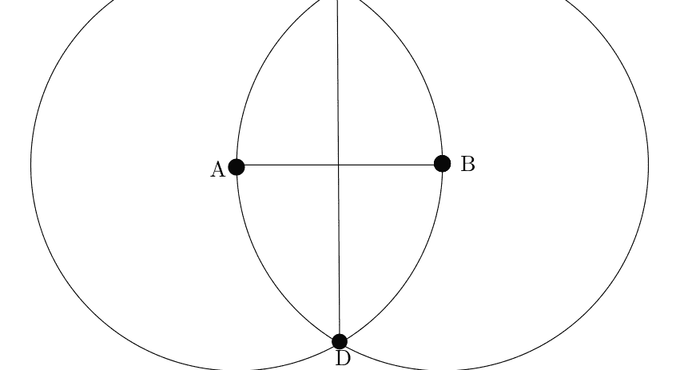

通过反复应用这些规则，我们可以构建各种各样的东西。上面是线段的垂直平分线的构造。[你能证明它有效吗？] 1796年，高斯构造了一个正规的 17 边形，他为此感到非常自豪，以至于他要求将其刻在他的墓碑上。（显然，雕刻师拒绝了，说它看起来就像一个圆。）原则上，你可以构造一个正规的 65535 边形，尽管可能没有人真正这样做过。

我们可以不实际绘制图形，而是进行推理。复杂构造的关键是模块化。例如，一旦我们有了构造垂直线的算法，我们就将其封装到垂直线子程序中。下次在推理过程中需要垂直线时，我们不必从头开始构建，而是可以假设它已经存在。通过在几个世纪的时间里建立在先前的工作基础上，人们建立了一个几何学的真正大教堂。几个世纪以来，这种生产规则的操纵一直是精确思考的典范例子。但是这个游戏指出了它自身的局限性。有些构造使几何学家们无法解决，其中包括著名的平方圆、三等分角和倍增立方体问题。

今天我们将讨论倍增立方体问题。在这个问题中，你被给定一个立方体的边长，并被要求构造一个新立方体的边长，使其体积是旧立方体的两倍。换句话说，给定一个单位长度的线段，构造一个长度为 $\sqrt[3]{2}$ 的线段。如果你假设有一些额外的生产规则，并且可以任意近似，那么你可以做到这一点，但是没有人能够只用直尺和圆规给出一个精确的构造。

在 19 世纪，几何学家退后一步，开始对规则的基本限制提出元问题，这是非常计算机科学的事情。他们之所以能够这样做，是因为自罗马吞并希腊省以来的几年里发生了一些革命性的思想。

这些思想中的第一个是笛卡尔坐标，以 17 世纪的笛卡尔命名。这将游戏移动到笛卡尔平面上。初始点是 $(0,0)$ 和 $(1,0)$。通过 $(a, b)$ 和 $(c, d)$ 的非垂直线由函数 $y = \frac{d-b}{c-a}x + \frac{ad-bc}{c-a}$ 来描述。以 $(a, b)$ 为中心通过 $(c, d)$ 的圆的函数为 $(x-a)^2 + (y-b)^2 = (a-c)^2 + (b-d)^2$。交点是方程组的解。对于线的交点，这只是一个线性系统，很容易解决。对于线和圆或圆和圆，我们得到一个二次系统，二次公式将引导我们找到解。

重要的是，无论我们解决多少个方程组和绘制多少个新点，我们所做的只是取原始坐标并应用 $+$，$-$，$\times$，$\div$，并取平方根。事实上，我们可以将问题重新解释如下。我们从数字 0 和 1 开始，并根据需要应用上述操作。（请注意，我们不能除以 0，但负数的平方根是可以的。）我们能用这些操作构造数字 $\sqrt[3]{2}$ 吗？这些操作一起使用吗？

似乎我们不应该能够通过平方根来产生立方根，事实上我们确实不能。有一个非常巧妙的证明使用了伽罗瓦理论，但我们不会讨论它，因为它需要伽罗瓦理论。

尽管这个例子在历史上是纯数学的一部分，但它展示了今天典型的理论计算机科学的许多主题。你有一些明确定义的允许操作集合。使用这些操作，你可以构建各种美丽而复杂的结构——通常是重复使用之前构建的结构来构建更复杂的结构。但是，似乎有某些类型的结构，你无法构建。在这一点上，你必须进行元推理。你必须从规则本身退后一步，并问自己，这些规则到底在做什么？有没有某种根本原因，这些规则永远无法给我们带来我们想要的东西？

作为计算机科学家，我们特别关注使用 AND、OR 和 NOT 或跳转-如果-不等于等数字操作来构建东西。我们仍在努力理解这些规则的基本限制。请注意，当规则被任意多次应用时，我们现在对什么是可能和不可能的有了相当好的理解：这是一个被称为可计算性理论的主题，我们很快就会涉及到。但是，如果我们将自己限制在“合理”的规则应用次数上（如著名的 P vs. NP 问题），到目前为止，我们还没有能够退后一步进行元推理，告诉我们什么是可能的。

## 7 欧几里得的最大公约数算法

另一个古代计算思维的例子，一个非常奇妙且高效的算法是欧几里得的最大公约数算法。它始于这个问题。

如何将一个分数如 510/646 化简为最简形式？

嗯，我们知道我们需要找到最大公约数（GCD）。怎么做呢？小学方法是将两个数进行因式分解；所有共同的质因数的乘积就是最大公约数，我们只需要将它们约掉。但是我们之前说过，因式分解被认为是困难的。暴力方法对于小学问题来说还可以，但对于有上千位数的数字来说就不行了。但就像测试一个数是质数还是合数一样，最大公约数问题也可以用一种不同、更聪明的方式解决，这种方式不需要因式分解。

欧几里得的聪明观察是，如果一个数能够整除两个数，比如 510 和 646，那么它也能够整除它们的任意整数线性组合，比如 646−510。[你明白为什么吗？] 一般来说，当我们将 B 除以 A 时，我们得到一个商 q 和一个余数 r，它们满足等式 B = qA + r，这意味着 r = B − qA，也就是说 r 是 A 和 B 的线性组合！

因此，找到 510 和 646 的最大公约数与找到 510 和将 646 除以 510 的余数的最大公约数相同。这很棒，因为余数是一个更小的数。我们取得了进展！

GCD(510,646) = GCD(136,510)

我们可以继续做同样的事情。

GCD(136,510) = GCD(102,136) = GCD(34,102) = 34

在这里我们停下来，因为 34 能够整除 102，我们知道这意味着 34 是 34 和 102 的最大公约数。我们还可以进一步利用任何数和 0 的最大公约数就是那个数这一事实：GCD(34,102) = GCD(0,34) = 34。

```
给定：自然数 A，B
假设 B 较大（否则交换它们）
如果 A 为 0，则返回 B
否则找到 (B % A) 和 A 的最大公约数
```

每次数字都变小，而且我们使用的是自然数，所以我们知道我们最终会到达 0。因此，欧几里得算法最终会结束并返回一个答案。但是我们要取多少个余数呢？好吧，每次这些数字都会变小多少呢？我们声称 (B mod A) < B/2。你能看出为什么吗？（提示：根据 A 是大于、小于还是等于 B/2 的情况进行分析。）所以数字是指数级地变小。每经过一个步骤，数字的大小是之前的一半：102 < 510/2 和 136 < 646/2，等等。这意味着欧几里得算法非常棒。

问题：如果你有很多并行处理器，你能加快欧几里得算法的速度吗？

我们可以加快每个步骤的工作速度——比如使用聪明的并行分割算法，但是似乎不可能做得更聪明，因为每个步骤都依赖于上一步的输出。如果你找到了并行化这个算法的方法，你将会发现它在 2300 年来的第一个真正引人注目的改进。

## 8 进一步参考

查看维基百科上关于“指南针和直尺”，“通用数域筛”，“艾兹格·迪科斯彻拉”，等等的文章。

## 行政公告：

- 每个学生需要两份记录员笔记。
- 如果你已经修过 6.840 课程，除非你喜欢我的笑话，否则真的没有理由再修这门课。但是如果你修这门课，有理由修 6.840 课程。

## 1 上次讲座回顾

上周，我们讨论了在线赌博和古代世界中的计算。有趣的是，许多基本的数学思想被多个文化（希腊、玛雅、印度、中国等）独立发现。对我来说，这是对数学只是一个“文化构造”的观点的一个引人注目的实证反驳。举一个例子，帕斯卡三角形在公元 1000 年左右在中国被发现——一旦你看到它，就会立刻认出它（在课堂上传递了一张古代中国帕斯卡三角形的打印品）。

我们还讨论了欧几里得几何作为计算模型。欧几里得提出了一组简单、清晰的规则，可以重复应用来构造复杂的对象。我们还讨论了欧几里得的最大公约数算法，这是人类所知的第一个非平凡算法之一。

这里有一些离题。圆的面积是 $A = \pi r^2$。很明显，圆的面积应该与 $r^2$ 成比例；问题是为什么比例常数 ($\pi$) 应该与周长与直径的关系相同——$2\pi r$。

- 学生：可以用微分方程观察到。
- 斯科特：是的，那可以是一种方式。但微积分是在那个时候发明的吗？如果你没有微积分，你可以用“西西里披萨论证”来做这个。

披萨证明：将半径为 r 的圆切成薄披萨片，然后“西西里化”（即将片堆叠成高度为 $r$，长度为 $\pi r$ 的矩形）。

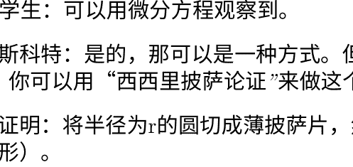

> (图片来自 http://www.scottaaronson.com/democritus/lec2.html)

## 2 今天：逻辑和证明

这些可能看起来很枯燥，但它们是课程中几乎所有其他内容的先决条件。
什么是逻辑思维？我们能否形式化我们对逻辑思维的理解，并对其进行逻辑审查？

通常认为，第一个逻辑学家是亚里士多德，他形式化了三段论的概念。

所有人都是有限的，苏格拉底是人，因此苏格拉底是有限的。
这是一个三段论。用更现代的语言来说，我们称之为蕴涵的传递性。一般来说，三段论是

如果 A ⇒ B 是有效的，并且 B ⇒ C 是有效的，则 A ⇒ C 是有效的。

备注：我们所说的“⇒”是什么意思？如果 A 为假或 B 为真或两者都是，则“A ⇒ B”是有效的。如果 A 为真，则 B 必须为真。如果 A 为假，则 B 可以是真也可以是假。

你们都知道一个错误的陈述可以导出任何东西吗？“我是一个，教皇也是一个，因此我和教皇是一个。”（1+1=1 的“证明”？）

你们中有多少人见过四张卡片的谜题？
B 5 2 J
每张卡片的一面有一个数字，另一面有一个字母。为了测试如果一面有 J，另一面就有 5 的规则，你需要翻哪些卡片？你需要翻 J 和 2，而不是 5。80-90% 的大学生都答错了这个问题。

另一方面，假设你问人们以下问题：你说，你是一个酒吧的保镖，你想确保规则“如果你未满 21 岁，则不能喝酒”。为了测试这个规则，你需要检查谁：正在喝酒的人，不喝酒的人，超过 21 岁的人，还是未满 21 岁的人？

然后，当然，几乎每个人都做对了。尽管这个问题在逻辑上与另一个问题完全等价。

这就引出了关于我们大脑的一个基本观点。我们的大脑是为刺穿小动物而设计的。不是为了证明定理。这门课程的目的是做一些你的大脑不适合做的事情。关键是利用你的大脑中为其他事情进化而来的部分。“你在那边：你应该追踪穿越大草原的豹子吗？好吧，现在那些豹子将成为任意的向量 v∈ ℜ³。接受这个事实吧。”

备注：蕴含实际上是在两个不同的层面上进行的。这些“蕴含”是指句子所讨论的陈述中的内部细节，然后还有句子本身在谈论它们。这三个句子可以看作是无意义的代码片段，句子是针对我们说的；它告诉我们代码的一条规则。

亚里士多德是历史上第一个应用这种推理的人吗？显然不是。正如我们在日常生活中所看到的，每个人都在不断地推理。然而，他所做的（据我所知）是在历史记录中第一个将推理规则框起来的人，他说这是一条普遍的思维定律。这是至关重要的，因为它使我们能够对规则本身进行推理。

## 2.1 莱布尼兹和演绎计算器：“先生们，让我们计算！”

今天，莱布尼兹的梦想，即我们可以使用自动推理机器来解决法律争议，在我们思考实际在法庭上使用的论证方式时，显得天真，例如：“如果不合适，你必须无罪。”等等。

更重要的是，在真实的法庭案件中，往往困难不在于人们没有从事实中得出正确的推理，而是他们对事实的意见不一致！或者事实是概率性和不确定的，人们对不同事实的权重分配意见不一致。除此之外，法律本身必然是模糊的，人们对法律的首选解释也存在分歧。

然而，莱布尼兹的这个想法，即我们甚至可以自动化人类思维的一部分，对于当时来说是非常大胆的。

此外，莱布尼兹对于这样一台机器的构想，与今天的我们所看到的是一致的。对他来说，并不是你会拿起一块无生命的黏土，并念出一些神秘的咒语，使其神奇地具有说话的能力——就像在匹诺曹的传说中，或者在哥伦姆的传说中，甚至在很多科幻小说中一样。莱布尼兹的想法是，你只是在构建一台复杂的机器。机器中的任何一个齿轮都不会思考——它只是一个齿轮。但是，如果你退后一步，考虑所有的齿轮，那么它可能看起来像是在思考。

从这个观点来看，逻辑的作用是告诉我们构建推理机器所需的思维的“原子”是什么。

如果你知道 A⇒B 和 B⇒C，并且你得出 A⇒C，那么你实际上并没有做太多思考。我们每天早上都会进行这种思考：“我的袜子穿在我的脚上，这些是我的袜子，因此这些袜子穿在我的脚上。”

然而，假设你把这些小步骤串联起来成百上千次。那么也许你会得到世界历史上最深刻的思想！相反，如果你考虑任何人曾经有过的最深刻的思想，我们怎么知道它们不能被分解成成千上万个小步骤呢？也许它们可以！许多事物在你了解机制之前都显得神奇。那么为什么不是逻辑推理本身呢？

对我来说，这真的是研究逻辑的动机：发现“思维定律”。但是要进一步，我们需要卷起袖子，谈谈一些真实的逻辑规则系统的实例。

也许最简单有趣的系统是每个陈述都具有以下形式

- $A \Rightarrow B$
- $\neg A \Rightarrow B$
- $A \Rightarrow \neg B$ 或者
- $\neg A \Rightarrow \neg B$

并且唯一的规则是：

- 给定 $A \Rightarrow B$ 和 $B \Rightarrow C$，你可以推导出 $A \Rightarrow C$。
- 给定 $\neg A \Rightarrow A$ 和 $A \Rightarrow \neg A$，你可以推导出矛盾。

我们可以同时拥有 $\neg A \Rightarrow A$ 和 $A \Rightarrow \neg A$ 都成立吗？如果我们赋值 A=false，那么 $A \Rightarrow \neg A$ 是成立的。但是 $\neg A \Rightarrow A$ 是不成立的。类似地，如果我们赋值 A=true，那么 $A \Rightarrow \neg A$ 是不成立的。现在考虑以下例子。

- $A \Rightarrow B$

+   - ¬C ⇒ A
- ¬A ⇒ ¬C
- B ⇒ ¬A

这些句子能同时满足吗？即是否有一种方式将A、B、C、D设置为“true”或“false”以满足所有四个句子？

不行。通过应用规则，我们可以得出矛盾！你同意如果我们通过应用规则得出逻辑矛盾，那么这些句子就不能都是有效的吗？

假设一组句子是不一致的（即没有一种方式可以使所有句子都满足）。我们是否总是可以通过应用上述规则发现矛盾？

是的，我们总是可以发现矛盾。你可以想象一个大图。节点是变量及其否定。A、¬A、B、¬B、C、¬C...当且仅当A⇒B时，从节点A到节点B放置有向边。每当我们应用一条规则，我们可以将其视为在图中行走。因此，A⇒B，B⇒C实际上意味着C可以从A到达。从A=true开始，如果我们到达¬A，则意味着A⇒¬A。如果我们还连接了¬A和A，换句话说，如果我们有一个循环，那么我们就发现了一个矛盾。

我们讨论的是逻辑系统的两个属性，称为“正确性”和“完备性。”

正确性：通过应用规则得到的任何陈述都是真实的。（这是一个相当基本的要求。）

完备性：任何真实的陈述都可以通过应用规则得到。

下一堂课：一点一阶逻辑！

# 6.080/6.089 GITCS
2008年2月12日
第三讲
讲师：斯科特·亚伦森
记录员：亚当·罗加尔

## 1 行政事务

### 1.1 记录员笔记

记录员笔记的目的是记录我们的讲座。虽然我有自己的正式笔记，但这些笔记旨在整合我们在课堂上提到的其他信息 - 供将来参考的记录。

### 1.2 问题集

对问题集的一些建议。首先，欢迎合作，但请在问题集上标明与谁合作。我们希望尝试解决所有的问题。
有些问题比其他问题更难；还有一些被标记为挑战性问题。如果你无法解决给定的问题，请确保说明你尝试过的方法和你无法继续的过程。这是部分得分，比写一个完整但错误的解答要好得多。毕竟，根据苏格拉底的说法，知识的关键在于知道自己不知道的东西。

### 1.3 办公时间

我们每周会有一次办公时间。

## 2 复习

### 2.1 计算机科学作为一组规则

我们可以将计算机科学视为对简单规则以及你可以和不能构建的东西的研究。也许最早的例子可以被认为是欧几里得几何。而发现我们可以构建哪些过程的关键是这些规则是明确定义的。

### 2.2 逻辑

逻辑领域专注于自动化或系统化不仅仅是任何机械过程，而是理性思维本身。如果我们可以通过符号序列的操作来表示我们的思想，那么原则上我们可以编程一个计算机来为我们进行推理。
我们讨论了最简单的逻辑系统，这些系统在数千年来是唯一的。三段论和命题逻辑，布尔变量的逻辑，可以是真或假，并且通过像与、或和非这样的运算符相互关联。最后我们讨论了一阶逻辑。

#### 2.2.1 一阶逻辑

一阶逻辑系统由句子构成。 这些句子中都包含变量， 例如$x, y$和 $z$。 此外，我们可以定义以这些变量作为输入的函数。

例如: 让我们定义一个函数$Prime(x)$。 给定一个整数，如果这个数是质数，则返回$true$，如果是合数，则返回$false$。 就像任何编程语言中的函数一样，我们可以通过调用它们作为子程序来构建其他函数。 事实上，许多编程语言本身就是以一阶逻辑为模型的。

此外，与命题逻辑一样，符号 $\land$ (和)， $\lor$ (或)， $\neg$ (非)，和 $\to$ (蕴含)允许我们将对象相互关联起来。

量词是一阶逻辑的重要组成部分。 量词允许我们陈述命题，例如“每个正整数x要么是质数，要么是合数。” $\forall x.Prime(x) \lor Composite(x)$

当然，有一个反例，即1。 我们还可以说：“存在一个x，使得某事为真。”

$\exists x.某事 \quad\quad (x)$

当人们谈论一阶逻辑时，他们通常也假设等号是可用的。

#### 2.2.2 推理规则

我们希望有一套规则，可以从其他真陈述中得出真陈述。

命题重言式:

$A \lor \neg A$

假言推理:

$A \land (A \to B) \to B$

等于:

等于 $(X, X)$

等于 $(X, Y) \iff 等于 (Y, X)$

传递性质:

等于 $(X, Y) \land 等于 (Y, Z) \to 等于 (X, Z)$

此外，我们还有变量更换规则。 如果你有一个有效的句子，那么如果我们更换变量，该句子仍然有效。

#### 2.2.3 量词规则

如果 $A(x)$对于任意选择的 $x$都是一个有效的句子，那么对于所有的 $x$， $A(x)$都是一个有效的句子。 相反地，如果对于所有的$x$， $A(x)$都是一个有效的句子，那么对于一个固定的$x$，任何 $A(x)$都是一个有效的句子

$A(X) \iff \forall x.A(x)$

#### 2.2.4 完备性定理

库尔特·哥德尔证明了这些规则是我们所需要的所有规则。他证明了如果你不能通过使用这套规则推导出一个逻辑矛盾，那么一定有一种方法可以分配变量，使得所有的句子都被满足。

## 3 电路

电气工程师将电路视为通常在图1中表示的完整回路。然而，在计算机科学中，电路没有回路，并且是由逻辑门构建的。

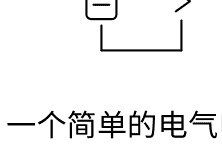

### 3.1 逻辑门

最著名的三个逻辑门是 *NOT*、*AND*和*OR*门，如图2所示。

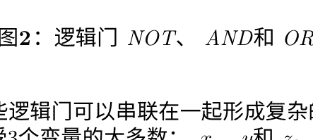

虽然它们本身很原始，但这些逻辑门可以串联在一起形成复杂的逻辑运算。例如，我们可以设计一个电路，如图3所示，它接受3个变量的大多数：*x*、*y*和*z*。我们还可以使用德摩根定律从一个*OR*门形成一个*AND*门，反之亦然，如图4所示。

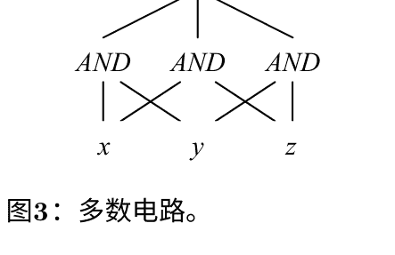


这些逻辑门也可以组合成其他门，如图5所示的XOR门和NAND门。相反，通过从NAND门开始，我们可以构建任何其他门。

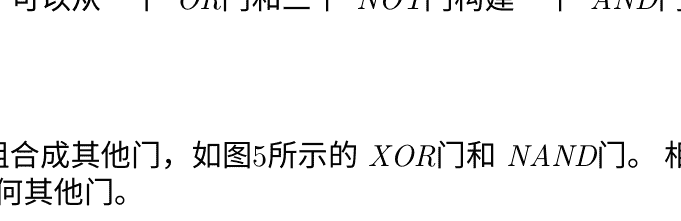

另一方面，无论我们如何使用AND门和OR门构建电路，如果输入全为1，我们永远无法得到输出为0。 我们将仅由AND门和OR门构建的布尔函数称为单调布尔函数。

还有其他有趣的门集合吗，不能用来表示所有布尔函数吗？是的：XOR和NOT门。由于它们的线性性质，无论我们如何组合这些门，我们永远无法得到像AND和OR这样的函数。

## 4 拼图

这是一个有趣的谜题：你能使用尽可能多的AND/OR门和仅有2个NOT门计算出3个输入变量的NOT吗？

### 4.0.1 限制

虽然我们发现电路可以是一个强大的工具，作为计算模型，它们有一些明显的限制。 首先，电路没有任何形式的存储或内存。 它们也没有反馈；门的输出永远不会作为输入传递。 但从现代的角度来看，电路的最大限制是（就像20世纪30年代的计算机一样）它们只能为固定大小的任务设计。例如，可以设计一个电路来对100个数字进行排序。但是要对1000个数字进行排序，就需要设计一个全新的电路。没有通用的排序任务电路，能够处理任意大小的输入。

## 5 有限自动机

现在我们将考虑一种可以处理任意长度输入的计算模型，与电路不同的是，尽管我们将看到，这种模型也有其自身的限制。

### 5.1 描述

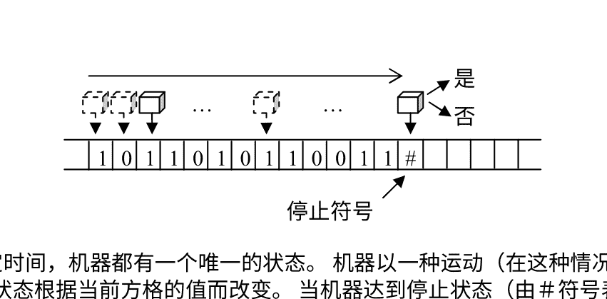

有限自动机的简单思考方式是它是一台只能沿着内存单向移动的受限计算机。如图6所示，一台计算机上有一些信息以某种编码方式写在磁带上，它将逐个方格地扫描这个磁带，直到达到停止符号。这台机器的输出将是一个是或否 - 接受或拒绝。这将是机器对输入提出的某个问题的答案。

### 5.2 状态和内部配置

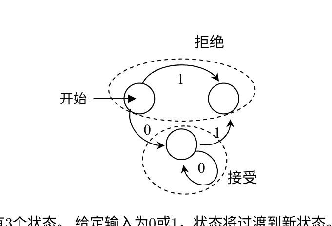

不需要确定这个机器的内部配置是什么。我们可以将这个概念抽象为这个机器将具有某个状态和在给定某个输入时过渡到其他状态的能力。机器在读取任何输入之前将从一个起始状态开始。当机器读取停止符号时，正确的状态将确定机器是否应该输出接受或拒绝。

定义机器具有有限数量的状态是至关重要的。如果机器有无限数量的状态，那么它可以计算绝对任何东西，但这样的假设在物理上是不现实的。

### 5.3 一些例子

让我们设计一台机器，判断在一个由0或1组成的流中是否存在任何1。
我们定义了机器的两个状态-0和1。 0表示机器还没有看到1的状态。 1表示机器已经看到了1的状态。当机器转换到1的状态时，无论1还是0都不会再将状态改回0。 也就是说，无论输入或输入的长度如何，我们的问题“流中是否存在任何1”都已经得到了回答。

因此，当达到停止符号时，1状态应该产生一个接受，而0状态应该产生一个拒绝。

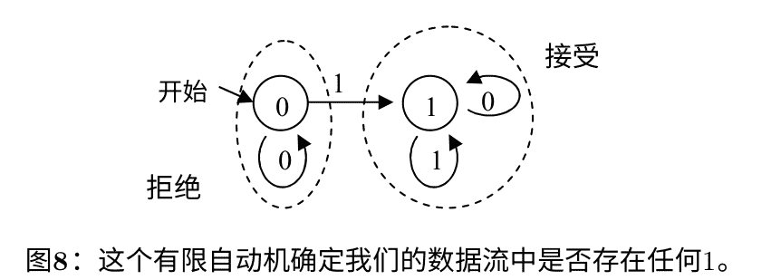

现在让我们设计一台机器，判断流中1的数量是偶数还是奇数。
我们再次定义两个状态 - 0和1。 0状态表示已经看到偶数个1的机器，而1状态描述已经看到奇数个1的机器。 输入0只会将状态转换为自身。 也就是说，我们只关心这个流中1的数量。 每次输入1，机器都会在0和1之间交替状态。 最终状态将确定数据流是否看到偶数个或奇数个1，其中1被设置为接受状态。

需要注意的是，无论输入大小如何，这台机器都能确定我们提出的问题的正确答案。 与电路不同，我们的机器大小不受输入大小的限制。

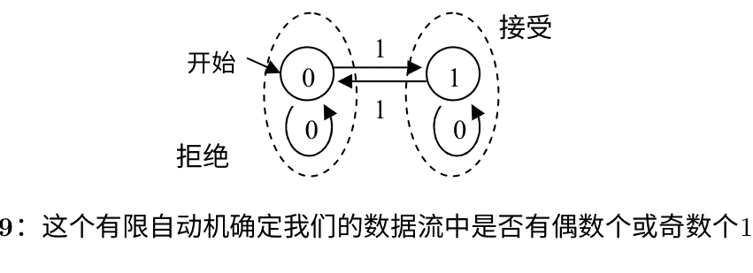

### 5.4 回文

现在让我们探索一下是否可以创建一个有限机器来确定输入字符串是否是一个回文，即从前往后读和从后往前读都一样的字符串。 输入将是有限的，并且在末尾将有一个终止符。我们首先定义机器的可能状态。 如果我们让我们的机器包含2^N个状态，那么如图10所示，我们可以为每个可能的1和0序列的每个最终叶子节点标记为接受或拒绝。

问题仍然存在，我们能否创建一个具有有限状态数的机器

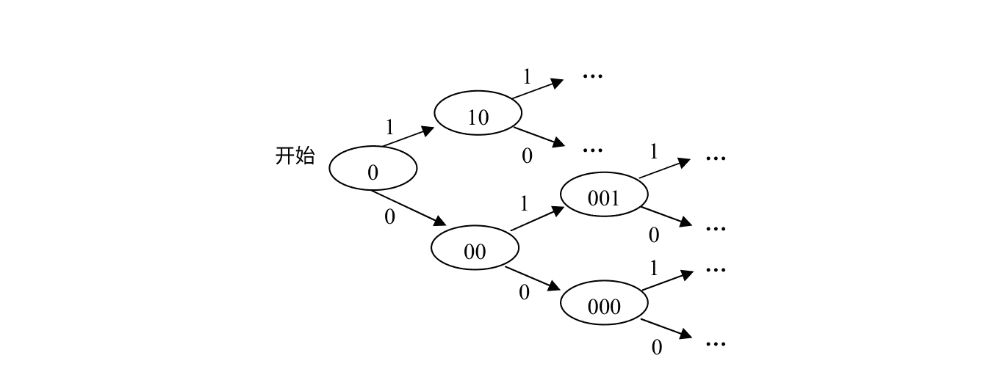

作为回文检测器。 答案在于使用鸽巢原理来分析有限自动机的限制。

### 5.5 鸽巢原理

鸽巢原理指出，如果我们有 N只鸽子，我们想把它们放进 N -1个洞中，至少有一个洞会有两只或更多的鸽子。 尽管非常简单，但这个原理使我们能够证明没有任何有限自动机可以充当回文检测器。

#### 5.5.1 一个离题：证明鸽巢原理

尽管鸽巢原理很简单，但在简单的逻辑系统中证明它是非平凡的。 我们可以使用命题逻辑来表达每只鸽子都进入某个洞的要求，以及没有两只鸽子进入同一个洞。 挑战在于证明并非所有陈述都可以为真，只能使用陈述的机械逻辑操作（而不能进行关于它们“意义”的高阶推理）。

换句话说，鸽巢原理对我们来说似乎是显而易见的，因为我们可以站在后面看到更大的图景。 但是像我们在上一堂课上看到的命题证明系统这样的系统无法做到这一点；它只能进行局部推理。（“让我看看：如果我把这只鸽子放在这里，那只放在那里…该死，还是不行！”）Haken的一个著名定理表明，基于逻辑陈述的“解析”对鸽巢原理的任何证明都需要指数级增长的步骤数（鸽子的数量 N）。 这是一个被称为证明复杂性的领域研究的例子，它涉及诸如“任何证明的大小是否必须比我们试图证明的定理指数级更大？”的问题。

### 5.6 使用鸽巢原理来判断回文

我们使用鸽巢原理来证明没有任何可以构造的有限自动机可以检测出任何字符串是否为回文。

为了开始这个证明，让我们把一个回文串从中间分开。 我们将忽略有关有限自动机的一切，除了它在中间点的状态；任何自动机在第二半部分字符串中所携带的信息，必须编码在那个状态中。

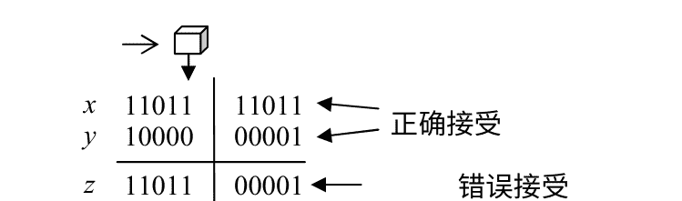

图11：通过使用鸽巢原理，我们可以展示我们可以在两个字符串的反射点处将其分割，以便有限自动机在两个子字符串上处于相同的状态。然后，我们可以交叉这两个字符串形成一个新的字符串，从而“欺骗”机器以为它已经正确接受了一个回文字符串。

一个有限自动机必须有固定数量的状态。另一方面，对于字符串的前半部分有无限多种可能性。当然，你不能把无限多的鸽子放进有限数量的洞里而没有至少一个洞里至少有两只鸽子。这意味着至少有一个状态在“双重职责”，即两个不同的字符串前半部分导致相同的状态。

如图11所示，我们考虑两个回文 x 和 y。如果机器工作正确，那么它必须接受这两个回文。另一方面，对于某些 x, y pair，当机器处于中间位置时，它将在相同的状态下对 x 和 y 进行处理。然后通过交叉处理 x 和 y 的剩余部分，我们可以创建一个新的字符串x，即使它不是回文，也被机器接受。这证明了不存在一个能够识别所有回文的有限自动机。

### 5.7 正则表达式

正则表达式允许我们在一个大字符串中搜索关键词。然而，它们比仅仅在字符串001100中搜索关键词110更强大。我们也可以使用正则表达式来查找模式。

例如，我们可以创建一个表达式(0110)|(0001)，它可以匹配关键词0110或0001。我们还可以创建一个表达式，可以找到任何一个中间有1的3位字符串：(0|1)1(0|1)。

我们还可以使用更高级的字符，如星号来表示重复。(0|1)1(0|1)0*可以搜索任何一个中间有1的3位字符串，后面跟着任意数量的0。我们还可以重复更大的模式，如[(0|1)1(0|1)]*。这表示我们想要匹配任意数量的中间有1的3位字符串。需要注意的是，每次模式重复时，0或1可以选择不同。

我们现在可以陈述（无需证明）一个非常有趣的定理：任何语言都可以由正则表达式表示，当且仅当它被有限自动机识别。正则表达式和有限自动机是从不同角度看待同一事物的方式。

举个例子：早些时候我们创建了一个有限自动机，它能够识别所有具有偶数个1的字符串。根据定理，必须存在一个正则表达式来生成相同的字符串集合。而确实存在这样一个正则表达式：0*(0*10*1)*。

## 6 非确定有限自动机

非确定有限自动机代表了可以在状态之间以及状态集之间进行转换的机器。 与之前一样，我们有一台从左到右读取带子的机器，带子上有有限数量的状态。 当机器读取输入时，机器当前所在的每个状态都可以根据输入从前一个状态发出的任何其他状态进行转换。 如果任何最终状态是接受状态，则机器处于接受状态。

你可能会猜到非确定有限自动机（NDFA）比确定有限自动机（DFA）更强大。 然而，事实并非如此：给定一个具有 N个状态的NDFA，我们总是可以通过具有2^N个状态的DFA来模拟它，通过在DFA中创建一个表示NDFA中每个状态集合的单个状态。

## 1 在6.089中之前...

上一节课，我们讨论了两种不同的计算模型，有限自动机和电路。
有限自动机可以识别任意长输入的许多属性，而电路可以表示任何布尔函数。

然而，这两种模型都有显著的局限性。 电路在硬件方面有限制 - 我们必须知道输入的大小才能
制作电路 - 而有限自动机在内存方面有限制 - 这也必须在问题之前预先知道。

## 2 图灵机

我们如何推广有限自动机以克服它们的局限性？ 第一个想法是让它们在磁带上向前和向后移动。
这是一个好的开始，但单独来看，它实际上并没有提供额外的能力。 要理解为什么，假设一个双
向有限自动机处于某个状态 a，在磁带上某个点 x向前移动。 在这一点上，如果它在磁带上向后
移动然后返回到 x，那只引入了一些函数 a ⇒ f(a)，其中 f取决于磁带的早期部分。 但这意味
着我们可以通过一个单向机器模拟双向机器，该单向机器仅跟踪整个函数 f而不仅仅是状态 a。1
因此，能够在两个方向上移动并不能单独提供额外的能力。

我们真正需要的是一台机器，不仅可以向前和向后移动，还可以写入到磁带上，并且可以在任何
时候停止。 这就是图灵机。 能够写入实际上给了图灵机无限的内存，因为任何无法容纳在机器
的内部状态中的信息都可以写入磁带。 自由停机的能力意味着图灵机不像有限自动机那样“被绑
定到输入”，而是可以进行尽可能多的辅助计算。

因此，在磁带上的任意给定点，图灵机面临三个问题：

1. 改变状态？
2. 写入磁带？
3. 向左移动、向右移动或停止？

机器对这些问题的回答是其当前状态和当前输入
在磁带上的函数。

图灵机能够解决回文问题，这是这些特性克服有限自动机限制的明显例子。 通过使用简单的来
回过程，一个

> 1请注意，将状态映射到状态的函数 f(a) 的数量随着原始机器中状态的数量呈指数增长。

图灵机可以反复检查一个字母是否存在于另一端，并通过标记已经看到的字母，确保它不断缩小范围。（在这里，我们假设除了0和1之外还有其他符号可用。）该算法的时间复杂度为 O(n^2)（有趣的是，有一个证明认为这是图灵机能够达到的最好结果）。

同样，整数的加法也是可能的，还有乘法和其他一些数学运算。（我们不会证明这个！）搜索非正则模式也变得可能。但是图灵机最有趣的事情也许是模拟另一个图灵机！

## 3 通用图灵机

在他1936年的论文“可计算数”中（在某种意义上，是计算机科学的奠基文件），图灵证明我们可以构建一个图灵机 U作为其他图灵机的解释器。换句话说， U的输入带可以包含另一个图灵机的描述，然后逐步模拟。这样的机器 U被称为通用图灵机。如果通用机器不存在，那么通常我们需要为解决一个新问题构建新的硬件：甚至没有软件的概念。这就是为什么Aaronson教授将图灵的普适性结果称为“软件行业引理的存在”！

在课堂上提出了一个问题，即如果被解释的机器可能需要比解释图灵机更多的状态，那么这是如何实现的。事实证明，通用图灵机并不受其状态的限制，因为它们始终可以在空白部分的磁带上保留额外的状态。因此，它们可以模拟具有任意状态数量的机器，但自身只需要很少的状态。（实际上，有一种流行的沙龙竞赛，旨在寻找使用尽可能少的状态和符号的通用图灵机。最近，一名学生确实设计出了一台只使用两个状态和三个符号字母的机器。然而，为了公平起见，该机器需要以特殊格式输入，这需要一些预计算，因此问题是机器与预计算之间的工作量有多少。）

## 4 邱奇-图灵论题

与通用机器的概念相关的是所谓的邱奇-图灵论题，它声称我们自然认为“可计算”的任何东西实际上都可以由图灵机计算。直观地说，无论你喜欢哪种“合理”的计算模型（RAM机器、细胞自动机等），你都可以编写编译器和解释器，将程序在该模型和图灵机模型之间相互转换。到目前为止，如何解释这个论题还不完全清楚：它是关于物理定律的主张吗？关于人类推理能力吗？关于我们实际构建的计算机吗？关于数学或哲学吗？

不管它的地位如何，图灵-丘奇论题是一个如此强大的思想，以至于哥德尔宣称：“首次成功地给出了一个有趣的认识论概念的绝对定义。”

但正如我们将看到的，即使是图灵机也有其局限性。

## 5 停机问题

假设我们有一台从不停机的图灵机。我们能制造一台能够检测到这一点的图灵机吗？换句话说，我们能制造一个无限循环检测器吗？这被称为停机问题。

这样一台机器的好处将是广泛的。例如，我们可以证明或证伪哥德巴赫猜想，该猜想说所有大于等于4的偶数都可以表示为两个质数的和。我们可以通过编写一个迭代遍历所有偶数来测试这个猜想的机器来实现这一点：

```
对于 i = 2 到无穷大：
  如果 2*i 不是两个质数的和
    那么停机
```

然后我们只需将这个程序插入我们的无限循环检测图灵机中。如果机器检测到停机，我们就知道该程序最终必定会遇到一个使哥德巴赫猜想为假的数。但如果它没有检测到停机，那么我们就知道该猜想是真的。

事实证明，这样的无限循环检测器是不存在的。图灵在他的论文中也证明了这一点，这是一个非常简单的证明，现在已经成为计算机科学的知识遗产的一部分²。

我们通过反证法进行论证。设 P 为一个解决停机问题的图灵机。换句话说，给定一个输入机器 M， P(M)接受如果 M(0)停机，拒绝如果 M(0)无限运行。这里 P(M)表示 P在其输入带上对 M进行编码运行， M(0)表示M在其输入带上全为0时运行。然后我们可以轻松修改 P以产生一个新的图灵机 Q，使得如果 M(M)停机， Q(M)无限运行，或者如果 M(M)无限运行， Q(M)停机。

那么问题变成了： Q(Q)会发生什么？ 如果 Q(Q)停机，那么 Q(Q)无限运行，如果 Q(Q)无限运行，那么 Q(Q)停机。 唯一可能的结论是，机器 P一开始就不存在。

换句话说，我们已经证明了停机问题是不可判定的 - 也就是说，另一台机器是否停机不是图灵机可以计算的。我们还可以通过其他方式证明一般的不可计算性。在此之前，我们需要打下一些基础。

## 6 有多个无限大

在19世纪80年代，格奥尔格·康托尔发现了一个非凡的事实，即存在不同程度的无限大。特别是，实数的无限大大于整数的无限大。

为了简单起见，让我们只讨论正整数和区间[0,1]内的实数。我们可以将每个这样的实数与一个无限二进制字符串相关联：例如，0.0011101001...。

一个技术细节是，有些实数可以用两种方式表示：例如，0.1000等同于0.0111。但我们可以轻松处理这个问题，例如通过禁止无限数量的尾部1。

为了证明实数比整数更多，我们将通过反证法来论证：假设两个无穷大是相同的。如果这是真的，那么我们必须能够创建一个一对一的关联，将每个正整数与一个实数 x ∈ [0, 1]配对。我们可以这样安排这个关联：

+   1: 0.0000... (有理数)
+   2: 0.1000...
+   3: 0.0100...
+   4: 0.101001000100001... (无理数)
+   5: 0.110010110001001...

我们可以想象对所有正整数都这样做。然而，我们注意到我们可以构造另一个实数，其第n位数字与第n个数字的相反。例如，使用上述关联，我们将得到0.11110...

这意味着，与假设相反，在[0,1]中还有其他实数不在我们的原始列表中。由于每个映射都会剩下实数，我们得出结论，实数比整数更多。

如果我们尝试用有理数而不是实数来应用相同的证明，我们会失败。这是因为有理数是可数的；也就是说，每个有理数都可以用一个有限长度的字符串表示，所以实际上我们可以创建一个整数到有理数的一一对应。

## 7 无穷多个无解问题

我们可以利用这些多个无穷来证明存在不可计算的问题。我们将从展示可能的图灵机数量最小的无穷开始，即整数的无穷。

我们可以将图灵机定义为一组状态和从每个状态到另一个状态的转换（转换基于读取的符号）。这个定义的一个关键方面是两个集合都是有限的。

因此，图灵机的数量是可数的。也就是说，我们可以将每个机器“展开”成一个描述它的有限长度字符串，并且我们可以将这些字符串与整数一一对应，就像我们可以与有理数一样。

另一方面，问题的数量是一个更大的无穷：即实数的无穷。这是因为我们可以将问题定义为将每个输入 x ∈ {0,1}* 映射到一个输出（0或1）的函数。但由于输入有无限多个，要指定这样一个函数需要无限数量的位。因此，就像康托尔的证明一样，我们可以证明问题的无穷大于图灵机的无穷大。

总之，问题比图灵机解决问题的数量要多得多。从这个角度来看，可计算问题的集合只是一个巨大的不可解之海中的一个小岛。诚然，大多数不可解问题不是人类会关心的事情，甚至无法定义。另一方面，图灵对停机问题不可解性的证明表明，至少有一些我们关心的问题是不可解的。

## 1 行政事务

当轮到你记录笔记时，请在一周内准备好初稿。然后，在课程结束之前，你有时间将笔记整理得更好，你会希望这样做，因为你的最终成绩取决于此。提交初稿后，请安排与Yinmeng的会议讨论你的笔记。

## 2 复习图灵机

图灵机可以在磁带上前后移动，还可以写入磁带并决定何时停止。基于图灵机的这个思想，提出了“软件行业存在引理”，它表明存在可以通过在磁带上编码机器描述来模拟任何其他图灵机的通用图灵机。

丘奇-图灵论题说图灵机捕捉到了我们对计算性的正确概念。任何合理称为计算机的东西都可以被图灵机模拟。然而，图灵机存在一些限制。例如，没有图灵机能够解决停机问题（通过诗歌证明）。此外，可能问题的数量远远大于计算机程序的数量。记住实数的无限性与整数的无限性之间的区别。

但是谁在乎呢？这就是为什么图灵提出了停机问题；我们实际上关心它。

## 3 预言者

预言者是图灵在他的博士论文中于1939年发明的一个概念。不久之后，图灵参与了破解德国海军密码的工作。最早的电子计算机主要用于破解德国密码，这是非常困难的，因为德国人每天都会更改密码。德国人从未真正怀疑密码已经被破解，而是认为他们中间有间谍。有一次，他们确实在代码中添加了设置，这使得密码破解者花了大约九个月的时间来破解新代码。

### 3.1 预言者

预言者是一个假设的设备，可以免费解决计算问题。例如，假设你创建了一个子程序来相乘两个矩阵。在创建子程序之后，你不必再考虑如何相乘两个矩阵，你只需要将其视为一个“黑盒子”，你给出两个矩阵，它们的乘积就出来了。

然而，我们也可以说我们对于无法解决的问题或者我们不知道如何解决的问题有预言机。 假设预言机可以解决这些问题，我们可以创建不可解性的层次。 如果给定许多困难的问题，我们可以使用不可解性的层次来告诉我们哪些问题相对于其他问题来说是困难的。 它可以告诉我们诸如“这个问题是不可解的，因为如果它是可解的，它将允许我们解决这个其他不可解的问题”。

给定：

$A:\{0,1\}^* \rightarrow \{0,1\}$

其中输入是任意长度的字符串，输出是一个0或1，回答这个问题，然后我们可以写

$M^A$

对于一个具有访问预言机$A$的图灵机$M$。 假设$M$是一个多带图灵机，其中一个带是一个特殊的“预言机带”。$M$可以向预言机带上的预言机提问一个字符串$x$，在下一步中，预言机将在预言机带上写下它的答案$A(x)$。

从这个可以说，给定两个问题 $A$和 $B$，如果存在一个图灵机 $M$，使得 $M^B$解决 $A$，则 $A$可约化为$B$。我们将其写作 $A \le_T B$。

### 3.2 例子1：丢番图方程

给定：

$$
\begin{aligned}
x^n + y^n &= z^n \quad (n \ge 3) \\
x y z &= 0
\end{aligned}
$$

是否存在整数解？

实际上，不存在仅涉及整数的解，这是一个未解决的问题已经持续了350年。 如果我们有一个停机问题的预言机会怎么样？ 我们能解决这个问题吗？

为了尝试解决这个问题，我们可以按顺序尝试每个可能的解，$(x, y, z, n)$的整数：

+   $x + y + z + n = 1$
+   $x + y + z + n = 2$
+   $x + y + z + n = 3$
+   $x + y + z + n = \ldots$

并尝试按顺序逐个尝试它们，然后在找到解决方案时暂停。 然而，如果没有解决方案，它将永远继续下去。 因此，我们向神谕提出的问题是：“这个程序是否停止？”，如果是的话，那么丢番图方程是可解的。

如果我们解决了丢番图问题，那么我们也能解决停机问题吗？

这个问题在70年后的1970年才得到解答，当时证明了没有算法可以解决丢番图方程，因为如果有的话，那么也会有一个算法可以解决停机问题。 因此，停机问题可以归约到这个问题。

### 3.3 示例2：平铺平面

给定一些不同形状的有限瓷砖集合，我们能否只使用这些瓷砖来填满整个平面？ 为简单起见，让我们假设所有的瓷砖都是带有不同形状凹口的1x1正方形。


停机问题可归约到这个问题，这意味着如果你能解决这个问题，那么你也能解决停机问题。为什么呢？ 假设你能创建一组瓷砖它们只能以某种方式连接在一起，编码图灵机的可能动作。 如果图灵机停机，那么你将无法再添加更多的瓷砖。 那么只有当机器永远运行时，平面才能被铺砖。

这个问题可归约到停机问题吗？ 换句话说，如果你能解决停机问题，那么你能否判断一组瓷砖是否能够铺满平面？ 你能铺满一个100x100的网格吗？ 你能铺满一个1000x1000的网格吗？ 这些问题可以由图灵机回答。 但是假设每个有限区域都可以填充，为什么整个无限平面可以铺砖呢？

进来 K“onig的引理。 假设你有一棵树（一棵计算机科学树，它的根在天空中，向地面生长），有两个假设：

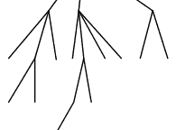

+   1) 每个节点最多有有限数量的子节点，包括0个。
+   2) 在这棵树中，可以找到一条任意有限长度的向下路径。

声明：这棵树必须有一条无限长度的路径。

为什么呢？ 这棵树必须是无限的，因为如果它是有限的，那么就会存在一条最长的路径。 我们不知道有多少子树，但是顶层只有有限数量的子树。 由此可得，其中一棵子树必须是无限的，因为所有子树中顶点数量的总和是无限的，而子树的数量只有有限个。

因此，其中一个子树必须有无限多个顶点。

我们将从顶部开始，移动到具有无限多个后代的任何节点。 我们知道必须至少有一个，因为我们刚才已经说过了。 如果我们重复这个过程，现在下一个子树，根据假设，其中有无限多个节点，每个节点都是一个子树的顶部，其中一个子树必须是无限的，我们可以一直继续下去。 最终结果是一个无限路径。

那么K¨onig引理如何适用于平铺问题？ 想象一下，这棵树是在平铺平面过程中可以做出的所有选择的树。 假设你只能将瓷砖放在现有瓷砖的相邻位置，那么每一步你都有有限数量的可能选择。 此外，我们假设您可以在平面上铺设任何有限区域，这意味着树包含任意长的有限路径。 因此，K¨onig引理告诉我们该树必须有一个无限路径，这意味着我们可以在无限平面上铺设。 因此，平铺问题可以归约为停机问题。

### 3.4 图灵度

图灵度是一组彼此可归约的所有问题的最大集合。 例如，到目前为止，我们已经看到了两个图灵度的例子：可计算问题和与停机问题等价的问题。

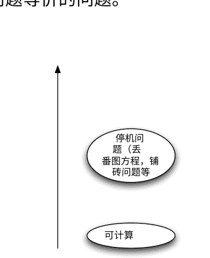

停机问题之上还有其他的度吗？ 换句话说，如果我们获得了一个停机问题的预言机，是否还有任何问题是无法解决的？

如果我们拿一个带有停机问题预言机的图灵机，并问：“你停机吗？”这可以称为“超级停机问题”！为了证明这一点，我们可以重复图灵最初的停机问题证明，只是在更高的一级，其中所有证明中的机器都具有这个停机问题的预言机。 只要证明中的所有机器都具有相同的预言机，那么什么都不会改变，这个问题仍然与原始的停机问题相同。 我们可以逐步跟踪每台机器并询问预言机，但预言机对于超级停机问题没有答案。

如果存在能够解决超级停机问题的超级图灵机，那么你可以将该超级图灵机本身作为输入，并导致它执行与其相反的操作，就像普通图灵机一样。

由此可见，我们可以不断提出越来越困难的问题，如超级超级停机问题，超级超级超级停机问题...

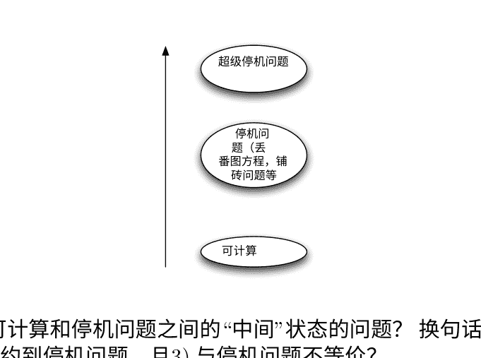

是否存在一个处于可计算和停机问题之间的“中间”状态的问题？换句话说，是否存在一个问题，1) 不可计算，2) 可归约到停机问题，且3) 与停机问题不等价？

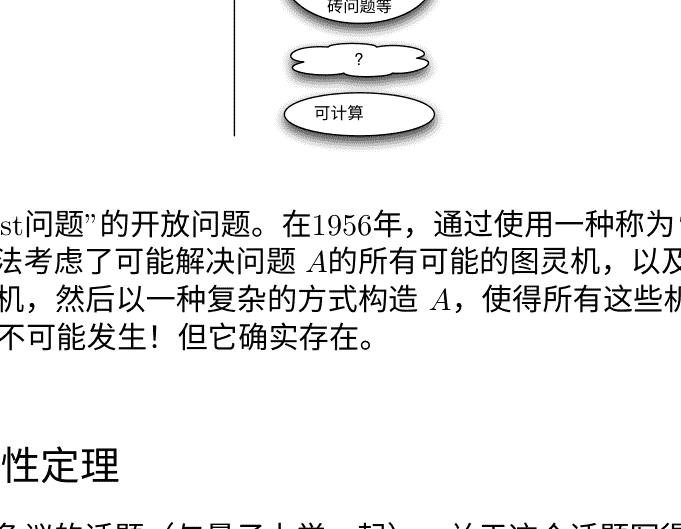

这是一个被称为“Post问题”的开放问题。在1956年，通过使用一种称为“优先级方法”的技术来解决了这个问题，该方法考虑了可能解决问题A的所有可能的图灵机，以及可能将停机问题归约到A的所有可能的图灵机，然后以一种复杂的方式构造A，使得所有这些机器都失败。最终得到的问题A在实践中几乎不可能发生！但它确实存在。

## 4 哥德尔的不完全性定理

哥德尔的定理是一个有争议的话题（与量子力学一起），关于这个话题写得最多的是废话。记住逻辑系统，包含公理和推理规则。你可能希望有一个单一的逻辑系统，可以包含所有的数学。

1930年，在图灵发明图灵机之前的五年，哥德尔证明了这是不可能的。哥德尔的定理对图灵产生了直接的启发。哥德尔的不完全性定理对任何逻辑系统的限制有两个方面。

第一不完全性定理：对于任何一致的（不能证明矛盾）和可计算的（规则的应用只是机械的）逻辑系统，都会存在关于整数的真实陈述，无法在该系统内被证明或证伪。这并不意味着这些陈述是无法证明的，但如果你想证明它们，你需要一个更强大的系统，然后在那个系统中会有无法证明的陈述，依此类推。

第二不完全性定理：没有一致的、可计算的逻辑系统能够证明自己的一致性。只有在不一致的情况下，它才能证明自己的一致性。有点像那些总是吹嘘自己的人，往往没有什么可吹嘘的。

> （技术说明：哥德尔的原始证明只适用于一类一致且可计算的逻辑系统，包括那些“合乎逻辑”和“可计算”的系统。这里的“合乎逻辑”指的是“无法证明错误”。合乎逻辑是比一致性更强的要求。另一方面，在实践中，这也是我们通常关心的。罗瑟尔后来对哥德尔的定理进行了改进，将其扩展到了所有一致且可计算的系统，包括那些不合乎逻辑的系统。）

哥德尔是如何证明这些定理的？他从谬误悖论开始：“这个句子是不真实的。”它既不能是真的也不能是假的！所以，如果我们试图找到一个不可证明的陈述，这似乎是一个有希望的起点。问题在于，如果我们试图用纯数学语言来表达这个句子，我们会遇到严重的问题。特别是，我们如何在数学上定义“真”这个词？

哥德尔的解决方案是用一个微妙地不同的句子替换“这个句子是不真实的”：“这个句子是不可证明的。”如果这个句子是假的，那意味着这个句子是可证明的，因此是一个可证明的谬误！如果我们在一个合理的逻辑系统中工作，这是不可能发生的。所以这个句子必须是真的，但这意味着它是不可证明的。

哥德尔证明了只要逻辑系统足够强大，你可以在系统内定义可证明性。与真相相反，一个句子是否可证明是一个纯粹的“机械”问题。你只需要问：从公理开始，你能否通过应用某些固定规则推导出这个句子，还是不能？不幸的是，对于哥德尔来说，计算机的概念还没有被发明出来，所以他不得不使用复杂的数论构造来进行证明。

每个句子都用一个正整数表示，可证性只是整数的一个函数。此外，通过类似于我们用来证明停机问题无法解决的技巧，我们可以定义谈论其自身可证性的句子。最终结果是，“这个句子是不可证明的”被“编译”成一个完全关于整数的句子。

第二不完备性定理呢？对于任何合理的逻辑系统 S，让

```
G(S) = “这个句子在 S中不可证明”
Con(S) = “S是一致的”
```

这里，“一致”意味着你不能同时证明一个陈述和其否定。一致性也是一个纯粹的机械概念，因为你可以不断地转动曲柄，列出公理的更多后果，直到找到一个陈述及其否定都被证明的情况。如果你从未成功，那么你的系统是一致的。哥德尔证明了没有一个完备的逻辑系统能够证明自己的一致性。

关键的主张是 Con(S) ⇒ G(S)。换句话说，如果 S能够证明自己的一致性，那么它实际上可以证明“不可证明”的哥德尔句子，“这个句子是不可证明的”。

为什么？嗯，假设 G(S)是假的。那么 G(S)将是可证明的。但是 S将是不一致的，因为它将证明一个错误！因此，反证法告诉我们，如果 S是一致的，那么 G(S)必须是真的。此外，所有这些推理都可以在 S内部轻松地形式化。

因此，如果 Con(S)在 S中是可证明的，那么 G(S)也将是可证明的，因此 S将证明一个错误！假设 S是完备的，唯一可能的结论是 Con(S)在S中是不可证明的。系统将永远无法证明自己的一致性。

## 1 行政事务

### 1.1 记录员笔记

如果你正在为一堂讲座做记录员笔记，请提醒亚伦森教授给你发送他自己的讲座笔记。第3讲已发布，第4讲应该很快发布。

### 1.2 问题集/考试

Pset1将于本周四截止。请在课程Stellar网站上提交作业或发送电子邮件至Yin-meng。最好提交打字稿。Pset2将于本周四发放。

期中考试将于4月3日星期四进行。

## 2 议程

今天将会很有趣！与以往的课程结构不同：一个开放的哲学讨论，将为复杂性理论提供良好的引导。希望能激励更多的学生参与课堂讨论，并介绍一些有趣的话题，你至少应该在生活中接触一次。

## 3 复习

### 3.1 预言机和可约性

预言机是假设性的设备，可以在没有任何计算成本的情况下解决给定的问题。假设存在这样的预言机，我们建立了一个不可解性的层次结构，其中问题可以相互归约。

因此，给定两个问题A和B，如果存在一个图灵机$M$，使得$M^B$解决A，或者$A \leq_T B$，则A可归约于B。

### 3.2 图灵度

图灵度用于将所有可能的问题分类为可计算等价的组。如果给定一个组中一个问题的预言机，你将能够解决该组中的所有其他问题。

对于停机问题。还存在着中间程度的问题，它们位于可计算和停机问题的程度之间。

### 3.3 哥德尔的不完全性定理

哥德尔的定理是上个世纪最重要的智力成就之一。

#### 3.3.1 第一不完全性定理

哥德尔的第一不完全性定理表明：对于任何固定的逻辑形式系统F，如果系统是完备且可计算的，那么存在关于整数的真实陈述，这些陈述在系统F内是无法证明的。为了证明这些陈述，你需要一个更强大的系统，而这个更强大的系统也会有一些无法证明的陈述，需要更强大的系统，以此类推。

哥德尔的证明涉及对句子的数学编码：

```
G(F) = “这个句子在 F中是不可证明的。”
```

如果 G(F)是假的，那么它是可证明的，这意味着 F是不一致的。如果 G(F)是真的，那么它是不可证明的，这意味着 F是不完全的。

#### 3.3.2 第二不完全性定理

哥德尔的第二不完全性定理指出：在一个一致且可计算的系统F中，不能被证明的真陈述中，包括了F自身的一致性陈述。如果F是不一致的，那么F只能证明它自身的一致性。

一个可能的解决方法是向系统中添加一个公理，宣称F是一致的。然而，你会得到一个新的系统F+Con(F)，它无法证明Con(F+Con(F))，以此类推。你将建立一个越来越强大的理论层次结构，每个理论都能证明较弱理论的一致性，但不能证明自身的一致性。

哥德尔的不完全性定理的另一个证明基于停机问题的不可解性。我们已经证明不存在能够解决停机问题的图灵机。

如果我们有一个证明系统，能够分析任何图灵机并证明其是否停机，我们可以通过穷举法（也称为“大英博物馆算法”）使用该系统来解决停机问题，尝试每个可能的字符串作为证明。你要么终止并找到一个证明它停机的证明，要么终止并找到一个证明它不停机的证明。如果这个证明系统是完备和正确的，它将违反停机问题的不可解性。

因此，没有这样的声音和完整的证明系统。

## 4 完备性 vs. 不完备性

我们如何将哥德尔的不完全性定理与他早期的完备性定理调和起来？

回想一下，完备性定理是这样陈述的：从一组公理开始，通过应用一阶逻辑的推理规则，你可以证明任何逻辑上由这些公理推导出来的东西。

但是这不是与不完全性定理相矛盾吗？看，同一个人证明了这两个定理，所以肯定有一个解决办法！事实证明，这两个定理在讨论非常微妙的不同事物。

关键是区分三个不同的概念：

- 1. 真实的（假设我们讨论的宇宙是整数）该陈述在正整数领域中是真实的。
- 2. 由公理推导出来的（在任何公理为真的宇宙中都为真）

这是一个语义概念，或者基于问题陈述的含义。简单地说，只要公理为真，陈述就在任何情况下为真。

- 3. 可以从公理中证明（通过应用推理规则可证明）

这是一个完全机械的（或者语法的）概念，这意味着陈述可以从公理开始，然后通过转动曲柄推导出它们的推论。

完备性定理将可证性与蕴涵等同起来。该定理表明，如果某个陈述在公理集合中逻辑上蕴含，则它也可以从公理中证明。

不完备性定理将蕴涵与正整数上的真实性区分开来。
该定理意味着没有一组公理能够完全捕捉关于整数的所有真实陈述。任何试图这样做的公理集也将描述其他宇宙，如果一个陈述对于整数为真但对于其他宇宙不为真，则它将无法被证明。

## 4 含义

不完备性定理对希尔伯特和其他梦想着形式化数学的数学家来说是一个打击。它驳斥了每个良定义的数学问题必然有数学答案的信念。

然而，问题是不完备性是否会对任何“真实”问题产生影响。为了证明他的定理，哥德尔不得不实际上发明了现代计算机的概念，但从纯数学的角度来看，他的句子非常人为。所以你可能会想这有什么大不了的！此外，我们（站在系统外部）“知道”哥德尔句子 $G(F)$ 是真的，所以如果它在$F$内部无法被证明又有什么关系呢？（这是我们在本讲座后面会回到的一个观点。）

直到20世纪60年代，人们才证明实际上存在数学问题，数学家希望得到答案，但在当前数学框架内无法回答。

## 5 连续体假设

回想一下，Georg Cantor证明了存在不同类型的无限，具体来说，实数的无限大于整数的无限。

Cantor一直困扰着一个相关问题（甚至到了疯狂的地步），直到他生命的尽头：“是否存在一种介于实数无限和整数无限之间的无限？” Cantor提出了连续体假设（$CH$）：不存在一个集合，其大小严格介于整数和实数之间。

### 5.1 Gödel和Cohen的结果

1939年，Gödel证明了连续体假设可以一致地假设。换句话说，连续体假设可以被假设为真，而不引入任何矛盾到集合论中。

什么是集合论？有不同的方式来形式化集合论，或选择合适的公理来描述一个集合。公理化集合论的标准形式，也是数学的最常见基础，是策梅洛-弗兰克尔（ZF）集合论。

根据哥德尔的不完全性定理，ZF无法证明自身的一致性，那么它怎么可能证明自身加上连续统假设的一致性呢？嗯，它不能！哥德尔证明的是一个相对一致性的陈述。也就是说，如果我们假设ZF是一致的，那么添加连续统假设不会使其不一致。反过来，如果连续统假设导致不一致性，这可以转化为ZF本身的不一致性。或者用逻辑符号表示：

```
Con(ZF) ⇒ Con(ZF+CH)
```

然后，在1963年，保罗·科恩证明了在不引入矛盾的情况下，你也可以假设连续统假设是错误的。事实上，你可以插入任意多个中间无穷大。

```
Con(ZF) ⇒ Con(ZF+¬(CH))
```

### 5.2 影响

在乔治·奥威尔的小说《1984》中，主人公温斯顿·史密斯被折磨到没有生存的意志。关键是当史密斯的袭击者能够让他承认2 + 2 = 5。奥威尔在某种程度上断言数学的确定性是我们对其他一切事物的信念的基础。那么，我们应该担心连续统假设的独立性吗？

这是否意味着对看似合理的数学问题的答案取决于我们对它们的感觉？

一个回应是我们应该退后一步，问问自己，在谈论任意实数子集时，我们是否真正理解我们的意思。在一些人的观点中（包括亚伦森教授在内），我们对数学的唯一直观理解是计算。因此，也许我们应该只对那些最终可以用图灵机和它们是否停机来表述的数学问题给出明确的答案。可能还有其他更抽象的问题有答案（比如不同级别的无穷存在），但也许我们应该将这些只视为额外的奖励。

## 6 思考机器

建造“思考机器”的梦想推动了形式逻辑和计算机科学的创立。另一方面，迄今为止，围绕着什么是思考机器以及如何识别它的巨大哲学辩论仍在进行中。这场辩论的惊人部分在1950年由艾伦·图灵在一篇文章中总结和预见，“计算机与智能”。

### 6.1 图灵测试

图灵提出了一个被称为图灵测试的标准，用于区分人类和机器。如果一个与机器互动的人无法可靠地将其与人类区分开来，那么这台机器应被视为具有智能，就像人类一样。
回应：但这只是机械构造！显然，它不像我一样真正有意识；它没有真正的感觉。
对回应的回应：抛开自己，思考其他人。你如何确定其他人有意识并有感觉？
你根据互动来推断一个人的意识。同样地，如果一个计算机程序以与人类无法区分的方式与你互动，你应该愿意做出同样的推断。

也许图灵本人说得最好：

> 【唯我论】可能是最合乎逻辑的观点，但它使得思想的交流变得困难。A有可能相信“A思考而B不思考”，而B相信“B思考而A不思考”。为了避免不断争论这一点，通常有一个礼貌的约定，即每个人都在思考。

现场提问：人类能否通过图灵测试失败？
好问题！洛布纳奖是一项年度竞赛，奖励最像人类的聊天机器人。关于莎士比亚，一个图书管理员被反复判定为机器人，因为人们不相信一个人类可能对莎士比亚了解如此之多。许多人认为通过图灵测试是智能的一个充分但不必要的条件。

### 6.2 西尔的中文房间

西尔的中文房间是由约翰·西尔（1980年）设计的一个思想实验，以回应图灵测试。西尔希望通过这个实验来强调进行计算和符号操作并不构成真正的意识或智能。

西尔：假设你把我封闭在一个房间里，给我一张张写有中文字符的纸条，并假设我有一本巨大的规则书，用于生成其他中文字符的纸条，构成对你的流利回应。通过交换这些纸条，我可以模拟一次中文对话，而实际上并不懂中文。因此，简单的符号操作并不构成理解。

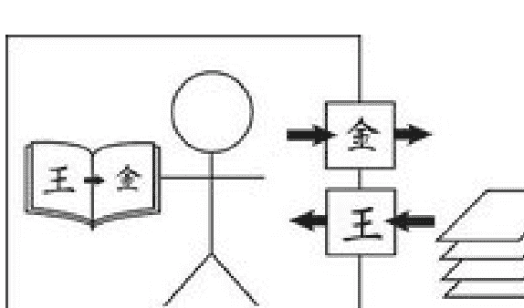

对这个论点有什么可能的回应？
系统回应：西尔的论证存在一个问题，即需要区分西尔和由他和规则书组成的系统。西尔可能不懂中文，但整个系统确实理解中文。

西尔：那太荒谬了！（在他的著作中，西尔经常诉诸于他认为是常识的东西。）只需记住规则书，就可以消除系统。
回应：然后你必须区分西尔和被他的记忆所模拟的人。

另一个回应是，西尔在他的思想实验中通过精心选择的意象获得了很大的效果：“仅仅是纸条”！然而，人脑具有巨大的计算能力（大约10^{11}个神经元和10^{14}个突触，每个神经元本身比逻辑门复杂得多），并且以大规模并行方式执行其计算。模拟大脑的计算能力可能需要足够的纸条来填满太阳系。但在这种情况下，西尔的情景似乎失去了直观的力量。

### 6.3 竞争性类比

关于真正思考机器的可行性的辩论归结为竞争性类比。

反对智能机器可能性的中心论点一直是“飓风的计算机模拟不会让任何人湿身。”但另一方面，乘法的计算机模拟显然是乘法。

所以问题归结为：智能更像飓风还是乘法？

### 6.4 “实际”问题

撇开通过图灵测试的机器是否应被视为有意识的问题不谈，还有一个更“实际”的问题：是否会有一台通过图灵测试的机器存在？
或者说存在一些根本的技术限制吗？
图灵在1950年预测，到2000年，一台机器在与人进行5分钟对话后，能够以70%的准确率欺骗普通人认为它是人类。他的预测准确性取决于评判机器的“普通人”的复杂程度。

早在20世纪60年代，计算机聊天程序就能轻易愚弄不成熟的人。
像ELIZA（或最近的AOLiza）这样的聊天程序是基于模仿用户像“心理医生”一样的方式：“告诉我更多关于你父亲的事情。”“我想回到关于你父亲的话题。”人们会向这些程序倾诉心声，并拒绝相信他们正在与机器交谈。

了解正确查找方法的成熟人士可以通过问任何常识问题轻易揭示程序的身份：“珠穆朗玛峰比一个鞋盒大吗？”程序会回答类似“告诉我更多关于珠穆朗玛峰的事情”，继续模仿人而不是给出直接回答。

当前的一个实际问题涉及CAPTCHA（完全自动化的公共图灵测试，用于区分计算机和人类）。CAPTCHA是一种当前计算机可以生成和评分但无法通过的测试。这些测试被发明用于阻止垃圾邮件机器人，但实际上引发了一个深刻的哲学问题：区分人类和机器的问题。

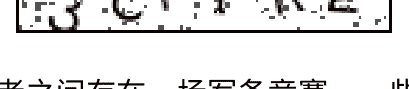

垃圾邮件发送者和验证码制造者之间存在一场军备竞赛。一些常用的验证码已经被破解，但总体上验证码制造者仍然占据上风。

## 7 哥德尔和思考机器

哥德尔的不完全性定理在某种程度上证明了思考机器的不可能性，这是一个古老的观点（事实上，哥德尔本人可能相信了类似的观点）。然而，如今，这个观点最常与罗杰·彭罗斯联系在一起，他是著名的数学物理学家，除了发明彭罗斯瓷砖和与斯蒂芬·霍金一起证明广义相对论普遍预测黑洞之外，还有其他成就。

### 7.1 皇帝的新思维

1989年，彭罗斯写了一本书《皇帝的新思维》，试图利用哥德尔的不完全性定理来论证计算机永远无法模拟人类。

再次考虑Gödel句子

```
`G(F) = “这个句子在F中是不可证明的。”`
```

彭罗斯认为，任何在逻辑系统F中工作的计算机都无法证明G(F)，但是我们作为人类可以通过进行元推理来“看到”它是真实的。因此，人类可以做一些计算机无法做到的事情。

> 现场提问：你能把陈述改成“这个句子不能被罗杰·彭罗斯证明吗？”吗？

很好的问题！一个可能的回答是，修改后的句子不能被纯粹的逻辑形式编译，因为我们还没有完全理解人脑的工作原理。这基本上是一种无知的论证。

另一个回答：为什么计算机必须在一个固定的形式系统F中工作？

彭罗斯：因为否则，计算机不一定是正确的，可能会犯错误。
回应：但是人类也会犯错误！
彭罗斯：当我认为G(F)是真的时，我对此完全确定。
但我们对G(F)是真的有多确定呢？回想一下，Con(F)（F的一致性）意味着G(F)。
主张：反过来也是成立的。也就是说，G(F)意味着Con(F)。
证明：如果F是不一致的，那么它可以证明任何事情，包括G(F)。因此 ¬Con(F)意味着 ¬G(F)（即G(F)是可证明的），这是我们想要展示的逆否命题。
所以归根结底，G(F)只是F的一致性的等价。问题是，人类能否退后一步“直接感知”一个逻辑系统的一致性，这似乎更像是一个宗教问题而不是一个科学问题。换句话说，一个人可能对一个系统的一致性完全确定，但他如何通过口头争论说服别人呢？

### 7.2 意识的观点

彭罗斯提出了意识观点的分类：

- 1. 模拟产生意识。（图灵）
- 2. 意识可以被模拟，但仅仅模拟不能产生意识。（西尔）
- 3. 意识甚至不能被计算机模拟，但有科学解释。（彭罗斯）
- 4. 没有科学解释。（99%的人）

## 记录员笔记：计算复杂性导论

杰森·弗塔多

2008年2月28日

### 1 激发复杂性理论

#### 彭罗斯的论证（续）

上一堂课介绍了罗杰·彭罗斯的论证。他说计算机无法模拟人脑。他的论证基于哥德尔的不完备性定理。彭罗斯的论证说，在任何形式系统 F中，我们可以构造一个哥德尔句子G(F)，计算机无法证明但人类可以证明。

亚伦森教授提出了一个简单的方法来看出彭罗斯的论证或任何类似的论证存在问题。彭罗斯试图证明没有计算机能通过图灵测试。图灵测试规定，如果计算机能够与人类进行文本对话，并且人类无法分辨出他们是在与计算机还是与另一个人对话，那么计算机就具有智能。图灵测试持续有限的时间（即对话）。如果你能够以极快的速度打字，比如每分钟5000个字符，那么你能够进行的即时通讯对话数量是有限的。因此，原则上可以构建一个巨大的查找表，其中存储了对每个可能提出的问题的智能人类回答。然后，计算机只需在被问到问题时查阅查找表。

这个查找表的问题在于它必须非常庞大。所需的存储空间将比可观测宇宙的大小（可能有10^80个原子）大很多倍。因此，创建这样一个系统是不可行的。现在，这个论证已经从理论可能性转变为可行性问题。反对这样一个系统的论证与所需的内存、处理能力等资源数量有关。由于该系统在理论上是可能的，问题是所需资源的数量是否合理。

为了进行这样的对话，我们需要一种衡量算法效率的方法。研究这些问题的领域被称为计算复杂性理论，并且将在课程的大部分时间里占据我们的注意力。与我们之前看到的情况相反，计算复杂性是一个几乎所有基本问题都尚未解答的领域，但也是一些我们所了解的内容处于数学前沿的领域。

#### 迪杰斯特拉算法

1960年，著名计算机科学家埃德斯加·迪杰斯特拉发现了一种在图的边数线性时间内找到两个顶点之间最短路径的算法。

该算法以他的名字命名（迪杰斯特拉算法），类似的算法被用于Google地图和其他软件中以寻找方向。有一个著名的轶事，迪杰斯特拉（他在数学系工作）试图解释他的新结果给一个同事。然后同事说：“但我不明白。”对于任何图形，最多有有限数量的非交叉路径。每个有限集合都有一个最小元素，所以只需枚举它们并完成。”同事的论点确实表明最短路径问题是可计算的。但从现代的角度来看，证明一个问题是可计算的并没有多大意义。重要的问题是一个问题是否可以高效地解决。

#### 效率

计算机科学家致力于寻找高效的算法来解决问题。通常通过考虑算法的运行时间作为输入大小的函数来衡量效率。在这里，输入大小通常（不总是）指描述输入所需的位数。这种描述效率的方式避免了过于依赖特定的机器模型（Mac、PC、图灵机等），并让我们专注于问题和解决方案的更“内在”属性。

### 2 电路复杂度

研究复杂性问题的一个好的起点是电路复杂度。从历史上看，这也是复杂性问题首次被提出的地方之一。
让我们提出以下一般性问题：
给定一个布尔函数 \( f : \{0,1\}^n \rightarrow \{0,1\} \)，计算它的最小电路的大小是多少？也就是说，需要多少个门？
举个例子，假设我们要计算输入位的异或，即 \( x_1, \ldots, x_n \)。那么我们需要多少个门？为了简单起见，假设有一个两输入的异或门可用。那么，\( n-1 \) 个门肯定足够了：先异或 \( x_1 \) 和 \( x_2 \)，然后将结果与 \( x_3 \) 异或，再将结果与 \( x_4 \) 异或，以此类推。我们能否证明 \( n-1 \) 个门是必要的？

声明：为了使单个输出位依赖于所有 \( n \) 个输入位，您至少需要 \( n-1 \) 个门，使用2输入门。

证明：使用“巧克力打破”论证作为基础，我们可以将每个输入视为一组。每个异或函数连接两个组，因此您比以前少一个总组。如果您继续连接组，直到只剩下一个组，您将使用 \( n-1 \) 个异或函数来连接 \( n \) 个输入。

注意：在讲座中，提到电路中另一个效率度量是电路的深度。这是从输入到输出遍历电路所需的最大门数。对于使用两输入异或门构建的 \( n \) 个输入的异或电路，可以轻松证明需要 \( \log n \) 的深度是必要且充分的。

#### 香农的计数论证

是否存在一个具有 \( n \) 个输入的布尔函数，需要指数级大小的电路？
好吧，让我们来看看一些可能的候选者。多数函数需要指数级大小的电路吗？不，不需要。那么，\( SAT \)和其他 \( NP \) 完全问题呢？好吧，这样就超前了，但简短的答案是没有人知道！
但是在1949年，信息论、数学密码学和其他几个领域的奠基人克劳德·香农（我们以后还会见到他）给出了一个非常简单的论证，说明这样的布尔函数必须存在。

首先，有多少个布尔函数在n个输入上？嗯，你可以将具有n个输入的布尔函数看作具有2^n个条目的真值表，每个条目可以是0或1。这导致了2^(2^n)个可能的布尔函数：不仅是指数量级，而且是双指数级数量。

另一方面，有多少电路具有n个输入和T个门？为了简单起见，假设我们的电路中只有NAND门。那么每个门的左输入最多有n+T个选择，右输入最多有n+T个选择。因此，可能的电路数量不会超过(n+T)^(2T)。每个电路只能计算一个布尔函数。因此，如果我们想表示所有2^(2^n)个布尔函数，那么我们需要(n+T)^(2T) ≥ 2^(2^n)。取对数后，我们可以估计T为^2 n。

如果T比这个更小，就没有足够的电路来解释所有布尔函数。

香农的论证简单而极其强大。如果我们设置n=1000，我们可以说几乎所有具有1000个输入的布尔函数需要至少使用2^1000/2000个NAND门来计算。这个数字大于10^80，即可见宇宙中的估计原子数量。因此，如果宇宙中的每个原子都可以用作门，具有1000个输入的函数将需要比宇宙还大的电路来计算。

香农的计数论证的惊人之处在于它证明了这样复杂的函数必须存在，但却没有给出任何一个具体的例子来说明这样的函数。这种类型的论证被称为非构造性的。

### 3 Hartmanis-Stearns

所以问题仍然是：我们能找到任何一个具体的问题，一个人们真正关心的问题，我们能证明它具有很高的计算复杂性吗？对于这个问题，让我们从电路模型转回图灵机模型。

1965年，Juris Hartmanis和Richard Stearns展示了如何构造出对于图灵机求解而言可以采取几乎任意所需步骤的问题。他们的结果基本上开创了计算复杂性领域，并使他们获得了1993年的图灵奖。为了证明他们的结果（所谓的层次定理），他们使用了图灵最初用来证明停机问题不可解性的一个“缩小版”论证。

假设我们想展示一个问题，任何图灵机需要大约n^3步来解决。问题如下：

> 问题：给定图灵机M、输入x和整数n，M在输入x后最多在n^3步之后停机吗？
声明：任何解决这个问题的图灵机至少需要n^3步。
证明：假设存在一台机器P，在n^2.99步内解决上述问题。然后我们可以修改P，得到一个新的机器P'，其行为如下：给定图灵机M和输入n：

- 1. 如果M在最多n^3步内停机，以自己的代码作为输入，那么它将永远运行。
- 2. 如果M在超过n^3步后停机，以自己的代码作为输入，那么它将停机。

注意，如果P'停机的话，它最多在n^2.99步内停机（加上一些小的开销）-无论如何，都少于n^3步。现在运行P'(P', n)。这是一个矛盾！如果P'停机，那么根据情况1它将永远运行下去。如果P'永远运行下去，那么根据情况2它将停机。

结论是P在第一次就不存在。换句话说，不仅停机问题无法解决，而且一般情况下，在给定有限步骤的情况下，没有比运行机器并观察它更快地预测图灵机行为的方法。这个论证适用于任何“合理”的运行时间（基本上，任何在合理时间内可计算的运行时间），而不仅仅是 n³。

### 4 复杂性符号

在后面的讲座中，有一个度量函数增长的符号表示法将会很有帮助，这个符号表示法忽略了从一个实现到另一个实现变化的“低阶项”。接下来是计算机科学家用于此目的的标准符号表示法。

#### 大O符号

我们说 f(n) = O(g(n))，如果存在常数a, b，使得对于所有的n，有 f(n) < ag(n) + b。函数 g(n) 是 f(n) 增长的上界。另一种思考大O符号的方式是，当n趋向于无穷大时，g(n) 至少和 f(n) 同样快地增长。f(n) = O(g(n)) 被读作 “f(n) 属于 O(g(n)) 函数类”。

#### 大Ω符号

我们说 f(n) = Ω(g(n))，如果存在 a > 0 和 b，使得对于所有的n，有 f(n) > ag(n) - b。直观地说，当n趋向于无穷大时，f(n) 以与 g(n) 相同或更快的速度增长。

#### 大O记号

我们说 f(n) = Θ(g(n)) 如果 f(n) = O(g(n)) 并且 f(n) = Ω(g(n))。直观地说，当n趋向于无穷大时，函数 f(n) 与 g(n) 以相同的速率增长。

#### 小o记号

我们说 f(n) = o(g(n)) 如果对于所有的 a > 0，存在一个 b 使得对于所有的n， f(n) < ag(n) + b 成立。直观地说，f(n) 的增长速度比 g(n) 慢。所以 f(n) = O(g(n)) 但不是 Θ(g(n))。

## 第八讲

## 1 行政事务

本学期每个人将有两个记录员笔记。此外，由于我们正在讨论复杂性问题，您现在可以使用书籍来复习任何不清楚的内容。

### 2 复习

在我们感兴趣的大多数情况下，真正的问题不是什么是可计算的，而是在合理的时间和其他资源下什么是可计算的。几乎所有的科学和工业问题都是可计算的，但并不是都是高效可计算的。即使在更具推测性的问题上 - 比如是否可能构建一个通过图灵测试的机器 - 我们可以看到，凭借无限的资源，这几乎是微不足道的（只需创建一个巨大的查找表）。真正的问题是，我们能否构建一个在物理宇宙的时间和空间约束下运行的思考机器？这是我们从可计算性转向复杂性的动机之一。

#### 2.1 早期结果

##### 2.1.1 Claude Shannon的计数论证

大多数布尔函数需要庞大的电路来计算它们，即门的数量与输入的数量呈指数关系。奇怪的是，我们知道这一点，但我们仍然没有一个好的例子来证明这个性质。

##### 2.1.2 时间层次定理

一切可计算的东西是否都可以在线性时间内计算？不。关于可行计算的限制，我们还有很多不知道的地方，所以我们必须珍惜我们所知道的。我们可以在n步内解决的问题比在n-1步内解决的问题更多。同样地，在n步内解决的问题比在n-2步内解决的问题更多。这是真实的原因是我们可以考虑一个问题，例如：

> “给定一个图灵机，在≤n步内是否停机？”

假设它可以在少于 n^3 步内解决，我们可以将解决问题的程序作为输入喂给它自己，从而产生矛盾。这是停机问题的有限模拟。

##### 2.1.3 最快算法的存在

我们还没有提到的一件奇怪的现象是在60年代人们发现的运行时间：对于每个问题，是否必须存在最快的算法？或者，相反，是否可以存在一系列解决问题的算法，每个算法都更快，但没有最快的算法？

##### 2.1.4 具体例子：矩阵乘法

给定两个 $n \times n$ 矩阵，找到：

$$
\begin{pmatrix}
 a_{11} & a_{12} & \dots & a_{1n} \\
 a_{21} & a_{22} & \dots & a_{2n} \\
 \vdots & \vdots & \ddots & \vdots \\
 a_{n1} & a_{n2} & \dots & a_{nn}
\end{pmatrix}
\begin{pmatrix}
 b_{11} & b_{12} & \dots & b_{1n} \\
 b_{21} & b_{22} & \dots & b_{2n} \\
 \vdots & \vdots & \ddots & \vdots \\
 b_{n1} & b_{n2} & \dots & b_{nn}
\end{pmatrix}
=
\begin{pmatrix}
 c_{11} & c_{12} & \dots & c_{1n} \\
 c_{21} & c_{22} & \dots & c_{2n} \\
 \vdots & \vdots & \ddots & \vdots \\
 c_{n1} & c_{n2} & \dots & c_{nn}
\end{pmatrix}
$$

##### 2.1.5 直接的方法

由于我们乘以列和行的方式，直接的方法需要3步。然而，确实存在更好的算法。

##### 2.1.6 斯特拉森算法

1968年，斯特拉森发现了一种只需 $O(n^{2.78})$ 步的算法。他的算法采用了分治法，将原始矩阵反复分割成 $\frac{n}{2}\times \frac{n}{2}$ 的矩阵，并以巧妙的方式组合起来。这是一种相当实用的算法；人们实际上在科学计算和其他领域中使用它。斯特拉森的算法成为高效算法理论的早期灵感之一：毕竟，如果人们在一个多世纪的时间里都错过了这么基本的东西，那么在算法领域中还可能隐藏着什么其他的东西呢？

##### 2.1.7 更快更快的算法

后来找到了一个时间复杂度为 $O(n^{2.55})$ 的算法。目前已知的最好算法是由Coppersmith和Winograd提出的，时间复杂度为 $O(n^{2.376})$。许多人认为我们应该能做得更好。自然界的极限是 $O(n^2)$，因为在最好的情况下，我们必须查看矩阵的所有条目。有些人猜测对于所有的 $\epsilon > 0$，存在一个时间复杂度为 $O(n^{2+\epsilon})$ 的算法。

##### 2.1.8 实际考虑

如果矩阵相对较小，那么使用朴素的 $O(n^3)$ 算法更好。经验事实是，随着算法的渐进加速，常数因子似乎越来越大。当你转向使用更复杂的算法和更大的矩阵时，你会希望使用更复杂的算法，因为常数因子的影响不那么重要。据我们所知，当你转向更大的矩阵时，可能会出现一系列无休止的算法。或者这个序列可能会终止；我们还不知道。注意，我们显然不能只是为给定的矩阵大小选择最佳算法，因为每个新的更快算法可能需要一些额外的洞察力才能提出。如果存在一个生成这些算法的算法，那么我们最终会得到一个单一的算法。这说明了一系列无尽的算法中没有最佳算法的概念。注意，这个序列是可数的，因为只有可数个算法。

##### 2.1.9 布卢姆加速定理

1967年，布卢姆证明了我们可以构造出一些问题，对于这些问题，没有最佳算法。事实上，存在这样一个问题，对于每个 $O(f(n))$ 算法，也存在一个 $O(\log(f(n)))$ 算法！这怎么可能呢？无论使用任何算法，这个问题都需要很长时间来解决——一些巨大的指数堆栈，即使对其进行 log 任意次数的操作也无法将其降至常数。我们不打算证明这个定理，但要意识到它的存在。

##### 2.1.10 总结

因此，并不是每个问题都有一个最佳算法。我们不知道这种奇怪现象发生的频率，但我们知道它原则上是可能发生的。

顺便说一下，从矩阵乘法的故事中可以得到一些教训。人们直观地认为³是我们能做到的最好的，然后我们提出了打破这个界限的算法。这说明为什么证明下界是如此困难：因为你必须排除每种可能的聪明方法，而有许多非显而易见的方法。

### 3 高效的含义

我们一直在谈论“高效”的算法，但是究竟我们指的是什么呢？

计算机科学家们发现有一个有用的定义（虽然不是唯一的定义），即“高效”＝“多项式时间”。也就是说，如果存在一个 k，使得所有大小为 n 的实例都可以在 O(n^k) 的时间内解决，那么这个算法就是高效的。像 $\sqrt{n}$ 或 $\log n$ 这样的东西不是多项式的，但是有一个比它们更大的多项式，所以它们也是高效的。

你一提出这个高效性的标准，人们就会想到对它的反对意见。例如，一个 $n^{10,000}$ 的算法是多项式时间的，但在实践中显然不是高效的。

另一方面，$O(1.00000000001^n)$ 这是指数级的，但在实践中对于适度大小的 n 来说似乎是可以接受吗？

理论计算机科学家非常清楚这些问题，并有两个主要的回应：

- 1. 经验主义 - 在实践中，高效通常意味着多项式时间；低效通常意味着指数时间甚至更糟糕，这种规律性令人惊讶。这为理论提供了经验支持。谁发明了 $O(n^{10,000})$ 算法？
- 2. 微妙的回应 - 任何关于效率的标准都必须满足从业者和理论家的需求。它必须方便。想象一个花费多项式时间的子程序和一个调用该子程序多次的算法。那么运行时间仍然是多项式的，因为多项式在组合下是封闭的。但是假设“高效”被定义为二次时间。当将这样的算法与另一个 $O(n^2)$ 算法组合时，新算法不一定是高效的；它可能需要 $O(n^4)$ 时间。因此，我们需要对理论来说方便的东西。

我们在多项式时间内能做到的实际限制是什么？它是否包括你在日常使用计算机时会用到的内容（算术、拼写检查等）？幸运的是，这些都是多项式时间内完成的。对于这些任务，需要一些思考才能找到最佳的多项式时间算法，但找到一个多项式时间算法并不需要太多思考。我们的定义也包括一些不明显的算法。如果你上过算法课，可能对其中一些算法很熟悉。

### 4 最长递增子序列

#### 4.1 问题

假设 $X(1), X(2), ..., X(n)$ 是一个整数列表，假设从1到2n。任务是找到最长的递增子序列，不一定连续，即 $X_{i_1} < X_{i_2} < \dots < X_{i_k}$，其中 $1 \leq i_1 < i_2 < \dots < i_k \leq n$。例如：

- 3, 8, 2, 4, 9, 1, 5, 7, 6

长度为4的最长子序列有几个：(2,4,5,7)，(2,4,5,6)，(3,4,5,6)，(3,4,5,7)。

当我们有9个数字时，解决这个问题是可行的，但是当 $n = 1000$ 时呢？我们如何编写程序来解决这个问题？

#### 4.2 多项式时间算法

可以尝试所有可能性，但这种方法不高效。尝试所有大小为 $k$ 的可能性需要 $\binom{n}{k}$ 时间，并且 $\sum \binom{n}{i} = 2^n$。我们将得到一个指数级的算法。

考虑以下方法：
从左到右迭代遍历元素，并维护一个大小为n的数组。对于每个元素 $i$，保存以 $i$ 为最后一个元素的最长子序列。由于计算第 $k$ 个元素的这个子序列只涉及到前 $k-1$ 个元素的最长子序列，因此这种方法的时间复杂度为 $O(n^2)$。

#### 4.3 动态规划

上面是动态规划的一个例子，这是一种通用技术，即使看起来需要指数时间，也能在多项式时间内解决一些问题。一般来说，你从子问题的解开始，逐渐扩展到整个问题的解。

然而，为了使这种技术起作用，问题需要具有某种结构，使我们能够将其分解为子问题。

### 5 稳定婚姻

#### 5.1 问题

给定N个男人和N个女人，每个男人对每个女人进行排名，反之亦然，我们希望以一种使每个人“不太不快乐”的方式进行配对。

更具体地说，我们希望避免不稳定性，即一个未婚的男人和女人都更喜欢对方而不是自己的配偶。没有任何这种不稳定性的配对被称为稳定婚姻。我们的目标是提供一个高效的算法来找到稳定的婚姻，但首先的问题是：稳定婚姻是否总是存在？

#### 5.2 维多利亚时代的浪漫小说算法

事实证明，证明解存在的最简单方法是给出一个能够找到解的算法。这个算法是由盖尔和沙普利在20世纪50年代提出的，它在所有算法中具有最简单的人类解释。

##### 5.2.1 算法

从男性开始（毕竟那是50年代）。第一个男性向他排名最高的女性求婚，她暂时接受。下一个男性求婚，以此类推，每个女性都暂时接受。如果从未发生冲突，那么我们完成了。如果存在两个男性向同一个女性求婚的冲突，女性选择她更喜欢的男性，而被拒绝的男性被淘汰，划掉拒绝他的女性。我们像这样循环遍历男性，在下一轮中，任何被淘汰的男性都会去找他更喜欢的下一个女性。如果她还没有被求婚，她暂时接受。否则，她选择她最喜欢的男性，淘汰另一个男性，以此类推。我们继续像这样循环，直到所有男性和女性都匹配。

##### 5.2.2 终止

这个算法会终止吗？是的：在最坏的情况下，每个男人都会向他名单上的每个女人求婚一次。（注意，一个男人永远不会重新考虑一个被淘汰的女人。）下一个问题是：当算法终止时，每个人都配对了吗？是的。假设为了推翻假设，存在一对没有配对的夫妇。这意味着有一个单身男人和一个单身女人。但是在这种情况下，没有其他人会向那个女人求婚，因此当涉及到这个男人向她求婚时（他在某个时候会这样做），她会接受他。（注意，问题陈述中编码了这样的假设：每个人都宁愿和某人在一起，而不愿意孤单。）这是一个矛盾；因此每个人都必须配对。

##### 5.2.3 正确性

算法找到的匹配是稳定的吗？是的。假设推翻假设，即 $M_1$ 与 $W_1$ 配对，$M_2$ 与 $W_2$ 配对，尽管 $M_1$ 和 $W_2$ 都更喜欢对方而不是自己的配偶。
在那种情况下，$M_1$ 会在 $W_2$ 之前向 $W_1$ 求婚。因此，当算法终止时，$W_2$ 不可能与 $M_2$ 匹配——毕竟，她被至少一个她更喜欢的男人求婚了。这是一个矛盾；因此算法输出一个稳定的婚姻。

##### 5.2.4 运行时间

最后，注意输入由2个包含 $n$ 个数字的列表组成。该算法的时间复杂度为 $O(n^2)$，因此与输入大小成线性关系。
解决这个问题的朴素方法是遍历所有可能的匹配，并在找到稳定的匹配时输出。上述算法更加高效，并且还提供了解的证明。

### 6 其他例子

经过四十年的研究，我们知道以下一些问题可以在多项式时间内解决：给定N个男人和N个女人，但没有偏好列表。相反，我们知道是否可以匹配 $M_i$ 和 $W_j$。

很明显，在这种情况下，我们无法让每个人都满意。以没有男人可以与任何女人匹配的情况为例。但是即使我们不能必然让每个人都满意，我们能尽可能让更多的人满意吗？这被称为“最大匹配”问题。更抽象地说，给定一个二分图，每一边有n个顶点，我们想找到一个最大不相交的边集。朴素的方法是看如何匹配1个人，2个人，3个人等等，但这很慢。

更好的解决方案是重复匹配k个人，然后尝试看是否可以“改进”到匹配k+1个人。检查男人和女人的图，如果我们发现有男人和女人没有匹配，那么我们就试图将他们配对。当然，按照这种方法，我们可能会遇到一个情况，我们无法再将任何人配对，但可能仍然存在更好的匹配。然后我们可以搜索一些在男性和女性之间来回穿梭的路径，并且在我们未使用的边和已使用的边之间交替。如果我们找到这样的路径，那么我们只需将所有奇数编号的边添加到我们的匹配中，并删除所有偶数编号的边。在这种方法中，我们继续在图中搜索，直到找不到更多这样的路径为止。这种方法导致了一个 $O(n^3)$ 算法。作为我们输入大小的函数，即 $n^2$，这是一个 $O(n^{3/2})$ 算法。Hopcroft和Karp后来将其改进为一个 $O(n^{5/4})$ 算法。

值得注意的是，这个问题在Edmonds的原始1965年论文中得到了解决，该论文将多项式时间定义为高效。在那篇论文中，Edmonds实际上证明了一个更困难的结果：即使在男性也可以与男性匹配的情况下，女性也可以与女性匹配，我们仍然可以在多项式时间内找到一个最大匹配。有趣的是（回顾起来），Edmonds不得不在脚注中解释为什么这是一个有趣的结果。他指出，我们需要区分多项式时间和指数时间算法，因为指数时间算法对问题的理解不够好，也不高效。

#### 6.1 高斯消元

$$
\begin{pmatrix}
a_{11} & a_{12} & \dots & a_{1n} \\
a_{21} & a_{22} & \dots & a_{2n} \\
\vdots & \vdots & \ddots & \vdots \\
a_{n1} & a_{n2} & \dots & a_{nn}
\end{pmatrix}
\begin{pmatrix}
x_1 \\
x_2 \\
\vdots \\
x_n
\end{pmatrix}
=
\begin{pmatrix}
y_1 \\
y_2 \\
\vdots \\
y_n
\end{pmatrix}
$$

另一个例子是解线性方程组。我们可以使用高斯消元法，而不是尝试每个可能的向量。这需要 $O(n^2)$ 的时间将下面的行归零，并且这样做 $n$ 次直到我们得到一个上三角矩阵，总共需要 $O(n^{3})$ 的时间。本质上，这种方法是对回代的一种形式化思想。

那么先求矩阵 $A$ 的逆，然后将其乘以向量 $y$ 呢？问题是，求矩阵的标准方法是使用高斯消元法！顺便说一句，已经证明了无论求逆矩阵的复杂度是多少，它都等价于矩阵乘法的复杂度。两个问题之间存在一个约化。

#### 6.2 线性规划

$$
\begin{pmatrix} 
a_{11} & a_{12} & \dots & a_{1n} \\ 
a_{21} & a_{22} & \dots & a_{2n} \\ 
\vdots & \vdots & \ddots & \vdots \\ 
a_{n1} & a_{n2} & \dots & a_{nn} 
\end{pmatrix} 
\begin{pmatrix} 
x_{1} \\ 
x_{2} \\ 
\vdots \\ 
x_{n} 
\end{pmatrix} 
\leq 
\begin{pmatrix} 
y_{1} \\ 
y_{2} \\ 
\vdots \\ 
y_{n} 
\end{pmatrix}
$$

解一组线性不等式怎么样？这是一个称为线性规划的问题，其基本理论是由乔治·丹齐格在二战后不久开发的。作为战争期间的运筹学家，丹齐格面临着涉及如何最佳地将各种物资运送给部队的问题。军队对可用数量和可行地点有一系列约束。一旦将这些约束编码为线性不等式，问题就是确定是否存在可行解。丹齐格发明了一种称为单纯形法的通用方法来解决这类问题。在这种方法中，您从候选解向量开始，然后在每个步骤中将其增加到更好的解。该算法在实践中表现得非常好，但人们无法证明其运行时间的大部分内容。然后，在1970年代，克利和明蒂发现了人为构造的例子，其中单纯形算法需要指数时间。另一方面，在1979年，卡奇扬证明了一种不同的算法（虽然在实践中不如单纯形算法高效）可以在多项式时间内解决线性规划问题。

#### 6.3 旁注

正如班上的一位学生指出的那样，如果没有第二次世界大战，计算机科学（像大多数其他科学一样）在如此短的时间内可能不会取得这么多进展。如果你对战时研究的历史更感兴趣（除了曼哈顿计划，每个人都知道），可以看看安德鲁·霍奇斯的《艾伦·图灵：谜团》或G. 帕斯卡尔·扎卡里的《无尽的前沿》。第二次世界大战可以被描述为第一次“渐近战争”（即第一次在如此庞大的规模上，数学理论变得与获胜相关）。

#### 6.4 素性测试

素性测试是以下问题：给定一个数字，它是素数还是合数？目标是在与数字位数成比例的时间内回答。这对于生成RSA密钥至关重要；幸运的是，对于这个问题存在多项式时间算法。我们稍后会更详细地讨论这个问题。

#### 6.5 两色地图

我们被给予一个国家列表，并告知哪些国家与其他国家相邻。 我们能够给国家地图上色，以便相邻的两个国家不会被涂上相同的颜色吗？ 有一个简单的算法：先给一个国家涂上一种颜色，然后用另一种颜色给每个相邻的国家涂色。 我们可以继续这样做，直到地图完全上色，或者两个相邻的国家被迫使用相同的颜色。 在后一种情况下，地图无法进行两色上色。

问题之所以如此简单，是因为一旦我们给一个国家上色，我们在上色剩余国家时被迫采取特定的颜色。 由于这个原因，我们可以在O(n)时间内确定地图是否具有两色上色。

#### 6.6 我们能够在多项式时间内解决这些问题吗？

另一方面，如果我们想知道我们的地图是否具有三色上色呢？ 这似乎更困难，因为我们不再总是被迫给每个国家涂上特定的颜色-在许多情况下，我们会有两个选择。 如何高效地解决这个问题并不明显。

或者考虑一个问题，我们给出了一个人员名单，并告诉了我们任意两个人之间是否是朋友。 我们能找到一个最大的人员集合，其中每个人都是彼此的朋友吗？

请继续关注下一堂讲座，探索这些问题...## 1 行政事务

### 1.1 问题集1

总体而言，人们表现得非常好。如果你对自己的表现不满意，或者有什么不明白的地方，请在星期一的办公时间来找我。没有人能够解决证明分辨率完备性的挑战问题，但很多人解决了关于炮弹的问题。解决炮弹问题的方法涉及定义一个严格单调的系统状态函数。这里有两种可能的证明方法：

- 解决方案1：让 $S_i$ 表示堆 $i$ 中的炮弹数量，并定义一个描述系统状态的函数：$f = \sum$ 每次堆栈爆炸时，函数 $f$ 增加两个。由于爆炸是唯一定义的操作，并且它总是增加 $f$ 的值，系统永远不能返回到先前的状态。
- 解决方案2：让 $p$ 是迄今为止爆炸的最右边的堆栈。然后堆栈 $p+1$ 比开始时有更多的炮弹。唯一的方法是回到下降状态是爆炸堆栈 $p+1$，这将导致堆栈 $p+2$ 比开始时有更多的炮弹。这导致无限回归，意味着没有返回到起始配置的有限移动序列。

## 2 复习

理论计算机科学的核心问题是：“哪些问题有一个有效的算法来解决它们？”在计算机科学中，“有效”等同于“多项式时间”。

- 算术、排序、拼写检查、最短路径
- 解线性系统（以及矩阵求逆）
- 线性规划
- 动态规划
- 稳定婚姻、最大匹配
- 素数测试
- 寻找多项式的根
- 给图上色

还有一些其他没有已知多项式时间算法的问题，例如：

- 给地图上色
- 最大团问题：给定一组人，找到最大的一组彼此都是朋友的人。
- 装箱问题：给定各种尺寸的箱子，找到你可以装入卡车的最大集合。
- 旅行推销员问题：给定一组城市和城市之间的旅行成本，找到经过每个城市的最便宜的路线。

## 3 个一般性问题

上面列出的问题看起来像是谜题。让我们考虑一些看起来更“深入”或更“一般”的问题：

- “DUH”问题：给定n、k和图灵机M，是否存在一个大小为n的输入y，使得M(y)在少于nk步骤内接受？
- 定理问题：给定一个数学陈述和一个整数 n，是否存在一个在ZF集合论中使用最多 n symbols的证明？

所有这些问题都有一些共同点：

- 它们都是可计算的，但计算可能需要指数级的时间。
- 给定一个提议的解决方案，可以在多项式时间内检查该解决方案是否正确。

### 3.1 定理问题

让我们更仔细地看看定理问题。如果没有“最多 n symbols”的限制，这个问题是否可计算？

声明：如果你可以在没有这个限制的情况下解决这个问题，那么你可以解决停机问题。

证明：给定一个图灵机 M，使用你的算法来找到以下问题的答案：

- 是否存在一个证明 M 停机？如果是，则 M 停机。
- 是否存在一个证明 M 不停机？如果是，则 M 不停机。

如果不存在证明，那么我们仍然可以得出结论，即 M does 不会停止。如果它停止了，那么必须有一个证明它停止的证明；最直接的证明是模拟 M 直到它停止。

因此，我们可以得出结论，在没有“最多 n 个符号”约束的情况下，这个问题是不可计算的。

然而，在“最多 $n$个符号”的约束下，这个问题是可计算的。在最坏的情况下，算法可以简单地搜索所有可能的证明，其中最多有 $n$个符号。

## 4 P和NP

52年过去了，我们仍然不知道哥德尔的问题的答案。但是有一些了不起的事情我们知道。再次看看所有这些问题。从先验上看，人们可能认为对于问题X，蛮力搜索是可以避免的，但对于问题Y等等，却不是。但在20世纪70年代，人们意识到在一个非常精确的意义上，它们都是同一个问题。对于它们中的任何一个，多项式时间算法都将意味着对于其他所有问题的多项式时间算法。如果你能证明其中一个问题没有多项式时间算法，那就意味着其他所有问题都没有多项式时间算法。

这就是NP完全性理论的要点，它是由美国的Stephen Cook和Richard Karp在1971年左右发明的，苏联的Leonid Levin也独立发现了这个理论。（在冷战期间，有很多这样的独立发现。）

### 4.1 P和NP

P（非正式地）是所有可以在多项式时间内解决的问题的类别。为了简单起见，我们将重点放在决策问题上（即那些只有是或否答案的问题）。

形式上，P是所有集合$L \subseteq \{0, 1\}^n$的类别，其中存在一个多项式时间算法$A$，使得$A(x) = 1$当且仅当$x \in L$。

NP（非确定性多项式时间）是（非正式地）所有可以在多项式时间内验证解的问题的类别。

形式上，NP是所有集合$L \subseteq \{0, 1\}^n$的类别，其中存在一个多项式时间图灵机$M$和多项式$p$，使得对于所有$x \in \{0, 1\}^n$，$x \in L$当且仅当存在$y \in \{0, 1\}^{p(n)}$使得$M(x, y)$接受（这里，$x$是问题的实例，$y$是问题的某个解）。

为什么它被称为“非确定性多项式时间”？这是一个有点古老的名字，但现在我们被困在这里。最初的想法是，你会有一个可以在多项式时间内运行的图灵机，它可以在状态之间进行非确定性转换，并且只有在计算树中存在一条导致接受的路径时才接受。（非确定性图灵机就像我们之前看到的非确定有限自动机一样。）这个定义与上面的形式定义等价。首先让机器猜测解决方案 $y$，然后检查 $y$ 是否有效。

由于它是一个非确定性图灵机，它可以同时尝试所有可能的 $y$，并在多项式时间内找到答案。

问题：是 $P \subseteq NP$ 吗？是的！如果有人给你一个P问题的解决方案，你可以忽略它并在NP时间内自己解决。

### 4.2 NP难和NP完全

NP难是指那些“至少和任何NP问题一样难解”的问题。形式上，如果给定一个 L 的 oracle，你可以在多项式时间内解决每个NP问题。换句话说，如果 L 是NP难的话，那么 NP ⊆ P L。

NP完全是指那些既是NP难又在NP中的问题。非正式地说，NP完全问题是NP中“最难的问题”——以某种方式捕捉了所有其他NP问题的困难。

图1：P、NP、NP难和NP完全之间的关系。

断言：如果任何一个NP完全问题属于P，那么所有的NP完全问题都属于P，且 P = NP。
如果任何一个NP完全问题不属于P，那么所有的NP完全问题都不属于P，且 P ≠ NP。

### 4.3 NP完全问题

我们如何证明NP完全问题的存在？我们能找到一个例子吗？

考虑上面的“DUH”问题：给定一个多项式时间图灵机 M，找到一个输入 y，使得 M(y) 接受。根据NP完全的定义，这个问题几乎是NP完全的。

- DUH在NP中：给定一个解 y，可以通过运行 M(y) 在多项式时间内检查它是否接受。
- DUH是NP难的：假设我们有一个解决“DUH”的oracle。那么对于任何NP问题，根据NP的定义，必须存在一个多项式时间图灵机 M'(x, y) 来验证一个声称的解 y。所以只需询问oracle是否存在一个 y，使得 M 接受（将输入 x 硬编码到 M 的描述中）。

因此，Cook、Karp和Levin的真正成就不是证明了NP完全问题的存在。这几乎是显而易见的。他们真正的成就是证明了许多自然问题都是NP完全的。

### 4.4 证明一个问题是NP完全的

要证明一个给定的问题L是NP完全的，你只需要做两件事：

1. 证明L ∈ NP。
2. 证明一些已知是NP完全的问题K可以归约到L。这意味着L至少和K一样难，因为K可以归约到L。

## 5 Cook-Levin定理

考虑另一个问题：SAT（可满足性）。给定一个任意的布尔公式（在命题逻辑中），是否有一种设置变量的方式使得公式评估为 TRUE？

定理。SAT是一个NP完全问题。

证明。首先，证明SAT属于NP。（这通常是最容易的部分。）给定一组提议的参数，将它们代入方程并查看是否评估为 TRUE。

接下来，展示一些已知的NP完全问题如何归约到SAT问题，以证明SAT是NP-难的。我们知道DUH是NP完全的，所以让我们将DUH归约到SAT。换句话说：给定一个任意的多项式时间图灵机 $M$，我们需要创建一个布尔公式 $F$，当且仅当存在一个输入 $y$ 导致 $M$ 接受时，该公式可满足。翻译过程本身必须在多项式时间内运行。

这个过程的方法在概念上非常简单，但是执行起来非常复杂，所以我们将更加关注概念。

请记住，图灵机由一条由0和1组成的纸带以及来回移动的读写头组成。给定一个图灵机 $M$，以及给定输入 $y = y_1, ...$，写在它的纸带上，机器的整个未来历史就确定了。

这意味着我们可以绘制所谓的 *tableau*，它可以一目了然地显示 $M$ 的整个计算历史在一个视图中。表格的每一行表示图灵机的状态、磁带的值和图灵机在磁带上的位置。

| 时间 | 状态 | 磁带 |
| :--- | :--- | :--- |
| 6 | H | 0 1 1 1 1 0 |
| 5 | B | 0 1 1 1 1 0 |
| 4 | A | 0 0 1 1 1 0 |
| 3 | B | 0 0 0 1 1 0 |
| 2 | A | 0 0 0 1 1 0 |
| 1 | B | 0 0 0 1 0 0 |
| 0 | A | 0 0 0 0 0 0 |

图2：在经过6个步骤后停机的图灵机的示例tableau。

SAT的tableau将有 $T$ 个时间步长，其中 $T$ 是 $n$ 的某个多项式，并且因为它只有 $T$ 个时间步长，我们只需要关心从一侧到另一侧的 $T$ 个磁带方格。这意味着整个tableau的大小是多项式级别的。假设在最后一步中，某个磁带方格 $T_i$ 上有一个1，那么机器只有在这种情况下才接受。

我们感兴趣的问题是是否存在某种“解决方案位” $y = y_1, \ldots, y_r$ 的设置使得 $M$ 接受。

我们如何创建一个只有在存在这样的设置时才能满足的公式？我们应该肯定地包括 $y = y_1, \ldots, y_r$ 作为公式的变量。但我们需要一大堆额外的变量。基本上，对于你可能问及这个表格的任何是或否问题，我们将定义一个表示该问题答案的布尔变量。然后，我们将使用一系列布尔连接词来强制这些变量相互关联，以模拟图灵机的操作。

- 对于所有的 $i, t$，让 $x_{t,i} = 1$，如果在步骤 $t$ 时，第 $i$ 个磁带方格被设置为1。
- 让 $p_{t,j} = 1$，如果在步骤 $t$ 时，图灵机头部在第 $j$ 个方格上。
- 让 $s_{t,k} = 1$，如果在步骤 $t$ 时，图灵机处于状态 $k$。

接下来，看看表格中的每个“窗口”，并编写命题子句以确保在该窗口中发生正确的事情。

- 首先，对于所有的 $j$ 从 $1$ 到 $r$，$x_{1,j}=y_j$，并且对于所有的 $j>r$，$x_{1,j}=0$。
- 这意味着如果磁头在其他地方，那么第 $j$ 个方格保持不变。我们需要为每个 $i$ 和 $j$ 都有这样的子句。
- $s(t,k)=1 \wedge p(t,j)=1 \wedge x(t,j)=1 \Rightarrow s(t+1, k_l)=1$。这意味着如果在时间 $t$ 时，机器处于状态 $k$ 并且在磁带方格 $j$ 上写有1，则在下一个时间步骤中，它将处于状态 $k_l$。我们还需要子句来确保对于所有的 $l = k_l$，$s(t+1, l)=0$。
- $\ldots$ 等等。

我们需要一个最终子句来确保机器实际上接受。

- $x_{T,0} = 1$

最后，我们将所有这些子句串联在一起，生成一个庞大但仍然多项式大小的布尔公式 $F$，只有当存在某个 $y = y_1, \ldots, y_r$ 使得 $M$ 接受时，该公式才是一致的（即可满足的）。

因此，假设我们有一个多项式时间算法来判断布尔公式是否可满足，我们可以使用该算法在多项式时间内判断是否存在一个输入使得图灵机M接受。事实上，这两个问题是等价的。换句话说，SAT是NP完全的。这就是Cook-Levin定理。

### 5.1 特例：2SAT

上述证明并不排除可以高效解决SAT问题的特殊情况。特别是，考虑讲座2中的问题，其中子句仅由两个文字组成。这个问题被称为2SAT，正如我们在讲座2中所展示的，2SAT在P中。如果你的布尔公式具有这种特殊形式，那么有一种方法可以在多项式时间内决定可满足性。

### 5.2 特例：3SAT

与2SAT相反，让我们考虑每个子句都有三个文字的问题，或者3SAT。事实证明，3SAT是NP完全的；换句话说，这个SAT的特殊情况编码了SAT问题本身的全部困难。我们将在讲座10中讨论这个证明。

## 附录

## 库尔特·哥德尔写给约翰·冯·诺伊曼的信

为了设定背景：哥德尔现在是普林斯顿的隐士。自从爱因斯坦去世以来，哥德尔几乎没有人可以交谈。后来他会因为认为妻子试图毒害他而饿死自己。冯·诺伊曼之前曾将量子力学形式化，发明了博弈论，告诉美国政府如何对抗冷战，创造了一些最早的通用计算机等伟大成就，现在正在医院里因癌症而濒临死亡。尽管冯·诺伊曼很聪明，但他没有解决哥德尔在这封信中提出的问题，直到今天它仍然是理论计算机科学中标志性的未解决问题之一。

> 普林斯顿，1956年3月20日
>
> 尊敬的冯·诺伊曼先生：
>
> 听说您现在身体好些了，我想写信向您请教一个数学问题，您的意见对我来说非常重要：显然可以很容易地构造一台图灵机，对于一阶谓词逻辑中的每个公式 $F$ 和每个自然数 $n$，它可以判断是否存在长度为 $n$ 的 $F$ 的证明（长度=符号的数量）。令 $\Psi(F, n)$ 表示该机器所需的步骤数，令 $\varphi(n) = \max_{F} \Psi(F, n)$。问题是 $\varphi(n)$ 在最优机器上增长得有多快。可以证明 $\varphi(n) \ge k \cdot n$。如果真的存在一个满足 $\varphi(n) \sim k \cdot n$（甚至 $\sim k \cdot n^2$）的机器，那将具有极其重要的后果。也就是说，尽管存在着不可判定问题，数学家在处理是或否问题时的思考工作完全可以由机器来代替。毕竟，我们只需要选择一个足够大的自然数$n$，当机器无法给出结果时，继续思考这个问题就没有意义了。现在，我觉得 $\varphi(n)$ 增长得非常缓慢是完全有可能的。因为
>
> 1. 似乎 $\varphi(n) \ge k \cdot n$ 是唯一可以通 Ent scheidungsproblem 的不可判定性证明的推广得到的估计，而且
> 2. 毕竟， $\varphi(n) \sim k \cdot n$ （或 $\sim k \cdot n^2$ ）只意味着步骤数可以从 $N$ 减少到 $\log N$ （或 $\log^2 N$ )而不是试错法。
>
> 然而，在其他有限问题中也出现了这种强大的简化，例如使用重复应用互反律计算二次剩余符号。有趣的是，例如，关于确定一个数的素性的情况以及在一般情况下有限组合问题中步骤数可以如何强烈地减少相对于简单的穷举搜索。
>
> 我不知道你是否听说过“波斯特问题”，即形式为$(\exists y)\varphi(y, x)$的问题中是否存在不可解性的程度，其中 $\varphi$ 是递归的，已经被一个名叫理查德·弗里德伯格的年轻人在积极意义上解决了。解决方案非常优雅。不幸的是，弗里德伯格并不打算学习数学，而是打算学医学（显然受到他父亲的影响）。顺便问一下，你对最近在分层类型理论上建立分析基础的尝试有什么看法？你可能知道保罗·洛伦岑已经在这种方法上推进了勒贝格测度理论。然而，我相信在分析的重要部分中，不可消除的非预测性证明方法确实存在。
>
> 我很高兴能从你这里听到一些消息。如果有什么我可以为你做的，请告诉我。向你和你的妻子致以最诚挚的问候和祝福。
>
> 此致
>
> 敬礼，库尔特·哥德尔
>
> 附言：我衷心祝贺你获得美国政府授予的奖项。
>
> 来源：http://weblog.fortnow.com/2006/04/kurt-gdel-1906-1978.html

## 1 行政事务

努力完成作业，但不要惊慌。来办公时间。春假前将有一个短期（1周）的问题集，之后将于星期四进行考试，即4月3日。

## 2 复习

上次我们看到了计算问题的大致地理图。

这门课程的一个原则是这个图像非常重要。在理想的世界中，人们会像认识地球大陆的地图一样认识这张地图。
作为普及努力的一部分，我们正在分发斯科特的《科学美国人》文章，该文章涉及量子计算的限制，其中包含类似的图片，只是更加量子化。
NP完全性的概念是在70年代定义的。上次我们看到DUH问题 - 给定一个图灵机，是否存在一个输入，在多项式时间内它会停机 - 显然是NP完全的，当然。然后我们看了我们的第一个“自然”的NP完全问题，可满足性（或简称为SAT）。我们通过从DUH进行约简，看到了Cook和Levin关于SAT是NP完全的证明。今天我们将看到更多的约简。

## 3 SAT约简到3SAT

虽然SAT是NP完全的，但它的特定实例可能很容易解决。

一条子句是一个单一的析取；一个文字是一个变量或变量的否定。在合取范式 (CNF) 中的布尔公式是由文字的析取的合取。然后2SAT问题 (我们在课程中早些时候看到过) 的定义如下：

- 给定一个包含最多2个文字的CNF公式，它是否有一个满足的赋值？

在第2讲中，我们看到2SAT可以在多项式时间内解决，因为我们可以绘制蕴含图并在多项式时间内检查是否有循环。

今天，我们将讨论3SAT问题。

- 给定一个包含最多3个文字的CNF公式，它是否有一个满足的赋值？

与2SAT不同，3SAT问题似乎很难。事实上，3SAT是 NP-完全的 - 这个特殊情况包含了通用SAT的所有困难！

为了证明这一点，我们将展示如何在多项式时间内将任意布尔公式转换为3SAT问题。因此，如果我们有一个3SAT的oracle，那么我们可以通过将输入转换为3SAT形式并查询oracle来解决SAT问题。

那么我们如何将任意布尔公式转换为3SAT公式？我们的第一步将是将公式转换为电路。这实际上非常简单 - 公式中的每个 ¬, ∧ 或 ∨ 都变成电路中的NOT、AND或OR门。我们需要注意的一个细节是，当我们说多个文字 ∧ 或 ∨ 在一起时，我们首先需要指定一个顺序来进行 ∧ 或 ∨ 的操作。例如，如果我们在公式中看到(x₁ ∨ x₂ ∨ x₃)，我们应该将其解析为((x₁ ∨ x₂) ∨ x₃)，它变成 OR(x₁, OR(x₂, x₃))，或者(x₁ ∨ (x₂ ∨ x₃))，它变成OR(OR(x₁, x₂), x₃)。我们选择哪个都无所谓，因为 ∧ 和 ∨ 都是结合律。

因此，每个布尔公式都可以在线性时间内转换为等效电路。这有一些有趣的后果。首先，这意味着问题CircuitSAT，即给定一个电路并询问它是否有一个满足的赋值，是NP完全的。其次，因为Cook-Levin给了我们一种将图灵机转换为布尔公式的方法，如果我们知道运行时间的上界，那么将这个结果加上去就给了我们一种将图灵机转换为电路的方法。如果图灵机在多项式时间内运行，那么转换只需要多项式时间，电路的大小也是多项式的。

好的，现在我们有一个电路，想要将其转换为一个3SAT公式。3是从哪里来的？每个门最多有3条连接线 - 两个输入和一个输出用于AND和OR，一个输入和一个输出用于NOT。让我们为每个门定义一个变量。我们想知道是否存在一组变量的设置，使得对于每个门，输出与输入/输入的关系正确，并且最终输出设置为true。

那么让我们来看看非门。将输入称为 x，输出称为 y。我们希望如果 x 为真，则 y 为假，如果 x 为假，则 y 为真 - 但我们已经知道如何将if-then语句写成析取！所以，我们有

```
非门： (x ∨ y) ∧ (¬x ∨ ¬y)
```

我们可以用OR的真值表做同样的事情。将输入称为 x₁和 x₂，输出称为 y。让我们做一行。如果 x₁为真且 x₂为假，则 y 为真。我们可以写成根据德摩根定律，这与(¬x₁ ∨ x₂ ∨ y)相同。对于所有输入的AND运算，我们得到

```
OR : (¬x₁ ∨ ¬x₂ ∨ y) ∧ (¬x₁ ∨ x₂ ∨ y) ∧ (x₁ ∨ ¬x₂ ∨ y) ∧ (x₁ ∨ x₂ ∨ ¬y)
```

对于AND门也是类似的。这里的大思想是，我们正在将我们知道很难的问题的小部分（电路中的门）转化为我们试图证明很难的问题的小部分（CNF公式）。这些小部分被称为“小玩意”，它们是减少证明中的一个重要主题。一旦我们获得了这些小玩意，我们就必须想办法把它们粘在一起。

在这种情况下，我们只需要将每个门的布尔公式和最终输出线的变量进行AND运算。通过这样做，我们得到的布尔公式只有在电路可满足时才为真。太棒了。

## 4 3COLOR是NP完全的

-   给定一个图，是否有一种方法可以将每个顶点着色为红色、蓝色或绿色，以便没有相邻的顶点最终着相同的颜色？

这个问题被称为3COLOR，它是 NP-完全的。我们将通过展示从CircuitSAT的归约来证明它。所以假设我们有一个电路，并且我们有一个魔术盒，当给定一个图时，它会告诉我们它是否有一个好的3着色。我们能否制作一个图，当且仅当布尔公式可满足时，它是3可着色的？我们将需要一些小工具。

首先，我们将重新命名颜色。我们图的第一部分将是一个三角形，它将作为调色板。请注意，任何一个好的3着色必须将不同的颜色分配给三角形的每个顶点。因此，对于给定的好的3着色，无论第一个顶点被分配的颜色是什么，我们将称之为True；第二个顶点将被称为False；第三个顶点将被称为Neither。这是一个NOT门的小工具。

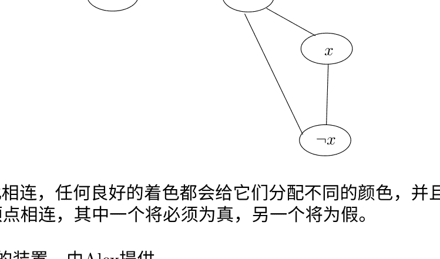

因为 x 和 ¬x 彼此相连，任何良好的着色都会给它们分配不同的颜色，并且因为它们都与调色板中的 “Neither” 顶点相连，其中一个将必须为真，另一个将为假。

这是一个AND门的装置，由Alex提供。

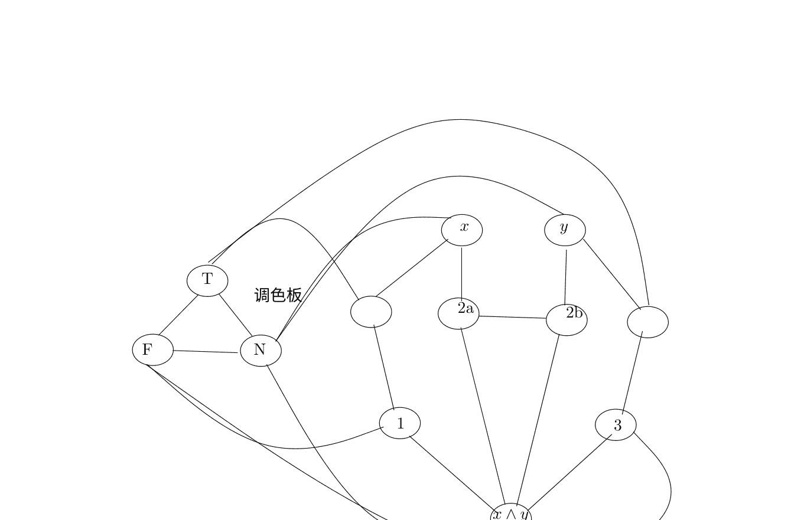

显然它有效，对吧？要注意的主要事项如下。输入和输出与“Neither”相连，这迫使它们采用布尔值。如果 x 和 y 被着色相同，那么2a和2b将被着以另外两种颜色，迫使 x∧y 被着以与 x 和 y 相同的颜色 - 这是AND门的正确行为！如果 x 和 y 被着色相反，那么1或3将必须被着为真，这迫使 x∧y 被着为假 - 这正是我们希望发生的。最后，在所有情况下，我们没有添加太多限制：对于 x 和 y 的任何设置，都存在良好的着色。

通过使用DeMorgan定律，可以通过组合AND和NOT器件来制作OR门的装置。还有一种可爱的方法可以修改AND器件，将其转换为OR器件。你看到了吗？

通过组合这些器件，我们可以将任何电路转换为图形，使得对导线的T/F赋值转化为图形的着色。如果我们将最终输出顶点连接到调色板中的False顶点，那么我们构建的图形将具有良好的3-着色性质，当且仅当电路具有满足的赋值。

因此，我们刚刚证明了3COLOR是 NP-完全的。这是一件奇怪的事情。这意味着，例如，在ZF集合论中，我们可以高效地构造出可3-着色的图形，当且仅当Riemann假设有证明。好好思考一下。

看着有些可怕的AND器件，你可能会想知道是否有一种方法可以绘制图形，使得没有线交叉。事实证明，这是可能的，并且意味着3PLANAR-COLOR（给定一个平面图，它是否可3-着色）也是 NP-完全的。那4PLANAR-COLOR呢？这个问题原来很简单。实际上，你可以每次都输出是的！长期以来的猜想是每个平面图都可以用4种颜色着色。这最终在1976年由阿佩尔和哈肯证明。这个证明周围有一些戏剧性的事情，你可以在维基百科上阅读。那么2PLANAR-COLOR呢？这也很简单。它是2COLOR的一个特殊情况，我们上次看到了一个贪婪算法。当涉及到平面图着色时，数字3似乎有一些特殊之处。

## 5 总结

1972年，卡普用上述技术和一些聪明才智证明了21个问题是NP完全的。 我们可以花一个月的时间研究聪明的小工具，但我们不会这样做。 重要的教训是NP完全性是无处不在的。 事实上，已经证明了成千上万个实际问题是NP完全的。 实际上，每当在工业等领域出现一个优化问题时，一个好的启发是假设它是NP完全的，除非有证据证明相反！这当然是什么激发了P = NP问题的提出-这使得它成为数学和科学中的核心问题之一。

## 6个棘手的问题

当Cook将一个语言 A 定义为 NP-完全时，它本身就在 NP中，并且每个 NP问题都可以在多项式时间内解决，如果给予 A的oracle访问权限。

-   A在 NP中
- SAT在 P^A中

这个定义允许我们多次调用oracle，但实际上在上面的证明中我们只调用了一次。 这些证明具有非常具体的形式：以某种等价的问题实例出现在候选语言中；在其上调用oracle。Karp注意到这一点，并提出了 NP-完全性的不同概念。

-   存在一个多项式时间算法，将可满足的公式映射到 A中的字符串，将不可满足的公式映射到 A之外的字符串。

这些定义是相同的还是第二个更加严格？ 这是一个未解决的问题，欢迎你为额外学分解决它。

现在，如果 P=NP，那么 NP中的每个问题都可以高效地解决，而且NP中的每个问题都是NP-完全的：计算宇宙将会变得非常单调。 如果 P=NP，那么我们知道什么？ 所有 P中的问题都很容易，而所有 NP-完全问题都很难。 是否存在中间状态？ 是否存在既不是 NP-完全问题也不是高效可解问题的NP问题？ 1975年，拉德纳证明了答案是肯定的。请继续关注下一次的讲座以了解更多信息。

## 1 NP-完全性在实践中

最近的讲座讨论了很多技术问题。这次讲座将退一步。

我们已经证明 NP-完全问题在现实生活中确实存在，因此显然工程师、科学家等在工作中遇到过这些问题。例如，尝试建立最佳航班时间表，或者最小化冲突的课程时间表，或者尝试设计最佳的飞机机翼。然而，当你遇到一个 NP-完全问题时，你会放弃吗？不，有很多应对 NP-完全问题的方法。你必须改变看待问题的方式；你停止寻找通用解决方案，而是玩一个不同的游戏。

### 1.1 替代方案

我们将讨论处理 NP-完全问题的七种策略。

#### 1.1.1 蛮力法

如果问题的规模较小，这种方法很有效；你只需尝试每个可能的解决方案，直到找到一个可行的解决方案。你的问题可能是 NP-完全问题，但如果你的 n 为4，找到解决方案就很简单。例如，你周日报纸上的数独可以通过蛮力法解决；你可以找到一个九九格的解决方案，但对于巨大的数独来说就更加困难。

#### 1.1.2 结构利用

你所面对的 NP-完全问题可能具有适合解决的结构。记住，“NP-完全”是关于问题类的陈述；它并不涉及个别实例的复杂性。“带有 n 符号的证明”是一个 NP-完全问题，但人类显然已经解决了许多具体实例。

#### 1.1.3 特殊情况处理

你可以找到一般问题的特殊情况，既适合于一般解决方案，又包含你的一般问题实例。例如，2S AT是SAT的一个特殊情况，可以解决；它具有一个多项式时间解算法的特殊形式。每个NP完全问题都有一些特殊情况可以在多项式时间内解决；你只需要找到一个特殊子集，其中包含你的实例。

#### 1.1.4 除了 n 之外利用参数

这个策略与之前的策略有关。传统上，我们认为一切都是输入大小的函数 of n。但我们也可以考虑其他参数。举个例子，回想一下

最大团问题：给定一组人，找到最大的子集，其中每个人都是彼此的朋友。这是一个 NP-完全问题。但是假设我们添加另一个参数 $k$，并改变问题，看看是否存在大小为 $k$ 的团。如果 $k$ 作为输入的一部分给出，那么这个问题仍然是 NP-完全的。（作为一个合理性检查，如果 $k = n/2$，那么要检查的可能性数量大约是 something like $\binom{n}{n/2}$，这个问题的增长是指数级的，与 $n$ 有关。) 然而，如果 $k$ 是一个常数，那么这个问题就有一个高效的解决方案：你可以简单地检查所有大小为 $k$ 的集合，这需要 $\binom{n}{k}$ 时间。因此，对于每一个固定的 $k$，都有一个多项式时间的算法来解决这个问题。

事实上，在某些情况下，我们实际上可以做得更好，并给出一个算法，它的时间复杂度为 $f(k) p(n)$，其中 $f$ 是一个函数， $p$ 是一个多项式（所以参数 $k$ 不再出现在指数的位置）。研究在哪些情况下这是可能的，以及在哪些情况下这是不可能的，会导致一个丰富的理论，称为参数化复杂性。

#### 1.1.5 近似

如果我们无法得到最优解，有时我们可以得到一个接近最优的解。例如，在最大团问题中，我们能找到一个团，其大小至少是最大团大小的一半吗？在旅行商问题中，我们能找到一条路径，其长度至多是最短路径长度的两倍吗？这些问题的答案通常取决于问题本身。

这是一个更深入的例子。我们知道 $3SAT$ 是 NP-完全的，但是否存在一种有效的算法来满足（比如）7/8 的子句？如果我们随机填充每个变量，那么每个子句为假的概率是 1/8。所以按期望的线性性质，我们大约满足 7/8 的子句。

另一方面，是否存在一种有效的算法来满足 $7/8 + \epsilon$ 的子句，对于某个常数 $\epsilon >0$？H°astad 的深刻结果（建立在其他人的众多贡献基础上）表明，这已经是一个 NP-完全问题，也就是说，它已经和完美解决 $3SAT$ 问题一样困难。这意味着 7/8 是 $3SAT$ 问题的近似极限，除非 $\mathbf{P}=\mathbf{NP}$。过去二十年来， NP-完全问题的近似性已经成为一个巨大的研究领域，现在我们对此已经有了相当多的了解（无论是积极的还是消极的结果）。

不幸的是，在这门课程中我们没有时间进一步探讨这个话题。

#### 1.1.6 回溯法

我们可以通过以更聪明的方式（换句话说，不那么暴力）生成候选解来使暴力方法更加有效。例如，在三色问题中，你可能很早就知道某个解决方案行不通，这将让你剪枝整个树的一部分，从而节省时间。特别是，给定一张地图，你可以为每个国家填充颜色，在某个国家有多种颜色可用时进行分支。

如果你遇到一个使潜在解决方案无效的冲突，就回溯到达一个未探索的分支，并从那里继续。这个算法最终会找到一个解，只要存在一个解——不一定是多项式时间，但至少是指数时间的较小指数。

#### 1.1.7 启发式算法

最终的策略涉及使用启发式方法，如模拟退火、遗传算法或局部搜索。这些都是从随机候选解开始的算法，然后反复进行局部改变，以尝试减少“不良”。例如，在3着色问题中，你可以从一个随机着色开始，然后反复改变一个冲突国家的颜色，以修复其与邻国的冲突。反复进行。这种方法并不总是能有效地收敛到一个好的解决方案，主要原因是它可能陷入局部最优解。

### 1.2 在自然界中

自然界经常处理 NP-完全问题；我们能从中学到什么吗？生物学采用了计算机科学家所知的遗传算法。有时生物学只是突变候选解，但有时它们会结合起来（我们称之为性繁殖）。

生物学已经广泛采用了性繁殖技术，即使我们还没有完全理解它的原因。在实验中，只使用突变（即“无性繁殖”）的局部搜索算法在解决NP-完全问题方面表现更好，而不是将性繁殖纳入算法中。

人们目前对于自然界为什么如此依赖性繁殖的最好理论是，自然界并不试图解决一个固定的问题；约束条件总是在变化。例如，对于生活在恐龙时代的生物来说，理想的特征与现代生物的理想特征是不同的。这仍然是一个未解决的问题。

作为自然界显然解决NP-完全问题的另一个例子，让我们来看看蛋白质折叠。蛋白质是细胞的基本构建块之一。DNA转化为RNA，然后转化为蛋白质，蛋白质是一串氨基酸链。我们可以将这串氨基酸链看作是编码信息。然而，在某个时候，这些信息需要转化为与身体以某种方式相互作用的化学物质。它通过折叠成分子或其他具有所需化学性质的特殊形状来实现这一点。折叠是基于链中的氨基酸进行的，这是一个非常复杂的过程。

关键的计算问题是：给定一条氨基酸链，你能预测它会如何折叠起来吗？原则上，你可以模拟所有低层次的物理过程，但这在计算上是不可行的。生物学家喜欢简化问题，他们说每个折叠状态都有潜在能量，并且折叠的目的是将能量最小化。对于问题的理想化版本，可以证明寻找最小能量构型是 NP-完全的。但是我们身体中的每个细胞真的在每秒钟解决 NP-完全问题的困难实例吗？

还有另一种解释。进化不会选择折叠非常困难的蛋白质（例如，任何最优折叠都必须编码黎曼猜想的证明）。相反，它会选择折叠问题在计算上容易的蛋白质，因为这些蛋白质会可靠地折叠成所需的构型。

请注意，当事情出错时，折叠会被困在局部最优解中，你可以出现异常情况，例如朊病毒，这是疯牛病的原因。

## 2 计算机宇宙地理

我们之前提到了拉德纳定理：如果 P = NP，则存在 NP问题既不在 P中也不在 NP完全中。这个定理的证明有点令人沮丧；基本思想是定义一个问题，在某些输入大小 n的情况下，问题是解决 SAT（使问题不在 P中），而在其他输入大小的情况下，问题是什么都不做（使问题不在 NP完全中）。关键是以一种谨慎的方式来做，以保持问题在 NP中。

### 2.1 因式分解

我们还不知道如何将密码学建立在 NP-完全问题上。当今最广泛使用的加密系统是基于数论问题，如因式分解，这与普遍误解相反，既不被认为是 NP-完全的，也不被认为是 NP-完全的。我们能否找到因式分解和已知的 NP-完全问题之间的一些差异，使我们怀疑因式分解不是NP-完全的？

一个差异涉及解的数量。如果我们考虑一个像3-着色这样的 NP-完全问题，可能有零种方法来对给定的地图进行3-着色，有几种方法，或者有大量的方法。（我们知道的一件事是，着色的数量必须能被6整除-你明白为什么吗？）相比之下，对于因式分解，只有一个解。每个正整数都有一个唯一的素因子分解，一旦我们找到它，就没有更多的要找了。这对于密码学非常有用，但也使得因式分解是 NP-完全的可能性极小。

### 2.2 coNP

为什么我这么说呢？好吧，让我们暂时忘记因子分解，问一个看似无关的问题。假设没有一种有效的算法可以找到一个图的3着色，那么我们至少可以给出一个证明一个图不是3着色的简短证明吗？如果回溯树很短，你可以直接写下来，但在最坏的情况下这将花费指数时间。是否存在可以在多项式时间内检查的不可满足性的简短证明的问题被称为NP与coNP问题。

这里，coNP是NP问题的补集：也就是说，集合

```
{ L : L ∈ NP }
```

将这个问题与原始的P与NP问题联系起来，如果P=NP，那么肯定NP=coNP（如果我们可以在多项式时间内决定可满足性，那么我们也可以决定不可满足性！）。然而，我们不确定NP=coNP是否意味着P=NP；我们不知道如何朝这个方向前进。尽管如此，几乎所有的计算机科学家都相信NP=coNP，就像他们相信P=NP一样。

### 2.3 新宇宙地图

我们现在在我们的宇宙地图上有五个主要区域：P, NP, NP-完全, coNP, 和 coNP-完全。

如果一个问题既在 NP中又在 coNP中，那么这是否意味着它在 P中？好吧，考虑一个从因式分解导出的问题，就像下面这个问题：给定一个正整数 n，是否存在以7结尾的质因数？这个问题既在 NP中又在 coNP中，但我们当然不知道它是否在 P中。最后，这是因式分解不是 NP-完全的论证。由于唯一因式分解的存在，因式分解在 NP∩coNP中。因此，如果因式分解是 NP-完全的，那么一个 NP-完全问题将在 coNP中。因此，NP本身将包含在 coNP中，并且（通过对称性）将等于 coNP-从而使计算宇宙的大部分崩溃。换句话说，如果 NP=coNP，那么因式分解不能是 NP-完全的。

## 1 上次讲座回顾

-   实践中的NP完备性。我们讨论了人们在现实生活中应对NP完备问题的许多方法。这些方法包括暴力搜索（适用于小规模实例）、巧妙优化的回溯搜索、固定参数算法、近似算法以及启发式算法，如模拟退火（虽然不总是有效，但在实践中通常表现良好）。
- 因子分解，作为P和NP完备之间的中间问题。我们看到，尽管因子分解对于经典计算机来说被认为很困难，但它具有一种特殊的结构，使其与任何已知的NP完备问题不同。
- 共 NP.

## 2 空间复杂度

现在我们将根据问题使用的内存量对其进行分类。

定义1 如果存在一个多项式空间图灵机$M$，对于所有的$x$，当且仅当$M(x)$接受时，$x$属于$L$，则$L$属于$PSPACE$。就像$NP$一样，我们可以定义$PSPACE-hard$和$PSPACE-complete$问题。

一个有趣的PSPACE完全问题的例子是 $n$ 乘以 $n$ 的国际象棋：给定一个 $n$ 乘以 $n$ 的棋盘上的棋子布局，并假设移动次数有多项式上界，判断白方是否有获胜策略。（注意我们需要将国际象棋推广到 $n$ 乘以 $n$ 的棋盘上，因为标准的8乘8国际象棋是一个在 $O(1)$ 时间内完全可解的有限游戏。）

现在让我们定义另一个复杂度类EXP，显然比PSPACE还要大。

定义2 确定性 $f(n)$ 时间，表示为$\mathbf{D}TIME(f(n))$，是由图灵机在时间$O(f(n))$内可解决的决策问题的类。

定义3 指数时间，表示为$EXP$，等于所有多项式$p$的$\mathbf{D}TIME(2^{p(n)})$的并集。

声明4  $PSPACE \subseteq EXP$

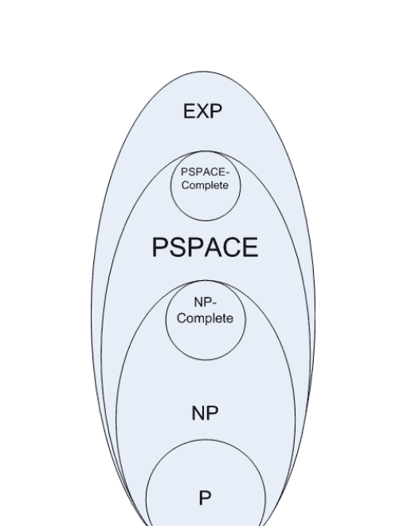

图1：我们相信的一个总体图像

证明 就像在问题集2中一样。为了使机器停止，任何“配置”最多只能被访问一次。假设对于磁带方块的数量有一个上界 $p(n)$，则磁带上的0和1有$2^{p(n)}$种可能的设置，图灵机头有 $p(n)$个可能的位置，头的状态有 $s$个可能的状态。因此，步骤数的上界是$2^{p(n)} p(n) s$，这在 $p(n)$中是指数级的。

声明5 $P \subseteq PSPACE$。

证明 显然，P机器无法访问超过多项式数量的内存位置。

声明6 $NP \subseteq PSPACE$。

证明 枚举所有可能的多项式大小的证明。

备注NP=PSPACE吗？就像P vs. NP一样，这是一个长期存在的开放问题！有猜想认为它们是不同的。

定义7 $LOGSPACE$是由具有$O(\log n)$位内存的图灵机可解决的决策问题的类。

备注 但输入已经是$n$位了吗？一个技术细节：LOGSPACE机器只能对输入进行只读访问。只有读写内存受到对数限制。

命题8 $LOGSPACE \subseteq P$。

证明与命题4相同，只是“按指数缩小”。一个图灵机的可能配置最多有 $s 2^{c \log n} c \log n = n^{O(1)}$ 个。

备注：LOGSPACE=P吗？另一个长期存在的开放问题！再次猜想是它们是不同的。

我们可以证明 $LOGSPACE = PSPACE$，使用类似于我们在第7讲中看到的时间层次定理的空间层次定理。像往常一样，证明更多的相同资源（时间，空间等）比较少的资源提供更多的计算能力并不难。难的部分是比较不同的资源（如时间与空间，或确定性与非确定性）。

## 3 如果我们无法证明，为什么我们相信 P = NP?

- 在实践中解决NP完全问题的难度：实证案例。
- 已经有“比NP完全问题（如因子分解）更容易”的问题，我们已经不知道如何在P中解决。
- 正如哥德尔所争论的，P=NP意味着数学创造力可以自动化。上帝不会那么仁慈！
- 我们知道 $LOGSPACE = PSPACE$。但这意味着要么 $LOGSPACE = P$，要么 $P = NP$，要么 $NP = PSPACE$！如果其中一个是真的，那为什么不是全部三个呢？

顺便说一下，让我告诉你一个复杂性理论的内部笑话。让LINSPACE成为线性空间可解问题的集合。那么我们能够证明的非常少的分离之一是 $LINSPACE \neq P$。为什么呢？好吧，假设 $P = LINSPACE$。那么 $P = PSPACE$也成立。为什么呢？填充输入！但这意味着LINSPACE=PSPACE，这被空间层次结构定理排除了！

笑话的要点是，虽然我们知道P和LINSPACE是不同的，但我们不知道哪一个不包含在另一个中（或者最有可能的是，两者都不包含在对方中）。我们只知道它们是不同的！

## 为什么证明 P = NP 这么难呢?

- 因为 $P = NP$!
- 因为确实有很多聪明的、不明显的多项式时间算法。任何证明3SAT是困难的证明都必须失败显示2SAT是困难的，即使对于两者的“手势直觉”似乎是相同的（存在 $2^n$ possible solutions，并且显然每个解至少需要常数时间来检查！）。尽管看起来很简单，这个标准已经排除了几乎所有业余的 $P = NP$ 证明，这些证明都在Aaronson教授的收件箱中...
- 让 $NPSPACE$（非确定性 $PSPACE$）是由可以进行非确定性转换的 $PSPACE$ 机器解决的问题的类。然后通过类比 $P = NP$，你可能猜测 $PSPACE = NPSPACE$。但是Savitch定理表明这个猜想是错误的：$PSPACE = NPSPACE$。因此，任何 $P = NP$ 的证明在多项式有界资源是空间而不是时间时都会失败。
- 贝克-吉尔-索洛维证明。从逻辑和可计算性理论借鉴的技术，像用来证明时间层次定理的那些技术，似乎都是相对化的。换句话说，如果我们假设世界上有一个神奇的预言机免费解决某个问题，那么这些技术似乎都能顺利通过。举个例子，回想一下，停机问题的不可解性证明可以很容易地改编为“超级停机问题”由“超级图灵机”不可解。相比之下，P与NP问题的任何解决方案都必须是非相对化的。换句话说，它必须对是否存在预言机敏感。为什么呢？嗯，因为有一些预言世界中P=NP，而其他预言世界中P≠NP。具体来说，让A是任何PSPACE-complete问题。那么我声称 $P^A = NP^A = PSPACE$。（为什么？）另一方面，我们也可以创建一个预言B，使得 $P^B \neq NP^B$。对于每个输入长度n，要么存在一个 $y \in \{0,1\}^n$，使得 $B(y)=1$，要么对于所有 $y \in \{0,1\}^n$，$B(y)$ 都等于0。然后给定一个n位输入，问题就是决定哪个是正确的。显然，这个问题属于 $NP^B$（为什么？）。另一方面，至少直观上，确定性机器解决这个问题的唯一方法是询问预言B关于指数多个y的问题。贝克、吉尔和索洛维能够形式化这个直觉（细节略去），从而给出了一个P=NP的预言世界。

## 5 开始一个新的单元：随机性

人们几个世纪以来一直在争论随机性的真正本质。当我们说两个骰子有1/36的概率掷出蛇眼时，这似乎是很清楚的：如果你无限次掷骰子，在极限情况下，你将有1/36的时间掷出蛇眼。另一方面，如果你去Intrade.com（在撰写本文时），你会发现市场估计奥巴马赢得初选的概率为70%，希拉里赢得初选的概率为30%。但是这样的概率在哲学上意味着什么呢？这意味着如果你无限次重新进行选举，在极限情况下，奥巴马将有70%的时间赢得选举？这听起来荒谬！你可以通过假设选举已经发生，并且人们正在尝试猜测，当选票被计算时，这个候选人将赢得选举的概率是多少，来使这个谜题更加明确。好吧，选票已经存在！或者至少，投票机器说的是选票存在。或者假设有人问你P=NP的概率是多少。好吧，它们要么相等，要么不相等，并且它们在宇宙开始之前就是这样！

有趣的是，在Intrade的背景下，概率确实有一个相当明确的含义。说奥巴马被市场估计有70%的获胜机会意味着，如果你想购买一份期货合约，如果他赢了就会支付一美元，如果他输了就什么都不会支付，那么成本就是70美分。有一个整个的决策理论领域，它以你愿意进行的赌注来定义概率。甚至有定理表明，如果你想成为一个理性的赌徒（一个不会被利用的人），那么你必须按照概率的方式行事，不管你是否喜欢它们。

然后还有一个物理学问题：物理定律是否基本上是概率性的，还是总有一些额外的信息，如果我们知道了它，就可以恢复确定性？我相信你们都知道爱因斯坦说上帝不玩骰子的故事，量子力学说上帝确实玩骰子，而量子力学获胜。世界似乎确实有一个基本的随机成分。

幸运的是，对于计算机科学的目的，我们不必担心这些深层次的问题。我们可以将概率论的定律作为公理。

## 1 概率的不确定性

为什么概率如此反直觉？让我们看一些例子来磨练我们对概率的直觉。

### 1.1 两个孩子

假设男孩和女孩出生的可能性相等。一个家庭有两个孩子。其中一个是男孩。另一个是男孩的概率是多少？

- 年长的孩子：男 女 男
- 年幼的孩子：女 男 男

另一个孩子是男孩的概率是1/3，而不是1/2。这个问题的假设是“其中一个是男孩”意味着至少有一个孩子是男孩。如果问题改为某个具体的孩子是男孩，例如，“年长的孩子是男孩。年幼的孩子是男孩的概率是多少？”，那么概率将是1/2。

### 1.2 三个不幸的囚犯

有三个囚犯。其中一个囚犯被随机选择在第二天早上被处决，但是不告诉囚犯们谁是不幸的囚犯。其中一个囚犯请求卫兵：“至少告诉我其他两个囚犯中哪一个不会被处决。”卫兵说：“从你的角度来看，这会将你被处决的几率从1/3增加到1/2。”

卫兵是正确的吗？不，他不是。被处决的几率仍然是1/3。（为什么？）

### 1.3 蒙提霍尔问题

假设你参加一个游戏节目。有三扇门，其中一扇门后面有一辆汽车，另外两扇门后面有山羊。主持人让你选择一扇门；假设你选择了门1。主持人随后打开另一扇门，假设是门3，并展示了一只山羊。主持人随后问你是否要继续选择门1还是换到门2。你应该怎么做？

> 在概率论中，你总是要小心未明确的假设。大多数人说无论你换与不换都无所谓，因为门1和门2都有同样的可能性有车在后面。但至少在问题的通常解释中，这个答案是不正确的。

关键问题是主持人是否知道汽车在哪里，以及（利用这个知识）他是否总是选择有山羊的门。假设这是主持人的行为是合理的。在这种情况下，换门会增加找到汽车的概率从1/3到2/3。

为了说明，假设汽车在门1后面，门2和门3后面有山羊。

情景1：你选择门1。主持人揭示门2或门3后面有一只山羊。你换到另一扇门并得到一只山羊。
情景2：你选择了2号门。主持人在3号门后面揭示了一只山羊。你换到1号门并得到了汽车。
情景3：你选择了3号门。主持人在2号门后面揭示了一只山羊。你换到1号门并得到了汽车。
这个问题还有另一种思考方式。假设有100扇门，主持人在98扇门后面揭示了山羊。你应该换吗？当然！主持人基本上告诉了你汽车在哪里。

### 1.4 两个信封

假设你可以选择两个里面装有钱的信封。一个信封里的钱是另一个信封的两倍。你选择一个信封，然后被问是否要换信封。显而易见的答案是不应该有任何区别。然而，让 $x$ 为你最初选择的信封中的金额。那么另一个信封中预期的金额似乎是 $\frac{1}{2}(2x + \frac{x}{2}) = \frac{5x}{4}$，这比 $x$ 大！那么，你真的可以通过换牌来增加你的预期收益吗？如果是这样，那么如果你不停地换牌，换牌，换牌——你能得到无限多的钱吗？
作为一个理智检验，假设一个信封里有1到100美元之间的随机金额，而另一个信封里的金额是前一个的两倍。那么，如果你相信你的信封里有超过100美元，显然你不会换牌。这个简单的观察包含了解决这个悖论的关键。
看，换牌的论证中包含了一个隐藏的假设：对于每个正整数 $x$，你的原始信封有 $2x$ 美元的可能性和 $x$ 美元的可能性一样大。但是这真的可能吗？不可能，因为如果你考虑任何正整数的概率分布，随着数字越来越大，概率分布必须逐渐减小，以至于较大的金额比较小的金额更不可能出现。

## 2 为什么我们在计算机科学中需要随机性？

为什么随机性在计算机科学中很重要？让我们来看一些例子，其中随机性似乎是不可或缺的，或者至少是一个很大的帮助。

### 2.1 密码学

随机性对于密码学来说是绝对必要的。想象一下，如果选择加密密钥是基于完全确定性的算法！如果窃听者能够准确预测你将要做什么，那么你就有麻烦了。

### 2.2 对称性破坏

随机性对于打破“走廊舞蹈”很有用，其中你走向某人，然后你们都朝同一边走以避让对方，然后再都朝另一边走，然后再都回到原来的一边，这样不断地舞蹈。

想象一下，一个十字路口上有两辆机器人车。如果两辆车都以相同的方式编程，并且如果它们无法区分左右，那么它们将无法移动，因为它们将同时进入十字路口并相撞。另一方面，如果控制车辆的算法具有随机成分，那么两辆车都有机会安全通过十字路口。令人着迷的分布式计算领域（很遗憾，在本课程中我们没有时间深入研究）充满了这样的例子。对于许多实际感兴趣的分布式计算问题，如果所有代理行为都是确定性的，那么可能无法找到解决方案。

### 2.3 数据库检查

假设我们有两个数据库，每个数据库都有1TB的信息，我们想要检查这两个数据库的内容是否相同。此外，假设这两个数据库位于不同的大陆，因此我们需要通过互联网发送信息来进行比较。我们应该如何做到这一点？当然，我们可以只发送一个数据库通过互联网，但即使在今天的宽带速度下，发送1TB的数据可能也不实际。

我们可以随机选择一个索引并比较这个索引在两个数据库中的值吗？如果这两个数据库只在一个地方不同，我们该怎么办？将两个数据库的内容求和然后比较这两个和，这样可以吗？这样做更好了，但是第一个数据库的内容的和，$x_1 + \cdots + x_n$，可能等于第二个数据库的内容的和，$y_1 + \cdots + y_n$，即使实际内容是不同的。

比较校验和是正确的想法，但我们需要添加随机性使其工作。一种方法是将数据库解释为用二进制表示的巨大整数：

```
X = x1 + 2x2 + 4x3 + 8x4 + ...
Y = y1 + 2y2 + 4y3 + 8y4 + ...
```

接下来，我们选择一些小的随机素数，$p$。然后我们检查是否

```
X mod p = Y mod p
```

我们知道，如果两个数字相等，那么它们对任何数取模的余数也相等。但是，如果两个数字不相等，并且我们随机选择一个小的素数并查看这两个数字对该随机素数取模的结果，那么我们可以说结果不同的概率很高吗？

顺便说一句，关于随机计算的一个关键点是：你永远不能假设输入（在这种情况下是数据库）是随机的。你不知道输入来自哪里；它只是别人给你的东西。你唯一能做的假设是你明确选择的位是随机的。

问题在于：$X - Y \equiv 0 \mod p$。当且仅当 $p$ 整除 $X - Y$ 时，等式成立。那么现在的问题是有多少个不同的质数可以整除 $X - Y$？假设 $X - Y$ 是一个 $n$ 位数。由于每个质数至少为2，所以最多有 $n$ 个不同的质数可以整除它。另一方面，根据著名的素数定理，对于给定数字 $M$，至少有 $\sim \frac{M}{\ln M}$ 个质数。所以假设我们选择一个最多有 $10\log n$ 位的随机质数 $p$。那么 $p$ 最多会是 $n^{10}$。小于 $n^{10}$ 的质数数量相当大（大约 $\frac{n^{10}}{\ln n^{10}}$），但可能的除数数量最多为 $n$。

因此，当我们选择一个随机质数时，非常有可能我们会找到一个不能整除 $X - Y$ 的质数。因此，当我们选择一个随机质数时，非常有可能我们会找到一个不能整除 $X - Y$ 的质数。回到我们的原始问题：如果我们比较两个 $n$ 位数据库的内容，如果我们将它们视为模一个随机 $O(\log n)$ 位素数的整数，那么如果两个数据库在任何地方不同，我们将以极高的概率看到这种差异。这被称为指纹识别。

### 2.4 蒙特卡洛模拟

想象一下，你正在尝试模拟一个物理系统，并且你想对系统的整体行为有所了解。然而，你没有时间模拟每一种可能的起始条件。通过随机选择各种起始条件，您可以进行随机抽样（也称为蒙特卡洛模拟）。

但是在这里，我们已经遇到了一个根本性的问题。你真的需要随机的起始条件吗？或者“伪随机”的起始条件同样有效？在这里，伪随机数是指看起来随机，但实际上是由（可能是复杂的）确定性规则生成的数。这些规则可能最初由某些被认为是随机的东西“种子化”，例如当前系统时间，或者道琼斯平均数的最后一位数字，甚至是用户随机敲击键盘。但从那时起，所有后续的数字都是确定性地生成的。

实际上，几乎所有的计算机程序（包括蒙特卡洛模拟）都使用伪随机性而不是真正的随机性。当然，危险在于，即使伪随机数看起来很随机，它们可能具有对于预期应用程序而言重要的隐藏规律，只是还没有被注意到。

### 2.5 多项式相等性

给定两个由一些复杂算术公式描述的次数为 $d$ 的多项式，假设我们想要测试它们是否相等。

```
$$(1-x)^4(x^2-3)^{17} - (x-5)^{62} \overset{?}{=} (x-4)^8(x^2+2x)^{700}$$
```

当然，我们可以展开两个多项式并检查系数是否匹配，但这可能需要指数时间。我们能做得更好吗？

事实证明我们可以：我们可以简单地为参数 $x$ 选择随机值，将它们代入，并查看多项式是否评估为相同的值。如果任何一个值导致不等式，则多项式不相等。

就像在指纹识别场景中一样，关键问题是：如果两个多项式不同，那么对于多少个不同的 $x$ 值，它们可以评估为相同的值？答案是 $d$，因为代数基本定理。

- 任何非常数多项式都必须至少有一个根。
- 一个度为 $d$ 的非常数多项式最多有 $d$ 个根。

当尝试测试两个多项式是否相等时，我们只是试图确定它们的差是否等于零。只要 $x$ 是从一个比多项式的次数大得多的域中随机选择的，如果我们插入一个随机的 $x$，多项式的差异将不会评估为零，否则代数基本定理将会被违反。因此，我们知道如果两个多项式不同，那么在我们选择评估它们的任意随机点上，它们很可能不同。有趣的是，直到今天，我们还不知道如何以确定性的方式选择多项式不同的点。我们只知道如何随机选择。

## 概率推理的3个基本工具

是时候更正式地解释我们所说的概率了。

- $A$: 一个事件
- $Pr[A]$: 事件 $A$发生的概率
- $Pr[\neg A] = 1 - Pr[A]$: 显而易见的规则
- $Pr[A \vee B] = Pr[A] + Pr[B] - Pr[A \wedge B]$ 减去 $Pr[A \wedge B]$ 以避免重复计数
  $\leq Pr[A] + Pr[B]$: 并集界限

并集界限是计算机科学中最有用的事实之一。它说，即使有各种各样的坏事可能发生在你身上，如果每个单独的坏事发生的概率足够小，那么总体上你是安全的。在计算机科学中，通常有许多不同的事情可能导致算法失败，这些事情彼此之间以令人讨厌和难以理解的方式相关。但并集界限说我们可以通过每个单独坏事的概率之和来上界限任何坏事发生的概率，完全忽略了一个坏事和下一个坏事之间的复杂相关性。

- $Pr[A \wedge B] = Pr[A]Pr[B]$ 当且仅当 $A$ 和 $B$ 是独立的
- $Pr[A|B] = \frac{Pr[A \wedge B]}{Pr[B]}$: 条件概率的定义
- $Pr[A|B] = \frac{Pr[B|A]Pr[A]}{Pr[B]}$: 贝叶斯定理

在计算某个假设为真的概率时，贝叶斯定理经常被用到，给定你所看到的证据。为了证明贝叶斯定理，我们只需要将两边都乘以 $Pr[B]$，得到 $Pr[A|B]Pr[B] = Pr[B|A]Pr[A] = Pr[A \wedge B]$。

我们还需要随机变量和期望的概念。

- $X$: 一个随机变量
- $Ex[X] = \sum_i Pr[X = i] i$: 随机变量 $X$的期望
- $Ex[X + Y] = Ex[X] + Ex[Y]$: 期望的线性性质
- $Ex[XY] = Ex[X]Ex[Y]$: 只有 $X$ 和 $Y$ 是独立的

## 复习

随机性可以使计算任务成为可能，而在没有随机性的情况下可以被证明是不可能的。加密学是一个很好的例子：如果对手能够预测你生成密钥的方式，你就无法加密消息。随机性还可以用于打破对称性和进行任意选择。

我们还有随机算法。例如，要确定非标准形式给出的两个多项式的相等性，例如

```
$(1 + x)^2 = 1 + 3x + 3x^2 + x^3$
```

选择一些随机值并查看它们是否评估为相同的结果。根据代数基本定理，两个不同的次数为 $d$ 的多项式只能在最多 $d$ 个点上相等，因此在很少的值上评估多项式后，我们可以高概率地知道它们是否相等。

我们能否“去随机化”任何随机算法，即将其转换为具有大致相同效率的确定性算法？这（在下面形式化为 P 与 BPP 之间的对比）是理论计算机科学中的一个核心未解问题之一。

## 有用的概率公式

- 并集界限: $\Pr [A \lor B] \leq \Pr [A] + \Pr [B]$
- 期望的线性性质: $E [X + Y] = E [X] + E [Y]$, 无论 $X$ 和 $Y$ 是否独立
- 马尔可夫不等式: $\Pr [X \geq k E [X]] \leq \frac{1}{k}$

对于仅取非负值的任何分布 $X$，这是正确的。为了证明它：假设它是错误的。那么 $X$ 大于 $k E[X]$ 对 $E[X]$ 的贡献将是如此之大，以至于增加期望值。

## 复杂性

我们能否形式化地定义一个可以用随机算法高效解决的问题的概念？有几种方法可以做到这一点。

复杂性类 BPP（有界误差概率多项式时间）是语言 $L \subseteq \{0,1\}^*$ 的类，其中存在一个多项式时间算法 $M (x, r)$，对于所有的输入 $x$，

- if $x \in L$，则 $M (x, r)$ 以概率 $\geq \frac{2}{3}$ 接受## 1 行政事务

期中考试已经评分，班级平均分为67。成绩将被归一化，使得平均分大致对应B。解决方案将很快发布在网站上。

Pset4将在星期四发放。

## 2 复习

### 2.1 概率计算

我们之前研究了概率计算方法和不同的概率复杂度类，如图1所示。

- **P**: 多项式时间 - 可以在多项式时间内确定性地解决的问题。
- **ZPP**: 零错误概率多项式（预期多项式）时间 - 可以高效地解决问题，但算法有50%的机会不产生答案，必须重新运行。如果算法确实产生答案，那么它保证是正确的。
- **RP**: 随机多项式时间 - 对于答案为 NO 的问题，算法总是输出 NO。否则，如果答案为 YES，算法至少50%的时间输出 YES。因此，在是和否输出之间存在不对称性。
- **coRP**: RP的补集 - 这些问题是指存在一个多项式时间算法，如果答案是是，则总是输出是，如果答案是否，则至少有50%的概率输出否。

$BPP$: 有界误差概率多项式时间 - 如果答案是是，算法接受的概率 $\ge \frac{2}{3}$，如果答案是否，算法接受的概率 $\le \frac{1}{3}$。

如果 $x \in L$，则 $M (x, r)$ 以概率 $\leq \frac{1}{3}$ 接受。这里的 $r$ 是一个多项式长度的随机字符串。

为什么是 $\frac{1}{3}$ 和 $\frac{2}{3}$？嗯，它们只是两个相互分离的好数字。如果你想要更准确的概率，你可以使用放大技术：多次运行算法并取多数答案。通过结合许多嘈杂的答案，你可以计算出一个更准确的答案。直观地说，定义 BPP 所使用的概率不重要，因为我们可以通过重复的次数将任何成功概率放大到任何其他概率。

但是我们能否更精确地界定需要多少次重复才能将给定的成功概率 $p$ 放大到另一个概率 $q$？这基本上是一个统计问题，涉及到二项分布的尾部。计算机科学家喜欢使用一种粗糙但多用途的工具来解决这类问题，这就是切尔诺夫界。对于 N 次公平硬币投掷 $X_1\ldots$，根据期望的线性性质，$\mathbf{E}[X] = \frac{N}{2}$。切尔诺夫界表明对于所有的常数 $a >0$，

$$概率\left[ \left| X - \frac{N}{2} \right| > aN \right] \geq c_N$$

对于某个常数 $c_a < 1$。换句话说，如果我们将我们的 BPP 算法重复 N 次，大多数答案错误的概率将以指数方式减少。

为了证明切尔诺夫界限，关键思想是限制期望值不是 $X$，而是 $c^X$，其中 $c$ 是某个常数：

$$\begin{align*}
\mathbf{E} \left[ c^X \right] &= \mathbf{E} \left[ c^{X_1+\cdots+X_n} \right] \\
&= \mathbf{E} \left[ c^{X_1} \cdots c^{X_n} \right] \\
&= \mathbf{E} \left[ c^{X_1} \right] \cdots \mathbf{E} \left[ c^{X_n} \right] \\
&= \left( \frac{1+c}{2} \right)^n
\end{align*}$$

当然，在这里我们关键地使用了 $X_i$ 的独立性。现在根据马尔可夫不等式，

$$概率\left[ c^X \geq k \left( \frac{1+c}{2} \right)^n \right] \leq \frac{1}{k}$$

$$概率\left[ X \geq \log_c k + n \log_c \frac{1+c}{2} \right] \leq \frac{1}{k}$$

然后我们可以选择一个合适的常数 $c >1$ 来优化界限；细节有点复杂。但是你可以看到基本观点：随着我们增加 $d := \log_c k$ — 直观地衡量 $X$ 与均值的偏差 — $X$ 偏离该量的概率以指数方式减少。顺便说一句，我们可以放大任何概率之间的差异 — 包括，比如，$1/2 - 2^{-n}$ 和 $1/2 + 2^{-n}$ 之间的差异吗？
是的，但在这种情况下，你可以计算出我们需要指数次重复才能达到恒定的置信度。另一方面，只要两个接受概率之间的差异的倒数最多是多项式，我们就可以在多项式时间内放大差异。

### 2.2 放大和切诺夫界

引起的问题是边界值 $\frac{1}{3}$ 和 $\frac{2}{3}$ 是否有特殊意义。使用概率算法的好处之一是，只要在答案是是时接受的概率和答案是否时接受的概率之间存在明显差距，该差距可以通过重复运行算法来放大。

例如，如果你有一个算法，它以 $\text{Pr} \le \frac{1}{3}$ 的概率输出错误答案，那么你可以重复执行该算法数百次，并只取多数答案。获得错误答案的概率变得极小（相比之下，有更大的机会被小行星摧毁你的计算机）。

这种放大的概念可以使用一个称为 $Chernoff\ Bound$ 的工具来证明。$Chernoff\ Bound$ 表明，在给定一组独立事件的情况下，发生的事件数量会严重集中在预期发生事件的数量周围。

因此，如果一个算法以 $\text{Pr} = \frac{1}{3}$ 的概率输出错误答案，重复执行该算法 $10,000$ 次将产生一个预期数量为 $3333.3...$ 个错误答案。错误答案的数量不会完全等于预期值，但获得一个远离预期值（比如 $5,000$）的数量的概率非常小。

### 2.3 P vs. BPP

存在一个基本问题，即是否每个概率算法都可以被一个确定性算法替代，或者被去随机化。从复杂性的角度来看，问题是 $P=BPP$，这几乎是一个和 $P=NP$ 一样深刻的问题。

目前有一种非常强烈的信念，即一般情况下是可能进行去随机化的，但是还没有人知道如何证明它。

## 3 去随机化

尽管一般情况下还没有证明去随机化是可能的，但是对于一些特殊情况已经被证明是可能的：在这些情况下，几十年来，唯一已知的高效解决方案都来自随机化算法。事实上，这是理论计算机科学在过去10年中的一个巨大成功故事。

### 3.1 AKS素性测试

2002年，印度理工学院坎普尔分校的Agrawal、Kayal和Saxena开发了一种确定性多项式时间算法，用于测试一个整数是素数还是合数，也被称为AKS素性测试。

在此之前的几十年里，存在着好的素性测试算法，但都是概率性的。这个问题首先被认为属于RP类，后来被证明属于ZPP类。还有人证明了这个问题属于P类，但前提是广义黎曼猜想成立。这个问题也被认为可以在确定性下在 $n^{O(\log\log\log n)}$ 时间内解决（略高于多项式时间）。最终，能够得到最终答案，这个发现对于理论计算机科学领域来说是一件令人兴奋的事情。

AKS背后的基本思想与帕斯卡三角形有关。如图2所示，在每一行的素数编号中，帕斯卡三角形中的数字都是行数的倍数。另一方面，在每一行的合数编号中，这些数字并不都是行数的倍数。

因此，要测试一个整数 $N$ 的素性，我们是否可以只检查帕斯卡三角形的第 $N$ 行中的所有数字是否都是 $N$ 的倍数？问题在于要检查的数字呈指数增长，检查所有数字的效率不会比试除法更高。

观察表达式 $(x+a)^N$，其中系数由帕斯卡三角形的第 $N$ 行确定，AKS注意到当且仅当 $N$ 是素数时，关系 $(x+a)^N = x^N + a^N \mod N$ 成立。这是因为如果 $N$ 是素数，那么所有的“中间”系数都能被 $N$ 整除（在模 $N$ 下消失），而如果 $N$ 是合数，则一些中间系数不能被 $N$ 整除。这意味着素性测试问题可以映射到多项式恒等性测试问题的一个实例：给定两个代数公式，决定它们是否表示相同的多项式。

为了确定是否 $(x+a)^N = x^N + a^N \mod N$，一种方法是插入许多随机值的 $a$ 并查看每次是否得到相同的结果。然而，由于项的数量仍然是指数级的，我们需要评估表达式不仅 $\mod N$，还要 $\mod$ 一个随机多项式：

$$(x+a)^N = x^N + a^N \mod N, \text{ 其中 } x^r - 1.$$

事实证明，这种解决方法是有效的；另一方面，它仍然依赖于使用随机性（我们试图消除的东西）。

AKS 论文的壮举是展示了如果 $N$ 是合数，那么只需要尝试一些确定性选择的 $a$ 和 $r$ 的小数值，直到找到一对使得方程不满足为止。这立即导致了一种在确定性多项式时间内区分素数和合数的方法。

### 3.2 迷宫困境

问题：给定一个迷宫（一个无向图），有一个给定的起始顶点和结束顶点，结束顶点是否可达？

从地板上提出的解决方案：深度优先搜索。

在迷宫中，这相当于在迷宫中徘徊并留下面包屑来标记已经探索过的路径。这个解决方案在多项式时间内运行，但问题是它需要面包屑，或者用复杂度术语来说，需要大量的内存。

希望能够在 LOGSPACE 中解决无向连通性问题：也就是说，在任何时候只记住 $O(\log n)$ 位的方式找到迷宫的出口。（为什么是 $O(\log n)$？这是你甚至写下你在哪里所需的信息量；因此，这基本上是你所能期望的最好的。）

从地板上提出的解决方案：沿着右墙走。

问题在于，如果你总是沿着正确的墙壁走，那么创建一个将你置于无限循环中的迷宫就很简单了。

简单的解决方案：只需随机在迷宫中漫游。

现在我们来谈谈！诚然，在有向图中，随机行走可能需要指数时间才能到达终点顶点。例如，在图3所示的每个交叉点上，你以 $Pr=\frac{1}{2}$ 的概率向前前进，并以 $Pr=\frac{1}{2}$ 的概率返回起点。你连续做出正确选择并一直前进到达终点的机会是指数级小的，因此到达终点需要指数时间。

1979年，Aleliunas等人证明，在无向图中随机漫游经过 $O(n^3)$ 步后，你有很高的概率走出去。经过 $O(n^3)$ 步后，你有很高的概率无论图的结构如何，都已经访问了每个顶点。

然而，这仍然存在一个问题，即是否存在一种仅使用 $O(\log n)$ 位内存的确定性算法来走出迷宫。最后，在2005年，Omer Reingold证明了通过根据一套相当复杂的规则进行伪随机路径选择，迷宫问题可以在LOGSPACE中确定性地解决。在每一步中，规则是前一次应用规则的结果的函数。

## 其他概率复杂性类

BPP算法是“双边测试”：它们可以在两个方向上产生错误。像我们的多项式相等测试这样的算法可以产生假阳性但永远不会产生假阴性，因此被称为“单边测试”。为了形式化单边测试，我们定义另一个复杂性类 **RP**（随机多项式时间）。**RP** 是所有语言 \( L \subseteq \{0,1\}^* \) 的类，其中存在一个多项式时间算法 \( M(x,r) \)，对于所有输入 \( x \)，

- 如果 \( x \in L \)，则 \( M(x,r) \) 以概率 \( \geq \frac{1}{2} \) 接受。
- 如果 \( x \notin L \)，则 \( M(x,r) \) 无论 \( r \) 如何都会始终拒绝。

多项式-非相等问题在 **RP** 中，或者等价地说，多项式相等问题在 **coRP** 中。

**P** 在 **RP** 中，在 **coRP** 中，在 **BPP** 中。**RP** 和 **co RP** 在 **BPP** 中，因为我们可以只需放大一个 **RP** 算法一次，并以概率 \( 0 \leq \frac{1}{3} \) 拒绝并以概率 \( \frac{3}{4} \geq \frac{2}{3} \) 接受。**RP** \( \cap \) **co RP** 也被称为 **ZPP**，即零错误概率多项式时间。看起来很明显 **ZPP = P**，但这还没有被证明是真的。即使给出了问题的 **RP** 和 **co RP** 算法，你可能会不幸地总是从 **RP** 算法中得到拒绝并从 **coRP** 算法中得到接受。

**RP** 在 **NP** 中：证明某个 \( x \in L \) 的多项式证书只是导致 **RP** 算法接受的任何随机值 \( r \)。（类似地，**coRP** 在 **coNP** 中。）**BPP** 在 **PSPACE** 中，因为你可以尝试每个 \( r \) 并计算接受和拒绝的数量。

**BPP** 是否属于 **NP** 是一个未解决的问题。（当然，你可以生成多项式数量的“随机”数 \( r \) 来提供给确定性验证器，但你如何说服验证器这些数实际上是随机的，而不是为了得到你想要的答案而精心挑选的？）Sipser、G'acs和Lautemann发现 **BPP** \( \subseteq \) **NP**，将 **BPP** 置于所谓的多项式层次结构（**NP**，**NP^NP**，**NP^NP^NP**，...）中。

比 **BPP** \( \subseteq \) **NP** 更令人惊奇的可能性是 **BPP = P**：也就是说，每个随机算法都可以被去随机化。尽管如此，关于这个问题的共识随着时间的推移而改变，今天大多数理论计算机科学家相信 **BPP = P**，尽管我们似乎离证明它还很遥远。

在指向这个结论的几个最近的证据中，让我们只提到一个。考虑以下猜想：

存在一个可以在 \( 2^n \) 时间内通过统一算法解决的问题，即使我们允许非统一算法，也需要 \( c^n \) 电路大小（对于某个 \( c > 1 \)）。

这个猜想似乎是非常合理的，因为并不清楚为什么非统一性（即对每个输入大小使用不同算法的能力）能够帮助模拟任意指数时间的图灵机。

1997年，Impagliazzo和Wigderson证明了如果上述猜想成立，则 **P = BPP**。直观地说，这是因为你可以使用猜想中的困难问题来创建一个伪随机生成器，它足够强大以去随机化任何 **BPP** 算法。
我们将在课程的下一部分详细介绍伪随机生成器。

## 4 新单元：密码学

### 4.1 历史

密码学是一门有着3000年历史的黑魔法，近几十年来，它已经完全被来自理论计算机科学的思想所改变。密码学可能是理论计算机科学概念真正实际应用的最好例子：问题被设计为困难的，最坏情况的假设是正确的假设，计算难题之所以存在是因为我们把它们放在那里。

要了解更多有关密码学历史的信息，一个很好的参考资料是大卫·卡恩的《破译者》。这本书是在人们甚至还不知道有关最大的密码学故事的时候写的：艾伦·图灵和其他人在第二次世界大战中破解了德国海军密码。

### 4.2 凯撒密码

历史上使用的最古老的密码编码之一是“凯撒密码”。在这个加密系统中，明文消息通过简单地将每个字母的值加3来转换为密文，当达到Z后，回到A。因此，A变成D，Z变成C，DEMOCRITUS变成GHPRFULWXV。

显然，任何能够进行模26减法的人都可以轻松破解这个加密系统。作为一个有趣的旁注，就在几年前，西西里黑手党头目终于在40年后被抓住，因为他使用凯撒密码向下属发送消息。

### 4.3 代换密码

稍微复杂一些的加密编码是根据一个随机规则对消息中的字母进行混淆，该规则对字母表中的所有字母进行排列。例如，用X替换每个A，用V替换每个S。

通过对密文中出现的字母进行频率分析，也可以轻松破解这种编码。

### 4.4 一次性密码本

直到20世纪20年代才出现了一个“严肃”的加密系统。美国商人吉尔伯特·桑福德·弗纳姆提出了今天被称为一次性密码本的方法。

在一次性密码本加密系统中，明文消息由一个与之长度相同的随机二进制密钥 $K$ 进行异或运算得到二进制字符串 $M$。如图4所示，密文 $C$ 等于 $M$ 和 $K$ 的按位求和，模2。

假设接收者是一个值得信赖的共享密钥知识的方，可以通过执行另一个异或操作来解密密文：$C \oplus K = M \oplus K \oplus K = M$。参见图5。

对于没有密钥知识的窃听者来说，密文看起来像是无意义的，因为将任何一串比特与随机字符串进行异或操作只会产生另一个随机字符串。没有办法猜测密文可能编码的内容，因为任何二进制密钥都可能被使用。

由于这个原因，一次性密码本是一种可以被证明无法破解的加密编码，但前提是正确使用。使用一次性密码本的问题在于它真的是一种“一次性”加密。如果同一个密钥被用于加密多个消息，那么加密系统就不再安全。例如，如果我们用相同的密钥 $K$ 加密另一条消息 $M_2$ 来产生 $C_2$，窃听者可以获得消息的组合：$C_1 \oplus C_2 = M_1 \oplus K \oplus M_2 \oplus K = M_1 \oplus M_2$。如果窃听者对任何一条消息可能包含的内容有任何想法，窃听者可以了解到另一条明文消息，并获得密钥 $K$。

作为一个具体的例子，在冷战期间，苏联间谍使用一次性密码本来加密他们的消息，偶尔会犯错误并重复使用密钥。结果，美国国家安全局通过其VENONA项目，能够解密一些密文，甚至收集到足够的信息以抓住朱利叶斯和埃塞尔·罗森伯格。

### 4.5 香农定理

正如我们所见，一次性密码本的严重缺点是加密的消息数量受到密钥数量的限制。

是否可能拥有一个密码编码，它在同样绝对意义上是不可破解的（与一次性密码本相同），但使用的密钥比消息要小得多？

在1940年代，克劳德·香农证明了一个完全安全的密码编码需要加密密钥至少与发送的消息一样长。

证明：给定一个加密函数：$e_k: \{0,1\}明文 \rightarrow \{0,1\}密文$
对于所有的密钥 $k$，$e_k$ 必须是一个单射函数（提供明文和密文之间的一一映射）。每个明文必须映射到一个不同的密文，否则就无法解密消息。

这立即意味着对于给定的密文 $C$，使用长度为 $r$ 位的密钥加密的情况下，可能产生 $C$ 的可能明文数量最多为 $2^r$（可能的密钥数量）。如果 $r < n$，则可能生成 $C$ 的可能明文数量小于可能的明文消息总数。因此，如果对手拥有无限的计算能力，对手可以尝试所有可能的密钥值，并排除所有无法加密为 $C$ 的明文。因此，对手将会了解有关明文的一些信息，使得加密系统不安全。因此，为了实现完全安全的加密系统，加密密钥的长度必须至少与消息长度相同。

Shannon的论证中的关键漏洞是假设对手具有无限的计算能力。对于一个实际的加密系统，我们可以利用计算复杂性理论，特别是假设对手是一个多项式时间图灵机，而不是具有无限计算能力的机器。下次再详细讨论...## 私钥加密

### 1 复习

#### 1.1 去随机化

在过去的六年中，已经发现了一些令人瞩目的确定性算法，用于解决以前只能通过随机性得到类似高效解法的问题。最著名的两个例子是

- Agrawal-Kayal-Saxena (AKS) 算法，用于确定一个数是素数还是合数，以确定性多项式时间完成。
- Reingold算法，用于从迷宫中出来（即解决无向s-t连通性问题），以确定性LOGSPACE完成。

除了这些具体的例子之外，越来越多的证据已经使几乎所有的理论计算机科学家相信以下事实：

猜想：每个随机算法都可以通过一个多项式慢化的确定性算法来模拟。形式上，$P = BPP$。

#### 1.2 密码编码

##### 1.2.1 凯撒密码

在这种方法中，明文消息通过简单地对每个字母加3来转换为密文，当达到Z后再回到A。这种方法可以手动破解。

##### 1.2.2 一次性密码本

“一次性密码本”使用一个与我们要加密的消息一样长的随机密钥。对消息和密钥的每个位进行异或操作（$Msg \oplus Key = EncryptedMsg$），得到一个加密的消息。通过对加密的消息和密钥执行相同的操作来解密消息（$EncryptedMsg \oplus Key = Msg$）。拦截加密消息的对手只要密钥是真正随机的，就无法解密它。

一次性密码本是第一个例子，它是一个加密代码，即使对手拥有宇宙中的所有计算时间，也无法证明其安全性。例子。假设消息1和消息2是位图，并且消息1具有全部相同的部分（比如，纯白背景）。为简单起见，假设消息1在位位置251-855处都是零。那么消息2将在这些位位置显示出来。在冷战期间，间谍实际上就是使用这种技术被抓住的。

此外，注意发送方和接收方必须事先就密钥达成一致。对于每个可能的消息大小，拥有共享的随机密钥通常是不切实际的。我们能否通过假设我们的对手没有无限的计算能力（例如，只能运行多项式时间算法）来创建使用较小密钥的安全加密方法？

### 2 伪随机生成器

伪随机生成器（PRG）是一个函数，它以一个短的、真正随机的字符串（称为种子）作为输入，并产生一个长的、看似随机的字符串作为输出。

#### 2.1 种子生成

种子是作为PRG输入的“真正”随机字符串。你如何获得真正的随机数？一些使用的种子是从系统时间、随机键盘输入、股票价格的最后几位数或鼠标移动中生成的。这些来源中存在微妙的相关性，因此它们并不完全随机，但有办法从弱随机源中提取随机性。

例如，根据一些强大的最新结果，可以从两个或多个被假定为不相关的弱随机源中提取出几乎“纯粹”的随机性。

你如何证明一个数字序列是随机的？嗯，要给出一个序列是不随机的的压倒性证据要容易得多！一般来说，这是通过在序列中找到一个模式，即一个比序列本身少的比特的可计算描述来实现的。（换句话说，通过显示序列具有小于最大科尔莫戈洛夫复杂度。）在本讲座中，我们将简单地假设我们有一个短的随机种子，并考虑如何将其扩展为一个长的“看起来随机”的序列。

#### 2.2 如何扩展随机数

##### 2.2.1 线性同余生成器

在大多数编程语言中，如果你要求随机数，你得到的将是类似以下的东西（从整数 a， b和 N开始）：

```
x_1 = ax_0 + b \mod N
x_2 = ax_1 + b \mod N
...
x_n = ax_{n-1} + b \mod N
```

这个过程对于许多非密码应用来说已经足够好了，但是一个对手可以很容易地通过求解一个小的方程组来区分序列 $x_0, x_1, ...$从随机中。对于密码应用来说，在多项式时间内不可能让对手找出生成器输出中的模式。否则，系统就不安全。

##### 2.2.2 密码伪随机生成器（CPRG）

定义: （Yao 1982）

密码伪随机生成器（CPRG）是一个函数 \( f : \{0,1\}^n \to \{0,1\}^{n+1} \)，满足以下条件：

1.  \( f \) 可以在多项式时间内计算。
2.  对于所有多项式时间算法 \( A \)（对手），
    \[ |Pr_{y \in \{0,1\}^{n+1}}[A(y) \text{ 接受}] - Pr_{x \in \{0,1\}^n}[A(f(x)) \text{ 接受}]| \]
    “优势”是可以忽略不计的小。

换句话说，CPRG 的输出对于任何多项式时间算法来说必须“看起来是随机的”。

在上述定义中，“可以忽略不计的小”意味着对于所有多项式 \( p \) 来说小于 \( 1/p(n) \)。这是一个最低要求，因为如果对手的优势是 \( 1/p(n) \)，那么在多项式时间内对手可以将优势放大到一个常数（参见第 14 讲）。当然，如果对手的优势指数级下降会更好。

上述定义仅要求 \( f \) 将一个 \( n \) 位种子拉伸成一个看起来随机的 \( (n+1) \) 位字符串。我们能否使用这样的 \( f \) 将一个 \( n \) 位种子拉伸成一个看起来随机的 \( n^2 \) 位字符串？事实证明答案是肯定的；基本上我们将其自身的输出 \( f \) 喂给它 \( ^2 \) 次。（更多细节请参见第17讲。）

##### 2.2.3 增强型一次性密码本

使用这样的CPRG \( f : \{0,1\}^n \to \{0,1\}^{p(n)} \)，我们可以使我们的一次性密码本适用于比原始密钥更大的消息多项式：

```
k = f(s)
e = x ⊕ k
x = e ⊕ k
```

声明。通过这种构造，没有多项式时间的对手能够从密文中恢复明文。

证明。为简单起见，假设计明文只由一个重复的随机比特组成（即，要么是00⋯0，要么是11⋯1，两者概率相等）。此外，假设通过反证法，多项式时间的对手可以根据密文猜测明文，概率非常接近于1/2。我们知道，如果密钥 \( k \) 是真正随机的，那么对手无法以大于1/2的概率猜测明文。但这意味着对手必须区分伪随机密钥和真正随机密钥，而这种区分具有非常小的偏差-从而违反了 \( f \) 是CPRG的假设!

上述系统尚不是一个安全的加密系统（我们仍然需要处理重复密钥等问题），但希望这能给出如何使用CPRG构建计算安全的加密系统的一些想法。

### 3 Blum-Blum-Shub CPRG

Blum-Blum-Shub (BBS) CPRG被证明是可破解的，当且仅当存在一个快速（多项式时间）的算法用于因式分解。使用这个生成器，种子由整数 \( x \) 和 \( N = pq \) 组成，其中 \( p, q \) 是大素数。输出由 \( x^2 \mod N \) 的最后一位，\( (x^2)^2 \mod N \) 的最后一位，\( ((x^2)^2)^2 \mod N \) 等的最后一位组成。

### 4 $P = NP$ 基于的CPRG

理想情况下，我们希望构建一个基于NP完全问题的CPRG或加密系统的安全性。不幸的是，NP完全问题总是关于最坏情况的。在密码学中，这将被翻译为“存在一个难以解码的消息”，这对于密码系统来说并不是一个好的保证！一个消息应该在绝大多数情况下难以解密。尽管经过几十年的努力，还没有发现将最坏情况与平均情况相关联的方法，这适用于$NP$完全问题。这就是为什么，如果我们想要计算安全的加密系统，我们需要做出比$P= NP$更强的假设。

### 5 单向函数

单向函数（OWF）的存在是一个更强的假设。

定义：一个单向函数是一个函数$f: \{0,1\}^n \to \{0,1\}^{p(n)}$，其中：

1.  $f$可以在多项式时间内计算。
2.  对于所有多项式时间算法$A$，
    $\Pr_{x \in \{0,1\}^n} [f(A(f(x))) = f(x)]$
    是可以忽略的。

换句话说，多项式时间算法只能以可以忽略的概率反转$f$。我们不要求$A(f(x)) = x$的原因是为了排除像$f(x) = 1$这样的平凡的“单向函数”。

$CPRG \Rightarrow OWF?$

正确。通过以下论证，任何CPRG也是OWF：如果我们能够有效地找到伪随机生成器的种子，那么我们将能够区分输出和真正的随机性，从而违反了我们一开始假设的CPRG。

$OWF \Leftrightarrow CPRG?$

也是正确的，但是这个方向花费了20多年的时间来证明！在1997年，H˚astad、Impagliazzo、Levin和Luby展示了如何通过一个复杂的带有许多步骤的约简从任何单向函数构造一个伪随机生成器。

### 1 复习

#### 1.1 伪随机生成器

我们将从伪随机生成器（PRGs）的复习开始。正如我们之前讨论的那样，伪随机生成器是一个函数，它以一个短的真正随机输入字符串作为输入，并产生一个看似随机的字符串作为输出。形式上，PRG是一个多项式时间可计算的函数f: {0,1}^n → {0,1}^{(n+1)}, 对于所有确定性多项式时间算法A,

$$\left| \Pr_{y \in \{0,1\}^{(n+1)}} [A(y) \text{接受}] - \Pr_{x \in \{0,1\}^n} [A(f(x)) \text{接受}] \right|$$

是可以忽略的。

给定一个将n位扩展到n+1位的PRG，我们可以创建一个将n位扩展到p(n)位的PRG，其中p是任意多项式。为了做到这一点，我们反复从PRG的输出中取出一个单独的位，并将剩余的n位再次输入PRG以获得另外n+1个伪随机位。这个过程如图1所示。为了证明它的有效性，我们需要展示，如果我们能够区分p(n)位输出和随机输出，那么我们也能够区分原始的n+1位输出和随机输出，从而违反了我们从PRG开始的假设。对这种直觉进行形式化是有些棘手的，这里不会进行。

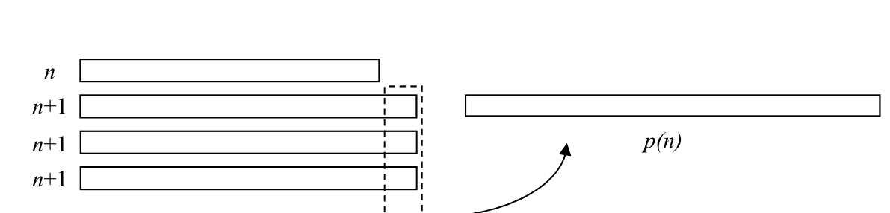

#### 1.2 密码编码

使用伪随机生成器，可以创建具有小密钥大小的安全密码编码。如果你想要防止现实情况下的保护，这些细节会变得复杂。攻击（例如，所谓的选择消息攻击）。但在最简单的层面上，直觉是这样的：我们应该能够通过（1）取一个小的随机密钥，（2）使用PRG将其扩展为更长的密钥，然后（3）将该更长的密钥视为一次性密码本来模拟一次性密码本（在正确使用时是无法破解的）。如果多项式时间的对手能够破解这样的系统，那就意味着对手能够区分PRG的输出和真正的随机字符串，与假设相矛盾。

#### 1.3 单向函数

除了PRGs之外，我们还对一类密切相关的对象感兴趣，称为OWFs，或者单向函数。OWF是一个多项式时间可计算的函数 $f : \{0,1\}^n \rightarrow \{0,1\}^{p(n)}$ 满足对于所有确定性多项式时间算法 $A$，

$$\Pr_{x\in\{0,1\}^n} [f(A(f(x))) = f(x)]$$

是可以忽略的。

或者用更简单的语言来说，OWF是一个易于计算但难以反转的函数。

#### 1.4 姚的极小极大原理

顺便说一句，你可能会想知道为什么我们假设对手 $A$是确定性的而不是概率性的。答案是没有区别！如果你在玩剪刀石头布，而且你知道对手的移动的概率分布，那么总有一种固定的移动方式可以和任何随机策略一样好。同样地，一旦你固定了输入的概率分布 - 就像我们在PRGs和OWFs中所做的那样 - 总有一个确定性算法，其成功概率与任何随机算法一样大。这是（易部分的）姚的极小极大原理，是理论计算机科学中最有用的事实之一。

#### 1.5 伪随机生成器与单向函数之间的关系

声明：每个伪随机生成器也是一个单向函数。为什么？因为如果我们能够反转一个伪随机生成器，那么它就不会是伪随机的！我们会得知存在某个种子生成了输出字符串，这对于一个随机字符串来说，概率最多为1/2。

1997年，Håstad等人证明了相反的方向：如果单向函数存在，则伪随机生成器也存在。这个方向要困难得多（注意，需要对单向函数进行转换，因为很容易给出不是伪随机生成器的单向函数的例子）。由于这个结果，我们现在知道使用小密钥进行私钥加密的可能性基本上等同于单向函数的存在。

### 2 公钥密码学

#### 2.1 抽象问题

假设爱丽丝正在尝试向鲍勃发送一个包裹，以便在途中没有第三方能够打开它。我们假设盒子可以被“锁定”，只有当你有正确的钥匙时才能打开盒子。

如果爱丽丝和鲍勃共享相同的钥匙副本，那么这个问题就很简单：爱丽丝用她的钥匙锁上盒子，然后将其发送给鲍勃，鲍勃用他的钥匙打开盒子。但是如果他们没有共享相同的钥匙，那么问题就变得复杂了。

如果爱丽丝和鲍勃没有共享密钥？显然，我们不希望爱丽丝把包裹放在一个锁着的盒子里，而把打开锁的钥匙放在一个未锁的盒子里！我们似乎面临着无限循环。

幸运的是，有一个简单的解决方案。如图2所示，首先爱丽丝将包裹放入一个盒子中，锁上，并将其发送给鲍勃。然后鲍勃在盒子上再加一个锁，并将其发送回给爱丽丝。然后爱丽丝移除她的锁并将盒子发送回给鲍勃。最后鲍勃移除他的锁并打开盒子。

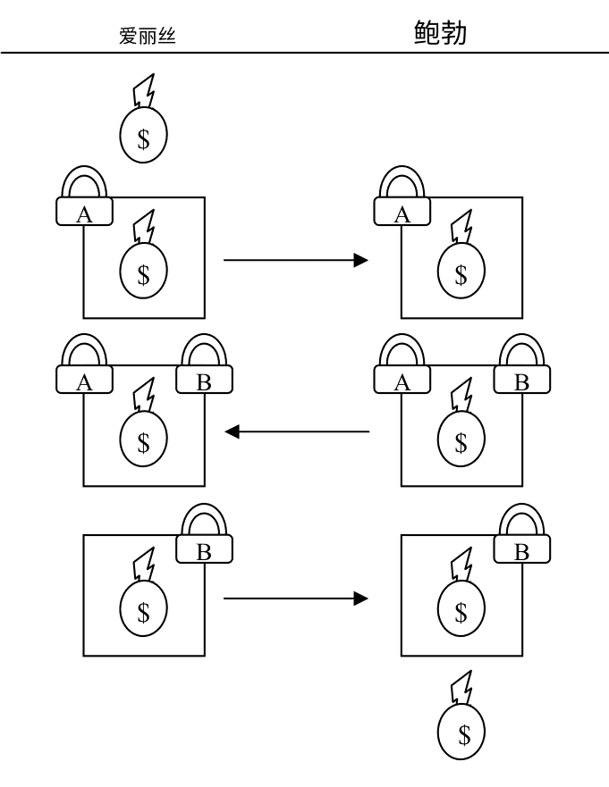

图2：更聪明的方法是爱丽丝和鲍勃始终以至少一种保护形式传递包裹。这确保只有爱丽丝和鲍勃能够打开包裹。

#### 2.2 迪菲-赫尔曼

在爱丽丝和鲍勃发送信息位而不是物理盒子的情况下，我们如何模拟上述协议？关于如何做到这一点的第一个严肃提案是由迪菲和赫尔曼在1976年提出的。

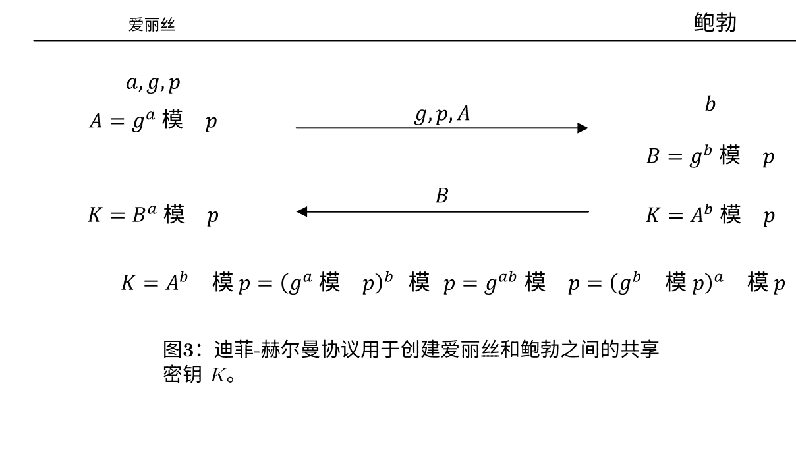

如图3所示的过程始于爱丽丝选择一个大素数 p，一个基数 g和一个秘密整数 a。爱丽丝将计算一个公共数 A = g^a mod p。然后，她将 p，g和 A发送给鲍勃。鲍勃将选择自己的秘密数 b，并发送 B = g^b mod p回给爱丽丝。最后，爱丽丝计算秘密密钥 K为 K = B^a mod p，鲍勃计算为 K = A^b mod p。他们现在拥有相同的密钥，可以用来互相编码消息。

我们已经看到，迪菲-赫尔曼是一种交换密钥的简单方法；然而，在实践中有点繁琐。我们真正希望的是一个涉及更少来回消息的公钥协议，只有一个人需要创建公钥和私钥，而不是两个人。

### 3 RSA

RSA（以及其变种）可能是现代电子商务中使用最广泛的加密协议。与迪菲-赫尔曼类似，它是建立在模运算的基础上的。

#### 3.1 工作原理

如图4所示，该过程比迪菲-赫尔曼更直接。假设你想将你的信用卡号码发送给Amazon.com。然后在最简单的变体中，Amazon选择两个大素数，p和q，并且条件是p-1和q-1都不能被3整除。然后将它们相乘得到N = pq，并将N发送给你。在检索到N后，你计算y = x^3 mod N，其中x是你的信用卡号码，并将y发送回给Amazon。

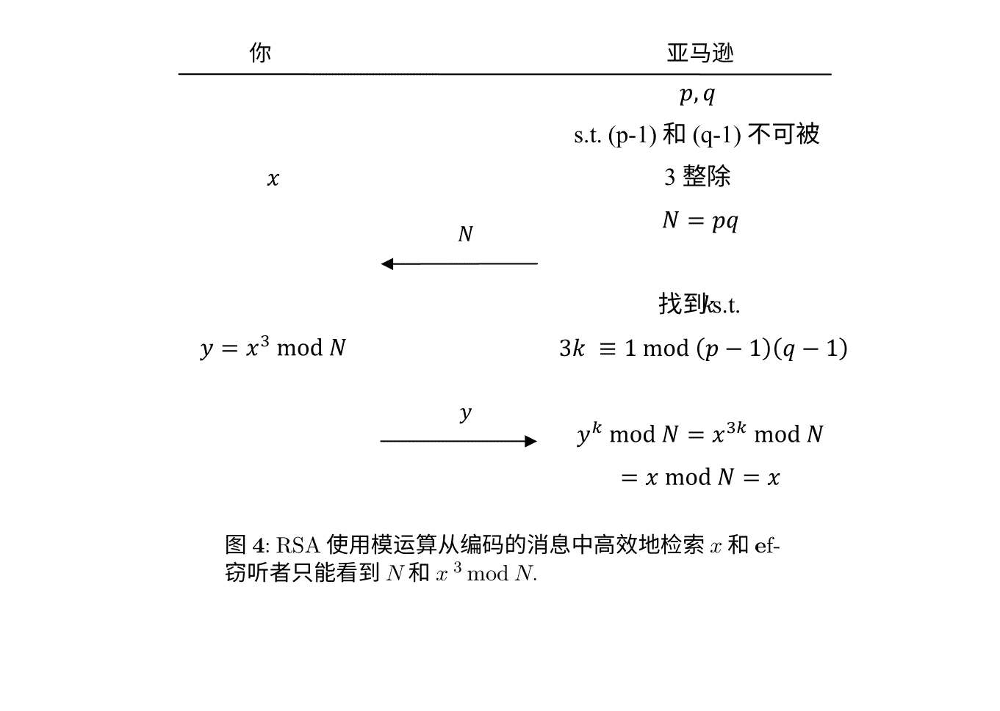

图4: RSA使用模运算从编码的消息中高效地检索x和ef-窃听者只能看到N和x³ mod N.

然后亚马逊面临的问题是如何根据y恢复x。换句话说，如何对N取立方根模数？幸运的是，它可以通过使用其对质因数p和q的知识以及数学家Leonhard Euler在1700年代发现的以下公式来实现:

$$x^{(p-1)(q-1)} \equiv 1 \pmod{N}$$

(为什么这个公式是正确的？基本上，因为(p-1)(q-1)是模N的乘法群的阶，由所有与N互质的从1到N的数字组成。我们不会在这里给出更详细的证明。)

欧拉公式暗示着，如果亚马逊只能找到一个整数k，使得3k = 1 mod (p-1)(q-1)，那么

$$y^k = x^{3k} = x^{c(p-1)(q-1)+1} \equiv x \pmod{N},$$

其中c是某个整数。但是，p-1和q-1都不能被3整除意味着这样的整数k必然存在- 而且k可以在多项式时间内找到，例如使用欧几里得算法。一旦亚马逊有了k，它还可以使用重复平方算法在多项式时间内计算y^k mod N = x。这样它就可以恢复你的信用卡号码x，如所需。

显而易见的问题是，这个系统有多安全？嗯，任何能够将N分解为pq的对手显然可以通过使用与亚马逊相同的算法来解密消息x。因此，整个系统的的基础是假设分解大整数是困难的(如果我们建造了大规模的量子计算机，这个假设将被违反)。当然，任何证明分解是困难的证明也将证明P=NP。

在另一个方向上，你可能会想到：假设分解问题很难，那么RSA安全吗？遗憾的是，这个问题已经存在了30年！尽管它的理论基础不确定，但RSA系统迄今为止已经经受住了所有攻击（与许多其他提出的加密系统不同），今天有数百万人依赖它。

### 1 复习

上次我们讨论了公钥密码学，它属于使用数论实现奇特社会目标的领域。我们的第一个公钥加密系统示例是Diffie-Hellman，其中两个交换消息的人不需要事先见面。然后我们讨论了RSA加密系统，它可能是今天最广泛使用的加密系统。以下是它的基本原理：

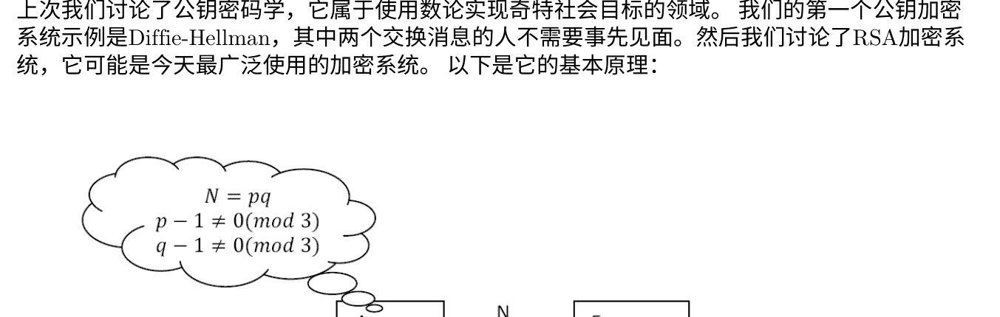

消息的接收者首先采取行动，通过生成两个巨大的素数p和q，并设置N = pq。注意，p和q必须选择得不可被3整除，即p-1和q-1不可被3整除。接收者保密地保留p和q，但向任何询问的人提供N。假设发送者有一条秘密消息x要发送给接收者。发送者计算x^3 mod N并将其发送给接收者。现在轮到接收者恢复消息了。他可以使用一些数论知识以及他知道的p和q，即N的因子。接收者首先找到一个整数k，使得3k = 1 mod (p-1)(q-1)，这可以通过欧几里得算法在多项式时间内完成，然后取(x^3)^k mod N = x^(3k) mod N = x。通过使用重复平方的技巧，指数运算可以在多项式时间内完成。看到这个过程时，你可能会想为什么我们要立方而不是提高到其他幂次方；3有什么特别之处吗？事实证明，3只是方便的第一个选择。平方会导致密文有多个解密（对应于模N的多个平方根），而我们希望解密是唯一的。实际上，如果我们希望平方根是唯一的，那么p-1和q-1不能被2整除，这是一个问题，因为p和q（作为大素数）是奇数！

然而，你可以将其提高到大于3的幂，事实上这通常是人们所做的。如果密码系统的其他组件（例如用随机垃圾填充消息）没有正确实现，那么就会出现一类被称为“小指数攻击”的攻击，这种攻击可以破解具有小指数但不具有大指数的RSA。另一方面，如果其他一切都正确实现，那么据我们所知，x^3 mod N已经是安全的。

就像生物学一样，密码学中的一切总是比你所说的更复杂，无论你说了什么。特别是，一旦你离开了一个干净的数学模型，进入了现实世界，在那里代码有漏洞，硬件无意中泄漏信息等等，总会有进一步的偏执的空间。而密码学家们非常偏执。正如上一节课中提到的，我们知道快速因子分解算法会导致RSA的破解。然而，我们不知道相反的情况：你能否在不进行因子分解的情况下破解RSA？

1979年，Rabin证明了如果你将明文平方 $x$ 而不是立方，那么恢复 $x$ 将和因式分解一样困难。但正如前面讨论的那样，在这种情况下，你将失去每个解密的唯一性。这个问题阻碍了Rabin的变种RSA的广泛应用。

## 2 陷门单向函数

在RSA中， $x^3 \mod N$ 的操作是陷门单向函数的一个例子，或者称为TDOWF。陷门单向函数是具有附加属性的单向函数，即如果你知道一些秘密的“陷门”信息，那么你可以高效地反转它。因此，例如，函数 $f(x) = x^3 \mod N$ 被认为是一个单向函数，但是对于知道 $N$ 的质因数的人来说，很容易反转它。

### 2.1 不同类别的TDOWF

> 现场提问：是否有任何不基于模运算（如RSA）的候选TDOWF？

> 答案：最近研究的一个类别是基于格子的。（严格来说，这个类别中的对象不是TDOWF，而是被称为有损TDOWF，但它们仍然适用于公钥加密。）研究这个类别的动机之一是，如果我们拥有量子计算机，基于模运算的密码系统都可以被破解。相比之下，即使有量子计算机，我们仍然不知道如何破解格子密码系统。然而，目前格子密码系统并没有被广泛使用。问题的一部分是，尽管消息和密钥长度是多项式级别的，但存在大量的多项式膨胀。

因此，这些密码系统被认为不如RSA实用。另一方面，近年来人们提出了更好的构造方法，因此它变得更实用了。还有第三类基于椭圆曲线的公钥密码系统，椭圆曲线密码学目前是实用的。与RSA一样，椭圆曲线密码学基于阿贝尔群，并且像RSA一样，它可以被量子计算机破解。然而，椭圆曲线密码学具有一些不被RSA所共有的良好特性。

总之，我们只知道一些候选的TDOWF类别，而且它们都基于一些有趣的数学。当你要求一个使你的单向函数易于反转的陷门时，你实际上是在寻求一些数学上的特殊性质。几乎可以说，合理的候选者存在似乎是一个偶然事件！相比之下，如果你只想要一个普通的、非陷门的OWF，那么据我们所知，各种“通用”的计算过程都可以对输入进行混淆。

## 3 NP完备性和密码学

几十年来，一个未解决的问题是基于一个NP完备问题构建密码学。然而，有很强的启发式论证表明，如果这是可能的，那么它将需要非常不同的思想，与我们今天所知道的不同。

一个原因（上次讨论过）是密码学需要平均情况的难度，而不是最坏情况。第二个原因是密码学中的许多问题实际上属于类别 $NP \cap coNP$。例如，给定一个加密的消息，我们可以问明文的第一个比特是否为1。如果是的话，解密消息的一个简短证明就是解密消息的一个简短证明就是，如果明文的第一个比特是1。
如果不是这样，那么一个简短的证明也可以解密消息。然而，在 $NP \cap coNP$ 中的问题在最常见的约简下不能成为NP完全问题，除非 $NP = coNP$。

### 3.1 Impagliazzo的五个世界

Impagliazzo的一篇著名论文讨论了计算复杂性和密码学的五个可能的世界，对应于您可以做出的五个不同的假设。你不需要记住这些世界的名字，但我想你可能会喜欢看到它们。

- 1. Algorithmica - $P = NP$ 或者至少存在快速概率算法来解决所有 $NP$ 问题。
- 2. Heuristica - $P = NP$，但是虽然 $NP$ 问题在最坏情况下很难，但在平均情况下很容易。
- 3. Pessiland - NP完全问题在平均情况下很难，但单向函数不存在，因此没有密码学。
- 4. 迷你加密 - 单向函数存在（因此存在私钥密码学、伪随机数生成器等），但没有公钥密码学。
- 5. 密码狂热 - 公钥密码学存在；存在TDOWF。

统治性的信念是我们生活在密码狂热中，或者至少生活在迷你加密中。

## 4 加密的乐趣

### 4.1 消息认证

除了加密消息，你能证明消息确实来自你吗？回想一下，我们看到的第一个像样的加密系统一次性密码本。表面上，一次性密码本似乎提供了身份验证作为一个附带的好处。回想一下，这个系统涉及你和一个朋友共享一个秘密密钥 $k$，你通过发送 $y = x \oplus k$ 来安全地传输一个消息 $x$，然后你的朋友通过计算 $x = y \oplus k$ 来解码消息。你的朋友可能会这样推理：如果发送消息的人不是你，那么为什么 $y \oplus k$ 会产生一个可理解的消息而不是一堆乱码？

这个论点中存在一些漏洞（看看你能否发现），但基本思想是正确的。

然而，要实现这种身份验证，你确实需要对方与你共享一个秘密，在这种情况下就是密钥。这就象兄弟会的秘密握手。

按照私钥与公钥加密的类比，我们可以问是否存在公钥身份验证。也就是说，如果一个人相信某个公钥 $N$ 来自于你，那么他或她应该能够相信你发送的任何进一步的消息也来自于你。作为一个附带的好处，RSA给了你这种自我认证的能力，但我们不会深入讨论细节。

### 4.2 计算机科学家和约会

一旦你拥有像RSA函数这样的密码原语，你就可以玩各种游戏。例如，Alice和Bob想要弄清楚他们是否彼此对约会感兴趣。然而，作为害羞的计算机科学家，他们只有在彼此都感兴趣的情况下才能知道彼此喜欢对方；如果其中一个人不感兴趣，那么他就不应该知道另一个人感兴趣。

一个明显的解决方案（有时在实践中使用）是引入一个可信任的共同朋友，卡尔，但是艾丽斯和鲍勃必须相信卡尔不会泄露秘密。显然有一些网站提供这种功能。然而，理想情况下，我们不希望依赖第三方。

现场建议：艾丽斯和鲍勃可以闭着眼睛面对面，只有在他们感兴趣的情况下才睁开眼睛。

回应：如果两个人都不感兴趣，那么似乎存在终止问题！此外，我们希望不需要物理接近的协议 - 请记住他们是害羞的计算机科学家！

#### 4.2.1 约会协议

所以假设艾丽斯和鲍勃只是在他们的计算机上互发消息。如果我们对计算复杂性不做任何假设，那么约会任务显然是不可能的。
为什么？直观上很“明显”：因为最终他们中的一个人将不得不说什么，而还不知道他或她的兴趣是否会得到回应！事实上，我们可以将这种直观的论证更加形式化。

所以我们需要一个密码学假设。特别是，让我们假设RSA是安全的。
暂时假设爱丽丝和鲍勃是密码学家所谓的诚实但好奇的人。换句话说，我们假设他们都可以被信任地正确遵循协议，但他们也会尽可能从他们看到的任何消息中获取尽可能多的信息。稍后我们将看到如何消除诚实但好奇的假设，以获得一个即使一个玩家试图作弊也是有效的协议。

在我们给出协议之前，可能需要三点进一步的说明。首先，爱丽丝和鲍勃之间进行约会协议的事实本身，可能被视为他们感兴趣的初步证据！所以如果有帮助的话，你可以想象爱丽丝和鲍勃在一个单身派对上，每对人都必须进行协议。其次，任何协议都不可避免地具有这样一个特点：如果一个玩家感兴趣而另一个玩家不感兴趣，那么感兴趣的那个玩家将会得知另一个玩家不感兴趣。（为什么？）第三，不可避免的是，一个玩家可以假装对某事感兴趣，然后在得知另一个玩家的兴趣后说：“哈哈！我不是认真的。只是想知道你是否感兴趣。”

换句话说，我们不能指望密码学解决心碎的问题，或者人们的恶劣行为问题。我们只能要求它确保每个玩家在不表达兴趣的情况下，无法得知对方是否表达了对他们的兴趣。

那么，不再拖延，下面是艾丽斯和鲍勃如何解决约会问题的方法：

- 1. 艾丽斯按照标准程序选择两个巨大的质数，\(p\) 和 \(q\)，使得 \(p-1\) 和 \(q-1\) 都不能被 \(3\) 整除，然后取 \(N = pq\)。她保密 \(p\) 和 \(q\)，但将 \(N\) 连同某些 \(x\) 和 \(y\) 的 \(^3 \mod N\) 发送给鲍勃。如果她对此不感兴趣，则 \(x\) 和 \(y\) 都是0，上面还有随机垃圾填充。如果她对此感兴趣，则 \(x\) 再次为0，上面还有随机垃圾，但 \(y\) 为1，上面还有随机垃圾。
- 2. 假设RSA是安全的，Bob（不知道 $N$ 的质因数）不知道如何高效地进行 $N$ 的立方根取模运算，所以 $x^3 \mod N$ 和 $y^3 \mod N$ 在他看来都是完全随机的。Bob做了以下操作：他首先从0到 $N-1$ 中选择一个随机整数 $r$。然后，如果他对Alice不感兴趣，他会发送 $x^3 r^3 \mod N$。如果他对Alice感兴趣，他会发送 $y^3 r^3 \mod N$。
- 3. Alice对Bob发送的任何数字进行立方根运算。如果Bob对Alice不感兴趣，这个立方根将是 $xr \mod N$，而如果他对Alice感兴趣，这个立方根将是 $yr \mod N$。无论如何，对于Alice来说，结果看起来都是完全随机的，因为她不知道 $r$（它是随机选择的）。然后，她将立方根发送回给Bob。
- 4. 由于鲍勃知道 $r$，他可以除掉 $r$。我们可以看到，如果鲍勃对此不感兴趣，他只会得到 $x$，这对于阿丽斯的兴趣没有任何线索。否则，他会得到 $y$，只有当阿丽斯感兴趣时才为1。

所以，至少从原则上讲，计算机科学家已经解决了害羞人士的调情问题（假设RSA是安全的）。对于计算机科学家来说，这真的是非平凡的。然而，这只是一个例子，被称为安全多方计算的一般理论在20世纪80年代得到了发展，可以解决几乎所有这类问题。所以举个例子：假设两个人想要找出谁赚更多的钱，但是又不想对方了解到其他关于财富的信息。或者一群朋友想要知道他们总共有多少钱，而不会有人透露自己的金额。所有这些问题，以及更多其他问题，都已经被加密学上认为是可以解决的。

## 5 零知识证明

### 5.1 动机

在我们的约会协议中，我们做出了一个关键的假设，即爱丽丝和鲍勃都是“诚实但好奇”的，即他们都正确地遵循协议。我们现在想要摆脱这个假设，并且使协议即使其中一个玩家作弊也能正常工作。（当然，如果他们都作弊，我们无能为力。）

正如前面讨论的，我们不关心鲍勃假装喜欢爱丽丝只是为了弄清楚她是否喜欢他的情况。没有密码协议可以帮助鲍勃成为一个混蛋，我们只能希望他会被抓住。相反，我们关心的情况是其中一个玩家看起来像是在遵循协议，但实际上只是想弄清楚另一个玩家的兴趣。

我们需要的是爱丽丝和鲍勃在协议的每个步骤中向对方证明他们正确地遵循协议 - 即根据他们的兴趣与否发送他们应该发送的任何消息。问题是，他们必须在不透露他们的兴趣与否的情况下这样做！抽象地说，问题是如何在不透露证明所依赖的关键信息的情况下向某人证明某事。

### 5.2 历史

自1980年代以来，零知识证明一直是密码学中的一个重要思想。它们由Goldwasser、Micali和Rackoff于1985年引入。有趣的是，他们的论文在发表之前被多次拒绝，但现在是理论计算机科学的基础论文之一。

### 5.3 交互式证明

几千年来，数学家接受的证明定义是一系列逻辑推导，可以与任何人共享，以使他们相信一个数学真理。但是，在过去几十年的理论计算机科学的发展中，需要将证明的概念推广到任何一种可以以某种方式终止的计算过程或交互过程，只有在要证明的陈述为真时才能终止。零知识证明属于后一种类别，我们将在下面看到。

### 5.4 简单示例：图的非同构性

为了解释零知识证明的概念，最好从一个具体的例子开始。最简单的例子涉及图同构问题。在这里，我们给出了两个图G1=（V1，E1）和 G2=（V2，E2），它们通过它们的边和顶点的列表来定义。如果有一种方法可以对它们的顶点进行排列，使它们成为相同的图，则这些图被称为同构的。

#### 5.4.1 复杂性

很明显，图同构问题属于 NP 类，因为证明 G1和 G2是同构的简短证明只需指定同构（即，G1和 G2之间的顶点的映射）。图同构是否属于 P？它是否是 NP 完全的？我们目前还不知道这两个问题的答案，尽管我们有强有力的证据表明它不是 NP 完全的。具体来说，我们知道如果图同构是 NP 完全的，则NP = coNP，或者说“多项式层次结构崩溃”（证明这个陈述超出了课程的范围）。一些计算机科学家猜测图同构问题介于 P 和 NP 完全之间，就像我们相信因子分解问题一样。其他人猜测图同构属于 P，我们只是对图还不够了解，无法给出一个算法。（请注意，我们对图同构有高效的算法，在实践中非常有效，但我们无法证明这些算法在所有情况下都有效。）

作为一个有趣的旁注，据说Levin不是第一个在NP-完备性上发表论文的原因是他陷入了试图证明图同构问题是NP完备的困境。

#### 5.4.2 证明不存在同构

我们之前说过图同构问题属于NP。但它是否属于coNP呢？也就是说，你能否给出一个简短的证明来证明两个图不是同构的？显然，枚举所有可能性是行不通的，因为它的效率是指数级的（有n!种可能的映射）。直到今天，我们仍然不知道图同构问题是否属于coNP（尽管最近有一些深入的研究结果表明它是）。

不过，让我们看看一个非常简单的方法，一个全知的证明者如何能够说服一个多项式-时间的验证者两个图不是同构的。 为了说明，考虑可口可乐和百事可乐。假设你声称这两种饮料是不同的，但我坚持它们是相同的。 除了给我两种饮料的化学式之外，你如何说服我你是对的呢？通过进行盲品测试！如果我蒙上你的眼睛，你能可靠地分辨出哪个是哪个，那么你就说服了我它们一定是不同的，即使我不明白为什么。

相同的思想适用于证明 G₁ 和 G₂ 不同构。假设你是一个拥有无限计算能力的巫师，但你要说服的人没有。这个人可以随机选择其中一个图，并以随机的方式对顶点进行排列，形成一个新的图 G'，然后将 G' 发送给你，并询问她最初使用的是哪个图。如果这些图确实不同构，那么你每次都能正确回答，而如果 G₁ 和 G₂ 是同构的，那么你猜对的机会最多为1/2（因为 G₁ 的随机排列与 G₂ 的随机排列相同）。如果验证者重复这个测试100次，而你每次都回答正确，那么她可以非常有信心（即1 - 2^{-100}）地确定这些图不同构。

但是请注意一些有趣的事情：尽管验证者确信了，但她这样做并没有获得任何关于 G₁ 和 G₂（例如，她可以说服其他人它们不是同构的）的新知识！换句话说，如果她只是相信你，那么她可以在自己身上模拟她与你的整个互动，而不需要你的参与。任何具有这种特性的交互式证明系统 - 即证明者只告诉验证者后者“已经知道”的东西 - 被称为零知识证明系统。

（诚然，如果验证者“诚实” - 也就是说，如果她正确地遵循协议 - 那么显然她不会学到任何东西。可以想象，违反协议的不诚实验证者可能会在开始时学到一些她不知道的东西。这是我们以后会再次看到的一个区别。）

### 5.5 一般情况

我们如何将这种零知识证明的概念扩展到除了图同构之外的任意问题？例如，假设你已经证明了黎曼猜想，但你很偏执，不想让其他人知道你的证明。这听起来可能很傻，但实际上这就是中世纪数学家的工作方式：每个人都知道如何解决某个方程，但不想向竞争对手透露解决它的一般方法。

所以假设你有一个任意命题的证明，并且你想说服别人你有一个证明，而不透露任何细节。事实证明，有一种方法可以将任何数学证明转化为零知识形式；而且，这种转化甚至可以在多项式时间内完成。然而，我们需要进行密码学假设。

### 5.6 Goldreich-Micali-Wigderson

在接下来的内容中，我们将假设你的证明以机器可检查的形式书写，使用类似泽尔梅洛-弗兰克尔集合论的形式系统。我们知道，THEOREM，即在最多n个符号中证明一个定理的问题，是一个NP完全问题，因此可以有效地归约到任何其他NP完全问题。因此，我们只需要找到一个NP完全问题，可以证明我们有一个解决方案，而不透露解决方案。在成千上万个已知的NP完全问题中，事实证明对于我们的目的来说，最方便的问题将是三色图问题。

#### 5.6.1 三色染色证明

假设我们有一个图的三色染色，并且我们想要证明我们有这个三色染色而不泄露它。此外，假设对于图的每个顶点，都有一个神奇的盒子可以存储该顶点的颜色。这些盒子的神奇之处在于我们可以打开它们，但验证者不能。关键点在于，通过将颜色存储在盒子中，我们可以对其进行“承诺”：也就是说，我们可以向验证者保证我们事先选择了每个顶点的颜色，并且不仅仅是根据她提出的问题来编造的。

使用这些盒子，我们可以执行以下协议：

- 1. 从图的三色染色开始；然后随机排列顶点的颜色。有3! = 6种排列颜色的方式。例如，红色⇒绿色，绿色⇒红色，蓝色保持不变。
- 2. 将每个顶点的颜色写在一张纸上，并将其放入标有该顶点编号的魔盒中。将所有的魔盒交给验证者。
- 3. 让挑战者选择任意两个相邻的顶点，并打开对应的魔盒。
- 4. 丢弃魔盒，并根据需要重复整个协议。

如果我们真的有一个图的3着色方案，那么验证者每次选择两个相邻的顶点时，都会看到两种不同的颜色。另一方面，假设我们撒谎了，没有一个3着色方案。那么最终验证者会发现一个冲突。请注意，边的数量为O(n^2)，其中n是图的顶点数。因此，由于我们提前确定了颜色，如果我们撒谎，就有一个Ω(1/n^2)的概率被抓住。通过重复整个协议，比如说重复n^3次，验证者可以将捕捉谎言的概率指数级地接近1，因此（假设一切正常）可以对我们的说法产生指数级的信心。

另一方面，由于我们随机排列颜色并每次重新洗牌，验证者对实际的三色着色一无所知；她每次只看到两种不同的随机颜色，因此不会获得任何知识！

当然，整个协议依赖于“魔法盒子”的存在。那么如果我们没有可用的魔法盒子呢？如果我们只是通过互联网来回发送消息，有没有办法模拟它们的功能呢？

是的：使用密码学！我们可以将每个顶点的颜色加密并发送给验证者加密的消息。然后，当验证者选择两个相邻的顶点并要求我们提供它们的颜色时，我们可以解密相应的消息（但不能解密其他顶点的加密消息）。为了使其工作，我们只需要确保两件事：

- 1. 一个多项式时间验证者不应该能够从加密的消息中学到任何东西。特别是，这意味着即使两个顶点被着色相同，相应的加密消息应该看起来完全不同。幸运的是，这很容易实现，例如通过在加密之前用随机垃圾填充颜色数据。
- 2. 在最后一步中，当我们解密两个选择的消息时，我们应该能够向验证者证明消息被正确解密了。换句话说，每个加密消息应该有且只有一个解密。正如前面讨论的，最流行的公钥加密系统，如RSA，通过构造满足这个属性。但即使有更多的“通用”加密系统（基于任意单向函数），已知如何通过增加更多的通信轮次来模拟唯一解密属性。

#### 5.6.2 回到约会

回想一下我们在讨论零知识时的最初目标：我们希望使约会协议能够正确运行，即使爱丽丝或鲍勃可能在作弊。我们该如何做到这一点？ 首先，让爱丽丝和鲍勃互相发送加密消息，编码了他们是否对彼此感兴趣，以及他们的秘密数字 p, q, 和 r。 然后，让他们按照之前的约会协议进行，但增加一个步骤：在每个步骤中，玩家不仅发送协议中要求的消息，还提供一个零知识证明，证明这确实是他们应该发送的消息——根据之前的消息序列、是否感兴趣以及p、q、 r。 请注意，这是可能的，因为解密所有加密消息并验证协议是否正确遵循是一个NP问题，因此可以归约到SAT问题，进而归约到3-Coloring问题。 而且根据定义，零知识证明不会泄露任何关于爱丽丝和鲍勃的私人信息，因此协议仍然是安全的。

为了澄清一点，我们不知道如何使用任意的OWF来实现这个约会协议，只知道如何实现其中的GMW部分（使协议对作弊的Alice或Bob安全）。要实现协议本身，我们似乎需要一个更强的假设，比如RSA的安全性或类似的东西。（事实上，我们甚至不知道如何使用任意的trapdoor OWF来实现约会协议，尽管如果我们进一步知道trapdoor OWF是一个置换，那么是可能的。）

## 1. 上一讲的回顾和讨论

在上一讲中，我们讨论了不同的密码协议。人们问道：“在RSA加密系统中，为什么要使用大于三的幂次？”大于三的幂次是一种额外的预防措施；就像在你的门上加一个第二把锁。如果一切都实现正确，我们讨论的RSA（对消息进行立方运算（mod n））应该是没问题的。

这假设你的消息已经适当地填充。如果你的消息没有被填充，“小指数攻击”可能会成功破解RSA；将消息发送给一群不同的接收者，每个接收者都有不同的公钥，攻击者可以利用小指数。将幂次大于三的数进行运算可以减轻这种风险。

还有一些其他的攻击可能会成功。“时序攻击”观察计算机生成数字所花费的时间长度，以获取关于这些数字的提示。其他攻击可以观察计算机发出的电磁波，试图获取关于数字的提示。然后还有一些滥用密码系统的攻击，通过构造输入并根据收到的错误消息来确定系统的一些信息。一般来说，现代密码系统最常被攻击者击败的是在系统的实现中发现的错误，而不是系统本身。社交工程仍然是最成功的突破安全的方式；通常只需打电话给某人，假装是公司的技术支持人员，并要求他们的密码，就能得到回应。

在上一堂课中，我们还讨论了零知识证明和一般交互协议。二十年前，“证明”的概念发生了革命，这表明证明不必仅仅是一组静态符号，供他人检查准确性。例如，证明可以是一个交互过程，最终使你相信一个陈述的真实性，而不需要学到其他太多的东西。我们给出了两个所谓的零知识协议的例子：一个使验证者相信两个图不同构，另一个在假设单向函数的存在下证明任何陈述的短传统证明。

## 2 更多的交互证明

事实证明，这种交互证明的概念不仅适用于密码学。在1990年代初发现，交互证明可以使你相信解决比我们认为更困难的问题，比如NP完全问题。类比一下，仅仅通过阅读一篇研究论文很难判断作者是否知道自己在谈论什么。如果你有机会随便问他问题，而他能正确回答，那就更有说服力了。

同样，如果你能与证明者来回发送消息，你能否利用这一点来说服自己不仅仅是解决一个NP-完全问题的解决方案？为了研究这个问题，人们在20世纪80年代定义了一个复杂性类别，称为IP，它代表“交互证明”。这个故事的细节超出了课程的范围，但提到它是因为它很重要。

考虑以下情景。梅林和亚瑟正在交流。梅林拥有无限的计算能力，但他不值得信任。亚瑟是一个PPT（概率多项式时间）国王；他可以抛硬币，生成随机数，与梅林来回发送消息等。我们对一个好的协议的要求是：如果梅林说的是真的，那么应该有一种梅林的策略使得亚瑟以1的概率接受。另一方面，如果梅林撒谎，那么无论梅林的策略如何，亚瑟应该以大于1/2的概率拒绝。这些对应于我们之前讨论的完备性和正确性的属性。

IP有多大？它肯定包含NP，因为梅林的策略可以是将解决方案发送给亚瑟进行检查和批准。然而，IP比NP更大吗？与普通证明相比，互动能让你验证更多的陈述吗？1990年，Lund、Fortnow、Karloff和Nisan证明了IP也包含coNP。这并不明显；证明中的关键思想涉及如何通过在随机点上测试它们来判断有限域上的多项式是否相等。这个定理利用了这个事实，以及你可以将布尔公式重新解释为有限域上的多项式。一个更大的炸弹在一个月后爆炸，Shamir证明了IP包含整个类PSPACE，即可以用多项式内存解决的问题。由于已知IP包含在PSPACE中，这就得到了著名的结果IP = PSPACE。

这个结果在直观上意味着什么？假设一个外星人来到地球并说：“我可以下完美的国际象棋。”你和外星人下棋，结果外星人赢了。但这并不令人太惊讶，因为你在国际象棋方面并不是很好（至少在这个例子中是这样）。然后外星人接连挑战你当地的冠军、卡斯帕罗夫、深蓝等等，它都战胜了他们。但仅仅因为外星人能够战胜地球上的任何人，并不意味着它能够战胜宇宙中的任何事物！外星人有没有办法证明更强的主张呢？

嗯，还记得我们之前提到过，一个广义的N×N版本的国际象棋是一个PSPACE问题。因此，我们可以将国际象棋转化为关于有限域上的多项式的游戏。在这个转化后的游戏中，其中一位玩家的最佳策略将是随机移动。因此，如果你在这个转化后的游戏中随机对抗外星人并且外星人赢了，你可以确信（只有指数级小的错误概率）它有一个最优策略，并且可以战胜任何人。

你应该了解这个结果，以及3-着色的零知识协议，因为它们是计算复杂性理论中我们唯一的两个例子，你可以利用它们来处理一个NP-完全或PSPACE-完全问题，并且可以对其进行一些实际的利用（而不仅仅将其视为一般的搜索问题）。而且已经知道，在这种方式中利用结构——毫无疑问，以一种天文数字级别的先进水平——将来总有一天需要解决P = NP问题。

## 3 机器学习

到目前为止，我们只讨论了那些所有信息都明确给出的问题，你只需要对其进行一些操作。这就像拿到一本语法教科书，被问到一个句子是否符合语法。然而，把那本教科书给一个婴儿，它只会在上面流口水；人类学会说话、走路和其他非常困难的事情（比麻省理工学院教授的任何东西都要困难），而从来没有明确告诉他们如何做。显然，如果我们想要理解人脑，这是我们必须面对的问题。我们之前谈到过计算机科学是从人们对最终理解思维过程的梦想中发展起来的：你能将其归纳为一种机械过程，或者自动化吗？那么，在某个时候，我们将不得不面对学习的问题：从具体的例子中推断出一般规则，即使规则从未明确给出。

### 3.1 学习的哲学

一旦我们尝试思考学习，我们就会遇到一些深刻的哲学问题。其中最著名的是18世纪苏格兰哲学家大卫·休谟提出的归纳问题。考虑两个假设：

1.  太阳每天早上升起。
2.  太阳每天早上升起，直到明天它会变成死星并坠入木星。

休谟指出，这两个假设在我们迄今为止的所有数据上都是完全兼容的。它们都能很好地解释我们拥有的数据。我们显然更相信第一个假设而不是第二个，但我们有什么理由偏向于其中一个呢？

有些人说他们相信太阳会升起，因为他们相信物理定律，但问题是他们为什么相信物理定律会继续存在。

再举一个例子，这是一个关于为什么不可能学习一门语言的“证明”，由奎恩提出。假设你是一位人类学家，正在访问一个土著部落并试图学习他们的语言。部落中的一个土著指着一只兔子说“gavagai”。你能推断出“gavagai”是他们对兔子的称呼吗？也许gavagai是他们对食物或晚餐的称呼，或者是“小棕色的东西”。通过与他们更长时间的交谈，你可以排除这些可能性，但还有其他你尚未排除的可能性，而且将会有更多。也许它在工作日意味着“兔子”，但在周末意味着“鹿”，等等。

有没有办法解决这个问题？对，我们可以遵循奥卡姆剃刀原则：如果有不同的假设能够同样好地解释数据，我们选择最简单的那个。

这里有一种稍微不同的说法。上述思想实验真正展示的不是学习的不可能性，而是在理论空间中学习的不可能性。每当我们尝试学习某事时，我们心中都有一些假设，这些假设远远小于所有逻辑上可想象的假设的集合。“gavagai”意味着“兔子”是一个合理的假设；工作日/周末的假设似乎不合理，所以我们可以忽略它，直到有证据迫使我们接受它。

那么，我们如何区分可信的假设和不可信的假设呢？奥卡姆剃刀似乎与这个问题有关。特别是，我们想要的是比解释数据所需的原始数据更简单的假设，即比仅仅写下原始数据所需的位数更少的假设。如果你的假设非常复杂，并且每次出现新的数据点时都必须修正你的假设，那么你可能做错了什么。

当然，拥有一个能够使所有这些问题变得精确和定量的理论将是很美好的。

### 3.2 从哲学到计算机科学

这是一个并不完全明显的观点，但学习和预测的问题与数据压缩的问题有关。预测未来的一部分是对过去发生的事情进行简洁描述。一个哲学家会问为什么会这样，但可能没有答案。相信宇宙存在简单的法则一直是一个相当成功的假设，至少目前是这样。举个例子，如果你敲了五分钟的门，它还没有打开，一个理智的人不会期望下一次敲门时它会打开。这几乎可以被认为是理智的定义。

如果我们想要构建一台能够做出合理决策、学习等等的机器，我们真正寻找的是一台能够创建简单、简洁描述和假设来解释它所拥有的数据的机器。那么，什么是“简单”的描述呢？一种很好的定义方法是科尔莫哥洛夫复杂性；简单的描述是指对应于具有少量状态的图灵机。这是许多人采取的方法。这种方法的根本问题是科尔莫哥洛夫复杂性是不可计算的，所以我们实际上不能使用它。我们想要的是一个定量理论，能够让我们处理任何我们可能提出的“简单”定义。那么问题就是：“在一些假设类别中，如果我们想要能够预测未来90%的数据，我们需要看到多少数据？”这就是理论计算机科学的真正用武之地，特别是计算学习理论领域。在这个领域中，我们将讨论瓦利安特于1984年提出的一种学习模型：PAC（可能近似正确）模型。

### 3.3 PAC学习

为了理解这个模型的全部内容，最简单的方法可能就是举个例子。假设黑板上有一条隐藏的线。给定黑板上的一个点，我们需要判断它是在线的上方还是下方。为了帮助，我们会得到一些样本数据，这些数据由黑板上的随机点和每个点是在线的上方还是下方组成。在看到，比如说，二十个点之后，你可能不会准确地知道线在哪里，但你可能大致知道它在哪里。并且利用这个知识，你将能够预测大多数未来的点是在线的上方还是下方。

假设我们已经同意“大部分时间”预测正确的答案是可以接受的。任意随机选择二十个点会给你这种能力吗？不会，因为你可能在样本数据上非常不幸，它几乎无法告诉你线在哪里。因此PAC中的“可能性”就体现出来了。

作为另一个例子，你可以一辈子说一种语言，但仍然会有你不熟悉的语法边界或者你构造错误的句子。这就是PAC中的“近似”。继续以这个例子，如果你作为一个婴儿非常不幸，只听到一句话，你将不会学到很多语法知识（这又是“可能性”）。

假设不是隐藏的线，而是隐藏的波浪线，一边长为1，另一边长为2。仅凭现有数据，很难预测波浪线的走向。如果你的假设类是任意的波浪线，似乎不可能找到一个甚至可能近似正确的假设。但是线和波浪线之间有什么区别，使得其中一个可以学习而另一个不可学习？

无论有多少点，你总是可以找到一个适用于这些点的波浪线，而对于直线来说则不成立。这似乎与问题有关，但为什么呢？计算学习理论能够数学地描述一类假设的可学习性或不可学习性（我们稍后会讨论）。

### 3.4 框架

这是Valiant的PAC学习理论的基本框架，在我们的黑板上画线的例子中：

- S: 样本空间 - 黑板上所有点的集合。
- D: 样本分布 - 从中抽取点的概率分布（在我们的例子中是均匀分布）。
- 概念 - 一个函数 $h: S\to\{0,1\}$，将每个点映射为0或1。 在我们的例子中，每个概念对应一条直线。
- $C$: 概念类 - 所有可能的线的集合。
- “真实概念” $c \in C$: 实际隐藏的线；你试图学习的东西。

在这个模型中，根据 $D$从 $S$中给出一堆样本点，并且每个点都带有它的分类。 你的目标是找到一个假设 $h \in C$，它能够几乎所有时间都正确地对未来的点进行分类： $Pr_{x\in D}[h(x) = c(x)] \geq 1 - \epsilon$。

请注意，你测试的未来点应该是从相同的概率分布$D$中抽取的。 这是哲学中“未来应该遵循过去”的数学编码；它还编码了一个众所周知的格言：“测试中不应该出现课堂上没有涉及的内容。”

正如之前讨论的，我们无法确定地实现我们的目标，这就是为什么它被称为可能近似正确学习。 相反，我们只要求在选择样本点时至少以概率$1 – \delta$成功找到一个好的分类器。

还有一个问题：假设 $h$必须属于概念类 $C$吗？ 实际上有两个概念，我们将讨论两者：正确学习 ($h$必须属于 $C$)和不正确学习 ($h$可以是任意的)。

这些是这个理论的基本定义。

现场提问：有些人设计学习算法时会输出置信度概率和它们的分类吗？

当然！你还可以考虑试图预测实值函数输出的学习算法等。 二元分类只是最简单的学习场景 - 因此，专注于它是建立我们直觉的一个好场景。

### 3.5 样本复杂度

计算学习理论中的一个关键问题是样本复杂度。 给定一个概念类$C$和一个学习目标（准确度和置信度参数 $\epsilon$ 和 $\delta$），你需要多少样本数据才能达到目标？ 希望样本数量 $m$是一个有限的数，而且更希望它是一个小有限数。

Valiant提出了以下定理，用于有限概念类，它给出了样本数量的上界：

$$m \geq \frac{1}{\epsilon} \log \frac{|C|}{\delta}$$

当 $\epsilon$变小（即我们需要一个更准确的假设）时，我们需要看更多的数据。 当我们的概念类中有更多的概念时，我们也需要看更多的数据。

实现Valiant的上界的学习方法很简单：找到任何适合所有样本数据的假设，并输出它！只要你见过 $m$个数据点，定理就说至少以$1 – \delta$的概率，你将拥有一个能预测未来数据至少$1 – \epsilon$分数的分类器。 对于 $\frac{1}{\delta}$，只有对数依赖性，这意味着我们可以在指数级小的错误概率下使用多项式数量的样本进行学习。 对于概念数量$|C|$，也存在对数依赖性，这意味着即使我们的概念类中存在指数级数量的概念，我们仍然可以用多项式数量的数据进行学习。如果这不是真的，我们真的会陷入麻烦。

下次: Valiant界限的证明，VC维度等等...

## 可能近似正确学习

在上一讲中，我们介绍了Valiant的“可能近似正确”(PAC)学习模型。这涉及到：

- S: 一个样本空间（例如，所有点的集合）
- D: 一个样本分布（样本空间中的概率分布）
- c: S→{0,1}: 一个概念，接受或拒绝样本空间中的每个点
- C: 一个概念类或概念集合

例如，我们可以将样本空间取为黑板上所有点的集合，将样本分布取为均匀分布，将概念类取为每条线对应一个概念（如果点在线上方则接受，否则拒绝）。给定一组点，以及哪些点被接受或拒绝，我们的目标是输出一个能解释数据的假设：例如，画一条线能正确分类大部分未来的点。

更正式地说，我们试图学习的是某个“真实概念” c ∈ C。给定样本点 x1, ..., xm，它们独立地从 D中抽取，以及它们的分类c(x1), ..., c(xm)，我们的目标是找到一个假设 h ∈ C，使得

$$Pr[h(x) = c(x)] \geq 1 - \epsilon$$

此外，我们希望以至少1−δ的概率成功实现这个目标，无论选择哪个xi。换句话说，我们希望以很高的概率输出一个近似正确的假设（因此称为“可能近似正确”）。

### 学习一个有限类需要多少样本？

我们可以问的第一个问题是样本复杂度：我们需要看到多少样本才能有效地学习一个概念？证明以下定理并不难：在我们看到

$$m = O\left( \frac{1}{\epsilon} \log \frac{|C|}{\delta} \right)$$

从 D中抽取的任何样本，任何与这些样本一致的假设（即对于所有的i，h(xi)=c(xi)）都将满足

$$Pr[h(x) = c(x)] \geq 1 - \epsilon$$

在选择 x1, ..., xm 时，至少以概率1−δ的概率。

我们可以通过反证法证明这个定理。设 h ∈ C 是任意的“坏”假设：即 Pr[h(x) = c(x)] < 1−ϵ。然后，如果我们从样本分布 D中独立地选择 m个点，假设 h在这些点上的正确率最多为(1−ϵ)^m。因此，根据并集界，存在一个坏假设在 C中，尽管如此，它与我们所有的样本数据一致的概率最多为 |C|(1−ϵ)^m (假设的数量，无论好坏，乘以每个坏假设与样本数据一致的最大概率）。现在我们只需要进行代数运算：

$$
\delta = |C|(1 - \epsilon)^m \\
m = \log_{1-\epsilon} \frac{\delta}{|C|} \\
= \frac{\log (\delta / |C|)}{\log (1 - \epsilon)} \\
\approx \frac{1}{\epsilon} \log \frac{|C|}{\delta}.
$$

请注意，总是存在一个与样本点上的 c一致的 C假设：即，c本身（即真相）！因此，作为我们的学习算法，我们可以简单地执行以下操作：

1.  找到与所有样本数据一致的 C中的任何假设（即，对于所有的 $x_1, \ldots, x_m$，$h(x_i) = c(x_i)$）。
2.  输出 $h$。

这样的 h总是存在的，并且根据上面的定理，它可能是一个好的假设。我们只需要看足够多的样本点。

### 学习一个无限类需要多少样本？

这个公式

$$m \approx \frac{1}{\epsilon} \log \frac{|C|}{\delta}$$

只要 $|C|$是有限的，这个方法就有效，但是当 $|C|$是无限的时候，它就失效了。我们如何形式化地表达直线的概念类是可学习的，而任意曲线的概念类是不可学习的这个直觉呢？如果我给你一些随机的少量点，并告诉你每个点是在直线的上方还是下方，猜测直线似乎很容易（至少是近似地）。但是如果我告诉你这些点在一个曲线的一侧，那些点在另一侧，无论我给你多少点，似乎都无法预测下一个点会在哪一侧。那么这两种情况之间有什么区别呢？不能是直线的数量与曲线的数量的区别，因为它们都是无限的（并且可以被认为具有相同的无限基数）。

从地板上：区别只是你需要两个参数来指定一条线，但是需要无限多个参数来指定一个波浪线吗？那就接近了！问题是“参数”的概念在理论中并不存在；这是我们自己需要插入的东西。换句话说，可能会有愚蠢的参数化方式，即使一条线也需要无限多个参数来指定，也可能会有巧妙的参数化方式，只需要一个参数就可以指定一个波浪线。

嗯，答案并不明显！最终回答这个问题的思想被称为 $VC$-维度（以其发明者 Vapnik 和 Chervonenkis 的名字命名）。我们说点集 $x_1, \ldots, x_m$ 被概念类 $C$ 击碎，如果对于所有 $2^m$ 个可能的设置 $c(x_1), \ldots, c(x_m)$ 可以将其值设置为0或1（拒绝或接受），存在某个概念 $c \in C$ 与这些值一致。然后，概念类 $C$ 的 $VC$-维度，表示为 $VCdim(C)$，是被 $C$ 击碎的最大点集的大小。如果我们可以找到可以被击碎的任意大（有限）点集，则 $VCdim(C) = \infty$。

如果我们让 C 成为平面上的线的概念类，则 VCdim(C) = 3。为什么？嗯，我们可以在三角形中放置三个点，并且这些点的八种可能的分类都可以通过一条直线实现。另一方面，没有一组四个点可以使这些点的十六种可能的分类都可以通过一条直线实现。要么这些点形成一个四边形，在这种情况下，我们无法使对角线具有相同的分类；要么它们形成一个三角形和一个内部点，在这种情况下，我们无法使内部点与其他三个点具有不同的分类；要么三个点共线，在这种情况下，我们肯定无法用一条直线对这些点进行分类。

Blumer等人证明了一个概念类是可PAC学习的，当且仅当其VC维数是有限的，并且

$$m = O \left( \frac{\text{VCdim}(C)}{\epsilon} \log \frac{1}{\delta \epsilon} \right)$$

样本足够。再次强调，一个有效的学习算法就是输出与所有数据一致的概念类中的任何假设。不幸的是，我们没有时间在这里证明。

布卢默等人的一个推论称为奥卡姆剃刀定理，它提供了一个有用的直观：当你的假设比原始数据包含的信息少得多时，它很可能能够正确预测从同一分布中抽取的大多数未来数据。

### 学习的计算复杂性

我们已经看到，对于一个有限的概念类，甚至是具有有限VC维度的无限类，在看到足够多的样本点之后，你可以通过找到类中适合数据的任何假设来预测未来。但是作为一个计算问题，找到适合数据的假设有多难呢？这感觉上有点像可能是NP完全问题！特别是，它与可满足性问题相似— —找到满足特定输出的某个假设——尽管它并不完全相同。

在这里，我们需要做一个微妙的区分。对于适当的学习——目标是以某种固定格式（如DNF表达式）输出一个假设，确实有时可以证明找到一个适合数据的假设是NP完全的。对于不适当的学习——假设可以是任何多项式时间算法，只要它预测数据——到目前为止，我们不知道找到一个假设是否是NP完全的。

另一方面，学习问题肯定是在 $NP$ 中的，因为给定一个假设，很容易检查它是否适合数据。这意味着如果 $P = NP$，那么所有的学习问题都在 $P$ 中，并且是可计算的。想想这意味着什么：我们可以要求计算机找到股市的最短高效描述，人脑中神经放电的模式等，从而解决人工智能中最困难的问题！这是相信 $P = NP$ 的又一个理由。

## 1 复习和讨论上一讲

定理1 (Valiant) $m = O \left( \frac{1}{\epsilon} \log \left( \frac{|C|}{\delta} \right) \right)$ 样本足够进行 $(\epsilon, \delta)$-学习。

定理2 (Blumer et al.) $m = O \left( \frac{1}{\epsilon} VCdim (C) \log \frac{1}{\delta \epsilon} \right)$ 样本足够。

在这两种情况下，实现这个界限的学习算法只是“找到与所有样本数据兼容的任何假设，并输出它。”

你上次提出了很好的、深入的问题，关于这些定理的真正含义。 例如，“为什么我不能只是在‘是’的点周围画小圈，然后期望我能预测未来呢？”不幸的是，这在形式主义中有点隐藏，但这些定理“真正”意味着为了预测未来，只需找到过去的简洁描述--一个比过去数据本身更少的位数来写下的描述。 因此，我们的假设是从概念类中抽取的，因此依赖于$|C|$或 $VCdim (C)$的大小或维度。

我们还讨论了找到与数据一致的小假设的计算问题。 当然，如果 P = NP，我们总是可以在多项式时间内解决这个问题。但是如果P = NP呢？ 我们能否证明“学习是 NP-hard”？ 在这里，我们需要区分两种情况：

- 适当的学习问题（假设必须具有特定形式）：有时我们可以证明这些问题是 NP-hard 的。例子：找到与数据一致的 DNF 表达式。
- 不适当的学习问题（假设可以是任何布尔电路）：目前尚不清楚这些问题中是否有任何 NP-hard 的问题。（顺便问一下，为什么我们将假设限制为布尔电路？这等价于说，我们应该能够在多项式时间内计算给定假设的预测。）

因此，如果我们不能证明不适当（或“表示无关”的）学习是NP-complete的，那么还有什么其他证据表明它的困难性呢？ 上次的引子：我们可以尝试证明解释过去数据的假设至少与破解某些加密代码一样困难！

但是我们实际上该如何做到这一点？ 我们如何将密码分析问题简化为学习问题？ 具体来说，让我们只考虑RSA加密系统。 你们中的任何人能给我一个PAC学习问题吗？如果你能解决它，那么你也可以破解RSA。

这样怎么样：我们的概念类 $C$将有一个概念 $c$对应于每个由质数 $N = pq$生成的乘积，其中 $p-1$和 $q-1$不能被3整除。 （严格来说，对于最多包含 $n$位的每个 $N$。）

我们的样本空间 $S$将由形式为 $(y, i)$ 的对组成，其中 $1 \le y \le N-1$且 $1 \le i \le \log N$。 这是个诀窍：当且仅当 $y^{1/3} \mod N$ 的第 $i$位是1时， $(y, i)$ 将属于 $c$。 样本分布 $D$ 将在 $S$ 上均匀分布。

基本上，你（学习者）将会得到一堆加密的消息，形式为 $x^3 \bmod N$，对于每一个消息，你还会得到一些明文的位 $x$。基于这些“训练”数据，你需要推断出从 $x^3 \bmod N$ 到给定位 $x$ 的一般规则。

第一个问题：是否存在这样的规则，可以用多项式大小的电路来表示？当然有！即，那些知道陷阱信息、知道 $p$ 和 $q$ 的人用来解密消息的规则！

另一方面，如果你还不知道这个规则，是否存在一种有效的算法来从样本数据中推断出它？如果RSA是安全的，那么不会！样本数据——即 $(y, i)$ 对的集合——是一个窃听者不仅可能能够访问，而且实际上可以自己生成的东西！因此，如果通过检查这些数据，对手能够获得从 $x^3 \bmod N$ 到所需位 $x$ 的能力——那么RSA就完蛋了。（今天，实际上已经知道如何将不适当学习的难度建立在任何单向函数的存在上，而不仅仅是RSA函数。）学习理论和密码学之间的美妙联系——这是理论计算机科学中丰富多样的联系的典型例子。

### 1.1 RSA和婴儿语言学：乔姆斯基应该提出的论点

除了憎恨美国，诺姆·乔姆斯基还因什么而出名？当然是语言学，还有其他一些事情，被称为“刺激贫困论”。“刺激贫困论”试图从第一原理出发，证明语法的许多基本要素（名词、动词、动词变位等）必须被硬编码到人脑中。它们不仅仅是由父母教给孩子们的：孩子们被“预配置”来学习语法。

这个论点说，假设情况不是这样的；假设婴儿从一张白纸开始。在开始说话之前，一个婴儿会听到多少句子？乔姆斯基声称，稍微挥手一下，这还远远不够的句子来推断语法的一般规则，即将语法正确的句子与语法错误的句子分开。

对于婴儿来说，可用的样本数据太贫乏了，无法从零开始学习一门语言。

但问题在于：我们今天早些时候看到的样本复杂度界限应该让我们对任何这样的论证持怀疑态度！这些界限表明，原则上，通过令人惊讶地少量样本数据，真的可以预测未来。只要你的概念类的VC维数很小——我知道我还没有说服你相信这一点，但在“大多数”实际情况下，它是如此——学习所需的数据量将是相当合理的。

因此，真正的障碍似乎不是样本复杂度，而是计算复杂度！换句话说，如果语言的基本成分没有被硬编码到每个人类婴儿中，那么即使从原则上讲，一个婴儿听过足够多的父母说的句子来推断出英语的规则，婴儿将如何进行计算？它只是一个婴儿！更具体地说，假设我给你一个 $n$ 位字符串的列表，并告诉你存在一个非确定性有限自动机 $M$，其状态远少于 $n$ 个，使得每个字符串都是通过在 $M$ 中遵循一条路径产生的。在获得这些信息的情况下，你能重构 $M$（可能且近似地）吗？已经证明，如果你能够重构，那么你也能够破解RSA！现在，有限自动机通常被认为是人类语言的最简单模型。任何真实的人类语言的语法都太丰富和复杂，无法被一个有限自动机所捕捉。

所以这个结果表明，即使学习最不具表达力、不现实的简单语言，也已经像破解RSA一样困难！

因此，根据我们对密码学和计算学习理论的了解，我提出我们现在可以提出那个乔姆斯基应该提出但没有提出的论点。也就是说：语法必须是固定的，因为如果一个婴儿能够从零开始学习语法，那么这个婴儿也可以破解RSA加密系统。

## 2 量子计算

在这门课程中，到目前为止，你可能会觉得我们只是在做纯数学——从某种意义上说，确实如此！但对于我们大多数人来说，真正的动力来自于计算不仅仅是一种知识抽象：它实际上发生在我们的笔记本电脑、大脑、细胞核，甚至可能发生在整个物质宇宙中。因此，对于我们在这门课程中讨论的任何模型，你可以问：这是否与我们对物理定律的最好理解相吻合？

考虑图灵机或电路模型。至少几十年来，有一个严肃的问题：是否可能构建一个超越某个特定规模的通用计算机？用真空管，答案并不明显。真空管经常故障，有些人猜测在电路或图灵机磁头不可避免故障之前，存在一种基本物理限制，使其变得多么复杂。在1950年代，约翰·冯·诺伊曼（我们之前见过）对这个问题产生了兴趣，并证明了一个强有力的定理：可以使用不可靠的组件（例如，噪声AND、OR和NOT门）构建可靠的计算机，前提是每个组件的故障概率低于某个临界阈值，并且故障之间不相关。

但是谁知道这些假设是否在物理宇宙中得到满足？真正解决这个问题的是1947年晶体管的发明，它依赖于对半导体（如硅和锗）的理解，而这又依赖于八十年前的量子革命。从这个意义上说，我们今天使用的每台计算机都是量子计算机。

但是你可能会说，这都是为了电子工程师。一旦你有了物理基础，那么我们理论家就可以坐在我们的扶手椅上解决其他一切问题。但是我们真的可以吗？考虑一下：我们所说的高效可解问题是什么意思？在这门课程中，你已经看到了两个合理的定义：$P$（可以通过多项式时间确定性算法解决的问题类）和$BPP$（可以通过多项式时间随机算法解决的问题类，具有有界错误概率）。我们已经不得不改变模型一次——从$P$到$BPP$——这应该让你产生怀疑，尽管现在我们猜测$P=BPP$。除了随机性，自然界还可能对我们有其他的惊喜吗？

## 量子力学

### 量子比特的量子态| n⟩

如果你有一个可以处于两个完全可区分状态 |0⟩或 |1⟩的对象，那么它也可以处于 |0⟩和 |1⟩状态的叠加态：

$$\alpha |0\rangle + \beta |1\rangle$$

其中 $\alpha$ 和 $\beta$ 是复数，满足：

$$|\alpha|^2 + |\beta|^2 = 1$$

为了简单起见，我们只考虑实数振幅。那么，这个对象的可能状态——我们称之为量子位或量子比特——位于一个圆上。

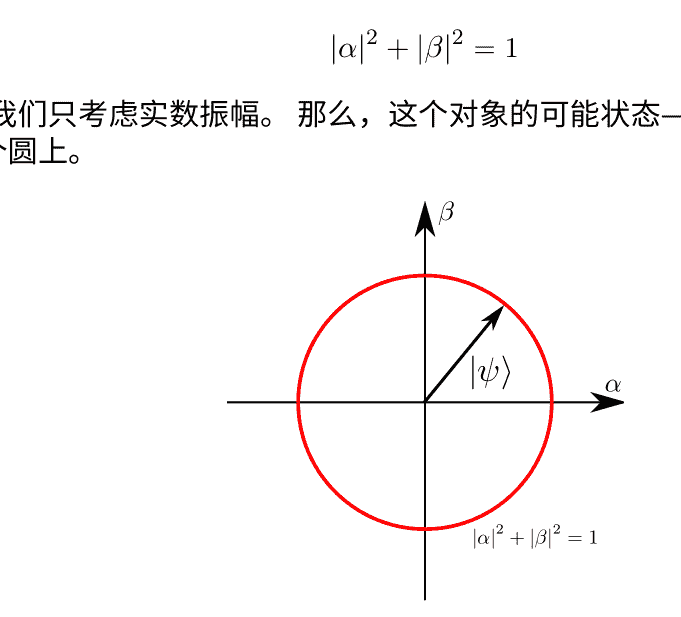

### 量子测量

测量（以概率 $|\alpha_x|^2$ 得到 $|x\rangle$）是不可逆的、概率性的和不连续的。

只要你不具体询问测量是什么——宇宙如何知道什么构成了测量，什么没有——而只是将其作为一个公理，一切都在数学上是明确的。如果你询问，你就进入了一个无人区。最近有一套重要的思想，被称为退相干理论，关于如何将测量解释为普通的幺正相互作用，但它们仍然无法解释概率的来源。

### 1.3 幺正变换

但这还不够有趣！有趣的部分是我们除了立即测量之外还能做什么。事实证明，通过以适当的方式作用于一个量子比特——在电子的情况下，也许是照射激光——我们可以有效地将振幅向量乘以任何保持概率和为1的矩阵。我所指的是，任何总是将单位向量映射到其他单位向量的矩阵。我们称这样的矩阵为幺正矩阵。

酉变换是可逆的、确定性的和连续的。

- 酉矩阵的例子：
  - 单位矩阵 $I$
  - NOT门 $X = \begin{bmatrix} 0 & 1 \\ 1 & 0 \end{bmatrix}$
  - 相位-$i$门 $\begin{bmatrix} 1 & 0 \\ 0 & i \end{bmatrix}$
  - 45度逆时针旋转。

物理学家用薛定谔方程来描述量子态，$\frac{d|\psi\rangle}{dt} = iH|\psi\rangle$（也许是物理学中第三个最著名的方程，仅次于 $E = mc^2$ 和 $F = ma$）。酉变换只是将薛定谔方程“打开”一段时间的结果。

> 问:为什么我们使用复数？
> Scott: 简短的答案是它有效！一个“更深入”的答案是，如果我们只使用实数，就不可能将一个酉变换分成任意小的部分。例如，我们之前看到的NOT门不能被写成一个实值酉矩阵的平方。我们马上会看到，如果你有复数，你可以做到这一点。

对于这些矩阵中的每一个，它是做什么的？为什么它是酉的？这个呢？

$$\begin{bmatrix} 1 & 1 \\ 1 & 0 \end{bmatrix}$$

它是酉的吗？给定一个矩阵，你如何判断它是否是酉的？

定理1 $U$ 是酉的当且仅当 $U U^* = I$，其中 $U^*$ 表示将矩阵转置并用其复共轭替换每个元素。（如果你学过线性代数，这是一个很好的练习。）等价地，$U^{-1} = U^*$。一个推论是每个酉操作都是可逆的。

作为读者的练习，你可以应用这个定理来找出我们已经看过的哪些矩阵是酉的。

现在，让我们看看当我们将45度旋转矩阵应用两次到相同的状态时会发生什么。

$$
|0\rangle \rightarrow (|0\rangle + |1\rangle)/\sqrt{2} \\
|1\rangle \rightarrow (-|0\rangle + |1\rangle)/\sqrt{2} \\
(|0\rangle + |1\rangle)/\sqrt{2} \rightarrow \left[\frac{|0\rangle + |1\rangle}{\sqrt{2}} + \frac{-|0\rangle + |1\rangle}{\sqrt{2}}\right]/\sqrt{2} = |1\rangle
$$

这个矩阵作为“NOT的平方根”！另一种看到这一点的方法是将矩阵平方。

$$\begin{bmatrix} \cos(45^\circ) & -\sin(45^\circ) \\ \sin(45^\circ) & \cos(45^\circ) \end{bmatrix}^2 |\psi\rangle = \begin{bmatrix} 0 & 1 \\ 1 & 0 \end{bmatrix} |\psi\rangle$$

已经，我们有了在经典世界中不存在的东西。
我们还可以通过干涉幅度来理解这个矩阵的作用。

## 2个量子比特

描述两个量子比特，我们需要多少幅度？ 是的，四个 - 每个可能的两位字符串一个。

$$\alpha|00\rangle + \beta|01\rangle + \gamma|10\rangle + \delta|11\rangle$$
$$|\alpha|^2 + |\beta|^2 + |\gamma|^2 + |\delta|^2 = 1$$

如果你测量两个量子比特，你将以概率 $|\alpha|^2$ 得到 $|00\rangle$，以概率 $|\beta|^2$ 得到 $|01\rangle$，等等。并且状态将坍缩到你看到的任何2位字符串。
但是如果你只测量第一个量子比特，而不是第二个呢？ 以概率 $|\alpha|^2+|\beta|^2$，你将得到 $|0\rangle$，状态将坍缩到 $\frac{\alpha|00\rangle + \beta|01\rangle}{\sqrt{|\alpha|^2 + |\beta|^2}}$。以概率 $|\gamma|^2+|\delta|^2$，你会得到 $|1\rangle$，状态会坍缩为 $\frac{\gamma|10\rangle + \delta|11\rangle}{\sqrt{|\gamma|^2 + |\delta|^2}}$。每当你向宇宙提问时，它会做出决定；每当你不提问时，它会尽可能地推迟做出决定。如果你对第二个量子位应用一个NOT门，会发生什么？ 答案：你会得到 $\beta|00\rangle+\alpha|01\rangle+\delta|10\rangle+\gamma|11\rangle$。“对于其他量子位的每种可能配置，如果我对这个量子位应用门，会发生什么？”如果我们将 $(\alpha, \beta, \gamma, \delta)$ 视为一个由四个复数构成的向量，那么这个变换在一个 $4\times4$ 矩阵中是什么样子的？

$$\begin{bmatrix} 0 & 1 & 0 & 0 \\ 1 & 0 & 0 & 0 \\ 0 & 0 & 0 & 1 \\ 0 & 0 & 1 & 0 \end{bmatrix}$$

我们是否总能分解一个两量子比特的状态：“这是第一个量子比特的状态，这是第二个量子比特的状态？”有时我们可以：

- $|01\rangle = |0\rangle|1\rangle = |0\rangle \otimes |1\rangle$ (读作 $|0\rangle$ “张量” $|1\rangle$)。
- $|00\rangle+|01\rangle+|10\rangle+|11\rangle = \frac{1}{2}(|0\rangle+|1\rangle)(|0\rangle+|1\rangle)$。

在这些情况下，我们说这个状态是可分离的。 但是 $|00\rangle + |11\rangle$呢？这是一个无法分解的状态。因此，我们称之为纠缠态。你可能听说过纠缠是量子力学的核心特征之一。好吧，这就是它。就像有些量子态无法分解一样，也有一些无法分解的操作。也许最简单的是控制非门，它将 $|x\rangle |y\rangle$映射到 $|x\rangle |x \oplus y\rangle$ (即，如果第一个比特为1，则翻转第二个比特)。

$$\begin{aligned}
|00\rangle &\to |00\rangle \\
|01\rangle &\to |01\rangle \\
|10\rangle &\to |11\rangle \\
|11\rangle &\to |10\rangle
\end{aligned}$$

这个看起来像一个 $4 \times 4$ 的矩阵吗？

$$\begin{bmatrix}
1 & 0 & 0 & 0 \\
0 & 1 & 0 & 0 \\
0 & 0 & 0 & 1 \\
0 & 0 & 1 & 0
\end{bmatrix}$$

顺便问一下，我们能否有一个2量子比特的操作，将 $|x\rangle |y\rangle$映射到 $|x\rangle |x \text{ AND } y\rangle$? 为什么不呢？

$$\begin{aligned}
|0\rangle |0\rangle &\to |0\rangle |0\rangle \\
|0\rangle |1\rangle &\to |0\rangle |0\rangle
\end{aligned}$$

这是不可逆的！

### 2.1 获得纠缠态

在我们创建量子计算机之前，我们需要一种方法来纠缠量子比特，使它们不再只是一堆散落的粒子。也许最简单的操作是之前我们看到的CNOT门。

那么我们如何使用CNOT产生纠缠态呢？我们可以使用一个Hadamard门，然后是一个CNOT门，其中Hadamard矩阵 $\boxed{\text{H}}$ 通过在 $\{|0\rangle, |1\rangle\}$ 基和 $\{|+\rangle, |-\rangle\}$ 基之间切换，将一个量子比特置于叠加态。$\{|0\rangle, |1\rangle\}$ 基和 $\{|+\rangle, |-\rangle\}$ 基。

$$\begin{aligned}
|+\rangle &= \frac{1}{\sqrt{2}} (|0\rangle + |1\rangle) \\
|-\rangle &= \frac{1}{\sqrt{2}} (|0\rangle - |1\rangle) \\
\boxed{\text{H}} &= \frac{1}{\sqrt{2}} \begin{bmatrix} 1 & 1 \\ 1 & -1 \end{bmatrix}
\end{aligned}$$

应用 $\boxed{\text{H}}$ 应用于 $|0\rangle$ 和 $|1\rangle$ 的结果是：

$$\begin{aligned}
|0\rangle &\to \frac{|0\rangle + |1\rangle}{\sqrt{2}} = |+\rangle \\
|1\rangle &\to \frac{|0\rangle - |1\rangle}{\sqrt{2}} = |-\rangle
\end{aligned}$$

即使只有两个量子比特，我们也能够看到一些关于量子力学的深刻事实，这些事实花费了人们几十年的时间才理解。

再次思考一下状态 |00⟩ + |11⟩。如果只测量第一个量子比特会发生什么？是的，以概率 1/2你会得到 |00⟩，以概率 1/2你会得到 |11⟩。现在，为什么会令人不安呢？对，因为第二个量子比特可能与第一个量子比特相隔数光年！测量第一个量子比特会影响第二个量子比特，似乎需要超光速通信！这就是爱因斯坦所说的“鬼魅般的遥距作用”。

但是请仔细考虑一下。你真的可以利用这种效应来比光速更快地发送消息吗？如果你尝试了会发生什么？没错，结果将是随机的！事实上，我们在这里不打算证明，但有一种叫做“无通信定理”的东西，它说无论你对第一个量子位做什么，都只会影响第二个量子位上的任何测量结果的概率。

但是在这种情况下，为什么我们不能想象在这两个量子位被创建的那一刻，它们翻了个硬币，并说：“好吧，如果有人问，我们都是1。”嗯，因为在1964年，约翰·贝尔证明了在某些实验中，这种解释根本无法与量子力学相一致。而且在20世纪80年代，这些实验实际上已经进行了，并且它们证实了量子力学，并在大多数物理学家的观点中，粉碎了爱因斯坦对“完成”量子力学的希望。这是你的问题集上的问题。

### 2.2 无克隆定理

是否可能复制量子态？ 这将非常好，因为我们知道我们只有一次机会来测量量子态。 下面是这种复制的样子：

$\alpha|0\rangle + \beta|1\rangle \rightarrow (\alpha|0\rangle + \beta|1\rangle)(\alpha|0\rangle + \beta|1\rangle) = \alpha^2|00\rangle + \alpha\beta|01\rangle + \alpha\beta|10\rangle + \beta^2|11\rangle$

这个操作是不可能的，因为它不是线性的。 最终的振幅 $\alpha^2$， $\beta^2$ 和 $\alpha\beta$ 不是线性地依赖于 $\alpha$ 和 $\beta$。这就是无克隆定理，它真的就像看起来的那么简单。

### 3 量子比特

60年来，这些都是驱使人们对量子力学产生直观认识的例子：一个粒子，偶尔两个粒子。 很少有人抽象地思考数百或数千个粒子之间的纠缠关系。 但在过去的15年里，我们意识到那才是事情变得真正疯狂的地方。 这就引出了量子计算。 不用说，我首先要介绍理论。 以后我们可以讨论当前的实验进展。

我们需要多少振幅来描述1000个量子比特的状态？ 没错，是 $2^{1000}$。 每个可能的1000位字符串都需要一个

$$\sum_{x\in\{0,1\}^{1000}} \alpha_x|x\rangle$$

思考一下这意味着什么。 为了跟踪1000个数字的状态，自然界似乎需要在一边写下这个 $2^{1000}$ 个复数的列表。 这比可见宇宙中的原子数量还要多。 想想自然界必须为此付出多少计算能力。 真是个巨大的浪费！下一个想法是：我们不妨试着利用它！

## 问：一个量子比特已经需要无限的信息来确定吗？

斯科特：答案是肯定的，但是在现实世界中总会有噪音和误差，所以我们只关心对振幅的有限精度近似。从某种意义上说，“无限的信息量”只是我们对量子比特状态的数学描述的产物。相比之下，描述纠缠粒子的指数不是一个产物；它是真实的（如果量子力学是对自然界的正确描述的话）。

## 3.1 利用干扰

利用这种计算能力的一个直接困难是什么？嗯，如果我们仅仅测量n个量子比特，我们得到的只是一个经典的n位字符串；其他一切都消失了。就好像我们一看，自然就试图“隐藏”它正在进行指数级的计算。

但幸运的是，自然并不总是做得很好。这个的一个很好的例子是双缝实验：我们不测量光子穿过哪个缝，而是测量结果的干涉图案。特别是，我们看到量子系统采取的不同路径可以相互干涉并相互抵消。

所以，这就是我们想要在量子计算中利用的东西。目标是将事物编排得这样，使得导致错误答案的不同计算路径相互干涉并相互抵消，而导致正确答案的不同路径相互干涉并相互增强，因此当我们测量时高概率观察到正确答案。你可以看到这可能会很棘手，如果可能的话。

关于干涉的一个关键点是，为了使两个计算路径相互干涉破坏，它们必须导致在每个方面都完全相同的结果。要计算给定结果的振幅，您需要将导致该结果的所有路径的振幅相加；当振幅相互抵消时，就会发生干涉。

## 3.2 量子门的通用集合

具体来说，在量子计算机中，我们有n个量子比特，为了简单起见，我们假设它们都处于|0⟩状态。在给定这些量子比特的情况下，我们应用一系列称为“量子门”的酉变换。这些门构成了所谓的量子电路。

下面是一个示例电路，我们将Hadamard门应用于第一个比特，然后使用第二个比特作为控制位进行CNOT操作。写出来，效果如下：$$\left( \frac{|0\rangle + |1\rangle}{\sqrt{2}} \right)|0\rangle \xrightarrow{\text{CNOT}} \frac{|00\rangle + |11\rangle}{\sqrt{2}}$$，结果是纠缠的量子比特，正如我们之前讨论的那样。一个关键的要点：量子电路中的每个单独门都必须非常“简单”，就像经典电路由AND、OR、NOT门构建一样，这是最简单的构建模块。在量子情况下，“简单”是什么意思？基本上，每个量子门最多作用于（比如）2或3个量子比特，并且对所有其他量子比特都是恒等的。为什么我们需要假设这一点？因为物理相互作用是局部的。

为了应对这个限制，我们需要一个通用的量子门集合，可以用来构建更复杂的电路，就像经典计算机中的AND、OR和NOT一样。这个通用集合必须包含可以组合成任意酉矩阵的1、2和3量子比特门。

当我们说到任意幺正矩阵时，我们必须小心，因为有无穷多个幺正矩阵（例如，你可以以任意实数角度旋转）。然而，存在一些小的量子门集合，可以用来以任意精度近似任意幺正矩阵。作为技术说明，词“通用”有不同的含义；例如，我们通常称一组门为通用，如果它可以用来近似只涉及实数的任意幺正矩阵；这当然足够用于量子计算。

我们已经看到了Hadamard门和CNOT门，但不幸的是，这些门不足以构成一个通用的量子门集合。根据Gottesman-Knill定理，只使用Hadamard门和CNOT门构建的电路可以在经典计算机上高效模拟。然而，Hadamard矩阵与另一个称为Toffoli门（也称为控制控制非门，或CCNOT门）配对，足以作为一个通用的门集合（对于实值矩阵）。

托菲利门将与CNOT门类似，只是我们基于第一个两个量子比特进行控制：

$$|x\rangle |y\rangle |z\rangle \rightarrow |x\rangle |y\rangle |z \oplus x y\rangle$$

其中 $xy$ 表示 $x$ 和 $y$ 的布尔与运算。

然而，请注意，这些不是唯一两个组合可以实现量子计算的门。另一个例子是CNOT门与π/8门的组合。我们用以下酉矩阵表示π/8门：

$$T = \begin{bmatrix} \cos(\pi/8) & \sin(\pi/8) \ -\sin(\pi/8) & \cos(\pi/8) \end{bmatrix}$$

但是需要多少个这样的门来近似一个随机的 $n$ 量子比特幺正变换？嗯，你还记得香农的计数论证吗？如果我们在量子世界中尝试类似的方法会怎样？一个 $n$ 量子比特幺正变换大约有 $2^n \times 2^n$ 个自由度。另一方面，尺寸为 $T$ 的量子电路的数量在 $T$ 上是指数级增长的。因此，我们需要 $T = \exp(n)$。

然而，我们只对可以由多项式数量的门构建的幺正变换的微小子集感兴趣。多项式时间仍然是我们的黄金标准。

因此，一个量子电路具有这个多项式数量的门，然后，在最后，*something* has to be measured。为简单起见，我们假设测量的是一个单比特。（如果有中间测量会有什么不同吗？不会有不同吗？为什么？因为我们可以使用CNOT模拟测量。）就像 BPP 一样，我们规定如果 $x \in L$（答案是“是”），那么测量结果应该是 |1⟩的概率至少为2/3，而如果x ∉ L（答案是“否”），则测量结果应该是 |1⟩的概率至多为1/3。还有一个最后的技术要求。我们必须假设存在一个经典的多项式时间算法来生成第一个量子电路。否则，我们如何找到这个电路呢？

所有可以通过这样一族量子电路解决的决策问题的类别被称为BQP（有界误差量子多项式时间）。

## 4 有界误差量子多项式时间（BQP）

有界误差量子多项式时间（BQP）是指可以通过量子计算机高效解决的问题的类别。

顺便说一下：量子计算的想法在70年代和80年代独立地出现在一群人的脑海中，但通常归功于理查德·费曼和大卫·德沃茨。BQP是由伯恩斯坦和瓦齐拉尼于1993年定义的。

### 4.1 BQP电路的要求

要成为 BQP，一个问题必须满足几个要求：

多项式大小。我们需要多少个构建块电路（例如Hadamard和Toffoli）来近似任意的n量子比特么正变换？答案是量子版本的Shannon计数论证。一个n量子比特么正变换有2^n × 2^n个自由度，而且有指数级多个这样的变换。另一方面，大小为T的量子电路的数量仅仅是指数级的T。因此，“几乎所有”的么正变换都需要指数级数量的量子门。

然而，我们只对可以使用多项式数量的门构建的么正变换感兴趣。多项式时间仍然是黄金标准。

输出。为了简单起见，我们假设在量子电路的末尾测量一个单比特。

就像 BPP一样，我们规定：

| 条件 | 测量结果要求 |
| :--- | :--- |
| 如果 $x \in L$ (答案为“是”) | 测量得到 $|1\rangle$ 的概率 $\geq \frac{2}{3}$ |
| 如果 $x \notin L$ (答案为“否”) | 测量得到 $|1\rangle$ 的概率 $\leq \frac{1}{3}$ |

电路构造。构造量子电路还有一个最终的技术要求。

我们必须假设存在一个经典多项式时间算法来生成第一个量子电路。否则，我们如何找到这个电路呢？

### 4.2 BQP与其他算法族的关系

- P ⊆ BQP：量子计算机总是可以模拟经典计算机（就像用飞机开车一样）。我们可以使用CNOT门来模拟NOT门，使用Toffoli门来模拟AND门。
- BPP ⊆ BQP：粗略地说，在量子力学中，我们“免费获得随机性”。更准确地说，每当我们需要做出一个随机决策时，我们只需要应用一个Hadamard门，将某个 $|0\rangle$ 量子比特放入等概率叠加的 $|0\rangle$ 和 $|1\rangle$ 状态中。然后我们可以在需要随机比特的地方进行CNOT操作。我们并没有利用干涉；我们只是将量子力学作为随机数的来源。
- **BQP $\subseteq$ EXP**：在指数时间内，我们可以将量子态写成指数长度的振幅向量，然后明确计算量子电路中每个门的作用。
- **BQP $\subseteq$ PSPACE**：我们可以通过对导致 $|x\rangle$ 的所有路径的振幅求和来计算每个测量结果 $|x\rangle$ 的概率，这只需要多项式空间，这是由Bernstein和Vazirani证明的。我们不会在这里给出详细的证明。

我们可以从这个图中得出一个重要的结论，这是复杂性理论对量子计算的第一个重要贡献。也就是说：在我们目前的知识状态下，几乎没有希望无条件地证明量子计算机比经典计算机更强大，因为任何 $P = BQP$ 的证明也会暗示 $P = PSPACE$。

## 下一次：量子算法

下一堂课我们将看到一些量子算法的实际例子，它们实际上优于它们的经典对应物：

- Deutsch-Jozsa算法
- Simon算法
- Shor算法

## 1 量子算法

当然，真正的问题是：量子计算机是否能够比经典计算机更高效地完成某些任务？在本讲座中，我们将看到为什么现代共识是它们可以。

### 1.1 计算两个位的异或

我们首先会看到一个由Deutsch和Jozsa提出的算法。尽管按照现代标准来说，这个算法非常简单，但它给出了第一个例子，其中量子算法可以明确地使用比经典算法更少的资源来解决问题。

假设我们可以访问一个布尔函数 $f : \{0, 1\} \rightarrow \{0, 1\}$。并且假设我们想要计算 $f(0) \oplus f(1)$，即 $f(0)$和 $f(1)$的异或。在经典情况下，我们需要评估 $f$多少次？很明显，答案是两次：只知道 $f(0)$或 $f(1)$对于它们的异或没有任何信息。

那么在量子情况下呢？嗯，首先我们需要说清楚什么是评估$f$的意义。由于我们讨论的是一个量子算法，我们应该能够以量子叠加的方式评估输入 $f(0)$和 $f(1)$。但是我们必须以可逆的方式进行。例如，我们不能将状态 $|x, b\rangle$映射到 $|x, f(x)\rangle$（覆盖 $b$），因为那不是幺正的。

标准解决方案是查询 $f$意味着应用一个单元变换，将 $|x, y\rangle \rightarrow |x, y \oplus f(x)\rangle$。它是可逆的吗？是的。应用两次可以使你回到起点。我声称我们可以仅使用一个这些操作来计算 $f(0) \oplus f(1)$。怎么做呢？

在上面的电路中，$U_f$之前的门的作用是准备一个初始状态 $|\psi_0\rangle$：

$|\psi_0\rangle = |+\rangle |-\rangle = \frac{1}{2} [|0\rangle + |1\rangle] [|0\rangle - |1\rangle]$

如果你考虑 $U_f$对这个状态中的第一个量子位的作用，它只是在$f(0) = f(1)$时否定振幅！因此，$U_f$产生 $|+\rangle |-\rangle$ if $f(0) = f(1)$，否则产生$|-\rangle |-\rangle$。最后的Hadamard门将第一个量子位转换回计算基，这样我们只有在 $f(0) = f(1)$时才测量到1。

特别是，这意味着如果你想用量子计算机计算 $N$位的异或，你可以使用 $N/2$个查询来实现，具体方法如下：首先将位分成 $N/2$对位，然后在每对位上运行上述算法，最后输出结果的异或。当然，这只是一个常数倍的加速，但它预示着更令人印象深刻的加速即将到来。

### 1.2 Simon的算法

假设给定一个布尔函数 $f : \{0,1\}^n \to \{0,1\}^n$。承诺存在一个“秘密字符串” $s$，使得 $f(x) = f(y)$ 当且仅当 $y = x \oplus s$，其中 $\oplus$ 表示模2求和。问题是通过尽可能少的查询来找到 $s$。

一个经典随机算法需要多少次查询来解决这个问题？你的问题集上有一个非常相似的问题！对， $2^{n/2}$。这基本上就是生日悖论。直到找到一个 $x, y$ pair，使得 $f(x) = f(y)$，你的算法基本上就是在黑暗中射击；它对 $s$ 几乎没有任何信息。在进行 $T$ 次查询之后，找到一个 $x, y$ pair，使得 $f(x) = f(y)$ 的概率最多为 $T^2/(2^n-1)$ （为什么？）。

另一方面，在1993年，Daniel Simon提出了一个量子算法，可以在多项式时间内解决这个问题，实际上只使用 $O(n)$ 次查询。这是量子计算机可以比经典计算机指数级更快地解决的问题的第一个例子。诚然，这是一个人为的例子（也许因为这个原因，Simon的论文最初被拒绝！）。但有两个原因值得注意：首先，它直接导致了Shor的因式分解算法。其次，理解Shor的算法最简单的方法是理解Simon的算法，然后将Shor的算法视为具有不同基础群的相同算法！

在进一步进行之前，有一件事我想澄清。我说过Simon的问题是量子计算机可以明确证明比经典计算机具有指数级加速的第一个已知例子。这与我之前说的我们无法无条件地证明P = BQP一致吗？

没错，Simon的问题涉及到函数 $f$ 作为一个“黑盒子”。在黑盒子设置中，我们可以无条件地证明量子计算机比经典计算机具有指数级加速。

### 1.3 RSA

好吧，假设你想要破解RSA加密系统，以便抢劫一些银行，读取你前任的电子邮件，或者其他什么。我们都知道破解RSA归结为找到一个大整数 $N$ 的质因数。不幸的是，我们也知道“并行尝试所有可能的除数”，然后立即选择正确的除数是行不通的。尽管有数百篇流行杂志文章，但并行尝试所有可能的除数并不是量子计算机能做的事情。当然，在某种意义上，你可以“尝试所有可能的除数”——但如果你测量结果，你将得到一个随机的潜在除数，几乎肯定不是你想要的除数。

这意味着，如果我们想要一个快速的量子因式分解算法，我们将不得不利用因式分解问题中的一些结构：换句话说，一些与在大海捞针的一般问题不同的数学属性。

幸运的是，因式分解问题有很多特殊属性。我们在课堂上讨论了一些例子，有什么例子呢？对的：如果我给你一个正整数，你可能不知道它的质因数分解，但你知道它有且仅有一个因数分解！相比之下，如果我给你（比如）一个数独谜题，并要求你解决它，你事先无法知道它是否有且仅有一个解，2亿个解，还是根本没有解。当然，知道在一堆干草中只有一根针是找到这根针的线索，但这种唯一性并不能帮助我们很多！但这种唯一性是一个暗示，事实上，因子分解问题可能还有其他很好的数学性质可以利用。

事实证明确实如此。

我们将利用的性质是将因子分解归约到另一个问题，称为周期查找。好的，现在是一个简短的数论插曲。让我们来看看2的幂对15取模的结果：

- 2, 4, 8, 1, 2, 4, 8, 1, 2, 4, ...

正如你所看到的，对15取模的2的幂给出了一个周期性序列，其周期（即重复之前需要经过的步骤）为4。再举一个例子，让我们来看看2的幂对21取模的结果：

- 2, 4, 8, 16, 11, 1, 2, 4, 8, 16, ...

这次我们得到了一个周期性序列，其周期为6。

有什么一般规则来决定周期会是什么吗？我们之前讨论过这个问题，当我们谈论RSA加密系统时！这个美丽的模式是由欧拉在18世纪60年代发现的。设N是两个质数p和q的乘积，并考虑以下序列：

- x mod N, x^2 mod N, x^3 mod N, x^4 mod N, ...

然后，只要x不能被p或q整除，上述序列将会以一定的周期重复，该周期能整除(p-1)(q-1)。所以，例如，如果N=15，那么N的质因数是p=3和q=5，所以(p-1)(q-1)=8。事实上，该序列的周期是4，能整除8。如果N=21，那么p=3, q=7，所以(p-1)(q-1)=12。事实上，该周期是6，能整除12。

现在，我希望你退后一步，思考一下这意味着什么。这意味着，如果我们能找到序列x mod N的周期，我们就能了解一些关于N的质因数的信息。特别地，我们可以了解到(p-1)(q-1)的一个因子。现在，我承认这不如直接了解p和q本身好，但请承认这也是一些信息。事实上，这不仅仅是一些信息：事实证明，如果我们能了解(p-1)(q-1)的几个随机因子（例如，通过尝试不同的随机值x），那么很有可能我们能将这些因子组合起来了解(p-1)(q-1)本身。一旦我们了解了(p-1)(q-1)，我们就可以使用一些小技巧来恢复p和q，我们想要的质因数。（这又是你的问题集中的一个问题。）

那么问题出在哪里呢？嗯，尽管模N的幂次序列最终会开始重复，但在重复之前的步骤数可能几乎和N本身一样大 - 而N可能有数百或数千位数！这就是为什么找到周期似乎不能导致快速的经典因式分解算法的原因。

啊哈，但我们有一台量子计算机！（或者至少，我们想象我们有。）所以也许还有希望。特别是，假设我们可以在我们的序列中创建一个巨大的量子叠加态：

$$\sum_{r} |r\rangle |x^r \mod N\rangle$$

然后也许有一些量子操作我们可以在那个叠加态上执行，以揭示周期。

关键是，我们不再试图在指数级大的干草堆中找到一根针，这是我们甚至知道对于量子计算机也很困难的事情。相反，我们现在试图找到序列的周期，这是序列中所有数字的全局属性。这会产生很大的不同。

看：如果你以“平行宇宙”的方式思考量子计算（你是否这样思考取决于你自己），那么没有可行的方法可以检测出一个与其他所有宇宙不同的单个宇宙。这样一个在荒野中的孤独之声将被众多居住在郊区、穿着Dockers的顺从宇宙所淹没。然而，我们可以希望检测到的是所有平行宇宙共同的一个属性 - 这个属性只能通过所有宇宙共同参与的计算来揭示<sup>1</sup>。

因此，我们面临的任务并非没有希望！但是，如果我们想要使这个找周期的想法起作用，我们必须回答两个问题：

1.  使用量子计算机，我们能快速地在 $x \mod N$, $x^2 \mod N$, $x^3 \mod N$ 等上创建叠加态吗？
2.  假设我们确实创建了这样的叠加态，我们如何确定周期呢？

让我们先解决第一个问题。我们当然可以在所有整数 $r$ 上创建叠加态，从1到 $N^2$ 左右。问题是，给定一个 $r$，我们如何快速计算 $x^r \mod N$？我们已经看到答案了：重复平方！

好的，所以我们可以高效地创建一个量子叠加态，其中包含形式为 $(r, x^r \mod N)$ 的所有整数对，其中 $r$ 范围从1到 $N$ 左右。但是，给定一个周期序列的所有元素的叠加态，我们如何提取出周期？

好了，我们终于来到了问题的核心 - Shor的量子算法的一个依赖于量子力学的部分。为了得到周期，Shor使用了一种叫做量子傅里叶变换（QFT）的东西。我的挑战是，我怎么能在不涉及数学的情况下向你解释QFT呢？嗯嗯嗯...

好吧，让我试试这个。像许多计算机科学家一样，我保持着非常奇怪的作息时间。你知道那个著名的实验吗？他们把人们关在一个密封的房间里几个星期，没有时钟或阳光，人们逐渐从24小时的日常生活转变为25小时、26小时或28小时的日常生活。对我来说，这只是普通的生活。有一天我早上9点醒来，第二天早上11点醒来，第三天下午1点醒来，等等。事实上，如果没有课程或约会的干扰，我会愉快地‘绕一圈’。

现在，这是我的问题：假设我告诉你我今天下午5点醒来。仅凭这个事实，你能得出关于我的“一天”有多长的结论吗：我是按照25小时的时间表，还是按照26.3小时的时间表，或者其他什么时间表？

当然，答案并不多！我的“一天”肯定不是按照24小时的时间表，否则我早上就会醒来，而不是下午5点。但是几乎任何其他时间表 - 25小时、26小时、28小时等等 - 都会导致我“绕着时钟转一圈”，所以在某个特定的下午看到我下午5点起床也不足为奇。

现在，我想让你想象一下，我的卧室墙上挂满了模拟时钟。这些是非常奇怪的时钟：其中一个每17小时转一圈，另一个每26小时转一圈，还有一个每24.7小时转一圈，以此类推，几乎可以想象到的每个小时数。（为了简单起见，每个时钟只有一个时针，没有分钟针。）我还想让你想象一下，在每个时钟下面都有一个装有图钉的海报板。当我搬进公寓的时候，每个图钉都在各自的板中间。但是现在，每当我……## 图2：时钟和钉板的一种可能配置

当我“早上”醒来时，我首先要做的就是绕着房间走一圈，然后按照上面的时钟指针的指向，将每个图钉向前移动一英寸。

现在，这是我的新问题：通过检查我房间里的图钉，能否推断出我是按照什么样的日程安排的？

我声称这是可能的。举个例子，假设我按照26小时的一天来安排。那么24小时时钟下面的图钉会发生什么？不难看出，它会经历周期性运动：当然，它会稍微漂移一下，但每隔12天它都会回到起始位置的板子中央。有一天早上，我会向这个方向移动图钉一英寸，另一天早上会向那个方向移动一英寸，但最终所有这些不同方向的移动会互相抵消。

另一方面——再假设我每天有26个小时——在26小时钟下面的拇指钉会发生什么？这里的答案是不同的。就26小时钟而言，我每次“早上”醒来时都是准确地在同一时间醒来！每次我醒来时，26小时钟指向的方向与上次醒来时一样。所以我会继续将拇指钉朝同一方向移动一英寸，直到它完全不在海报板上！

因此，仅凭看到哪个拇指钉从起点走得最远，你就可以推断出我是什么样的日程安排。换句话说，你可以推断出我生活的周期性序列的“周期”。

基本上，这就是量子傅里叶变换。嗯，更准确地说，QFT是一种线性变换（确实是一种幺正变换），它将一个复数向量映射到另一个复数向量。输入向量中的非零条目对应于我醒来的每个时间，其他地方都是零条目。输出向量记录了海报板上拇指钉的位置（可以将其视为复平面上的点）。因此，最终我们得到的是一种线性变换，它将编码周期序列的量子态映射到编码该序列周期的量子态。

另一种思考这个问题的方式是通过干涉来思考。我的意思是，量子力学的关键点——使其与经典概率论不同的是，概率始终是非负的，而量子力学中的振幅可以是正的、负的，甚至是复数的。正因为如此，与获得特定答案的不同方式对应的振幅可以“相互干涉”并相互抵消。这正是Shor算法的运作原理。与序列中的元素对应的每个“平行宇宙”都对序列的可能周期对应的每个“平行宇宙”贡献一定的振幅。问题在于，除了“真实”的周期之外，其他周期的贡献指向不同的方向，因此彼此抵消。只有对于“真实”周期，来自不同宇宙的贡献都指向相同的方向。而这就是为什么当我们在最后测量时，我们将以很高的概率找到真正的周期。

## 下次的问题：

1.  可以建造量子计算机吗？
2.  量子计算机的限制是什么？
3.  量子计算机之外还有其他东西吗？