# MIT 6.046J 算法设计和分析讲义

## 第一讲：介绍

6.006先决条件：
- 数据结构，如堆，树，图
- 排序算法，最短路径算法，图搜索算法，动态规划算法

## 课程概述

本课程涵盖了几个模块：
1. 分治算法 - 快速傅里叶变换，随机算法
2. 优化算法 - 贪心算法和动态规划算法
3. 网络流
4. 难解性问题（及其处理）
5. 线性规划
6. 次线性算法，近似算法
7. 高级主题

## 今天讲座的主题

非常相似的问题可能具有非常不同的复杂性。回想一下：
- P：多项式时间可解的问题类。例如，图中的最短路径可以在 \(O(V^2)\) 中找到。
- NP：多项式时间可验证的问题类。
  有向图 \(G(V,E)\) 中的哈密顿回路是包含每个顶点的简单循环。
  确定一个图是否有哈密顿回路是NP完全问题，但验证一个回路是否是哈密顿回路很容易。
- NP完全：问题在NP中，并且和NP中的任何问题一样难。如果任何一个NPC问题可以在多项式时间内解决，那么NP中的每个问题都有多项式时间解决方案。

### 区间调度

请求 1, 2, …, n，单一资源
$s(i)$ 开始时间，$f(i)$ 结束时间，$s(i) < f(i)$（请求的开始时间必须小于结束时间）

两个请求 $i$ 和 $j$ 是兼容的，如果它们不重叠，即 $f(i) \leq s(j)$ 或 $f(j) \leq s(i)$。

在下图中，请求2和3是兼容的，请求4、5和6也是兼容的，但请求2和4不兼容。

目标：选择最大尺寸的兼容请求子集。

声明：我们可以使用贪婪算法来解决这个问题。

贪婪算法是一种目光短浅的算法，它一次处理一个输入片段，没有明显的向前看。

### 贪婪区间调度
1. 使用简单规则选择请求 $i$。
2. 拒绝所有与 $i$ 不兼容的请求。
3. 重复直到处理完所有请求。

#### 可能的规则？
1. 选择最早开始的请求，即最小 s(i)。
2. 选择最小的请求，即最小 f(i) - s(i)。
3. 对于每个请求，找到不兼容的数量，并选择具有最小数量的请求。
4. 选择最早完成的请求，即最小 f(i)。

#### 声明 1.贪心算法输出一个区间列表
$< s(i_k), f(i_k) >$
使得
$s(i_1) < f(i_1) \leq s(i_2) < f(i_2) \leq ... \leq s(i_k) < f(i_k)$

> 证明。通过反证法简单证明 - 如果 $f(i_j) > s(i_{j+1})$，则区间 j 和 j+1 相交，这与算法的第2步矛盾！

#### 声明2。给定区间列表 L，具有最早结束时间的贪心算法产生 k* 个区间，其中 k* 是最优的。
证明。对 k*进行归纳。

基本情况：k* = 1 - 这种情况很简单，任何区间都可以。

归纳步骤：假设对于 k*成立，并且我们有一个区间列表其最优调度有 k* +1个区间，即
$S^*[1,2,...,k^*+1]=< s(j_1), f(j_1) >,...,< s(j_{k^*+1}), f(j_{k^*+1}) >$

假设对于某个通用的 $k$, 贪心算法给出了一系列的区间 $S[1, 2, \ldots, k] = \langle s(i_1), f(i_1) \rangle, \ldots, \langle s(i_k), f(i_k) \rangle$。根据构造，我们知道 $f(i_1) \leq f(j_1)$，因为贪心算法选择了最早的结束时间。

现在我们可以创建一个日程安排，$\langle s(j_{k*+1}), f(j_{k*+1}) \rangle$。因为区间$\langle s(i_1), f(i_1) \rangle$与区间$\langle s(j_2), f(j_2) \rangle$以及之后的所有区间都不重叠。请注意，由于 $S^{**}$的长度为 $k^*+1$，这个日程安排也是最优的。

现在我们来定义 $L'$为具有 $s(i) \geq f(i_1)$的区间集合。由于 $S^{**}$对于 $L$是最优的，所以 $S^{**}[2, 3, \ldots, k^* + 1]$对于 $L'$也是最优的，这意味着最优的 $L'$的调度有 $k^*$ size个。现在我们通过我们最初的归纳假设看到，在 $L'$上运行贪心算法应该产生一个大小为 $k^*$的调度。因此，通过我们的构造，在 $L'$上运行贪心算法给我们 $S[2, \ldots, k]$。这意味着 $k -1 = k^*$或 $k = k^* + 1$，这意味着 $S[1, \ldots, k]$确实是最优的，我们完成了。

### 加权区间调度
每个请求 $i$有权重 $w(i)$。安排不重叠的请求子集，使其权重最大。

> > 这里的一个关键观察是贪心算法不再起作用。

### 动态规划
我们可以将子问题定义为 $R^x = \{ j \in R | s(j) \geq x \}$。这里，$R$是所有请求的集合。如果我们设置 $x = f(i)$，那么 $R^x$是请求后于请求 $i$的集合。子问题的总数 $= n$（每个请求一个）。只需要解决每个子问题一次并进行记忆化。我们将每个请求 $i$作为可能的第一个尝试。如果我们选择一个请求作为第一个，那么剩下的请求是 $R^{f(i)}$。

> 请注意，即使可能有与 i兼容但不在R^{f(i)}中的请求，我们仍然选择 i作为第一个请求，即按顺序进行。

$$opt(R) = \max_{1\leq i\leq n} (w(i) + opt(R^{f(i)}))$$

总运行时间为$O(n^2)$，因为我们需要$O(n)$的时间来解决每个子问题。事实证明，我们实际上可以将总体复杂度降低到$O(n \log n)$。 我们将这留作练习。

### 非相同的机器
与之前一样，我们有$n$个请求$\{1, 2, ..., n\}$。 每个请求$i$与一个开始时间$s(i)$和结束时间$f(i)$相关联，还有不同的机器类型$\tau=\{T1, ..., Tm\}$。 每个请求$i$与一个集合$Q(i)\subseteq\tau$相关联，表示请求$i$可以在哪些机器上提供服务。

每个请求的权重为1。 我们希望最大化可以在$m$台机器上安排的作业数量。

这个问题属于NP问题，因为我们可以清楚地检查给定的作业子集和机器分配是否合法。

能否安排$k$个请求$\leq n$个请求？ 这个问题是NP完全的。 最大可安排的请求数量是多少？ 这个问题是NP难的。

### 处理难以解决的问题
1. 近似算法：在多项式时间内保证接近最优解。
2. 修剪启发式算法，以减少在“现实世界”示例中的（可能指数级的）运行时间。
3. 贪婪或其他次优启发式算法，在实践中表现良好但没有提供任何保证。

麻省理工学院开放式课程网站
http://ocw.mit.edu
# 6.046J / 18.410J 算法设计与分析
OM1R年春季
有关引用这些材料或我们的使用条款的信息，请访问： http://ocw.mit.edu/terms。

## 第2讲：分治法
- 范例
- 凸包
- 中位数查找

### 范式
给定一个大小为 n 的问题，将其分解成大小为 n/b 的子问题，递归地解决每个子问题。将子问题的解合并以获得整体解。

$T(n) = aT(n/b) + [合并的工作量]$

### 凸包
给定平面上的 n 个点
$S = \{(xi, yi)|i = 1,2,...,n\}$

为方便起见，假设没有两个点具有相同的x坐标，没有两个点具有相同的y坐标，也没有三个点共线。

凸包 ( CH(S) ): 包含S中所有点的最小多边形。

CH(S)由边界上的点按顺时针顺序表示为双向链表。

### 凸包的蛮力算法
测试每条线段，看它是否构成凸包的边缘。
- 如果其余的点都在线段的一侧，则该线段在凸包上。
- 否则，该线段不在凸包上。

$O(n^2)$条边，$O(n)$次测试 $\Rightarrow O(n^3)$复杂度
我们能做得更好吗?

### 分治凸包
按照 x坐标对点进行排序（一次性操作，$O(n \log n)$）
对于输入点集 $S$:
- 按照x坐标将点集分为左半部分 $A$和右半部分 $B$
- 计算$A$的凸包 $CH$和$B$的凸包 $CH$
- 合并两个半部分的凸包（合并步骤）

如何合并？

- 找到上切线 $(a_i, b_j)$。 在例子中， $(a_4, b_2)$ 是上切线。
- 找到下切线 $(a_k, b_m)$。 在例子中， $(a_3, b_3)$ 是下切线。

●在时间 Θ(n)内剪切和粘贴。

首先将链接 ai 到 bj，沿着b列表向下直到找到 bm并将其链接到 ak，然后继续沿着a列表直到返回到 ai。 在例子中，这给出了(a4, b2, b3, a3)。

### 寻找切线
假设 ai 在 CH(A)中最大化x值 (a1, a2, …, ap)。 b1在 CH(B)中最小化x值 ( b1, b2, …, bq)

L是分隔 A和 B的垂直线。 将(ai, bj)线段与 L的交点的y坐标定义为 y(i, j)。

声明： (ai, bj)是上切线当且仅当它最大化了(i, j)。
如果(i, j)不是最大值，那么(ai, bj)两侧都会有点，它不能成为切线。

算法：明显的O(n²)算法检查所有的( ai, bj)对。 T(n) = 2T(n/2)+Θ(n²) = Θ(n²)。

```
1 i = 1
2 j = 1
3 当(y (i, j+1)> y(i, j)或者 y(i - 1, j)> y(i, j))时
4     如果(y (i, j+1)> y(i, j)) ▷顺时针移动右手指
5         j = j + 1( mod q)
6     其他
7         i = i - 1( mod p) ▷逆时针移动左手指
8     返回 ( ai, bj) 作为上切线
```

下切线同理。

T(n) = 2T(n/2) + Θ(n) = Θ(n log n)

### 合并算法为什么有效的直觉

$a_1$, $b_1$ 是最右边和最左边的点。我们从 $a_1$ 逆时针移动，从 $b_1$ 顺时针移动。$a_1$, $a_2, \ldots, a_q$ 是一个凸包，同样 $b_1, b_2, \ldots, b_q$ 也是。如果 $a_i, b_j$ 满足从 $a_i$ 或 $b_j$ 移动会减小 $y(i, j)$，则 $(a_i, b_j)$ 上方没有点。

正式证明非常复杂，不会涉及。

### 中位数查找
给定一组 N 个数字，将 $x$ 定义为集合中小于等于 $x$ 的数字的个数。找到排名为 $\lfloor \frac{n+1}{2} \rfloor$ 的元素 (下中位数) 和 $\lceil \frac{n+1}{2} \rceil$ (上中位数)。

显然，排序的时间复杂度为 $\Theta(n \log n)$。

**我们能做得更好吗？**

```
**选择 ($S$, $i$)**
1. 从 $S$ 中选择一个元素 $x \triangleright$ 巧妙地选择
2. 计算 $k = rank(x)$
3. $B = \{y \in S | y < x\}$
4. $C = \{y \in S | y > x\}$
5. 如果 $k = i$
6. 　返回 $x$
7. 否则，如果 $k > i$
8. 　返回 $Select(B, i)$
9. 否则，如果 $k < i$
10. 返回 $Select(C, i - k)$
```

巧妙地选择 $x$

需要选择 $x$ 以使得排名不是极端的。
- 将 $S$ 按照每列5个元素的大小排列 ($\lceil \frac{n}{5} \rceil$ cols)
- 对每一列进行排序 (较大的元素在顶部) (线性时间)
- 将 “中位数的中位数” 作为 $x$

#### 有多少个元素可以保证> x?
至少有一半的 ⌈n/5⌉ 组至少有3个元素> x，除了一个包含少于5个元素的组和一个包含x的组。至少有3(⌈n/10⌉ - 2)个元素 > x，至少有 3(⌈n/10⌉ - 2)个元素 < x

#### 递归关系：
$$
T(n) = \begin{cases} 
O(1), & \text{对于 } n \leq 140 \\
T(\lceil \frac{n}{5} \rceil) + T(\frac{7n}{10} + 6) + \Theta(n), & \text{对于 } n > 140
\end{cases} \quad (1)
$$

#### 解决递归
主定理不适用。直觉 n/5 + 7n/10 < n.

通过归纳证明 T(n) ≤ cn，对于足够大的 c。

对于 n ≤ 140，通过选择足够大的 c成立

$$
\begin{align*}
T(n) &\leq c\lceil \frac{n}{5} \rceil + c(\frac{7n}{10} + 6) + an \quad &(2)\\
&\leq \frac{cn}{5} + c + \frac{7nc}{10} + 6c + an \quad &(3)\\
&= cn + (-\frac{cn}{10} + 7c + an) \quad &(4)
\end{align*}
$$

如果 c ≥ 10a，我们完成了。对于 n ≥ 140和 c ≥ 20a，这是成立的。

### 附录1
#### 例子

$a_3$, $b_1$是上切线。$a_4 > a_3$, $b_2 > b_1$在Y坐标上。 $a_1$, $b_3$是下切线，$a_2 < a_1$, $b_4 < b_3$在 Y坐标上。 $a_i$, $b_j$是上切线。并不意味着 $a_i$或 $b_j$是最高点。 同样，对于下切线。

麻省理工学院开放式课程网站
http://ocw.mit.edu
# 6.046J / 18.410J 算法设计与分析
OM1R年春季
有关引用这些材料或我们的使用条款的信息，请访问： http://ocw.mit.edu/terms。

## 第3讲：分治法：快速傅里叶变换
- 多项式运算与表示
- 分治算法
- 折叠样本 /单位根
- FFT、IFFT和多项式乘法

### 多项式运算与表示
多项式 $A(x)$可以用以下形式表示：

$$A(x) = a_0 + a_1x + a_2x^2 + \cdots + a_{n-1}x^{n-1} = \sum_{k=0}^{n-1} a_k x^k = \langle a_0, a_1, a_2, \ldots, a_{n-1} \rangle \text{ (系数向量) }$$

多项式 $A$的次数是 $n-1$。

### 多项式的运算
多项式有三个主要的运算。

1. 求值：给定一个多项式 $A(x)$ 和一个数 $x_0$，计算 $A(x_0)$。这可以通过Horner法则，在 $O(n)$ 时间内使用 $O(n)$ 算术运算来完成。

   在每一步中，先计算一个和，然后乘以$x$，再开始下一步。

   因此 $O(n)$次乘法和 $O(n)$次加法是必需的。

2. 加法：给定两个多项式 $A(x)$和 $B(x)$，计算 $C(x) = A(x) + B(x)$ $(\forall x)$。使用基本算术，这需要 $O(n)$时间，因为 $c_k = a_k + b_k$。

3.乘法：给定两个多项式 \(A(x)\) 和 \(B(x)\)，计算 \(C(x) = \sum_{k=0}^{2n-2} c_k x^k\)，其中 \(c_k = \sum_{j=0}^k a_j b_{k-j}\) 对于 \(0 \le k \le 2(n-1)\)。因为结果多项式的次数是 \(A\) 或 \(B\) 的两倍。这个乘法等同于向量 \(A\) 和 \(\text{reverse}(B)\) 的卷积。卷积是所有相对位移的内积，这也是数字信号处理中平滑等操作中有用的运算。
- 朴素多项式乘法需要 \(O(n^2)\) 的时间。
- 通过类似Strassen的分治技巧，可以在 \(O(n^{\lg 3})\) 甚至 \(O(n^{1+\varepsilon}) (\forall \varepsilon > 0)\) 的时间内完成计算。
- 今天，我们将通过快速傅里叶变换在 \(O(n \lg n)\) 的时间内计算乘积！

### 多项式的表示
首先，考虑多项式的不同表示方法以及基于表示方法完成操作所需的时间。

有3种主要的表示方法需要考虑。
1. 系数向量与单项式基
2. 根和一个比例项
   - \(A(x) = (x - r_0) \cdot (x - r_1) \cdot \ldots \cdot (x - r_{n-1}) \cdot c\)
   - 然而，只通过基本算术运算和 \(k\) 次根运算是不可能找到精确的根的。此外，使用这种表示方法进行加法非常困难，甚至不可能。乘法只需要将根连接起来，评估可以在 \(O(n)\) 的时间内完成。
3. 样本: \((x_0, y_0), (x_1, y_1), \ldots, (x_{n-1}, y_{n-1})\) 其中 \(A(x_i) = y_i (\forall i)\) 并且每个 \(x_i\) 都是不同的。这些样本根据拉格朗日和代数基本定理唯一确定一个次数为 \(n - 1\) 的多项式 \(A\)，加法和乘法可以通过添加和乘以 \(y_i\) 项来计算，假设 \(x_i\) 的匹配。然而，评估需要插值。

下表描述了表示和操作的运行时间，其中算法与表示之间的对应关系。

| 表示方法 | 操作运行时间 |
| :--- | :--- |
| 系数向量 | 评估：O(n)， 加法：O(n)， 乘法：O(n^2) |
| 根和比例项 | 评估：O(n)， 加法：困难， 乘法：O(n) |
| 样本 | 评估：O(n)， 加法：O(n)， 乘法：O(n) || 评估 | O(n) | O(n) | O(n^2) |
| --- | --- | --- | --- |
| 加法 | O(n) | ∞ | O(n) |
| 乘法 | O(n^2) | O(n) | O(n) |

我们通过在 O(n lg n) 时间内在系数和样本之间进行转换，将每种表示的优点结合起来。

怎么做？考虑多项式的矩阵形式。

```
\[
V \cdot A = \begin{bmatrix}
1 & x_0 & x_0^2 & \cdots & x_0^{n-1} \\
1 & x_1 & x_1^2 & \cdots & x_1^{n-1} \\
1 & x_2 & x_2^2 & \cdots & x_2^{n-1} \\
\vdots & \vdots & \vdots & \ddots & \vdots \\
1 & x_{n-1} & x_{n-1}^2 & \cdots & x_{n-1}^{n-1}
\end{bmatrix}
\cdot
\begin{bmatrix}
a_0 \\
a_1 \\
a_2 \\
\vdots \\
a_{n-1}
\end{bmatrix}
=
\begin{bmatrix}
y_0 \\
y_1 \\
y_2 \\
\vdots \\
y_{n-1}
\end{bmatrix}
\]
```

其中 V 是 Vandermonde 矩阵，其条目为 v_jk = x_j^k。

然后，我们可以通过矩阵向量乘积 V · A 在系数和样本之间进行转换，这等效于求值。这需要 O(n^2) 时间。

类似地，我们可以通过求解 V\Y (在 MATLAB® 表示法中) 将样本转换为系数。通过高斯消元法，这需要 O(n^3) 的时间，或者 O(n^2) 来计算 A = V^{-1} · Y，如果 V^{-1} 已经预先计算好了。

为了在转换系数和样本之间做到比 Θ(n^2) 更好，我们需要选择特殊的值作为 x_0, x_1, ..., x_{n-1}。到目前为止，我们已经只做了一个假设，即 x_i 值是不同的。

## 分治算法

我们可以将多项式乘法表示为一个分治算法，具体步骤如下：对于多项式 A(x) ∀ x ∈ X。

1.  将多项式 A 分成偶数和奇数系数：
    \[
    \text{偶数部分}(x) = \sum_{k=0}^{\lceil \frac{n}{2} \rceil - 1} a_{2k} x^k = \langle a_0, a_2, a_4, \ldots \rangle
    \]
    \[
    A_{\text{奇数}}(x) = \sum_{k=0}^{\lfloor \frac{n}{2} \rfloor - 1} a_{2k+1} x^k = \langle a_1, a_3, a_5, \ldots \rangle
    \]

2.  递归地解决 $A_{\text{even}}(y)$ 对于 $y \in X^2$ 和 $A_{\text{odd}}(y)$ 对于 $y \in X^2$, 其中 $X^2 = \{ x^2 | x \in X \}$。
3.  合并项。$A(x) = A_{\text{even}}(x^2) + x \cdot A_{\text{odd}}(x^2)$ 对于 $x \in X$。

然而，这个算法的递归公式是

$$T(n,|X|) = 2 \cdot T\left(\frac{n}{2}, |X|\right) + O(n+|X|) = O(n^2)$$

这比以前还不好。

如果 $X$ 是可折叠的，我们可以做得更好：要么 $|X| = 1$（基本情况），要么 $|X^2| = \frac{|X|}{2}$ 并 $X^2$ 是（递归地）可折叠的。然后递归的形式为

$$T(n) = 2 \cdot T\left(\frac{n}{2}\right) + O(n) = O(n \lg n)$$

## 单位根

通过平方根可以构建可折叠集合。以下每个可折叠集合都是通过取前一个集合的所有平方根计算得到的。

1.  $\{1\}$
2.  $\{1, -1\}$
3.  $\{1, -1, i, -i\}$
4.  $\{1, -1, \pm \frac{\sqrt{2}}{2}(1+i), \pm \frac{\sqrt{2}}{2}(-1+i)\}$，它们位于单位圆上。

我们可以重复这个过程，通过找到更多的点在这个圆上，使我们的集合变得越来越大。这些点被称为单位的第 $n$ 个根。形式上，单位的第 $n$ 个根是满足 $x^n = 1$ 的 $x$ 的值。这些点在复平面上均匀分布在单位圆周围（包括 $1$）。这些点的形式为 $(\cos \theta, \sin \theta) = \cos \theta + i \sin \theta = e^{i\theta}$ 根据欧拉公式，其中 $\theta = 0, \frac{1}{n}\tau, \frac{2}{n}\tau, ..., \frac{n-1}{n}\tau$ (其中 $\tau=2\pi$)。

单位的第 $n$ 个根，其中 $n=2^\ell$, 形成一个收缩集, 因为 $(e^{i\theta})^2 = e^{i(2\theta \mod \tau)} = e^{i(2\theta)} = e^{i(2\theta \mod \tau)}$ . 因此，偶数个单位的第 $n$ 个根等价于 $\frac{n}{2}$ 次单位根。

## FFT、IFFT 和多项式乘法

我们可以利用 $n$ 次单位根来改进我们的多项式乘法算法的运行时间。该算法的基础被称为离散傅里叶变换（DFT）。

DFT 允许在系数和样本之间进行转换，计算 $A \rightarrow A^* = V \cdot A$，其中 $x_k = e^{i\tau k/n}$，$n = 2^{\ell}$，$A$ 是系数集合， $A^*$ 是结果样本。单个项 $a_j^* = \sum_{j=0}^{n-1} e^{i\tau jk/n} \cdot a_j$。

## 快速傅里叶变换（FFT）

FFT 算法是一种 $O(n \lg n)$ 的分治算法，用于 DFT，由高斯在1805年使用，由库利和图尔基于1965年推广。高斯使用该算法确定周期性小行星轨道，而库利和图尔基于该算法从海上读数中检测苏联的核试验。

FFT 的实际实现是 FFTW，由 Frigo 和 Johnson 在 MIT 描述。该算法通常直接在硬件中实现，用于固定 $n$。

## 离散傅里叶逆变换

离散傅里叶逆变换是一种从乘积样本中返回多项式系数的算法。变换的形式为 $A^* \rightarrow V^{-1} \cdot A^* = A$。

为了计算这个，我们需要找到 $V^{-1}$，实际上它具有非常好的结构。

> 声明1。$V^{-1} = \frac{1}{n} \bar{V}$，其中 $\bar{V}$ 是 $V$ 的复共轭。$^1$

---
1 回顾一下复共轭的定义：$p + qi$ 的复共轭是 $p - qi$。

证明。我们声明 $P = V \cdot \overline{V} = nI$:

$$p_{jk} = (V\text{的第}j\text{行}) \cdot (V\text{的第}k\text{列})^-$$
$$= \sum_{m=0}^{n-1} e^{i j \tau m/n} \overline{e^{i k \tau m/n}}$$
$$= \sum_{m=0}^{n-1} e^{i j \tau m/n} e^{-i k \tau m/n}$$
$$= \sum_{m=0}^{n-1} e^{i (j-k) \tau m/n}$$

否则它形成一个几何级数。

$$p_{jk} = \sum_{m=0}^{n-1} (e^{i (j-k) \tau / n})^m$$
$$= \frac{(e^{i \tau (j-k) / n})^n - 1}{e^{i \tau (j-k) / n} - 1}$$
$$= 0$$

因为 $e^{i \tau} = 1$。因此 $V^{-1} = \frac{1}{n} \overline{V}$，因为 $V \cdot \overline{V} = nI$。

这个论断说逆离散傅里叶变换等同于离散傅里叶变换，但是改变了 $x_k$ 从 $e^{i k \tau / n}$ 到它的复共轭 $e^{-i k \tau / n}$，并将结果向量除以 $n$。IFFT 算法类似于 FFT 算法，结果是一个 $O(n \lg n)$ 的 IDFT 算法。

## 快速多项式乘法

为了计算两个多项式 $A$ 和 $B$ 的乘积，我们可以执行以下步骤。

1.  计算 $A^* = FFT(A)$ 和 $B^* = FFT(B)$，将 $A$ 和 $B$ 从系数向量转换为样本表示。
2.  通过计算 $C^* = A^* \cdot B^*$ 在线性时间内计算 $C^* = A^* \cdot B^* (\forall k)$。
3.  计算 $C = IFFT(C^*)$，这是我们最终解的向量表示。

## 应用

傅里叶（频率）空间有许多应用。多项式 $A^* = FFT(A)$ 是复杂的，振幅 $|a^*|$ 表示频率-k信号的振幅，而 $\arg(a_k^*)$ （2D向量的角度）表示该信号的相位偏移。例如，这个视角在音频处理中特别有用，如 Adobe Audition、Audacity 等使用：

-   高通滤波器将高频率置零
-   低通滤波器将低频率置零
-   音高变换改变频率向量
-   用于 MP3 压缩等

## 麻省理工学院开放式课程网站

http://LLocw.mit.edu

# 6.046J / 18.410J 算法设计与分析

OM1R年春季

有关引用这些材料或我们的使用条款的信息，请访问： http://LLocw.mit.eduLterms。

## 第4讲：分治法：van Emde Boas 树

-   一系列改进的数据结构
-   插入，后继
-   删除
-   空间

这个讲座是基于与迈克尔·本德尔的个人交流，2001年。

## 目标

我们希望在范围 $\{0, 1, 2, ..., u - 1\}$ 内维护 N 个元素，并在 $\mathcal{O}(\log\log u)$ 时间内执行插入、删除和后继操作。

-   如果 $N = \mathcal{O}(1)$ 或 $N = \mathcal{O}(\log N)$，则我们有 $\mathcal{O}(\log\log N)$ 时间复杂度的操作。
-   比平衡二叉搜索树快指数倍
-   比哈希更酷的查询
-   应用：网络路由表
    -   $u = $ IP地址范围 $\quad \rightarrow$ 发送端口 $\quad (u = 2^{32} \text{在 IPv4中})$

## 在哪些情况下可能出现 $\mathcal{O}(\log\log u)$ 的上界？

-   对 $\mathcal{O}(\log u)$ 个元素进行二分查找
-   递归
    -   $T(\text{对数} u) = T(\frac{\text{对数} u}{2}) + \mathcal{O}(1)$
    -   $T(\text{对数} u) = T(\sqrt{\text{对数} u}) + \mathcal{O}(1)$

## 改进

我们将通过一系列改进来开发 vanEmdeBoas 数据结构，这是一个非常简单的数据结构。

## 位向量

我们维护一个大小为 $u$ 的向量 $V$，使得 $V[x] = 1$ 当且仅当 $x$ 在集合中。现在，插入和删除可以通过翻转相应的位在向量中完成。然而，后继/前驱需要我们遍历向量来找到下一个1位。

-   插入/删除：$O(1)$
-   后继/前驱：$O(u)$


## 将宇宙分割成簇

我们可以通过将范围分割成 $\{0, 1, 2, ..., u-1\}$ 来提高性能。如果 $x = iu + j$，则 $V[x] = V.\text{Cluster}[i][j]$。

$low(x) = x \mod \sqrt{u} = j$
$high(x) = \lfloor x / \sqrt{u} \rfloor = i$
$ex(i,j) = i\sqrt{u} + j$

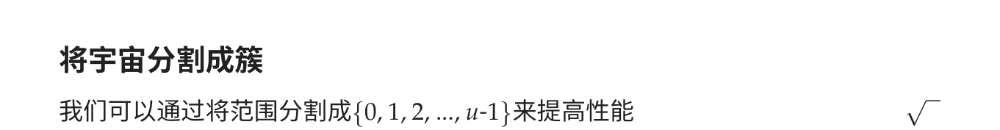

-   插入：簇[高(X)][低(X)] = 1 $\quad O(1)$
-   将簇标记为非空的高(X) $\quad \mathcal{O}(1)$
-   在高簇中查找(X) $\quad \mathcal{O}(\sqrt{u})$
-   否则，找到下一个非空簇 $i$ $\quad \mathcal{O}(\sqrt{u})$
-   在该簇中找到最小的条目 $j$ $\quad \mathcal{O}(\sqrt{u})$
-   返回索引(I,J) $\quad \text{总计} = \mathcal{O}(\sqrt{u})$

## 递归

后继中的三个操作也是对大小为 U 的向量的后继调用。我们可以使用递归来加快速度。

-   $V.\text{簇}[i]$ 是一个大小为 $\sqrt{U}$ 的 van Emde Boas 结构 ($\forall\ 0 \leq i < U$)
-   $V.\text{摘要}$ 是一个大小为 $\sqrt{U}$ 的 van Emde Boas 结构
-   $V.\text{总结}[i]$ 表示是否 $V.\text{簇}[i]$ 非空

```
插入($V, x$)
1 插入 ($V.\text{簇}$ [$\text{高}(x)$], 低 [$x$])
2 插入 ($V.\text{总结}$ , 高 [$x$])
```

因此，我们得到递归关系：

$$\begin{aligned}
T(u) &= 2T(\sqrt{u}) + \mathcal{O}(1) \\
T'(\log u) &= 2T' \left(\frac{\log u}{2}\right) + \mathcal{O}(1) \\
\implies T(u) &= T'(\log u) = \mathcal{O}(\log u)
\end{aligned}$$

```
后继($V, x$)
1 $i = \text{高}(x)$
2 $j = \text{后继}$ ($V.\text{簇}$ [$i$], $j$)
3 **if** $j == \infty$
4 $\quad i = \text{后继}$ ($V.summary, i$)
5 $\quad j = \text{后继}$ ($V.cluster[i], -\infty$)
6 **return** $index(i, j)$
```

$$T(u) = 3T(\sqrt{u}) + \mathcal{O}(1)$$
$$T'(\log u) = 3T'\left(\frac{\log u}{2}\right) + \mathcal{O}(1)$$
$$\Longrightarrow T(u) = T'(\log u) = \mathcal{O}((\log u)^{\log 3}) \Rightarrow \mathcal{O}((\log u)^{1.585})$$

为了获得 $\mathcal{O}(\log\log u)$ 运行时间，我们需要减少递归的次数。

## 维护最小值和最大值

我们在每个结构中存储最小和最大的条目。这给每个插入操作带来了 $\mathcal{O}(1)$ 时间开销。

```
后继$(V, x)$
1 $i = 高(x)$
2 $\textbf{if } 低(x) < V.cluster[i].max$
3 $\quad j = Successor(V.cluster[i], 低(x))$
4 $\textbf{else } i = Successor(V.summary, 高(x))$
5 $\quad j = V.cluster[i].min$
6 $\textbf{return } index(i, j)$
```

$$T(u) = T(\sqrt{u}) + \mathcal{O}(1)$$
$$\Longrightarrow T(u) = \mathcal{O}(\log \log u)$$

## 不要递归地存储最小值

现在 Successor 调用需要单独检查最小值

$$\textbf{if } x < V.min : \textbf{return } V.min \qquad\qquad (1)$$

## 插入(V, x)

```
插入(V, x)
1 if V.min == None
2     V.min = V.max = x    我 O(1)次
3     返回
4 如果 x < V.min
5     交换(x ↔ V.min)
6 如果 x > V.max
7     V.max = x)
8 如果 V.集群[高(x)] ==无
9     插入 (V.summary, 高 (x))    第一次调用
10 插入 (V.cluster[高 (x)], 低 (x))    第二次调用
```

如果执行了第一次调用，则第二次调用只需要 O(1) 时间。所以

T(u) = T(√u) + O(1)  ⇒  T(u) = O(log log u)

## 删除(V, x)

```
删除(V, x)
1 if x == V.min    找到新的最小值
2     i = V.summary.min
3     如果 i =无
4         V.min = V.max = 无    ▷ O(1)时间
5     返回
6     V.min = index(i, V.cluster[i].min)    ▷取消存储新的最小值
7 删除(V.cluster[高(X)], 低(X))    ▷第一次调用
8 if V.cluster[高(X)].min ==无
9     删除(V.summary, 高(X))    第二次调用
10 ▷现在我们更新 V.max
11 如果X == V.max
12 如果 V.summary.max =无
13 其他
14     i = V.summary.max
15     V.max = index(i, V.cluster[i].max)
```

如果第二个调用被执行，第一个调用只需要 O(1) 的时间。所以

T(u) = T(√u) + O(1)  ⇒  T(u) = O(log log u)

## 下界 [Patrascu & Thorup 2007]

即使对于静态查询（无插入/删除）

- $\Omega(\log \log u)$ 每个查询的时间复杂度，其中 $u = n^{(\log n)^{O(1)}}$
- $O(n \cdot \operatorname{poly}(\log n))$ 的空间复杂度

## 空间改进

我们可以从 $\Theta(u)$ 改进到 $O(n \log \log u)$。

- 只创建非空簇
- 如果 $V.\text{min}$ 变为 `None`，释放 $V$
- 存储 $V.\text{簇}$ 作为非空簇的哈希表
- 每次插入可能会创建一个新的结构，$\Theta(\log \log u)$ 次（每次空插入）
    - 实际上可能发生 [Vladimir Čunát]
- 将指针转换为结构体（以及相关的哈希表条目）转换为结构体

这给我们提供了 $O(n \log \log u)$ 的空间（但是随机化）。

## 间接引用

我们可以进一步减少到 $O(n)$ 的空间。

- 使用 BST 或者是数组来存储 vEB 结构，其中 $n = O(\log \log u)$
    $\Rightarrow O(\log \log n)$ 时间在基本情况下只需一次
- 我们使用 $O(n / \log \log u)$ 这样的结构（不相交）
    $\Rightarrow O(n / \log \log u \cdot \log \log u) = O(n)$ 的空间对于小的
- 更大的结构“存储”指向它们的指针
    $\Rightarrow O(n / \log \log u \cdot \log \log u) = O(n)$ 的空间对于大的
- 细节：拆分/合并小的结构

麻省理工学院开放式课程网站 [http://ocw.mit.edu](http://ocw.mit.edu)

# 6.046J / 18.410J 算法设计与分析

2011年春季

有关引用这些材料或我们的使用条款的信息，请访问：[http://ocw.mit.edu/terms](http://ocw.mit.edu/terms)

# 第5讲：摊销

摊销分析是一种用于数据结构分析的强大技术，涉及到一系列操作的总运行时间，这通常是我们真正关心的。本讲涵盖的内容有：

- 摊还分析的不同技术
    - 聚合方法
    - 会计方法
    - 计费方法
    - 潜力方法
- 摊还分析的例子
    - 表翻倍
    - 二进制计数器
    - 2-3树和2-5树

## 表翻倍

（回顾6.006）我们想要在大小为 $m = \Theta(n)$ 的表中存储 $n$ 个元素。一个想法是在 $n$ 变得大于 $m$（由于插入）时，将 $m$ 翻倍。显然，将大小为 $m$ 的表翻倍的成本是 $\Theta(m) = \Theta(n)$，这也是插入的最坏情况成本。

但是 $n$ 次插入的总成本是多少？它最多是

$$2^0 + 2^1 + 2^2 + \ldots + 2^{\lfloor \lg n \rfloor} = \Theta(n)$$

在这种情况下，我们说每个插入的 $\Theta(n)/n = \Theta(1)$ 摊销成本。

## 聚合方法

我们在上面的分析中使用的方法是聚合方法：只需将所有操作的成本相加，然后除以操作的数量。

每个操作的摊销成本 = $\frac{k \text{ 个操作的总成本}}{k}$

聚合方法是最简单的方法。因为它很简单，可能无法分析更复杂的算法。

## 摊销界定

摊销成本可以是平均成本，但不一定是。我们可以为每个操作分配任何摊销成本，只要它们“保持总成本”，即对于任何操作序列，

$$\sum \text{摊销成本} \ge \sum \text{实际成本}$$

其中求和是在所有操作上进行的。

例如，我们可以说2-3树实现了 $O(1)$ 每个创建的摊销成本， $O(\lg n^*)$ 每个插入的摊销成本，以及 $0$ 每个删除的摊销成本，其中 $n^*$ 是整个操作序列期间2-3树的最大大小。我们之所以可以这样说，是因为对于任何操作序列，假设有 $c$ 个创建， $i$ 个插入和 $d \le i$ 个删除（不能从空树中删除），总摊销成本与总实际成本渐近地相同：

$$O(c + i \lg n^* + 0 \cdot d) = O(c + i \lg n^* + d \lg n^*)$$

稍后，我们将把每次插入的摊还成本限制在 $O(\lg n)$，其中 $n$ 是当前的大小。

## 会计方法

这种方法允许一个操作将信用存入银行以供将来使用，如果其分摊成本 > 实际成本；它还允许一个操作使用现有的信用来支付其额外的实际成本，如果其分摊成本 < 实际成本。

## 表翻倍

例如，在表扩容中：

- 如果插入不触发表扩容，则存储一个代表 $c = O(1)$ 未来使用的硬币。
- 如果插入触发表扩容，则必须有 $n/2$ 个元素在上一次表扩容之后插入，其硬币尚未消耗。使用这些 $n/2$ 个硬币支付 $O(n)$ 表翻倍。请参见下图。
- 表翻倍的摊销成本： $O(n) - c \cdot n/2 =$ 对于足够大的 $c$，等于 $0$。
- 每次插入的摊销成本： $1 + c = O(1)$。

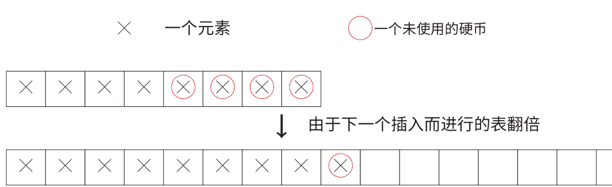

## 2-3树

现在让我们在2-3树上尝试会计方法。我们的目标是证明插入的摊销成本为 $O(\lg n)$，删除的摊销成本为 $0$。让我们尝试一种自然的方法：为插入一个元素保存一个 $O(\lg n)$ 的硬币，并在删除该元素时使用此硬币。然而，我们会遇到一个问题：到我们删除该元素的时候，树的大小可能已经变大 $n' > n$，而我们保存的硬币不足以支付该删除操作的实际成本 $\lg n'$！这个问题可以通过下一节中的充电方法来解决。

## 充电方法

充电方法允许操作将成本追溯性地充电到过去的操作。

> 操作的摊销成本 = 该操作的实际成本
> $\quad$ - 过去操作所收取的总成本
> $\quad$ + 未来操作所收取的总成本

## 表的倍增和减半

例如，在表的倍增中，当表从 $m$ 扩大到 $2m$ 时，我们可以将 $\Theta(m)$ 成本收取给自上次倍增以来的 $m/2$ 次插入操作。每次插入都收取 $\Theta(1)$ 成本，并且不会再次收取。因此，每次插入的摊销成本为 $\Theta(1)$。

现在让我们扩展上面的例子，加入表的减半。动机是在删除时节省空间。如果表只有1/4满，即 $n = m/4$，我们以 $\Theta(m)$ 成本将表的大小从 $m$ 缩小到 $m/2$。这样，在任何调整大小（倍增或缩小）后，表都会再次变为半满。现在每次表的倍增仍然有 $\ge m/2$ 次插入操作要收取，每次表的减半都有 $\ge m/4$ 次删除操作要收取。因此，每次插入或删除的摊销成本仍然为 $\Theta(1)$。

## 2-3树中的自由删除

再举一个例子，让我们考虑2-3树中的插入和删除操作。同样，我们的目标是展示插入操作的摊销成本为 $O(\lg n)$，其中 $n$ 是树的大小，当插入操作发生时，删除操作的摊销成本为 $0$。

插入操作不需要收取任何费用。删除操作将收取一次插入操作的费用。但是我们不会收取要删除的元素的插入操作的费用，因为我们会遇到与会计方法相同的问题。相反，每个删除操作将收取将树调整为当前大小的插入操作的费用。每个插入操作仍然最多收取一次费用，因为要使树的大小再次达到 $n$，必须进行另一个插入操作。

## 潜在方法

该方法定义了一个潜在函数 $\Phi$，将数据结构（DS）的配置映射到一个值。这个函数 $\Phi$ 等同于过去所有操作积累的未使用的信用总额（银行账户余额）。现在

操作的摊销成本 = 此操作的实际成本 + $\Delta \Phi$

和

$\sum$ 摊销成本 = $\sum$ 实际成本 + $\Phi$(最终数据结构) - $\Phi$(初始数据结构)。

为了保持摊销界限，$\Phi$ 在任何时候都不应该低于 $\Phi$(初始数据结构)。如果 $\Phi$(初始数据结构) = 0，通常情况下，$\Phi$ 不应该变为负数（直观上，我们不能“欠银行”）。

## 与会计方法的关系

在会计方法中，我们指定 $\Delta \Phi$，而在潜力方法中，我们指定 $\Phi$。一个决定另一个，所以这两种方法是等价的。但有时候一个方法比另一个更直观。

## 二进制计数器

我们使用潜力方法的第一个例子是递增二进制计数器。例如，

```
递增
0011010111
↓
0011011000
```

递增的成本是 $\Theta(1 + \#1)$，其中 $\#1$ 表示尾部1的数量。所以直觉是1位是坏的。

定义 $\Phi = c \cdot \#1$。那么对于足够大的 $c$，

摊还成本 = 实际成本 + $\Delta \Phi$
$= \Theta(1 + \#1) + c(-\#1 + 1)$
$= \Theta(1)$

$\Phi$(初始数据结构) = 0，如果计数器从 000…0 开始。这对于上述摊还分析是必要的。否则，$\Phi$ 可能会变小于 $\Phi$(初始数据结构)。

## 在2-3树中插入

在最坏情况下，插入可能导致 $O(\lg n)$ 次分裂，但我们可以证明它只会导致 $O(1)$ 摊还分裂。首先考虑什么会导致分裂：插入到一个3节点（一个有3个子节点的节点）中。在这种情况下，3节点需要分裂成两个2节点。所以3节点是坏的。我们定义 $\Phi =$ 3节点的数量。然后 $\Delta \Phi \le 1 -$ 分裂的数量。摊还分裂的数量 = 实际分裂的数量 + $\Delta \Phi = 1$。$\Phi$(初始数据结构) = 0，如果树最初是空的。

对于任意 $(a,b)$-树，如果我们定义 $\Phi$ 为 $b$-节点的数量，则上述分析成立。

如果我们考虑2-3树中的插入和删除，我们能否声称插入的 $O(1)$ 拆分和删除的 $O(1)$ 合并？答案是否定的，因为拆分会创建两个2-节点，这对于合并来说是不好的。在最坏的情况下，它们可能会在下一个删除操作中合并，然后在下一个插入操作中再次需要拆分，依此类推。

我们如何解决这个问题？我们需要防止拆分和合并创建 '坏'节点。

## 在2-5树中进行插入和删除

我们可以声称 2-5树中的插入的 $O(1)$ 拆分和删除的 $O(1)$ 合并。在2-5树中，向一个5-节点（具有5个子节点的节点）插入会导致它拆分成两个3-节点。

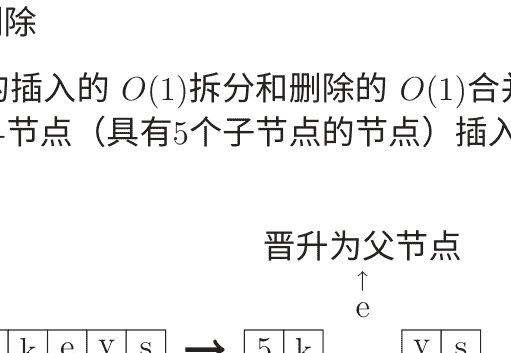

从2节点中删除会导致它与另一个2节点合并形成3节点。

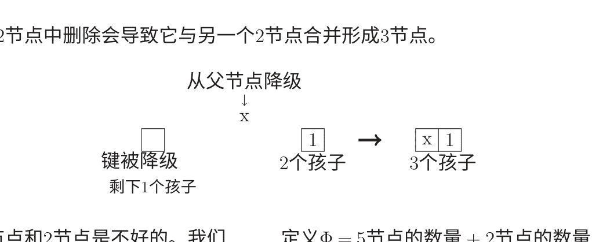

5节点和2节点是不好的。我们定义 $\Phi =$ 5节点的数量 + 2节点的数量。摊销的分裂和合并 = 1。$\Phi$（初始数据结构） = 0，如果树最初是空的。

上述分析适用于任何 $(a,b)$ -树，其中 $b > 2a$，因为分裂和合并不会产生不好的节点。我们定义 $\Phi$ 为 $b$ 节点的数量加上 $a$ 节点的数量。

注意：潜在的例子也可以用会计方法来完成，通过在1上放置硬币（二进制计数器）或2/5节点（(2,5) -树）上放置硬币。

麻省理工学院开放式课程网站 [http://ocw.mit.edu](http://ocw.mit.edu)

# 6.046J / 18.410J 算法设计与分析

2011年春季

有关引用这些材料或我们的使用条款的信息，请访问：[http://ocw.mit.edu/terms](http://ocw.mit.edu/terms)。

# 第6讲：随机化算法

- 检查矩阵乘法
- 快速排序

## 随机化或概率算法

什么是随机化算法？

- 生成一个随机数 $r \in \{1,...,R\}$ 并根据 $r$ 的值做出决策。
- 在不同的执行中，随机化算法可能
    - 运行不同数量的步骤
    - 产生不同的输出

随机化算法可以广泛分为两种类型- 蒙特卡洛和拉斯维加斯。

| 蒙特卡洛 | 拉斯维加斯 |
|----------|------------|
| 总是在多项式时间内运行 | 在预期的多项式时间内运行 |
| 输出具有高概率的正确性 | 总是输出正确结果 |

## 矩阵乘积

$C = A \times B$

简单算法：$O(n^3)$ 次乘法运算。 Strassen：在 7次乘法中乘以两个 $2 \times 2$矩阵：$O(n^{\log_2 7}) = O(n^{2.81})$ Coppersmith-Winograd: $O(n^{2.376})$

## 矩阵乘积检查器

给定 $n \times n$ 矩阵 $A, B, C$，目标是检查 $A \times B = C$ 是否成立。问题。我们能否比进行完整的乘法更好？我们将看到一个 $O(n^2)$ 算法，它具有以下特点：

- 如果 $A \times B = C$，则 $\Pr[\text{输出} = \text{YES}] = 1$。
- 如果 $A \times B \neq C$，则 $\Pr[\text{输出}=\text{YES}] \leq \frac{1}{2}$。

我们将假设矩阵中的元素 $\in \{0, 1\}$，并且算术运算是模 2 的。

## Frievald算法

选择一个随机的二进制向量 $r[1...n]$，使得 $\Pr[r_i = 1] = 1/2$ 独立于 $i = 1,...,n$。如果 $A(Br) = Cr$，则算法输出 'YES'，否则输出 'NO'。

## 观察

由于存在3个矩阵乘法 $Br$, $A(Br)$ 和 $Cr$，算法将花费 $O(n^2)$ 时间，其中矩阵的大小为 $n \times n$，乘以一个 $n \times 1$ 的矩阵

## 正确性分析，如果 $AB = C$

声明. 如果 $AB = C$，那么 $\Pr[ABr = Cr] \geq 1/2$。 因此，我们的假设是 $D = 0$。显然，存在一个 $r$ 使得 $Dr = 0$。 我们的目标是证明存在许多 $r$ 使得 $Dr = 0$。具体来说，对于随机选择的 $r$，有 $\Pr[Dr= 0] \geq 1/2$。

$D = AB - C = 0 \implies$ 存在 $i, j$ 使得 $d_{ij} = 0$。固定向量 $v$，除了 $v_j = 1$ 外，其他坐标都为 0。$(Dv)_i = d_{ij} = 0$，暗示 $Dv = 0$。选择我们的算法可以选择的任何 $r$。我们正在考虑 $Dr = 0$ 的情况。让 $r' = r + v$

由于 $v$ 在除了 $v_j$ 之外的地方都是 0，$r'$ 与 $r$ 相同，除了 $r_j = (r_j + v_j) \mod 2$。因此，$Dr' = D(r + v) = 0 + Dv = 0$。我们看到存在一一对应的对应关系在 $r$ 和 $r'$ 之间，就像 $r' = r + v = r'' + v$ 那样，$r \neq r''$。这意味着使得 $Dr' = 0$ 的 $r$ 的数量 $\geq$ 使得 $Dr = 0$ 的 $r$ 的数量

由此我们得出结论 $\Pr[Dr = 0] \geq 1/2$

## 快速排序

分治算法，但主要在分割步骤而不是合并步骤中工作。

就地排序，如插入排序，不像归并排序（需要 $O(n)$ 辅助空间）。不同的变体：

- 基本：在平均情况下表现良好
- 基于中位数的枢轴选择：使用中位数查找
- 随机选择：在期望中适用于所有输入（拉斯维加斯算法）

快速排序的步骤：

- 划分：选择一个枢轴元素 $x$ 在 $A$ 中，将数组划分为子数组 $L$ 和 $G$，其中 $L$ 包含所有元素 $< x$，$G$ 包含所有元素 $> x$，$E$ 包含所有元素 $= x$。
- 征服：递归地对子数组 $L$ 和 $G$ 进行排序
- 合并：平凡

## 基本快速排序

围绕 $x = A[1]$ 或 $A[n]$（第一个或最后一个元素）作为枢轴

- 依次从 $A$ 中删除每个元素 $y$
- 根据与枢轴 $x$ 的比较，将 $y$ 插入 $L$、 $E$ 或 $G$ 中
- 每次插入和删除都需要 $O(1)$ 时间
- 分区步骤需要 $O(n)$ 时间
- 要在原地完成这个操作：参见CLRS p. 171

## 基本快速排序分析

如果输入已排序或逆序排序，则每次都围绕最小或最大元素进行分区。这意味着 $L$ 或 $G$中有$(n-1)$个元素，另一个为0。这给出了：

$$T(n) = T(0) + T(n-1) + \Theta(n)$$
$$= \Theta(1) + T(n-1) + \Theta(n)$$
$$= \Theta(n^2)$$

然而，在实践中，这个算法在随机输入上表现良好。

## 使用中位数查找进行枢轴选择

可以使用运行时间为 $\Theta(n)$ 的秩/中位数选择算法来保证平衡的 $L$ 和 $G$。下面的第一个 $\Theta(n)$ 是用于选择枢轴的，第二个是用于分区步骤的。

$$T(n) = 2T \left( \frac{n}{2} \right) + \Theta(n) + \Theta(n)$$
$$T(n) = \Theta(n \log n)$$

这个算法在实践中速度较慢，并且输给了归并排序。

## 随机快速排序

$x$ 从数组 $A$ 中随机选择（在每次递归时，都会进行随机选择）。对于所有输入数组 $A$，期望时间为 $O(n \log n)$。参见CLRS p.181-184，对该算法进行分析；我们将分析该算法的一个变体。

## “多疑”快速排序

- 重复
    - 选择随机元素作为 $A$ 的枢纽
    - 执行划分
- 直到
    - 得到的划分满足条件 $|L| \le \frac{3}{4}|A|$ 且 $|G| \le \frac{3}{4}|A|$
- 对 $L$ 和 $G$ 进行递归

## “多疑”快速排序分析

让我们定义一个“好的枢纽”和一个“坏的枢纽”

- 好的枢纽：$L$ 和 $G$ 的大小 $\le \frac{3}{4}n$ each
- 坏的枢纽：其中一个 $L$ 和 $G$ $\le \frac{3}{4}n$ each

| 坏的枢纽 | 好的枢纽 | 坏的枢纽 |
|----------|----------|----------|
| $\frac{n}{4}$ | $\frac{n}{2}$ | $\frac{n}{4}$ |

我们可以看到一个枢纽以概率 $> 1/2$ 是好的。 设 $T(n)$ 是对任意大小为 $n$ 的数组的期望运行时间的上界。

- 排序左子数组所需的时间
- 排序右子数组所需的时间
- 获得好的调用所需的迭代次数。将分区步骤的成本表示为 $c \cdot n$

期望值

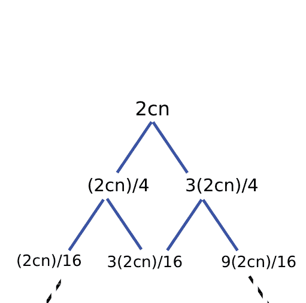

$T(n) \le \max_{n/4 \le i \le 3n/4}(T(i) + T(n - i)) + E(\#\text{迭代次数}) \cdot cn$

现在，由于好的枢纽的概率 $> \frac{1}{2}$, $E(\#\text{迭代次数}) \le 2$

我们可以从图论中跟随高度最到底部达到 $ \log n $ 都是一样的。在每个层级上，我们总共做 $2cn$ 的工作。因此，期望运行时间为 $T(n) = \Theta(n \log n)$。

## 第8讲：哈希

### 课程概述

本课程涵盖了几个模块：
- 1. 回顾：字典、链接、简单均匀
- 2. 通用哈希
- 3. 完美哈希

### 回顾

### 字典问题

字典是一种抽象数据类型（ADT），用于维护一组项目。每个项目都有一个键。字典支持以下操作：
- `insert(item)`：将项目添加到集合中
- `delete(item)`：从集合中删除项目
- `search(key)`：如果存在，则返回具有该键的项目

我们假设物品具有不同的键（或者插入新的键会覆盖旧的键）。

这个问题比之前讲解的前驱/后继问题更容易解决（通过van Emde Boas树，或者AVL/2-3树/跳表）。

### 来自6.006的哈希

目标：每个操作的时间复杂度为 $O(1)$，空间复杂度为 $O(n)$。

定义：
- $u =$ 所有可能物品的键的数量
- $n =$ 当前表中的键 /物品数量
- $m =$ 表中的槽位数量

### 解决方案：使用链式哈希

假设简单均匀哈希，

$$\Pr_{k_1=k_2} \{h(k_1) = h(k_2)\} = \frac{1}{m}$$

我们实现了 $\Theta(1 + \alpha)$ 每个操作的时间复杂度，其中 $\alpha = n/m$ 被称为负载因子。算法的缺点是需要假设输入键是随机的，并且它只适用于平均情况，就像基本的快速排序一样。今天我们将消除不合理的简单均匀散列假设。

### 词源学

英语中的“hash”（1650年代）意味着“切成小块”，源自法语的“hacher”，意为“切碎”，源自古法语的“hache”，意为“斧头”（类似于英语的“hatchet”）。或者，也许它们来自于火神“拉阿什”，意为“斧头”。（逝者安息，伦纳德·尼莫伊。）

### 通用散列

通用散列的思想如下所示：
- 从 $\mathcal{H}$ 中选择一个随机散列函数 $h$
- 要求 $\mathcal{H}$ 是一个通用散列族，使得

$$\Pr_{h\in\mathcal{H}} \{h(k) = h(k')\} \leq \frac{1}{m} \text{ 对于所有的 } k \neq k' \text{，都成立}$$

- 现在我们只假设 $h$ 是随机的，并且对输入键不做任何假设。（像随机快速排序一样）

**定理：** 对于任意不同的键和随机的 $h \in \mathcal{H}$，其中 $\mathcal{H}$ 是一个通用的哈希族，

$$E[ \text{在一个槽中碰撞的键的数量} ] \le 1 + \alpha \quad \text{其中} \quad \alpha = \frac{n}{m}$$

### 证明：

考虑键 $k_1, k_2, \ldots, k_n$。令 $I_{i,j} = \begin{cases} 1 & \text{如果 } h(k_i) = h(k_j) \\ 0 & \text{否则} \end{cases}$。然后我们有

$$\begin{aligned} E[I_{i,j}] &= \Pr\{I_{i,j} = 1\} \\ &= \Pr\{h(k_i) = h(k_j)\} \\ &\le \frac{1}{m} \quad \text{对于任何 } j \neq i \end{aligned} \tag{1}$$

$$\begin{aligned} E[ \text{与 } k_i \text{哈希到同一个槽的键的数量} ] &= E\left[ \sum_{j=1}^{n} I_{i,j} \right] \\ &= \sum_{j=1}^{n} E[I_{i,j}] \quad (\text{期望的线性性}) \\ &= \sum_{j \neq i} E[I_{i,j}] + E[I_{i,i}] \\ &\le \frac{n}{m} + 1 \end{aligned} \tag{2}$$

根据上述定理，我们知道插入、删除和搜索都需要 $O(1+\alpha)$ 的期望时间。这里我们给出一些通用哈希函数的例子。

所有哈希函数: $\mathcal{H} = \{ \text{所有哈希函数 } h: \{0, 1, \ldots, u-1\} \to \{0, 1, \ldots, m-1\} \}$。显然，$\mathcal{H}$ 是通用的，但是它是无用的。一方面，存储一个单一的哈希函数 $h$ 需要 $\log (m^u) = u \log(m)$ 位 $\gg n$ 位。另一方面，我们需要预先计算 $u$ 个值，这需要 $\Omega(u)$ 时间。

### 点积哈希族

**假设：**
- $m$ 是一个质数
- $u = m^r$ 其中 $r$ 是一个整数

在实际情况中，我们总是可以将 $m$ 和 $u$ 四舍五入以满足上述假设。现在让我们以 $m$ 为基数查看键值：$k = \langle k_0, k_1, \ldots, k_{r-1} \rangle$。对于键值 $a = \langle a_0, a_1, a_2, \ldots, a_{r-1} \rangle$, 定义

$$h_a(k) = a \cdot k \mod m \quad (\text{点积}) = \sum_{i=0}^{r-1} a_i k_i \mod m \tag{3}$$

那么我们的哈希族是 $\mathcal{H} = \{h_a \mid a \in \{0, 1, \ldots, u-1\}\}$

存储 $h_a \in \mathcal{H}$ 只需要存储一个键，即 $a$。在word RAM模型中，操作 $O(1)$ 个机器字需要 $O(1)$ 的时间，并且“小型的对象”（这里是键）可以放入一个机器字中。因此，计算 $h_a(k)$ 需要 $O(1)$ 的时间。

**定理：** 点积哈希族 $\mathcal{H}$ 是通用的。

**证明：** 取任意两个键 $k \neq k'$。它们必须在某些位上不同。假设 $k_d \neq k'_d$。定义 $\text{not } d = \{0, 1, \ldots, r-1\} \setminus \{d\}$。现在我们有

$$\begin{aligned}
\Pr_a \{h_a(k) = h_a(k')\} &= \Pr_a \left\{ \sum_{i=0}^{r-1} a_i k_i = \sum_{i=0}^{r-1} a_i k'_i \pmod{m} \right\} \\
&= \Pr_a \left\{ \sum_{i \neq d} a_i k_i + a_d k_d = \sum_{i \neq d} a_i k'_i + a_d k'_d \pmod{m} \right\} \\
&= \Pr_a \left\{ \sum_{i \neq d} a_i (k_i - k'_i) + a_d (k_d - k'_d) = 0 \pmod{m} \right\} \\
&= \Pr_a \left\{ a_d = -(k_d - k'_d)^{-1} \sum_{i \neq d} a_i (k_i - k'_i) \pmod{m} \right\} \quad \text{(4)}
\end{aligned}$$

($m$ 是质数 $\Rightarrow \mathbb{Z}_m$ 有乘法逆元)

$$= \mathop{E}_{a_{\text{not } d}} [\Pr_{a_d} \{ a_d = f(k, k', a_{\text{not } d}) \}]$$

($= \sum_{x} \Pr\{ a_{\text{not } d} = x \} \Pr_{a_d} \{ a_d = f(k, k', x) \}$)

$$= \mathop{E}_{a_{\text{not } d}} \left[ \frac{1}{m} \right] = \frac{1}{m}$$

CLRS中的另一个通用哈希族：选择一个大于等于 $u$ 的素数 $p$（一次）。定义 $h_{ab}(k) = [(ak + b) \mod p] \mod m$。令 $\mathcal{H} = \{h_{ab} | a, b \in \{0, 1, \dots, u-1\}\}$。

### 完美哈希

静态字典问题：给定 $n$ 个键存储在表中，只需要支持搜索($k$)。不会发生插入或删除。

> 完美哈希： [Fredman, Koml´os, Szemer´edi 1984]
- 多项式建立时间，高概率（w.h.p.）
- 最坏情况下搜索时间为 $O(1)$
- 最坏情况下空间占用为 $O(n)$

思路：两级哈希

该算法包含以下两个主要步骤：

步骤1：选择 $h_1: \{0, 1, \dots, u-1\} \rightarrow \{0, 1, \dots, m-1\}$ 从一个通用哈希族中为 $m = \Theta(n)$（例如，附近的质数）。使用 $h_1$ 对所有项目进行链式哈希。

步骤2: 对于每个槽 $j \in \{0, 1, \ldots, m-1\}$, 令 $l_j$ 为槽 $j$ 中的项目数. $l_j = |\{ i | h_1(k_i) = j \}|$. 选择 $h_{2,j}: \{0, 1, \ldots, u-1\} \to \{0, 1, \ldots, m_j\}$ 从一个通用哈希族中为 $l_j^2 \le m_j \le O(l_j^2)$ (例如, 附近的质数). 用 $h_{2,j}$ 替换槽 $j$ 中的链表, 使用哈希表。

空间复杂度为 $O(n + \sum_{j=0}^{m-1} l_j^2)$. 为了将其减少到 $O(n)$, 我们需要添加两个步骤:

步骤 1.5: 如果 $\sum_{j=0}^{m-1} l_j^2 > cn$ 其中 $c$ 是一个选择的常数, 那么重新执行步骤 1.

步骤 2.5: 当 $h_{2,j}(k_i) = h_{2,j}(k'_i)$ 对于任何 $i \neq i'$, $j$ 时, 重新选择 $h_{2,j}$ 并重新哈希那些 $l_j$ 个元素。

上述两个步骤保证了第二层没有冲突, 并且空间复杂度为 $O(n)$. 因此, 搜索时间为 $O(1)$. 现在让我们来看看算法的构建时间. 步骤1和步骤2都是 $O(n)$. 步骤1.5和步骤2.5呢?

对于步骤2.5，

$$\Pr_{h_{2,j}} \{ h_{2,j}(k_i) = h_{2,j}(k'_i) \text{ 对于某些 } i \neq i' \} \le \sum_{i \neq i'} \Pr_{h_{2,j}} \{ h_{2,j}(k_i) = h_{2,j}(k'_i) \} \text{ (并集界) } \le \binom{l_j}{2} \cdot \frac{1}{l_j^2} < \frac{1}{2}$$

因此, 每次试验就像抛硬币一样. 如果结果是“反面”, 我们就进入下一步. 通过第7讲, 我们有 $E[\#\text{trials}] \le 2$ 和 $\#\text{trials} = O(\log n)$ w.h.p. 通过Chernoff界, $l_j = O(\log n)$ w.h.p., 所以每次试验需要 $O(\log n)$ 时间. 因为我们需要对每个 $j$ 都这样做, 所以总的时间复杂度是 $O(\log n) \cdot O(\log n) \cdot O(n) = O(n \log^2 n)$ w.h.p.

对于步骤1.5，我们定义 $I_{i,i'} = \begin{cases} 1 & \text{如果 } h_1(k_i) = h_1(k_{i'}) \\ 0 & \text{否则} \end{cases}$。然后我们有

$$\begin{aligned} E\left[\sum_{j=0}^{m-1} l_j^2\right] &= E\left[\sum_{i=1}^{n}\sum_{i'=1}^{n} I_{i,i'}\right] \\ &= \sum_{i=1}^{n}\sum_{i'=1}^{n} E[I_{i,i'}] \quad \text{(期望的线性性)} \\ &\leq n + 2\binom{n}{2} \cdot \frac{1}{m} \\ &= O(n) \quad \text{因为 当 } m = \Theta(n)\text{时} \end{aligned}$$

根据马尔可夫不等式，我们有

$$\underset{h_1}{\operatorname{Pr}}\left\{\sum_{j=0}^{m-1} l_j^2 \leq cn\right\} \leq \frac{\sum_{j=0}^{m-1} l_j^2}{cn} \leq \frac{1}{2}$$

对于足够大的常数 $c$。根据第7讲，我们有 $E[\text{#trials}] \leq 2$ 和 $\text{#trials} = O(\log n)$ w.h.p. 因此，步骤1和步骤1.5的组合需要 $O(n \log n)$ 时间 w.h.p.

## 第9讲：增强

本讲涵盖了数据结构的增强，包括：
- 简单的树增强
- 顺序统计树
- 指针搜索树和
- 范围树

主要思想是修改“现成的”常见数据结构以存储（和更新）额外的信息。

### 简单的树增强

这里的目标是在每个节点 $x$ 上存储 $x.f$，它是节点的一个函数，即 $f$（以 $x$ 为根的子树）。假设可以从 $x$、$children$ 和 $children.f$ 在 $O(1)$ 时间内计算（更新） $x.f$。然后，修改一组节点 $S$ 的成本为 $O$（$S$ 的祖先数量）来更新 $x.f$，因为我们需要沿树向上走到根节点。两个 $O(\lg n)$ 更新的例子是：
- AVL树：在旋转两个节点后，先更新新的底部节点，然后更新新的顶部节点
- 2-3树：在分裂节点后，更新两个新节点。
- 在这两种情况下，然后向上更新树。

### 顺序统计树（来自6.006）

顺序统计树的目标是设计一个支持以下操作的抽象数据类型（ADT）接口：
- $insert(x)$, $delete(x)$, $successor(x)$,
- $rank(x)$: 找到 $x$ 在排序顺序中的索引，即小于 $x$ 的元素数量,
- $select(i)$: 找到排名为 $i$ 的元素。

我们可以使用AVL树（或2-3树）上的简单树增强来实现上述ADT：

作为比较，我们无法为每个节点存储排名。在这种情况下，$\text{insert}(-\infty)$ 将改变所有节点的排名。

rank($x$)可以通过以下方式计算：
- 初始化 rank = $x.left.size + 1$<sup>1</sup>
- 从 $x$向上走到根节点，每当进行左移动 ($x \rightarrow x'$) 时，rank += $x'.left.size + 1$

select($i$)可以按照以下方式实现：
- $x = $ 根节点
- rank = $x.left.size + 1$<sup>2</sup>
- 如果 $i = $ rank：返回 $x$
- 如果 $i < $ rank： $x = x.left$
- 如果 $i > $ rank： $x = x.right$， $i -= rank$

<sup>1</sup> 如果索引从 0开始，则省略 +1项。
<sup>2</sup> 同上。

### 指针搜索树

指针搜索树的目标是，如果我们已经有节点 $y$，我们希望在 $O(\lg |rank( y) - rank( x)|)$ 时间内从 $y$ 搜索 $x$。直观上，如果我们已经有一个离 $x$ 很近的节点 $y$，我们希望 $x$ 的搜索速度很快。一种想法是使用level-linked 2-3树，其中每个节点都有指向同一层级的下一个和上一个节点的指针。

在拆分和合并过程中可以维护级别链接。

我们将所有键存储在叶子节点中。非叶子节点不存储键；相反，它们通过简单的树增强，存储子树的最小和最大键值。
- 从根开始，查看每个子节点 $c_i$ 的最小值和最大值
- 如果 $c_i.min \leq x \leq c_i.max$，向下移动到 $c_i$
- 如果 $c_i.max \leq x \leq c_{i+1}.min$，返回 $c_i.max$ (作为前驱) 或 $c_{i+1}.min$ (作为后继)

从 $y$ 开始搜索($x$)可以按照以下方式实现。将 $v$ 初始化为包含 $y$ 的叶节点。然后在循环中执行：
- 如果 $v.min \leq x \leq v.max$ (这意味着 $x$ 在以 $v$ 为根的子树中) ，则进行自顶向下的操作从 $v$ 开始搜索 $x$ 并返回
- 否则，如果 $x < v.min$，则 $v = v.prev$ (在当前层中的前一个节点)
- 否则，如果 $x > v.max$，则 $v = v.next$ (在当前层中的下一个节点)
- $v = v.parent$

**分析。** 我们从叶子层开始，并在每次迭代中向上移动一层。在第 $i$ 步，高度为 $i$ 的层链接大约跳过 $c * i$ 个键（排名），其中 $c \in [2, 3]$。因此，如果 $|rank(y) - rank(x)| = k$，我们将在 $O(\lg k)$ 步内到达包含 $x$ 的子树，并且随后的自顶向下搜索也是 $O(\lg k)$。

## 正交范围搜索和范围树

假设我们在一个$d$维空间中有$n$个点。我们希望有一个数据结构来支持对这些点进行范围查询：找到给定轴对齐框中的所有点。轴对齐框在1D中是一个区间，在2D中是一个矩形，在3D中是一个立方体。

更准确地说，每个点$x_i$（从$1$到$n$）是一个$d$维向量$x_i=(x_{i1}, x_{i2}, ..., x_{id})$。范围查询$(a, b)$接受两个点$a=(a1, a_2, ..., a_d)$和$b=(b1, b_2, ..., b_d)$作为输入，并应返回一组索引$\{i | \forall_j, a_j \le x_{ij} \le b_j\}$。

## 1D情况

我们从1D点的简单情况开始，即所有的 $x_i$和 $a$和 $b$都是标量。

然后，我们可以简单地使用一个排序数组。要执行范围查询$(a, b)$，我们只需分别进行两次二分查找来找到 $a$和 $b$，然后返回它们之间的所有点（假设有 $k$个）。复杂度为 $O(\lg n + k)$。排序数组在插入和删除方面效率低下。对于支持范围查询的动态数据结构，我们可以使用前一节介绍的优先搜索树。优先搜索树支持高效的插入和删除。要执行范围查询$(a, b)$，我们首先搜索 $a$，然后不断向右进行1次指针搜索，直到超过 $b$。每次1次指针搜索的复杂度为 $O(1)$，因此总复杂度也为$O(\lg n + k)$。

然而，以上两种方法都不能推广到高维度。这就是为什么我们现在引入范围树的原因。

## 一维范围树

一维范围树是一棵完全二叉搜索树（对于动态的情况，使用AVL树）。范围查询 $(a, b)$ 可以按以下方式实现：

- 搜索 $(a)$
- 搜索 $(b)$
- 找到 $a$和 $b$的最近公共祖先（LCA），进行分割
- 返回“之间”的节点和子树。“之间”有 $O(\lg n)$个节点和$O(\lg n)$个子树。

分析。隐式表示答案的复杂度为 $O(\lg n)$。输出所有 $k$个答案的复杂度为 $O(\lg n+ k)$。通过子树大小增强报告k的复杂度为$O(\lg n)$。

## 2D范围树

一个2D范围树由一个主要的1D范围树和许多次要的1D范围树组成。主要范围存储所有点，以第一个坐标为键。每个节点v在主要范围树中存储所有在v的子树中的点，以第二个坐标为键。

范围查询(a,b)可以按照以下方式实现：
- 使用主要范围树找到所有第一个坐标范围正确的点。只隐式表示答案，所以这需要$O(\lg n)$时间。
- 对于$O(\lg n)$个节点，手动检查它们的第二个坐标是否在正确的范围内。
- 对于$O(\lg n)$个子树，使用它们的次要范围树找到所有第二个坐标范围正确的点。

分析。$O(\lg^2 n)$ 用于隐式表示答案，因为我们将在次级范围树中找到$O(\lg^2 n)$个节点和子树。$O(\lg^2 n + k)$ 用于输出所有$k$个答案。$O(\lg^2 n)$通过子树大小增强来报告k。空间复杂度为$O(n \lg n)$。主要子树为$O(n)$。每个点在次级子树中重复出现最多$O(\lg n)$次，每个祖先一个。

## d-D 范围树

只需递归：主要1D范围树 →次级1D范围树 →三级1D范围树→ …

- 范围查询复杂度为 $O(\lg^d n + k)$。
- 空间复杂度为 $O(n \lg^{d-1} n)$。

> 参考 6.851查兹尔的改进结果： $O(\lg^{d-1} n + k)$范围查询复杂度 和 $O(n (\lg n / \lg \lg n)^{d-1})$ 空间复杂度。

麻省理工学院开放式课程网站
http://ocw.mit.edu

# 6.046J / 18.410J 算法设计与分析

2011年春季

有关引用这些材料或我们的使用条款的信息，请访问： http://ocw.mit.edu/terms。

## 第10讲：动态规划

- 最长回文序列
- 最优二叉搜索树
- 交替硬币游戏

## 动态规划概念

1. 描述最优解的结构
2. 基于子问题的最优解递归定义
3. 自底向上计算最优解的值（递归和记忆化）
4. 根据计算的信息构造最优解

## 最长回文序列

定义：回文是一个字符串，反转后仍然保持不变。
例子：radar, civic, t, bb, redder
给定：一个字符串 X[1 ... n], n ≥ 1
要找到：最长的回文子序列
例子：给定“character”
输出“carac”
答案长度至少为1

## 策略

```
L(i, j): X[i ... j]的最长回文子序列的长度，其中 i ≤ j。
```

```
1 def L(i, j) :
2     if i == j: return 1
3     if X[i] == X[j]:
4         if i + 1 == j: return 2
5         else : return 2 + L(i + 1, j - 1)
6     else :
7         return max(L(i + 1, j), L(i, j - 1))
```

练习：计算实际解

## 分析

按照原样，程序可能需要指数时间运行：假设所有符号 $X[i]$都是不同的。

$T(n) =$ 输入长度为 $n$时的运行时间

$$
T(n) = \begin{cases}
1 & n = 1 \\
2T(n - 1) & n > 1
\end{cases}
= 2^{n-1}
$$

## 子问题

但是只有 $\binom{n}{2} = \theta(n^2)$个不同的子问题：每个子问题都是一个 $(i,j)$对，其中 $i < j$。通过只解决每个子问题一次，运行时间减少到

$$
\theta(n^2) \cdot \theta(1) = \theta(n^2)
$$

其中 $\theta(n^2)$是子问题的数量， $\theta(1)$是解决每个子问题的时间，假设较小的问题已经解决。记忆化 $L(i,j)$，将输入哈希化以获得输出值，并查找哈希表以查看子问题是否已经解决，否则递归。

## 记忆化与迭代

1. 记忆化使用字典来存储 $L(i,j)$，其中 $L$的值通过使用i,j作为键来查找。在这里可以使用一个二维数组，其中空条目表示问题尚未解决。
2. 可以按照递增的 $j - i$顺序解决子问题，这样较小的问题会先被解决。

## 最优二叉搜索树：CLRS 15.5

给定：键 $K_1, K_2, \cdots, K_n$，不失一般性，$K_i = i$

权重 $W_1, W_2, \cdots, W_n$

求：最小化的BST T

$$
\sum_{i=1}^n W_i \cdot (\text{$T$的深度}(K_i) + 1)
$$

例子：$W_i$=搜索 $K_i$的概率

然后，我们最小化期望搜索成本。

(假设我们正在表示一个英语 $\rightarrow$法语的词典，常见词应该有更大的权重)

## 枚举

指数级的树


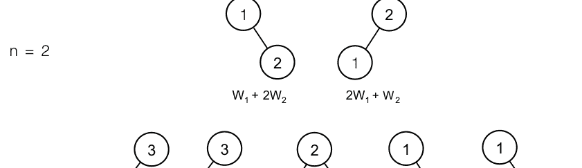

## 策略

$$
W(i, j) = W_i + W_{i+1} + \cdots + W_j
$$

$$
e(i, j) = \text{最优 BST 的成本在 } K_i, K_{i+1}, \cdots, K_j \text{ 上}
$$

想要的结果是 $e(1, n)$

贪心解法？

以某种贪心方式选择 $K_r$，例如，$W_r$是最大的。

贪心算法不起作用，见笔记末尾的例子。

## 动态规划策略：猜测所有根节点

$$
e(i, j) = \begin{cases} W_i & \text{如果 } i = j \\ \min_{i \leq r \leq j}(e(i, r-1) + e(r+1, j) + W(i, j)) & \text{否则} \end{cases}
$$

$+W(i, j)$ 考虑了根节点 $K_r$ 的权重 $W_r$ 以及所有其他键的深度增加1的影响（动态规划尝试所有可能的局部选择并利用重叠子问题）复杂度：$\theta(n^2) \cdot \theta(n) = \theta(n^3)$

其中 $\theta(n^2)$ 是子问题的数量， $\theta(n)$ 是每个子问题的时间。

## 交替硬币游戏

一排有 $n$ 个硬币，其价值分别为 $V_1, \cdots, V_n$，其中 $n$ 是偶数。每一轮，玩家可以选择从排列中取走第一个或最后一个硬币，并永久移除它，然后获得该硬币的价值。

### 问题

第一个玩家是否总能赢？

尝试：4 42 39 17 25 6

### 策略

$V_1, V_2, \cdots, V_{n-1}, V_n$

1. 比较 $V_1 + V_3 + \cdots + V_{n-1}$ 和 $V_2 + V_4 + \cdots + V_n$，选择较大的一组。
2. 在游戏中只从所选择的子集中选择（你总是能够选择！）

如何在移动第一步时最大化赢得的金额？

## 最优策略

V(i,j)：如果轮到我们并且只剩下硬币 V_i,\cdots, V_j时，我们肯定能赢得的最大价值。

V(i,i)：只选择 i。

V(i, i+1)：选择两者中的最大值。

V(i, i+2), V(i, i+3), ...

$$
V(i, j) = max\{\text{范围变为} \left( i+1, j\right) + V_i, \text{范围变为} \left( i, j-1\right) + V_j\}
$$

## 解决方案

V(i+1, j)子问题，对手选择时，我们保证 min {V(i+1, j-1), V(i+2, j)} 在对手选择V_j和V_{i+1}对手选择V_{i+1}之间，V(i+1, j-1)对应于V(i+2, j)对手选择V_i+1我们有

$$
V(i, j) = max \ min \begin{array}{c} V(i+1, j-1), \\ V(i+2, j) \end{array} + V_i, \ min \begin{array}{c} V(i, j-2), \\ V(i+1, j-1) \end{array} + V_j
$$

复杂度？

$$
\Theta(n^2) \cdot \Theta(1) = \Theta(n^2)
$$

## 贪婪算法无法得到最优二叉搜索树问题的例子

感谢Nick Davis！

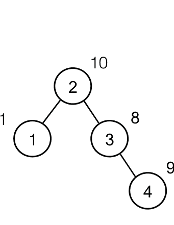

图1: cost = 1 × 2 + 10 × 1 + 8 × 2 + 9 × 3 = 55

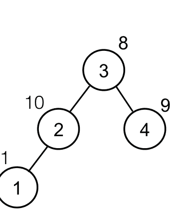

图2: 成本 = 1 × 3 + 10 × 2 + 8 × 1 + 9 × 2 = 49

麻省理工学院开放式课程网站
http://ocw.mit.edu

# 6.046J / 18.410J 算法设计与分析

2011年春季

有关引用这些材料或我们的使用条款的信息，请访问： http://ocw.mit.edu/terms。

## 第11讲：全对全最短路径

## 介绍

不同类型的算法可以用来解决全对全最短路径问题：

- 动态规划
- 矩阵乘法
- 弗洛伊德-沃舍尔算法
- 约翰逊算法
- 差分约束

## 单源最短路径

- 给定有向图 $G = (V, E)$，顶点 $s \in V$ 和边权重 $w : E \to \mathbb{R}$
- 找到 $\delta(s, v)$，等于最短路径权重 $s \to v, \forall v \in V$（如果有负权重环，则为 $-\infty$，如果没有路径，则为 $\infty$）

| 情况 | 算法 | 时间 |
| --- | --- | --- |
| 无权重 ($w = 1$) | BFS | $O(V + E)$ |
| 非负边权重 | Dijkstra | $O(E + V \lg V)$ |
| 一般 | Bellman-Ford | $O(V E)$ |
| 无环图 (DAG) | 拓扑排序 + Bellman-Ford的一次遍历 | $O(V + E)$ |

以上所有结果都是已知的最佳结果。我们使用斐波那契堆实现了对Dijkstra算法的 $O(E + V \lg V)$ 的上界。

## 全对最短路径

- 给定带权图，$G = (V, E, w)$
- 找到所有 $u, v \in V$ 的 $\delta(u, v)$

解决全对最短路径 (APSP) 问题的一种简单方法是从图中的每个 $V$ 顶点运行单源最短路径算法。

| 情况 | 算法 | 时间 | $E = \Theta(V^2)$ |
|------|------|------|-------------------|
| 无权重 ($w= 1$) | $\|V\|\times$ BFS | $O(VE)$ | $O(V^3)$ |
| 非负边权重 | $\|V\|\times$ Dijkstra | $O(VE + V^2 \lg V)$ | $O(V^3)$ |
| 一般的 | $\|V\|\times$ Bellman-Ford | $O(V^2E)$ | $O(V^4)$ |
| 一般的 | Johnson算法 | $O(VE + V^2 \lg V)$ | $O(V^3)$ |

> 这些结果（除了第三个）也是最好的 — 不知道如何击败 $|V|\times$ Dijkstra

## 解决APSP问题的算法

请注意，对于下面描述的所有算法，我们假设 $w(u, v) = \infty$ if $(u, v) \in E.$

## 动态规划，尝试1

1. 子问题: $d_{uv}^{(m)} = \text{最短路径的权重 } u \to v \text{使用} \le m \text{边}$
2. 猜测: 最后一条边是 $(x, v)$
3. 递归:
   $d_{uv}^{(m)} = \min(d_{ux}^{(m-1)} + w(x, v) \text{ for } x \in V)$
   $d_{uv}^{(0)} = \begin{cases} 0 & \text{如果 } u = v \\ \infty & \text{否则} \end{cases}$
4. 拓扑排序: 对于 $m=0,1,2,\ldots,\ldots,n-1$: 对于 $u$ 和 $v$ 在 $V$ 中:
5. 原始问题:
   如果图中不包含负权重环（通过贝尔曼-福特分析），那么最短路径是简单的 $\Rightarrow \delta(u,v) = d_{uv}^{(n-1)} = d_{uv}^{(n)} = \ldots$

## 时间复杂度

在这个动态规划中，我们有 $O(V^3)$ 个子问题。每个子问题需要 $O(V)$ 的时间来解决，因为我们需要考虑 $V$ 个可能的选择。这导致总运行时间复杂度为 $O(V^4)$。

> 请注意，这并不比 $|V|\times$贝尔曼-福特算法更好。

## 通过松弛步骤自底向上

```
1 对于 m从1到 n递增
2   对于 u在 V中
3     对于 v在 V中
4       对于 x在 V中
5         如果 d_uv > d_ux + d_xv
6           d_uv = d_ux + d_xv
```

在上述伪代码中，我们省略了上标，因为更多的松弛永远不会有害。

请注意，我们可以将松弛步骤更改为 $d_{uv}^{(m)} = \min(d_{ux}^{\lfloor m/2 \rfloor} + d_{xv}^{\lceil m/2 \rceil})$ 对于 $x \in V$ )。这个改变将产生一个总运行时间为 $O(n^3 \lg n)$ 的时间。(学生建议)

## 矩阵乘法

回顾标准矩阵乘法的任务，给定 $n \times n$ 矩阵 $A$ 和 $B$，计算 $C = A \cdot B$，使得 $c_{ij} = \sum_{k=1}^n a_{ik} \cdot b_{kj}$。

- 使用标准算法的 $O(n^3)$
- 使用Strassen算法的 $O(n^{2.807})$
- 使用Coppersmith-Winograd算法的 $O(n^{2.376})$
- 使用Vassilevska Williams算法的 $O(n^{2.3728})$

## 与最短路径的关联

- 定义 $\oplus$ = 最小值和 $\odot$ = 加法
- 那么，$C = A \odot B$产生 $c_{ij} = \min_k(a_{ik} + b_{kj})$
- 定义 $D^{(m)} = (d_{ij}^{(m)})$, $W = (w(i, j))$, $V = \{1, 2, ..., n\}$

通过上述定义，我们可以看到 $D^{(m)}$ 可以表示为 $D^{(m-1)} \odot W$。换句话说，$D^{(m)}$ 可以表示为 $W$ 与自身的圆乘积 $m$ 次。

## 矩阵乘法算法

- – 2次乘法 ⇒ O( n^4)时间 (仍然没有更好的方法)
- 重复平方： $((W^2)^2)^2… = W^{2\lg n} = W^{n-1} = (\delta(i, j))$如果没有负权重环。该算法的时间复杂度现在为 $O(n^3 \lg n)$。

我们不能使用Strassen等方法，因为我们的新乘法和加法操作不支持取反。

## Floyd-Warshall算法：动态规划，第2次尝试

1. 子问题：$C_{uv}^{(k)} =$ 最短路径$u \to v$的权重，其中中间顶点$\in \{1, 2, ...., k\}$
2. 猜测：最短路径是否使用顶点$k$?
3. 递归：$C_{uv}^{(k)} = \min(C_{uv}^{(k-1)}, C_{uk}^{(k-1)} + C_{kv}^{(k-1)})$
    $C_{uv}^{(0)} = W(u, v)$
4. 拓扑排序：对于$k$：对于$u$和 $v$在$V$中：
5. 原始问题：$\delta(u, v) = C_{uv}^{(n)}$。存在负权重环 $\Leftrightarrow$存在负 $C_{uu}^{(n)}$

## 时间复杂度

这个动态规划问题也包含$O(V^3)$个问题。然而，在这种情况下，解决每个子问题只需要$O(1)$的时间，这意味着该算法的总运行时间是$O(V^3)$。

## 通过松弛法自底向上

```
1 对于每个k从1到n，对于每个u
2   和v，如果cuv大于cuk加上ckv，则c
3     uv等于cu
4     k加上ckv。
5
6
```

与之前一样，我们选择忽略下标。

## 约翰逊算法

- 1. $\mathbb{R}$，使得 $w_h(u,v) = w(u,v) + h(u) - h(v) \geq 0$ 对于所有的 $u,v \in V$，或者确定存在一个负权重环。

- 2. 对于每个源顶点 $s \in V$，运行 Dijkstra算法在图 $(V,E,w_h)$上 $\Rightarrow$得到所有 $u,v \in V$ 的最短路径长度 $\delta_h( u,v)$

- 3. 给定 $\delta_h(u,v)$，计算 $\delta(u,v)$很容易

断言.$\delta(u,v)=\delta_h(u,v)-h(u)+h(v)$

证明.观察任意 $u \rightarrow v$ 的路径 $p$在图 $G$中

- •假设 $p$ 是 $v_0 \rightarrow v_1 \rightarrow v_2 \rightarrow \cdots \cdots \cdots \rightarrow v_k$，其中 $v_0 = u$ 且 $v_k = v.$

```
$$
\begin{aligned}
w_h(p) &= \sum_{i=1}^{k} w_h(v_{i-1}, v_i) \\
&= \sum_{i=1}^{k} [w(v_{i-1}, v_i) + h(v_{i-1}) - h(v_i)] \\
&= \sum_{i=1}^{k} w(v_{i-1}, v_i) + h(v_0) - h(v_k) \\
&= w(p) + h(u) - h(v)
\end{aligned}
$$
```

- •因此，所有的 $u \rightarrow v$ paths都以相同的偏移量 $h(u)-h(v)$改变权重，这意味着最短路径被保留（但有偏移量）。

如何找到 $h?$

我们知道 $w_h(u,v)=w(u,v)+h(u)-h(v) \geq 0$

这等价于, 这被称为一个 difference constraints的系统。

定理。如果 $(V,E,w)$存在负权重循环，则上述差分约束系统没有解。

证明。假设 $v_0 \to v_1 \to \cdots \to v_k \to v_0$ 是一个负权重循环。让我们反设差分约束系统有一个解；我们称之为 $h$。

这给我们以下方程组：

```
h(v_1) - h(v_0) &\leq w(v_0, v_1) \\ h(v_2) - h(v_1) &\leq w(v_1, v_2) \\ &\vdots \\ h(v_k) - h(v_{k-1}) &\leq w(v_{k-1}, v_k) \\ h(v_0) - h(v_k) &\leq w(v_k, v_0)
```

将所有这些方程相加得到 $0 \leq w(\text{周期}) < 0$

这显然是不可能的。由此可得，如果图$(V,E,w)$存在负权重环，则上述差分约束系统无解。

## 定理。如果$(V,E,w)$没有负权重环，则我们可以找到差分约束的解。

证明。向图$G$中添加一个新顶点 $s$，并为所有 $v \in V$添加权重为0的边$(s,v)$。

- - 显然，这些新边不会引入任何新的负权重环到图中。

- - 添加这些新边确保现在存在至少一条从 $s$到 $v$的路径。这意味着对于所有 $v \in V$， $\delta(s,v)$是有限的。

- - 我们现在声称 $h(v) = \delta(s,v)$。 这是显然的，根据三角不等式：

```
\delta(s, u) + w(u, v) \geq \delta(s, v) \Leftrightarrow \delta(s, v) - \delta(s, u) \leq w(u, v) \Leftrightarrow h(v) - h(u) \leq w(u, v)
```

## 时间复杂度

- 1. 第一步是从 $s$运行Bellman-Ford算法，它需要 $O(VE)$ 时间。我们还需要付出预处理成本来重新调整所有边的权重 $(O(E))$

- 2. 然后我们从图中的每个 V 顶点运行Dijkstra算法；这一步的总时间复杂度是 O(VE + V^2 lg V)

- 3. 然后我们需要为每对最短路径重新调整权重；这需要 O(V^2) 时间。

该算法的总运行时间是 O(VE + V^2 lg V)。

## 应用

Bellman-Ford在 O(VE) 时间内咨询任何差分约束系统（或报告其不可解），其中 V = 变量， E = 约束。一个练习是证明Bellman-Ford算法最小化max_i x_i - min_i x_i。这在应用中有用途

- 实时编程
- 多媒体调度
- 时间推理

例如，你可以通过差分约束来限制事件的持续时间 LB ≤ t_end - t_start ≤ UB，或者通过 0 ≤ t_start2 - t_end1 ≤ ε来限制事件之间的间隔，或者通过 |t_start1 - t_start2| ≤ ε或0来同步事件。

麻省理工学院开放式课程网站

http://ocw.mit.edu

# 6.046J / 18.410J 算法设计与分析

2019年春季

有关引用这些材料或我们的使用条款的信息，请访问：http://ocw.mit.edu/terms。

## 第12讲：贪婪算法和最小生成树

### 介绍

- 最优子结构
- 贪婪选择性质
- Prim算法
- Kruskal算法

### 定义

回顾一下，贪婪算法反复地做出局部最佳选择或决策，但忽略了未来的影响。

树是一个连通的无环图。
图G的生成树是G的边的子集，形成一棵树，并包含G的所有顶点。

最小生成树问题：给定一个无向图 $G=(V, E)$ 和边权重 $W: E \rightarrow \mathbb{R}$，找到一棵最小权重的生成树 $T$，其中 $\sum_{e \in T} w(e)$。

### 一个朴素的算法

显然的最小生成树算法是计算每棵树的权重，并返回最小权重的树。 不幸的是，在最坏情况下，这可能需要指数时间。 考虑以下例子：

如果我们选择图的前两条边，最小生成树可以由连接中间顶点与左右顶点的左右边的任意组合组成。 因此，在最坏情况下，可能存在指数数量的生成树。

相反，我们考虑贪婪算法和动态规划算法来解决最小生成树问题。 我们将看到贪婪算法可以在几乎线性时间内解决最小生成树问题。

## 贪心算法的特性

可以通过贪心算法解决的问题具有两个主要特性：

- 最优子结构：问题的最优解包含了子问题的最优解

- 贪心选择性质：局部最优选择导致全局最优解

我们可以看到这些特性如何应用于最小生成树问题

## 最小生成树的最优子结构

考虑一条边 \(e = \{u, v\}\)，它是某个最小生成树的一条边。然后我们可以通过合并顶点 \(u\) 和 \(v\) 来收缩边 \(e\)，创建一个新的顶点。然后与顶点 \(u\) 或 \(v\) 相邻的任何边都与新创建的顶点相邻，如果 \(u\) 和 \(v\) 有一个共同的邻居，则该过程可能导致多重边。我们通过创建两条边之间权重最小的单条边来解决多重边问题。

这引导我们得出以下引理：

引理1. 如果 \(T'\) 是 \(G/e\) 的最小生成树，则 \(T' \cup \{e\}\) 是 \(G\) 的最小生成树。

证明. 设 \(T*\) 是包含边 \(e\) 的 \(G\) 的最小生成树。那么 \(T*/e\) 是 \(G' = G/\{e\}\) 的生成树。根据定义， \(T'\) 是 \(G'\) 的最小生成树。因此， \(T'\) 的总权重小于或等于 \(T*/e\) 的总权重，即 \(w(T') \le w(T*/e)\)。然后

```
\[w(T) = w(T') + w(e) \le w(T*/e) + w(e) = w(T')\]
```

这个陈述可以作为动态规划算法的基础，我们猜测一个属于最小生成树的边，撤销这条边，然后递归。最后，我们取消边的收缩并将\(e\)添加到最小生成树中。

引理保证了这个算法的正确性。然而，这个算法需要指数时间，因为我们可以猜测形成最小生成树的指数数量的边。

通过去除猜测过程，我们使算法变为多项式时间。

## 贪婪选择性质

最小生成树问题可以通过贪婪算法解决，因为局部最优解也是全局最优解。这个事实由最小生成树的贪婪选择性质描述，并且其正确性的证明通过常用的“剪切和粘贴”论证给出。

引理2（最小生成树的贪婪选择性质）。对于图G中的任何割（S,V \ S），任何最小权重的横切边（{u,v}），其中 $u \in S$ 且 $v \notin S$，都在某个最小生成树中。

证明。首先，考虑一个最小生成树 $T$ of $G$。然后 $T$ 有一条从 $u$ 到 $v$ 的路径。因为 $u \in S$ 且 $v \notin S$，路径上有一条边 $e' = \{u', v'\}$ 也穿过了这个切割。然后 $T' = T \setminus \{e'\} \cup \{e\}$ 是 $G$ 的一棵生成树，且 $w(T') = w(T) - w(e') + w(e)$，但是 $e$ 是穿过 $(S,V \setminus S)$ 的最小权重边。因此 $w(e) \le w(e')$，所以 $w(T') \le w(T)$。因此 $T'$ 也是一棵最小生成树。 □

## 普里姆算法

现在，我们可以应用最优结构和贪心选择性质的见解来构建一个多项式时间的贪心算法来解决最小生成树问题。

```
Prim算法伪代码
1 维护优先队列 $Q$ 在 $V$ 上 \ $S$，其中 $v.key = \min\{w(u,v) \mid u \in S\}$
2 $Q = V$
3 选择任意起始顶点 $s \in V$，$s.key = \emptyset$
4 对于 $v$ 在 $V \setminus \{s\}$ 中
5 $v.key = \infty$
6 当 $Q$ 不为空时
7 $u =$ 从 $Q$ 中提取最小值，将 $u$ 添加到 $S$
8 对于 $v \in Adj[u]$
9 如果 $v \in Q$ 且 $v \notin S$ 且 $w(u,v) < v.key$:
10 $v.key = w(u,v)$ (通过减小键值操作)
11 $v.parent = u$
12 返回 $\{\{v, v.parent\} \mid v \in V \setminus \{s\}\}$
```

在上述伪代码中，我们选择一个任意的起始顶点，并尝试逐个减小到所有顶点的距离。尝试找到最低的距离之后

## 正确性

我们用以下不变量证明Prim算法的正确性。

- 1. $v \notin S \Longrightarrow v.key = \min\{w(u, v) \mid u \in S\}$
- 2. 树 $T_S$在 $S \subseteq G$的最小生成树中。

第一个不变量来自上述算法的第8步。第二个不变量的证明如下：

证明。假设通过归纳法 $T_S \subseteq$ MST $T^*$。然后 $S \rightarrow S' \cup \{e\}$，其中 $e$是穿过割$(S, V \setminus S)$的最小权重边。然后我们可以贪心地剪切和粘贴$e$，这意味着我们可以修改 $T^*$以包括 $e$而不移除 $T_S$，因为边界 $T_S$不穿过切割。因此 $T_S \cup \{e\} = T_S' \subseteq T^*$。 $\square$

因此，Prim算法总是添加具有最低权重的边，并逐渐构建一棵始终是某个最小生成树的子集的树，并返回正确的答案。

## 运行时间

Prim算法的运行时间为
$$O(V) \cdot T_{\text{提取最小值}} + O(E) \cdot T_{\text{减小键值}}$$

$O(E)$项是因为步骤8重复了图中相邻顶点数的总和次数，这个总和等于$2|E|$，根据握手引理。

然后算法的有效运行时间取决于用于实现算法的数据结构。下表描述了使用不同优先队列实现的运行时间。

| 优先队列 | $T_{\text{提取最小值}}$ | $T_{\text{减小键值}}$ | 总计 |
| :--- | :--- | :--- | :--- |
| 数组 | $O(V)$ | $O(1)$ | $O(V^2)$ |
| 二叉堆 | $O(\lg V)$ | $O(\lg V)$ | $O(E \lg V)$ |
| 斐波那契堆 [CLRS 第19章] | $O(\lg V)$ (摊还) | $O(1)$ (摊还) | $O(E + V \lg V)$ |

## Kruskal算法

Kruskal算法是解决最小生成树问题的另一种算法。它通过选择全局最低权重的边并将其合并来构建最小生成树。

### Kruskal算法伪代码

```
1 维护已添加到最小生成树T中的连接组件，使用并查集结构
   初始化T=∅对于v∈VMake-Set(v)按权重对E进行排序
2
3
4
5
6 对于 e= (u, v) ∈ E (按照增加权重的顺序) :
7     如果 Find-Set(u) = Find-Set(v):
8         将 e 添加到 T
9         Union(u, v)
```

### 正确性

我们使用以下不变量来证明Kruskal算法的正确性。

声明3。目前的树 T ⊆ MST T*。

证明。我们给出归纳证明。我们假设目前的树 T ⊆ T*，通过归纳假设。 当我们在一些组件 C1和 C2之间添加一条边 e时，我们在割（C1， V \ C2）上使用贪心选择性质。 因此，我们在不移除 T的情况下添加了这条边，我们的新的目前的树仍然是最小生成树 T*的子集。

### 运行时间

Kruskal算法的总运行时间为

$T_{sort}(E) + O(V) \cdot T_{\text{Make-Set}} + O(E)(T_{\text{Find}} + T_{\text{Union}}) = O(E \lg E + E \alpha(V))$

我们注意到 $T_{\text{Make-Set}}$ 是 $O(1)$，而 $T_{\text{find}} + T_{\text{Union}}$ 的摊还时间是 $O(\alpha(V))$，用于并查集数据结构。

此外，如果所有权重都是整数权重，或者所有权重都在范围[0, $E^{O(1)}$]内，则排序步骤的运行时间为 $O(E)$，可以使用计数排序或类似算法，而Kruskal算法的运行时间将优于Prim算法。

## 其他最小生成树算法

目前，最快的最小生成树算法是一种随机化算法，其期望运行时间为 $O(V + E)$。该算法由Karger、Klein和Tarjan于1993年提出。

麻省理工学院开放式课程网站

[http://ocw.mit.edu](http://ocw.mit.edu)

# 6.046J / 18.410J 算法设计与分析

2019年春季

有关引用这些材料或我们的使用条款的信息，请访问：[http://ocw.mit.edu/terms](http://ocw.mit.edu/terms)。

## 第14讲：棒球淘汰赛

在这个讲座中，我们将学习如何使用最大流算法来计算联赛中的运动队淘汰情况。具体来说，让我们考虑1996年8月30日美国职业棒球大联盟美国联盟东部分区的排名，不包括底特律的记录。

表1：1996年8月30日美国联盟东部分区排名。
| 队伍 | 胜利 (w_i) | 失败 (l_i) | 待比赛 (r_i) | 彼此之间的比赛 |
|------|------------|------------|--------------|----------------|
| 纽约 | 75 | 59 | 28 | - 5 7 4 3 |
| 巴尔的摩 | 71 | 63 | 28 | 5 - 2 4 4 |
| 波士顿 | 69 | 65 | 28 | 7 2 - 4 0 |
| 多伦多 | 63 | 71 | 28 | 4 4 4 - 0 |
| 底特律 | ? | ? | 28 | 3 4 0 0 - |

从这张图表中，我们如何确定一个队伍是否被淘汰？一个天真的体育记者只能计算出如果队伍 i 被淘汰，那么 w_i + r_i < w_j 对于其他的 j 成立。例如，如果底特律的记录是 w_5 = 46，那么底特律肯定被淘汰，因为 w_5 + r_5 = 46 + 28 < 75 = w_1。

然而，这个条件是充分的，但不是必要的。例如，考虑 w_5 = 47。尽管 w_5 + r_5 = 75，但无论是纽约还是巴尔的摩都将达到76胜，因为他们还有5场比赛要对阵对方。我们如何确定对于任意的 w_5 值底特律是否被淘汰？

为了回答这个问题，我们可以使用最大流算法。考虑图1，其中 t 节点 i - j 之间的容量是队伍 i 和 j 之间剩余比赛的数量，节点 i - j 和节点 k 之间的容量是无穷大，节点 k 和节点 t 之间的容量是 w_5 + r_5 - w_k。构建图的直觉是我们假设底特律赢得了所有的 r_5 场比赛，并且尽量保持每个队伍的胜利次数小于或等于底特律的总可能胜利次数（≤ w_5 + r_5）。

> 定理1. 如果并且仅当最大流不能饱和所有离开源的边时，团队5（底特律）被淘汰，即最大流值 < 26。

> 证明. 边容量的饱和对应于玩完所有剩余比赛。如果所有比赛不能进行，同时保持一支球队的总胜场数小于或等于 w_5 + r_5，则团队 5被淘汰。

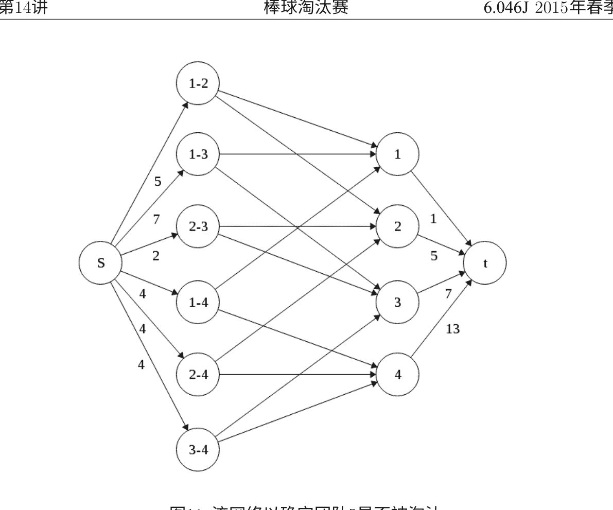

图1：流网络以确定团队5是否被淘汰

最小割的容量 c (S,T) = 4 + 4 + 4 + 1 + 5 + 7 = 25 < 26。因此，底特律团队5被淘汰。

替代解释：注意最大流将找到消除第5队的团队子集。在这个例子中，考虑团队1、2和3的子集。这3个团队之间的总胜利次数是25次，他们还有4场比赛要进行。因此，在常规赛结束时将有229场总胜利。这意味着至少存在一支球队赢得了⌈229/3⌉ = 77场比赛。

因此，如果底特律只有48场胜利，那么它肯定被淘汰了（48 + 28 = 76 < 77）。我们可以使用最大流和最大流最小割定理找到这样的集合。

麻省理工学院开放式课程网站
http://ocw.mit.edu

# 6.046J / 18.410J 算法设计与分析

2005年春季

有关引用这些材料或我们的使用条款的信息，请访问：http://ocw.mit.edu/terms。

## 第15讲：线性规划

线性规划（LP）是一种在一些由线性关系表示的要求下实现最优结果的方法。更准确地说，LP可以解决在一些线性约束条件下最大化或最小化线性目标函数的问题。

一般来说，线性规划的标准形式包括

- 变量： $\boldsymbol{x} = (x_1, x_2, \ldots, x_d)^\top$
- 目标函数： $\boldsymbol{c} \cdot \boldsymbol{x}$
- 不等式（约束条件）： $A\boldsymbol{x} \leq \boldsymbol{b}$，其中 $A$ 是一个 $n \times d$ 矩阵

我们在约束条件下最大化目标函数，并且 $\boldsymbol{x} \geq 0$。

线性规划有许多不同的应用，例如流量、最短路径，甚至政治。

在本讲中，我们将介绍线性规划的不同示例，并提出解决它们的算法。我们还将学习如何将任何线性规划转化为标准形式。

## 1 线性规划示例：政治

在这个例子中，我们将研究如何竞选赢得选举。一般来说，有 $n$ 个人口统计数据，每个统计数据有 $p_i$ 人，以及 $m$ 个选民感兴趣的问题。根据支持某个问题的广告投入每花费一美元可以获得多少选票的信息，我们如何确保在所有人口统计数据中获得多数选票以确保胜利？<sup>1</sup>

特别是，考虑表1中显示的3个人口统计数据和4个问题的例子。我们需要花费多少最少的钱来确保在所有人口统计数据中占据多数？

让 $x_1, x_2, x_3, x_4$ 表示每个问题花费的美元。我们现在可以将这个问题表述为一个线性规划问题：

```
最小化 $x_1 + x_2 + x_3 + x_4$
满足
$-2x_1 + 8x_2 + 0x_3 + 10x_4 \geq 50,000$ (城市多数派) (1)
$5x_1 + 2x_2 + 0x_3 + 0x_4 \geq 100,000$ (郊区多数派) (2)
$3x_1 - 5x_2 + 10x_3 - 2x_4 \geq 25,000$ (农村多数派) (3)
$x_1, x_2, x_3, x_4 \geq 0$ (不能取消广告) (4)
```

<sup>1</sup> 我们将假设通过广告获得的选票是不相交的。

| 政策 | 城市 | 郊区 | 农村 |
| :--- | :--- | :--- | :--- |
| 修建道路 | -2 | 5 | 3 |
| 枪支控制 | 8 | 2 | -5 |
| 农场补贴 | 0 | 0 | 10 |
| 汽油税 | 10 | 0 | 2 |
| 人口 | 100,000 | 200,000 | 50,000 |

表1：每美元广告投入的选票数和人口。

### 1.1 最优性证明

虽然我们还没有提出解决这个问题的算法，但是给定一个解，我们可以通过一个适当的证明来验证该解是最优的。例如，

$$
\begin{aligned}
x_1 &= \frac{2050000}{111} \\
x_2 &= \frac{425000}{111} \\
x_3 &= 0 \\
x_4 &= \frac{625000}{111} \\
x_1 + x_2 + x_3 + x_4 &= \frac{3100000}{111}
\end{aligned}
$$

是这个问题的一个解。现在考虑以下方程（证明）：

$$
\begin{aligned}
\frac{25}{222} \cdot (1) + \frac{46}{222} \cdot (2) + \frac{14}{222} \cdot (3) &= x_1 + x_2 + \frac{140}{222} x_3 + x_4 \\
&\geq \frac{25}{222} \cdot 50000 + \frac{46}{222} \cdot 100000 + \frac{14}{222} \cdot 25000 \\
&= \frac{3100000}{111} \\
\Rightarrow x_1 + x_2 + \frac{140}{222} x_3 + x_4 &\geq \frac{3100000}{111}
\end{aligned}
$$

我们还知道 $x_1 + x_2 + x_3 + x_4 \geq x_1 + x_2 + \frac{140}{222} x_3 + x_4$。因此，给定的解决方案是问题的最优解。

## 2 线性规划对偶性

上一节提供的简短证书不是巧合，而是线性规划问题对偶性的结果。对于形式为的每个原始线性规划问题

$$
\begin{aligned}
&\text{最大化} & c \cdot x \\
&\text{约束条件} & Ax \leq b, x \geq 0,
\end{aligned}
$$

存在一个等价的对偶线性规划问题

$$
\begin{aligned}
&\text{最小化} & b \cdot y \\
&\text{约束条件} & A^T y \geq c, y \geq 0.
\end{aligned}
$$

线性规划的这个性质可以用来证明许多重要的定理。例如，最大流最小割定理可以通过将最大流问题表述为原始线性规划问题来证明。

## 3 转换为标准形式

问题的自然LP公式可能不会得到标准LP形式。在这些情况下，我们可以使用以下规则将问题转换为标准LP形式而不影响答案。

- 最小化目标函数：取系数的相反数并最大化。
- 变量 $x_j$ 没有非负约束：用 $x_j$ 替换为 $x_j' - x_j''$ 和 $x_j', x_j'' \geq 0$。
- 等式约束：拆分为两个不同的约束； $x = b \Rightarrow x \leq b, \ x \geq b$。
- 大于或等于约束：取系数的相反数，并转换为小于或等于约束。

## 4 构建LP问题

在本节中，我们将简要介绍如何将一些在本课程中之前看到的问题构建为LP问题。一旦我们有了LP公式，我们可以按照第3节中的描述将问题转换为标准形式。

### 4.1 最大流

我们可以将最大流问题建模为流量总和的最大化，在一些约束条件下，这些约束条件将模拟流的不同属性。给定 $G(V,E)$，每个边($e$) 的容量 $c$，源节点 $s$ 和汇节点 $t$ ，

\[
\begin{aligned}
&\text{最大化} \quad \sum_{v \in V} f(s, v) \\
&\text{满足} \quad f(u, v) = -f(v, u) \ \forall u, v \in V \quad \text{偏斜对称性} \\
&\qquad \sum_{v \in V} f(u, v) = 0 \ \text{对于所有的} \ u \in V - \{s, t\} \quad \text{守恒性} \\
&\qquad f(u, v) \leq c(u, v) \ \forall u, v \in V \quad \text{容量约束}
\end{aligned}
\]

### 4.2 最短路径

我们可以将最短路径问题建模为节点距离总和的最小化。请注意，只有当所有距离都最小化时，这个总和才会最小化。给定 $G(V,E)$，每个边$e \in E$的权重 $w(e)$，以及源点 $s$，

\[
\begin{aligned}
&\text{最大化} \quad \sum_{v \in V} d(v) \\
&\text{满足条件} \quad d(v) - d(u) \leq w(u, v) \ \forall u, v \in V \quad \text{三角不等式} \\
&\qquad d(s) = 0.
\end{aligned}
\]

请注意上面的最大化，以免所有距离都变为零。如果且仅当从$s$可达的存在一个负权重环时，此LP问题无解。

## 5 线性规划的5种算法

有许多解决LP问题的算法：

- 单纯形算法：在可行域中，$x$沿着$c$的方向从顶点移动到顶点。该算法简单，但在最坏情况下运行时间为指数级。
- 椭球算法：它从包含最优解的椭球开始，并不断缩小椭球直到找到最优解。这是第一个多项式时间算法，是一个理论上的突破。然而，这个算法在实践中是不切实际的。
- 内点法: $x$在多面体内部移动，遵循 $c$。这个算法在多项式时间内运行，并且是实际可行的。在本讲座中，我们只研究单纯形算法。

### 5.1 单纯形算法

如前所述，单纯形算法在实践中表现良好，但在最坏情况下运行时间为指数级。从高层次上看，该算法类似于高斯消元法，用于解决不等式或约束条件。单纯形算法的工作原理如下：

- 将线性规划问题转化为“松弛”形式。
- 将一个松弛形式转化为等价的松弛形式，同时可能增加目标函数的值，并确保该值不会减小。
- 重复上述步骤，直到最优解变得明显。

### 5.1.1 单纯形算法示例

考虑以下示例：

```
最小化  $3x_1 + x_2 + 2x_3$
约束条件：$x_1 + x_2 + 3x_3 \leq 30$
$2x_1 + 2x_2 + 5x_3 \leq 24$
$4x_1 + x_2 + 2x_3 \leq 36$
$x_1, x_2, x_3 \geq 0$
```

将给定的LP问题转换为松弛形式，包括原始变量称为非基本变量和表示松弛的新变量称为基本变量。

```
$z = 3x_1 + x_2 + 2x_3$
$x_4 = 30 - x_1 - x_2 - 3x_3$
$x_5 = 24 - 2x_1 - 2x_2 - 5x_3$
$x_6 = 36 - 4x_1 - x_2 - 2x_3$
```

我们从一个基本解开始：我们将所有非基本变量设置在右侧为一些可行值，并计算基本变量的值。例如，我们可以设置 $x_1 = x_2 = x_3 = 0$。注意，全0解满足此问题中的所有约束条件，但在一般情况下可能不满足。

现在我们进行枢轴步骤：

- 选择一个非基本变量 $x_e$其在目标函数中的系数为正。
- 尽可能增加 $x_e$的值，而不违反任何约束条件。
- 将 $x_e$ 设置为基本变量，同时将其他一些基本变量变为非基本变量。

在这个例子中，我们可以增加 $x_1$的值。第三个约束将限制 $x_1$的值为9。然后我们得到

$$x_1 = 9 - \frac{x_2}{4} - \frac{x_3}{2} - \frac{x_6}{4}$$

现在用 $x_6$重写其他约束条件。

$$z = 27 + \frac{x_2}{4} + \frac{x_3}{2} - \frac{3x_6}{4}$$
$$x_1 = 9 - \frac{x_2}{4} - \frac{x_3}{2} - \frac{x_6}{4}$$
$$x_4 = 21 - \frac{3x_2}{4} - \frac{5x_3}{2} + \frac{x_6}{4}$$
$$x_5 = 6 - \frac{3x_2}{2} - 4x_3 + \frac{x_6}{2}$$

我们注意到解的等价性。也就是说，原始基本解 $(0, 0, 0, 30, 24, 36)$ 满足重写的约束条件，并且目标值为 0。

第二个基本解（9, 0, 0, 21, 6, 0）的目标值为27。

在这一点上，以 $x_6$为轴心实际上会导致目标值减小（尽管这里没有显示计算）。因此，让我们选择 $x_3$作为下一个轴心点，得到

$$z = \frac{111}{4} + \frac{x_2}{16} - \frac{x_5}{8} - \frac{11x_6}{16}$$
$$x_1 = \frac{33}{4} - \frac{x_2}{16} + \frac{x_5}{8} - \frac{5x_6}{16}$$
$$x_3 = \frac{3}{2} - \frac{3x_2}{8} - \frac{x_5}{4} + \frac{x_6}{8}$$
$$x_4 = \frac{69}{4} + \frac{3x_2}{16} + \frac{5x_5}{8} - \frac{x_6}{16}$$

这导致基本解（$\frac{33}{4}, 0, \frac{3}{2}, \frac{69}{4}, 0, 0$）的目标值为$\frac{111}{4}$。

最后，以 $x_2$ 为轴心点

```
$$z = 28 - \frac{x_3}{6} - \frac{x_5}{6} - \frac{2x_6}{3}$$
$$x_1 = 8 + \frac{x_3}{6} + \frac{x_5}{6} - \frac{x_6}{3}$$
$$x_2 = 4 - \frac{8x_3}{3} - \frac{2x_5}{3} + \frac{x_6}{3}$$
$$x_4 = 18 - \frac{x_3}{2} + \frac{x_5}{2}$$
```

尽管我们不会在本讲中证明该算法的正确性，但当所有非基本变量的系数都为负时，单纯形算法已找到（该最优解决方案。一般来说，单纯形算法保证在迭代次数为 $n$ 变量的数量，$n + m$ 约束的数量。这对于一般的 $n$ 和 $m$ 可能是指数量级的。

## 6 线性规划的6个更多主题

关于线性规划还有几个重要的问题在本讲中没有讨论：

- 我们如何确定线性规划是否可行？
- 如果线性规划可行，但初始基本解是不可行的怎么办？
- 我们如何确定线性规划是否无界？
- 我们如何选择枢轴元？

这些问题在教科书和其他线性规划文献中有答案。

麻省理工学院开放式课程网站
[http://ocw.mit.edu](http://ocw.mit.edu)

# 6.046J / 18.410J 算法设计与分析

2005年春季

有关引用这些材料或我们的使用条款的信息，请访问：[http://ocw.mit.edu/terms](http://ocw.mit.edu/terms)。

## 第16讲：NP完全性

### 介绍

- NP难度和NP完全性
- 3SAT
    - 超级马里奥兄弟
    - 3维匹配
        - 子集和 (弱)
            - 分割 (弱)
                - 矩形装箱 (弱)
        - 4分割 (强)
            - 矩形装箱 (强)
            - 拼图游戏

### NP难和NP完全问题

今天，我们讨论NP完备性。
回顾6.006课程：

- P = 可在多项式时间内解决的问题集合。如果问题的大小为 n，问题应该在 $O(n^k)$ 时间内解决。
- NP = 非确定性多项式时间可解决的决策问题集合。这些问题的输出是一个YES或NO的答案。非确定性指的是在多项式数量的选项中猜测出一个解并在多项式时间内验证。如果任何一个猜测是一个YES实例，那么非确定性算法将做出那个猜测。

在这种非确定性模型中，我们可以假设所有的猜测都是在第一次完成的。这相当于为YES答案找到一个多项式时间的多项式大小的证明验证器。

注意YES和NO输入之间的不对称性。

- 如果 X 是 NP-complete，则 X ∈ NP 且 X 是 NP-hard。
- 如果每个问题 $Y \in \text{NP}$ 都可以归约到问题 $X$，则问题 $X$是NP难问题。
- 如果 $P = \text{NP}$，则 $X \notin P$。
- 从问题 $A$到问题 $B$的归约是一个多项式时间算法，将问题 $A$的输入转换为问题 $B$的等价输入。等价意味着问题 $A$和问题 $B$对于输入和转换后的输入都必须输出相同的YES或NO答案。
- 如果 $B \in P$，则 $A \in \text{NP}$。
- 如果 $B \in \text{NP}$，则 $A \in \text{NP}$。
- 如果 $A$是 NP难问题，则 $B$是 NP难问题。

我们可以通过以下步骤证明问题是NP完全的。

1. 证明 $X \in \text{NP}$。通过找到一个非确定性算法或者给出一个有效的证明者来证明 $X \in \text{NP}$。
2. 展示 $X$是NP难的。从一个已知的NP完全问题 $Y$ 到 $X$的规约。
    这足够了，因为所有的问题 $Z \in \text{NP}$都可以规约到 $Y$，而且规约证明了 $Y$ 的输入可以被修改成 $X$的输入，这意味着 $X$是 NP难的。我们必须证明以下属性对于一个完全规约。
    (a) 给出一个多项式时间的从 $Y$ 的输入到 $X$ 的输入的转换。
    (b) 如果 $Y$的答案是 YES，那么 $X$的答案也是 YES。
    (c) 如果 $X$的答案是 YES，那么 $Y$的答案也是 YES。

最后，一个gadget将输入问题中的特征转换成输出问题中的特征。

## 3SAT

1971年，Cook发现了3SAT是NP完全的。

定义 1. 3SAT:给定一个布尔公式的形式:

$(x_1 \lor x_3 \lor \bar{x}_6) \land (\bar{x}_2 \lor x_3 \lor \bar{x}_7) \land \ldots$

是否存在变量的赋值为真和假，使得整个公式求值为真?

我们注意到文字的形式为 $\{x_i, \bar{x}_i\}$，而文字的两种形式都对应于变量 $x_i$。一个子句由3个文字的或运算组成，而一个公式由子句的与运算组成。

3SAT $\in$ NP，因为我们可以为证书创建一个验证器。对于给定的3SAT实例，证书对应于每个变量的赋值列表，验证器可以计算实例是否满足或可以求值为真。

因此，验证器是多项式时间的，而证书的长度也是多项式的。

重要的是要注意，这个验证器只能保证一个3SAT实例是可验证的。为了确保一个3SAT实例是不可验证的，算法必须检查每个变量的赋值，这在多项式时间内是不可能的。

3SAT也是NP难的。我们对这个结果给出一些直觉。考虑任何一个NP问题。因为它属于NP，存在一个非确定性多项式时间算法来解决这个问题，或者一个验证器来检查一个解。验证器是一个可以实现为电路的算法。现在，这个电路由AND、OR和NOT门组成，可以表示为一个公式。这个公式可以转换为3SAT形式，其中每个子句有3个文字，等价于原始公式。因此，所有的NP问题都可以转换为3SAT问题，原始问题的输入等价于转换后的3SAT问题的输入，因此3SAT是NP完全的。

## 超级马里奥兄弟 [Aloupis, Demaine, Guo, Viglietta 2014]

我们通过从3SAT问题进行归约来证明超级马里奥兄弟是NP难问题。

这个版本的超级马里奥兄弟可以适应任意屏幕大小为 $n \times n$，因此我们取消了屏幕上物品数量的限制。我们有以下问题定义

定义2.超级马里奥兄弟：给定一个超级马里奥兄弟的关卡，我们能否进入下一关？

因为我们从3SAT问题进行归约，所以我们已经得到了一个3SAT实例，我们必须生成一个与该3SAT实例对应的超级马里奥兄弟关卡。

我们通过为3SAT公式中的每个变量构建小工具来构建关卡，如图1所示。马里奥从台阶上跳下来后，就无法再跳回去。他可以向左或向右跳下，对应将变量赋值为True或False。关卡的其余部分被设置成无法改变这个选择。

我们还为子句创建了以下小工具。在选择给定变量的赋值之后，Mario访问具有相同文字值的所有子句小工具，## (a) 变量工具

## (b) 子句工具

## (c) 交叉工具

图1：超级马里奥兄弟的工具。
©任天堂。保留所有权利。此内容不包含在我们的创作共用许可证中。有关更多信息，请访问 http://ocw.mit.edu/fairuse。

然后移动到下一个变量工具。通过访问子句，Mario可以释放一个星星。
最后，在访问所有变量工具之后，Mario必须重新遍历子句工具。如果先前访问过子句工具，则有一个星星可用，他可以穿过火焰。否则，他将无法穿过子句工具并死亡。

因此，赢得关卡等同于在第二次遍历中通过所有子句工具。只有当变量赋值满足所有子句工具时，Mario才能通过所有子句工具。变量工具中的操作对应于3SAT公式的解决方案，因此如果Mario能够通过关卡，我们就有了3SAT问题的解决方案。

所需的最终装置是交叉装置。它确保马里奥在不允许的情况下不会在变量和子句装置之间切换。所有这些装置的总大小在规约所需的多项式大小内。

因此，只有当原始的3SAT公式可以满足时，马里奥才能赢得关卡。因此，我们从3SAT得到了一个规约，而超级马里奥兄弟是NP难的。

## 三维匹配（3DM）

定义3. 3DM: 给定不相交的集合X，Y和Z，每个集合都有n个元素和三元组T ⊆ X × Y × Z，是否存在一个子集S ⊆ T，使得X∪Y∪Z中的每个元素都恰好在一个S中的三元组中？

3DM是NP问题。给定一个证书，列出了一个候选的三元组列表，一个验证者可以检查每个三元组是否属于T，并且X∪Y∪Z中的每个元素都在一个三元组中。
通过从3SAT简化，3DM也是NP完全的。我们为变量和子句构建小工具。

变量 xi 的小工具在图片中显示。只能选择红色或蓝色的三角形，其中红色三角形对应真文字，蓝色三角形对应假文字。否则，会有重叠，或者一些内部元素将不被覆盖。这里有一个2n_x个“轮子”用于每个变量的小工具，其中 n_{xi} 对应于公式中 xi 的出现次数。

子句 xi ∨ xj ∨ xk 的小工具在图片中显示。在子句的小工具中，每个变量的三角形中未共享的点也是唯一的点。

然后，如果我们将 xi 设置为真，我们将取变量的红色假三角形，留下一个蓝色真三角形可用于覆盖子句的小工具。然而，这仍然可能导致 xj 和 xk 未被覆盖，所以我们需要进行垃圾收集。

下面是一个小工具的图片。这些小工具有 n_x 个垃圾收集子句，因为变量小工具中有 n_x 个不必要的元素不会被覆盖。然而，在剩下的元素中，每个子句中将会被覆盖一个，所以剩下的需要被垃圾回收子句覆盖。

因此，如果3SAT公式存在解，我们可以通过选择与变量值对应的3DM中的点来找到3DM问题的解。
如果我们有一个3DM解，我们可以将其映射回3SAT的满足赋值。因此，我们的约简是完备的，3DM是NP难问题。

## 子集和

定义4. 子集和：给定 n 个整数 A = {a_1, a_2, ..., a_n} 和目标 t，是否存在一个子集 S ⊆ A 使得

$$\sum_{a_i \in S} a_i = t$$

子集和问题是NP完全的。它属于NP问题，因为验证者可以在多项式时间内简单地检查给定的子集是否是A的子集，并且其和等于目标值。

通过从 3DM进行归约，它是 NP难的。将数字以基数 b = 1 + max_i n_x 的形式查看。然后三元组 (x_i, x_j, x_k) 可以以基数 b 的形式写为 000100100001000 = b^i + b^j + b^k，其中第一个1对应于 i，第二个对应于 j，第三个对应于 k。目标和 t = 111111111111111 = ∑_i b^i。

这样可以防止任何1的碰撞，确保每个元素仅使用一次，因为多个1对应于重复使用一个元素，并且基数足够大，以便不能将较小的数字相加以创建下一个基数的幂。这完成了归约。

事实上，子集和问题只是弱NP难。在 t 中的数字位数是 O(n)。这意味着在规约中使用的数字值是指数量级的，使得这个问题是弱NP难的。强NP难的问题只能使用多项式大小的数字值。

这也意味着这个问题可以通过伪多项式算法来解决。

## 划分

定义5. 划分：给定 A = {a_1, a_2, ..., a_n}，是否存在一个子集 S ⊆ A 使得

$$\sum S = \sum A \setminus S = \frac{1}{2} \sum A?$$

划分问题也是弱NP完全问题。它是子集和问题的一个特例，其中我们设置 t = ½ ∑ A。实际上，我们可以将划分问题约化为子集和问题，尽管这不是我们希望的约化方向。

我们可以通过以下方式将子集和问题减少到划分问题。让 σ = ∑ A。将元素 a_{n+1} = σ + t 和 a_{n+2} = 2σ - t 添加到 A 中。然后 a_{n+1} 和 a_{n+2} 必须在分割的不同侧。为了平衡两边，必须将 σ + t 添加到 a_{n+1}，并将 t 添加到 a_{n+1}，这样每个子集的和为 2σ。因此，如果我们可以解决分割问题，我们也可以得到和为 t 的元素子集，这是子集和问题的目标，完成了我们的减少。

## 矩形装箱

定义6. 矩形装箱：给定一组矩形 R_i 和一个目标矩形 T，我们能否将矩形装入 T 中，使得没有重叠？注意，矩形 R_i 的面积之和等于目标矩形的面积，即 ∑ R_i = T。

通过从Partition问题进行约简，我们可以得出矩形装箱问题是弱NP难的。对于Partition中的每个元素 a_i，我们创建一个高度为1、宽度为 3a_i 的矩形 R_i。目标矩形的高度为2，宽度为3，即 t=3/2 ∑ A。由于每个矩形的宽度至少为3，所有矩形必须水平放置。因此，要解决矩形装箱问题，我们必须将块分成两组，总宽度为3，这将对应于Partition问题中总和为 t 的两个子集。

## 拼图游戏 [Demaine & Demaine 2007]

定义7. 给定没有图案的正方形瓷砖，这些瓷砖能否被排列成适应目标矩形形状？注意，瓷砖可以有一个边缘标签、口袋或边界，但标签和口袋必须具有相匹配的形状。

最明显的约简是从Partition问题得出的。对于每个数字，创建一个带有唯一标签和口袋的正方形矩形集，其中瓷砖的数量等于 a_i 的值，并且矩形的两个端部具有边界。

然而，这个约简不能完成，因为Partition的输入可能是指数级别的大。

相反，这个约简来自于4-Partition。

### 定义 8. 4-Partition
给定 n 个整数 A = {a_1, a_2, ..., a_n} ∈ (t, t)，是否存在一个划分成 n 个子集，每个子集的和相等 t = ∑ A / n?

4-Partition是一个强NP完全问题。我们从4-Partition约简到拼图游戏，以展示拼图游戏是NP难的。

对于每个 a_i，我们创建以下一组拼图。这确保我们不能混合来自不同 a_i 的拼图。

这些拼图被放置在以下目标板上。有 n 个行，每行将容纳与4个 a_i 项对应的拼图，这是4-Partition问题的一部分。目标板的宽度是 t，因为每行必须容纳 t pieces，以便相应的 a_i 形成一个和为 t 的组，在4-Partition问题中。因此，缩减是完整的。

麻省理工学院开放式课程网站
http://ocw.mit.edu

# 6.046J / 18.410J 算法设计与分析
2015年春季

有关引用这些材料或我们的使用条款的信息，请访问：http://ocw.mit.edu/terms。

## 第17讲：近似算法

- 定义
- 顶点覆盖
- 集合覆盖
- 分区

### 近似算法和方案

设 C_{opt} 为问题规模为 n 的最优算法的成本。对于这个问题的近似算法，如果对于任何输入，算法产生成本为 C 的解，满足以下近似比 ρ(n):

$$max\left(\frac{C}{C_{opt}}, \frac{C_{opt}}{C}\right) \leq \rho(n)$$

这样的算法被称为 ρ(n)-近似算法。

输入 c > 0，输出一个解使得 C = (1 + c)C_{opt}，则为 (1 + c)-近似算法。

多项式时间逼近方案（PTAS）是一个在输入规模多项式时间内运行的逼近算法，完全多项式时间逼近方案（FPTAS）是一个在输入规模和 c 的多项式时间内运行的逼近算法。例如，一个 O(n^{2/c}) 逼近算法是一个PTAS但不是FPTAS。一个 O(n/c^2) 逼近算法是一个FPTAS。

## 顶点覆盖

给定一个无向图 G(V,E)，找到一个子集 V' ⊆ V 使得对于每条边 (u,v) ∈ E，要么 u ∈ V' 要么 v ∈ V'（或者两者都有）。此外，找到一个 V' 使得 |V'| 是最小的。这是一个NP完全问题。

### 顶点覆盖的近似算法

在这里，我们定义了算法 Approx Vertex Cover，它是顶点覆盖的近似算法。从一个空集合 V' 开始。当还有边在 E 中时，任意选择一条边 (u,v)。将 u 和 v 都加入 V' 中。移除与 u 或 v 关联的所有边。重复此过程，直到 E 中没有更多的边。 Approx Vertex Cover 在多项式时间内运行。

以以下图 G 为例。

Approx Vertex Cover 可以选择边 (b,c)，(e,f) 和 (d,g)，使得 V'={b,c,e,f,d,g} 且 |V'| = 6。因此，成本为 C = |V'| = 6。对于这个例子，最优解是 {b,d,e}，因此 C_{opt} = 3。

**声明：近似顶点覆盖是一个2近似算法。**

证明：令 U 为 Approx Vertex Cover 选择的所有边的集合。最优顶点覆盖必须包括 U 中每条边的至少一个端点（和其他边）。此外，U中的任意两条边不共享一个端点。因此，|U| 是 C_{opt} 的一个下界，即 C_{opt} ≥ |U|。 Approx Vertex Cover 返回的 V' 中的顶点数为 2·|U|。因此， C = |V'| = 2·|U| ≤ 2·C_{opt}。因此 C ≤ 2·C_{opt}。 □

## 集合覆盖

给定一个集合 X 和一个可能重叠的子集族 S_1, S_2, ..., S_m ⊆ X，使得 ∪_{i=1}^m S_i = X，找到一个集合 P ⊆ {1, 2, 3, ..., m}，使得 ∪_{i∈P} S_i = X。此外，找到一个 P 使得 |P| 最小。

集合覆盖是一个NP完全问题。

### 集合覆盖的近似算法

这里我们定义算法近似集合覆盖，它是集合覆盖的近似算法。首先将集合 P 初始化为空集。当集合 X 中仍然有元素时，选择最大的集合 S_i 并将 i 添加到 P 中。然后从 X 和其他子集 S_j 中删除 S_i 中的所有元素。重复此过程，直到 X 中没有更多元素。近似集合覆盖在多项式时间内运行。

在下面的示例中，每个点都是 X 中的一个元素，每个 S_i 都是X的子集。

近似集合覆盖按顺序选择集合 S1、S4、S5、S3。因此它返回 P = {1, 4, 5, 3} 和其成本 C = |P| = 4。最优解是 P_{opt} = {S3, S4, S5} 和 C_{opt} = |P_{opt}| = 3。

> 声明：近似集覆盖是一个(ln(n)+1)近似算法（其中 n = |X|）。

证明：假设最优覆盖为 P_{opt}，使得 C_{opt} = |P_{opt}| = t。令 X_k 为迭代 k of 近似集覆盖后剩余的元素集合。因此， X_0 = X。然后：

- 对于所有的 k， X_k 可以被 t 个集合（来自最优解）覆盖。
- 其中一个集合至少覆盖 |X_k|/t 个元素。
- 近似集覆盖选择一个（当前）大小 ≥ |X_k|/t 的集合。

- 对于所有的 k， |X_{k+1}| ≤ (1 - 1/t)|X_k|（更仔细的分析（见 CLRS，第 35章）相关）调和数。t 应该缩小。
- 对于所有的 k， |X_{k+1}| ≤ (1-1/e)^{k} * n ≤ e^{-k/t} * n (n=|X_0|)

当 |X_k| < 1 时，算法终止，即 |X_k| = 0，并且代价为 C=k。

$$e^{-k/t} \cdot n < 1$$

$$k > t \cdot \ln(n)$$ 时，算法终止。因此 k = t * ln(n)。 C/C_{opt} ≤ ln(n)+1。因此近似集覆盖是集覆盖的(ln(n)+1)近似算法。 □

注意，近似比率随着n的增大而变差。

## 划分

输入是一个具有权重 s1, s2, ..., sn 的 n 个项目的集合 S。假设，不失一般性，项目按照 s1 ≥ s2 ≥ ... ≥ sn 的顺序排列。将 S 划分为集合 A 和 B 以使 max(w(A), w(B)) 最小，其中 w(A) = ∑_{i ∈ A} S_i 并且 w(B) = ∑_{j ∈ B} S_j.

> 定义：L = ½ ∑_{i=1}^{n} s_i 那么最优解的成本 C_{opt} ≥ L by 定义.

划分是一个NP完全问题。想要找到一个PTAS (1+ c)-近似解。（注意，在这种情况下2-近似解是微不足道的）。此外，该问题还存在一个FPTAS。

### 划分的近似算法

这里我们定义 Approx_Partition。定义 m = ⌈1/ε⌉ - 1。（c ≈ 1/(m+1)）该算法分为两个阶段进行。

第一阶段：找到最优划分 A', B' of s_1, ..., s_m。这需要 O(2^m) 的时间。

第二阶段：将集合 A 和 B 初始化为 A' 和 B' 分别。因此，它们已经包含了元素的一个分区 s_1, ..., s_m。然后，对于每个 i，其中 i 从 m + 1 到 n，如果 w(A) ≤ w(B)，将 i 添加到 A，否则将 i 添加到 B。

**声明：Approx_Partition 是 Partition 的 PTAS。**

证明：不失一般性，假设 w(A) ≥ w(B)。然后近似比率是 C/C_{opt} = w(A)/L。让 k 成为添加到 A 的最后一项。有两种情况，要么 k 在第一阶段添加，要么在第二阶段添加。

情况1：在第一阶段将 k 添加到 A 中。这意味着 A = A'。我们有一个最优分区，因为当我们有 n ≥ m 个项目时，我们不能比 w(A') 更好，而且我们知道 w(A') 对于 m 个项目是最优的。

情况2：在第二阶段中，将 k 添加到 A 中。在这里，我们知道 w(A) - s_k ≤ w(B) 因为这就是为什么 k 被添加到 A 而不是 B 的原因。（注意， w(B) 可能在添加到 A 之后增加了。）因此 w(A) ≤ L + s_k/2。

由于 s_1 ≥ s_2 ≥ ... ≥ s_n，我们可以说 s_1, s_2, ..., s_m ≥ s_k。现在由于 k > m，有 2L ≥ (m+1)s_k。

现在， w(A)/L ≤ (L + s_k/2)/L = 1 + s_k/(2L) ≤ 1 + s_k/((m+1)s_k) = 1 + 1/(m+1) = 1+c。因此 近似分区是一个 (1 + c) 近似的分区。 □

## 自然顶点覆盖近似

在这里我们描述近似顶点覆盖自然，一个不同的近似算法对于顶点覆盖。从一个空集合 V' 开始。当还有边在 E 中时，选择具有最大度数的顶点 v ∈ V 并将其添加到 V' 中。然后从 E 中删除 v 和所有与之关联的边。重复直到 E 中没有更多的边。最后，返回 V'。

下面的例子展示了一个近似顶点覆盖自然的坏情况示例。在这个例子中，最优的覆盖将选择顶部的 k 个顶点。

近似顶点覆盖自然情况下可以从左到右依次选择所有底部的顶点。因此成本可能为 k! * (1 + 1 + ... + 1) ≈ k! log k。这是比最优解差 log k 倍。

定理：近似顶点覆盖自然情况下是 (log n)-近似算法。

证明：设算法迭代 k 次后的图为 G_k。令 n 为图中的边数，即 |G|=n=|E|。每次迭代，算法选择一个顶点并删除它以及所有相邻的边。设 m=C_{opt} 为最优顶点覆盖中的顶点数。现在让我们看一下算法的前 m 次迭代：G_0 → G_1 → G_2 → ... → G_m。

令 d_i 为 G_{i-1} 中最大度顶点的度数。然后算法删除与该顶点相邻的所有边，得到 G_i。因此：

$$|G_m| = |G_0| - \sum_{i=1}^{m} d_i$$

还有：

$$\sum_{i=1}^{m} d_i \geq \sum_{i=1}^{m} \frac{|G_{i-1}|}{m}$$

这是因为给定 $|G_{i-1}|$ 条边，可以被 $m$ 个顶点覆盖，我们知道存在一个度数至少为 $\frac{|G_{i-1}|}{m}$ 的顶点。然后：

$$\sum_{i=1}^{m} \frac{|G_{i-1}|}{m} \geq \sum_{i=1}^{m} \frac{|G_m|}{m} = |G_m|$$

这是因为对于所有的 $i$，有 $|G_i| \leq |G_{i-1}|$。然后，可以得到：

$$|G_0| - |G_m| \geq |G_m|$$

因为 $|G_m| \leq \sum_{i=1}^{m} d_i$。因此，在 $m$ 次迭代之后，算法将删除一半或者更多的边来自 $G_0$。一般来说，在每 $m$ 次迭代中，图中的边数将减半，在 $m \cdot \log |G_0|$ 次迭代后，将删除所有的边。并且由于每次迭代都会添加1个顶点到覆盖集中，最终将得到一个大小为 $m \cdot \log |G_0| = m \cdot \log n$ 的顶点覆盖。由于我们假设 $m$ 是最优顶点覆盖，$\frac{C}{C_{opt}} = \frac{m \log n}{m} = \log n$。因此近似顶点覆盖自然是一个 $(\log n)$ 近似。 $\square$

请注意，由于 $n \approx k!$, $\log k$ 在图中的示例中，最坏情况下的示例是 $\log k \approx \log\log n$ 更糟糕，但我们只展示了一个 $O(\log n)$ 近似。

麻省理工学院开放式课程网站

http://ocw.mit.edu

# 6.046J / 18.410J 算法设计与分析

2015年春季

有关引用这些材料或我们的使用条款的信息，请访问：http://ocw.mit.edu/terms。

# 第18讲：固定参数算法

- 顶点覆盖
- 固定参数可解性
- 核化
- 与近似算法的联系

## 固定参数算法

固定参数算法是处理NP难问题的另一种方法，而不是近似算法。算法通常具有三个一般的期望特征：

1. 解决（NP-）困难问题
2. 在多项式时间内运行（快速）
3. 获得精确解

一般来说，除非P = NP，算法可以具有这三个特征中的两个，但不能同时具有全部三个。具有特征2和3的算法是P中的算法（多项式时间精确）。近似算法具有特征1和2。它解决了困难问题，运行速度快，但不能给出精确解。固定参数算法将具有特征1和3。它们将解决困难问题并给出精确解，但运行速度不会很快。

想法：这个想法是为了得到一个精确的算法，但将指数项隔离到一个特定的参数中。当这个参数的值很小的时候，算法会得到快速的实例。希望这个参数在实践中是小的。

参数：一个参数是一个非负整数 k (x)，其中 x是问题的输入。通常，参数是问题的自然属性（一些 k在输入中）。它可能不一定是高效计算的（例如，OPT）。

参数化问题：一个参数化问题就是问题加上参数，或者从参数的角度看待问题。对于任何给定的问题，可能有许多有趣的参数化。

目标：固定参数算法的目标是拥有一个在问题规模 n 上是多项式的算法，但在参数 k 上可能是指数的，并且仍然得到一个精确的解决方案。

# k-顶点覆盖

给定一个图 G=(V,E) 和一个非负整数 k，是否存在一个大小不超过 k 的顶点集合 S ⊆ V，使得它覆盖所有的边。这是一个关于顶点覆盖的决策问题，也是NP难问题。我们将使用 k 作为参数来开发一个固定参数算法来解决 k -顶点覆盖问题。注意，我们可以有 k << |V|，如下图所示：

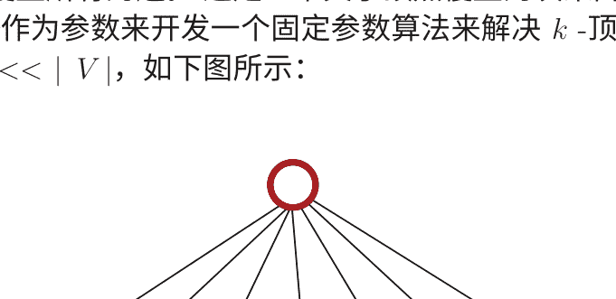

# 暴力解法（不好）

尝试所有 \(\binom{v}{k} + \binom{v}{k-1} + \cdots + \binom{v}{0}\) 大小不超过 k 的顶点集合。可以跳过所有小于 \(\binom{v}{k}\) 因为更大的集合有更多的覆盖。测试覆盖需要 \(O(m)\) 的时间，其中 m 是边的数量。因此，总运行时间为 \(O(V^k|E|)\)。对于固定的 k，它是多项式时间的，但对于所有的 k，它不是相同的多项式。在大多数情况下，它是低效的。因此，我们定义 f(k) 为不好的，其中 \(n = |V| + |E|\) 是输入的大小。

# 有界搜索树算法（好）

这是一种常用的技术，用于改进暴力搜索。它的工作原理如下：

- 选择任意边 \(e = (u, v)\)
- 我们知道 \(u \in S\) 或 \(v \in S\)（或两者都有），但不知道哪个
- 猜测哪个：尝试两种可能性
  1. 将 u 添加到 S 中，从 G 中删除 u 和与之相关的边，并使用 \(k' = k-1\) 进行递归
  2. 用 v 代替 u 做同样的操作
  3. 返回两个结果的逻辑或

这就像在动态规划中猜测，但记忆化在这里没有帮助。递归树如下所示：

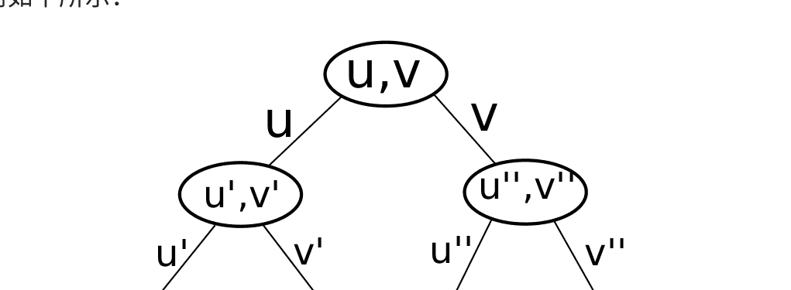

在叶子节点 ($k = 0$) 时，如果 $|E| = 0$（所有边都被覆盖），则返回YES。删除 $u$ 或 $v$ 需要 $O(V)$ 时间。因此，总运行时间为 $(2^k|V|)$。

- $O(V)$ 对于固定 $k$
- 多项式的次数与 $k$ 无关
- 也是多项式的 $k = O(\lg |V|)$
- 对于例如 $k \leq 32$ 的情况很实用
- 因此我们定义 $f(k) \cdot n^{O(1)}$ 为好的

# 固定参数可解性

如果存在一个运行时间 $\leq f(k) \cdot n^{O(1)}$ 的算法，使得 $f : \mathbb{N} \to \mathbb{N}$ (非负) 且 $k$ 是参数，多项式的 $O(1)$ 次数与 $k$ 和 $n$ 无关，则参数化问题是固定参数可解的（FPT）。

问题：为什么是 $f(k) \cdot n^{O(1)}$ 而不是 $f(k) + n^{O(1)}$？

定理：存在 $\exists f(k) \cdot n^c$ 算法 $\Longleftrightarrow$ 存在 $\exists f'(k) + n^{c'}$

证明：
$(\Leftarrow)$
平凡的（假设 $f(k)$ 和 $n \geq 1$）
$(\Rightarrow)$
如果 $n \leq f(k)$，那么 $f(k)^c \leq f(k)^{c+1}$
如果 $f(k) \leq n$, 那么 $f(k) \cdot n^{c+1} \leq n$
因此 $f(k) \cdot n \leq \max (f(k)^{c+1}, n^{c+1}) \leq f(k)^{c+1} + n^{c+1} = f'(k) + n^{c'} \square$

或者，由于 $xy \leq x^2 + y^2$, 可以令 $f'(k) = (f(k))^2$ 和 $c' = 2c$.
例子: $O(2^k \cdot n) \leq O(4^k + n^2)$

# 核化

核化是一种简化的自我约简。它是一个多项式时间算法，将输入 $(x,k)$ 转换为一个小且等价的输入 $(x', k')$。在这里，小意味着 $|x'| \leq f(k)$, 等价意味着对于 $x$ 的答案与 $x'$ 的答案相同。

定理: 一个问题是FPT $\iff$ 存在一个核化

证明:

- (←)
    核化 $\Rightarrow n' \leq f(k)$
    运行任何有限 $g(n')$ 算法
    总共需要 $n^{O(1)} + g(f(k))$ 时间

- (⇒)
    让 $A$ 是一个 $f(k) \cdot n^c$ 算法，假设 $k$ 已知:
    如果 $n \leq f(k)$, 那么它已经核化了。
    如果 $f(k) \leq n$, 那么

    1. 运行 $A \rightarrow f(k) \cdot n \leq n^{c+1}$ 时间
    2. 根据需要输出 $O(1)$ 大小的 YES/NO 实例 (进行核化)

如果 $k$ 未知: 运行 $A$ 进行 $n^{c+1}$ 次，如果仍未完成，则我们知道它已经核化了。

所以我们知道 (指数级) 核存在。最近的工作旨在在可能的情况下找到多项式 (甚至线性) 核。

# k-顶点覆盖的多项式核

为了创建一个 $k$-顶点覆盖的核，算法遵循以下步骤:

- 通过删除所有自环和多边使图简单化
- 任何度数 $> k$ 的顶点必须在覆盖中 (否则需要添加 $> k$ 个顶点来覆盖相邻的边)
- 逐个删除这样的顶点（以及相关边），每次减少 $k$个
- 剩余图的最大度数 $\leq k$
- 每个剩余顶点覆盖 $\leq k$条边
- 如果剩余边的数量$> k$，则回答NO并输出规范的NO实例
- 否则，$|E'| \leq k^2$
- 删除所有孤立顶点（度数为0的顶点）
- 现在 $|V'| \leq 2k^2$
- 输入已经被减少为大小为 $O(k^2)$的实例 ($V'$, $E'$)

核化算法的运行时间在朴素情况下为 $O(VE)$（$O(V+E)$需要更多的工作。）之后，我们可以在核上应用暴力算法，其总运行时间为 $O(V + E+ (2k^2)^{k^2}) = O(V + E+ 2^{k^2 \log k^2})$ 或者我们可以应用有界搜索树解决方案，其运行时间为 $O(V + E+ 2^k k^2)$

迄今为止最好的算法：$O(kV + 1.274^k)$ 由 [Chen, Kanj, Xia - TCS 2010]提出。

## 与近似算法的关联

取一个优化问题，整数OPT，并考虑与之相关的决策问题：“$\text{OPT} \leq k$?”并以 $k$为参数化。

定理：优化问题具有EPTAS (EPTAS：高效PTAS，$f(\frac{1}{\epsilon}) \cdot n^{O(1)}$例如：近似分割[L17])
$\Rightarrow$决策问题是 FPT

证明：（类似于FPTAS，伪多项式算法）

- 假设最大化问题（和 $\leq k$决策）
- 使用 $\epsilon$运行EPTAS $= \frac{1}{2k}$ 在 $f(2k) \cdot n^{O(1)}$时间内。
- 相对误差 $\leq \frac{1}{2k} < \frac{1}{k}$
- $\Rightarrow$绝对误差 $<1$，如果$\text{OPT} \leq k$
- 所以如果我们找到一个值为 $\leq k$ 的解决方案，那么 $\mathrm{OPT} \leq (1 + \frac{1}{2k}) \cdot k \leq k + \frac{1}{2}$\n积分 $\Rightarrow$ $\mathrm{OPT} \leq k$ $\Rightarrow$ 是的
- 否则 $\mathrm{OPT} > k$

□

另外: $=, \leq, \geq$ 决策问题在 FPT 方面是等价的。

(可以使用这个关系来证明在某些情况下不存在 EPTASs)

# 6.046J / 18.410J 算法设计与分析

2015年春季

有关引用这些材料或我们的使用条款的信息，请访问：http://ocw.mit.edu/terms。

# 第21讲: 密码学: 哈希

在这个讲座中，我们将学习密码学的一些基础知识。具体来说，我们将涵盖

- 哈希函数
- 随机预言机模型
- 理想属性
- 安全应用

## 1 哈希函数

哈希函数 $h$将任意数据字符串映射到固定长度的输出。该函数是确定性和公开的，但映射应该看起来“随机”。换句话说，

$$h : \{0,1\}^* \to \{0,1\}^d$$

对于一个固定的 $d$。哈希函数没有秘密密钥。由于没有秘密，函数本身是公开的，任何人都可以评估函数。列举一些例子，

| 哈希函数 | MD4 | MD5 | SHA-1 | SHA-256 | SHA-512 |
| --- | --- | --- | --- | --- | --- |
| $d$ | 128 | 128 | 160 | 256 | 512 |

在实践中，哈希函数用于“摘要”大数据。例如，如果您想检查一个大文件（可能比几兆字节大得多）的有效性，可以使用预期的哈希值检查该文件的哈希值。因此，希望（特别是在这里介绍的密码哈希函数中）函数具有抗碰撞性。也就是说，应该很难找到两个输入 $m_1$和 $m_2$使得哈希函数 $h(m_1) = h(m_2)$。大多数现代哈希函数希望达到$2^{64}$或更高的安全级别，这意味着攻击者需要测试超过$2^{64}$个不同的输入才能找到碰撞。不幸的是，MD4和 MD5旨在提供$2^{64}$的安全性，但已经被证明可以使用$2^6$和$2^{37}$个输入来破解。SHA-1旨在提供$2^{80}$的安全性，但已经被证明（至少在理论上）不超过$2^{61}$的安全性。

## 1.1 随机预言机

随机预言机模型是哈希函数的理想模型，但在实践中无法实现。在这个模型中，我们假设存在一个预言机 $h$ such，对于输入 $x \in \{0,1\}^*$，如果 $h$ has没有看到过 $x$，则输出一个随机值作为 $h(x)$。否则，它返回之前输出的 $h(x)$。随机预言机对于所有新的输入都给出随机值，并对其之前看到的所有输入给出确定性答案。不幸的是，真正的随机预言机是不存在的，因为它需要无限的存储空间，所以在实践中我们使用伪随机函数。

## 1.2 理想属性

哈希函数有许多理想属性。

1. 单向性（前像抗性）：给定 $y \in \{0,1\}^d$，很难找到一个 $x$ 使得 $h(x) = y$。
2. 强碰撞抗性：很难找到任何一对输入 $x, x'$ 使得 $h(x) = h(x')$。
3. 弱碰撞抗性（目标碰撞抗性，第二前像抗性）：给定 $x$，很难找到 $x'$ 使得 $h(x) = h(x')$。
4. 伪随机性：该函数的行为与随机预言机不可区分。
5. 非可塑性：给定 $h(x)$，很难生成 $h(f(x))$，其中 $f$ 是任意函数。

其中一些属性暗示其他属性，而其他一些则不暗示。例如，

- $2 \Rightarrow 3$
- $1 \Rightarrow 2, 3$.

此外，碰撞可以在 $O(2^{d/2})$(使用生日悖论)中找到，并且反演可以在 $O(2^d)$中找到。

为了更好地说明为什么某些属性不暗示其他属性，我们在这里提供了一些例子。考虑满足1和2的 $h$。我们可以构造一个新的 $h'$，它接受一个额外的输入位，并将前两位进行异或运算以生成$h$的输入。也就是说，$h'(a, b, x_2, \dots, x_n) = h((a \oplus b), x_2, \dots, x_n)$。$h'$仍然是单向的，但不是弱碰撞抗性的。现在考虑另一个 $h''$，如果 $|x| \leq n$，则计算结果为$0||x$，否则计算结果为$1|| h(x)$。$h''$是弱碰撞抗性的，但不是单向的。

## 1.3 应用

哈希函数有许多应用。

1. 密码存储：我们可以存储密码的哈希值 h(p)，而不是直接存储密码 p，然后通过检查哈希值 h(p)来验证用户身份。如果满足属性1，攻击者 h(p)将无法获得p的信息。
2. 文件真实性：对于每个文件 F，我们可以将其哈希值 h(F)存储在安全位置。要验证文件的真实性，我们可以重新计算哈希值 h(F)。这需要属性3。
3. 数字签名：我们可以使用哈希函数生成一个签名，确保消息来自指定的来源。详细说明请参考第11次辅导。
4. 承诺：在安全竞标中，爱丽丝想要出价 x，但不想在拍卖结束之前透露出价。然后，爱丽丝计算出x的哈希值 h(x)，并公开它，作为她的承诺。当竞标结束后，她可以透露出价 x，并使用哈希值 h(x)进行验证。

它应该是“绑定的”，这样爱丽丝就不能生成一个具有相同承诺的新 x，并且它应该“隐藏” x，以便在 x被揭示之前没有人知道任何东西。此外，它应该是不可篡改的。为了保证机密性，我们需要比前一节中的属性更多，因为 h(x) = h (x) || MSB (x) 实际上满足1、2和5。在实践中，通过在承诺中添加随机性来绕过这个问题，C (x) = h (r||x) 对于 r ∈_R {0, 1}^{256}，并在最后同时揭示随机性和 x。

麻省理工学院开放式课程网站
http://ocw.mit.edu

# 6.046J / 18.410J 算法设计与分析

2015年春季

有关引用这些材料或我们的使用条款的信息，请访问：http://ocw.mit.edu/terms。

# 第22讲：密码学：加密

- 对称密钥加密
- 密钥交换
- 非对称密钥加密
- RSA
- NP完全问题和密码学
  - 图着色
  - 背包问题

# 对称密钥加密

```
c = e_k(m)
m = d_k(c)
```

这里 c是密文, m是明文, e是加密函数, d是解密函数, k是秘密密钥。 e, d对所有消息的空间进行置换和反置换。

可逆操作: ⊕, +/-, 左/右移。
对称算法: AES, RC5, DES

# 密钥管理问题

秘密密钥 k如何交换/共享?

Alice想要给Bob发送一条消息。在Alice和Bob之间有海盗，他们会拿走任何未锁定的盒子中的密钥或消息，但不会碰锁定的盒子。

Alice如何能够发送消息或密钥给Bob (而海盗不知道发送了什么)? 解决方案:

- Alice将 m 放入盒子中，并用 k_A 锁上
- 盒子发送给Bob
- 鲍勃用 $k_B$ 锁住盒子
- 盒子寄给爱丽丝
- 爱丽丝用 $k_A$ 解锁
- 盒子发送给Bob
- 鲍勃用 $k_B$ 解锁, 读取 $m$

请注意，这种方法依赖于锁的可交换性。 这意味着锁和解锁操作的顺序无关紧要。

# 迪菲-赫尔曼密钥交换

$G = F_p^*$

这里 $F_p^*$ 是一个有限域 (mod $p$, 一个质数)。 *表示只有可逆元素 ($\{1, 2, ..., p-1\}$)

爱丽丝  g公开  p公开  鲍勃  $2 \leq g \leq p-2$

选择一个  计算 $g^a$  $\rightarrow$  $g^a$  $1 \leq a, b \leq p-2$

$g^b$  $\leftarrow$  选择b  计算 $g^b$

爱丽丝可以计算 $(g^b)^a \mod p = k.$

鲍勃可以计算 $(g^a)^b \mod p = k.$

假设离散对数问题很难 (给定 $g^a$, 计算 $a$), Diffie Hell-曼问题很难 (给定 $g$, $g^b$计算 $g^{ab}$)。

我们能攻击这个吗？中间人攻击：

- 爱丽丝不知道她正在与鲍勃通信。
- 爱丽丝同意与伊芙进行密钥交换 (她以为是鲍勃)。
- 鲍勃同意与伊芙进行密钥交换 (他以为是爱丽丝)。
- 伊芙可以看到所有的通信。

## 公钥加密

消息 + 公钥 = 密文
密文 + 私钥 = 消息

这两个密钥需要以数学方式相互关联。知道公钥不应该让你知道私钥的任何信息。

## RSA

- 爱丽丝选择两个大的秘密质数 $p$ 和 $q$。
- 爱丽丝计算 $N = p \cdot q$。
- 选择一个满足 $\gcd(e, (p-1)(q-1)) = 1$ 的加密指数 $e$，$e = 3, 17, 65537$。
- Alice的公钥 = $(N, e)$。
- 通过Alice使用扩展欧几里得算法获得的解密指数，使得 $e \cdot d \equiv 1 \mod (p-1)(q-1)$。
- Alice的私钥=$(d, p, q)$ (存储 $p$ 和 $q$ 并不是绝对必要的，但我们为了效率而这样做)。

## RSA加密和解密

$c = m^e \mod N$  加密

$m = c^d \mod N$  解密

## 为什么它有效

$\phi = (p-1)(q-1)$

由于 $ed \equiv 1 \mod \phi$，存在一个整数 $k$ 使得 $ed = 1 + k\phi$。

两种情况：
情况 1  $\gcd(m, p) = 1$。 根据费马定理，
$m^{p-1} \equiv 1 \mod p$
$(m^{p-1})^{k(q-1)} \cdot m \equiv m \mod p$
$m^{1+k(p-1)(q-1)} = m^{ed} \equiv m \mod p$

情况 2 $\gcd(m,p) = p$. 这意味着 $m \pmod p = 0$, 所以 $m^{ed} \equiv m$。因此, 在这两种情况下, $m^{ed} \equiv m \pmod p$. 同样地, $m^{ed} \equiv m \pmod q$. 由于 $p, q$ 是不同的质数, $m^{ed} \equiv m \pmod N$. 所以 $c^d = (m^e)^d \equiv m \pmod N$。

## RSA的难度

- 因子分解: 给定 $N$, 很难将其分解为 $p, q$.
- RSA问题: 给定 $e$ 使得 $\gcd(e, (p-1)(q-1)) = 1$和 $c$, 找到 $m$ . 那 $m^e \equiv c \pmod N$.

## NP-完备性

在一个范围内, $N$ 是否是一个合数的因子? 未知是否 NP-完备一个图是否可以被 $k$-着色? 换句话说: 你能否为每个顶点分配 $k$ 种颜色, 使得相邻的两个顶点不共享相同的颜色? NP-完备

给定一堆具有不同重量 $w_i$ 的物品, 是否可以将物品放入一个背包中, 使得总重量为 $S$? NP-完备

## NP-完备性和密码学

- NP-完备性: 关于最坏情况复杂度
- 密码学: 希望一个问题实例, 具有适当选择的参数, 平均上很难

大多数背包密码系统已经失败了。

确定一个图是否可以3-着色是NP-完备的, 但在平均情况下非常容易。这是因为一个平均大小的图不是3-着色的! 考虑一个标准的回溯搜索来确定3-着色性。

- 顶点顺序 $v_1, ..., v_t$. 颜色 $= \{1, 2, 3\}$
- 按顶点顺序遍历图。
- 访问一个顶点时, 选择最小的可行颜色。
- 如果遇到困难, 回溯到上一个选择, 并尝试下一个选择。
- 第一个顶点没有可用颜色 → 输出'NO'
- 成功给最后一个顶点上色 → 输出' YES'

在一个随机图的 $t$ 个顶点中，无论 $t$ 如何，平均遍历的顶点数 $< 197$

## 背包密码学

一般背包问题：NP完全
超级递增背包：线性时间可解 在这个问题中，权重受以下约束：

$$w_j \geq \sum_{i=1}^{j-1} w_i$$

## 默克尔-海尔曼加密系统

私钥 → 超级递增背包问题 ----------> “困难”的一般背包问题 →公钥。

转换：两个私有整数 $N$，$M$使得 $\text{gcd}( N,M) = 1$.
将序列中的所有值乘以 $N$然后取模 $M$。
例子： $N = 31$, $M = 105$, 私钥= $\{2, 3, 6, 14, 27, 52\}$,
公钥 = $\{ 62, 93, 81, 88, 102, 37\}$

## Merkle Hellman示例

```
消息 = 011000 110101 101110
密文：011000    93 + 81 = 174
    110101    62 + 93 + 88 + 37 = 280
    101110    62 + 81 + 88 + 102 = 333
    = 174, 280, 333
接收者知道 $N= 31$, $M = 105$, $\{ 2, 3, 6, 14, 27, 52\}$。 将每个密文块乘以 $N^{-1} \bmod M$。 在这种情况下， $N^{-1} = 61 \bmod 105$。
$174 \cdot 61 = 9 = 3 + 6 = 011000$
$280 \cdot 61 = 70 = 2 + 3 + 13 + 52 = 110101$
$333 \cdot 61 = 48 = 2 + 6 + 13 + 27 = 101110$
```

## 美丽但是破碎

基于格的技术破坏了这个方案。

背包的密度  $d = \dfrac{n}{\max\{\log_2 w_i : 1 < i < n\}}$ 基于格的基础约简可以解决低密度的背包问题。 不幸的是，M-H方案总是产生低密度的背包。

麻省理工学院开放式课程网站

http://ocw.mit.edu

# 6.046J / 18.410J 算法设计与分析

OM1R年春季

有关引用这些材料或我们的使用条款的信息，请访问：http://ocw.mit.edu/terms。

## 第23讲：缓存无关算法I

本讲介绍了缓存无关算法。主题包括
- 内存层次结构
- 外部内存与缓存无关模型
- 缓存无关扫描
- 缓存无关分治算法：中位数查找和矩阵乘法

## 1 现代内存层次结构

到目前为止，在这门课中，我们将所有操作和内存访问视为相等的成本。然而，现代计算机有内存层次结构。

| CPU | -> | L1 | -> | L2 | -> | L3 | -> | 内存 | -> | 磁盘 |
|---|---|---|---|---|---|---|---|---|---|---|
| 大小 | | ~ 10KB | | 100KB | | MB | | GB | | TB |
| 延迟 | | ~ 1纳秒 | | 10纳秒 | | 10纳秒 | | 100纳秒 | | 10毫秒 |

右侧的每个层次结构都更大，但由于数据传输的距离更长，延迟更长。然而，不同层次之间的带宽通常是匹配的。

减少延迟的一种常见技术是阻塞：当获取一个数据字时，获取包含它的整个块。使用算法术语来说，这个想法是将延迟分摊到整个块中。为了使这个想法起作用，我们还需要算法使用块中的所有字（空间局部性）并在缓存中重用块（时间局部性）。

## 2 算法的内存模型

### 2.1 外部内存模型

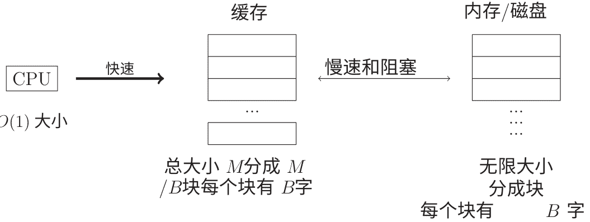

在这个模型中，缓存访问是免费的。该算法明确地以块为单位读取和写入内存。我们将计算缓存和内存之间的内存传输次数，作为算法性能的重要指标。

### 2.2 缓存无关模型

与外部内存模型唯一的区别是算法不再知道 $B$ 和 $M$。访问内存中的一个字会自动将整个块加载到缓存中，并在缓存已满时将最近最少使用的（LRU）块从缓存中驱逐出去。

每个算法都是缓存无关算法，但我们希望找到能够最小化我们的新指标（内存传输次数）的算法。

为什么我们喜欢缓存无关算法（而不是让算法知道 $B$ 和 $M$）？因为这样，算法可以自动调整自己，在不同的计算机上高效运行（可能具有不同的 $B$ 和 $M$）。此外，这是一个很酷的研究！

## 3 扫描

示例程序：

```
for i in range(N): sum += A[i]
```

假设 $A$ 在内存中连续存储。外部存储模型可以将 $A$ 与块边界对齐，因此需要 $\lceil N/B \rceil$ 个内存传输。

缓存无关算法无法控制对齐（因为它不知道B），因此需要⌈N/B⌉+1=N/B+O(1)个内存传输。O(1)并行扫描仍然需要O(N/B+1)个内存传输。

## 4 分治

分治算法将问题分解到O(1)的大小。递归的基本情况是

- 问题适合缓存，即≤M，或者
- 问题适合O(1)个块，即O(B)。下面我们将看到每个示例一个。

### 4.1 中位数查找 / 顺序统计

回顾算法的步骤

1. 将数组视为每列有5个元素的分区（每列的大小为O(1)）。
2. 对每一列进行排序
3. 递归地找到列中位数
4. 通过x将数组分区
5. 在一侧递归

现在我们将分析每个步骤中的内存传输次数。设MT(N)为总内存传输次数。

1. 释放
2. 扫描，O(N/B+1)
3. MT(N/5)，这涉及一个预处理步骤，将N/5个元素合并到一个连续的数组中
4. 3个并行扫描，O(N/B+1)
5. MT(7N/10)

因此，我们得到递归关系

```
$MT(N) = MT(N/5) + MT(7N/10) + O(N/B + 1)$.
```

解决递归问题需要设置一个基本情况。一个明显的基本情况是

```
$MT(O(1)) = O(1)$。
```

但我们可以得到一个更强的基本情况：$MT(O(B)) = O(1)$。使用这个基本情况，递归求解为$MT(N) = O(N/B + 1)$。（直觉：递归层次的成本几何级数地减少，因此根节点的成本占主导地位。）

### 4.2 矩阵乘法

问题：计算 $Z = X \cdot Y$ 其中$X$、$Y$、$Z$都是 $N \times N$矩阵。还假设$X$以行主序存储，$Y$以列主序存储以提高局部性。

如果我们使用基本算法，在 $Z$中计算一个元素需要进行一次或两次并行扫描，因为它要么需要从 $X$扫描一行，要么需要从 $Y$扫描一列。计算每个元素需要 $O(N/B + 1)$个内存传输，因此计算整个 $Z$的成本为 $O(N^3/B + N^2)$个内存传输。

相反，我们将使用块矩阵乘法算法（而不是Strassen算法）。请注意，关键块应连续存储。我们进行递归

```
$MT(N) = 8MT(N/2) + O(N^2/B + 1)$
```

第一项是递归子矩阵乘法，第二项是矩阵加法，需要扫描矩阵。

同样，我们可以有不同的基本情况

- 改进：$MT(O(1)) = O(1)$
- 更好：$MT(O(B)) = O(1)$
- 更好的：$MT(\sqrt{M/3}) = O(M/B)$

第三种情况表示三个涉及的矩阵可以一起放入缓存中。因此，为了将它们相乘，我们只需要一次扫描将它们全部加载到缓存中。

如果我们绘制递归树，每个层级的成本呈几何级增长，这次是 $N^2/B$，$8(N/2)^2/B$，$8^2(N/4)^2/B$，......因此，叶子节点的成本占主导地位，总成本 = 每个叶子节点的成本 $\cdot$叶子节点的数量，

```
$MT(N) = O(M/B) \cdot 8^{O(\lg N/\sqrt{M})} = O(M/B) \cdot O((N/\sqrt{M})^3) = O(N^3/B\sqrt{M})$.
```

麻省理工学院开放式课程网站

http://ocw.mit.edu

# 6.046J / 18.410J 算法设计与分析

OM1R年春季

有关引用这些材料或我们的使用条款的信息，请访问： http://ocw.mit.edu/terms。

## 第24讲：缓存无感知算法 II

- 搜索
  - 二进制
  - B进制
  - 缓存无感知
- 排序
  - 归并排序
  - 缓存无感知

## 为什么选择LRU块替换策略？

$LRU_M \leq 2 \cdot OPT_{M/2}$ [Sleater and Tarjan 1985]
证明.

- 将分区块访问序列划分为最大的 $M/B$不同块的阶段
- LRU每个阶段花费 $\leq M/B$内存传输/阶段
- OPT每个阶段必须花费 $\geq M/B$内存传输：最好情况下，开始阶段使用整个 $M/2$缓存与所需项目。但是在阶段期间有 $M/B$块。所以 $\leq$一半空闲

## 搜索

在比较模型中预处理 $n$个元素以支持 $x$的前驱搜索。

### B树

它们在 $O(\log_{B+1} N)$内存传输中支持前驱（插入和删除）操作。

- 每个节点占用$\Theta(1)$块
- 高度=$\Theta(\log_B N)$
- 需要知道 $B$

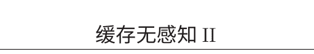

## 二分搜索

大致上，每次迭代访问一个不同的块，直到我们在 x 的块中。因此，$M T(N) = \Theta(\log N - \log B) = \Theta(\log(N/B))$. 慢

## van Emde Boas布局

> > [Prokop 1999]

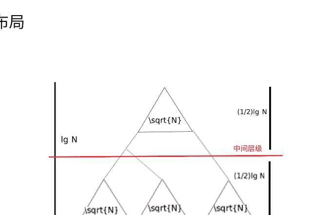

- 在完全二叉搜索树中存储N个元素
- 在边的中间层级上切割二叉搜索树
- 递归地布局和连接这些部分
- 类似于块矩阵乘法，部分的顺序不重要；只需要每个部分连续存储

## vEB布局下的二叉搜索树搜索分析:

- 考虑结构的递归细化级别，其中结构的节点数≤B的平方根
- vEB树的高度介于 ½ lg B 和 lg B ⟹ 大小介于 √B 和 B之间 ⟹ 任意从根到节点的路径（搜索路径）访问的节点数≤ lg N / (½ lg B) = 2 log_B N 的树大小≤ B
- 大小≤ B的每个树占用≤ 2个内存块 ⟹ ≤ 4 log_B N = O(log_B N) 内存传输

- 这个推广到不是2的幂的高度，分支因子为常数的B树和动态B树：$O(\log_B N)$) 插入/删除。[Bender, Demaine,Farach-Colton 2000]

## 排序

### B树

N个插入到（无关缓存）B树 $\Longrightarrow MT(N) = \Theta(N \log_B N)$ 非最优。相比之下，BST排序是最优的 $O(N \lg N)$

### 二进制归并排序

- 二进制归并排序是无关缓存的。
- 归并是3个并行扫描
  $\Longrightarrow MT(N) = 2MT(N/2) + O(N/B + 1)$
  $MT(M) = O(M/B)$
- 递归树有$\lg(N/M)$层，每层贡献$O(N/B)$ $\Longrightarrow MT(N) = N \frac{B}{\lg B} \lg \frac{N}{M}. \leftarrow \frac{B}{\lg B}$ 比之前讨论的B树版本更快！

### $M/B$路归并排序

- 将数组分割成$M/B$个相等的子数组
- 递归地对每个子数组进行排序
- 通过$M/B$个并行扫描进行合并（每个列表保持一个“当前”块）

$$\Longrightarrow MT(N) = \frac{M}{B} MT\left(\frac{N}{M/B}\right) + O(N/B + 1)$$
$$MT(M) = O(M/B)$$

$$\Longrightarrow \text{树的高度变为} \log_{(M/B)} \frac{N}{M} + 1$$
$$= \log_{(M/B)} \frac{N}{B} \cdot \frac{B}{M} + 1$$
$$= \log_{(M/B)} \frac{N}{B} - \log_{(M/B)} \frac{M}{B} + 1$$
$$= \log_{(M/B)} \frac{N}{B}$$

\[ \implies M T(N) = O \left( \frac{N}{B} \log_{M/B} \frac{N}{B} \right) \]

在比较模型中，这是渐近最优的。

### 缓存无关排序

这需要高缓存假设：\(M = \Omega(B^{1+\epsilon})\) 对于某个固定的\(\epsilon > 0\)，例如，\(M= \Omega(B^2)\) 或 \(M/B= \Omega(B)\)。

然后， \(\approx N^{\epsilon}\)路归并排序与递归（“漏斗”）归并一起工作。

### 优先队列

- \(O(\frac{1}{B} \log_{M/B} \frac{N}{B})\) 每次插入或删除最小值
- 推广排序
- 外部存储器和缓存无关
- 参见 6.851

麻省理工学院开放式课程网站
http://ocw.mit.edu

# 6.046J / 18.410J 算法设计与分析

OM1R年春季

有关引用这些材料或我们的使用条款的信息，请访问：http://ocw.mit.edu/terms。