# MIT 6.061 电力系统导论讲义

# 第一章：网络理论复习*

J.L. Kirtley Jr.

#### 1 引言

本笔记是对电力网络理论中一些最重要的要点的复习。在这里，我们不证明任何所提出的断言。我们只处理被动的、线性的网络元件。

## 2 网络基元

电力网络理论涉及两个基本量，我们将其称为：

1.  电势（或电压），以及
2.  电流。

电流是带电载流子的实际流动，而电势差是引起这种流动的力量。正如我们将看到的，电势是一个在网络的节点上可以唯一定义的单值函数。而电流则流经网络的支路。

图1展示了一个分支的基本概念，在该分支上定义了电压，并且定义了电流通过该分支。一个网络是由这些元素组成的集合，通过导线连接在一起。

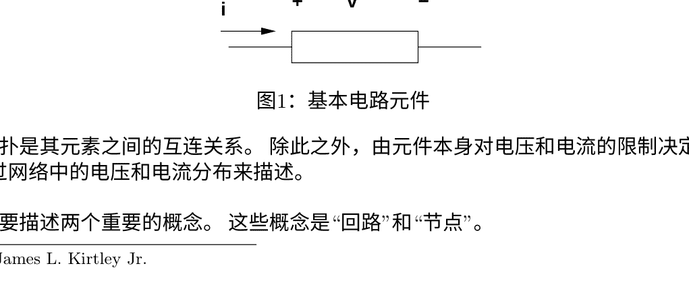

网络拓扑是其元素之间的互连关系。除此之外，由元件本身对电压和电流的限制决定了网络的性能，通过网络中的电压和电流分布来描述。

首先需要描述两个重要的概念。这些概念是“回路”和“节点”。

1.  网络中的回路是通过网络中的两个或多个元素形成的任何闭合路径。任何非平凡的网络都至少有一个这样的回路。

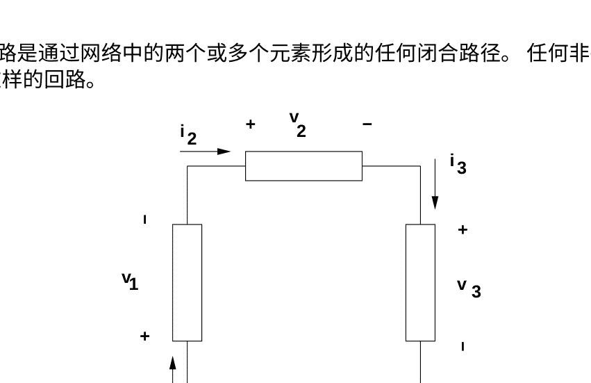

2.  一个节点是两个或多个元件相互连接的点。

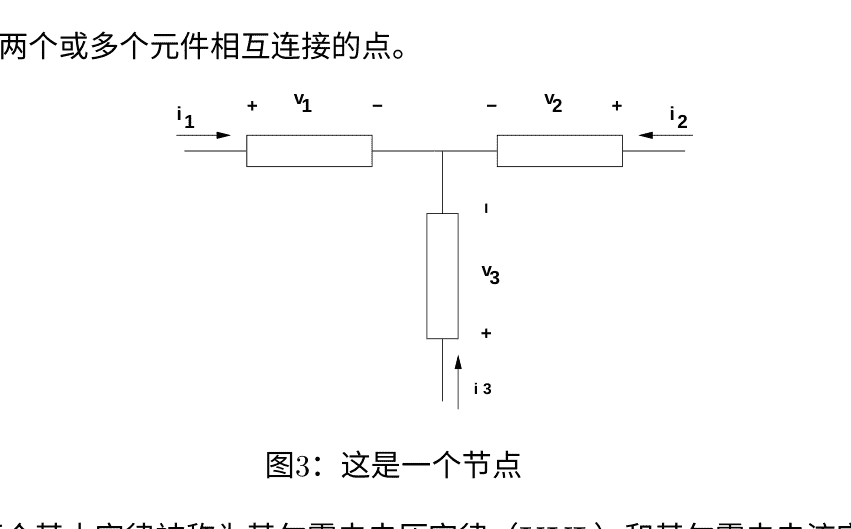

网络理论的两个基本定律被称为基尔霍夫电压定律（KVL）和基尔霍夫电流定律（KCL）。这些定律描述了网络的拓扑结构，并直接源于电磁学的基本定律。它们的简要表述如下：

- 基尔霍夫电压定律规定，在网络的任何回路of上，所有电压的总和，取相同方向，为零：$$\sum_{\text{回路}} v_k = 0$$ (1)

- 基尔霍夫电流定律规定，在网络的任何节点of上，所有进入节点的电流的总和为零：$$\sum_{\text{节点}} i_k = 0$$ (2)

1注意，KVL是法拉第定律的离散版本，只在没有时变磁通穿过回路的情况下有效。KCL只是电流守恒定律，允许节点上没有电荷积累。

网络元件以三种方式影响电压和电流：

1.  电压源将其端口之间的电位差限制为某个固定值（源的值）。
2.  电流源将通过该支路的电流限制为某个固定值。
3.  其他所有元素都对分支的电压和电流之间的关系施加了某种形式的关系，无论是线性的还是非线性的。


电压和电流源可以是独立的或者依赖的。独立源的值是独立于电路中其他变量的，正如其名称所暗示的那样。依赖源的值取决于电路中的其他变量。一个常见的依赖源的例子是用于模拟晶体管集电结的等效电流源。通常，这被建模为一个电流依赖电流源，其中集电流被直接依赖于发射极电流。这样的依赖源必须小心处理，因为我们将在下面讨论的某些技巧对它们不起作用。

在目前，除了电压和电流源之外，我们只考虑阻抗元件，它们在电压和电流之间施加线性关系。其中最常见的是电阻，它施加的关系通常被称为欧姆定律：

$$v_r = R i_r$$ (3)

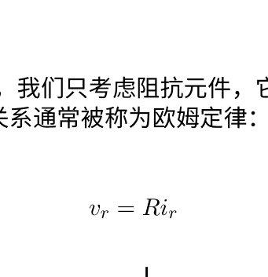

稍后在本笔记中，我们将扩展这种阻抗的概念到其他元件，但目前电阻将满足我们的需求。

### 3 个例子：电压和电流分压器

图6可以用作一个示例，展示我们如何使用所有这些。注意它有一个回路和三个节点。在回路上，根据KVL有：

$$ V_s - v_1 - v_2 = 0 $$

在右上角的节点上，根据KCL有：

$$ i_1 - i_2 = 0 $$

电阻施加的构成关系为：

$$ v_1 = R_1 i_1 $$
$$ v_2 = R_2 i_2 $$

将它们结合起来，我们得到：

$$ V_s = (R_1 + R_2)i_1 $$

我们可以解出跨越 $R_2$的电压，得到所谓的电压分压关系：

$$ v_2 = V_s \frac{R_2}{R_1 + R_2} $$ (4)


图7展示了第二个例子。在这里，顶部节点的KCL方程为：

$$ I_s - i_1 - i_2 = 0 $$

而KVL方程是绕有这两个电阻的回路写的：

$$ R_1 i_1 - R_2 i_2 = 0 $$

将它们结合起来，我们得到电流分流关系：

$$ i_2 = I_s \frac{R_1}{R_1 + R_2} $$ (5)

一旦我们推导出电压和电流分压关系，我们可以将它们作为我们的“智力工具包”中的一部分，因为它们总是成立的。

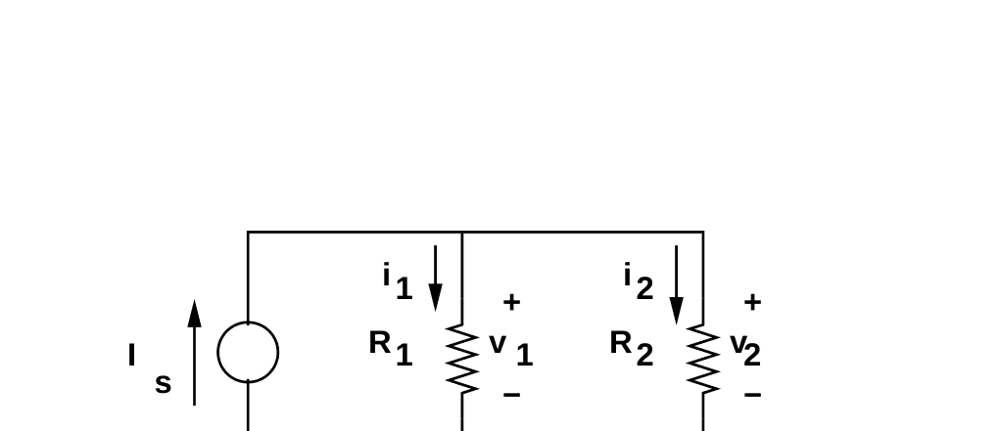

图7：电流分压器

## 4 节点电压和参考电压

KVL的一个结果是网络中的每个节点都具有相对于其他节点唯一确定的电位。因此，如果我们将网络中的一个节点作为参考点或基准点，那么其他每个节点都将具有唯一的电位。元件连接的节点之间的电压差就是该网络分支的电压。节点的电位是从该节点到基准节点沿某条路径遍历时遇到的电压之和。请注意，任何路径都可以。如果满足KVL，每对节点之间的所有路径都将得到相同的电位。

一个常用的电路是惠斯通电桥，其最简单形式如图8所示。输出电压仅仅是输入电压的两个电压分压器之间的差异：

$$ v_o = v_s \left( \frac{R_2}{R_1 + R_2} - \frac{R_4}{R_3 + R_4} \right) $$

这个电路用于某些情况下，其中一个或多个电阻器随温度或机械应变变化。通过调整其他电阻器，可以使电桥平衡，使输出电压为零。然后，感应元件的相对小的变化可以导致输出电压的相对大的差异。例如，如果$R_2$是感应元件，则可以调整$R_4$来平衡电桥。

## 5 串联和并联组合

处理网络问题有许多技术，我们将无法对每一种技术进行深入研究。然而，我们将研究一些涉及网络逐步简化的分析技术。首先，我们考虑如何处理元件的串联和并联组合。如果一对元件通过相同的电流，则它们处于串联状态。如果这些元件是电阻器，并且不需要详细的电压分配细节，可以将它们合并为一个等效电阻。如图9所示。电流源的电压为：

$$ v_s = v_1 + v_2 = i_s R_1 + i_s R_2 = i_s (R_1 + R_2) $$

串联组合的等效电阻为：

$$ R_{\text{串}} = R_1 + R_2 $$ (6)

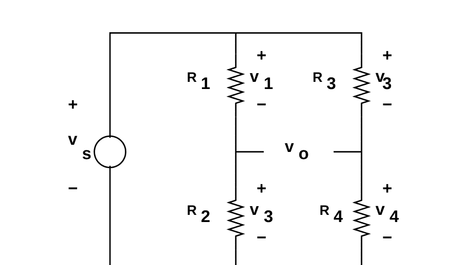

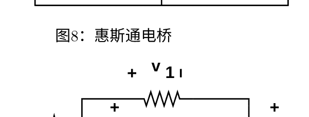

类似地，如果不需要知道电流在它们之间的细节分配，那么并联连接的电阻元件可以合并。图10展示了这种组合。

在这里，电流 $i$简单地为：

$$i = \frac{v}{R_1} + \frac{v}{R_2} = v \left( \frac{1}{R_1} + \frac{1}{R_2} \right)$$

并联组合的等效电阻为：

$$R_{\text{并}} = \frac{1}{\frac{1}{R_1} + \frac{1}{R_2}} = \frac{R_1 R_2}{R_1 + R_2} \quad \quad \quad (7)$$

由于并联连接电阻（以及其他阻抗）的重要性，使用了特殊的符号形式来表示并联结构。

$$R_1 || R_2 = \frac{R_1 R_2}{R_1 + R_2} \quad \quad \quad (8)$$

作为一个例子，考虑图11中的电路，部分(a)。在这里，我们有四个电阻器，以奇怪的方式排列成一个双端口网络。为了找到这个东西的等效电阻，我们可以进行一系列串并联组合。

右边的两个电阻器可以组合成一个串联组合，形成一个单独的2欧姆电阻器，如(b)所示。然后，与其中一个并联的等效电阻器可以与两个2欧姆电阻器组合成一个单一的组合部分(c)。

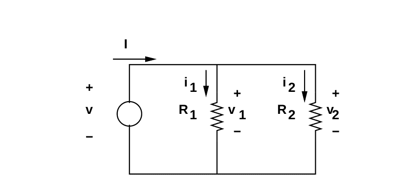

图10: 并联电阻组合

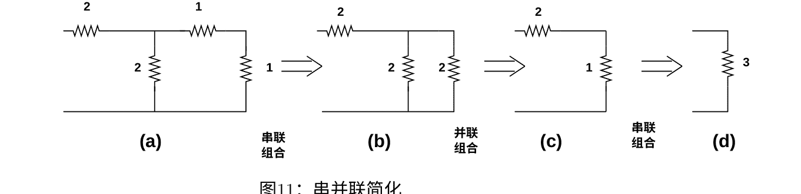

图11: 串并联简化

两个2欧姆电阻器可以组合成一个单一的组合部分(c)。这与剩余的电阻器串联，使我们得到一个等效输入电阻 R= 3Ω。

## 6 回路和节点方程

有两种成熟的正式方法可以解决网络中的电位和电流问题，通常称为回路和节点方程方法。它们密切相关，使用KCL和KVL以及元件约束条件来建立一组方程，然后可以解决电位和电流问题。

- 在节点方程方法中，KCL在网络的每个节点处写成，电流用节点电位表示。KVL得到满足，因为节点电位是唯一的。
- 在回路方程方法中，KVL围绕网络中的一组闭合路径写成。定义了“回路电流”，并使其满足KCL，支路电压用它们表示。

这两种方法是等效的，选择其中一种通常是个人偏好的问题。节点方程方法可能更广泛地使用，并且非常适合计算机分析。

为了说明这些方法的工作原理，考虑图12所示的网络。这个网络有三个节点。我们将为每个节点编写KCL方程，但请注意只需要两个明确的方程。如果两个节点满足KCL，第三个节点就会自动满足。通常，基准节点是我们不编写表达式的节点。


对网络的上两个节点编写的KCL方程为：

$$ -i_1 + \frac{V}{R_1} + \frac{V - v_2}{R_2} = 0 \tag{9} $$
$$ -I + \frac{v_2 - V}{R_2} + \frac{v_2}{R_3} = 0 \tag{10} $$

这两个表达式很容易解出两个未知数，\( i_1 \)和\( v_2 \)：

$$ v_2 = \frac{R_3}{R_2 + R_3}V + \frac{R_2 R_3}{R_2 + R_3}I $$
$$ i_1 = \frac{R_1 + R_2 + R_3}{R_1(R_2 + R_3)}V - \frac{R_3}{R_2 + R_3}I $$


环路方程方法类似。我们需要相同数量的独立表达式（两个），所以我们需要取两个独立的环路。为此，取如图13所示的环路：

1.  包括电压源和 \( R_1 \)的环路。
2.  包括 \( R_1 \)， \( R_2 \)和 \( R_3 \)的环路。

还需要定义环路电流，我们将其表示为 \( i_a \)和 \( i_b \)。这些是绕两个环路循环的电流。请注意，在环路交叉的地方，实际的分支电流将是环路电流之间的和或差。对于这个例子，假设环路电流在两个环路中逆时针流动。两个环路方程为：

$$ V + R_1(i_a - i_b) = 0 \tag{11} $$
$$ R_1(i_b - i_a) + R_2 i_b + R_3(i_b - I) = 0 \tag{12} $$

这些都可以很容易地解出两个未知数，即这种情况下的两个环流 \( i_a \)和 \( i_b \)。

## 7 线性和叠加

网络理论中一个非常强大的概念是线性。这个属性有两个基本要素，如下所述：

1.  对于任何单一输入 $x$ 产生输出 $y$ 的情况，对于任何值 $k$，输入 $kx$ 的响应是 $ky$。
2.  如果在一个多输入网络中，输入 $x_1$ 单独产生输出 $y_1$，而第二个输入 $x_2$ 单独产生输出 $y_2$，则输入组合 $x_1$ 和 $x_2$ 产生输出 $y = y_1 + y_2$。

这对我们现在来说非常重要，有两个原因：

1.  它告诉我们解决涉及多个输入的网络问题实际上比我们预期的要容易：如果一个网络是线性的，我们可以分别解决每个单独的输入的输出，然后将输出相加。这被称为叠加原理。
2.  它还告诉我们，对于线性网络，实际上不需要考虑输入的值来计算响应。重要的是系统函数，或者是输出与输入的比值。

叠加原理在处理线性网络时是一个重要的原则，可以用来简化分析。如果一个网络有多个独立的源，可以分别找到每个源的响应，然后将所有响应相加以得到总响应。请注意，这只能在独立源的情况下进行！

例如，考虑图12中所示的电路示例。如果我们只对输出电压 $v_2$ 感兴趣，我们可以先找到电压源的响应，然后是电流源的响应，然后总响应是两者之和。要找到电压源的响应，我们必须“关闭”电流源。这是通过假设它不存在来实现的。（毕竟，零电流的电流源只是一个断路器！）。得到的网络如图14所示。

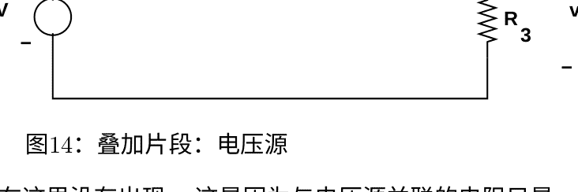

图14：叠加片段：电压源

请注意，电阻 $R_1$ 在这里没有出现。这是因为与电压源并联的电阻只是一个电压源，除非对电阻中的电流感兴趣。输出电压就是：

$$ v_{2v} = V \frac{R_3}{R_2 + R_3} $$

接下来，我们“关闭”电压源并“打开”电流源。请注意，已经关闭的电压源是一个短路，因为这意味着电压为零。网络如图15所示。

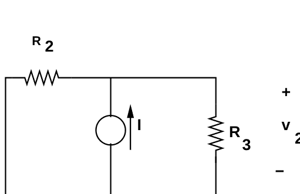

对此的响应是：

$$v_{2i} = IR_{2}||R_{3}$$

总响应就是：

$$v_{2} = v_{2v} + v_{2i} = V \frac{R_{3}}{R_{2}+R_{3}} + I\frac{R_{2}R_{3}}{R_{2}+R_{3}}$$

## 8 戴维南和诺顿等效电路

线性性质的一个特别重要的分支在等效电路的概念中得到了表达。换句话说：如果我们考虑网络在任意给定的终端对的响应，即将一对节点引出到外部世界，根据线性性质，如果网络是线性的，单个终端对的输出（电压或电流）是两个分量的和：

1.  在终端对的激励为零时存在的响应和
2.  由激励电压或电流强制在终端对上的响应。

这个概念可以用电压或电流作为响应来表达。这产生了Thevenin和Norton等效网络，它们是完全等效的。在任何终端对上，线性网络的性质可以用Thevenin或Norton等效电路来表达。

The Thevenin等效电路如图16所示，而 Norton等效电路如图17所示。

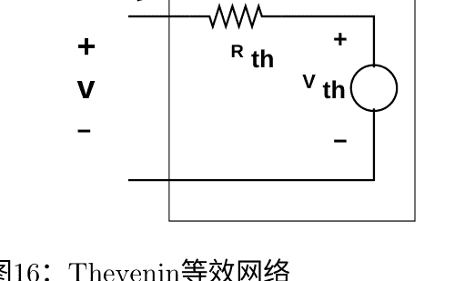

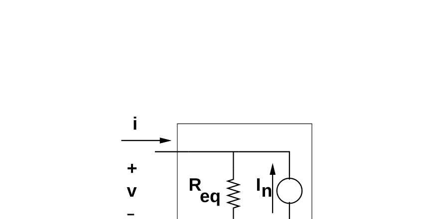

Thevenin和Norton等效网络具有相同的阻抗。此外，等效源之间存在简单的关系：

$V_{Th} = R_{eq} I_N$ (13) The Thevenin等效电压，即Thevenin等效网络内部的源电压，与开路电压相同，即在等效电路的端口处打开时会出现的电压。同样，Norton等效电流与短路电流相同，但方向相反。

为了考虑如何使用这些等效网络，考虑一下如果将惠斯通电桥通过一些电阻连接到其输出端口，如图18所示，会发生什么。

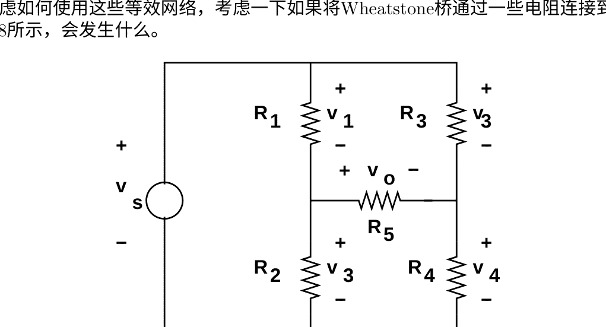

如果我们意识到桥的每一侧都可以表示为Thevenin或Norton等效网络，那么这种情况的分析就会大大简化。我们可以通过找到每一侧的等效网络，然后将它们粘贴在一起形成整个解决方案来解决这个问题。因此：考虑网络左侧的等效网络，由元件 $V$, $R_1$ 和 $R_2$组成。如图19所示。

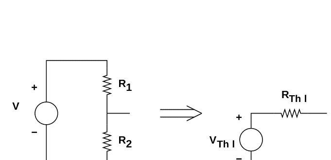

图19：等效电路的构建

在这里，等效电路的组成部分是：

$$v_{Thl} = V \frac{R_2}{R_1 + R_2}$$
$$R_{eql} = R_1 || R_2$$

类似地，发现网络的右侧具有等效源和电阻：

$$v_{Thr} = V \frac{R_4}{R_3 + R_4}$$
$$R_{eqr} = R_3 || R_4$$

整个系统的行为类似于图20所示的等效电路

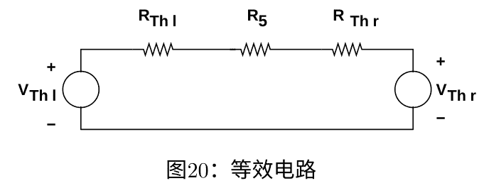

图20：等效电路

当然，这很容易解出电阻R5上的电流，从而得到所需的电压：

$$v_5 = (v_{Thl} - v_{Thr}) \frac{R_5}{R_5 + R_{eql} + R_{eqr}} = V \left( \frac{R_2}{R_1 + R_2} - \frac{R_4}{R_3 + R_4} \right) \frac{R_5}{R_5 + R_1 || R_2 + R_3 || R_4}$$

## 9 双端口网络

到目前为止，我们已经处理了许多可以称为单端口或单端对电路的网络。也就是说，重要的动作发生在单个端口对上，并且由阻抗以及开路电压或短路电流来描述，从而形成Thevenin或Norton等效电路。第二个对我们非常重要的电气网络类别是具有两个（或有时更多）端口对的网络。我们将在这里正式考虑双端口网络，如图21所示。

有多种方法可以描述这种类型的网络。暂时考虑它是被动的，没有输入就没有输出，也没有依赖源。

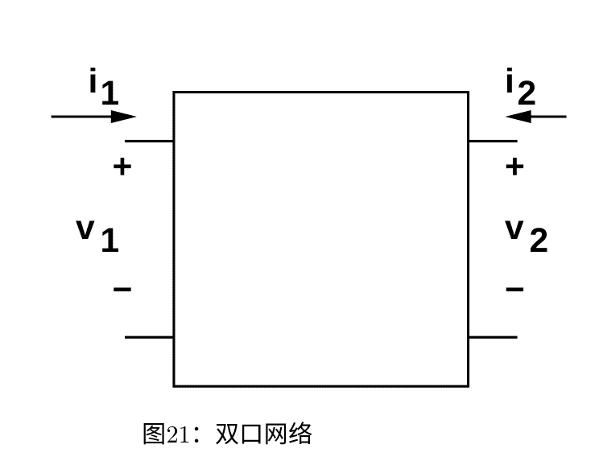

然后我们可以根据端口处的电流来描述网络，或者反过来，我们可以根据端口处的电压来描述电流。这两种描述网络的方式被称为导纳或阻抗参数。它们可以用以下方式表示：阻抗参数的观点会得出以下电压和电流之间的关系，对于一个电阻网络来说：

$$ \begin{bmatrix} v_1 \\ v_2 \end{bmatrix} = \begin{bmatrix} R_{11} & R_{12} \\ R_{21} & R_{22} \end{bmatrix} \begin{bmatrix} i_1 \\ i_2 \end{bmatrix} $$

同样，导纳参数的观点会得出类似的关系：

$$ \begin{bmatrix} i_1 \\ i_2 \end{bmatrix} = \begin{bmatrix} G_{11} & G_{12} \\ G_{21} & G_{22} \end{bmatrix} \begin{bmatrix} v_1 \\ v_2 \end{bmatrix} $$

这两个关系当然是彼此的倒数。也就是说：

$$ \begin{bmatrix} G_{11} & G_{12} \\ G_{21} & G_{22} \end{bmatrix} = \begin{bmatrix} R_{11} & R_{12} \\ R_{21} & R_{22} \end{bmatrix}^{-1} $$

如果网络是线性的和被动的（即内部没有独立的源），它们还具有互易性的特性。在一个互易网络中，传输阻抗或传输导纳在两个方向上是相同的。也就是说：

$$ R_{12} = R_{21} $$
$$ G_{12} = G_{21} $$

通常有用的是用T型或Π型网络来表示双口网络，如图22和23所示。

有时候将两个双口网络级联是有用的，如图24所示。所得到的组合本身也是一个双口网络。假设我们有一对以阻抗参数为特征的网络：

$$ \begin{bmatrix} v_1 \\ v_2 \end{bmatrix} = \begin{bmatrix} R_{11} & R_{12} \\ R_{21} & R_{22} \end{bmatrix} \begin{bmatrix} i_1 \\ i_2 \end{bmatrix} $$

## 10 电感和电容电路元件

到目前为止，我们处理的电路元件没有记忆，因此具有瞬时行为的特点。用于计算这些元件行为的表达式是代数的（对于大多数元件来说还是线性的）。事实证明，我们将要研究的许多电路都可以用复杂参数来描述。

然而，我们快速偏离一下话题，简要讨论包含电容器和电感器的电路的瞬态行为。

$$
\begin{bmatrix} v_3 \\ v_4 \end{bmatrix} = \begin{bmatrix} R_{33} & R_{34} \\ R_{34} & R_{44} \end{bmatrix} \begin{bmatrix} i_3 \\ i_4 \end{bmatrix}
$$

通过注意到 \(v_2 = v_3\) 和 \(i_3 = -i_2\)，可以进行一些操作，从而得出：

$$
\begin{bmatrix} v_1 \\ v_4 \end{bmatrix} = \begin{bmatrix} R'_{11} & R_{14} \\ R_{14} & R'_{44} \end{bmatrix} \begin{bmatrix} i_1 \\ i_4 \end{bmatrix}
$$

其中

$$R'_{11} = R_{11} - \frac{R_{12}^2}{R_{22} + R_{33}}$$

$$R'_{44} = R_{44} - \frac{R_{34}^2}{R_{22} + R_{33}}$$

$$R_{14} = \frac{R_{12} R_{34}}{R_{22} + R_{33}}$$

图25显示了电容和电感电路元件的符号。它们的电压和电流之间的关系可以描述为： $i_c = C \frac{dv_c}{dt}$, $v_l = L \frac{di_l}{dt}$ (18)

请注意，尽管这些元件是线性的，但由于涉及到时间导数，描述它们在网络中的行为的表达式将变成普通微分方程。

### 10.1 简单情况: R-C

图26显示了一个电阻和一个电容的简单连接。这个电路只有两个节点，所以存在一个单一的电压 v跨越两个元件。这两个元件产生了以下约束条件： $i_r = \frac{v}{R}$, $i_c = C \frac{dv}{dt}$

而且，由于 $i_r = -i_c$，

$$
\frac{dv}{dt} + \frac{1}{RC}v = 0
$$

现在，我们知道这种一阶线性方程的解是：

$$
v \sim e^{-\frac{t}{RC}}
$$

(要确认这一点，只需将指数代入微分方程。) 然后，如果我们有一些初始条件，比如 $v(t=0) = V_0$，那么

$$
v = V_0 e^{-\frac{t}{RC}}
$$

这是一个微不足道的情况，因为我们没有描述初始条件是如何产生的。但考虑一个相关的问题，如图27所示。

### 10.2 带驱动的简单情况

通过注意到这个电路包含一个回路，并将回路上的电压相加，我们可以分析这个电路：

$$
RC \frac{dv_c}{dt} + v_c = v_s
$$

现在，假设电压源是一个阶跃信号：

$$
v_s = V_s u_{-1}(t)
$$

我们应该仔细定义阶跃函数，因为它非常有用。阶跃函数是一系列奇异函数之一。它的定义如下：

$$
u_{-1}(t) = \begin{cases} 0 & t < 0 \\ 1 & t > 0 \end{cases} \quad \quad \quad (19)
$$

现在，记住微分方程有特解和齐次解，对于 $t>0$，解微分方程的特解是：

$$
v_{cp} = V
$$

当然，这不满足电容器未充电的初始条件: $v_c(t=0+) = 0$. 再次记住，整个解是特解和齐次解的和，而齐次解是无驱动情况。为了满足初始条件，齐次解必须是：

$$v_{ch} = -V e^{-\frac{t}{RC}}$$

因此，总解很简单：

$$v_c = V \left(1 - e^{-\frac{t}{RC}}\right)$$

接下来，假设 $v_s = u_{-1}(t)V \cos \omega t$。我们知道齐次解必须具有相同的形式，但特解要复杂一些。在后面的章节中，我们将学习如何简化提取特解的过程，但目前，让我们假设使用正弦驱动将得到相同频率的正弦响应。因此，我们猜测

$$v_{cp} = V_{cp} \cos (\omega t - \phi)$$

时间导数是

$$\frac{dv_{cp}}{dt} = -\omega V_{cp} \sin (\omega t - \phi)$$

因此，我们可以找到特解的代数方程：

$$V \cos \omega t = V_{cp} (\cos (\omega t - \phi) + \omega RC \sin (\omega t - \phi))$$

注意三角恒等式：

- $\cos (\omega t - \phi) = \cos \phi \cos \omega t + \sin \phi \sin \omega t$
- $\sin (\omega t - \phi) = -\sin \phi \cos \omega t + \cos \phi \sin \omega t$

由于正弦和余弦项是正交的，我们可以将正弦和余弦的系数等式化为

$$V = V_{cp} [\cos \phi + \omega RC \sin \phi]$$

$$0 = V_{cp} [\sin \phi + \omega RC \cos \phi]$$

这两个方程中的第二个可以解出相位角度：

$$\phi = \tan^{-1} \omega RC$$

并将这两个方程平方并相加：

$$V^2 = V_{cp}^2 \left[1 + (\omega RC)^2\right]$$

因此，特解为：

$$v_{cp} = \frac{V}{\sqrt{1 + (\omega RC)^2}} \cos (\omega t - \phi)$$

最后，如果电容器最初未充电 ($v_c(t=0+) = 0$)，我们可以加入齐次解（我们已经知道其形式），并找到总解为：

$$v_c = \frac{V}{\sqrt{1 + (\omega RC)^2}} \left[ \cos (\omega t - \phi) - \cos \phi e^{-\frac{t}{RC}} \right]$$

这在图28中显示。

### 10.3 二阶系统示例

图29显示了一个具有两个电感和两个电阻的网络。假设这是由电压跃变驱动的：\( v_s = V_s u_{-1}(t) \)。请注意，对于两个电感，我们将需要两个初始条件来完成解。

稳态（特定）解是 \( v_o=0 \)。当然，每个电感中都会有电流流动，但如果励磁恒定，电流就不会有时间导数，因此每个电感的电压最终会降为零。

初始条件可以通过观察得到。在 \( t=0 \)（注意我们使用 \( t=0+ \)表示这个时刻），输出电压必须是：\[ v_o(t=0+) = V_s \] 这是因为电流不能瞬间流过电感和电阻，所以两者都没有电流。

第二个初始条件是电压跃变瞬间的变化率。要找到这个值，注意输出电压等于源电压减去两个电阻的电压降。

$$ v_o = v_s - R_2 i_2 - R_1 (i_1 + i_2) $$

如果我们对这个式子进行时间微分，并注意到常数的时间导数（在步进后输入电压是恒定的）为零：

$$ \frac{dv_o}{dt}(t=0+) = -(R_1 + R_2)\frac{di_2}{dt} - R_1\frac{di_1}{dt} $$

现在，由于在步进瞬间两个电感器都有源电压 \( V_s \) 跨越它们：

$$ \left.\frac{di_1}{dt}\right|_{t=0+} = \left.\frac{di_2}{dt}\right|_{t=0+} = \frac{V_s}{L} $$

在 \( t= 0+ \) 时，电压的变化率为：

$$ \left.\frac{dv_o}{dt}\right|_{t=0+} = -\frac{2R_1 + R_2}{L}V_s $$

现在，我们可以使用环路法找到齐次解。将源电压设为零，假设左回路中有电流 \( i_a \)，右回路中有电流 \( i_b \)。对这两个回路应用基尔霍夫电压定律（KVL）得到：

$$ R_1 i_a + L\frac{d}{dt}(i_a - i_b) = 0 \\ R_2 i_b + 2L\frac{di_b}{dt} - L\frac{di_a}{dt} = 0 $$

稍作调整后，它们变为：

$$ L\frac{di_a}{dt} + 2R_1 i_a + R_2 i_b = 0 \\ L\frac{di_b}{dt} + R_1 i_a + R_2 i_b = 0 $$

假设解的形式为 \( I e^{st} \)，这组联立方程变为：

$$ \begin{bmatrix} (sL + 2R_1) & R_2 \\ R_1 & (sL + R_2) \end{bmatrix} \begin{bmatrix} I_a \\ I_b \end{bmatrix} = \begin{bmatrix} 0 \\ 0 \end{bmatrix} $$

我们需要解这个方程得到 \( s \)（找到使得这组方程成立的 \( s \) 的值），这就是“特征方程”的解

$$ (sL + 2R_1)(sL + R_2) - R_1 R_2 = 0 $$

这与以下相同：

$$ s^2 + \frac{2R_1 + R_2}{L}s + \frac{R_1 R_2}{L^2} = 0 $$

现在，为了“好看的数字”，假设 $R_1 = 2R$, $R_2 = 3R$。特征方程为：

$$s^2 + 7\frac{R}{L}s + 6\left(\frac{R}{L}\right)^2 = 0$$

这可以很好地分解为 $(s + \frac{R}{L})(s + 6\frac{R}{L}) = 0$，或者 $s$ 的两个值为 $s = -\frac{R}{L}$ 和 $s = -6\frac{R}{L}$。由于这个特解为零，我们得到的总解是：

$$v_o = A e^{-\frac{R}{L}t} + B e^{-6\frac{R}{L}t}$$

初始条件为：

$$\left.v_o\right|_{t=0^+} = A + B = V_s$$

$$\left.\frac{dv_o}{dt}\right|_{t=0^+} = -\frac{R}{L}(A + 6B) = -7\frac{R}{L}V_s$$

这对表达式的解是：

$$A = -\frac{V_s}{5} \qquad B = \frac{6V_s}{5}$$

并且在图30中显示。

麻省理工学院开放式课程
[http://ocw.mit.edu](http://ocw.mit.edu)

# 6.061 / 6.690 电力系统导论
2011年春季

有关引用这些材料或我们的使用条款的信息，请访问：[http://ocw.mit.edu/terms](http://ocw.mit.edu/terms)。

## 麻省理工学院电气工程与计算机科学系6.061
电力系统导论第2章 交流线性网络中的功率流*

J.L. Kirtley Jr.

#### 1 引言

电力系统通常涉及正弦变化（或接近正弦变化）的电压和电流。也就是说，电压和电流是时间的函数，几乎是固定频率的纯正弦波。在北美，大部分船只和日本东部的频率是60赫兹。在世界其他地区，频率是50赫兹。正常的电力系统运行在这个固定频率上，这就是为什么我们要研究系统在这种模式下的运行方式。我们稍后会处理暂态问题。

这个笔记涉及交流电压和电流以及相关的能量流动。重点是正弦稳态条件，几乎所有感兴趣的量都可以用单个复数表示。

因此，本节以复数的复习和电压和电流的复数振幅及复指数时间依赖的表示开头。讨论通过阻抗，描述复数振幅的图示表示，称为相量。然后定义功率，并在正弦稳态下，将其简化为复数形式。

最后，讨论功率通过阻抗的流动和一个守恒定律。其次，这节课笔记的内容涉及具有有趣行为的输电线路，无论是在时间域还是频率域中。

### 2 复指数表示法

首先要认识到复数的几何解释。如果我们将实部绘制在水平（x）轴上，虚部绘制在垂直（y）轴上，那么复数$z = x + jy$（其中 $j = \sqrt{-1}$）表示如图1所示的向量。请注意，这个向量不仅可以通过其实部和虚部来表示，还可以通过幅值和相位来表示。

**角度:**

$|z| = \sqrt{x^2 + y^2}$
$\phi = \arctan\left(\frac{y}{x}\right)$

复指数表示法的基础是著名的欧拉关系式：

$e^{j\phi} = \cos(\phi) + j \sin(\phi)$

其表示如图2所示。现在，通过对比图1和图2，可以清楚地看出，根据定义(1)和(2)，

$z = x + jy = |z|e^{j\phi}$

使用(3)很容易证明：

$\cos(\phi) = \frac{e^{j\phi} + e^{-j\phi}}{2}$
$\sin(\phi) = \frac{e^{j\phi} - e^{-j\phi}}{2j}$

复指数函数是一种非常有用的函数类型。请注意，两个以指数形式表示的数的乘积等于指数之和的指数：

$$e^a e^b = e^{a+b}$$

请注意，指数形式的数的倒数等于指数的负数的指数：

$$\frac{1}{e^a} = e^{-a}$$

然后，如果我们有两个数 \( z_1 = |z_1| e^{j\phi_1} \) 和 \( z_2 = |z_2| e^{j\phi_2} \)，那么这两个数的乘积是：

$$z_1 z_2 = |z_1||z_2| e^{j(\phi_1+\phi_2)}$$

两个数的比例是：

$$\frac{z_1}{z_2} = \frac{|z_1|}{|z_2|} e^{j(\phi_1-\phi_2)}$$

一个数的复共轭 \( z = x + jy \) 的表达式为：

$$z^* = x - jy$$

一个复数和它的共轭的和是实数：

$$z + z^* = 2\text{Re}(z) = 2x$$

而差是虚数：

$$z - z^* = 2j\text{Im}(z) = 2jy$$

我们使用 \(\text{Re}(\cdot)\) 和 \(\text{Im}(\cdot)\) 这两个符号来表示提取复数的实部和虚部的运算符。

复数的共轭是复数 \( z = |z| e^{j\phi} \) 的复共轭也可以写成：

$$z^* = |z| e^{-j\phi}$$

这样一个复数和它的共轭的乘积是实数：

$$z z^* = |z| e^{j\phi} |z| e^{-j\phi} = |z|^2$$

### 3 正弦时间函数

一个关于时间的正弦函数可以用至少两种方式来表示：

$$
f(t) = A\cos(\omega t + \phi) \tag{17}
$$

$$
f(t) = B\cos(\omega t) + C\sin(\omega t) \tag{18}
$$

第三种写这个时间函数的方式是将其表示为两个复指数的和：

$$
f(t) = \underline{X}e^{j\omega t} + \underline{X}^{*}e^{-j\omega t} \tag{19}
$$

注意方程式19的形式，在其中将复共轭相加，保证了结果函数是实数。

现在，要将方程式19与正弦函数的其他形式，方程式17和18联系起来，可以看到 $X$可以表示为：

$$
\underline{X} = |\underline{X}|e^{j\psi} \tag{20}
$$

然后方程式19变为：

$$
\begin{aligned}
f(t) &= |\underline{X}|e^{j\psi}e^{j\omega t} + |\underline{X}|^{*}e^{-j\psi}e^{-j\omega t} \tag{21} \\
&= |\underline{X}|e^{j(\psi+\omega t)} + |\underline{X}|^{*}e^{-j(\psi+\omega t)} \tag{22} \\
&= 2|\underline{X}|\cos(\omega t + \psi) \tag{23}
\end{aligned}
$$

然后，方程式17中的系数与方程式19中的系数相关：

$$
|\underline{X}| = \frac{A}{2} \tag{24}
$$

$$
\psi = \phi \tag{25}
$$

或者，我们可以写成

$$
\underline{X} = x + jy \tag{26}
$$

其中 $X$的实部和虚部分别为：

$$
x = |\underline{X}|\cos(\psi) \tag{27}
$$

$$
y = |\underline{X}|\sin(\psi) \tag{28}
$$

然后时间函数可以写成：

$$
\begin{aligned}
f(t) &= x(e^{j\omega t} + e^{-j\omega t}) + jy(e^{j\omega t} - e^{-j\omega t}) \tag{29} \\
&= 2x\cos(\omega t) - 2y\sin(\omega t) \tag{30}
\end{aligned}
$$

因此：

$$
\begin{aligned}
A &= 2x \tag{31} \\
B &= -2y \tag{32} \\
X &= \frac{A}{2} - j\frac{B}{2} \tag{33}
\end{aligned}
$$也可以将方程式19写成以下形式：

$$f(t) = \text{Re}(2Xe^{j\omega t})$$ (34)

虽然这两个表达式（19和34）是等价的，但根据情况使用其中之一是有优势的。第一个表示法（方程19）是该正弦信号的完整表示，可以在任何情况下使用。然而，它很繁琐，所以通常使用稍微更紧凑的版本（方程34）。主要是当涉及非线性产品（如功率）时，在使用它时需要有一定的谨慎，我们稍后会看到。

## 4 阻抗

因为复指数时间信号很容易进行微分，所以在具有各种线性元件的电路中，用这种方式表示时间信号具有真正的优势。在这些笔记的第1节中，我们介绍了线性电阻元件，其中电压和电流是线性相关的。现在我们必须考虑另外两个元件，电感和电容。电感

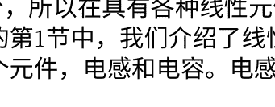

产生了电压和电流之间的关系：

$$v_L = L \frac{di_L}{dt}$$ (35)

如果电压和电流是时间的正弦函数：

$$v = V e^{j\omega t} + V^* e^{-j\omega t}$$
$$i = I e^{j\omega t} + I^* e^{-j\omega t}$$

那么电压和电流之间的关系可以简单地表示为：

$$V = j\omega L I$$ (36)

这是一个特别简单的形式，可以看出它直接类似于电阻。我们可以将电阻的观点推广到复阻抗（或简称阻抗），其中电感的阻抗为：

$$Z_L = j\omega L$$ (37)

7) 电容元件的定义类似。电容具有电压-电流关系：

$$i = C \frac{dv_C}{dt}$$ (38)

因此电容的阻抗为:

$$Z_C = \frac{1}{j\omega C}$$ (39)

对于电阻网络行为的扩展现在是显而易见的。对于处于正弦稳态的问题，其中所有激励都是正弦波，我们可以使用线性、电阻网络分析的所有技巧。然而，我们使用复阻抗代替电阻。

阻抗的倒数是导纳:

$$Y = \frac{1}{Z}$$

导纳和阻抗的串联和并联组合当然与电导和电阻的组合一样。对于串联或并联的两个元件:

串联:

$$Z = Z_1 + Z_2$$ (40)
$$Y = \frac{Y_1 Y_2}{Y_1 + Y_2}$$ (41)

并联:

$$Z = \frac{Z_1 Z_2}{Z_1 + Z_2}$$ (42)
$$Y = Y_1 + Y_2$$ (43)

### 4.1 例子

假设我们要在图5的网络中找到电压v(t)，其中i(t) = I cos(ωt)。

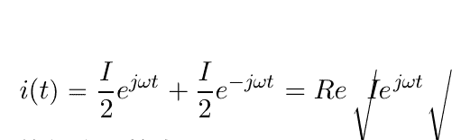

激励可以写成:

$$i(t) = \frac{I}{2}e^{j\omega t} + \frac{I}{2}e^{-j\omega t} = \text{Re} \left\{ I e^{j\omega t} \right\}$$

现在，串联的复阻抗R和L的复合阻抗为:

$$R \parallel j\omega L = \frac{R \cdot j\omega L}{R + j\omega L}$$

因此，如果v(t)由以下表示:

$$v(t) = \frac{V}{2}e^{j\omega t} + \frac{V}{2}e^{-j\omega t} = \text{Re}\left\{V e^{j\omega t}\right\}$$

那么

$$V = \frac{R j \omega L}{R + j \omega L} I$$

现在：阻抗 Z可以用幅值和相位角表示：

$$Z = |Z|e^{j\phi}$$
$$|Z| = \frac{\omega LR}{\sqrt{(\omega L)^2 + R^2}}$$
$$\phi = \frac{\pi}{2} - \arctan \frac{\omega L}{R}$$

然后，使用这里开发的关系，v(t)可以写成：

$$v(t) = \frac{\omega L I}{\sqrt{1 + \left(\frac{\omega L}{R}\right)^2}} \cos(\omega t + \phi)$$

请注意，这个表达式只表示正弦稳态解，因此不表示任何起始瞬态。

## 5 系统函数和频率响应

如果我们对线性系统的行为感兴趣，比如我们一直讨论的电路，我们经常谈到系统函数。这是系统输出和输入的（通常是复数）比率。系统函数可以表达驱动点行为（阻抗或其倒数，导纳）或传递行为。我们谈论电压或电流传递比和传递阻抗（输出电压与输入电流相关）以及传递导纳（输出电流与输入电压相关）

系统函数可以用多种方式表示，通常是作为拉普拉斯变换。这超出了本课程的范围。然而，重要的是要理解一种表达线性系统行为的方式，即频率响应。系统的频率响应是一个复数，它描述了输出与输入之间的关系，作为频率的函数。通常，它以一对数字的形式表示，即幅度和相位角。因此，

$$H(j\omega) = |H(j\omega)| e^{j\phi(j\omega)}$$

在信号与系统或网络理论课程中，经常花时间学习如何以有用且简单的方式获取和绘制网络的频率响应。对于我们的目的，一个直接、甚至可以说是“蛮力”的方法就足够了。例如，考虑图6中所示的电路。

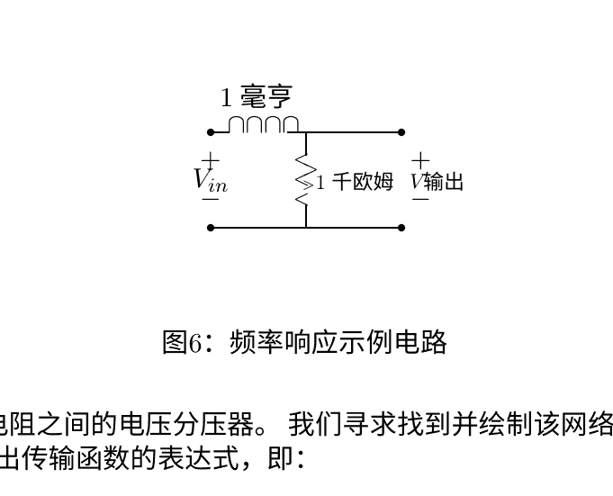

这只是一个电感和电阻之间的电压分压器。我们寻求找到并绘制该网络的传输比 $V_{out}/V_{in}$。非常简单的分析可以得出传输函数的表达式，即：

$$\frac{V_{out}(j\omega)}{V_{in}(j\omega)} = \frac{R}{R + j\omega L} = \frac{1}{1 + j\omega \frac{L}{R}}$$

可以通过多种方式提取该函数的幅度和角度。在这些笔记中，我们使用MATLAB进行了数学计算。生成频率响应图的具体说明如图7所示。基本上，所做的是计算一系列频率下的系统函数（注意我们使用一种在对数尺度上产生均匀间距的特定频率计算方法），然后绘制该系统函数的幅度（也在对数尺度上）和角度与频率的关系图。

## 6 相量

相量不是武器。它们是一种方便的几何技巧，帮助我们理解正弦稳态信号和系统的性质。首先，考虑复指数时间表示的基础，即函数 $e^{j\omega t}$。在任何时刻，这是一个复数：在时间 $t=0$ 时它等于1，在时间 $\omega t = \frac{\pi}{2}$ 时它等于 $j$，以此类推。我们可以将这个函数描述为一个单位长度的矢量，围绕复数平面的原点旋转，具有角速度 $\omega$。它当然有实部和虚部，它们只是矢量在实轴和虚轴上的投影。

现在考虑一个正弦变化的信号 $x(t)$，可以表示为：

$$x(t) = \frac{X}{2} e^{j\omega t} + \frac{X^*}{2} e^{-j\omega t}$$

这是两个数的和，它们是复共轭的，作为时间函数，在复平面上以相反的方向旋转。两者的和当然是实数。这与下面的时间函数相同：

$$x(t) = \text{Re}\left( X e^{j\omega t} \right) \quad (44)$$

其中实部运算符 $\text{Re}()$ 简单地将函数在实轴上的投影。在这一点上，记住复数运算的一个特点可能会有帮助。两个复数的乘法结果是第三个复数，它具有：

1. 一个幅度，它是两个数的幅度的乘积，并且
2. 一个相位，它是两个数的相位的和。

因此，将一个数乘以 $e^{j\omega t}$，它的幅度为1，相位随时间以速率 $\omega$ 增加，只是将该数围绕复平面的原点旋转。

因此，只需用它们的复振幅来表示正弦变化的信号相对容易，理解它们还包括提供时间变化的 $e^{j\omega t}$。复振幅不仅包括信号的幅度，还包括一个相位角。通常，单独的相位角没有太大用处，必须与某个时间参考相关联。也就是说，正如我们将看到的那样，在大多数情况下，相位角之间的差异是重要的。

阻抗和导纳也是复数，因此可以使用相量来可视化电网中电压和电流之间的关系。关键在于复数的乘法和除法与幅值的乘法或除法以及角度的加法或减法是相同的。

#### 6.1 例子

考虑图9所示的简单电网，并假设电流源是正弦波：

$$ i = \text{Re} \ I e^{j\omega t} $$

R-L组合的阻抗是一个复数：

$$Z = R + j\omega L = 1 + j2$$

现在：阻抗可以在复平面上表示，如图10所示。

电压 $v$ 由以下公式给出：

$$v = \text{Re} \{Ve^{j\omega t} \}$$

其中：

$$V = ZI$$

那么电压和电流之间的关系如图11所示。请注意，电压和电流之间的相位角与阻抗的相位角相同。

请注意，KVL可以以图12的方式进行图形表示。

## 7 能量和功率

对于任何电压和电流定义如图13所示的端口对，元件内的功率流入为：

$$p = vi$$ (45)

能量以焦耳表示，一个焦耳等于一瓦秒。焦耳也是牛顿-米（力乘以距离），因此瓦特是牛顿-米每秒。考虑我们遇到的三种线性、被动元件的行为：

- 电阻：$v = Ri$，瞬时功率为：

$$p = Ri^2 = \frac{v^2}{R}$$ (47)

- 电感：$v = L \frac{di}{dt}$，瞬时功率为：
  $$ p = i L \frac{di}{dt} = \frac{1}{2} \frac{d(i^2L)}{dt} \qquad\qquad\qquad (48) $$
  电感的储能量 $w_L = \frac{1}{2} Li^2$可以解释为电感中储存的能量，因此功率 $= \frac{dw_L}{dt}$。我们稍后需要对这个定义进行改进，当我们考虑电机电磁相互作用或非线性元件时，但现在这个定义足够了。

- 电容：电流 $= C \frac{dv}{dt}$，瞬时功率为：
  $$ p = v C \frac{dv}{dt} = \frac{1}{2} C \frac{d(v^2)}{dt} \qquad\qquad\qquad (49) $$
  电容的储能量 $w_C = \frac{1}{2} Cv^2$同样可以解释为电容中储存的能量。

接下来，考虑在正弦稳态条件下每个元件的功率输入：

- 电阻：如果电流 $= I \cos(\omega t + \theta)$，那么
  $$ \begin{aligned} \text{功率} &= R I^2 \cos^2(\omega t + \theta) \\ &= \frac{R I^2}{2} [1 + \cos 2(\omega t + \theta)] \qquad\qquad\qquad (50) \end{aligned} $$

因此，电阻中的平均功率是：

$$ P = \frac{1}{2} R I^2 $$ (51)

- 电感：如果 $ i = I \cos(\omega t + \theta) $，那么电压是 $ v = -\omega L I \sin(\omega t + \theta) $，功率是：

  $$ p = -\omega L I^2 \cos(\omega t + \theta) \sin(\omega t + \theta) = -\frac{\omega L I^2}{2} \sin 2(\omega t + \theta) $$ (52)

  电感中的平均功率为零。电感中的瞬时储能为

  $$ w_L = \frac{1}{2} L I^2 \cos^2(\omega t + \theta) $$

  并且它有一个平均值：

  $$ \langle w_L \rangle = \frac{1}{4} L I^2 $$ (53)

- 电容：如果 $ v = V \cos(\omega t + \phi) $，那么 $ i = -\omega C V \sin(\omega t + \phi) $，功率为：

  $$ p = -\frac{\omega C V^2}{2} \sin 2(\omega t + \phi) $$ (54)

  它的时间平均值为零。电容中储存的能量为：

  $$ w_C = \frac{1}{2} C V^2 \cos^2(\omega t + \phi) $$

  它的时间平均值为：

  $$ \langle w_C \rangle = \frac{1}{4} C V^2 $$ (55)

现在，考虑在一个情况下电压和电流都是正弦波且具有相同频率但可能有不同相位角的一组端子的功率流入：$ v(t) = V \cos(\omega t + \phi) $

$$ i(t) = I \sin(\omega t + \theta) $$

需要恢复到复数表示的原始形式，如方程19中所示，以计算功率。

$$ v(t) = \frac{1}{2} [\underline{V} e^{j\omega t} + \underline{V}^* e^{-j\omega t}] \quad (56) $$
$$ i(t) = \frac{1}{2} [\underline{I} e^{j\omega t} + \underline{I}^* e^{-j\omega t}] \quad (57) $$

瞬时功率是电压和电流的乘积：

$$ p = \frac{1}{4} [\underline{V} \underline{I}^* + \underline{V}^* \underline{I} + \underline{V} \underline{I} e^{j2\omega t} + \underline{V}^* \underline{I}^* e^{-j2\omega t}] \quad (58) $$

这直接等同于：

$$ p = \frac{1}{2} \text{Re} \left[ \underline{V}\, \underline{I}^{*} + \underline{V}\, \underline{I} e^{j2\omega t} \right] $$

这又可以表示为：

$$ p = \frac{1}{2} |\underline{V}| |\underline{I}| [\cos(\phi - \theta) + \cos(2\omega t + \phi + \theta)] $$

从中我们提取“实际功率”，或者时间平均功率:

$$ P = \frac{1}{2} \text{Re} \left[ \underline{V}\, \underline{I}^{*} \right] = \frac{1}{2} |\underline{V}| |\underline{I}| \cos(\phi - \theta) $$

实际功率和视在功率 \(P_a\) 之间的比值是简单的: $\frac{P}{P_a}$ 被称为功率因数, 并且

$$ \text{功率因数} = \cos \psi = \cos(\phi - \theta) $$

功率因数角 \(\psi = \phi - \theta\) 是电压和电流之间的相对相移. 这个关于时间平均功率的表达式暗示了我们可以称之为复功率的定义:

$$ P + jQ = \frac{1}{2} \underline{V}\, \underline{I}^{*} $$

其中平均功率 P 是实部. 这个复数量的幅度是视在功率. 虚部被称为无功功率. 它有重要性，将在后面讨论. 为了区分不同的量，实际功率、无功功率和视在功率使用不同的单位。通常，我们会用瓦特 (W) (或千瓦、兆瓦等)来表示实际功率。视在功率用伏安 (VA) 表示，而无功功率用无功伏安 (VAR) 表示。

为了更好地理解无功功率，我们可以展开瞬时功率表达式中的时间变化部分:

$$ p_{\text{时变}} = \frac{1}{2} |\underline{V}| |\underline{I}| \cos(2\omega t + \phi + \theta) $$

现在, 使用三角恒等式 \(\cos( x + y) = \cos x \cos y - \sin x \sin y\), 并将 \(x = 2\omega t + 2\phi\) 和 \(y = -\psi = \theta - \phi\) 代入, 我们得到:

$$ p_{\text{时变}} = \frac{1}{2} |\underline{V}| |\underline{I}| \left[ \cos 2(\omega t + \phi) \cos\psi + \sin 2(\omega t + \phi) \sin\psi \right] $$

因此，总瞬时功率为:

$$ p = \frac{1}{2} |\underline{V}| |\underline{I}| \cos \psi [1 + \cos 2(\omega t + \phi)] + \frac{1}{2} |\underline{V}| |\underline{I}| \sin \psi \sin 2(\omega t + \phi) $$

现在，如果我们注意到 P 和 Q 的表达式，我们可以将其重新写成:

$$ p = P [1 + \cos 2(\omega t + \phi)] + Q \sin 2(\omega t + \phi) $$

因此，实功率P 不仅代表时间平均功率，还代表随时间变化的脉动。无功功率Q 代表与零平均值的能量交换。

### 7.1 均方根幅值

请注意，到目前为止，所有功率表达式中都有一个因子 $\frac{1}{2}$ 出现了。这当然是因为两个相同频率正弦波的乘积的平均值等于它们峰值振幅的一半乘以相对相位角的余弦值。现在已经普遍使用一种称为均方根或简称为RMS的电压幅值测量方法。波形的RMS值的准确定义有些复杂，但可以简化为如果它是直流，则在电阻中会消耗相同的功率的值。

可以为任何周期性波形定义RMS。然而，由于我们将处理正弦波，所以定义更加简单。显然，以峰值振幅为单位的电阻功率耗散为：

$P = \frac{1}{2} \frac{|V|^2}{R}$

那么$RMS$振幅必须为：

$V_{RMS} = \frac{|V|}{\sqrt{2}} \quad (66)$

然后，

$P = \frac{V_{RMS}^2}{R}$

正如我们将看到的，RMS幅值是大多数情况下的默认值：当一个电路被描述为“120伏特A C”时，这个标识几乎总是指120伏特，RMS。这个的峰值幅值是 $|V| = 2 \cdot 120 \approx 170$伏特。通常你会看到以以下形式表达的正弦波形： $v = \sqrt{2} V_{RMS} \cos(\omega t)$，其中 $V_{RMS}$ 显然是RMS幅值。

### 7.2 例子

考虑图14的简单网络。我们将用我们讨论过的术语计算该网络的瞬时功率流入。假设电压源的RMS幅值为120伏特， $R$ 和 $X$ 都是100欧姆。那么：

$v(t) = 170 \cos \omega t$

该网络的导纳是：

$I = 1.7 - j1.7$

然后复功率为：

$P + jQ = \frac{1}{2} 170(1.7 + j1.7)$

实功率和无功功率分别为： P= 144 W， Q= 144 VAR。这给出了功率因数角度 $\psi= \arctan(1) = 45^\circ$。然后，瞬时功率为：

$p = 144 [1 + \cos 2(\omega t - 45^\circ)] + 144 \sin 2(\omega t - 45^\circ)$

这在图15中有说明。

## 8 守恒定律

可以证明复功率与时间平均功率的守恒方式相同。考虑一个具有一组终端和一组内部支路的网络。网络的瞬时功率流进入如下：

$p_{in} = \sum_{\text{终端}} vi$

请注意，该表达式适用于在任何完整的终端集上表示的电压和电流。也就是说，如果可以将网络的终端划分为一组配对，那么电压可能对应于配对之间的电压，而电流将在每对终端之间流动。或者，电压可能对应于单个节点到基准电压，而电流将是单个输入节点电流。由于功率只能进入网络元件，所以内部支路功率的总和必须等于终端功率的总和：

$$
\sum_{\text{终端}} vi = \sum_{\text{支路}} vi \quad \text{(67)}
$$

如果这对于瞬时功率成立，那么对于复杂功率也是成立的：

$$
\sum_{\text{终端}} \underline{VI} = \sum_{\text{支路}} \underline{VI} \quad \text{(68)}
$$

现在，如果网络由电阻、电容和电感组成，

$$
\sum_{\text{终端}} \underline{VI} = \sum_{\text{电阻}} \underline{VI} + \sum_{\text{电感}} \underline{VI} + \sum_{\text{电容}} \underline{VI} \quad \text{(69)}
$$

对于这些单独的元件：

- 电阻: $\underline{VI}^* = R|\underline{I}|^2$
- 电感: $\underline{VI}^* = j\omega L|\underline{I}|^2$
- 电容: $\underline{VI}^* = -j\omega C|\underline{V}|^2$

然后方程69变为：

$$
\sum_{\text{终端}} \underline{VI} = \sum_{\text{电阻}} R|\underline{I}|^2 + j \sum_{\text{电感}} \omega L|\underline{I}|^2 - j \sum_{\text{电容}} \omega C|\underline{V}|^2 \quad \text{(70)}
$$

然后，识别单独的项：

$$
\begin{aligned}
&\sum_{\text{终端}} \underline{VI} = 2(P+jQ) &&\text{网络中的总复功率}\\
&\sum_{\text{电阻}} R|\underline{I}|^2 = 2\sum<p_r> &&\text{电阻中耗散的功率}\\
&j \sum_{\text{电感}} \omega L|\underline{I}|^2 = 4\omega \sum<w_L> &&\text{电感中储存的能量}\\
&j \sum_{\text{电容}} \omega C|\underline{V}|^2 = 4\omega \sum<w_C> &&\text{电容中储存的能量}
\end{aligned}
$$

因此，对于任何RLC网络：

$$
P+jQ = \sum_{\text{电阻}} <p_r> +2j\omega \left[ \sum_{\text{电感}} <w_L> - \sum_{\text{电容}} <w_C> \right] \quad \text{(71)}
$$

## 9 通过阻抗的功率流动

考虑图16所示的情况。实际上，这代表了电力系统中的许多重要情况，其中阻抗 Z可能代表传输线、变压器或电动机绕组。我们感兴趣的是功率通过阻抗的流动。电流给出由：

$$i_l = \frac{V_1 - V_2}{Z}$$

然后，左侧电压源的复杂功率流出为：

$$P + jQ = \frac{1}{2}V_1 \left(\frac{V_1^* - V_2^*}{Z^*}\right)$$

现在，复振幅可以表示为：

$$V_1 = |V_1|e^{j\theta}$$
$$V_2 = |V_2|e^{j(\theta+\delta)}$$

其中 $\delta$是两个电压源之间的相对相位角。现在，电压源 V₁的终端的复杂功率为：

$$P + jQ = \frac{|V_1|^2}{2Z^*} - \frac{|V_1||V_2|e^{-j\delta}}{2Z^*}$$

这可以描述为复平面上的一个圆，其原点在

$$\frac{|V_1|^2}{2Z^*}$$

其半径等于：

$$\frac{|V_1||V_2|}{2|Z|}$$

现在假设我们通过的阻抗可以描述为简单的电感，如图17所示。这可能是传输线模型中最简单的一种，只表示线路的感性阻抗。线路电感是因为线路中的电流产生磁场，对于大多数相对较短的线路来说，这是一个合理的模型。在下一节中会更详细介绍。这条线路的阻抗为 $Z = j\omega L = jX_L$。现在转换为有效值，即 $V_s = \sqrt{2}V_1$ 和 $V_r = \sqrt{2}V_2$，然后实际和无功功率流为：

$$P_s + jQ_s = V_s I^* = j\frac{|V_s|^2 - V_s V_r^*}{X_l}$$
$$P_r + jQ_r = -V_r I^* = j\frac{|V_r|^2 - V_s^* V_r}{X_l}$$

现在假设电压的形式为:

$$
V_s = V_s e^{j\phi}
$$
$$
V_r = V_r e^{j\theta}
$$

并且它们之间的相对相位角为 $\phi - \theta = \delta$ 并进行一些三角运算:

$$
\begin{aligned}
P_s &= \frac{V_s V_r \sin \delta}{X_L} \\
Q_s &= \frac{V_s^2 - V_s V_r \cos \delta}{X_L} \\
P_r &= -\frac{V_s V_r \sin \delta}{X_L} \\
Q_r &= \frac{V_r^2 - V_s V_r \cos \delta}{X_L}
\end{aligned}
$$

这个轨迹的图像被称为功率圆图，因为它的形状。图18显示了等值发送端和接收端电压以及纯无功阻抗的发送端功率圆图的构造。

作为检查，考虑线路本身消耗的无功功率：我们期望 $Q_s + Q_r = Q_L$，因此:

$$
Q_s + Q_r = \frac{V_s^2 + V_r^2 - 2 V_s V_r \cos \delta}{X_L}
$$

请注意，使用余弦定理可以找到线元本身的电压（参见图19）：

$$V_L^2 = V_s^2 + V_r^2 - 2V_s V_r \cos \delta$$

而且，确实，

$$Q_L = \frac{V_L^2}{X_L}$$

## 10 补偿线

也许更常用的传输线模型如图20所示。这不仅表示大多数传输线除了串联电感外，还具有并联电容，而且还表示许多传输线是并联补偿的。这可以表示为一个具有导纳参数的两端口网络，使用 $X_L = j\omega L$和 $X_C = \frac{-j}{\omega C}$：

$$Y_{ss} = \frac{1}{jX_L} - \frac{1}{jX_{C1}}$$
$$Y_{sr} = Y_{rs} = \frac{1}{jX_L}$$
$$Y_{rr} = \frac{1}{jX_L} - \frac{1}{jX_{C2}}$$

很明显，对于两端的电压源，实际和无功功率的流动是：

$$P_s = \frac{V_s V_r \sin \delta}{X_L}$$
$$Q_s = V_s^2 \left( \frac{1}{X_L} - \frac{1}{X_{C1}} \right) - \frac{V_s V_r \cos \delta}{X_L}$$
$$P_r = -\frac{V_s V_r \sin \delta}{X_L}$$
$$Q_r = V_r^2 \left( \frac{1}{X_L} - \frac{1}{X_{C2}} \right) - \frac{V_s V_r \cos \delta}{X_L}$$

这种类型线路的功率圆与简化模型的类似，但中心偏移到较小的无功分量，如图21所示。

传输线的一个有趣特性可以通过接收线路断开时可能发生的情况来说明：在这种情况下：

$$V_r = \frac{V_s}{1 - \omega^2 LC}$$

根据频率、电感和电容的值，这可能会任意增大，这是一个潜在的问题，特别是对于较长的线路，我们将在下一节中讨论。

## 11 传输线

传输线实际上是一种长而连续的东西。它具有电感，实际上是单位长度电感乘以线路长度，但它也具有连续的电容。我们可以将长传输线表示为一系列相对较短的部分，每个部分由电感和电容表示。这些线路的“集总参数”模型实际上在许多系统研究中使用，特别是在称为“传输系统模拟器”的物理模拟模型中。（我们在20世纪70年代在MIT建造了一个这样的模拟器）。在下一节之后，你可以思考一下我们在这里对“短”的定义，但通常每个集总参数电容和电阻对应几英里到几十英里。

### 11.1 电报员方程

观察图22中呈现的模型，人们可能会推测出一个适当的电压和电流表示，它们都是时间和线路上距离的函数，可能是：

$$\begin{aligned}
\frac{\partial v}{\partial x} &= -L_l \frac{\partial i}{\partial t} \\
\frac{\partial i}{\partial x} &= -C_l \frac{\partial v}{\partial t}
\end{aligned}$$

这些被称为“电报员方程”，表示电感按照电流变化率在线路上产生电压降，而电容按照电压变化率在线路上产生电流变化。

从这些方程中消除电压或电流并不困难，以产生一个波动方程。例如，取交叉导数并将第二个方程代入第一个方程中，得到：

$$\frac{\partial^2 v}{\partial x^2} = L_l C_l \frac{\partial^2 v}{\partial t^2}$$

现在：这个方程可以通过任意形式的函数来解决，这些函数的形式是：

$$v(x, t) = v(x \pm ut)$$

其中波速为：

$$u = \frac{1}{\sqrt{L_l C_l}}$$

所以现在我们可以看到，线路上的电压是一些波形的和，其中一部分向'正'方向传播，另一部分向'负'方向传播：

$$v(x, t) = v_+(x - ut) + v_-(x + ut)$$

电流也是如此，将其代回电报员方程中的任意一个，得到：

$$i(x, t) = \frac{1}{L_l u} (v_+(x - ut) - v_-(x + ut))$$

电感乘以波速的乘积具有阻抗的单位：

$$L_l u = \sqrt{\frac{L_l}{C_l}} = Z_0$$

这通常被称为传输线的'特征阻抗'。这也是一个常用的术语：传输电缆通常根据其特征阻抗来命名。
对于同轴电缆，常见的阻抗值为50到72欧姆。对于高压输电线路，预计阻抗值会稍高一些。

### 11.2 输电线上的浪涌

考虑图23所示的情况。在这里，线路的左端由一个电流源驱动，该电流源具有脉冲（图示为方波脉冲）。这实际上与传输线在雷电中经历的情况相差不远，雷电通常可表示为电流源，通常的幅度在20到100千安培之间，持续时间约为1微秒。（实际上，它不是一个方波脉冲，但在这里不重要）。

如果脉冲足够短，将会产生一种行波，其中 $v_+ = Z_0 i_+$，而 $i_+$ 是施加的电流。当这个脉冲到达远端或负载端时，我们就会遇到以下情况：

$$ v(t) = v_+ + v_- $$
$$ i(t) = \frac{v_+}{Z_0} - \frac{v_-}{Z_0} $$

当然， $v = Ri$。反射波，或者说负向波，其幅度为：

$$ v_- = v_+ \frac{\frac{R}{Z_0} - 1}{\frac{R}{Z_0} + 1} $$

在极端情况下，即开路情况下，传输线末端的电压脉冲幅度恰好是传播脉冲的两倍。当然，在短路情况下，电压幅度为零，短路中的电流是脉冲本身电流的两倍，并且脉冲会反射，但是以与正向脉冲相反的极性向相反方向传播。这在图23中以卡通形式进行了说明。

### 11.3 正弦稳态

现在，考虑一个在正弦稳态下运行的传输线。如图24所示，它由一端的电压源驱动，并由另一端的电阻性负载负载。与我们所知道的这样一条线上可能存在的电压和电流一致，我们知道它们将具有以下形式:

$$v(x, t) = \mathrm{Re}\left\{\underline{V}_+ e^{j(\omega t - kx)} + \underline{V}_- e^{j(\omega t + kx)}\right\}$$
$$i(x, t) = \mathrm{Re}\left\{\frac{\underline{V}_+}{Z_0} e^{j(\omega t - kx)} - \frac{\underline{V}_-}{Z_0} e^{j(\omega t + kx)}\right\}$$

相速度为 $u = \frac{\omega}{k} = \frac{1}{\sqrt{L_l C_l}}$。

在线路终端处，当 $x = \ell$，
$$R = \frac{V}{I} = Z_0 \frac{\underline{V}_+ e^{-jk\ell} + \underline{V}_- e^{jk\ell}}{\underline{V}_+ e^{-jk\ell} - \underline{V}_- e^{jk\ell}}$$

可以通过求解'反向'与'正向'振幅的比值来解决这个问题：
$$\underline{V}_- = \underline{V}_+ e^{-2jk\ell} \frac{\frac{R}{Z_0} - 1}{\frac{R}{Z_0} + 1}$$

由于在'发送'端：
$$V_s = \underline{V}_+ + \underline{V}_-$$

通过一些操作可以确定
$$\underline{V}_r = V_s \frac{e^{-jk\ell} \left( \frac{\frac{R}{Z_0}+1}{\frac{R}{Z_0}-1} \right) + 1}{\left( \frac{\frac{R}{Z_0}+1}{\frac{R}{Z_0}-1} \right) + e^{-2jk\ell}}$$

进一步的操作产生：
$$\underline{V}_r = V_s \frac{\frac{R}{Z_0}}{\frac{R}{Z_0} \cos k\ell + j \sin k\ell}$$

当转化为幅度时，这可能更容易理解一些：
$$\left|\frac{V_r}{V_s}\right| = \frac{\frac{R}{Z_0}}{\sqrt{(\frac{R}{Z_0} \cos k\ell)^2 + (\sin k\ell)^2}}$$

如果线路负载等于“浪涌阻抗”（所谓的“浪涌阻抗负载”），接收端电压与发送端电压相同。如果负载更重，接收端电压小于发送端电压。如果负载较轻，接收端电压较大。

麻省理工学院开放式课程
http://ocw.mit.edu

# 6.061 / 6.690 电力系统导论
2011年春季

有关引用这些材料或我们的使用条款的信息，请访问： http://ocw.mit.edu/terms。

## 麻省理工学院
电气工程与计算机科学系
6.061 电力系统导论
课堂笔记 第3章
多相网络 *

J.L. Kirtley Jr.

#### 1 引言

大多数电力应用采用三相电。 也就是说，使用三个分开的电力传输电路，电压和电流在时间上对称地错开使用。 使用三相电的两个主要原因是电导体的经济使用和几乎恒定的功率流动。

具有多个相位的系统通常被称为多相系统。 三相系统是最常见的，但在某些情况下可能会使用不同数量的相位。
两相系统具有简单性，使其在教学车辆和某些伺服机构中非常有用。 这就是为什么两相机器出现在实验室和教科书中的原因。 具有相对较多相位的系统用于某些特殊应用，例如铝电解槽的控制整流器。 已经提出了六相系统用于非常高功率传输应用。

多相系统在质上与单相系统不同。 在某种意义上，多相系统更复杂，但通常更容易分析。 在讨论电动机时，这个小悖论将变得明显。 有趣的是，不同相位数的多相系统之间的物理转换总是可能的。

本章从多相网络的基本讨论开始，并展示了它们的一些基本特性。 最后简要讨论了百分比单位制和电力系统表示。

### 2 两相

两相系统是描述所有多相系统中最简单的。 考虑一对并排的电压源：

$$v_1 = V \cos \omega t \qquad (1)$$
$$v_2 = V \sin \omega t \qquad (2)$$

*©2003 James L. Kirtley Jr.

假设这个源系统连接到一个“平衡负载”，如图1所示。为了计算系统中的功率流动，方便起见，将电压重新以复数形式表示：

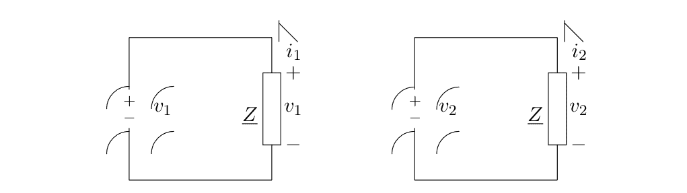

#### 图1：双相系统

$$v_1 = \text{Re}[\underline{V} e^{j\omega t}] \quad (3) \\ v_2 = \text{Re}[-j\underline{V} e^{j\omega t}] = \text{Re}[\underline{V} e^{j(\omega t - \frac{\pi}{2})}] \quad (4,5)$$

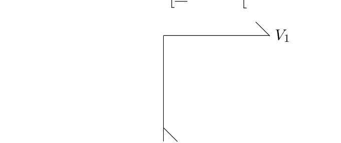

#### 图2：双相源的相量图

如果每个源连接到阻抗为：

$$\underline{Z} = |\underline{Z}| e^{j\psi}$$

那么电流的复振幅为：

$$\underline{I}_1 = \frac{\underline{V}}{|\underline{Z}|} e^{-j\psi}$$
$$\underline{I}_2 = \frac{\underline{V}}{|\underline{Z}|} e^{-j\psi} e^{-j\frac{\pi}{2}}$$

每个双相网络的实功和无功功率值相同：

$$P + jQ = \frac{|\underline{V}|^2}{2|\underline{Z}|} e^{j\psi} \quad (6)$$

或者：

$$P = \frac{|V|^2}{2|Z|} \cos \psi \quad\quad (7)$$
$$Q = \frac{|V|^2}{2|Z|} \sin \psi \quad\quad (8)$$

这些笔记的第2章中详细介绍了“复功率”和瞬时功率流之间的关系。 对于形式为的系统：

$$v = Re \left[V e^{j\phi} e^{j\omega t} \right]$$

瞬时功率由以下公式给出：

$$p = P[1 + \cos 2(\omega t + \phi)] + Q \sin 2(\omega t + \phi)$$

在这种情况下，相位1的 $\phi=0$，相位2的 $\phi = -\frac{\pi}{2}$。因此：

$$p_1 = \frac{|V|^2}{2|Z|} \cos \psi [1 + \cos 2\omega t] + \frac{|V|^2}{2|Z|} \sin \psi \sin 2\omega t$$
$$p_2 = \frac{|V|^2}{2|Z|} \cos \psi [1 + \cos(2\omega t - \pi)] + \frac{|V|^2}{2|Z|} \sin \psi \sin(2\omega t - \pi)$$

请注意，这两个表达式的时变部分具有相反的符号。 将它们相加，即可得到瞬时功率：

$$p = p_1 + p_2 = \frac{|V|^2}{|Z|} \cos \psi$$

多相电力网络的至少一个优点现在显而易见。 使用平衡的多相系统可以避免由交流电压和电流引起的功率流动脉动，甚至避免由无功能量流动引起的脉动。 当处理电动机和发电机，或者实际上任何类型的源或负载时，这显然有益处，因为它们希望看到恒定的功率。

### 3 三相系统

现在考虑图3中所示的三个电压源的排列方式。三相电压为：

$$v_a = \quad V \cos \omega t \quad\quad = Re \left[V e^{j\omega t} \right] \quad\quad (9)$$
$$v_b = \quad V \cos(\omega t - \frac{2\pi}{3}) \quad = Re \left[V e^{j(\omega t - \frac{2\pi}{3})} \right] \quad\quad (10)$$
$$v_c = \quad V \cos(\omega t + \frac{2\pi}{3}) \quad = Re \left[V e^{j(\omega t + \frac{2\pi}{3})} \right] \quad\quad (11)$$

这三相电压在时间域中以图4的形式和复数形式在图5中表示。 注意电压在时间上的对称间距。与之前的例子一样，可以想象图5逆时针旋转来可视化瞬时电压。

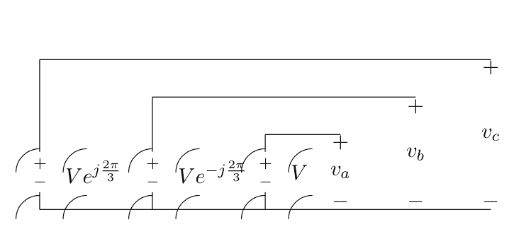

#### 图3: 三相电压源

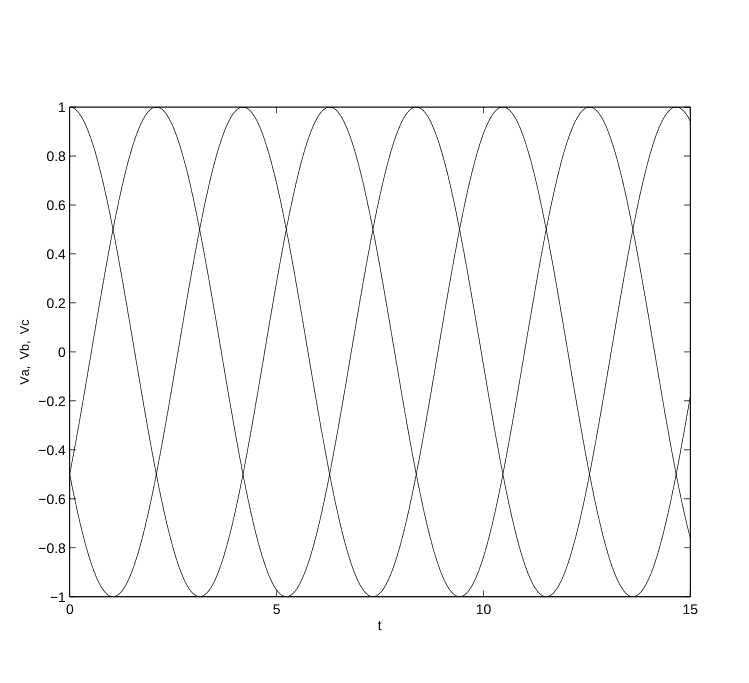

#### 图4: 三相电压

角速度 ω。瞬时电压只是这个“风车”的向量在水平轴上的投影。

考虑将这三个电压源连接到三个相同的负载上，每个负载具有复阻抗 Z，如图6所示。

如果电压如(9-11)所示，则三相中的电流为:

$$i_a = Re[ (V/Z) * e^(j\omega t) ] (12)$$
$$i_b = Re[ (V/Z) * e^(j(\omega t - 2\pi/3)) ] (13)$$
$$i_c = Re[ (V/Z) * e^(j(\omega t + 2\pi/3)) ] (14)$$

#### 图5：三相电压矢量图

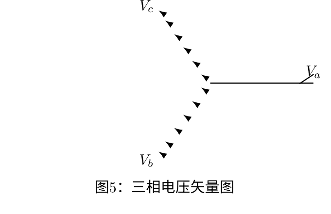

#### 图6：三相电源连接到平衡负载

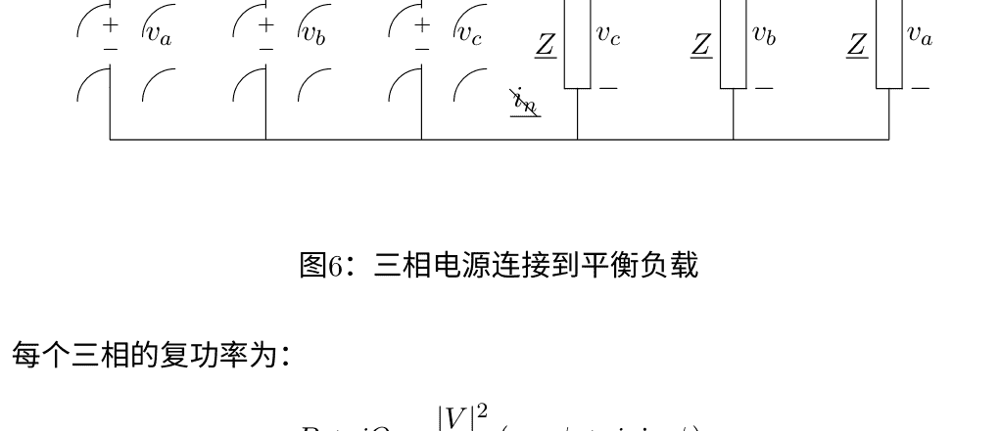

每个三相的复功率为：

$$P + jQ = \frac{|V|^2}{2|Z|} (\cos \psi + j \sin \psi) \quad (15)$$

然后，记住三个电源的时间相位，可以写出三个相的瞬时功率值：

$$p_a = \frac{|V|^2}{2|Z|} \{ \cos \psi [1 + \cos 2\omega t] + \sin \psi \sin 2\omega t \} \quad (16)$$
$$p_b = \frac{|V|^2}{2|Z|} \{ \cos \psi [1 + \cos(2\omega t - \frac{2\pi}{3})] + \sin \psi \sin(2\omega t - \frac{2\pi}{3}) \} \quad (17)$$
$$p_c = \frac{|V|^2}{2|Z|} \{ \cos \psi [1 + \cos(2\omega t + \frac{2\pi}{3})] + \sin \psi \sin(2\omega t + \frac{2\pi}{3}) \} \quad (18)$$

这三个表达式的和是总瞬时功率，它是恒定的：

$$p = p_a + p_b + p_c = \frac{3}{2} \frac{|V|^2}{|Z|} \cos \psi \quad (19)$$

在处理三相系统时，记住以下信息很有用：

$$\cos x + \cos\left(x - \frac{2\pi}{3}\right) + \cos\left(x + \frac{2\pi}{3}\right) = 0$$

无论 $x$ 的值如何。

现在考虑中性线上的电流，在图6中表示为 $i_n$。这个电流由以下公式给出：

$$i_n = i_a + i_b + i_c = Re \left[ \frac{V}{Z} \sqrt{e^{j\omega t} + e^{j(\omega t - \frac{2\pi}{3})} + e^{j(\omega t + \frac{2\pi}{3})} } \right] = 0 \tag{20}$$

这显示了三相系统相对于两相系统的最重要优势：没有电流的导线不需要很大。事实上，在许多情况下，中性连接可以完全消除。图7所示的网络在电压和负载阻抗平衡的大多数情况下与图6中的网络一样有效。

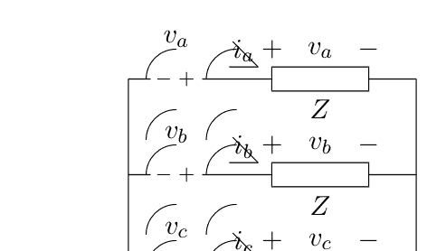

#### 图7：未接地的三相源和负载

如果没有保持完全平衡的条件，接地和未接地系统之间存在根本性的差异。实际上，接地线通过将星点的中性电压固定为零，提供了相位之间的隔离。如果负载阻抗不相等，则称负载为不平衡的。如果系统接地，中性将有电流。如果不平衡负载未接地，则星点电压将不为零，并且即使电压源的幅值相同，负载的三相电压也会不同。

### 4 线-线电压

一个平衡的三相电压集合具有明确定义的线-线电压。如果线-中性电压由(9-11)给出，则线-线电压为：

$$\begin{aligned}
v_{ab} &= v_a - v_b = Re \left[ V \sqrt{1 - e^{-j\frac{2\pi}{3}}} \sqrt{e^{j\omega t}} \right] \tag{21}\\
v_{bc} &= v_b - v_c = Re \left[ V \sqrt{e^{-j\frac{2\pi}{3}} - e^{j\frac{2\pi}{3}}} \sqrt{e^{j\omega t}} \right] \tag{22}\\
v_{ca} &= v_c - v_a = Re \left[ V \sqrt{e^{j\frac{2\pi}{3}} - 1} \sqrt{e^{j\omega t}} \right] \tag{23}
\end{aligned}$$

并且这些可以简化为：

$$v_{ab} = Re \left[\sqrt{3}V e^{j\frac{\pi}{6}} e^{j\omega t} \right] \quad (24)$$
$$v_{bc} = Re \left[\sqrt{3}V e^{-j\frac{\pi}{2}} e^{j\omega t} \right] \quad (25)$$
$$v_{ca} = Re \left[\sqrt{3}V e^{j\frac{5\pi}{6}} e^{j\omega t} \right] \quad (26)$$

线-中性和线-线电压的相量关系如图8所示。关于这个关系应该注意两件事：

- 线对线电压集的幅值比线对地电压大 $\sqrt{3}$ 倍。
- 线对线电压相对于线对中性电压提前30°。

很明显，线对线电压本身形成一个三相集，就像线对中性电压一样。电力系统组件（源、变压器绕组、负载等）可以连接在线和中性之间，也可以连接在线之间。前一种连接通常称为星形连接，后一种连接因为明显的原因被称为三角形连接。

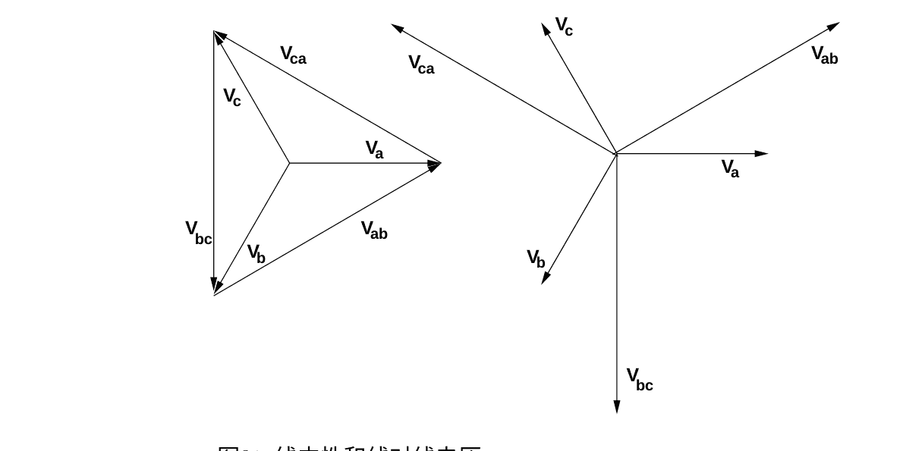

值得注意的是，星形连接至少可能是一个四端口连接，而三角形连接本质上是三端口连接。区别在于是否有中性点。在平衡工况下，这并不重要，但在不平衡工况下，这个差异是显而易见且重要的。

#### 4.1 例子：星形和三角形连接负载

负载可以以线对中性或线对线的方式连接。一个使用这种灵活性的例子是一个相当常用的配电系统，其线对中性电压为120V，有效值。在这个系统中，线对线电压为208V，有效值。单相负载可以连接线对线或线对中性。

假设需要建造一个可提供6千瓦的电阻加热器，由三个元件组成，可以以星形或三角形连接。每个三个元件必须消耗2000瓦。因此，由于 $P = \frac{V^2}{R}$，三角形连接的电阻器为：

$$R_\Delta = \frac{120^2}{2000} = 7.2\Omega$$

而星形连接的电阻器为：

$$R_y = \frac{208^2}{2000} = 21.6\Omega$$

正如这个例子所示，星形和三角形连接的阻抗通常是直接等效的。事实上，未接地连接是三端网络，可以用两种方式表示。图10所示的两个网络是由三个被动阻抗组成的组合，如果元素之间的关系如(27-32)所示，则它们在终端行为上是直接等效且相同的。

$$Z_{ab} = \frac{Z_a Z_b + Z_b Z_c + Z_c Z_a}{Z_c} \quad (27)$$
$$Z_{bc} = \frac{Z_a Z_b + Z_b Z_c + Z_c Z_a}{Z_a} \quad (28)$$
$$Z_{ca} = \frac{Z_a Z_b + Z_b Z_c + Z_c Z_a}{Z_b} \quad (29)$$
$$Z_a = \frac{Z_{ab} Z_{ca}}{Z_{ab} + Z_{bc} + Z_{ca}} \quad (30)$$
$$Z_b = \frac{Z_{ab} Z_{bc}}{Z_{ab} + Z_{bc} + Z_{ca}} \quad (31)$$
$$Z_c = \frac{Z_{bc} Z_{ca}}{Z_{ab} + Z_{bc} + Z_{ca}} \quad (32)$$

星三角等效的一个特殊情况是平衡负载，其中：
$$Z_a = Z_b = Z_c = Z_y$$
和
$$Z_{ab} = Z_{bc} = Z_{ca} = Z_{\Delta}$$
在这种情况下：
$$Z_{\Delta} = 3 Z_y$$

### 4.2 例子：使用Wye-Delta解决不平衡负载问题

图11所示的不平衡负载连接到一个平衡电压源。问题是确定线电流。请注意，该负载未接地（如果接地，这将是一个简单的问题）。电压由以下公式给出：

$$ \begin{aligned} v_a &= V \cos \omega t \\ v_b &= V \cos(\omega t - \frac{2\pi}{3}) \\ v_c &= V \cos(\omega t + \frac{2\pi}{3}) \end{aligned} $$

为了解决这个问题，将源和负载都转换为三角形等效连接，如图12所示。三个电阻的值为：

$$r_{ab} = r_{ca} = \frac{2 + 4 + 2}{2} = 4$$
$$r_{bc} = \frac{2 + 4 + 2}{1} = 8$$

等效电压源的复振幅为：

$$ \begin{aligned} V_{ab} &= V_a - V_b = V \sqrt{3} e^{j\frac{\pi}{6}} \\ V_{bc} &= V_b - V_c = V \sqrt{3} e^{-j\frac{\pi}{2}} \\ V_{ca} &= V_c - V_a = V \sqrt{3} e^{j\frac{5\pi}{6}} \end{aligned} $$

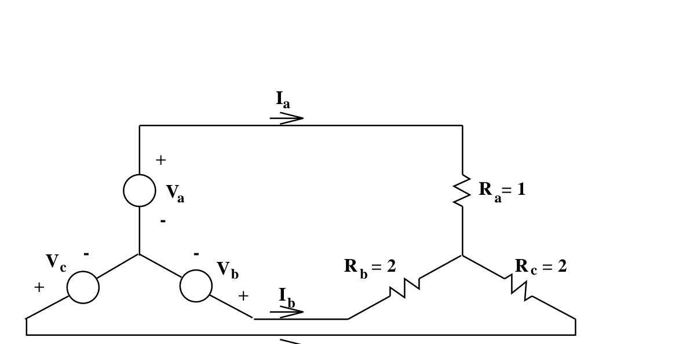

#### 图11：不平衡负载

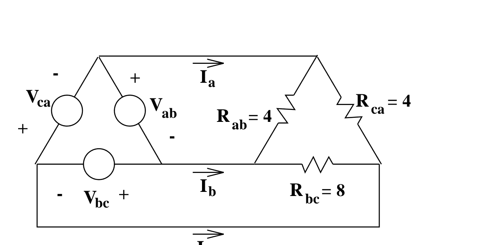

#### 图12：三角形等效电路

每个等效电阻中的电流为:

$$I_1 = \frac{V_{ab}}{r_{ab}} \quad I_2 = \frac{V_{bc}}{r_{bc}} \quad I_3 = \frac{V_{ca}}{r_{ca}}$$

然后，线路电流就是三角形腿中电流之间的差异:

$$I_a = I_1 - I_3 = \sqrt{3}V \left( \frac{e^{j\frac{\pi}{6}}}{4} - \frac{e^{j\frac{5\pi}{6}}}{4} \right) = \frac{3}{4}V$$
$$I_b = I_2 - I_1 = \sqrt{3}V \left( \frac{e^{-j\frac{\pi}{2}}}{8} - \frac{e^{j\frac{\pi}{6}}}{4} \right) = -\left( \frac{3}{8} + j\frac{1}{4} \right) V$$
$$I_c = I_3 - I_2 = \sqrt{3}V \left( \frac{e^{j\frac{5\pi}{6}}}{4} - \frac{e^{-j\frac{\pi}{2}}}{8} \right) = -\left( \frac{3}{8} - j\frac{1}{4} \right) V$$

这些在图13中显示。

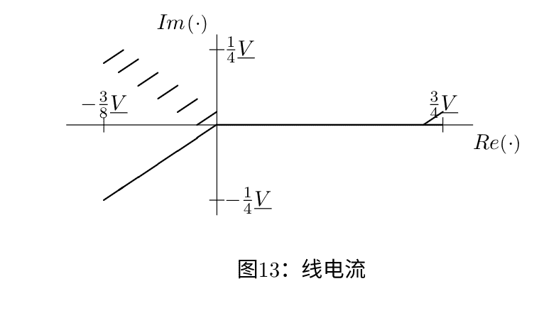

### 5 变压器

变压器是大多数电力系统中必不可少的部分。它们的作用是将电能从一个电压转换为另一个电压。我们将在本课程的后面将变压器作为电磁元件进行讨论，但现在使用一个简化的模型来描述变压器将足够。这是一个两端口电路元件，如图14所示。

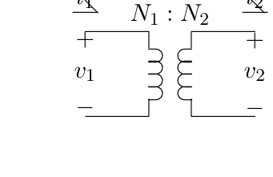

理想变压器作为网络元件约束其端口变量如下：事实证明，在大多数情况下，这不是一个非常糟糕的真实变压器行为模型。当然，我们将对变压器行为的细节和在病态工作条件下的行为感兴趣，因此最终需要一个更好的模型。暂时来说，只需要注意变压器的一些工作原理即可。

1.  在正常操作中，我们选择一个变压器的变比 $N_1$ 以获得所需的电压，出现在正确的端子上。例如，要将13.8千伏的配电电压转换为适用于住宅或商业单相服务的120/240伏电平，我们将使用一个变压器，其变比为13800/240 = 57.5。为了将低电压分成两半，会使用一个中心抽头的低电压绕组。

2.  至少在其理想形式下，变压器不消耗、产生或储存能量。注意，根据（33）和（34），流入变压器的功率之和始终为零：
    $$p_1 + p_2 = v_1 i_1 + v_2 i_2 = 0 \quad (35)$$

3.  变压器还倾向于转换阻抗。为了说明这一点，看一下图15。在这里，一些阻抗连接到理想变压器的一侧。可以看到，从变压器的另一侧看，可能找到一个等效阻抗。

    $$I_2 = -\frac{N_1}{N_2} I_1$$
    以及
    $$V_2 = -Z I_2$$
    那么输入电压和电流之间的比值是：
    $$V_1 = \frac{N_1}{N_2} V_2 = \left( \frac{N_1}{N_2} \right)^2 I_1 \quad (36)$$

## 六相变压器

三相变压器只是三个单相变压器。这些事情的复杂性在于有多种绕组方式和多种互连方式。我们稍后会对绕组有更多的说明。现在，考虑互连。在变压器连接的任一“侧”（即高压侧和低压侧），可以将变压器绕组连接为线对中性（星形）或线对线（三角形）。因此，我们可以说变压器的连接方式是星形-星形、三角形-三角形、星形-三角形或三角形-星形。

忽略一些我们很快会详细讨论的复杂情况，无论是星-星还是三角-三角的变压器连接都相对容易理解。在星-星的情况下，每个线到中性点的电压（在三角-三角的情况下为线到线电压）都会经过三个变压器之一的变换。另一方面，星-三角或三角-星变压器的互连稍微复杂一些。图16以所谓的“接线图”形式展示了一个三角-星连接。同样的图像的更具示意性（也更常见）的形式如图17所示。在该图中，看起来平行的绕组元件被绕在同一个铁芯段上，因此构成了一个单相变压器。

现在：假设 $N_{\Delta}$ 和 $N_Y$ 是匝数。如果将各个变压器视为理想的，则存在以下电压和电流约束：
$$
\begin{aligned}
v_{aY} &= \frac{N_Y}{N_{\Delta}} (v_{a\Delta} - v_{b\Delta}) \quad &(37)\\
v_{bY} &= \frac{N_Y}{N_{\Delta}} (v_{b\Delta} - v_{c\Delta}) \quad &(38)\\
v_{cY} &= \frac{N_Y}{N_{\Delta}} (v_{c\Delta} - v_{a\Delta}) \quad &(39)\\
i_{a\Delta} &= \frac{N_Y}{N_{\Delta}} (i_{aY} - i_{cY}) \quad &(40)\\
i_{b\Delta} &= \frac{N_Y}{N_{\Delta}} (i_{bY} - i_{aY}) \quad &(41)\\
i_{c\Delta} &= \frac{N_Y}{N_{\Delta}} (i_{cY} - i_{bY}) \quad &(42)
\end{aligned}
$$

图17：三角形-星形变压器连接的原理图。其中每个电压都是线-中性的，而电流是在变压器端子上的线电流。

现在，考虑一下如果一个$\Delta - Y$变压器连接到一个平衡的三相电压源，那么会发生什么：
$$
\begin{aligned}
v_{a\Delta} &= Re\left\{ \sqrt{2} V e^{j\omega t} \right\}\\
v_{b\Delta} &= Re\left\{ \sqrt{2} V e^{j(\omega t - \frac{2\pi}{3})} \right\}\\
v_{c\Delta} &= Re\left\{ \sqrt{2} V e^{j(\omega t + \frac{2\pi}{3})} \right\}
\end{aligned}
$$
然后，星形侧的复振幅为：
$$
\begin{aligned}
\underline{V}_{aY} &= \frac{N_Y}{N_\Delta} V \left\{ 1 - e^{-j\frac{2\pi}{3}} \right\} = \sqrt{3} \frac{N_Y}{N_\Delta} V e^{j\frac{\pi}{6}}\\
\underline{V}_{bY} &= \frac{N_Y}{N_\Delta} V \left\{ e^{-j\frac{2\pi}{3}} - e^{j\frac{2\pi}{3}} \right\} = \sqrt{3} \frac{N_Y}{N_\Delta} V e^{-j\frac{\pi}{2}}\\
\underline{V}_{cY} &= \frac{N_Y}{N_\Delta} V \left\{ e^{j\frac{2\pi}{3}} - 1 \right\} = \sqrt{3} \frac{N_Y}{N_\Delta} V e^{j\frac{5\pi}{6}}
\end{aligned}
$$
这里应该注意两点：
-   电压比（即线线或线中性的比值）与匝数比相差一个因子$\sqrt{3}$。
-   所有星形侧电压与三角形侧电压相位差$30^{\circ}$。

#### 6.1 例子

假设我们有以下问题要解决：一个平衡的三相星形连接的电阻器连接到一个Y-Δ变压器的Δ侧，其名义电压比为
$$\frac{v_{\Delta}}{v_{Y}} = N$$
在假设使用平衡源驱动的情况下，求变压器星形侧的阻抗是多少? 情况如图18所示。

记住电压比和匝数比之间的关系是很重要的，即:
$$\frac{v_{\Delta}}{v_{Y}} = N = \frac{N_{\Delta}}{\sqrt{3}N_{Y}}$$
这样一来:
$$\frac{N_{\Delta}}{N_{Y}} = \frac{N}{\sqrt{3}}$$
接下来，对负载进行 $Y-\Delta$ 等效变换，使得电路图如图19所示。在这种情况下，每个变压器的二次绕组直接连接在三个电阻器之一上。 电阻器中的电流为:
$$i_1 = \frac{v_{ab\Delta}}{3R}$$
$$i_2 = \frac{v_{bc\Delta}}{3R}$$
$$i_3 = \frac{v_{ca\Delta}}{3R}$$
线路电流为:
$$i_{a\Delta} = i_1 - i_3 = \frac{v_{ab\Delta}-v_{ca\Delta}}{3R}$$
$$i_{b\Delta} = i_2 - i_1 = \frac{v_{bc\Delta}-v_{ab\Delta}}{3R}$$
$$i_{c\Delta} = i_3 - i_2 = \frac{v_{ca\Delta}-v_{bc\Delta}}{3R}$$

解算三角形变压器中的电流，例如，从第二个表达式中减去第一个表达式：
$$2i_{1\Delta} - i_{2\Delta} - i_{3\Delta} = \frac{2v_{ab\Delta} - v_{bc\Delta} - v_{ca\Delta}}{3R}$$
现在，利用系统平衡的事实：
$$i_{1\Delta} + i_{2\Delta} + i_{3\Delta} = 0$$
$$v_{ab\Delta} + v_{bc\Delta} + v_{ca\Delta} = 0$$
找到：
$$i_{1\Delta} = \frac{v_{ab\Delta}}{3R}$$
$$i_{2\Delta} = \frac{v_{bc\Delta}}{3R}$$
$$i_{3\Delta} = \frac{v_{ca\Delta}}{3R}$$
最后，理想变压器关系给出：

| 左边 | 右边 |
|------|------|
| $v_{ab\Delta} = \frac{N_\Delta}{N_Y} v_{aY}$ | $i_{aY} = \frac{N_\Delta}{N_Y} i_{1\Delta}$ |
| $v_{bc\Delta} = \frac{N_\Delta}{N_Y} v_{bY}$ | $i_{bY} = \frac{N_\Delta}{N_Y} i_{2\Delta}$ |
| $v_{ca\Delta} = \frac{N_\Delta}{N_Y} v_{cY}$ | $i_{cY} = \frac{N_\Delta}{N_Y} i_{3\Delta}$ |

所以：
$$i_{aY} = \left( \frac{N_\Delta}{N_Y} \right)^2 \frac{1}{3R} v_{aY}$$
$$i_{bY} = \left(\frac{N_{\Delta}}{N_Y}\right)^2 \frac{1}{3R} v_{bY}$$
$$i_{cY} = \left(\frac{N_{\Delta}}{N_Y}\right)^2 \frac{1}{3R} v_{cY}$$
变压器的星形端子的视在电阻（即，如果它连接在星形）是：
$$R_{eq} = 3R \left(\frac{N_Y}{N_{\Delta}}\right)^2$$
用电压比表示，这是：
$$R_{eq} = 3R \left(\frac{N}{\sqrt{3}}\right)^2 = R \left(\frac{v_Y}{v_{\Delta}}\right)^2$$
重要的是要注意，这个解决方案走了一条冗长的路。在变压器上，阻抗按照电压比的平方进行变换，无论使用什么连接方式，都是一致的（无论是线对中性还是线对线）。

### 7 相位线和单相等效

到目前为止，人们可能会怀疑一个平衡的多相系统可以简单地被视为三个单相系统，尽管这三个相位在物理上是相互连接的。通过星形和三角形连接的电源和阻抗之间的等效性进一步加强了这种感觉。还需要进行一步，以显示单相等效确实有用，这涉及到相互耦合的相位的情况。

在谈论线路时，我们指的是诸如输电或配电线路之类的系统元件：架空线、电缆甚至厂内母线。这些元件具有阻抗，因此在线路的发送端和接收端之间存在一定的电压降。这种阻抗不仅仅是导体电阻：导体既有自感又有互感，因为导体中的电流产生磁通量，而这种磁通量又被线路的所有导体所连接。

图20显示了一条线路的原理图。实际上，只显示了线路阻抗的电感成分，因为它们是线路阻抗中最有趣的部分。在复数幅度中工作，可以通过以下方式写出三相电压降：
$$\underline{V}_{a1} - \underline{V}_{a2} = j\omega L \underline{I}_a + j\omega M (\underline{I}_b + \underline{I}_c) \quad (43)$$
$$\underline{V}_{b1} - \underline{V}_{b2} = j\omega L \underline{I}_b + j\omega M (\underline{I}_a + \underline{I}_c) \quad (44)$$
$$\underline{V}_{c1} - \underline{V}_{c2} = j\omega L \underline{I}_c + j\omega M (\underline{I}_a + \underline{I}_b) \quad (45)$$
如果电流形成一个平衡集合：
$$\underline{I}_a + \underline{I}_b + \underline{I}_c = 0 \quad (46)$$
那么电压降就很简单：
$$\underline{V}_{a1} - \underline{V}_{a2} = j\omega (L - M) \underline{I}_a$$
$$\underline{V}_{b1} - \underline{V}_{b2} = j\omega (L - M) \underline{I}_b$$
$$\underline{V}_{c1} - \underline{V}_{c2} = j\omega (L - M) \underline{I}_c$$

图20：带有互感耦合的平衡三相线路示意图。图21：示例。

在这种情况下，已经定义了一个适用于平衡情况的表观电感：
$$L_1 = L - M \quad\quad (47)$$
这个方程描述了一个相位的行为，以其自身的电流为基础。最重要的是要注意，只有在(46)成立的情况下，这个电感才是对线路的有效描述，当然，在平衡情况下是成立的。

#### 7.1 例子

为了展示从单相等效和星角变换得出的网络简化的分析技术，考虑以下问题：一个三相电阻性负载通过连接在三角形-星形的变压器和多相线路上连接到平衡的三相电源，如图21所示。问题是计算负载电阻中消耗的功率。三相电压源具有：
$$\begin{aligned}
v_{a} &= \text{实部} \left[ \sqrt{2} V_{RMS} e^{j\omega t} \right]\\
v_{b} &= \text{实部} \left[ \sqrt{2} V_{RMS} e^{j(\omega t - \frac{2\pi}{3})} \right]\\
v_{c} &= \text{实部} \left[ \sqrt{2} V_{RMS} e^{j(\omega t + \frac{2\pi}{3})} \right]
\end{aligned}$$
这个问题通过一系列简单的变换来解决。首先，将三角形连接的电阻性负载转换为其等效的星形连接，其中 $R_Y = \frac{R}{3}$。接下来，由于问题是平衡的，线路的自感和互感直接等效于每个相位的自感 $L_1 = L - M$。现在，变压器的二次侧在每个相位上面临着一个阻抗：
$$Z_{Ys} = j\omega L_1 + R_Y$$
三角形-星形变压器的电压比为：
$$\frac{v_p}{v_s} = \frac{N_\Delta}{\sqrt{3} N_Y}$$
因此，在变压器的一次侧，线路和负载阻抗为：
$$Z_p = j\omega L_{eq} + R_{eq}$$
等效元素为：
$$L_{eq} = \frac{1}{3} \left( \frac{N_\Delta}{N_Y} \right)^2 (L - M)$$
$$R_{eq} = \frac{1}{3} \left( \frac{N_\Delta}{N_Y} \right)^2 \frac{R}{3}$$
源中每相电流的幅值为：
$$|I| = \frac{\sqrt{2} V_{RMS}}{\sqrt{(\omega L_{eq})^2 + R_{eq}^2}}$$
每相耗散功率为：
$$P_1 = \frac{1}{2} |I|^2 R_{eq} = \frac{V_{RMS}^2 R_{eq}}{(\omega L_{eq})^2 + R_{eq}^2}$$
当然，总耗散功率就是单相耗散功率的三倍。

### 8 引言：百分比单位制

严格来说，百分比单位制只是电压、电流、阻抗和功率的归一化处理。这些系统参数的归一化处理在许多网络计算中提供了简化。正如我们将发现的那样，虽然某些普通参数的值范围很大，但等效的百分比单位参数的范围要窄得多。这有助于理解某些类型的系统行为。

#### 8.1 电压和电流的归一化

以基准电平的分数形式表示电压和电流是制定单位制符号的基础。因此，设置单位归一化的第一步是选择基准电压和电流。

考虑图22所示的简单情况。对于这个网络，电压和电流的复振幅为：
$$V = IZ \quad (48)$$
电压，$I_B$表示电流。在许多情况下，这些值将被选择为名义或额定值。例如，对于发电厂，通常使用发电机的额定电压和额定电流作为基准量。在其他情况下，例如系统稳定性研究，通常使用标准的、系统范围的基准系统。

单位制电压和电流简单地表示为：
$$v = \frac{V}{V_B} \quad (49)$$
$$i = \frac{I}{I_B} \quad (50)$$
将(49)和(50)应用于(48)，我们得到：
$$v = iz \quad (51)$$
其中单位阻抗为：
$$z = \frac{Z}{Z_B} \quad (52)$$
这导致了系统的基阻抗的定义：
$$Z_B = \frac{V_B}{I_B} \quad (53)$$
当然，还有一个基功率，对于单相系统来说是：
$$P_B = V_B I_B \quad (54)$$
只要$V_B$和$I_B$以RMS表示，就不会有单位标记的歧义。有趣的是，只要归一化的方式一致，单位标记就不会有歧义。也就是说，峰值量归一化到峰值基准量的单位标记与RMS量归一化到RMS基准量的单位标记相同。在多相系统中，这个优势更加明显，我们即将看到。

#### 8.2 三相系统

在描述多相系统时，我们可以选择使用线线电压或线中性电压和线电流或三角等效负载中的电流。为了保持对普通变量的准确分析，有必要携带关于使用这些量中的哪一个的信息。使用百分比符号表示没有这样的问题。

我们可以将线到中性电压 $V_{Bl-g}$ 或线到线电压 $V_{Bl-l}$ 作为基本量。将基本电流 $I_{Bl}$ 作为线电流，我们可以表示基本功率为：

$$P_B = 3V_{Bl-g}I_{Bl}$$

因为线线电压在正常运行下是线中性电压的$\sqrt{3}$倍，一个等效的表达是：

$$P_B = \sqrt{3}V_{Bl-l}I_{Bl}$$

如果基阻抗用线中性电压和线电流表示（这是常见的约定，但不是必需的），

$$Z_B = \frac{V_{Bl-g}}{I_{Bl}}$$

然后，基阻抗用基准功率表示为：

$$Z_B = \frac{P_B}{3I_B^2} = 3\frac{V_{Bl-g}^2}{P_B} = \frac{V_{Bl-l}^2}{P_B}$$

请注意，单个百分比电压同样适用于线线、线中性、峰值和有效值量。对于给定的情况，这些量将具有不同的普通值，但只有一个百分比值。

#### 8.3 带有变压器的网络

在变压器网络的分析中，使用百分比制的一个最重要的优点之一是，几乎所有理想变压器都会从百分比制网络中消失，从而大大简化了分析。正确应用百分比归一化将导致几乎所有理想变压器从百分比制网络中消失，从而大大简化了分析。为了说明这一点，考虑如图23所示的理想变压器。

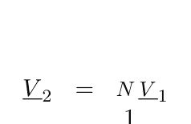

理想变压器施加的约束条件是：

$$\begin{aligned}
V_2 &= N V_1 \\
I_2 &= \frac{1}{N} I_1
\end{aligned}$$

将变压器两侧的基准量归一化，得到的百分比电压和电流为：

$$
\begin{aligned}
v_1 &= \frac{V_1}{V_{B1}} \\
i_1 &= \frac{I_1}{I_{B1}} \\
v_2 &= \frac{V_2}{V_{B2}} \\
i_2 &= \frac{I_2}{I_{B2}}
\end{aligned}
$$

现在注意，如果基准量彼此关联，就好像它们已经经过变压器处理一样：

$$
\text{电压 } B2 = N V_{B1} \quad\quad (59) \\
\text{电流 } B2 = \frac{I_{B1}}{N} \quad\quad (60)
$$

那么 $v_1 = v_2$，$i_1 = i_2$，就好像理想变压器不存在（即由理想导线组成）。

式（59）和（60）反映了在具有变压器的系统中建立百分比归一化的一般规则。系统的每个部分应具有相同的基准功率。基准电压根据变压器的电压比进行变换。当然，对于三相系统，电压比可能与物理匝数比例相差一个因子，如果使用三角形-星形或星形-三角形连接。然而，在设置基准电压时必须使用电压比例。如果使用三角形-星形或星形-三角形连接，则电压比例可能与物理匝数比例相差一个因子3。

#### 8.4 从一种基数转换到另一种基数

通常，诸如变压器漏感应电抗等数据以百分比形式给出，基于某个基数（可能是单位额定值），而为了进行系统研究，需要将相同的数据以百分比形式表示为其他基数（可能是统一系统基数）。可以通过两步过程来实现这一点将百分比数据转换为普通形式，然后在新基数中重新归一化。然而，更容易的方法是按照以下方式将其转换为新基数。注意，以欧姆（普通单位）表示的阻抗为：

$$
Z = z_1 Z_{B1} = z_2 Z_{B2} \quad\quad (61)
$$

在这里，当然，$z_1$和$z_2$是以不同基数表示的相同百分比阻抗。这可以写成：

$$
z_1 \frac{V_{B1}^2}{P_{B1}} = z_2 \frac{V_{B2}^2}{P_{B2}} \quad\quad (62)
$$

这导致了一个方便的规则，用于在不同的基本系统之间进行转换：

$$
z_1 = \frac{P_{B1}}{P_{B2}} \left( \frac{V_{B2}}{V_{B1}} \right)^2 z_2 \quad\quad (63)
$$

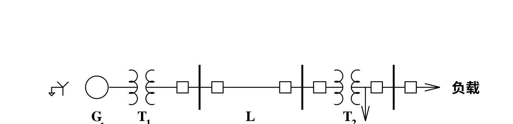

#### 图24: 故障系统的单线图

#### 8.5 例子: 故障研究

为了说明我们所处理的一些概念，我们将对一个简单的电力系统进行短路分析。这个系统以图24的单线图形式呈现。

单线图是一种在不被重复的数据混乱的情况下传达关于电力系统的大量信息的方式。绘制系统的三个相位将涉及很多不必要的重复，对于大多数研究来说是不需要的。此外，如果需要，可以从单线图中重新构建出三个相位。通常使用特殊符号表示网络的不同组件。对于我们的网络，我们有以下数据：

| 符号 | 组件 | 基本功率 (MVA) | 基本电压 (kV) | 阻抗 (百分比) |
|------|------|----------------|---------------|----------------|
| G1 | 发电机 | 200 | 13.8 | j.18 |
| T1 | 变压器 | 200 | 13.8/138 | j.12 |
| L1 | 输电线路 | 100 | 138 | .02 + j.05 |
| T2 | 变压器 | 50 | 138/34.5 | j.08 |

假设三相故障发生在变压器的34.5 kV侧 T2。这是一个对称的情况，因此只需要表示一个相位。百分比阻抗图在图25中显示。现在需要确定电路中每个组件的值。

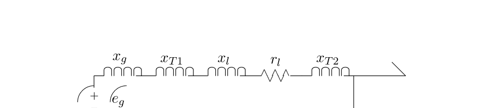

#### 图25: 故障示例的阻抗图

首先，需要为系统的每个组件建立一个统一的基准和百分比值。我们选择输电线路作为基准段，这是有些主观的选择。因此，所有参数必须按照100 MVA的基准功率和138 kV的电压基准进行转换。

发电机处为13.8千伏，故障点处为34.5千伏。使用（62）：

$$
\begin{aligned}
x_g &= \frac{100}{200} \times .18 = .09 \text{百分单位} \\
x_{T1} &= \frac{100}{200} \times .12 = .06 \text{百分单位} \\
x_{T2} &= \frac{100}{50} \times .08 = .16 \text{百分单位} \\
r_l &= .02 \text{百分单位} \\
x_l &= .05 \text{百分单位}
\end{aligned}
$$

总阻抗为：

$$
\begin{aligned}
z &= j(x_g + x_{T1} + x_l + x_{T2}) + r_l \\
  &= j.36 + .02 \text{百分单位} \\
|z| &= .361 \text{百分单位}
\end{aligned}
$$

现在，如果 $E_g$ 等于一个标么值（发电机内部电压等于基准电压），那么标么值电流为：

$$
|i| = \frac{1}{.361} = .277 \text{标么值}
$$

这可以通过获取基准电流水平来将其转换回普通单位。这些是：

- 在发电机上的基准上：
  $$I_B = \frac{100\text{兆伏安}}{\sqrt{3} \times 13.8\text{千伏}} = 4.18\text{千安}$$

- 在线路基准上：
  $$I_B = \frac{100\text{兆伏安}}{\sqrt{3} \times 138\text{千伏}} = 418\text{安}$$

- 在故障基准上：
  $$I_B = \frac{100\text{兆伏安}}{\sqrt{3} \times 34.5\text{千伏}} = 1.67\text{千安}$$

然后实际故障电流为：

- 在发电机处 $ |I_f| = 11,595\text{A} $
- 在输电线上 $ |I_f| = 1159\text{A} $
- 在故障点处 $ |I_f| = 4633\text{A} $

麻省理工学院开放式课程
[http://ocw.mit.edu](http://ocw.mit.edu)

# 6.061 / 6.690 电力系统导论

2011年春季

有关引用这些材料或我们的使用条款的信息，请访问： [http://ocw.mit.edu/terms](http://ocw.mit.edu/terms)。

## 麻省理工学院
电气工程与计算机科学系
6.061 电力系统导论
课堂笔记 第4章
对称分量导论
J.L. Kirtley Jr.

#### 1 引言

这些笔记的第3部分主要涉及平衡网络，其中三个电压（和三个电流）除了确切的120°相移外都是相同的。不平衡条件可能来自不平衡的电压源或负载。可以使用简单的解决技术和星角变换来分析一些简单类型的不平衡网络。

然而，电力网络可以变得非常复杂，许多情况下使用普通网络分析会非常困难。因此，一种被称为对称分量的技术被开发出来。

对称分量除了是一个强大的分析工具外，还具有概念上的实用性。对称分量本身是从普通线路电压和电流的变换中获得的，它们本身就具有实用性。对称分量已经成为描述许多类型的网络元件（如输电线路、电动机和发电机）属性的一种方式。

### 2 对称分量变换

这种分析技术的基础是将三个电压和三个电流转换为第二组电压和电流。这第二组被称为对称分量。

以复数幅度工作：

$$
\begin{aligned}
v_{a} &= Re\left(\underline{V}_{a}e^{j\omega t}\right) \\
v_{b} &= Re\left(\underline{V}_{b}e^{j\left(\omega t-\frac{2\pi}{3}\right)}\right) \\
v_{c} &= Re\left(\underline{V}_{c}e^{j\left(\omega t+\frac{2\pi}{3}\right)}\right)
\end{aligned}
$$

该变换的定义如下：

$$
\begin{bmatrix} \underline{V}_1 \\ \underline{V}_2 \\ \underline{V}_0 \end{bmatrix}=\frac{1}{3}\begin{bmatrix} 1 & \underline{a} & \underline{a}^2 \\ 1 & \underline{a}^2 & \underline{a} \\ 1 & 1 & 1 \end{bmatrix}\begin{bmatrix} \underline{V}_a \\ \underline{V}_b \\ \underline{V}_c \end{bmatrix} \quad (4)
$$

其中复数 $\underline{a}$ 的定义如下：

$$
\begin{aligned}
\underline{a} &= e^{j\frac{2\pi}{3}} &&= -\frac{1}{2} + j\frac{\sqrt{3}}{2} \quad (5) \\
\underline{a}^2 &= e^{j\frac{4\pi}{3}} = e^{-j\frac{2\pi}{3}} &&= -\frac{1}{2} - j\frac{\sqrt{3}}{2} \quad (6) \\
\underline{a}^3 &&&= 1 \quad (7)
\end{aligned}
$$

该变换可用于电压和电流，并适用于普通形式的变量以及已经归一化并处于百分比形式的变量。该变换的逆变换如下：

$$
\begin{bmatrix} \underline{V}_a \\ \underline{V}_b \\ \underline{V}_c \end{bmatrix}=\begin{bmatrix} 1 & 1 & 1 \\ \underline{a}^2 & \underline{a} & 1 \\ \underline{a} & \underline{a}^2 & 1 \end{bmatrix}\begin{bmatrix} \underline{V}_1 \\ \underline{V}_2 \\ \underline{V}_0 \end{bmatrix} \quad (8)
$$

三个组成变量 $\underline{V}_1$、$\underline{V}_2$、$\underline{V}_0$ 分别称为正序、负序和零序的变量。它们被称为对称分量，因为分别单独考虑时，它们会转化为对称的电压集合。这些分量的特性可以通过将每个分量转换回相量来证明。

#### 首先考虑单独考虑的正序分量：

$$
\begin{aligned}
\underline{V}_1 &= V \quad (9) \\
\underline{V}_2 &= 0 \quad (10) \\
\underline{V}_0 &= 0 \quad (11)
\end{aligned}
$$

得到：

$$
\begin{aligned}
\underline{V}_a = V &\quad \text{或} \quad v_a = V \cos \omega t \quad (12) \\
\underline{V}_b = \underline{a}^2 V &\quad \text{或} \quad v_b = V \cos\left(\omega t - \frac{2\pi}{3}\right) \quad (13) \\
\underline{V}_c = \underline{a} V &\quad \text{或} \quad v_c = V \cos\left(\omega t + \frac{2\pi}{3}\right) \quad (14)
\end{aligned}
$$

这是熟悉的平衡电压集合：相位 $b$ 滞后于相位 $a$ $120^\circ$，相位 $c$ 滞后于相位 $b$，相位 $a$ 滞后于相位 $c$。

#### 对负序电压进行相同的变换：

$$
\begin{aligned}
\underline{V}_1 &= 0 \quad (15) \\
\underline{V}_2 &= V \quad (16) \\
\underline{V}_0 &= 0 \quad (17)
\end{aligned}
$$

得到：

$$ \underline{V}_a = V \quad \text{或} \quad v_a = V \cos \omega t \quad \text{(18)}$$

$$ \underline{V}_b = \underline{a} V \quad \text{或} \quad v_b = V \cos\left(\omega t + \frac{2\pi}{3}\right) \quad \text{(19)}$$

$$ \underline{V}_c = \underline{a}^2 V \quad \text{或} \quad v_c = V \cos\left(\omega t - \frac{2\pi}{3}\right) \quad \text{(20)}$$

这被称为负序，因为电压序列被颠倒：相位b现在领先于相位a而不是滞后。请注意，负序集仍然是平衡的，即相位分量仍具有相同的幅值，并且相互之间相隔120°。正序和负序之间唯一的区别是相位旋转。如图1所示。

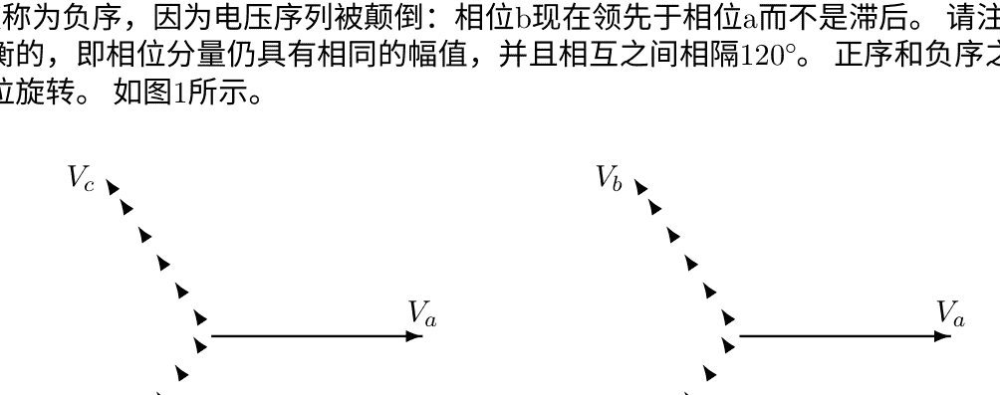

第三个对称分量是零序。如果：

$$ \underline{V}_1 = 0 \quad \text{(21)} $$

$$ \underline{V}_2 = 0 \quad \text{(22)} $$

$$ \underline{V}_0 = V \quad \text{(23)} $$

那么：

$$ \underline{V}_a = V \quad \text{或} \quad v_a = V \cos \omega t \quad \text{(24)}$$

$$ \underline{V}_b = V \quad \text{或} \quad v_b = V \cos \omega t \quad \text{(25)}$$

$$ \underline{V}_c = V \quad \text{或} \quad v_c = V \cos \omega t \quad \text{(26)}$$

也就是说，三相电压同时变化。

正序和负序集合包含三相励磁的那些部分，代表平衡的正常和反向相序。零序是为了弥补总相变量和两个旋转分量之间的差异。

对称分量的巨大实用性在于，对于大多数类型的网络元件，对称分量彼此独立。特别是，平衡阻抗和旋转机械只会对正序电压产生正序电流。

因此，可以通过子网络来描述一个网络，每个子网络对应一个对称的组件。这些被称为序列网络。一个完全平衡的网络将有三个完全独立的序列网络。如果一个网络在某个位置上不平衡，序列网络将在该位置上相互连接。在处理不平衡情况时，使用对称组件的关键是学习如何制定这些互连。

### 3 序列阻抗

许多不同类型的网络元件对不同对称分量表现出不同的行为。例如，正负序列的传输线具有一个阻抗，而对于零序列则完全不同。旋转机械对所有三个序列都有不同的阻抗。

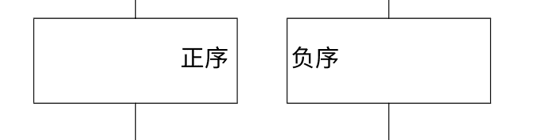

图2：线对线故障的序列连接

#### 序列

为了说明在平衡网络中对称分量的独立性，考虑这些笔记的第3部分中图20所示的传输线。线路中电压降的表达式可以写成一个向量表达式：

$$ V_{ph1} - V_{ph2} = j\omega L_{ph} I_{ph} \quad (27) $$

其中

$$ V_{ph} = \begin{bmatrix} V_a \\ V_b \\ V_c \end{bmatrix} \quad (28) $$

$$ I_{ph} = \begin{bmatrix} I_a \\ I_b \\ I_c \end{bmatrix} \quad (29) $$

$$ L_{ph} = \begin{bmatrix} L & M & M \\ M & L & M \\ M & M & L \end{bmatrix} \quad (30) $$

请注意，对称分量变换 (4) 可以用紧凑的形式写成：

$$ V_s = T V_p \quad (31) $$其中

```
$$
\underline{\underline{T}} = \frac{1}{3} \left[ \begin{array}{ccc} 1 & a & a^{2} \\ 1 & a^{2} & a \\ 1 & 1 & 1 \end{array} \right] \quad (32)
$$
```

和 $V_{s}$ 是序列电压的向量：

```
$$
\underline{V}_{s} = \left[ \begin{array}{c} \underline{V}_{1} \\ \underline{V}_{2} \\ \underline{V}_{0} \end{array} \right] \quad (33)
$$
```

使用 (31) 的逆重写 (27)：

```
$$
\underline{\underline{T}}^{-1} \underline{V}_{s1} - \underline{\underline{T}}^{-1} \underline{V}_{s2} = j \omega \underline{\underline{L}}_{ph} \underline{\underline{T}}^{-1} \underline{I}_{s} \quad (34)
$$
```

然后进行变换以获得序列电压：

```
$$
\underline{V}_{s1} - \underline{V}_{s2} = j \omega \underline{\underline{T}} \underline{\underline{L}}_{ph} \underline{\underline{T}}^{-1} \underline{I}_{s} \quad (35)
$$
```

通过执行所示的操作定义了序列电感矩阵：

```
$$
\underline{\underline{L}}_{s} = \underline{\underline{T}} \underline{\underline{L}}_{ph} \underline{\underline{T}}^{-1} \quad (36)
$$
```

即为：

```
$$
\underline{\underline{L}}_{s} = \left[ \begin{array}{ccc} L - M & 0 & 0 \\ 0 & L - M & 0 \\ 0 & 0 & L + 2M \end{array} \right] \quad (37)
$$
```

因此，用相量变量描述的传输线的耦合表达式变成了一个无耦合的对称分量表达式：

```
$$
\begin{aligned}
\underline{V}_{11} - \underline{V}_{12} &= j \omega (L - M) \underline{I}_{1} \quad (38)\\
\underline{V}_{21} - \underline{V}_{22} &= j \omega (L - M) \underline{I}_{2} \quad (39)\\
\underline{V}_{01} - \underline{V}_{02} &= j \omega (L + 2M) \underline{I}_{0} \quad (40)
\end{aligned}
$$
```

平衡传输线的正、负和零序阻抗为：

```
$$
\begin{aligned}
\underline{Z}_{1} &= \underline{Z}_{2} = j \omega (L - M) \quad (41)\\
\underline{Z}_{0} &= j \omega (L + 2M) \quad (42)
\end{aligned}
$$
```

因此，在网络分析中，现在可以用三个独立的单相网络替代传输线。

考虑一个通过阻抗与地相连的平衡三相负载，如图3所示。

对于这个网络，对称分量的电压-电流关系很简单，只需假设正序、负序和零序电流，并找到相应的电压。如果这样做，就会发现对称分量是独立的，并且电压-电流关系是：

```
$$
\begin{aligned}
\underline{V}_{1} &= \underline{Z} \underline{I}_{1} \quad (43)\\
\underline{V}_{2} &= \underline{Z} \underline{I}_{2} \quad (44)\\
\underline{V}_{0} &= (\underline{Z} + 3\underline{Z}_{g}) \underline{I}_{0} \quad (45)
\end{aligned}
$$
```

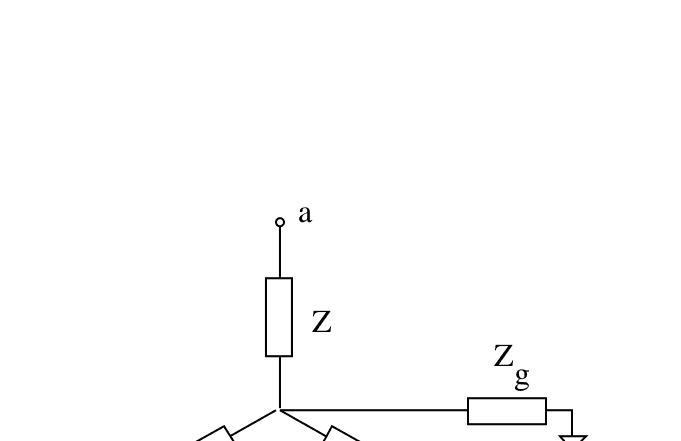

#### 图3: 带有中性阻抗的平衡负载

### 4 不平衡源

考虑图4所示的网络。一个平衡的三相电阻由一个平衡线路供电（相间存在互感耦合）。假设只有一个相的电压源在工作，即：

$$\begin{aligned} V_a &= V \quad (46) \\ V_b &= 0 \quad (47) \\ V_c &= 0 \quad (48) \end{aligned}$$

这个例子的目标是找到三相中的电流。

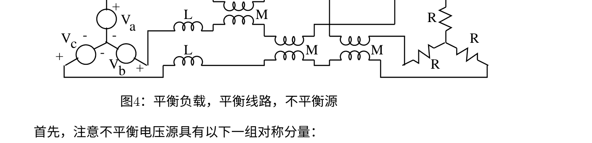

#### 图4: 平衡负载，平衡线路，不平衡源

首先，注意不平衡电压源具有以下一组对称分量：

$$\begin{aligned} V_1 &= \frac{V}{3} \quad (49) \\ V_2 &= \frac{V}{3} \quad (50) \\ V_0 &= \frac{V}{3} \quad (51) \end{aligned}$$

接下来，面向电源的网络由线路组成，其阻抗为：

$$Z_1 = j\omega (L-M)$$ (52)
$$Z_2 = j\omega (L-M)$$ (53)
$$Z_0 = j\omega (L+2M)$$ (54)

而三相电阻的阻抗为：

$$Z_1 = R$$ (55)
$$Z_2 = R$$ (56)
$$Z_0 = \infty$$ (57)

请注意，零序阻抗是无穷大的，因为中性点没有与电压源的中性点相连。因此，线路电流的总和必须始终为零，这反过来排除了任何零序电流。因此，问题可以通过图5中出现的网络来描述。

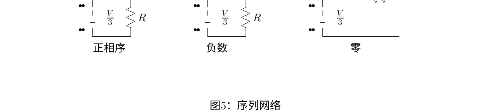

#### 图5：序列网络

电流为：

$$I_1 = \frac{V}{3(j\omega (L-M) + R)}$$
$$I_2 = \frac{V}{3(j\omega (L-M) + R)}$$
$$I_0 = 0$$

现在可以重新组装相电流：

$$I_a = I_1 + I_2 + I_0$$
$$I_b = a^2 I_1 + a I_2 + I_0$$
$$I_c = a I_1 + a^2 I_2 + I_0$$

或者：

$$I_a = \frac{2V}{3(j\omega (L-M) + R)}$$
$$I_b = \frac{(a^2 + a)V}{3(j\omega (L-M) + R)}$$
$$= \frac{-V}{3(j\omega (L - M) + R)}$$
$$I_c = \frac{(a + a^2)V}{3(j\omega (L - M) + R)}$$
$$= \frac{-V}{3(j\omega (L - M) + R)}$$

（请注意我们使用了 $a^2 + a = -1$ ）。

### 5 旋转机械

一些网络元件更适合用序列网络表示，而不是普通的相位网络表示。例如，同步机械就是这种情况。同步电动机和发电机产生正序内部电压，并具有终端阻抗。由于超出了这些笔记的范围，正序电流的阻抗与负序或零序电流的阻抗不同。在许多情况下，逐相表示是不够的，但序列网络表示是可以的。这样的表示是三个戴维南等效电路，如图6所示。

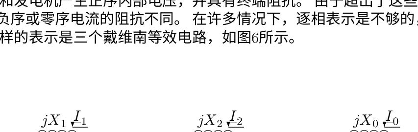

> 图6：同步机的序列网络

### 6 变压器

变压器在建立序列网络方面提供了一些有趣的特性。首先，这是因为星角-三角或三角-星变压器连接会产生从一次侧到二次侧的相移。根据连接方式，这个相移可能是正负30°，对于正序电压和电流而言，从一次侧到二次侧。很容易证明，负序相移与正序相反。因此，如果连接使正序电压通过变压器提前，那么负序电压就会被延迟。这并不影响序列网络的建立，但会影响相电流和电压的重构。

变压器的第二个重要特性是，三角连接和未接地的星连接对于零序来说是开路。另一方面，三角连接的绕组会对从星连接的绕组感应的零序电流提供短路。因此，变压器的零序网络可能采用多种形式。图7至9显示了各种变压器连接的零序网络。

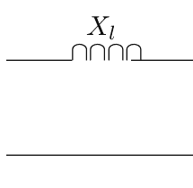

图7：零序网络：星-星连接，两侧接地

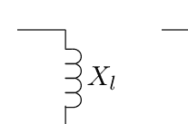

图8：零序网络：星-三角连接，星侧（左侧）接地

### 7 不平衡故障

对称分量的一个非常常见的应用是计算由不平衡短路引起的电流。对于三相系统，可能的不平衡故障有：
- 1. 单相接地故障，
- 2. 双相接地故障，
- 3. 线-线故障。

这些分别考虑。

#### 7.1 单相接地故障

情况如图10所示。
在这种情况下，系统由连接到发生故障的线路上的网络组成。故障点本身由一组终端（我们可以称之为“a，b，c”）组成。故障集，


图9：零序网络：星-三角连接，不接地或三角-三角连接

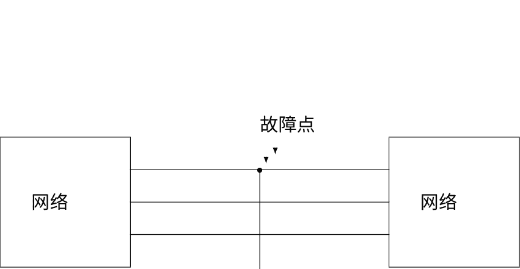

##### 图10：单相接地故障的示意图

在系统上的这一点上：

$$\underline{V}_a = 0$$
$$\underline{I}_b = 0$$
$$\underline{I}_c = 0$$

现在：使用对称分量变换的逆变换，我们可以看到：

$$\underline{V}_1 + \underline{V}_2 + \underline{V}_0 = 0$$ (58)

并且使用变换本身：

$$\underline{I}_1 = \underline{I}_2 = \underline{I}_0 = \frac{1}{3}\underline{I}_a$$ (59)

综合这两个表达式，描述了图11所示的序列网络连接。这个连接将所有三个序列网络连接在串联中。

#### 7.2 双线对地故障

如果故障涉及到b、c相和地，故障点的“终端”关系是：

$$\underline{V}_b = 0$$
$$\underline{V}_c = 0$$
$$\underline{I}_a = 0$$

然后，使用序列变换：

$$\underline{V}_1 = \underline{V}_2 = \underline{V}_0 = \frac{1}{3}\underline{V}_a$$

结合逆变换：

$$\underline{I}_a = \underline{I}_1 + \underline{I}_2 + \underline{I}_0 = 0$$

这些描述了所有三个序列网络并联连接的情况，如图12所示。

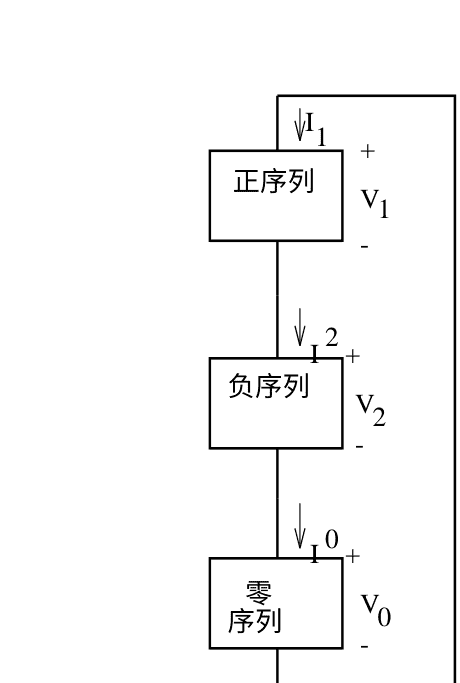

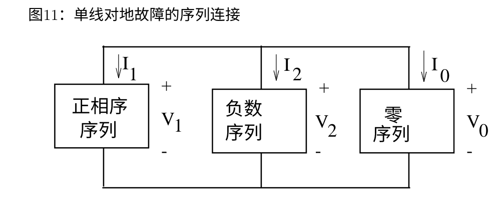

#### 7.3 线对线故障

如果b相和c相短路但不接地，

$$V_b = V_c$$
$$I_b = -I_c$$
$$I_a = 0$$

用对称分量表示这些：

$$V_1 = V_2 = \frac{1}{3}(a + a^2) V_b$$
$$I_0 = \frac{1}{3}(I_a + I_b + I_c) = 0$$
$$I_a = I_1 + I_2$$

$$= 0$$

这些表达式描述了正序和负序网络的并联连接，如图13所示。

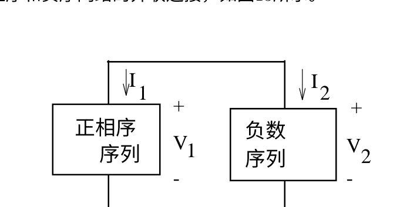

#### 7.4 故障计算示例

在这个例子中，目标是确定断路器Bdue的最大电流故障发生在图14所示的位置。需要考虑所有三种不平衡故障以及平衡故障。这是在安装或修改线路时必须进行的计算，以便正确设置保护继电器。

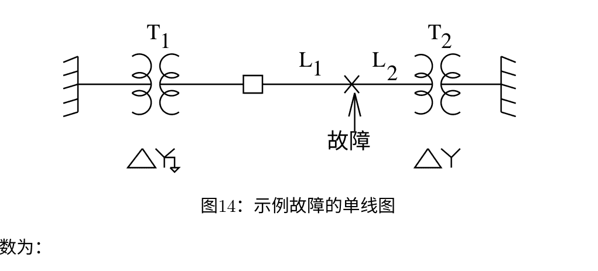

系统参数为：
- 系统基准电压: 138千伏
- 系统基准功率: 100兆伏安
- 变压器 T1漏抗: 0.1单位
- 变压器 T2漏抗: 0.1单位
- 线路 L1正负序电抗: j.05单位
- 线路 L1零序阻抗: j.1单位
- 线路 L2正负序电抗: j.02单位
- 线路 L2零序阻抗: j.1单位

图中两端的围栏符号代表“无限大母线”，或正序电压源。

首先要找到序列网络。这些在图15中显示。请注意它们与我们所期望的等效单相网络完全相同。只有正序网络有电源，因为无穷大母线只提供正序电压。零序网络在右侧是开路的，因为那里有三角形-星形变压器连接。

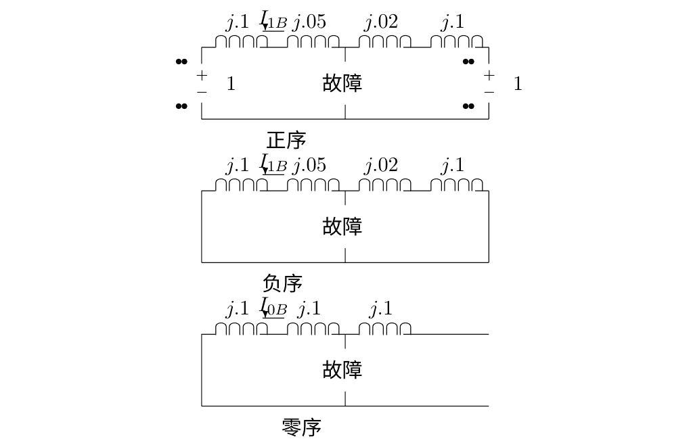

##### 图15：序网络

##### 7.4.1 对称故障

对于对称（三相）故障，只涉及正序网络。故障在其位置短路网络，因此电流为：
$$i_1 = \frac{1}{j.15} = -j6.67 \text{每单位}$$

##### 7.4.2 单相接地故障

在这种情况下，三个网络串联，情况如图16所示。图16中的电流 $i$ 是总电流，由以下公式给出：
$$i = \frac{1}{2 \times (j.15||j.12) + j.2} = -j3.0$$

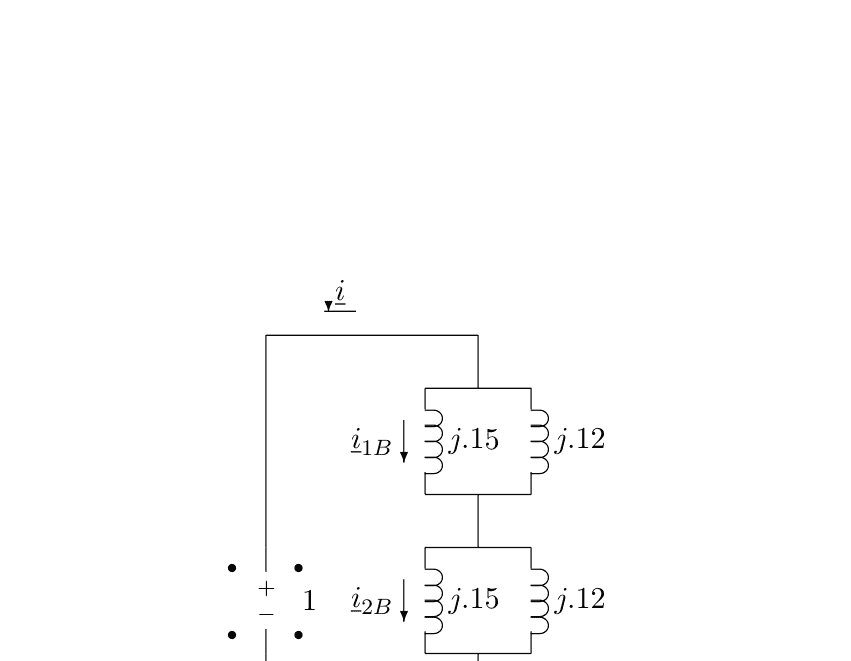

图16：单线接地故障的网络图

然后断路器处的序列电流为：

$$i_{1B} = i_{2B} = i \times \frac{j.12}{j.12 + j.15} = -j1.33$$
$$i_{0B} = i = -j3.0$$

使用以下方法重构相电流：

$$i_a = i_{1B} + i_{2B} + i_{0B}$$
$$i_b = a^2 i_{1B} + a i_{2B} + i_{0B}$$
$$i_c = a i_{1B} + a^2 i_{2B} + i_{0B}$$

这些是：

$$i_a = -j5.66 \text{ 百分比单位}$$
$$i_b = -j1.67 \text{ 百分比单位}$$
$$i_c = -j1.67 \text{ 百分比单位}$$

##### 7.4.3 双线接地故障

对于双线接地故障，网络是并联的，如图17所示。


##### 图17：双线接地故障的完整网络

首先，找到源电流 $i$:

$$i = \frac{1}{j(.15||.12) + j(.15||.12||.2)} = -j8.57$$

然后断路器处的序电流为:

$$i_{1B} = i \times \frac{j.12}{j.12 + j.15} = -j3.81$$
$$i_{2B} = -i \times \frac{j.12||j.2}{j.12||j.2 + j.15} = j2.86$$
$$i_{0B} = i \times \frac{j.12||j.15}{j.2 + j.12||j.15} = j2.14$$

重构的相电流为:

$$i_a = j1.19$$
$$i_b = i_{0B} - \frac{1}{2}(i_{1B} + i_{2B}) - \frac{\sqrt{3}}{2}j(i_{1B} - i_{2B}) = j2.67 - 5.87$$
$$i_c = i_{0B} - \frac{1}{2}(i_{1B} + i_{2B}) + \frac{\sqrt{3}}{2}j(i_{1B} - i_{2B}) = j2.67 + 5.87$$
$$|i_a| = 1.19 \text{ 百分比}$$
$$|i_b| = 6.43 \text{ 单位制}$$
$$|i_c| = 6.43 \text{ 百分比单位}$$

##### 7.4.4 线线故障

这里的情况更简单，如图18所示。


源电流 $i$ 为：
$$i = \frac{1}{2 \times j(.15||.12)} = -j7.50$$

然后：
$$\begin{aligned} i_{1B} &= -i_{2B} \\ &= i \frac{j.12}{j.12 + j.15} \\ &= -j3.33 \end{aligned}$$

相电流为：
$$\begin{aligned} i_a &= 0 \\ i_b &= -\frac{1}{2}(i_{1B} + i_{2B}) - j\frac{\sqrt{3}}{2}(i_{1B} - i_{2B}) \\ |i_b| &= 5.77 \quad \text{per-unit} \\ |i_c| &= 5.77 \quad \text{per-unit} \end{aligned}$$

##### 7.4.5 转换为安培

基础电流是：
$$I_B = \frac{P_B}{\sqrt{3} V_{Bl-l}} = 418.4A$$
然后电流幅值是，以安培为单位，有效值：

| 故障类型 | A相 | B相 | C相 |
|----------|-----|-----|-----|
| 三相故障 | 2791 | 2791 | 2791 |
| 单相接地, $\phi_a$ | 2368 | 699 | 699 |
| 双相接地, $\phi_b,\phi_c$ | 498 | 2690 | 2690 |
| 线对线, $\phi_b,\phi_c$ | 0 | 2414 | 2414 |麻省理工学院开放式课程
[http://ocw.mit.edu](http://ocw.mit.edu)

# 6.061 / 6.690 电力系统导论
2011年春季

有关引用这些材料或我们的使用条款的信息，请访问：[http://ocw.mit.edu/terms](http://ocw.mit.edu/terms)。

## 麻省理工学院
电气工程与计算机科学系
6.061 电力系统导论
课堂笔记 第5章
潮流计算导论 *

### J.L. Kirtley Jr.

#### 1 引言
尽管电力网络由线性组件组成（或可以近似为线性），电力流动，无论是实功还是无功，都是非线性的量。网络中潮流流动的计算是一组非线性方程的解。本笔记的目的是描述如何计算网络潮流。

这只是对这个问题的初步处理：在专业文献中仍然存在很多关于潮流算法的研究。这是因为电力公用事业网络通常非常庞大，拥有数千个母线，因此解决方案所需的计算工作量很大。为了高效地进行计算，需要投入大量的努力。

本讨论以及本笔记末尾的小型计算机程序使用了最简单的算法来解决这个问题。然而，对于我们将要处理的相对简单的问题，它应该能够正常工作。

#### 2 功率流
网络中的功率流由网络中每个母线的电压和母线之间的阻抗决定。进入和离开网络终端母线的功率流是连接到该母线的所有线路的功率流之和。潮流问题包括找到一组电压：幅值和角度，以及与网络阻抗一起，在系统终端处产生已知正确的潮流。首先，我们将电力系统视为由母线通过线路连接在一起的集合。在每个母线上，我们可以连接设备，这些设备将向系统供电或从系统中取电。（注意：在这里提到的功率实际上是指复功率，具有实部和虚部）。如果我们已经连接到给定的系统节点（例如使用发电机），则节点 \( k \) 处的复功率流进入网络为：

$$ \mathbf{S}_{k}=P_{k}+j Q_{k}=\mathbf{V}_{k} \mathbf{I}_{k}^{*} $$

#### 3 母线导纳
现在，如果网络本身是线性的，母线之间和母线与地之间的互连可以用多端口母线阻抗矩阵或其逆矩阵来总结。事实证明，导纳矩阵很容易制定。

该网络由N个母线和N条线路组成。每条线路都有一些（通常是复数）阻抗Z。我们通过将每条线路的导纳（阻抗的倒数）放置在N×N矩阵的主对角线上的适当位置来形成线路导纳矩阵：

$$ Y_\ell = \begin{bmatrix} \frac{1}{Z_1} & 0 & 0 & \cdots \\ 0 & \frac{1}{Z_2} & 0 & \cdots \\ 0 & 0 & \frac{1}{Z_3} & \cdots \\ \vdots & \vdots & \vdots & \ddots \end{bmatrix} $$

母线之间的互连由母线关联矩阵描述。该矩阵具有Nℓ列和N_b行，每条线路对应两个条目，对应于每一端的母线。每条线路应该确定一个“方向”，该线路在节点关联矩阵的（n_b, nℓ）位置的条目是发送端为1，接收端为-1。实际上，哪一端是哪一端并不重要。下图所示的网络的母线关联矩阵如下：

$$ NI = \begin{bmatrix} 1 & 0 & 0 & 0 \\ 0 & 0 & 0 & 1 \\ -1 & 1 & 1 & 0 \\ 0 & 0 & -1 & -1 \\ 0 & -1 & 0 & 0 \end{bmatrix} $$

很容易证明，母线导纳矩阵由以下易于计算的表达式给出：

$$ Y = NI \cdot Y_\ell \cdot NI^T $$

母线导纳矩阵的元素，即自导纳和互导纳，都具有以下形式：

$$ Y_{jk} = \frac{I_k}{V_j} $$

其中其他电压均为零。

因此，估计母线导纳矩阵的另一种方法是：

- 假设所有节点（母线）都与地短接，
- 假设一个节点未短接并连接到电压源，
- 计算由该电压源引起的所有节点电流。
- 对每个节点都进行这样的计算。

我们可以观察到：

- 互易性成立：
  $$\mathbf{Y}_{jk} = Y_{kj} \tag{5}$$
- 驱动点导纳 $\mathbf{Y}_{kk}$只是连接到母线 $k$的所有导纳的总和，包括从该母线连接到地的任何固定阻抗。
- 互导 $\mathbf{Y}_{jk}$是负的直接连接在母线 $j$和 $k$之间的所有线路的导纳之和。通常只有一条这样的线路。

网络电流由以下给出：

$$\mathbf{I} = \mathbf{Y} \mathbf{V} \tag{6}$$

其中 $\mathbf{I}$是母线电流的向量（即，进入网络的母线电流）。 $\mathbf{V}$表示母线电压， $\mathbf{Y}$是母线导纳矩阵。我们将在另一节中详细介绍如何估计母线导纳矩阵。暂时注意，单个母线电流由以下给出：

$$\mathbf{I}_k = \sum_{j=1}^{N} \mathbf{Y}_{jk} \mathbf{V}_j \tag{7}$$

其中 $N$是网络中的母线数。 然后，节点的复功率流为：

$$\mathbf{S}_k = \mathbf{V}_k \sum_{j=1}^{N} \mathbf{Y}_{jk}^{*} \mathbf{V}_j^{*} \tag{8}$$

现在，典型的潮流问题涉及具有不同约束的母线。每个母线可以指定六个量：电压幅值和角度，电流幅值和角度，实功率和无功功率。当然，这些是相互关联的，因此其中任意两个由其他四个指定，并且网络本身提供了另外两个约束。因此，在设置潮流问题时，需要指定这六个量中的两个。典型的组合有：

- 发电机母线：指定了实功和终端电压幅值。
- 负荷母线：指定了实功和无功功率。
- 固定阻抗：连接到母线的固定线性阻抗限制了电压和电流之间的关系。由于它限制了幅值和角度，这样的阻抗构成了两个约束条件。
- 无穷大母线：这是一个电压源，具有恒定的幅值和相位角。

潮流问题的解决包括通过终端关系来约束[8]。

潮流问题中的一个母线被指定为“松弛母线”或“摆动母线”。这个母线被认为是一个“无穷大母线”，因为它既没有实功也没有无功功率的约束，可以容纳网络线路中的实功损耗和无功功率存储。这个母线是必要的，因为这些损耗事先是未知的。此外，需要指定一个相位角，作为其他相位角的起点。

#### 4 高斯-塞德尔迭代技术
这是解决非线性潮流问题的许多技术之一。 需要指出的是，这种解决方法虽然易于使用和理解，但在处理大型问题时会使用大量计算。 它还有可能收敛到错误的解决方案（这是非线性系统的问题）。 与其他迭代技术一样，往往很难确定何时达到了正确的解决方案。 尽管存在这些缺点，高斯-塞德尔方法可以用来对潮流问题有一个良好的了解，而不需要过多的数值分析工作。

假设我们对网络电压有一个初始估计（即猜测）。我们可以将[8]划分为：

$$\mathbf{S}_{k}=\mathbf{V}_{k}\sum_{j=k}^{N}\mathbf{Y}_{jk}^{*}\mathbf{V}_{j}^{*}+\mathbf{V}_{k}\mathbf{Y}_{kk}^{*}\mathbf{V}_{k}^{*} \tag{9}$$

注意到 $\mathbf{S}_{k} = P_{k} + jQ_{k}$，我们可以解出 $\mathbf{V}_{k}^{*}$，并且，取其复共轭，我们可以得到一个关于网络所有电压、 $P_{k}$和 $Q_{k}$的表达式：

$$\mathbf{V}_{k}=\frac{1}{\mathbf{Y}_{kk}}\left(\frac{P_{k}-jQ_{k}}{\mathbf{V}_{k}^{*}}-\sum_{j=k}^{N}\mathbf{Y}_{jk}\mathbf{V}_{j}\right) \tag{10}$$

表达式[10]是比我们开始的 $\mathbf{V}_{k}$更好的估计。 解非线性方程组的解决方案包括对网络中所有母线重复执行此表达式。

一种迭代过程，其中计算网络中每个电压的修正步骤，并同时应用修正，称为高斯迭代。 另一方面，如果立即使用改进的变量，则该过程称为高斯-塞德尔迭代。 请注意，[10]使用所讨论母线的P和Q作为其约束条件。 因此，它可以直接用于负荷类型的母线。 对于其他类型的母线约束，需要进行修改。 我们只考虑了许多可能的约束集中的两个。

对于发电机母线，通常指定实功和终端电压幅值。 在每个时间步长中，需要得到指定幅值的终端电压：电压相角和无功功率Q是未知数。 处理这种情况的一种方法是：

1. 估计无功功率Q，然后
2. 使用[10]估计终端电压，最后，
3. 保持电压相角恒定，调整幅值以满足约束条件。

在迭代的任何时刻，无功功率为：

$$Q_{k}=\mathrm{Im}\left\{\mathbf{V}_{k}\sum_{j=1}^{N}\mathbf{Y}_{jk}^{*}\mathbf{V}_{j}^{*}\right\} \tag{11}$$

值得注意的是，还有其他计算方法。 通常需要更多的设置工作，但收敛速度更快。 牛顿法及其变种是很好的例子。

对于由恒定阻抗负荷的母线，将负荷阻抗合并到网络中就足够了。也就是说，负荷导纳直接与所讨论节点的驱动点导纳并联。

这三种母线约束类型，发电机、负荷和恒定阻抗，足以处理大多数实际问题。

##### 例子5：简单程序
附在这个笔记上的是一个MATLAB脚本，它将执行高斯-塞德尔过程，用于具有这里描述的简单约束的网络。这个脚本是自解释的，并执行下面简单示例中描述的潮流。

请注意，与许多非线性方程求解器一样，成功有时需要一个与最终解相当接近的初始猜测解。

##### 例子6
考虑图1所示的系统。这个简单的系统有五个母线（编号1到5）和四条线路。两个母线连接到发电机，两个母线连接到负荷，母线5是“摆动母线”，表示为“无穷大母线”或电压供应。

为了这个练习，假设线路阻抗为：

```
Z0 = .05 + j.1
Z1 = .05 + j.05
Z2 = .15 + j.2
Z3 = .04 + j.12
```

我们还为发电机指定了实功率和电压幅值，并为负荷指定了实功率和无功功率：

- 母线1：实功率为1，电压为1.05标幺
- 母线2：实功率为1，电压为1.00标幺
- 母线3：实功率为-0.9标幺，无功功率为0
- 母线4：实功率为-1，无功功率为-0.2标幺

请注意，负荷功率被视为负值，因为这个简单的程序假设所有功率都是进入网络的。


图1：样本系统

```
% 简单的潮流计算示例
% 首先，阻抗
Z1=.05+j*.1;
Z2=.05+j*.05;
Z3=.15+j*.2;
Z4=.04+j*.12;
% 这是节点关联矩阵
NI=[1 0 0 0;0 0 0 1;-1 1 1 0;0 0 -1 -1;0 -1 0 0];
% 这是"已知"电压幅值的向量
VNM = [1.05 1 0 0 1]';
% 这是已知电压相角的向量
VNA = [0 0 0 0 0]';
% 这是实际已知的"关键"向量
KNM = [1 1 0 0 1]';
KNA = [0 0 0 0 1]';
% 并且这些将由系统进行操作
KUM = 1 - KNM;
KUA = 1 - KNA;
% 这里是已知负荷（正数为进入网络
% 未知数使用零
P=[1 1 -.9 -1 0]';
Q=[0 0 0 -.2 0]';
% 这里是相应的向量，用于指示
% 哪些元素应进行错误检查
PC = [1 1 1 1 0]';
QC = [0 0 1 1 0]';
Check = KNM + KNA + PC + QC;
% 未知的 P 和 Q 向量
PU = 1 - PC;
QU = 1 - QC;
fprintf('这是线路导纳矩阵：');Y=[1/Z1 0 0 0;0 1/Z2 0 0;0 0 1/Z3 0;0 0 0 1/Z4]% 构建节点导纳矩阵

fprintf ('这是母线导纳矩阵') YN = NI * Y * NI'

% 现在：这里是一些起始电压幅值和角度
VM = [1.05 1 .993 .949 1]';
VA = [.0965 .146 .00713 .0261 0]';
% 这里开始一个循环
Error = 1;
Tol=1e-10;
N = length(VNM);
 % 根据我们目前所拥有的内容构建候选电压
VMAG = VNM .* KNM + VM .* KUM;
VANG = VNA .* KNA + VA .* KUA;
V = VMAG .* exp(j .* VANG);
%并计算起始功率
I = (YN*V);
PI = real(V .* conj(I));
QI = imag(V .* conj(I));
%暂停
while(Error>Tol);
    for i=1:N,           % 遍历所有母线
        % 我们的操作取决于母线的情况!
        if (KUM(i) == 1) & (KUA(i) == 1),   % 不知道电压的幅值或角度
            pvc= (P(i)-j*Q(i))/conj(V(i));
            for n=1:N,
                if n ~=i, pvc = pvc - (YN(i,n) * V(n)); end
            end
            V(i) = pvc/YN(i,i);
        elseif (KUM(i) == 0) & (KUA(i) == 1), % 知道幅值但不知道角度
            % 首先必须为 Q 生成一个估计值
            Qn = imag(V(i) * conj(YN(i,:)*V));
            pvc= (P(i)-j*Qn)/conj(V(i));
            for n=1:N,
                if n ~=i, pvc = pvc - (YN(i,n) * V(n));  end
            end
            pv=pvc/YN(i,i);
            V(i) = VM(i) * exp(j*angle(pv));
        end                % 可能应该有更多的情况
    end                    % 一次通过电压列表: 检查错误
end
% 现在计算由这个电压表达式指示的电流
I = (YN*V);
% 为了错误检查目的, 计算所示功率
PI = real(V .* conj(I));
QI = imag(V .* conj(I));
% 现在我们找出与期望条件的接近程度
PERR = (P-PI) .* PC;
QERR = (Q-QI) .* QC;
误差 = sum(abs(PERR).^2 + abs(QERR).^2);
end
fprintf('这里是电压')V

fprintf('实功率')P

fprintf('无功功率')Q
```

麻省理工学院开放式课程
http://ocw.mit.edu

# 6.061 / 6.690 电力系统导论
2011年春季

有关引用这些材料或我们的使用条款的信息，请访问： http://ocw.mit.edu/terms。

## 麻省理工学院
电气工程与计算机科学系
6.061 电力系统导论
课堂笔记 第6章
磁路模拟电路 *

### J.L. Kirtley Jr.

#### 1 引言
在本章中，我们描述了电路和磁路之间的等效性，进而描述和分析可以用磁路方式描述的磁场系统的方法。事实证明，这种等效性是对现实的一个相当准确的近似，并且可以有一定的信心使用。

磁路是那些利用磁通量来诱导电压或产生力的设备的一部分。这些设备包括变压器、电动机、发电机和其他执行器（包括电磁执行器和扬声器等）。在这些设备中，产生和引导磁通量是必要的。通常使用铁磁材料的片块来实现这一点（其磁导率远大于自由空间）。从这个意义上讲，磁路就像电路一样，其中导电材料（如铝或铜）具有很高的电导率，并用于引导电流。

电路中的电流与磁路中的磁通量是类似的。（这两个量都是“无散度”的，即它们没有发散）。电路中的电压量或电动势（EMF）类似于磁路中的磁动势（MMF）。EMF是电场 E 的积分，MMF是磁场 H 的积分。

#### 2 电路和基尔霍夫定律
##### 2.1 电荷守恒和KCL
首先，考虑电荷守恒定律：

$$\oint\oint \vec{J} \cdot d\vec{a} = \frac{d}{dt} \int_{\text{vol}} q \, dv = 0$$

当然，这假设系统中没有任何地方积累电荷。对于具有电容板的任何系统来说，这不是一个很好的假设，但是如果我们将电容器视为电路元件，使得电容器的两个板都是任何给定元件的一部分，那么这个表达式的右边确实是零。

因此，如果我们将电流定义为电流密度的积分：在某个区域内，围绕一个节点的整个区域的一部分：
$$i_k = \iint_{A_k} \vec{J} \cdot d\vec{a}$$
那么我们有：
$$\sum_k i_k = 0$$

##### 2.2 法拉第定律
$$\int \vec{E} \cdot d\vec{l} = -\frac{d}{dt} \iint \vec{B} \cdot d\vec{a}$$
左手积分可以看作是一些子积分的总和，每个子积分用离散的分数积分符号表示：
$$v_k = \int_{a_k}^{b_k} \vec{E} \cdot d\vec{l}$$
如果我们假设电路元件之间没有实质性的磁链耦合：
$$\iint \vec{B} = 0$$
那么我们有KVL方程：
$$\sum_k v_k = 0$$

##### 2.3 欧姆定律
在这一点上，可能适合注意到欧姆定律可以用来推导电阻的本构关系。假设我们有一个类似于图1所示的矩形导体元件。假设电流被限制在该元件内，并且垂直于图中所示的平面端面流动。电流密度为
$$J_x = \frac{I}{hw}$$
其中I是总电流，h和w分别是导体的高度和宽度。
元件沿长度方向的电场是：
$$E_x = \frac{J_x}{\sigma}$$其中 $\sigma$ 是材料的电导率。产生的电压是：
$$ v_k = \int E_x d\vec{l} = \frac{J_x}{\sigma} l $$
这导致了元件电阻的表达式：
$$ R = \frac{v}{I} = \frac{l}{hw\sigma} $$


#### 3 磁路

事实证明，磁路非常相似，并且受到与电路完全不同的定律的控制，只有一个小的不同之处。

##### 3.1 通量守恒：高斯定律

首先，高斯定律是：
$$ \oint \vec{B} \cdot d\vec{a} = 0 $$
这反映了通量没有源头的概念：这是一个真正的正弦量。
它既不开始也不结束，只是在圆圈中循环。
如果我们注意一个节点周围的表面的一部分，并称之为表面 $k$，通过该表面的通量是：
$$ \Phi_k = \iint_{A_k} \vec{B} \cdot d\vec{a} $$
如果我们将围绕一个节点的所有部分通量的总和相加，我们就得到了KCL的类比：
$$ \sum_k \Phi_k = 0 $$

##### 3.2 磁动势：安培定律

安培定律的简单陈述如下：

$$\int \vec{H} \cdot d\vec{l} = \iint \vec{J} \cdot d\vec{a}$$

电流密度 $\vec{J}$ 的积分是电流，在国际单位制中以安培表示。由于电流通常通过可能编号为 $N$ 的导线传输，因此通常以以下方式表示：

$$\iint \vec{J} \cdot d\vec{a} = N I$$

为此，我们经常使用术语磁动势或MMF，其符号为 $F$。如果我们使用该符号表示磁场在磁路元素上的积分：

$$F_k = \int_{a_k}^{b_k} \vec{H} \cdot d\vec{l}$$

然后，如果我们取足够多的这些子积分来覆盖围绕一组元素的环路，我们有

$$\sum_{k} F_k = N I$$

请注意，这与KVL不完全相同，因为它在右边有一个源项。

##### 3.3 磁路元件：类比欧姆定律

磁路具有等效的电阻。它是MMF与磁通的比值，并具有符号 $\mathcal{R}$。与电阻的推导进行直接比较，磁路元件如图2所示。


假设该元件的材料具有渗透率 $\mu > \mu_0$，因此它具有一个本构关系：

$B_x = \mu H_x$

如果材料中的磁通密度是均匀的，元件通过的总磁通为：

$\Phi = hwB_x = hw\mu H_x$

而磁势是磁场 $H$ 的积分：再次我们假设均匀性：

$F = \mathcal{T} H_x$

这个元件的磁阻是：

$\mathcal{R} = \frac{F}{\Phi} = \frac{\mathcal{T}}{hw\mu}$

##### 3.4 磁隙

实际上，磁路通常由非常高渗透性的元件（铁片）和相对较小的气隙组成。 如图3所示，这是一个这样的气隙的草图。


图3：磁元件之间的间隙

通常可以假设铁元件具有非常高的渗透率 ($\mu \rightarrow \infty$)，因此磁势降低可以忽略不计。 从这个意义上说，铁元件在电路中起着与铜或铝导线相同的作用。 而气隙的磁阻为：

$\mathcal{R}_g = \frac{g}{hw\mu_0}$


##### 3.5 边界条件

图4显示了一个间隙的横截面。假设所示元素在纸张中有一定的深度，该深度大于间隙宽度 $g$。如果右侧和左侧元素的渗透率非常高，我们说磁通主要集中在这些元素中。

请注意，安培定律关联的边界条件规定，与表面平行的邻近渗透材料的空气中的磁场强度 $H_a$ 必须等于磁性材料内部的磁场强度 $H_m$。如果材料的渗透率非常高（$\mu \rightarrow \infty$），那么磁场强度必须接近零：$H_a = H_m \rightarrow 0$。这意味着磁场必须垂直于非常高渗透材料的表面。这在间隙本身是成立的，即：

$$B_g = B_m$$

然而，我们应该注意，在靠近间隙的区域会有‘边缘’场，因此我们对于间隙的磁阻的表达式不会完全正确。忽略边缘效应的表达式的准确性在非常小的间隙中最好，并且通常会高估磁阻。

## 法拉第定律和电感

变化的磁场产生电场，从而产生电压。这就是电感的工作原理。考虑图5中抽象表示的情况。

法拉第定律的积分形式为：

$$\int \vec{E} \cdot d\vec{r} = -\frac{d}{dt} \iint_{Area} \vec{B} \cdot \vec{n} da$$

如果所示的轮廓高导电（比如说是根导线），那么该轮廓的那部分没有电场。终端间的电压为：


$V_{ab} = -\frac{d}{dt} \iint_{\text{面积}} \vec{B} \cdot \vec{n} da$

现在，如果我们定义沿着这个闭合路径的通量为：

$\lambda = - \iint_{\text{面积}} \vec{B} \cdot \vec{n} da$

那么电压就是我们所期望的：

$V_{ab} = \frac{d\lambda}{dt}$

事实证明，沿着图5中所示的方向流动的电流i会产生与该图中所示的法向量相反的通量，因此产生正的通量。通常，在计算电感时，使用“右手定则”来确定通量的方向：如果你右手的手指沿着绕组的方向，从正极开始，正通量的方向就是你的大拇指的方向。

##### 4.1 例子：电磁铁执行器

图6显示了一个常见的电磁铁执行器的表示。当电流通过线圈时，在间隙中会产生磁通，并将推动器向左拉动。我们将在后面的章节中研究力的计算方法。然而，目前我们关注的是设备中的磁场和电感的计算。假设定子和推动器都由高渗透材料制成（μ→∞）。如果线圈中流过电流 I，线圈中有 N匝，如图所示的方向，磁通将穿过窄的气隙向右流动，从定子流向推动器，然后在宽度为 x的可变长度间隙中返回。显然，对于线圈来说，这也是正向磁通。

磁路等效电路如图7所示。所有产生的磁通都穿过具有磁阻的可变宽度间隙：

深度D垂直于视图


###### 图6：电磁铁执行器的横截面


###### 图7：电磁铁执行器的磁等效电路

$\mathcal{R}_x = \frac{x}{\mu_0 h D}$

一半的磁通穿过另外两个并联的间隙，它们具有磁阻：

$\mathcal{R}_g = \frac{g}{\mu_0 w D}$

磁路中的总磁通是

$\Phi = \frac{F}{\mathcal{R}_x + \frac{1}{2} \mathcal{R}_g}$

由于 $\lambda = N\Phi$ 和 $F = N I$，该结构的电感是：

$L = \frac{N^2}{\mathcal{R}} = \frac{N^2}{\mathcal{R}_x + \frac{1}{2} \mathcal{R}_g}$

# 麻省理工学院开放式课程

[http://ocw.mit.edu](http://ocw.mit.edu)

# 6.061 / 6.690 电力系统导论

### 2011年春季

有关引用这些材料或我们的使用条款的信息，请访问： [http://ocw.mit.edu/terms](http://ocw.mit.edu/terms)。

## 麻省理工学院
电气工程与计算机科学系
6.061 电力系统导论
课堂笔记 第8章
电磁力和损耗机制 *

J.L. Kirtley Jr.

#### 1 引言

本节笔记讨论了电力机械中涉及的一些基本过程。在能量转换过程的部分，我们研究了两种估计电磁力的主要方法：涉及热力学论证（能量守恒）和场方法（麦克斯韦应力张量）。在这两种解释之间，有一些关于电力机械的描述，主要是为了激发对基于场的力计算方法的描述。

笔记中关于损耗的小节实际上是关于线性和非线性材料中涡流以及处理铁损耗和激磁电流的半经验方法。

#### 2 能量转换过程：

在电动机中，能量转换过程可以简单地理解为。在“稳态”下，机器的电力输入只是不同相位端子的电力输入之和：

$$P_e = \sum_{i} v_i i_i$$

机械功率是扭矩乘以速度：

$$P_m = T\Omega$$

而损耗的总和则是差异：

$$P_d = P_e - P_m$$


事实上，在大多数机器中，耗散很小，因此可以用电功率近似机械功率。实际上，有很多情况下，损耗机制已经被很好地了解，可以理想化处理。“热力学”对于力密度的论证利用了这一点，并采用了“保守”或无损耗的能量转换系统。

##### 2.1 电磁力的能量方法：


首先，考虑一个具有两组“端子”的电机系统，电气和机械端子如图2所示。如果系统在磁场中储存能量，则储存的能量取决于系统的状态，由（在本例中）两个可识别变量定义：磁通（λ）、电流（i）和机械位置（x）。事实上，只需稍加思考，你就能够确信这个状态是两个变量的单值函数，并且储存的能量与系统如何达到这个状态无关。

现在，所有的电机转换器都有损耗机制，因此它们本身不是保守的。然而，产生力的磁场系统在原则上是保守的，因为它的状态和储存能量只能用两个变量来描述。系统的“历史”并不重要。
可以选择变量，使得电力进入这个保守系统

可能性是：

```
P^e = vi = i \frac{d\lambda}{dt}
```

同样，机械功率从系统中输出为：

```
P^m = f^e \frac{dx}{dt}
```

这两者之间的区别是系统中储存的能量的变化率：

```
\frac{dW_m}{dt} = P^e - P^m
```

然后可以通过以下方式计算将系统从一个状态转换到另一个状态所需的能量变化:

```
W_m(a) - W_m(b) = \oint_b^a i d\lambda - f^e dx
```

系统的两个状态分别由λ_a, x_a和λ_b, x_b描述。如果系统中储存的能量由两个状态变量 λ和 x描述，那么储存能量的总微分为：

```
dW_m = \frac{\partial W_m}{\partial \lambda} d\lambda + \frac{\partial W_m}{\partial x} dx
```

并且也可以表示为：

```
dW_m = i d\lambda - f^e dx
```

因此我们可以直接将导数等同起来：

```
f^e = - \frac{\partial W_m}{\partial x}
```

在存在多个电气终端和/或多个机械终端的情况下，这个概念可以推广。例如，存在多个电气终端的情况下，可以表示为：

```
dW_m = \sum_k i_k d\lambda_k - f^e dx
```

而旋转运动与线性运动不同，力 f^e和位移 x被扭矩 T^e和角位移 θ取代。在许多情况下，我们可能考虑一个电气线性系统，其中电感仅仅是机械位置 x的函数。

```
\lambda(x) = L(x) i
```

在这种情况下，假设能量积分从 λ= 0 开始进行（使得对 x的积分部分为零），

```
W_m = \oint_0^{\lambda} \frac{1}{L(x)} \lambda d\lambda = \frac{1}{2} \frac{\lambda^2}{L(x)}
```

这使得

```
f^e = - \frac{1}{2} \lambda^2 \frac{\partial}{\partial x} \frac{1}{L(x)}
```

注意这在数值上等同于

$$f^e = -\frac{1}{2}i^2\frac{\partial}{\partial x}L(x)$$

这仅适用于线性系统的情况。注意在推导过程中过早地将 $L(x)i = \lambda$ 代入会产生错误的结果：在线性系统的情况下是符号错误，但在非线性系统的情况下是错误的。

###### 2.1.1 共能

我们通常会用电感来描述系统，而不是它的倒数，这样电流，而不是磁通，看起来是相关的变量。方便起见，我们将推导出一个新的能量变量，我们将其称为共能，通过以下方式：

$$W'_m = \sum_i \lambda_i i_i - W_m$$

在这种情况下，很容易证明能量微分是（对于单个机械变量）简单地：

$$dW'_m = \sum_k \lambda_k di_k + f^e dx$$

因此产生的力是：

$$f_e = \frac{\partial W'_m}{\partial x}$$

考虑一个简单的电机示例，其中转子上有一个绕组（称为场绕组）和一个多相电枢。假设转子是圆形的，我们可以将磁链描述为：

$$\begin{aligned}
\lambda_a &= L_a i_a + L_{ab} i_b + L_{ab} i_c + M \cos(p\theta) i_f \\
\lambda_b &= L_{ab} i_a + L_a i_b + L_{ab} i_c + M \cos(p\theta - \frac{2\pi}{3}) i_f \\
\lambda_c &= L_{ab} i_a + L_{ab} i_b + L_a i_c + M \cos(p\theta + \frac{2\pi}{3}) i_f \\
\lambda_f &= M \cos(p\theta) i_a + M \cos(p\theta - \frac{2\pi}{3}) i_b + M \cos(p\theta + \frac{2\pi}{3}) i_c + L_f i_f
\end{aligned}$$

现在，这个系统可以简单地用共能来描述。在多激励的情况下，需要在进行共能积分时要小心（以确保在多维空间中采取有效路径）。在我们的情况下，实际上有五个维度，但只有四个是重要的，因为我们可以将转子定位在所有电流为零的位置，因此设置转子位置不会对共能产生贡献。假设转子处于某个角度 $\theta$，并且四个电流具有值 $i_{a0}$，$i_{b0}$，$i_{c0}$和 $i_{f0}$。可以采取的许多正确路径积分之一是：

$$\begin{aligned}
W'_m &= \int_0^{i_{a0}} L_a i_a di_a + \\
&+ \int_0^{i_{b0}} (L_{ab} i_{a0} + L_a i_b) di_b \\
&+ \int_0^{i_{c0}} (L_{ab} i_{a0} + L_{ab} i_{b0} + L_a i_c) di_c \\
&+ \int_0^{i_{f0}} (M \cos(p\theta)i_{a0} + M \cos(p\theta - \frac{2\pi}{3})i_{b0} + M \cos(p\theta + \frac{2\pi}{3})i_{c0} + L_f i_f) di_f
\end{aligned}$$

结果是：

$$W'_m = \frac{1}{2} L_a (i_{a0}^2 + i_{b0}^2 + i_{c0}^2) + L_{ab} (i_{a0} i_{b0} + i_{a0} i_{c0} + i_{c0} i_{b0}) + M i_{f0} (i_{a0} \cos(p\theta) + i_{b0} \cos(p\theta - \frac{2\pi}{3}) + i_{c0} \cos(p\theta + \frac{2\pi}{3})) + \frac{1}{2} L_f i_{f0}^2$$

如果定子电感与转子位置 θ无变化（如果转子完全圆形），那么涉及 L_a 和 L_{ab}的项将为零，因此扭矩由以下公式给出：

$$T_e = \frac{\partial W'_m}{\partial \theta} = -pM i_{f0} (i_{a0} \sin(p\theta) + i_{b0} \sin(p\theta - \frac{2\pi}{3}) + i_{c0} \sin(p\theta + \frac{2\pi}{3}))$$

我们将在后续章节中讨论这种类型的机器。

##### 2.2 连续能量流

在这一点上，将电磁能量流描述为 Poynting定理是很有启发性的：

$$\vec{S} = \vec{E} \times \vec{H}$$

能量流 S，称为Poynting矢量，用电场和磁场来描述电磁功率。 它是功率密度：单位面积的功率，在国际单位制中以瓦特每平方米为单位。

为了计算电磁功率进入某个空间体积，我们可以对该体积的表面进行Poynting矢量的积分，然后使用散度定理：

$$P = -\oint \vec{S} \cdot \vec{n} da = -\int_{\text{vol}} \nabla \cdot \vec{S} dv$$

现在，使用矢量恒等式，Poynting矢量的散度为：

$$\nabla \cdot \vec{S} = \nabla \cdot (\vec{E} \times \vec{H}) = \vec{H} \cdot \nabla \times \vec{E} - \vec{E} \cdot \nabla \times \vec{H} = -\vec{H} \cdot \frac{\partial \vec{B}}{\partial t} - \vec{E} \cdot \vec{J}$$

穿过空间区域的功率则为：

$$P = \int_{\text{vol}} (\vec{E} \cdot \vec{J} + \vec{H} \cdot \frac{\partial \vec{B}}{\partial t}) dv$$

现在，在没有物质运动的情况下，解释这个方程中的两个项相对简单。 第一项描述了耗散：

$$\vec{E} \cdot \vec{J} = |\vec{E}|^2 \sigma = |\vec{J}|^2 \rho$$

第二项被解释为磁储能的变化率。在没有磁滞的情况下，它是：

$$
\frac{\partial W_m}{\partial t} = \vec{H} \cdot \frac{\partial \vec{B}}{\partial t}
$$

请注意，在自由空间的情况下，

$$
\vec{H} \cdot \frac{\partial \vec{B}}{\partial t} = \mu_0 \vec{H} \cdot \frac{\partial \vec{H}}{\partial t} = \frac{\partial}{\partial t} \left( \frac{1}{2} \mu_0 |\vec{H}|^2 \right)
$$

这被直观地解释为磁储能密度的变化率：

$$
W_m = \frac{1}{2} \mu_0 |H|^2
$$

一些材料表现出磁滞行为，其中储存的能量不是单值函数 $\vec{B}$ or $\vec{H}$，我们将在后面考虑这种情况。

##### 2.3 材料运动

在材料运动 $\vec{v}$的存在下，电场 $E$ 和磁场 $B$相关。

在“移动”框架中的电场与“静止”框架中的电场由：

$$
\vec{E'} = \vec{E} + \vec{v} \times \vec{B}
$$

这是通过观察带电粒子在组合电场和磁场中运动而获得的实验结果。这是一个相对论表达式，因此“移动”和“静止”是相对的。电场是在任何框架中观察到的。在MQS系统中，磁通密度 $\vec{B}$在两个框架中是相同的。

与电流密度相关的术语变为：

$$
\vec{E} \cdot \vec{J} = (\vec{E'} - \vec{v} \times \vec{B}) \cdot \vec{J}
$$

我们可以将 $\vec{E'}$ $\vec{J}$解释为耗散，但第二项需要稍加考虑。请注意它采用了矢量三重（标量）积的形式：

$$
-\vec{v} \times \vec{B} \cdot \vec{J} = -\vec{v} \cdot \vec{B} \times \vec{J} = -\vec{v} \cdot \vec{J} \times \vec{B}
$$

这是速度乘以力密度的形式，表示电磁到机械形式的功率转换。这与洛伦兹力定律（也是实验观察到的）一致：

$$
\vec{F} = \vec{J} \times \vec{B}
$$

这最后一个表达式是描述电机中能量转换过程的另一种方式，当材料通过磁场运动时，所产生的表观电场分量在受到电流的反作用时，产生机械形式的能量转换而不是耗散。

##### 2.4 能量方法中的其他问题

在研究电磁力的发展和使用能量方法计算时，还有两个重要且有趣的问题需要考虑。这些问题涉及到不能简单表示为集中参数的情况和涉及到永久磁铁的情况。

###### 2.4.1 连续介质中的共能

考虑一个不仅有多个电路而且有连续的电流传输路径的系统。在这种情况下，我们可以将共能定义为：

$$
W_m' = \oint_{\text{面积}} \oint \lambda(\vec{a}) d\vec{J} \cdot d\vec{a}
$$

其中该面积被选择为切割所有电流传输导体。由于电流的散度为零，可以选择该面积与每个电流丝垂直。通量 $\lambda$ 是通过与每个电流丝重合的路径计算的（这样的路径存在，因为电流的散度为零）。然后通量为：

$$
\lambda(\vec{a}) = \oint \vec{B} \cdot d\vec{n}
$$

现在，如果我们使用矢量势 $\vec{A}$，其中磁通密度为：

$$
\vec{B} = \nabla \times \vec{A}
$$

任意一个电流丝所链接的通量为：

$$
\lambda(\vec{a}) = \oint \vec{A} \cdot d\vec{\ell}
$$

其中 $d\vec{\ell}$ 是电流丝周围的路径。这直接意味着共能是：

$$
W_m' = \oint_{\text{面积}} \oint \oint \vec{A} \cdot d\vec{\ell} d\vec{J} \cdot d\vec{a}
$$

现在：可以使 $d\vec{\ell}$ 与 $d\vec{a}$ 重合并与电流丝平行，从而：

$$
W_m' = \oint_{\text{vol}} \vec{A} \cdot d\vec{J} dv
$$

###### 2.4.2 永磁体

永磁体在电机系统中变得越来越重要。通常，对于带有永磁体的系统，采用相对临时的方法，将其等效于产生与磁体本身相同的磁动势的电流。永磁体的本构关系将磁通密度 $\vec{B}$ 与磁场 $\vec{H}$ 以及磁体本身的磁化 $\vec{M}$ 相关联。

$$
\vec{B} = \mu_0 \left( \vec{H} + \vec{M} \right)
$$

现在，磁化的效应就像有一股电流（称为安培电流）密度为：

$$
\vec{J}^{*} = \nabla \times \vec{M}
$$

请注意，这种安培电流在产生磁通密度方面的作用与普通电流一样。

磁共能是：

$$
W'_{m} = \oint_{\text{vol}} \vec{A} \cdot \nabla \times d\vec{M} \, dv
$$

接下来，注意向量恒等式

$$
\nabla \cdot \left( \vec{C} \times \vec{D} \right) = \vec{D} \cdot \left( \nabla \times \vec{C} \right) - \vec{C} \cdot \left( \nabla \times \vec{D} \right)
$$

因此：

$$
W'_{m} = \oint_{\text{vol}} -\nabla \cdot \left( \vec{A} \times d\vec{M} \right) dv + \oint_{\text{vol}} \left( \nabla \times \vec{A} \right) \cdot d\vec{M} \, dv
$$

然后，注意到 $\vec{B} = \nabla \times \vec{A}$:

$$
W'_{m} = - \oint \vec{A} \times d\vec{M} \, d\vec{s} + \oint_{\text{vol}} \vec{B} \cdot d\vec{M} \, dv
$$

如果在磁体外部的表面上进行积分（闭合表面），则第一个积分为零，因为磁化强度$M$为零。因此，只有永磁体源的系统中的磁共能是

$$
W'_{m} = \oint_{\text{vol}} \vec{B} \cdot d\vec{M} \, dv
$$

向这样的系统添加带电线圈是以明显的方式进行的。

##### 2.5 电机描述

实际上，这个描述展示了一个传统的感应电动机。这是一种非常常见的电机类型，将作为参考点。大多数其他电机的运行方式与感应电机相同，或者在易于参考感应电机的方式上有所不同。

考虑图3中所示的简化机械图。我们将要研究的大多数（但不是全部！）机器基本上具有这种形态。机械的转子安装在某种轴上，该轴由轴承支撑。通常情况下，转子在内部。我画了一个圆形的转子，但这并不是必须的。我还指出了转子导体，但有时转子上有永磁体，要么固定在转子上，要么内部，而有时（如可变磁阻机）它只是一个奇形怪状的钢铁块。定子在这个图中是在外部，并且有绕组。在我们将要处理的大多数机器中，定子绕组是电枢或电力输入元件。（在直流和通用电机中，情况相反，电枢包含在转子上：我们将在后面处理这些）。在大多数电机中，转子和定子都由高磁导率的材料制成：钢或磁铁。在许多常见的机器中，如感应电动机，转子和定子都由薄片状的硅钢制成。在这些薄片上冲压出包含转子和定子导体的槽。


图3：电机形式

图4是一个变形的感应电机的部分图片，使得气隙变直（就像机器的半径无限大一样）。实际上，这是一种方便的绘制电机的方式，并且我们会发现，它导致了有用的分析方法。

现在需要注意的重要一点是，电机具有相对较小的气隙g（即，气隙尺寸远小于机器半径r）。电机还具有一个物理长度l。电机通过在气隙中产生剪切应力（当然还伴随着产生“反电压”等副作用）来工作。可以定义平均气隙剪切应力，我们将其称为 $\tau$。总发展力矩是力在表面积上的乘积（即转子半径）：

$$
T = 2\pi r^{2}\ell < \tau >
$$

通过这个设备传输的功率就是扭矩乘以速度，这与力乘以表面速度相同，因为表面速度是 $u = r\Omega$：

$$
P_{m} = \Omega T = 2\pi r^{2}\ell < \tau > u
$$

如果我们注意到活动转子体积是 $\pi r^2 \ell$，扭矩与体积的比值就是：

$$
\frac{T}{V_{r}} = 2 < \tau >
$$

现在，确定在机器体积中可以做什么涉及两个方面。首先，很明显，我们在这里计算的体积不是整个机器的体积，因为它不包括定子。从转子体积估计总机器体积的实际估计实际上相当复杂和详细，我们将把它留到以后。其次，我们需要估计有用的平均剪切应力的值。假设径向磁通密度$B_r$和定子表面电流密度$K_z$都是正弦形式的磁通波：

$$
B_{r} = \sqrt{2}B_{0}\cos (p\theta - \omega t)
$$


图4：槽中的绕组

$$
K_z = \sqrt{2} K_0 \cos (p\theta - \omega t)
$$

请注意，这假设这两个量完全同相，或理想地定向产生转矩，因此我们将得到一个“乐观”的界限。 然后，表面牵引力的平均值为：

$$
<\tau> = \frac{1}{2\pi} \oint_0^{2\pi} B_r K_z d\theta = B_0 K_0
$$

从经验得出的洛伦兹力定律来看，这实际上是有道理的：给定一个（向量）电流密度和一个（向量）磁通密度。 在没有磁性材料（其磁导率与真空不同）的情况下，导体上观测到的力为：$\vec{F} = \vec{J} \times \vec{B}$

其中$\vec{J}$是描述电流密度的矢量（$A/m^2$），而$\vec{B}$是磁通密度（T）。 这实际上足以描述我们在许多机器中看到的力，但由于电动机具有可渗透的磁性材料，并且由于磁场在可渗透材料上产生力，即使在宏观电流不存在的情况下，观察力如何出现在这样的材料上是必要的。力密度的适当经验表达式为：

$$
\vec{F} = \vec{J} \times \vec{B} - \frac{1}{2} \vec{H} \cdot \vec{H} \nabla \mu
$$

其中$\vec{H}$是磁场强度，$\mu$是磁导率。

现在，请注意电流密度是磁场强度的旋度，因此：

$$
\begin{align*}
\vec{F} &= \nabla \times \vec{H} \times \mu \vec{H} - \frac{1}{2} \vec{H} \cdot \vec{H} \nabla \mu \\
&= \mu (\nabla \times \vec{H}) \times \vec{H} - \frac{1}{2} \vec{H} \cdot \vec{H} \nabla \mu
\end{align*}
$$

而且，由于：

$$
(\nabla \times \vec{H}) \times \vec{H} = \vec{H} \cdot \nabla \vec{H} - \frac{1}{2} \nabla (\vec{H} \cdot \vec{H})
$$

力密度为：

$$
\vec{F} = \mu \vec{H} \cdot \nabla \vec{H} - \frac{1}{2} \mu \nabla (\vec{H} \cdot \vec{H}) - \frac{1}{2} \vec{H} \cdot \vec{H} \nabla \mu
$$
$$
= \mu \vec{H} \cdot \nabla \vec{H} - \nabla \left( \frac{1}{2} \mu \vec{H} \cdot \vec{H} \right)
$$

这个表达式可以通过分量写出：在第i维度上的力分量为：

$$
F_i = \mu \sum_k \left( H_k \frac{\partial}{\partial x_k} H_i \right) - \frac{\partial}{\partial x_i} \left( \frac{1}{2} \mu \sum_k H_k^2 \right)
$$

现在，我们可以将磁通密度的散度写成：

$$
\nabla \cdot \vec{B} = \sum_k \frac{\partial}{\partial x_k} (\mu H_k) = 0
$$

和

$$
\mu \sum_k \left( H_k \frac{\partial}{\partial x_k} \right) H_i = \sum_k \frac{\partial}{\partial x_k} (\mu H_k H_i) - H_i \sum_k \frac{\partial}{\partial x_k} (\mu H_k)
$$

但由于最后一项为零，我们可以将力密度写成：

$$
F_i = \frac{\partial}{\partial x_k} \left( \mu H_i H_k - \frac{\mu}{2} \delta_{ik} \sum_n H_n^2 \right)
$$

其中我们使用了 Kronecker $\delta_{ik}= 1$，如果 $i = k$，否则为0。

注意，这个力密度的形式是一个张量的散度：

$$
F_i = \frac{\partial}{\partial x_k} T_{ik}
$$

或

$$
\vec{F} = \nabla \cdot \underline{\underline{T}}
$$

在这种情况下，可以通过使用散度定理找到可以被封闭曲面包围的某个物体上的力：

$$
\vec{f} = \oint_{\text{vol}} \vec{F} \, dv = \oint_{\text{vol}} \nabla \cdot \underline{\underline{T}} \, dv = \oiint \underline{\underline{T}} \cdot \hat{n} \, da
$$

或者，如果我们注意到表面张力为 $\tau_i = \sum_k T_{ik} n_k$，其中 $\hat{n}$ 是表面法向量，那么在方向i上的总力就是：

$$
f_i = \oint_{s} \tau_i \, da = \oint_{s} \sum_k T_{ik} n_k \, da
$$

所有这些的解释比符号所暗示的要简单。 这个力的场描述给我们提供了一个关于表面张力的简单图像，即单位面积上的力。 如果我们只是在某个物体的面积上对这个张力进行积分，我们就得到了物体的整个力。注意，

如果我们在自由空间中积分张力，但是这个面积本身围绕着物体（因为我们不能对自由空间施加力），这个方法也是适用的。

关于这个符号还有一点需要注意。 有时候当下标重复时，求和符号会被省略。 因此，我们可以写成 $\tau_i = \sum_k T_{ik} n_k = T_{ik} n_{k}$。现在，如果我们回到圆柱体的情况，并且对扭矩感兴趣，很明显我们可以通过注意到圆柱体的法向量就是径向单位向量，然后圆周张力必须简单地是：

$$
\tau_{\theta} = \mu_0 H_r H_{\theta}
$$

将其在表面上简单积分得到方位力，然后乘以半径（力臂）得到力矩。 最后一步是注意，如果转子由高渗透率材料制成，则方位磁场等于表面电流密度。

#### 3 将MST和Poynting方法结合起来


现在，考虑能量流和力传递在一个狭窄的空间区域内如图5所示。 上下表面可以支持电流。 假设所有的场，电场和磁场，都是沿x方向的行波形式：$\text{Re} \ e^{j(\omega t - kx)}$。如果我们假设场的形式，并且还假设在z方向上没有变化（等效地，问题在z方向上是无限长的），则不能有x方向的电流因为电流的散度为零：$\nabla \cdot \vec{J} = 0$。在磁静态系统中，电场 $\vec{E}$ 也是如此。因此，我们将假设电流限制在z方向和两个图5中所示的表面上，因此唯一重要的场是：

$$
\vec{E} = \vec{i}_z \text{Re} \left\{ E_z e^{j(\omega t - kx)} \right\}
$$
$$
\vec{H} = \vec{i}_x \text{Re} \left\{ H_x e^{j(\omega t - kx)} \right\} + \vec{i}_y \text{Re} \left\{ H_y e^{j(\omega t - kx)} \right\}
$$

我们可以使用法拉第电磁感应定律（$\nabla \times \vec{E} = -\partial \vec{B}/\partial t$）来建立电场和磁场之间的关系：法拉第电磁感应定律的y分量为：

$$
jkE_z = -j\omega\mu_0 H_y
$$

或

$$
E_z = -\frac{\omega}{k}\mu_0 H_y
$$

相速度 $u_{ph} = \frac{\omega}{k}$ 是一个非常重要的量。 请注意，如果其中一个表面在移动（比如感应电机中），频率和表面相位速度会因运动而改变。 我们将很快使用到这个事实。

能量通过图5中虚线所示的表面流动，是Poynting矢量在负y方向上的分量。 相关分量为：

$$
S_y = \left.\vec{E} \times \vec{H}\right|_y = E_z H_x = -\frac{\omega}{k} \mu_0 H_y H_x
$$

请注意，这个表达式包含了Maxwell应力张量的xy分量 $T_{xy} = \mu_0 H_x H_y$ 因此，通过表面向下的功率流为：

$$
\mathbf{S} = -S_y = \frac{\omega}{k} \mu_0 H_x H_y = u_{ph} T_{xy}
$$

平均功率流在这种情况下对于时间和空间是相同的，为：

$$
<\mathbf{S}> = \frac{1}{2} \operatorname{Re}\{E_z H_x^*\} = u_{ph} \frac{\mu_0}{2} \operatorname{Re}\{H_y H_x^*\}
$$

我们可以选择定义一个表面阻抗：

$$
Z_s = \frac{E_z}{-H_x}
$$

变成：

$$
\underline{Z_s} = -\mu_0 u_{ph} \frac{\underline{H_y}}{\underline{H_x}} = -\mu_0 u_{ph} \underline{R}
$$

现在我们定义参数 $R$ 为y和x方向复场振幅之比。 能量通过该表面的流动现在是：

$$
\mathbf{S} = -\frac{1}{2} \operatorname{Re}\{E_z H_x^*\} = \frac{1}{2} \operatorname{Re}\{|\underline{H_x}|^2 \underline{Z_s}\}
$$

#### 4 线性感应电动机的简单描述


现在为线性感应电动机提供了一个几乎微不足道的描述。 考虑图6中描述的几何形状。 这里只显示了相对运动间隙区域。 这由两个高渗透材料（例如铁）组成，包括定子和穿梭体。 在定子表面（上部区域）有一个表面电流：

$$
\vec{K}_s = \vec{i}_z \operatorname{Re}\{\underline{K_{zs}} e^{j(\omega t - kx)}\}
$$在这种情况下，动子以某个速度 u向正x方向移动。 它也可以被描述为一个具有支持表面电流的无限渗透区域，其表面电导率为 σ_s，因此 K_{zr} = σ_s E_{zo}。

请注意，安培定律给出了这个问题上表面下方的磁场的边界条件： H_x = K_{zs}，因此，如果我们能够确定该位置处y和x方向场的比值，

$$ < T_{xy} >= \frac{\mu_0}{2} \text{Re} \left\{ H_y H_x^* \right\} = \frac{\mu_0}{2} | K_{zs} |^2 \text{Re} \{ R \} $$

请注意，场的比值 H_y/H_x = R与参考框架无关（无论我们是从动子还是定子观察场），因此由T_{xy}描述的剪切应力也是框架无关的。 现在，如果动子（下表面）相对于上表面移动，相对于动子的行波速度是：

$$ u_s = u_{ph} - u = s \frac{\omega}{k} $$

其中我们现在定义了无量纲的滑差比为动子看到的频率与定子看到的频率之比。 我们可以用这个来描述坡印廷定理所描述的能量流动。定子框架中的能量流动是：

$$ S_{\text{upper}} = u_{ph} T_{xy} $$

然而，在动子的框架中，它是

$$ S_{\text{lower}} = u_s T_{xy} = s S_{\text{upper}} $$

现在，对此的解释是上表面的能量流出（S_{upper}）由能量转换（机械功率）加上在动子中耗散的能量（这里是 S_{lower}）。使用坡印特定理计算这两种功率流之间的差异，即从电能转换为机械能的功率：

$$ S_{\text{converted}} = S_{\text{upper}} (1 - s) $$

现在，为了完成这个问题，注意动子中的表面电流是：

$$ K_{zr} = E'_z \sigma_s = -u_s \mu_0 \sigma_s H_y $$

其中电场 E'_z是在动子的参考系中测量的。
我们在这里假设磁隙 g足够小，可以假设 kg ≪ 1。 安培定律，沿着穿过气隙并且法线方向为z的轮廓取得的结果是：

$$ g \frac{\partial H_x}{\partial x} = K_{zs} + K_{zr} $$

在复振幅中，这是：

$$ -jkg H_y = K_{zs} + K_{zr} = K_{zs} - \mu_0 u_s \sigma_s H_y $$

$$H_y = \frac{jK_{zs}}{kg} \frac{1}{1 + j\mu_0 \frac{u_s\sigma_s}{kg}}$$

平均剪切应力是

$$< T_{xy} > = \frac{\mu_0}{2} \text{Re} \left\{ \underline{H}_y \underline{H}_x \right\} = \frac{\mu_0}{2} \frac{|\underline{K}_{zs}|^2}{kg} \text{Re} \left\{ \frac{j}{1 + j \frac{\mu_0 u_s \sigma_s}{kg}} \right\} = \frac{\mu_0}{2} \frac{|\underline{K}_{zs}|^2}{kg} \frac{\frac{\mu_0 u_s \sigma_s}{kg}}{1 + \left( \frac{\mu_0 u_s \sigma_s}{kg} \right)^2}$$

#### 5 均匀导体的表面阻抗

本节的目标是描述导电材料层所呈现的表面阻抗的计算。这里考虑了两个问题。第一个问题考虑了一个由无限渗透表面支撑的线性材料层。这大致是表面安装的永磁体所呈现的情况，可能是对于这些机器中异步谐波损耗负责的导电机制的一个很好的近似。这也适用于估计固体转子感应机和涡轮发电机极区的损耗。第二个问题，我们在这里不进行计算，只是简单地呈现之前计算过的解决方案，涉及饱和铁磁材料。

##### 5.1 线性情况

情况和坐标系如图7所示。导电层的厚度为 T 并具有导电率 σ 和磁导率 μ0。为了使数学表达式保持在范围内，我们假设直角坐标系。这个假设会产生一些误差，但只要问题的曲率与遇到的波数相比较小，这些误差就很小。我们假设情况是被一个电流片激励的，就像在电机中一样，其形式为

$$K_z = Re \left\{ \underline{K} e^{j(\omega t - kx)} \right\}$$


在导电材料中，我们必须满足扩散方程：

$$\nabla^2 \overline{H} = \mu_0 \sigma \frac{\partial \overline{H}}{\partial t}$$

考虑到材料背表面的边界条件，将该点取为 $y= 0$，材料中磁场的一般解为：

$$ \begin{aligned} H_x &= \mathrm{Re} \left\{ A \sinh \alpha y e^{j(\omega t-k x)} \right\} \\ H_y &= \mathrm{Re} \left\{ j \frac{k}{\alpha} A \cosh \alpha y e^{j(\omega t-k x)} \right\} \end{aligned} $$

其中系数 $\alpha$ 满足：

$$ \alpha^2 = j\omega\mu_0\sigma + k^2 $$

请注意上面的系数是为了使 $H$ 没有发散而选择的。 请注意，如果 $k$ 很小（即激发的波长很大），则空间系数 $\alpha$ 变为

$$ \alpha = \frac{1+j}{\delta} $$

其中，皮肤深度为：

$$ \delta = \sqrt{\frac{2}{\omega\mu_0\sigma}} $$

为了得到表面阻抗，我们使用法拉第定律：

$$ \nabla \times \bar{E} = - \frac{\partial \bar{B}}{\partial t} $$

这给出了：

$$ E_z = -\mu_0 \frac{\omega}{k} H_y $$

现在：所谓的“表面电流”就是

$$ K_s = -H_x $$

因此等效表面阻抗为：

$$ Z = \frac{E_z}{-H_x} = j\mu_0 \frac{\omega}{\alpha} \coth \alpha T $$

这里有一对有趣的极限。 假设波长很长，使得 $k$ 可以忽略不计，那么如果 $\alpha T$ 很小（即材料很薄），

$$ Z \rightarrow j\mu_0 \frac{\omega}{\alpha^2 T} = \frac{1}{\sigma T} $$

另一方面，当 $\alpha T \rightarrow \infty$ 时，

$$ Z \rightarrow \frac{1+j}{\sigma \delta} $$

接下来需要将这个表面阻抗传递到机器的气隙中。 因此，参考图8，假设一个新的坐标系，其中阻抗表面 $Z$ 位于 $y= 0$，我们希望确定阻抗 $Z = -E_{zs}/H$ 在气隙中，没有电流，因此磁场可以表示为一个标量势的梯度，该标量势满足拉普拉斯方程：

$$ \bar{H} = -\nabla \psi $$

和

$$ \nabla^2 \psi = 0 $$

忽略公共因子 $e^{j(\omega t - kx)}$，我们可以将间隙中的 $\bar{H}$ 表示为：

$$ \begin{aligned} H_x &= jk \left( \psi_+ e^{ky} + \psi_- e^{-ky} \right) \\ H_y &= -k \left( \psi_+ e^{ky} - \psi_- e^{-ky} \right) \end{aligned} $$

在转子表面，

$$ E_z = -H_x Z_s $$

或

$$ -\omega\mu_0 \left( \psi_+ - \psi_- \right) = jk Z_s \left( \psi_+ + \psi_- \right) $$

然后，在定子表面

$$ Z = -\frac{E_z}{H_x} = j\mu_0 \frac{\omega}{k} \frac{\psi_+ e^{kg} - \psi_- e^{-kg}}{\psi_+ e^{kg} + \psi_- e^{-kg}} $$

需要进行一些操作才能得到：

$$ Z = j\mu_0 \frac{\omega}{k} \left\{ \frac{e^{kg} (\omega\mu_0 - jkZ_s) - e^{-kg} (\omega\mu_0 + jkZ_s)}{e^{kg} (\omega\mu_0 - jkZ_s) + e^{-kg} (\omega\mu_0 + jkZ_s)} \right\} $$

值得注意的是，在 $Z_s \to \infty$ 的极限情况下，这个表达式趋近于间隙阻抗

$$ Z_g = j \frac{\omega \mu_0}{k^2 g} $$

如果间隙足够小，使得 $kg \to 0$，

$$ Z \to Z_g || Z_s $$

#### 6 铁

电机采用铁磁材料将磁通从机器内部传输到适当的位置。这些材料具有有趣、有用和问题的性质，电机设计师必须处理这些东西。本笔记的目的是介绍电机中使用的磁性材料的最显著性质。

我们在这里关注的是表现出磁化的材料：磁通密度不等于 B = μ0 H。一般来说，我们会谈论硬磁和软磁材料。硬材料是那些磁化趋向于永久的材料，而软材料则用于电机和变压器的磁路中。由于它们有关，我们会在同一时间或相近的地方谈论它们，尽管它们的用途差异很大。

##### 6.1 磁化

在所有材料中，磁通密度与磁场强度之间可以用以下形式的本构关系联系起来：

$$ B = \mu_0 (H + M) $$

其中磁场强度H和磁化M是两个重要的性质。现在，在线性磁性材料中，磁化是磁场的一个简单线性函数：

$$ M = \chi_m H $$

因此，磁通密度也是一个线性函数：

$$ B = \mu_0 (1 + \chi_m) H $$

请注意，在最一般的情况下，磁化率$\chi_m$可能是一个张量，导致磁通密度与磁场强度不共线。但是这样的关系仍然是线性的。一般来说，这种复杂性对电动机没有重大影响。

##### 6.2 饱和和滞后

在有用的磁性材料中，这种美好的关系是不正确的，我们需要采取更一般的观点。我们在这里不讨论微观图像，只是注意磁化是由磁偶极矩群的排列所致，这些群通常被称为磁区。在任何给定材料中，只有有限数量的磁偶极矩可用，因此一旦磁通密度足够高，材料就会饱和，磁通密度和磁场强度之间的关系是非线性的。

例如，图9显示了一种常用于电机的磁性钢的“饱和曲线”。请注意，磁场强度是以对数刻度表示的。如果以线性坐标绘制，饱和现象将显得非常突然。在这一点上，值得注意的是，磁场分析中使用的单位并不总是相同或一致的。在几乎所有系统中，磁通的单位是韦伯（W），


图9：饱和曲线：商用M-19硅铁

由美国钢铁公司提供。美国钢铁公司对上述图表中的任何信息不承担责任。

与伏秒相同。在国际单位制中，磁通密度的单位是特斯拉（T），但许多人使用高斯（G），其起源于CGS。1 T = 10,000 G。现在情况变得更糟，因为英制系统中通常使用每平方英寸的干线来衡量磁通密度。这是因为在英制系统中，磁通的单位是线。$10^8$线等于一个韦伯。因此，1特斯拉等于64.5干线每平方英寸。

磁通密度的国际单位制（SI）和厘米-克-秒单位制（CGS）很容易协调，但磁场的单位稍微复杂一些。在SI中，我们通常用安培/米（或安培-匝/米）来测量磁场强度H。然而，你经常会看到磁场以奥斯特（Oe）表示。一奥斯特等于在自由空间中产生一高斯的磁场强度。所以79.577 A/m等于一奥斯特。在大多数有用的磁性材料中，磁畴往往有点“粘性”，需要一个超过增量的磁场才能使它们移动。这导致了被称为“磁滞”的特性，在许多磁性系统中既有用又有问题。

磁滞回线有很多形式；图10显示了一个广义的磁滞曲线图。磁滞曲线的显著特点是剩磁B_r和矫顽力H_c。请注意，实际追踪的回线是场强幅值和历史的函数。因此，根据材料的B-H特性，可能会追踪出许多其他“次回线”，这取决于场强和磁通的变化和状态。

现在，滞后是重要的两个原因。首先，它代表了在材料中“困住”磁通以形成永久磁铁的机制。我们将在稍后详细讨论。其次，滞后是一种损耗机制。为了证明这一点，考虑一些任意的块状物体


图10：滞后曲线术语

我们可以表征一个磁动势和一个磁通的材料：

$$F = NI = \oint \vec{H} \cdot d\vec{l}$$

$$\Phi = \oint \frac{V}{N} dt = \int\int_{面积} \vec{B} \cdot d\vec{A}$$

在一段时间内输入到物质块中的能量是

$$w = \oint V I dt = \oint F d\Phi = \oint_t \oint \vec{H} \cdot d\vec{l} \int\int d\vec{B} \cdot d\vec{A} dt$$

现在，想象一下对与磁场H垂直的一组连续表面进行第二次（双重）积分。（这是可能的！）能量变为：

$$w = \oint_t \int\int\int \vec{H} \cdot d\vec{B} dvol dt$$

并且，在完成某个输入波形的完整周期后，即：

$$w = \int\int\int_{vol} W_m dvol$$

$$W_m = \oint_t \vec{H} \cdot d\vec{B}$$

最后一个表达式简单地表示了特定周期的磁滞回线的面积。

通常，对于大多数电机应用，我们将使用被称为“软磁”的磁性材料，其磁滞回线尽可能窄（因此磁滞损耗尽可能低）。在光谱的另一端是用于制造永磁体的“硬磁”材料。这个术语来自于钢材，软化的钢材材料倾向于具有窄的回线，而硬化的钢材倾向于具有较宽的回线。然而，永磁技术已经发展到了即使是廉价陶瓷磁铁的矫顽力也远远超过最硬的钢材的程度。

##### 6.3 传导、涡流和层压片

钢是一种金属，是一种电导体。 因此，当时间变化的磁场通过它时，它们会产生涡流流动，当然这些涡流会产生耗散。 事实上，对于几乎所有涉及“软”铁的应用，涡流是主要的损耗来源。 为了减少涡流损耗，变压器和电动机的磁路几乎都是层压的，或者由相对薄的钢片组成。 为了进一步减少损耗，钢中掺入了元素（通常是硅），这些元素会降低电导率。

估计钢板和固体铁表面涡流损耗有几种方法，值得一看。 值得注意的是，这是一个“难”问题，因为材料本身的行为很难表征。

##### 6.4 完全穿透情况

考虑一堆层压片的问题。 特别是考虑一堆中的一张片如图11所示。 它的厚度为 $t$，导电性为 $\sigma$。 假设“皮肤深度”远大于片的厚度，使得磁场完全穿透片。 此外，假设施加的磁通密度与片表面平行：

$$ \vec{B} = \vec{i}_z \mathrm{Re} \left\{ \sqrt{2} B_0 e^{j\omega t} \right\} $$

现在我们可以使用法拉第定律来确定片中的电场，从而确定电流密度。 如果问题在x和z方向上均匀，

$$ \frac{\partial E_x}{\partial y} = -j\omega B_0 $$

还要注意，除非在x方向上存在一些净输运电流， $E$ 必须关于片的中心是反对称的。 因此，如果我们将y的原点取在中心，电场和电流为：

$$ \begin{aligned} E_x &= -j\omega B_0 y \\ J_x &= -j\omega B_0 \sigma y \end{aligned} $$

局部耗散功率是

$$ P(y) = \omega^2 B_0^2 \sigma y^2 = \frac{|J|^2}{\sigma} $$

要找到平均耗散功率，我们需要对片层的厚度进行积分：

$$ < P >=\frac{2}{t} \int_{0}^{\frac{t}{2}} P(y) dy = \frac{2}{t} \omega^2 B_0^2 \sigma \int_{0}^{\frac{t}{2}} y^2 dy = \frac{1}{12} \omega^2 B_0^2 t^2 \sigma $$

注意这里各项的顺序：功率与磁通密度的平方和频率的平方成正比。它还与片层厚度的平方成正比（这是平均体积功率耗散）。

另外，考虑一个由这种材料制成的简单磁路，长度为 $\ell$，面积为A，因此材料的体积为 $\ell A$。由N匝线圈线圈的磁通为：

$$ \Lambda = N \Phi = N A B_0 $$

而电压当然只是 $V = j \omega L$。在这个磁芯中总的功率损耗将是：

$$ P_c = A \ell \frac{1}{12} \omega^2 B_0^2 t^2 \sigma = \frac{V^2}{R_c} $$

其中等效磁芯电阻现在是

$$ R_c = \frac{A}{\ell} \frac{12N^2}{\sigma t^2} $$

##### 6.5 饱和铁中的涡流

这个模式与之前的模式相同，尽管我们只考虑一维问题 ($k \rightarrow 0$)。这个问题由McLean和他的研究生Agarwal [2] [1] 解决。他们假设材料的平板表面上的磁场是随时间变化的正弦波，并且具有足够高的幅度来使材料饱和。如果材料具有高渗透率并且磁场强度足够强，则这是正确的。发生的情况是，施加的磁场使靠近表面的一部分材料饱和，导致与表面平行的磁通密度。受影响区域的深度随时间变化，而且有一个分离的表面（在平板问题中是一个平面），它随着磁场的变化而远离顶部表面。产生了一个电场来移动表面，而那个磁场在材料中产生涡流。

假设材料具有完全矩形的磁化曲线，如图12所示，因此x方向的磁通密度为：

$$ B_x = B_0 \text{sign}(H_x) $$

单位宽度的磁通（在z方向）为：

$$ \Phi = \oint_{0}^{-\infty} B_x dy $$

法拉第定律变为：

$$ E_z = \frac{\partial \Phi}{\partial t} $$

而安培定律结合欧姆定律为：

$$ \frac{\partial H_x}{\partial y} = \sigma E_z $$

现在，麦克林提出了一个解决方案，其中在表面以下深度 ζ 处有一个“分离表面”，如图13所示。在任何给定的时间：

$$ H_x = H_s(t) \left( 1 + \frac{y}{\zeta} \right) $$
$$ J_z = \sigma E_z = \frac{H_s}{\zeta} $$


也就是说，在分离表面和材料顶部之间的区域，电场 \( E_z \) 是均匀的，磁场 \( H_x \) 是深度的线性函数，从表面的初始值下降到分离表面的零值。现在：电场是由通量变化率产生的，通量是：

$$ E_z = \frac{\partial \Phi}{\partial t} = 2 B_x \frac{\partial \zeta}{\partial t} $$

消去E，我们得到：

$$ 2 \zeta \frac{\partial \zeta}{\partial t} = \frac{H_s}{\sigma B_x} $$

然后，如果初始磁场是正弦波，这变为：

$$ \frac{d\zeta^2}{dt} = \frac{H_0}{\sigma B_0}|\sin \omega t| $$

这很容易解决，假设 $\zeta=0$ 在 $t=0$ 时，

$$ \zeta = \sqrt{\frac{2H_0}{\omega\sigma B_0}} \sin \frac{\omega t}{2} $$

现在：表面总是向下移动（如我们所绘制的），所以在每个半周期都会创建一个新的表面：旧表面只停在最大位置或渗透深度处：

$$ \delta = \sqrt{\frac{2H_0}{\omega\sigma B_0}} $$

这个渗透深度类似于线性理论中的“皮肤深度”。然而，它是一个绝对的渗透深度。

得到的电场为：

$$ E_z = \frac{2H_0}{\sigma\delta} \cos \frac{\omega t}{2} \quad 0 < \omega t < \pi $$

这可以进行傅里叶分析：注意，如果受到的磁场是正弦波形的，只有时间基频成分的电场是重要的，导致：

$$ E_z = \frac{8}{3\pi} \frac{H_0}{\sigma\delta} (\cos \omega t + 2 \sin \omega t + \ldots) $$

复杂表面阻抗是电场和磁场的复振幅之比，变为：

$$ Z_s = \frac{E_z}{H_x} = \frac{8}{3\pi} \frac{1}{\sigma\delta} (2 + j) $$

因此，在实际应用中，我们可以像处理线性导电表面一样处理这个表面，通过建立一个皮肤深度并假设电流在该皮肤深度内流动。电阻通过因子 $\frac{16}{3}$ 进行修改和这个表面的“功率因数”约为89%（与线性表面的“功率因数”约为71%相对）。Agarwal建议使用钢的饱和磁通密度的约75%作为 $B_0$ 的值。

#### 7 处理铁损的半经验方法

到目前为止，所描述的模型都不能完全满意地描述层压铁的行为，因为损耗是涡流损耗和滞后损耗的组合。涡流的简单模型之所以精确，是因为它假设了突变饱和。滞后模型虽然精确，但仍需要经验确定滞后回线的大小。因此，我们经常不得不求助于经验损耗数据。层压钢片的制造商通常会发布数据，通常以曲线的形式呈现。以下是几种查看数据的方式。

图9展示了低频磁通密度与磁场（“饱和”）曲线。其中包括了增量磁导率的测量结果。

$$ \mu' = \frac{dB}{dH} $$

在某些机器应用中，需要“总”电感（磁通与磁动势比）或“增量”电感（磁通与磁动势曲线的斜率）。在低频极限下，这些数值可能会有用。

然而，对于设计电机而言，另一种看待钢材的方式可能更有用。这是为了测量实际和无功功率与磁通密度（有时还包括频率）的关系。原则上，这些数据是立即有用的。在任何设计良好的电机中，磁芯中的磁通密度分布相对均匀，并且不受涡流等因素的强烈影响。在这种情况下，可以确定磁芯的每个部分的磁通密度。有了这些信息，可以查阅已发布的实际和无功功率的经验数据，并确定磁芯损耗和无功功率需求。


图14显示了29号钢材，完全加工的M-19钢的核心损耗和单位质量的“视在”功率随（RMS）感应的变化。我们将会发现最有用的是左侧的两条曲线。“P”表示实际功率，而“Pa”表示“视在功率”。使用这些数据非常直观。如果估计机器的磁通密度，并计算出钢材的质量，那么借助这张图表，可以得到总的核心损耗和视在功率。

##### 表1: 两种钢板的指数拟合参数

29 Ga，完全加工

| 参数名称 | 符号 | M-19 | M-36 |
| :--- | :---: | :---: | :---: |
| 基础磁通密度 | B₀ | 1 T | 1 T |
| 基础频率 | f₀ | 60 Hz | 60 Hz |
| 基础功率 (磅/瓦特) | P₀ | 0.59 | 0.67 |
| 通量指数 | β_B | 1.88 | 1.86 |
| 频率指数 | β_F | 1.53 | 1.48 |
| 基准视在功率 1 VA | S₀ | 1.08 | 1.33 |
| 基准视在功率 2 VA | S₁ | .0144 | .0119 |
| 通量指数 | α₀ | 1.70 | 2.01 |
| 通量指数 | α₁ | 16.1 | 17.2 |

可以估计。然后，核心的影响可以近似为与端子并联的一对元件，具有：

$$ R_c = \frac{q|V|^2}{P} $$
$$ X_c = \frac{q|V|^2}{Q} $$
$$ Q = \sqrt{P_a^2 - P^2} $$

其中，q是机器相数，V是相电压。 请注意，严格来说，这个图只适用于计算通量密度的电压和频率。 但是，对于电压或频率的小偏差，它将近似成立，因此对于估计由于励磁电流引起的电压降等问题是有用的。 在设计程序应用中，如果需要，这些参数可以重复计算。

> “查找”这些数据对于设计研究来说有点麻烦，因此通常方便地对已发布的数据进行“曲线拟合”。有很多可能的方法来做这个。一种已经被发现对硅铁工作相当好的方法是“指数拟合”：

$$ P \approx P_0 \left( \frac{B}{B_0} \right)^{\beta_B} \left( \frac{f}{f_0} \right)^{\beta_F} $$

如果数据在对数-对数图上呈现近似直线，则此拟合是合适的。
图15展示了与其他图中相同的钢板的这种拟合。

对于“视在功率”，可以使用相同类型的方法。然而，似乎对于相对较高的感应，对于实功率有效的简单指数拟合是不够的。这是因为随着钢材饱和，激磁电流的无功分量迅速上升。我在“双指数”拟合方面取得了一些成功：

$$ VA \approx VA_0 \left( \frac{B}{B_0} \right)^{\alpha_0} + VA_1 \left( \frac{B}{B_0} \right)^{\alpha_1} $$

对于激励电流的无功分量，一阶近似与频率成正比。

###### M-19, 29 Ga, 完全加工


图15：钢板芯损耗拟合与磁通密度和频率

在附带的磁盘中，有许多数据文件代表不同类型的无定向硅钢片的性质。每个文件的格式都相同：两列数字，第一列是磁通密度（特斯拉，RMS，60赫兹），第二列是每磅瓦特或每磅伏安。材料由文件名表示，通常的格式为：“M-Mtype-Proc-Data-Gage.prn”。编码相对密集，因为MSD OS有较短的文件名限制。Mtype是编号（如M-19）。Proc是“f”表示完全加工，“s”表示半加工。数据为“p”表示功率，“pa”表示视在功率。

Gage为29（.014英寸厚），26（.0185英寸厚）或24（.025英寸厚）。示例：m19fp29.prn表示M-19材料的损耗，完全加工，29号厚度。

磁盘上还有三个曲线拟合程序，似乎可以处理这些数据。（并非所有程序都适用于所有数据！）它们是：

- 1. efit.m实现了损耗与磁通密度之间的单指数拟合。在MATLAB中使用：输入efit <return> 。
程序提示
拟合什么（name.prn）==>
输入材料标识符的文件名，不包括.prn扩展名。
程序会思考几秒钟，并绘制出拟合图形和标注实际数据的点。输入<return>，拟合的摘要将显示出来，包括 输入 <return>，将显示拟合的摘要，包括

拟合参数和误差指示。这些程序使用MATLAB的 fminsroutine来最小化由辅助函数 fiterr.m计算的均方误差。

- 2. e2fit.m实现了对视在功率与磁通密度的双指数拟合。使用方式与efit相同。. 它使用了辅助函数 fit2err.m。

- 3. pfit.m使用MATLAB函数 polyfit对数据进行多项式拟合（关于B）。

这个特殊暑期课程的材料中附带的大部分机械设计脚本都使用了这里开发的核心铁的指数拟合。

#### 参考文献

- [1] W. MacLean, “Theory of Strong Electromagnetic Waves in Massive Iron”, Journal of Applied Physics, V.25, No 10, October, 1954
- [2] P.D. Agarwal, “Eddy-Current Losses in Solid and Laminated Iron”, Trans. AIEE, V. 78, pp 169-171, 1959

#### 非取向硅钢

AK钢 Di-Max M-19 完全加工 .014 英寸 (.36 毫米, 29号)

#### 总结图表

- 磁化曲线数据
- 损曲线
- 数据
- 激励功率数据
- 电子表格
- 其他厚度
  - .0185 英寸
  - .025 英寸
- AK钢产品信息

#### 总结图表

##### 磁化强度 – B vs. H

##### 总铁损 – P_c vs. B


摩擦剪切的0.014英寸（0.36毫米，29号）Di-Max M-19全加工冷轧非取向硅钢的磁化和总铁损损耗曲线摘要，显示其与《层压钢第三版》中其他材料的关系。请参阅后续页面以获取详细的图表和数据值。

生产商：AK Steel, 俄亥俄州米德尔敦, 美国, 网址: www.aksteel.com。

主要标准: ASTM A677 36F155。

本页面上的信息不受电动机教育和研究基金会的保证或认可。在使用前，请与材料生产商确认材料性质。 © 2007年电动机教育和研究基金会。MIT OCW摘录于2008年10月。

> 这和接下来的五页摘自电动机教育与研究基金会出版的《层压钢第三版CD-ROM》，并用于麻省理工学院开放式课程项目。未经许可，禁止未经授权复制和分发本文档，违反开放式课程许可证。未经电动机教育与研究基金会明确授权，禁止将此信息全部或部分地纳入其他出版物或软件中，违反开放式课程许可证。

由电动机教育与研究基金会提供。经许可使用。

引用这些页面时，请使用以下引文：

> Sprague, Steve, 编辑. 2007年. 《层压钢第三版, 电动机常用层压钢合金汇编》. 南达特茅斯, 马萨诸塞州: 电动机教育与研究基金会. CD-ROM. 非取向硅钢: AK Steel Di-Max M-19, 全加工, 0.014英寸 (0.36毫米, 29号), MIT OCW摘录.

《层压钢第三版》由电机教育与研究基金会于2007年版权所有；ISBN 0971439125。关于完整光盘的信息可从以下获取：

#### 非取向硅钢

#### AK钢
Di-Max M-19
完全加工
0.014英寸
(0.36毫米，29号)

##### 磁化曲线

- 汇总图表磁化数据
- 据铁芯损耗曲线数据
- 激磁功率数据
- 电子表格
- 其他厚度
  - .0185 英寸
  - .025 英寸
- AK钢产品信息

##### AK钢非取向硅钢菜单非取向硅钢菜单层压钢

主菜单

频率为单位的磁化强度 – B vs. H


##### 奥斯特德单位下的磁化力 – H
每米安培下的磁化力 – H

Typical DC and derived AC magnetizing force of as-sheared .014 inch (.36 mm, 29 gauge) Di-Max M-19 fully processed cold-rolled non-oriented silicon steel. See magnetization data page for data values. DC curve developed from published and AC curves from previously unpublished data for Di-Max M-19 provided by AK Steel, 2000. AC magnetization data derived from exciting power data; see exciting power data page for source data and magnetization data page for conversion information. Chart prepared by EMERF , 2004. Information on this page is not guaranteed or endorsed by The Electric Motor Education and Research Foundation. Confirm material properties with material producer prior to use. © 2007 The Electric Motor Education and Research Foundation. MIT OCW excerpts prepared October 2008.

本页摘自电动机教育与研究基金会出版的第三版层压钢CD-ROM，并用于麻省理工学院开放式课程项目。未经授权，禁止复制和分发本文档，违反开放式课程许可证规定。有关本文档的其他信息，请参阅左侧链接处的摘要图表页面。

#### 非取向硅钢

#### AK钢
Di-Max M-19
完全加工
0.014英寸
(0.36毫米, 29号)

##### 磁化 - B vs. H

直流和派生交流磁化力，以奥斯特为单位和安培每米，在不同频率下 - H

- 磁化数据
- 摘要图表磁化曲线数据
- 线磁芯损耗曲线数据
- 激磁功率数据
- 电子表格
- 其他厚度
  - .0185 英寸
  - .025 英寸
- AK钢产品信息

| 布斯中的磁通密度 - B | 直流 | 50赫兹 | 60 Hz | 100赫兹 | 150赫兹 | 200赫兹 | 300赫兹 | 400赫兹 | 600赫兹 | 1000赫兹 | 1500赫兹 | 2000赫兹 |
|---|---|---|---|---|---|---|---|---|---|---|---|---|
| 1000 |  | 0.333 26.5 | 0.334 26.6 | 0.341 27.1 | 0.349 27.8 | 0.356 28.3 | 0.372 29.6 | 0.385 30.6 | 0.412 32.8 | 0.485 38.6 | 0.564 44.9 | 0.642 51.1 |
| 2000 | 0.401 31.9 | 0.475 37.8 | 0.480 38.2 | 0.495 39.4 | 0.513 40.8 | 0.533 42.4 | 0.567 45.1 | 0.599 47.7 | 0.661 52.6 | 0.808 64.3 | 0.955 76.0 | 1.09 86.9 |
| 4000 | 0.564 44.9 | 0.659 52.4 | 0.669 53.2 | 0.700 55.7 | 0.739 58.8 | 0.777 61.8 | 0.846 67.3 | 0.911 72.5 | 1.04 82.8 | 1.30 103 | 1.56 124 | 1.80 143 |
| 7000 | 0.845 67.3 | 0.904 71.9 | 0.916 72.9 | 0.968 77.0 | 1.03 82.0 | 1.09 87.1 | 1.21 96.4 | 1.33 105 | 1.55 124 | 2.00 159 | 2.48 198 | 2.95 235 |
| 10000 | 1.34 106 | 1.25 99.3 | 1.26 101 | 1.32 105 | 1.40 112 | 1.48 118 | 1.65 131 | 1.82 145 | 2.17 173 | 2.87 228 | 3.70 294 | 4.53 361 |
| 12000 | 2.06 164 | 1.71 136 | 1.72 137 | 1.78 141 | 1.86 148 | 1.94 155 | 2.13 169 | 2.33 185 | 2.74 218 | 3.66 291 | 4.77 380 | 5.89 469 |
| 13000 | 2.95 235 | 2.21 176 | 2.22 177 | 2.27 181 | 2.34 186 | 2.42 193 | 2.61 208 | 2.82 224 | 3.24 258 | 4.27 340 | 5.50 438 |  |
| 14000 | 5.47 435 | 3.51 279 | 3.51 279 | 3.57 284 | 3.63 289 | 3.69 294 | 3.86 307 | 4.13 329 |  |  |  |  |
| 15000 | 13.9 1109 | 8.28 659 | 8.31 662 | 8.37 666 | 8.37 666 | 8.48 675 | 8.65 689 | 9.74 775 |  |  |  |  |
| 15500 | 22.8 1813 | 13.6 1084 | 13.6 1081 | 13.8 1095 | 13.7 1092 | 13.8 1096 | 14.1 1122 | 16.5 1313 |  |  |  |  |
| 16000 | 35.2 2802 | 21.6 1718 | 21.7 1728 | 21.8 1735 | 21.8 1738 | 21.9 1742 |  |  |  |  |  |  |
| 16500 | 50.9 4054 | 32.4 2577 | 32.5 2587 | 32.6 2597 | 32.5 2590 | 32.6 2594 |  |  |  |  |  |  |
| 17000 | 70.3 5592 | 46.1 3670 | 46.2 3680 | 46.4 3692 | 46.6 3712 | 46.6 3711 |  |  |  |  |  |  |
| 18000 | 122 9711 |  |  |  |  |  |  |  |  |  |  |  |
| 19000 | 202 16044 |  |  |  |  |  |  |  |  |  |  |  |
| 20000 | 394 31319 |  |  |  |  |  |  |  |  |  |  |  |
| 21000 | 1112 88491 |  |  |  |  |  |  |  |  |  |  |  |

典型的直流和派生交流磁化力，用于剪切的0.014英寸 (0.36毫米, 29号) Di-Max M-19全加工冷轧非定向硅钢。 直流值以奥斯特为单位，来自AK Steel的已发表文件。 派生交流值以奥斯特为单位，根据AK Steel提供的先前未发表的激磁功率信息计算得出, 2000年。 交流值以RMS激磁功率为基础，使用以下公式计算：

$$ 奥斯特德中的磁化力 = 88.19 \times 密度 (克/立方厘米) \times 均方根激励功率 (伏安/磅) $$
$$ 磁通密度 (千高斯) \times 频率 (赫兹) $$
$$ M-19的密度 = 7.65 克/立方厘米 $$
$$ 安培每米的值 = 奥斯特德 \times 79.58 $$

请参考交流激励功率数据页面获取交流激励功率源数据。 磁化力公式由AK Steel开发；仅用于推导AK Steel非定向硅钢的磁化力。 数据表的准备，包括数据值的转换，由EMERF, 2004完成。
本页面上的信息不受电动机教育和研究基金会的保证或认可。在使用前，请与材料生产商确认材料性质。 © 2007年电动机教育和研究基金会。MIT OCW摘录于2008年10月。

- AK钢非取向硅钢菜单非取向硅钢菜单层压钢主菜单## 非取向硅钢
AK钢
Di-Max M-19
完全加工
0.014英寸
(0.36毫米，29号)

##### 核心损耗曲线
- 总结图表
  - 磁化曲线数据
  - 核心损耗数据
  - 激励功率数据
- 电子表格
  - 其他厚度
    - .0185英寸
    - .025英寸
- AK钢产品信息
- AK钢非取向硅钢菜单
  - 非取向硅钢菜单
  - 层压钢主菜单

##### 频率下的总核心损耗 – Pc vs. B
典型的全加工冷轧非定向硅钢，剪切为0.014英寸（0.36毫米，29号）Di-Max M-19。请参阅核心损耗数据页获取数据值。曲线根据AK Steel提供的以前未发表的信息制作，2000年。图表由EMERF制作，2004年。

本页信息不受电动机教育和研究基金会的保证或认可。在使用前，请与材料生产商确认材料性质。© 2007年电动机教育和研究基金会。MIT OCW摘录于2008年10月。

本页摘自电动机教育与研究基金会出版的第三版层压钢CD-ROM，并用于麻省理工学院开放式课程项目。未经授权，禁止复制和分发本文档，违反开放式课程许可证规定。有关本文档的其他信息，请参阅左侧链接处的摘要图表页面。

##### 总铁损 – P_c vs. B
各种频率下的每磅和每千克的核心损耗 - P_c

| 磁通密度 B (特斯拉) | 50赫兹 | 60 Hz | 100赫兹 | 150赫兹 | 200赫兹 | 300赫兹 | 400赫兹 | 600赫兹 | 1000赫兹 | 2000赫兹 |
| :--- | :--- | :--- | :--- | :--- | :--- | :--- | :--- | :--- | :--- | :--- |
| 1000 | 0.008, 0.0176 | 0.009, 0.0198 | 0.017, 0.0375 | 0.029, 0.0639 | 0.042, 0.0926 | 0.074, 0.163 | 0.112, 0.247 | 0.205, 0.452 | 0.465, 1.02 | 1.45, 3.20 |
| 2000 | 0.031, 0.0683 | 0.039, 0.0860 | 0.072, 0.159 | 0.119, 0.262 | 0.173, 0.381 | 0.300, 0.661 | 0.451, 0.994 | 0.812, 1.79 | 1.79, 3.94 | 5.32, 11.7 |
| 4000 | 0.109, 0.240 | 0.134, 0.295 | 0.252, 0.555 | 0.424, 0.934 | 0.621, 1.37 | 1.09, 2.39 | 1.64, 3.60 | 2.96, 6.52 | 6.34, 14.0 | 18.5, 40.8 |
| 7000 | 0.273, 0.602 | 0.340, 0.749 | 0.647, 1.43 | 1.11, 2.44 | 1.64, 3.61 | 2.92, 6.44 | 4.45, 9.81 | 8.18, 18.0 | 17.8, 39.1 | 54.0, 119 |
| 10000 | 0.494, 1.09 | 0.617, 1.36 | 1.18, 2.61 | 2.04, 4.50 | 3.06, 6.74 | 5.53, 12.2 | 8.59, 18.9 | 16.2, 35.7 | 36.3, 80.0 | 117, 257 |
| 12000 | 0.687, 1.51 | 0.858, 1.89 | 1.65, 3.63 | 2.86, 6.30 | 4.29, 9.46 | 7.83, 17.3 | 12.2, 26.9 | 23.5, 51.8 | 54.3, 120 | 179, 395 |
| 13000 | 0.812, 1.79 | 1.01, 2.23 | 1.94, 4.28 | 3.36, 7.41 | 5.06, 11.2 | 9.23, 20.3 | 14.4, 31.8 | 27.8, 61.3 | 65.1, 143 | 145, 320 |
| 14000 | 0.969, 2.14 | 1.21, 2.66 | 2.31, 5.09 | 4.00, 8.82 | 6.00, 13.2 | 10.9, 24.1 | 17.0, 37.5 | 21.6, 47.6 | 21.6, 47.6 | 21.6, 47.6 |
| 15000 | 1.16, 2.56 | 1.45, 3.19 | 2.77, 6.11 | 4.76, 10.5 | 7.15, 15.8 | 13.0, 28.7 | 20.1, 44.4 | 21.6, 47.6 | 21.6, 47.6 | 21.6, 47.6 |
| 15500 | 1.26, 2.77 | 1.56, 3.44 | 2.99, 6.59 | 5.15, 11.4 | 7.71, 17.0 | 13.9, 30.7 | 21.6, 47.6 | 21.6, 47.6 | 21.6, 47.6 | 21.6, 47.6 |
| 16000 | 1.34, 2.96 | 1.67, 3.67 | 3.18, 7.01 | 5.47, 12.0 | 8.19, 18.0 | 8.67, 19.1 | 9.13, 20.1 | 21.6, 47.6 | 21.6, 47.6 | 21.6, 47.6 |
| 16500 | 1.42, 3.13 | 1.76, 3.89 | 3.38, 7.44 | 5.79, 12.8 | 8.67, 19.1 | 9.13, 20.1 | 9.13, 20.1 | 21.6, 47.6 | 21.6, 47.6 | 21.6, 47.6 |
| 17000 | 1.49, 3.29 | 1.85, 4.08 | 3.54, 7.80 | 6.09, 13.4 | 9.13, 20.1 | 9.13, 20.1 | 9.13, 20.1 | 21.6, 47.6 | 21.6, 47.6 | 21.6, 47.6 |
| 18000 | 2.00, 4.40 | 2.00, 4.40 | 2.00, 4.40 | 2.00, 4.40 | 2.00, 4.40 | 2.00, 4.40 | 2.00, 4.40 | 2.00, 4.40 | 2.00, 4.40 | 2.00, 4.40 |

典型的全加工冷轧非取向硅钢，剪切厚度为0.014英寸（0.36毫米，29号），Di-Max M-19。每磅瓦特数值来源于AK Steel提供的未发表信息，2000年。数据表准备，包括数据值的转换，由EMERF，2004年完成。

使用以下公式计算每千克瓦特值：每千克瓦特 = 每磅瓦特 × 2.204。

本页信息不受电动机教育和研究基金会的保证或认可。在使用前，请与材料生产商确认材料性质。©2007年电动机教育和研究基金会。MIT OCW摘录于2008年10月。

本页摘自电动机教育与研究基金会出版的第三版层压钢CD-ROM，并用于麻省理工学院开放式课程项目。未经授权，禁止复制和分发本文档，违反开放式课程许可证规定。有关本文档的其他信息，请参阅左侧链接处的摘要图表页面。

- 非取向硅钢
  - AK钢
    - Di-Max M-19
    - 完全加工
    - 0.014英寸
    - (0.36毫米，29号)
  - 激励功率
  - 数据
  - 摘要图表
  - 磁化
    - 曲线
    - 数据
  - 核心损耗
    - 曲线
    - 数据
  - 电子表格
  - 其他厚度
    - .0185 英寸
    - .025 英寸
  - AK钢
    - 产品信息
  - AK钢非取向硅钢菜单
    - 非取向硅钢菜单
    - 层压钢
  - 主菜单

##### 激励功率
各种频率下的每磅和每千克的激励功率（伏安）

| 磁通密度B (高斯) | 50赫兹 | 60 Hz | 100赫兹 | 150赫兹 | 200赫兹 | 300赫兹 | 400赫兹 | 600赫兹 | 1000赫兹 | 1500赫兹 | 2000赫兹 |
| :--- | :--- | :--- | :--- | :--- | :--- | :--- | :--- | :--- | :--- | :--- | :--- |
| 1000 | 0.025 / 0.055 | 0.030 / 0.066 | 0.051 / 0.112 | 0.078 / 0.172 | 0.106 / 0.234 | 0.165 / 0.364 | 0.228 / 0.503 | 0.366 / 0.807 | 0.719 / 1.58 | 1.25 / 2.76 | 1.90 / 4.20 |
| 2000 | 0.07 / 0.154 | 0.085 / 0.187 | 0.147 / 0.324 | 0.228 / 0.503 | 0.316 / 0.696 | 0.504 / 1.11 | 0.710 / 1.56 | 1.18 / 2.59 | 2.40 / 5.28 | 4.25 / 9.36 | 6.48 / 14.3 |
| 4000 | 0.195 / 0.430 | 0.238 / 0.525 | 0.415 / 0.915 | 0.657 / 1.45 | 0.921 / 2.03 | 1.51 / 3.32 | 2.16 / 4.76 | 3.70 / 8.15 | 7.70 / 17.0 | 13.9 / 30.5 | 21.4 / 47.1 |
| 7000 | 0.469 / 1.03 | 0.57 / 1.26 | 1.00 / 2.21 | 1.60 / 3.53 | 2.27 / 5.00 | 3.77 / 8.31 | 5.50 / 12.1 | 9.67 / 21.3 | 20.8 / 45.7 | 38.7 / 85.2 | 61.3 / 135 |
| 10000 | 0.925 / 2.04 | 1.12 / 2.48 | 1.96 / 4.32 | 3.12 / 6.88 | 4.39 / 9.68 | 7.33 / 16.2 | 10.8 / 23.8 | 19.3 / 42.5 | 42.5 / 93.7 | 82.2 / 181 | 134 / 296 |
| 12000 | 1.52 / 3.34 | 1.83 / 4.04 | 3.16 / 6.96 | 4.96 / 10.9 | 6.91 / 15.2 | 11.4 / 25.0 | 16.6 / 36.5 | 29.2 / 64.4 | 65.1 / 143 | 127 / 280 | 210 / 462 |
| 13000 | 2.13 / 4.69 | 2.57 / 5.66 | 4.38 / 9.65 | 6.77 / 14.9 | 9.34 / 20.6 | 15.1 / 33.2 | 21.7 / 47.8 | 37.5 / 82.7 | 82.3 / 181 | 159 / 350 | |
| 14000 | 3.64 / 8.02 | 4.37 / 9.63 | 7.41 / 16.3 | 11.3 / 24.9 | 15.3 / 33.8 | 24.0 / 52.9 | 34.3 / 75.6 | | | | |
| 15000 | 9.20 / 20.3 | 11.1 / 24.4 | 18.6 / 41.0 | 27.9 / 61.5 | 37.7 / 83.1 | 57.7 / 127 | 86.6 / 191 | | | | |
| 15500 | 15.6 / 34.5 | 18.7 / 41.3 | 31.6 / 69.6 | 47.3 / 104 | 63.3 / 140 | 97.2 / 214 | 152 / 334 | | | | |
| 16000 | 25.6 / 56.4 | 30.9 / 68.1 | 51.7 / 114 | 77.7 / 171 | 104 / 229 | | | | | | |
| 16500 | 39.6 / 87.3 | 47.7 / 105 | 79.8 / 176 | 119 / 263 | 159 / 351 | | | | | | |
| 17000 | 58.1 / 128 | 69.9 / 154 | 117 / 258 | 176 / 389 | 235 / 518 | | | | | | |

典型的全加工冷轧非定向硅钢，剪切厚度为0.014英寸（0.36毫米，29号），Di-Max M-19的有效RMS激励功率。每磅伏安值来源于AK Steel提供的未发表信息，2000年。数据表准备，包括数据值的转换，由EMERF，2004年完成。

使用此公式开发的每千克伏安数：每千克伏安数 = 每磅伏安数 × 2.204。

本页面上的信息不受电动机教育和研究基金会的保证或认可。在使用前，请与材料生产商确认材料属性。 © 2007年电动机教育和研究基金会。麻省理工学院开放式课程材料摘录于2008年10月准备。

本页摘自电动机教育与研究基金会出版的第三版层压钢CD-ROM，并用于麻省理工学院开放式课程项目。未经授权，禁止复制和分发本文档，违反开放式课程许可证规定。有关本文档的其他信息，请参阅左侧链接处的摘要图表页面。

# 6.061 / 6.690 电力系统导论
2011年春季

有关引用这些材料或我们的使用条款的信息，请访问：http://ocw.mit.edu/terms。

## 麻省理工学院
### 电气工程与计算机科学系
### 6.061 电力系统导论
### 课堂笔记 第9章
## 同步机和绕组模型 *
J.L. Kirtley Jr.

#### 1 引言
这里的目标是开发一个简单但具有物理意义的同步机模型，这是一类重要的电机。 我们可以从几个不同的角度来看这个模型。 这将有助于对机器的分析有更好的理解，特别是在某些情况下，某种分析图像比其他图像更合适。这里既关注操作，也关注尺寸。

在这个过程中，我们将从两个角度来看待机械绕组。 一方面，我们将会似将绕组视为电流和磁链的正弦分布。 然后，我们将采用集中线圈的观点，并将其推广为更现实和有用的绕组模型。

##### 物理图像：电流片描述
考虑这个简单的图像。 这个 “机器” 由一个圆柱形转子和一个圆柱形定子组成，它们同轴并且在其表面上具有正弦电流分布：转子的外表面和定子的内表面。

转子和定子的本体由高渗透材料制成（我们暂时近似为无限大，但这是需要仔细考虑的事情）。我们还假设转子和定子的电流分布是轴向（z）方向和正弦的：

```
K_z^S = K_S \cos p\theta
K_z^R = K_R \cos p(\theta - \phi)
```

在这里，角度 φ是转子的物理角度。 转子上的电流分布沿着。 现在假设气隙尺寸 g 远小于半径 : g << R。这不是难以证明的，在此假设下，径向磁通密度 Br 在气隙中几乎均匀（即不是半径的函数）并服从：

```
$$\frac{\partial B_r}{\partial \theta} = -\mu_0 \frac{K_z^S + K_z^R}{g}$$
```

那么，这种情况下的径向磁通密度可以简化为：

```
$$B_r = -\frac{\mu_0 R}{p g} (K_S \sin p\theta + K_R \sin p (\theta - \phi))$$
```

现在可以通过认识到表面电流分布就是方位角磁场来计算转子和定子表面的牵引力：在定子表面，$H_\theta = -K_z^S$，在转子表面，$H_\theta = K_z^R$。因此，在转子表面，牵引力为：

```
$$\tau_\theta = T_{r\theta} = -\frac{\mu_0 R}{p g} (K_S \sin p\theta + K_R \sin p (\theta - \phi)) K_R \cos p (\theta - \phi)$$
```

其平均值简化为：

```
$$< \tau_\theta >= -\frac{\mu_0 R}{2 p g} K_S K_R \sin p\phi$$
```

在定子表面进行相同的计算得出相同的结果（符号相反）。要计算转矩，使用：

```
$$T = 2\pi R^2 \ell < \tau_\theta >= \frac{\mu_0 \pi R^3 \ell}{p g} K_S K_R \sin p\phi$$
```

我们可以在此暂停并做几点观察：

+ 1. 对于给定的表面电流 Ks 和 Kr 值，转矩与线性尺寸的四次方成正比。机器的体积与三次方成正比，这意味着转矩能力与机器体积的4/3次方成正比。实际上，这低估了情况。因为假设的表面电流密度是体积电流密度和绕组深度的乘积，人们预期会随着机器尺寸的增加而增加。因此，机器的扭矩（和功率）密度随尺寸增加的速度略微更快。

- 电流分布希望彼此对齐。实际上的做法是生成一个不是静态的定子电流分布，而是在空间中旋转的定子电流分布：

$$K^S_z = K_S \cos(p\theta - \omega t)$$

这样会拉动转子。

- 对于给定的电流分布，存在一个最大扭矩可以持续，但只要施加在转子上的扭矩小于该值，转子就会调整到正确的角度。

#### 3 连续近似绕组图案：

现在让我们尝试用物理绕组来产生这些表面电流分布。实际上，我们还不能完全做到这一点，但我们可以用一个转数分布来近似一个物理绕组，看起来像这样：

```
$$n_S = \frac{N_S}{2R} \cos p\theta$$
$$n_R = \frac{N_R}{2R} \cos p(\theta - \phi)$$
```

请注意，这意味着 $N_S$ 和 $N_R$ 是转子和定子上的总匝数。即：

```
$$p \int_{-\frac{\pi}{2}}^{\frac{\pi}{2}} n_S R d\theta = N_S$$
```

然后，表面电流密度如我们上面所假设的那样，具有：

```
$$K_S = \frac{N_S I_S}{2R} \quad K_R = \frac{N_R I_R}{2R}$$
```

到目前为止，还没有任何不同，但是假设了一定的匝数后，我们可以继续计算电感。重要的是要记住这些假设的绕组分布的含义：它们是转子和定子表面上导线的密度。正值意味着沿+z方向有感应，负值意味着沿-z方向有感应。也就是说，如果绕组的终端电流为正值，当n为正时，电流方向为+z方向，当n为负时，电流方向为-z方向。事实上，这样的绕组由基本线圈组成，其中一半（负向的一半）与另一半（正向的一半）之间由一个物理角度$\pi/p$分隔。因此，该元线圈所链接的磁通为：

```
$$\Phi_i(\theta) = \int_{\theta-\pi/p}^{\theta} \mu_0 H_r(\theta') \ell R d\theta'$$
```

因此，如果只有定子绕组被激励，径向磁场为：

```
$$H_r = -\frac{N_S I_S}{2gp} \sin p\theta$$
```

因此，基本线圈通量为：

$$ \Phi_i(\theta) = \frac{\mu_0 N_S I_S \ell R}{p^2 g} \cos p\theta $$

现在，这是一个基本线圈所链接的通量。为了得到整个绕组所链接的通量，我们必须“累加”所有基本线圈的通量链接。在我们对真实线圈的连续近似中，这与对线圈分布进行积分是相同的：

$$ \lambda_S = p \int_{-\frac{\pi}{2p}}^{\frac{\pi}{2p}} \Phi_i(\theta)n_S(\theta)R d\theta $$

这个计算相当容易得出：

$$ \lambda_S = \mu_0 \frac{\pi}{4} \frac{\ell R N_S^2}{g p^2} $$

这意味着定子绕组的自感

$$ L_S = \mu_0 \frac{\pi}{4} \frac{\ell R N_S^2}{g p^2} $$

同样的过程可以用来找到转子绕组的自感（通过适当的空间变量更改），答案是：

$$ L_R = \mu_0 \frac{\pi}{4} \frac{\ell R N_R^2}{g p^2} $$

要找到两个绕组之间的互感，激励一个绕组并计算另一个绕组所连接的磁通。这里可以使用所有的表达式，答案是：

$$ M(\phi) = \mu_0 \frac{\pi}{4} \frac{\ell R N_S N_R}{g p^2} \cos p\phi $$

现在使用传统方法计算转矩相当容易。假设两个绕组都被激励，磁共能是：

$$ W'_m = \frac{1}{2} L_S I_S^2 + \frac{1}{2} L_R I_R^2 + M(\phi) I_S I_R $$

然后扭矩是：

$$ T = \frac{\partial W'_m}{\partial \phi} = -\mu_0 \frac{\pi}{4} \frac{\ell R N_S N_R}{g p} I_S I_R \sin p\phi $$

然后代入 $N_S I_S$ 和 $N_R I_R$：

$$ \begin{aligned} N_S I_S &= 2 R K_S \\ N_R I_R &= 2 R K_R \end{aligned} $$

我们用场论方法得到了相同的扭矩答案：

$$ T = 2\pi R^2 \ell < \tau_\theta > = \frac{\mu_0 \pi R^3 \ell}{p g} K_S K_R \sin p\phi $$

#### 4 经典的集总参数同步机：

现在我们可以研究一下最简单的多相同步机模型。

假设我们有一台机器，其中转子与我们考虑的那台机器相同，但定子有三个独立的绕组，相同但电角度相隔120°= 2π/3。 这三个定子绕组将具有相同的自感 (La)。

经过一些检查，可以看出三个定子绕组之间存在互感，而这个互感由120°的余弦特征化。 由于任意一对定子绕组之间的物理角度相同，

```
$$L_{ab} = L_{ac} = L_{bc} = -\frac{1}{2} L_a$$
```

转子与定子的每个相之间也会存在互感。 用M表示该互感的大小：

```
$$M = \mu_0 \frac{\pi}{4} \frac{\ell R N_a N_f}{g p^2} \\ M_{af} = M \cos (p\phi) \\ M_{bf} = M \cos \left( p\phi - \frac{2\pi}{3} \right) \\ M_{cf} = M \cos \left( p\phi + \frac{2\pi}{3} \right)$$
```

我们在这些笔记的第一章中展示了该系统的转矩为：

```
$$T = -pM i_a i_f \sin (p\phi) - pM i_b i_f \sin \left( p\phi - \frac{2\pi}{3} \right) - pM i_c i_f \sin \left( p\phi + \frac{2\pi}{3} \right)$$
```

#### 5 平衡运行：

现在，假设机器以以下方式运行：转子以恒定速度转动，磁场电流保持恒定，并且三个定子电流是时间的正弦波，具有相同的振幅，并且相位相差120度。

```
$$p\phi = \omega t + \delta_i \\ i_f = I_f \\ i_a = I \cos (\omega t) \\ i_b = I \cos \left( \omega t - \frac{2\pi}{3} \right) \\ i_c = I \cos \left( \omega t + \frac{2\pi}{3} \right)$$
```

直接（但繁琐）的推导得出了扭矩的表达式：

```
$$T = -\frac{3}{2} pM I I_f \sin \delta_i$$
```

在这种方式下运行，以平衡电流和机械速度与电频率一致 ($p\Omega = \omega$)，机器表现出恒定的转矩。相角 $\delta_i$被称为转矩角，但需要谨慎使用，因为存在多个转矩角。

现在，从电气端口来看这台机器。 A相通量将会是：

```
$$\lambda_a = L_a i_a + L_{ab} i_b + L_{ac} i_c + M I_f \cos p\phi$$
```

注意，在平衡条件下，相电流之和为零，并且互感相间电感相等，这简化为：

```
$$\lambda_a = (L_a - L_{ab}) i_a + M I_f \cos p\phi = L_d i_a + M I_f \cos p\phi$$
```

其中我们使用 $L_d$符号表示同步电感。

现在，如果机器的转速与电频一致，我们称其为同步运行，并且可以在正弦稳态下使用复数表示。然后，注意：

```
$$i_a = I \cos (\omega t + \theta_i) = \mathrm{Re} \left\{ I e^{j\omega t + \theta_i} \right\}$$
```

如果，我们可以写出磁通的复数幅值表达式：

```
$$\lambda_a = \mathrm{Re} \left\{ \Lambda_a e^{j\omega t} \right\}$$
```

其中我们使用了这种复数表示法：

```
$$\underline{I} = I e^{j\theta_i}$$
$$\underline{I_f} = I_f e^{j\theta_m}$$
```

现在，如果我们寻找该系统的终端电压，它是：

```
$$v_a = \frac{d\lambda_a}{dt} = \mathrm{Re} \left\{ j\omega \Lambda_a e^{j\omega t} \right\}$$
```

该系统由图2所示的等效电路描述。


内部电压为：

```
$$\underline{E_{af}} = j\omega M I_f e^{j\theta_m}$$
```

现在，如果连接到电压源（即固定电压），终端电流为：

$$I = \frac{V - E_{af}e^{j\delta}}{jX_d}$$

其中 $X_d = \omega L_d$ 是同步电抗。

然后实功和无功功率（A相）为：
$$P + jQ = \frac{1}{2}V I^* = \frac{1}{2}V \left( \frac{V - E_{af}e^{j\delta}}{jX_d} \right)^* = \frac{1}{2} \frac{|V|^2}{-jX_d} - \frac{1}{2} \frac{V E_{af}e^{j\delta}}{-jX_d}$$

这使得实功和无功功率为：
$$P_a = -\frac{1}{2} \frac{V E_{af}}{X_d} \sin \delta$$
$$Q_a = \frac{1}{2} \frac{V^2}{X_d} - \frac{1}{2} \frac{V E_{af}X_d}{X_d} \cos \delta$$

如果考虑所有三相，实功率为
$$P = -\frac{3}{2} \frac{V E_{af}}{X_d} \sin \delta$$

现在，最后我们需要看一下这些机器的实际运行，它们可以作为电动机或发电机使用。

描述作为电动机和发电机运行的矢量图在图3和图4中显示。


**过励磁**
**欠励磁**
**图3：电动机运行，欠励磁和过励磁**

作为发电机的运行与作为电动机的运行没有太大区别，但通常以相反的（“发电机”）符号给出终端电流的注释。


#### 6 模型的调和

我们已经确定可以从两个角度预测其功率和/或转矩特性：首先，通过知道转子和定子中的电流，我们可以推导出扭矩与功率角的表达式：

$$T = -\frac{3}{2} p M I I_f \sin \delta_i$$

从电路的角度来看，可以推导出功率的表达式：

$$P = -\frac{3}{2} \frac{V E_{af}}{X_d} \sin \delta$$

当然，由于功率等于扭矩乘以速度，这意味着：

$$T = -\frac{3}{2} \frac{V E_{af}}{\Omega X_d} \sin \delta = -\frac{3}{2} \frac{p V E_{af}}{\omega X_d} \sin \delta$$

在本节笔记中，首先我们将调和这些概念，更深入地了解它们的含义，然后将我们简单的理论推广到凸极电机，作为电机的两轴理论的介绍。

##### 6.1 扭矩角度：

图5显示了同步电动机的运行矢量图。它表示了正常运行过程中转子和定子的磁动势和磁通在空间中的位置。终端磁通被选择为“实数”，即占据水平位置。在电动机运行中，转子滞后于角度 $\delta$ ，因此转子磁通$M I_f$显示在该位置。定子电流也显示出来，并且定子电流与转子之间的扭矩角度 $\delta_i$也显示出来。现在，请注意，垂直于定子磁通 $L_d I$和终端磁通 $\Lambda_t$之间的线段OA的长度为：

$$|OA| = L_d I \sin \delta_i = \Lambda_t \sin \delta$$


图5：同步机相量相加

然后，注意到终端电压 $V = \omega \Lambda_t$, $E_a =\omega M I_f$ 和 $X_d = \omega L_d$, 直接代入得到：

```
$$\frac{3}{2} \frac{p V E_{af}}{\omega X_d} \sin \delta = \frac{3}{2} p M I I_f \sin \delta_i$$
```

因此，基于电流和电压的图像对于转矩给出相同的结果。

#### 7 百分比单位制：

在继续之前，我们应该短暂地转向百分比单位制，这是一个方便的记号工具，有时也有概念上的帮助。基本概念非常简单：对于大多数变量，我们将记录一个基准数量，然后通过将变量除以基准，得到该变量的百分比单位版本。通常，我们希望将基准数量与正常运行的某个方面联系起来。因此，例如，我们可以使基准电压和电流与机器额定值相对应。如果是这种情况，那么功率基准变为：

```
$$P_B = 3 V_B I_B$$
```

我们可以类似地定义一个阻抗基准：

```
$$Z_B = \frac{V_B}{I_B}$$
```

现在，这里需要一点小心。我们将电压基准定义为线-中性，电流基准定义为线电流（均方根值）。但这并非必要。在三相系统中，我们完全可以将基准电压定义为线-线，基准电流定义为三角形连接元件中的电流：

```
$$V_{B\Delta} = \sqrt{3} V_B \quad I_{B\Delta} = \frac{I_B}{\sqrt{3}}$$
```

在这种情况下，基准功率不变，但基准阻抗会增加三倍：

```
$$P_B = V_{B\Delta} I_{B\Delta} \quad Z_{B\Delta} = 3 Z_B$$
```

然而，如果我们与实际阻抗保持一致（注意，阻抗为3Z的三角形连接等效于 Z的星形连接），给定系统的百分比阻抗不依赖于特定的连接方式。实际上，使用百分比制的一个主要优点是百分比值是唯一确定的，而普通变量可以是线-线、线-中性、均方根、峰值等等，有很多变化。

也许不幸的是，基本量通常以线线电压和基准功率给出。所以：

```
$$I_B = \frac{P_B}{\sqrt{3}V_{B\Delta}} \quad Z_B = \frac{V_{B}}{I_B} = \frac{1}{3}\frac{V_{B\Delta}}{I_{B\Delta}} = \frac{V_{B\Delta}^2}{P_B}$$
```

现在，我们通常将百分比变量写成普通变量的小写版本：

```
$$v = \frac{V}{V_B} \quad p = \frac{P}{P_B} \quad 等等$$
```

因此，以百分比表示的同步机运行在稳态下的实际和无功功率为：

```
$$p = -\frac{ve_{af}}{x_d} \sin \delta \quad q = \frac{v^2}{x_d} - \frac{ve_{af}}{x_d} \sin \delta$$
```

当然，这些是以电动机参考坐标表示的，并表示机器端子的实际和无功功率。

#### 8 正常运行：

同步机器被用作电动机和发电机，基本上可以互换使用。请注意，作为电动机时，这种类型的机器只有在同步速度下运行时才产生转矩。对于由其主动机（例如蒸汽涡轮机）启动的涡轮发电机来说，这当然不是问题。许多同步电动机在其阻尼笼上作为感应机启动（有时称为起动笼）。当然，使用电力电子驱动器时，该机器通常可以被认为是“同步”的，即使速度降至零。

同步机既可以作为电动机，也可以作为发电机，可以产生或消耗无功功率。在正常运行中，实际功率由负载（如果是电动机）或主动机（如果是发电机）决定，而无功功率由实际功率和励磁电流决定。

图6展示了一种表示同步机能力的方式。这张图片表示发电机的运行，所以 p 和 q 的符号是相反的，但其他运行元素与我们通常期望的一样。如果我们将按照正常方式计算的 p 和 q绘制在一起，我们可以看到右侧的图形。如果我们从 q = -v^2/x_d 的位置开始（并且记住通常 v = 1 per-unit），那么 p 和 q的轨迹就是通过将长度为 ve_{af}/x_d的矢量绕着角度 δ 摆动而得到的。这被称为能力图表，因为它是可视化同步机（在这种情况下是发电机）能做什么的一种简单方式。能力有三个容易注意到的限制。上限是一个圆（由该矢量追踪而成），被称为励磁能力。第二个限制是描述常数 |p + jq| 的圆。这当然与电枢电流的大小有关，因此这个限制被称为电枢能力。最后一个限制与机器的稳定性有关，因为转矩角不能超过90度。实际上，这种类型的图表上通常还有其他限制。例如，大型同步发电机通常存在过热问题。


图6：同步发电机能力图

当它们试图在高度欠励磁条件下（q强烈负值）运行时，定子铁芯可能会饱和，因此通常会看到另一个限制，阻止机器在其稳定性限制附近运行。在具有多个冷却状态（例如不同的冷却氢气压力值）的非常大的机器中，某些或所有限制可能会有多条曲线。

描述同步机器的限制的另一种方式体现在 Vee曲线中。图7显示了一个示例。这是一个以电枢电流幅值为横坐标、励磁电流为纵坐标的交叉图。请注意，励磁电流和电枢电流限制是直接的（分别是图表的右边界和上边界）。机器稳定性限制是每条曲线在左上角终止的地方。请注意，每条曲线在单位功率因数处都有一个最小值。实际上，还有另一种可能的交叉图，称为复合曲线，其中固定功率因数下，励磁电流与实际功率的关系被绘制。

#### 9 凸极机：双反应理论

到目前为止，我们一直在描述所谓的“圆转子”机器，其中定子电抗不依赖于转子位置。这对于大型汽轮机generator和许多较小的两极机器来说是一个相当好的近似，但对于许多同步电动机和较慢速度的发电机来说，这不是一个很好的近似。对于许多这样的应用，将场绕组绕在钢体（称为极）周围更具成本效益，然后用螺栓或榫接连接到转子本体上。这些产生磁各向异性进入机器，影响其运行。接下来的理论是关于双反应理论的介绍，因此也是现代大多数动态分析的基础，旋转场变换。

图8显示了凸极机的非常简化的图示，主要用于说明如何构建这个分析。与圆转子机器一样，定子绕组位于高渗透率定子铁芯环槽中的表面。场绕组绕在钢极片上。我们将定子电流片分为两个分量：一个与之对齐，一个与之对齐## 图7：同步机Vee曲线

与场电流正交。请记住，这两个电流分量本身是定子相电流的（线性）组合。相电流与d-和q-轴分量之间的转换很简单，在这些笔记的第4章中会出现。

关键是将MMF和磁通分为两个正交分量，并假装每个分量都可以被视为正弦波。这两个分量与机器的直轴和正交轴对齐。直轴与场绕组对齐，而正交轴领先直轴90度。然后，如果 $\phi$ 是直轴与a相轴之间的角度，我们可以写出与a相链接的磁通为：$\lambda_a = \lambda_d \cos \phi - \lambda_q \sin \phi$。然后，在稳态运行中，如果 $V_a = \frac{d\lambda_a}{dt}$ 且 $\phi = \omega t + \delta$，

$$V_a = -\omega \lambda_d \sin \phi - \omega \lambda_q \cos \phi$$

这使我们能够定义：

$$V_d = -\omega \lambda_q$$
$$V_q = \omega \lambda_d$$

可以认为‘电压’向量领先‘磁通’向量90度。

现在，如果机器是线性的，那么这些磁通由以下给出：

$$\lambda_d = L_d I_d + M I_f$$
$$\lambda_q = L_q I_q$$

##### 图8: 凸极同步机卡通图

##### 图9: 端电压的分解

注意，一般情况下，$L_d = L_{qo}$。在绕组励磁同步机中，通常 $L_d > L_{qo}$。对于大多数凸极（埋藏磁铁）永磁机来说，情况正好相反。

参考图9，可以将端电压分解为以下组成部分：

$$V_d = V \sin \delta$$
$$V_q = V \cos \delta$$

或者：

$$V_d = -\omega \lambda_q = -\omega L_q I_q = V \sin \delta$$
$$V_q = \omega \lambda_d = \omega L_d I_d + \omega M I_f = V \cos \delta$$

可以轻松地反演得到：

$$I_d = \frac{V \cos \delta - E_{af}}{X_d}$$
$$I_q = -\frac{V \sin \delta}{X_q}$$

其中

$X_d = \omega L_d \quad X_q = \omega L_q \quad E_{af} = \omega M I_f$

现在，我们使用普通变量进行工作（这个讨论应该有助于激发使用百分比单位！），每个变量都是峰值幅值。然后，如果我们采用一个复数参考框架：

$\underline{V} = V_d + j V_q$
$\underline{I} = I_d + j I_q$

复杂功率是：

$P + jQ = \frac{3}{2} \underline{V} \underline{I}^* = \frac{3}{2} \{(V_d I_d + V_q I_q) + j (V_q I_d - V_d I_q)\}$

或：

$P = -\frac{3}{2} \left( \frac{V E_{af}}{X_d} \sin \delta + \frac{V^2}{2} \left( \frac{1}{X_d} - \frac{1}{X_q} \right) \sin 2\delta \right)$
$Q = \frac{3}{2} \left( \frac{V^2}{2} \left( \frac{1}{X_d} + \frac{1}{X_q} \right) - \frac{V^2}{2} \left( \frac{1}{X_d} - \frac{1}{X_q} \right) \cos 2\delta - \frac{V E_{af}}{X_d} \cos \delta \right)$

图10显示了凸极机的相量图。这与圆转子机的等效图有些不同，因为定子电流已经分解为其d轴和q轴分量，并且与这些分量相关的电压降也有所不同，已经单独绘制。有趣且有帮助的是，内部电压 $E_{af}$ 可以表示为：

$E_{af} = E_1 + (X_d - X_q) I_d$

其中，电压 $E_1$ 在正交轴上。事实上， $E_1$ 将是具有反应电抗 $X_q$ 和相同定子电流和终端电压的圆转子机器的内部电压。然后，操作点可以相对容易地找到：

$\delta = -\tan^{-1} \left( \frac{X_q I \sin \psi}{V + X_q I \cos \psi} \right)$
$E_1 = \sqrt{(V + X_q I \sin \psi)^2 + (X_q I \cos \psi)^2}$

#### 功率-角度曲线

图11展示了一对机器的转矩-角度曲线的比较，一个机器具有圆形转子，另一个机器具有凸起转子。 很容易理解为什么电力系统分析师在进行瞬态稳定性计算等工作时经常忽略凸起性。

#### 10 关于额定值与尺寸的关系

即使在我们迄今为止开发的简单模型中，也有可能建立起机器尺寸和额定值之间的定量关系，这当然取决于有用磁通等因素和表面电流密度。首先，注意机器（电动机或发电机）的额定功率是：

$|P + jQ| = qVI$

其中，q是相数，V是每个相的有效值电压，I是有效值电流。要确定机器的额定功率，我们必须分别确定电压和电流。

##### 10.1 电压

假设我们的正弦近似对于匝密度是有效的：

$na(\theta) = Na/2R \cos p\theta$

并且假设工作磁通密度为：

$Br(\theta) = B0 \sin p(\theta - \varphi)$

现在，为了计算绕组所连接的磁通（从而计算电压），我们首先计算增量线圈所连接的磁通：

$\lambda_i(\theta) = \int_{\theta-\pi/p}^{\theta} \ell Br(\theta')Rd\theta'$

然后整个线圈所连接的磁通为：

$\lambda_a = p \int_{-\pi/(2p)}^{\pi/(2p)} \lambda_i(\theta)na(\theta)Rd\theta = \pi/(4) * (2\ell RNa/p) B0 \cos p\varphi$

这是转子角度为$\varphi$时的瞬时磁通链接。如果机器以某个电频$\omega$运行，并且相位角使得$\varphi = \omega t + \delta$，则终端电压的有效值为：

$Va = \omega/p * \pi/(4) * 2\ell RNa * B0/\sqrt{2}$

最后，注意可用的峰值电流密度受到用于槽口的机械周长的限制：

$B0 = Bs(1 - \lambda_s)$

其中，$Bs$是齿部的磁通密度，受磁性材料饱和的限制。

##### 10.2 电流

由(RMS)幅值为I的电流产生的电流片的(RMS)幅值为：

$Kz = q/2 * NaI/2R$

然后，电流可以表示为电流片幅值的函数：

$I = 2RKz * 2/(qNa)$

注意，表面电流密度可以表示为面积电流密度 $J_s$、槽口空间因子 $\lambda_s$和槽深度 $h_s$的函数：

$$K_z = \lambda_s J_s h_s$$

这给出了终端电流与尺寸和可用电流密度的关系：

$$I = \frac{4R}{qN_a}\lambda_s h_s J_s$$

##### 10.3 评级

将这些表达式组合起来，机器评级变为：

$$|P + jQ| = qV I = \frac{\omega}{p}2\pi R^2 \ell \frac{B_s}{\sqrt{2}} \lambda_s (1 - \lambda_s) h_s J_s$$

这个表达式实际上相当容易解释。槽因子乘以一减去槽因子在 $\lambda_s=1$时迅速优化为$1/4$。我们可以将其解释为：

$$|P + jQ| = A_s u_s \tau^*$$

其中相互作用面积为：

$$A_s = 2\pi R \ell$$

相互作用的表面速度为：

$$u_s = \frac{\omega}{p}R = \Omega R$$

而“看起来”像牵引力的表达式片段是：

$$\tau^* = h_s J_s \frac{B_s}{\sqrt{2}} \lambda_s (1 - \lambda_s)$$

请注意，这并不完全是牵引力，因为电流和磁通可能不完全对齐，这就是为什么表达式包含了无功功率和实功率的原因。

这还不是整个故事的全部。磁材料饱和导致了对磁场强度 $B_s$的限制，剪切应力密度$H_sJ_s$是另一个重要因素，稍微复杂一些。

我们将很快对绕组电抗进行更完整的推导。在这里，首先注意到，单位基准值或归一化同步电抗是：

$$x_d = X_d \frac{I}{V} = \frac{\mu_0 R}{pg} \frac{\lambda_s}{1-\lambda_s} \sqrt{2} \frac{h_s J_s}{B_s}$$

虽然这本身可能有些有趣，但如果我们解出 $h_sJ_a$的值，它就变得有用了：

$$h_s J_a = x_d g \frac{p(1-\lambda_s)B_s}{\mu_0 R \lambda_s \sqrt{2}}$$

也就是说，如果 $x_d$固定，$h_sJ_a$（以及功率）与气隙 $g$直接相关。现在，为了限制$g$，我们必须回答一个问题，即场绕组能够“投射”多远的有效气隙磁通？为了理解这个问题，我们必须计算产生额定电压、空载时的场电流，然后计算额外的场电流以适应负载电流。

在额定运行条件下，单位场电压为：

$$e_{af}^2 = v^2 + (x_d i)^2 + 2x_d i \sin \psi$$

或者，如果在额定条件下 $v$ 和 $i$ 都为单位（每单位），那么

$$e_{af} = \sqrt{1 + x_d^2 + 2x_d \sin \psi}$$

因此，给定值为 $x_d$ 和 $\psi$，每单位内部电压 $e_{af}$ 也是固定的。然后，可以通过首先估计“空载运行”下的励磁绕组电流来计算所需的励磁电流。

$$B_r = \frac{\mu_0 N_f I_{f nl}}{2gp}$$

和额定励磁电流为：

$$I_f = I_{f nl} e_{af}$$

或者，所需的额定励磁电流为：

$$N_f I_f = \frac{2gp(1 - \lambda_p) B_s}{\mu_0} e_{af}$$

接下来，可以将 $I_f$ 与励磁电流密度相关联：

$$N_f I_f = \frac{N_{RS}}{2} A_{RS} J_f$$

其中 $N_{RS}$ 是转子槽数量，转子槽面积 $A_{RS}$ 是

$$A_{RS} = w_R h_R$$

其中 $h_R$ 是转子槽高度，$w_R$ 是转子槽宽度：

$$w_R = \frac{2\pi R}{N_{RS}} \lambda_R$$

那么：

$$N_f I_f = \pi R \lambda_R h_R J_f$$

现在我们有了气隙 $g$ 的值：

$$g = \frac{2\mu_0 k_f R \lambda_R h_R J_f}{p(1 - \lambda_s) B_s e_{af}}$$

这样我们就得到了有用的电枢表面电流密度：

$$h_s J_s = \sqrt{2} \frac{x_d}{e_{af}} \frac{\lambda_R}{\lambda_s} h_R J_f$$

关于这个我们将不再多说。请注意，$x_d / e_{af}$ 的比值可能非常小（如果单位电抗小），对于任何实际机器来说，永远不会是一个非常大的数，通常小于一。实际上，机器的单位同步电抗很少大于约2或2.25个单位。这告诉我们的应该是显而易见的：无论是机器的转子还是定子都可以对剪切应力密度（以及额定值）产生主要限制。最好的设计是“平衡的”，两个限制同时达到。

#### 11 绕组电感计算

本节的目的是展示如何计算窄气隙圆转子机器中绕组的电感。我们只考虑理想化的气隙磁场，不考虑槽、端部绕组、周向或斜交反应。然而，我们考虑绕组磁势的空间谐波。

首先，考虑全齿槽、集中绕组的磁势。假设绕组总匝数为 $N$，极对数为 $p$，磁势为：

$$F = \sum_{\substack{n = 1 \\ n\text{为奇数}}}^{\infty} \frac{4}{n\pi} \frac{NI}{2p} \sin np\phi$$

这直接导致气隙中的磁通密度：

$$B_r = \sum_{\substack{n = 1 \\ n\text{为奇数}}}^{\infty} \frac{\mu_0}{g} \frac{4}{n\pi} \frac{NI}{2p} \sin np\phi$$

请注意，实际绕组很可能不是全齿槽、集中的，其绕组因子是节距因子和宽度因子的乘积，稍后将讨论。现在，假设有一个多相绕组，由多个相（我们将使用三相）组成，由两种类型的电流驱动。其中第一种是平衡的电流：

$$\begin{aligned}
I_a &= I \cos(\omega t) \\
I_b &= I \cos\left(\omega t - \frac{2\pi}{3}\right) \\
I_c &= I \cos\left(\omega t + \frac{2\pi}{3}\right)
\end{aligned}$$ (1)

相反，我们可以考虑零序电流：

$$I_a = I_b = I_c = I \cos \omega t$$

然后可以对这两种不同情况下的磁通密度进行表达。对于平衡情况：

$$B_r = \sum_{n=1}^{\infty} B_{rn} \sin(np\phi \pm \omega t)$$

其中
*   上面的符号适用于 $n = 1, 7, ...$
*   下面的符号适用于 $n = 5, 11, ...$
*   其他所有项都为零

和

$$B_{rn} = \frac{3}{2} \frac{\mu_0}{g} \frac{4}{n\pi} \frac{NI}{2p}$$

零序情况更简单：只有在三次谐波时才非零：

$$B_r = \sum_{n=3,9,...}^{\infty} \frac{\mu_0}{g} \frac{4}{n\pi} \frac{NI}{2p} \frac{3}{2} (\sin(np\phi - \omega t) + \sin(np\phi + \omega t))$$

接下来，考虑来自转子绕组的磁通：它的形式与由单个电枢绕组产生的磁通相同，但是会参考转子位置：

$$B_{rf} = \sum_{\substack{n=1 \\ n \text{为奇数}}}^{\infty} \frac{\mu_0}{g} \frac{4}{n\pi} \frac{NI}{2p} \sin np\phi'$$

代入 $\phi' = \phi - \frac{\omega t}{p}$,

$$B_{rf} = \sum_{\substack{n=1 \\ n \text{为奇数}}}^{\infty} \frac{\mu_0}{g} \frac{4}{n\pi} \frac{NI}{2p} \sin n(p\phi - \omega t)$$

下一步是找到如果我们有一些气隙磁通密度的磁通链接的方法：

$$B_r = \sum_{n=1}^{\infty} B_{rn} \sin(np\phi \pm \omega t)$$

现在，可以通过以下方式计算单匝全齿槽绕组的磁通链接：

$$\phi = \int_{0}^{\frac{\pi}{p}} B_r R l d\phi$$

这是：

$$\phi = 2 R l \sum_{n=1}^{\infty} \frac{B_{rn}}{np} \cos(\omega t)$$

这使我们能够计算自感和互感，因为绕组磁通是：

$$\lambda = N \phi$$

这是各种电感的一组表达式的结尾。值得注意的是，在现实世界中，大多数绕组既不是全齿槽绕组也不是集中绕组。幸运的是，可以通过使用绕组系数来解决这些缺点。

绕组因子的最简单且可能是最好的定义是实际绕组所连接的磁通与具有相同匝数的全匝、集中绕组所连接的磁通之比。即：

$$k_w = \frac{\lambda_{\text{实际}}}{\lambda_{\text{全匝-分布}}}$$

使用互易性论证很容易证明，绕组因子也是实际绕组产生的有效磁动势与如果绕组是全匝、集中的情况下产生的磁动势之比。论证如下：任意一对绕组之间的互感是相互的。也就是说，如果绕组被指定为一个和二，那么互感是绕组一中的电流在绕组二中感应的磁通，同时也是绕组二中的电流在绕组一中感应的磁通。由于每个绕组都有影响其连接磁通的绕组因子，并且由于互感必须是相互的，所以相同的绕组因子必须影响绕组产生的磁动势。

绕组因子通常针对每个空间谐波进行表达，尽管有时候当提到绕组因子时没有提及谐波编号，所指的是空间基波的空间因子。

对于普通的常规绕组，通常规定了两个绕组因子。这些通常被称为步距因子和宽度因子，反映了绕组通常不是全步距的事实，这意味着单个匝数不跨越一个完整的π电学弧度，并且绕组占据了相位带内的一定范围或宽度的槽位。宽度因子是给定绕组所连接的磁通与该绕组如果是全步距和集中的情况下所连接的磁通之间的比值。

这两个绕组因子将在下面稍微详细地讨论。有趣的是，尽管我们在这里没有证明，但任何给定绕组的绕组因子是步距因子和宽度因子的乘积：

$$k_w = k_p k_b$$

根据这里和下面的章节中定义的绕组因子，可以定义绕组电感。例如，当多相绕组由平衡电流驱动时，绕组的同步电感将是一个相的表观电感。这个近似值为：

$$L_d = \sum_{n=1,5,7,...}^{\infty} \frac{3}{2} \frac{4}{\pi} \frac{\mu_0 N^2 R l k_{wn}^2}{p^2 g n^2}$$

这个表达式是近似的，因为它忽略了高次谐波与机器转子之间的异步相互作用。这些超出了本笔记的范围。

零序电感是绕组被零序电流激励时，磁通与电流之间的比值：

$$L_0 = \sum_{n=3,9,...}^{\infty} 3 \frac{4}{\pi} \frac{\mu_0 N^2 R l k_{wn}^2}{p^2 g n^2}$$

然后互感，如场绕组（f）和电枢绕组（a）之间的互感是：

$$M(\theta) = \sum_{\substack{n=1 \\ n \text{为奇数}}}^{\infty} \frac{4}{\pi} \frac{\mu_0 N_f N_a k_{fn} k_{an} R l}{p^2 g n^2} \cos(n p \theta)$$

现在我们转向计算简单、规则绕组模式的绕组因子。我们不证明，只陈述对于规则绕组模式，绕组因子可以分别表示为一个分布因子和一个宽度因子的乘积，每个因子都可以单独估计。

分布因子是通过考虑不完全分布的绕组所连接的磁通来确定的。考虑以下情况，径向磁通密度为：

$$B_r = B_n \sin(np\phi - \omega t)$$

一个具有间距 $\alpha$的绕组将连接磁通：

$$\lambda = N l \int_{\frac{\pi}{2p} - \frac{\alpha}{2p}}^{\frac{\pi}{2p} + \frac{\alpha}{2p}} B_n \sin(np\phi - \omega t) R d\phi$$

Pitch $\alpha$是指线圈两侧之间的角位移，以电学弧度表示。对于一个全匝线圈，$\alpha = \pi$。

链接的磁通是：

$$\lambda = \frac{2N l R B_n}{np} \sin\left(\frac{n\pi}{2}\right) \sin\left(\frac{n\alpha}{2}\right)$$

可以看出，pitch因子为：

$$k_{pn} = \sin \frac{n\alpha}{2}$$

现在来看一下breadth因子。这描述了一个绕组可能由多个线圈组成，每个线圈与其他线圈略微相位差。一个规则的绕组将有一定数量（假设为$m$）的线圈元素，由电学角度$\gamma$分隔开。

一个全匝线圈，其中一侧的角度为$\xi$，在存在正弦磁通密度的情况下，将链接磁通：

$$\lambda = N l \int_{\frac{\xi}{p}}^{\frac{\pi}{p} - \frac{\xi}{p}} B_n \sin(np\phi - \omega t) R d\phi$$

这可以很容易地计算出来：

$$\lambda = \frac{2N l R B_n}{np} Re \{e^{j(\omega t - n\xi)}\}$$

这里为了方便起见，使用了复数表示法来进行剩余部分的推导。

现在：如果绕组分布在$m$组槽中，并且槽均匀分布，每个槽的角位置将是：

$$\xi_i = i\gamma - \frac{m-1}{2}\gamma$$

并且每个槽中的匝数为 $\frac{N}{mp}$，因此实际链接的磁通将是：

$$\lambda = \frac{2N l R B_n}{np} \frac{1}{m} \sum_{i=0}^{m-1} Re \{e^{j(\omega t - n\xi_i)}\}$$

宽度因子就是：

$$k_b = \frac{1}{m} \sum_{i=0}^{m-1} e^{-jn(i\gamma - \frac{m-1}{2}\gamma)}$$

注意，这可以写成：

$$ k_b = \frac{e^{jn\gamma\frac{m-1}{2}}}{m} \sum_{i=0}^{m-1} e^{-jni\gamma} $$

现在，专注于这个求和。我们知道任何收敛的几何级数都有一个简单的和：

$$ \sum_{i=0}^{\infty} x^i = \frac{1}{1-x} $$

而一个截断的和是：

$$ \sum_{i=0}^{m-1} x^i = \sum_{i=0}^{\infty} x^i - \sum_{i=m}^{\infty} x^i $$

那么有用的和可以写成：

$$ \sum_{i=0}^{m-1} e^{-jni\gamma} = (1-e^{jnm\gamma}) \sum_{i=0}^{\infty} e^{-jni\gamma} = \frac{1-e^{jnm\gamma}}{1-e^{-jn\gamma}} $$

现在，找到宽度因子：

$$ k_{bn} = \frac{\sin \frac{nm\gamma}{2}}{m\sin \frac{n\gamma}{2}} $$

# 麻省理工学院开放式课程

http://ocw.mit.edu

# 6.061 / 6.690 电力系统导论

2011年春季

有关引用这些材料或我们的使用条款的信息，请访问：http://ocw.mit.edu/terms。

## 麻省理工学院

电气工程与计算机科学系

6.061 电力系统导论

课堂笔记 第10章

感应电机的分析设计评估 *

J.L. Kirtley Jr.

#### 1 引言

感应电机可能是所有电动机中使用最广泛的。它们通常易于制造且坚固，提供合理的异步性能：可管理的转矩-转速曲线，在负载下稳定运行，并且通常具有令人满意的效率。因为它们被广泛使用，所以值得理解。

除了目前的经济重要性外，感应电动机和发电机可能在一些新的应用中找到应用，其设计与目前商业上的电动机不相似。一个例子是用于气体压缩机的超高速电动机，可能带有松鼠笼转子，也可能带有实心铁（或两者都可能）。

由于未来可能需要高性能感应机具有与现有机器不同的特性，因此有必要从第一原理来理解它们，这是本文档的目标。它从感应机的电路理论视角开始。这种分析仅适用于绕线转子机器，但可以理解更复杂的机器。这个模型将用于解释感应机的基本运行原理。然后我们将推导出松鼠笼机的模型。

最后，我们将展示如何构建实心转子和混合实心转子/松鼠笼机的模型。

在本文中，我们将采取无情的经典观点。我们使用的所有元素都是根据第一原理计算的，除非别无选择，否则我们不会采用数值分析或经验方法。虽然这可能看起来严重限制了，但它符合我们在这里的基本目标，即实现对这些机器工作原理的理解。我们认为一旦有了这种理解，就可以采用更复杂的分析方法来获得那些不适合简单分析的机器元素的更准确结果。

图1显示了感应电机的基本结构。转子和定子是同轴的。定子在槽中有一个多相绕组。转子上也有一个绕组或者一个笼子也在槽中。当我们谈到“实心转子”机器时，这个图会稍微有所修改，等等。通常，这种分析是在假设三相的情况下进行的。与许多系统一样，这个概念可以很容易地推广到不同相数的情况。


##### 图1：感应电机的轴向视图

#### 2 感应电动机变压器模型

感应电机有两个电活性元件：转子和定子。在正常运行中，定子被交流电压激励。（我们在这里只考虑多相机机器）。定子励磁产生一个旋转的、或者行波形式的磁场，它在转子电路中感应出电流。这些电流反过来与行波相互作用产生转矩。为了开始对这台机器的分析，假设转子和定子都可以用平衡的三相绕组来描述。当然，这两组绕组通过互感作用耦合在一起，这取决于转子位置。定子磁通是 ($\lambda_a, \lambda_b, \lambda_c$)，转子磁通是 ($\lambda_A, \lambda_B, \lambda_C$)。磁通与电流的关系由以下公式给出：

$$ \begin{bmatrix} \lambda_a \\ \lambda_b \\ \lambda_c \\ \lambda_A \\ \lambda_B \\ \lambda_C \end{bmatrix} = \begin{bmatrix} L_S & M_{SR} \\ M_{SR}^T & L_R \end{bmatrix} \begin{bmatrix} i_a \\ i_b \\ i_c \\ i_A \\ i_B \\ i_C \end{bmatrix} \quad (1) $$

其中组件矩阵为：

$$\underline{\underline{L}}_{S}=\begin{bmatrix}L_{a} & L_{ab} & L_{ab} \\ L_{ab} & L_{a} & L_{ab} \\ L_{ab} & L_{ab} & L_{a}\end{bmatrix} \quad(2)$$

$$\underline{\underline{L}}_{R}=\begin{bmatrix}L_{A} & L_{AB} & L_{AB} \\ L_{AB} & L_{A} & L_{AB} \\ L_{AB} & L_{AB} & L_{A}\end{bmatrix} \quad(3)$$

方程(1)中的互感部分是一个循环矩阵：

$$\underline{\underline{M}}_{S R}=\begin{bmatrix}M \cos (p \theta) & M \cos \left(p \theta+\frac{2 \pi}{3}\right) & M \cos \left(p \theta-\frac{2 \pi}{3}\right) \\ M \cos \left(p \theta-\frac{2 \pi}{3}\right) & M \cos (p \theta) & M \cos \left(p \theta+\frac{2 \pi}{3}\right) \\ M \cos \left(p \theta+\frac{2 \pi}{3}\right) & M \cos \left(p \theta-\frac{2 \pi}{3}\right) & M \cos (p \theta)\end{bmatrix} \quad(4)$$

为了进一步进行分析，有必要对运行进行一些假设。首先，假设定子和转子中的电流均为平衡电流：

$$\begin{array}{l}i_{a}=\quad I_{S} \cos (\omega t) \\ i_{b}=\quad I_{S} \cos \left(\omega t-\frac{2 \pi}{3}\right) \\ i_{c}=\quad I_{S} \cos \left(\omega t+\frac{2 \pi}{3}\right)\end{array} \quad(5)$$

$$\begin{array}{l}i_{A}=\quad I_{R} \cos \left(\omega_{R} t+\xi_{R}\right) \\ i_{B}=\quad I_{R} \cos \left(\omega_{R} t+\xi_{R}-\frac{2 \pi}{3}\right) \\ i_{C}=\quad I_{R} \cos \left(\omega_{R} t+\xi_{R}+\frac{2 \pi}{3}\right)\end{array} \quad(6)$$

转子位置 $\theta$ 可以用以下方式描述

$$\theta=\omega_{m} t+\theta_{0} \quad(7)$$

在这些假设下，我们可以计算定子磁通的形式。事实证明，我们只需要写出 $\lambda_{a}$ 和 $\lambda_{A}$ 的表达式，就可以看出发生了什么：

$$\begin{aligned}\lambda_{a}= & \left(L_{a}-L_{a b}\right) I_{s} \cos (\omega t)+M I_{R}\left(\cos \left(\omega_{R} t+\xi_{R}\right) \cos p\left(\omega_{m}+\theta_{0}\right)\right. \\ & +\cos \left(\omega_{R} t+\xi_{R}+\frac{2 \pi}{3}\right) \cos \left(p\left(\omega_{m} t+\theta_{0}\right)-\frac{2 \pi}{3}\right)+\cos \left(\omega_{R} t+\xi_{R}-\frac{2 \pi}{3}\right) \cos \left(p\left(\omega_{m} t+\theta_{0}\right)+\frac{2 \pi}{3}\right) \end{aligned} \quad(8)$$

经过简化一些三角表达式后，变为：

$$\lambda_{a}=\left(L_{a}-L_{a b}\right) I_{s} \cos (\omega t)+\frac{3}{2} M I_{R} \cos \left(\left(p \omega_{m}+\omega_{R}\right) t+\xi_{R}+p \theta_{0}\right) \quad(9)$$

在操作后，这个最后的表达式是：

$$\lambda_A = \frac{3}{2} M I_s \cos((\omega - p\omega_m)t - p\theta_0) + (L_A - L_{AB}) I_R \cos(\omega_R t + \xi_R) \qquad (11)$$

这两个表达式，9和11，给出了定子和转子绕组中通量的表达式，以同样两个绕组中的电流为变量，假设电流分布在时间和空间上都是正弦的，并且表示平衡分布。下一步是做另一个假设，即定子和转子频率通过转子旋转匹配。也就是说：

$$\omega - p\omega_m = \omega_R \qquad (12)$$

在这里区分不同的频率是很重要的：

- $\omega$ 是定子电频率
- $\omega_R$ 是转子电频率
- $\omega_m$ 是机械旋转速度

所以 $p\omega_m$是电旋转速度。为了将转子量转换到定子坐标系（即非旋转坐标系）并使用复数振幅进行计算，我们做出以下定义：

$$\lambda_a = \mathrm{Re}(\underline{\Lambda}_a e^{j\omega t}) \qquad (13)$$
$$\lambda_A = \mathrm{Re}(\underline{\Lambda}_A e^{j\omega_R t}) \qquad (14)$$
$$i_a = \mathrm{Re}(\underline{I}_a e^{j\omega t}) \qquad (15)$$
$$i_A = \mathrm{Re}(\underline{I}_A e^{j\omega_R t}) \qquad (16)$$

根据这些定义，58和66中的复数振幅变为：

$$\underline{\Lambda}_a = L_S \underline{I}_a + \frac{3}{2} M \underline{I}_A e^{j(\xi_R + p\theta_0)} \qquad (17)$$
$$\underline{\Lambda}_A = \frac{3}{2} M \underline{I}_a e^{-j p\theta_0} + L_R \underline{I}_A e^{j\xi_R} \qquad (18)$$

这些表达式中嵌入了两个相位角：$\theta_0$描述了转子相对于定子电流的物理相位角，$\xi_R$描述了转子电流相对于定子电流的相位角。因此，我们引入了两个新的转子变量：

$$\underline{\Lambda}_{AR} = \underline{\Lambda}_A e^{j p\theta_0} \qquad (19)$$
$$\underline{I}_{AR} = \underline{I}_A e^{j(p\theta_0 + \xi_R)} \qquad (20)$$

这些是转子磁通和电流相对于电枢相角的参考值。请注意，$\underline{\Lambda}_{AR}$和 $\underline{I}_{AR}$与$\underline{\Lambda}_A$和 $\underline{I}_A$之间具有相同的相位关系。将19和20代入17和18中，感应电机的基本磁通/电流关系变为：

$$\begin{bmatrix} \underline{\Lambda}_a \\ \underline{\Lambda}_{AR} \end{bmatrix} = \begin{bmatrix} L_S & \frac{3}{2} M \\ \frac{3}{2} M & L_R \end{bmatrix} \begin{bmatrix} \underline{I}_a \\ \underline{I}_{AR} \end{bmatrix} \qquad (21)$$

这是一个等效的单相表达式，描述了相a中的磁通/电流关系，假设平衡运行。相b和c的表达式相同。

因此，定子和转子（可能等效）绕组的终端电压为：

$$\underline{V}_a = j\omega \underline{\Lambda}_a + R_a \underline{I}_a \quad (22)$$

$$\underline{V}_{AR} = j\omega_R \underline{\Lambda}_{AR} + R_{AR} \underline{I}_{AR} \quad (23)$$

或者：

$$\underline{V}_a = j\omega L_S \underline{I}_a + j\omega \frac{3}{2} M \underline{I}_{AR} + R_a \underline{I}_a \quad (24)$$

$$\underline{V}_{AR} = j\omega_R \frac{3}{2} M \underline{I}_a + j\omega_R L_R \underline{I}_{AR} + R_{AR} \underline{I}_{AR} \quad (25)$$

为了进一步深入了解机器的参数，有必要稍微深入一下。注意 $L_S$ 和 $L_R$ 是定子和转子的同步电感。这些可以分为空间基频和“泄漏”分量，如下所示：

$$L_S = L_a - L_{ab} = \frac{3}{2} \frac{4}{\pi} \frac{\mu_0 R l N_S^2 k_S^2}{p^2 g} + L_{Sl} \quad (26)$$

$$L_R = L_A - L_{AB} = \frac{3}{2} \frac{4}{\pi} \frac{\mu_0 R l N_R^2 k_R^2}{p^2 g} + L_{Rl} \quad (27)$$

在正常的机器参数集中：

- R 是转子半径
- l 是有效长度
- g 是有效气隙
- p 是极对数
- N 代表匝数
- k 代表绕组系数
- S 作为下标表示定子
- R 作为下标表示转子
- L_l 是“漏”电感

两个漏电感项 $L_{Sl}$ 和 $L_{Rl}$ 包含了更高阶谐波定子和转子电感、槽电感、端部绕组电感，以及必要时的转子斜槽。本质上，它们用于表示转子和定子中未相互耦合的所有磁通。

在同样的术语中，定子到转子的互感，仅包括一个空间基波项，为：

$$M = \frac{4}{\pi} \frac{\mu_0 R l N_S N_R k_S k_R}{p^2 g} \quad (28)$$

请注意，当然存在空间谐波互通磁链。如果它们被包括进来，它们会大大增加分析的复杂性。我们在这里忽略它们，并注意到它们确实对机器行为产生影响，但这种影响是次要的。

气隙导磁率定义为：

$$\wp_{ag} = \frac{4}{\pi} \frac{\mu_0 R l}{p^2 g}$$

因此，电感是：

$$L_S = \frac{3}{2} \wp_{ag} k_S^2 N_S^2 + L_{Sl}$$

$$L_R = \frac{3}{2} \wp_{ag} k_R^2 N_R^2 + L_{Rl}$$

$$M = \wp_{ag} N_S N_R k_S k_R$$

在这里，我们通过以下方式定义“滑差” s：

$$\omega_R = s \omega$$

因此

$$s = 1 - \frac{p \omega_m}{\omega}$$

然后电压平衡方程变为：

$$\underline{V}_a = j\omega \left( \frac{3}{2} \wp_{ag} k_S^2 N_S^2 + L_{Sl} \right) \underline{I}_a + j\omega \frac{3}{2} \wp_{ag} N_S N_R k_S k_R \underline{I}_{AR} + R_a \underline{I}_a$$

$$\underline{V}_{AR} = j s \omega \frac{3}{2} \wp_{ag} N_S N_R k_S k_R \underline{I}_a + j s \omega \left( \frac{3}{2} \wp_{ag} k_R^2 N_R^2 + L_{Rl} \right) \underline{I}_{AR} + R_A \underline{I}_{AR}$$

在这一点上，我们准备好定义相对于定子的转子电流。这是通过假设一个有效的匝数比来完成的，进而定义了一个等效的定子电流，以产生与给定转子电流相同的基波磁动势：

$$\underline{I}_2 = \frac{N_R k_R}{N_S k_S} \underline{I}_{AR}$$

现在，如果我们假设机器的转子短路，那么 V_AR = 0 并进行一些操作，我们得到：

$$\underline{V}_a = j (X_M + X_1) \underline{I}_a + j X_M \underline{I}_2 + R_a \underline{I}_a$$

$$0 = j X_M \underline{I}_a + j (X_M + X_2) \underline{I}_2 + \frac{R_2}{s} \underline{I}_2$$

其中，已经进行了以下定义：

$$X_M = \frac{3}{2} \omega \wp_{ag} N_S^2 k_S^2$$

$$X_1 = \omega L_{Sl}$$

$$X_2 = \omega L_{Rl} \left( \frac{N_S k_S}{N_R k_R} \right)^2 \quad (42)$$

$$R_2 = R_A \left( \frac{N_S k_S}{N_R k_R} \right)^2 \quad (43)$$

这些表达式描述了图2中所示的感应电动机的简单等效电路。我们将在后面详细介绍这个等效电路。


##### 2.1 有效气隙：卡特系数

在感应电动机中，气隙通常很小，需要校正气隙对于槽口的影响。 这使得气隙的导磁率略小于从物理间隙计算的值，实际上使得间隙稍微变大。 有效间隙与物理间隙的比例为：

$$g_{\text{eff}} = g \frac{t + s}{t + s - g f(\alpha)} \quad (44)$$

其中

$$f(\alpha) = f \left( \frac{s}{2g} \right) = \alpha \tan(\alpha) - \log \sec \alpha \quad (45)$$

#### 3 运行：能量平衡

现在我们准备看一下感应电机的实际工作原理。 暂时假设图2代表了多相系统的一个相位，并且机器在平衡条件下运行，速度恒定或仅缓慢变化。 “平衡条件”意味着每个相位具有相同的终端电压幅值，并且相位之间的相位差是均匀的。 在这些条件下，我们可以分析每个相位单独（就像它是一个单相系统）。 假设每个相位之间的RMS电压幅值为$V_t$。“间隙阻抗”，或者从$X_1$的最右端向右看的阻抗为：

$$Z_g = j X_m \parallel \left( j X_2 + \frac{R_2}{s} \right) \quad (46)$$

总阻抗或终端阻抗是

$$Z_t = jX_1 + R_a + Z_g \quad (47)$$

终端电流是

$$I_t = \frac{V_t}{Z_t} \quad (48)$$

通过使用电流分配器找到转子电流：

$$I_2 = I_t \frac{jX_m}{jX_2 + \frac{R_2}{s}} \quad (49)$$

然后计算“气隙”功率（假设为三相机器）：

$$P_{ag} = 3|I_2|^2 \frac{R_2}{s} \quad (50)$$

这是通过机器气隙的实际（时间平均）功率。 正滑差意味着转子速度低于同步速度，正气隙功率（电动机运行）。 负滑差意味着转子速度高于同步速度，负气隙功率（从转子到定子）和发电机运行。

现在，请注意这个等效电路代表了一个真实的物理结构，因此应该可以计算出在物理转子电阻中耗散的功率，即：

$$P_s = P_{ag} s \quad (51)$$

（请注意，由于 Pag 和 s始终具有相同的符号，耗散功率为正。） 本讨论的其余部分是以电动机运行为基础的，但转换为发电机运行很简单。 通过气隙的功率与转子电阻中耗散的功率之间的差异必须从机械形式转换为电力形式：

$$P_m = P_{ag} - P_s \quad (52)$$

而电气输入功率为：

$$P_{in} = P_{ag} + P_a \quad (53)$$

其中电枢耗散为：

$$P_a = 3|I_t|^2 R_a \quad (54)$$

输出（机械）功率为

$$P_{\text{out}} = P_{ag} - P_w \quad (55)$$

其中 Pw描述了摩擦、风阻和某些杂散损耗，我们稍后将讨论。 最后，效率和功率因数为：

$$\eta = \frac{P_{\text{out}}}{P_{in}} \quad (56)$$

$$\cos \psi = \frac{P_{\text{in}}}{3 V_t I_t} \quad (57)$$

```matlab
% ---------------------------------------------------------------
% 感应电动机的转矩-转速曲线
% 假设经典模型
% 这是一个单回路模型
% 所需参数为 R1、X1、X2、R2、Xm、Vt、Ns
% 假设为三相电动机
% 这个东西绘制了一个电动机的全速范围曲线
% 版权所有 1994 James L. Kirtley Jr.
% ---------------------------------------------------------------
s = .002:.002:1;           % 滑差向量
N = Ns  .* (1 - s);        % 转速，单位为RPM
oms = 2*pi*Ns/60;          % 同步速度
Rr = R2 ./ s;              % 转子电阻
Zr = j*X2 + Rr;            % 总转子阻抗
Za = par(j*Xm, Zr);        % 气隙阻抗
Zt = R1 + j*X1 +Za;        % 终端阻抗
Ia = Vt ./ Zt;             % 终端电流
I2 = Ia .* cdiv (Zr, j*Xm); % 转子电流
Pag = 3 .* abs(I2) .^2 .* Rr; % 空气间隙功率
Pm = Pag .* (1 - s);       % 转换功率
Trq = Pag ./ oms;          % 发展转矩
subplot(2,1,1)
plot(N, Trq)
title('感应电动机');
ylabel('N-m');
subplot(2,1,2)
plot(N, Pm);
ylabel('瓦特');
xlabel('RPM');
```

##### 3.1 运行示例

以下MATLAB脚本为上述简单感应电动机模型生成了转矩-速度和功率-速度曲线。请注意，尽管分析不要求任何参数（如转子电阻）与转子速度无关，但这个简单的脚本假设所有参数都是恒定的。

##### 3.2 示例

该MATLAB脚本已经针对表1中给出的标准电机参数运行。该电机的转矩-速度和功率-速度曲线如图3所示。这些曲线是由上面显示的MATLAB脚本生成的。

表1: 示例，标准电机

| 参数 | 值 | 单位 |
|------|-----|------|
| 额定值 | 300 | 千瓦 |
| 电压 | 440 | VRMS, 1-1 |
|  | 254 | VRMS, 1-n |
| 定子电阻R1 | .0073 | Ω |
| 转子电阻R2 | .0064 | Ω |
| 定子电抗X1 | .06 | Ω |
| 转子电抗X2 | .06 | Ω |
| 磁化电抗Xm | 2.5 | Ω |
| 同步速度Ns | 1200 | 转速 |

#### 4 松鼠笼式电机模型

现在我们使用场分析技术为松鼠笼电机推导电路模型。该模型由两个主要部分组成。其中之一是以定子和转子电流描述定子磁通的部分。另一个部分是以气隙磁通描述转子电流的部分。所有这些的结果是感应电机电路模型的一组表达式。

首先，假设转子足够对称以承载表面电流，其基本形式为：

$$\overline{K}_r = \bar{i}_z Re \left[ \underline{K_r} e^{j(s\omega t - p\phi')} \right] = \bar{i}_z Re \left[ \underline{K_r} e^{j(\omega t - p\phi)} \right]$$

请注意，在58式中我们使用了转子和定子坐标之间的简单转换：

$$\phi' = \phi - \omega_m t$$

并且

$$p\omega_m = \omega - \omega_r = \omega(1 - s)$$

这里，我们使用了以下符号：

- $\underline{K_r}$ 是转子表面电流的复振幅
- $s$ 是单位“滑差”
- $\omega$ 是定子电频率
- $\omega_r$ 是转子电频率
- $\omega_m$ 是旋转速度

转子电流将产生以下形式的气隙磁通密度：

$$B_r = Re \left[ \underline{B_r} e^{j(\omega t - p\phi)} \right]$$

$$\underline{B_r} = -j\mu_0 \frac{R}{pg} \underline{K_r}$$


##### 图3：示例电机的转矩和功率与速度的关系

请注意，这仅描述了由转子电流的空间基波产生的径向磁通密度。由于这个磁通密度，与电枢绕组相连的磁通为：

$$ \lambda_{AR} = lN_S k_S \int_{-\frac{\pi}{p}}^{0} B_r(\phi) R d\phi \quad (63)$$

这导致了 $\lambda_{AR}$的复振幅：

$$ \lambda_{AR} = Re\left\{ \underline{\Lambda}_{AR} e^{j\omega t} \right\} \quad (64)$$

其中

$$ \underline{\Lambda}_{AR} = \frac{2 l \mu_0 R^2 N_S k_S}{p^2 g} \underline{K}_r \quad (65)$$

将这个加到定子电流产生的磁通中，我们得到了总定子磁通的表达式：

$$ \underline{\Lambda}_{a} = \left( \frac{3}{2} \frac{4}{\pi} \frac{\mu_0 N_S^2 R l k_S^2}{p^2 g} + L_{Sl} \right) \left( \underline{I}_a + \frac{2 l \mu_0 R^2 N_S k_S}{p^2 g} \underline{K}_r \right) \quad (66)$$

表达式66激发了一个关于等效转子电流 $I_2$的定义，以转子表面电流密度的空间基础为基础：

$$ \underline{I}_2 = \frac{\pi}{3} \frac{R}{N_S k_S} \underline{K}_z \quad (67)$$

然后我们有了定子磁通的简单表达式：

$$\Delta_a = (L_{ad} + L_{Sl})I_a + L_{ad}I_2 \quad (68)$$

其中 $L_{ad}$ 是定子电感的基本空间谐波分量:

$$L_{ad} = \frac{3}{2} \frac{4}{\pi} \frac{\mu_0 N_S^2 k_S^2 Rl}{p^2 g} \quad (69)$$

这个推导的第二部分是找到转子磁通和 $I_2$ 之间的关系的等效部分。 然而，由于这台机器没有离散的绕组，我们必须关注单个转子条。

假设转子中有 $N_R$ 个槽。每个槽都承载着一定的电流。 如果机器是对称的，并且以平衡电流运行，我们可以写出关于第 $k$ 个槽中电流的表达式:

$$i_k = Re \left[ \underline{I}_k e^{j s \omega t} \right] \quad (70)$$

其中

$$\underline{I}_k = \underline{I} e^{-j \frac{2\pi p}{N_R}(k-1)} \quad (71)$$

并且 $I$ 是零号槽位的复电流幅值。 式71展示了转子电流相位在转子上的均匀变化。 所有转子槽位携带相同的电流，但由于电流波相对于滑差频率的相对旋转，该电流在槽位之间相位滞后（延迟）。

转子电流密度可以表示为脉冲的总和:

$$K_z = Re \left( \sum_{k=0}^{N_R-1} \frac{1}{R} \underline{I} e^{j(\omega_r t - k\frac{2\pi p}{N_R})} \delta(\phi' - \frac{2\pi k}{N_R}) \right) \quad (72)$$

单位冲激函数 $\delta()$ 是我们近似表示转子电流的一系列脉冲电流的方式。

这个转子表面电流可以表示为行波的傅里叶级数:

$$K_z = Re \left( \sum_{n=-\infty}^{\infty} \underline{K}_n e^{j(\omega_r t - n p \phi')} \right) \quad (73)$$

请注意，在73中，我们允许空间谐波指数 $n$ 的负值，以便考虑逆向旋转的波。 这实际上是一个同时在时间和空间上展开的一部分，尽管我们只考虑了时间基本部分。 我们可以通过使用以下公式来恢复73的 $n$ 空间谐波分量:

$$\underline{K}_n = < \frac{1}{\pi} \int_0^{2\pi} K_r(\phi, t) e^{-j(\omega_r t - n p \phi)} d\phi > \quad (74)$$

这里的尖括号 $<>$ 表示时间平均值，并且由于展开的二维性质而存在。 要在72上执行74，首先将72展开为其复共轭部分:

$$K_r = \frac{1}{2} \sum_{k=0}^{N_R-1} \left\{ \frac{\underline{I}}{R} e^{j(\omega_r t - k\frac{2\pi p}{N_R})} + \frac{\underline{I}^*}{R} e^{-j(\omega_r t - k\frac{2\pi p}{N_R})} \right\} \delta(\phi' - \frac{2\pi k}{N_R}) \quad (75)$$

如果在74中使用75，则75的后半部分的结果是一系列项的和，这些项的时间平均值为零。表达式的前半部分结果为：

$$K_n = \frac{I}{2\pi R} \int_0^{2\pi} \sum_{k=0}^{N_R-1} e^{-j\frac{2\pi p k}{N_R}} e^{j n p \phi} \delta(\phi - \frac{2\pi k}{N_R}) d\phi \quad (76)$$

冲激函数将积分转化为在冲激点处对剩余部分的求值。剩下的是求和：

$$K_n = \frac{I}{2\pi R} \sum_{k=0}^{N_R-1} e^{j(n-1)\frac{2\pi k p}{N_R}} \quad (77)$$

77中的求和很容易计算。它是：

$$\sum_{k=0}^{N_R-1} e^{j\frac{2\pi k p (n-1)}{N_R}} = \begin{cases} N_R & \text{if } (n-1)\frac{p}{N_R} = \text{整数} \\ 0 & \text{否则} \end{cases} \quad (78)$$

78中的整数可以是正数、负数或零。事实证明，只有这些中的前三个（零、正一和负一）是重要的，因为它们产生了最大的磁场和磁通。这些是：

$$(n-1)\frac{p}{N_R} = -1 \quad \text{或} \quad n = -\frac{N_R-p}{p} \quad (79)$$

$$(n-1)\frac{p}{N_R} = 0 \quad \text{或} \quad n = 1 \quad (79)$$

$$(n-1)\frac{p}{N_R} = 1 \quad \text{或} \quad n = \frac{N_R+p}{p} \quad (79)$$

注意，79似乎产生了可能是非整数阶的空间谐波次序。这实际上并不正确：np必须是整数，而79将始终满足该条件。所以，我们感兴趣的谐波次序是一和

$$n_+ = \frac{N_R}{p} + 1 \quad (80)$$

$$n_- = -\left(\frac{N_R}{p} - 1\right) \quad (81)$$

松鼠笼电流的每个空间谐波都会产生径向磁通密度。一个形式为的表面电流：

$$K_n = Re \left( \frac{N_R I}{2\pi R} e^{j(\omega_r t - n p \phi')} \right) \quad (82)$$

产生径向磁通密度：

$$B_{rn} = Re \left( \underline{B}_{rn} e^{j(\omega_r t - n p \phi')} \right) \quad (83)$$

其中

$$\underline{B}_{rn} = -j \frac{\mu_0 N_R I}{2\pi n p g} \quad (84)$$反过来，径向磁通密度的每个分量都会产生感应电压的分量。为了计算这个，我们必须引用法拉第定律：

$$
\| \times \overline{E} = -\frac{\partial \overline{B}}{\partial t} \quad\quad\quad\quad\quad (85)
$$

假设场不随 \(z\) 变化，85的径向分量为：

$$
\frac{1}{R} \frac{\partial}{\partial \phi} E_z = -\frac{\partial B_r}{\partial t} \quad\quad\quad\quad\quad (86)
$$

或者，假设电场分量的形式为：

$$
E_{zn} = Re \left[ \underline{E}_n e^{j(\omega_r t - np\phi)} \right] \quad\quad\quad\quad\quad (87)
$$

使用84和87代入86，我们得到了空隙通量分量引起的电场表达式：

$$
\underline{E}_n = \frac{\omega_r R}{np} \underline{B}_n \quad\quad\quad\quad\quad (88)
$$

$$
\underline{E}_n = -j \frac{\mu_0 N_R \omega_r R}{2\pi g (np)^2} \underline{I} \quad\quad\quad\quad\quad (89)
$$

现在，槽中感应的总电压推动电流通过该槽中的导体。我们可以通过以下方式表示：

$$
\underline{E}_1 + \underline{E}_{n-} + \underline{E}_{n+} = Z_{槽} \underline{I} \quad\quad\quad\quad (90)
$$

现在：在90中，有三个空隙场分量。\(E_1\)是空间基波场，由转子电流的空间基波和定子电流的空间基波产生。90左侧的另外两个分量仅由转子电流产生，并且实际上代表了转子的附加无功阻抗。这通常被称为 \(zigzag\) 漏感电抗。参数 \(Z_{slot}\) 表示槽本身的阻抗：与横向磁场相关的电阻和电抗。然后90可以重写为：

$$
\underline{E}_1 = Z_{槽位} \underline{I} + j \frac{\mu_0 N_R \omega_r R}{2\pi g} \left( \frac{1}{(n+p)^2} + \frac{1}{(n-p)^2} \right) \underline{I} \quad\quad\quad\quad (91)
$$

要完成这个模型，必须将91转换回定子。看到67和77之间建立了 \(I\) 和 \(I_2\) 之间的链接：

$$
\underline{I}_2 = \frac{N_R}{6 N_S k_S} \underline{I} \quad\quad\quad\quad\quad (92)
$$

然后转子表面的电场为：

$$
\underline{E}_1 = \left[ \frac{6 N_S k_S}{N_R} Z_{槽位} + j \omega_r \frac{3}{\pi} \frac{\mu_0 N_S k_S R}{g} \left( \frac{1}{(n+p)^2} + \frac{1}{(n-p)^2} \right) \right] \underline{I}_2 \quad\quad\quad\quad (93)
$$

这必须转换为等效的定子电压。为此，我们使用88将93转换为径向磁场的陈述，然后从中找到磁通链接，从而得到定子电压。磁通密度为：

$$\underline{B}_r = \frac{p\underline{E}_1}{\omega_r R} = \left[ \frac{6N_S k_{SP}}{N_R R} \left( \frac{R_{slot}}{\omega_r} + j L_{slot} + j \frac{3}{\pi} \frac{\mu_0 N_S k_{SP}}{g} \left( \frac{1}{(n+p)^2} + \frac{1}{(n-p)^2} \right) \right) \right] \underline{I}_2 \quad (94)$$

其中槽阻抗已用其实部和虚部表示：

$$Z_{\text{槽}} = R_{slot} + j\omega_r L_{slot} \quad (95)$$

贯穿电枢绕组的磁通为：

$$\lambda_{ag} = N_S k_S l R \int_{-\frac{\pi}{2p}}^{0} Re\left[ \underline{B}_r e^{j(\omega t - p\phi)} \right] d\phi \quad (96)$$

变为：

$$\lambda_{ag} = Re\left[ \underline{\Lambda}_{ag} e^{j\omega t} \right] \quad (97)$$

其中：

$$\underline{\Lambda}_{ag} = j \frac{2N_S k_S l R}{p} \underline{B}_r \quad (98)$$

则“气隙”电压为：

$$\underline{V}_{ag} = j\omega \underline{\Lambda}_{ag} = -\frac{2\omega N_S k_S l R}{p} \underline{B}_r = -\underline{I}_2 \left[ \frac{12 l N_S^2 k_S^2}{N_R} \left( j\omega L_{slot} + \frac{R_2}{s} + j\omega \frac{6}{\pi} \frac{\mu_0 R l N_S^2 k_S^2}{g} \left( \frac{1}{(n+p)^2} + \frac{1}{(n-p)^2} \right) \right) \right] \quad (99)$$

表达式99描述了空间基本气隙电压 \(V\) 和转子电流 \(I_2\) 之间的关系。如果下面的定义成立，这个表达式适用于图4的等效电路:


$$X_2 = \omega \frac{12 l N_S^2 k_S^2}{N_R} L_{slot} + \omega \frac{6}{\pi} \frac{\mu_0 R l N_S^2 k_S^2}{g} \left( \frac{1}{(N_R + p)^2} + \frac{1}{(N_R - p)^2} \right) \quad (100)$$

$$R_2 = \frac{12 l N_S^2 k_S^2}{N_R} R_{slot} \quad (101)$$

100中的第一项表示转子的槽漏感应电感。类似地，101表示转子电阻，以槽电阻为单位。请注意，槽电感和槽电阻都是以单位长度表示的。100中的第二项表示由转子槽间谐波引起的“之字形”漏感应电感。

接下来，可以看到电枢磁通等于气隙磁通加上电枢漏感应电感。也就是说，68可以写成：

$$\Lambda_a = \Lambda_{ag} + L_{al}I_a \tag{102}$$

定子槽漏磁有多个组成部分 \(L_{al}\)，每个部分代表着与转子无直接关系的磁通路径。每个部分都会增加漏感。定子漏磁的最显著组成部分被称为槽、带、锯齿、端部绕组和斜槽。下面的段落将讨论每个部分。

带和锯齿漏磁部分是由于气隙空间谐波引起的。事实证明，这些部分的估算相对复杂，但我们可以从对机器的一阶观点中得到一些概念。估算这些漏磁部分的问题在于，尽管我们称之为“漏磁”，但它们实际上并不是与转子无关的。带谐波的阶数为 \(n=5\) 和 \(n=7\)。如果没有转子耦合，带谐波漏磁项将为：

$$X_{ag5} = \frac{3}{2\pi} \frac{4\mu_0 N_S^2 k_5^2 R l}{5^2 p^2 g} \tag{103}$$

$$X_{ag7} = \frac{3}{2\pi} \frac{4\mu_0 N_S^2 k_7^2 R l}{7^2 p^2 g} \tag{104}$$

带谐波与转子相连，实际上与 \(5p\) 和 \(7p\) 极对数的转子阻抗分量并联。在这些谐波次序上，我们通常可以忽略转子电阻，使得转子阻抗纯感性。这些分量是：

$$X_{2,5} = \omega \frac{12l N_S^2 k_5^2}{N_R} L_{\text{槽}} + \omega \frac{6}{\pi} \frac{\mu_0 R l N_S^2 k_5^2}{g} \left( \frac{1}{(N_R + 5p)^2} + \frac{1}{(N_R - 5p)^2} \right) \tag{105}$$

$$X_{2,7} = \omega \frac{12l N_S^2 k_7^2}{N_R} L_{\text{槽}} + \omega \frac{6}{\pi} \frac{\mu_0 R l N_S^2 k_7^2}{g} \left( \frac{1}{(N_R + 7p)^2} + \frac{1}{(N_R - 7p)^2} \right) \tag{106}$$

在鼠笼机器的简单模型中，由于转子电阻相对较小，滑差较大，通常忽略转子电阻的影响。然后，带泄漏的第五和第七谐波分量为：

$$X_5 = X_{ag5} || X_{2,5} \tag{107}$$

$$X_7 = X_{ag7} || X_{2,7} \tag{108}$$

定子的齿谐波泄漏是由那些阶次的谐波引起的 \(p n_s = N_{slots} \pm p\) 其中 \(N_{slots}\)。

$$X_z = \frac{3}{2\pi} \frac{4\mu_0 N_S^2 R l}{g} \left( \frac{k_{ns+}}{(N_{slots} + p)^2} + \frac{k_{ns-}}{(N_{slots} - p)^2} \right) \tag{109}$$

请注意，这些谐波阶次通常不会被转子笼短路，因此通常不会与转子笼直接相互作用。

为了减少由于转子齿会试图与定子齿对齐而产生的“锁定”效应，感应电动机设计师总是在转子和定子中使用不同数量的槽。仍然可能存在一些对齐的倾向，这会产生“锁定”力矩，进而产生振动和噪音，并在严重情况下可能阻碍甚至阻止启动。为了减少这种“锁定”的倾向，转子通常会在一端到另一端稍微“扭曲”或扭动槽口。因此，当一个齿在机器的一端对齐时，它在另一端是不对齐的。这个副作用是稍微减少定子和转子的耦合，从而产生漏抗。这个估计相当容易。例如，考虑一个可能扭曲的全距绕组电流路径，空间基波磁通密度 \(B_r = B_1 \cos p\theta\):

$$\lambda = \int_{-\frac{l}{2}}^{\frac{l}{2}} \int_{-\frac{\pi}{2p}+\frac{\varsigma}{p}\frac{x}{l}}^{\frac{\pi}{2p}+\frac{\varsigma}{p}\frac{x}{l}} B_1 \cos p\theta R d\theta dx$$

在这里，转子的偏斜是从机器的一端到另一端的 \(\varsigma\) 电气弧度。对此的评估结果是:

$$\lambda = \frac{2B_1 Rl}{p} \frac{\sin \frac{\varsigma}{2}}{\frac{\varsigma}{2}}$$

现在，非偏斜转子所连接的部分与偏斜转子所连接的部分之间的差异是偏斜泄漏磁通，现在可以表示为:

$$X_k = X_{ag} \left(1 - \frac{\sin \frac{\varsigma}{2}}{\frac{\varsigma}{2}}\right)$$

泄漏电抗的最终组成部分是由端部绕组引起的。这可能是估计机器参数中最困难的部分，因为它在本质上是三维的。有很多估计这个参数的方法，但是为了我们的目的，我们将使用Alger[1]的简化参数:

$$X_e = \frac{14}{4\pi^2} \frac{q}{2} \frac{\mu_0 R N_a^2}{p^2} (p - 0.3)$$

对于所有这样的公式，这里需要极度小心，因为我们无法提供关于何时该表达式正确或接近正确的指导。我们承认对于机器参数构建的这个要素，更完整的处理将是一个改进。

##### 4.1 谐波阶次转子电阻和杂散负载损耗

重要的是要认识到机器转子“看到”的每个定子谐波的方式基本相同，而且对于谐波阶次的转子参数进行估计是相当直接的，就像我们刚刚做的那样。现在，特别是对于“带”谐波阶次，转子中存在对第五和第七空间谐波阶次定子磁动势的响应而产生的转子电流。这些谐波阶次所对应的电阻为:

$$R_{2,5} = \frac{12 l N_s^2 k_5^2}{N_R} R_{\text{槽},5} \quad (110)$$

$$R_{2,7} = \frac{12 l N_s^2 k_7^2}{N_R} R_{\text{槽},7} \tag{111}$$

高阶槽谐波将具有相对频率（滑差）：

$$s_n = 1 - (1 - s) n \begin{cases} n = 6k + 1 \\ n = 6k - 1 \end{cases} \quad k\text{是整数} \tag{112}$$

现在可以通过增强磁路来描述感应电动机的电磁相互作用，如图17所示。请注意，机器的端子磁通是所有谐波磁通的总和，并且每个空间谐波都由相同的电流激励，因此各个谐波分量串联连接。

每个空间谐波都将具有类似于基波的电磁相互作用：通过气隙传输的功率为：

$$P_{em,n} = 3 I_{2,n}^2 \frac{R_{2,n}}{s_n}$$

当然，每个电路中的耗散是：

$$P_{d,n} = 3 I_{2,n}^2 R_{2,n}$$

离开

$$P_{m,n} = 3 I_{2,n}^2 \frac{R_{2,n}}{s_n} (1 - s_n)$$

请注意，这个等效电路提供了两组看起来像“笼子”的电路。实际上，其中一组是为了实心转子体而设的。我们将在后面讨论这个问题。此外，还有一个用于定子铁芯损耗的设备（r_c）。

沉积在转子谐波电阻元件中的功率被称为“杂散负载”损耗，因为它不能从简单的机器等效电路中轻松计算出来。

##### 4.2 槽模型

关于感应电动机可以做的一些更有趣的事情与塑造转子槽以实现特定的频率相关效果有关。在这里，我们将考虑三种情况，但还有许多其他可能性。

首先，假设转子槽可以表示为矩形，如图5所示，并且假设槽的尺寸使得扩散效应不重要，因此槽导体中的电流近似均匀。在这种情况下，单位长度的槽电阻和电感为：

$$R_{\text{slot}} = \frac{1}{w_s h_s \sigma} \tag{113}$$

$$L_{\text{slot}} = \mu_0 \frac{h_s}{3 w_s} \tag{114}$$

槽电阻是显而易见的，槽电感可以通过认识到如果槽中的电流是均匀的，穿过槽的磁场必须是：

$$H_y = \frac{I}{w_s} \frac{x}{h_s}$$

然后，槽中存储的能量就是：

$$\frac{1}{2}L_{\text{槽}} I^2 = w_s \int_{0}^{h_s} \frac{\mu_0}{2} \left( \frac{Ix}{w_s h_s} \right)^2 dx = \frac{1}{6} \frac{\mu_0 h_s}{w_s} I^2$$


##### 4.3 深槽

现在，假设槽的尺寸不小，扩散效应不能被忽略。槽变得“深”，其深度小于（甚至与）滑移频率下的导电层厚度相当。在这种情况下，导电可以通过使用扩散方程来表示：

$$\nabla^2 \bar{H} = \mu_0 \sigma \frac{\partial \bar{H}}{\partial t}$$

在稳态下，假设只有横向槽通量（在y方向）是重要的，并且唯一重要的变化是径向（x方向）的变化：

$$\frac{\partial^2 H_y}{\partial x^2} = j\omega_s \mu_0 \sigma H_y$$

这可以通过以下形式的解来解决：

$$H_y = H_{\pm} e^{\pm (1+j)\frac{x}{\delta}}$$

其中皮肤深度为

$$\delta = \sqrt{\frac{2}{\omega_s \mu_0 \sigma}}$$

由于\(H_y\)在槽底必须消失，因此它必须采取以下形式：

$$H_y = H_{\text{top}} \frac{\sinh (1+j) \frac{x}{\delta}}{\sinh (1+j) \frac{h_s}{\delta}}$$

由于电流是磁场的旋度，

$$J_z = \sigma E_z = \frac{\partial H_y}{\partial x} = H_{\text{top}} \frac{1+j}{\delta} \frac{\cosh(1+j)\frac{x}{\delta}}{\sinh(1+j)\frac{h_s}{\delta}}$$

然后，每单位长度的槽阻抗为：

$$Z_{\text{slot}} = \frac{1}{w_s} \frac{1+j}{\sigma \delta} \coth(1+j)\frac{h_s}{\delta}$$

当然，由于槽凹陷而产生的阻抗（纯粹是反应性的）必须添加到其中。可以提取这个阻抗的实部和虚部（过程在代数上有点复杂）得到：

$$R_{\text{slot}} = \frac{1}{w_s} \frac{1}{\sigma \delta} \frac{\sinh 2\frac{h_s}{\delta} - \sin 2\frac{h_s}{\delta}}{\cosh 2\frac{h_s}{\delta} - \cos 2\frac{h_s}{\delta}}$$
$$L_{\text{槽}} = \mu_0 \frac{h_{\text{距离}}}{w_{\text{距离}}} + \frac{1}{\omega_s} \frac{1}{\sigma \delta} \frac{\sinh 2\frac{h_s}{\delta} + \sin 2\frac{h_s}{\delta}}{\cosh 2\frac{h_s}{\delta} - \cos 2\frac{h_s}{\delta}}$$

##### 4.4 多个笼子

“深”槽的目的是提高电动机的起动性能。当转子静止时，转子导体所见的频率相对较高，由于皮肤效应导致电流集中，使得转子电阻看起来很高。随着转子加速，转子所见的频率下降，减轻了皮肤效应，更多地利用了转子导体。因此，这使得机器具有更高的起动转矩（需要高电阻），而不会影响运行效率。

通过使用多个笼子，可以进一步实现这种效果，如图6所示。这里有两个导体在一个相当复杂的槽中。估计这个槽的阻抗是通过分阶段建立等效电路来完成的。

为了推导的目的，假设多个笼子的每个部分都足够小，以至于可以认为每个导体中的电流是均匀的。然后，底部部分可以表示为串联电阻和电感：

$$R_a = \frac{1}{\sigma w_1 h_1}$$
$$L_a = \frac{\mu_0 h_1}{3 w_1}$$

顶部和底部导体之间没有导体的狭缝部分将贡献一个感性阻抗：

$$L_s = \mu_0 \frac{h_s}{w_s}$$

顶部导体将具有电阻：

$$R_b = \frac{1}{\sigma w_2 h_2}$$## 图6: 双槽

现在，在等效电路中，流过下导体的电流将在该部分产生磁场，从而产生串联电感

$$
L_b = \mu_0 \frac{h_2}{w_2}
$$

类比于底部导体，顶部导体中的电流只通过顶部部分的三分之一电感，一旦加上槽凹陷的电感，就得到了图7的等效电路

$$
L_t = \mu_0 \frac{h_{距离}}{w_d}
$$

###### 图7: 等效电路: 双栏

现在，这个转子条电路完全符合感应电动机等效电路的框架，如图8所示，其中

$$
R_{2a} = \frac{12l N_S^2 k_S^2}{N_R} R_a
$$

$$
R_{2b} = \frac{12l N_S^2 k_S^2}{N_R} R_b
$$

$$
X_{2a} = \omega \frac{12l N_S^2 k_S^2}{N_R} \left( \frac{2}{3}L_b + L_s + L_a \right)
$$

$$
X_{2b} = \omega \frac{12l N_S^2 k_S^2}{N_R} \left( L_t + \frac{1}{3}L_b \right)
$$

##### 4.5 转子端环效应

需要对转子的“端环”电阻进行修正。为了做到这一点，我们注意到转子中表面电流密度的大小与单个导条电流的大小有关：

$$
I_z = K_z \frac{2\pi R}{N_R} \qquad (115)
$$

终端环中的电流是：

$$
I_R = K_z \frac{R}{p} \qquad (116)
$$

然后，可以很容易地计算终端环中耗散功率与导体杆自身耗散功率之间的比值，考虑电流密度和体积的比值。假设杆和终端环具有相同的径向范围，则电流密度的比值为：

$$
\frac{J_R}{J_z} = \frac{N_R}{2\pi p} \frac{w_r}{l_r} \qquad (117)
$$

其中 $w_r$是导体杆的平均宽度， $l_r$是轴向终端环长度。现在，通过将电流密度比值的平方乘以体积比值来找到损耗比值（因此电阻比值），这个值近似为：

$$
\frac{R_{\text{end}}}{R_{\text{slot}}} = \left( \frac{N_R}{2\pi p} \frac{w_r}{l_r} \right)^2 2 \frac{2\pi R}{N_R l} \frac{l_r}{w_r} = \frac{N_R R w_r}{\pi l l_r p^2} \qquad (118)
$$

##### 4.6 风阻

轴承摩擦、风阻损耗和风扇输入功率通常被视为“黑魔法”的元素。我们对此有一定的忧虑，因为电动机制造商似乎对这些元素持有高度经验主义的观点。

接下来的内容是试图建立合理而简单的模型来描述两个效应：由于风力而导致的气隙损耗和用于冷却的风扇输入功率。在这里需要谨慎，因为这些计算元素尚未经过适当的测试，尽管它们似乎给出了合理的数值。一些谨慎是必要的，因为这些计算元素尚未经过适当的测试，尽管它们似乎给出了合理的数值。

第一个元素是间隙风损耗。这是由于相对旋转间隙中的空气剪切产生的。它只在空气间隙非常窄或表面速度非常高的机器中才可能是一个重要的元素。但是这当然包括我们最感兴趣的高性能机器。我们用一个简单的“库埃特流动”模型来处理这个问题。气隙剪切损耗约为：

$$
P_w = 2\pi R^4 \Omega^3 l \rho_a f \tag{119}
$$

其中 $\rho$ 和 $\alpha$ 是空气间隙介质（可能是空气）的密度，$f$ 是摩擦因子，通过以下方式估计：

$$
f = \frac{.0076}{R_n^{\frac{1}{4}}} \tag{120}
$$

而雷诺数 $R$ 是

$$
R = \frac{\Omega R g}{\nu_{\text{空气}}} \tag{121}
$$

和 $\nu_{\text{空气}}$ 是空气间隙介质的运动粘度。

第二个元素是风扇输入功率。我们基于两个假设来估计这个值。第一个假设是风扇循环的空气质量流量可以通过电机损耗和冷却空气的平均温升来计算。第二个假设是风扇的压力升高是由转子外侧的表面速度引起的离心压力升高。逐个来看：如果冷却空气有温升 $\Delta T$，那么质量流量体积为：

$$
\dot{m} = \frac{P_d}{C_p \Delta T}
$$

然后体积流量就是

$$
\dot{v} = \frac{\dot{m}}{\rho_{\text{air}}}
$$

压力升高由离心力估计：

$$
\Delta P = \rho_{\text{air}} \left( \frac{\omega}{p} r_{\text{fan}} \right)^2
$$

然后功率由以下给出：

$$
P_{\text{fan}} = \Delta P \dot{v}
$$

作为参考，空气的性质如下：

| 属性 | 符号 | 值 | 单位 |
| :--- | :--- | :--- | :--- |
| 密度 | $\rho_{\text{air}}$ | 1.18 | $kg/m^2$ |
| 运动粘度 | $\nu_{\text{air}}$ | $1.56 \times 10^{-5}$ | $m^2/sec$ |
| 热容 | $C_p$ | 1005.7 | $J/kg$ |

##### 4.7 磁路损耗和励磁

由于铁芯中涡流和磁滞效应，定子磁路中会有一些损耗。此外，如果转子和定子齿部饱和，将会有磁动势用于推动磁通通过这些区域。这些效应很难从第一原理估计，因此我们采用一个简单的模型。

假设饱和钢的损耗遵循以下规律：

$$
P_d = P_B \left( \frac{\omega_e}{\omega_B} \right)^{\epsilon_f} \left( \frac{B}{B_B} \right)^{\epsilon_b} \quad (122)
$$

这对于铁芯的行为来说不是一个太糟糕的估计。通常，\epsilon_f 略小于两个（大约在1.3到1.6之间），\epsilon_b略大于两个（大约在2.1到2.4之间）。当然，这个模型只适用于相当有限的磁通密度范围。基底耗散通常以“每千克瓦特”为单位，因此我们首先计算磁通密度，然后计算定子铁心的两个主要组成部分，即齿部和背铁的质量。

以类似的方式，我们可以通过以下方式对铁芯消耗的激励伏安进行建模：

$$
Q_c = \left( V a_1 \left( \frac{B}{B_B} \right)^{\epsilon_{v1}} + V a_2 \left( \frac{B}{B_B} \right)^{\epsilon_{v2}} \right) \frac{\omega}{\omega_B} \quad (123)
$$

这也是一种对某些钢材有效的形式。显然，可能需要为不同的材料开发不同形式的曲线拟合。

气隙中的磁通密度（有效值）为：

$$
B_r = \frac{p V_a}{2 R I N_a k_1 \omega_s} \quad (124)
$$

然后，定子齿部的磁通密度为：

$$
B_t = B_r \frac{w_t + w_1}{w_t} \quad (125)
$$

其中，w_t是齿宽，w_1是槽顶宽度。铁芯背面的磁通为

$$
B_c = B_r \frac{R}{p d_c} \quad (126)
$$

其中，d_c是铁芯的径向深度。处理这种损耗的一种方法是假设铁芯处理与终端电压相对应的磁通，累加损耗，然后计算等效电阻和电抗：

$$
r_c = \frac{3|V_a|^2}{P_{\text{核心}}}
$$

$$
x_c = \frac{3|V_a|^2}{Q_{\text{核心}}}
$$

然后将这个等效电阻与等效电路中的气隙电抗元件并联。

## 5个实心铁转子体

实心钢转子电机(SSRM)可以以非常高的表面速度运行，因此适用于高转速情况。 它们在形式和功能上类似于磁滞机。 然而，异步运行将产生更高的功率输出，因为它利用了更高的磁通密度。 我们在这里考虑的是实心铁转子体之间的相互作用。 如果机器中还有一个鼠笼，等效电路可以与鼠笼的等效电路并联（逐谐波）。

为了估计转子参数 $R_{2s}$ 和 $X_{2s}$，我们假设机器中的重要场量在时间和空间上呈正弦分布，因此径向磁通密度为：

$$
B_r = Re\left\{ \underline{B_r} e^{j(\omega t - p\phi)} \right\} \qquad (127)
$$

同样地，轴向定向的转子表面电流为：

$$
K_z = Re\left\{ \underline{K_z} e^{j(\omega t - p\phi)} \right\} \qquad (128)
$$

现在，根据法拉第定律：

$$
\| \times \overline{E} = -\frac{\partial \overline{B}}{\partial t} \qquad (129)
$$

在这个机器几何结构中，我们有：

$$
\frac{1}{R} \frac{\partial}{\partial \phi} E_z = -\frac{\partial B_r}{\partial t} \qquad (130)
$$

转子和定子坐标之间的变换为：

$$
\phi' = \phi - \omega_m t \qquad (131)
$$

其中 $\omega_m$ 是转子速度。然后：

$$
p\omega_m = \omega - \omega_r = \omega(1 - s) \qquad (132)
$$

并且
现在，轴向电场在转子框架中就是：

$$
\begin{align*}
E_z &= Re\left\{ \underline{E_z} e^{j(\omega t - p\phi)} \right\} \qquad (133) \\
&= Re\left\{ \underline{E_z} e^{j(\omega_r t - p\phi')} \right\} \qquad (134)
\end{align*}
$$

和

$$
\underline{E_z} = \frac{\omega_r R}{p} \underline{B_r} \qquad (135)
$$

当然，转子框架中的电场与转子表面电流相关：

$$
\underline{E_z} = Z_s \underline{K_z} \qquad (136)
$$

现在，这些量可以通过注意到气隙电压与径向磁通密度相关来与定子相关联：

$$
\underline{B_r} = \frac{p}{2l N_a k_1 R \omega} \underline{V}_{ag} \qquad (137)
$$

定子等效转子电流为：

$$
I_2 = \frac{\pi}{3} \frac{R}{N_a k_a} K_z \quad (138)
$$

然后我们可以找到定子参考、转子等效阻抗为：

$$
Z_2 = \frac{V_{ag}}{I_2} = \frac{3}{2} \frac{4}{\pi} \frac{l}{R} N_a^2 k_a^2 \frac{\omega}{\omega_r} \frac{E_z}{K_z} \quad (139)
$$

现在，如果转子表面阻抗可以表示为：

$$
Z_s = R_s + j\omega_r L_s \quad (140)
$$

那么

$$
Z_2 = \frac{R_2}{s} + jX_2 \quad (141)
$$

其中

$$
R_2 = \frac{3}{2} \frac{4}{\pi} \frac{l}{R} N_a^2 k_1^2 R_s \quad (142)
$$

$$
X_2 = \frac{3}{2} \frac{4}{\pi} \frac{l}{R} N_a^2 k_1^2 X_s \quad (143)
$$

现在，为了找到转子表面阻抗，我们使用了Agarwal提出的非线性涡流模型。首先我们定义了一个等效穿透深度（类似于皮肤深度）：

$$
\delta = \sqrt{\frac{2H_m}{\omega_r \sigma B_0}} \quad (144)
$$

其中 $\sigma$ 是转子表面材料的体导电率，$B_0$，“饱和磁通密度”取实际饱和磁通密度的75%。

$$
H_m = |\underline{K}_z| = \frac{3}{\pi} \frac{N_a k_a}{R} |I_2| \quad (145)
$$

然后转子表面电阻和表面电抗是：

$$
R_s = \frac{16}{3\pi} \frac{1}{\sigma \delta} \quad (146)
$$

$$
X_s = .5R_s \quad (147)
$$

注意转子元件 $X_2$ 和 $R_2$ 取决于转子电流 $I_2$，所以问题是非线性的。然而，我们发现可以使用简单的迭代解决方案。首先我们猜测 $R_2$ 并找到电流。然后我们使用这些电流计算 $R_2$ 并再次解决电流。这个过程会重复直到收敛，问题似乎在几步内就会收敛。

除了需要迭代以找到转子元素之外，标准的网络技术可以用来找到电流、电机的输入功率和输出功率、转矩等。

##### 5.1 解决方案

在解决方案开始时，并不知道所有等效电路元素。首先，我们假设 $R_2$ 的值，可能是 $X_m$ 的一部分，但所选择的值似乎并不重要。转子电抗 $X_2$ 只是 $R_2$ 的一部分。然后，我们继续计算“气隙”阻抗，即磁化和转子分支并联组合的阻抗：

$$
Z_g = jX_m\|(jX_2 + \frac{R_2}{s})
$$
(148)

(注意，对于发电机，滑差 $s$ 是负数)。

总阻抗为

$$
Z_t = jX_1 + R_1 + Z_g
$$
(149)

终端电流为

$$
I_t = \frac{V_t}{Z_t}
$$
(150)

转子电流只是：

$$
I_2 = I_t\frac{jX_m}{jX_2 + \frac{R_2}{s}}
$$
(151)

现在需要通过估计转子表面上的磁通密度（使用(145)），然后使用(146)得到转子表面阻抗，并使用该值和(143)估计一个新的 $R_2$ 值。然后我们从(148)重新开始。当新旧估计值的 $R_2$ 达到某个标准时，该过程“跳过”这一点。这是通过估计转子表面上的磁通密度（使用(145)），然后使用(146)得到转子表面阻抗，并使用该值和(143)估计一个新的R2值来完成的。然后我们从(148)重新开始。当新旧估计值的R2达到某个标准时，该过程“跳过”这一点。

##### 5.2 固体钢中的谐波损耗

如果机器的转子由固体钢构成，则定子电流的高阶空间谐波会在转子表面诱导涡流。这些涡流会产生磁场和损耗。这个计算假设转子表面是线性和光滑的，并且可以用电导率和相对磁导率来描述。在这个讨论中，我们包括两个空间谐波（正向和负向）。实际上，可能需要进行四个（甚至更多）谐波的计算，包括“带状”和“锯齿”阶次的谐波。

每个空间谐波阶次的终端电流在气隙中产生磁场，并且每个磁场诱导出相同谐波阶次的转子电流。

两个谐波阶次的“磁化”电抗，实际上是“锯齿”漏电的两个分量，分别为：

$$
X_{zp} = X_m \frac{k_p^2}{N_p^2 k_1^2}
$$
(152)

$$
X_{zn} = X_m \frac{k_n^2}{N_n^2 k_1^2}
$$
(153)

其中 $N_p$ 和 $N_n$ 是正向和负向谐波阶次：对于“带状”谐波，这些阶次分别为7和5。对于“锯齿”谐波，它们是：

$$
N_p = \frac{N_s + p}{p}
$$
(154)

$$
N_n = \frac{N_s - p}{p}
$$
(155)

现在，在转子表面上会有每个谐波阶次的电流，根据67，等效转子元件电流为：

$$
I_{2p} = \frac{\pi}{3} \frac{R}{N_a k_p} K_p
$$
(156)

$$
I_{2n} = \frac{\pi}{3} \frac{R}{N_a k_n} K_n
$$
(157)

这些电流是对气隙中的磁场的响应而产生的，进而产生一个轴向电场。从转子的角度来看，这个电场是：

$$
E_p = s_p \omega R B_p
$$
(158)

$$
E_n = s_n \omega R B_n
$$
(159)

其中每个谐波阶次的滑差为：

$$
s_p = 1 - N_p(1 - s)
$$
(160)

$$
s_n = 1 + N_p(1 - s)
$$
(161)

然后转子表面上流动的表面电流是：

$$
K_p = \frac{E_p}{Z_{sp}}
$$
(162)

$$
K_n = \frac{E_n}{Z_{sn}}
$$
(163)

其中$Z_{sp}$和$Z_{sn}$分别是正和负谐波滑差频率下的表面阻抗。假设表面是线性的，这些阻抗近似为：$1 + jZ_s =$

$$
\frac{}{\sigma \delta}
$$
(164)

其中$\sigma$是材料电阻率，而皮肤深度是

$$
\delta = \sqrt{\frac{2}{\omega_s \mu \sigma}}
$$
(165)

而$\omega_s$是转子表面给定谐波的频率。我们可以假设在非线性空间基波计算中估计的$\mu$的适当值与之相同，但这需要经验验证。

定子中感应的每个空间谐波磁通的电压是：

$$
V_p = \frac{2 N_a k_p l R \omega}{N_p p} B_p
$$
(166)

$$
V_n = \frac{2 N_a k_n l R \omega}{N_n p} B_n
$$
(167)然后转子的等效电路阻抗就是：
$$ Z_{2p} = \frac{V_p}{I_p} = \frac{3}{2\pi} \frac{N_a^2 k_p^2 l}{N_p R} \frac{Z_{sp}}{s_p} \quad (168) $$
$$ Z_{2n} = \frac{V_n}{I_n} = \frac{3}{2\pi} \frac{N_a^2 k_n^2 l}{N_n R} \frac{Z_{sn}}{s_n} \quad (169) $$
现在转子的等效电路元件是：
$$ R_{2p} = \frac{3}{2\pi} \frac{N_a^2 k_p^2 l}{N_p R} \frac{1}{\sigma \delta_p} \quad (170) $$
$$ R_{2n} = \frac{3}{2\pi} \frac{N_a^2 k_n^2 l}{N_n R} \frac{1}{\sigma \delta_n} \quad (171) $$
$$ X_{2p} = \frac{1}{2} R_{2p} \quad (172) $$
$$ X_{2n} = \frac{1}{2} R_{2n} \quad (173) $$

##### 5.3 漏损

到目前为止，在本文档中，我们已经概述了扭矩产生的主要要素，因此也概述了机器性能的主要要素。我们还简要讨论了感应电机中的主要损耗来源。使用本文档中概述的内容将对感应电机的工作原理给出一个合理的印象。我们还讨论了一些漏损：这些漏损在机器的等效电路描述中可以（相对）容易地计算。但是还会发生其他难以估计的损耗。我们并不声称在估计这些损耗方面做得特别准确，幸运的是它们通常不会很大。在这里需要考虑的是：

- 1. 因为定子槽口开口对基波磁通密度的调制，转子齿部的空载损耗
- 2. 因为定子绕组之间的磁动势，转子齿部的负载损耗
- 3. 因为定子槽口开口对基波磁通密度的调制，实心转子体的空载损耗（如果存在）

请注意，这些损耗与我们计算的其他杂散损耗有些不同的特点。它们表现为对转子的阻力，因此我们从机械输出功率中减去它们的功率。当然，这些中的第一和第三个是非常密切相关的，所以我们首先考虑它们。

定子槽口开口‘调制’了空间基波磁通密度。我们可以估计一个槽口开口角度（相对于槽跨度）：
$$ \theta_D = \frac{2\pi w_d N_s}{2\pi r} = \frac{w_d N_s}{r} $$
磁场干扰的振幅为：
$$ B_H = B_{r1} \frac{2}{\pi} \sin \frac{\theta_D}{2} $$
实际上，这个磁通干扰实际上是以两个行波的形式存在的，一个向前行波，一个向后行波，相对于定子以ω/N_s的速度运动。由于工作滑差相对较小，从转子的角度来看，这两个变化的频率几乎相同，因此将它们合并在一起似乎是合理的。频率为：
$$ \omega_H = \omega \frac{N_s}{p} $$
对于层压转子，这种磁场调制将影响转子齿的顶部。我们假设（可能是任意的）由于这种磁场调制引起的损耗可以从普通钢材数据（如上面估计的铁芯损耗）中估计出来，而且只有转子齿受到影响，而不是转子本身的其他部分。使用的方法很简单，几乎与核心损耗的处理方式完全相同，只需修改频率和场振幅即可。

对于实心钢转子，情况稍有不同。磁场将产生一个轴向的电场：
$$ E_z = R \frac{\omega}{p} B_H $$
而这反过来将驱动一个表面电流：
$$ K_z = \frac{E_z}{Z_s} $$
现在，重要的是表面电流的大小，由于|Z| = 1.118R_s，我们可以简单地使用转子电阻。非线性表面穿透深度为：
$$ \delta = \sqrt{\frac{2B_0}{\omega_H \sigma |K_z|}} $$
一个简短的迭代替代，重新计算δ然后K迅速得出一致的和R_s。然后全电压耗散为：
$$ P_{rs} = 2\pi R I \frac{|K_z|^2}{\sigma \delta} $$
等效电阻为：
$$ R_{rs} = \frac{3|V_a|^2}{P_{rs}} $$
最后，定子中的齿谐波次谐波将在气隙中产生磁场，从而驱动转子齿部的磁损耗。请注意，这与定子槽口开口产生的空间基波的调制有所不同（尽管谐波次序相同，但空间方向不同且随负载电流变化）。气隙中的磁通最容易与等效电路上的第n次谐波电压相关联：
$$ B_n = \frac{np v_n}{2l R N_a k_n \omega} $$
这种磁场变化只对齿谐波次谐波产生显著影响：带谐波基本上会被转子笼短路，这些损耗在等效电路中计算。转子所看到的频率是已经计算过的空间谐波的频率，损耗可以像铁损耗一样估计，尽管如我们所指出的，它表现为对转子的“阻力”。

#### 6 感应电动机速度控制

##### 6.1 引言

感应电机的固有属性使其在驱动应用中非常有吸引力。它们坚固耐用，制造成本低，并且没有滑动接触件。然而，在伺服机构和变速驱动中使用感应电机的困难在于它们的转矩-速度关系复杂且非线性。然而，借助现代功率电子学作为频率变换器和数字电子学进行所需的算术运算，感应电机在驱动应用中的使用越来越多。

在本章中，我们将开发感应电动机的控制模型。推导过程非常简洁，因为它依赖于我们已经为同步机所做的工作。然而，在本章中，我们将保持“普通”变量，跳过百分比归一化。

##### 6.2 电压/频率控制

记住感应电机通常倾向于在相对较低的百分比滑差下运行，我们可能会得出一个建立可调速驱动器的方法是为感应电机提供可调的定子频率。这确实是可能的。需要记住的一件事是，磁通与频率成反比，因此为了保持恒定的磁通，必须使定子电压与频率成比例（因此称为“恒定电压/频率”）。然而，电压供应始终是有限的，因此在某个频率下必须切换到恒定电压控制。这里与直流机的类比相当直接：在某个“基准”速度以下，机器以恒定磁通（“电压/频率”）模式进行控制，而在基准速度以上，磁通与速度成反比。很容易看出，最大转矩与磁通的平方成反比，因此与频率的平方成反比。

为了对可调速感应电机的工作原理有一个一阶的概念，我们可以从描述电机的简化等效网络开始，如图9所示。在本章的早些时候，已经表明扭矩可以通过找到在虚拟电阻 \(R_2/s\) 中耗散的功率并除以电速来计算。对于三相电机，并且假设我们处理的是有效值大小：
$$ T_e = 3 \frac{p}{\omega} |I_2|^2 \frac{R_2}{s} $$
其中 \(\omega\) 是电频率，\(p\) 是极对数。使用网络技术很容易找到 \(I_2\)。例如，图10显示了一个感应电机在广泛的输入频率范围内的扭矩/速度曲线。


图9：等效电路

一个感应电机在其“基准”频率以下和以上的广泛输入频率范围内运行。该电机的参数为：

| 参数 | 符号 | 数值 |
| :--- | :--- | :--- |
| 极对数 | | 3 |
| RMS终端电压（线对线） | | 230 V |
| 频率（赫兹） | | 60 Hz |
| 定子电阻 | $R_1$ | 0.06 Ω |
| 转子电阻 | $R_2$ | 0.055 Ω |
| 定子漏抗 | $X_1$ | 0.34 Ω |
| 转子漏抗 | $X_2$ | 0.33 Ω |
| 励磁电抗 | $X_m$ | 10.6 Ω |

机器运行策略是使终端电压幅值与频率成比例，对于输入频率小于“基频”（在本例中为60赫兹）的情况，对于高于“基频”的频率，保持电压恒定。

对于高频率，扭矩产生随频率迅速下降（事实上，它与频率的平方的倒数大致成正比）。由于终端电阻的影响，对于非常低的频率，扭矩产生也会下降。我们将在下面进行讨论。

##### 6.3 理想化模型：无定子电阻

暂时忽略 $R_1$。等效电路如图11所示。可以比较容易地证明，从转子来看，源、电枢漏抗和励磁支路的组合可以被其等效电路所替代，如图12所示。

在图12的电路中，参数为：
$$ V' = V \frac{X_m}{X_m + X_1} $$
$$ X' = X_m || X_1 $$
如果机器在可变频率 $\omega$ 下运行，但是电抗已在频率 $\omega_B$ 下建立，电流为：
$$ I = \frac{V'}{j(X'_1 + X_2)\frac{\omega}{\omega_B} + \frac{R_2}{s}} $$


然后转矩为
$$ T_e = 3|I_2|^2 \frac{R_2}{s} = \frac{3p}{\omega} \frac{|V'|^2 \frac{R_2}{s}}{(X_1' + X_2)^2 + (\frac{R_2}{s})^2} $$
现在，如果我们注意到重要的是转子的绝对滑差，我们可以定义一个相对于基频的滑差：
$$ s = \frac{\omega_r}{\omega} = \frac{\omega_r}{\omega_B} \frac{\omega_B}{\omega} = s_B \frac{\omega_B}{\omega} $$
然后，如果我们假设电压与频率成比例：
$$ V' = V_0' \frac{\omega}{\omega_B} $$
经过一些操作，我们得到：
$$ T_e = \frac{3p}{\omega_B} \frac{|V_0'|^2 \frac{R_2}{s_B}}{(X_1' + X_2)^2 + (\frac{R_2}{s_B})^2} $$


图12：理想等效

这意味着如果电压与频率成比例，即恒定的施加磁通，扭矩仅取决于绝对滑差。扭矩-速度曲线是一个常数，仅取决于同步速度和实际转子速度之间的差异。

这很好，但最终，“每赫兹伏特”这个概念会耗尽，因为在某个赫兹数上，没有更多的伏特可用。这通常被视为驱动的“基准”速度。在超过该速度之上，电压保持恒定，扭矩由以下公式给出：
$$ T_e = \frac{3p}{\omega_B} \frac{|V'|^2 \frac{R_2}{s_B}}{(X_1' + X_2)^2 + (\frac{R_2}{s_B})^2} $$
从图13可以看出，这个扭矩的峰值与频率呈平方反比关系。


图13：理想化的扭矩-速度曲线：零定子电阻

##### 6.4 峰值扭矩能力

假设我们有一个智能控制器，我们对机器的实际能力感兴趣。在某个电压和频率下，扭矩由以下公式给出：
$$ T_e = 3|I_2|^2 \frac{R_2}{s} = \frac{ \frac{3p}{\omega} |V'|^2 \frac{R_2}{s} }{ ((X'1 + X2)(\frac{\omega}{\omega_B}))^2 + (R'1 + \frac{R_2}{s})^2 } $$
现在，我们对于找到使功率传输到虚拟电阻最大化的 R2/s 的峰值感兴趣。这由匹配条件给出：
$$ \frac{R_2}{s} = \sqrt{ R'^2_1 + ((X'_1 + X_2)(\frac{\omega}{\omega_B}))^2 } $$
然后最大（断裂）转矩由以下公式给出：
$$ T_{e,max} = \frac{ \frac{3p}{\omega} |V'|^2 \sqrt{ R'^2_1 + ((X'_1 + X_2)(\frac{\omega}{\omega_B}))^2 } }{ ((X'_1 + X_2)(\frac{\omega}{\omega_B}))^2 + (R'_1 + \sqrt{ R'^2_1 + ((X'_1 + X_2)(\frac{\omega}{\omega_B}))^2 })^2 } $$
这在图14中绘制出来。作为检查，这是在假设 R1= 0的情况下计算的，结果在图15中绘制出来。这个图显示了一个常数转矩限制区域到零速度。


##### 6.5 场向控制

现代电力电子和控制技术的一个更有用的影响之一是使我们能够将感应机转变为高性能伺服电机。在本讲义中，我们将开发一个展示这是如何完成的。显然，这里有许多细节我们不会涉及。目标是模拟直流电机的性能，其中（正如您所记得的），转矩是应用电流的简单函数。对于一个只有一个励磁绕组的机器，这很简单：
$$ T = G I_f I_a $$
这使得对这样一台机器的控制非常容易，因为一旦知道所需的转矩，就很容易将该转矩命令转换为电流，然后电机就会完成其余的工作。当然，直流（换向器）机器至少在大型尺寸上是昂贵的，效率不高，由于滑动刷子／换向器接口而具有相对较高的维护要求，由于火花和碳粉尘而带来环境问题，并且对环境敏感。感应电动机更简单且更坚固。直到最近，感应电动机在伺服应用中并不广泛使用，因为人们认为它很难控制。正如我们将展示的，确实需要一些努力甚至一些计算才能正确控制，但这变得越来越经济实惠。

##### 6.6 基本模型：

我们回到感应电动机的基本模型。在普通变量中，以定子为参考，机器通过磁通-电流关系（在d-q参考系中）来描述：
$$ \begin{bmatrix} \lambda_{dS} \\ \lambda_{dR} \end{bmatrix} = \begin{bmatrix} L_S & M \\ M & L_R \end{bmatrix} \begin{bmatrix} i_{dS} \\ i_{dR} \end{bmatrix} $$
$$ \begin{bmatrix} \lambda_{qS} \\ \lambda_{qR} \end{bmatrix} = \begin{bmatrix} L_S & M \\ M & L_R \end{bmatrix} \begin{bmatrix} i_{qS} \\ i_{qR} \end{bmatrix} $$
请注意，该机器是对称的（没有磁势差异），并且由于我们是以定子为参考，定子和转子的自感包括泄漏项：
$$ L_S = M + L_{S\ell} $$
$$ L_R = M + L_{R\ell} $$
电压方程为：
$$ v_{dS} = \frac{d\lambda_{dS}}{dt} - \omega\lambda_{qS} + r_S i_{dS} $$
$$ v_{qS} = \frac{d\lambda_{qS}}{dt} + \omega\lambda_{dS} + r_S i_{qS} $$
$$ 0 = \frac{d\lambda_{dR}}{dt} - \omega_s\lambda_{qR} + r_R i_{dR} $$
$$ 0 = \frac{d\lambda_{qR}}{dt} + \omega_s\lambda_{dR} + r_R i_{qR} $$
请注意，转子和定子都具有“速度”电压项，因为它们都相对于旋转坐标系旋转。旋转坐标系相对于定子的速度为 $\omega$。相对于转子，该速度为 $\omega_s$，其中 $\omega_m$ 是转子的机械速度。请注意，此分析不要求参考框坐标系速度 $\omega$ 保持恒定。

扭矩由以下公式给出：
$$ T^e = \frac{3}{2} p (\lambda_{dS} i_{qS} - \lambda_{qS} i_{dS}) $$

##### 6.7 模拟模型

作为开发模拟模型的第一步，看到通量-电流关系的反转（我们使用d轴，因为q轴是相同的）：
$$ i_{dS} = \frac{L_R}{L_S L_R - M^2} \lambda_{dS} - \frac{M}{L_S L_R - M^2} \lambda_{dR} $$
$$ i_{dR} = \frac{M}{L_S L_R - M^2} \lambda_{dS} - \frac{L_S}{L_S L_R - M^2} \lambda_{dR} $$
现在，如果我们做出以下定义（这个动机现在应该是显而易见的）：
$$ X_d = \omega_0 L_S $$
$$ X_{kd} = \omega_0 L_R $$
$$ X_{ad} = \omega_0 M $$
$$ X_d' = \omega_0 \left( L_S - \frac{M^2}{L_R} \right) $$
电流变为：
$$ i_{dS} = \frac{\omega_0}{X_d'} \lambda_{dS} - \frac{X_{ad}}{X_{kd}} \frac{\omega_0}{X_d'} \lambda_{dR} $$
$$ i_{dR} = \frac{X_{ad}}{X_{kd}} \frac{\omega_0}{X_d'} \lambda_{dS} - \frac{X_d}{X_d'} \frac{\omega_0}{X_{kd}} \lambda_{dR} $$
q轴是相同的。

根据这些电流计算，扭矩可以写成：
$$ T_e = \frac{3}{2}p(\lambda_{dS}i_{qS} - \lambda_{qS}i_{dS}) = -\frac{3}{2}p\frac{\omega_0 X_{ad}}{X_{kd}X'_{d}}(\lambda_{dS}\lambda_{qR} - \lambda_{qS}\lambda_{dR}) $$
请注意，在这里仍然存在着普通变量的常见问题：上述表达式是基于峰值量表示的。如果使用RMS，我们必须用3/2替换3!

有了这些，仿真模型就非常简单了。状态方程如下：
$$ \frac{d\lambda_{dS}}{dt} = V_{dS} + \omega\lambda_{qS} - R_S i_{dS} $$
$$ \frac{d\lambda_{qS}}{dt} = V_{qS} - \omega\lambda_{dS} - R_S i_{qS} $$
$$ \frac{d\lambda_{dR}}{dt} = \omega_s \lambda_{qR} - R_R i_{dR} $$
$$ \frac{d\lambda_{qR}}{dt} = -\omega_s \lambda_{dR} - R_S i_{qR} $$
$$ \frac{d\Omega_m}{dt} = \frac{1}{J}(T_e + T_m) $$
其中转子频率（滑差频率）为：
$$ \omega_s = \omega - p\Omega_m $$
对于简单的仿真和恒定的励磁频率，坐标系的选择是任意的，因此我们可以选择方便的方式。例如，我们可以选择将坐标系固定在同步旋转框架上，使得定子频率 $\omega = \omega_0$。在这种情况下，我们可以选择定子电压位于一个轴上或另一个轴上。常见的选择是 $V_d=0$ 和 $V_q = V$。

##### 6.8 控制模型

如果我们要将机器变成伺服电机，我们需要对坐标系进行更复杂的处理。一般而言，场向控制的原理很像模拟直流（换向器）机器的功能。我们找出磁通的位置，然后注入电流与磁通直接交互。

作为第一步，注意两个定子磁链是气隙磁链和漏磁磁链的总和：
$$ \lambda_{dS} = \lambda_{agd} + L_{S\ell} i_{dS} $$
$$ \lambda_{qS} = \lambda_{agq} + L_{S\ell} i_{qS} $$
这意味着我们可以将转矩重新写成：
$$ T_e = \frac{3}{2}p(\lambda_{agd}i_{qS} - \lambda_{agq}i_{dS}) $$

接下来，注意转子磁链与气隙磁链的关系类似：

$$\lambda_{agd} = \lambda_{dR} - L_{R\ell} i_{dR}$$

$$\lambda_{agq} = \lambda_{qR} - L_{R\ell} i_{qR}$$

现在转矩变为：

$$T^e = \frac{3}{2} p (\lambda_{dR} i_{qS} - \lambda_{qR} i_{dS}) - \frac{3}{2} p L_{R\ell} (i_{dR} i_{qS} - i_{qR} i_{dS})$$

现在，由于转子电流可以写成：

$$i_{dR} = \frac{\lambda_{dR}}{L_R} - \frac{M}{L_R} i_{dS}$$

$$i_{qR} = \frac{\lambda_{qR}}{L_R} - \frac{M}{L_R} i_{qS}$$

第二项可以写成：

$$i_{dR} i_{qS} - i_{qR} i_{dS} = \frac{1}{L_R} (\lambda_{dR} i_{qS} - \lambda_{qR} i_{dS})$$

所以扭矩现在是：

$$T^e = \frac{3}{2} p \left( 1 - \frac{L_{R\ell}}{L_R} \right) (\lambda_{dR} i_{qS} - \lambda_{qR} i_{dS}) = \frac{3}{2} p \frac{M}{L_R} (\lambda_{dR} i_{qS} - \lambda_{qR} i_{dS})$$

##### 6.9 场向控制策略

在场向控制中，我们的目标是在已知位置（通常是变换的d轴）建立一个转子磁通，然后在正交轴上加上电流（这样会在产生扭矩时最有效）。也就是说，我们将尝试设置：

$$\lambda_{dR} = \Lambda_0$$

$$\lambda_{qR} = 0$$

然后通过施加正交轴电流产生转矩：

$$T^e = \frac{3}{2} p \frac{M}{L_R} \Lambda_0 i_{qS}$$

这个过程几乎就是这么简单。在确定正交轴在哪里以及如何驱动直轴（磁化）电流方面，还涉及一些细节。

现在，假设我们成功地将磁通放在正确的轴上，使得 $\lambda_{qR}=0$，那么两个转子电压方程为：

$$0 = \frac{d\lambda_{dR}}{dt} - \omega_s \lambda_{qR} + r_R I_{dR}$$

$$0 = \frac{d\lambda_{qR}}{dt} + \omega_s \lambda_{dR} + r_R I_{qR}$$

现在，由于转子电流是：

$$i_{dR} = \frac{\lambda_{dR}}{L_R} - \frac{M}{L_R}i_{dS}$$

$$i_{qR} = \frac{\lambda_{qR}}{L_R} - \frac{M}{L_R}i_{qS}$$

电压表达式变为，考虑到没有转子正交轴磁通的事实：

$$0 = \frac{d\lambda_{dR}}{dt} + r_R\left(\frac{\lambda_{dR}}{L_R} - \frac{M}{L_R}i_{dS}\right)$$

$$0 = \omega_s \lambda_{dR} - r_R \frac{M}{L_R} i_{qS}$$

注意转子时间常数为

$$T_R = \frac{L_R}{r_R}$$

我们得到：

$$T_R \frac{d\lambda_{dR}}{dt} + \lambda_{dR} = M i_{dS}$$

$$\omega_s = \frac{M i_{qS}}{T_R \lambda_{dR}}$$

这两个表达式中的第一个描述了直轴磁通的行为：正如人们所想的那样，它与直轴定子电流有一个简单的一阶关系。第二个表达式描述了滑差作为正交轴电流和直轴磁通的函数，实际上描述了如何快速转动坐标系以保持磁通在直轴上。

现在，一个真实的机器应用涉及相电流 $i_a$，$i_b$ 和 $i_c$，这些必须从模型电流 $i_{dS}$ 和 $i_{qS}$ 中导出。当然，这是通过一个数学运算来完成的，该运算使用一个转换角度 $\theta$。而这个角度是由转子机械速度和计算滑差得出的：

$$\theta = \int (p\omega_m + \omega_s) dt$$

使这种系统工作的一般策略是测量三相电流，并从中导出直轴和正交轴电流。通过将直轴磁通通过一阶滤波器运行，可以得到直轴磁通的良好估计。棘手的操作涉及将正交轴电流除以直轴磁通以得到滑差，但现在可以轻松地通过数值方法完成（旋转坐标系变换所需的三角函数运算也是如此）。图16显示了一个（可能）合理的方案的基本框图。

在这张图片中，我们从直轴和正交轴电流的命令值开始，分别对应于磁通和转矩。通过旋转变换坐标变换，将这些值转换为命令相位电流。这个变换（简单地说就是逆Park变换）使用作为方案一部分的角度 $\theta$。在一些（廉价）实现中，该方案使用的是命令电流而不是测量电流来建立磁通和滑差。

我们将命令电流 $i^*_a$ 等表示为“放大器”的输入。例如，这可以实现为PWM电流源，在这里进行紧密的环路控制会导致相当高的性能伺服系统。


###### 图16: 场向控制器

#### 参考文献

> [1] P.L. Alger，“感应电机”，Gordon and Breach，1969


##### 图17: 扩展等效电路

# 麻省理工学院开放式课程

http://ocw.mit.edu

# 6.061 / 6.690 电力系统导论

2011年春季

有关引用这些材料或我们的使用条款的信息，请访问：http://ocw.mit.edu/terms。

#### 1 引言

几乎所有的电动机，以及所有实际的电动机都采用某种旋转或交变场/电流系统来产生转矩。 虽然有可能制造出“真正的直流”机器（例如“法拉第盘”），但出于实际原因，这样的机器尚未应用并且不太可能应用。到目前为止，我们所研究的机器都是从交流电压源运行的。 事实上，这是在电力系统中采用交流电的主要原因之一。

最初的电动机采用了机械开关，以碳刷/换向器的形式来产生旋转磁场。 尽管功率电子学的广泛应用使得“无刷”电机（实际上只是同步机）变得更受欢迎和普遍，但换向器电机仍然在经济上非常重要。 它们相对便宜，特别是在小尺寸上，它们往往坚固而简单。

你会在很多应用中找到换向器电机。 所有汽车上的起动电机都是串联的换向器电机。 汽车中的许多其他电动机，从驱动外部后视镜的小电动机到驱动雨刷的电动机，都是永磁换向器电机。 驱动地铁列车和柴油/电力机车的大型牵引电动机是直流换向器电机（尽管感应电机在这方面有所进展）。 许多常见的家用电器使用“通用”电动机：串联的换向器电动机适应交流电。

##### 1.1 几何学

图1显示了一个换向器型机器的示意图（“卡通”）。 这台机器的电枢位于转子上（这是处理电力的部分），电流通过刷子/换向器系统供给电枢。 提供相互作用磁场


图1：绕线型直流机几何形状

（在这张图片中）由磁场绕组提供。这里可以应用永磁场，我们将在下面详细讨论这样的安排。

现在，如果我们假设相互作用磁通密度平均为 $B_r$，如果在任意时刻有 $C_a$导体位于极区下方，并且有 $m_{parallel}$路径，那么我们可以通过以下方式估计机器产生的转矩：

$$T_e = \frac{C_a}{m} R^\rightarrow B_r I_a$$

其中 $R$和 $^\rightarrow$分别是转子半径和长度，$I_a$是终端电流。请注意，$C_a$不一定是导体的总数，而是活动导体的总数（即，在极点下面并因此受到相互作用场的导体）。现在，如果我们将 $N_f$表示为每极的磁场匝数，相互作用场就是：

$$B_r = \frac{N_f I_f}{g}$$

导致了一个简单的扭矩表达式，用两个电流表示：

$$T_e = G I_a I_f$$

其中G现在是电机系数（单位为N-m/安培平方）：

$$G = \mu_0 \frac{C_a}{m} \frac{N_f}{g} R^\rightarrow$$

现在，让我们回过头来从电压的角度来看这个问题。从法拉第定律开始：

$$\nabla \times \vec{E} = - \frac{\partial \vec{B}}{\partial t}$$

将两边积分并注意到旋度的面积积分是数量的边界积分，我们得到：

$$\oint \vec{E} \cdot d\vec{l} = - \iint \frac{\partial \vec{B}}{\partial t}$$

Now, that is a bit awkward to use, particularly in the case we have here in which the edge of the contour is moving (note we will be using this expression to find voltage). We can make this a bit more convenient to use if we note:

$$\frac{d}{dt} \iint \vec{B} \cdot \vec{n} da = \iint \frac{\partial \vec{B}}{\partial t} \cdot \vec{n} da + \oint \vec{v} \times \vec{B} \cdot d\vec{\ell}$$

where $\vec{v}$ is the velocity of the contour. This gives us a convenient way of noting the apparent electric field within a moving object (as in the conductors in a DC machine):

$$\vec{E}' = \vec{E} + \vec{v} \times \vec{B}$$


Now, note that the armature conductors are moving through the magnetic field produced by the stator (field) poles, and we can ascribe to them an axially directed electric field:

$$E_z = -R\Omega B_r$$

If the armature conductors are arranged as described above, with $C_a$ conductors in m parallel paths underneath the poles and with a mean active radial magnetic field of $B_r$, we can compute a voltage induced in the stator conductors:

$$E_b = \frac{C_a}{m} R\Omega B_r$$

Note that this is only the voltage induced by motion of the armature conductors through the field and does not include brush or conductor resistance. If we include the expression for effective magnetic field, we find that the back voltage is:

$$E_b = G\Omega I_f$$

which leads us to the conclusion that newton-meters per ampere squared equals volt seconds per ampere. This stands to reason if we examine electric power into the interaction and mechanical power out:

$$P_{em} = E_b I_a = T_e \Omega$$

现在，这台机器的更完整模型将包括电枢、刷子和引线电阻的影响，因此在稳态运行时：

$$V_a = R_a I_a + G \Omega I_f$$

现在，考虑这台机器，它的电枢连接到电压源，其励磁以稳定电流运行：

$$I_a = \frac{V_a - G \Omega I_f}{R_a}$$


然后扭矩、输入电功率和输出机械功率分别为：

$$T_e = G I_f \frac{V_a - G \Omega I_f}{R_a}$$

$$P_e = V_a \frac{V_a - G \Omega I_f}{R_a}$$

$$P_m = G \Omega I_f \frac{V_a - G \Omega I_f}{R_a}$$

现在，注意这些表达式定义了三个由转速定义的工作区域。这两个“断点”分别是零速度和“零扭矩”速度：

$$\Omega_0 = \frac{V_a}{G I_f}$$

对于$0 < \Omega < \Omega_0$，这台机器是电动机：输入电功率和输出机械功率都是正的。对于更高的转速：$\Omega_0 < \Omega$，这台机器是发电机，输入电功率和输出机械功率都是负的。对于小于零的转速，输入电功率是正的，输出机械功率是负的。除了牵引系统中的某些类型的“插入”或紧急制动外，几乎没有需要在这个工作区域内操作机器的需求。

##### 1.2 连接

我们刚刚描述了一种称为“分别励磁”的换向器机器的工作模式，其中场和电枢电路是分别控制的。这种工作模式在某些牵引应用中使用，其提供的灵活性很有用。例如，


一些牵引应用将电压控制以“斩波器”的形式应用于分别励磁机。

请注意，“零转矩速度”取决于电枢电压和场电流。 为了在低速下获得高扭矩，应该使用高场电流和足够的电枢电压来产生所需的电流。 随着速度的增加，反电动势也会增加，可能需要减小场电流。 在任何稳定的工作速度下，都会有一些最佳的场和电枢电流组合来产生所需的扭矩。 对于制动，可以（并且经常这样做）将机器的电枢重新连接到制动电阻上，并将机器变成发电机。 制动扭矩由场电流控制。

分别励磁机的一个子集是并联连接，其中电枢和磁场由相同的电源并联供应。 这种连接已经不再广泛使用：它不能提供任何有意义的速度控制能力，而且它曾经被用于的简单应用现在大多由感应机处理。


###### 图6：串联连接

另一种仍广泛使用的连接是串联连接，其中磁场绕组的尺寸使其正常工作电流水平与正常电枢电流相同，并且两个绕组串联连接。然后：

$$I_a = I_f = \frac{V}{R_a + R_f + G\Omega}$$

然后扭矩为：

$$T_e = \frac{GV^2}{(R_a + R_f + G\Omega)^2}$$

重要的是要注意，这种机器没有“零转矩”速度，可能导致无负载的机器加速到危险速度。这一点尤其重要，因为换向器由相对较重的材料片组成，用非导体材料绑在一起，不是很坚固。

串联机器的速度控制可以通过电压控制来实现，许多使用这种类型机器的电器使用斩波器或相位控制。在牵引应用中使用的一种较旧的控制方式是串联降压电阻器：显然不是一种非常高效的控制机器的方式，除了在旧设备中，几乎不被广泛使用。

这类机器的一个变种是非常广泛使用的“通用电动机”，其中机器的定子和转子（场和电枢）都是用交流电工作的。这意味着定子和转子都是由层压钢制成的。请注意，这样的机器将像直流电机一样运行，唯一的区别是两个绕组的反应阻抗。使用有效值进行计算：

$$I = \frac{V}{R_a + R_f + G\Omega + j\omega (L_a + L_f)}$$

$$T_e = \frac{|V|^2}{(R_a + R_f + G\Omega)^2 + (\omega L_a + \omega L_f)^2}$$

其中ω是电力供应频率。请注意，与其他交流电机不同，通用电动机的转速不受供应频率限制。电器电机通常比交流电机的3,600转/分钟限制快得多，这也是它们被广泛使用的原因之一：高转速可以产生更多的功率，每单位质量（和每单位货币）产生更多的功率。

##### 1.3 换向器

换向器是这台机器的工作原理。这种电机的刷子和换向器系统涉及相当多的“黑魔法”，对于它们的工作原理仍然有一些方面是不太清楚的。然而，我们可以试图展示一些刷子/换向器系统的工作原理。

首先，看一下图7中显示的图片。图中表示了一对极（阴影部分）和一对刷子。导体形成了一组闭合路径。来自其中一个刷子的电流经过两条平行路径。你可以沿着其中一条路径绕闭合回路，在两个极之下（记住极性相反）到达对面的刷子。开放的换向器片段（大部分）不会将电流输入或输出到机器中。


图7：换向器和电流路径

当一个线圈中的电流必须反向时，发生换向间隔。（见图8在最简单的形式中，这涉及到一个刷子桥接两个换向器片段，使该线圈短路。刷子的电阻导致电流衰减。当刷子离开前导片段时，前导线圈中的电流必须反向。


图8：换向器在换向时

在这种类型的机器中，我们不会尝试完全理解换向过程，但是我们可以注意到一些事情。电阻换向是小型机器所依赖的过程。

当一个线圈中的电流必须被反转（因为它已经离开一个极点并且正在接近另一个极点），该线圈会被一个刷子短路。刷子电阻会导致线圈中的电流衰减。然后，领先的换向子段离开刷子时，电流必须反转（尾部线圈中有电流），通常会出现火花。

##### 1.4 换向

在较大的机器中，换向过程会引起过多的火花，导致刷子磨损、促进腐蚀的有害气体（臭氧）等。在这些情况下，通常使用单独的换向插极。这些是单独的、通常是狭窄的或看似退化的极片，它们承载电枢电流。它们的排列方式使得插极的磁通以正确的方向驱动换向线圈中的电流。请记住，被换向的线圈位于活动极和插极之间，因此插极正好位于正确的位置以影响换向。插极与电枢电流一起绕组（与主刷子串联）。很容易看出，插极的磁通密度必须与待换向的电流成比例。由于线圈必须换向的速度与旋转速度成比例，而插极诱导的电压也是如此，如果在插极周围放置了正确数量的匝数，换向可以变得相当准确。

##### 1.5 补偿

对于换向器机器的分析通常忽略了电枢反应磁通。显然，这些机器确实产生了与主场正交的电枢反应磁通。通常，换向器机器具有很高的磁导率，正交电感低于直轴电感，但仍然会产生磁通。这会增加主极的一侧的磁通密度（可能导致饱和）。为了使磁通分布更加均匀，从而避免正交轴磁通的饱和效应，在非常高额定功率的机器中，常常会绕制补偿线圈：这些线圈本质上是电枢线圈的镜像，但这次绕制在场极表面的槽中。这些线圈的安培匝数与电枢。通常它们与电枢刷直接串联，并具有相同的匝数。它们的作用几乎完全抵消了电枢线圈产生的磁通，只留下了由励磁绕组产生的主要磁通。可以将这些线圈看作是以与电枢产生主转矩相同的方式产生的反转矩。图10展示了这个过程的卡通视图。

#### 2 电机中的永磁体

在过去几年的材料技术变革中，永磁体的进步对电机产生了最大的影响。永磁体通常适用于替代机器中的励磁绕组：它们可以产生基本的相互作用磁场。这样做有三个好处。首先，由于永磁体没有损耗，它消除了励磁所需的能量，通常提高了机器的效率。其次，由于消除了励磁损耗，减少了热负荷，通常可以使永磁机器更加紧凑。

最后，而且不太被重视的是，现代永磁体具有非常大的矫顽力密度，这使得空气间隙比传统的磁场绕组大得多，进而使得设计具有更好的灵活性，从而可以得到更好的电动机。

这些优势并非没有代价。永磁材料具有特殊的特性，必须在机器设计中加以考虑。最高性能的永磁体是脆性陶瓷材料，其中一些对化学敏感，所有永磁体对高温敏感，大多数对去磁场敏感，适当的机器设计需要对材料有深入的了解。这些笔记不会让你成为经验丰富的永磁机器设计师。然而，它们是一种尝试，以培养一些数学技能所需，并指出一些重要的问题。

##### 2.1 永磁体

图11：陶瓷永磁体的磁滞回线

永磁材料本质上就是具有非常宽磁滞回线的材料。图11是一个接近于较流行的陶瓷磁体材料的示例。请注意，这个磁滞回线非常宽，以至于你可以看到自由空间的磁导率的影响。

图12：磁化曲线

通常只显示永磁材料磁特性的一部分（参见图12），即该图的第三象限，因为这是材料通常所处的区域。操作。请注意“磁化曲线”所称的一些重要特性。剩磁密度 B_r 是材料在零磁场 H 下的磁密度值。矫顽力 H_c 是磁场使磁密度降为零的磁场强度。曲线上还显示了恒定能量产品的轨迹。不幸的是，这个量的命名不准确，因为虽然它具有与能量相同的单位，但它只代表了相当一般的能量。它是磁密度和磁场强度的乘积。正如你已经知道的，磁场量有三种常用的单位制，这些单位制经常混合在一起形成非常令人困惑的单位。我们将尽量避免使用英制单位，其中磁场强度 H 以安培每英寸为单位，磁密度 B 以线（实际上通常是干线）每平方英寸为单位。在CGS单位制中，磁密度以高斯（或千高斯）为单位，磁场强度以奥斯特德为单位。在国际单位制中，磁密度的单位是特斯拉，即每平方米的韦伯，磁场强度的单位是安培每米。其中，只有最后一个单位，A/m，是明显的。韦伯是伏特秒。高斯是 10^{-4} 特斯拉。最后，奥斯特德是在自由空间的磁导率中产生一高斯所需的磁场强度。由于自由空间的磁导率 μ_0 = 4π × 10^{-7} 亨利/米，这意味着一奥斯特德约等于79.58 A/m。通常，能量产品以 MgOe（兆高斯奥斯特德）为单位。一兆高斯奥斯特德等于7.958千焦耳/立方米。永磁材料性能的常用度量是最大能量产品，即沿着磁化曲线的该产品的最大值。

为了开始理解这些材料可能有用的方式，考虑图13中的情况：一个永磁材料被包裹在一个具有无限渗透率的磁路中。假设这个物体在你看不见的方向上有一定的深度。现在，如果我们沿着虚线描述的路径应用安培定律，

```
∮ H⃗ · d⃗l = 0
```

因为问题中没有任何电流。如果磁化方向向上，如箭头所示，这将表明永磁材料中的磁通密度等于剩磁密度（也向上）。

图13：磁路中的永磁体

图14展示了第二个问题，其中相同的磁体嵌入在一个带有气隙的磁路中。假设气隙的宽度为g，面积为Ag。磁体的高度为hm，面积为Am。为了方便起见，我们将正向参考方向定义为向上（如我们在这里看到的）在磁体中，向下在气隙中。

因此，我们在绕Ampere定律回路时遵循相同的参考方向。那就变成了：

```
$$\oint \vec{H} \cdot d\vec{l} = H_m h_m + H_g g$$
```

现在，高斯定律可以写在磁路的上半部分或下半部分。假设只有磁路中的磁体或气隙中有实质性的磁通进出：

```
$$\oiint \vec{B} \cdot d\vec{A} = B_m A_m - \mu_0 H_g A_g$$
```

解这对方程我们得到：

```
$$B_m = -\mu_0 \frac{A_g}{A_m} \frac{h_m}{g} H_m = \mu_0 \mathcal{P}_u H_m$$
```

这定义了单位导磁率，基本上是面对永磁体的导磁率与磁体内部导磁率的比值。如果需要，可以通过图形方式解决这个问题，因为磁体的磁感应强度 B_m 和磁场强度 H_m 之间的关系本质上是非线性的，如图15所示，“负载线”分析非线性电子电路。

现在，对这个问题再做一次‘切割’。注意，至少对于相当大的单位磁导率，磁体特性的斜率是相当恒定的。事实上，对于大多数用于机器的永磁体（唯一重要的例外是现在很少使用的ALNICO合金磁体），可以用以下近似方法来近似去磁曲线：

```
$$\vec{B}_m = \mu_m \int \vec{H}_m + \vec{M}_0 \int$$
```

在这里，磁化强度 M_0 是固定的。此外，对于几乎所有实际磁性材料，磁导率几乎与自由空间的磁导率相同（μ_m ≈ μ_0）。考虑到这一点，

图15：负载线，单位磁导率分析

考虑图16所示的问题，其中磁体只填充了磁路中的一部分间隙。但是这里的磁体和间隙的面积基本相同。我们可以将磁体视为简单的磁化。

图16：表面磁体原始问题

在磁体和气隙区域，可以写出安培定律和高斯定律：

∇ × \vec{H} = 0

∇ · μ_0 \int \vec{H}_m + \vec{M}_0 \int = 0

∇ · μ_0 \vec{H}_g = 0

现在，如果磁体中的磁化是恒定的，则磁体中 H 的散度为零。因为这里没有电流， H 是无旋的，所以在任何地方：

\vec{H} = -∇ψ

∇²ψ = 0

也就是说，磁场可以表示为标量势的梯度，该势满足拉普拉斯方程。很明显，如果我们可以给标量势赋予一个值

如果磁路上的任何地方磁通为零，那么整个磁路上的磁通也将为零（即在间隙的顶部和磁铁的底部都为零）。最后，请注意我们实际上不能假设标量势在问题的任何地方都满足拉普拉斯方程。事实上，磁场的散度 M 在磁体的顶部表面以外的任何地方都是零！事实上，我们可以注意到存在一个（有些人会说是虚构的）磁荷密度：

```
$$ \rho_m = -\nabla \cdot \vec{M} $$
```

在磁体的顶部，磁化强度 M 发生了不连续的变化，因此相当于一个磁表面电荷。使用 H_g 来表示磁体上方的磁场，使用 H_m 来表示磁体内的磁场，

```
$$ \mu_0 H_g = \mu_0 (H_m + M_0) $$
$$ \sigma_m = M_0 = H_g - H_m $$
```

然后为了满足电势条件，如果 hm 是磁体的高度，g 是间隙：

```
$$ g H_g = h_m H_m $$
```

解得，

```
$$ H_g = M_0 \frac{h_m}{h_m + g} $$
```

现在，还可以做出另一个观察。如果我们将永磁体视为周围具有等于磁化强度的表面电流，我们将产生相同的气隙磁通密度。也就是说，如果表面电流围绕磁体流动：

```
$$ K_{\phi} = M_0 $$
```

这将在间隙中产生一个磁动势：

```
$$ F = K_{\phi} h_m $$
```

由于磁场只是磁动势除以总间隙，所以

```
$$ H_g = \frac{F}{h_m + g} = M_0 \frac{h_m}{h_m + g} $$
```

永磁体的真正实用性来自于相对较大的磁化：每米几个到几千安培的常见数值，这些将转化为普通尺寸磁体中的巨大电流密度。

#### 3 简单永磁机结构：换向器机器

图17是使用永磁体的两极换向器机器几何的剖面示意图。实际上，这是最常用的几何形状。机器的转子（电枢）是传统的槽式绕组类型，就像我们已经看到的那样用于换向器机器。场磁铁被固定（通常只是粘合）在作为磁通回路的钢管内部。

为了对这个物体进行一阶分析，假设磁铁可以用其剩磁密度 $B_r$和磁导率 $\mu_0$来描述。首先，我们将估计有用的磁通密度，然后再处理产生在电枢中的电压。交互磁通密度利用上述分析的基础知识，我们可以估计空气隙处的径向磁通密度为：

$$B_d = \frac{B_r}{1+\frac{1}{\mathcal{P}_c}}$$

其中有效单位渗透率为：

$$\mathcal{P}_c = \frac{f_l}{f_f} \frac{h_m}{g} \frac{A_g}{A_m}$$

詹姆斯·爱尔兰的一本关于这个主题的书提供了两个“调整因子”的数值：

- 1. 所谓的“泄漏因子” $f_l$被认为约为1.1。
- 2. 所谓的“磁阻因子” $f_f$被认为约为1.2。

我们可以通过以下方式进一步估计间隙和磁铁的面积比例：

$$\frac{A_g}{A_m} = \frac{R+\frac{g}{2}}{R+g+\frac{h_m}{2}}$$

现在，在这个表达式中有很多近似和手势，但它似乎有效，至少对于所考虑的机器来说。

需要进行第二次修正以纠正电相互作用的有效长度。这样做的原因是磁铁产生了边缘场，就好像它们比实际长度更长一样转子的“堆栈长度”（有时实际上是如此）。这纯粹是经验性的，爱尔兰给出了电压发生的有效长度的值为：

```
$$\vec{\ell}_{\text{eff}} = \frac{\vec{\ell}^*}{f_\ell}$$
```

其中 \(\vec{\ell}^* = \vec{\ell} + 2NR\)，而经验系数

```
$$N \approx \frac{A}{B} \log \left(1 + B \frac{h_m}{R}\right)$$
```

其中

```
$$B = 7.4 - 9.0 \frac{h_m}{R}$$
$$A = 0.9$$
```

##### 3.0.1 电压

在这种情况下，最简单的是先考虑单根导线中产生的电压。如果机器以角速度Ω运行，在导线下方有一个磁铁时，速度电压为

```
$$v_s = \Omega R \vec{\ell} B_r$$
```

现在，如果磁铁具有角度 \(\theta_m\)，则导线中感应的电压将具有如图18所示的波形：它类似于脉冲，并且与磁铁的磁场形状相同。

线圈产生的电压实际上由两个完全相同形式的波形组成，但是在时间上相隔了“线圈抛掷”角度。然后产生的总电压波形将是这两个波形的和。如果线圈抛掷角度大于磁铁角度，则两个电压波形相加如下：实际上有两个线圈侧的波形，它们具有轻微的相位差。

另一方面，如果抛出的线圈小于磁铁角度，则图像相同，只是脉冲的宽度是线圈的宽度，而不是磁铁的宽度。无论哪种情况，线圈产生的平均电压为：

```
$$v = \Omega R \vec{\ell} N_s \frac{\theta^*}{\pi} B_d$$
```

图19：线圈中感应的电压

其中 θ*是线圈抛出或磁铁角度中较小的那个， N_s是线圈中串联匝数。这给我们提供了发展“活动”匝数的机会：

```
$$\frac{C_a}{m} = N_s \frac{\theta^*}{\pi} = \frac{C_{tot}}{m} \frac{\theta^*}{\pi}$$
```

在这里， C_a是活动导体的数量， Ctot是总导体数量， m是并联路径的数量。电机系数然后为：

```
$$K = \frac{R_{\text{eff}} C_{tot} B_d \theta^*}{m \pi}$$
```

##### 3.1 阻抗

我们需要用于对电机性能进行一阶预测的最后一个元素是电枢电阻的值。电枢电阻仅由导线的长度、面积和平行路径的数量（通常对于小型换向器电机等于2）确定。如果我们将N_c表示为线圈的数量， N_a表示每个线圈的匝数，总匝数N_s可以表示为：

```
$$R_a = 2 \rho_w \vec{t} \frac{N_s}{m}$$
```

其中ρ_w是导线的电阻率（单位长度）：

```
$$\overline{4} w w$$
```

（d_w是导线直径， σ_w是导线电导率， l_t是半匝长度）。这个长度取决于机器的绕法，但是一个很好的一阶猜测可能是这样的：

```
$$\vec{t} \approx \vec{r} + \pi R$$
```

麻省理工学院开放式课程 [http://ocw.mit.edu](http://ocw.mit.edu)

# 6.061 / 6.690 电力系统导论

2011年春季

> 有关引用这些材料或我们的使用条款的信息，请访问：[http://ocw.mit.edu/terms](http://ocw.mit.edu/terms)。

## 麻省理工学院
电气工程与计算机科学系
6.061 电力系统导论
课堂笔记 第12章
永磁“无刷直流”电机*
J.L. Kirtley Jr.

#### 1 引言

本文档是对永磁电机设计评估的简要介绍，重点关注伺服和驱动应用。它按照以下方式组织：首先，我们描述了三种不同的永磁电机几何排列方式：

- 1. 表面安装磁铁，传统定子，
- 2. 表面安装磁铁，气隙定子绕组，以及
- 3. 内部磁铁（磁通集中）。

在对这些几何形状进行定性讨论之后，我们将讨论机器的基本额定参数，并展示如何确定额定和估计电机的转矩和功率与速度能力。然后，我们将讨论机器几何形状如何用于估计基本额定参数和用于进行更详细机器性能估计的参数。

一些更复杂的数学推导包含在本笔记的附录中。

#### 2 电机形态

当然，建造永磁电机有很多方法，但在本笔记中我们只考虑其中几种。实际上，一旦理解了这些，对于大多数其他几何排列的评估应该相对简单。应该明白，“转子内部”与“转子外部”的区别实际上是微不足道的，只有极少数例外，我们将在笔记中提到。

##### 2.1 表面磁机

图1显示了具有安装在转子表面上的磁铁和一个常规定子绕组的电机的基本磁形态。这个草图没有显示出机器的一些重要机械方面，比如将永磁体固定在转子上的方法，所以应该谨慎看待。此外，这个草图和接下来的其他草图不一定按比例绘制，不能得到可行的机器。

这个图显示了一个四极（p = 2）机器的轴向截面。四个磁铁安装在由铁磁材料制成的转子“铁芯”或轴上。通常情况下，这只是一个钢轴。在某些应用中，磁铁可以简单地粘贴在钢轴上。对于不能满足胶接要求的应用（例如高速机器），需要一些转子箍或保持环结构。

这台机器的定子绕组是“传统的”，非常类似于感应电动机的绕组，由位于定子铁芯表面的导线组成。定子铁芯本身由层压的铁磁材料制成（可能是硅铁片），片材的特性和厚度由工作频率和效率要求确定。它们需要承载交变磁场，因此必须层压以减少涡流损耗。

这种机器的结构很简单。请注意，空气隙中的工作磁通密度几乎与磁体中的磁通密度相同，因此这种机器的空气隙磁通密度不能高于磁体的剩磁密度。如果使用低成本的铁氧体磁体，这意味着相对较低的感应和相对较低的效率和功率密度。（请注意这里的相对修饰词！）然而，需要注意的是，使用现代高性能永磁材料时，剩磁密度可以达到1.2 T的数量级，空气隙工作磁通密度可以达到1 T的数量级。考虑到槽槽需要承载电枢电流的要求，这可能是空气隙磁通密度的实际限制。

还需要注意的是，这种设计中的磁体实际上位于“空气隙”中。机器因此暴露于定子磁场的所有时间和空间谐波。由于一些永磁体具有电导率（特别是高性能永磁体），任何异步磁场都会产生涡流和磁体中的损耗。

##### 2.2 内部磁体或磁通集中机

内部磁体设计旨在解决表面安装电机的一些明显或实际的缺点：

- - 磁通集中设计允许气隙中的磁通密度高于磁体本身的磁通密度。
- 在内部磁体设计中，极片对高阶空间谐波场提供了一定程度的磁体屏蔽。
- 某些类型的内部磁体电机具有控制优势，我们将在后面展示。从本质上讲，它们具有相对较大的负励磁，可以增强高速运行的“磁通削弱”，类似于直流机的做法。
- 一些内部磁体设计在结构上具有（或声称具有）优于表面安装磁体设计的优势。

图2：通量集中电机的轴向视图

一种内部磁体电机的几何形状如图2所示（粗略地）。永磁体的磁化方向是方位角方向。它们位于转子中的磁性材料楔形物（极片）之间。通量通过这些楔形物，径向通过气隙，然后沿着磁体的方位角方向。转子的中心铁芯必须是非磁性的，以防止磁体“短路”。在这个图纸中根本没有显示任何结构，但显然这种类型的转子是一个结构上的挑战。图中显示的是一个六极机。通常情况下，人们不希望通量集中型机器具有较小的极数，因为在转子内部很难获得比周边更大的面积。另一方面，以这种方式构建的但没有实质性通量集中的机器仍然具有明显的磁滞和磁体屏蔽特性。


###### 图3：内磁电机的轴向视图

图3展示了内磁电机的第二种形态。这种几何形状被提议用于高磁饱和的无永磁同步机：这些机器将依靠磁阻转矩运行，被称为同步磁阻电机。然而，磁槽可能被永磁材料填充，从而在内部产生一定的磁通。转子铁芯会短路磁铁，因此永磁体两端的‘桥梁’必须相对较薄。它们通常处于饱和状态。

乍一看，这些机器似乎很复杂，分析起来也确实如此。

##### 2.3 气隙绕组

图4展示了一台带有气隙或表面绕组的表面磁体机器。这种机器利用了现代永磁材料具有非常低的磁导率的特点，因此产生的磁场对机器的气隙大小相对不敏感。可以消除定子齿，并利用气隙的整个周长进行绕组。

在这个图中没有显示出电枢绕组的结构。在“传统”的定子中，这不是一个问题，因为电枢被包含在铁定子的槽中。使用气隙绕组可以节约建设成本，采用新的电枢绕组形式，如螺旋绕组，消除“齿槽”力矩，并且（可能）具有更高的功率密度。


## 3 Zeroth Order Rating

In determining the rating of a machine, we may consider two separate sets of parameters. The first set, the elementary rating parameters, consist of the machine inductances, internal flux linkage and stator resistance. From these and a few assumptions about base and maximum speed it is possible to get a first estimate of the rating and performance of the motor. More detailed performance estimates, including efficiency in sustained operation, require estimation of other parameters. We will pay more attention to that first set of parameters, but will attempt to show how at least some of the more complete operating parameters can be estimated.

## 3.1 Voltage and Current: Round Rotor

To get started, consider the equivalent circuit shown in Figure 5. This is actually the equivalent circuit which describes all round rotor synchronous machines. It is directly equivalent only to some of the machines we are dealing with here, but it will serve to illustrate one or two important points.
What is shown here is the equivalent circuit of a single phase of the machine. Most motors are three-phase, but it is not difficult to carry out most of the analysis for an arbitrary number of phases. The circuit shows an internal voltage \(E_a\) and a reactance \(X\) which together with the terminal current \(I\) determine the terminal voltage \(V\). In this picture armature resistance is ignored. If the machine is running in the sinusoidal steady state, the major quantities are of the form:

```
E_a = ωλ_a cos(ωt + δ)
V_t = V cos ωt
I_a = I cos(ωt - ψ)
```


###### 图5：同步机等效电路


###### 图6：同步机的相量图

频率并且具有恒定（或缓慢变化）的相位关系（δ）。主要变量之间的关系可以通过图6中所示的相量图来可视化。内部电压只是永磁体产生的内部磁通的时间导数，而机器电抗的电压降也是由气隙中的电枢电流和机器的“漏感应”电感产生的磁通的时间导数。按照惯例，当电流 I 滞后于电压 V 时，角度 ψ 为正，当内部电压 E_a 领先于端电压 V 时，角度 δ 为正。因此，在图6所示的情况下，这两个角度都带有负号。如果有 q 个相位，这台机器产生的平均功率就是简单的：

```
$$P = \frac{q}{2} V I \cos \psi$$
```

对于大多数多相机器在所谓的“平衡”运行中（所有相位以统一的相位差进行相同的操作），扭矩（因此功率）大致恒定。由于我们忽略了机械电枢中的功率损耗，因此内部电压源吸收的功率与端电功率相同，即：

```
$$P = \frac{q}{2} E_a I \cos (\psi - \delta)$$
```

由于在稳态下：

```
$$P = \frac{\omega}{p} T$$
```

其中 T 为扭矩， ω/p 为机械转速，扭矩可以通过简单地从端口量得出：

```
$$T = p \frac{q}{2} \lambda_a I \cos (\psi - \delta)$$
```

原则上，要确定机器的扭矩和功率额定值，只需要确定内部磁通、端电流能力和转子的速度能力。事实上，几乎就是这么简单。不幸的是，图5所示的模型对于我们将要处理的一些电动机来说并不完全，我们必须进一步深入机器理论。

##### 3.2 一点两反应理论

本小节的内容是以三相 (q=3) 机器理论为基础，但实际上可以推广到任意相数。假设我们有一台机器，其三相定子可以用内部磁通和电感来描述，这些磁通和电感一般来说不是常数，而是与转子位置有关。请注意，我们在上一小节中提出的简单模型与这个情况不符，因为它假设了一个恒定的终端电感。在这种情况下，我们有：

```
$$ \lambda_{ph} = \underline{L}_{ph} \underline{I}_{ph} + \lambda_R \quad (1) $$
```

其中 $\lambda_R$ 是内部产生的磁通（来自永磁体）和定子绕组可能具有自感和互感。

现在，我们发现以下方式对这些定子磁通进行变换很有用：将每个定子量，包括磁通、电流和电压，投影到一个与转子固定的坐标系中。这通常被称为帕克变换。对于三相机器来说，它是：

```
$$ \begin{bmatrix} u_d \\ u_q \\ u_0 \end{bmatrix} = \underline{u}_{dq} = \underline{T} \underline{u}_{ph} = \underline{T} \begin{bmatrix} u_a \\ u_b \\ u_c \end{bmatrix} \quad (2) $$
```

变换及其逆变换的位置 是：

```
$$ \underline{T} = \frac{2}{3} \begin{bmatrix} \cos\theta & \cos(\theta - \frac{2\pi}{3}) & \cos(\theta + \frac{2\pi}{3}) \\ -\sin\theta & -\sin(\theta - \frac{2\pi}{3}) & -\sin(\theta + \frac{2\pi}{3}) \\ \frac{1}{2} & \frac{1}{2} & \frac{1}{2} \end{bmatrix} \quad (3) $$
```

```
$$ \underline{T}^{-1} = \begin{bmatrix} \cos\theta & -\sin\theta & 1 \\ \cos(\theta - \frac{2\pi}{3}) & -\sin(\theta - \frac{2\pi}{3}) & 1 \\ \cos(\theta + \frac{2\pi}{3}) & -\sin(\theta + \frac{2\pi}{3}) & 1 \end{bmatrix} \quad (4) $$
```

很容易证明，在静态或相变量框架中的平衡多相量转化为所谓的“d-q”框架中的恒定量。例如：

```
$$ I_a = I \cos \omega t \\ I_b = I \cos(\omega t - \frac{2\pi}{3}) \\ I_c = I \cos(\omega t + \frac{2\pi}{3}) \\ \theta = \omega t + \theta_0 $$
```

映射到：

```
$$ I_d = I \cos \theta_0 \\ I_q = -I \sin \theta_0 $$
```

现在，如果 $\theta = \omega t + \theta_0$，选择正确的转换坐标系，“d-”轴将与转子磁铁产生正向磁通的轴相对应。如果当 $\theta=0$ 时，A相与永磁体之间存在最大正向磁通，那么就会发生这种情况。如果是这种情况，内部磁通为：

```
$$ \lambda_{aa} = \lambda_f \cos \theta \\ \lambda_{ab} = \lambda_f \cos(\theta - \frac{2\pi}{3}) \\ \lambda_{ac} = \lambda_f \cos(\theta + \frac{2\pi}{3}) $$
```

现在，如果我们在d-q坐标系中计算通量，我们有：

```
$$ \lambda_{dq} = \underline{L}_{dq} \underline{I}_{dq} + \lambda_R = \underline{T} \underline{L}_{ph} \underline{T}^{-1} \underline{I}_{dq} + \lambda_R \tag{5} $$
```

现在：这里有两件事需要注意。首先，如果坐标系已经按照上述描述选择，则转子感应的通量在d-q坐标系中简单地表示为：

```
$$ \lambda_R = \begin{bmatrix} \lambda_f \\ 0 \\ 0 \end{bmatrix} \tag{6} $$
```

也就是说，磁铁只在d轴上产生通量。第二件需要注意的事情是，在某些假设下，d-q坐标系中的电感是独立于转子位置的，并且没有互感项。也就是说：

```
$$ \underline{L}_{dq} = \underline{T} \underline{L}_{ph} \underline{T}^{-1} = \begin{bmatrix} L_d & 0 & 0 \\ 0 & L_q & 0 \\ 0 & 0 & L_0 \end{bmatrix} \tag{7} $$
```

在d-q坐标系中电感恒定的说法实际上是有问题的，但它足够接近真实，并且使用它的分析已经被证明足够接近正确，经受住了时间的考验。事实上，与独立性偏离的程度在转子位置上的影响很小。轴的独立性（即，d-q坐标系中的互感为零）是正确的，因为这两个轴在物理上是正交的。在这个分析中，我们倾向于忽略第三个或“零”轴。请注意，它不与其他任何东西耦合，也没有磁通和电流。直轴和正交轴的电感理论上很容易计算。它们是

直轴 是一个定子相位（校正了多相的事实）在转子与该相位轴对齐时的电感，以及

正交轴 是一个相位在转子与该相位轴相差90度电角时的电感。

接下来，忽略电阻，定子电压由以下公式给出：

$$V_{ph} = \frac{d}{dt}\lambda_{ph} = \frac{d}{dt}\underline{\underline{T}}^{-1}\lambda_{dq} \qquad\qquad\qquad(8)$$

并且转换后的定子电压必须为：

$$\begin{aligned}
\underline{V}_{dq} &= \underline{\underline{T}}\underline{V}_{ph} \n&= \underline{\underline{T}}\frac{d}{dt}(\underline{\underline{T}}^{-1}\lambda_{dq}) \n&= \frac{d}{dt}\lambda_{dq} + (\underline{\underline{T}}\frac{d}{dt}\underline{\underline{T}}^{-1})\lambda_{dq} \qquad\qquad\qquad(9)
\end{aligned}$$

这个表达式中的第二项表示“速度电压”。大量直接但繁琐的计算得到：

$$\underline{\underline{T}}\frac{d}{dt}\underline{\underline{T}}^{-1} = \begin{bmatrix}
0 & -\frac{d\theta}{dt} & 0 \n\frac{d\theta}{dt} & 0 & 0 \n0 & 0 & 0
\end{bmatrix} \qquad\qquad\qquad(10)$$

直轴和正交轴电压表达式如下：

$$V_d = \frac{d\lambda_d}{dt} - \omega\lambda_q \qquad\qquad\qquad(11)$$

$$V_q = \frac{d\lambda_q}{dt} + \omega\lambda_d \qquad\qquad\qquad(12)$$

其中

$$\omega = \frac{d\theta}{dt}$$

瞬时功率由以下公式给出：

$$P = V_a I_a + V_b I_b + V_c I_c \qquad\qquad\qquad(13)$$

使用上述变换，可以证明如下：

$$P = \frac{3}{2}V_d I_d + \frac{3}{2}V_q I_q + 3V_0 I_0 \qquad\qquad\qquad(14)$$

而这又是：

$$P = \omega \frac{3}{2}(\lambda_d I_q - \lambda_q I_d) + \frac{3}{2}\left( \frac{d\lambda_d}{dt} I_d + \frac{d\lambda_q}{dt} I_q \right) + 3 \frac{d\lambda_0}{dt} I_0 \qquad\qquad\qquad(15)$$

然后，注意到 $\omega = p\Omega$，而(15)描述了电力终端功率是轴功率和储能变化率的总和，我们可以推断出扭矩由以下公式给出：

$$T = \frac{q}{2} p (\lambda_d I_q - \lambda_q I_d) \qquad\qquad\qquad(16)$$

请注意，我们已经对q相机进行了概括，即使这里的推导是针对 $q = 3$ 的情况进行的。当然，三相机是最常见的情况。具有更多相数的机器行为方式相同（这个概括对我们使用的所有目的都是有效的），但是还有更多类似于“零轴”的转子变量。

现在，注意到一般情况下，$L_d$ 和 $L_q$ 不一定相等，

$$ \lambda_d = L_d I_d + \lambda_f $$
$$ \lambda_q = L_q I_q $$

那么扭矩由以下公式给出：

$$ T = p \frac{q}{2} (\lambda_f + (L_d - L_q) I_d) I_q \qquad\qquad\qquad(17) $$

##### 3.3 寻找扭矩能力

对于高性能驱动器，我们通常假设电源，通常是一个逆变器，能够以正确的空间关系提供电流到转子，以某种合理有效的方式产生扭矩。我们将在本节中展示如何确定所需扭矩（或者如果扭矩受电压或电流限制，我们将在后面讨论），$I_d$ 和 $I_q$ 必须是什么值。然后，电源将使用反Park变换确定转子的瞬时值（即 $\theta$）所需的相电流。这就是所谓的“场向控制”的本质，即将定子电流正确地放置在空间中以产生所需的扭矩。

在本节中，我们的目标是根据电机的基本参数，找出电机产生转矩的能力。这里有三个要考虑的事情：

-   电枢电流通常受限于发热，
-   第二个限制是供电的电压能力，尤其是在高速时，以及
-   如果机器在这两个限制范围内运行，我们应该考虑电流的最佳放置（即如何获得每单位电流的最大转矩以最小化损失）。

通常，使用 $I_d$, $I_q$ 平面作为工具来可视化电流放置的讨论。在稳态下的运行意味着在该平面上的一个点。图7展示了一个简单的例子。由于电枢电流的大小就是该空间中从原点到矢量的长度，所以热限制的电枢电流能力被表示为原点周围的一个圆。请注意，对于永磁机来说，由于磁场是固定的，所以电枢电流的方向是固定的。


###### 图7：运行限制

埋藏的磁铁，$L_d < L_q$，因此机器的最佳运行将是负$I_d$。我们将在后面展示如何确定这个最佳运行点，但通常会在$I_d$，$I_q$平面上遵循一条曲线。

最后，一个椭圆描述了电压限制。首先，考虑一下如果机器的端子短路，使得$V=0$会发生什么。如果机器运行速度足够高，使得电枢电阻可以忽略不计，电枢电流将简单地为：

$$ I_d = - \frac{\lambda_f}{L_d} $$
$$ I_q = 0 $$

现在，恒通量轨迹在该点周围的平面上形成椭圆。由于终端通量与电压成正比，与频率成反比，如果机器在给定的终端电压下运行，该电压在$I_d$，$I_q$平面上控制电流的能力是一个随着速度增加而“收缩”的椭圆。

为了简化这个估计中涉及的数学问题，我们对电抗、磁通、电流和转矩进行了归一化处理。首先，让我们定义基础磁通为简单的$\lambda_b = \lambda_f$，并将基础电流$I_b$定义为电枢能力。然后我们定义两个单位电抗：

$$ x_d = \frac{L_d I_b}{\lambda_b} \quad (20) $$
$$ x_q = \frac{L_q I_b}{\lambda_b} \quad (21) $$

接下来，定义基础转矩为：

$$ T_b = p \frac{q}{2} \lambda_b I_b \qquad\qquad\qquad(22) $$

然后，给定单位电流$i_d$和$i_q$，单位转矩就是简单的：

$$ t_e = (1 - (x_q - x_d) i_d) i_q \quad (23) $$

证明电流最优操作的轨迹（即给定电流幅值下的最大转矩或给定转矩下的最小电流幅值）沿着以下曲线：

$$ i_d = -\frac{i_a^2}{2} + 2 \left( \frac{1}{4(x_q - x_d)} \right)^2 - \frac{1}{2(x_q - x_d)} \sqrt{\left( \frac{1}{4(x_q - x_d)} \right)^2 + \frac{i_a^2}{2}} \quad \text{(23)} $$

$$ i_q = -\frac{i_a^2}{2} - 2 \left( \frac{1}{4(x_q - x_d)} \right)^2 + \frac{1}{2(x_q - x_d)} \sqrt{\left( \frac{1}{4(x_q - x_d)} \right)^2 + \frac{i_a^2}{2}} \quad \text{(24)} $$

“额定点”将是该曲线上的一个点，当 $i_a=1$ 时，或者当该曲线与 $i_d, i_q$ 平面上的电枢能力圆相交时。需要注意的是，这组表达式仅适用于凸极机。对于非凸极机，当然，转矩最优电流在q轴上。

一般来说，对于具有凸极性的机器，“每单位”转矩在额定点不会等于1，因此额定或“基准速度”转矩不是“基准”转矩，而是：

$$ T_r = T_b \times t_e \quad \text{(25)} $$

在额定点（即 $i_a=1$， $i_d$和 $i_q$ 根据（23）和（24）计算）计算的位置 $t$ 在哪里。

对于足够低的速度，功率电子驱动器可以命令最佳电流以产生额定转矩。然而，对于超过“基准速度”的速度，这不再成立。定义单位终端磁通：

$$ \psi = \frac{V}{\omega \lambda_b} $$

在给定磁通幅值下的运行意味着：

$$ \psi^2 = (1 + x_d i_d)^2 + (x_q i_q)^2 $$

这在 $i_d$， $i_q$ 平面上是一个椭圆。“基准速度”是椭圆穿过最佳电流曲线与电枢能力相交的速度。在最高可达到的转矩下（对于给定速度），通常意味着d轴电流高于最佳电流轨迹上的电流。这里发生的是（负）d轴电流用于降低有效机械磁通和限制q轴电流的电压。因此，超过基准速度的运行通常被称为“磁通削弱”。

在 $i_d$ 平面中选择正确的电流轨迹的策略取决于每单位电抗 $x_d$ 的值。对于 $x_d > 1$ 的值，可以在任何速度下产生一些转矩。对于 $x_d < 1$ 的值，存在一个速度，使得电枢电流能力的任何点都不在电压限制椭圆内，因此有用的转矩变为零。通常，最大转矩工作点是电枢电流限制和电压限制椭圆的交点：

$$ i_d = \frac{x_d}{x_q^2 - x_d^2} - \frac{x_d}{x_q^2 - x_d^2} \sqrt{1 + \frac{x_q^2 - \psi^2 + 1}{x_q^2 - x_d^2}} \quad \text{(26)} $$

$$ i_q = \sqrt{1 - i_d^2} \quad \text{(27)} $$

**表1: 示例机器**

| 参数 | 值 |
| :--- | :--- |
| d轴电感 | 2.53 mHy |
| q轴电感 | 6.38 mHy |
| 内部磁通 | 58.1 mWb |
| 电枢电流 | 30 A |

**表2: 示例机器的运行特性**

| 参数 | 符号 | 值 |
| :--- | :--- | :--- |
| 额定点处的单位d轴电流 | $i_d$ | -0.5924 |
| 额定点处的单位q轴电流 | $i_q$ | 0.8056 |
| 单位d轴电抗 | $x_d$ | 1.306 |
| 单位q轴电抗 | $x_q$ | 3.294 |
| 额定转矩 (Nm) | $T_r$ | 9.17 |
| 基准点处的终端电压 (V) | | 97 |

可能存在电枢能力和电压限制椭圆之间没有交点的情况。如果是这种情况，并且如果 $x_d < 1$，则给定速度下的转矩能力为零。

另一方面，如果 $x_d > 1$，则可能存在电压限制椭圆与电枢电流限制之间的交点不是最大转矩点。为了找出，我们计算电压限制椭圆上的最大转矩点。通常的做法是在保持 $i_d$ 和 $i_q$ 之间的关系在椭圆上的情况下，对转矩关于 $i_d$ 的微分。代数运算有些复杂，结果如下：

$$ i_d = -\frac{3 x_d (x_q - x_d) - x_d^2}{4 x_d^2 (x_q - x_d)} - \sqrt{\frac{3 x_d (x_q - x_d) - x_d^2}{4 x_d^2 (x_q - x_d)}^2 + \frac{(x_q - x_d) (\psi^2 - 1) + x_d}{2 (x_q - x_d) x_d^2}} \quad \text{(28)} $$

$$ i_q = \frac{1}{x_q} \sqrt{\psi^2 - (1 + x_d i_d)^2} \quad \text{(29)} $$

通常，最好先计算(28)和(29)，然后测试电流是否超出了电枢能力，如果超出了，则使用(26)和(27)。

这些表达式使我们能够估计机器的转矩-转速曲线。例如，表1中列出的参数描述的机器是一个（名义上的）3马力、4极、3000转/分钟的机器。

额定工作点具有以下特性：

在 $I_d, I_q$ 平面上的运行轨迹如图8所示。电枢电流限制只在第二和第三象限中显示，因此呈半圆形。两个椭圆对应于额定点（较大的椭圆）和速度是额定速度的三倍（9000转/分钟）的情况。可以看到扭矩最优电流轨迹从原点到额定点，而较高速度的运行轨迹则遵循电枢电流限制。图9显示了扭矩/转速和功率/转速曲线。请注意，这种类型的机器只在超过“基准”或额定点速度时近似“恒功率”运行。

图8: 示例机器的工作电流轨迹

图9: 扭矩-功率-转速特性

#### 4 参数估计

我们现在要估计电机的主要参数。由于我们需要考虑多种不同的电机几何形状，但是因为它们以不太有序的方式共享参数，所以本节将有多个子部分。首先，我们计算磁链，然后计算电抗。

##### 4.1 磁链

给定一个在轴向上可以被视为均匀的机器，由一个单个的全绕组线圈通过的磁链跨越从零到 π/p 的角度，可以表示为：

$$ \phi = \int_0^{\pi/p} B_r R l d\phi $$

其中 B_r是通过线圈的径向磁通。如果 B_r是正弦分布的，其峰值将为

$$ \phi_p = \frac{2 R l B_r}{p} $$

现在，如果实际绕组有 N_a匝，使用附录1中导出的步距和宽度因子，总磁链就是简单的：

$$ \lambda_f = \frac{2 R l B_1 N_a k_w}{p} \quad \text{(30)} $$

其中

$$ k_w = k_p k_b \\ k_p = \sin \frac{\alpha}{2} \\ k_b = \frac{\sin m \frac{\gamma}{2}}{m \sin \frac{\gamma}{2}} $$

角度 α是步距角度，

$$ \alpha = 2\pi p \frac{N_p}{N_s} $$

其中 N_p是线圈跨度（以槽位计）和 N_s是定子总槽数。角度 γ 是槽电角度：

$$ \gamma = \frac{2\pi p}{N_s} $$

现在，剩下要找到的是空间基波磁通密度 B_1。在第三个附录中，证明了对于表面安装几何形状的磁铁，磁隙表面的磁场是：

$$ B_1 = \mu_0 M_1 k_g \quad \text{(31)} $$

其中空间基本磁化是：

$$ M_1 = \frac{B_r}{\mu_0} \frac{4}{\pi} \sin \frac{p\theta_m}{2} $$

其中 $B_r$ 是永磁体的剩磁密度， $\theta_m$ 是磁铁角度。

而描述磁隙几何的因素取决于具体情况。 对于磁铁内部和 $p = 1$，

$$ k_g = \frac{R_s^{p-1}}{R_s^{2p} - R_i^{2p}} \left( \frac{p}{p+1} \left( R_2^{p+1} - R_1^{p+1} \right) + \frac{p}{p-1} R_i^{2p} \left( R_1^{1-p} - R_2^{1-p} \right) \right) $$

对于磁铁内部和 $p = 1$，

$$ k_g = \frac{1}{R_s^2 - R_i^2} \left( \frac{1}{2} \left( R_2^2 - R_1^2 \right) + R_i^2 \log \frac{R_2}{R_1} \right) $$

对于磁体在外部且 $p = 1$的情况：

$$ k_g = \frac{R_i^{p-1}}{R_s^{2p} - R_i^{2p}} \left( \frac{p}{p+1} \left( R_2^{p+1} - R_1^{p+1} \right) + \frac{p}{p-1} R_s^{2p} \left( R_1^{1-p} - R_2^{1-p} \right) \right) $$

对于磁体在外部且 $p= 1$的情况，

$$ k_g = \frac{1}{R_s^2 - R_i^2} \left( \frac{1}{2} \left( R_2^2 - R_1^2 \right) + R_s^2 \log \frac{R_2}{R_1} \right) $$

其中 $R_s$ 和 $R_i$ 分别是外部和内部磁界， $R_2$ 和 $R_1$ 是磁体的外部和内部边界。

请注意，在间隙很小的情况下，即物理间隙 $g$ 和磁体厚度 $h_m$ 都远小于转子半径的情况下，可以直接使用简单的一维模型计算永磁体的上述表达式。

$$ k_g \to \frac{h_m}{g + h_m} $$

这是关于绕线槽、窄气隙、表面磁机的完整故事。 对于气隙电枢绕组，需要考虑磁场的径向依赖性。

##### 4.2 气隙电枢绕组

如果槽中没有绕组，传统的绕组系数定义就难以应用。

然而，如果绕组的每个相带占据一个角度范围 $\theta_w$，则等效于（31）的表达式为：

$$ k_w = \frac{\sin p \frac{\theta_w}{2}}{p \frac{\theta_w}{2}} $$

接下来，假设电枢绕组的每个相带内的导体“密度”是均匀的，因此导体密度作为半径的函数为：

$$ N(r) = \frac{2N_a r}{R_{wo}^2 - R_{wi}^2} $$

这只是表达了在较大半径处有更多的方位空间，因此在密度均匀的情况下，导体数量作为半径的函数是线性相关的。这里， $R_{wo}$和$R_{wi}$分别是绕组的外半径和内半径。

现在可以计算由磁场分布引起的磁通：

$$ \lambda_f = \int_{R_{wi}}^{R} \frac{2l N_a k_w r}{p} \frac{2r}{R_{wo}^2 - R_{wi}^2} \mu_0 H_r(r) dr \quad \text{(32)} $$

注意磁场的形式，作为半径的函数，以第二个附录的80和81表示。对于“外部绕组”情况，它是：

$$ H_r = A \left( r^{p-1} + R_s^{2p} r^{-p-1} \right) $$

然后，一个将所有匝数集中在外半径 $r = R_{wo}$的绕组将链接磁通：

$$ \lambda_c = \frac{2l R_{wo} k_w}{p} \mu_0 H_r(R_{wo}) = \frac{2l R_{wo} k_w}{p} \mu_0 A \left( R_{wo}^{p-1} + R_s^{2p} R_{wo}^{-p-1} \right) $$

通过（32）式，可以将一个粗绕组所连接的磁通表达为一个在其外表面处具有径向集中绕组所连接的磁通：

$$ k_t = \frac{\lambda_f}{\lambda_c} $$

其中，对于外部绕组， $p = 2$的情况：

$$ k_t = \frac{2}{(1 - x^2)(1 + \xi^{2p})} \left( \frac{1 - x^{2+p} \xi^{2p}}{2+p} + \frac{1 - x^{2-p}}{2-p} \right) \quad \text{(33)} $$

在这里我们使用了定义 $\xi = R_{wo}/R_s$和 $x = R_{wi}/R_{wo}$。对于外部绕组， $p = 2$，

$$ k_t = \frac{2}{(1 - x^2)(1 + \xi^{2p})} \left( \frac{1 - x^4 \xi^4}{4} - \log x \right) \quad \text{(34)} $$

以非常相似的方式，我们可以为内表面处的粗绕组定义一个绕组系数。（注意：这样做是因为内部绕组的内表面很可能与内部铁磁表面重合，而外部绕组的外表面很可能与外部铁磁表面重合）。对于 $p = 2$的情况：

$$ k_t = \frac{2 x^{-\pi}}{(1 - X^2)(1 + \eta^2 \pi)} \left( \frac{1 - x^{2+\pi}}{2+p} + (\eta x)^{2\pi} \frac{1 - x^{2-p}}{2-p} \right) \quad \text{(35)} $$

并且对于π= 2:

$$ k_t = \frac{2 x^{-2}}{(1 - X^2)(1 + \eta^2 \pi)} \left( \frac{1 - x^4}{4} - (\eta x)^4 \log x \right) \quad \text{(36)} $$

其中 $\eta = R_i/R_{wi}$

所以，总结一下，空气隙电枢的磁通由以下公式给出：

$$ \lambda_f = \frac{2RlB_1N_ak_wk_t}{p} \tag{37} $$

其中 $B_1$是物理绕组外半径处的磁通密度（对于外绕组机器）或物理绕组内半径处的磁通密度（对于内绕组机器）。请注意，附加因子 $k_t$略大于一（对于薄绕组，它趋近于一），因此对于小极数和不太厚的绕组，将其取为一几乎是正确的，无论如何都是“保守”的。

##### 4.3 内部磁体电机：

对于磁通集中机，可以使用简单的磁阻模型来估计气隙磁通密度。

一个极片的气隙磁导率是：

$$ \wp_{ag} = \mu_0 l \frac{R\theta_p}{g} $$

其中 $\theta_p$是极片的角宽度。

磁体的增量磁导率是：

$$ \wp_m = \mu_0 \frac{h_ml}{w_m} $$

磁体看到的单位磁导率是其自身磁导率与两个极片的一半磁导率（串联）之和：

$$ \wp_u = \frac{\wp_{ag}}{\wp_m} = \frac{R\theta_p}{4g} \frac{w_m}{h_m} $$

磁体中的磁通密度为：

$$ B_m = B_0 \frac{\wp_u}{1+\wp_u} $$

然后气隙中的磁通密度为：

$$ B_g = \frac{2h_m}{R\theta_p}B_m = B_0 \frac{2h_mw_m}{4gh_m + R\theta_pw_m} $$

这可以写成空间基础：

$$ B_1 = \frac{4}{\pi} \sin\frac{p\theta_p}{2}B_0\frac{w_m}{2g}\gamma_m $$

我们引入了简写：

$$ \gamma_m = \frac{1}{1+\frac{w_m}{g}\frac{\theta_p}{4}\frac{R}{h_m}} $$

然后计算磁链如前所述：

$$ \lambda_f = \frac{2RlB_1N_ak_w}{p} \tag{38} $$

##### 4.4 绕组电感

接下来需要计算的重要参数是机器的d轴和q轴电感。
我们将考虑三种不同的情况，即绕组槽内、表面磁体情况，它在磁性上是“圆形”的，或者是非凸出的，气隙绕组情况，以及具有不同的直轴和象限轴电感的磁通集中情况。

###### 4.4.1 表面磁铁，槽中的绕组

在这种配置中，没有明显的差异，所以 Ld = Lq。电感有两个主要部分，即气隙电感和槽漏电感。其他组件，包括端部漏电，对于某些配置可能很重要，它们将按照感应电机的相同方式计算。如第一附录所示，气隙电感的基本部分是：

$$ L_{d1} = \frac{q}{2\pi} \frac{4\mu_0 N_a^2 k_w^2 l R_s}{p^2 (g + h_w)} \quad \text{(39)} $$

在这里，g是磁隙，包括物理旋转间隙和可能使用的任何磁铁保持手段。h_m是磁铁厚度。

由于磁铁厚度包含在气隙中，气隙导磁率可能不是很大，因此槽漏电感可能很重要。为了估计这个值，假设槽形状是矩形的，具有以下尺寸：

+   h_s 主槽部分的高度
w_s 主槽部分顶部的宽度
h_d 槽凹陷的高度
w_d 槽凹陷的开口

当然，并不是所有的槽都是矩形的：实际上，在大多数机器中，槽是梯形的，以保持齿截面的径向均匀。然而，如果假设槽是矩形的，并使用最接近气隙的顶部宽度（即最宽的宽度），计算槽通导率只会产生非常小的误差（几个百分点）。然后，单位长度的槽通导率为：

$$ \mathcal{P} = \mu_0 \left( \frac{1}{3} \frac{h_s}{w_s} + \frac{h_{距离}}{w_{距离}} \right) $$

在本讨论的其余部分中，假设标准绕组，每个相位带中有 m_s 个槽（这意味着总槽数为 N_s = 2p q m），每个槽容纳两个半匝。（半匝是一匝的一侧，当然，一匝是在两个槽中绕制的）。如果每个线圈有 N_c 匝（即 N_a = 2p m N_c），那么一个槽对相自感的贡献是，如果两个半匝来自同一相位，则为4 l \mathcal{P} N_c^2。如果半匝来自不同的相位，则对自感的贡献是 l \mathcal{P} N_c^2，对互感的贡献的大小为 l \mathcal{P} N_c^2。（这里需要注意一点。对于三相绕组，互感是负的，其他两相的电流方向也是负的，因此“互感泄漏”的影响是增加电抗。对于其他相数也是如此，即使互感泄漏电感的代数符号为正，其他相的电流方向也是正的。）

我们在这里做出另外两个假设。标准假设是绕组的“线圈跨距”，或者线圈两侧的跨度，是 N/(2p) N_{sp}是线圈的“短距离”。另一个假设是每个相位带将与最多两个其他相位重叠：顺序上的两个相位。这个最后一个假设对于三相绕组来说是立即成立的（因为只有两个其他相位）。对于任何合理的相位数，这个假设也很可能成立。

注意每个相位占据 $2p(m-N_{sp})$ 个插槽，两个线圈半部分位于同一个插槽中，以及 $4pN_{sp}$ 个插槽，其中一个线圈半部分与不同相位共享一个插槽，我们可以写出插槽漏感的两个分量，自感和互感：

$$L = 2pl\left(m-N_{sp}\right)\left(2N_c\right)^2 + 2N_{sp}N_c^2$$
$$L_{am} = 2plN_{sp}N_c^2$$

对于三相机器来说，总槽漏感是：

$$L_a = L_{as} + L_{am} = 2plPN_c^2(4m-N_{sp})$$

对于一个均匀、对称的绕组，且相数为奇数，可以证明有效槽漏感是：

$$L_a = L_{as} - 2L_{am} \cos \frac{2\pi}{q}$$

总同步感是气隙和漏感成分的总和：

$$L_d = L_{d1} + L_a$$

###### 4.4.2 气隙电枢绕组

附录2中显示了单相气隙绕组的电感是：

$$L_a = \sum_{n} L_{np}$$

其中谐波分量为：

$$\begin{aligned}
L_k = & \frac{8}{\pi} \frac{\mu_0 l k_{wn}^2 N_a^2}{k(1-x^2)^2} \left[ \frac{(1-x^{2-k}\gamma^{2k})((1-x^{2+k}))}{(4-k^2)(1-\gamma^{2k})} \right. \\
& + \frac{\xi^{2k}(1-x^{k+2})^2}{(2+k)^2(1-\gamma^{2k})} + \frac{\xi^{-2k}(1-x^{2-k})^2}{(2-k)^2(\gamma^{-2k}-1)} \\
& \left. + \frac{(1-\gamma^{-2k}x^{2+k})((1-x^{2-k}))}{(4-k^2)(\gamma^{-2k}-1)} - \frac{k}{4-k^2}\frac{1-x^2}{2} \right]
\end{aligned}$$

我们使用以下简写系数：

$$x = \frac{R_{wi}}{R_{wo}}$$
$$\gamma = \frac{R_i}{R_s}$$
$$\xi = \frac{R_{wo}}{R_s}$$

这符合传统电感框架：

$L_n = \frac{4}{\pi} \frac{\mu_0 N_a^2 R_s L k_{wn}^2}{N^2 p^2 g} k_a$

如果我们将“厚电极”系数分配为：

$k_a = \frac{2gk}{R_{wo}} \frac{1}{(1 - x^2)^2} \bigg[ \frac{1 - x^{2-k} \gamma^{2k} \left(1 - x^{2+k}\right)}{(4 - k^2)(1 - \gamma^{2k})} + \frac{\xi^{2k} \left(1 - x^{k+2}\right)^2}{(2 + k)^2(1 - \gamma^{2k})} + \frac{\xi^{-2k} \left(1 - x^{2-k}\right)^2}{(2 - k)^2(\gamma^{-2k} - 1)} + \frac{\left(1 - \gamma^{-2k} x^{2+k}\right) \left(1 - x^{2-k}\right)}{(4 - k^2)(\gamma^{-2k} - 1)} - \frac{k}{4 - k^2} \frac{1 - x^2}{2} \bigg]$

并且 $k = np$ 和 $g = R_s - R_i$ 是传统定义的“气隙”。如果纵横比 $R_i/R_s$ 不远离1，那么 $k_a$ 也不远离1。在 $p=2$ 的情况下，$k_a$ 的基波分量为：

$k_a = \frac{2gk}{R_{wo}} \frac{1}{(1 - x^2)^2} \bigg[ \frac{1 - x^4}{8} - \frac{2\gamma^4 + x^4}{4(1 - \gamma^4)} \Gamma - \frac{\gamma^4}{\xi^4(1 - \gamma^4)} \log x + \frac{\gamma^4}{\xi^4(1 - \gamma^4)} (\log x)^2 + \frac{\xi^4 \Gamma - x^4}{16(1 - \gamma^4)} \bigg]$

对于q相绕组，感应电抗的一个很好的近似值只由第一个空间谐波项给出，即：

$L_d = \frac{q}{2} \frac{4}{\pi} \frac{\mu_0 N_a^2 R_s L k_{wn}^2}{n^2 p^2 g} k_a$

###### 4.4.3 内磁电机

永磁体对电抗产生影响，因为磁体位于电枢的主通路中。此外，它们对直轴和交轴的电抗产生不同的影响，因此这台机器将是凸极的。实际上，对直轴的影响可能更大，因此这种类型的机器将表现出“负”凸极性：交轴的电抗将大于直轴的电抗。

与机器的直轴对齐的全匝线圈将产生磁通密度：

$B_r = \frac{\mu_0 N_a I}{2g \left(1 + \frac{R\theta_p}{4g} \frac{w_m}{h_m} \right)}$

请注意，只有极区域承载有用的磁通，因此径向磁通密度的空间基波为：

$B_1 = \frac{\mu_0 N_a I}{2g} \frac{4}{\pi} \frac{\sin \frac{p\theta_m}{2}}{1 + \frac{w_m}{h_m} \frac{R\theta_p}{4g}}$

然后，由于绕组所连接的磁通是：

$\lambda_a = \frac{2 R l N_a k_w B_1}{p}$

包括相互相位耦合的d轴电感是（对于q相）：

$$L_d = \frac{q}{2} \frac{4}{\pi} \frac{\mu_0 N_a^2 R l k_w^2}{p^2 g} \gamma_m \sin \frac{p \theta_p}{2}$$

交轴是非常不同的。在该轴上，电枢不会推动磁通通过磁铁，所以它们只有一个次要影响。它们产生的影响是由于磁铁在活动气隙中产生了一个空间。因此，当与交轴对齐的全匝线圈产生一个气隙磁密时：

$$B_r = \frac{\mu_0 N I}{g}$$

其空间基波将是：

$$B_1 = \frac{\mu_0 N I}{g} \frac{4}{\pi} \left(1 - \sin \frac{p \theta_t}{2}\right)$$

其中 $\theta_t$ 是由磁铁取出的极点的角宽度。

因此，交轴电感的表达式是：

$$L_q = \frac{q}{2} \frac{4}{\pi} \frac{\mu_0 N_a^2 R l k_w^2}{p^2 g} \left(1 - \sin \frac{p \theta_t}{2}\right)$$

#### 5 电流额定值和电阻

机器额定值的最后一部分是其电流能力。这在很大程度上受到冷却方法的影响，因为电流的主要限制是电阻耗散产生的热量。通常情况下，可以通过假设一个特定冷却方案可以处理的电流密度来进行一阶设计估计。然后，在气隙绕组中：

$$N_a I_a = \left(R_{wo}^2 - R_{wi}^2\right) \frac{\theta_{we}}{2} J_a$$

并且请注意，通常情况下，电枢填充了机器的方位空间：

$$2q\theta_{we} = 2\pi$$

对于槽中的绕组，几乎同样的事情是真实的：如果矩形槽模型成立：

$$2q N_a I_a = N_s h_s w_s J_s$$

在这里，我们使用 $J_s$ 来表示槽电流密度。现在，假设我们可以用“空间因子” $\lambda_s$ 来描述总槽面积，它是总槽面积与槽所占环状区域之间的比值：对于矩形槽模型：

$$\lambda_s = \frac{N_s h_s w_s}{\pi (R_{wo}^2 - R_{wi}^2)}$$

其中 $R_{wi} = R + h_d$ 和 $R_{wo} = R_{wi} + h_s$ 在正常情况下，定子外绕组。在这种情况下，$J_a = J_s \lambda_s$ 并且两种类型的机器可以以相同的方式进行评估。

显然，人们希望尽可能地使 $\lambda_s$ 大，以允许高电流。对此的限制是导体之间的磁齿必须能够承载气隙磁通，如果它们太窄会导致饱和。例如，磁齿中时间基波磁场的峰值

$$B_t = B_1 \frac{2\pi R}{N_s w_t}$$

其中 $w_t$ 是定子齿的宽度：

$$w_t = \frac{2\pi (R+h_d)}{N_s} - w_s$$

以便

$$B_t \approx \frac{B_1}{1 - \lambda_s}$$

##### 5.1 电阻

绕组电阻可以估计为定子导体的长度除以其面积和其电导率。定子导体的长度为：

$$l_c = 2lN_a f_e$$

其中“端部匝数因子” $f_e$ 用于考虑端部匝线的额外长度（通常不可忽略）。对于气隙绕组，每个匝线的面积为：

$$A_w = \frac{\theta_{we}}{2} \frac{R_{wo}^2 - R_{wi}^2}{N_a} \lambda_w$$

其中 $\lambda_w$，“填充因子”将导体的面积与绕组的总面积相关联。那么电阻就是：

$$R_a = \frac{4lN_a^2}{\theta_{we} (R_{wo}^2 - R_{wi}^2) \lambda_w \sigma}$$

当然，$\sigma$ 是导体的电导率。对于槽中的绕组，表达式几乎相同，只需替换总槽面积：

$$R_a = \frac{2qlN_a^2}{N_s h_s w_s \lambda_w \sigma}$$

端部转向余量强烈依赖于机器的制造方式。估计它可能是通过假设端部转向大致沿着从机器的一侧到另一侧的圆形路径来实现的。这个圆的半径大致为 $R_w/p$，其中 $R_w$ 是绕组的平均半径：$R_w \approx (R_{wo} + R_{wi})/2$ 然后，端部转向余量将为：

$$f_e = 1 + \frac{\pi R_w}{pl}$$

图10：电感计算的坐标系

#### 附录1：气隙绕组电感

在这个附录中，我们使用一个简单的二维模型来估计气隙绕组的磁场和电感。这里的主要限制假设是绕组在z方向上是均匀的，这意味着它在长度上与其半径相比较长。这通常不是真实的，然而我们得到的答案与正确答案相差不大。这里使用的分析方法可以扩展到三维或准三维领域，以获得更精确的答案，但复杂度会大大增加。

所使用的坐标系如图10所示。为了保持普遍性，我们有四个半径：$R_i$ 和 $R_s$ 是铁磁边界，当然对应于机器轴和定子铁心。绕组本身位于半径 $R_1$ 和 $R_2$ 之间，对应于正文中的半径 $R_{wi}$ 和 $R_{wo}$。假设电枢在z-方向上带有电流，并且这个电流在电枢的径向维度上是均匀的。

如果电枢的单相通电，那么电流将是：

$$ J_{z0} = \frac{N_a I_a}{\frac{\theta_{we}}{2} (R_2^2 - R_1^2)} $$

在相位所占的环形楔形区域内。得到的分布可以进行傅里叶分析，并且这个分布的第n谐波分量将是（假设坐标系已经适当选择）：

$$ J_{zn} = \frac{4}{n\pi} J_{z0} \sin n\frac{\theta_{we}}{2} = \frac{4}{\pi} \frac{N_a I_a}{R_2^2 - R_1^2} k_{wn} $$

其中第n谐波绕组系数是：

$k_{wn} = \sin n\frac{\theta_{we}}{2}$

现在，使用矢量势最容易解决这个问题。由于磁通密度的散度为零，可以用矢量势的旋度来表示磁通密度：

$\overline{B} = \nabla \times \overline{A}$

对其进行旋度运算：

$\nabla \times \left(\nabla \times \overline{A}\right) = \mu_0 \overline{J} = \nabla(\nabla \cdot \overline{A}) - \nabla^2 \overline{A}$

并使用库仑规范

$\nabla \cdot \overline{A} = 0$

我们得到了一个可行的矢势的偏微分方程：

$\nabla^2 \overline{A} = -\mu_0 \overline{J}$

现在，由于我们的假设中只有一个沿z方向的 $J$ 分量，我们可以使用这个分量，在圆柱坐标系中表示为：

$-\left[ \frac{1}{r} \frac{\partial}{\partial r} \left( r \frac{\partial}{\partial r} \right) + \frac{1}{r^2} \frac{\partial^2}{\partial \theta^2} \right] A_z = -\mu_0 J_z$

对于这个问题，所有的变量都将随角度正弦变化，因此我们假设有角度依赖性 $e^{jk\theta}$，方程变为：

$\frac{1}{r} \frac{\partial}{\partial r} \left( r \frac{\partial A_z}{\partial r} \right) - \frac{k^2}{r^2} A_z = -\mu_0 J_z \quad \text{(40)}$

这是一个三区域问题。请注意区域如下：

- i: $R_i < r < R_1$
- w: $R_1 < r < R_2$
- o: $R_2 < r < R_s$

对于i和o，电流密度为零，并且方程（40）的适当解为：

$A_z = A_+ r^k + A_- r^{-k}$

在绕组区域w中，除了齐次解之外，还必须使用特定解，并且

$A_z = A_+ r^k + A_- r^{-k} + A_p$

其中，对于 $k \neq 2,$

$A_p = -\frac{\mu_0 J_z r^2}{4 - k^2}$

或者，如果 $k= 2,$

$A_p = -\frac{\mu_0 J_z r^2}{4} \left( \ln r - \frac{1}{4} \right)$

当然，磁通密度的两个相关分量是：

$$B_r = \frac{1}{r} \frac{\partial A_z}{\partial \theta}$$
$$B_\theta = -\frac{\partial A_z}{\partial r}$$

接下来，需要匹配边界条件。有六个自由变量，因此必须有六个边界条件。它们如下：

- 在内部和外部磁边界处，$r = R_i$和 $r = R_s$，方位磁场必须为零。
- 在绕组的内半径和外半径处，$r = R_1$ 和 $r = R_2$，径向和方位磁场都必须连续。

这些条件可以总结为：

$A_+^{i} R_i^{k-1} - A_-^{i} R_i^{-k-1} = 0$
$A_+^{o} R_s^{k-1} - A_-^{o} R_s^{-k-1} = 0$
$A_+^{w} R_2^{k-1} + A_-^{w} R_2^{-k-1} - \frac{\mu_0 J_z R_2}{4 - k^2} = A_+^{o} R_2^{k-1} + A_-^{o} R_2^{-k-1}$
$-A_+^{w} R_2^{k-1} + A_-^{w} R_2^{-k-1} + \frac{\mu_0 J_z R_2}{4 - k^2} = -A_+^{o} R_2^{k-1} + A_-^{o} R_2^{-k-1}$
$A_+^{w} R_1^{k-1} + A_-^{w} R_1^{-k-1} - \frac{\mu_0 J_z R_1}{4 - k^2} = A_+^{i} R_1^{k-1} + A_-^{i} R_1^{-k-1}$
$-A_+^{w} R_1^{k-1} + A_-^{w} R_1^{-k-1} + \frac{\mu_0 J_z R_1}{4 - k^2} = -A_+^{i} R_1^{k-1} + A_-^{i} R_1^{-k-1}$

请注意，我们仅在 $k \neq 2$ 的情况下进行此操作。可以得到 $k=2$ 的情况通过在开始时替换其特定解或在最终解上使用洛必达法则来解决这个集合。这个集合可以解决（虽然有点繁琐但相当直接），得到绕组区域的解：

$$A_z = \frac{\mu_0 J_z}{2k} \left[ \left( \frac{R_s^{2k} R_2^{2-k} - R_i^{2k} R_1^{2-k}}{(2-k) (R_s^{2k} - R_i^{2k})} \right) \frac{R_2^{2+k} - R_1^{2+k}}{(2+k) (R_s^{2k} - R_i^{2k})} \right) r^k + \left( \frac{R_2^{2-k} - R_1^{2-k}}{(2-k) (R_i^{-2k} - R_s^{-2k})} + \frac{R_s^{-2k} R_2^{2+k} - R_i^{-2k} R_1^{2+k}}{(2+k) (R_i^{-2k} - R_s^{-2k})} \right) r^{-k} - \frac{2k}{4 - k^2} r^2 \right]$$

现在，任何一个单个完整的线圈所连接的感应电感，其一侧位于方位角 $\theta$和半径 $r$处：

$$\lambda_i = 2l A_z(r, \theta)$$

为了扩展到整个绕组，我们对绕组的面积进行积分，每个元素所连接的增量磁通乘以匝密度。这是，对于第n次谐波所连接的磁通：

$$\lambda_n = \frac{4l k_{wn} N_a}{R_2^2 - R_1^2} \int_{R_1}^{R_2} A_z(r) r dr$$通过将电流的适当替换带入矢量势的表达式，得到：

$$
\begin{aligned}
\lambda_{n}=&\frac{8}{\pi k} \frac{\mu_{0} l k_{w n}^{2} N_{a}^{2} I_{a}}{R_{2}^{2}-R_{1}^{2}} \left(\left(\frac{R_{s}^{2 k} R_{2}^{2-k}-R_{i}^{2 k} R_{1}^{2-k}}{(2-k) \bar{R}_{s}^{2 k}-\bar{R}_{i}^{2 k}}\right)+\frac{R_{2}^{2+k}-R_{1}^{2+k}}{(2+k) \bar{R}_{2}^{2 k}-\bar{R}_{i}^{2 k}}\right)\left(\frac{R_{2}^{k+2}-R_{1}^{k+2}}{k+2}\right.\\
&+\left(\frac{R_{2}^{2-k}-R_{1}^{2-k}}{(2-k)\left(R_{i}^{-2 k}-R_{s}^{-2 k}\right)}+\frac{R_{s}^{-2 k} R_{2}^{2+k}-R_{i}^{-2 k} R_{1}^{2+k}}{(2+k)\left(R_{i}^{-2 k}-R_{s}^{-2 k}\right)}\right)\left(\frac{R_{2}^{2-k}-R_{1}^{2-k}}{2-k}-\frac{2 k}{4-k^{2}} \frac{R_{2}^{4}-R_{1}^{4}}{4}\right]
\end{aligned}
$$

#### 附录2：永磁场分析

本节是对电机常用的径向磁化永磁结构进行场分析。这是一个相当通用的分析，适用于表面绕组或槽内绕组，以及磁铁内部或磁铁外部的情况。

这是一个适用于结构沿长度变化可以忽略的二维布局。

#### 第8节 布局

假设的几何形状如图11所示。假设的铁（高渗透）边界位于半径 $R_i$和 $R_s$处。假设的永磁体被径向交替极化（即南-北...），位于半径 $R_1$和 $R_2$之间。我们假设有 $p$极对（$2p$个磁铁），每个磁铁对应一个电角度 $\theta_{me}$。电角度只是物理角度的 $p$倍，因此如果磁铁角度为 $\theta_{me} = \pi$，则磁铁将相互接触。

如果磁铁的排列方式是径向极化的磁铁位于方位原点 $(\theta=0)$ 周围，磁化的空间基本形式是：

$$
\overline{M} = \bar{\imath}_r M_0 \cos p\theta \qquad\qquad (41)
$$

其中基本幅度为：

$$
M_0 = \frac{4}{\pi} \sin \frac{\theta_{me}}{2} \frac{B_{\text{rem}}}{\mu_0} \qquad\qquad (42)
$$

而 $B_{\text{rem}}$ 是永久磁铁的剩磁磁化强度。

由于这个问题中任何地方都没有电流，将磁场视为标量势的梯度是方便的：

$$
\overline{H} = -\nabla \psi \qquad\qquad (43)
$$

这个的散度是：

$$
\nabla^2 \psi = -\nabla \cdot \overline{H} \qquad\qquad (44)
$$

由于磁通密度是无散的，


##### 图11：磁场问题的轴向视图

$\nabla \cdot \overline{H} = -\nabla \cdot \overline{M}$

或者：

$\nabla^2 \psi = \nabla \cdot \overline{M} = \frac{1}{r} M_0 \cos p\theta$

现在，如果我们让磁标量势是特解部分和齐次部分的和：

$\psi = \psi_p + \psi_h$

其中 $\nabla^2 \psi_h = 0$，则：

$\nabla^2 \psi_p = \frac{1}{r} M_0 \cos p\theta$

我们可以在磁化区域找到特解部分的合适解决方案，尝试如下：

$\psi_p = Cr^\gamma \cos p\theta$

对其进行拉普拉斯运算：

$\nabla^2 \psi_p = Cr^{\gamma-2} \left( \gamma^2 - p^2 \right) \cos p\theta = \frac{1}{r} M_0 \cos p\theta$

如果 $\gamma = 1$，则有效；此时：

$\psi_p = \frac{M_0 r}{1 - p^2} \cos p\theta$

当然，这个解只适用于磁铁区域:半径₁ < r < 半径₂，并且在磁铁区域之外的区域为零。

一个合适的齐次解满足拉普拉斯方程， ∇²ψ_h = 0，并且一般形式为：

$$\psi_h = A R^{p} \cos p \theta + B R^{-p} \cos p\theta \tag{53}$$

然后我们可以将总的试验解写为磁通密度：

$$R_i < r < R_1 \quad \psi = A_1 r^p + B_1 r^{-p} \cos p\theta \tag{54}$$

$$R_1 < r < R_2 \quad \psi = \left( A_2 r^p + B_2 r^{-p} + \frac{M_0 r}{1-p^2} \right) \cos p\theta \tag{55}$$

$$R_2 < r < R_s \quad \psi = A_3 r^p + B_3 r^{-p} \cos p\theta \tag{56}$$

内部和外部（假设无限渗透）边界的边界条件在r = R_i和r = R_s处要求方位场消失，即 \( \frac{\partial \psi}{\partial \theta} = 0 \)，导致：

$$B_1 = -R_i^{2p} A_1 \tag{57}$$

$$B_3 = -R_s^{2p} A_3 \tag{58}$$

在磁铁的内部和外部半径处，\( H_\theta \)和\( B_r \)必须连续。它们是：

$$H_\theta = -\frac{1}{r} \frac{\partial \psi}{\partial \theta} \tag{59}$$

$$B_r = \mu_0 \left( -\frac{\partial \psi}{\partial r} + M_r \right) \tag{60}$$

在r = R₁处，这些变为：

$$-p A_1 \left( R_1^{p-1} - R_i^{2p} R_1^{-p-1} \right) = -p \left( A_2 R_1^{p-1} + B_2 R_1^{-p-1} - p \frac{M_0}{1-p^2} \right) \tag{61}$$

$$-p A_1 \left( R_1^{p-1} + R_i^{2p} R_1^{-p-1} \right) = -p \left( A_2 R_1^{p-1} - B_2 R_1^{-p-1} - \frac{M_0}{1-p^2} + M_0 \right) \tag{62}$$

并且在 r = R₂时：

$$-p A_3 \left( R_2^{p-1} - R_s^{2p} R_2^{-p-1} \right) = -p \left( A_2 R_2^{p-1} + B_2 R_2^{-p-1} - p \frac{M_0}{1-p^2} \right) \tag{63}$$

$$-p A_3 \left( R_2^{p-1} + R_s^{2p} R_2^{-p-1} \right) = -p \left( A_2 R_2^{p-1} - B_2 R_2^{-p-1} - \frac{M_0}{1-p^2} + M_0 \right) \tag{64}$$

对这些的一些小操作如下：

$$A_1 \left( R_1^p - R_i^{2p} R_1^{-p} \right) = A_2 R_1^p + B_2 R_1^{-p} + R_1 \frac{M_0}{1-p^2} \tag{65}$$

$$A_1 \left( R_1^p + R_i^{2p} R_1^{-p} \right) = A_2 R_1^p - B_2 R_1^{-p} + p R_1 \frac{M_0}{1-p^2} \tag{66}$$

$$A_3 \left( R_2^p - R_s^{2p} R_2^{-p} \right) = A_2 R_2^p + B_2 R_2^{-p} + R_2 \frac{M_0}{1-p^2} \tag{67}$$

$$A_3 \left( R_2^p + R_s^{2p} R_2^{-p} \right) = A_2 R_2^p - B_2 R_2^{-p} + R_2 \frac{M_0}{1-p^2} \tag{68}$$

通过对这些中的第一和第二个以及第三和第四个进行求和和差，我们得到：

$$
\begin{aligned}
2A_1R_1^p &= 2A_2R_1^p + R_1M_0\frac{1+p}{1-p^2} & (69) \\
2A_1R_i^{2p}R_1^{-p} &= -2B_2R_1^{-p} + R_1M_0\frac{p-1}{1-p^2} & (70) \\
2A_3R_2^p &= 2A_2R_2^p + R_2M_0\frac{1+p}{1-p^2} & (71) \\
2A_3R_s^{2p}R_2^{-p} &= -2B_2R_2^{-p} + R_2M_0\frac{p-1}{1-p^2} & (72)
\end{aligned}
$$

然后通过适当的因子进行乘法 (R 和 R_1^p然后对这些进行求和和差，

$$
\begin{aligned}
(A_1 - A_3)R_1^pR_2^p &= (R_1R_2^p - R_2R_1^p)\frac{M_0}{2}\frac{p+1}{1-p^2} & (73) \\
(A_1R_i^{2p} - A_3R_s^{2p})(R_1^{-p}R_2^{-p}) &= (R_1R_2^{-p} - R_2R_1^{-p})(\frac{M_0}{2}\frac{p-1}{1-p^2}) & (74)
\end{aligned}
$$

通过适当的分组进行除法：

$$
\begin{aligned}
A_1 - A_3 &= \frac{R_1R_2^p - R_2R_1^p}{R_1^pR_2^p}\frac{M_0}{2}\frac{1+p}{1-p^2} & (75) \\
A_1R_i^{2p} - A_3R_s^{2p} &= \frac{R_1R_2^{-p} - R_2R_1^{-p}}{R_1^{-p}R_2^{-p}}\frac{M_0}{2}\frac{p-1}{1-p^2} & (76)
\end{aligned}
$$

然后，通过将顶部方程乘以 R_s^{2p}并相减：

$$A_1(R_s^{2p} - R_i^{2p}) = \left(\frac{R_1R_2^p - R_2R_1^p}{R_1^pR_2^p}\frac{M_0}{2}\frac{1+p}{1-p^2}\right)R_s^{2p} - \left(\frac{R_1R_2^{-p} - R_2R_1^{-p}}{R_1^{-p}R_2^{-p}}\frac{M_0}{2}\frac{p-1}{1-p^2}\right) \tag{77}$$

这个方程可以很容易地求解得到场系数 A_1和 A_3：

$$
\begin{aligned}
A_1 &= -\frac{M_0}{2(R_s^{2p} - R_i^{2p})}\left(\frac{p+1}{p^2-1}(R_1^{1-p} - R_2^{1-p})(R_s^{2p} + \frac{p-1}{p^2-1}(R_2^{1+p} - R_1^{1+p})\right) & (78) \\
A_3 &= -\frac{M_0}{2(R_s^{2p} - R_i^{2p})}\left(\frac{1}{1-p}(R_1^{1-p} - R_2^{1-p})(R_i^{2p} - \frac{1}{1+p}(R_2^{1+p} - R_1^{1+p})\right) & (79)
\end{aligned}
$$

现在，注意到在区域1 (磁铁半径小于) 中，标量电势为

$$
\begin{aligned}
\psi &= A_1(r^p - R_i^{2p}r^{-p}) \cos p\theta \quad r < R_1 \\
\psi &= A_3(r^p - R_s^{2p}r^{-p}) \cos p\theta \quad r > R_2
\end{aligned}
$$

+   - 并注意到 p(p+1)/(p^2-1)=p/(p-1)和 p(p-1)/(p^2-1)=p/(p+1)，磁场为：

$$
H_r = \begin{cases} \dfrac{M_0}{2 \left(R_s^{2p} - R_i^{2p}\right)} \left( \dfrac{p}{p-1} \left(R_1^{1-p} - R_2^{1-p}\right) \left(R_s^{2p} + \dfrac{p}{p+1} \left(R_2^{1+p} - R_1^{1+p}\right) \right) \left(r^{p-1} + R_i^{2p} r^{-p-1}\right) \cos p\theta \right) & r < R_1 \quad (80) \\ \dfrac{M_0}{2 \left(R_s^{2p} - R_i^{2p}\right)} \left( \dfrac{p}{p-1} \left(R_1^{1-p} - R_2^{1-p}\right) \left(R_i^{2p} + \dfrac{p}{p+1} \left(R_2^{1+p} - R_1^{1+p}\right) \right) \left(r^{p-1} + R_s^{2p} r^{-p-1}\right) \cos p\theta \right) & r > R_2 \quad (81) \end{cases}
$$

当 $p= 1$时，这个情况似乎有点棘手，但是通过注意到以下事实可以轻松处理：

$$\lim_{p \to 1} \frac{p}{p-1} \left(R_1^{1-p} - R_2^{1-p}\right) = \log \frac{R_2}{R_1}$$

现在：有一些特殊情况需要考虑。
对于无铁磁的情况，$R_i \to 0$ 且 $R_2 \to \infty$，这变为，对于$r < R_1$:

$$H_r = \frac{M_0}{2} \frac{p}{p-1} \left(R_1^{1-p} - R_2^{1-p}\right) r^{p-1} \cos p\theta \quad (82)$$

注意，对于 $p= 1$的情况，这个极限是

$$H_r = \frac{M_0}{2} \log \frac{R_2}{R_1} \cos \theta$$

对于 $r > R_2$:

$$H_r = \frac{M_0}{2} \frac{p}{p+1} \left(R_2^{p+1} - R_1^{p+1}\right) r^{-(p+1)} \cos p\theta$$

对于具有铁边界和槽中绕组的机器，我们对边界处的场感兴趣。在这种情况下，通常要么 $R_i = R_1$，要么 $R_s = R_2$。场感为：
在外边界：$r = R_s$:

$$H_r = M_0 \frac{R_s^{p-1}}{R_s^{2p} - R_i^{2p}} \left( \frac{p}{p+1} \left(R_2^{p+1} - R_1^{p+1}\right) + \frac{p}{p-1} R_i^{2p} \left(R_1^{1-p} - R_2^{1-p}\right) \right) \cos p\theta$$

或者在内边界：$r = R_i$:

$$H_r = M_0 \frac{R_i^{p-1}}{R_s^{2p} - R_i^{2p}} \left( \frac{p}{p+1} \left(R_2^{p+1} - R_1^{p+1}\right) + \frac{p}{p-1} R_s^{2p} \left(R_1^{1-p} - R_2^{1-p}\right) \right) \cos p\theta$$

# 6.061 / 6.690 电力系统导论

2011年春季

有关引用这些材料或我们的使用条款的信息，请访问：[http://ocw.mit.edu/terms](http://ocw.mit.edu/terms)。