# MIT 6.701 纳电子导论讲义

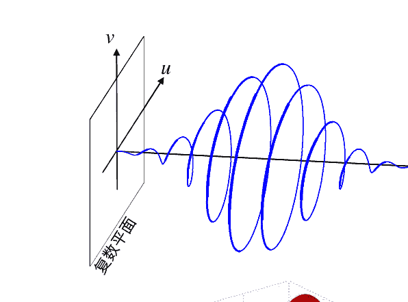

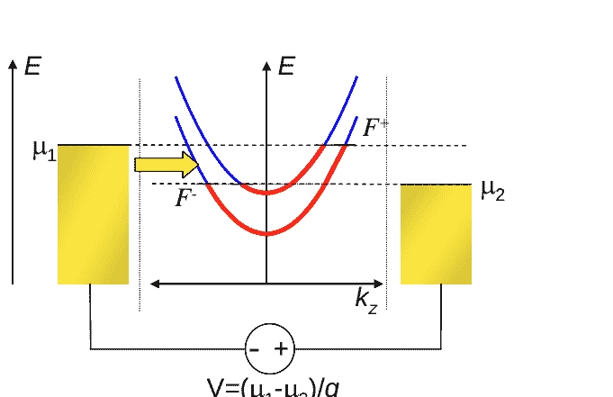

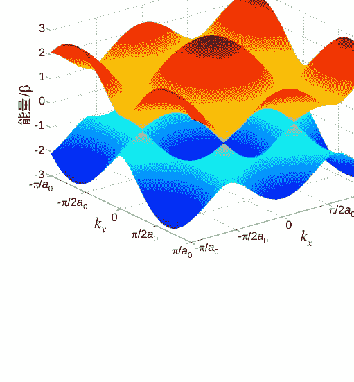

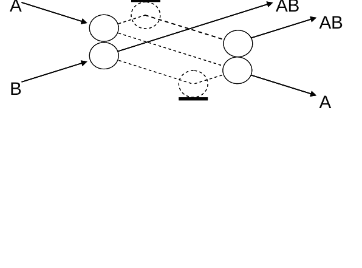

马克·巴尔多

麻省理工学院公开课出版物，2011年5月

版权所有，马克·巴尔多，2011年

# 纳米电子学导论

## 开放课程出版前言

大约八年前，当我刚开始在麻省理工学院时，我有机会参加一个关于纳米尺度器件和分子电子学的研讨会。 特别是，我记得普渡大学的Supriyo Datta做了一个报告。他描述了从 “自下而上” 的电子器件-从原子和分子的量子力学描述开始，最终得到了器件尺度的电流-电压特性。

尽管当时我不理解细节，但我清楚地知道这种方法承诺为本科生教授电子器件提供了一种新的方法。 从量子力学的几个基本概念出发，并依赖于电势而不是场，我相信 “自下而上” 的方法比传统的电子输运教学方法更简单和更有洞察力。 在教授这门课程的五年里，我仍然觉得令人惊讶的是，在45分钟的讲座中，我们可以推导出弹道纳米线场效应晶体管的电流-电压特性。

这个课堂笔记的收集是我尝试适应 “自下而上” 的方法来适应本科电气工程课程的一种方式。 它可以扮演几个角色。 对于大多数高年级学生来说，这门课程旨在在计算中提供对弹道晶体管的全面分析。 但对于那些打算专攻电子器件的人来说，这门课程旨在介绍关于量子力学、固态物理学以及Supriyo Datta本人所著的关于量子输运的更全面的课程。 我可以推荐他的两本书[^1][^2]，以及普渡大学的 “纳米中心” ：http://nanohub.org/topics/ElectronicsFromTheBottomUp。

这些笔记被设计成自给自足的。 特别是，这门课程是在不需要量子力学先前知识的情况下教授的，尽管我更喜欢学生们在学习之前具备傅里叶变换的先前知识。

最后，我决定与大家分享这些关于麻省理工学院公开课程的笔记，并期待着合作。 “自下而上” 的方法仍然相对较新颖，这些笔记仍然大部分未经润色，有很大的改进空间！对于那些需要教授类似主题的人，我希望它能提供一个有用的资源，并希望你能与我分享建议、更正和改进。

马克·巴尔多
2010年5月，马萨诸塞州剑桥市

[^1]: 1. 介观系统中的电子输运，Supriyo Datta，剑桥大学出版社，1995年
[^2]: 2. 量子输运：从原子到晶体管，Supriyo Datta，剑桥大学出版社，2005年

## 致谢

这些笔记在很大程度上借鉴了Supriyo Datta的先前工作，《介观系统中的电子输运》，剑桥大学出版社，1995年，《量子输运：从原子到晶体管》，剑桥大学出版社，2005年。我还多次引用了Atkins和Friedman的《分子量子力学》第三版，牛津大学出版社，1997年。

我还要感谢Terry Orlando、Phil Reusswig、Priya Jadhav、Jiye Lee和Benjie Limketkai多年来帮助我教授这门课程。

我的工作致力于Suzanne、Adelie、Esme和Jonathan。

# 纳米电子学导论

## 目录

- 引言 .................................................................................................................................... 6
- 第一部分。量子粒子 ................................................................................................... 13
- 第二部分。量子粒子在盒子中 ................................................................................... 52
- 第三部分。两端量子点器件 ....................................................................................... 76
- 第四部分。两端量子线器件 ..................................................................................... 114
- 第五部分。场效应晶体管 ......................................................................................... 139
- 第六部分。材料的电子结构 ..................................................................................... 170
- 第七部分。计算的基本限制 ..................................................................................... 216
- 第八部分。参考文献 ................................................................................................. 238
- 附录1。电子波包传播 ......................................................................................... 239
- 附录2。氢原子 ..................................................................................................... 251
- 附录3. 玻恩-奥本海默近似 .................................................................................. 253
- 附录4. 混合轨道 .................................................................................................. 254

## 导论

现代技术的特点是强调微型化。也许最引人注目的例子是电子学，通过减小晶体管的尺寸，从而增加了每个芯片上的晶体管数量，取得了显著的技术进步。

随着每个芯片上的晶体管数量增加，设计师能够创建更复杂的集成电路。在过去的35年里，工程师们通过增加集成电路的复杂性，使其增加了五个数量级。这一非凡的成就改变了社会。即使是现代技术中最机械化的物品，汽车，现在通常包含了其一半的价值在电子设备中。

工业界对复杂性的稳定增长的历史被英特尔的联合创始人戈登·摩尔所注意到。摩尔定律指出，集成电路的复杂性，以最低组件成本为基准，将在大约18个月内翻倍。随着时间的推移，这个“定律”一直表现得相当不错；参见图1。

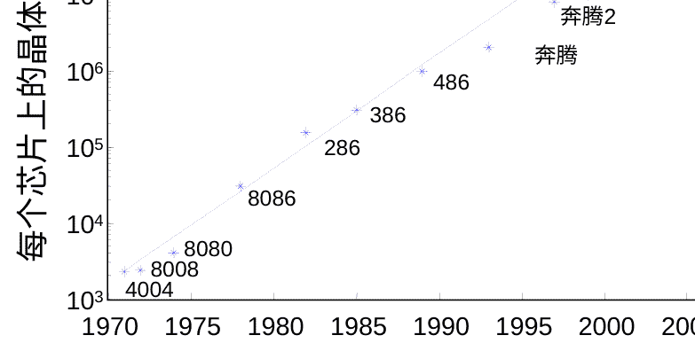

图1: 英特尔处理器中的晶体管数量随时间变化的函数。趋势显示，晶体管数量大约每两年翻倍，而不是戈登·摩尔最初预测的18个月。

微型化使得数字电子市场独自增长到每年超过3000亿美元。然而，半导体制造商所需的资本投资是相当大的，为了降低风险，在1992年半导体行业开始

†如果这听起来难以置信，考虑一下现代汽车中电子控制的系统数量。发动机电脑、安全气囊、防抱死刹车等等。

协会开始预测行业的主要趋势 - 国际半导体技术路线图，简称 “路线图”。

该路线图每隔几年更新一次，并经常通过电子元件关键特征尺寸的半对数图总结，参见图2。

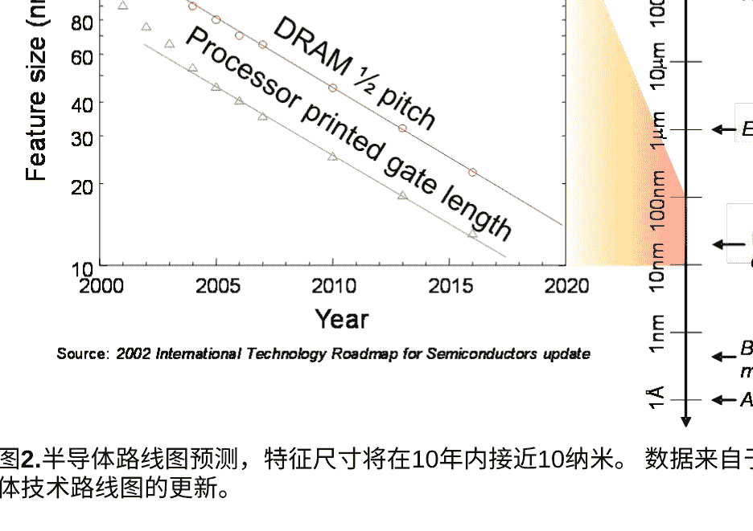

图2: 半导体路线图预测，特征尺寸将在10年内接近10纳米。数据来自于2002年国际半导体技术路线图的更新。

在撰写本文时，英特尔当前一代中央处理器（CPU）Pentium D的栅长为65纳米。根据路线图，CPU的特征尺寸预计将在10年内接近分子尺度（<10纳米）。

但指数趋势不能永远持续下去。

在CPU中，已经出现了接近边界的迹象，这些边界在更小的长度尺度上逼近。随着CPU运行速度的提高，散热变得越来越困难。我们将更多的晶体管集成到芯片中，功率密度也越来越大，我们必须散热。在撰写本文时，现代CPU的功率密度约为150 W/cm²；参见图3。为了对比，注意太阳表面的功率密度约为6000 W/cm²。太阳通过将自身加热到6000 K来辐射这种功率。但我们必须将CPU保持在大约室温。CPU的热负荷已经将风扇强制对流冷却器推向了实用性的极限。除了空气冷却，还有水冷却，以更高的成本可能能够从一个1cm²大小的芯片中移除几百瓦的功率。除了水冷却，目前没有已知的解决方案。

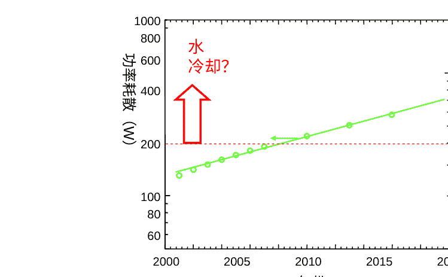

图3: 根据路线图，CPU功耗的预期趋势。

功耗是电子行业今天面临的最突出的问题。但是随着电子设备接近分子尺度，我们对电子设备的传统理解也需要修订。必须放弃对器件行为的经典模型。例如，在图4中，我们展示了现代晶体管中的许多电子是以“弹道”方式传输的 - 它们不与硅通道的任何组件发生碰撞。这种弹道器件无法使用传统的晶体管模型进行分析。为了为下一代电子设备做好准备，本课程从原子层面教授电流、电压和电阻的理论。

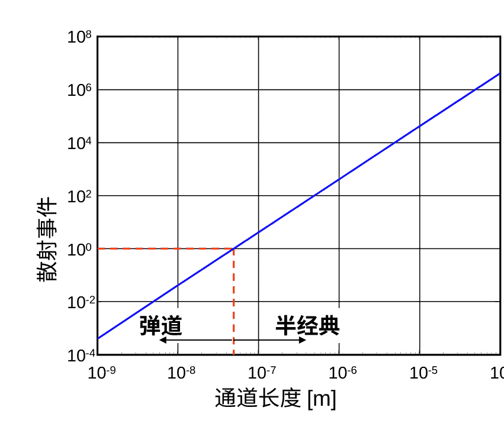

图4: 硅场效应晶体管中电子散射事件的预期数量作为通道长度的函数。弹道操作的阈值发生在约50纳米的通道长度。

在第一部分中，我们将介绍描述纳米器件中电子的方法。在早期的晶体管中，电子可以纯粹地被视为点粒子。但在纳米电子学中，电子的位置、能量和动量必须以概率的方式描述。我们还需要考虑电子的波动性质，并在电子的描述中包含相位信息；参见图5。我们将使用的数学方法与你在信号处理课程中已经学过的类似。在这门课程中，我们将假设你已经了解傅里叶变换的知识。

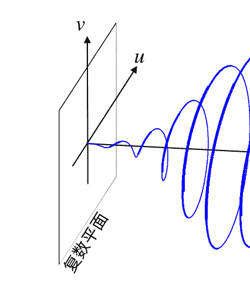

图5: 一个被称为波包的电子的表示。电子的位置在一维空间中被描述，其概率密度是一个高斯函数。复平面包含相位信息。

第一部分还将介绍量子力学的基础知识。我们将求解一个被称为“方井”的吸引性盒状势能中电子的能量。在第二部分中，“盒中的量子粒子”，我们将应用这个方井问题的解，并介绍导体中电子的最简单模型——所谓的盒中粒子模型。导体被建模为一个均匀的盒子。我们还将介绍一个重要的概念：态密度，并学习如何计算导体中的电子数。

我们将对“量子点”（也称为0维导体）、“量子线”（理想的1维导体）、“量子阱”（2维导体）和传统的3维块状材料进行这个计算。

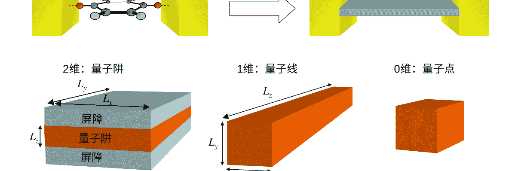

图6: 粒子在盒子中的近似和不同维度的导体。

在第3部分中，我们将考虑通过0维导体的电流流动。 我们将使用的数学非常简单，但第3部分为后面课程中所有关于纳米晶体管的描述提供了基础。

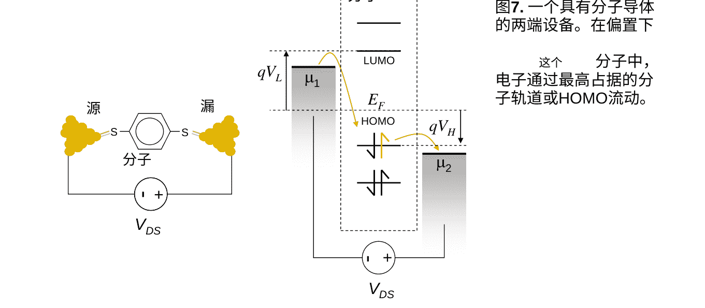

第4部分，解释了纳米线的导电性。 我们将介绍“弹道”输运-电子不与导体的任何组件碰撞。 在足够短的长度尺度上，所有的导电都是弹道的，理解弹道输运是本课程的关键目标。 我们将证明纳米线的电导是量子化的。 事实上，一个截面趋近于零的纳米线的电阻不会小于12.9 kΩ。 我们还将解释为什么这个电阻与纳米线的长度无关！ 最后，我们将解释欧姆定律的起源和“经典”的电荷输运模型。

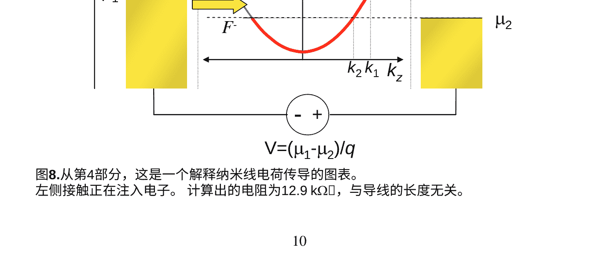

在第5部分中，我们将发展这一最重要的应用的理论，即“场效应晶体管”。 我们将研究不同尺寸的晶体管，并比较弹道和传统场效应晶体管的性能。 我们将证明传统的晶体管模型在纳米尺度下失效。

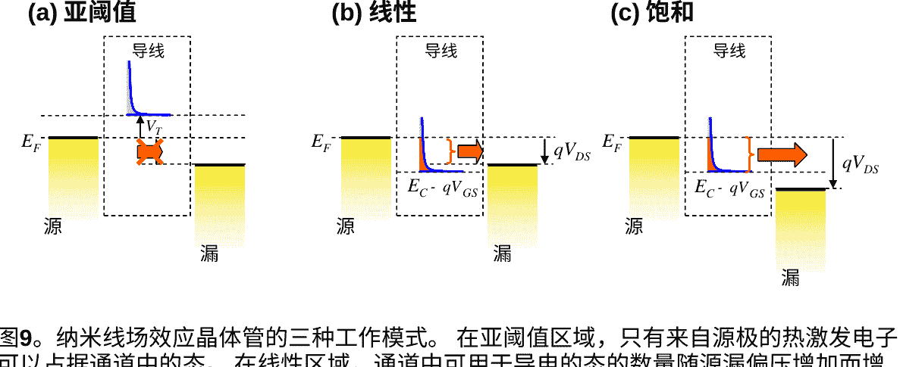

第6部分，“材料的电子结构”，回到计算态密度的问题，并对简单的粒子在盒子中模型进行扩展。 我们将考虑单个分子和周期性材料的电子性质。 将计算典型的一维和二维材料，包括聚乙炔、石墨烯和碳纳米管。 最后，我们将解释能带形成和金属、绝缘体和半导体的起源。

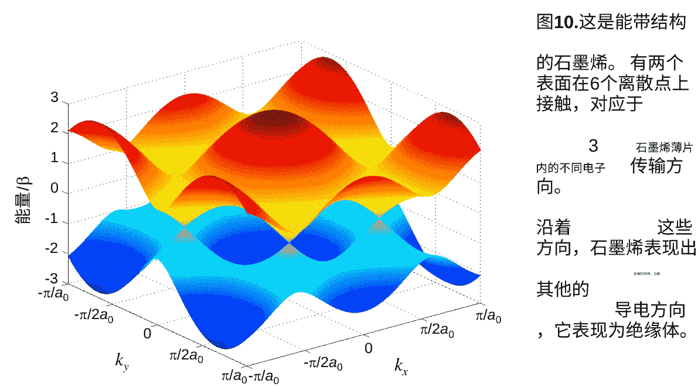

课程以第7部分「计算的基本限制」结束。我们将回顾功耗问题，并讨论计算的可能的基本热力学限制。 我们还将介绍并简要分析无耗散的「可逆」计算概念。 我们还将介绍并简要分析无耗散的「可逆」计算概念。

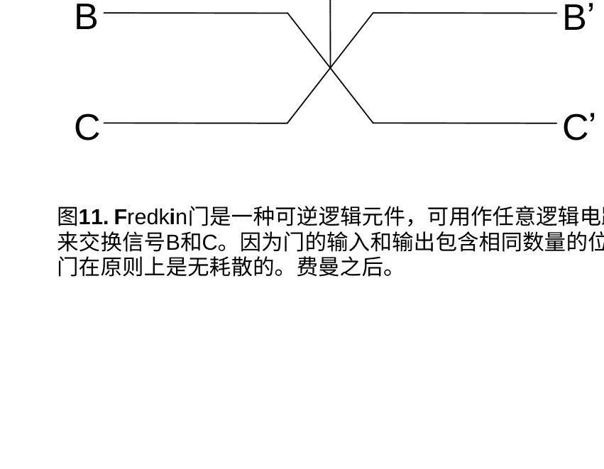

| A | B | C | A' | B' | C' |
|---|---|---|----|----|----|
| 0 | 0 | 0 | 0  | 0  | 0  |
| 0 | 0 | 1 | 0  | 1  | 0  |
| 0 | 1 | 0 | 0  | 0  | 1  |
| 0 | 1 | 1 | 0  | 1  | 1  |
| 1 | 0 | 0 | 1  | 0  | 0  |
| 1 | 0 | 1 | 1  | 0  | 1  |
| 1 | 1 | 0 | 1  | 1  | 0  |
| 1 | 1 | 1 | 1  | 1  | 1  |

图11: Fredkin门是一种可逆逻辑元件，可用作任意逻辑电路的构建模块。信号A可以用来交换信号B和C。 因为门的输入和输出包含相同数量的位，所以没有信息丢失，因此该门在原则上是无耗散的。 费曼之后。

## 第一部分。量子粒子

本课程关注电子在导体中的传播。

在第一部分中，我们将介绍量子力学中的工具，以描述电子。 我们将介绍关键物理属性的概率描述：位置、动量、时间和能量。 在下一部分中，我们将考虑导体的最简单模型中的电子--一个盒子-即忽略原子并假设材料是完全均匀的。

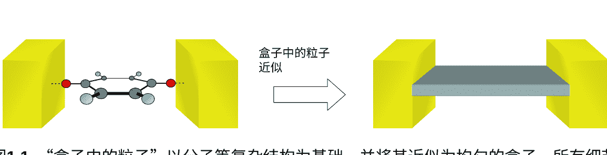

导体中电子的这种模型被称为“盒子中的粒子”。 这是令人惊讶的有用，我们将在课堂上使用它来描述现代晶体管的行为。

但首先我们需要一种描述电子的方法。 通常方便地将电子想象为被电场推动的小弹丸。 在许多情况下，这种经典模型可以相当准确地描述电子器件。

但并不总是如此。 特别是在纳米尺度的器件中，电子更好地被描述为波动。

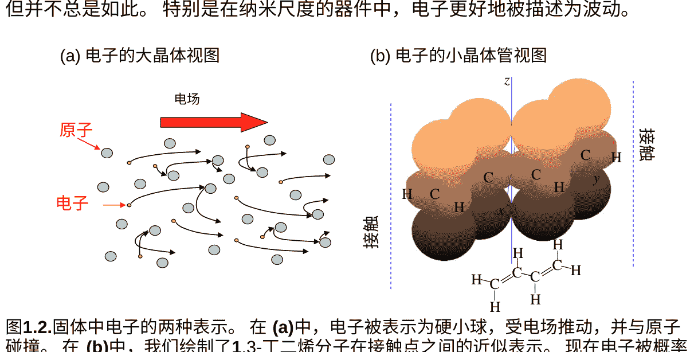

### 电子波

考虑一个电子束通过一个小孔传播 - 这是一个非常粗糙的模型，用于描述电子从接触到纳米尺度导体的运动。 我们可能会期望电子在穿过孔洞后会继续直线运动。但是，如果孔洞足够小（例如纳米尺度晶体管的尺寸），则观察到电子会发生衍射。这清楚地表明我们必须考虑纳米电子器件中电子的波动性质。

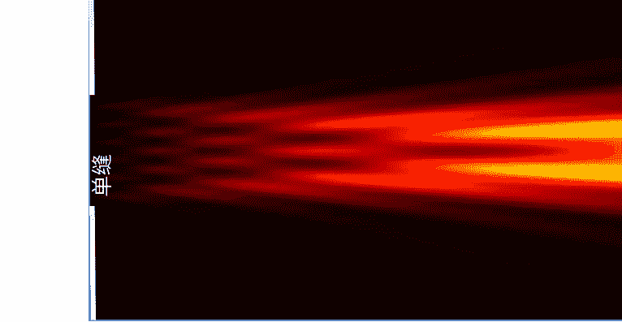

上面显示的衍射图案是通过假设单缝内的每个点都是扩展波的源来获得的；参见问题1。一个更容易分析的例子是双缝实验，我们假设只有两个扩展波的源。 与单缝实例类似，双缝实验的结果与电子表现出波动性一致。

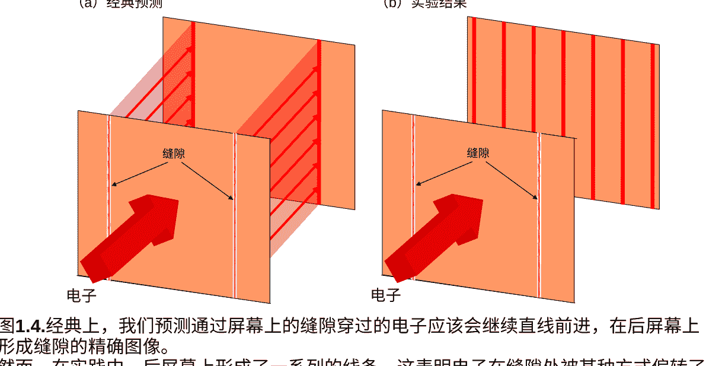

#### 经典波的回顾

波是周期性振荡。使用复数来描述波是方便的。例如考虑函数

$$\psi(x) = e^{ik_0x} \tag{1.1}$$

1) 其中，$x$表示位置，$k_0$是一个称为波数的常数。该函数在复平面上作为位置 $x$ 的函数在图1.5中绘制。函数的相位

$$\phi = k_0x \tag{1.2}$$

2) 是复平面上的角度。

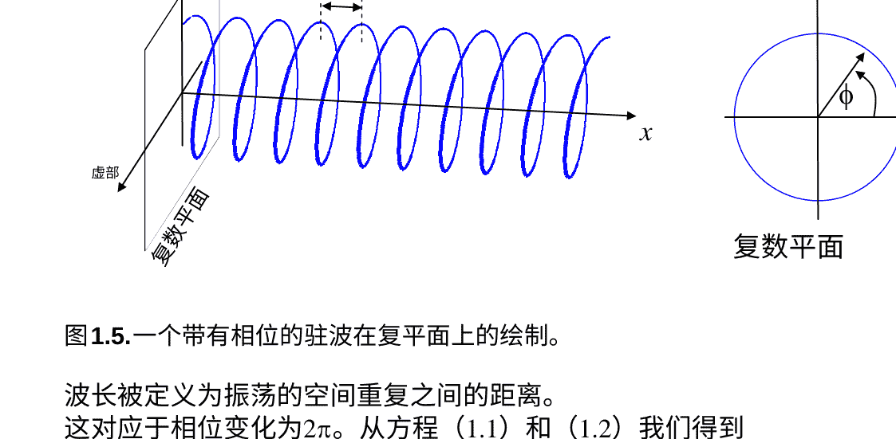

波长被定义为振荡的空间重复之间的距离。这对应于相位变化为$2\pi$。从方程（1.1）和（1.2）我们得到

$$k_0 = \frac{2\pi}{\lambda} \tag{1.3}$$

这个波与时间无关，被称为驻波。但我们可以定义一个随时间变化的函数：

$$\psi(t) = e^{-i\omega_0t} \tag{1.4}$$

这里 $t$是时间， $\omega$是角频率。我们将周期定义为振荡重复之间的时间间隔

$$\omega_0 = \frac{2\pi}{T}. \tag{1.5}$$

#### 平面波

我们可以将时间和空间相位振荡结合起来形成行波。例如

$$\psi(x,t) = e^{i(k_0x - \omega_0t)} \tag{1.6}$$

我们将波的强度定义为

$$|\psi|^2 = \psi^* \psi \tag{1.7}$$ 其中$\psi^*$是$\psi$的复共轭。由于这个波的强度在任何地方都是均匀的 $$|\psi|^2 = 1$$ 被称为平面波。

平面波至少有四个维度（实振幅，虚振幅，x和t）因此很难绘制。相反，在图1.6中，我们绘制了给定相位的平面。这些平面以波的相速度，$v_p$，在空间中移动。例如，考虑对应于$\varphi=0$的平面。

$$k_0 x - \omega_0 t = 0 \tag{1.8}$$

现在，

$$v_p = \frac{dx}{dt} = \frac{\omega_0}{k_0} \tag{1.9}$$

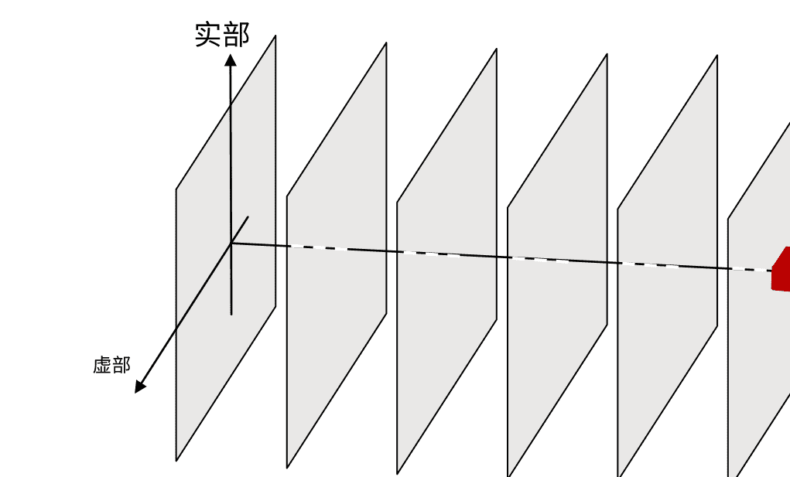

#### 双缝实验

现在，我们有了描述上述双缝实验的工具。远离双缝，从每个缝中发出的电子看起来像平面波；参见图1.7，其中s是缝之间的间距，L是到观察屏的距离。

在观察屏上，我们有

$$\psi(x=L,t)=A\exp[i(k r_1 - \omega_0 t)] + A\exp[i(k r_2 - \omega_0 t)] \tag{1.10}$$

# 纳米电子学导论

屏幕上的强度是

$$|\psi|^2 = \{A \exp[-i\omega_0 t](\exp[ik_0 r_1]+\exp[ik_0 r_2])\}\{A \exp[-i\omega_0 t](\exp[ik_0 r_1]+\exp[ik_0 r_2])\}^*\\
= |A|^2 + |A|^2 \exp[i(k r_2 - k_0 r_1)] + |A|^2 \exp[i(k r_1 - k_0 r_2)] + |A|^2\\
= 2|A|^2 (1 + \cos(k(r_2 - r_1)))$$

其中 A是由电子波的强度确定的常数。现在从图1.7中可以看出：

$$r_1^2 = L^2 + (s/2 - y)^2\\
r_2^2 = L^2 + (s/2 + y)^2$$

现在，如果 y << s/2，我们可以忽略 y^2 项：

$$r_1^2 \approx L^2 + (s/2)^2 - sy\\
r_2^2 \approx L^2 + (s/2)^2 + sy$$

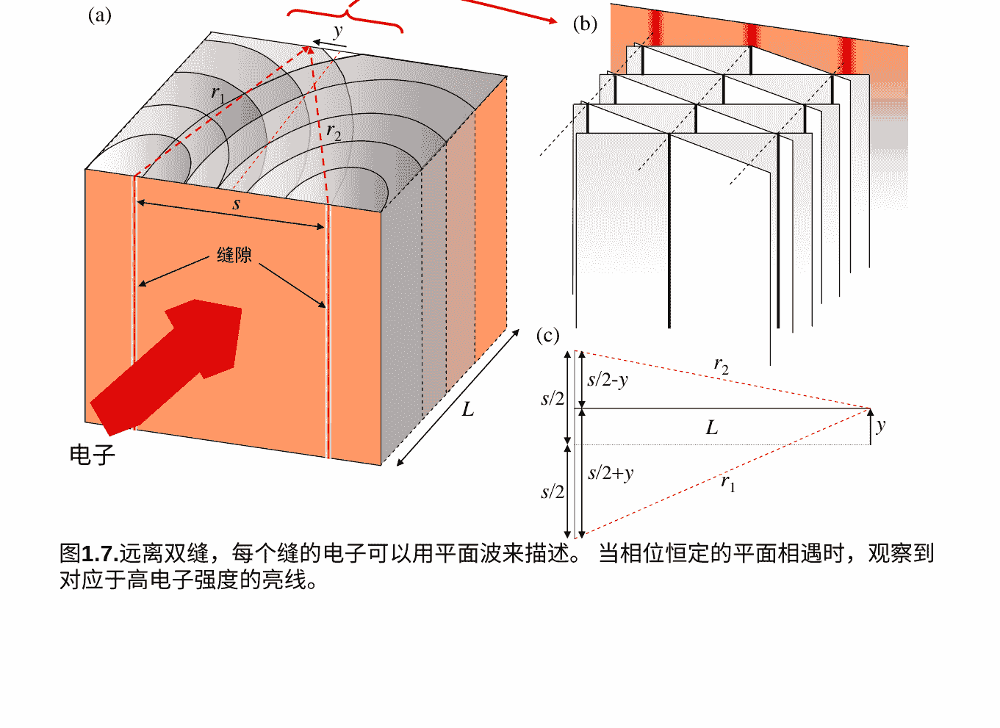

然后，

$$ r_1 \approx \sqrt{L^2 + (s/2)^2} \left( 1 - \frac{1}{2} \frac{sy}{L^2 + (s/2)^2} \right) $$
$$ r_2 \approx \sqrt{L^2 + (s/2)^2} \left( 1 + \frac{1}{2} \frac{sy}{L^2 + (s/2)^2} \right) \quad (1.14)$$

接下来，如果 $L >> s/2$

$$ r_1 \approx L - \frac{1}{2} \frac{sy}{L} $$
$$ r_2 \approx L + \frac{1}{2} \frac{sy}{L} \quad (1.15)$$

因此，$r_2 - r_1 = \frac{sy}{L}$ 并且

$$ |\psi|^2 = 2|A|^2 \left( 1 + \cos \left( ks \frac{y}{L} \right) \right) \quad (1.16)$$

在屏幕上，每个缝隙的平面波之间的构造性干涉产生了一个规则的亮线阵列，对应于电子的高强度。在每对亮线之间，有一个暗带，平面波之间的干涉是破坏性的，即波之间相位差为$\pi$弧度。

在观察屏幕上，亮线之间的间距是

$$ \frac{2\pi}{\lambda} s \frac{y}{L} = 2\pi \quad (1.17)$$

重新排列，

$$ y = \frac{L\lambda}{s} \quad (1.18)$$

## 第一部分。量子粒子

#### 双缝实验的解释

值得注意的是，干涉条纹图案与强度无关。 因此，即使每次只向缝隙发射一个电子，也应该观察到干涉效应。例如，在图1.8中，我们展示了连续电子的干涉条纹的积累。 唯一的结论是，我们通常认为是粒子的电子- 也具有波动性质。

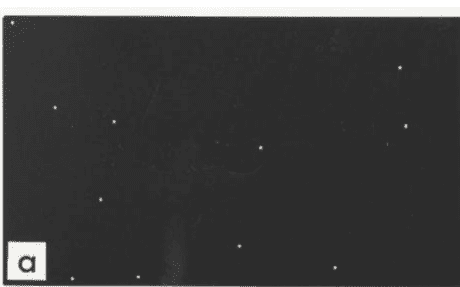

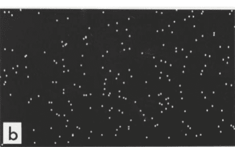

10个电子

200个电子

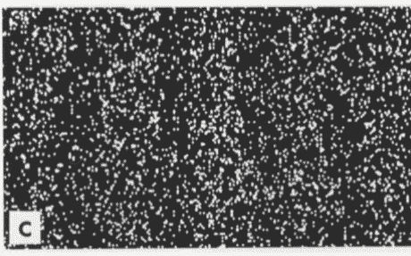

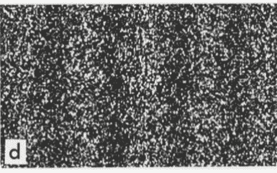

6000个电子

40000个电子

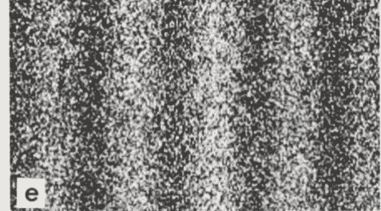

140000个电子

图1.8.通过双缝后的累积电子分布。 任何时候仪器中只有一个电子。来自A. Tanamura等人的. Am. J.Physics **57**, 117 (1989)。

## 第一部分。量子粒子

### 波函数

电子的波动性质是“波粒二象性”的一个例子。事实上，在20世纪初，量子力学揭示了在电子尺度上，波动和粒子性质的结合是一种普遍的特性。

在不涉及这种不寻常观察的更广泛影响的情况下，我们只需注意到我们的目的需要一个适当的数学描述来描述既具有粒子性质又具有波动性质的电子。按照量子力学的惯例，我们将定义一个称为波函数的函数，来描述电子。它通常是一个复杂函数，并且具有重要的性质，即其平方的大小是电子在给定位置和时间的概率密度。

$$P(x,t)=|\psi(x,t)|^2=\psi^*(x,t)\psi(x,t)$$

如果波函数要描述一个单个电子，那么其在所有空间上的概率密度之和必须为1。

$$\int_{-\infty}^{+\infty} P(x,t)dx=1 \quad (1.20)$$

在这种情况下，我们说波函数被归一化，使得概率密度总和为单位。

#### 频域和k-空间描述的波

考虑波函数 $\psi(t)=a e^{-i\omega_0t}$ (1.21)描述了一个振幅为a，强度为$|a|^2$，相位在时间上振荡的波。这个波携带着两个信息，它的振幅和角频率。†用a和$\omega_0$来描述波被称为频域描述。在图1.9中，我们同时绘制了时域和频域中的波函数。

在频域中，波函数由一个在$\omega_0$处的$\delta$函数来描述。在下一节中，将介绍在时域和频域之间进行精确转换的工具。请注意，按照惯例，我们在频域中使用大写函数（A而不是$\psi$）来表示波函数。还要注意，在量子力学中，表示角频率$+\omega_0$时使用负号的惯例。这对于描述形式为$e^{i(kx-\omega t)}$的平面波很方便。但是，这与信号分析中的通常惯例（即6.003）完全相反。一般来说，当你看到i而不是j表示-1的平方根时，在时域和频域中使用这个惯例。

> †注意任何常数相位偏移中的信息，如$\phi$，如$\psi=\exp[i\omega_0t + i\phi]$可以包含在振幅前因子中，即$\psi=a \exp[i\omega_0t]$，其中$a=\exp[i\phi]$。

# 纳米电子学导论

时间

频率

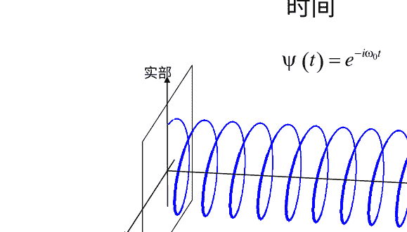

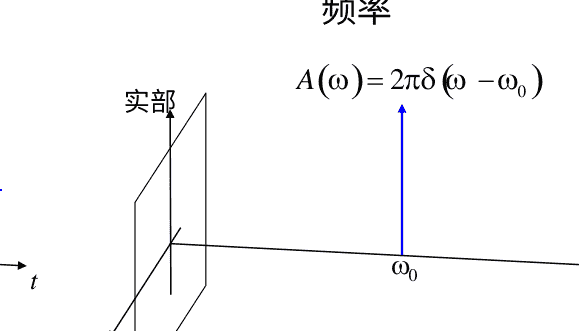

图1.9.角频率 $\omega_0$在时间和频率域的表示。

同样，考虑波函数 $\psi(x) = a e^{ik_0x}$ (1.22)描述了振幅为 a、强度为 $|a|^2$、相位在空间中振荡的波。其空间频率或波数为 $k_0$。 同样，这个波携带着两个信息，它的振幅和波数。 我们可以用 k-空间中的空间频率来描述这个波，这相当于空间振荡波的频率域。在图1.10中，我们绘制了波函数在实空间和 k-空间中的图像。

实空间

k空间

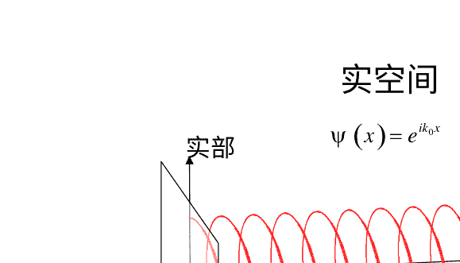

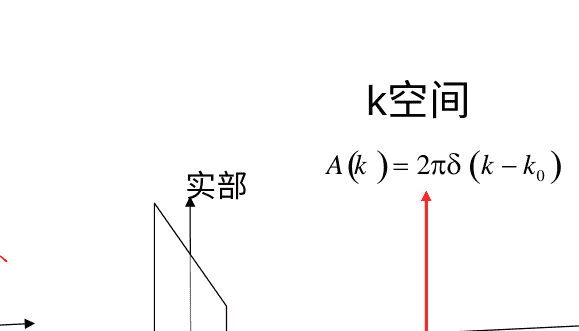

图1.10.在实空间和k空间中表示波数 $k_0$的图示。

接下来，让我们考虑波函数 $A(\omega) = a e^{i\omega t_0}$ (1.23)描述了振幅为 a、强度为 $|a|^2$、在频率域中以周期$2\pi / t_0$振荡的波。 这个波携带着两个信息，即其振幅和时间 $t_0$。在图1.11中，我们绘制了波函数在时间和频率域中的图像。

## 第一部分。量子粒子

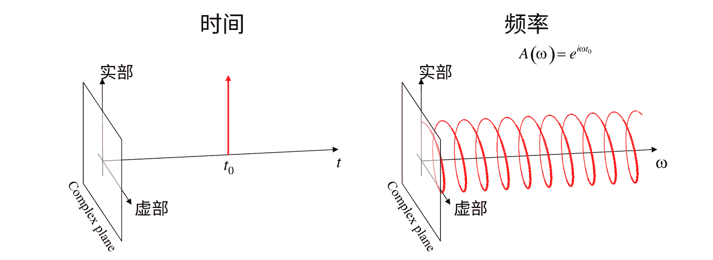

图1.11.在时间和频率域中表示时间 $t_0$的图示。

最后，考虑波函数
$$ A(k) = a e^{-ikx_0} \quad (1.24) $$
描述了振幅为 $a$、强度为 $|a|^2$、在 $k$-空间中以周期$2\pi/x_0$振荡的波。这个波携带着两个信息，即其振幅和位置 $x_0$。在图1.12中，我们绘制了波函数在实空间和 $k$-空间中的图像。

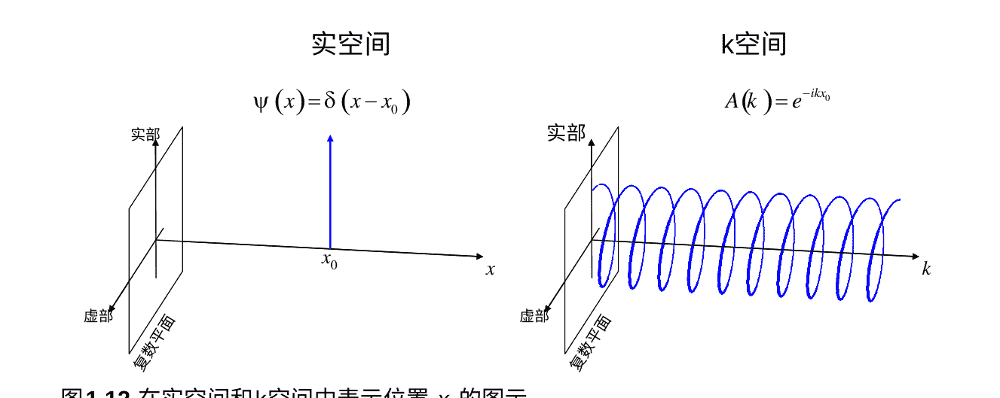

图1.12.在实空间和k空间中表示位置 $x_0$的图示。

请注意，按照惯例，我们使用大写函数（$A$而不是 $\psi$）来表示在 $k$空间域中的波函数。

请观察图1.9-图1.12，可以看出对于波的时间位置和角频率的精确定义是不可能的。具有精确角频率 $\omega_0$的波函数在所有时间上均匀分布。同样，与精确时间 $t_0$相关联的波函数包含所有角频率。

在实际空间和 $k$空间中，我们也无法精确地定义波数和位置。具有精确波数 $k_0$的波函数在整个空间中均匀分布。 同样，定位于精确位置 $x_0$的波函数包含所有波数。

# # 纳米电子学导论

#### 波的线性组合

接下来，我们考虑不同复指数函数的组合。例如，在图1.13中，我们绘制了一个可以描述电子在位置 $x_1$和位置 $x_2$上等概率存在的波函数。在 $k$空间表示中，简单地是对应于 $x_1$和 $x_2$的两个复指数函数的叠加。$^\dagger$

$$ \psi (x) =c_1\delta (x-x_1 )+c_2\delta (x-x_2 ) \Leftrightarrow A(k )=c_1e^{-ikx_1 }+c_2e^{-ikx_2 } \quad\quad (1.25) $$

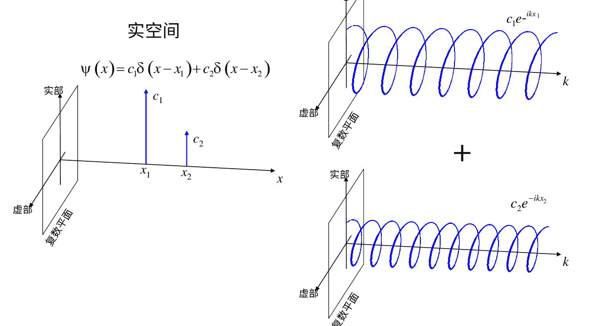

图1.13。对应于两个位置 $x_1$和 $x_2$的 $k$空间波函数简单地是 $\delta(x-x_1)$和 $\delta(x-x_2)$的 $k$空间表示的叠加。

我们还可以推广到任意位置的分布， $\psi (x)$。 例如，如果 $\psi (x)$描述的是一个电子，那么电子位于位置 $x$的概率是 $|\psi (x)|^2$。 因此，在$k$空间中，电子由复指数$e^{-ikx}$的和来描述，每个振荡在$k$空间中，并由振幅$\psi (x)$加权。

$$ A(k )=\int_{-\infty}^{+\infty} \psi (x)e^{-ikx}dx \quad\quad (1.26) $$

你可能会从6.003中认出这个，它是一个傅里叶变换。 同样，逆变换是

> $^\dagger$注意，这个波函数实际上是不可归一化的。

# ## 第一部分。量子粒子

$$\psi \left(x\right) = \frac{1}{2\pi} \int_{-\infty}^{+\infty} A(k) e^{ikx} dk.$$

要在时间和角频率之间转换，请使用

$$A(\omega) = \int_{-\infty}^{+\infty} \psi(t) e^{i\omega t} dt$$

和

$$\psi \left(t\right) = \frac{1}{2\pi} \int_{-\infty}^{+\infty} A(\omega) e^{-i\omega t} d\omega.$$

注意，每次你对k或ω积分时，1/2π的因子都会出现。还要注意，在复指数和δ函数之间转换时，以下恒等式很有用：

$$2\pi \delta \left(u\right) = \int_{-\infty}^{+\infty} \exp[i u x] dx.$$

# ### 波包和不确定性

现在我们有两种描述电子的方式。 我们可以将其描述为一个平面波，具有精确定义的波数和角频率：

$$\psi \left(x, t\right) = e^{i(kx - \omega_0 t)}.$$

但正如我们所见，平面波的强度/概率密度在所有空间（和所有时间）上都是均匀的。因此，电子的位置是完全不确定的-它的概率分布在整个宇宙中的任何地方都是均匀的。因此，平面波通常不是对电子的良好描述。

另一方面，我们可以将电子描述为一个理想化的点粒子

$$\psi \left(x, t\right) = \delta \left(x - x_0, t - t_0\right)$$

存在于一个精确定义的位置和时间。但是，点粒子的概率密度在所有的 k-空间和频率域上都是均匀的。我们将在下一节中看到，这意味着电子的能量和动量是完全不确定的，即任意大的电子能量和动量都是可能的。

唯一的选择是在实空间和 k-空间，时间和频率域中接受一个不精确的电子描述。在这两种表示中的局部振荡被称为波包。常见的波包形状是高斯波包。例如，我们可以将电子的位置描述为高斯函数，而不是δ函数。

$$\psi \left(x\right) = a \exp\left[ -\frac{1}{4} \left( \frac{x}{\sigma_x} \right)^2 \right].$$

# 纳米电子学导论

实空间

k空间

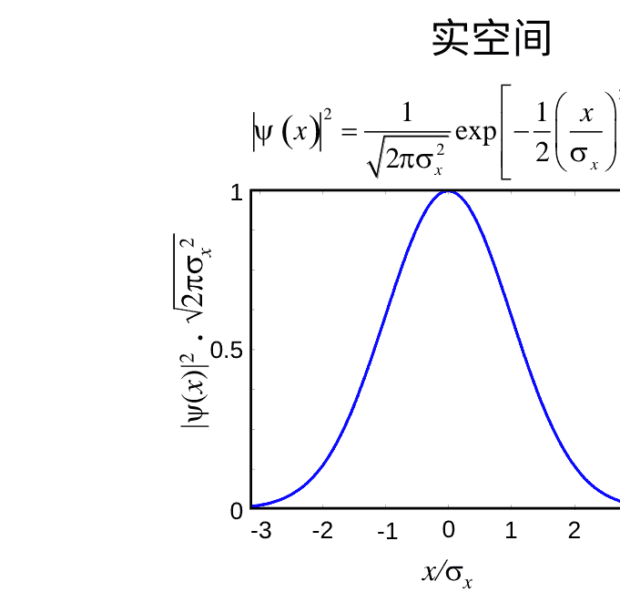

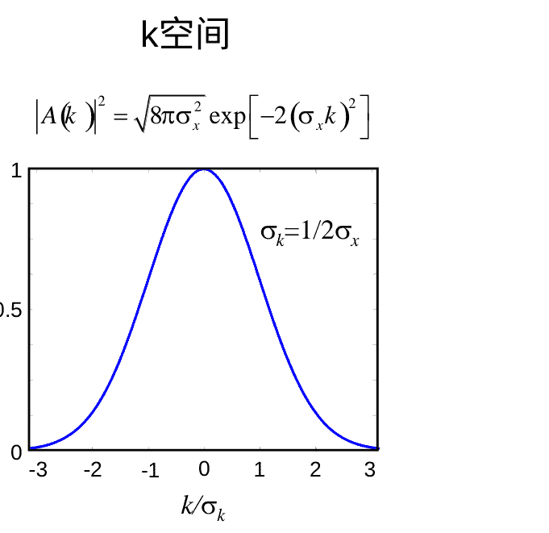

图1.14.一个归一化的高斯函数。高斯函数在实空间和k空间中具有相同的形状。请注意，在极限 $\sigma_x \to 0$ 下，高斯函数近似于一个δ函数。

$$|\psi (x)|^2 = |a|^2 \exp \left[ -\frac{1}{2} \left( \frac{x}{\sigma_x} \right)^2 \right] \quad (1.34)$$

其中 $\sigma_x$ 是标准差。$\sigma_x$ 衡量了高斯函数的宽度，通常被认为是电子位置的不确定性。常数 $a$ 由将概率密度在所有空间上归一化确定，即通过对方程(1.34)在 $x$ 上进行积分，我们得到

$$a = \left( 2\pi\sigma_x^2 \right)^{-1/4} \quad (1.35)$$

严格来说，给定量的不确定性由

$$\sigma^2 = \left\langle (x - \langle x \rangle)^2 \right\rangle = \left\langle x^2 - 2x\langle x \rangle + \langle x \rangle^2 \right\rangle \quad (1.36)$$

其中 $\langle x \rangle$ 表示 $x$ 的平均值或期望值。因为 $x$ 是一个常数，方程(1.36)可以简化为：

$$\sigma^2 = \langle x^2 \rangle - 2\langle x \rangle \langle x \rangle + \langle x \rangle^2 = \langle x^2 \rangle - \langle x \rangle^2 \quad (1.37)$$

我们将把它作为一个练习，证明对于高斯概率密度函数：

$$\sigma^2 = \int x^2 |\psi(x)|^2 dx = \sigma_x^2 \quad (1.38)$$

## 第一部分。量子粒子

因此，高斯函数是描述波包的方便选择，因为它具有明确定义的不确定性。

在 $k$-空间中，电子也可以用高斯函数描述（这是该函数的另一个方便性质）。将傅里叶变换应用于方程（1.26）并进行一些代数运算得到

$$A(k ) = \left(8\pi\sigma_{x}^{2}\right)^{1/4} \exp \left[-\sigma_{x}^{2} k^{2}\right] \quad (1.39)$$

在 $k$-空间中的概率分布为

$$|A(k )|^{2} = \left(8\pi\sigma_{x}^{2}\right)^{1/2} \exp \left[-2\sigma_{x}^{2} k^{2}\right] \quad (1.40)$$

因此，$k$-空间中的不确定性为

$$\frac{1}{2\sigma_{k}^{2}} \equiv 2\sigma_{x}^{2} \quad (1.41)$$

实空间和k-空间中的不确定性乘积为

$$|\sigma_{x}\sigma_{k}| = \frac{1}{2} \quad (1.42)$$

乘积 $|\sigma_{x}||\sigma_{k}| \geq |\sigma_{x}\sigma_{k}|$。因此，

$$|\sigma_{x}||\sigma_{k}| \geq \frac{1}{2} \quad (1.43)$$

##### 波包的示例

图1.15显示了一个典型的高斯波包在实空间和 $k$-空间中的表示。最初的概率分布在 $x=0$ 和 $k=0$ 处集中。如果我们将$k$-空间中的波包平移至平均值$< k> =k_0$，这相当于在实空间中乘以一个相位因子$\exp[i k_0x]$。类似地，将波包在实空间中的中心平移至$<x> = x_0$，相当于在k-空间中的表示中乘以一个相位因子$\exp[-ikx_0]$。

| 实坐标<br>$(x,t)$ | ⇌ | 逆坐标<br>$(k,\omega)$ |
| :--- | :---: | :--- |
| 通过 $x_0$ 进行平移 | ⇌ | $\times \exp[-ikx_0]$ |
| $\times \exp[ik_0x]$ | ⇌ | 通过 $k_0$ 进行平移 |
| 通过 $t_0$ 进行平移 | ⇌ | $\times \exp[i\omega t_0]$ |
| $\times \exp[-i\omega_0t]$ | ⇌ | 通过 $\omega_0$ 进行平移 |

表1.1.实坐标和逆坐标中的移位变换总结。

# 纳米电子学导论

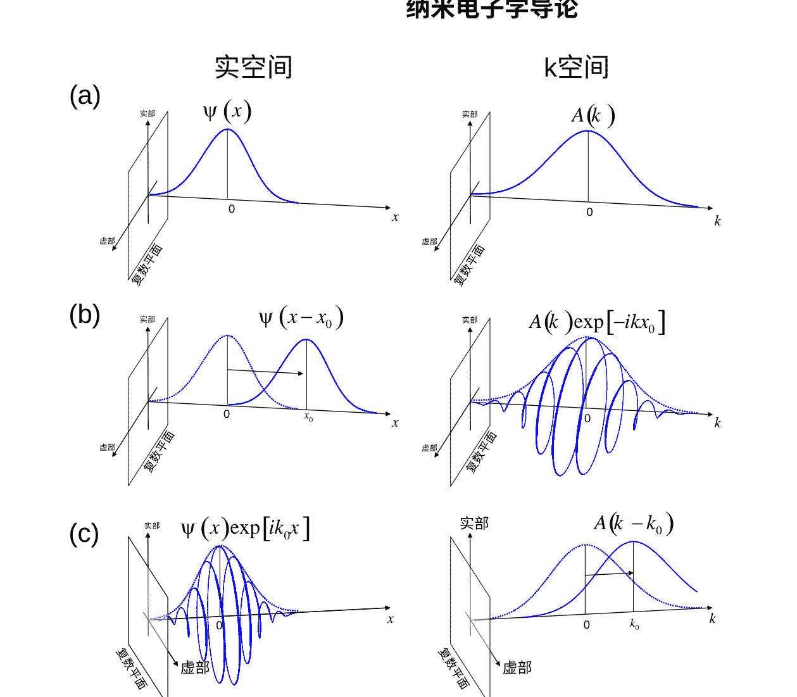

图1.15.三个高斯波包。在 (a)中，波包的平均位置和波数分别为 x=0和 k=0。在(b)中，平均位置已经移动到<x>=x₀。在 (c)中，平均波数已经移动到<k>=k₀。

#### 位置的期望值

鉴于 $P(x)$ 是电子在位置 $x$的概率密度，我们可以确定位置 $x$的平均值，或期望值为

$$\langle x \rangle = \frac{\int_{-\infty}^{+\infty} xP(x) dx}{\int_{-\infty}^{+\infty} P(x) dx} \qquad\qquad\qquad (1.44)$$

当然，如果波函数被归一化，则分母为1。

我们也可以用波函数来表示这个式子

# # 第一部分。量子粒子

$$ \langle x \rangle = \frac{\int_{-\infty}^{+\infty} x |\psi(x)|^2 dx}{\int_{-\infty}^{+\infty} |\psi(x)|^2 dx} \quad (1.45) $$

再次强调，如果波函数被归一化，则分母为1。

由于 $|\psi(x)|^2 = \psi^*(x)\psi(x)$,

$$ \langle x \rangle = \frac{\int_{-\infty}^{+\infty} \psi^*(x) x \psi(x) dx}{\int_{-\infty}^{+\infty} \psi^*(x) \psi(x) dx} \quad (1.46) $$

#### 布拉和凯特符号

也被称为狄拉克符号，布拉和凯特符号是上述积分的便捷缩写。

波函数用凯特符号表示：

$$ \psi(x) \rightarrow |\psi\rangle \quad (1.47) $$

复共轭用布拉符号表示：

$$ \psi^*(x) \rightarrow \langle\psi| \quad (1.48) $$

综合起来，括号 $\langle \psi | \psi \rangle$（因此称为布拉和凯特）表示对整个空间的积分：

$$ \int_{-\infty}^{+\infty} \psi^*(x) \psi(x) dx \rightarrow \langle\psi|\psi\rangle \quad (1.49) $$

因此，简化形式下的期望值为 $x$ 是

$$ \langle x \rangle = \frac{\langle\psi|x|\psi\rangle}{\langle\psi|\psi\rangle} \quad (1.50) $$

#### Parseval定理

在 $k$空间中，将波包归一化通常很方便。为了实现这一点，我们可以应用Parseval定理。

让我们考虑两个函数的内积， $f(x)$ 和 $g(x)$，其傅里叶变换对应的函数分别为$F(k)$ 和 $G(k)$。

$$ \langle f|g \rangle = \int_{-\infty}^{\infty} f^*(x) g(x) dx \quad (1.51) $$

现在，用它们的傅里叶变换替换函数得到## 纳米电子学导论

$$\int_{-\infty}^{\infty} f(x)^* g(x)dx = \int_{-\infty}^{\infty} \left[ \frac{1}{2\pi} \int_{-\infty}^{\infty} F(k')e^{-ik'x}dk' \right]^* \left[ \frac{1}{2\pi} \int_{-\infty}^{\infty} G(k)e^{-ikx}dk \right] dx \quad (1.52)$$

重新排列积分顺序得到

$$\int_{-\infty}^{\infty} \left[ \frac{1}{2\pi} \int_{-\infty}^{\infty} F(k')e^{-ik'x}dk' \right]^* \left[ \frac{1}{2\pi} \int_{-\infty}^{\infty} G(k)e^{-ikx}dk \right] dx = \frac{1}{2\pi} \int_{-\infty}^{\infty} \int_{-\infty}^{\infty} \int_{-\infty}^{\infty} F(k')^* G(k) \frac{1}{2\pi} e^{-i(k-k')x} dx dk' dk \quad (1.53)$$

根据公式(1.30)，对复指数函数的积分得到一个δ函数

$$\frac{1}{2\pi} \int_{-\infty}^{\infty} \int_{-\infty}^{\infty} \int_{-\infty}^{\infty} F(k')^* G(k) \frac{1}{2\pi} e^{-i(k-k')x} dx dk' dk = \frac{1}{2\pi} \int_{-\infty}^{\infty} \int_{-\infty}^{\infty} F(k')^* G(k) \delta(k-k') dk' dk \quad (1.54)$$

因此，

$$\int_{-\infty}^{\infty} f(x)^* g(x)dx = \frac{1}{2\pi} \int_{-\infty}^{\infty} F(k)^* G(k) dk \quad (1.55)$$

由此可见，如果一个波函数在实空间中归一化，那么它在k-空间中也是归一化的。

$$\langle \psi | \psi \rangle = \langle A | A \rangle \quad (1.56)$$

其中

$$\langle A | A \rangle = \frac{1}{2\pi} \int_{-\infty}^{\infty} A(k)^* A(k) dk \quad (1.57)$$

#### k和ω的期望值

k的期望值通过对波函数在所有k上积分得到。这必须在k空间中进行。

$$\langle k \rangle = \frac{\frac{1}{2\pi} \int_{-\infty}^{+\infty} A(k)^* k A(k) dk}{\frac{1}{2\pi} \int_{-\infty}^{+\infty} A(k)^* A(k) dk} = \frac{\langle A | k | A \rangle}{\langle A | A \rangle} \quad (1.58)$$

从k空间的逆傅里叶变换中

$$\psi(x) = \frac{1}{2\pi} \int_{-\infty}^{+\infty} A(k) e^{ikx} dk \quad (1.59)$$

注意

$$-i \frac{d}{dx} \psi(x) = \frac{1}{2\pi} \int_{-\infty}^{+\infty} k A(k) e^{ikx} dk \quad (1.60)$$

因此，我们有以下傅里叶变换对：

$$-i \frac{d}{dx} \psi(x) \Leftrightarrow k A(k) \quad (1.61)$$

由此可得†

$$\langle k \rangle = \frac{\langle A | k | A \rangle}{\langle A | A \rangle} = \frac{\left\langle \psi \left| -i \frac{d}{dx} \right| \psi \right\rangle}{\langle \psi | \psi \rangle} \quad (1.62)$$

同样，从频率域的逆傅里叶变换中

$$\psi (t) = \frac{1}{2\pi} \int_{-\infty}^{+\infty} A(\omega) e^{-i\omega t} d\omega \quad (1.63)$$

我们可以推导出傅里叶变换对：

$$i \frac{d}{dt} \psi (t) \Leftrightarrow \omega A(\omega) \quad (1.64)$$

由此可得

$$\langle \omega \rangle = \frac{\langle A | \omega | A \rangle}{\langle A | A \rangle} = \frac{\left\langle \psi \left| i \frac{d}{dt} \right| \psi \right\rangle}{\langle \psi | \psi \rangle}. \quad (1.65)$$

我们定义了两个算符

$$\hat{k} = -i \frac{d}{dx} \quad (1.66)$$

和

$$\hat{\omega} = i \frac{d}{dt}. \quad (1.67)$$

（算符只对右侧的函数起作用。为了表示这种区别，我们用一个符号标记它们。）

我们还可以定义（有点琐碎的）位置算符

$$\hat{x} = x. \quad (1.68)$$

#### 对易子

我们必须小心观察算符的正确顺序。例如，

$$\hat{x} \hat{k} \neq \hat{k} \hat{x} \quad (1.69)$$

但是

$$\hat{x} \hat{\omega} = \hat{\omega} \hat{x}. \quad (1.70)$$

在量子力学中，我们定义了对易子：

$$[\hat{q}, \hat{r}] = \hat{q} \hat{r} - \hat{r} \hat{q} \quad (1.71)$$

我们发现算符 $\hat{x}$ 和 $\hat{\omega}$ 对易，因为 $[\hat{x}, \hat{\omega}] = 0$。

考虑算符 $\hat{x}$ 和 $\hat{k}$ ：

$$[\hat{x}, \hat{k}] = -i x \frac{d}{dx} + i \frac{d}{dx} x \quad (1.72)$$

†我们应用了Parseval定理；请参考问题集。

为了进一步简化，我们需要对某个函数进行操作，$f(x)$：

$$\left[\hat{x},\hat{\kappa}\right]f(x) = -ix \frac{df}{dx} + i\frac{d}{dx}(xf) = -ix\frac{df}{dx} + if\frac{dx}{dx} + ix\frac{df}{dx} = if \qquad\qquad\qquad\qquad\qquad\qquad\qquad (1.73)$$

因此，算符 $\hat{x}$ 和 $\hat{\kappa}$ 不满足交换律，即

$$\left[\hat{x}, \hat{\kappa}\right] = i \qquad\qquad\qquad\qquad\qquad\qquad\qquad (1.74)$$

虽然我们使用了傅里叶变换，但方程（1.43）也可以从关系（1.74）推导出来，其中非交换算符 $\hat{x}$ 和 $\hat{\kappa}$。由此可见，所有不满足交换律的算符都受到其不确定度乘积的类似限制。我们将在第n节中看到，这个限制被称为“不确定性原理”。

#### 动量和能量

在20世纪之交，有两个关键实验彻底改变了科学。 这两个实验都涉及光与电子的相互作用。 我们已经看到，电子最好用波包来描述。 类似地，光是由一个称为光子的波包传播的。 第一个现象，光电效应，是通过假设光子的能量与其频率成正比来解释的。 第二个现象，康普顿效应，是通过假设光子具有动量来解释的。 在量子力学出现之前，光具有动量等粒子性质是完全出乎意料的。

##### (i) 光电效应

从固体中提取电子并不容易。 它们受到正电核的吸引而被束缚。 但是如果我们给固体中的电子足够的能量，我们可以克服束缚能量并释放出电子。 所需的最小能量被称为功函数，W。

图1.16.光电效应：在临界频率以上，光可以从固体中释放出电子。

通过用光线轰击金属表面，观察到只有当光的频率超过临界值时才能释放出电子。 在最小频率以上，电子释放出更大的动能。

爱因斯坦通过假设光子的能量与频率成正比来解释光电效应：

$$E = \hbar\omega$$

其中 $h = 6.62 \times 10^{-34} \text{ Js}$ 是普朗克常数，$\hbar$ 是 $h/2\pi$ 的简写。 请注意普朗克常数的单位是能量 × 时间。 在检查量子计算是否合理时，这一点很有用。

因此，发射电子的动能由电子动能给出

$$K = \hbar\omega - W$$

这种技术仍然用于探测材料的能量结构。

请注意，我们通常用“电子伏特（eV）”来表示电子的能量。能量的国际单位制（SI）单位焦耳对于讨论电子能量来说通常太大。一个更方便的单位是将一个电子通过1V的电位差所需的能量。因此，$1 \text{ eV} = q \text{ J}$，其中 $q$ 是电子的电荷（$q \sim 1.602 \times 10^{-19} \text{ C}$）。

##### (ii) 康普顿效应

如果光子与电子碰撞，观察到光子的波长和轨迹会发生变化。碰撞后，散射光子会发生红移，即其频率降低，波长延长。可以通过假设光子具有动量来计算光子的轨迹和波长：

$$p = \hbar k$$

其中波数 $k$ 与频率相关

$$k = \frac{2\pi}{\lambda} = \frac{\omega}{c}$$

其中 $c$ 是光速。

图1.17.光子与电子碰撞后的波长变化与光子向电子的动量转移一致。光子能量的损失反映在其频率的红移中。

这两个关系式：$E = \hbar\omega$ 和 $p = \hbar k$ 仅对具有精确定义的 $\omega$ 和 $k$ 值的平面波严格成立。否则，我们必须使用动量和能量的算符。基于我们之前定义的 $k$ 和 $\omega$ 的算符，我们定义动量的算符

$$\hat{p} = -i\hbar \frac{d}{dx}$$

和能量

$$\hat{E} = i\hbar \frac{d}{dt} \quad (1.80)$$

回想一下，每个算符作用于其右边的函数；而 $\hat{p} \psi$ 不一定等于 $\psi \hat{p}$。

#### 不确定性原理

现在我们看到 $k$ 与动量简单相关，$\omega$ 与能量简单相关，我们可以重新审视方程 (1.43) 的不确定关系

$$|\sigma_x||\sigma_k| \ge \frac{1}{2} \quad (1.81)$$

在乘以 $\hbar$ 之后变成

$$\Delta p \Delta x \ge \frac{\hbar}{2} \quad (1.82)$$

这就是著名的海森堡不确定关系。它表明我们永远无法完全知道位置和动量。

例如，我们从傅里叶变换对中看到，要完全知道位置意味着在 $k$-空间中波函数为 $\Psi (k) = \exp[-ikx_0]$。由于 $|\Psi(k)|^2=1$ 所有的 $k$ 值，因此所有的动量值是等概率的。因此，如果位置完全确定，动量就完全不确定。

##### 能量和时间的不确定性

对于时间/频率域，我们进行傅里叶变换并写成

$$\Delta E \Delta t \ge \frac{\hbar}{2} \quad (1.83)$$

（然而，时间与位置、动量和能量的处理方式不同。时间没有运算符。相反，最好将其视为一个参数。但是，当 $\Delta t$ 被解释为寿命时，方程式(1.83)仍然成立。）

#### 不确定性原理的应用

不确定性原理在日常生活中通常不重要。例如，如果一个质量为200克的台球以1m/s的速度运动，其动量的不确定性为1%，我们原则上可以知道其位置为 $\Delta x= (\hbar/2)/(0.2/100) = 3 \times 10^{-32}$ m。

然而，在纳米电子学中，不确定性原理可能起到作用。

例如，考虑一个非常细的导线，电子一个接一个地通过。 导线中的电流与每个电子的传输时间有关

$$I = \frac{q}{\tau} \quad (1.84)$$

其中 $q$ 是单个电子的电荷。

为了在导线中获得0.1毫安的电流，每个电子的传输时间必须为

$$\tau = \frac{q}{I} \approx 1.6 \text{ 飞秒}, \quad (1.85)$$

传输时间是电子存在于导线中的一段时间。 一些电子可能以更快的速度通过导线，而一些电子可能以更慢的速度通过，但我们可以近似地估计电子寿命的不确定性，$\Delta t = \tau = 1.6$ 飞秒。†

根据公式（1.83），我们发现 $\Delta E= 0.2$ 电子伏特。因此，电子能量的不确定性相当于约0.2伏特的随机势能。§正如我们将看到的那样，这些效应从根本上限制了纳米晶体管的开关特性。

### 薛定谔波动方程

我们的电子能量可以分为两部分，动能和势能。我们可以写成

$$\text{总能量} = \text{动能} + \text{势能} \quad (1.86)$$

现在动能与动量有关

$$\text{动能} = \frac{1}{2} m v^2 = \frac{p^2}{2m} \quad (1.87)$$

因此，使用我们的算符，我们可以写成

$$\hat{E}\psi(x, t) = \frac{\hat{p}^2}{2m}\psi(x, t) + \hat{V}\psi(x, t) \quad (1.88)$$

†另一种思考方式是考虑将电子添加到纳米线中。 如果电流要流动，那个电子必须能够从导线移动到接触点。 它能够做到这一点的速率（即其在导线上的寿命）限制了电子的传输时间，从而限制了导线中可以流动的电流。 §回想一下，现代晶体管的工作电压约为1V。 所以这种不确定性是相当大的。

其中 $\hat{V}$ 是势能算符。

$$\hat{V} = V(x,t). \tag{1.89}$$

我们可以通过定义所谓的哈密顿算符，将方程（1.88）以更简单的形式重写

$$\hat{H} = \frac{\hat{p}^2}{2m} + \hat{V}. \tag{1.90}$$

现在，

$$\hat{E}|\psi\rangle = \hat{H}|\psi\rangle. \tag{1.91}$$

或者我们可以将表达式重写为

$$i\hbar\frac{d}{dt}\psi(x,t) = -\frac{\hbar^2}{2m}\frac{d^2}{dx^2}\psi(x,t) + V(x,t)\psi(x,t). \tag{1.92}$$

所有这些方程都是薛定谔波动方程的陈述。我们可以采用最方便的形式。

#### 算符总结

注意，没有时间算符。

| 物理量 | 算符 | 定义 |
| :--- | :--- | :--- |
| 位置 | $\hat{x}$ | $x$ |
| 波数 | $\hat{k}$ | $-i\frac{d}{dx}$ |
| 角频率 | $\hat{\omega}$ | $i\frac{d}{dt}$ |
| 动量 | $\hat{p}$ | $-i\hbar\frac{d}{dx}$ |
| 能量 | $\hat{E}$ | $i\hbar\frac{d}{dt}$ |
| 势能 | $\hat{V}$ | $V$ |
| 动能 | $\hat{T}$ | $\frac{\hat{p}^2}{2m}$ |
| 哈密顿量 | $\hat{H}$ | $\frac{\hat{p}^2}{2m} + \hat{V}$ |

表1.2.本课程中使用的所有算符。

### 时间无关的薛定谔方程

当势能在时间上保持恒定时，我们可以简化波动方程。我们假设解的空间和时间依赖可以分离，即

$$\Psi (x,t)=\psi (x)\zeta (t) \tag{1.93}$$

将其代入方程(1.92)得到

$$i\hbar\psi (x)\frac{d}{dt}\zeta (t)=-\frac{\hbar^2}{2m}\zeta (t)\frac{d^2}{dx^2}\psi (x)+V(x)\psi (x)\zeta (t) \tag{1.94}$$

两边除以 $\psi(x)\zeta(t)$ 得到

$$i\hbar \frac{1}{\zeta(t)}\frac{d}{dt}\zeta(t)=-\frac{\hbar^2}{2m}\frac{1}{\psi(x)}\frac{d^2}{dx^2}\psi(x)+V(x) \quad (1.95)$$

现在方程的左边只是时间的函数，而右边只是位置的函数。如果每一边都等于一个常数，那么对于所有的时间和位置值都是相等的。那个常数被证明是能量，$E$，我们得到了两个耦合的方程

$$E\zeta(t)=i\hbar\frac{d}{dt}\zeta(t) \quad (1.96)$$

和

$$E\psi(x)=-\frac{\hbar^2}{2m}\frac{d^2}{dx^2}\psi(x)+V(x)\psi(x) \quad (1.97)$$

方程(1.96)的解是

$$\zeta(t)=\zeta(0)\exp\left[-i\frac{E}{\hbar}t\right] \quad (1.98)$$

因此，完整的解是

$$\Psi(x,t)=\psi(x)\exp\left[-i\frac{E}{\hbar}t\right] \quad (1.99)$$

（通过将波函数分解为时间和空间函数，我们只需要解决简化的方程(1.97)。）

关于这个方程还有很多要说的，但首先让我们做一些例子。

#### 自由粒子

在自由空间中，势能 $V$，处处恒定。为了简化，我们将 $V$ 设为0。

接下来，我们解方程(1.97)，其中 $V=0$。

$$-\frac{\hbar^2}{2m}\frac{d^2}{dx^2}\psi(x)=E\psi(x) \quad (1.100)$$

稍微重新排列，得到稍微更清晰的二阶微分方程

$$\frac{d^2\psi}{dx^2}=-\frac{2mE}{\hbar^2}\psi \quad (1.101)$$

一个一般解是

$$\psi(x)=\psi(0)\exp[ikx] \quad (1.102)$$

其中

$$k=\sqrt{\frac{2mE}{\hbar^2}} \quad (1.103)$$

插入时间依赖性（参见方程(1.99)），得到

$$\psi(x,t)=\psi(0)\exp[i(kx-\omega t)] \quad (1.104)$$

其中## 第一部分。量子粒子

$$
\omega = \frac{E}{\hbar} = \frac{\hbar k^2}{2m} \quad (1.105)
$$

因此，如预期的那样，在自由空间中的解是平面波。

### 方势阱

接下来，我们考虑一个在方势阱中的单个电子，如图1.20所示。正如在光电效应的讨论中提到的，固体中的电子被吸引的核力束缚住。

通过将固体中的束缚能建模为一个方势阱，我们完全忽略了固体内部的细微结构。因此，方势阱，或者常常被称为粒子在盒子中，是对固体中的电子的最粗略的近似之一。然而，方势阱近似的简单性使其成为量子力学中最有用的问题之一。

由于势能的突变，我们将每个恒定势能区域分别处理。随后，我们必须将不同区域的解连接起来。以这种方式解决问题被称为分段解。

现在，薛定谔方程是能量守恒的陈述。
$$
\text{总能量} E \quad \text{动能}(K) \quad \text{势能} V
\quad
\left(\quad\right) +
\left(\quad\right)
$$ (1.106)

在经典力学中，动能永远不会为负。因此，经典力学要求 $E > V$。这被称为经典允许区域。

但在我们的量子分析中，我们将找到 $E < V$ 的解。这被称为经典禁区。

#### (i) 经典允许区域

重新排列方程 (1.97) 得到二阶微分方程：
$$
\frac{d^2\psi}{dx^2} = -\frac{2m(E-V)}{\hbar^2}\psi \quad (1.107)
$$

在这个区域中，E > V，解的形式为

$$
\psi(x)=Ae^{ikx}+Be^{-ikx} \quad (1.108)
$$

或者

$$
\psi(x)=A\sin kx + B\cos kx \quad (1.109)
$$

其中

$$
k = \sqrt{\frac{2mE}{\hbar^2}} \quad (1.110)
$$

在经典允许区域，我们有振荡解。

#### (ii) 经典禁区

在这个区域中，E < V，解的形式为

$$
\psi(x)=Ae^{\alpha x}+Be^{-\alpha x} \quad (1.111)
$$

即它们要么是增长的指数函数，要么是衰减的指数函数，其中

$$
\alpha = \sqrt{\frac{2m(V_0 - E)}{\hbar^2}} \quad (1.112)
$$

#### 匹配分段解

薛定谔方程是一个二阶微分方程。从方程（1.107）我们可以观察到波函数的二阶导数是有限的，除非E或V是无穷大的。

无限能量是不物理的，因此如果势能是有限的，我们可以得出结论 dψ/dx 和 ψ(x) 在任何地方都是连续的。

也就是说，在分段解的边界（x = x0）处，我们要求

$$
\psi_{-}(x_0)=\psi_{+}(x_0) \quad (1.113)
$$

和

$$
\frac{d}{dx}\psi_{-}(x_0)=\frac{d}{dx}\psi_{+}(x_0) \quad (1.114)
$$

#### 束缚解

能量在井内的电子（0 < E < V0）是束缚的。束缚电子的波函数在井内是局域化的，因此它们必须是可归一化的。因此，在经典禁区（井外）中束缚电子的波函数必须随着距离从井中衰减。

束缚电子的一个可能解是

$$
\psi \left( x \right) = \begin{cases}
C{e^{\alpha x}} & \text{对于 } x \leqslant  - L/2 \\
A\cos \left( {kx} \right) + B\sin \left( {kx} \right) & \text{对于 } - L/2 \leqslant x \leqslant L/2 \\
D{e^{ - \alpha x}} & \text{对于 } x \geqslant L/2
\end{cases} \tag{1.115}
$$

其中

$$
\alpha  = \sqrt {\frac{{2m\left( {{V_0} - E} \right)}}{{{\hbar ^2}}}} \tag{1.116}
$$

和

$$
k = \sqrt {\frac{{2mE}}{{{\hbar ^2}}}} \tag{1.117}
$$

以及 A, B, C 和 D 是常数。

#### 极限 V₀ → ∞（无限方势阱）

在势能为无穷大的壁上，从方程 (1.116) 可以看出解立即衰减为零，因为 α → ∞。因此，在无限方势阱的经典禁区中 ψ = 0。

波函数是连续的，因此它必须在壁上趋近于零。一个可能的解在左边界处有零点

$$
\psi \left( x \right) = A\sin \left( {k\left( {x + L/2} \right)} \right) \tag{1.118}
$$

其中 k 被选择为使得 ψ 在右边界处为 0：

$$
kL = n\pi \tag{1.119}
$$

为了归一化波函数并确定 A，我们进行积分：

$$
\int\limits_{ - \infty }^{ + \infty } {{{\left| {\psi \left( x \right)} \right|}^2}dx}  = \int\limits_{ - L/2}^{L/2} {{A^2}{{\cos }^2}\left( {n\pi x/L + n\pi /2} \right)dx}  \tag{1.120}
$$

由此我们确定

$$
A = \sqrt {2/L} \tag{1.121}
$$

能量由方程 (1.117) 计算得出

$$
E = \frac{{{\hbar ^2}{k^2}}}{{2m}} = \frac{{{\hbar ^2}{\pi ^2}{n^2}}}{{2m{L^2}}}. \tag{1.122}
$$

在图1.21中绘制了井中电子的前几个能级和波函数。

解的两个特征值得评论：

-   1. 井中的束缚态是量子化的 – 只有特定的能级是允许的。
-   2. 能级与 L² 成反比。随着盒子变小，每个能级和允许能级之间的间隙变大。

# 纳米电子学导论

图1.21. 无限方势阱中单个电子的最低四个态。注意我们绘制的是 $\psi(x)$ 而不是 $|\psi(x)|^2$。

### 有限方势阱

当约束势是有限的时候，我们不能再假设波函数在势阱边界处为零。对于有限约束势，波函数会穿透到势垒中：约束势越低，穿透越大。

根据方程 (1.115)，势阱内波函数的一般解为
$$ \psi(x) = A\cos(kx) + B\sin(kx), \tag{1.123} $$
但是从无限势阱的解中，我们可以看到，在势阱内，波函数的形式类似于
$$ \psi(x) = A\cos(kx) \tag{1.124} $$
或者
$$ \psi(x) = A\sin(kx) \tag{1.125} $$
这种简化是因为势阱势能在 $x=0$ 处对称。因此，概率密度 $|\psi(x)|^2$ 也应该是对称的，†事实上，$\psi(x)=\sin(kx)$ 和 $\psi(x)=\cos(kx)$ 都有对称的概率分布，尽管 $\psi(x)=\sin(kx)$ 是一个反对称波函数。

我们将分别考虑对称 ($\cos(kx)$) 和反对称 ($\sin(kx)$) 的波函数解。

#### (i) 对称波函数

我们可以假设一个形式的解：

$$
\psi(x) = \begin{cases} e^{\alpha x} & \text{对于 } x \leq -L/2 \\ A \cos(kx) & \text{对于 } -L/2 \leq x \leq L/2 \\ e^{-\alpha x} & \text{对于 } x \geq L/2 \end{cases} \quad (1.126)
$$

其中

$$
k = \sqrt{\frac{2mE}{\hbar^2}} \quad (1.127)
$$

和

$$
\alpha = \sqrt{\frac{2m(V_0 - E)}{\hbar^2}} \quad (1.128)
$$

请注意，所给的解并没有归一化。我们可以稍后进行归一化处理。

下一步是通过在井的边缘匹配分段解来计算常数 A。我们只需要考虑一个边缘，因为我们已经确定了解的对称性。

在右边缘，将波函数的振幅相等。

$$
\psi(L/2) = A \cos(kL/2) = \exp[-\alpha L/2] \quad (1.129)
$$

将波函数的斜率相等。

$$
\psi'(L/2) = -kA \sin(kL/2) = -\alpha \exp[-\alpha L/2] \quad (1.130)
$$

通过除以方程(1.129)来消除 A 得到

$$
\tan(kL/2) = \alpha / k \quad (1.131)
$$

但是 α 和 k 都是能量的函数

$$
\tan\left( \frac{\pi}{2} \sqrt{\frac{E}{E_L}} \right) = \sqrt{\frac{V_0 - E}{E}} \quad (1.132)
$$

我们定义了无限方势阱基态能量

$$
E_L = \frac{\hbar^2 \pi^2}{2m L^2} \quad (1.133)
$$

与无限方势阱情况类似，我们发现只有特定的离散能量值才能得到解。再次说明，井中电子态的能量是量子化的。为了得到能量，我们需要解方程(1.132)。不幸的是，这是一个超越方程，必须通过数值或图形方法求解。我们在图1.22中绘制了解的图像。

#### (ii) 反对称波函数

反对称解的求解方法与对称解类似。我们首先假设一个反对称解的形式：

$$
\psi(x) =
\begin{cases}
e^{\alpha x} & \text{对于 } x \leq -L/2 \\
A \sin(kx) & \text{对于 } -L/2 \leq x \leq L/2 \\
-e^{-\alpha x} & \text{对于 } x \geq L/2
\end{cases}
\qquad (1.134)
$$

然后，我们通过在井的边缘匹配分段解来确定常数 A。同样，我们只需要考虑一个边缘，因为我们已经确定了解的对称性。

在右边缘，将波函数的振幅相等。

$$
\psi(L/2) = A \sin(kL/2) = -\exp[-\alpha L/2]
\qquad (1.135)
$$

将波函数的斜率相等

$$
\psi'(L/2) = kA \cos(kL/2) = \alpha \exp[-\alpha L/2]
\qquad (1.136)
$$

通过除以方程(1.135)来消除 A 得到方程(1.137)

$$
\cot(kL/2) = -\alpha/k .
\qquad (1.137)
$$

将 $\alpha$ 和 $k$ 展开成能量的形式

$$
-\cot\left(\frac{\pi}{2}\sqrt{\frac{E}{E_L}}\right) = \sqrt{\frac{V_0 - E}{E}} .
\qquad (1.138)
$$

在图1.22中，我们求解能量。请注意，无论井有多浅，总是至少存在一个束缚解。在图1.23中，我们绘制了具有约束势 $V_0=5E_L$ 的解。

图1.23. 电子在势阱中的三个束缚态 V0= 5.EL.请注意，能量越高，有效束缚势越低，穿透到屏障中的能量越大。

### 势垒和隧穿

接下来，我们考虑电子入射到一个势垒上，如图1.24所示。

图1.24. 一个势垒。

我们假设粒子从左侧入射到势垒上。它有一定的概率被势垒反射。但是它也有一定的概率被传输，即使它的能量可能小于势垒的高度。通过势垒的传输被称为隧穿。在经典物理中没有类似的过程 –电子需要足够的能量才能跃过势垒。

再次，我们解决了时间独立的薛定谔方程。在屏障的左右两侧，电子处于经典允许区域。我们通过平面波模拟这些区域中的电子；参见方程（1.108）和相关讨论。另一方面，在屏障内部，如果电子的能量 E低于屏障势能 V0, 屏障是一个经典禁区。该区域的解由展开和衰减的指数描述；参见方程（1.111）和相关讨论。

通过逐段分析势能，我们假设解的形式为
$$
\psi(x)= \begin{cases} e^{ikx} + r e^{-ikx} & \text{对于 } x \leq 0 \\
a e^{\alpha x} + b e^{-\alpha x} & \text{为 } 0 \leq x \leq L \\
t e^{ikx} & \text{为 } x \geq L \end{cases}
\qquad (1.139)
$$

再次提醒一下

$$
k = \sqrt{\frac{2mE}{\hbar^2}} \qquad (1.140)
$$

和

$$
\alpha = \sqrt{\frac{2m \left( V_0 - E \right)}{\hbar^2}} \qquad (1.141)
$$

入射平面波的强度为单位。因此，反射波的振幅 $|r|$ 为反射系数，透射波的振幅 $|t|$ 为透射系数。（反射率和透射率分别为 $|r|^2$ 和 $|t|^2$）。

接下来我们在屏障的左边边界匹配分段解。将波函数的振幅相等，得到
$$
1 + r = a + b \qquad (1.142)
$$

将波函数的斜率相等，得到
$$
\psi^{\prime}(0) = ik - ikr = \alpha a - \alpha b. \qquad (1.143)
$$

在屏障的右边边界，我们有
$$
\psi(L) = a e^{\alpha L} + b e^{-\alpha L} = t e^{ikL} \qquad (1.144)
$$

和
$$
\psi^{\prime}(L) = a \alpha e^{\alpha L} - b \alpha e^{-\alpha L} = ik t e^{ikL}. \qquad (1.145)
$$

因此，我们有四个同时方程。但是解析求解这些方程非常困难。在图1.25中，我们绘制了能量远小于屏障和能量接近屏障的解。观察到当入射电子的能量接近屏障高度时，隧穿概率大大增强。注意当电子的能量较大时，波函数在屏障内的衰减更浅。还要注意，从屏障反射的电子与入射电子产生干涉模式。

当电子能量远小于势垒高度时，我们可以将势垒内的波函数简化为一个衰减指数。传输概率则近似为
$$
T \approx \exp[-2\alpha L]. \qquad (1.146)
$$

图1.25。来自左侧的电子的波函数图。(a)当电子能量远低于势垒高度时，隧穿可以忽略不计。(b)然而，对于能量为势垒高度的98%的电子，注意势垒右侧的非零传输概率。

### 问题

1.  假设我们通过一个宽度为d的单缝发射电子。在孔径后的观察屏幕上，电子将形成一个图案。推导并绘制在观察屏幕上的强度表达式。陈述所有必要的假设。这个图案与课堂上讨论的双缝图案有什么不同？

2.  比较在观察屏幕上使用d = 20Å和L = 100nm的情况下，对于波长为10Å、100Å和1 000Å的发射电子的不同模式。解释一下。

3.  证明波包位置的移动 x0等价于将k空间表示乘以 exp[-ikx0]. 同时，证明k空间表示的移动 k0等价于将波包的位置乘以 exp[ik_0 x]。证明类似的关系也适用于时间和频率的移动。

4.  找到 |F(ω)|^2 其中 F(ω)是指指数衰减的傅里叶变换： F(ω) = ℱ[e^{-α t} u(t)] 其中 u(t)是单位阶跃函数。

5.  证明如果 (Δx)^2 = ⟨x^2⟩ - ⟨x⟩^2 那么 Δx = σ

其中

$$
\psi(x) = \exp\left[-\frac{1}{4} \frac{(x - x_0)^2}{\sigma^2}\right]
$$

6.  证明以下内容：

    -   (a) \(\langle k \rangle = \frac{\langle A | k | A \rangle}{\langle A | A \rangle} = \frac{\langle \psi | -i \frac{d}{dx} | \psi \rangle}{\langle \psi | \psi \rangle}\)
    -   (b) \(\langle \omega \rangle = \frac{\langle A | \omega | A \rangle}{\langle A | A \rangle} = \frac{\langle \psi | i \frac{d}{dt} | \psi \rangle}{\langle \psi | \psi \rangle}\)

7.  一个自由粒子被限制在沿x轴运动。在t=0时刻，波函数为 given by

    $$
    \psi(x, t=0) =
    \begin{cases}
    \frac{1}{\sqrt{L}} e^{i k_0 x} & \frac{-L}{2} \leq x \leq \frac{L}{2} \\
    0 & \text{否则}
    \end{cases}
    $$

    -   (a) 动量的最可能值是多少？
    -   (b) 动量的最不可能值是什么？
    -   (c) 在 \(k\)-空间中，\(A(k, t=0)\)的波函数的粗略草图。

8.  两个算符 \(\hat{A}\) 和 \(\hat{B}\)的对易子定义为

    $$
    \left[ \hat{A}, \hat{B} \right] = \hat{A} \hat{B} - \hat{B} \hat{A}
    $$

    计算以下对易子：## 纳米电子学导论

- (a) [x̂,x̂²]
- (b) [p̂,p̂²]
- (c) [x̂²,p̂²]
- (d) [x̂p̂,p̂x̂]

9. 考虑波函数

$$
\psi(x) = \exp\left[-\frac{1}{2}\frac{x^2}{\sigma^2}(1+iC)\right]
$$

证明

$$
|\sigma_x||\sigma_k| \geq \frac{1}{2}\sqrt{1+C^2}
$$

> (提示：证明 $|\sigma_k^2| = \frac{\langle \psi | -\frac{d^2}{dx^2} | \psi \rangle}{\langle \psi | \psi \rangle}$)

10. 对于下面所示的有限方势阱，计算反射和透射系数 (E > 0)。

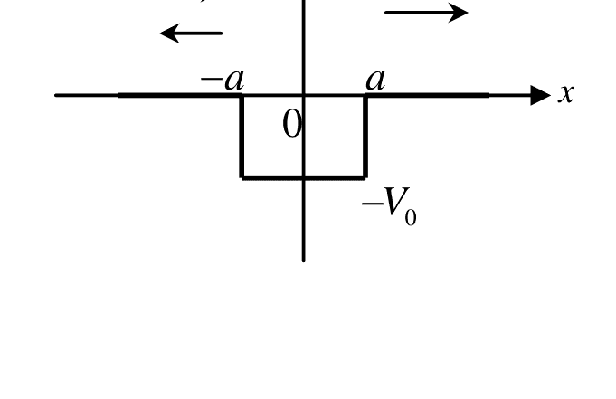

图1.27. 有限势阱。

11. 考虑一个处于宽度为L的无限方势阱基态的电子。 它的速度的期望值是多少？它的动能的期望值是多少？你的结果之间有冲突吗？

## 第一部分 量子粒子

12. 推导势函数 $V(x) = A\delta(x)$ 的反射和透射系数，其中 $A>0$。

解决这个问题的一种方法是通过考虑带有 $V(x) = A\delta(x)$ 的薛定谔方程

$$
- \frac{\hbar^{2}}{2m} \frac{\partial^{2}\psi(x)}{\partial x^{2}} + A\delta(x)\psi(x) = E\psi(x)
$$

并将两边从 $-\varepsilon$ 积分到 $\varepsilon$，其中 $\varepsilon$ 非常小，得到约束条件

$$
- \frac{\hbar^{2}}{2m} \int_{-\varepsilon}^{+\varepsilon} \frac{\partial^{2}\psi(x)}{\partial x^{2}} dx + A\psi(0) \simeq 2\varepsilon E\psi(0) \simeq 0
$$

$$
\Rightarrow \left. \frac{d\psi}{dx} \right|_{x=\varepsilon} - \left. \frac{d\psi}{dx} \right|_{x=-\varepsilon} = \frac{2mA}{\hbar^{2}} \psi(0)
$$

13. 考虑两个宽度为 $w$、相距为 $d$ 的量子阱。

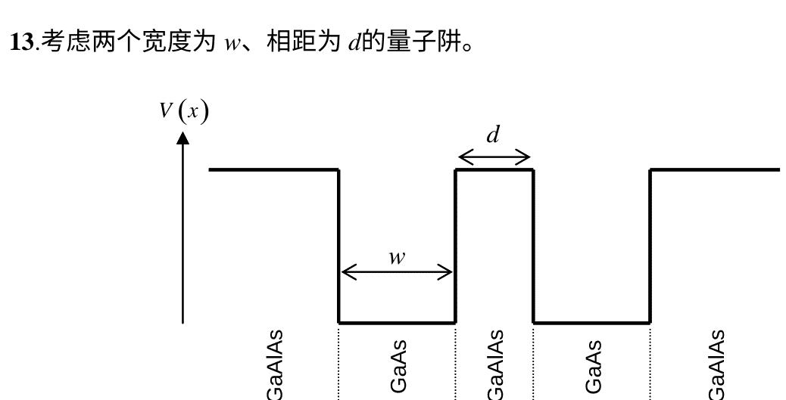

- (a) 根据你对粒子在盒子中的波函数的理解，绘制当两个量子阱相互隔离时，该系统的两个最低能量模式的近似概率密度。
- (b) 当两个量子阱靠近时，使得 $d \ll w$，绘制两个最低能量模式。
- (c) 接下来，我们希望在上述结构中插入另一种材料的薄片（其中$d \ll w$），以消除部分 **(b)** 的两种模式中的一种，但保持另一种模式不受影响。您将如何选择材料（与结构中已有的材料相比），并将新材料放置在何处？

## 第二部分 量子盒中的量子粒子

本课程的目标是计算电子材料和器件的行为。在第一部分中，我们已经开发了计算电子态能级的技术。在本部分中，我们将学习电子统计的原理，并将电子填充到态中。然后在接下来的章节中，我们将施加电压来使电子运动，并研究非平衡性质，如电流流动和电子开关的操作。

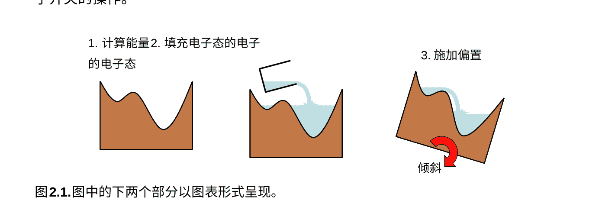

图2.1. 图中的下两个部分以图表形式呈现。

### 有多少电子？ 费米-狄拉克统计

在前一节中，我们确定了量子阱中粒子的允许能级。每个能级及其相关的波函数被称为一个“态”。

泡利不相容原理禁止多个相同的电子同时占据同一个态。因此，人们可能期望导体中的每个态只能拥有一个电子。但电子还具有自旋，这是一种纯粹的量子力学特性。对于任何给定的方向，电子的自旋可以测量为+1/2或-1/2。我们将这些电子称为自旋向上或自旋向下的电子。

自旋向上的电子与自旋向下的电子是不同的。因此，排斥原理允许每个态有两个电子：一个自旋向上和一个自旋向下。

接下来，如果我们向一个原本“空”的材料中添加电子，然后让电子保持不变，它们最终会占据它们的平衡分布。

正如你所想象的，在平衡状态下，最低能量态首先被填满，然后是次低能量态，依此类推。在T = 0K时，态填充按照这种方式进行，直到没有电子剩余。因此，在T = 0K时，电子的分布由以下公式给出

$$
f(E,\mu)=u(\mu-E),
$$

其中u是单位阶跃函数。方程(2.1)表明，在一个特征能量 μ以下，所有的态都被填满，这个特征能量被称为化学势。当用于描述电子时，化学势通常也被称为费米能量，即 $E_F = \mu$。在这里，我们将遵循一种惯例，使用 μ来表示接触的化学势，而使用 $E_F$来描述导体的化学势。

平衡要求电子与容纳它们的材料具有相同的温度。在较高温度下，额外的热能可以激发一些电子超过化学势，模糊费米能级处的分布；参见图2.2。

对于任意温度，电子由费米-狄拉克分布描述：

$$
f(E,\mu) = \frac{1}{1+\exp[(E-\mu)/kT]} \qquad (2.2)
$$

请注意，方程（2.2）在T = 0K极限下简化为方程（2.1）。在费米能级处，$E = E_F = \mu$，态被填充一半。

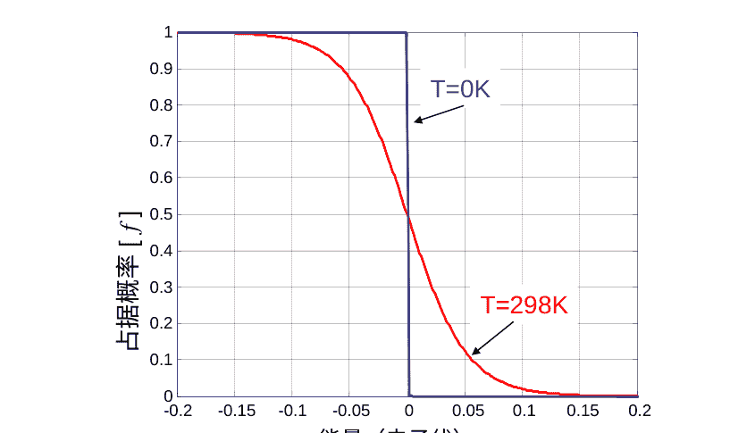

图2.2. 两种不同温度下电子的占据概率。在这个例子中，化学势为 $\mu= 0$。

将费米能级与电子数联系起来是方便的。但是为了这样做，我们需要知道允许态的能量分布。这通常由称为态密度（DOS）的函数来总结，我们用 $g(E)$ 表示。在本节中，将更多地介绍DOS。它定义为导体中单位能量的态数。它用于计算材料中的电子数。

$$
n = \int_{-\infty}^{+\infty} g(E) f(E,\mu) dE \qquad (2.3)
$$

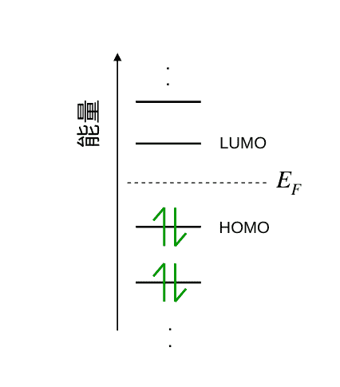

图2.3. 在左边，我们展示了一个可能的分子在T = 0K下的能级结构。你可以把一个分子想象成一个在各个方向上限制电子的小点。因此，就像之前研究的一维量子阱一样，分子中的能级或状态是离散的。对于一个分子，每个状态通常被描述为一个分子轨道。在费米能级以下，每个分子轨道包含两个电子，一个自旋向上，一个自旋向下。我们用向上和向下的箭头表示这些电子。最高占据分子轨道通常被缩写为HOMO。最低未占据分子轨道是LUMO。

### 电流

材料内的电子分布决定了其导电性。作为一个例子，让我们考虑一些在高斯波包中运动的电子。反过来，波包可以用平面波的加权叠加来描述。现在，我们从前一节知道，如果波包在 k-空间中不以 k= 0为中心，那么它将移动，电流将流动。

还有另一种看待这个问题的方式。请注意，存在具有正负k_z波数的平面波分量。因此，即使电子静止，波包的分量也会向两个方向传播。但是，如果每个向+k_z方向移动的分量都被向-k_z方向移动的分量平衡，就没有净电流。

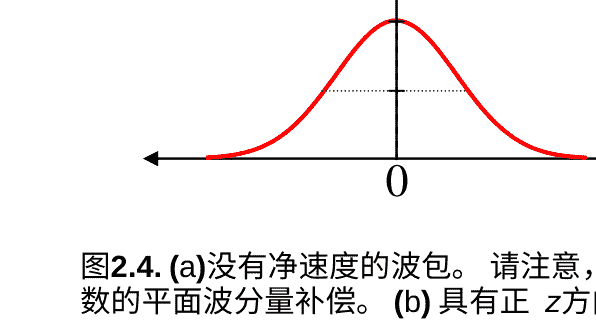

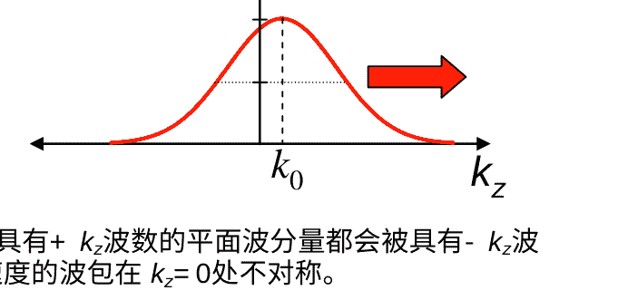

图2.4. (a) 没有净速度的波包。请注意，每个具有+ k_z波数的平面波分量都会被具有- k_z波数的平面波分量补偿。(b) 具有正 z方向净速度的波包在 k_z= 0处不对称。

在本节中，我们将展示我们可以对导体中的电子应用类似的分析。例如，导线中的电子占据具有不同波数的状态，称为 k-状态。每个这些状态都可以用平面波来建模，并且存在向两个方向传播的状态。

回想一下，对于一个平面波

$$
E = \frac{\hbar^2 k_z^2}{2m}
$$

能量和波数之间的关系被称为色散关系。对于平面波来说，它是一个抛物线曲线。曲线下方没有电子态。因此，电子存在于一定能量范围内。†

> †严格来说，带需要有上限和下限来允许能量，而简单的平面波模型只能给出下限。稍后我们还将在更精确的材料模型中找到上限。还要注意，0维材料如分子或量子点没有能带，因为电子在所有方向上都被限制住，不能用任何方向的平面波来建模。

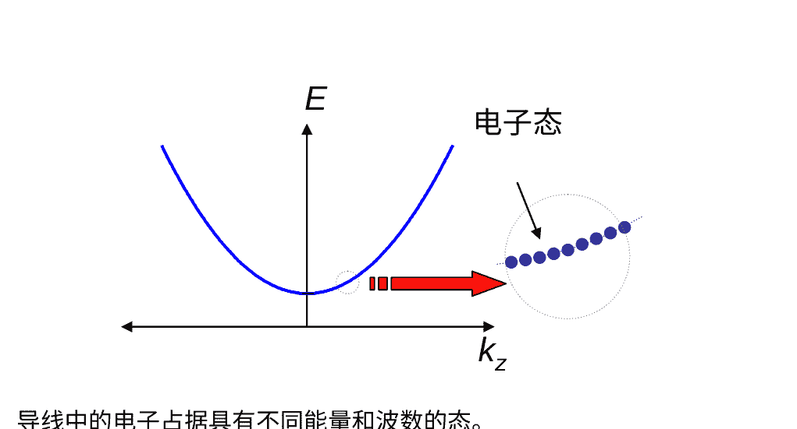

图2.5. 导线中的电子占据具有不同能量和波数的态。

在平衡条件下，导线被电子填满，直到费米能量，E_F。电子填充了+k_z和 -k_z态，并且在两个方向上等量传播。没有电流流动。我们说这些电子是被补偿的。

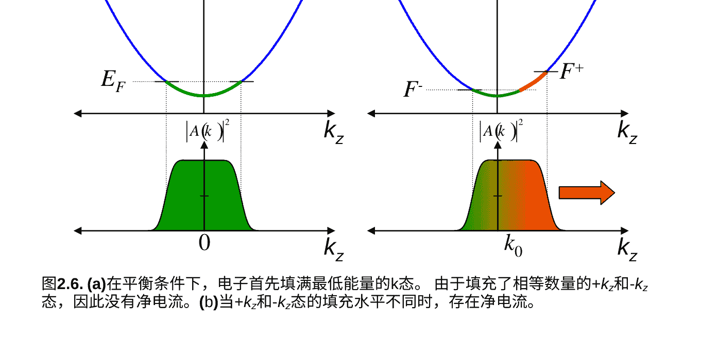

图2.6. (a) 在平衡条件下，电子首先填满最低能量的k态。由于填充了相等数量的+k_z和-k_z态，因此没有净电流。(b) 当+k_z和-k_z态的填充水平不同时，存在净电流。

为了使净电流流动，必须存在电子在每个方向上移动的数量差异。因此，只能在一个方向上行进的电子不能与在另一个方向上行进的电子达到平衡。我们定义了两个准费米能级：$F^+$ 是当 $k_z> 0$ 的态半满时的能级，$F^-$ 是相应的 $k_z< 0$ 态的能级。我们可以看到电流流动与准费米能级之间的差异有关。

费米能级，以及准费米能级之间的电子态的存在。如果在 $F^+$ 和 $F^-$ 之间没有电子，则该材料是绝缘体，不能导电。

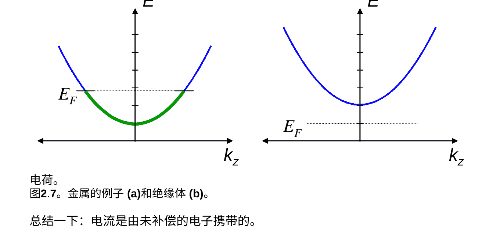

总结一下：电流是由未补偿的电子携带的。

### 金属和绝缘体

金属是良好的导体；$F^+$ 和 $F^-$ 之间的微小差异导致了 $k_z^+$ 和 $k_z^-$ 态电子数之间的巨大差异。如果带在平衡时部分填充，则可能发生这种情况。

如果在 $F^+$ 和 $F^-$ 之间没有电子，则该材料是绝缘体，无法传导电荷。如果带在平衡时完全为空或完全填满，则会发生这种情况。我们还没有遇到过能够完全填满的带。这些将在课程后面讲解。

因此，要计算材料中的电流，我们必须确定处于准费米能级之间的电子数。在计算材料中的电子数时，通常方便近似使用方程 (2.2)。有两种极限情况：

- (i) 退化极限：$E_F - E_C \gg kT$。

如图2.8(a)所示，能带底部，$E_C$, 远小于费米能量，$E_F$, 分布函数由单位阶跃函数建模：

$$
f(E)=u(E_F-E) \qquad (2.5)
$$

(ii) 非退化极限：$E - E_F \gg kT$。

如图2.8(b)所示，这里 $E \ge E_F$ 分布函数简化为玻尔兹曼分布：

$$
f(E)=\exp[-(E-E_F)/kT] \qquad (2.6)
$$

(a) 退化极限：$f = u(E_F-E)$

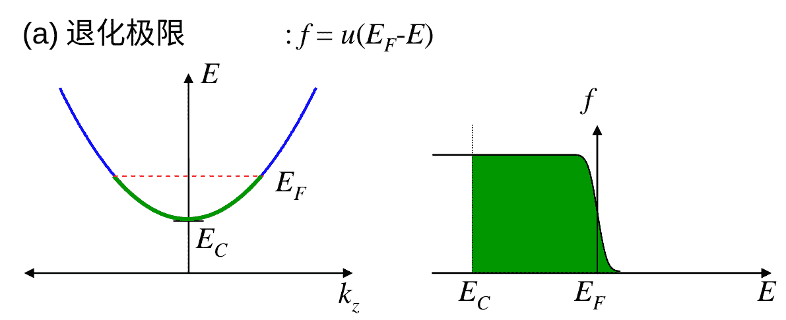

(b) 非退化极限：$f= \exp[-(E-E_F)/kT]$

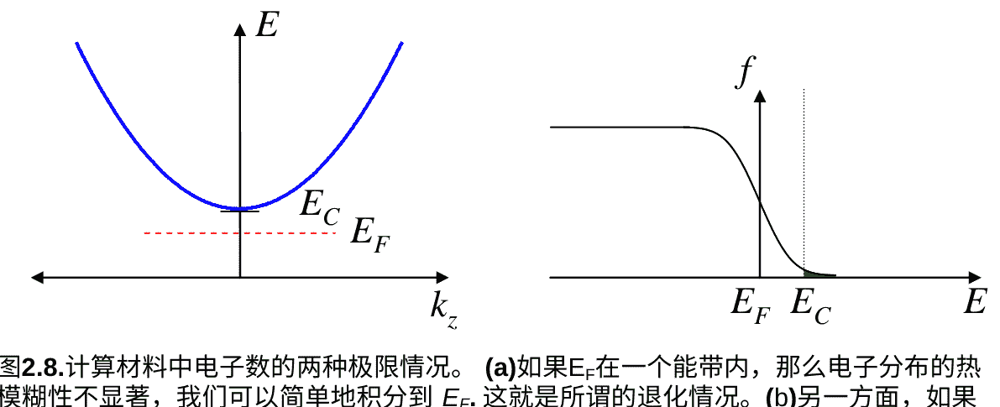

图2.8. 计算材料中电子数的两种极限情况。(a) 如果$E_F$在一个能带内，那么电子分布的热模糊性不显著，我们可以简单地积分到 $E_F$。这就是所谓的退化情况。(b) 另一方面，如果填充态仅由热激发超过 $E_F$的情况产生，填充分数将指数下降。这是非退化极限。

### 态密度

为了确定一个材料是金属还是绝缘体，并计算在施加偏压下的电流大小，我们需要态密度 (DOS)，你可能还记得它是导体中单位能量内的态数的度量。在这部分中，我们将计算各种不同导体的态密度。

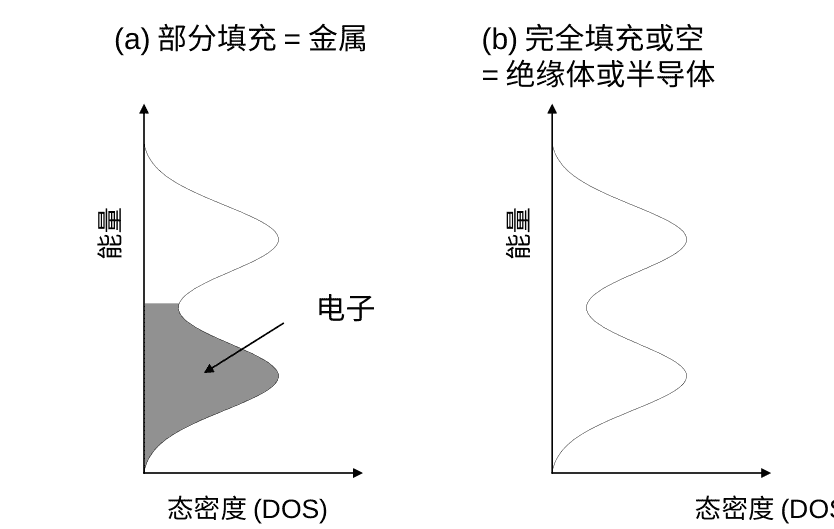

为了计算态密度，我们将采用两个假设：(i) 我们将导体建模为均匀的盒子，(ii) 我们将假设周期性边界条件。

#### 粒子在盒子中

将我们的电子材料建模为一个盒子，可以忽略原子并假设材料是完全均匀的。我们将考虑不同维度的盒子：三维 (典型的块材料)，二维 (量子阱)，一维 (量子线)，或零维 (量子点)。这里的“量子”标签指的是电子的限制。当我们说电子在低维材料中“受限”时，我们指的是材料的关键尺寸与电子波长的数量级相当。我们已经看到，当粒子受限时，它们的能级变得离散。


在量子点中，电子在三个维度中受限，在量子线中，电子只在两个维度中受限，依此类推。因此，当我们说一个给定的结构是二维时，我们指的是电子在2个维度上不受限制。在未受限制的方向上，我们将假设电子由平面波描述。


#### 更高维度中的薛定谔方程

分析量子阱和体材料需要我们解决二维和三维的薛定谔方程。一维方程

$$
\left[ -\frac{\hbar^2}{2m}\frac{d^2}{dx^2} + V(x) \right] \psi(x) = E\psi(x) \qquad (2.7)
$$

可以扩展到更高维度，如下所示：

##### (i) 动能算符

在一维中

$$
\hat{T} = \frac{\hat{p}_x^2}{2m} \qquad (2.8)
$$

现在，三维动量的大小可以写成

$$
|\mathbf{p}|^2 = p_x^2 + p_y^2 + p_z^2 \qquad (2.9)
$$

其中$p_x$，$p_y$和$p_z$分别是在x，y和z轴上的动量分量。由此可得，在三维中

$$
\hat{T} = \frac{\hat{p}_x^2}{2m} + \frac{\hat{p}_y^2}{2m} + \frac{\hat{p}_z^2}{2m} = -\frac{\hbar^2}{2m}\left( \frac{d^2}{dx^2} + \frac{d^2}{dy^2} + \frac{d^2}{dz^2} \right) \qquad (2.10)
$$

##### (ii) 可分离势 – 量子阱

量子阱如图2.11 (a)所示。我们将假设势能可以分离为x、y和z的相关项

$$
V(x, y, z) = V_x(x) + V_y(y) + V_z(z) \qquad (2.11)
$$

例如，量子阱势能可以表示为

$$
\begin{aligned}
V_x(x)&=0\\
V_y(y)&=0\\
V_z(z)&=V_0 u(z-L) + V_0 u(-z)
\end{aligned} \qquad (2.12)
$$

在无限方势阱近似下，其中 $V_0 \to \infty$，而 $u$是单位阶跃函数。

对于这种形式的势能，薛定谔方程可以分离：

$$
\left[ -\frac{\hbar^2}{2m}\frac{d^2}{dx^2} + V_x(x) \right]\psi(x,y,z) + \left[ -\frac{\hbar^2}{2m}\frac{d^2}{dy^2} + V_y(y) \right]\psi(x,y,z) + \left[ -\frac{\hbar^2}{2m}\frac{d^2}{dz^2} + V_z(z) \right]\psi(x,y,z) = (E_x + E_y + E_z)\psi(x,y,z) \qquad (2.13)
$$

波函数也可以分离

$$
\psi(x,y,z)=\psi_x(x)\psi_y(y)\psi_z(z) \qquad (2.14)
$$

根据方程(1.118)和(1.119)，无限方势阱的解为

$$
\psi(x,y,z)=\psi_x(x)\psi_y(y)\psi_z(z)=\sqrt{\frac{2}{L}}\sin\left( n\frac{\pi z}{L} \right)\cdot\exp[ik_x x]\cdot\exp[ik_y y] \qquad (2.15)
$$

with

$$
E = E_x + E_y + E_z = \frac{\hbar^2 k_x^2}{2m} + \frac{\hbar^2 k_y^2}{2m} + \frac{n^2\hbar^2\pi^2}{2mL^2} \qquad (2.16)
$$

这个色散关系在量子阱的最低三个模式中显示在图2.12中。


图2.12. 量子阱将电子限制在一维空间中。

##### (iii) 可分离势能 – 量子导线

图2.11(b)显示了一个具有矩形横截面的量子导线。同样，我们假设导线边界处的势能是无限大的：

$$
V(x,y,z)=V_0 u(-x)+V_0 u(x-L_x)+V_0 u(-y)+V_0 u(y-L_y)
$$

其中 $V_0 \rightarrow \infty$。相关的波函数在$x$-$y$平面内被限制，并由$z$方向上的平面波组成，因此我们选择了试探波函数

$$
\psi(x,y,z)=\psi(x,y) e^{ik_z z}
$$

将方程(2.18)代入薛定谔方程得到（对于$0 \leq x \leq L_x$和$0 \leq y \leq L_y$）：

$$
-\frac{\hbar^2}{2m}\frac{d^2}{dx^2}\psi(x,y)-\frac{\hbar^2}{2m}\frac{d^2}{dy^2}\psi(x,y)+\frac{\hbar^2 k_z^2}{2m}\psi(x,y)=E\psi(x,y)
$$

由于电线的边缘电势趋近于无穷大，$\psi(x=0)=\psi(x=L_x)=\psi(y=0)=\psi(y=L_y)=0$ 因此，解为

$$
\psi(x,y)=\psi_0 \sin(k_x x) \sin(k_y y)
$$

其中

$$
k_x=\frac{n_x \pi}{L_x}, \quad n_x=1,2,\ldots, \quad k_y=\frac{n_y \pi}{L_y}, \quad n_y=1,2,\ldots
$$

## 第二部分。 量子盒中的量子粒子

因此，$x$- 和 $y$- 方向上的约束定义了离散的能级

$$E_{n_x,n_y} = \frac{\hbar^2\pi^2}{2m}\left( \frac{n_x^2}{L_x^2} + \frac{n_y^2}{L_y^2} \right), \quad n_x, n_y = 1, 2, ...$$

总能量为

$$E_{n_x,n_y} = \frac{\hbar^2\pi^2}{2m}\left( \frac{n_x^2}{L_x^2} + \frac{n_y^2}{L_y^2} \right) + \frac{\hbar^2 k_z^2}{2m}, \quad n_x, n_y = 1, 2, ...$$

这个色散关系在图2.14中绘制出来，对应于最低的三个模式。


图2.14。 量子导线在二维中限制电子。

##### 零维态密度：单分子和三维限制的量子点

零维态密度是一个特殊情况，因为粒子在所有方向上都被限制住了。

就像一个具有离散能级的井中的粒子一样，我们可以假设零维的态密度可能是允许的能级处的一系列δ函数。 对于一个孤立的零维粒子来说，这是确实如此。

孤立粒子轨道上的电荷寿命是无限的。 根据不确定性原理，无限寿命与孤立分子中的完全离散能态相关，即如果 $\Delta t \to \infty$, $\Delta E \to 0$。

但是，当一个分子与金属电极接触时，电子可能最终逃逸到金属中。 现在，电子在分子上的寿命是有限的，因此分子的能级也应该具有有限的宽度。 因此，在耦合的金属-分子系统中，分子能级会变宽- 耦合越大，分子能级的变宽越大。

假设分子轨道中有两个电子。 假设这些电子在分子上的寿命为 $\tau$。 此外，假设电子在分子上的衰变是指数型的。那么分子轨道中电子概率的时间依赖性为：

$$\left| \psi \left(t\right) \right|^{2}=\frac{2}{\tau }\mathrm{exp}\left[ -\frac{t}{\tau } \right] u\left(t\right)$$ (2.24)

相应波函数的一个选择是

$$\psi \left(t\right)=\sqrt{\frac{2}{\tau }}\mathrm{exp}\left[ -i\frac{E_0 t}{\hbar }-\frac{t}{2\tau } \right] u\left(t\right)$$ (2.25)

我们在指数中包含了一个复数项，以考虑电子的相位旋转。 相位旋转的特征角频率为 $E_0/\hbar$，其中 $E_0$是孤立分子中的分子轨道能量。

接下来，我们使用傅里叶变换将时间转换为能量域。 傅里叶变换 $\psi(t)$ 的结果为

$$A\left(\omega \right)=\frac{\sqrt{2/\tau }}{1/2\tau +i\left(E_0/\hbar -\omega \right)}$$ (2.26)

现在根据角频率的归一化定义，我们要求

$$\frac{1}{2\pi }\int_{-\infty }^{\infty }{\left| A\left(\omega \right) \right|^{2}d\omega }=\int_{-\infty }^{\infty }{g\left(E\right)dE}$$ (2.27)

其中 $g(E)$ 是态密度。因此，

$$g\left(E\right)=\frac{1}{2\pi }{{\left| A\left(\omega \right) \right|}^{2}}\frac{d\omega }{dE}=\frac{2}{\pi }\frac{\hbar /2\tau }{{\left( E-E_0 \right)}^{2}+{\left( \hbar /2\tau \right)}^{2}}$$ (2.28)

这个函数被称为洛伦兹函数 - 它是时间域中指数衰减的特征；参见图2.15。洛伦兹函数在峰值的一半处的宽度（半峰全宽，或FWHM）为 $\hbar /\tau$。分子与接触之间的耦合可以通过分子上的电子寿命 $\tau$或耦合能量 $\Gamma$来描述，耦合能量Γ等于洛伦兹态密度的FWHM。

$$\Gamma =\hbar /\tau$$ (2.29)因此，如预期的那样，分子与接触之间的相互作用越强，分子上的电子寿命越短，分子的态密度越宽。

在耦合良好的系统中， $\Gamma$可能接近1电子伏特，对应于电子寿命$\tau$~ 4飞秒。


#### 周期性边界条件

通常，我们的材料不是孤立存在的，而是可能与接触物连接在一起，例如。 所以我们有一个问题：在确定其能量结构时，我们如何处理我们的材料与物理世界其他部分之间的边界？

首先，如果材料足够大（例如，如果量子导线足够长），边界不会对大部分材料中的电子态产生显著影响。如果这是真的，我们可以选择任何方便的边界条件。

事实上，我们暂时假设我们可以选择方便的边界条件。 但请注意，在纳米尺度器件中，边界条件可能会成为问题；请参阅有关与接触物耦合的零维材料的先前讨论。

当边界不主导材料的性质时，通常的选择是周期性边界条件。如图2.16所示，为了应用周期性边界条件，我们取材料的波函数，在无约束方向上制作无限多个副本。这使我们能够分析材料中在这些方向上行进的电子。毕竟，如果只研究材料的单个孤立副本，材料就无法支持行进的电子，只能产生驻波。


图2.16。在给定周期性边界条件下，只有特定的 $k$值在量子导线的'无约束'方向上被允许。

但是在实空间中强制周期性会影响波函数的傅里叶变换。 在k空间中，周期性波函数是离散的。 例如，在长度为 L的量子导线的长轴上，允许的 k值间隔为

$$ \Delta k = \frac{2\pi}{L} $$ (2.30)

每个允许的 k值对应一个平面波，每个允许的 k值对应一个具有特征能量的离散电子波函数。 正如我们将看到的，了解 k空间中 k态的分离使我们能够轻松地计算材料中的电子态数。

对于周期性材料，另一种思考对于特定离散 k值的限制的方式是回想起任何周期结构都支持模式。 因此，在周期性分子中，只有特定的允许波矢可以用于非局域化电子。 我们通过它们的波矢 k来表征这些模式，其中

$$ k = 2\pi n / N a_0 = 2\pi n / L $$

L是分子的长度。 因此，允许的 k态为：

$$ k = 0, \pm \frac{2\pi}{L}, \pm \frac{4\pi}{L}, \pm \frac{6\pi}{L}, ... $$ (2.31)


图2.17.环上的几种模式。 由于环是周期性的，只有波矢k= 2πn/L给出稳定态，其中 L是环的周长，n是整数。

因此，在我们应用周期性边界条件的导体中，允许的 k态的间距由导体的长度决定。

##### 一维态密度：在二维中受限的量子导线

态密度， g(E) 定义为能量范围内允许的态的数量，即在能量范围 -∞ < E < EF内的总态数为

$$ n_s(E_F) = \int_{-\infty}^{E_F} g(E) dE $$ (2.32)

为了确定 g(E)，我们将计算 k态的数量，然后使用 E和 k之间的关系（称为色散关系）从 k变量转换为 E。

我们上面证明了量子导线中电子的能量为


图2.18. 在应用周期性边界条件后的量子导线的色散关系。

$$E_{n_x,n_y} = \frac{\hbar^2\pi^2}{2m}\left(\frac{n_x^2}{L_x^2} + \frac{n_y^2}{L_y^2}\right) + \frac{\hbar^2 k_z^2}{2m}, \quad n_x, n_y = 1, 2, ...$$

因此，计算 x-y模式是直接的，因为在受限势中它们是离散的。但是，要计算 z方向上的模式，我们需要施加周期性边界条件。

如果导线足够长，那么导线的边界就不那么重要了。周期边界条件导致 k_z被量子化，每个允许的 k空间值占据一个长度 2π/L_z。

为了方便起见，我们将对 k_z的大小进行积分。由于我们将 |k_z| 从 0 积分到 ∞，而不是从 -∞ < k_z < ∞，所以需要额外乘以二来考虑负 k_z的模式，并且额外乘以二来考虑每个 k状态的两种可能的电子自旋。

$$n_s(|k_z|) = 2 \times 2 \times \int_0^{|k_z|} \frac{1}{2\pi / L_z} dk.$$
(2.34)

接下来，我们需要在方程 (2.34) 中进行变量变换，即我们需要 g(E)，其中

$$n_s(E_F) = \int_{-\infty}^{E_F} g(E) dE$$
(2.35)

现在 |k_z| 与能量有关

$$E - E_{n_x,n_y} = \frac{\hbar^2 |k_z|^2}{2m}, \quad E \geq E_{n_x,n_y}$$
(2.36)

将方程 (2.36) 的色散关系代入方程 (2.34) 中，得到

$$g(E) dE = \frac{2L}{\pi} \sqrt{\frac{m}{2\hbar^2}} \sum_{n_x,n_y} \frac{u(E - E_{n_x,n_y})}{\sqrt{E - E_{n_x,n_y}}} dE,$$
(2.37)

其中 $u$ 是单位阶跃函数。DOS在图2.19中绘制。注意，色散关系中的平坦区域，当 $k\rightarrow 0$ 时，在每个能带底部的DOS中产生无限高的峰值。然而，峰值的面积是有限的，因为导线包含有限数量的态。


图2.19。量子导线（1d）的态密度。

##### 2维周期边界条件

将周期边界条件应用于2维材料与1维材料遵循相同的原则。

假设量子阱的长轴与 $x$ 和 $y$ 轴对齐，并且量子阱的尺寸为 $L_x \times L_y$。当我们应用周期边界条件时，无限系统在 $x$轴（周期 $L_x$）和 $y$轴（周期 $L_y$）上是周期性的。

首先，让我们考虑在 $x$轴上的周期性；见图2.20。


图2.20。假设在 $x$轴上有周期性边界条件的量子阱。

在 $x$ 轴上，波函数是一个平面波。

> $\psi_x(x) = \exp[ik_x x]$ (2.38)

在周期性边界条件下，只允许离散的 $k_x$ 值

> $k_x = n_x \frac{2\pi}{L_x}$ (2.39)

其中 $n_x$ 是一个整数。

类似地，对于在 $y$ 轴上的周期性：


在 $y$ 轴上的波函数

> $\psi_y(y) = \exp[ik_y y]$ (2.40)

受限于离散的 $k_y$ 值：

> $k_y = n_y \frac{2\pi}{L_y}$ (2.41)

其中 $n_y$ 是一个整数。

因此，在 $k$ 空间中，允许的 $k$ 态以规则间隔排列，具有：

> $\Delta k_x = \frac{2\pi}{L_x}, \Delta k_y = \frac{2\pi}{L_y}$ (2.42)

总体上，在 $k$ 空间中，每个 $k$ 态所占据的面积为：

> $\Delta k^2 = \Delta k_x \Delta k_y = \frac{2\pi}{L_x} \frac{2\pi}{L_y} = \frac{4\pi^2}{A}$ (2.43)

其中 $A$ 是量子阱的面积。


图2.22.在k-空间中只允许某些离散值。每个状态占据一个面积为4\pi^2/L_xL_y。

##### 二维态密度：一维限制的量子阱

我们上面已经证明了量子阱中电子的能量是

$$E = \frac{\hbar^2\pi^2}{2mL_z^2}n^2 + \frac{\hbar^2(k_x^2 + k_y^2)}{2m}, \quad n=1,2,... \tag{2.44}$$

对于态密度的计算，限制势能的具体细节是无关紧要的；我们只注意到电子在两个维度上是不受限制的。如果量子阱的面积是L_x \times L_y，那么k-空间的每个允许值占据一个面积为2\pi/L_x \times 2\pi/L_y。

将方便地转换为柱坐标（k，φ，z），其中k是在x-y平面上的k-矢量的大小。在一个厚度为dk的环内的态数是

$$n_s(k)dk = 2 \times \frac{1}{4\pi^2/A} \times 2\pi k dk \tag{2.45}$$

其中A = L_x L_y，再次乘以2以考虑电子自旋。

现在k与能量相关

$$E - E_n = \frac{\hbar^2 k^2}{2m}, \quad E \geq E_n \tag{2.46}$$

因此，根据方程(2.46)，

$$g(E)dE = \frac{Am}{\pi \hbar^2} \sum u(E - E_n)dE, \quad (2.47)$$

其中 u是单位阶跃函数。 DOS在图2.24中绘制。


图2.23。我们计算半径为| k|的圆内的k态数。


图2.24。量子阱(2d)的态密度。

##### 三维周期边界条件

在三维中，只允许离散的 k值。 这次每个允许态的k空间体积为

$$\Delta k^3 = \Delta k_x \Delta k_y \Delta k_z = \frac{2\pi}{L_x} \frac{2\pi}{L_y} \frac{2\pi}{L_z} = \frac{8\pi^3}{V} \quad (2.48)$$

其中 V是材料的体积。


总结一下，每个状态所占据的 k空间是

| 维度 | 公式 |
|------|------|
| 一维 | $\Delta k = \frac{2\pi}{L}$ |
| 二维 | $\Delta k^2 = \frac{4\pi^2}{A}$ |
| 三维 | $\Delta k^3 = \frac{8\pi^3}{V}$ |

表2.1.1、2和3维中每个状态所占据的 k空间。

##### 三维DOS：没有约束的体材料

在三维中，电子没有约束。对 $k_x$、$k_y$ 或 $k_z$ 的唯一约束是周期性边界条件。我们刚刚证明了如果系统有体积 $L_x \times L_y \times L_z$，那么 $k$ 空间的每个允许值都占据一个体积为 $2\pi / L_x \times 2\pi / L_y \times 2\pi / L_z = 8\pi^3 / V$。

为了确定允许状态的数量，我们将在所有 $k$ 空间上进行积分。在球坐标中进行这个积分是方便的。如果 $k$ 是 $\boldsymbol{k}$ 矢量的大小，那么在厚度为 $dk$ 的球壳内的模式数目就是

$$n_s(k)dk = 2 \times \frac{1}{8\pi^3/V} \times 4\pi k^2 dk.$$ (2.49)

其中 $V = L_x \times L_y \times L_z$，而因子二考虑了电子自旋。
在我们的三维盒子中，无约束的波函数是在所有方向上的平面波，即波函数可以被描述为

$$\psi(x,y,z) = \psi_0 e^{ik_x x} e^{ik_y y} e^{ik_z z}$$ (2.50)

将其代入薛定谔方程得到

$$-\frac{\hbar^2}{2m}\left( \frac{d^2}{dx^2} + \frac{d^2}{dy^2} + \frac{d^2}{dz^2} \right)\psi = E\psi$$ (2.51)

这给出了

$$\frac{\hbar^2}{2m}\left( k_x^2 + k_y^2 + k_z^2 \right) = E$$ (2.52)

重新排列得到：


使用方程(2.53)将 E 与 k 相关联得到：

$$E = \frac{\hbar^2 k^2}{2m} \quad (2.53)$$

其中 g(E)是单位能量的态密度。

$$g(E)dE = \frac{V}{2\pi^2} \left( \frac{2m}{\hbar^2} \right)^{\frac{3}{2}} \sqrt{E} dE \quad (2.54)$$

图2.27显示了1D、2D和3D材料的态密度的比较。


图2.27.用于体材料（3D）、量子阱（2D）和分子导线（1D）的归一化态密度。

## 第二部分。量子盒中的量子粒子

### 问题

- 1. i) 使用MATLAB生成图2.13。
- ii) 如果 $L_y = L_x \cdot \sqrt{\frac{3}{5}}$，哪种模式具有较低的能量 $\{n_x= 3, n_y= 1\}$ 还是 $\{n_x= 2, n_y= 2\}$？
- 2. 下图所示的晶体管具有氧化物（$\varepsilon = 4\varepsilon_0$）厚度 $d = 1.2\mathrm{nm}$ 和通道深度 $L_z= 2.5\mathrm{nm}$。将通道视为量子阱，当施加电压 $V=1\mathrm{V}$到栅极时，有多少模式被填充？


提示：使用平行板电容器的表达式计算通道中的电荷。

- 3. 一根长度为 $L$ 的特定导体具有色散关系：
$$
\begin{aligned}
E_1(k) &= 5 + 2V\cos(ka) \\
E_2(k) &= 10 - 2V\cos(ka)
\end{aligned}
$$
$|k|<\frac{\pi}{a}$，其中 $V$ 和 $a$ 是正常数。
- i) 绘制色散关系图。
- ii) 根据 $E$、$V$ 和 $a$ 计算态密度。
- 4. 一般来说，对于电子分布函数 $f(E,E_F)$ 的简并近似适用于态密度大且在费米能级上下缓慢变化的情况。非简并近似在费米能级的态密度远小于高能态密度时效果最好。
在这里，我们考虑了高斯态密度的这些近似。高斯函数在其中心附近变化较慢，但在其尾部迅速减小。高斯态密度中的电子数由以下公式给出：
$$
n = \int_{-\infty}^{\infty} \frac{1}{\sqrt{2\pi\sigma^2}} e^{\frac{-1}{2}(E/\sigma)^2} f(E,E_F) dE,
$$

# 纳米电子学导论

其中 $f(E,E_F)$ 是费米函数。 对于特定范围的费米能级 $E_F$，电子数可以近似为：
$$n \approx \int_{-\infty}^{E_F} \frac{1}{\sqrt{2\pi\sigma^2}} e^{-\frac{1}{2}(E/\sigma)^2} dE$$
这是简并极限。

随着费米能级的降低，电子数在非简并极限下计算得更准确。 推导出简并极限成立的最小费米能级 $E_F$ 作为温度 $T$ 和标准偏差 $\sigma$ 的函数。

提示：通过检查非简并极限下电子的能量分布来估计费米能级的最小值。

## 第三部分。双端子量子点器件

在本课程的这一部分，我们将研究电子器件。 我们将研究由量子点或量子线导体构成的器件，在两个接触点之间。 我们将计算这些‘两端’器件中的电流与电压的关系。 然后，我们将添加第三个端子，即用于独立控制导体电势的栅极。 然后，我们可以创建晶体管，这是现代电子学的基本组成部分。

我们将同时考虑纳米晶体管和传统晶体管。

我们将从最简单的情况开始，即在两个接触点之间的量子点。


图3.1。一个分子在两个接触点之间。 我们将分子建模为一个量子点。

### 量子点/单分子导体

正如我们在第2部分中看到的，量子点是一个0维导体；其电子在所有维度上都被限制。 一个很好的量子点的例子是一个在空间中孤立的单分子。 我们可以通过一个在所有维度上限制电子的方势阱来近似我们的量子点或分子。 这种限制的一个结果是孤立的量子点或分子中的能级是离散的。 然而，通常，简单的粒子在盒子中模型不能生成足够准确的量子点中的离散能级的估计。 相反，量子点中的材料或分子的结构定义了实际的能级。

图3.2显示了一个典型的方势阱及其能级。 我们将假设这些能级已经被准确确定。 每个能级对应一个不同的分子轨道。在势阱内的束缚态能级是相对于真空能量来测量的，通常定义为真空中自由电子的势能。 请注意，如果存在电场，真空能量将随位置变化。

接下来，我们向分子中添加电子。 每个能级需要两个电子，一个自旋向上，一个自旋向下。 最高占据分子轨道（HOMO）和最低未占据分子轨道（LUMO）特别重要。 在大多数化学稳定材料中，HOMO是完全填充的；部分填充的HOMO通常会增强反应性，因为它们往往容易接受或捐赠电子。

之前我们说过，电荷传输只发生在部分填充的态中。通过向LUMO添加电子或从HOMO中减去电子来改变其他所有态的电子数需要更多的能量。因此，我们将忽略除HOMO和LUMO之外的所有分子轨道。

图3.2还定义了分子的电离势（$I_P$）为HOMO中电子的结合能。LUMO中电子的结合能被定义为分子的电子亲和力（$E_A$）。


### 接触

在电流载体中有三个基本元素：导体和至少两个接触点来施加电势在导体上。 根据定义，接触点很大：每个接触点包含比导体更多的电子和更多的电子态。 因此，接触点通常被称为储备池。 我们将假设接触点中的所有电子都处于平衡状态。 将电子从接触点的费米能级提升到真空能量所需的能量被定义为功函数（$\Phi$）。


金属通常被用作接触，因为金属通常具有非常大量的填充和未填充态，从而具有良好的导电性能。 尽管在接触中存在电流时，平衡的假设可能不完全正确，但接触中大量的可移动电子确保任何与平衡偏离的情况都很小，并且接触中的电势近似均匀。 例如，考虑一个大的金属接触。 它的电阻非常小，因此接触中的任何电压降都必须相对较小。

### 电极和导体之间的平衡

在本节中，我们将考虑分子和单个电极的组合。

在没有电压源的情况下，孤立的电极和分子处于相同的电位。因此，它们的真空能量（自由电子的势能）在孤立状态下是相同的。

当电极与分子连接时，必须在组合系统中建立平衡。 为了阻止电流流动，电极和分子中必须有一个统一的费米能级。

但是，如果孤立的电极和分子中的费米能级不同，如何实现平衡？


图3.4。孤立电极和孤立分子的能级对齐。如果系统中没有电压源，自由电子的能量在电极和分子位置上是相同的。因此，真空能级对齐。然而，费米能级可能不同。但在平衡状态下，通过电荷转移，费米能级被强制对齐。

# 纳米电子学导论

由于费米能级随电荷的增加或减少而变化，通过电荷在接触点和分子之间的转移来获得平衡。电荷转移改变了接触点相对于分子的电势，从而改变了相对真空能量。这被称为“充电”。电荷转移还会影响费米能级，因为电子填充了一些态并从其他态中排空。充电和态填充效应都可以用电容器模拟。我们首先考虑电子态填充。

#### (i) 量子电容

在平衡条件下，金属和分子的费米能量必须保持恒定。我们可以将其类比为水箱之间的流动。金属就像一个非常大的水箱。由于其较小的态密度，分子表现为一个窄柱。当金属和分子连接在一起时，水流动以使填充水平对齐。


但是分子的态密度不一定是均匀的，如图3.5所示。也有可能只有一部分电荷被转移。例如，想象一下，一些分数数量的电子从接触面转移到分子上。转移电子的波函数可能包括接触面和分子。由于共享波函数的一部分存在于分子上，这相当于分数电荷的转移。

但是如果 $\delta n$ 等于+1，LUMO将会半满，因此费米能量将位于LUMO上，而如果 $\delta n$ 等于-1，HOMO将会半满，因此费米能量将位于HOMO上。一般来说，分子上的电荷数由下式给出：

## 第三部分。双端子量子点器件

$$n = \int_{-\infty}^{+\infty} g(E) f(E, E_F) dE \tag{3.1}$$

其中 $g(E)$ 是单位能量的分子态密度。对于费米能量的小偏移，我们可以线性化方程 (3.1) 来确定电荷转移对 $E_F$ 的影响。我们对数量 $dE_F/dn$ 感兴趣。对于简并系统，我们可以简化方程 (3.1)：
$$n = \int_{-\infty}^{E_F} g(E) dE \tag{3.2}$$
对费米能量求导得到：
$$\frac{dn}{dE_F} = g(E_F) \tag{3.3}$$
我们可以重新排列得到：
$$\delta E_F = \frac{\delta n}{g(E_F)} \tag{3.4}$$
因此，在电荷转移后，分子内的费米能量变化为 $\delta n/g$，其中 $g$ 是单位能量的态密度。

有时候，通过填充态密度的效应，我们可以方便地模拟“量子电容”，我们将其定义为：
$$C_Q = q^2 g(E_F) \tag{3.5}$$
即：
$$\delta E_F = \frac{q^2}{C_Q} \delta n \tag{3.6}$$
如果分子在费米能级处具有较大的态密度，则其量子电容较大，需要转移更多的电荷来改变费米能级。


我们还可以计算接触的量子电容。金属接触在费米能级上具有很高的态密度，这意味着必须转移非常多的电子来改变其费米能级。因此，我们说费米能量的

# 纳米电子学导论

接触点的态密度被固定。另一种表达方式是接触点的量子电容近似为无穷大。

量子电容可以用于金属-分子结的等效电路中。但我们已经推广了电路，使得每个节点的电势都是费米能级，而不仅仅是静电电势，就像传统电路中一样。

在下面的电路中，金属被建模为一个电压源，其值等于金属的化学势 $\mu_1$。在接触之前，分子的费米能级是 $E_F^0$。接触本身被建模为一个电阻，当接触两侧的费米能级不对齐时，允许电流流动。从金属流向分子的电荷在量子电容上产生电势。但请注意，这是费米能级的变化，而不是静电电势。还需要注意的是，量子电容通常取决于分子中的费米能级。唯一的例外是如果态密度是能量的函数的常数。因此，$C_Q$ 的恒定值只能用于 $\mu_1$ 和 $E_F^0$ 之间的小偏差。


图3.7。金属-分子结构的小信号模型。不包括充电效应。电阻将在后面的章节中进一步进行表征。

## 第三部分。双端子量子点器件

#### (ii) 静电电容

不幸的是，建立联系和分子之间的平衡并不像水流动两个水箱那样简单。电子，不像水，是带电的。因此，从接触到分子的电子转移在接触上留下净正电荷，在分子上留下净负电荷。

界面处的充电改变了分子相对于金属的电势，相当于整个水箱的上下移动。充电有助于建立平衡，并减少接触后转移的电子数量。


图3.8。电子携带电荷，在金属和分子之间转移时改变电势。由此产生的电势变化相当于抬高上升到水的“分子”列。水位最终必须相等，但现在较少需要转移水。

接触和分子可以被视为电容器的两个板。在图3.9中，我们将这个电容器标记为 $C_{ES}$，即静电容量，以区别于前一节中讨论的量子电容。

当电荷在界面处转移时，电容器被充电，建立了电压，分子的电势发生变化。每转移一个电子时，分子电势的变化被称为充电能量，并反映在真空能量的变化中。根据电容器的基本关系：
$$C_{ES} = \frac{Q}{V} \quad (3.7)$$
其中V是电容器两端的电压。我们可以计算由于充电而引起的电势变化：
$$U_c = qV = \frac{q^2}{C_{ES}} \delta n \quad (3.8)$$

# 纳米电子学导论


我们将发现 $\delta n$ 是一个动态量 - 它随着电流的流动而变化。在纳米器件中，它可能非常重要，因为静电容量非常小。对于纳米电子学中接触和导体之间的小间距（例如1纳米），充电能量可以达到每个电子1伏特的数量级。

总结这些效应，我们发现中性分子的费米能量为 $E_F^0$，与金属-分子组合的费米能量 $E_F$ 有关：
$$E_F = \delta n / g + \frac{q^2}{C_{ES}} \delta n + E_F^0 \tag{3.9}$$


## 第三部分。双端子量子点器件

或者，用量子电容来表示：
$$E_F = \frac{q^2}{C_Q}\delta n + \frac{q^2}{C_{ES}}\delta n + E_F^0 \tag{3.10}$$


图3.11。当电荷从金属转移到分子时，能级对齐发生变化。分子的充电对应于在界面电容器上施加电压，从而改变分子的电势。因此，分子的真空能级在分子位置发生偏移，所有分子态也随之偏移。此外，转移的电荷填充了分子中之前的空态。这两种效应改变了分子中的费米能级。

##### 静电容的计算

###### (i) 孤立点导体

对于像单个分子或量子点这样的小导体，有时候方便地假设导体是一个半径为 $R$ 的球来计算 $C_{ES}$。根据高斯定律，距离球心半径为 $r$ 的点的电势为：
$$V = \frac{Q}{4\pi\varepsilon r} \tag{3.11}$$
其中 $r > R$，$\varepsilon$ 是介电常数，$Q$ 是球体上的净电荷。如果我们将无穷远处的电势定义为零，则球体的电势为 $V = Q/4\pi\varepsilon R$。而电容是

# 纳米电子学导论

$$C_{ES} = \frac{Q}{V} = 4\pi\varepsilon R \tag{3.12}$$

方程（3.12）的显著特点是静电电容与导体的尺寸成比例。因此，小导体的充电能量可能非常大。例如，方程（3.12）预测半径为 $R=1\mathrm{nm}$ 的球体的电容约为 $C_{ES}=10^{-19}\mathrm{F}$。充电能量为每个电荷 $U_C=1.6\mathrm{eV}$。

###### (ii) 位于源极和漏极电极之间的导体

一般情况下，任意分布电荷的电势分布需要使用高斯定律计算。但我们通常可以做一些近似。源极和漏极接触有时可以建模为平行板电容器，其面积为 $A$：
$$C = \frac{\varepsilon A}{d} \tag{3.13}$$
其中 $A$ 是每个接触的面积，$d$ 是它们的间距。这个近似等同于假设源极和漏极电极之间存在均匀的电场。
如果 $A >> d$ 并且接触之间没有净电荷，这个近似是有效的。对于距离为 $l$ 的源极和漏极电极，距离源极 $z$ 处的源极和漏极电容为：
$$C_S(z) = \frac{\varepsilon A}{z}, \quad C_D(z) = \frac{\varepsilon A}{l-z} \tag{3.14}$$
如预期的那样，电势线性变化，表明存在均匀的电场。
$$U(z) = -qV_{DS} \frac{1/C_S(z)}{1/C_D(z) + 1/C_S(z)} = -qV_{DS} \frac{z}{l} \tag{3.15}$$


## 第三部分。双端子量子点器件

### 两端量子点/单分子器件中的电流流动

在本节中，我们提出了一个简化的分子导电模型。它基于Datta等人的“玩具模型”。†尽管相对简单，但它描述了单分子电流-电压特性的许多基本特征。

图3.13显示了处于平衡状态的接触/分子/接触系统。由于有两个接触点，这是一个两端口设备的例子。按照惯例，我们将电子注入接触点称为源，电子接受接触点称为漏。我们将分子建模为一个量子点。如果分子的中心导电性远高于其与接触点的连接，则这是准确的。


图3.13。一个具有分子/量子点导体的两端口设备。在平衡状态下，没有电流流动，费米能级是对齐的。

现在，当我们在源极和漏极之间施加电势时，我们将一个接触的费米能级相对于另一个接触进行移动，即：
$$\mu_D - \mu_S = -q V_{DS} \tag{3.16}$$
分子上有两种效应：
- (i) 静电效应：分子上的电势会因接触之间建立的电场而改变。分子内的能级会相对于接触刚性地上移或下移。
- (ii) 充电效应：在非平衡状态下，电流会流动，分子上的电荷量会发生变化。如果电流通过LUMO流动，则电荷量可能会增加；如果电流通过HOMO流动，则电荷量可能会减少。

> †S. Datta, ‘量子输运：从原子到晶体管’, Cambridge University Press (2005).
> F. Zahid, M. Paulsson, 和 S. Datta, ‘分子中的电导’。在高级半导体和有机纳米技术中，编者 H. Korkoc. Academic Press (2003).

不幸的是，这些效应是相互关联的：将分子能级相对于接触能级移动会改变接触对分子的电荷供应量。但是，与电荷转移相关的充电能量反过来又改变了分子的电势。

我们首先独立考虑静态和充电效应。

#### (i) 静电学：电势的电容分压模型

我们的两端口器件可以由一个与源和漏接触的量子点通过两个电容器 $C_S$ 和 $C_D$ 连接来建模。这些电容器的值取决于器件的几何形状。如果分子在接触之间等间距分布，我们可能期望 $C_S \approx C_D$。另一方面，如果分子与源接触紧密但与漏接触远离，我们可能期望 $C_S >> C_D$。（回想一下，简单平行板电容器的电容与板间距成反比。）


## 第三部分。双端子量子点器件

这两个电势分布如图3.14所示。电压是通过电容分压器计算的。因此，应用电压 $V_{DS}$ 会改变源和漏接触的化学势：†
$$E_F = -\frac{C_S}{C_S + C_D} qV_{DS} + \mu_S \quad (3.17)$$
方便起见，我们可以将分子在平衡态下的费米能量作为参考，即如果我们设置 $E_F=0$：
$$\mu_S = +\frac{C_D}{C_S + C_D} qV_{DS} \quad (3.18)$$
$$\mu_D = -\frac{C_S}{C_S + C_D} qV_{DS} \quad (3.18)$$
我们可以定义一个电压分压因子，$\eta$。它表示应用偏压在分子和源接触之间的降压比例，即：
$$\eta = \frac{C_D}{C_S + C_D} \quad (3.19)$$
如图3.15所示，电压分压因子在一定程度上决定了导电是通过HOMO还是LUMO发生。如果 $\eta=0$，则分子能级相对于源接触是固定的。当漏极电势增加时，导电最终通过HOMO发生。但是，如果漏极电势减小，导电可以通过LUMO发生。该器件的电流-电压特性将在零偏压处显示出与HOMO-LUMO间隙相对应的间隙。

然而，如果 $\eta=0.5$，无论偏压是正还是负，电流始终通过最接近费米能级的分子能级流动。在这种情况下，据信对大多数单分子测量来说是适用的，零偏压附近的能隙不是HOMO-LUMO能隙，而是在这个例子中是费米能级与HOMO之间的四倍。

电压分压因子是电势分布的粗略模型，更一般地可以从泊松方程中获得。$\eta$ 也可能随偏压变化。在高偏压下，分子内可能会发生显著的电荷重分布，导致 $\eta$ 的变化。

# 纳米电子学导论

图3.15. 电压分配因子在确定单分子器件的导电水平中至关重要。在这个例子中，当 η= 0 时，当施加的偏压为正时，导电总是发生在HOMO上，当施加的偏压为负时，导电总是发生在LUMO上。导电间隙由HOMO-LUMO间隙确定。

> 改编自F. Zahid, M. Paulsson, and S. Datta, ‘Electrical conduction in molecules’. 在Advanced Semiconductors and Organic Nanotechniques, ed. H. Korkoc. Academic Press (2003).

图3.16. 当 η= 0.5时，导电总是发生在最接近费米能级的分子轨道上。在这个例子中，无论施加的偏压的极性如何，都是最高占据分子轨道。

> 改编自F. Zahid, M. Paulsson, and S. Datta, ‘Electrical conduction in molecules’. 在先进的半导体和有机纳米技术中，由H. Korkoc编辑。学术出版社（2003年）。

## 第三部分。 双端子量子点器件

#### (ii) 充电

之前，我们将充电能量定义为分子每增加一个电子的电势变化。为了计算充电的净效果，我们需要转移的电子数。

在平衡状态下，分子上的电子数量由其费米能量确定。

$$N_{0}=\int_{-\infty}^{\infty} g(E)f(E,E_{F})dE$$ (3.20)

在偏置下，分子上的电子分布不再处于平衡状态。我们将定义偏置下的电子数量为$N$。

因此，由于充电，分子上的电势变化为

$$U_{c}=\frac{q^{2}}{C_{ES}}(N-N_{0})$$ (3.21)

图3.17. 充电对分子的影响。添加电子会使分子的势能发生偏移（因此分子内的所有轨道也会发生偏移），以排斥更多的电子。请注意，尽管我们展示了费米能级的预期变化，但这仅在分子保持平衡时才有意义。改编自F. Zahid, M. Paulsson和S. Datta的“分子中的电导”。在《先进半导体和有机纳米技术》中，编辑H. Korkoc。学术出版社（2003年）。

# 纳米电子学导论

### 总结

分子的电势净变化，U，是静电和充电效应的总和：

```
U = U_{ES} + U_C
```

通过将源漏电压相对于分子上的地位强制为\( U_{ES}= 0 \)（见图3.16），我们已经忽略了静电对 U 的影响。但是，如果地位位于其他位置，就不总是可以忽略静电对U的影响。例如，对晶体管的分析通常将源定义为地位。

我们通过刚性地移动分子内的所有能级来模拟电势变化的效应，即

```
g \rightarrow g(E - U)
```

### 电流的计算

让我们将每个接触/分子界面的净电流模拟为两个部分的总和：接触电流，即流入分子的电流，和分子电流，即从分子流出的电流。

#### (i) 接触电流

这个电流是每秒填充到分子中的可用态的数量。接触中的电子填充到其化学势。它们不能跳到分子中更高能量的态。可以转移的电子总数简单地等于态的数量。

在源接触处，我们得到

```
$$N_S = \int_{-\infty}^{\infty} g(E - U) f(E, \mu_S) dE$$
```

其中 $g(E-U)$ 是受净电势变化影响的分子态密度。同样，如果在漏极接触处，则可以转移的电子数 $N_D$ 的水平为

```
$$N_D = \int_{-\infty}^{\infty} g(E - U) f(E, \mu_D) dE$$
```

让我们定义源极和漏极接触处的传输速率为 $1/\tau_S$ 和 $1/\tau_D$，分别。然后接触电流为

```
$$I_S^C = q \frac{N_S}{\tau_S}, \quad I_D^C = -q \frac{N_D}{\tau_D}$$
```

请注意，我们将电子从源极流出并进入漏极定义为正向流动。

图3.19. 接触电流是从接触到分子的电荷转移速率。只有分子中能量低于接触的化学势的状态才能被填充。从接触处传输的单个电子的传输速率为1/τS。

# 纳米电子学导论

### （ii）分子电流

现在，如果我们向分子中添加电子，这些电子可以流回接触处，产生与接触电流相反的电流。分子电流是每秒从分子转移到接触处的电子数。

因此，分子电流进入源极和漏极接触处为

```
I_S^M = -q \frac{N}{\tau_S}, \quad I_D^M = q \frac{N}{\tau_D} \tag{3.27}
```

在这里，我们再次定义从源极流出到漏极的电子流为正。

图3.20. 分子电流是从分子到接触点的电荷转移速率。请注意，分子上的电子不一定处于平衡状态。单个电子在分子上的寿命为τ。

根据方程（3.26）和（3.27），源极接触处的净电流为

```
I_S = \frac{q}{\tau_S}(N_S - N) \tag{3.28}
```

漏极接触处的净电流为

```
I_D = \frac{q}{\tau_D}(N - N_D) \tag{3.29}
```

请注意，我们假设每个接触点的进出传输速率是相同的。例如，让我们定义τ_S^M为分子中电子的寿命，1/τ_S^C为从源极接触点的电子传输速率。也许不明显的是，τ_S^M = τ_S^C，但是对平衡状态下的流入和流出电流的检查确认了这一点。当源-分子结合处于平衡状态时，没有电流流动。从方程（3.20），（3.21）和（3.24）可以得到N_S = N。因此，对于I_S = 0，我们必须有τ_1^M = τ_1^C。

## 第三部分。双端子量子点器件

将方程（3.28）和（3.29）中的电流相等得到†

$$I = q\int_{-\infty}^{\infty} g(E-U) \frac{1}{\tau_S + \tau_D} \big(f(E,\mu_S) - f(E,\mu_D)\big) dE \qquad (3.30)$$

和

$$N = \int_{-\infty}^{\infty} g(E-U) \frac{\tau_D f(E,\mu_S) + \tau_S f(E,\mu_D)}{\tau_S + \tau_D} dE \qquad (3.31)$$

评估电流的困难在于它取决于 \(U\) 和因此 \(N\)。但是方程（3.31）不是 \(N\) 的封闭形式解，因为右边也通过 \(U\) 包含了 \(N\) 的依赖关系。除非在简单情况下，这意味着我们必须迭代地解决 \(N\)，然后使用解决方案得到 \(I\)。这将在本部分的问题中详细讨论。

图3.21. 描述两个终端分子器件IV特性的迭代解决方案的流程图。改编自F. Zahid, M. Paulsson和S. Datta，'分子电导性'。在《高级半导体和有机纳米技术》中，编辑H. Korkoc。学术出版社（2003年）。

†F. Zahid, M. Paulsson, and S. Datta，'分子中的电导性'。在高级半导体和有机纳米技术中，编辑H. Korkoc。学术出版社（2003年）。

# 纳米电子学导论

### 电荷效应的解析计算

确定量子点器件的 $IV$ 特性最准确的方法是根据图3.21的方案求解电势和电荷密度。这通常被称为自洽方法，因为计算在初始猜测的电势 $U$ 被修改为与从电荷密度计算得到的值一致时结束。

不幸的是，数值方法可能会掩盖物理现象。在本节中，我们将进行一些近似，以便对电荷进行解析计算。我们将假设在 $T=0K$ 下运行，并且分子能级是离散的，即分子与电极之间的耦合很小，即（$\Gamma = \hbar/\tau ) \rightarrow 0$。

```
$\Gamma = \hbar/\tau \rightarrow 0$
```

让我们考虑一个能量为 $E_{LUMO}$ 的LUMO态，该能量高于平衡费米能级。在偏置下，LUMO的能量会受到静电和电荷引起的电势变化的影响。当我们施加漏源电势时，假设分子是接地的是方便的。根据这个约定，分子的电势变化仅由电荷引起。从图形上看，物理现象可以通过绘制存在和不存在电荷时分子的能级来表示。在下面的图3.22中，我们用阴影表示带电和未带电的LUMO之间的区域。现在

```
$U_c = \dfrac{q^2}{C_{ES}} (N - N_0)$， (3.32)
```

在 $T=0K$ 时，LUMO在图3.22中的 $N_0=0$。因此，阴影区域的面积与分子上的电荷成比例。

图3.22. 在偏置下，分子的能级可以通过静电和充电引起的电势变化而移动。如果我们假设分子是基态的，那么电势的静电变化会改变源极和漏极的能级。只有充电才会改变分子的能级。带电和未带电的分子能级之间的差异与分子上的电荷成比例，并且被标记为红色。

## 第三部分。双端子量子点器件

图形方法是了解器件行为的有用指南。有三个操作区域，如下所示。

图3.23. 具有离散能级的两端子量子点器件的三个工作区域，温度为 T= 0K。电流流动需要源将载流子注入分子能级中。当源的化学势与LUMO共振时，电流开始流动。额外的漏源偏压会给分子带来电荷，电流与分子电荷线性增加。最终，达到最大电荷密度。进一步增加的偏压不会增加充电能量或电流流动。

#### (i) 无充电

在 T= 0K和 V_DS= 0时，LUMO中没有电荷。除非电子能够从源注入LUMO，否则不能发生充电。因此，当 V_DS增加时，充电仍然可以忽略，直到LUMO能量与源的化学势对齐。因此，对于 μ_S < E_LUMO的充电能量， U_C= 0。

# 纳米电子学导论

在这个区域内， $I_{DS}= 0$. 我们将电流开始流动的偏置定义为 $V_{DS} = V_{ON}$。

$V_{ON}$由以下公式给出

```
$$ V_{\text{开}} = \frac{E_{LUMO}^{0} - \mu_S}{q\eta} \qquad (3.33) $$
```

其中 $E_{LUMO}^{0}$ 是平衡时的LUMO能级。

#### (ii) 最大充电

对于 $\mu_S > E_{LUMO}$, LUMO上的电荷不再随着 $V_{DS}$的进一步增加而变化。它达到了最大值。根据公式 (3.31), LUMO的最大电荷是

```
$$ N^{max} = \frac{\tau_D}{\tau_S + \tau_D} \qquad (3.34) $$
```

因此，充电能量为

```
$$ U_{c}^{max} = \frac{2q^{2}}{C_{ES}} \frac{\tau_D}{\tau_S + \tau_D} \qquad (3.35) $$
```

对于所有正向偏置的操作，方便从公式 (3.29) 计算电流。在 $T= 0\text{K}$时，由漏极注入的电荷 $N_{D}= 0$。因此，

```
$$ I_{DS} = \frac{qN^{max}}{\tau_D} = \frac{2q}{\tau_S + \tau_D} \qquad (3.36) $$
```

最大充电发生在电压 $\mu_S > E_{LUMO}$。我们可以将这个条件重写为

```
$$ (V_{DS} - V_{\text{开}}) > U_{c}^{\text{最大}}/\eta q \qquad (3.37) $$
```

#### (iii) 可变充电

充电能量在 $0 < U_c < U_c^{\text{max}}$ 要求 $\mu_S = E_{LUMO}$。假设分子被视为静电接地，则在这个区域的操作中， $\mu_S = E_{LUMO} = U_c$。从方程 (3.29) 计算电流得到

```
$$ I_{DS} = \frac{qN}{\tau_D} \qquad (3.38) $$
```

然后，考虑到 $U_c = q^2 N / C_{ES}$，我们可以重新排列方程 (3.38) 得到

```
$$ I_{DS} = \frac{C_{ES} U_c}{q\tau_D} \qquad (3.39) $$
```

然后，根据方程 (3.18) 和 (3.19) ，并注意到 $\mu_S = E_{LUMO} = U_c$，

```
$$ I_{DS} = \frac{C_{ES}}{\tau_D} \eta (V_{DS} - V_{ON}). \qquad (3.40) $$
```

这个区域适用于电压

```
$$ 0 < (V_{DS} - V_{\text{开}}) < U_{c}^{\text{最大}}/\eta q. \qquad (3.41) $$
```

## 第三部分。 双端子量子点器件

图3.24. (a)一个受强电荷效应影响的单分子器件示例。分子与电极之间的耦合相对于施加的电压很小，即Γ_S/q = Γ_D/q= 1mV。源极和漏极电容每个电子产生一个较大的充电电位 q^2/C_ES= 0.8 eV。电压分配因子为 η= 0.5。 (b) LUMO和接触工作函数之间的偏移量为0.3 eV，因此，V_ON= 0.3/η= 0.6V (c)电流-电压特性。

# 纳米电子学导论

### 小信号电路模型

在讨论接触和分子之间建立平衡时，我们引入了一个广义电路模型，其中每个节点电位是费米能级，而不是传统电路中的静电势。

我们可以将该模型扩展到两个端口，甚至三个端口的器件。然而，必须强调的是，该模型仅适用于小信号。特别地，该模型受到小 $V_{DS}$ 的限制。我们假设态密度是恒定的，并且 $V_{DS}$ 的调制必须小于 $kT/q$，以便我们可以忽略费米分布的尾部。

让我们考虑源注入的电流

$$I_S = \frac{q}{\tau_S}(N_S - N) \tag{3.42}$$

这可以重写为

$$I_S = \frac{q}{\tau_S} \int_{-\infty}^{+\infty} g(E-U) (f(E, \mu_S) - f(E, E_F)) dE \tag{3.43}$$

对于源极和漏极电势之间的微小差异，并且在 $T = 0K$ 时，我们得到

$$I_S = \frac{C_Q}{\tau_S} \frac{(\mu_S - E_F)}{q} \tag{3.44}$$

因此，在小信号极限下，每个接触/分子界面都是欧姆接触。定义 $R_S = \tau_S / C_Q$，以及 $R_D = \tau_D / C_Q$。我们可以将接触/分子/接触建模如图所示。

图3.25. 小信号电路模型。

## 第三部分。双端子量子点器件

### 理想接触极限†

分子和接触之间的界面质量差异很大。很大程度上取决于我们能够将分子靠近接触表面的程度。在这里，我们用参数 τ_S 和 τ_D 建模了源极和漏极界面。如果电子注入没有受到屏障或缺陷的阻碍，那么这些寿命将非常短。我们可能期望随着注入速率的降低，电流应该无限增加。但实际上，我们发现存在一个极限 – 称为电导量子极限。我们将在下一节中严格研究这个极限，但目前我们将证明它在这个系统中也成立。

我们通过考虑在极限条件下的电流来建模理想接触 τ_S = τ_D → 0。请注意，不确定性原理要求如果分子上电子的寿命减少，能量的不确定性必须增加。因此，态密度必须随着分子上电子的寿命变化而变化。

让我们假设孤立分子中的能级是离散的。在第二部分中，我们发现具有净衰减速率 τ_S^{-1} + τ_D^{-1} 的单个分子轨道的洛伦兹态密度

```
g(E - U) dE = \frac{2}{\pi} \frac{(\hbar / 2\tau_S + \hbar / 2\tau_D)}{(E - U - E_0)^2 + (\hbar / 2\tau_S + \hbar / 2\tau_D)^2} dE \quad (3.45)
```

如果我们取极限，我们发现分子态密度在能量上是均匀的：

```
极限 \tau_S = \tau_D \rightarrow 0 \quad g(E - U) dE = \frac{8}{h} \frac{1}{1/\tau_S + 1/\tau_D} dE \quad (3.46)
```

将 τ_S = τ_D 代入方程（3.30）中得到

```
I = \frac{2q}{h} \int_{-\infty}^{+\infty} f(E, \mu_S) - f(E, \mu_D) dE \quad (3.47)
```

在 T=0K 时，

```
f(E, \mu) = u(\mu - E) \quad (3.48)
```

其中 u 是单位阶跃函数，方程（3.47）中的积分给出

```
I = \frac{2q}{h} (\mu_S - \mu_D) \quad (3.49)
```

注意 -q V_{DS} = (\mu_D - \mu_S)，因此通过单个分子轨道的电导率是

```
G = \frac{2q^2}{h} \quad (3.50)
```

等效电阻是 G^{-1}=12.9kΩ。因此，即使对于理想接触，这个结构也是有电阻的。我们将在下一节中再次看到这个表达式。这是著名的量子极限电导。

> †这个量子电导限制的推导是由S. Datta完成的，‘Quantum transport: atom to transistor’ Cambridge University Press (2005)。

### 问题

1. (a) 一个1nm × 1nm的分子距离金属接触30Å。使用电容器的平行板模型计算静电容量。找到每增加一个电荷所引起的分子电势变化，U_ES/δn。

(b) 一个50nm × 50nm的分子距离金属接触30Å。使用电容器的平行板模型计算静电容量。找到每增加一个电荷所引起的分子电势变化，U_ES/δn。

(c) 一个100纳米 × 100纳米的分子距离金属接触点30埃。使用电容器的平行板模型计算电静容。找到每添加一个电荷到分子上的电势变化，U_ES/δn。

2. (a) 假设问题1(a)中的分子具有均匀的态密度 g(E) = 3×10^20/eV，并且费米能级为在孤立空间中，E = -5.7eV。金属的功函数为5eV。在金属接触点和分子接触后，在平衡状态下绘制所有能级。找到从分子转移到金属（或反之）的电荷数，δn。


图3.26. 一个分离的接触点和分子。分子具有均匀的态密度。

(b) 使用相同的态密度和费米能级，重复问题1(b)中的分子部分(a)。

(c) 使用相同的态密度和费米能级，重复问题1(c)中的分子部分(a)。

## 第三部分。双端子量子点器件

3. 考虑下面所示的分子，其中 $E_A = 2$ 电子伏特，$I_P = 5$ 电子伏特，和 $^0E_F = 3.5$ 电子伏特。


图3.27. 分子内的能级。

- (a) 当电子寿命为 $\tau = \infty, 1\text{皮秒}, 1\text{飞秒}$？
- (b) 对于部分(a)中的每个寿命，当 $\delta n = 0.1$ 时，平衡费米能级是多少？向分子中添加电荷。
- (c) 当电子寿命为 $\tau_{HOMO} = 0.1ps$ 和 $\tau_{LUMO} = 1ps$？

4. 如下图所示，量子阱与金属电极接触。


图3.28. 量子阱与金属表面接触。

- (a) 在无限束缚势和阱内电势为零的情况下，计算能量在0到2eV之间的态密度。

# 纳米电子学导论

- (b) 金属和量子阱之间可以流动接触电荷。但是假设在非接触状态下，阱与金属之间仍然由一层厚度为0.1nm的介电常数为5×8.84×10^{-12} F/m的层隔开。在平衡状态下，对于量子阱 $E_F$ 与金属的化学势之间的初始分离距离为 (i) 0.6eV 和 (ii) -0.6eV，计算表面电荷密度。假设 T=0。


图3.29. 量子阱和金属之间的两种不同能级对齐方式。

- (c) 绘制平衡态下每个界面的真空能级偏移，对于部分 b (i) 和 (ii)，上面。

下一个问题改编自Hagelstein、Senturia和Orlando在2004年出版的《简明应用量子和统计力学》一书中的一个例子。

5. 在这个问题中，我们考虑从一个离散能级而不是金属注入电荷。考虑电荷在绝缘体中嵌入的量子点中的传输。材料是 GaAs|GaAlAs|GaAs|GaAlAs|GaAs with 厚度1000 Å|40Å|100Å|40Å|1000Å。该器件的电势景观如下所示，其中 V₀=0.3 eV，b=50Å，a=90Å。假设GaAs和GaAlAs中电子的有效质量为0.07mₑ，其中mₑ是电子的质量。


图3.30. 量子点嵌入在隧道屏障中的能级。

仅考虑能量低于 V_0的情况下，波函数在各个区间上是连续的。

$$
\begin{cases}
\Psi_1 = e^{ikx} + Be^{-ikx} \\
\Psi_2 = Ce^{-\alpha x} + De^{\alpha x} \\
\Psi_3 = Fe^{ikx} + Ge^{-ikx} \\
\Psi_4 = He^{-\alpha x} + Ie^{\alpha x} \\
\Psi_5 = Je^{ikx}
\end{cases}
$$

其中 $k = \frac{\sqrt{2mE}}{\hbar}$ 和 $\alpha = \frac{\sqrt{2m(V_0 - E)}}{\hbar}$。

- (a) 匹配边界条件并找到 M 使得 M C = A, 其中

$$
\overline{C} = \begin{pmatrix} B \\ C \\ D \\ F \\ G \\ H \\ I \\ J \end{pmatrix}
\quad \text{和} \quad
\overline{A} = \begin{pmatrix} e^{-ika} \\ ike^{-ika} \\ 0 \\ 0 \\ 0 \\ 0 \\ 0 \\ 0 \end{pmatrix}
$$

- (b) 传输系数为 $T = |J|^2 = |\overline{C}(8)|^2$, 其中 $\overline{C} = M^{-1} \overline{A}$。 通过数值或其他方式确定T。它作为电子能量 E的函数绘制如下。验证当 T= 1时的共振能量与宽度为 L=2b的无限方势阱的本征能量相差不超过两倍。请注意，这种对于共振能量的近似对于更深的方势阱（V_0大）效果更好。


图3.31. 你对于问题（b）的解应该类似于这样。

# 纳米电子学导论

- (c) 为什么传输系数中的共振宽度在较高的电子能量下增加？
- (d) 现在假设我们在这个器件上施加电压。左侧的GaAs导带底部的电子将产生与传输系数T成正比的净电流流动。让我们首先只考虑图中所示的量子点中的一个离散能级E₀。假设整个器件的电势降是线性的（电场F是恒定的），如下图所示。


请定性地勾画出你认为的电流-电压曲线的形状。它应该与具有金属接触的量子点的IV特性非常不同。解释差异。

- (e) 将无限方势阱的基态近似为能量为E₀，假设W1=W3，求共振电压的表达式。
- (f) 不求解波函数，草图描述无限方势阱的最低本征态在电场扭曲时的概率密度。在方势阱中，哪个位置有最高的电子概率？


- (g) 现在，如果我们考虑点中的多个离散能级，电流-电压曲线会是什么样子？
- (h) 在0.27eV共振处，通过点的电流进行分析确定。提示：考虑共振的宽度。

## 第三部分。双端子量子点器件

6. 考虑下面显示的两端分子器件。 请注意，通过考虑通过HOMO而不是LUMO的传输，这个计算与之前的电荷计算不同。


- (a) 从 τ_S和 τ_D估计HOMO的宽度。
- (b) 假设分子可以被建模为半径为2nm的点源导体，计算每个电子的电荷能量。 与图3.34中显示的电容值确定的电荷能量进行比较。
- (c) 假设电荷能量可以忽略不计，计算 I_DS-V_DS特性并绘制图表。
- (d) 现在考虑电荷为 q²/C_ES= 1eV。 充电如何改变最大电流和开启电压（电流流动时的最低 V_DS值）？
- (e) 证明HOMO上的电子数目至少为
$$N = 2\frac{\tau_D}{\tau_S + \tau_D}$$
- (f) 当 q²/C_ES= 1eV时，最大充电能量是多少？
- (g) 假设充电能量可以忽略不计，绘制HOMO的能级图，同时绘制源极和漏极的功函数，其中 V_DS = 2V。在同一张图上，标出当 q²/C_ES= 1eV和 V_DS= 2V时的HOMO能级。在这个偏置下，充电能量是多少？
- (h) 计算 q²/C_ES= 1eV时的 I_DS-V_DS特性。 将其绘制在忽略充电的 I_DS-V_DS特性之上。

# 纳米电子学导论

7. 考虑下图所示的两端分子器件。本问题考虑了通过HOMO和LUMO的导电性，以及源极和漏极注入速率和电容不匹配的影响。

注意：T= 0K；C_S= 2 C_D；η_S= 1ps；η_D= 9ps


图3.35。一个两端分子器件。

- (a) 从 η_S和 η_D 估计HOMO和LUMO的宽度。
- (b) 如果 C_D= 1pF，计算每个电子的充电能量。
- (c) 绘制电流-电压特性曲线（IV）从 V_DS= -10V 到 V_DS= 10V，假设充电能量等于零。
- (d) 假设充电能量现在为1eV每个电子。那么 C_D是多少？
- (e) 绘制IV曲线从 V_DS= 0V 到 V_DS= 10V，假设充电能量为1eV每个电子。
- (f) 绘制IV曲线从 V_DS = -10V 到 V_DS = 0V，假设充电能量为1eV每个电子。提示：你应该找到IV特性曲线中的一个区域，在这个区域中，HOMO和LUMO一起充电，增加电流但不改变分子的净电荷。因此，你的IV特性曲线应该在特定电压处出现电流的阶跃变化。

## 第三部分。双端子量子点器件

8. 一个具有1纳米厚度的正方形截面的量子导线被弯曲并融合成一个半径为 R= 2纳米的圆环，如下图所示。


- (a) 绘制从 E= 0到 E= 0.8eV的导线中的态密度。假设有一个无限束缚势和环中的势能为 V= 0。
- (b) 接下来，将环放置在如图所示的接触之间。 充电能量是多少？


- (c) 绘制电流与电压的关系，其中 V 从0到1.1V。
- (d) 在环上施加一个垂直于环的磁场。 草拟 IV的变化。

# 纳米电子学导论

下面的三个问题改编自F. Zahid，M. Paulsson和S. Datta的'Electrical conduction in molecules'。在高级半导体和有机纳米技术中，编辑H. Korkoc。Academic Press（2003年）。

9. (a) 对于图3.38所示的系统，使用以下参数数值计算电流-电压和导纳-电压特性：
η = 0.5, $E_F$ = -5.0 eV, HOMO = -5.5 eV, $\Gamma_S$ = $\Gamma_D$ = 0.1 eV, T = 298K，将电荷能量设为零，即取 $C_{ES} \to \infty$。


图3.38。这个问题的两端分子器件。

# 提示

- (1) 尽管声明 $\Gamma_S$ = $\Gamma_D$ = 0.1 eV，但在这个问题中，HOMO被假设为无限尖锐。简化方程(3.30)和(3.31)为 $g(E-U) = 2\delta(E-U-\varepsilon)$，其中 $\varepsilon$ 是HOMO的能量。
- (2) 你需要实现图3.21中所示的流程图。如果你的解 $U$ 振荡并且不收敛，尝试设置
$$U = U_{\text{旧的}} + \alpha (U_{\text{计算}} - U_{\text{旧的}}),$$
其中 $U_{calc}$ 是方程(3.21)的解，$U_{old}$ 是上一次迭代的 $U$ 估计值，$\alpha$ 是一个可以减小以获得收敛的小数。
- (b) 用 $q^2 / C_{ES}$ = 1 eV重复部分(a)的数值计算。
- (c) 解释导电间隙的起源。是什么决定了它的大小？
- (d) 写出 $q^2 / C_{ES}$ = 0时的最大电流的解析表达式。
- (e) 解释为什么当充电能量非零时，导电性要低得多。

## 第三部分。双端子量子点器件


图3.39。你的解决方案应该看起来像这样。

10. 接下来，我们在-1.5电子伏特处添加一个LUMO能级。


图3.40。这个问题的两端分子器件。

- (a) 对于 $q^2/C_{ES}= 1$ 电子伏特和 $E_F= -2.5$ 电子伏特，进行数值计算电流-电压和导电-电压特性。
- (b) 对于 $q^2/C_{ES}= 1$ 电子伏特和 $E_F= -3.5$ 电子伏特，重复数值计算。

# 纳米电子学导论

- (c) 对于 $q^2/C_{ES}= 1$ 电子伏特和 $E_F= -5.0$ 电子伏特（与Q8.b相同），重复数值计算。


- (d) 为什么电流-电压特性是均匀的？ 提示：如果 $\eta \neq 0.5$ 会发生什么？ 确定IV曲线中转变的起源。
- (e) 当 $E_F= -3.5 \text{ eV}$ 时，为什么充电效应消失？

11. 接下来，我们考虑洛伦兹态密度，而不仅仅是离散能级。

$$g(E)dE = \frac{1}{\pi} \frac{\Gamma}{(E-\varepsilon)^2 + (\Gamma/2)^2} dE \qquad (51)$$

其中 $\Gamma = \Gamma_S + \Gamma_D$ 且 $\varepsilon$ 是HOMO的中心。忽略LUMO，即考虑问题9中的系统。


## 第三部分。双端子量子点器件

- (a) 数值比较离散和扩展的HOMO的电流-电压和导电-电压特性，其中 $q^2/C_{ES} = 1 \text{ eV}$。
- (b) 如果 $\Gamma_S > \Gamma_D$，你会预期IV如何变化？请解释。


图3.43。你的解决方案应该是这样的。

12. 以下问题考虑了一个受照射的二端导体。光线产生了从HOMO到LUMO的电子转移速率 $\alpha N_H$。光线还引起了从LUMO到HOMO的电子转移速率 $\alpha N_L$，其中 $\alpha$ 与照射强度成正比，LUMO和HOMO中的电子种群分别为 $N_L$和 $N_H$。

假设 $C_S = C_D$，LUMO和HOMO是delta函数，且 $T= 300\text{K}$。此外，在黑暗中的平衡状态下，费米能级位于HOMO和LUMO之间的中间位置。


图3.44。单分子太阳能电池模型。

# 纳米电子学导论

接下来，想象一下接触点的特性如下：

- 漏极和HOMO之间的传输速率= 1/τ。
- 漏极和LUMO之间的传输速率= 0。
- 源极和HOMO之间的传输速率= 0。
- 源极和LUMO之间的传输速率= 1/τ。

- (a) 确定该系统的短路电流。(i.e. 让 $V_{DS}= 0$，外部短路电路中流过的电流是多少？)
- (b) 确定该系统的开路电压。(i.e. 断开电压源，分子两端出现的电压是多少？)
- (c) 重复(a)和(b)，并增加一个额外的电子转移速率 β N_L 从LUMO到HOMO，其中 β 与照明强度无关。

13. 这个问题涉及到下面的2端分子导体。


图3.45 分子和接触之间的平衡需要电荷转移。

- (a) 当 τ_S = 10 fs, τ_D = 5 fs，计算实际的分子态密度与能量的关系。确定HOMO和LUMO的全宽半最大值。
- (b) 基于在c)部分计算的实际态密度，找到电子的数量和当分子与金属电极接触并达到平衡时的充电能量（无外加电压）。同时绘制能量图在平衡时。假设每个电子的充电能量为1eV和 10 fs，τ_S = τ_D = 5 fs。

提示：你需要使用计算器来解决这个问题。你可以使用 $\int \frac{1}{1+x^2} dx = \tan^{-1}(x)$。

## 第四部分。双端子量子导线器件

## 第四部分。双端子量子导线器件

让我们考虑两个接触点之间的量子导线。正如我们在第2部分中所看到的，量子导线是一维导体。在这里，我们假设导线的几何形状与第2部分中研究的相同：具有 $L_x, L_y$ 的矩形横截面。电子被导线外的无限势能所限制，只能沿着其长度流动；在图4.1中任意选择为z轴。


图4.1。两个接触点之间的量子导线。

在这些假设下，如果我们将电子模拟为沿着 $z$ 方向的平面波，我们得到

$$E = \frac{\pi^2\hbar^2}{2m} \left( \frac{n_x^2}{L_x^2} + \frac{n_y^2}{L_y^2} \right) + \frac{\hbar^2 k_z^2}{2m}, \quad n_x, n_y = 1, 2, ... \qquad (4.1)$$


图4.2。量子导线中的平面波具有抛物线能带。

回想一下，要使电流流动，必须在 $+k_z$ 和 $-k_z$ 态之间存在电子数量的差异。与第2部分一样，我们定义两个准费米能级：$F^+$ 表示 $k_z>0$ 的态，$F^-$ 表示 $k_z<0$ 的态。因此，当沿着 $+z$ 方向行进的电子之间处于平衡状态，但与沿着 $-z$ 方向行进的电子不处于平衡状态时，电流就会流动。例如，在图4.3中，电流由 $+k_z$ 态中的未补偿电子传导。

### 散射和弹道输运

接下来，让我们假设电子在导线中无散射地传输，即电子不与导线中的任何能量或动量改变的物体碰撞。这被称为“弹道”输运 - 电子就像穿过导体的抛射物一样行进。

电子散射通常是由电子与原子核之间的相互作用引起的。电子碰撞的概率会因缺陷和温度而增加（因为原子核的振动随温度升高而增加）。因此，通过降低温度并使用非常纯净的材料，可以降低散射率。但是所有材料都有一定的散射概率。因此，导体越小，电荷输运的概率就越大是弹道的。因此，弹道输运是一种纳米尺度的现象，可以在纳米器件中进行工程设计。

对于弹道输运，电子与导体没有相互作用。因此，电子不一定与导体处于平衡状态，即电子不受限于导体中最低未占据能态。

但是散射可以将电子从高能态撞击到较低能态。散射分为两类：弹性散射，散射事件可能改变电子的动量，但能量保持不变；非弹性散射，电子的能量不守恒。通过非弹性散射可以建立平衡状态。

电子散射是经典电阻的机制。我们将在本部分后面花费更多时间来讨论这个主题。

# 第四部分。 双端子量子导线器件

图4.4. 在这里，我们表示一个电子穿过一个规则的核晶格。如果电子以弹道方式行进，它与晶格没有相互作用。它以恒定的能量和动量行进，并不一定与材料处于平衡状态。然而，如果电子被晶格散射，那么它的能量和动量都会发生变化。散射有助于材料内建立平衡。

### 电极和导体之间的平衡

当接触与导线连接时，必须建立平衡。例如，如果 F 高于接触的化学势 μ，则电子将从导线中扩散到接触中的空态。这被称为耗尽。如果电子没有从另一个源补充，失去电子会降低导线中的费米能级。此外，由于导线失去了负电荷，它变得带正电荷，建立了一个抵消电子从导线中扩散出去的电场。最终当导线中的费米能级等于接触的化学势时，建立了平衡。如果所有电子都从导线中扩散出去，则导线被认为是完全耗尽的。

如果接触的化学势高于导线中的费米能级，电子从接触中扩散到导线中，提高了费米能级。这被称为积累。负电荷的添加还建立了一个电场，抵消了从接触到导线的电子扩散。

# 纳米电子学导论

#### 偏置

现在，当电压施加在接触之间时会发生什么？回想一下，施加电压会改变每个接触的相对势能，即 $\mu_D - \mu_S = -qV_{DS}$，其中源的化学势是 $\mu_S$，漏的化学势是 $\mu_D$。

与平衡情况类似，电荷从每个接触通过导体以球状方式流向另一个接触。因此，所有具有 $k_z > 0$ 的态都是由源注入的，与漏没有关系。同样，具有 $k_z < 0$ 的电子是由漏注入的。

但现在注入的电流不平衡。在图4.6中，能量范围在 $\mu_S$ 和 $\mu_D$ 之间的导体态是不平衡的，只能由源填充，从源到漏产生电子电流。

对于 $k_z > 0$ 的电子的准费米能级，$F^+$ 必须等于左侧接触的电化学势，即 $F^+ = \mu_S$。

同样地，$F^- = \mu_D$。

因此，只有当接触的化学势之间存在差异时，电流才能流动。这并不令人惊讶，因为化学势之间的差异与电压之间有简单的关系，即 $\mu_D - \mu_S = -qV_{DS}$。

图4.6. 在偏置下，每个接触的费米能级会发生偏移。来自具有较高电势的接触中的态的扩散会引起电流。

#### 电势的空间分布

如下图4.7所示，可以通过其色散关系或其态密度（DOS）来描述导线。色散关系描述了一条导电态的能带。带底部被称为导带边缘。它对应于导线中平面波态的最低能量。导带边缘特别重要，因为它的位置控制着导线中的电流流动。如果它低于源功函数，则电子容易注入导线中。相反，如果导带边缘高于源功函数，则电流流动需要具有额外热能的电子。

图4.7. 一个一维量子线的两种表示。左侧的色散关系显示了可用于导电的能量带。右侧的态密度在导带边缘（EC）以下降至零。

图4.8. 导带边缘的位置，$E_C$，决定了从源到导线中是否可以注入电荷。

通过改变局部静电势能，应用偏置可以改变导带边缘的位置，$U$。下图显示了两个示例，见图4.9。

图4.9. (a) 一个带电的金属导线。(b) 一个绝缘或纳米尺度的导线带电。请注意，导电带边缘对应于导线中的最大电势。这在 (c) 中解释，我们考虑导线中的电子波函数在带电状态下。我们已经应用周期性边界条件来帮助证明能量低于最大电势的电子态是局域化的。这些态只能通过从源头进行隧道穿越来访问。能量高于最大电势的电子态是展开的平面波。因此，导电带边缘位于导线中最大斥力电势的位置。

图4.9中的第一个示例演示了一个带电的金属导线。在这种情况下，导线沿着其长度没有电势变化。在图4.9的(b)中，我们展示了一个沿着其长度变化的导线。导电带边缘，$E_C$，在最大斥力电势的位置出现。这在图4.9的(c)中解释。电子波函数在能量低于 \(E_C\)的导线是局域化的，只能通过穿越斥力势能从源头进行隧道传输。由于在这些态中注入的速率相对较低，我们在本课程中将忽略通过这些模式的电流。然而，在 \(E_C\)以上，电子波函数是非局域化的平面波，可以方便地在接触点之间传输电子。

确定导线的电势分布可以考虑导线上的一个点， \(z_o\) 点 \(z\)处的静电势是由以下公式给出的

```
U(z) = -qV_{DS} \frac{C_D(z)}{C_{ES}(z)} \quad (4.2)
```

其中， \(C_D\)是连接点 \(z\)与漏极的电容， \(C_S\)是连接点 \(z\)与源头的电容， \(C_{ES}(z)\)是点z处的总静电电容。 \(C_{ES}(z) = C_S(z) + C_D(z)\).

如果我们假设源极和漏极的电容可以由平行板电容器模拟，我们在方程 (3.15) 中发现电势在接触点之间线性变化。然而，导体的充电可以通过抵消漏极源极电压引起的变化来改变电势分布。将充电效应添加到方程 (4.2) 中得到:

```
U = -qV_{DS} \frac{C_D}{C_{ES}} + \frac{q^2 (N - N_0)}{C_{ES}} \quad (4.3)
```

请记住，所有这些静电电容都随着导线位置的变化而变化。接下来，让我们假设施加的偏置很小，因此电荷的变化很小，即 δN = N - N_0。我们可以将 δN与导线费米能级处的态密度 g(E_F)和电势变化 δU相关联。

```
δN = -g(E_F)δU \quad (4.4)
```

将方程 (4.4) 与小信号方程 (4.3) 结合起来得到

```
δU = -qδV_{DS} \frac{C_D}{C_{ES}} - \frac{q^2 g(E_F)}{C_{ES}} δU \quad (4.5)
```

将量子电容 \(C_Q = q^2 g(E_F)\)代入并整理项得到

```
δU = -qδV_{DS} \frac{C_D}{C_{ES} + C_Q} \quad (4.6)
```

等效电路如图4.10所示。请注意，量子电容取决于费米能级在DOS中的位置。由于电势将DOS相对于费米能级移动，因此量子电容也取决于电势。

在这门课程中，我们将考虑两种极端情况： \(C_Q >> C_{ES}\)和 \(C_Q << C_{ES}\)。前一种情况对应于完全金属导线。后一种情况可以对应于完全绝缘体或纳米尺度的导体，由于其尺寸较小，电子态很少。

# 纳米电子学导论

图4.10. 确定偏置下纳米线电势的等效电路。当量子电容 \(C_Q\)较大时，导线中的电势随施加的偏置变化很小。这对应于金属导线的行为。在绝缘体或较小的导线中，电势随导线位置变化。

##### (i) 完全金属导线

在极限情况下，当 \(C_Q >> C_{ES}\)时，方程（4.6）简化为 \(\delta U= 0\)，意味着电势沿导线的长度固定，由费米能级处的大态密度确定。导线相对于接触点的电势由接触特性确定，特别是耦合系数 \(\tau_S\)和 \(\tau_D\)。电势由图3.25的分析确定。

图4.11. 金属导线的电势沿其长度保持恒定。导带边缘的位置可以通过电压分压器模拟，其中源和漏的耦合系数 \(\tau_S\)和 \(\tau_D\)分别表示源和漏接触的电阻。

##### (ii) 绝缘体/纳米尺度极限

1维导体中 \(k\)态之间的间距简单地表示为 \(\Delta k= 2\pi/L\)，其中 \(L\)是导线的长度。当 \(L\)很小时，电子可用的态很少。因此，绝缘体和许多非常小的导体在费米能级上的电子状态相对较少。我们可以忽略这些导体中的充电效应。势能可以简单地由方程（4.2）描述。

## 第四部分。双端子量子导线器件

### 电导的量子极限

我们已经看到，在量子导线中，电流流动需要电子在与电流方向相同和相反方向移动时的准费米能级之间存在差异。此外，只有在准费米能级之间的电子，即 $F^- < E < F^+$ 才能传导电流。

图4.12. 在偏置下的单模态量子导线。电流由源（化学势 $\mu_S$）注入的 $k>0$ 态中的电子和漏（化学势 $\mu_D$）注入的 $k<0$ 态中的电子携带。只有能量在 $\mu_D$ 和 $\mu_S$ 之间的电子对电流有贡献。

一般来说，量子导线中的总电流为
$I = qN/\tau$  (4.7)
其中 $N$是未补偿电子的数量，$\tau$是它们的传输时间（从导线的一端穿过到另一端所需的时间）。让我们使用方程（4.7）来计算T=0K时单模式量子导线中的电流。

电子在导线中的速度由群速度给出（见问题3）
$v = \frac{1}{\hbar}\frac{dE}{dk}$  (4.8)

顺便提一下，如果 $F^+-F^-$很小，承载电流的电子都以近似平衡费米速度移动。
$v_F = \frac{1}{\hbar}\frac{dE}{dk}\bigg|_{E_F}$  (4.9)

方程（4.7）中的传输时间与导线的长度 $L$和非补偿电子的速度有关：
$\tau = \frac{L}{v} = L\bigg/\left(\frac{1}{\hbar}\frac{dE}{dk}\right)$  (4.10)

非补偿电子的数量等于状态
$k_D < k < k_S$ 中的电子数量，相当于图4.12中的 $\mu_D < E < \mu_S$。每个 $k$ 状态占据 $\Delta k = 2\pi/L$。还要记住，每个 $k$ 状态有两个电子（一个自旋）。因此，

```
N = 2 \int_{k_D}^{k_S} \frac{dk}{2\pi/L} \quad (4.11)
```

方程 (4.7) 是

```
I = 2q \int_{k_D}^{k_S} \frac{dk}{2\pi/L} \frac{1}{\hbar L} \frac{dE}{dk} \quad (4.12)
```

简化后得到

```
I = \frac{2q}{h} \int_{k_D}^{k_S} dk \frac{dE}{dk} \quad (4.13)
```

将积分变量改为能量后得到

```
I = \frac{2q}{h} \int_{\mu_D}^{\mu_S} dE = \frac{2q}{h} (\mu_S - \mu_D) \quad (4.14)
```

注意 $V_{DS} = -(\mu_D - \mu_S)/q$，因此

```
I = \frac{2q^2}{h} V \quad (4.15)
```

这个表达式表明理想单模态导线的电阻是

```
R = \frac{h}{2q^2} \approx 12.9 \, \mathrm{k\Omega} \quad (4.16)
```

多模态导线可以看作是 $M$ 个单模态导线并联。由于并联电导率相加，量子极限通常被写成一个电导率。对于多模态弹道导线，电导率是

```
G_C = \frac{2q^2}{h} M \quad (4.17)
```

这是著名的量子极限电导率。这得出了一个令人惊讶的结论，即即使弹道导体也有电阻，尽管这个电阻与导体的长度无关。

但是电阻意味着电流流过时会有功率损耗。考虑到导线中的电子输运是弹道的，那么电阻性功率损耗发生在哪里？

如果我们看一下图4.12，我们会发现从源端进入导线的载流子在到达漏极之前会保持势能不变，而在漏极处必须达到化学势 $\mu_D$ 的平衡。因此，功率在漏极处被耗散。

导电中的量子极限是由接触面和其（理想情况下）无限模式和无限数量的电子之间的界面引起的。平衡状态下的导体与支持非平衡状态下的电子的少量模式的导体。因此，量子极限可以被看作是接触电阻。

当导体中的模式数量增加时，接触电阻减小。在经典极限下，可以完全忽略它。

图4.13. 来自van Wees等人的实验数据，清楚地显示了导电性在窄导体中以2q²/h的步长量子化。

### Landauer公式†

我们现在将通过考虑在更高温度下和存在散射位点时的导电来推广Eq. (4.15)的结果。

通过导线流动的电子可能会被散射体反射。我们定义了散射体的传输概率 T，并假设它对流动在导线中的电子的两个方向都起作用。

图4.14. 一个包含传输概率为 T的散射体的量子导线。

> †本节内容改编自S. Datta的《介观系统中的电子输运》剑桥出版社（1995年）。

# 纳米电子学导论

让我们定义 $i_S^+$ 为源端相邻导线中所有电子（补偿和非补偿）所携带的电流。让 $i_S^-$ 为源端相邻导线中所有电子在 $-k_z$ 态所携带的电流。同样地，我们定义 $i_D^+$ 和 $i_D^-$ 分别为进入和离开漏极的电流。

将方程（4.11）推广到具有多个模式和任意温度的导线，我们计算了在源端相邻的 $+k_z$ 态中行进的电子数：

```
$N_S^+ = 2 \int_{0}^{\infty} \frac{dk}{2\pi/L} M(E(k))f(E(k), \mu_S) \quad \text{(4.18)}$
```

在能量 $E$ 处的模式数为 $M(E)$，如前所述 $f(E, \mu)$ 是给定化学势 $\mu$ 时能量 $E$ 的状态被填充的概率。由此可得

```
$i_S^+ = \frac{2q}{h} \int_{0}^{\infty} M(E)f(E, \mu_S)dE \quad \text{(4.19)}$
$i_D^- = \frac{2q}{h} \int_{0}^{\infty} M(E)f(E, \mu_D)dE$
```

和

```
$i_D^+ = \frac{2q}{h} \int_{0}^{\infty} \mathfrak{T} M(E)f(E, \mu_S) + (1-\mathfrak{T})M(E)f(E, \mu_D)dE \quad \text{(4.20)}$
$i_S^- = \frac{2q}{h} \int_{0}^{\infty} \mathfrak{T} M(E)f(E, \mu_D) + (1-\mathfrak{T})M(E)f(E, \mu_S)dE$
```

总电流为 $I = i_S^+ - i_S^- = i_D^+ - i_D^-$，这给出了Landauer公式

```
$I = \frac{2q}{h} \int_{0}^{\infty} \mathfrak{T} M(E)(f(E, \mu_S) - f(E, \mu_D))dE \quad \text{(4.21)}$
```

# 电化学势的空间变化$^{\dagger}$

接下来，我们试图回答问题：电压在哪里下降？

再次考虑一个在 $T=0\mathrm{K}$ 的量子导线。该导线具有一个单个散射体，其传输概率为 $\mathfrak{T}$。左侧接触发射的未补偿电子部分被散射体部分传输和部分反射。因此，在散射体的右侧，能量范围 $\mu_D < E < \mu_S$ 中的 $+k$ 态只有一部分，即 $\mathfrak{T}$ 被填充。在散射体的左侧，能量范围 $\mu_D < E < \mu_S$ 中的 $-k$ 态的部分 $(1-\mathfrak{T})$ 被填充；见图4.15(a)。

在散射之后，$+k$ 态不再处于平衡状态，$+k$ 态中的电子分布不能再用准费米能级来描述。这些电子被称为热电子，在平衡之前可能会走一段距离。

同样，$-k$ 态中的电子在散射体左侧也不处于平衡状态。

$\dagger$本节内容改编自S. Datta的《介观系统中的电子输运》剑桥出版社（1995年）。

在图4.15(b)中，我们绘制了+ k态和- k态的平均准费米能级。平均准费米能级的变化可以解释为散射体附近的电势变化为(1-ℑ)(μS-μD)。

图4.15. (a) 包含散射位点的分子导线中电子的分布。(b) +k态和-k态的平均准费米能级在散射体处发生变化。这可以解释为散射体处电势的变化。引自S.Datta的《介观系统中的电子输运》剑桥出版社（1995年）。

但是热量在哪里散失呢？

这取决于电子进入平衡状态的位置。如果松弛过程发生在接触面内，那么所有的热量将再次散失到漏极。因此，尽管散射体处的平均电势发生变化，热量只在电子松弛的地方散失。

# 纳米电子学导论

#### 欧姆定律†

当我们增加导体的尺寸时会发生什么？最终，我们应该得到欧姆定律，因为量子现象转化为经典导电的熟悉模型：

$$
V = IR \tag{4.22}
$$

但是电压和电流之间的线性关系并不特别深刻。几乎任何系统在足够窄的电压或电流范围内都可以线性化。更重要的是，要用宏观量如横截面积A和长度L来评估电阻R。

你可能还记得电阻经典上的定义：

$$
R = \frac{\rho}{A} \tag{4.23}
$$

其中，电阻率ρ是一种与材料有关的量，通常通过测量来确定。让我们看看这个表达式是从哪里来的 - 这将有助于说明量子和经典电荷传导模型之间的差异。

在零温度下，传输形式给出

$$
G = \frac{2q^2}{h} M \mathfrak{T} \tag{4.24}
$$

其中 M是模式的数量， $\mathfrak{T}$是净传输系数。重新排列这个电阻，我们有

$$
R = \frac{h}{2q^2} \frac{1}{M \mathfrak{T}} \tag{4.25}
$$

为了确定净传输系数，让我们将导体分解成一系列标记为 $i = 1... N$的元素，每个元素都包含一个具有传输 $\mathfrak{T}_i$的散射位点；参见图4.16。


> †本节内容改编自S. Datta的《介观系统中的电子输运》剑桥出版社（1995年）。

## 第四部分。 双端子量子导线器件

对于许多散射体，需要考虑许多反射。 如果散射机制保留电子的相位信息，那么多次反射可以产生干涉效应。 这种散射被称为相干散射。 在这里，我们只考虑随机化电子相位的非相干散射。

让我们从只有两个不相干的散射体开始。 两个不相干的散射体串联的传输率为：

$$
\mathfrak{T}_{12} = \mathfrak{T}_1\mathfrak{T}_2 + \mathfrak{T}_1\mathfrak{T}_2\mathfrak{R}_1\mathfrak{R}_2 + \mathfrak{T}_1\mathfrak{T}_2(\mathfrak{R}_1\mathfrak{R}_2)^2 +... \tag{4.26}
$$

其中 $\mathfrak{R}_i$是第 $i$个散射体的反射率， $\mathfrak{T}_i=(1-\mathfrak{R}_i)$。


图4.17。两个散射体会产生无限多的反射，但我们可以对几何级数求和。改编自S. Datta 的《介观系统中的电子输运》剑桥（1995）。

这个几何级数简化为

$$
\mathfrak{T}_{12} = \frac{\mathfrak{T}_1\mathfrak{T}_2}{1-\mathfrak{R}_1\mathfrak{R}_2} , \tag{4.27}
$$

我们可以重新排列方程 (4.27) 以显示

$$
\frac{\mathfrak{R}_{12}}{\mathfrak{T}_{12}} = \frac{\mathfrak{R}_1}{\mathfrak{T}_1} + \frac{\mathfrak{R}_2}{\mathfrak{T}_2} \tag{4.28}
$$

因此，对于 $N$个相同的散射体：

$$
\frac{\mathfrak{A}}{\mathfrak{T}} = N \frac{\mathfrak{A}_i}{\mathfrak{T}_i} \tag{4.29}
$$

求解净传输并使用 $\mathfrak{T} = (1 - \mathfrak{A})$

$$
\mathfrak{T} = \frac{\mathfrak{T}_i}{N(1-\mathfrak{T}_i)+\mathfrak{T}_i} \tag{4.30}
$$

如果我们每单位长度有 $\lambda$ 个散射体，那么

$$
\mathfrak{T} = \frac{\mathfrak{T}_i}{\lambda L(1-\mathfrak{T}_i)+\mathfrak{T}_i} = \frac{L_0}{L+L_0} \tag{4.31}
$$

因此，方程 (4.25) 变为

$$
R = \frac{h}{2q^2} \frac{1}{M} \left( 1 + \frac{L}{L_0} \right) \tag{4.32}
$$

其中 $L_0 = \mathfrak{T}/\lambda(1-\mathfrak{T})$ 是一个特征长度。从方程 (4.32) 可以清楚地看出电阻的长度依赖性。截面积的依赖性是由导体中携带电流的模式数决定的。

$$
M \approx \frac{k_F^2}{4\pi} A, \tag{4.33}
$$

其中 $k_F$ 是费米波矢。

因此，我们发现电阻可以分为两个部分，一个是由接触引起的电阻，另一个是随导体长度变化的电阻。

$$
R = R_c + R_b = \frac{\rho L_0}{A} + \frac{\rho L}{A} \tag{4.34}
$$

接触电阻是我们从兰道尔理论中熟悉的量子效应。但在大导体中，接触电阻被压倒，我们得到了熟悉的经典电阻表达式。

### 电荷传输的德鲁德或半经典模型

量子电荷传导模型很少应用于纳米电子学之外的领域。对于传统应用，德国物理学家保罗·德鲁德的半经典模型通常足够。德鲁德提出导体中包含固定的正离子，嵌入在电子海中。与量子观点不同，在量子观点中，这些电子占据具有不同能量的各种状态，而德鲁德将电子视为不可区分的。

在电荷传输的量子模型中，电流仅由接近费米能级的电子携带。携带电流的电子以费米速度移动，$v_F = \hbar k_F/m$。其余的电子被补偿，即相等数量的电子在每个方向上流动，不产生净电流。


图4.18.应用电场会使电子的准费米能级发生偏移，沿电场方向移动的电子的准费米能级为(F^+)，而逆电场方向移动的电子的准费米能级为(F)。

但在德鲁德模型中，电流由所有电子携带，以平均速度移动，称为漂移速度，v_d。因此，电荷传导的基本经典模型是

$$
J = qnv_d \tag{4.35}
$$

其中 n 是电子的密度。在德鲁德模型中，所有电子都沿着电场方向移动，从电场中获取能量。最终，每个电子都会与某物发生碰撞，可以是正离子或另一个电子，此时电子会停止。然后，它再次被电场加速，在导体中以这种停-启的方式移动。


图4.19.电子在散射位点的路径。碰撞之间的平均时间是弛豫时间，τ_m。

材料的电导率由 τ_m，即弛豫时间和碰撞之间的平均时间来表征。

电子从电场中获得动量的速率，ε 必须等于由散射引起的损失速率：†

> ‡这个推导遵循Ashcroft和Mermin的《固体物理学》（1976年，Saunders College Publishing）。

$$
\left.\frac{d\mathbf{p}}{dt}\right|_{\text{散射}} = \left.\frac{d\mathbf{p}}{dt}\right|_{\text{场}} \tag{4.36}
$$

$$
\frac{mv_d}{\tau_m} = q\varepsilon, \tag{4.37}
$$

通过重新排列方程（4.37），我们可以用弛豫时间来表示漂移速度和电流密度。

$$
\mathbf{J} = \frac{nq^2\tau_m}{m}\varepsilon \tag{4.38}
$$

与欧姆定律（用电导率 σ= 1/ρ表示）相比较

$$
\mathbf{J} = \sigma\varepsilon \tag{4.39}
$$

其中

$$
\sigma = \frac{nq^2\tau_m}{m} \tag{4.40}
$$

#### 迁移率

Drude模型的最重要的简化之一是迁移率，它定义为电场与漂移速度之间的比值。

$$
v_d = \mu\varepsilon \tag{4.41}
$$

使用方程(4.37)我们得到

$$
\mu = \frac{q\tau_m}{m} \tag{4.42}
$$

迁移率是衡量晶体管材料质量的常见指标。在高质量的晶体管材料（如GaAs或InP）中，迁移率通常峰值达到几千cm²/Vs。但是，正如我们所见，实际的电荷载流子速度 v_F与电场几乎没有关系。那么，Drude参数如迁移率和电导率为什么是有用的量呢？

#### 有效质量

到目前为止，传导的经典模型和量子模型都假设电流携带的电子占据纯平面波态。然而，真实材料的色散关系与理想的抛物线有所不同。如果我们允许电子的质量变化，我们可以用平面波近似任何色散关系。我们称修改后的质量为有效质量。在这个近似下，电子被视为经典粒子，各种复杂现象都包含在有效质量中。例如，给定色散关系 E(k)，关于 k= 0的Taylor展开为：

$$
E(k)=E(0)+k\left.\frac{dE}{dk}\right|_{k=0}+\frac{1}{2}k^2\left.\frac{d^2E}{dk^2}\right|_{k=0}+... \tag{4.43}
$$

通过平面波近似色散关系

$$
E(k)=E_0+\frac{\hbar^2k^2}{2m^*} \tag{4.44}
$$

将方程（4.43）和（4.44）中的二次项相等，我们得到了有效质量的表达式

$$
m^* = \hbar^2 \left( \frac{d^2E}{dk^2} \right)^{-1} \tag{4.45}
$$

有效质量的概念在经典的电子输运模型中经常被使用，特别是在迁移率模型（如方程（4.42））中。


### 比较量子和半经典Drude导电模型

#### (i) 平均自由程

Drude模型给出了一个物理上不正确的电荷导电图像。 尽管如此，它的效果还是相当不错的。 量子模型表明，与Drude模型中所有电子以漂移速度移动不同，只有携带电流的未补偿电子以近似费米速度移动：因此，Drude模型可以重新排列为

$$
J = qn'v_F \tag{4.46}
$$

其中未补偿的电荷密度为

$$
n' = n \frac{v_d}{v_F} \tag{4.47}
$$

我们还可以定义平均自由程 $L_m$，即电子在散射事件之间行进的平均距离。 平均自由程与费米速度有关：

$$
L_m = v_F \tau_m \tag{4.48}
$$

有趣的是，平均自由程与欧姆定律推导中的特征长度 $L_0$近似相等。

#### (ii) 平衡和非平衡电流流动

我们可以通过水从一个水库流向另一个水库的类比来说明经典和球形极限之间的差异。 在导线上施加偏置相当于将排水水库的高度相对于源水库降低。


水库。在球形模型中，从源头流出的水在穿过导线时形成一股喷流，然后在排水口达到平衡。在经典模型中，水将其势能最小化在通道中。

经典输运的一种思考方式是将其视为一系列纳米尺度的弹道导线之间夹杂着接触点的极限情况。根据定义，接触点中的电子处于平衡状态。因此，接触点与我们上面考虑的弹性散射体不同，因为电子在接触点中会改变能量。许多紧密间隔的接触点的极限情况是一个连续变化的导带边缘；参见图4.22。


#### (iii) 弹道导电的长度尺度

为了确定我们应该使用弹道模型还是半经典模型来描述电荷输运，我们需要了解通道中电子散射的可能性。这取决于通道长度和半导体的质量。

通道中的散射事件数量由 τ/τ_m 给出，其中 τ 是电子的传输时间，τ_m 是其平均散射时间。将传输时间与载流子速度相关联，并将 τ_m 与方程 (4.42) 中的迁移率定义相关联，得到：

$$
\frac{\tau}{\tau_m} = \frac{l/v}{m_{eff} \mu / q} = \frac{l^2 / \mu V_{SD}}{m_{eff} \mu / q} = \frac{q l^2}{m_{eff} V_{SD} \mu^2} \tag{4.49}
$$

假设硅导体的 V_DS= 1V，μ= 300 cm^2/Vs，m_eff= 0.5 × m_0，其中 m_0 是电子的质量，该表达式在图4.23中绘制。它显示硅预计在长度约为 l < 50nm 时进入弹道区域。


图4.23。硅中预期的电子散射事件数量作为通道长度的函数。弹道操作的阈值发生在长度约为50nm左右。

### 问题

1. 考虑下面所示的金属/纳米线/金属器件。假设纳米线是一个没有散射的理想一维导体。


图4.24.热电纳米线。

源接触加热到温度 \(T_1\)，而漏接触保持在温度 \(T_2\)。假设源和导带底部之间的能量分离（\(\Delta\)）与偏置无关。还假设 \(\Delta >> kT_1\)。

(a) 现在将接触短路在一起，即 \(R \rightarrow 0\)。流过的电流是多少？（这是“短路电流”）。

(b) 接下来假设接触恢复到开路状态，即 \(R \rightarrow \infty\)。两个接触之间的电压是多少？（这是“开路电压”）

2. 相对论粒子的色散关系由以下给出 \[E = \sqrt{p^2 c^2 + (m_0 c^2)^2}\] 其中 \(E = \hbar \omega\) 和 \(p = \hbar k\)。找到这个粒子的群速度。

3. 群速度由以下公式给出 \[v_g = \frac{d}{dt} \langle x \rangle\]。证明 \[\frac{d}{dt} \langle x \rangle = \left\langle \frac{1}{\hbar} \frac{dE}{dk} \right\rangle\]。

4. 找到导体中电子的有效质量，其色散关系为：

$$
E(k) = 5 - 2V \cos(ka), \quad |k| < \frac{\pi}{a}
$$

5. 石墨烯表现出类似光子的色散关系。假设载流子的速度与载流子的能量无关，并且等于光速，c。基于石墨烯中载流子的高速，人们经常认为石墨烯晶体管将比其他材料构造的晶体管更快。

(a) 绘制石墨烯导线的色散关系。假设导线只有一种模式。

(b) 给定一根长度为l的石墨烯导线，假设我们注入如下所示的载流子脉冲。f是分布函数，即当f=1时，每个状态都完全填满。应用的电压是多少？


(c) 脉冲中包含多少载流子？

(d) 根据群速度和载流子数量确定导线所携带的电流。

(e) 导线的电导率是多少？

(f) 现在假设石墨烯用于驱动一个电容值为C的负载。系统的时间常数是多少？石墨烯导线与其他一维导线相比如何？

6. 这个问题涉及到下面的一维弹道导线。导线中的X代表弹性散射位点，每个位点的传输率为T。假设其中 $E_C < \mu_S, \mu_D$


(a) 对于T = 1.0，在z轴上的位置(i)，(ii)和(iii)绘制填充函数。


(b) 对于T = 0.5，在z轴上绘制填充函数的位置(i)，(ii)和(iii)。


(c) 考虑沿导线的大量散射位点，每个位点的T = 0.5。在源点(i)，导线中点(ii)和漏极(iii)绘制填充函数。


## 第5部分。场效应晶体管

场效应晶体管（FET）是电子行业的支柱。过去几十年电子技术的显著进步在很大程度上归功于FET技术的进步，特别是它们的微型化，这提高了速度，降低了功耗，并实现了更复杂电路的制造。

因此，工程师们努力使复杂芯片（如集成电路）中的FET数量每1.5-2年翻一番；请参见导论中的图1。这一趋势现在被称为摩尔定律，由英特尔工程师戈登·摩尔于1965年首次提出。我们将在课程结束时具体讨论摩尔定律及其限制。但现在我们只需注意FET已经很小，而且越来越小。英特尔最新的处理器的源-漏间距约为65纳米。

在本节中，我们首先将介绍最简单的FETs：分子场效应晶体管。我们将使用这些器件来解释场效应开关。然后，我们将考虑弹道量子线FETs，弹道量子阱FETs，最终非弹道宏观FETs。

### (i) 分子FETs

分子场效应晶体管的结构如图5.1所示。分子连接源和漏接触，为电子提供了一个通道来流动。还有一个靠近导体的第三个端子。这个接触被称为门，因为它旨在控制电荷通过通道的流动。门不直接注入电荷。相反，它与通道之间通过电容耦合；它是电容器的一个板，而通道是另一个板。在通道和导体之间，有一层薄的绝缘膜，有时被描述为‘氧化物’层，因为在硅FETs中，门绝缘体是由SiO2制成的。在图5.1的器件中，门绝缘体是空气。


# 纳米电子学导论

## 第5部分。场效应晶体管

#### FET开关

在数字电路中，理想的FET有两种状态，ON和OFF，由施加在栅极上的电势选择。在OFF状态下，即使在源极和漏极之间施加偏置，电子也无法流过通道。为了关闭通道，栅极必须阻止电子从源极注入。例如，考虑图5.2中的分子FET。在这里，我们遵循FET的惯例，将所有电势相对于接地的源接触进行测量。对于栅极偏置 $V_{GS} < \sim6.2\mathrm{V}$，几乎没有电流流过分子。但是对于 $\sim6.2\mathrm{V} < V_{GS} < \sim6.4\mathrm{V}$，FET处于ON状态，通道是导电的。


如图5.3所示，如果分子能级更宽，转变过程会更加渐进。同样，增加温度也会模糊开关特性。


图5.4解释了FET开关的起源。栅电位相对于接触化学势移动分子的能级。 当一个能级被推到 $\mu_1$ 和 $\mu_2$ 之间时，电子可以从源注入。相应地，电流增加。 进一步增加栅电位，能级失去共振，电流在约6.4V处再次减小。

**图5.4.** 来自图5.2的场效应晶体管的 $I_{DS}-V_{DS}$ 特性。在共振外，会出现导电间隙，因为需要额外的源漏偏压来拉动源和漏之间的分子能级。


**图5.5.** 来自图5.2的场效应晶体管的 $I_{DS}-V_{DS}$ 特性，除了这次LUMO的能量宽度增加了1000倍。相应的IV显示出更渐进的转变，更窄的导电间隙和更高的电流。


#### FET计算

与两端口情况不同，在那种情况下，我们任意设置 $E_{F}= 0$，并在偏置下移动源和漏极电势，FET约定将源电极固定在地面上。
有两个电压源：$V_{GS}$，即栅极电势，和 $V_{DS}$，即漏极电势。我们使用电容分压器和叠加原理分析 $V_{GS}$ 和 $V_{DS}$ 对分子电势的影响：


$$
U_{ES} = -qV_{GS} \frac{1/(C_D + C_S)}{1/(C_D + C_S) + 1/C_G} - qV_{DS} \frac{1/(C_G + C_S)}{1/(C_G + C_S) + 1/C_D} \qquad (5.1)
$$

简化，并注意分子上的总电容是 $C_{ES} = C_S + C_D + C_G$：

$$
U_{ES} = -qV_{GS} \frac{C_G}{C_{ES}} - qV_{DS} \frac{C_D}{C_{ES}} \qquad (5.2)
$$

我们还必须考虑充电。与之前一样，

$$
U_{c} = \frac{q^2}{C_{ES}}(N - N_0) \qquad (5.3)
$$

记住充电会抵消由于 $V_{GS}$ 或 $V_{DS}$ 引起的电势变化。因此，如果充电很显著，开关电压会增加；参见图5.7。


**图5.7.** $I_{DS}$-$V_{GS}$特性，根据两组不同电容计算得到的图5.2中的FET。对于较小的电容来说，充电更重要。观察到该器件的开关电压增加到约8.1V。

添加由 $V_{DS}$ 和 $V_{GS}$ 引起的静态电势，得到了关于电荷 $N$ 和偏置的电势 $U$

$$U = -qV_{GS} \frac{C_G}{C_{ES}} - qV_{DS} \frac{C_D}{C_{ES}} + \frac{q^2}{C_{ES}} (N - N_0) \qquad (5.4)$$

我们还有一个关于电势 $U$ 的表达式，以 $N$ 为变量（见方程 （3.31））

$$N = \int_{-\infty}^{\infty} g(E - U) \frac{\tau_D f(E, \mu_S) + \tau_S f(E, \mu_D)}{\tau_S + \tau_D} dE \qquad (5.5)$$

与之前一样，方程 （5.4） 和 （5.5） 通常需要迭代求解以获得 $U$。然后我们可以使用以下方法解决电流问题：

$$I = q \int_{-\infty}^{\infty} g(E - U) \frac{1}{\tau_S + \tau_D} (f(E, \mu_S) - f(E, \mu_D)) dE \qquad (5.6)$$

#### 场效应晶体管中的量子电容

不幸的是，方程 （5.4） 和 （5.5） 通常需要迭代求解。但是通过对近似进行研究，我们可以获得一些见解。

考虑到对 $V_{GS}$ 或 $V_{DS}$ 的增量变化，可以从充电的角度来思考对通道电势的影响。然后，我们可以应用简单的电容模型来确定方程 （5.6） 中的通道电势。

如果通道中的电势变化为 $\delta U$，那么通道中的电荷数量也会发生变化

$$\delta N = -g(E_F) \delta U \qquad (5.7)$$

请注意我们假设 $T=0\text{K}$，并注意负号 –使通道电势更负，增加了电荷的数量。


将其代回方程(5.4)得到

$$\delta U = -q\delta V_{GS} \frac{C_G}{C_{ES}} - q\delta V_{DS} \frac{C_D}{C_{ES}} - \frac{q^2}{C_{ES}} g(E_F) \delta U \qquad (5.8)$$

将 $\delta U$ 项合并得到

$$ \delta U = -q\delta V_{GS} \frac{C_G}{C_{ES} + C_Q} - q\delta V_{DS} \frac{C_D}{C_{ES} + C_Q} \qquad (5.9)$$

我们回忆一下量子电容 ($C_Q$):

$$ C_Q = q^2 g(E_F) \qquad (5.10)$$

使用量子电容，我们可以轻松构建关于 $V_{GS}$ 或 $V_{DS}$ 变化的小信号模型。例如，参见图5.9中的小信号 $V_{GS}$ 模型。请注意，量子电容的值取决于偏置点处的通道电势。


利用方程(5.9)，我们还可以确定通道中电荷的小信号模型。

$$ q\delta N = \delta V_{GS} \frac{C_G C_Q}{C_{ES} + C_Q} \qquad (5.11)$$

(i) 当 $C_Q$ 相对于 $C_{ES}$ 很大时，
(ii) 当 $C_Q$ 很小时。

#### FET开关的简化模型

为了进一步简化问题，我们定义两个量，$N_S$ 和 $N_D$，分别表示从源极和漏极接触注入通道的电荷。接下来，我们假设 $\tau = \tau_S + \tau_D$，其中 $\tau_S = \tau_D$ 且 $C_G \gg C_S, C_D$，方程(5.4)，(5.5)和(5.6)变为

$$ U = -qV_{GS} + \frac{q^2}{C_G} (N - N_0) \qquad (5.12)$$

$$ N = \frac{N_S + N_D}{2} \qquad (5.13)$$

$$ I = \frac{q}{\tau} (N_S - N_D) \qquad (5.14)$$

其中

$$ N_S = \int_{-\infty}^{\infty} g(E - U) f(E, \mu_S) dE \qquad (5.15)$$

$$ N_D = \int_{-\infty}^{\infty} g(E - U) f(E, \mu_D) dE \qquad (5.16)$$

场效应晶体管中的导电性受到源极注入电荷可用电子态的数量的控制。对于开关应用，晶体管必须具有一个关闭状态，其中 $I_{DS}$ 理想情况下被迫为零。通过将通道中对电子从源极可达的空态数量最小化来实现关闭状态。在没有可用态的极限情况下，通道是一个完美的绝缘体。

通过使用栅极将空的通道态推向源极化学势来实现开和关状态之间的切换。开和关状态之间的过渡被称为阈值。尽管在每个通道材料中过渡不是很明显，但定义一个称为阈值电压 $V_T$ 的栅极偏置是方便的，其中源极化学势 $g(E_F)$ 的态密度发生过渡。

##### 零电荷极限

正如我们在第3部分中看到的，导体的电荷诱导能级的偏移可以显著复杂化IV特性的计算。方程(5.11)表明，如果量子电容远小于静电影容，即 $C_Q \ll C_{ES}$，则可以忽略电荷，即 $\delta N \rightarrow 0$。

在零电荷限制下，方程（5.12）简化为

$$ U = -qV_{GS} \quad (5.17)$$

即在这个限制下，通道电势简单地跟踪门极偏压。

因此，在零电荷限制下，我们可以直接从方程（5.6）中确定电流，其中通道电势 $U= -qV_{GS}$。

零电荷限制几乎总是适用于绝缘体和处于OFF状态的晶体管，因为费米能级处的态密度在这两个例子中都很小。确定晶体管在ON状态下是否仍处于零电荷限制需要比较 $C_Q$ 和 $C_{ES}$。在ON状态下，体材料的器件很少在零电荷限制下工作。但是，即使在ON状态下，许多小导体在费米能级上也只包含相对较少的态，因此 $C_Q \ll C_{ES}$，即使有大量的通道电流流过。


**图5.10.** 我们考虑一个具有密度态的尖锐转变的通道材料。在(a)中，我们展示了一个通道，在ON状态下仍然保持在绝缘体极限。在(b)中，通道态的密度足够大，使得通道在ON状态下成为金属。

##### 强充电极限

在金属和许多大型晶体管的ON状态下，费米能级处的态密度足够大，以至于添加电荷几乎不会改变通道电势。我们说费米能级被固定。在 $g(E_F) \rightarrow \infty$ 时， $\Delta U \rightarrow 0$。

通过量子电容，我们发现如果 $C_Q \gg C_{ES}$，方程（5.11）简化为

$$ q\delta N = \delta V_{GS}C_G \qquad (5.18)$$

这个极限在传统场效应晶体管分析中也被称为强反转。通道从绝缘体转变为金属。当栅极偏压等于阈值电压 $V_T$ 时，发生转变，阈值电压定义为将通道能级下推到源极功函数所需的栅极偏压。

在强充电/金属极限下，栅极和通道充当电容器的两个板。然后，通道中的电荷随着额外的栅极偏压线性变化。在场效应晶体管中，相对于源极的通道电势 $V(x)$ 也可能随位置变化。将通道电势和阈值电压包含在方程（5.18）中得到：

$$ qN = C_G \left( V_{GS} - V_T - V(x) \right) \qquad (5.19)$$

解释金属极限的一种方式是考虑导带边缘的实际位置与无充电情况下的位置之间的差异。这个差异与充电量成比例；参见图5.11。请注意，图中的阴影区域不代表导带下方填充的电子态。

这些电子实际上都在导带的底部。相反，这是我们在第三部分中用来分析导体内充电的相同图形工具。

金属或强反转极限仅在 $V_{GS} - V_T - V(x) > 0$ 时保持。如果 $V(x)$ 越过零充电限制（$V_{GS}-V_T$），则充电减少到零。这被称为“截断”。

**图5.11.** 充电抵制了门极诱导的通道电位变化。这里我们展示了非球形中的充电效应


场效应晶体管。在没有充电的情况下，增加门电位会降低导带边缘（“零充电极限”）。充电将导带边缘推回向源工作函数。红色阴影区域是实际通道电位与零充电极限之间的差异。它代表导带中的电子群体。它不代表导带底部以下的填充态。

#### OFF状态下电流的温度依赖性

无论是纳米尺度还是较大的晶体管，在OFF状态下都具有较小的量子电容，也被称为亚阈值，因为 $V_{GS} < V_{T}$。

但是，即使在 $\mu_{S} > E > \mu_{D}$ 之间的态密度为零，在较高温度下，一些电子可能被激发到远高于费米能级的空态中。如果在费米能级处的态密度非常低，但在费米能级远离处较高，则我们可以通过指数尾巴来模拟费米分布。回想一下，这被称为非简并分布；参见图5.12。


**图5.12.** 如果只有费米分布的极端尾部态被填充，则我们可以通过指数来模拟分布。当费米能级处的态密度很小时，这是常见的。

方程（5.14）变为

$$N_{S} = \int_{-\infty}^{\infty} g(E-U)e^{-(E-\mu_{S})/kT} dE \qquad (5.20)$$

现在将积分变量更改为 $E'$ ($E = E' + U$)

$$N_{S} = \int_{-\infty}^{\infty} g(E')e^{-(E'+U-\mu_{S})/kT} dE' \qquad (5.21)$$

简化

$$N_{S} = e^{-U/kT} \int_{-\infty}^{\infty} g(E')e^{-(E'-\mu_{S})/kT} dE' \qquad (5.22)$$

同样地，

$$N_{D} = e^{-U/kT} \int_{-\infty}^{\infty} g(E')e^{-(E'-\mu_{D})/kT} dE' \qquad (5.23)$$

因此，根据方程（5.14） ，电流为

$$I = \frac{q}{\tau} \exp\left[\frac{qV_{GS}}{kT}\right] \cdot \int_{-\infty}^{\infty} g(E')\left(e^{-(E'-\mu_{S})/kT} - e^{-(E'-\mu_{D})/kT}\right) dE' \qquad (5.24)$$

方程（5.24）在 $C_{G} \gg C_{S}, C_{D}$的极限情况下成立。 一般而言，在亚阈值区域中，电流为

$$ I = I_{0} \exp \left[ \frac{qV_{GS}}{kT} \frac{C_{G}}{C_{ES}} \right] \quad (5.25) $$

取对数后，我们得到

$$ \log_{10} I = \frac{q}{kT} \frac{C_{G}}{C_{ES}} (\log_{10} e) V_{GS} + \log_{10} I_{0} \quad (5.26) $$

亚阈值区域的斜率 $S$通常以栅极电压每十年的漏极电流表示。 在室温下，当 $C_{G} \gg C_{S}, C_{D}$时，最佳值为

$$ S = \frac{kT}{q} \frac{1}{\log_{10} e} \approx 60 \text{ 毫伏/十年} \quad (5.27) $$

在低温下，斜率变得更陡峭；参见图5.13。


#### 跨导

场效应晶体管是一个电压控制的电流源。 其输入是栅极电位，输出是源漏电流。在应用中，我们通常希望FET放大$V_{GS}$的微小变化。 因此，FET的一个重要性能指标是跨导，定义为

$$ g_{m} = \frac{dI_{ds}}{dV_{gs}} \quad (5.28) $$

在OFF状态下，量子电容很小，gate对FET的唯一影响是其对通道电位的静电控制。从方程（5.1）中，我们可以看到这种控制在以下情况下达到最大值

$$ C_{G} \gg C_{S}, C_{D} \quad (5.29) $$

这是场效应晶体管的一个重要设计目标。在这个限制下，跨导常常被表示为：

$$ \frac{g_m}{I_{ds}} = \frac{1}{I_{ds}} \frac{dI_{ds}}{dV_{gs}} = \frac{q}{kT} \qquad (5.30)$$

通过增加栅介质的介电常数或减小栅介质的厚度，可以实现对通道的良好静电控制。

一个很好的经验法则是，栅必须比源极或漏极接触更靠近通道。图5.14显示了C60分子晶体管中变化的$C_G$对我们的影响。增加$C_G$会使开关栅电压降低很多。

有趣的是，为了获得这种理想特性，我们将$C_G$增加了三个数量级，相对于最初使用的更实际的值。这相当于将介电常数增加或将栅-通道间距减小三个数量级。


**图5.14.** 两个C60场效应晶体管的比较。在(a)中，栅对通道的静电控制较差，这可以从较小的$C_G$看出。在(b)中，控制更好，开关电压更低。

对于源漏间距为几纳米的分子晶体管，栅绝缘层应该只有几个埃 - 太薄以足够绝缘栅。这对于0维通道器件如单分子场效应晶体管来说，可能是一个难以克服的障碍。


**图5.15.** 为了获得高跨导，栅电容必须远大于源或漏通道电容。这迫使变得不切实际的小分子晶体管的栅-通道分离。

### (ii) 1d和2d场效应晶体管

导电的中心方程是

$$ I = \frac{q(N_s - N_D)}{\tau} \qquad (5.31)$$

在0维中，时间常数，$\tau$，被定义为界面电子转移时间$\tau_S$和 $\tau_D$的总和，这又可以被看作是0维导体与源和漏接触之间相互作用能量的表示：$\tau_S = \Gamma_S / \hbar$ 和 $\tau_D = \Gamma_D / \hbar$, 分别。


然而，在更高维度中，接触处的电子传输时间不那么重要。相反，$\tau$是导体中电子的传输时间。它由以下公式给出

$$ \tau = \frac{L_x}{v_x} \qquad (5.32)$$

其中 $L_x$是通道的长度，$v_x$是电子与源漏电流平行的速度分量。需要注意的是，在1维、2维和3维导体中，传输时间取决于电子的能量，因为电子速度 $v_x$取决于能量。

从0维模型中的另一个重要变化涉及态密度。在0维中，所有态都可以被源和漏接触的电子访问。但在更高维度的弹道器件中，从源注入的电子只能访问具有指向远离源的动量的态。我们称之为$+k$态。同样地，漏只向 $-k$态注入电子。因此，我们将色散关系和态密度分为两部分，$+k$态的密度由 $g^+(E)dE$给出，$-k$态的密度由 $g^-(E)dE$给出。

总结一下，在一维、二维和三维中，晶体管的基本方程为：

$$ U_{ES} = -qV_{GS} \frac{C_G}{C_{ES}} - qV_{DS} \frac{C_D}{C_{ES}} + \frac{q^2}{C_{ES}} (N - N_0) \qquad (5.33)$$

纳米电子学导论

$N = N_S + N_D$ (5.34)

$I = \frac{q}{\tau} (N_S - N_D)$ (5.35)

其中

$N_S = \int_{-\infty}^{\infty} g^+ (E - U) f(E, \mu_S) dE$ (5.36)

$N_D = \int_{-\infty}^{+\infty} g^- (E - U) f(E, \mu_D) dE$ (5.37)

#### 弹道量子导线场效应晶体管

考虑图5.17所示的弹道量子导线场效应晶体管。


我们假设导线中只有一个抛物线带。根据方程(2.37)，导线中的态密度为：


> † 这篇关于弹道量子线场效应晶体管的分析是由普渡大学的马克·伦德斯特罗姆向我介绍的。完整的参考资料请参见马克·伦德斯特罗姆和郭静的《纳米尺度晶体管：物理、建模和仿真》(Springer, 纽约，2006年)。

## 第5部分。场效应晶体管

$$g(E)dE = \frac{2L}{h} \sqrt{\frac{2m}{E-E_C}} u(E-E_C) dE,$$ (5.38)

其中 $L$ 是导线的长度，$m$ 是导线中的电子质量。但是只有一半的这些状态中包含着朝正方向运动的电子。因此，我们必须将方程 (5.38) 除以二得到：

$$g^{+}(E)dE = \frac{1}{2} \times \frac{2L}{h} \sqrt{\frac{2m}{E-E_C}} u(E-E_C) dE$$ (5.39)

给定费米能级的位置，该能带是导带。我们将把导带底部的能量标记为 $E_C$。由于我们将电子在导线上的运动建模为平面波，在抛物线能带内，我们有

$$E - E_C = \frac{\hbar^2 k^2}{2m} = \frac{1}{2} mv^2$$ (5.40)

我们可以用电子的速度 $v$ 来重新写方程 (5.39)：

$$g^{+}(E)dE = \frac{1}{2} \times \frac{4L}{hv(E)} u(E-E_C) dE$$ (5.41)

现在 $L/v$ 是电子通过导线的传输时间，因此

$$g^{+}(E)dE = \frac{1}{2} \times \frac{4\tau(E)}{h} u(E-E_C) dE.$$ (5.42)

我们可以将方程 (5.42) 代入电流密度表达式（方程 (5.31)）中，得到

$$I = \frac{2q}{h} \int_{-\infty}^{+\infty} u(E-E_C-U)(f(E, \mu_S) - f(E, \mu_D)) dE.$$ (5.43)

##### 量子点模型的量子线晶体管通道

在偏置下，我们预期量子线上的电势会有空间变化。电流流动也可能会改变导线上的电荷密度，进而影响电势分布。因此，电势变化必须与电流流动自洽地确定。

我们在第4部分中看到，弹道导体中的导带边缘由导体中最大电势的点决定。为了静电目的，我们将量子线上的这一点近似为一个量子点，然后使用我们的离散电容模型计算导带边缘的变化。

通常，最高电势位于源极旁边，因为在漏极施加正向偏置会将电势沿通道拉低。


图5.19. 一个典型量子线沿长度的典型电势剖面的示例，由导带底部反映出来。最大电势点作为电流流动的屏障。随着栅偏增加，屏障减小，增强电流流动。

最大电势点被建模为具有与量子线相同态密度的量子点。剩余的线被认为是接触的一部分。


使用电容器。

##### 零温下的弹道量子线场效应晶体管的电流-电压特性

使用量子点模型的量子线，图5.20显示了静电电容。在这个例子中，我们忽略源极和漏极的电容。根据图5.17定义的，栅极电容器为每纳米栅长1 aF。

在图5.21中，我们比较了量子电容和静电电容，发现单模态线的状态较少，因此其量子电容较小，在带边以上它处于零充电/绝缘体状态；即使在ON状态下，充电效应也可以忽略，我们可以取 U= -qV_{GS}。


图5.21. 电静电容的比较和量子电容和静电电容的比较表明，只有在导带边缘处， C_Q >>C_ES。但是随着通道充满电荷，导线又回到了绝缘体状态。

## 第5部分。场效应晶体管

在正向偏置（当漏极电位低于源极时），有三种工作状态：

- (a) 关： V_GS < V_T

让我们将阈值电压定义为源极和导带最低点之间的电位差。因此，在这个例子中，V_T= 0.3 V。请记住，栅极电位是相对于源极电位的。所以当V_GS < V_T时，电子无法从源极注入。因此，在正向漏极电压下，电流无法流动。这是场效应晶体管的关态。

请注意，对于T> 0K，源漏电流可以流动，因为源中电子的费米分布尾部与导线中的态重叠。电流遵循方程（5.25）。


- (b) 线性区域： V_GS > V_T, V_DS < V_GS-V_T

这被称为线性区域，因为电流与漏源电势成线性比例。方程（5.43）简化为

$$I_{DS} = \frac{2q^2}{h} V_{DS}$$

请注意，在这个区域内，FET表现出了导电的量子极限。然而，它的跨导为零。


- (c) 饱和区域：V_GS > V_T, V_DS > V_GS - V_T

一旦漏电势超过 V_GS - V_T，通道中的所有电荷都是不补偿的，并注入到漏极。 因此，电流受栅电势限制。这被称为饱和区域。

$$I_{DS} = \frac{2q^2}{h} (V_{GS} - V_T) \tag{5.45}$$

在饱和状态下，单模导线的跨导为

$$g_m = \frac{2q^2}{h} \tag{5.46}$$


图5.25显示了FET在T = 0K和室温下的正向偏置特性。 在室温下，由于电子在费米能级以上的热激活，从线性到饱和区的转变在数值上确定。


#### 弹道量子阱场效应晶体管

为了分析弹道量子阱场效应晶体管，让我们从电流的主方程开始。

$$I = \frac{q(N_s - N_D)}{\tau} = \frac{q(N_s - N_D)v_x}{L} \quad\quad (5.47)$$

我们定义了在 $x$方向上的导电性，传输时间由以下公式给出 $\tau = L_x/v_x$。

让我们从考虑乘积 $g$开始。我们将对$v_x$进行积分，得到$(N_S- N_D)v_{x_0}$。在$k$空间和圆坐标中，这可以表示为

$$g(k) v_x(k) k \, dk \, d\theta = 2 \frac{1}{(2\pi)^2/LW} \frac{\hbar k_x}{m} k \, dk \, d\theta \quad\quad (5.48)$$

进一步简化得到：

$$g(k) v_x(k) k \, dk \, d\theta = \frac{LW}{2\pi^2} \frac{\hbar}{m} k^2 \, dk \, \sin\theta \, d\theta \quad\quad (5.49)$$

将积分变量重新转换为能量，使用色散关系 $E = \hbar^2 k^2 / 2m + E_C + U$ 并假设只有一个量子阱模式的导电性，得到

$$g(k) v_x(k) k \, dk \, d\theta = \frac{LW}{2\pi^2 \hbar^2} \sqrt{2m(E - E_C - U)} \, (E - E_C - U) \, dE \, \sin\theta \, d\theta \quad\quad (5.50)$$

将其代回到方程(5.47)中，并在$+k$hemisphere $(0 < \theta < \pi)$上进行积分，得到

$$I = \frac{qW}{\pi^2 \hbar^2} \int_{-\infty}^{\infty} \sqrt{2m(E - E_C - U)} \, (E - E_C - U) \big(f(E,\mu_S) - f(E,\mu_D)\big) \, dE \quad\quad (5.51)$$

在阈值以下，态密度为零。因此，

$$U = -\eta^0 V_{GS} \quad\quad (5.52)$$

在这里我们忽略 $V_{DS}$的影响，以及

$$\eta^0 = \frac{C_G}{C_S + C_D + C_G}. \quad\quad (5.53)$$

阈值电压， $V_T$，定义为使晶体管导通所需的栅源电压即将导带底部， $E_C$，降至源极功函数。从方程 （5.52）和要求 $E_C + U = \mu_S$在阈值处，我们得到

$$V_T = (E_C - \mu_S)/\eta^0 q \quad\quad (5.54)$$

在阈值以上，态密度以及量子电容是恒定的。因此，量子井场效应晶体管是我们可以解析地建模充电现象的罕见情况。在阈值以上，我们有

$$U = -\eta q (V_{GS} - V_T) - \eta^0 q V_T \quad\quad (5.55)$$

在这里我们再次忽略 $V_{DS}$的影响，以及

$$\eta = \frac{C_G}{C_S + C_D + C_G + C_Q}. \quad\quad (5.56)$$

根据方程 （2.47）中的二维态密度，单模量子井的电荷量为

$$C_Q = \frac{1}{2} q^2 \frac{mWL}{\pi \hbar^2}. \qquad (5.57)$$

我们只考虑了通常态密度的一半（$+k$态）。在饱和区，这是准确的，因为漏极无法填充通道中的任何态。随着漏极填充了一些 $-k$ 态，量子电容在线性区域增加，导致线性区域中电流计算的误差。

注意到 $V_T = E_c / \eta^0 q$ 我们可以将阈值以上的方程 (5.55) 重写为

$$E_C + U = \mu_S - \eta q (V_{GS} - V_T). \qquad (5.58)$$

现在，我们可以简化方程 (5.51) ，得到

$$I = \frac{qW}{\pi^2 \hbar^2} \int_{\mu_S - \eta q(V_{GS}-V_T)}^{\infty} \sqrt{2m(E+\eta q(V_{GS}-V_T))} (f(E, \mu_S) - f(E, \mu_D)) dE \qquad (5.59)$$

在 $T = 0\mathrm{K}$ 时，我们可以在线性区域 ($V_{DS} < \eta(V_{GS} - V_T)$) 中解方程 (5.59)：

$$I = \frac{qW}{\pi^2 \hbar^2} \int_{\mu_S - qV_{DS}}^{\mu_S} \sqrt{2m(E - E_C + \eta qV_{GS})} dE$$
$$= \frac{qW}{\pi^2 \hbar^2} \sqrt{\frac{8m}{9}} (\eta q)^{3/2} \left[ (V_{GS} - V_T)^{3/2} - (V_{GS} - V_T - V_{DS}/\eta)^{3/2} \right] \qquad (5.60)$$

在饱和区 ($V_{DS} > \eta(V_{GS} - V_T)$) 中：

$$I = \frac{qW}{\pi^2 \hbar^2} \int_{\mu_S - \eta q(V_{GS}-V_T)}^{\mu_S} \sqrt{2m(E+\eta q(V_{GS}-V_T))} dE.$$
$$= \frac{qW}{\pi^2 \hbar^2} \sqrt{\frac{8m}{9}} (\eta q)^{3/2} (V_{GS} - V_T)^{3/2} \qquad (5.61)$$


请注意，饱和电流与球形纳米线晶体管相比，按照 ~(V_{GS}-V_{T})^{3/2}的方式变化，而球形纳米线晶体管按照 ~(V_{GS}-V_{T}) 的方式变化。正如我们将看到的，传统场效应晶体管的饱和电流依赖于 ~(V_{GS}-V_{T})^{2}。

### (iii) 传统MOSFET

最后，我们将注意力转向数字电子学的支柱，非弹道金属氧化物半导体场效应晶体管（MOSFET）。

通道材料是块状半导体-通常是硅。在这里，我们将考虑一个所谓的n沟道MOSFET，意味着通道电流由半导体的导带底部的电子携带。


图5.27. 一个n沟道MOSFET建在硅衬底上。磷被扩散到源极和漏极电极下方，形成与绝缘体下方的硅通道具有高导电性的接触。

现在，让我们考虑传统MOSFET的各种工作状态。

- (a) 关闭: 亚阈值 \(V_{GS} < V_T\)

类似于弹道量子线FET，我们可以将通道电流建模为靠近源极的势垒注入。

再次，让我们将阈值电压定义为源费米能级和导带最低能级之间的电势差。\(\dagger\)

与球形示例中一样，当 \(V_{GS} < V_T\)时，只有源中电子的费米分布尾部与导带中的空态重叠。电流遵循方程（5.25）。

$$I = I_0 \exp\left[ \frac{q V_{GS}}{k T} \frac{C_G}{C_{ES}} \right] \quad (5.62)$$

亚阈值特性决定了开关FET所需的栅极电压。根据方程（5.27），亚阈值斜率理想情况下为60mV/十年，这意味着栅极电势变化60mV对应于通道电流的十年变化。

\(\dagger\)实际上，这是阈值电压的一个过高估计，因为导带处的态密度非常大，当费米能级接近几个 \(k T\)时，晶体管通常会打开。它还忽略了通道和绝缘体之间界面处的电荷捕获效应。


图5.28. 在阈值以下，无论漏源电势如何，都只能从源注入少量电子进入导带。

- (b) 线性区域: $V_{GS} > V_T, V_{DS} < V_{GS}-V_T$

正如我们将看到的，这被称为线性区域，因为电流与漏源电势成线性关系。考虑一个宽度为 $W$，长度为 $\delta x$ 的薄片通道。为了使这个分析成立，这个薄片的长度不能比电子在散射事件之间的平均自由程短太多。在硅晶体管中，我们已经证明 $\delta x > 50$ nm（参见图4.23相关的分析）。长度比这个更短的硅晶体管应该在球形区域中进行分析。

由于体态半导体导带上的态密度非常大，传统的MOSFET在$(V_{GS} - V) > V_T$时会进入强充电/金属极限，即薄片中的电荷数 $\delta N$为

$$ q\delta N = \frac{C_G}{A} W \delta x (V_{GS} - V - V_T) \quad (5.63) $$

$L$是通道的表面积。

现在，切片内的电流由

$$ I = \frac{q \delta N}{\tau} \quad (5.64) $$

其中 $\tau$ 是通道切片内载流子的寿命。

由于散射很重要，我们采用经典的电荷输运模型来将载流子寿命与速度，$v$，以及切片的长度，$\delta x$相关联。

$$ I = q \delta N \frac{v}{\delta x} \quad (5.65) $$

接下来，我们将载流子速度与迁移率相关联

$$ I = q \delta N \frac{\mu F}{\delta x} \quad (5.66) $$

现在，我们必须注意到散射导致通道中的电势随位置变化。我们将通道势 V(x)定义为位置的函数。因此，用通道势表示源漏电场，我们有

$$I = q \frac{\mu}{\delta x} \delta N \frac{\delta V}{\delta x}$$

接下来，我们将方程（5.63）代入方程（5.67），得到

$$I = \mu \frac{C_G}{L} (V_{GS} - V - V_T) \frac{\delta V}{\delta x}$$

我们在 δx << L的极限下求解这个方程，通过对两边关于 x积分。由于电流在整个通道中是均匀的，我们得到：

$$I.L = \int_0^L \mu \frac{C_G}{L} (V_{GS} - V - V_T) \frac{dV}{dx} dx$$

其中 L是通道的长度。方便起见，我们将积分变量在右侧改为电压。在线性区域，通道的最大电势是 V_{DS}，因此：

$$I = \mu \frac{C_G}{L^2} \int_0^{V_{DS}} (V_{GS} - V - V_T) dV$$

线性区域要求整个通道保持在强充电/金属的极限状态。如果栅极到漏极的电势 V_{GD}也超过 V_T，则会发生这种情况。

$$V_{GD} > V_T$$

1) 或者我们可以将其重新写为

$$V_{DS} < V_{GS} - V_T$$

2) 在这个约束条件下，方程（5.70）得到

$$I = \mu \frac{C_G}{L^2} \left( (V_{GS} - V_T) V_{DS} - \frac{1}{2} V_{DS}^2 \right)$$

通常用单位通道面积的栅极电容 C_{OX}来表示这个量：

$$I = \mu \frac{W}{L} C_{OX} \left( (V_{GS} - V_T) V_{DS} - \frac{1}{2} V_{DS}^2 \right)$$

## 纳米电子学导论

#### (c) 饱和区域: $V_{GS} > V_T$, $V_{DS} > V_{GS}-V_T$

如果栅到漏电位超过阈值，则靠近漏极的通道区域进入零电荷状态，其特征是高电场和低移动电荷密度。通道被截断，电流饱和，因为它不再依赖于 $V_{DS}$。当局部通道电位 $V = V_{GS} - V_T$ 时，强充电/金属区域结束。

$$ I = \int_{0}^{V_{GS}-V_T} \mu \frac{W}{L} C_{OX} (V_{GS} - V - V_T) dV \tag{5.75} $$

给出

$$ I = \mu \frac{W}{L} \frac{C_{ox}}{2} (V_{GS} - V_T)^2 \tag{5.76} $$

非球形MOSFET的 $IV$ 特性如图5.31所示。


图5.30.随着漏源电势的增加，靠近漏极的通道进入零电荷区。电流仅取决于强充电区的电荷，而不取决于 $V_{DS}$。红色阴影区域表示导带中的电子群体。它不代表导带底部以下的填充态。


图5.31.该非球形的IV特性MOSFET具有 $\mu = 300 \text{ cm}^2/\text{Vs}$, $L= 40\text{nm}$, $W= 3 \times L$, $V_T= 0.3\text{V}$, and $C_G= 0.1 \text{ fF}$。注意，在通道如此短的晶体管中使用经典模型是不合适的。

## 第5部分。场效应晶体管

#### 弹道和非弹道MOSFET的比较。

如果我们计算具有弹道区通道长度的传统MOSFET的IV曲线，我们得到的曲线与弹道结果在性质上是相似的。 例如，图5.31显示了具有40纳米通道长度的MOSFET的经典模型。它在性质上与图5.26相似。两者都具有线性区和饱和区，并且都表现出相同的亚阈值行为。 但是电流的大小差异相当大。 由于散射的缺失，弹道器件显示出更大的通道电流。

比较弹道和非弹道MOSFET的另一种方法是回到水流类比。 †与以前一样，源极和漏极被模拟为储液池。 通道电位被模拟为一个活塞。 栅极引起的通道电位变化导致活塞在通道中上下移动。 弹道和非弹道MOSFET之间最重要的区别是通道中水的分布。 非弹道器件中水的高度发生变化，而弹道通道中的水在通过通道时不会松弛到较低能量。


> †有关将水类比应用于传统FET的更详细处理，请参阅Tsividis的《MOS晶体管的操作和建模》第2版，牛津大学出版社（1999年）。

# 纳米电子学导论

### 问题

#### 1. 富勒烯晶体管

Park等人报道了一种富勒烯（C60）晶体管的测量结果。他们设备的近似模型如图5.33所示。图5.34显示了导电性随VDS和VGS变化的测量结果。


图5.33。C60 FET的几何形状。此外，将温度设为T = 1K，分子能级展宽为 Γ= 0.1eV。L UMO位于-4.7 eV，平衡态下的费米能级为 EF= -5.0 eV

-   (a) 使用图5.33中的参数计算导电率(dIDS/dVDS)。考虑在5V < VGS< 8V的间隔为0.2V，-0.2V < VDS< 0.2V的间隔为10mV。
-   (b) 解释导电率曲线的X形状。
-   (c) 注意，Park等人在上下象限测量到非零导电率。在VGS~ 5.9V处绘制他们的IDS-VDS特性曲线。将其与你计算得到的在VGS~ 5.9V处的IDS-VDS特性曲线进行比较。对上下象限实验中测得的非零导电率提出解释。


> 图 5.34. C60 FET的导纳 (dIDS/dVDS) 由Park et al.测量得到。忽略图中的三个箭头。来自Park et al. ‘纳米机械单个C60晶体管的振荡’自然407 57 (2000).

由自然出版集团提供的礼物。获得许可使用。

-   (d) 在Park et al.的测量中，当 V_GS= 6.0V时，导纳间隙消失。假设 C_G在图5.33中是错误的，请计算正确的值。

### 参考文献

> Park et al. “纳米机械振荡在单个C60晶体管中” 自然 407 57 (2000)

#### 2. 两模式量子导线FET

考虑文本中图5.17的量子导线FET。

假设量子导线在 E_C1= -4.7eV 和 E_C2= -4.6eV处有两种模式。在 T= 0K下，通过分析确定不同V_GS下的 I_DS- V_DS特性。在 V_GS= 0.3 V, 0.35 V, 0.4V, 0.45V和0.5V时，绘制0 < V_DS< 0.5的解。

突出显示由于额外模式而产生的IV特性的差异。


#### 3. 2维弹道场效应晶体管

-   (a) 使用方程(5.51)和自洽解法计算单模式2维弹道场效应晶体管的电流-电压特性。绘制你的解对于 T= 1K和 T= 298K。在每个图中，考虑电压范围0 < V_DS< 0.5，在V_GS= 0.3 V， 0.35 V， 0.4V， 0.45V和0.5V时。在计算中，取导带底部为-4.7 eV，平衡时费米能级 E_F= -5.0 eV， L= 40nm， W= 3 × L，以及 C_G = 0.1 fF。假设 C_D= C_S = 0。取有效质量 m为m= 0.5 × m_0，其中 m_0= 9.1x10^{-31}kg。

你应该获得图5.26中显示的IV特性。

-   (b) 接下来，将你的数值解与线性和饱和区域的解析解进行比较（方程（5.60）和（5.61））。解释其中的差异。
-   (c) 在 $V_{DS} = 0.5V$ 和 $T = 298K$ 时，数值确定 $I_{DS}$ vs $V_{GS}$。以对数刻度绘制电流，以证明亚阈值区域的跨导为60mV/decade。
-   (d) 使用（c）中的图，选择一个新的 $V_T$ ，使得饱和区域的解析解（方程（5.61））在室温下更好地拟合。解释你的选择。

#### 4. 在三端器件的通道导体上进行了一项实验。源极和漏极接地，而栅极电位变化。假设 $C_G >> C_S, C_D$。


图5.36.测量晶体管通道的表面电势。

晶体管偏置在阈值以上（ $V_{GS} > V_T$ ）。测量通道电位 $U$ ，显示随着 $V_{GS} > V_T$ 的增加呈线性变化。

导体可能在什么条件下是：

-   (i) 量子点（0维）？
-   (ii) 量子线（1维）？
-   (iii) 量子阱（2维）？

解释你的答案。

#### 5. 考虑一个三端分子晶体管。

-   (a) 假设分子只包含一个能量为 $\Delta$ 高于平衡费米能级的未填充分子轨道。还假设 $C_G >> C_S$， $C \Delta$ 和 $\Delta >> kT$。计算小 $V_{DS}$ 时的跨导，作为 $T$ 和 $V_{GS}$ 的函数，其中 $V_{GS} << \Delta$。

用 $I_{DS}$ 表示你的答案。


图5.37. 通道中具有离散能级的分子晶体管。

-   (b) 现在假设分子态密度为 $g(E) = \frac{1}{E_T} \exp \left[ \frac{E - \Delta}{E_T} \right] u(\Delta - E)$ 其中 $E_T >> kT$。计算小 $V_{DS}$ 下的跨导，作为 $T$ 和 $V_{GS}$ 的函数，其中 $V_{GS} << \Delta$。假设 $C_G → ∞$。

用 $I_{DS}$ 表示你的答案。


图5.38. 通道中具有指数态密度的分子晶体管。

-   (c) 讨论你的结果对分子晶体管的影响。

#### 6. 考虑下面所示的传统n沟道MOSFET：


假设 $V_T=1V$ 和 $V_2=0V$。绘制预期的 $IV$ 特性曲线（ $I$ vs. $V_1$ ），并解释为什么IV特性不对称并参考能带图解释。

#### 7. 考虑一个球形量子阱场效应晶体管在 $T=0K$ 时。


回想一下，饱和状态下量子阱场效应晶体管的一般解是：
$$I_{DS} = \frac{qW}{\pi^2 \hbar^2} \sqrt{\frac{8m}{9}} \left( \eta q (V_{GS} - V_T) \right)^{3/2}$$

-   (a) 在 $C_Q >> C_{ES}$ 的极限情况下，导带底部 $E_C$ 被固定在阈值处的 $\mu_S$ 上。证明在这些条件下 $\eta \to 0$。
-   (b) 为什么在这个极限情况下通道的电导为零？
-   (c) 给定 $C_{OX} = C_G/(WL)$ ，其中 $W$ 和 $L$ 分别是通道的宽度和长度，证明这个球形量子阱场效应晶体管的饱和电流由以下公式给出：
$$I_{DS} = \frac{8\hbar W}{3m \sqrt{\pi} q} \left( C_{OX} (V_{GS} - V_T) \right)^{3/2} \quad (5.77)$$

提示：用设备参数 $m$、$W$ 和 $L$ 表示一般解中的量子电容。

## 第5部分。场效应晶体管

#### 8. 一个量子阱连接到源和漏极接触点。 假设源和漏极接触点相同。


图5.41.一个带有源和漏极接触点的量子阱。

-   (a) 当 $V_{DS}= +0.3V$ 时，绘制沿着阱的电势剖面。

现在，在阱上方放置一个栅极电极。假设 $C_G \gg C_S, C_D$ 除了非常靠近源和漏极电极的地方。 在栅极电极处 $\varepsilon= 4\times8.84\times10^{-12}$ F/m和$d= 10$nm。 假设源和漏极接触点相同。


图5.42.带有栅极电极的量子阱。

-   (b) 当 $V_{DS}= 0.3V$ 和 $V_{GS}= 0V$ 时，电势剖面是什么。
-   (c) 重复(b)，当 $V_{DS}= 0V$ 和 $V_{GS}= 0.7V$ 时。提示：检查 $C_Q$。
-   (d) 假设存在球状输运，重复(b)对于 $V_{DS}= 0.3V$ 和 $V_{GS}= 0.7V$。
-   (e) 假设不存在球状输运，重复(b)对于 $V_{DS}= 0.3V$ 和 $V_{GS}= 0.7V$。

# 纳米电子学导论

#### 9. 这个问题考虑了一个二维量子阱场效应晶体管。假设以下条件：

$$ T=0K, L=40nm, W=120nm, C_G=0.1fF, C_S=C_D=0 $$


图5.43. 一个二维量子阱场效应晶体管。

-   **(a) 比较二维阱在球状输运和半经典输运模式下的工作方式。**
    **在两种模式下，假设** $C_Q→∞ >> C_{ES}$**。**
    在半经典模式下，取 $\mu = 300 cm^2/Vs$。

    绘制 $V_{GS}=0.5V$ 和 $V_{DS}=0$ 到 $0.5V$ 时的 $I_{DS}$ vs $V_{DS}$ 曲线。

-   **(b) 解释 IV 曲线的差异。** 理论上是否存在问题？如果有，是什么问题？

## 第六部分。 材料的电子结构

### 原子轨道和分子键

盒子中的粒子近似完全忽略了导体的内部结构。 例如，它将金刚石这样的绝缘体与金这样的导体视为相同。 尽管如此，它仍然可以出奇地有用，正如我们在对弹道晶体管的讨论中所看到的。

我们现在关注更准确的电子结构计算。
不幸的是，通常不可能得到精确的解。 确定固体中多个电子的能量和波函数是一个经典的“多体问题”。 例如，要解决电子的问题，我们必须知道固体中每个原子的精确位置，并计算多个电子之间的所有相互作用。

然而，从第一原理分析电子结构中可以学到很多东西。 我们将从底层开始，从氢原子开始。

#### 氢原子

氢是最简单的元素。 它只有两个组成部分：一个电子和一个由单个质子组成的带正电的核。

电子受到核的引力势的影响。 核势是球对称的，并由库仑势给出。

$$V(r)=-\frac{Zq^2}{4\pi\varepsilon_0 r} \tag{6.1}$$

其中 $r$ 是电子和核之间的径向距离 $\varepsilon_0$ 是介电常数和 $Z$ 是核中正电荷的数量。 对于氢来说，有一个质子，并且 $Z= 1$。

回想一下，三维空间中动能算符的一般表达式是：
$$\hat{T}=-\frac{\hbar^2}{2m_e}\nabla^2 \tag{6.2}$$

其中 $\nabla^2$ 是拉普拉斯算符。

在直角坐标系中 $(x,y,z)$
$$\nabla^2=\frac{d^2}{dx^2}+\frac{d^2}{dy^2}+\frac{d^2}{dz^2} \tag{6.3}$$

在球坐标系中 $(r,\theta,\phi)$

$$\nabla^2 = \frac{1}{r} \frac{d^2}{dr^2} r + \frac{1}{r^2} \frac{1}{\sin^2 \theta} \frac{d^2}{d\phi^2} + \frac{1}{r^2} \frac{1}{\sin \theta} \frac{d}{d\theta} \sin \theta \frac{d}{d\theta} \quad (6.4)$$

因此，氢原子的哈密顿量是

$$\begin{aligned}
\hat{H} &= -\frac{\hbar^2}{2m} \nabla^2 - \frac{Zq^2}{4\pi\varepsilon_0 r} \\
&= -\frac{\hbar^2}{2m} \left( \frac{1}{r} \frac{d^2}{dr^2} r + \frac{1}{r^2} \frac{1}{\sin^2 \theta} \frac{d^2}{d\phi^2} + \frac{1}{r^2} \frac{1}{\sin \theta} \frac{d}{d\theta} \sin \theta \frac{d}{d\theta} \right) - \frac{Zq^2}{4\pi\varepsilon_0 r} \quad (6.5)
\end{aligned}$$

这需要一些代数运算来求解原子轨道和相关能量。 附录2中包含了一个近似解（假设为方势而不是正确的库仑势）。

最低能量的解在图6.1中绘制出来，如下所示。


图6.1。 氢原子的前五个轨道及其径向分布。

图6.1中显示的每个解都标有 s 或 p。 这些字母描述了解的角对称性。 它们是电子的轨道角动量的指标。 ‘s’轨道在每个维度上都关于原点具有偶对称性。

在一个维度上关于原点具有奇对称性的轨道被标记为‘p’。 我们在附录1中证明了限制在球面上的电子的本征函数由量子化的角动量特征化。 我们只展示了 s和p的解，但实际有无限多个解，例如 s、 p、 d、 f...对应于轨道角动量为0、 1、 2、 3 ...。

每个原子轨道的能量也被标记为主量子数。 因此，1s轨道是最低能量的s轨道，2p和2s轨道是简并的第一激发态。

## 第六部分。 材料的电子结构

对于我们的目的来说，不需要精确的原子轨道知识。 相反，我们将使用轨道作为符号性建筑块来构建分子轨道：分子中的电子波函数。

### 从原子到分子

我们现在试图确定整个分子的电子态 –分子轨道。
虽然我们将从相对较小的分子开始，但我们将介绍的计算技术可以扩展到我们通常不认为是分子的更大材料，例如硅晶体。


在之前对原子轨道的讨论中，我们默认核是静止的。 这是伯恩-奥本海默近似的一个例子，它指出电子的质量 $m_e$ 远小于核的质量 $m_N$。 因此，电子对核坐标的变化几乎可以立即响应。

在计算分子的电子结构时，我们必须考虑多个电子和多个核。 我们可以通过假设核位置固定来大大简化计算。

假设核的位置是固定的。 然后解静态下的电子的薛定谔方程；见附录3。 选择不同的核排列，并优化解。


图6.3。 计算材料的电子结构的技术。


图 6.4. 该 分子中的平衡原子间距（键长）是由于在分子间距上具有指数依赖的近程排斥力和较长程的吸引库仑力之间的竞争结果。 通常需要计算每个原子间距的分子轨道。 能量最小值是平衡键长。 计算固定核坐标下的电子态是Born-Oppenheimer近似的一个例子。

## 第六部分。材料的电子结构

#### 分子轨道

不幸的是，即使我们应用了Born-Oppenheimer近似并固定了核坐标，薛定谔方程（方程（6.5））的解在除了最简单的分子外都非常复杂。通常优先使用数值方法。但是通过假设分子轨道是原子轨道的线性组合，可以获得一些概念上的洞察，即我们写成：

$$\phi = \sum_{i} c_i \phi_i \tag{6.6}$$

其中，$\phi$ 是分子轨道，$\phi_i$ 是原子轨道。一个能量低于组成原子轨道的填充分子轨道稳定了分子，被称为化学键。

我们可以定义两种由s和p原子轨道构建的分子轨道：

σ分子轨道：这些轨道在原子之间局部化，并且对于绕核心轴的旋转是不变的。如果我们将x轴作为核心轴，则σ分子轨道可以由s和pₓ原子轨道参与。pᵧ和p_z原子轨道不能贡献给s分子轨道，因为它们在x轴上的概率密度为零。

π分子轨道：在π分子轨道中，电子更容易在原子之间共享。概率密度不像σ分子轨道那样局部化。π分子轨道对于绕核心轴的旋转也不是不变的。

线性组合pᵧ和p_z原子轨道形成π分子轨道。


图6.5。σ和π键的例子。σ键在原子之间局部化，而π键在核间轴上方离域化。

# 纳米电子学导论

#### 原子轨道的线性组合（LCAO）

分子轨道的展开式中使用原子轨道是一种非常重要的近似，称为原子轨道的线性组合（LCAO）。
在这个展开式中使用的原子轨道构成了计算的基组。
理想情况下，使用的原子轨道数量应该是无限的，这样我们可以用原子轨道的线性组合来精确地重新表达任何给定的波函数。 在这种情况下，我们称基组也是无限的。 但是由于计算限制，实际上基组通常是有限的。 基组的选择在数值模拟中尤为重要；例如，我们可能考虑 $s$、$p$ 和 $d$ 轨道，但不考虑 $f$ 或更高的轨道。

在某些情况下，我们可以根据可能的核排列来猜测加权系数 $c_r$ 的值。 然而，根据核排列的不同，定义新的原子轨道通常有助于线性组合熟悉的 $s$ 和 $p$ 原子轨道。 这些被称为对称适应线性组合（SALCs），因为它们是基于核对称性选择的。 它们也被称为杂化原子轨道。 我们在附录4中讨论SALCs。

#### 紧束缚近似

导体中的每个原子通常拥有许多电子。 通过忽略了少数电子之外的所有电子，我们可以大大简化分子轨道计算。 区分电子的基础是能量。 电子占据不同的原子轨道：一些电子需要很大的能量才能从原子中拉出来，而其他电子则结合更弱。

我们的第一个假设是深层原子轨道中的电子不参与电荷传输。 回想一下，电荷传导只发生在接近费米能级的态上。 因此，我们只关注占据所谓的前沿原子轨道的最弱束缚电子。

在这门课中，我们将专门考虑基于碳的材料。 此外，我们将仅考虑三角形几何形状中的碳，这产生了 $sp^2$ 杂化的原子轨道；有关详细讨论，请参见附录4。 在这些材料中，每个碳原子在一个未杂化的 $p_z$ 轨道中有一个电子。 未杂化的 $p_z$ 原子轨道是最弱结合的轨道，也对 $\pi$ 分子轨道做出贡献，为电子提供了沿分子的便捷导电路径。 我们将假设与电荷传输相关的导体的分子轨道是前线原子轨道的线性组合。

## 第六部分。材料的电子结构

例如，让我们考虑图6.6中的中心碳原子。假设该原子是三角形网络的一部分，因此它包含一个在前线 $p_z$ 原子轨道中的电子。让我们考虑中心原子右侧的邻近碳原子的影响。

假设原子的位置固定不变，系统的哈密顿量由一个动能算符和两个库仑势能项组成：一个用于中心原子和一个用于其邻居：

$$H = T + V_1 + V_2 \tag{6.7}$$

现在，考虑一个形式为的积分：

$$\langle \phi_r | H | \psi \rangle = \langle \phi_r | E | \psi \rangle \tag{6.8}$$

根据方程(6.6)，这个双原子系统的波函数可以写成

$$\psi = c_1\phi_1 + c_2\phi_2 \tag{6.9}$$

我们可以将方程(6.8)的左侧展开如下：

$$\langle \phi_r | H | \psi \rangle = c_1\langle \phi_r | T + V_1 | \phi_1 \rangle + c_1\langle \phi_r | V_2 | \phi_1 \rangle + c_2\langle \phi_r | T + V_2 | \phi_2 \rangle + c_2\langle \phi_r | V_1 | \phi_2 \rangle \tag{6.10}$$

右侧展开为

$$\langle \phi_r | E | \psi \rangle = c_1E\langle \phi_r | \phi_1 \rangle + c_2E\langle \phi_r | \phi_2 \rangle \tag{6.11}$$

这些展开式中的项并不同等重要。通过对各种相互作用进行分类并忽略最不重要的相互作用，我们可以大大简化计算。

##### (a) 重叠积分

首先，让我们定义原子位置上前线轨道之间的重叠积分 $S_{sr}$:

$$S_{sr} = \langle \phi_s | \phi_r \rangle. \tag{6.12}$$

这些积分给出了固体中不同位置的原子轨道之间的重叠。空间分离通常确保对于 $s \neq r$，$S_{sr} << 1$。当然，对于归一化的原子轨道，$s = r$时，$S_{sr}=1$。

# 纳米电子学导论

##### (b) 自能

接下来，让我们定义自能。在特定的原子位置上，我们有

$$T + V_r |\phi_r\rangle = \alpha_r |\phi_r\rangle \qquad (6.13)$$

其中 $\alpha_r$ 是自能，即：

$$\alpha_r = \langle \phi_r | T + V_r | \phi_r \rangle . \qquad (6.14)$$

自能 $\alpha$ 定义为电子在正电荷核势能中的负值。请注意，如果原子之间的相互作用很弱，则自能类似于组合系统的能量 $E$。

##### (c) 跳跃相互作用

让我们定义不同位置之间的跳跃相互作用 $\beta_{sr}$:

$$\beta_{sr} = \langle \phi_s | V_s | \phi_r \rangle \qquad (6.15)$$

跳跃相互作用 $\beta$，对于正电荷核势能中的电子来说是负的。

## 第六部分。 材料的电子结构

##### (d) 剩余相互作用

剩余相互作用考虑了一个站点上的边界轨道与另一个站点上的势能之间的相互作用。它的形式为

$$\langle \phi_r | V_s | \phi_r \rangle \quad (6.16)$$

这个相互作用通常比式(6.15)中的跳跃相互作用要弱，可能不会立即显现。但是，如果个别边界轨道随着距离按指数衰减，形式为 $\exp[-ka]$，其中 $a$ 是原子间的间距，那么这个项的行为将是 $\exp[-2ka]$，而跳跃项和重叠积分 $S_{sr}$ 对于 $s \neq r$ 都遵循 $\exp[-ka]$。因此，我们将忽略这种相互作用。

因此，方程（6.8）可以重新写为 $r=1$ 和 $r=2$ 时

$$c_1\alpha_1 + c_2\beta_{12} + c_2\alpha_2 S_{12} = c_1 E + c_2 E S_{12}$$
$$c_1\beta_{21} + c_1\alpha_1 S_{21} + c_2\alpha_2 = c_1 E S_{21} + c_2 E$$
(6.17)

只包含自能或能量 $E$ 的项很大。小项用红色突出显示如下：

$$c_1\alpha_1 + c_2\beta_{12} + c_2 (\alpha_2 - E) S_{12} = c_1 E$$
$$c_1\beta_{21} + c_1 (\alpha_1 - E) S_{21} + c_2\alpha_2 = c_2 E$$
(6.18)

接下来，我们注意到自能 $\alpha_1$ 和 $\alpha_2$ 与能量 $E$ 的差异可能很小。在这个限制下，我们可以进一步简化方程

$$c_1\alpha_1 + c_2\beta_{12} = c_1 E$$
$$c_1\beta_{21} + c_2\alpha_2 = c_2 E$$
(6.19)

写成矩阵形式，我们得到

$$\begin{pmatrix} \alpha_1 & \beta_{12} \\ \beta_{21} & \alpha_2 \end{pmatrix} \begin{pmatrix} c_1 \\ c_2 \end{pmatrix} = E \begin{pmatrix} c_1 \\ c_2 \end{pmatrix}$$
(6.20)

因此，我们可以忽略分离原子的重叠积分。

总结起来，紧束缚理论做出以下近似：

- 只考虑最外层原子轨道。
- 只考虑最近邻原子的最外层原子轨道之间的相互作用。这就是紧束缚近似。
- 忽略分离原子的重叠积分，即 $S_{sr} = \delta_{sr}$。这仅在 $\alpha_1 \approx \alpha_2 \approx E$时有效。为了简化数学计算，我们通常假设 $S_{sr} = \delta_{sr}$。

自能 $\alpha$ 和跃迁相互作用 $\beta$ 可以通过数值计算给定势能和前沿原子轨道来确定。但是，在本课程中，我们实际上不会确定 $\alpha$ 和 $\beta$。我们更关注分子波函数的形式和能量的色散关系。有了这些信息，我们可以确定导体是金属还是绝缘体，以及其态密度。

# 纳米电子学导论

### 求解能量

考虑到方程（6.20）的紧束缚矩阵，权重因子 $c_1$ 和 $c_2$ 的非平凡解可以从中得到。

$$\begin{vmatrix} \alpha_1 - E & \beta_{12} \\ \beta_{21} & \alpha_2 - E \end{vmatrix} = 0 \quad (6.21)$$

假设跃迁相互作用相等 $\beta_{12} = \beta_{21} = \beta$。我们将考虑相等和不同自能的两种情况。

#### (a) 自能相等 $lpha_1 = lpha_2 = lpha$

当 $\alpha_1 = \alpha_2 = \alpha$ 时，能量为

$$E = \alpha \pm \beta \quad (6.22)$$

将能量代回方程（6.20）以获得系数 $c_1$ 和 $c_2$ 得到两个归一化解：

$$\varphi = \frac{\phi_1 \pm \phi_2}{\sqrt{2}} \quad (6.23)$$

这两个轨道可以通过它们的奇偶性来定义：它们的对称性是否随着位置矢量的旋转而改变。例如，我们可以交换它们的坐标。在这个例子中，分子轨道：

$$\varphi = \frac{\phi_1 + \phi_2}{\sqrt{2}} \quad (6.24)$$

在电子交换下不改变符号。它被归类为具有 $gerade$ 对称性，用 $g$ 表示，$gerade$ 是德语中的偶数。相反，另一个轨道：

$$\varphi = \frac{\phi_1 - \phi_2}{\sqrt{2}} \quad (6.25)$$

在电子交换下会改变符号。它被归类为 $ungerade$ 对称性，用 $u$ 表示，其中 $ungerade$ 是德语中的奇数。

## 第六部分。 材料的电子结构

由于分子轨道：

$$\phi = \frac{\phi_1 + \phi_2}{\sqrt{2}} \quad (6.26)$$

具有能量， $E = \alpha + \beta$，低于每个原子轨道的自能， $\alpha$，分子在这种构型中被稳定。这被称为键合轨道，因为它描述了一个稳定的化学键。回想一下，对于正电荷核势能中的电子， $\alpha$ 和 $\beta$ 被定义为负数。

另一个分子轨道

$$\phi = \frac{\phi_1 - \phi_2}{\sqrt{2}} \quad (6.27)$$

具有能量， $E = \alpha - \beta$，大于每个原子轨道的自能， $\alpha$，因此，这种构型不稳定。它被称为反键合轨道。

图6.11.反键和键分子势能曲线。 请注意，反键能量通常比所示的要大得多。

#### (b) 不同的自能

如果 $|\alpha_1 - \alpha_2| >> \beta$ 和 $\alpha_1 > \alpha_2$ 则解为：

$$E = \alpha_1 + \frac{\beta^2}{\alpha_1 - \alpha_2},  E = \alpha_2 - \frac{\beta^2}{\alpha_1 - \alpha_2}  (6.28)$$

图6.12.最强的键由能量相似的原子轨道形成。在这些图中，构成原子轨道显示在左边和右边。分子轨道位于中间。

因此，参与原子轨道的能量相似性增加，分裂也增加。成键轨道变得更加稳定。这是两个量子态之间相互作用的一般属性。它们初始能量越相似，相互作用越强。

### 紧束缚计算的例子

让我们考虑一个由四个原子组成的导体，每个原子提供一个包含一个电子的前沿原子轨道。这个模型导体的分子等效物是1,3-丁二烯；见图6.13。在这里，每个碳原子在一个前沿原子轨道中贡献一个电子。

图6.13. (左)一个由四个原子构成的导体模型，每个原子在一个前沿原子轨道中贡献一个电子。(右)一个近似的化学等效物是1,3-丁二烯，其中碳原子提供了前沿轨道。

## 第六部分。材料的电子结构

我们将忽略氢原子，因为前沿电子是由碳原子提供的。让我们标记这四个碳前沿原子轨道 $\phi_1, \phi_2, \phi_3, 和 \phi_4$。

根据方程(6.6)，我们将分子轨道定义为

$$\psi = c_1\phi_1 + c_2\phi_2 + c_3\phi_3 + c_4\phi_4$$

其中 $c$ 系数尚未确定。

接下来，让我们考虑以下形式的积分：

$$\langle \phi_m | H | \psi \rangle = \langle \phi_m | E | \psi \rangle = E \langle \phi_m | \psi \rangle$$

考虑 $m= 1, 2, 3$ 和 $4$，我们得到四个方程：

$$\langle \phi_1 | H | \psi \rangle = c_1\alpha_1 + c_2\beta_{12} = c_1E$$
$$\langle \phi_2 | H | \psi \rangle = c_2\alpha_2 + c_1\beta_{21} + c_3\beta_{23} = c_2E$$
$$\langle \phi_3 | H | \psi \rangle = c_3\alpha_3 + c_2\beta_{32} + c_4\beta_{34} = c_3E$$
$$\langle \phi_4 | H | \psi \rangle = c_4\alpha_4 + c_3\beta_{43} = c_4E$$

你可以将每个方程看作描述了一个特定的碳原子与其自身和邻居之间的相互作用。解这些方程可以得到系数 $c_1, c_2, c_3, 和 c_4$。为了简化，我们将假设每个碳原子的自能相同，即

$$\alpha = \alpha_1 = \alpha_2 = \alpha_3 = \alpha_4.$$

此外，我们将假设相邻碳原子之间的跃迁相互作用相同，即

$$\beta = \beta_{12} = \beta_{21} = \beta_{23} = \beta_{32} = \beta_{34} = \beta_{43}.$$

通过矩阵来系统地解这些方程可能是最好的方法。方程可以重新写成：

$$\begin{pmatrix} \alpha & \beta & 0 & 0 \\ \beta & \alpha & \beta & 0 \\ 0 & \beta & \alpha & \beta \\ 0 & 0 & \beta & \alpha \end{pmatrix} \begin{pmatrix} c_1 \\ c_2 \\ c_3 \\ c_4 \end{pmatrix} = E \begin{pmatrix} c_1 \\ c_2 \\ c_3 \\ c_4 \end{pmatrix}$$

这个方程的形式是熟悉的

$$H|\psi\rangle = E|\psi\rangle$$

其中哈密顿量的形式是一个矩阵，而波函数是一个包含权重原子轨道的列向量：

$$H = \begin{pmatrix} \alpha & \beta & 0 & 0 \\ \beta & \alpha & \beta & 0 \\ 0 & \beta & \alpha & \beta \\ 0 & 0 & \beta & \alpha \end{pmatrix}, \quad \Psi = \begin{pmatrix} c_1 \\ c_2 \\ c_3 \\ c_4 \end{pmatrix}$$

以这种形式表达哈密顿量和波函数是矩阵力学的一个例子，这是由维尔纳·海森堡提出的量子力学的一个版本，

# 纳米电子学导论

方便解决许多问题。 除了这个例子，我们在这门课上不会深入研究矩阵力学。

但是值得花一点时间来研究哈密顿矩阵的结构。 现在，每一行描述了碳原子上的前沿轨道之间的相互作用，以及它自己和它的邻居之间的相互作用。 矩阵的对角线包含了自能，而非对角线元素则是跃迁相互作用。 这个特定的例子是三对角的，即矩阵元素除了对角线和紧邻的矩阵元素外都为零。 具有交替单键和双键的线性分子总是具有三对角矩阵。

通过紧束缚计算的一些实践，你应该能够直接写出哈密顿矩阵。 例如，考虑环丁二烯；如下所示。

由于其环状结构，环丁二烯在碳链的两端（1号和4号碳）之间有额外的跃迁相互作用。 在下面的公式（6.35）中，标记为红色的是1,4位置和4,1位置的相互作用。

$$H = \begin{pmatrix} \alpha & \beta & 0 & \mathbf{\beta} \\ \beta & \alpha & \beta & 0 \\ 0 & \beta & \alpha & \beta \\ \mathbf{\beta} & 0 & \beta & \alpha \end{pmatrix} \qquad (6.35)$$

正如你可能想象的那样，对于除了最简单的分子之外，这些矩阵可能会变得非常庞大和难以处理。 解决它们可能需要非常大的计算量。 事实上，紧束缚计算几乎从不手工完成。 但是通过解析求解简单的线性分子，可以获得一些见解。

回到1,3-丁二烯，重新排列公式（6.32），我们得到：

## 第六部分。 材料的电子结构

$$\begin{pmatrix}
\alpha - E & \beta & 0 & 0 \\
\beta & \alpha - E & \beta & 0 \\
0 & \beta & \alpha - E & \beta \\
0 & 0 & \beta & \alpha - E
\end{pmatrix}
\begin{pmatrix}
c_1 \\ c_2 \\ c_3 \\ c_4
\end{pmatrix}
= 0$$

为了找到非平凡解（即非零解），我们取行列式：

$$\begin{vmatrix}
\alpha - E & \beta & 0 & 0 \\
\beta & \alpha - E & \beta & 0 \\
0 & \beta & \alpha - E & \beta \\
0 & 0 & \beta & \alpha - E
\end{vmatrix}
= 0$$

解答如下：

$$E = \alpha \pm \beta \sqrt{\frac{3}{2} \pm \frac{\sqrt{5}}{2}}$$

本征函数如下：

$$c_j = \sin\left( j n \frac{\pi}{5} \right), \quad j,n = 1,2,3,4.$$

这些解答总结在图6.15中。分子轨道类似于一个盒子中的待定波。

图6.15。 1,3-丁二烯的分子轨道及其能量。引自《分子量子力学》，作者Atkins和Friedman，第3版，剑桥大学出版社，1997年。

### 聚乙炔

接下来，让我们考虑一个更长的碳链。非常长的分子被称为聚合物，图6.16中理想导体的聚合物等效物被称为聚乙炔。

具体来说，让我们求解一个由 N个碳原子组成的链。方程(6.37)是一个三对角行列式的例子。一般来说，一个 N × N的三对角行列式具有以下特征值：†2 cos

$$E_n = \alpha + \beta \left( \frac{n\pi}{N+1} \right), n=1,2,...N$$

和特征向量：

$$c_j = \sin \left( jn \frac{\pi}{N+1} \right), j,n=1,2,...N$$

注意方程式(6.40)-(6.41)通过使用恒等式可以简化为方程式(6.38)-(6.39)：余弦(2π/5)=1/4(-1+√5)。

因此，我们已经求解了由一个包含单个电子的任意长链的前线原子轨道模拟的分子轨道。

图6.16. (左)一个无限的原子链，每个原子贡献一个前线轨道中的电子。(右)等效聚合物聚乙炔。

接下来，让我们用波矢 k来重新表达聚乙炔的解。注意因为原子在链中是离散分布的， k也是离散的。只有 N个允许的 k值。

给定 x = ja0，其中 a0是碳原子之间的间距，我们得到：

$$c(x) = \sin(kx)$$

和

$$E_n = \alpha + 2\beta \cos(ka_0)$$

其中

$$k = \frac{\pi}{a_0} \frac{n}{N+1}, n=1,2,...N$$

†如果你感兴趣并且有几个空闲小时，你可以尝试证明这个。在评估简单三对角矩阵的前几个行列式后， N=1, N=2, N=3, 等等……找到并解一个差分方程，作为矩阵维度 N的函数的行列式。

## 第六部分。材料的电子结构

聚乙炔的色散关系在图6.17中绘制出来。能级被限制在能量 E = α ± 2β，形成一个宽度为4β的带，中心位于 α。带宽（4β）直接与相邻碳原子之间的跃迁相互作用有关。这是一个普遍的特性：电子与相邻原子之间的相互作用越强，带宽越大。正如我们将看到的，电子带宽越宽，材料内的电子导电性越好。

能带中有 N个态，每个态之间相隔

$$\Delta k = \frac{\pi}{a_0 (N+1)} \tag{6.45}$$

请注意，链的长度为 L = (N-1)a0。因此，对于长链，能带中态之间的间隔大约为

$$\Delta k \approx \frac{\pi}{L} \tag{6.46}$$

现在，每个碳原子在构成分子轨道的前线原子轨道中贡献一个电子。因此，对于一个 N重复聚合物，有 N个电子。但是，每个态容纳两个电子，一个自旋向上，一个自旋向下。首先填充能量最低的态，只有前 N/2 k个态被填充；参见图6.17。因此，能带只有一半被填满，所以，如果聚合物与电极连接，我们可能会预期聚乙炔是一种金属。

通过紧束缚分析确定。对于 N个原子绑定能分析。每个原子通过在一个前沿原子轨道中捐赠一个电子，有 N个分子轨道。能量按带排列。由于态带只有一半填充，这种材料可能是金属。

### 晶体和周期性分子

对于大多数问题来说，盒子中的粒子近似是太粗糙的。另一方面，紧束缚方法通常需要大量计算。但幸运的是，当材料是周期性的时候，我们可以进行简化。在本讲座中，我们首先对一维、二维和三维周期性材料进行描述，然后计算它们的波函数。

我们将从一些定义开始。

#### 原胞

周期性材料的原胞是可以复制以构建整个材料的最小可能排列的原子。

给定一个原胞，我们可以通过原胞的原始晶格矢量的倍数来构建周期性材料。

一些例子可能有助于。

#### 聚乙炔（平均键模型）

聚乙炔的碳骨架由交替的单键和双键组成。因此，有两种可能的构型：单-双-单-双或双-单-双-单。

图6.18. 聚乙炔的最简单模型是两种可能的交替单-双键构型的平均。

最简单的模型假设聚乙炔中的每个碳原子都是相同的。碳-碳键然后是单键和双键的平均，单元格是一个碳原子及其相关的氢原子。根据这个模型，要构建一个聚乙炔链，我们应该将原始单元格平移一个距离 a0。因此，原始晶格矢量是

$$\mathbf{\hat{a}}_1 = a_0 \mathbf{\hat{x}}$$

在这里我们任意地将链平行放置在 x轴上。

## 第六部分。材料的电子结构

#### 聚乙炔（交替键模型）

聚乙炔的更准确的模型包括交替的单键和双键对聚合物骨架的影响。由于双键比单键含有稍高的电子密度，它们略短。因此，单-双键交替建立了一个具有两倍周期 $a_0$ 的聚乙炔平均键模型的静态变形。变形所建立的周期电荷密度被称为电荷密度波。原始晶格矢量是

$$\tilde{\mathbf{a}}_1 = 2a_0 \tilde{\mathbf{x}}.$$

#### 石墨烯

聚乙炔是由碳原子组成的一维链，每个原子在前沿原子轨道中贡献一个电子。还可以形成由碳原子组成的二维薄片，每个原子在前沿原子轨道中有一个电子。例如图6.20中的石墨烯。 $\dagger$

$\dagger$ 在石墨烯中，扩展的 $\pi$ 轨道形成在六角形碳原子薄片的上方和下方，增加了结构的刚性并增强了电荷传输。

# 纳米电子学导论

石墨烯也可以卷成圆柱形，形成碳纳米管——这是我们在课程中将详细讨论的独特结构。

图6.21中，石墨烯的晶胞包含两个标记为1和2的碳原子。晶格是通过用原始晶格矢量移动晶胞来生成的：$\tilde{\mathbf{a}}_{1} = a_{0} \left( -\sqrt{3}/2,3/2 \right)$ 和 $\tilde{\mathbf{a}}_{2} = a_{0} \left( \sqrt{3}/2,3/2 \right)$，其中 $a_{0}$ 是碳-碳键的长度。

图6.21. 显示了石墨烯晶格的晶胞和原始晶格矢量。

### 简单立方、面心立方和金刚石晶格

图6.22显示了最简单的三维晶体结构——简单立方晶格。原始晶格矢量为：

$$\mathbf{a}_{1} = a_{0} \hat{\mathbf{x}}, \quad \mathbf{a}_{2} = a_{0} \hat{\mathbf{y}}, \quad \mathbf{a}_{3} = a_{0} \hat{\mathbf{z}},$$

其中 $a_{0}$ 是相邻原子之间的间距。

然而，很少有材料具有简单立方结构。主要的半导体材料，包括硅和砷化镓，具有与金刚石相同的结构。

如图6.22所示，为了描述金刚石结构，我们首先定义了面心立方（FCC）晶格。在这里，简单立方结构被一个原子增补到了立方体的每个面上。原始晶格矢量为：

$$\mathbf{a}_{1} = \frac{a_{0}}{2} (\hat{\mathbf{x}} + \hat{\mathbf{z}}), \quad \mathbf{a}_{2} = \frac{a_{0}}{2} (\hat{\mathbf{y}} + \hat{\mathbf{z}}), \quad \mathbf{a}_{3} = \frac{a_{0}}{2} (\hat{\mathbf{x}} + \hat{\mathbf{y}}),$$

其中 $a_{0}$ 现在是立方体的边长。

在钻石晶格中，每个原子都是 sp3 杂化的。因此，每个原子都位于一个四面体的中心。我们可以从面心立方晶格构建钻石晶格，其具有一个由两个原子组成的单元格。例如，在图6.22中，我们的单元格在 (0,0,0) 处有一个原子，另一个原子在 $a_{0}/4 (1,1,1)$ 处。

## 第六部分。材料的电子结构

图6.22. 钻石晶格只是一个具有两个原子单元格的面心立方晶格（用红色轮廓标出）。

### 布洛赫函数：周期性分子中的波函数

周期性材料中的波函数由布洛赫函数描述。为了更好地理解它们的性质，我们可以推导出布洛赫函数。

首先，让我们考虑一个周期性分子，由原胞通过倍数平移而成原胞的基矢量。让原胞的波函数为 $\phi_0$。在紧束缚近似下：

图6.23. 周期性分子的分子轨道是原胞波函数的线性组合。

> †我们的方法遵循Kittel在《固体物理导论》（第7版，Wiley，1996年）中的推导。

# 纳米电子学导论

在紧束缚近似下，原胞的波函数本身是由前线原子轨道的线性组合构成的。

现在，分子轨道将由原胞波函数的线性组合组成，即

$$\psi = \sum_r c_r \phi_0 \tag{6.47}$$

再次说明，$c_r$ 是一组系数。请注意，与使用前线原子轨道的线性组合近似分子轨道不同，方程（6.47）是精确的。我们强调，在方程（6.47）中，$\phi_0$ 是完整分子的一个原胞的精确波函数。在分子轨道计算中，通常使用紧束缚法或其他近似技术计算 $\phi_0$。但目前我们假设我们完全了解它。

这个推导的目的是确定给定材料是周期性的情况下的系数 $c_r$。一般来说，我们可以通过以下方式将前两个单元格的两个系数 $c_1$ 和 $c_2$ 联系起来

$$c_2 = \alpha c_1 \tag{6.48}$$

其中 $\alpha$ 是某个常数。

材料的对称性使我们能够进行不可区分的平移，因此

$$c_{r+1} = \alpha c_r \tag{6.49}$$

其中 $0 < r < N$，其中 $N$ 是材料中的单元格数。

现在，如果我们假设周期性边界条件，我们可以比较相同的单元格在 $r$ 和 $r + N$ 处：

但由于 $c_{N+1}=c_1$，$\alpha$ 必须是 $N$ 个单位根之一，即 $\alpha=\exp[i2\pi n/N]$，其中 $n$ 是一个整数。因此，系数是相位因子；与每个单元格对应的波函数在周期性分子中被相位因子调制。因此，如果我们设置 $c_N=1$（我们可以这样做，因为绝对相位是任意的）：

$$c_r=e^{i\frac{2\pi n}{N}r}$$

或者，通过连续函数近似系数，我们可以写成：

$$c(x)=e^{ikx}$$

其中

$$k=\frac{2\pi n}{L} \tag{6.53}$$

再次强调，只有特定的 $k$ 值才能通过应用周期性边界条件来允许。毕竟，分子中的驻波只能具有特定的波长。还要记住，周期信号的傅里叶变换是离散的；参见图6.25。因此，通过对系数进行傅里叶分析，可以得出 $k$ 必须是离散的结论。

此外，系数的傅里叶变换本身也是周期性的，因为系数是离散的（回想一下离散时间傅里叶级数 - DTFS）。

#### 第一个布里渊区

由于系数的值只有 $N$ 个不同的（对应于傅里叶变换的一个周期），我们通常将 $k$ 限制在范围内的 $N$ 个值 $-N/2<n\leq N/2$，即

$$-\frac{\pi}{a_0}<k\leq\frac{\pi}{a_0} \tag{6.54}$$

这被称为第一个布里渊区。其他 $k$ 的值要么不符合周期边界条件，要么 $c(x)=\exp[ikx]$ 简化为 $N$ 个解之一。例如，考虑 $k=2\pi(n+N)/L$：

$$c(x)=e^{i\frac{2\pi(n+N)}{L}x}=e^{i\frac{2\pi(n+N)}{Na_0}ra_0}=e^{i\frac{2\pi n}{N}r+i2\pi r}=e^{i\frac{2\pi n}{N}r}=e^{i\frac{2\pi n}{L}x} \tag{6.55}$$

其中 $a_0$ 是单位胞之间的间距。

# 纳米电子学导论

图6.25. 分子轨道由单位胞的波函数的线性组合描述。系数 $c_r$ 是相位因子。相位系数是离散的——只有 $N$ 个。因此，系数的傅里叶变换只包含 $N$ 个唯一值（它是周期性的）。我们可以在不丢失信息的情况下限制 $k$ 值的范围。通常，我们选择第一个布里渊区内的 $k$ 值（$-\pi/a_0 < k \le \pi/a_0$）。还要注意，周期边界条件的应用固定了 $k$ 值之间的间距为 $2\pi/L$。

## 第六部分。材料的电子结构

### 二维和三维周期性材料

将布洛赫函数应用于周期性的二维和三维分子与一维情况下遵循相同的原则；见图6.26。

二维和三维周期性材料中的分子轨道仍然由单位胞的波函数 $\phi_0$ 的线性组合组成。

$$\psi = \sum_{r} c_{r}\phi_{0} \tag{6.56}$$

再次，当我们应用周期性边界条件时，在 k-空间中每个 k-态所占据的面积分别为：（对于二维和三维）

$$\Delta k^{2} = \Delta k_{x}\Delta k_{y} = \frac{2\pi}{L_{x}} \frac{2\pi}{L_{y}} = \frac{4\pi^{2}}{A}, \quad \Delta k^{3} = \Delta k_{x}\Delta k_{y}\Delta k_{z} = \frac{2\pi}{L_{x}} \frac{2\pi}{L_{y}} \frac{2\pi}{L_{z}} = \frac{8\pi^{3}}{V} \tag{6.57}$$

其中 A 是分子的面积，V 是其体积。

三维周期性材料通常被称为晶体。硅和其他常见的半导体材料属于三维周期性材料的范畴。

图6.26. 一个二维周期性材料的例子。

# 纳米电子学导论

### 周期性分子和晶体中的紧束缚计算

#### 聚乙炔（平均键模型）

我们现在重复聚乙炔的计算，但这次我们施加周期性边界条件，并假设布洛赫形式的分子波函数。解几乎与之前在没有周期性边界条件下的计算相同，但在色散关系中有一些微妙但重要的差异。

聚乙炔的晶胞在平均键模型下只有一个碳原子。假设第 j 个晶胞的波函数为 $\phi(j)$，定义为碳的前沿原子轨道。由于聚乙炔是周期性的，我们使用布洛赫函数来描述分子轨道。

$$\psi(x)=\sum_j e^{i\frac{2\pi n}{N}j} \phi(x-ja_0) \qquad (6.58)$$

为了推导能级，考虑 $\langle\phi_j|H|\psi(x)\rangle$。现在，

$$\langle\phi_j|H|\psi(x)\rangle = \varepsilon \langle\phi_j|\psi(x)\rangle \qquad (6.59)$$

在紧束缚近似下，这简化为

$$\beta\exp\left[i\frac{2\pi n}{N}(j-1)\right]+\alpha\exp\left[i\frac{2\pi n}{N}j\right]+\beta\exp\left[i\frac{2\pi n}{N}(j+1)\right]=\varepsilon\exp\left[i\frac{2\pi n}{N}j\right] (6.60)$$

其中 $\beta = \langle\phi_j|H|\phi_{j+1}\rangle$ 和 $\alpha = \langle\phi_j|H|\phi_j\rangle$。

简化后得到（与方程 (6.43) 进行比较）

$$\varepsilon_n = \alpha + 2\beta \cos\frac{2\pi n}{N} . \qquad (6.61)$$

重写方程 (6.61) 得到

$$\varepsilon_k = \alpha + 2\beta \cos k a_0 \qquad (6.62)$$

其中

$$k = \frac{2\pi n}{N a_0} = \frac{2\pi n}{L} \qquad (6.63)$$

再次注意，每个碳原子对其前沿轨道贡献一个电子，因此对于一个 N 重复聚合物，有 N 个电子。

我们可以通过计算 k 态的数量来确定聚乙炔是金属还是绝缘体。在第一布里渊区中，k 态之间的间距为 $2\pi/L$。因此，在第一布里渊区中，必须有 $2\pi/a_0 / 2\pi/L = L/a_0 = N$ 个态。但每个分子轨道可以容纳两个电子，一个自旋向上，一个自旋向下。填充最低能量态时，只有前 N/2 k 个态被填充；参见图6.27。由于只有一半的 k 态被填充，聚乙炔可能被认为是金属。

## 第六部分。材料的电子结构

图6.27. 通过紧束缚分析确定的聚乙炔能级状态。由于能带只有一半填充，这种材料可能被认为是金属。

问题：为什么周期边界条件下的 k 态之间的间距与孤立聚乙炔链计算的间距不同——参见方程(6.46)？

回答：在前一节中，我们分析了周期性线性分子聚乙炔中允许的 k 态。我们没有使用周期边界条件，因此我们预计解只有在单位晶胞数 N 增加时才能进行比较，从而减小了不同边界条件的影响。但是对于 N→∞，我们仍然发现 Δk(孤立聚乙炔) = ½ Δk(周期边界条件下的聚乙炔)。

这个难题的答案是，孤立的聚乙炔（即实际的聚乙炔，而不是左右无限复制的聚乙炔）只能支持驻波；没有可以注入电荷的接触，因此没有纯左向或右向传播的波。因此，在孤立的聚乙炔中考虑正负值的 k 是没有意义的。相反，k 的范围从 0 到 π/a₀。在这个范围内必须有 N 个状态，并且我们得到 Δk=π/L。

给定周期性边界条件，聚合物具有无限长度。波可以无限地向左或向右传播。因此，我们必须考虑 k 的正负值，即 k 的范围从 -π/a₀ 到 π/a₀。在这个范围内必须有 N 个状态，并且我们得到 Δk=2π/L。

## 第六部分。材料的电子结构

# 纳米电子学导论

有趣的是，我们几乎从不对完全孤立的电子材料感兴趣。例如，实际系统必须有接触点来注入电荷！因此，允许传播波的周期性边界条件更接近于对实际系统的建模。

#### 聚乙炔（交替键模型）

接下来，让我们看看在交替键模型下发生了什么变化。
现在每个单元格都有两个碳原子；参见图6.19。我们将用两个前沿原子轨道的线性组合来建模单元格，因为每个原子轨道对单元格的贡献可能会有所不同。

假设第 j 个单元格的波函数为
$$\phi(j)=c_1\phi_1(j)+c_2\phi_2(j)$$ (6.64)
其中 $\phi_1 (j)$ 和 $\phi_2 (j)$ 分别是第一个和第二个碳原子在第 j 个单元格中的前沿原子轨道。

我们必须定义两个跃迁积分。对于单键，我们有
$$\beta_S =\langle \phi_1(j-1) |H| \phi_2(j)\rangle$$ (6.65)
和双键
$$\beta_D =\langle \phi_1(j) |H| \phi_2(j)\rangle.$$ (6.66)
与之前一样， $\alpha =\langle \phi_1(j) |H| \phi_1(j)\rangle =\langle \phi_2(j) |H| \phi_2(j)\rangle$。

假设布洛赫波函数的形式为（方程（6.58）），我们得到
$$\psi(x)=\sum_j e^{i\frac{2\pi n}{N}j} \phi(x-j2a_0),$$ (6.67)
注意到晶胞之间的间距现在为 $2a_0$。

现在让我们考虑两个重叠方程
$$\begin{aligned}
\langle \phi_1(j) |H| \psi\rangle &= \varepsilon \langle \phi_1(j) |\psi\rangle \\
\langle \phi_2(j) |H| \psi\rangle &= \varepsilon \langle \phi_2(j) |\psi\rangle
\end{aligned}$$ (6.68)
在紧束缚近似下，方程（6.68）的左侧展开为
$$\begin{aligned}
\langle \phi_1(j) |H| \psi\rangle &=\left( c_2\beta_S \exp\left[-i\frac{2\pi n}{N}\right] +c_1\alpha +c_2\beta_D\right)\exp\left[i\frac{2\pi n}{N}j\right] \\
\langle \phi_2(j) |H| \psi\rangle &=\left( c_2\alpha +c_1\beta_D +c_1\beta_S \exp\left[i\frac{2\pi n}{N}\right]\right)\exp\left[i\frac{2\pi n}{N}j\right]
\end{aligned}$$ (6.69)
方程（6.68）的右侧展开为

$$\begin{array}{c}
\varepsilon \langle \phi_1(j)|\psi\rangle = \varepsilon c_1 \exp\left[i \frac{2\pi n}{N} j\right] \\
\varepsilon \langle \phi_2(j)|\psi\rangle = \varepsilon c_2 \exp\left[i \frac{2\pi n}{N} j\right]
\end{array} \quad (6.70)$$

非平凡解 $c_1$, $c_2$ 为

$$\begin{vmatrix}
\alpha - \varepsilon & \beta_S \exp\left[-i \frac{2\pi n}{N}\right] + \beta_D \\
\beta_S \exp\left[i \frac{2\pi n}{N}\right] + \beta_D & \alpha - \varepsilon
\end{vmatrix} = 0 \quad (6.71)$$

即

$$\varepsilon = \alpha \pm \sqrt{\beta_S^2 + \beta_D^2 + 2\beta_S \beta_D \cos 2ka_0} \quad (6.72)$$

在交替键模型中，聚乙炔的周期为$2a_0$。因此，不同 $k$值的数量为$2\pi/2a_0/ 2\pi/L = N/2$ ，其中 $N$是聚合物主链中的碳原子数。

但是在每个 $k$值上有两个能量解（即每个$k$值上有两个能带），因此状态的总数是 $N$。由于每个状态可以容纳两个电子，我们发现底部能带完全填满，而顶部能带完全为空。因此，由交替的单键和双键形成的周期势在$k = \pi/2a_0$处打开了一个能带间隙，将材料从金属转变为绝缘体/半导体！显然，DOS计算的准确性至关重要。


图6.28。间隔为两倍原子间距的周期扰动在费米能级引入了一个能隙，将金属转变为绝缘体（宽带隙半导体）。

# 纳米电子学导论

#### 石墨烯

就像交替键模型中的聚乙炔一样，在石墨烯中，我们有一个具有两个碳原子的单元胞。让单元胞的波函数为
$$ \phi = c_1 \phi_1 + c_2 \phi_2 $$ (6.73)
其中 $ \phi_1 $ 和 $ \phi_2 $ 分别是单元胞中第一个和第二个碳原子的前沿原子轨道。

我们假设布洛赫波函数的形式为（方程（6.58）），但我们将其重新写成所有晶格矢量 $ \mathbf{R} $ 的求和形式:
$$ \psi (\mathbf{x}) = \sum_{\mathbf{R}} e^{i\mathbf{k} \cdot \mathbf{R}} \phi (\mathbf{x} - \mathbf{R}). $$ (6.74)

接下来，我们定义跃迁积分
$$ \beta = \langle \phi_1 | H | \phi_2 \rangle $$ (6.75)
与之前一样， $ \alpha = \langle \phi_j | H | \phi_j \rangle $.

现在让我们考虑两个重叠方程
$$ \begin{aligned}
\langle \phi_1 (\mathbf{R}) | H | \psi (\mathbf{x}) \rangle &= \varepsilon \langle \phi_1 (\mathbf{R}) | \psi (\mathbf{x}) \rangle \\
\langle \phi_2 (\mathbf{R}) | H | \psi (\mathbf{x}) \rangle &= \varepsilon \langle \phi_2 (\mathbf{R}) | \psi (\mathbf{x}) \rangle
\end{aligned} $$ (6.76)

在Hückel/紧束缚近似下，方程（6.76）的左侧展开为
$$ \begin{aligned}
\langle \phi_1 (\mathbf{R}) | H | \psi (\mathbf{x}) \rangle &= \left( c_1 \alpha + c_2 \beta \left( 1 + e^{-i\mathbf{k} \cdot \mathbf{\tilde{a}}_1} + e^{-i\mathbf{k} \cdot \mathbf{\tilde{a}}_2} \right) \right) e^{i\mathbf{k} \cdot \mathbf{R}} \\
\langle \phi_2 (\mathbf{R}) | H | \psi (\mathbf{x}) \rangle &= \left( c_2 \alpha + c_1 \beta \left( 1 + e^{i\mathbf{k} \cdot \mathbf{\tilde{a}}_1} + e^{i\mathbf{k} \cdot \mathbf{\tilde{a}}_2} \right) \right) e^{i\mathbf{k} \cdot \mathbf{R}}
\end{aligned} $$ (6.77)

方程（6.76）的右侧展开为
$$ \begin{aligned}
\varepsilon \langle \phi_1 (\mathbf{R}) | \psi (\mathbf{x}) \rangle &= \varepsilon c_1 e^{i\mathbf{k} \cdot \mathbf{R}} \\
\varepsilon \langle \phi_2 (\mathbf{R}) | \psi (\mathbf{x}) \rangle &= \varepsilon c_2 e^{i\mathbf{k} \cdot \mathbf{R}}
\end{aligned} $$ (6.78)

非平凡解 $ c_1, c_2 $ 为
$$ \begin{vmatrix}
\alpha - \varepsilon & \beta \left( 1 + e^{-i\mathbf{k} \cdot \mathbf{\tilde{a}}_1} + e^{-i\mathbf{k} \cdot \mathbf{\tilde{a}}_2} \right) \\
\beta \left( 1 + e^{i\mathbf{k} \cdot \mathbf{\tilde{a}}_1} + e^{i\mathbf{k} \cdot \mathbf{\tilde{a}}_2} \right) & \alpha - \varepsilon
\end{vmatrix} = 0 $$ (6.79)
即
$$ \varepsilon = \alpha \pm \beta \sqrt{3 + 2\cos(\mathbf{k} \cdot \mathbf{\tilde{a}}_1) + 2\cos(\mathbf{k} \cdot \mathbf{\tilde{a}}_2) + 2\cos(\mathbf{k} \cdot (\mathbf{\tilde{a}}_1 - \mathbf{\tilde{a}}_2))} $$ (6.80)

这在图6.29中绘制出来，我们任意设置 $ \alpha = 0 $。


图6.29。石墨烯的能带结构。

每个单元格对能带贡献一个轨道；给定N个单元格，每个能带有N个态，考虑自旋，总共有2N个态。石墨烯每个单元格有两个电子，因此有两个能带和2N个电子。因此，石墨烯的下能带完全被填满。

因此，我们可能期望石墨烯是一种绝缘体，但是较低的能带在被称为K点的值处与上能带相接触

$$K = \left( \pm \frac{4\pi}{3\sqrt{3}a_0}, 0 \right), \left( \pm \frac{2\pi}{3\sqrt{3}a_0}, \pm \frac{2\pi}{3a_0} \right)$$

因此，在这些特定方向上，石墨烯的导电性就像金属一样。


图6.30。石墨烯中的K点。

#### 碳纳米管

碳纳米管是非常出色的材料。 它们可能是已知最坚硬的材料，并且具有出色的电荷传输性能。


图6.31。碳纳米管的一个例子 – 由一个卷起来的石墨烯片组成。这种特殊的管状结构被称为扶手椅 – 你可能能够在六角晶格中识别出扶手椅。

我们将碳纳米管视为卷起来的石墨烯片。 从石墨烯片构建纳米管可以想象成图6.32所示。我们首先绘制从一个晶胞到另一个晶胞的包裹矢量。 当管状结构形成时，包裹矢量的两端将连接在一起。 包裹矢量被写成

$$\mathbf{w}=n\tilde{\mathbf{a}}_1 + m\tilde{\mathbf{a}}_2=(n,m)$$ (6.81)

包裹矢量的长度决定了管道的周长，正如我们将看到的，矢量 $(n,m)$ 描述了其电子性质。

接下来，沿着包裹矢量的垂直方向进行两个平行切割，剩下的部分被卷起来；参见图6.33。^†


图6.32。碳纳米管可以想象成由石墨烯卷起来的片段构成。 在上面的例子中，一个包裹矢量， $\mathbf{w}$，在两个将在管道卷起时连接的晶胞之间绘制。石墨烯片垂直于 $\mathbf{w}$ 被切割。

^†当然，碳纳米管实际上并不是由这样的石墨烯制成的。 有许多技术，包括使用定义管道宽度的催化剂颗粒的化学气相沉积。

管道卷起后，在管道的周长上建立周期性边界条件。 因此，只有垂直于管道轴的波矢 $k$ 的某些值是允许的，即

$$\mathbf{k} \cdot \mathbf{w} = 2\pi l, \quad l \in \mathbb{Z}$$ (6.82)

如果允许的 $k$ 态包括石墨烯的K点，则碳纳米管将是金属，否则它是半导体。 例如，考虑一个(4,4)的扶手椅形状的纳米管，如下所示。 我们还在 $k$ 空间中绘制了石墨烯的K点。


图6.33。三种类型的纳米管。 前两种是特殊情况，扶手椅形状和锯齿形状，具有包裹向量(N,N)和(N,0)或(0,N)。 第三种是一般情况或斜形，具有包裹向量(n,m)。

让我们从将 $\mathbf{k}$ 分解为垂直于管轴的分量，$\mathbf{k}_{\perp}$，和平行于管轴的分量，$\mathbf{k}_{\parallel}$，开始讲解。以(4,4)的管子为例。
$\mathbf{w} = 12a_0\hat{y}$。因此，允许的 $\mathbf{k}$ 值由以下给出
$$k_y = \frac{\pi l}{6a_0}.$$ (6.83)
如图6.34所示，这组允许的 $\mathbf{k}_{\perp}$ 值包括K点。因此(4,4)管是金属的。
接下来，让我们来看一个(0,4) 锯齿状管。


图6.35。左边是一个(0,4) 锯齿状纳米管。右边是石墨烯的K点。

对于一个(0,4)管 $\mathbf{w} = 2\sqrt{3} a_0\hat{x} + 6a_0\hat{y}$。因此，允许的 $\mathbf{k}_{\perp}$ 值由以下给出
$$2\sqrt{3}k_x + 6k_y = \frac{2\pi l}{a_0}$$ (6.84)

如图6.35所示，这组允许的k值不包括K点。 因此(0,4) 管是绝缘体/半导体。

对于石墨烯和碳纳米管的能带结构的解析近似由于石墨烯的导电性质主要由占据在K点附近的电子控制，因此在 $\kappa = k - K_0$ 处线性化能量是方便的。

从方程 (6.80) 得到的精确紧束缚解是：
$$\varepsilon = \alpha \pm \beta \sqrt{3+2\cos(\mathbf{k}\cdot\tilde{\mathbf{a}}_1)+2\cos(\mathbf{k}\cdot\tilde{\mathbf{a}}_2)+2\cos(\mathbf{k}\cdot(\tilde{\mathbf{a}}_1-\tilde{\mathbf{a}}_2))}$$ (6.85)

我们将 $\mathbf{k} = \mathbf{K}+\kappa$ 进行替换并将cos(K+κ)项展开为二阶泰勒级数，得到：
$$\begin{aligned}
\varepsilon = &\alpha \pm \beta \sqrt{3+2\cos(\mathbf{K}\cdot\tilde{\mathbf{a}}_1)+2\cos(\mathbf{K}\cdot\tilde{\mathbf{a}}_2)+2\cos(\mathbf{K}\cdot(\tilde{\mathbf{a}}_1-\tilde{\mathbf{a}}_2)) \\
&+2\kappa\cdot\tilde{\mathbf{a}}_1\sin(\mathbf{K}\cdot\tilde{\mathbf{a}}_1)+2\kappa\cdot\tilde{\mathbf{a}}_2\sin(\mathbf{K}\cdot\tilde{\mathbf{a}}_2)+2\kappa\cdot(\tilde{\mathbf{a}}_1-\tilde{\mathbf{a}}_2)\sin(\mathbf{K}\cdot(\tilde{\mathbf{a}}_1-\tilde{\mathbf{a}}_2)) \\
&- (\kappa\cdot\tilde{\mathbf{a}}_1)^2\cos(\mathbf{K}\cdot\tilde{\mathbf{a}}_1)-(\kappa\cdot\tilde{\mathbf{a}}_2)^2\cos(\mathbf{K}\cdot\tilde{\mathbf{a}}_2)-(\kappa\cdot(\tilde{\mathbf{a}}_1-\tilde{\mathbf{a}}_2))^2\cos(\mathbf{K}\cdot(\tilde{\mathbf{a}}_1-\tilde{\mathbf{a}}_2))
\end{aligned}$$ (6.86)

接下来，我们注意到一些恒等式：
$$\cos(\mathbf{K}\cdot\tilde{\mathbf{a}}_1) = \cos(\mathbf{K}\cdot\tilde{\mathbf{a}}_2) = \cos(\mathbf{K}\cdot(\tilde{\mathbf{a}}_1-\tilde{\mathbf{a}}_2)) = -\frac{1}{2}$$ (6.87)
$$\sin(\mathbf{K}\cdot\tilde{\mathbf{a}}_1) = -\sin(\mathbf{K}\cdot\tilde{\mathbf{a}}_2) = -\sin(\mathbf{K}\cdot(\tilde{\mathbf{a}}_1-\tilde{\mathbf{a}}_2))$$ (6.88)

根据这些恒等式，方程 (6.86) 简化为：
$$\varepsilon = \alpha \pm \beta \sqrt{\frac{1}{2}(\kappa\cdot\tilde{\mathbf{a}}_1)^2 + \frac{1}{2}(\kappa\cdot\tilde{\mathbf{a}}_2)^2 + \frac{1}{2}(\kappa\cdot(\tilde{\mathbf{a}}_1-\tilde{\mathbf{a}}_2))^2}$$ (6.89)

解决这个问题 (见问题集) 给出了石墨烯的近似色散关系：
$$\varepsilon = \alpha \pm \frac{3}{2}\beta a_0 |\kappa|$$ (6.90)

由于电荷载流子的速度由群速度给出： $v = \hbar^{-1} \partial \varepsilon / \partial k$ 我们得到
$$v = \frac{3}{2} \frac{\beta a_0}{\hbar}$$ (6.91)

对于 $a_0 = 1.42\AA$ 和 $\beta = 2.5 \text{ eV}$， $v = 10^6 \text{ m/s}$。

# 纳米电子学导论

现在，对于碳纳米管，周长上的周期边界条件是

```
$$(\kappa + \mathbf{K})\cdot \mathbf{w} = 2\pi l, \quad l \in \mathbb{Z}$$
```

让我们逐个考虑每个K点：

对于 $\mathbf{K} = \left(\dfrac{4\pi}{3\sqrt{3}a_0}, 0\right)$

```
$$(\kappa + \mathbf{K})\cdot \mathbf{w} = \kappa\cdot \mathbf{w} + \mathbf{K}\cdot(n\tilde{\mathbf{a}}_1 + m\tilde{\mathbf{a}}_2)$$
$$= \kappa\cdot \mathbf{w} + n\mathbf{K}\cdot\left(-\dfrac{\sqrt{3}}{2}a_0, \dfrac{3}{2}a_0\right) + m\mathbf{K}\cdot\left(\dfrac{\sqrt{3}}{2}a_0, \dfrac{3}{2}a_0\right)$$
$$= \kappa\cdot \mathbf{w} + \dfrac{2\pi}{3}(m-n)$$
```

重新排列得到：

```
$$\kappa\cdot \mathbf{w} = 2\pi l + 2\pi \dfrac{(n-m)}{3}$$
```

对于 $\mathbf{K} = \left(\dfrac{2\pi}{3\sqrt{3}a_0}, \dfrac{2\pi}{3a_0}\right)$

```
$$\kappa\cdot \mathbf{w} = 2\pi l + 2\pi \dfrac{(2n+m)}{3}$$
$$= 2\pi l + 2\pi \dfrac{(3n-(n-m))}{3}$$
$$= 2\pi l - 2\pi \dfrac{(n-m)}{3}$$
```

对于 $\mathbf{K} = \left(-\dfrac{2\pi}{3\sqrt{3}a_0}, \dfrac{2\pi}{3a_0}\right)$

```
$$\kappa\cdot \mathbf{w} = 2\pi l + 2\pi \dfrac{(n+2m)}{3}$$
$$= 2\pi l + 2\pi \dfrac{((n-m)+3m)}{3}$$
$$= 2\pi l + 2\pi \dfrac{(n-m)}{3}$$
```

其他K点通过对称性得到，我们可以得出结论：

```
$$\kappa_{\perp} = \dfrac{2\pi}{|\mathbf{w}|}\left(l + \dfrac{(n-m)}{3}\right)$$
```

在这里我们将 $\kappa$ 分为两个分量，平行分量 $\kappa_{\parallel}$ 和垂直分量 $\kappa_{\perp}$ 到管轴。从方程(6.90)我们得到

## 第六部分 材料的电子结构

```
$$ \varepsilon = \alpha \pm \frac{3\beta a_0}{d} \sqrt{ \left[ l + \left( \frac{n - m}{3} \right) \right]^2 + \left( \frac{\kappa_\parallel d}{2} \right)^2 } . \quad (6.98) $$
```

其中管子的周长是 $|\mathbf{w}| = \pi d$。有趣的是，方程(6.98)预测管子是金属的当 $\left( [n - m]/3 \right) \in \mathbb{Z}$。假设 $n$ 和 $m$ 是随机生成的，我们预计1/3的管子应该是金属的。事实上，实践中似乎是这样的。还要注意，对于半导体管，带隙与管直径成反比。


图6.36. 金属和半导体锯齿管的近似能带结构。

### 体块半导体的能带结构

如上所述，大多数常见的半导体是由 $sp^3$-杂化原子组成的，组装成钻石晶体结构。

不幸的是，$sp^3$-杂化使能带结构计算变得更加困难。在我们之前的 $sp^2$-杂化示例中，我们能够忽略所有参与 σ 键的原子轨道，并且只考虑未杂化的p原子轨道中的 π键电子。由于 $sp^3$-杂化材料只包含 σ键，我们不能再使用这个近似，我们的计算必须包括所有四个 $sp^3$-杂化的原子轨道。事实上，为了获得合理的精度，能带结构计算通常还包括下一个最高的未填充轨道。

对于钻石结构，具有两个原子的晶胞，这意味着我们必须考虑每个晶胞中的10个原子轨道（晶胞中每个原子的一组五个）。

计算本身遵循我们为石墨烯描述的程序。但现在我们必须解决一个10x10的矩阵。我们将在堂课上划定界限。

#### 能带间隙和导带与价带

如图6.37所示，如果费米能级将两个允许电子态的能带分开，上能带为空，下能带为满。填充能带顶部与空带底部之间的能量差被称为能带间隙。位于费米能级上方的空带被称为导带。位于费米能级下方的填充能带被称为价带。在这门课程中，我们主要考虑通过导带的电荷传输。电荷也可以通过通常充满的价带中的空位移动。这些空位被称为空穴。空穴实际上是带正电荷的，因为半导体不再具有完整的电子组。

因此，通过其价带导电的MOSFET被称为p-通道MOSFET。它需要一个负的$V_{GS}$来打开。


#### 能带图

通常，色散关系被简化为只显示导带底部和价带顶部。这种简化很有用，因为通常在体块半导体中，态密度足够大，使得栅极无法将费米能级推入能带中。显示能带边缘随位置变化的图被称为能带图。


#### 半导体和绝缘体

我们已经看到绝缘体不导电，因为没有未补偿的电子。考虑到图6.38中所示的导带和价带，很明显当费米能级位于带隙中时，材料是绝缘体。但是，如果我们将电子引入导带，或者从价带中移除电子，曾经的绝缘体可以转变为导体。事实上，如果费米能级接近带边缘，那么费米能级的微小变化也可以显著调制电导率。这种材料被称为半导体，因为在金属和绝缘体之间调制它们很容易。

有时，很难区分绝缘体和半导体。但是，绝缘体往往具有超过几个电子伏特的带隙和接近带隙中心的费米能级。

### 问题

1.  考虑两个碳原子之间的相互作用，每个原子都有一个位于前沿的2p_z原子轨道上的电子。假设原子的位置固定不变，系统的哈密顿量由一个动能算符和两个库仑势能项组成：一个用于中心原子，一个用于其邻居：

    H = T + V_1 + V_2

    假设这个两原子系统的波函数可以写成

    ψ = c_1φ_1 + c_2φ_2

    其中 φ_1 和 φ_2 分别是第一个和第二个碳原子上的2p_z 原子轨道，c_1和 c_2是常数。

    自能定义为

    α_r = ⟨φ_r | T + V_r | φ_r⟩

    跳跃相互作用被定义为

    β_sr = ⟨φ_s | V_s | φ_r⟩

    早些时候，我们假设原子站点上前沿轨道之间的重叠积分S和R可以近似为

    S_sr = ⟨φ_s | φ_r⟩ = δ_sr.

    在这里不要做那个假设，并证明系统的电子能量满足

    det (H - ES) = 0

    其中 H 是一个2×2的哈密顿矩阵， S 是一个2×2的重叠矩阵， E 是一个常数。

    - (a) 将方程(6.99)中的每个矩阵用自能、跳跃积分和重叠积分表示。
    - (b) 在什么条件下可以安全地忽略重叠积分？

2.  - (a) 考虑势能 $V(x) = -V_0\delta(x)$，如下所示。

    

    - (i) 证明波函数为 $\phi_1(x) = \sqrt{k}e^{-k|x|}$ 其中 $k = \frac{mV_0}{\hbar^2}$。
    - (ii) 证明束缚态的能量($E<0$)为 $E_1 = -\frac{mV_0^2}{2\hbar^2}$。

    - (b) 现在在x=a处添加第二个delta函数势能。即，如果之前的哈密顿矩阵为 $H_1 = -\frac{\hbar^2}{2m}\frac{d^2}{dx^2} -V_0\delta(x)$，新的哈密顿量是 $H = H_1 + V$ 其中 $V = -V_0\delta(x-a)$

    

    假设新系统的波函数近似为 $\psi = c_1\phi_1 + c_2\phi_2$ 其中 $\phi_2 = \phi_1(x-a)$ 和 $c_1$ 和 $c_2$ 是常数。

    - 自能是 $\alpha = \langle \phi_1 | H_1 | \phi_1 \rangle$
    - 跃迁相互作用是 $\beta = \langle \phi_2 | V | \phi_1 \rangle$
    - 此外，定义重叠积分 $S = \langle \phi_1 | \phi_2 \rangle$，和 $\gamma = \langle \phi_1 | V | \phi_1 \rangle$

    通过计算表达式 $\langle \phi_1 | H | \psi \rangle = E \langle \phi_1 | \psi \rangle$ 和 $\langle \phi_2 | H | \psi \rangle = E \langle \phi_2 | \psi \rangle$

    证明

    ```
    $$\begin{pmatrix} \alpha+\gamma & \alpha S+\beta \\ \alpha S+\beta & \alpha+\gamma \end{pmatrix} \begin{pmatrix} c_1 \\ c_2 \end{pmatrix} = E \begin{pmatrix} 1 & S \\ S & 1 \end{pmatrix} \begin{pmatrix} c_1 \\ c_2 \end{pmatrix}$$
    ```

    现在证明 $\alpha = \frac{-mV_0^2}{2\hbar^2}, \beta = \frac{-mV_0^2}{\hbar^2} e^{-ka}, S=(1+ka)e^{-ka}, 和 \gamma = \frac{-mV_0^2}{\hbar^2} e^{-2ka}$。丢弃包含 $e^{-2ka}$ 的项，证明矩阵简化为 $E \quad \alpha \quad \beta \approx \pm$。

3.  对于每个碳原子至少贡献一个共振电子到一个π轨道的分子，我们可以使用周长自由电子轨道理论近似，如下所述。

    假设所讨论的分子是一个原子的圆环，并假设一个无限方势阱。

    - (a) 证明在这个近似下，分子的能级是 $E = \frac{h^2 m_l^2}{2 m_e L^2},$ 其中 $m_l$是一个整数，$L$是分子的周长。

    提示：极坐标下的哈密顿量为：

    ```
    $$\hat{H} = \frac{\hbar^2}{2m_e} \left( \frac{d^2}{dr^2} + \frac{1}{r} \frac{d}{dr} + \frac{1}{r^2} \frac{d^2}{d\phi^2} \right)$$
    ```

    - (b) 根据周长自由电子轨道理论近似，蒽的能级结构如下图所示（图6.41）。

    

    - (i) 为什么蒽中 $m_l=0$ 有解，但无限量子阱中 $n=0$ 没有解？
    - (ii) 为什么蒽中负的 $m_l$ 有解，但无限量子阱中负的 $n$ 没有解？提示：考虑到泡利不相容原理。

    - (c) 计算蒽的分子轨道和HOMO-LUMO能隙。取 $a= 1.38Å$ 作为C-C键长。假设每个C原子向前线轨道捐赠1个电子。

4.  考虑由两种不同交替的原子类型组成的周期性分子（如下图所示，显示了前线轨道）。

    

    图6.42. 两种不同原子的周期性阵列。

    - (a) 这个分子中的晶胞中有多少个原子？使用周期边界条件，并假设布洛赫形式的分子波函数，找到能级。
    - (b) 找到态密度。

5.  分子晶体的能带结构

    设 $\phi(\mathbf{r})$ 为典型分子的HOMO。与大多数稳定分子一样， $\phi(\mathbf{r})$ 是完全占据的，含有两个电子。

    与传统的晶体半导体（如硅）不同，分子晶体中的单元格由弱范德华力保持在一起。范德华键合固体中最近邻之间的相互作用的典型值为

    $\beta = \langle \phi(\mathbf{r} + \mathbf{R}) | H | \phi(\mathbf{r}) \rangle \approx 10$ 毫电子伏

    其中H是最近邻之间相互作用的哈密顿量，$\mathbf{R}$是连接分子与其最近邻之间的晶格矢量的集合。

    - (a) 计算该分子的立方分子晶体的“价带”结构。令 $\langle \phi(\mathbf{r}) | H | \phi(\mathbf{r}) \rangle = \alpha$ 。（见下图6.43）

    

    - (b) 证明所有具有填充的HOMO的分子晶体都是绝缘体。

6.  考虑以下聚合物：

    

    假设线性主链上的原子间距为 a0，如图所示。此外，假设所有原子都是相同的元素， β1和 β2是原子之间的跃迁相互作用，每个原子的自能为 α，并且假设每个原子贡献一个电子。

    - (a) 什么是原胞和原始晶格矢量？
    - (b) 证明色散关系为
        $$E = \alpha + \beta_2 \cos(ka_0) \pm \sqrt{\beta_2^2 \cos^2(ka_0) + 2\beta_1^2 (1 + \cos(ka_0))}$$
    - (c) 聚合物是金属还是绝缘体？

7.  石墨烯和碳纳米管晶体管

    - **(a)** 参考下面显示的石墨烯能带结构，解释为什么将石墨烯卷成纳米管后可以是金属或半导体？
    - **(b)** 使用下面显示的 \(k\) 空间图确定以下 \((n,m)\) 纳米管是金属还是半导体。回想一下，纳米管是卷起来的石墨烯片，具有包裹矢量 \(\overline{w} = na_1 + ma_2 = (n,m)\)。

        - i) (0,6)
        - ii) (N,N)
        - iii) (3,9)
        - iv) (3,5)

    

    图6.45. 石墨烯中的K点。

    - **(c)** 目前，人们对于将石墨烯（而不是碳纳米管）作为场效应晶体管的通道材料非常感兴趣。这个想法是在单张石墨烯上制造整个芯片。

        首先，石墨烯以某种方式被沉积（这是目前的技术挑战）。
        接下来，石墨烯被切割。
        最后，接触和栅绝缘体被沉积。

        为什么要切割石墨烯？用参考粒子在盒子模型中解释。

8.  碳纳米管

    - (a) 证明等式（6.87）和等式（6.88）。
    - (b) 从等式（6.89）推导出等式（6.90）。

9.  这个问题与下面显示的分子有关。

    

    - a) 用紧束缚参数 α 和 β 写出该分子的哈密顿矩阵。
    - b) 用 α 和 β 写出该分子轨道的能量。
    - c) 将上一个分子的HOMO和LUMO的态密度与下面的分子进行比较。

    

## 第7部分 计算中的基本限制

这门课程关注的是电子学的未来，尤其是数字电子学。目前，数字电子学由一种架构主导，即互补金属氧化物半导体（CMOS），它是建立在平面硅场效应晶体管上的。通过缩小组装晶体管的特征尺寸，CMOS电路的性能得到了稳定的提升。在过去的30多年里，在电子学方面取得了显著的进展，这些进展已经成为我们经济生活的基础。

在本节中，我们将讨论硅CMOS电子学的实际和热力学限制。这些限制很可能主导着电子工业的未来。

### CMOS电路中的速度和功耗

正如你应该记得6.002中所讲的，原型CMOS电路如图7.1所示。它由两个互补的场效应晶体管组成：上面的MOSFET在高电压输入时关闭，下面的MOSFET在低输入时关闭。这个电路是一个反相器。


图7.1. 一个CMOS反相器由两个串联的互补MOSFET组成。

对于恒定电压输入，电路有两个稳定状态，如图7.2所示。因为在稳态下其中一个晶体管始终处于关闭状态，所以电路理想情况下没有静态功耗。


图7.2. 反相器的两个稳态配置。两者都不会消耗功率。

但是当输入电压切换时，电路会短暂地消耗功率。这被称为动态功耗。我们将CMOS电路的动态建模如图7.3所示。在这个典型的CMOS电路中，一个反相器用于驱动更多的CMOS门。为了打开和关闭后续的门，反相器必须充电和放电门电容。因此，我们将第一个反相器的输出负载建模为一个电容器。


图7.3. 级联CMOS反相器。第一个反相器驱动第二个反相器的栅电容。为了研究第一个反相器的开关动态，我们将第二个反相器建模为一个电容器。

## 第7部分。计算中的基本限制

现在我们来考虑CMOS电子学的关键性能特征。

#### 功耗-延迟乘积（PDP）

功耗-延迟乘积测量了CMOS电路在每次开关操作中耗散的能量。由于每次开关事件的能量是固定的，PDP描述了速度和功耗之间的一种基本权衡 - 如果我们以高速运行，我们将耗散大量功率。

想象一下从高电平到低电平的输入过渡到图7.1中的反相器。


如果输出电容器最初未充电，则PMOS FET中耗散的能量由以下公式给出：

$$W = \int_{0}^{\tau/2} dt (V_{DD} - V_{out}) I \qquad (7.1)$$

电容器的电流由以下公式给出：

$$I = C \frac{dV_{out}}{dt}, \qquad (7.2)$$

结合这些表达式：

$$W = C \int_{0}^{\tau/2} dt (V_{DD} - V_{out}) \frac{dV_{out}}{dt} = C \int_{0}^{V_{DD}} dV_{out} (V_{DD} - V_{out}) = \frac{1}{2} C V_{DD}^2. \qquad (7.3)$$

类似地，在周期的后半段，当电容器通过NMOS FET放电时，可以直接证明再次耗散的能量为：

$$W = \frac{1}{2} C V_{DD}^2.$$

因此，每个周期耗散的能量为：

$$PDP = C V_{DD}^2. \qquad (7.4)$$

#### 开关速度

图7.4的动态模型将开关速度与门电容的充电和放电时间相关联。

$$f_{max} = \frac{I}{CV_{DD}} \qquad (7.5)$$

因此，可以通过以下方式提高开关速度：
- 增加晶体管的通电电流
- 通过缩小尺寸来减小门电容
- 降低供电电压（从而减小充电/放电周期中的电压摆幅）

### CMOS中的尺度限制

方程（7.4）展示了栅电容的重要性。电容是：
$$C = \frac{\varepsilon A}{t_{ox}} \qquad (7.6)$$
其中，$A$是电容器的横截面积，$t_{ox}$是栅氧化物的厚度，$\varepsilon$是其介电常数。


现在，如果我们将所有尺寸缩小一个因子$s$ ($s<1$)，电容将减小：
$$C(s) = \frac{\varepsilon s^2 A}{s t_{ox}} = s C_0 \qquad (7.7)$$

根据方程（7.4），$C$的减小减少了PDP，使电路在给定功耗下运行更快。事实上，电子设备性能的提升在很大程度上是通过工程师不断努力减小晶体管的尺寸，从而减小电容和PDP来实现的；参见图7.6。


图7.6。半导体路线图预测，特征尺寸将在10年内接近10纳米。数据来自2002年国际半导体技术路线图更新。

然而，目前越来越担心我们正在接近电子元件缩放能力的尽头。电子学领域至少存在两个潜在问题：
- (i) 静电控制差。
  我们在第5部分中看到，通道中的栅极对电荷的控制要求 $t_{ox} \ll L$，其中 $L$是通道长度。现在，当通道长度 $L \to 10$纳米，$t_{ox} \to 1$纳米，即栅绝缘层只有几个原子厚度！但是栅极之间的电场必须保持高以诱导通道中的电荷。因此，特征尺寸的减小最终将对栅绝缘层提出严峻要求。
- (ii) 功率密度
  静电问题是基础问题，但在静电问题出现之前，功率问题可能会阻碍CMOS电路的缩放。功率密度是一个特别关注的问题，因为它不会从组件尺寸的持续减小中受益。如果MOSFET的尺寸按比例缩小了一个因子$s$（$s<1$），$C \propto s$（回想一下电容与横截面积成正比，与电荷之间的间距成反比）。但即使PDP按比例缩放为$s$，功率密度可能会增加，因为单位面积上的器件数量按$1/s^2$增加。

典型集成电路的功率密度接近于灯丝（约100 W/cm²）。作为对比，太阳表面的功率密度约为6000 W/cm²。移除集成电路产生的热量已经成为现代电子设备性能的关键限制之一。事实上，功率密度的基本限制似乎约为1000 W/cm²。实际上，使用嵌入微通道的均匀加热的硅基底片进行水冷却，在接近室温的底片温度下实现了790 W/cm²的功率密度。


图7.7。半导体路线图预测供应电压将在10年内降至接近0.4V。预计每个芯片的功耗将在2008年之前增加到200W以上。预计阴影区域的功耗将需要更昂贵的冷却系统。数据来自2002年国际半导体技术路线图更新。

从上述方程(7.4)可以明显看出，功耗也取决于供应电压$V_{DD}$。确保每个芯片的总功耗<<200W已经将$V_{DD}$从早期CMOS电路的5V降至今天的近1V。如果行业符合路线图预测，供应电压最终将在2016年达到0.4V。

但是PDP的最终限制是什么？

### 关于信息理论和计算的热力学的简要说明

我们现在来研究计算的热力学。

#### (i) 每比特最小能量耗散

假设我们有一个系统，可能是一台计算机，具有许多可能的状态。计算机的不确定性或熵是状态数量的度量。从热力学中回忆起来，物理系统的玻尔兹曼-吉布斯熵定义为
$$ S = -k_B \sum_{i=1}^{N} p_i \ln p_i, \qquad (7.8) $$
其中系统具有 $N$ 个可能的状态，每个状态的概率为 $p_i$， $k_B$ 是玻尔兹曼常数。

熵和不确定性的相反是信息。当系统的不确定性减少时，它获得信息。

现在，热力学的第二定律可以重新表述为“所有物理过程增加了宇宙的总熵”。让我们将宇宙分为计算机部分和其他部分。每个系统的相应熵由以下给出
$$ S_{\text{宇宙}} = S_{\text{计算机}} + S_{\text{其他部分}}. \qquad (7.9) $$
因此，热力学要求
$$ \Delta S_{\text{宇宙}} \ge 0. \qquad (7.10) $$
由此可见
$$ \Delta S_{\text{其他部分}} \ge -\Delta S_{\text{计算机}}, \qquad (7.11) $$
即如果计算过程中计算机内的信息增加，则熵会减少。计算机内的熵变化必须至少与宇宙其他部分的熵增加相平衡。宇宙其他部分的熵增加是通过从计算机中散发热量 $\Delta Q$ 获得的。

根据热力学，散发的热量为
$$ \Delta Q = T \Delta S_{\text{其他部分}} \ge -T \Delta S_{\text{计算机}}. \qquad (7.12) $$

不确定性和熵也可以用比特来衡量。例如，需要多少比特来描述具有 $N$ 个状态的计算机?
$$ 2^H = N. \qquad (7.13) $$
这里， $H$ 被称为香农熵。如果各个状态的概率相等，概率为 $p = 1/N$， 则不确定性减少为:
$$ H = \log_2 N = -\log_2 p. \qquad (7.14) $$
更一般地，如果计算机的每个状态具有概率 $p_i$，
$$ H = \langle -\log_2 p_i \rangle = -\sum_{i=1}^{N} p_i \log_2 p_i \qquad (7.15) $$
将方程 (7.8) 与方程 (7.15) 进行比较，并注意到 $\ln p_i = (\ln 2) \log_2 p_i$ 给予
$$ \Delta Q = -k_B T \ln(2) \Delta H_{\text{计算机}} $$
热量最终必须来自电源。因此，每产生一位信息所需的最小能量是：
$$ E_{min} = k_B T \ln(2) $$
这个最小值被称为Shannon-von Neumann-Landauer (SNL)极限。

#### (ii) 信号传输所需的能量

回想一下，在噪声存在的情况下，信道的容量$c$（以比特每秒为单位）的Shannon定理。
$$ c = b \log_2\left(1 + \frac{s}{n}\right), $$
其中 $s$ 和 $n$分别是信号和噪声功率， $b$是信道的带宽。信道中的噪声至少为
$$ n = b k_B T . $$
每传输一位所需的能量是：
$$ E_{min} = \lim_{s \to 0} \left\{ \frac{s}{c} \right\} = \lim_{s \to 0} \left\{ \frac{s}{b \log_2 (1+s/n)} \right\}. $$
L'Hôpital法则给出
$$ E_{min} = k_B T \ln(2). $$
与之前计算的 $E_{min}$一致。

#### (iii) $E_{min}$的后果

有人认为，由于单个逻辑元件内能量的不确定性 $\Delta E$不能大于 $E_{min}$，我们可以将海森堡不确定关系应用于在SNL极限下运行的系统，以确定最小切换时间，即$^{\dagger}$
$$ \Delta E \Delta t \ge \hbar $$
方程(7.21)给出了最小切换时间为
$$ \tau_{\text{最小}} = \frac{\hbar}{\Delta E} = \frac{\hbar}{k_B T \ln(2)} = 0.04 \text{ ps} $$
假设我们可以冷却的最大功率密度为 $P_{max} \sim 100 \text{W/cm}^2$，则最大集成密度为
$$ n_{max} = \frac{P_{max}}{E_{min}/\tau_{min}} = \frac{\hbar P_{max}}{E_{min}^2} $$
在室温下，我们得到 $n_{max} \lesssim 10^{10} \text{cm}^{-2}$，相当于一个开关尺寸为 100 x 100 nm。这非常接近2016年的路线图值。

在较低温度下，芯片上的功耗减少，但由于需要制冷，总体功耗实际上增加了。$^4$

$^{\dagger}$这个论点是由Zhirnov等人提出的，题为"Limits to Binary Logic Switch Scaling - A Gedanken Model"的文章，发表于2003年IEEE的会议论文集第91卷第1934页。该论点被用来论证硅基CMOS技术在道路图上的终点就是基于电荷的计算。

### 可逆计算机

在前一节中，我们将计算定义为一种增加信息并减少不确定性的过程。但是，如果计算机内部的不确定性（即熵）减少，那么计算机外部的熵必然增加。这是热力学第二定律的一个应用，该定律规定所有物理系统随时间只能增加熵。

在所有物理定律中，热力学第二定律因定义了"时间箭头"而闻名。热力学第二定律的含义是，计算是不可逆的，至少在计算改变不确定性时是如此。

例如，让我们考虑一个两输入AND门。如果AND门的其中一个输入为零，则另一个输入中的信息将被丢弃。因此，当输入传播到AND门的输出时，状态的总数会减少。因此，熵减少，热量被散发，AND门不可逆。


图7.8。AND门不可逆。如果输出为零，则无法重建输入。

AND门中散发的热量计算如下。有四种可能的输入状态。假设每种状态的概率相等，则香农熵为
$$H_{in} = -\log_{2} \frac{1}{4} = 2 \text{位} \qquad (7.24)$$
有两种可能的输出状态。输出$X = 0$的概率为¾，输出$X = 1$的概率为¼。
$$H_{\text{输出}} = -\frac{3}{4}\log_{2} \frac{3}{4} - \frac{1}{4}\log_{2} \frac{1}{4} \approx 0.811\text{位} \qquad (7.25)$$
因此，
$$\Delta E = -k_{B}T \ln(2) \Delta H \approx 3.4 \times 10^{-21}\text{J} \qquad (7.26)$$
但是，如果我们设计一个在计算过程中不丢弃状态的门会怎样？这样的系统将是可逆的，更重要的是它不需要耗散能量。

事实上，已经提出了几种可逆逻辑元件。也许最著名的不可逆计算机是由弗雷德金开创的台球计算机。

图7.9显示了一个台球逻辑门的示例。台球从A和B位置射入逻辑门。如果发生碰撞，球会偏转到W和Z位置。然而，如果有一个球缺席，将会在X或Y位置产生输出。

我们还需要假设球遵守经典力学的定律；没有摩擦，碰撞是完全弹性的。请注意，台球逻辑元素中的状态数量不会改变 - 台球既不会被创建也不会被销毁。


图7.9。两个球碰撞门。Feynman在《计算讲义》中提到。编辑A.J.G. Hey和R.W. Allen，Addison-Wesley 1996年。

通过添加“重定向门”（墙壁），可以实现更复杂的设备。例如，图7.10显示了一个由碰撞门和重定向门制成的开关。


图7.10。一个台球开关。Feynman在《计算讲座》中提到，编辑为A.J.G. Hey和R.W. Allen，Addison-Wesley 1996。

但是，考虑到许多逻辑门（如AND门）本质上是不可逆的，一个问题出现了：是否可以完全使用可逆元件来实现任意算法？答案是肯定的。可逆计算机可以完全由一种称为Fredkin门的基本可逆元件构建，如图7.11所示。


| A | B | C | A' | B' | C' |
|---|---|---|----|----|----|
| 0 | 0 | 0 | 0  | 0  | 0  |
| 0 | 0 | 1 | 0  | 1  | 0  |
| 0 | 1 | 0 | 0  | 0  | 1  |
| 0 | 1 | 1 | 0  | 1  | 1  |
| 1 | 0 | 0 | 1  | 0  | 0  |
| 1 | 0 | 1 | 1  | 0  | 1  |
| 1 | 1 | 0 | 1  | 1  | 0  |
| 1 | 1 | 1 | 1  | 1  | 1  |

图7.11。Fredkin门的符号。A保持不变。如果A = 0，则B和C切换。如果A = 1，则B和C保持不变。所有逻辑元件都可以由可逆的Fredkin门来构建。Feynman在《计算讲座》中提到，编辑为A.J.G.Hey和R.W. Allen，Addison-Wesley 1996。

图7.12显示了一个使用台球球实现的Fredkin门的实现。


图7.12。由四个台球球开关构成的Fredkin门。Feynman在《计算讲座》中提到，编辑A.J. G. Hey和R.W. Allen，Addison-Wesley 1996。

#### 可逆计算机和噪声

然而，可逆计算机在工程界仍然存在极大的争议。问题在于噪声。例如，Shannon的定理要求在嘈杂的信道中传输一位信息需要 $E_{min} = k_B T \ln(2)$。即使在像台球球碰撞门这样的可逆系统中也适用。事实上，台球球门对错误非常敏感。如果一个球的轨迹或时间出现轻微错误，台球球计算机将积累大量错误。

通过包含沟槽来引导球，可以使台球计算机更加稳健和抗干扰。但是沟槽通过消散球的动量分量来引导球，否则球将偏离其设计轨迹。因此，沟槽不可避免地导致能量耗散。

相比之下，让我们简要地看一下CMOS电路中的噪声。CMOS反相器的传输函数如图7.13所示。我们可以看到，在接近切换电压时，反相器具有非常大的增益，即 $A_V$：
$$ A_V = \frac{dV_{\text{输出}}}{dV_{\text{in}}} \gg 1 \quad (7.27) $$
增益保护反相器免受噪声干扰。例如，考虑两个级联的反相器。假设在第一个反相器的输出上添加了一些噪声。噪声余量告诉我们在第二个反相器的输出处引起错误所需的最小噪声量；参见图7.14。

因此，许多设备工程师认为，没有增益就没有实用的计算系统。由于可逆计算机不消耗功率，不清楚它们如何放大信号，因此始终容易受到噪声的不利影响。


图7.13。CMOS反相器的传输特性。$V_{IL}$和$V_{IH}$分别定义为低输入和高输入的阈值。请注意，大增益意味着$V_{OH} < V_{IL}$和$V_{OH} > V_{IH}$，有助于保护信号完整性免受噪声的影响。


图7.14。数字电路中的噪声裕度是导致下一门电路输出错误所需的最小输入噪声电压。增益越大，噪声裕度越大。

### 电子学的未来？

眼下的道路是清晰的：我们还没有达到缩放的极限，也没有达到场效应晶体管的基本极限。电子行业将推动到更小的长度尺度，以最小化功耗延迟乘积。它还将寻求利用低维材料中的球状传导，从而提高开关速度。

可以合理地期望未来的MOSFET可能具有：
- (i) 球状传输和在导电的量子极限下操作
- (ii) 在最佳FET亚阈值斜率下开关开和关的 $kT/q$
- (iii) 所有尺寸都按比例缩放，栅绝缘层厚度约为1纳米

传统上，大量的材料开发工作已经致力于提高晶体管通道的迁移率。但由于器件已经达到了球状极限，纳米晶体管的静电设计将成为材料开发的一个可能的重点。

我们已经看到，通过最大化栅电容可以实现对通道的良好静电控制。例如，对于纳米线通道，栅可以实现为同心环。或者，由单个原子层组成的通道（如石墨烯薄片）可能从静电观点上优于较厚的硅层，尽管两者都在球状极限下运行。制造这样先进的结构可能需要大量的进一步发展。

除此之外，传统场效应晶体管技术似乎只有一个主要弱点。新技术有很大可能展示出远远优于 $kT/q$的亚阈值斜率。正如我们所见，这将允许操作电压的显著降低，从而显著降低功耗。

从基本观点来看，所有在热力学平衡下工作的晶体管，其ON和OFF状态之间必须存在能量差异。例如，FET的ON和OFF状态之间的电势能差异为 $\Delta E=\frac{1}{2}CV^2$，也可以表示为 $\Delta E=\frac{1}{2}QV$，其中 $Q$是栅电容器上的总电荷， $V$是供应电压。OFF状态电流的基本极限是从OFF状态到ON状态的热激发概率。即：
$$ I_{\text{关}} = I_{\text{开}} \exp\left[-\frac{1}{2} QV / kT\right] \quad (7.28) $$
其中 $I_{\text{ON}}$是与ON状态相关的最大电流。但是正如我们所见，现代场效应晶体管并不在这个极限下工作，因为通道中的每个电子都是独立的。与方程（7.28）相比，场效应晶体管遵循的是：
$$ I_{\text{关}} = I_{\text{开}} \exp\left[-qV / kT\right] \quad (7.29) $$
除了在通道中只有一个电子的场效应晶体管外，差异是显著的：亚阈值斜率为 $kT / Q$ 相对于 $kT/q$。事实上，目前晶体管的尺寸$Q>> 10^3 q$。

### 那么我们如何接近亚阈值极限呢？

人们认为，如果通道中的所有电荷行为集体（即全部或没有电荷对电流的贡献），那么可能可以更接近极限。也许生物学中电压依赖的离子通道是这个原理的最好例子，其中构象变化可能实现约10 mV/decade的亚阈值斜率。†


下面，我们展示了电压依赖的K+离子通道的结构和机制，这是由麦金农等人确定的。§这些通道位于膜中；当打开时，它们允许离子从膜的一侧扩散到另一侧。


## 第7部分。 计算中的基本限制

考虑一个膜，其中有 $N$个闭合通道和 $N^*$个开放通道。 开放通道与闭合通道的比例由玻尔兹曼关系确定：

$$\frac{N^*}{N} = \exp \left[ -\frac{U_{\text{开放}} - U_{\text{闭合}}}{kT} \right]$$ (7.30)

其中 $U_{\text{开放}}$ 和 $U_{\text{闭合}}$ 分别是开放和闭合构象的能量。 在电场下，我们假设电荷通过一个电势为 $\Delta V$的路径移动，即：

$$U_{\text{开放}} = U_{\text{闭合}} - Zq\Delta V .$$ (7.31)

离子通道的电流与开放通道的数量 $N^*$成正比。
$$I \propto N^*$$ (7.32)

由于 $N + N^*$是一个常数

$$I \propto \frac{N^*}{N + N^*} \approx \frac{N^*}{N} = \exp \left[ \frac{Zq\Delta V}{kT} \right]$$ (7.33)

也就是说，亚阈值斜率通过因子 $Z$被加强，即可移动挡板上的有效$\dagger$电荷数。

$$\frac{\Delta V}{\log_{10} I} = \frac{kT}{Ze} \frac{1}{\log_{10} e} \approx \frac{60}{Z} \text{ mV/decade} .$$ (7.34)


图7.17. 离子通道调节离子通过膜的扩散。 离子电流的方向由浓度梯度决定。 通常，离子通道优先通过特定大小和电荷的离子。 当通道打开时，上面所示的通道会选择性地允许K+离子扩散。

$\dagger$请注意，可移动结构中的有效电荷数通常小于实际电荷数，因为这些电荷通常不能自由地通过膜上的全部电位差$\Delta V$（桨的运动受到一定限制）。

# 纳米电子学导论

结论是，晶体管可以具有优于传统场效应晶体管的亚阈值特性。离子通道表明，机械耦合电荷是实现我们所期望的集体行为的一种途径。但是机械设备的可靠性值得怀疑。相反，可能利用其他集体现象，如铁磁体中磁域的切换，来改善开关。

### 还有更多吗？

研究人员目前正在追求几个想法：

- 1. 可逆计算
功耗的缺失使得这成为一个巨大的奖项，但是对其噪声免疫性和基本实用性仍然存在疑虑。
- 2. 新的信息标记
如今的晶体管使用电子来传递信息。相反，我们可以尝试使用不同的信息标记，比如电子的自旋或者机械开关中的位置。信息标记的改变可能会彻底改变电子学。但目前还不清楚，例如自旋进出晶体会是什么样子，我们也不清楚基于自旋的技术可能带来的潜在好处。例如，它能否突破香农-冯·诺伊曼-兰道尔极限？
- 3. 集成
传统上，每个芯片上的晶体管越多，计算能力就越强。如果我们无法再将晶体管做得更小，也许我们可以转向三维电路？从二维电路向三维电路的转变可能会大幅增加集成密度。但除了制造这样的结构的困难之外，我们还必须弄清楚如何冷却它们。
- 4. 架构
大脑的计算能力清楚地展示了不同方法在某些问题上的优势，例如模式识别。但是目前的电子学模型是否适合转向神经网络类型的架构还不清楚。

无论发生什么，赌注都很高。随着我们接近CMOS的极限，技术进步缓慢可能会减少每几年更新计算机的需求。但是电子行业的经济模型已经依赖于快速的技术变革。因此，下一次电子技术革命的回报可能特别大。

## 第7部分。计算中的基本限制

### Q1. 绝热晶体管

考虑下面所示的反相器。


图7.18.一个绝热驱动的反相器。

与传统的CMOS反相器不同，在这个器件中，供电电压 $V_R$，在切换操作期间会调整。最初，输出电容上的电压为零，但在$t=0$时，输入电压降为零。同时，在 $t=0$ 时，供电电压从零逐渐上升到逻辑高电压 $V_{DD}$。

假设PMOS场效应晶体管被建模为一个电阻， $R$。

(a)证明在开关操作期间耗散的能量为

$$E = \frac{RC}{\tau} CV_{DD}^2 \quad \text{对于} \ \tau \gg RC.$$
这被称为绝热开关，因为（在极限情况下）开关过程中没有能量耗散，即我们使用微小的过量电压向电容器添加电荷。

[提示：您可以假设 $V_{OUT}$的形式为 $V_{OUT} = a + b\exp[-t/RC] + ct$，其中 $a$，$b$和 $c$ 是待确定的常数。]

(b)还要证明耗散的能量减少到标准CMOS开关能量

$$E = \frac{CV_{DD}^2}{2} \quad \text{对于} \ \tau \ll RC.$$
(c)上述例子展示了当电容器电压从低变高时的绝热开关。它是否可以普遍实现？即考虑电容器电压从高变低的情况。当电容器在一个周期内不改变电压时会发生什么？

### Q2. 细胞自动机

这个问题涉及到分子电子学的一个提议的架构：分子量子点细胞自动机。这些图形是从参考文献中绘制的。

在这个架构中，信息存储在双稳态单元中。下面是一个示例单元：


该单元由四个电子陷阱组成，位于一个正方形的角落。只有两个陷阱被填充。根据静电学，有两个稳定状态，电子位于正方形的对角线上。

为了传输信息，将单元放置在一条线上。信息然后通过静电传播，无需电流流动。据认为，因此消除了功耗，并且不需要互连线。


通过改变拓扑结构，可以制作逻辑门。例如，下面我们展示一个反相器。


## 第7部分。计算中的基本限制

(a)下面显示了一个提议的“多数门”。输出Z是输入A、B和C的多数，即如果1输入多于0输入，则Z=1，否则Z=0。使用这个门设计一个两输入AND门。


(b)多数门真的是无耗散的吗？提示：计算多数决策前后的熵。

> 参考文献：Lent, “绕过晶体管范式” Science 288 1597 (2004)

### Q3. 纳米尺度上的功耗延迟乘积

功耗延迟乘积是每比特信息处理所消耗的最小能量。对于CMOS反相器，PDP为：

```
PDP = CV^2
```

其中 V是供电电压， C是反相器所见的负载电容。在这个问题中，我们将假设供电电压是固定的。

- (a) 确定负载电容与栅极和量子电容的关系。假设我们可以忽略其他电容。
- (b) 考虑一个二维场效应晶体管（其中 $C_Q \to \infty$）。如果它的尺寸按比例缩小了一个因子 $s$，PDP如何缩放？
- (c) 现在考虑一个量子导线场效应晶体管，其中 $C_Q << C_G$。它的栅极电容由以下公式给出

$$C_G = 2\pi\varepsilon \frac{l}{\log(r/a_0)}$$

其中 $\varepsilon$是栅极绝缘体的介电常数， $l$是栅极长度， $r$是栅极半径， $a_0$是一维导线半径。

假设 $l$ 和 $r$ 按比例缩放了一个因子 $s$，量子导线场效应晶体管的栅极电容如何缩放？

- (d)现在考虑量子电容对量子导线场效应晶体管上的PDP的影响。整体PDP如何缩放？与使用大量子井场效应晶体管的等效PDP相比，缩放速度更快还是更慢？

### Q4. 机械晶体管

考虑一个机械开关。


图7.23.一个机械开关。

当导体被拉向栅极电极时 $|V_{GS}| > |V_{TS}|$，将设备打开，并且当将设备切换到阈值电极时 $|V_{GS}| < |V_{TS}|$ 切换设备关闭。假设两个开关被连接在一起，形成一个互补逻辑电路，驱动一个电容负载如下所示。


图7.24。一个具有机械开关的互补逻辑电路。

(i)绘制稳态 $V_{OUT}$ 与 $V_{IN}$ 之间的关系，其中 $V_{IN}$ 的范围从0到5V。证明电路是互补的。

## 第7部分。 计算中的基本限制

(ii)假设 $V_{IN}$从0V切换到5V，然后再切换回0V。 有多少能量被耗散？

(iii)考虑其中一个开关。让 $C_{T}^{ON}$ 和 $C_{G}^{ON}$ 在ON状态下，分别是阈值导体电容和栅极电容，记为$C_{T}^{OFF}$和 $C_{G}^{OFF}$分别是OFF状态下的电容。见下图。


这些电容器在(a) ON位置和(b) OFF位置的储存能量是 $V_{GS}$ 和 $V_{TS}$的函数吗？

现在将 $N$个开关并联连接。


每个开关的 $V_{TS}= +1V$和电阻 $R= 100\Omega$。假设所有栅极电极都以电位 $V_{GS}$连接在一起。为了简化分析，假设 $C_{G}^{ON} >> C_{T}^{ON}$且 $C_{T}^{OFF} >> C_{G}^{OFF}$。此外，取 $C_{G}^{ON} = C_{T}^{OFF} = C$。

(iv)考虑玻尔兹曼统计和OFF和ON状态之间的势能差异，在 $N$个开关中，当 $C$， $V_{GS}$ 和 $V_{TS}$时，有多少个开关可能处于ON状态 $$|V_{GS}|<|V_{TS}|?$$

- (v)找到 $N$个开关的 $I$作为 $V_{GS}$和 $V_{TS}$的函数，其中 $0 < V_{GS}< 5V$（对于 $V_{TS}= 1V$）。
- (vi)机械开关是否比传统CMOS有任何优势？

### Q5.

- (a)考虑两个相同的直径为1cm、质量为 $m= 1g$的球。一个球固定不动，第二个球从高度为 $d= 10cm$ 的地方直接掉落在上面。仅根据不确定性原理，移动球在完全错过静止球之前预计会弹跳多少次？假设球从最佳初始状态开始掉落。

提示：这个问题的一些部分可以经典地解决。

- (b)讨论 (i)对于台球计算机的影响。

图7.27. 一个偏心碰撞固定球和弹跳球之间的碰撞。


### Q6.

下面的问题涉及到温度为 $T= 300K$的离子通道机械开关。

- a)假设任何给定的离子通道要么是开放的，具有导电性 $G = G_0$，要么是关闭的具有导电性 $G= 0$。使用玻尔兹曼统计，写出巨型鱿鱼神经纤维（有 $N$个并联离子通道）的导电性作为应用的膜电位 $V$的函数的表达式。假设在 $V= 0$时开放通道的数量为 $N_0$。

提示：根据玻尔兹曼统计，两个能量差为 $dU$的状态的相对粒子数 $N_1$和 $N_2$满足 $N_1/N_2= \exp(-dU/kT)$。

- b)在可能的情况下，根据图7.15中的数据，评估你的参数。
- c)绘制一个代表性的单离子通道的IV曲线。

## 第8部分. 参考文献

以下参考文献被用来准备这些笔记的某些方面。 他们推荐给那些希望深入探索这些主题的人。

### 量子输运

- S. Datta, 介观系统中的电子输运. 剑桥大学出版社1995年
- S. Datta, 量子输运：从原子到晶体管. 剑桥大学出版社2005年

### 量子力学

- P.L. Hagelstein, S.D. Senturia, and T.P. Orlando, 应用量子和统计力学导论. Wiley 2004年
- P.W. Atkins and R.S. Friedman, 分子量子力学。牛津大学出版社，第3版1997年

### 弹道晶体管

- M. Lundstrom and J. Guo, 纳米尺度晶体管：物理、建模和仿真, Springer 2006年。

### 传统MOS晶体管

- Y. Tsividis, MOS晶体管 . 牛津大学出版社，第2版1999年

### 计算理论

- R. Feynman, 计算讲座. 编辑A.J.G. Hey和R.W. Allen， Addison-Wesley 1996年

# 纳米电子学导论

## 附录1. 电子波包传播

### 定态和本征函数

到目前为止，我们还没有考虑电子的速度，因为我们还没有考虑薛定谔方程解的时间依赖性。在第1部分中，我们将完整的薛定谔方程分解为两个耦合的方程：一个是时间方程，另一个是空间方程。当势能在时间上保持恒定时，可以进行分离。

然后可以将解的空间和时间依赖性分离，即

$$\Psi(x,t) = \psi(x)\zeta(t)\qquad (\text{A}.1.1)$$

时间依赖性由以下描述：

$$E\zeta(t) = i\hbar \frac{d}{dt}\zeta(t)\qquad (\text{A}.1.2)$$

空间依赖性由以下给出：

$$E\psi(x) = -\frac{\hbar^2}{2m}\frac{d^2}{dx^2}\psi(x) + V(x)\psi(x).\qquad (\text{A}.1.3)$$

这些耦合方程的解由一个与时间无关的概率密度来描述。方程(A.1.2)的一般解为

$$\zeta(t) = \zeta(0)\exp\left[-i\frac{E}{\hbar}t\right]\qquad (\text{A}.1.4)$$

概率密度为：

$$|\Psi(x,t)|^2 = |\psi(x)\zeta(t)|^2 = |\psi(x)|^2|\zeta(0)|^2\qquad (\text{A}.1.5)$$

由于解不随时间演化，因此被称为“稳定的”。这些解很重要，被称为“特征函数”。特征函数在量子力学中非常重要。你可以将它们看作是特定系统的自然函数。每个特征函数都与一个常数相关，称为特征值：在这种情况下是能量常数，$E$。

然而，任意波函数不一定是特征函数或稳定的。例如，考虑由两个特征函数构成的波函数：

$$|\psi(x)\rangle = a_1|\psi_1(x)\rangle + a_2|\psi_2(x)\rangle\qquad (\text{A}.1.6)$$

其中 $a$ 和 $b$ 是常数。这被称为特征函数的线性组合。完整的解决方案是

$$\Psi(x,t) = a_1\psi_1(x)e^{-i\frac{E_1}{\hbar}t} + a_2\psi_2(x)e^{-i\frac{E_2}{\hbar}t}\qquad (\text{A}.1.7)$$

将其代入薛定谔方程得到

$$H\left|a_1\psi_1(x)e^{-i\frac{E_1}{\hbar}t} + a_2\psi_2(x)e^{-i\frac{E_2}{\hbar}t}\right\rangle = a_1E_1\left|\psi_1(x)e^{-i\frac{E_1}{\hbar}t}\right\rangle + a_2E_2\left|\psi_2(x)e^{-i\frac{E_2}{\hbar}t}\right\rangle\qquad (\text{A}.1.8)$$

即线性组合本身不一定是本征函数。它不是稳定的：每个本征函数分量的相位以不同的速率演化。概率

## 附录1. 电子波包传播

密度显示了时间相关的每个旋转相位项之间的干涉。 例如，假设 $a_1, a_2, \psi_1$ 和 $\psi_2$ 都是实数：

$$|\Psi (x,t)|^2 = a_1^2\psi_1^2 (x) + a_2^2\psi_2^2 (x) + 2a_1a_2\psi_1 (x)\psi_2 (x)\cos \left( (E_2 - E_1)\frac{t}{\hbar} \right). \quad (\text{A}.1.9)$$

### 完备性

我们不会在课堂上证明完备性。 相反，我们只是陈述本征函数的完备性属性，允许我们用本征函数的线性组合来表示任何良好行为的函数。 即如果 $|\phi_n\rangle$ 是一个本征函数，那么一个任意良好行为的波函数可以被写成

$$|\psi\rangle = \sum_n a_n |\phi_n\rangle \quad (\text{A}.1.10)$$

完备性还要求在感兴趣的区域内电势有限。 例如，无限方势阱的本征函数的任何组合都不能描述壁上的非零波函数振幅。

将波函数重新表示为本征函数的加权和有点像进行傅里叶变换，只是我们使用的是本征函数而不是 exp[ikx] 因子的线性组合。 †

现在的问题是确定加权常数， $a_n$。

为此，我们需要本征函数的下一个性质：

### 正交性

具有不同本征值的本征函数是正交的。 即不同本征值对应的本征函数的内积为零：

$$\langle \phi_j | \phi_i \rangle = 0, \quad \text{对于} \ i \neq j \ (E_i \neq E_j) \quad (\text{A}.1.11)$$

)如果不同的本征函数具有相同的本征值（即相同的能量），它们被称为简并的。

### 系数的计算

从方程(A.1.10)开始，我们有

$$|\psi\rangle = \sum_n a_n |\phi_n\rangle \quad (\text{A}.1.12)$$

现在，让我们用一个本征函数来取括号 $\langle \phi_k |$

$$\langle \phi_k | \psi \rangle = \langle \phi_k | \sum_n a_n | \phi_n \rangle = \sum_n a_n \langle \phi_k | \phi_n \rangle \quad (\text{A}.1.13)$$

根据方程(A.1.11)中的正交性的陈述，我们有

†注意 exp[ikx] 为非束缚态提供了一组连续的本征函数，即，本征函数的展开是傅里叶变换。

# 纳米电子学导论

其中 $\delta_{nk}$ 是 Kronecker delta 函数，即 $\delta_{nk}= 1$ 只有当 $n = k$ 时。

$\langle \phi_k | \phi_n \rangle = \delta_{nk}$  (A.1.14)

因此，

$a_k = \langle \phi_k | \psi \rangle$  (A.1.15)

这些系数非常重要。

由于本征函数通常是已知的，因此系数集合通常提供了特定问题中的有趣信息。这可以从一个例子中清楚地看出。

### 一个例子：扩展的方势阱

考虑一个电子占据长度为 $L$ 的无限方势阱的基态。如图A 1.1所示，在时间 $t= 0$ 时，势阱突然扩大三倍。电子会发生什么变化？


让我们从考虑势阱扩大之前的波函数开始回答这个问题：†

$\psi (x) = \sqrt{\frac{2}{L}} \sin (\pi x / L ), \quad 0 \leq x \leq L$  (A.1.16)

如果我们将其代回薛定谔方程，我们可以轻松地确认用哈密顿算符作用于这个波函数的效果就是将波函数乘以一个常数。即

$H \left| \sqrt{\frac{2}{L}} \sin (\pi x / L ) \right\rangle = E \left| \sqrt{\frac{2}{L}} \sin (\pi x / L ) \right\rangle$  (A.1.17)

> †请注意，相对于之前的方势阱分析（参见图1.21），我们在这里将 $x$ 轴进行了平移，使得左边的墙壁位于 $x= 0$ 处。

因此，这个波函数是原始方势阱的本征函数，常数$E$是对应于本征函数的能量，是本征值。

现在，方程 (A.1.16) 是时间无关的无限方势阱势能的最低能量本征函数。波函数随时间演化如下

$$E\zeta(t) = i\hbar\frac{d}{dt}\zeta(t) \quad\quad\quad (A.1.18)$$

- 解方程 (A.1.2) 得到：

$$\Psi(x,t)=\psi(x)\zeta(t)=\sqrt{\frac{2}{L}}\sin(\pi x/L)\exp\left[-i\frac{E}{\hbar}t\right] \quad\quad\quad (A.1.19)$$

- 其中

$$E = E_L = \frac{\hbar^2\pi^2}{2mL^2}. \quad\quad\quad (A.1.20)$$

- 然而，概率密度是时间无关的：

$$\left|\Psi(x,t)\right|^2 = \frac{2}{L}\sin^2(\pi x/L), \quad 0 \leq x \leq L \quad\quad\quad (A.1.21)$$

- 我们已经验证了本征函数是稳定的，这是必须的。

现在，当势阱扩大时，波函数不能瞬间改变。为了确认这一点，考虑方程 (A.1.21) 中波函数的阶跃变化 -能量将趋于$\infty$。

但是新势阱的稳态是

$$\psi(x) = \sqrt{\frac{2}{3L}}\sin(n\pi x/3L), \quad 0 \leq x \leq 3L \quad\quad\quad (A.1.22)$$

即在扩展井中，电子的波函数在 $t=0$ 时不是一个稳定态。

为了确定电子波函数随时间的演化，我们必须用扩展井的本征函数重新表达波函数。然后我们可以从方程(A.1.21)计算每个本征函数的演化。

现在，波函数被描述为本征函数的线性组合：

$$\psi(x)=\begin{cases} \sqrt{\frac{2}{L}}\sin(\pi x/L), & 0\leq x\leq L \\ \sum_n a_n\sqrt{\frac{2}{3L}}\sin(n\pi x/3L), & 0\leq x\leq 3L \end{cases} \quad\quad\quad (A.1.23)$$

其中 $a_n$ 是一组常数，用于加权每个本征函数的贡献。

我们将波函数表示为扩展井的本征函数的线性组合。根据方程(A.1.15)，我们有

$$\psi(x) = \sum_n a_n\sqrt{\frac{2}{3L}}\sin(n\pi x/3L), \quad 0 \leq x \leq 3L \quad\quad\quad (A.1.24)$$

因此，系数为

$$a_n = \langle \phi_n | \psi \rangle = \int_0^L \sqrt{\frac{2}{L}} \sin(\pi x / L) \sqrt{\frac{2}{3L}} \sin(n \pi x / 3L) dx \quad (A.1.25)$$

$$a_n = \begin{cases} \frac{1}{\sqrt{3}} & n = 3 \\ -\frac{6\sqrt{3}}{\pi} \frac{\sin(n\pi/3)}{n^2 - 9} & n \neq 3 \end{cases} \quad (A.1.26)$$

在图A 1.2中，我们绘制了加权本征函数的累积效应。大约经过10个本征函数，线性组合就能很好地近似初始波函数。


图A 1.2.这里我们展示了初始波函数的各种近似。我们需要大约10个加权本征函数来进行匹配。随着添加本征函数，协议变得更好。

接下来，我们计算波函数的演化。根据方程（A.1.24），我们得到

$$\Psi(x,t) = \sum_n a_n \sqrt{\frac{2}{3L}} \sin(n\pi x/3L) \exp\left[-i\frac{E_n}{\hbar}t\right], \quad 0 \leq x \leq 3L \qquad (\mathrm{A}.1.27)$$

其中

$$E_n = \frac{n^2\pi^2\hbar^2}{2m(3L)^2} \qquad (\mathrm{A}.1.28)$$

波函数随时间的演化如图A 1.3所示，下面是


图A 1.3.墙壁扩展后波函数的演化 t= 0。

### 高斯波包的传播

接下来，我们将研究自由空间中高斯波包的传播。 同样，我们将用本征函数展开波函数。

考虑一个自由空间中的电子。 假设初始波包是一个高斯波包。

$$\psi (x,0) = (\pi L^2)^{-1/4} \exp\left[-\frac{x^2}{2L^2}\right] \exp[ik_0x] \qquad (A.1.29)$$

请注意，我们引入了一个相位因子\(\exp[ik_0x]\)。 回想一下，将实空间波函数乘以相位因子\(\exp[ik_0x]\)，等价于将k空间波函数平移 \(k_0\)。由于傅里叶变换在平移之前以 \(k = 0\) 为中心，相位因子将 \(k\)的期望值平移至 \(k_0\)。 因此，因子\(\exp[ik_0x]\)表示波包具有非零的平均动量。

现在，在自由空间中，薛定谔方程的本征函数是复指数函数。

$$\phi (k) = \exp[ikx] \qquad (A.1.30)$$

其中 \(k\) 是连续的。

每个本征函数随时间演化为

$$\phi (k,t) = \exp[ikx]\exp\left[-i\frac{E}{\hbar}t\right] \qquad (A.1.31)$$

将波函数展开为这些本征函数的线性组合，我们有

$$\psi (x,t) = \frac{1}{2\pi} \int_{-\infty}^{+\infty} A(k)\phi (k,t)dk \qquad (A.1.32)$$

$$\psi (x,t) = \frac{1}{2\pi} \int_{-\infty}^{+\infty} A(k)\exp[ikx]\exp\left[-i\frac{E}{\hbar}t\right] dk \qquad (A.1.33)$$

其中 \(A(k)/2\pi\)描述了每个复指数本征函数的加权。

由于 \(\phi = \exp[ikx]\)，在 \(t=0\)处求解方程(A.1.32)就是反傅里叶变换:

$$\psi (x) = \frac{1}{2\pi} \int_{-\infty}^{+\infty} A(k)\exp[ikx]dk \qquad (A.1.34)$$

因此，\(A(k)\)由波函数的傅里叶变换确定

$$A(k) = \langle \phi(k) | \psi(x,0) \rangle = \int_{-\infty}^{+\infty} \psi (x,0)e^{-ikx}dx = (4\pi L^2)^{1/4} \exp\left[-\frac{L^2(k-k_0)^2}{2}\right] \qquad (A.1.35)$$

现在，在我们将 \(A(k)\)代回方程(A.1.32)以得到 \(\psi(x,t)\)的时间演化之前，我们需要考虑能量 \(E\)可能的 \(k\)依赖性。

一般来说， \(E\)和 \(k\)之间的关系被称为色散关系。

色散关系很重要，因为电子在自由空间中或者在特定材料中的传播取决于色散关系。 让我们考虑一些例子。

#### (i) 线性色散关系

色散关系决定了波包随时间的扩散。 例如，如果我们考虑的不是电子而是具有能量 $E$ 的光子 $ = \hbar \omega = \hbar c k$ ，色散关系是线性的，光子在传播过程中不会扩散。


时间相关因子为

$$\exp\left[-i\frac{E}{\hbar}t\right] = \exp\left[-i\omega t\right] = \exp\left[-ickt\right]$$

求解方程 (A.1.32) 得到

$$\psi (x,t) = \frac{1}{(\pi L^2)^{1/4}} \exp\left[ik_0 (x - ct)\right] \exp\left[ -\frac{(x - ct)^2}{2L^2} \right]$$

因此，概率密度只是原始函数在时间上的线性平移：

$$|\psi (x,t)|^2 = \frac{1}{(\pi L^2)^{1/2}} \exp\left[ -\frac{(x - ct)^2}{L^2} \right]$$

#### (ii) 二次色散关系

然而，对于平面波本征函数，色散关系是二次的，我们有

$$E = \frac{\hbar^2 k^2}{2m}$$


正如我们所见，盒子中的粒子也具有二次色散关系。

因此，时间相关因子为

$$ \exp\left[-i \frac{E}{\hbar} t\right] \equiv \exp[-i\omega t] = \exp\left[-i \frac{\hbar k^2}{2m} t\right] \qquad \text{(A.1.40)} $$

求解方程 (A.1.32) 得到

$$ \psi(x,t) = \frac{1}{\left(\pi L^2\right)^{\frac{1}{4}}} \frac{1}{\sqrt{1 + i \hbar t / m L^2}} \exp\left[ i \left( k_0 x - \frac{\hbar k_0^2 t}{2m} \right) \right] \exp\left[ -\frac{(x - \hbar k_0 t / m)^2}{2 L^2 (1 + i \hbar t / m L^2)} \right] \qquad \text{(A.1.41)} $$

和

$$ |\psi(x,t)|^2 = \left( 2\pi [\Delta x(t)]^2 \right)^{-1/2} \exp\left[ -\frac{(x - \hbar k_0 t / m)^2}{2 [\Delta x(t)]^2} \right] \qquad \text{(A.1.42)} $$

其中

$$ [\Delta x(t)]^2 = \frac{L^2}{2} \left( 1 + \left( \frac{\hbar t}{m L^2} \right)^2 \right) \qquad \text{(A.1.43)} $$

#### 具有线性色散关系的传播


#### 具有二次色散关系的传播


图A 1.6.线性和二次色散关系下高斯波包的演化。

#### 群速度

与经典波一样，波包的平均速度是群速度，定义为位置期望值的时间导数：

$$v_g = \frac{d}{dt} \langle x \rangle = \frac{1}{\hbar} \left\langle \frac{dE}{dk} \right\rangle = \left\langle \frac{d\omega}{dk} \right\rangle \quad (A.1.44)$$

如果波包在k空间中高度集中，可以通过在k的期望值处评估Eq. (A.1.44)来简化它：

$$v_g = \left\langle \frac{d\omega}{dk} \right\rangle \approx \frac{d\omega}{dk}\bigg|_{\langle k \rangle} \quad (A.1.45)$$

对于线性色散关系， dω/dk是常数，所以我们不需要近似：

$$v_g = \frac{d\omega}{dk} = c \quad (A.1.46)$$

即光子按照光速移动，符合预期。

对于二次色散关系，我们有

$$v_g = \left\langle \frac{d\omega}{dk} \right\rangle = \left\langle \frac{\hbar k}{m} \right\rangle = \frac{\hbar k_0}{m} \quad (A.1.47)$$

由于 k₀是动量的期望值，这确实是平均速度。

### 问题

1. 考虑笔记中讨论的扩展井中的电子。 数值上模拟波函数随时间的变化。 使用模拟或其他方法，确定井扩展前后的能量期望值？ 预测位置和动量的期望值随时间的变化。


图A 1.7.扩展的井。

2. 考虑下图所示宽度为 L的无限方势阱中的波函数在 t= 0时刻。 在 t > 0时刻，波函数将如何演化？波函数是否会回到原始位置？如果是，发生在t = T的时间是多少？


图A 1.8.量子阱中的初始状态。

3. 推导具有线性色散关系 $E = \hbar\omega = \hbar ck$ 的高斯波包传播表达式。(方程(A.1.37))

## 附录2. 氢原子

### 氢原子的盒子模型

氢是最简单的元素。它只有两个组成部分：一个电子和一个由单个质子组成的带正电的原子核。

也许最简单的氢原子模型采用了我们现在熟悉的方形势阱。这种近似不能推得很远，但它确实说明了一些轨道形状的起源。

如果我们将光滑、球对称的库仑势与我们的原子盒子模型进行比较，很明显盒子近似在计算原子轨道和能量时会失去很多准确性。然而，盒子确实能够揭示各种可能的原子轨道的形状。

盒子是一个可分离的势能。因此，原子轨道可以用一个乘积来描述：
$$ \psi(x, y, z) = \psi_x(x) \psi_y(y) \psi_z(z) \qquad (A.2.1) $$
如果墙壁具有无限势能，电子的可能能量由以下给出：
$$ E_{n_x, n_y, n_z} = \frac{\hbar^2 \pi^2}{2m} \left( \frac{n_x^2}{L_x^2} + \frac{n_y^2}{L_y^2} + \frac{n_z^2}{L_z^2} \right) \qquad (A.2.2) $$

其中盒子的尺寸为 $L_x \times L_y \times L_z$，$n_x$，$n_y$ 和 $n_z$ 是对应于盒子内电子状态的整数。

例如，考虑具有无限势能墙壁的盒子的基态。
$(n_x, n_y, n_z) = (1,1,1)$


现在，考虑轨道的形状，如果 $\psi_x(x)$、 $\psi_y(y)$或 $\psi_z(z)$处于第一激发态: $(n_x, n_y, n_z) = (2,1,1)$、$(n_x, n_y, n_z) = (1,2,1)$或$(n_x, n_y, n_z) = (1,1,2)$

1s轨道类似于$(n_x,n_y,n_z) = (1,1,1)$。 $p$轨道类似于盒子的第一个激发态，即$(n_x,n_y,n_z) = (2,1,1)$类似于$p$轨道， $(n_x,n_y,n_z) = (1,2,1)$类似于$p$轨道， $(n_x,n_y,n_z) = (1,1,2)$类似于$p$轨道。


图A 2.2. 一个三维盒子的第一个激发态。 **(a)** $(n_x, n_y, n_z) = (2,1,1)$， **(b)** $(n_x, n_y, n_z) = (1,2,1)$， **(c)** $(n_x, n_y, n_z) = (1,1,2)$。

然而，这个近似很快就会失效。 $2s$轨道与$2p$轨道具有相同的能量，最类似于盒状轨道 $(n_x,n_y,n_z) = (3,3,3)$，但能量显著更高。 然而，这个盒子确实说明了三个 $p$轨道与 $x$, $y$和 $z$轴的对齐。

# 纳米电子学导论

## 附录3. Born-Oppenheimer近似†

考虑氢原子哈密顿量。让电子坐标为 $x$，核坐标为 $X$。为了解释这个近似，我们将假设系统是一维的。

$$ \hat{H} = - \frac{\hbar^2}{2m_e} \frac{d^2}{dx^2} - \frac{\hbar^2}{2m_N} \frac{d^2}{dX^2} - \frac{e^2}{4\pi\varepsilon_0 |x-X|} \qquad\qquad (A.3.1) $$

现在让我们将解 $\psi$ 分解为仅包含电子的因子 $\varphi$ 和与核有关的因子 $\chi$:

$$ \psi(x, X) = \varphi(x, X) \chi(X). \qquad\qquad (A.3.2) $$

将其代入方程(A.3.1)得到:

$$ H\psi = -\frac{\hbar^2}{2m_e}\frac{d^2\varphi}{dx^2}\chi - \frac{\hbar^2}{2m_N}\left(\frac{d^2\varphi}{dX^2}\chi + 2\frac{d\varphi}{dX}\frac{d\chi}{dX} + \frac{d^2\chi}{dX^2}\varphi\right) + V(x,X)\varphi\chi \qquad\qquad (A.3.3) $$

在这里，我们用 $V$ 替换了库仑势能。

现在使用玻恩-奥本海默近似，即 $m_e \ll m_N$，我们近似方程(A.3.3)为:

$$ H\psi = -\frac{\hbar^2}{2m_e}\frac{d^2\varphi}{dx^2}\chi + V(x,X)\varphi\chi. \qquad\qquad (A.3.4) $$

接下来，消去与核有关的因子 $\chi$:

$$ H\varphi = -\frac{\hbar^2}{2m_e}\frac{d^2\varphi}{dx^2} + V(x,X)\varphi. \qquad\qquad (A.3.5) $$

这个方程用于求解给定核配置下的电子坐标。然后优化核配置。

## 附录4. 混合轨道

### 与两个邻居的线性对齐 (sp杂化)

考虑一条直线上的三个原子，如图A 4.1所示。我们任意地将原子与x轴对齐。


图A 4.1. 一条直线上的三个原子。

我们希望确定中心原子轨道对σ键的贡献。 回想一下，σ键的电子密度在原子之间的轴上。

现在，如果基组包含s和p轨道，只有s和pₓ轨道可以对x轴上的σ键做出贡献。 pᵧ和p_z轨道在x轴上的密度为零，因此不能对σ键做出贡献。 然而，它们可以对π键做出贡献。

让我们一般地定义对σ键做出贡献的对称适应的原子轨道：

$$ \phi_\sigma = c_s \phi_s + c_{p_x} \phi_{p_x} \qquad (A.4.1) $$

其中，$c_s$ 和 $c_{p_x}$ 分别是s和pₓ轨道的加权系数。 有两个 σ键：一个在左边，一个在右边。 我们将贡献到这些 σ键的两个对称适应的原子轨道定义为 $\phi_\sigma^1$ 和 $\phi_\sigma^2$。

s轨道对两个对称适应的原子轨道的贡献相等。 即

$$ |c_s|^2 = \frac{1}{2}, \quad c_s = \frac{1}{\sqrt{2}} \qquad (A.4.2) $$

$$
\begin{aligned}
\phi_{\sigma}^{1} &= c_{s} \phi_{s} + c_{p} \phi_{p_{x}} \\
\phi_{\sigma}^{2} &= c_{s} \phi_{s} - c_{p} \phi_{p_{x}}
\end{aligned}
\qquad (A.4.3)
$$

在第一个轨道中，我们将$s$轨道和$p$轴向轨道同相相加。因此，在正$x$方向上有最大的电子密度。在第二个轨道中，我们将$s$轨道和$p$轴向轨道反相相加，导致负$x$方向上的最大电子密度。

对每个轨道进行归一化得到
$$
\left|c_{p}\right|^{2}=\frac{1}{2}, \quad c_{p}=\sqrt{\frac{1}{2}}
\qquad (A.4.4)
$$

因此，第一个对称适应的原子轨道是
$$
\phi_{\sigma}^{1}=\frac{1}{\sqrt{2}}\left(\phi_{s}+\phi_{p_{x}}\right)
\qquad (A.4.5)
$$


类似地，第二个对称适应的原子轨道是
$$
\phi_{\sigma}^{2}=\frac{1}{\sqrt{2}}\left(\phi_{s}-\phi_{p_{x}}\right).
\qquad (A.4.6)
$$


因此，仅基于对称性的论证，在原子的线性链中，方便地将四个原子轨道重新表达为
$$
\phi_{\sigma}=\frac{1}{\sqrt{2}}\left(\phi_{s} \pm \phi_{p_{x}}\right),
\qquad (A.4.7)
$$

其中 $p_y$ 和 $p_z$ 保持不变。这被称为 $sp$ 杂化，因为我们已经将一个 $s$ 原子轨道和一个 $p$ 原子轨道结合起来，形成了两个对 σ键有贡献的原子轨道。


剩余的 $p_y$ 和 $p_z$ 原子轨道可以与更高能量的分子轨道结合。最高占据分子轨道（HOMO）也被称为前沿分子轨道。在 $sp$ 杂化材料中，前沿分子轨道将是 $p_y$ 和 $p_z$ 原子轨道的线性组合。前沿分子轨道与我们相关，因为它比更深层次的轨道更有可能部分填充。因此，导电更有可能发生在HOMO而不是更深层次的轨道中。

现在，σ键具有在原子之间局域化的电子密度。但是由 $p$ 轨道的线性组合组成的 π 键可以在一条链或原子片上被共享。因此，如果HOMO是一个 π键，推动电子通过它会更容易；我们将在下一节中看到一些例子。

### 平面对齐与三个邻居 ($sp^2$ 杂化)

考虑一个中心原子和一个三角形上的三个等间距邻居；如图A 4.5所示。我们任意地将原子在x-y平面上对齐。


再次，我们希望确定中心原子轨道对σ键的贡献。如果基组包含s和p轨道，只有σ键在x-y平面上可以贡献s, pₓ和pᵧ原子轨道。p_z轨道只能贡献π键。

让我们将对σ键有贡献的对称适应的原子轨道定义为：

$$ \phi_\sigma = c_s \phi_s + c_{p_x} \phi_{p_x} + c_{p_y} \phi_{p_y} \qquad (A.4.8) $$

3个对称适应的原子轨道中，s轨道对三个轨道的贡献相等，即

$$ |c_s|^2 = \frac{1}{3}, \quad c_s = \frac{1}{\sqrt{3}} \qquad (A.4.9) $$

由于p轨道与x轴对齐，p轨道与y轴对齐，我们可以通过相邻原子三角形的坐标来加权计算p轨道的成分

$$ \phi_\sigma^1 = c_s \phi_s + c_p \left(+1\phi_{p_x} + 0\phi_{p_y}\right) $$
$$ \phi_\sigma^2 = c_s \phi_s + c_p \left(-\frac{1}{2}\phi_{p_x} + \frac{\sqrt{3}}{2}\phi_{p_y}\right) $$
$$ \phi_\sigma^3 = c_s \phi_s + c_p \left(-\frac{1}{2}\phi_{p_x} - \frac{\sqrt{3}}{2}\phi_{p_y}\right) \qquad (A.4.10) $$

对每个轨道进行归一化得到

$$ |c_p|^2 = \frac{2}{3}, \quad c_p = \sqrt{\frac{2}{3}} \qquad (A.4.11) $$

因此，

$$ \phi_\sigma^1 = \frac{1}{\sqrt{3}} \phi_s + \sqrt{\frac{2}{3}} \phi_{p_x} + 0 \phi_{p_y} $$
$$ \phi_\sigma^2 = \frac{1}{\sqrt{3}} \phi_s - \frac{1}{\sqrt{6}} \phi_{p_x} + \frac{1}{\sqrt{2}} \phi_{p_y} $$
$$ \phi_\sigma^3 = \frac{1}{\sqrt{3}} \phi_s - \frac{1}{\sqrt{6}} \phi_{p_x} - \frac{1}{\sqrt{2}} \phi_{p_y} \qquad (A.4.12) $$

这被称为sp²杂化，因为我们将一个s原子轨道和两个p原子轨道组合起来，形成了三个单独贡献给σ键的原子轨道。键角为120°。


剩余的pz原子轨道将对一个sp²杂化材料的前线分子轨道做出贡献；例如，参见图A 4.7中的乙烯。


与sp杂化情况类似，这些π分子轨道中的电子可能是离域的。如果电子在几个相邻的原子上离域，则分子被称为共轭的。图6.2展示了另一种sp²杂化的材料。这是1,3-丁二烯，一个由4个sp²杂化的碳原子组成的链。请注意π键中的广泛电子离域。

图A 4.8展示了一些典型的共轭碳基分子。在每种材料中，碳原子是sp2杂化的（在等边三角形的三个邻居点上）。请注意，sp2杂化材料的另一个典型特征是交替的单键和双键。


图A 4.8. 经常在电子器件中使用的共轭材料示例。

请注意，电子的最高占据分子轨道（HOMO）和最低未占据分子轨道（LUMO）之间的间距随着分子变大而减小，与粒子在盒子中的能级间距预测一致。改编自Pope和Swenberg的《有机晶体中的电子过程》第一版，牛津大学出版社，1982年。

### 四个邻居的四面体排列（sp³杂化）

考虑一个中心原子和四个等间距的邻居。这些原子之间的排斥力将它们推到一个四面体的顶点；参见图A 4.9。


图A 4.9. 静电斥力将四个原子围绕一个中心原子排列成四面体的顶点。

现在，所有原子轨道都将对σ键做出贡献。没有π键。

让我们将对称适应的原子轨道定义为分别对 σ键做出贡献的轨道

$$ \phi_{\sigma} = c_{s} \phi_{s} + c_{p_{x}} \phi_{p_{x}} + c_{p_{y}} \phi_{p_{y}} + c_{p_{z}} \phi_{p_{z}} \tag{A.4.13} $$

再次， s轨道对所有四个对称适应的原子轨道贡献相等。
即

$$ \left|c_{s}\right|^{2}=\frac{1}{4}, \quad c_{s}=\frac{1}{2} \tag{A.4.14} $$

由于 $p_{x}$ 轨道与 $x$ 轴对齐， $p_{y}$ 轨道与 $y$ 轴对齐， $p_{z}$ 轨道与 $z$ 轴对齐，我们可以通过邻近原子三角形的坐标来加权计算 $p$ 轨道的成分。

$$
\begin{aligned}
&\phi_{\sigma}^{1}=c_{s} \phi_{s}+c_{p}\left(+1 \phi_{p_{x}}+1 \phi_{p_{y}}+1 \phi_{p_{z}}\right) \\
&\phi_{\sigma}^{2}=c_{s} \phi_{s}+c_{p}\left(-1 \phi_{p_{x}}+1 \phi_{p_{y}}-1 \phi_{p_{z}}\right) \\
&\phi_{\sigma}^{3}=c_{s} \phi_{s}+c_{p}\left(+1 \phi_{p_{x}}-1 \phi_{p_{y}}-1 \phi_{p_{z}}\right) \\
&\phi_{\sigma}^{4}=c_{s} \phi_{s}+c_{p}\left(-1 \phi_{p_{x}}-1 \phi_{p_{y}}+1 \phi_{p_{z}}\right)
\end{aligned} \tag{A.4.15}
$$

对每个轨道进行归一化得到

$$ \left|c_{p}\right|^{2}=\frac{1}{4}, \quad c_{p}=\frac{1}{2} \tag{A.4.16} $$

因此，

$$
\begin{aligned}
&\phi_{\sigma}^{1}=\frac{1}{2}\left(\phi_{s}+\phi_{p_{x}}+\phi_{p_{y}}+\phi_{p_{z}}\right) \\
&\phi_{\sigma}^{2}=\frac{1}{2}\left(\phi_{s}-\phi_{p_{x}}+\phi_{p_{y}}-\phi_{p_{z}}\right) \\
&\phi_{\sigma}^{3}=\frac{1}{2}\left(\phi_{s}+\phi_{p_{x}}-\phi_{p_{y}}-\phi_{p_{z}}\right) \\
&\phi_{\sigma}^{4}=\frac{1}{2}\left(\phi_{s}-\phi_{p_{x}}-\phi_{p_{y}}+\phi_{p_{z}}\right)
\end{aligned} \tag{A.4.17}
$$

这被称为 $sp^{3}$ 杂化，因为我们将一个 s原子轨道和三个 p原子轨道组合在一起，创建了四个可能的原子轨道，它们分别对σ键的形成做出贡献。 键角为109.5°。


MIT开放式课程

[http://ocw.mit.edu](http://ocw.mit.edu)

# 6.701 / 6.719 纳米电子学导论

2010年春季

有关引用这些材料或我们的使用条款的信息，请访问：[http://ocw.mit.edu/terms](http://ocw.mit.edu/terms)。