# MIT 6.828 操作系统讲义

# 6.828 2017 第1讲：操作系统概述

### 概述

- * 6.828目标
  - 通过构建小型操作系统来理解操作系统设计和实现
  - 亲身实践经验

- * 操作系统的目的是什么？
  - 支持应用程序
  - 为了方便和可移植性而抽象硬件
  - 将硬件在多个应用程序之间复用
  - 隔离应用程序以避免错误
  - 允许应用程序之间共享
  - 提供高性能

- * 操作系统的设计方法是什么？
  - 小视角：硬件管理库
  - 大视角：物理机器 -> 具有更好属性的抽象机器

- * 组织结构：分层图
  - 硬件：CPU、内存、磁盘等
  - 内核服务
  - 用户应用程序：vi、gcc等
  - 我们非常关注接口和内核结构

- * 操作系统内核通常提供哪些服务？
  - 进程
  - 内存分配
  - 文件内容
  - 目录和文件名
  - 安全性
  - 其他许多服务：用户、IPC、网络、时间、终端

- * 操作系统的抽象是什么样的？
  - 应用程序只能通过系统调用来看到它们
  - 例如，来自UNIX（如Linux、OSX、FreeBSD）的例子：

```
fd = open("out", 1);
write(fd, "hello", 6);
pid = fork();
```

- * 为什么操作系统的设计/实现很难/有趣？
  - 环境是无情的：古怪的硬件，弱调试器
  - 它必须高效（因此低级？）
    - ...但又要抽象/可移植（因此高级？）
  - 强大（因此有很多功能？）
    - ...但又要简单（因此只有几个可组合的构建块？）
  - 功能相互作用：`fd=open(); ...; fork()`
  - 行为相互作用：CPU优先级与内存分配器
  - 未解决的问题：安全性；性能

- * 如果你……，你会很高兴学习操作系统
  - 想要解决上述问题
  - 关心底层发生的事情
  - 需要构建高性能系统
  - 需要诊断错误或安全问题

## 课程结构

- * 查看网站：https://pdos.csail.mit.edu/6.828

- * 讲座
  - 操作系统的思想
  - 对传统操作系统xv6进行详细检查
  - 通过xv6编程作业激发讲座
  - 关于一些最近话题的论文

- 实验室：JOS，一个以外核心风格为x86设计的小型操作系统

- * 你来构建它，包括5个实验室和一个最终实验室的选择
  - 内核接口：暴露硬件，但保护——少量抽象！
  - 非特权用户级库：fork, exec, pipe, ...
  - 应用程序：文件系统，shell, ..
  - 开发环境：gcc, qemu
  - 实验1已发布

- * 两次考试：课堂期中考试，期末考试在期末周

## 系统调用简介

- 6.828主要关于系统调用接口的设计和实现。让我们看看程序如何使用该接口。我们将重点关注UNIX (Linux, Mac, POSIX等)。

- * 一个简单的例子：“ls”调用了哪些系统调用？
  - 跟踪系统调用：
  - 在OSX上：sudo dtruss /bin/ls
  - 在Linux上：strace /bin/ls
  - 这么多系统调用！

- * 示例：将输入复制到输出

```
cat copy.c
cc -o copy copy.c
./copy
读取一行，然后写入一行
注意：用C语言编写，传统的操作系统语言
```

- 第一个读/写参数是一个“文件描述符”（fd），传递给内核以告诉它要读/写的“打开文件”。必须先打开，连接到文件/设备/套接字等。UNIX约定：fd 0是“标准输入”，1是“标准输出”。

```
sudo dtruss ./copy
read(0x0, "123\0", 0x80) = 4
write(0x1, "123@\213\002\0", 0x4) = 4
```

- * 示例：创建一个文件

```
cat open.c
cc -o open open.c
./open
cat output.txt
注意：creat()变成了open()
注意：可以通过dtruss看到实际的FD
注意：这段代码忽略了错误 – 不要这么粗心！
```

- * 示例：重定向标准输出

```
cat redirect.c
cc -o redirect redirect.c
./redirect
cat output.txt
man dup2
sudo dtruss ./redirect
注意：通过fd 1写入output.txt
注意：stderr（标准错误）是fd 2 – 这就是为什么creat()产生FD 3的原因
```

- * 一个更有趣的程序：Unix shell。
  - 它是Unix命令行用户界面
  - 它是UNIX系统调用API的很好的示例
  - 一些示例命令：
    - ls
    - ls > junk
    - ls | wc -l
    - ls | wc -l > junk
  - shell也是一种编程/脚本语言
    - cat > script
    - echo one
    - echo two
    - sh < script

- * shell使用系统调用来设置重定向、管道、等待。像wc这样的程序对输入/输出设置一无所知。

- * 让我们来看看一个简单的shell的源代码，sh.c

- * main()
  - 基本组织：解析成树，然后运行
  - 主进程：getcmd, fork, wait
  - 子进程：parsecmd, runcmd
  - 为什么需要fork()?
    - 我们需要一个新的进程来执行命令
  - fork()做了什么?
    - 复制用户内存
    - 复制内核状态，例如文件描述符，所以“子进程”几乎与“父进程”相同，子进程具有不同的“进程ID”，两个进程现在并行运行，fork在父进程和子进程中返回两次，fork将子进程ID返回给父进程，fork将0返回给子进程

  - 所以sh在子进程中调用runcmd(), 为什么要等待(wait())?
  - 如果子进程在父进程调用wait()之前退出会怎么样?

- * runcmd()
  - 执行parsecmd()生成的解析树，简单命令、重定向、管道
  - 有不同的命令类型

- * 对带参数的简单命令执行runcmd()
  - execvp(cmd, args)
  - man execvp
  - ls命令等作为可执行文件存在，例如/bin/ls，execvp将可执行文件加载到当前进程的内存中，跳转到可执行文件的起始位置--main()，注意：如果一切顺利，execvp不会返回

  - 注意：只有在找不到可执行文件时，execvp()才会返回，注意：被execvp()替换的是shell的子进程，注意：主shell进程仍在等待(wait()) 子进程

- * runcmd() 如何处理 I/O 重定向?
  - 例如 echo hello > junk
  - parsecmd() 生成具有两个节点的树
    - cmd->type='>', cmd->file="junk", cmd->cmd=...
    - cmd->type=' ', cmd->argv=["echo", "hello"]
  - open(); dup2() 导致 FD 1 被输出文件的 FD 替换
  - 是 shell 子进程改变了它的 FD 1
  - execvp 保留了 FD 设置
  - 所以 echo 运行时 FD 1 连接到文件 junk
  - 再次强调，非常好，echo 不知道，只写入 FD 1

- * 为什么fork和exec是分开的?
  - 也许fork复制shell内存，只是为了被exec丢弃，这可能是浪费的
  - 重点是：在调用exec之前，子进程有机会更改FD设置
  - 而父进程的FD集不会被打扰
  - 在实验中，你将实现一些技巧来避免fork()复制的开销

- * shell如何实现管道?
  - $ ls | wc -l

- * 内核提供了一个管道抽象
  - int fds[2]
  - pipe(fds)
  - 一对文件描述符：一个写FD和一个读FD
  - 写入写FD的数据会出现在读FD上

- * 示例：pipe1.c
  - read()会阻塞，直到有数据可用
  - 如果管道缓冲区已满，write()会阻塞

- * 管道文件描述符在fork时被继承
  - 因此管道可以用于进程间通信
  - 示例：pipe2.c
  - 对于许多程序，就像文件I/O一样，所以管道适用于stdin/stdout

- * 对于ls | wc -l，shell必须：
  - 创建一个管道
  - fork
  - 设置fd 1为管道写FD
  - 执行ls
  - 设置wc的fd 0为管道读FD
  - 执行wc
  - 等待wc
  - [图表：sh父进程，ls子进程，wc子进程，每个的stdin/out]sh.c中的case '|' 注意：sh关闭未使用的FDs

  - 因此写入者的退出会在读取者处产生EOF

- * 在即将到来的作业中，你将实现一些shell的部分功能

# 6.828 讲义：x86和PC架构

## 大纲

- PC架构
- x86指令集
- gcc调用约定
- PC仿真

## PC架构

- 一个完整的PC包括：
  - 带有寄存器、执行单元和内存管理的x86 CPU
  - CPU芯片引脚包括地址和数据信号
  - 内存
  - 磁盘
  - 键盘
  - 显示器
  - 其他资源：BIOS ROM，时钟，...

- 我们将从最初的16位8086 CPU（1978年）开始

- CPU执行指令：

```
for(;;) {
    执行下一条指令
}
```

- 需要工作空间：寄存器
  - 四个16位数据寄存器：AX，BX，CX，DX
  - 每个寄存器有两个8位的半部分，例如AH和AL
  - 非常快，非常少

- 更多的工作空间：内存
  - CPU通过地址线发送地址（每根线一个位）
  - 数据通过数据线返回
  - 或者数据被写入数据线

- 添加地址寄存器：指向内存的指针
  - SP - 栈指针
  - BP - 帧基指针
  - SI - 源索引
  - DI - 目的索引

- 指令也存储在内存中！
  - IP - 指令指针（PDP-11上的PC，其他所有设备上都是如此）
  - 在运行每条指令后递增
  - 可以被CALL、RET、JMP、条件跳转修改

- 希望有条件跳转
  - FLAGS - 各种条件码
    - 上一次算术运算是否溢出
    - ... 是正数/负数
    - … 是否为零
    - … 加法/减法中的进位/借位
    - … 等等
    - 中断是否启用
    - 数据复制指令的方向
  - JP、JN、J[N]Z、J[N]C、J[N]O …

- 仍然不感兴趣 - 需要I/O与外部世界交互
  - 原始PC架构：使用专用的I/O空间
    - 与内存访问相同，但设置了I/O信号
    - 仅有1024个I/O地址
    - 使用特殊指令（IN、OUT）访问
    - 示例：向行打印机写入一个字节：

```
#define DATA_PORT     0x378
#define STATUS_PORT   0x379
#define BUSY 0x80
#define CONTROL_PORT  0x37A
#define STROBE 0x01
void
lpt_putc(int c)
{
  /* 等待打印机消耗前一个字节 */
  while((inb(STATUS_PORT) & BUSY) == 0)
    ;
  /* 将字节放在并行线上 */
  outb(DATA_PORT, c);
  /* 告诉打印机查看数据 */
  outb(CONTROL_PORT, STROBE);
  outb(CONTROL_PORT, 0);
}
```

  - 内存映射I/O
    - 使用普通物理内存地址
      - 绕过I/O地址空间的限制
      - 不需要特殊指令
      - 系统控制器将数据路由到适当的设备
    - 工作原理类似于“魔法”内存：
      - 像内存一样寻址和访问，但是 …
      - … 不像内存一样行为！
      - 读写可能会产生“副作用”
      - 由于外部事件，读取结果可能会改变

- 如果我们想使用超过2^16字节的内存怎么办？
  - 8086具有20位物理地址，可以有1兆字节的RAM
  - 额外的四位通常来自16位的“段寄存器”：
    - CS - 代码段，用于通过IP获取
    - SS - 栈段，用于通过SP和BP进行加载/存储
    - DS - 数据段，用于通过其他寄存器进行加载/存储
    - ES - 另一个数据段，用于字符串操作的目的地
  - 虚拟到物理地址转换：pa = va + seg*16
  - 例如，设置CS = 4096从65536开始执行
  - 棘手的问题：不能使用堆栈变量的16位地址作为指针
  - 一个远指针包含完整的段：偏移（16 + 16位）

- 棘手的问题：指针算术和跨段边界的数组索引
- 但是8086的16位地址和数据仍然非常小
  - 80386增加了对32位数据和地址的支持（1985年）
  - 以16位模式启动，boot.S切换到32位模式
  - 寄存器宽度为32位，称为EAX而不是AX
  - 在32位模式下，原来是16位的操作数和地址变为32位，例如ADD执行32位算术
  - 前缀0x66/0x67在16位和32位操作数和地址之间切换：在32位模式下，MOVW表示为0x66 MOVW
  - boot.S中的.code32告诉汇编器为例如MOVW生成0x66
  - 80386还改变了段并添加了分页内存...

## 示例指令编码

```
b8 cd ab                  16位CPU，AX <- 0xabcd
b8 34 12 cd ab            32位CPU，EAX <- 0xabcd1234
66 b8 cd ab               32位CPU，AX <- 0xabcd
```

## x86物理内存映射

- 物理地址空间大部分看起来像普通的RAM
- 除了一些低内存地址实际上指向其他东西
- 对VGA内存的写入会显示在屏幕上
- 复位或上电跳转到0xFFFFFFF处的ROM（所以必须是顶部的ROM...）

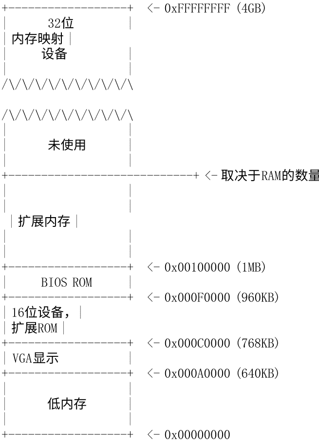

## x86指令集

- Intel语法：目的地，源（Intel手册！）
- AT&T（gcc/gas）语法：源，目的地（实验，xv6）
- 使用b、w、l后缀来指定操作数的大小
- 操作数可以是寄存器、常量、通过寄存器访问的内存、通过常量访问的内存

例子：

| AT&T语法 | "C"风格的等价语句 | 描述 |
|----------|-------------------|------|
| movl %eax, %edx | edx = eax; | 寄存器模式 |
| movl $0x123, %edx | edx = 0x123; | 立即数 |
| movl 0x123, %edx | edx = *(int32_t*)0x123; | 直接 |
| movl (%ebx), %edx | edx = *(int32_t*)ebx; | 间接 |
| movl 4(%ebx), %edx | edx = *(int32_t*)(ebx+4); | 位移 |

- 指令类别
  - 数据移动: MOV, PUSH, POP, ...
  - 算术: TEST, SHL, ADD, AND, ...
  - 输入/输出: IN, OUT, ...
  - 控制: JMP, JZ, JNZ, CALL, RET
  - 字符串: REP MOVSB, ...
  - 系统: IRET, INT

- 英特尔架构手册第2卷是参考资料

## gcc x86调用约定

- x86规定栈向下增长:

| 示例指令 | 它的作用 |
|----------|----------|
| pushl %eax | subl $4, %esp<br>movl %eax, (%esp) |
| popl %eax | movl (%esp), %eax<br>addl $4, %esp |
| call 0x12345 | pushl %eip (*)<br>movl $0x12345, %eip (*) |
| ret | popl %eip (*) |

(*)不是真正的指令

- GCC规定了栈的使用方式。 调用者和被调用者之间的协议在x86上:
  - 进入函数时 (即在调用之后):
    - %eip指向函数的第一条指令
    - %esp+4指向第一个参数
    - %esp指向返回地址
  - ret指令之后:
    - %eip包含返回地址
    - %esp指向调用者推送的参数
    - 被调用函数可能会破坏参数
    - %eax (如果返回类型是64位，则还有%edx) 包含返回值 (或者如果函数是void，则是垃圾)
    - %eax, %edx (上面) ，和%ecx可能会被破坏
    - %ebp, %ebx, %esi, %edi必须包含调用时的内容
  - 调用术语:
    - %eax, %ecx, %edx是“调用者保存”寄存器
    - %ebp, %ebx, %esi, %edi是“被调用者保存”寄存器

- 函数可以做任何不违反合同的事情。 按照惯例，GCC做更多的事情：

  - 每个函数都有一个由%ebp, %esp标记的堆栈帧

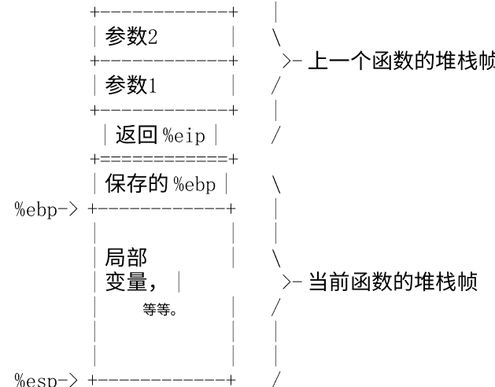

  - %esp 可以移动以使堆栈帧变大或变小
  - %ebp 指向前一个函数保存的 %ebp, 用于遍历堆栈
  - 函数序言：

```
pushl %ebp
movl %esp, %ebp
```

或

```
enter $0, $0
```

- enter 通常不使用: 4个字节 vs pushl+movl 的3个字节，不再是硬件快速路径

  - 函数尾声可以轻松在堆栈上找到返回的 EIP:

```
movl %ebp, %esp
popl %ebp
```

或

```
leave
```

- leave 经常使用，因为它只有1个字节，而 movl+popl 有3个字节

- 大例子:

  - C 代码

```
int main(void) { return f(8)+1; }
int f(int x) { return g(x); }
int g(int x) { return x+3; }
```

  - 汇编器

```
_main:
pushl %ebp
```

（序言）## 6.828 2017 讲座4: Shell和操作系统组织

讲座主题：
内核系统调用API
包括细节和设计
通过shell和作业2进行说明

### 概述图

用户/内核
进程 = 地址空间 + 线程
应用程序 -> printf() -> write() -> 系统调用 -> sys_write() -> ...
用户级库是应用程序的私有业务
内核内部函数不可被用户调用
xv6有几十个系统调用; Linux有几百个
今天的细节主要是关于UNIX系统调用API
是xv6、Linux、OSX、POSIX标准等的基础
jos有非常不同的系统调用; 你将在jos上构建UNIX调用

### 作业解答

- 让我们回顾一下作业2 (sh.c)
  - exec
    - 为什么execl()有两个参数?
    - 参数会发生什么?
    - 当exec'd进程完成时会发生什么?
    - execl()能返回吗?
    - 命令完成后，shell如何能够继续运行?
  - 重定向
    - exec'd进程如何了解重定向? [内核fd表]
    - 重定向(或错误退出)会影响主shell吗?
  - 管道
    - ls | wc -l
    - 如果ls的输出比wc的消耗快怎么办?
    - 如果ls比wc慢怎么办?
    - 每个命令如何决定何时退出?
    - 如果读取器没有关闭写端口怎么办? [试一试]
    - 如果写入器没有关闭读端口怎么办?
    - 内核如何知道何时释放管道缓冲区?
  - shell如何知道管道已完成?
    - 例如, ls | sort | tail -1
  - 进程树是什么?
    - sh解析为: ls | (sort | tail -1)
      - sh
      - sh1
    - ls     sh2
      - sort   tail
  - shell需要fork这么多次吗?
    - 如果sh对pcmd->left不进行fork会怎样? [试一试]
      - 即调用runcmd()而不进行fork?
    - 如果sh对pcmd->right不进行fork会怎样? [试一试]
      - 用户可见行为会改变吗?
      - sleep 10 | echo hi
  - 为什么只在管道进程都启动后才等待()?
    - 如果sh在第二次fork之前等待pcmd->left会怎样? [试一下]
    - ls | wc -l
    - cat < big | wc -l
  - 关键是系统调用可以以多种方式组合，以获得不同的行为。

### 让我们来看看挑战问题

- 如何使用”;”实现顺序执行?
  - gcc sh.c ; ./a.out
  - echo a ; echo b

### 为什么在scmd->right之前要wait()？ [试一下]

- 如何使用”&”实现后台执行？

```
$ sleep 5 &
$ wait
```

&和wait的实现在main函数中，为什么？如果后台进程在sh等待前退出会怎样？

- 如何实现嵌套？

```
$ (echo a; echo b) | wc -l
```

我的(...)实现只在sh的解析器中，而不是runcmd()函数中
很棒的是sh的管道代码不需要知道它应用于一个序列

- 这些有什么不同？

```
echo a > x ; echo b > x
( echo a ; echo b ) > x
```

是什么机制避免了覆盖？

### UNIX系统调用观察

- fork/exec分离看起来很浪费 - fork()复制内存，exec()丢弃。为什么不是例如pid=forkexec(path, argv, fd0, fd1)? fork/exec分离很有用: fork(); I/O重定向; exec() 或者fork(); 复杂嵌套命令; 退出。 如(cmd1; cmd2) | cmd3 仅fork(): 并行处理 仅exec(): /bin/login... exec("/bin/sh") 对于小程序来说，fork很便宜 - 在我的机器上: fork+exec花费400微秒 (每秒2500次) 仅fork花费80微秒 (每秒12000次) 涉及一些技巧 - 你将在jos中实现它们!

- 文件描述符设计:
  - FD是一种间接层
    - 进程的真实I/O环境被隐藏在内核中
    - 在fork和exec过程中保留
    - 将I/O设置与使用分离
    - 想象一下writefile(filename, offset, buf size)
  - FDs帮助使程序更通用: 不需要针对文件与控制台与管道的特殊情况

- 哲学：一小组概念上简单的调用很好地结合在一起
例如fork(), open(), dup(), exec()
命令行设计采用了类似的方法
ls | wc -l

- 为什么内核必须支持管道--为什么不让sh模拟它们，例如
ls > tempfile ; wc -l < tempfile

- 系统调用接口简单，只有整数和字符缓冲区。 为什么不让open()返回一个指向内核文件对象的指针引用？

- 核心UNIX系统调用非常古老；它们是否经受住了考验？
是的；非常成功
并且经过多年的发展得到了很好的演变
历史：设计迎合了命令行和软件开发
系统调用接口对程序员来说很容易使用
命令行用户喜欢命名文件、管道等
对于开发、调试、服务器维护很重要
但UNIX的思想并不完美：
对于系统调用API，程序员的方便通常不是很有价值
程序员使用隐藏系统调用细节的库，例如Python
应用程序可能与文件等几乎没有关系，例如在智能手机上
一些UNIX抽象并不是非常高效
对于多GB进程的fork()非常慢
FDs隐藏了可能很重要的细节
例如磁盘文件的块大小
例如网络消息的时间和大小

因此，对备选计划进行了大量工作
有时为现有类UNIX内核提供新的系统调用和抽象
有时对内核应该做什么采取全新的方法
问：“为什么要这样做？设计X不是更好吗？

## 操作系统组织

- 如何实现系统调用接口？

- 为什么不只是一个库？
即没有内核，直接在硬件上运行应用程序+库。
灵活：如果库不合适，应用程序可以绕过库
应用程序可以直接与硬件交互
对于单一用途设备，库是可以的
但是如果计算机用于多种活动怎么办？

- 内核的关键要求：隔离多路复用
交互

- 有用的方法：抽象资源而不是原始硬件
文件系统，而不是原始磁盘
进程，而不是原始CPU/内存
TCP，而不是以太网数据包
抽象通常可以简化隔离、多路复用和交互
也更方便和可移植

- 从隔离开始，因为这通常是最具约束力的要求。

- 隔离目标：
应用程序不能直接与硬件交互
应用程序不能损害操作系统
应用程序不能直接影响其他应用程序
应用程序只能通过操作系统接口与外界交互

- 处理器提供帮助隔离的机制
  - 硬件提供用户模式和内核模式
    - 一些指令只能在内核模式下执行
      设备访问、处理器配置、隔离机制
  - 硬件禁止应用程序执行特权指令
    - 而是陷入内核模式
    - 内核可以清理（例如，终止进程）
  - 硬件允许内核模式配置用户模式的各种限制
    最关键的是页面表，限制用户软件的地址空间

- 内核建立在硬件隔离机制之上

- 操作系统在内核模式下运行
  - 内核是一个大程序
    服务：进程、文件系统、网络
    低级别：设备、虚拟内存
    内核的所有部分都以完全的硬件特权运行（方便）

- 应用程序在用户模式下运行
  - 内核为每个进程设置独立的地址空间
  - 系统调用在用户模式和内核模式之间切换
    应用程序执行特殊指令进入内核
    硬件切换到内核模式
    但只能在内核指定的入口点

- 内核中放什么？

- xv6遵循传统设计：整个操作系统在内核模式下运行
  - 一个大程序，包括文件系统、驱动程序等
  - 这种设计称为单内核
  - 内核接口 == 系统调用接口
  - 优点：子系统易于合作
    文件系统和虚拟内存共享一个缓存

- 缺点：交互复杂
  容易导致错误
  内核内部没有隔离

### 微内核设计

- 许多操作系统服务作为普通用户程序运行
- 文件系统在文件服务器中
- 内核实现最小机制以在用户空间运行服务
- 具有内存的进程
- 进程间通信（IPC）
- 内核接口！= 系统调用接口
- 优点：更多的隔离
- 缺点：可能很难获得良好的性能

### exokernel：没有抽象

应用程序可以半直接地使用硬件，但操作系统进行隔离
例如，应用程序可以读/写自己的页表，但操作系统进行审计
例如，应用程序可以读/写磁盘块，但操作系统跟踪块的所有者
优点：对于要求高的应用程序更灵活
jos将是微内核和exokernel的混合

### 是否可以在没有硬件支持的内核/用户模式的情况下实现进程隔离？

是的！
请参考 Singularity 操作系统，本学期稍后讲解
但是硬件的用户/内核模式是最流行的计划

下讲：x86 硬件隔离机制和 xv6 的使用

## 6.828 2017 讲座5: 隔离机制

今天：
用户/内核隔离
以 xv6 系统调用为案例研究

## 如何选择内核的整体形式？

有很多可能的答案！
一个极端的例子：
只是一个设备驱动程序库，与应用程序链接
直接在硬件上运行应用程序
对于单一用途设备来说快速且灵活
但通常计算机上有多个任务

## 多个任务驱动关键需求：

- 多路复用
- 隔离
- 交互

## 有帮助的方法：抽象资源而不是原始硬件

文件系统，而不是原始磁盘
进程，而不是原始 CPU/内存
TCP 连接，而不是以太网数据包
抽象通常更容易隔离和共享
例如，程序看到一个私有的 CPU，不需要考虑多路复用
也更方便和可移植

## 隔离通常是最具约束性的要求。

## 什么是隔离？

强制分离以限制故障的影响
进程是通常的隔离单位
防止进程X破坏或监视进程Y
读/写内存，使用100%的CPU，更改FDs等
防止进程干扰操作系统
面对恶意和错误
一个糟糕的进程可能试图欺骗硬件或内核

## 内核使用硬件机制作为进程隔离的一部分：

- 用户/内核模式标志
- 地址空间
- 时间片分配
- 系统调用接口

## 硬件用户/内核模式标志

控制指令是否可以访问特权硬件
在x86上称为CPL，位于%cs寄存器的最低两位
CPL=0 -- 内核模式 -- 特权
CPL=3 -- 用户模式 -- 无特权
x86 CPL保护与隔离相关的许多处理器寄存器
I/O端口访问
控制寄存器访问 (eflags, %cs4, ...)
包括%cs本身
影响内存访问权限，但间接地
内核必须正确设置所有这些
每个严肃的微处理器都有一些用户/内核标志

## 如何进行系统调用 - 切换CPL

问：用户程序使用这种方式进行系统调用是否可以：
设置CPL=0
jmp sys_open
不好：用户指定的指令CPL=0
问：如何使用一个组合指令来设置CPL=0，
但*需要*立即跳转到内核中的某个地方？
不好：用户可能会跳转到内核中的某个尴尬位置
x86的答案是：
只有几个可允许的内核入口点 (“向量”)
INT指令设置CPL=0并跳转到一个入口点
但用户代码不能修改CPL或跳转到内核中的其他任何地方
系统调用返回之前将CPL设置为3，然后返回到用户代码 也是一个组合指令（不能分别设置CPL和jmp）

- 结果：用户与内核的明确定义概念 既不是CPL=3也不是执行用户代码 或者CPL=0并且从内核代码的入口点执行 不是： CPL=0并且执行用户代码 CPL=0并且在内核中的任何地方执行用户代码

- 如何隔离进程内存？ 思路：“地址空间” 为每个进程分配一些可以访问的内存 用于存放代码、变量、堆栈 防止其访问其他内存（内核或其他进程）

- 如何创建隔离的地址空间？ xv6使用x86 “分页硬件” 在内存管理单元（MMU）中 MMU将程序发出的每个地址转换（或“映射”） CPU -> MMU -> RAM | 页表 虚拟地址 -> 物理地址 MMU转换所有内存引用：用户和内核，指令和数据 指令只使用虚拟地址，从不使用物理地址 内核为每个进程设置一个不同的页表 每个进程的页表只允许访问该进程的RAM

## 让我们看看如何实现xv6系统调用

xv6进程/堆栈图： 用户进程；内核线程 用户堆栈；内核堆栈 两种机制： 在用户/内核之间切换 在内核线程之间切换 陷阱帧 内核函数调用... 结构体上下文

- 简化的xv6用户/内核虚拟地址空间设置FFFFFFFF：...

```
80000000: 内核用户栈用
户数据00000
000: 用户指令
```

内核配置MMU，仅允许用户代码访问较低的一半 每个进程有单独的地址空间 但是内核（高地址）映射对于每个进程都是相同的

```
系统调用起始点：
在用户空间执行，sh写入其提示符
sh.asm，write()库函数
break *0xb90
x/3i 0xb8b
eax中的0x10是write的系统调用号
info reg
cs=0x1b，B=1011 -- CPL=3 => 用户模式
esp和eip是低地址 -- 用户虚拟地址
x/4x $esp
ccl是返回地址 -- 在printf中
2是fd
0x3f7a是堆栈上的缓冲区
1是计数
即write(2, 0x3f7a, 1)
x/c 0x3f7a
```

INT指令，内核入口## 6.828 2016 讲座6: 虚拟内存

### 计划:
- 地址空间
- 分页硬件
- xv6虚拟内存代码
    - 案例研究
    - 完成第5讲
    - 作业解答

## 虚拟内存概述

- 今天的问题:
    - [用户/内核图]
    - [内存视图: 带有用户进程和内核的内存图]
    - 假设shell有一个错误:
        - 有时它会写入一个随机的内存地址
    - 我们如何防止它破坏内核?
        - 以及破坏其他进程?

- 我们希望有隔离的地址空间
    - 每个进程都有自己的内存
    - 它可以读写自己的内存
    - 它不能读写其他任何东西
    - 挑战:
        - 如何在一个物理内存上多路复用几个内存?
        - 同时保持内存之间的隔离

- xv6和JOS使用x86的分页硬件来实现地址空间
    - 提问! 这个材料很重要

- 分页为寻址提供了一层间接性
    - CPU -> MMU -> RAM
    - 虚拟地址 -> 物理地址
    - 软件只能对虚拟地址进行ld/st操作，不能对物理地址进行操作
    - 内核告诉MMU如何将每个虚拟地址映射到物理地址
        - MMU实际上有一个表，通过va索引，产生pa
        - 称为"页表"
    - MMU可以限制用户代码可以使用的虚拟地址

- x86映射4KB的"页"
    - 并对齐--从4KB边界开始
    - 因此页表索引是VA的前20位

- 页表项 (PTE) 中有什么?
    - 参见[讲义](x86_translation_and_registers.pdf)
    - 前20位是物理地址的前20位
        - "物理页号"
        - MMU用PPN替换VA的前20位
    - 低12位是标志位
        - 存在、可写等

- 页表存储在哪里?
    - 在RAM中--MMU加载 (和存储) PTEs
    - 操作系统可以读写PTEs

- 页表只是一个PTE数组合理吗?
    - 它有多大?
    - 2的20次方是一百万
    - 每个条目32位
    - 一个完整的页表需要4MB的空间 - 在早期的机器上非常大
    - 对于小程序来说会浪费很多内存!
        - 你只需要为几百个页面建立映射
        - 所以其他百万个条目会存在但是不需要

- x86使用"两级页表"来节省空间
    - 图表
    - PTE的页在RAM中
    - 页目录（PD）在RAM中
    - PDE还包含20位的PPN – 一个包含1024个PTE的页面
    - 1024个PDE指向PTE页面
    - 每个PTE页面有1024个PTE – 所以总共有1024*1024个PTE
    - PD条目可以无效
    - 这些PTE页面不需要存在
    - 所以一个小地址空间的页表可以很小

- mmu如何知道页表在RAM中的位置？
    - %cr3保存PD的物理地址
    - PD保存PTE页面的物理地址
    - 它们可以在RAM的任何地方 – 不需要连续

- x86分页硬件如何将虚拟地址转换为物理地址？
    - 需要找到正确的PTE
    - %cr3指向PD的物理地址
    - 前10位索引PD以获取PT的物理地址
    - 接下来的10位索引PT以获取PTE
    - 从PTE中获取PPN + 从VA中获取低12位

- PTE中的标志
    - P, W, U
    - xv6使用U来禁止用户使用内核内存

- 如果P位未设置怎么办？或者存储和W位未设置怎么办？
    - “页错误”
    - CPU保存寄存器，强制转移到内核
    - 在xv6源代码中的trap.c
    - 内核可以产生错误，终止进程
    - 或者内核可以安装一个PTE，恢复进程
    - 例如，从磁盘加载内存页之后

- 问题：为什么使用映射而不是基址/界限？
    - 间接性允许分页硬件解决许多问题
    - 例如，避免碎片化
    - 例如，写时复制fork
    - 例如懒惰分配（下一堂课的作业）
    - 还有许多其他技术
    - 下一堂课的主题

- 问：为什么在内核中使用虚拟内存？
    - 显然，为用户进程拥有页表是有好处的
    - 但为什么内核也要有一个页表呢？
    - 内核只使用物理地址能否运行？
    - 最高级的答案：是的
    - Singularity是一个使用物理地址的示例内核
    - 但是，大多数标准内核确实使用虚拟地址？
    - 为什么标准内核这样做？
    - 一些原因很糟糕，一些原因更好，但没有一个是根本的
        - 硬件使其难以关闭
            - 例如，在进入系统调用时，必须禁用虚拟内存
        - 内核使用用户地址可能很方便
            - 例如，将用户地址传递给系统调用
            - 但这可能是个坏主意：内核/应用程序之间的隔离不好
        - 如果地址是连续的，这很方便
            - 假设内核既有4K字节对象又有64K字节对象
            - 如果没有页表，我们很容易出现内存碎片化
            - 例如，分配64K，分配4K字节，释放64K，从64K字节中分配4K字节
            - 现在一个新的64K字节对象不能使用剩余的60K字节。
        - 内核必须在各种硬件上运行
            - 它们可能具有不同的物理内存布局

## 案例研究：xv6使用x86分页硬件

- xv6地址空间的整体图像 – 每个进程一个
    - [图表]
    - 0x00000000:0x80000000– 用户地址在KERNBASE以下
    - 0x80000000:0x80100000 – 映射低1MB设备（用于内核）
    - 0x80100000:? – 内核指令/数据
    - ? : 0x8E000000 – 映射224MB的DRAM在这里
    - 0xFE000000:0x00000000- 更多的内存映射设备

- xv6将这些区域映射到物理内存的哪里？
    - <!-- 书中的图表：xv6-layout.eps -->

- 注意用户页面的双重映射

- 每个进程都有自己的地址空间
    - 和自己的页表
    - 所有进程都有相同的内核（高内存）映射
    - 在切换进程时内核会切换页表（即设置%cr3）

- 问：为什么要这样安排地址空间？
    - 用户虚拟地址从零开始
    - 当然，每个进程的用户虚拟地址0都映射到不同的物理地址
    - 2GB用于用户堆的连续增长
    - 但不需要连续的物理内存--没有碎片问题
    - 内核和用户都映射--易于切换系统调用、中断
    - 内核在所有进程中映射到相同的位置
    - 方便进程切换
    - 内核可以读写用户内存
    - 使用用户地址，例如系统调用参数
    - 内核可以读写物理内存
    - 物理地址x映射到虚拟地址x+0x80000000
    - 我们将在操作页表时很快看到这一点

- 问：这个方案可以容纳最大的进程是多大？

- 问：通过增加/减少0x8可以增加这个容量吗？0000000?

- 问题：内核是否必须将所有物理内存映射到其虚拟地址空间中？

- 让我们看一下一些xv6虚拟内存代码
    - 术语：虚拟内存 == 地址空间/转换
    - 将有助于你完成下一个作业和实验
    - <!-- 从罗伯特离开的地方开始：第一个进程 -->
    - 设置：CPUS=1，在lapic.c中关闭中断
    - 在proc.c:297处
    - p *p
    - 问题：这些地址是虚拟地址吗？
    - 进入qemu：info pg (修改的6.828 qemu)
    - 进入switchuvm
    - x/1024x p->pgdir
    - 0x0dfbc007是什么？ (pde; 参见讲义)
    - 0x0dfbc000是什么?
    - 0x0dfbc000 + 0x80000000是什么?
    - 那里有什么? (pte)
    - 0x8dfbd000处有什么?
    - x x/i 0x8dfbd000 (initcode.asm的第一个字)
    - 通过lcr3步骤
    - qemu: 信息 pg
    - -->
    - 这个pgdir是在哪里设置的？
    - 看一下vm.c: setupkvm和inituvm

- 在vm.c中的mappages()函数
    - 参数是PD、va、size、pa、perm
    - 将一系列va的映射添加到相应的pa
    - 因为有些使用非页对齐的地址传递
    - 对于范围内的每个页对齐地址
        - 调用walkpgdir来找到PTE的地址
            - 需要PTE的地址（而不仅仅是内容）因为我们想要修改
        - 将所需的pa放入PTE中
        - 将PTE标记为有效的PTE_P
    - PD和c的图表，按照以下步骤构建

- 在vm.c中的walkpgdir()函数
    - 模拟了分页硬件如何找到地址的PTE
    - 参考手册
    - PDX提取了前十位
    - &pgdir[PDX(va)]是相关PDE的地址
    - 现在*pde是PDE
    - 如果PTE_P
        - 相关的页表页已经存在
        - PTE_ADDR从PDE中提取PPN
        - p2v()添加0x80000000因为PTE保存物理地址
    - 如果不是PTE_P
        - 分配一个页表页
        - 用PPN填充PDE -- 因此v2p
    - 现在我们想要的PTE在页表页中
        - 在偏移量PTX(va)处
        - 即va的第二个10位
    - <!--
    - 完成启动第一个用户进程
    - 返回到gdb
    - (绘制kstack的图片)
    - p /x p->tf
    - p /x *p->tf
    - p /x p->context
    - p /x p->context
    - b *0x0
    - swtch
    - x/8x $esp
    - forkret
    - x/19x $esp
    - info reg
    - 一直步进到用户空间:
    - x/i 0x0
    - 步进执行用户代码
    - 陷入内核
    - x/19x $esp
    - -->

## 跟踪和日期系统调用

- <!-- 作业
- 系统调用跟踪
    - syscall.c (HWSYS)
    - 返回值在eax中
    - 使用STAB打印出名称
- date
    - usys.S

- 一个进程调用sbrk(n)请求n个字节的堆内存
    - malloc()使用sbrk()
    - 每个进程都有一个大小
    - 内核在进程的末尾添加新的内存，增加大小
    - sbrk()分配物理内存(RAM)
    - 将其映射到进程的页表中
    - 返回新内存的起始地址

- sys_sbrk()在sysproc.c中
    - 从用户空间跟踪sbrk
    - 只需运行ls (或来自shell的任何其他命令)
    - 由shell分叉的新进程为execcmd结构调用malloc
    - malloc.c调用sbrk

- growproc()在proc.c中
    - proc->sz是进程的当前大小
    - allocuvm()完成大部分工作
    - switchuvm使用新的页表设置%cr3
    - 还刷新一些MMU缓存，以便看到新的PTE

- allocuvm()在vm.c中
    - 为什么是if (newsz >= KERNBASE)?
    - 为什么PGROUNDUP?
    - mappages()的参数...

## 保护模式地址转换

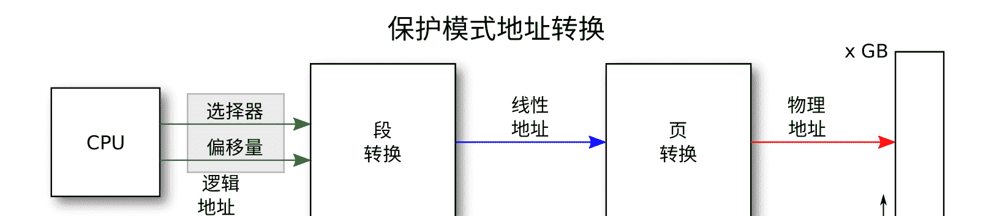

逻辑地址

线性地址

物理地址

| 选择器 (16) | 偏移量 (32) |
|-------------|-------------|
| 目录表偏移 (10) | 表偏移 (10) | 页内偏移 (12) |
| PPN (20) | 偏移量 (12) |
| 基址 (32) | 限制 (20) | 标志 (12) |
| GDT/LDT | |
| PPN (20) | 标志 (12) |
| PPN (20) | 标志 (12) |
| 页表 | CR3 |
| 页目录 | |
| PDE (页表物理页号 31:12, AVL, G, PS, 0, A, CD, WT, U, W, P) | |
| PTE (物理页号 31:12, AVL, G, PAT, D, A, CD, WT, U, W, P) | |
| P 存在 | |
| W 可写 | |
| U 用户 | |
| WT 1=写透, 0=写回 | |
| CD 缓存禁用 | |
| A 已访问 | |
| D 脏 | |
| PS 页面大小 (0=4KB, 1=4MB) | |
| PAT 页面表属性索引 | |
| G 全局页面 | |
| AVL 系统使用可用 | |

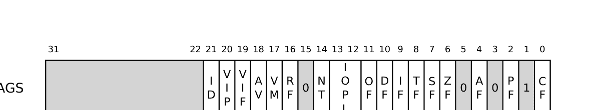

| 状态标志 | 控制标志 | 系统标志 |
|----------|----------|----------|
| CF 进位标志 | DF 方向标志 | RF 恢复标志 |
| PF 奇偶标志 | TF 陷阱标志 | VM 虚拟-8086模式 |
| AF 辅助进位标志 | IF 中断使能标志 | AC 对齐检查 |
| ZF 零标志 | IOPL I/O特权级 | VIF 虚拟中断标志 |
| SF 符号标志 | NT 嵌套任务 | VIP 虚拟中断挂起 |
| OF 溢出标志 |  | ID ID标志 |

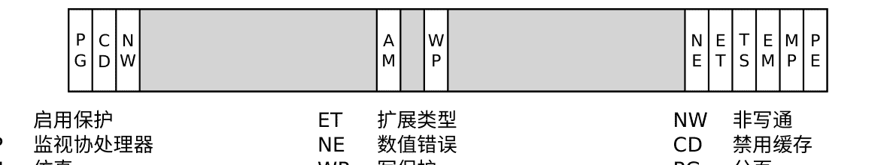

| 启用保护 | 扩展类型 | 非写通 |
|----------|----------|----------|
| PE 启用保护 | ET 扩展类型 | NW 非写通 |
| MP 监视协处理器 | NE 数值错误 | CD 禁用缓存 |
| EM 仿真 | WP 写保护 | PG 分页 |
| TS 任务切换 | AM 对齐掩码 |  |

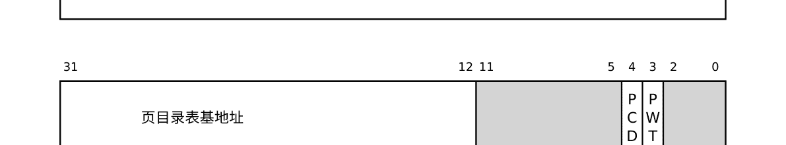

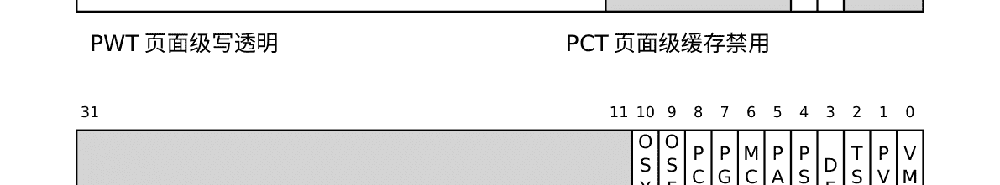

- PWT 页面级写透明
- PCT 页面级缓存禁用


| 左列 | 右列 |
|------|------|
| VME 虚拟-8086模式扩展 | MCE 机器检查使能 |
| PVI 保护模式虚拟中断 | PGE 页面全局使能 |
| TSD 时间戳禁用 | PCE 性能计数器使能 |
| DE 调试扩展 | OSFXSR 操作系统FXSAVE/FXRSTOR支持 |
| PSE 页面大小扩展 | OSXMMEXCPT 操作系统未屏蔽异常支持 |
| PAE 物理地址扩展 |  |


- TI 表索引 (0=GDT, 1=LDT)
- RPL 请求者特权级别

stepi

info reg

cs=0x8 -- CPL=3 => 用户模式
注意：中断将eip和esp更改为高内核地址

eip在哪里？
在内核提供的向量处 -- 用户只能进入这个地方
因此用户程序不能以CPL=0跳转到内核的随机位置

x/6wx $esp

中断保存了一些用户寄存器
err, eip, cs, eflags, esp, ss

为什么中断只保存这些寄存器？
它们是中断要覆盖的寄存器

中断的操作：
切换到当前进程的内核栈
在内核栈上保存一些用户寄存器
设置CPL=0
在内核提供的“向量”处开始执行

esp从哪里来？
内核在创建进程时告诉硬件要使用哪个内核栈

问：为什么中断要保存用户状态？
应该保存多少状态？
透明度 vs 速度

在内核栈上保存其余的用户寄存器

trapasm.S alltraps

pushal指令将8个寄存器推入栈中: eax..edi

x/19x $esp

内核栈顶部有19个字：

+   - ss
- esp
- eflags
- cs
- eip
- err -- 从这里开始保存的中断
- trapno
- ds
- es
- fs
- gs
- eax..edi

当系统调用返回时，将最终恢复这些值
同时，内核C代码有时需要读取/写入保存的值
在x86.h中的struct trapframe

问：为什么用户寄存器要保存在内核栈上？
为什么不将它们保存在用户栈上？

进入内核C代码

pushl %esp创建了一个trap(struct trapframe *tf)的参数

现在我们在trap()中的trap.c中
打印tf
打印*tf

内核系统调用处理

设备中断和故障也会进入trap()

trapno == T_SYSCALL

myproc()

在proc.h中的struct proc

myproc()->tf-- 这样syscall()可以访问调用号和参数

syscall()在syscall.c中

查看tf->eax以找出映射到sys_write的SYS_write系统调用

用sys_write()在sysfile.c中

arg*()从用户栈中读取write(fd, buf, n)参数

syscall.c中的argint()

proc->tf->esp + xxx

恢复用户寄存器

syscall()将tf->eax设置为返回值
返回到trap()
完成--返回到trapasm.S
info reg--仍在内核中，寄存器被内核代码覆盖
stepi到iret
info reg
大多数寄存器保存恢复的用户值
eax具有write()的返回值1
esp、eip、cs仍然具有内核值
x/5x $esp
保存的用户状态：eip、cs、eflags、esp、ss
IRET从堆栈中弹出这些用户寄存器
从而以CPL=3重新进入用户空间

问题：我们真的需要IRET吗？
我们能否使用普通指令来恢复寄存器？
IRET能更简单吗？

回到用户空间

+   * stepi
* info reg

## *** fork()

让我们看看fork()如何设置一个新的进程
特别是，如何让新的进程第一次进入用户空间？
这个想法是：
fork()伪造一个内核栈，看起来像是要从trap()返回
在顶部有一个伪造的trapframe
子进程在内核中开始执行--在一个函数返回指令处
alltraps “恢复” 伪造的保存寄存器
开始执行子进程的第一次

注意有两个独立的动作：

+   * 创建一个新的进程
* 执行新的进程

打断fork

+   * c
* where

## 在proc.c中的fork()

allocproc()

+   * 查看proc[]在proc.c的开头
* 关注p->kstack的初始内容
* 为trap frame分配空间 (将是父进程的副本)
* 伪造的保存EIP指向trapasm.S中的trapret
* 内核栈空间用于 “上下文”
    * 包含*内核*寄存器
    * 在切换到子内核线程时恢复
* proc.h

p->context->eip = forkret 设置子进程在内核中开始的位置
基本上只是一个函数调用指令

## 回到fork()

+   * (记住我们仍然作为父进程执行)
* 分配物理内存和页表
* 将父进程的内存复制到子进程
* 复制陷阱帧

tf->eax = 0 -- 这将是子进程从fork()返回的值
打印 *np
打印 *np->tf
打印 *np->context
x/25x np->context
state = RUNNABLE -- 现在我们完成了

新进程的内核栈：

trapframe -- 父进程的副本，但eax=0

trapret的地址

context
    eip = forkret

打断forkret

x/20x $esp

下一步

完成

> (现在在trapasm.S的trapret中)

at b6a in sh.S

info reg

而且eax为零 -- 这是子进程## 计划：使用虚拟内存的酷东西

-   更好的性能/效率。
    -   例如，一个填充零的页面。
    -   例如，写时复制fork。
-   新功能。
    -   例如，内存映射文件。
-   JOS和虚拟内存。
-   这个讲座可能会为最后的实验（期末项目）提供一些想法。

> <!--
隔离：有墙的图片。
返回用户空间，直到我们遇到第一个系统调用，然后切换到日期作业。
日期系统调用作业。
指出一些墙壁：
U/K位，用户不能执行特权指令，用户只能通过系统调用进入内核，只有内核可以加载cr3。
页表，内核页面上没有U位。
但是也有共享：
内核可以读写用户内存，需要内核检查系统调用的参数。
-->

## 虚拟内存：多个视图

-   主要目的：隔离。
    -   每个进程都有自己的地址空间。
-   虚拟内存提供了一种间接层。
    -   为内核提供了做酷炫事情的机会。

## 惰性/按需页面分配

-   sbrk()是老式的。
    -   它要求应用程序“预测”他们需要多少内存。
        -   应用程序很难预测他们需要多少内存。
        -   sbrk分配的内存可能永远不会被使用。
-   现代操作系统按需分配内存。
    -   应用程序需要时分配物理内存。
-   硬件解决方案。

> <!----
绘制xv6用户地址空间的一部分。
演示解决方案；在trap.c的mappages之前设置断点。
解释页面错误。
-->

> <!--
xv6内存布局讨论。
用户虚拟地址从零开始。
当然，每个进程的用户虚拟地址0都映射到不同的物理地址。
2GB用于用户堆的连续增长。
但不需要连续的物理内存--没有碎片问题。
内核和用户都映射--易于切换系统调用、中断。
内核在所有进程中映射到相同的位置。
方便进程切换。
内核可以读写用户内存。
使用用户地址，例如系统调用参数。
内核可以读写物理内存。
物理地址x映射到虚拟地址x+0x80000000。
我们将在操作页表时很快看到这一点。
无聊的部分：用户栈。
还有，initcode和date（不同的AS布局）。
-->

但方便检查地址是否有效（va < p->size）。

## 为什么内核使用虚拟内存？

-   退一步：从类的角度来看。
    -   设计操作系统没有一种最佳方式。许多操作系统使用虚拟内存，但你不必使用。
    -   Xv6和JOS提供了操作系统设计的示例。它们缺少许多复杂设计的特性。事实上，与真正的操作系统相比，它们相当无聊。然而，仍然相当复杂。
    -   我们的目标：教给你关键的思想，以便你可以推广。Xv6和JOS是最小设计，以展示关键思想。你应该能够使它们更好。你应该能够深入研究Linux并找到自己的方式。

-   使用守护页来防止栈溢出。
    -   在用户栈下方放置一个未映射的页面。
        -   如果栈溢出，应用程序将看到页面错误。
    -   当应用程序运行到守护页时，分配更多的栈空间。

> <!--
绘制xv6用户地址空间的一部分。
使用-0编译，这样编译器就不会优化尾递归。
演示stackoverflow。
在g处设置断点。
运行stackoverflow。
查看$esp。
在qemu控制台查看pg信息。
注意页面没有U位。
-->

-   一个填充了零的页面。
    -   内核经常用零填充一个页面。
    -   思路：memset *一个*页面为零。当内核需要填充零的页面时，将该页面设置为写时复制。在写操作时，复制页面并将其映射为应用程序地址空间的读写。

-   在xv6中共享内核页表。
    -   观察：kvmalloc()为每个进程分配新的内核页表页面，但是所有进程都有相同的内核页表。
    -   思路：修改kvmalloc()/freevm()以共享内核页表。

> <!--
演示HWKVM。
-->

-   写时复制fork。
    -   观察：xv6的fork从父进程复制所有页面（参见fork()），但是fork通常紧接着是exec。
    -   思路：在父子进程之间共享地址空间。修改fork()函数以实现页面写时复制（使用PTEs和PDEs中的额外可用系统位）。在页面错误时，复制页面并将其映射为读写。

-   需求分页。
    -   观察：exec将整个文件加载到内存中（参见exec.c）。代价高：需要时间来完成（例如，文件存储在慢速磁盘上）。不必要：可能不会使用整个文件。
    -   思路：按需从文件中加载页面。分配页表项，但标记为按需。在错误发生时，从文件中读取页面并更新页表项。
    -   挑战：文件大于物理内存（参见下一个思路）。

-   使用比物理内存更大的虚拟内存。
    -   观察：应用程序可能需要比物理内存更多的内存。
    -   思路：将地址空间中使用频率较低的部分存储在磁盘上。透明地对地址空间的页面进行页面调入和页面调出。
    -   适用于工作集适合物理内存的情况。

-   内存映射文件。
    -   想法：使用加载和存储允许访问文件。可以轻松读取和写入文件的一部分。例如，不需要使用lseek系统调用更改偏移量。
    -   按需分页文件的页面。当内存已满时，将不经常使用的文件页面换出。

-   共享虚拟内存。
    -   想法：允许不同机器上的进程共享虚拟内存。在网络上提供物理共享内存的幻觉。
    -   复制只读的页面。
    -   写入时使副本无效。

-   JOS和虚拟内存。
    -   布局：[图片](l-josmem.html)。

-   UVPT技巧 (实验4)。
    -   递归地将PD映射到0x3BD。PD的虚拟地址是 (0x3BD<<22) | (0x3BD<<12)。
    -   如果我们想要找到虚拟页n的pte，计算 pde_t uvpt[n]，其中uvpt是 (0x3BD << 22) = uvpt + n * 4 (因为pdt是一个字) = (0x3BD << 22) | (n的前10位) | (n的后10位) << 2 = 10 | 10 | 12。
    -   例如，uvpt[0]是地址 (0x3BD << 22)，跟随指针可以得到页目录的第一个条目，它指向第一个页表，我们用0索引，得到pte 0。
    -   比pgdirwalk()更简单吗？

-   用户级写时复制fork (lab4)。
    -   JOS将页面错误传播到用户空间。用户程序可以像内核一样进行类似的虚拟内存技巧！你将实现用户级写时复制fork。

## 我们将如何在JOS中使用分页（和段）：

-   只使用段来在内核中切换特权级别。
-   使用分页来构造进程的地址空间。
-   使用分页来限制进程对其自身地址空间的内存访问。
-   下面是JOS的虚拟内存映射。
-   为什么映射内核和当前进程？为什么不是每个都是4GB？这与xv6相比如何？
-   为什么内核在顶部？
-   为什么将所有物理内存映射到顶部？即为什么需要多个映射？
-   (稍后将讨论UVPT...)
-   如何为不同的进程切换映射？

| 虚拟地址范围 | 描述 | 权限 |
| :--- | :--- | :--- |
| 4GB ----------- --> +-------------------------+ | | |
| | | RW/-- |
| ~~~~~~~~~~~~~~~~~~~~~~~~~~~~~~~ | | |
| : | | |
| : | | |
| : | | |
| ~~~~~~~~~~~~~~~~~~~~~~~~~~~~~~~ | | |
| | | RW/-- |
| | | RW/-- |
| | 重新映射的物理内存 | RW/-- |
| | | RW/-- |
| KERNBASE, ----> +-------------------------+ 0xf0000000 --+ | | |
| KSTACKTOP | | CPU0的内核栈 | RW/-- KSTKSIZE | | |
| | - - - - - - - - - - - - - -| | | |
| | | 无效内存 (*) | --/-- KSTKGAP | | |
| +-------------------------+ | | |
| | | CPU1的内核栈 | RW/-- KSTKSIZE | | |
| | - - - - - - - - - - - - - -| | PTSIZE | |
| | | 无效内存 (*) | --/-- KSTKGAP | | |
| +-------------------------+ | | |
| : | | | |
| : | | | |
| MMIOLIM ------> +-------------------------+ 0xefc0000 --+ | | |
| | | 内存映射I/O | RW/-- PTSIZE | |
| ULIM, MMIOBASE -> +-------------------------+ 0xef80000 | | |
| | | 当前页表 (用户R-) | R-/R- PTSIZE | |
| UVPT ------> +-------------------------+ 0xef40000 | | |
| 用户页面 ------> | | 只读页面 | R-/R- 页表大小 | |
| +-------------------------+ 0xef00000 | | |
| | | 只读环境 | R-/R- 页表大小 | |
| 用户顶部，用户环境 -> +-------------------------+ 0xeec00000 | | |
| 用户异常栈顶 -/ | | 用户异常栈 | 读写/读写 页面大小 | |
| +-------------------------+ 0xeebff000 | | |
| | | 空内存 (*) | --/-- 页面大小 | |
| 用户栈顶 ------> +-------------------------+ 0xeebfe000 | | |
| | | 普通用户栈 | 读写/读写 页面大小 | |
| +-------------------------+ 0xeebfd000 | | |
| | | | |
| ~~~~~~~~~~~~~~~~~~~~~~~~~~~~~~~ | | |
| . | | |
| . | | |
| . | | |
| ~~~~~~~~~~~~~~~~~~~~~~~~~~~~~~~ | | |
| | 程序数据和堆 | | |
| 用户文本 --------> +-------------------------+ 0x00800000 | | |
| 页面临时存储 ----> | | 空内存 (*) | PTSIZE | |
| 用户临时存储 ----> +-------------------------+ 0x00400000 --+ | | |
| | | 空内存 (*) | | |
| | - - - - - - - - - - - - -| | |


## 用户虚拟页表

我们有一个很好的页面表的概念模型，它是一个2^20个条目的数组，我们可以用物理页号进行索引。x86的两级分页方案打破了这一点，通过将巨大的页表分割成许多页表和一个页目录。我们希望以某种方式恢复巨大的概念性页表 - JOS中的进程将查看它来了解其地址空间中发生的情况。但是如何做到呢？

幸运的是，分页硬件非常适合这个任务 - 将一组分散的页面组合成一个连续的地址空间。事实证明，我们已经有一个指向所有分散页面表的指针表：它就是页目录！

因此，我们可以使用页目录作为页面表，将我们的概念性巨大的2^22字节页面表（由1024个页面表示）映射到虚拟地址空间中的某个连续的2^22字节范围。通过将PDE条目标记为只读，我们可以确保用户进程无法修改其页面表。

谜题：我们需要创建一个单独的UVPD映射吗？

更详细地理解这个配置的方法：

还记得X86如何将虚拟地址转换为物理地址吗：

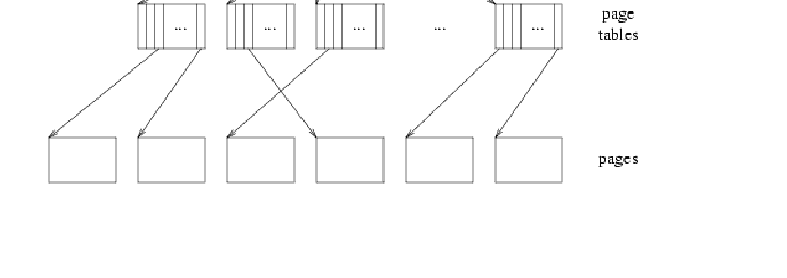

CR3指向页目录。地址的PDX部分用于索引页目录以获得页面表。地址的PTX部分用于索引页面表以获得页面，然后再加上低位。

但是处理器对于页目录、页表和页面没有概念，它们只是普通的内存。 因此，并没有规定一个内存中的特定页面不能同时充当两个或三个角色。 处理器只是按照指针进行操作：`pd = lcr3(); pt = *(pd+4*PDX); page = *(pt+4*PTX);`

从图示上看，它从CR3开始，沿着三个箭头进行操作，然后停止。

如果我们在页目录中放置一个指向自身的指针，如下所示

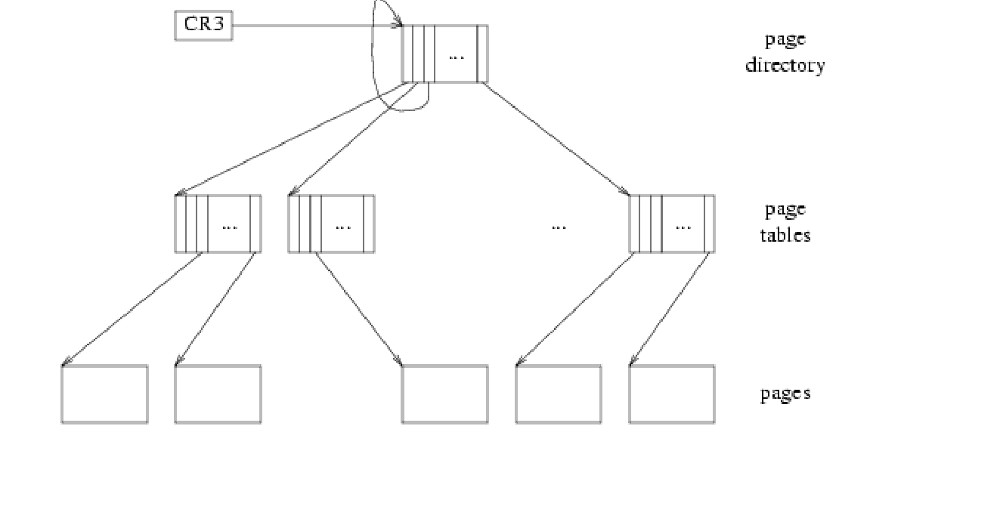

那么当我们尝试使用PDX和PTX等于V来转换虚拟地址时，沿着三个箭头会让我们停在页目录上。因此，该虚拟页面将被转换为保存页目录的页面。在Jos中，V为0x3BD，所以UVPD的虚拟地址为(0x3BD<<22)|(0x3BD<<12)。

现在，如果我们尝试使用PDX = V但是任意的PTX != V来转换虚拟地址，那么从CR3开始沿着三个箭头会停在比平常高一级的位置（而不是上一种情况下的两级），也就是说在页表上。因此，具有PDX=V的虚拟页面集合形成了一个4MB的区域，对于处理器来说，该区域的页面内容就是页表本身。在Jos中，V为0x3BD，所以UVPT的虚拟地址为(0x3BD<<22)。

因为我们巧妙地在页目录中插入了一个“no-op”箭头，所以我们将正在使用的页映射为页目录和页表（通常是虚拟不可见的）到虚拟地址空间中。

## 6.828 2017 讲座8：系统调用、中断和异常

让我们从作业开始。

```
alarmtest.c
    alarm(10, 周期性)
    请求内核每10个“滴答”调用周期性()在此进程中
    也就是说，该进程消耗的CPU时间每10个滴答
```

-   三个部分：
    -   添加一个新的系统调用。
    -   计算程序运行时的滴答数（定时器中断）。
    -   内核“上调用”周期性()。

对periodic()的调用是一个简化的UNIX信号。

## 新系统调用的粘合剂

```
syscall.h: #define SYS_alarm 22
usys.S: SYSCALL(alarm)
    alarmtest.asm -- mov $0x16, %eax -- 0x16是SYS_alarm
syscall.c syscalls[]表
sysproc.c sys_alarm()
```

## 为什么要有这么多机械？

从高层次来看，alarmtest只是想要调用sys_alarm函数。它必须通过INT、SYS_alarm间接调用以保持隔离。

## 中断sys_alarm

-   在哪里？
    -   系统调用如何知道哪个系统调用？trapframe，在内核栈上，保存了用户的eax。打印myproc()->tf->eax。
    -   sys_alarm在哪里找到参数ticks和handler？在用户栈上。x/4x myproc()->tf->esp。
    -   handler的值有意义吗？在alarmtest.asm中查看。

现在我们需要在计时器硬件中断时采取一些行动。

-   递减ticksleft。
    -   如果过期：调用handler (periodic())，重置ticksleft。

设备中断与INT和页面错误一样到达。硬件将esp和eip推入内核栈。软件将其他寄存器保存到trapframe中。向量，alltraps，trap()。

计时器中断由trap()中的IRQ_TIMER case处理。原始的IRQ_TIMER任务是跟踪滴答钟时间，以ticks为单位。

## 执行到没有实现的陷阱

-   中断向量32。
    -   在哪里？打印/x tf->eip，打印/x tf->esp，x/4x tf->esp。

## 用户程序在这一点上在做什么？

-   alarmtest.asm中的tf->eip。
    -   用户代码可能在任何地方被中断。所以我们不能依赖于用户栈的任何内容。而且我们需要精确地恢复寄存器，因为程序没有保存任何东西。

## 问题：如何安排调用上行到闹钟处理程序？

-   调用myproc()->alarmhandler()? tf->eip = myproc()->alarmhandler ?

## 问题：如何确保处理程序返回到中断的用户代码？

添加我们的代码…在没有gdb的情况下运行alarmtest。

让我们用gdb运行
list trap以找到断点
在赋值之前打印/x tf->eip
在赋值之后打印/x tf->eip
break *0x74
c
info reg
它会在alarmtest.asm中返回到一个合理的地方吗？
x/4x $esp

问题：我的新trap()代码中存在什么安全问题？

问：如果trap()直接调用alarmhandler()会怎么样？

-   这是一个坏主意
-   但是到底会出什么问题呢？
-   让我们试试吧
-   它不会崩溃！
-   但是它也不会打印出alarm！为什么呢？
-   fetchint...
-   显然它会返回到用户空间（打印.）- 怎么做到的？
-   程序，定时器陷阱，alarmhandler()，INT，sys_write("alarm!")，返回...
-   堆栈图

令人不安的是，这几乎就要成功了！

-   为什么内核代码可以直接跳转到用户指令？
-   为什么用户指令可以修改内核堆栈？
-   为什么系统调用（INT）可以在内核中工作？
-   这些都不是xv6的预期特性！
-   x86硬件并没有直接提供隔离
-   x86有许多独立的特性（页表，INT等）
-   可以配置这些特性来强制实现隔离
-   但隔离不是默认的！

问：如果只是tf->eip = alarmhandler，但不压入旧的eip会发生什么？

-   让我们试试吧
-   用户堆栈图

问：如果trap()没有检查CPL 3会发生什么？

-   让我们试试吧 - 似乎可以工作！
-   tf->cs&3 == 0怎么可能出现在alarmtest中？
-   让我们通过(tf->cs&3)==0强制情况
-   并使alarmtest永远运行
-   来自cpu 0的意外trap 14 eip 801067cb (cr2=0x801050cf)
-   kernel.asm中的eip 0x801067cb是什么？
-   tf->esp = tf->eip在trap()中。
-   发生了什么？
-   这是一个CPL=0到CPL=0的中断
-   所以硬件没有切换堆栈
-   所以它没有保存%esp
-   所以tf->esp包含垃圾
-   （参见x86.h中trapframe末尾的注释）
-   更重要的是，在内核中（在xv6中，而不是JOS）可能发生中断

问：如果用户提供的alarm处理程序指向内核会发生什么？

(带有正确的trap()代码)

问：如果在用户处理程序中另一个定时器中断发生了怎么办？

-   虽然能够工作，但容易混淆，并且最终会耗尽用户堆栈
-   也许内核在处理程序函数完成之前不应重新启动定时器

问：如果periodic()修改了寄存器会有问题吗？

我们如何安排在返回之前恢复寄存器？

让我们退后一步，更加普遍地讨论中断

总体主题：硬件现在需要注意！

软件必须搁置当前工作并做出响应

## 陷阱从哪里来？

-   （我使用“陷阱”作为一个通用术语）
-   设备 – 数据准备好，或完成一个动作，准备进行更多操作
-   异常/故障 – 页面错误，除零等
-   INT – 系统调用
-   IPI – 内核CPU到CPU的通信，例如刷新TLB

## 设备中断从哪里来？

图表：
  CPU, LAPIC, IOAPIC, 设备
  数据总线
  中断总线
中断告诉内核设备硬件需要注意
驱动程序（在内核中）知道如何告诉设备做事情
通常中断处理程序调用相关驱动程序
  但也可以有其他安排（调度线程；轮询）

## trap()如何知道哪个设备中断了？

即tf->trapno == T_IRQ0 + IRQ_TIMER是从哪里来的？
内核告诉LAPIC/IOAPIC要使用哪个向量号，例如计时器是向量32
   页面错误等也有向量
   LAPIC / IOAPIC是标准的PC硬件组件
   每个CPU有一个LAPIC
IDT将每个向量号与指令地址关联起来
   IDT格式由Intel定义，由内核配置
每个向量都跳转到alltraps
CPU通过IDT发送多种类型的陷阱
   低32个IDT条目具有特殊的固定含义
xv6设置系统调用（IRQ）使用IDT条目64（0x40）
关键是：向量号揭示了中断的来源

图表：
  IRQ或陷阱，IDT表，向量，alltraps
IDT:
  0: 除以零
  13: 通用保护
  14: 页面错误
  32-255: 设备IRQs
  32: 定时器
  33: 键盘
  46: IDE
  64: INT

## 让我们来看看xv6如何设置中断向量机制

lapic.c/lapicinit() -- 告诉LAPIC硬件使用向量32作为定时器
trap.c/tvinit() -- 初始化IDT，使得入口i指向向量[i]处的代码
   这主要是机械的，IDT条目盲目对应于向量
   但是T_SYSCALL的1（而不是0）告诉CPU在系统调用期间保持中断启用
   但在设备中断期间不启用
   问：为什么允许在系统调用期间中断？
   问：为什么在中断处理期间禁用中断？
vectors.S（由vectors.pl生成）
   第一个push伪造了trapframe中的“error”槽，因为硬件对于某些陷阱不会进行push
   第二个push只是向量号
      这在trapframe中显示为tf->trapno

## 硬件如何知道在中断时使用哪个堆栈？

当它从用户空间切换到内核空间时
硬件定义的TSS（任务状态段）允许内核配置CPU
   每个CPU一个
   因此，每个CPU可以运行不同的进程，在不同的堆栈上进行陷阱处理
proc.c/scheduler()
   每个CPU一个
vm.c/switchuvm()
   告诉CPU使用哪个内核堆栈
   告诉内核使用哪个页表

## 问题：当陷入内核时，CPU应该保存哪个eip？

正在执行的指令的eip？
下一条指令的eip？
假设陷阱是页面错误？

## 一些设计注意事项

-   中断以前相对较快；现在变慢了
    -   旧方法：每个事件都会引发中断，简单的硬件，智能的软件
    -   新方法：硬件在中断之前完成大量工作
-   中断大约需要一微秒的时间
    -   保存/恢复状态
    -   缓存未命中
-   一些设备的事件生成速度比每微秒一次更快
    -   例如，千兆以太网每秒可以传输150万个小数据包
-   对于高速设备，使用轮询而不是中断
    -   如果事件一直在等待，就不需要不断提醒软件
-   对于低速设备，例如键盘，使用中断
    -   持续轮询会浪费CPU
-   在轮询和中断之间自动切换
    -   当速率较低时中断（轮询会浪费CPU周期）
    -   当速率较高时轮询（中断会浪费CPU周期）
-   更快地将中断转发到用户空间
    -   用于页面错误和用户处理的设备
    -   硬件直接传递给用户，无需内核干预？
    -   更快的内核转发路径？

我们将在课程后面看到许多这些主题

## 中断/陷阱门

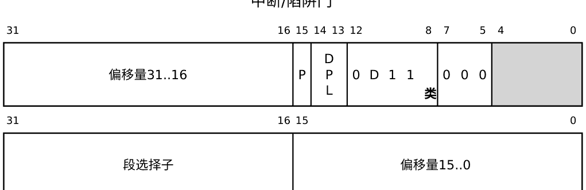

-   类型: 0=中断门, 1=陷阱门
-   选择子: 目标代码段
-   偏移量: 目标指令指针或EIP
-   P: 存在
-   DPL: 描述符特权级别 (调用门所需的CPL)
-   D: 门的大小 (0=16位, 1=32位)

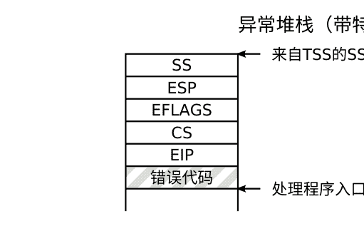

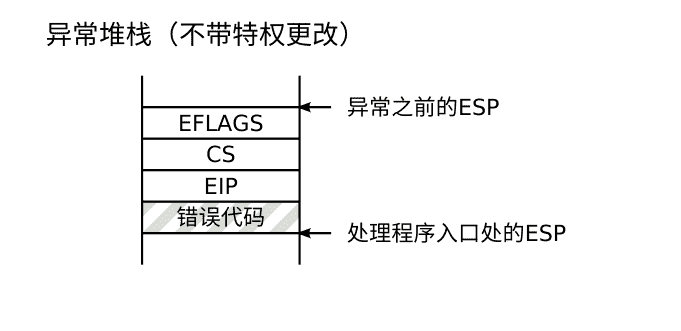

| 向量 | 描述 | 类型 | 错误代码 | 异常类型 |
|------|------|------|----------|----------|
| 0 | 除法错误 | 故障 | 否 | 故障 未执行故障指令 |
| 1 | 保留 | | | CS:EIP是故障指令 |
| 2 | 不可屏蔽中断 | 中断 | 否 | 陷阱 陷阱指令已执行 |
| 3 | 断点 | 陷阱 | 否 | CS:EIP是下一条指令 |
| 4 | 溢出 | 陷阱 | 否 | 中止 位置不精确；无法 |
| 5 | BOUND范围超出 | 故障 | 否 | 安全地恢复执行 |
| 6 | 无效/未定义的操作码 | 故障 | 否 | |
| 7 | 无数学协处理器 | 故障 | 否 | |
| 8 | 双重错误 | 中止 | 零 | |
| 9 | 保留 | | | |
| 10 | 无效的TSS | 故障 | 是 | |
| 11 | 段不存在 | 故障 | 是 | |
| 12 | 堆栈段错误 | 故障 | 是 | |
| 13 | 通用保护 | 故障 | 是 | |
| 14 | 页面错误 | 故障 | 是 | |
| 15 | 保留 | | | 否 |
| 16 | x87 FPU错误 | 故障 | 否 | |
| 17 | 对齐检查 | 故障 | 零 | |
| 18 | 机器检查 | 中止 | 否 | |
| 19 | SIMD FP异常 | 故障 | 否 | |
| 20-31 | 保留 | | | |
| 32-255 | 用户定义的中断 | 中断 | 否 | |

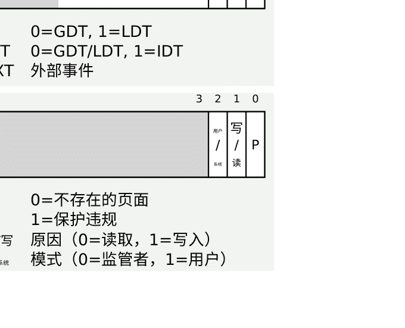

## 6.828 2016: 锁定

为什么要谈论锁定？
应用程序希望使用多核处理器进行并行加速
因此内核必须处理并行系统调用
以及并行访问内核数据（缓冲区缓存、进程等）
锁有助于正确共享数据
锁可以限制并行加速

## 锁定作业

回想一下：ph.c，多线程哈希表，put()，get()
查看ph0.c
问：为什么在多个核心上运行ph.c？
    图表：CPU，总线，RAM
    假设：CPU是瓶颈，可以在CPU之间分配工作
问：我们能否击败单核心的put()时间？单核心的get()时间？

```
./ph0 1
```

问：如何测量并行加速度？

```
./ph0 2
```

单位时间内的工作量增加一倍！
问：丢失的键在哪里？
问：具体的场景？
    图表...
    table[0] = 15
    并发put(5)，put(10)
    两个insert()都分配了新的条目，并指向15
    两个都将table[0]设置为它们的新条目
    最后一个插入者获胜，另一个被丢弃！
    称为“丢失更新”；是“竞争”的一个例子
    竞争=并发访问；至少有一个写入
问：锁/解锁应该放在哪里？
问：一个锁覆盖整个哈希表吗？
    为什么？为什么不？
    称为“大”或“粗粒度”锁

```
./ph1 2
```

更快？更慢？为什么？
问题：每个table[]条目需要一个锁吗？
    这个锁是“更细粒度”的
    为什么这样做好？

```
./ph2 2
```

更快？更慢？为什么？
使用每个bucket锁可能更困难的是什么？
        使用10个核心会得到很好的加速吗？ NBUCKET=5...
        问题：每个struct条目需要一个锁来保护next指针吗？
        为什么？为什么不？
问：get()需要加锁吗？
问：如果有并发的put()，get()需要加锁吗？
        这是一场竞赛；但是它是不正确的吗？

## 锁抽象：

```
锁1
获取(l)
    x = x + 1 -- “临界区”
释放(l)
```

锁本身就是一个对象
如果多个线程调用获取(l)
    只有一个会立即返回
    其他的将等待释放() -- “阻塞”
一个程序通常有很多数据，很多锁
    如果不同的线程使用不同的数据，
    那么它们可能持有不同的锁，
    所以它们可以并行执行 -- 完成更多工作。
请注意，锁l与数据x没有具体的关联
    程序员对应关系有一个计划

> 一个保守的规则来决定何时需要锁定：
任何时候两个线程使用一个内存位置，并且至少有一个是写入的
除非你持有正确的锁，否则不要碰共享数据！
（太严格：程序逻辑有时可能排除共享；无锁）
（太松散：printf(); 不总是简单的锁/数据对应关系）

## 锁定是否可以自动完成？

也许语言可以将锁与每个数据对象关联起来
编译器在每次使用周围添加获取/释放
程序员很难忘记！
这个想法通常太死板：

```
rename("d1/x", "d2/y"):
```

锁定d1，删除x，解锁d1
锁定d2，添加y，解锁d2
问题：文件一段时间内不存在！
rename()应该是原子的
其他系统调用应该在之前或之后看到，而不是在中间
否则很难编写程序

我们需要：
锁定d1；锁定d2
删除x，添加y
解锁d2；解锁d1
也就是说，程序员经常需要在代码的某个区域中显式控制锁的持有，在隐藏尴尬的中间状态时

## 思考锁的作用方式

锁有助于避免丢失更新
锁有助于创建原子多步操作 – 隐藏中间状态
锁有助于操作在数据结构上维持不变式
假设不变式在操作开始时为真
操作使用锁来隐藏对不变式的临时违反
操作在释放锁之前恢复不变式

## 问题：死锁

注意rename()持有两个锁
如果：
核心A      核心B
rename(d1/x, d2/y)      rename(d2/a, d1/b)
锁定d1              锁定d2
锁定d2…              锁定d1…

解决方案：
程序员确定所有锁的顺序
所有代码必须按照该顺序获取锁
即预测锁，排序，获取 – 复杂！

## 锁与模块化

锁使得在模块内部隐藏细节变得困难
为了避免死锁，我需要知道我调用的函数获取的锁
并且我可能需要在调用之前获取它们，即使我不使用它们
即锁通常不是个体模块的私事

## 如何考虑锁的放置位置？

这是一个新代码的简单计划
1. 编写模块以在串行执行下正确
   即假设一个CPU，一个线程
   insert() { e->next = 1; l = e; }
   但在并行执行时不正确
2. 添加锁以强制串行执行
   由于acquire/release只允许一次只有一个CPU执行

这一点很重要：
对于程序员来说，理解串行代码更容易
锁可以使您的串行代码在并行情况下正确

## 性能如何？

毕竟，我们可能是为了获得并行加速而进行锁定的一部分计划

## 锁和并行性

锁*阻止*并行执行
为了获得并行性，通常需要将数据和锁分割
以使每个核心使用不同的数据和不同的锁
“细粒度锁”
选择最佳的数据/锁分割是一个设计挑战

整个ph.c表；每个table[]行；每个条目
整个文件系统；目录/文件；磁盘块
整个内核；每个子系统；每个对象
你可能需要重新设计代码，使其在并行环境中运行良好
例如：将单个空闲内存列表分解为每个核心的空闲列表
如果线程在单个空闲列表上等待很长时间，则有所帮助
这样的重写可能需要很多工作！

## 锁粒度建议

-   从大锁开始，例如一个锁保护整个模块
-   由于机会持有两个锁的机会较少，因此死锁较少
-   需要较少的不变量/原子性推理
-   通过测量来判断是否存在问题
-   通常大锁已经足够了 – 也许在该模块中花费的时间很少
-   只有必要时才重新设计以实现细粒度锁定

让我们来看看xv6中的锁定。

## 锁的典型用法：ide.c

-   许多操作系统的设备驱动程序安排的典型示例
-   图表：
    -   用户进程，内核，文件系统，iderw，追加到磁盘队列
    -   IDE磁盘硬件
    -   ideintr
-   并发的来源：进程，中断
-   在ide.c中只有一个锁：idelock – 相当粗粒度
-   iderw() – idelock保护了什么？
    1.  idequeue操作中没有竞争
    2.  如果队列不为空，IDE硬件正在执行队列头部
    3.  IDE寄存器没有并发访问
-   ideintr() – 中断处理程序
    -   获取锁 – 可能需要在中断级别等待！
    -   使用idequeue (1)
    -   将下一个排队的请求交给IDE硬件 (2)
    -   触摸IDE硬件寄存器 (3)

## 如何实现锁？

为什么不是：
struct lock { int locked; }
acquire(l) {
  while(1) {
    if(l->locked == 0) { // A
      l->locked = 1;    // B
      return;
    }
  }
}
糟糕：A和B之间存在竞争
如何原子地执行A和B？

```
struct lock { int locked; }
acquire(l) {
  while(1) {
    if(l->locked == 0) { // A
      l->locked = 1;    // B
      return;
    }
  }
}
```

## 原子交换指令：

```
mov $1, %eax
xchg %eax, addr
```

-   硬件上执行如下：
    -   全局锁定addr (其他核心无法使用它)
    -   temp = *addr
    -   *addr = %eax
    -   %eax = temp
    -   解锁addr
-   x86硬件提供了锁定内存位置的概念
    -   不同的CPU有不同的实现
    -   图示：核心，总线，RAM，锁定物
    -   所以我们真正将问题推到了硬件上
    -   硬件以缓存行或整个总线为粒度实现
    -   内存锁强制并发的xchg操作一次只能运行一个，而不是交错运行

现在：
获取(l) {
  while(1) {
    mov $1, %eax
    xchg %eax, &l->locked
    if(%eax == 0) {
      return;
    }
  }
}

```
获取(l) {
  while(1) {
    mov $1, %eax
    xchg %eax, &l->locked
    if(%eax == 0) {
      return;
    }
  }
}
```

如果 (xchg(&l->locked, 1) == 0) {
    break
}
}
}
```

如果 l->locked 已经是 1，xchg 将其设置为 1（再次），返回 1，并且循环继续旋转。如果 l->locked 是 0，最多只有一个 xchg 会看到 0；它将其设置为 1 并返回 0；其他 xchg 将返回 1。这是一个“自旋锁”，因为等待的核心在获取循环中“自旋”。

## 看一下 xv6 自旋锁的实现

-   spinlock.h -- 你可以看到结构体 lock 的 “locked” 成员
-   spinlock.c / acquire() :
    -   看一下 while 循环和 xchg() 调用
    -   pushcli() 是什么意思？
    -   为什么禁用中断？
-   release() :
    -   设置 lk->locked = 0
    -   并重新启用中断

### 详细信息：内存读/写顺序

假设两个核心使用锁来保护计数器 x，并且我们有一个天真的锁实现。

```
核心A:              核心B:
locked = 1          while (locked == 1)
x = x + 1               ...
locked = 0          locked = 1
                    x = x + 1
                    locked = 0
```

编译器和 CPU 重新排序内存访问，即它们不遵守源程序对内存引用的顺序。例如，编译器可能为核心 A 生成以下代码:

```
locked = 1
locked = 0
x = x + 1
```

即将增量移出临界区! 合法的行为称为“内存模型”。

release() 调用 __sync_synchronize() 防止重新排序，编译器不会将内存引用移到 __sync_synchronize() 之后，并且（可能）发出“内存屏障”指令告诉 CPU。

acquire() 调用 xchg() 具有类似的效果: 英特尔承诺不会在 xchg 指令之后重新排序。x86.h 中的一些垃圾告诉 C 编译器不要删除或重新排序 (volatile asm 表示不要删除， “m”表示不要重新排序)。

如果使用锁，则不需要理解内存排序规则。如果要编写奇特的“无锁”代码，则需要理解这些规则。

## 为什么使用自旋锁？

-   它们在等待时不会浪费 CPU 吗？
-   为什么不放弃 CPU 并切换到另一个进程让它运行？
-   如果持有线程需要运行，等待线程不应该让出 CPU 吗？

### 自旋锁指南:

-   持有自旋锁的时间应该非常短
-   持有自旋锁时不要让出 CPU

系统通常为较长的关键部分提供“阻塞”锁，等待的线程让出 CPU，但开销通常较高。稍后你会看到一些 xv6 的阻塞方案。

## 建议:

-   如果不必要，不要共享
-   从几个粗粒度锁开始
-   检测你的代码 - 哪些锁阻止了并行性？
-   只在需要并行性能时使用细粒度锁
-   使用自动化竞争检测器

## 6.828 2017 讲座10：进程、线程和调度

计划：

- 作业
- 线程切换
- 调度

## 作业

- iderw():
    - 锁保护了什么？
    - 在iderw中添加sti/cli会出现什么问题？
        - iderw(): 在获取锁之后执行sti()，在释放锁之前执行cli()
        - 让我们试试看...
    - 如果acquire没有检查holding()并且panic()会发生什么？
        - 让我们试试看...
    - 在原始代码中中断会发生什么？
    - 如果IDE中断发生在不同的核心上会怎么样？
    - 查看spinlock.c中的acquire/release以查看中断操作
        - 为什么在pushcli/popcli中要计数？
        - cpu->intena是因为系统调用运行时启用，设备中断运行时禁用
    - 为什么在等待锁之前acquire要禁用中断？

- 在file.c中的filealloc()，如果中断被启用会怎么样？
    - 问：ftable.lock保护什么？
    - 问：如果中断被启用通常不会有问题的原因是什么？
    - 问：问题可能仍然会出现的原因是什么？
        - 试试看：在filealloc()的acquire()之后调用yield()

## 进程调度

进程是一个抽象的虚拟机，就像它有自己的CPU和内存一样，不会受到其他进程的意外影响。受隔离性的驱动。

- fork
- exec
- exit
- wait
- kill
- sbrk
- getpid

挑战：进程数多于处理器数。你的笔记本电脑有两个处理器，你想要运行三个程序：窗口系统、编辑器、编译器。我们需要在M个进程之间复用N个处理器，称为时间共享、调度、上下文切换。

- 对用户进程透明
- 对用户进程进行抢占
- 在方便的情况下对内核进行抢占
    - 帮助保持系统的响应性

- 每个进程有1个用户线程和1个内核线程
- 每个处理器有1个调度器线程
- n个处理器

什么是线程？一个正在执行的CPU核心（具有寄存器和堆栈），或者一组保存的寄存器和可以执行的堆栈。

xv6处理切换概述：用户 -> 内核线程（通过系统调用或定时器），内核线程让出，由于抢占或等待I/O。

- 内核线程 -> 调度器线程
- 调度器线程找到一个可运行的内核线程
- 调度器线程 -> 内核线程
- 内核线程 -> 用户

## 每个xv6进程都有一个proc->state

- 运行中
- 可运行
- 睡眠中
- 僵尸
- 未使用

注意：xv6有许多内核线程共享单个内核地址空间。xv6每个进程只有一个用户线程。更严肃的操作系统（例如Linux）支持每个进程多个用户线程。

## 在xv6中，上下文切换是最难正确实现的之一

- 多核
- 锁定
- 中断
- 进程终止

## 代码

## 抢占式切换演示

hog.c -- 两个CPU密集型进程。我的qemu只有一个CPU。让我们看看xv6如何在它们之间切换。

## 定时器中断

- 运行hog
- 列出trap.c:124
- 在yield()上设置断点
- [堆栈图]
- 打印myproc()->name
- 打印myproc()->pid
- 打印/x tf->cs
- 打印/x tf->eip
- 打印tf->trapno (T_IRQ0+IRQ_TIMER = 32+0)
- 进入yield
    - state = RUNNABLE -- 放弃CPU但希望再次运行
- 进入sched

## switch -- 切换到调度器线程

- 上下文保存了一个非执行的内核线程的寄存器
    - xv6上下文始终存在于堆栈上
    - 上下文指针实际上是保存的esp
    - (记住*用户*寄存器在堆栈上的trapframe中)
    - proc.h, struct context
- 两个参数：from和to的上下文
    - 将寄存器推入并将esp保存在*from中
    - 从to中加载esp，弹出寄存器，返回
- 确认切换到scheduler()
    - p/x *mycpu()->scheduler
    - p/x &scheduler
- stepi -- 并查看swtch.S
    - [画两个堆栈]
    - eip (由call指令保存)
    - ebp, ebx, esi, edi
    - 在*from中保存esp
    - 从to参数中加载esp
    - x/8x $esp
    - 弹出
    - ret
    - 我们现在在调度器的堆栈上

## scheduler()

打印p->state。打印p->name。打印p->pid。swtch刚从*之前的*调度程序->进程切换返回。调度程序释放旧的页表，cpu->proc。在vm.c中的switchkvm()。下一次几次--调度程序()找到其他进程。打印p->pid。在vm.c中的switchuv()。通过swtch()进行stepi()。线程堆栈上有什么？上下文/调用记录/陷阱帧。从计时器中断返回到用户空间。显示陷阱/让渡/调度的位置。

问题：调度策略是什么？调用yield()的线程会立即再次运行吗？

问题：为什么调度程序在循环后释放并立即重新获取它？为了让其他处理器有机会使用进程表。否则两个核心和一个进程死锁。

问：为什么yield()会获取ptable.lock，但scheduler()会释放它？不寻常：锁被不同的线程释放，而不是获取它！为什么在swtch()过程中锁必须保持持有状态？如果另一个核心的scheduler()立即看到RUNNABLE进程会怎样？

sched()和scheduler()是“协程”：调用者知道它要swtch()到哪里，被调用者知道swtch()来自哪里。例如，yield()和scheduler()在ptable.lock上进行协作。与普通线程切换不同，通常没有一方知道哪个线程在前/后。

问：我们如何知道scheduler()线程已经准备好让我们swtch()进入？除了swtch()之外，它可能在任何地方吗？

这些是ptable.lock保护的一些不变量：
- 如果是RUNNING状态，处理器寄存器保存着值（不在上下文中）
- 如果是RUNNABLE状态，上下文保存着它的已保存寄存器
- 如果是RUNNABLE状态，没有处理器正在使用它的堆栈
- 从yield()到scheduler的锁保持：
    - 关闭中断，以便计时器无法使swtch保存/恢复无效
    - 另一个CPU在堆栈切换之后才能执行

问题：内核线程是否有抢占式调度？如果在内核中执行时定时器中断会怎样？内核线程的堆栈是什么样子的？

问题：为什么在让出CPU时禁止持有锁？（除了ptable.lock之外）即sched()检查ncli == 1。获取可能会浪费很多时间旋转。更糟糕的是：死锁，因为获取在关闭中断时等待。

## 线程清理

- 看一下kill(pid)
    - 停止目标进程
- kill()能否释放被杀进程的资源？内存，文件描述符等？
    - 太难了：它可能正在运行，持有锁等等
    - 因此进程必须自杀
    - trap()检查p->killed
    - 并调用exit()
- 看一下exit()
    - 被杀进程运行exit()

一个线程能否释放自己的堆栈？不行：它正在使用它，并且需要它来switch()到调度程序()。所以exit()设置proc->state = ZOMBIE; 父进程完成清理。ZOMBIE子进程保证*不会*执行/使用堆栈! wait()完成最后的清理。期望父进程调用wait()系统调用。堆栈，页表，proc[]槽。

## 6.828 2017 讲座11：协调（睡眠和唤醒）

## 提醒--下周测验

这个房间，这个时间。开放笔记，代码，xv6书，笔记本电脑（但没有网络！）

## 计划

- 完成调度
- 用户级线程切换作业
- 序列协调
    - xv6：睡眠和唤醒
    - 丢失唤醒问题
    - 终止

## 大局观：

进程，每个进程的内核堆栈，核心，每个核心的调度堆栈。

```
yield/swtch/scheduler/swtch/yield的图表
yield        调度程序
获取          释放
可运行
swtch        swtch
|            |
|            |
|____________|
```

## xv6对ptable.lock和swtch的使用在大部分情况下是一个普通的并行共享内存程序，但是这种线程切换和锁的使用非常特定于操作系统

## 关于xv6上下文切换和并发性的问题，为什么yield()在sched/swtch期间保持ptable.lock？

- 如果另一个核心的调度程序立即看到RUNNABLE进程会怎么样？
- 如果在swtch()期间发生定时器中断会怎么样？
- 我们如何知道scheduler()线程已经准备好让我们切换到它？
- 两个scheduler()是否可以选择相同的RUNNABLE进程？

## 作业：用户级线程的上下文切换，展示uthread_switch.S

```
(gdb) symbol-file _uthread
(gdb) b thread_switch
(gdb) c
uthread
(gdb) p/x next_thread->sp
(gdb) x/9x next_thread->sp
Q: 栈上的第9个值是什么？
    (gdb) p/x &mythread
```

- 问：为什么代码要将next_thread复制到current_thread？
- 问：为什么uthread yield可以调用scheduler，但不能调用kernel？
- 问：当uthread在系统调用中阻塞时会发生什么？
- 问：我们的uthreads是否利用多核进行并行执行？

## 序列协调：

- 线程需要等待特定事件或条件：
    - 等待磁盘读取完成
    - 等待管道读取器腾出空间
    - 等待任何子进程退出

## 为什么不只使用while循环自旋直到事件发生？

## 更好的解决方案：协调原语来让出CPU

- 睡眠和唤醒（xv6）
- 条件变量（作业）
- 屏障（作业）
- 等等。

## 睡眠和唤醒：

睡眠(chan, lock)：在“通道”上睡眠，通道是一个用于命名我们正在等待的条件的地址。唤醒(chan)：唤醒所有在chan上睡眠的线程。可能唤醒多个线程。对于睡眠者等待的条件没有正式的连接。而且即使条件不成立，sleep()也可以返回。所以调用者必须将sleep()的返回值视为提示。

## 在sleep/wakeup设计中存在两个问题

- 丢失唤醒
- 在睡眠时终止

## sleep/wakeup的示例用法--iderw() / ideintr()

iderw()将阻塞读请求排队，然后进行睡眠。b是将填充块内容的缓冲区。iderw()睡眠等待B_VALID--磁盘读取完成。chan是b--这个缓冲区（iderw()中可能还有其他进程）。

ideintr()在当前磁盘读取完成时通过中断调用。将b标记为B_VALID。wakeup(b)--与sleep相同的chan。

## 谜题

iderw()在调用sleep之前持有idelock。但是ideintr()需要获取idelock! 为什么iderw()在调用sleep()之前不释放idelock? 让我们试试吧!

## 丢失唤醒演示

修改iderw()以调用release ; broken_sleep ; acquire。查看broken_sleep()。查看wakeup()。会发生什么? ideintr()在iderw()看到没有B_VALID之后运行，但在broken_sleep()设置state = SLEEPING之前运行。wakeup()扫描proctable但没有线程处于SLEEPING状态。然后sleep()将当前线程设置为SLEEPING并让出。sleep错过了wakeup -> 死锁。这是一个“丢失的唤醒”。

## xv6丢失唤醒解决方案:

目标:
1) 在条件检查和state = SLEEPING之间的整个时间内锁定wakeup()
2) 在睡眠时释放条件锁

xv6策略: 要求wakeup()同时持有条件锁和ptable.lock。睡眠者始终持有其中一个锁。在持有ptable.lock后可以释放条件锁。查看ideintr()对wakeup()的调用，以及wakeup本身，在寻找睡眠者时同时持有两个锁。查看iderw()对sleep()的调用，在调用sleep()时持有条件锁。看看sleep() -- 获取ptable.lock，然后在条件上释放锁。

```
diagram:
    |----idelock-----|
            |---ptable.lock---|
                        |----idelock-----|
                        |-ptable.lock-|
```

因此: 要么完整的sleep()序列运行，然后wakeup()，并且沉睡者将被唤醒。要么wakeup()先运行，在潜在的沉睡者检查条件之前，但唤醒者将设置条件为真。需要sleep()带有一个锁参数。

## 人们已经开发了许多序列协调原语,

所有这些原语都必须解决丢失唤醒问题。例如条件变量（类似于sleep/wakeup)。例如计数信号量。

## 另一个例子：piperead()

- while循环正在等待缓冲区中超过零字节的数据
- wakeup在pipewrite()的末尾
- chan是&p->nread
- 如果piperead()使用broken_sleep()，会发生什么竞争条件?
- 为什么在sleep()周围有一个循环?
- 为什么在piperead()的末尾唤醒()?

## 第二个序列协调挑战 - 如何终止一个正在睡眠的线程？

## 首先，kill(target_pid)是如何工作的？

- 问题：强制终止一个进程可能不安全
    - 它可能正在内核中执行
    - 使用它的内核栈、页表、proc[]条目
    - 可能在临界区，需要完成以恢复不变量
- 所以我们不能立即终止它
- 解决方案：目标在下一个方便的点退出
- kill()设置p->killed标志
- 目标线程在trap()中检查p->killed并退出
- 所以kill()不会干扰临界区等
- exit()关闭FDs, 设置state=ZOMBIE, 让出CPU
- 为什么不能释放内核栈和页表?
- 父进程wait()释放内核栈、页表和proc[]槽

## 如果kill()的目标是sleep()?

- 例如等待控制台输入，或在wait()中，或在iderw()中
- 我们希望目标停止睡眠并退出
- 但这并不总是合理的
- 也许目标正在进行复杂操作的一半中睡眠
- 这个操作（为了一致性）必须完成
- 例如创建一个文件

## xv6解决方案

- 在proc.c中查看kill()
- 将SLEEPING更改为RUNNABLE - 类似于wakeup()
- 一些睡眠循环检查p->killed
    - 例如piperead()
    - 由于kill的状态为RUNNABLE, sleep()将返回
    - 在循环中，因此重新检查
    - 条件为真->读取一些字节，然后陷阱返回调用exit()
    - 条件为假->看到p->killed, 返回，陷阱返回调用exit()
    - 无论哪种方式，在piperead()中对线程的kill()都有几乎即时的响应
- 一些睡眠循环不检查p->killed
    - 问：为什么不修改iderw()在睡眠循环中检查p->killed并返回?
    - 答：如果正在读取，调用FS代码期望在磁盘缓冲区中看到数据!
    - 如果正在写入（或读取），可能正在进行create()的一半
    - 现在退出会导致磁盘上的FS不一致。
    - 所以在iderw()中的一个线程可能会在内核中继续执行一段时间
    - trap()在系统调用完成后会退出()

## xv6杀死的规范

- 如果目标在用户空间中
    - 目标将在下一次进行系统调用或接收定时器中断时终止
- 如果目标在内核中
    - 目标将不会再执行用户指令
    - 但可能在内核中花费相当长的时间

## JOS如何应对这些问题?

- 丢失唤醒?
    - JOS是单处理器的，在内核中禁用中断
    - 因此唤醒无法在条件检查和睡眠之间偷偷进行
- 阻塞时终止?
    - JOS只有几个系统调用，它们相当简单
    - 没有像create()这样的阻塞多步操作
    - 因为内核中没有文件系统和磁盘驱动程序
    - 实际上只有一个阻塞调用 - IPC recv()
    - 如果env_destroy()正在运行，则目标线程不在运行
    - recv()使env处于可以安全销毁的状态

## 总结

- sleep/wakeup让线程等待特定事件
- 并发和中断意味着我们必须担心丢失的唤醒
- 终止是线程系统中的一个痛点
    - 上下文切换与进程退出
    - 睡眠与杀死

## 6.828 2017 讲座12：文件系统

讲座计划：

- 文件系统
- API -> 磁盘布局
- 缓存

## 为什么文件系统有用？

- 重启持久性
- 命名和组织
- 程序和用户之间的共享

## 为什么有趣？

- 崩溃恢复
- 性能
- 共享的API设计
- 共享的安全性
- 抽象是有用的：管道，设备，/proc，/afs，Plan 9
- 因此面向文件系统的应用程序可以处理多种类型的对象
- 你将为JOS实现一个

## API示例--UNIX/Posix/Linux/xv6/&c:

```
fd = open("x/y", -);
write(fd, "abc", 3);
link("x/y", "x/z");
unlink("x/y");
```

## 在此API中可见的高级选择

- 对象：文件（vs虚拟磁盘，数据库）
- 内容：字节数组（vs 80字节记录，B树）
- 命名：可读性强（vs对象ID）
- 组织：名称层次结构
- 同步：无（与锁定、版本相比）

## API的一些含义：

- fd指的是某个东西
- 即使文件名更改或文件被删除，也会保留文件
- 一个文件可以有多个链接即出现在多个目录中
- 这些出现中没有一个是特殊的

因此文件必须在其他地方存储信息

因此：

- 文件系统在磁盘上记录文件信息的“inode”
- 文件系统使用i-number引用inode（FD的内部版本）
- inode必须有链接计数（告诉我们何时释放）
- inode必须有打开的FD计数
- inode的释放被推迟，直到最后一个链接和FD消失

让我们谈谈xv6

## 文件系统软件层

- 系统调用
    - 名称操作 | FD操作
- inodes
- inode缓存
- 日志
- 缓冲区缓存
- IDE驱动程序

## IDE是与设备通信的标准

- https://en.wikipedia.org/wiki/Parallel_ATA
- 连接器、接口、协议等
- CPU与IDE控制器通信
- 控制器与硬盘、固态硬盘、光驱通信

## 硬盘驱动器（HDD）

- 同心轨道
- 磁头必须寻道，磁盘必须旋转

## 固态硬盘（SSD）

- NAND闪存非易失性存储器
- 随机访问：100微秒
- 顺序访问：500 MB/秒
- 内部复杂——除了性能有时会暴露
  - 闪存在重新写入之前必须被擦除
  - 闪存块可以写入的次数有限
  - SSD处理一定程度的间接性——重新映射块

## 对于HDD和SSD都是如此：

- 顺序访问比随机访问快得多
- 大读/写比小读/写更快
- 这两者对高性能文件系统设计有很大影响

## 磁盘块

- 大多数操作系统使用多个扇区的块，例如4 KB块 = 8个扇区
- 以减少簿记和寻道开销
- xv6使用单扇区块以简化

## 磁盘布局

- xv6文件系统在第二个IDE驱动器上；第一个只有内核
- xv6将IDE驱动器视为扇区数组，忽略磁道结构
- 0：未使用
- 1：超级块（大小，i节点数）
- 2：事务日志
- 32：i节点数组，打包到块中
- 58：块使用位图（0=空闲，1=已使用）
- 59：文件/目录内容块
- 磁盘末尾

## “元数据”

- 除文件内容外的磁盘上的所有内容
- 超级块，i节点，位图，目录内容

## 磁盘上的i节点

- 类型（空闲，文件，目录，设备）
- nlink
- 大小
- addrs[12+1]

## 直接和间接块

## 示例：

- 如何找到文件的第8000字节？
- 逻辑块15 = 8000 / 512
- 间接块中的第3个条目

## 每个i节点都有一个i号

- 很容易将i号转换为i节点
- i节点长度为64字节
- 磁盘上的字节地址：2*512 + 64*inum

## 目录内容

- 目录类似于文件
  - 但用户不能直接写入
- 内容是dirent数组
- dirent:
  - inum
  - 14字节的文件名
- dirent的inum为零表示空闲

你应该将文件系统视为一个磁盘上的数据结构

## [树：目录，i节点，块]

有两个分配池：i节点和块

让我们看看xv6的运行情况

重点关注磁盘写入

通过更新来说明磁盘上的数据结构

## 问题：xv6如何创建文件？

```
rm fs. img
```

```
$ echo > a
```

```
写入34 ialloc（来自create sysfile.c；标记为非空闲）
写入34 iupdate（来自create；初始化nlink等）
写入59 writei（来自dirlink fs.c，来自create）
```

## 调用图：

```
sys_open       sysfile.c
  create       sysfile.c
    ialloc     fs.c
    iupdate    fs.c
    dirlink    fs.c
      writei   fs.c
```

## 问题：第34块中有什么？

查看sysfile.c中的create()函数

## 问题：为什么要对第34块进行*两次*写入？

## 问题：第59块中有什么？

## 问题：如果对ialloc同时进行多个调用会怎样？

- 它们会得到相同的inode吗？
- 注意ialloc中的bread/write/brelease
- bread锁定块，可能会等待，并从磁盘读取
- brelease解锁块

## 问题：xv6如何将数据写入文件？

```
$ echo x > a
```

```
写入58 balloc（来自bmap，来自writei）
写入508 bzero
写入508 writei（来自filewrite file.c）
写入34 iupdate（来自writei）
写入508 writei
写入34 iupdate
```

## 调用图：

```
sys_write      sysfile.c
  filewrite    file.c
    writei     fs.c
      bmap
        balloc
      bzero
      iupdate
```

## 问：块58中有什么？

- 查看writei调用到bmap
- 查看bmap调用到balloc

```
$ rm a
写入59 writei（来自sys_unlink；目录内容）
写入34 iupdate（来自sys_unlink；文件的链接计数）
写入58 bfree（来自itrunc，来自iput）
写入34 iupdate（来自itrunc；长度清零）
写入34 iupdate（来自iput；标记为自由）
```

## 调用图：

- sys_unlink
  - writei
  - iupdate
  - iunlockput
    - iput
      - itrunc
        - bfree
      - iupdate
    - iupdate

问： 59块中有什么？

sysfile.c中的sys_unlink

问题： 第34块中有什么？

问： 块58中有什么？

看一下iput

问： 为什么有三个iupdate？

让我们来看一下bio.c中的块缓存

块缓存只保存最近使用的几个块

bio.c开始时的bcache

文件系统调用bread， bread调用bget

- bget查看块是否已经缓存
  - 如果存在且未被占用，返回该块
  - 如果存在且被占用，等待
  - 如果不存在，重用一个已存在的缓冲区
  - b->refcnt++防止在等待期间buf被回收

这里有两个级别的锁

- bcache.lock保护缓存中的描述
- buf->lock只保护一个缓冲区

问： 块缓存的替换策略是什么？

```
prev ... head ... next
bget重用bcache.head.prev -- “尾部”
brelse将块移动到bcache.head.next
```

问： 这是最好的替换策略吗？

## 6.828 2016 讲座13：崩溃恢复，日志记录

- 问题：崩溃恢复
  - 崩溃导致磁盘上的文件系统不一致——磁盘上的数据结构有“悬空”指针
  - 解决方案：日志记录

- 上一节xv6讲座
- 下周切换到论文
- 下周测验

作业：绘制inode、双间接、间接、块的图像

## 为什么需要崩溃恢复

什么是崩溃恢复？
你正在编写文件系统
然后电源故障
你重新启动
你的文件系统还能用吗？

- 主要问题：
  - 多步操作期间崩溃
  - 导致FS不变量被破坏
  - 可能导致丑陋的FS损坏

- 示例：
  - 创建：
    - 新的目录项
    - 分配文件inode
    - 崩溃：目录项指向空闲的inode——灾难！
    - 崩溃：inode既不是空闲的也没有被使用——没那么糟糕
  - 写入：
    - 块内容
    - inode地址[]和长度
    - 间接块
    - 块空闲位图
    - 崩溃：inode引用空闲块——灾难！
    - 崩溃：块既不是空闲的也没有被使用——没那么糟糕
  - 取消链接：
    - 块空闲位图
    - 释放inode
    - 擦除目录项

- 我们能期望什么？
  - 重新启动并运行恢复代码后
  1. FS内部不变量保持不变
    - 例如，没有块既在空闲列表中又在文件中
  2. 除了最后几个操作外，所有操作都保存在磁盘上
    - 例如，我昨天写的数据被保留
    - 用户可能需要检查最后几个操作
  3. 没有顺序异常

```
echo 99 > result ; echo done > status
```

- 简化假设：磁盘是故障停止的
  - 磁盘执行文件系统发送的写操作，并且不执行其他操作
  - 可能不执行最后一次写操作
  - 因此：
    - 没有乱写
    - 扇区不会损坏

- 正确性和性能经常冲突
  - 安全性 => 尽快写入磁盘
  - 速度 => 不写入磁盘（批处理，写回缓存，按磁道排序等）

## 日志解决方案

最流行的解决方案：日志（==日志记录）
目标：在崩溃时原子系统调用
目标：快速恢复（无需长时间的fsck）

将在两个步骤中介绍日志记录
  首先是xv6的日志，仅提供安全性和快速恢复
  然后是Linux EXT3，也具有快速的正常操作

## 日志记录的基本思想

您希望具有原子性：一个系统调用的所有写操作要么全部执行，要么全部不执行
  让我们将原子操作称为“事务”
在日志（log）中记录系统调用将要执行的所有写操作
然后记录“完成”（commit）
然后执行写操作（install）
在崩溃和恢复时：
  如果日志中有“done”，则重放日志中的所有写入
  如果没有“done”，则忽略日志
这是一个预写式日志

## 挑战：避免缓存驱逐

无法将脏缓冲区写回其原始位置
这将破坏事务的原子性
考虑创建示例：
  将脏i节点写入日志
  将目录块写入日志
  驱逐脏i节点
  提交
  问：我们能正确恢复吗
解决方案：将脏块固定在缓冲区缓存中
安装后，取消固定块

## xv6日志表示

[图表：缓冲区缓存，内存日志，磁盘上的FS树，磁盘上的日志]
在写入时将块号添加到内存数组中
将数据本身保留在缓冲区缓存中（固定）
在提交时，将缓冲区写入磁盘上的日志
            可以一次性写入日志
（提交后
            将缓冲区中的数据写入其原始位置）

## 挑战：系统调用数据必须适应日志

计算每个调用写入的块数的上限
设置日志大小 >= 上限
将一些系统调用分解为多个事务
大写

## 挑战：允许并发系统调用

必须允许多个调用的写入在日志中
在提交时必须将它们全部写入
  以保持系统调用之间的顺序
但是不能写入仍在事务中的调用的数据

## xv6解决方案

在没有系统调用处于事务中时安装日志
计算系统调用中的调用数量
如果数据可能不适合日志中，则不允许启动新的系统调用
  我们计算了每个调用写入的块数的上限
如果系统调用不适合，则阻塞其线程并等待日志被安装
  （很好，每个用户级线程都有自己的内核线程）
注意：放弃一些即时的持久性
  当系统调用返回时，数据可能尚未写入磁盘
  不是真正的问题：真正的文件系统为了性能而交换即时的持久性

## 挑战：多次覆盖同一块

我们应该从日志中删除旧块吗？
将新块附加到日志的末尾？
实际上并不是必要的

## 顺序不重要

它们将作为一个单一的组应用
因此，如果块已经在日志中，则可以吸收写入
如果块已经在日志中，则不执行任何操作

让我们看一个例子：

```
$ echo a > x
```

```
// 事务1: 创建
写入3
写入4
写入2
写入34
写入59
写入2

// 事务2: 写入
写入3
写入4
写入5
写入2
写入58
写入565
写入34
写入2

// 事务3: 写入
写入3
写入4
写入2
写入565
写入34
写入2
```

让我们看一下filewrite（第二个事务）

```
begin_op()
  bp = bread()
  bp->data[] = ...
  log_write(bp)
  更多的写入...
end_op()
```

计算在日志满之前我们可以写入的最大块数
将该最大块数写入一个事务

- `begin_op()`
  - 需要指示哪一组写操作必须是原子的！
  - 需要检查日志是否正在提交
  - 需要检查我们的写操作是否能够适应日志
  - 在`ilock`之前使用`begin_op`以避免死锁
- `log_write()`
  - 在内存中记录扇区号
  - 不要将缓冲区扇区内容附加到日志中，而是保留在缓冲区缓存中
  - 将设置`B_DIRTY`，以便块不会被驱逐
  - 参见bio.c
- `end_op()`
  - 如果没有未完成的操作，则提交
- `commit()`
  - 将内存中的日志放入磁盘
    - 将数据从缓冲区缓存复制到日志中
  - 在日志中记录“完成”和扇区号
  - 将日志中的写操作安装到主位置
    - 第二次磁盘写入
    - ide.c将清除已写入的块的B_DIRTY标志——现在可以被驱逐
  - 从日志中删除“完成”

如果在事务期间发生崩溃会发生什么？

在引导时调用`recover_from_log()`
如果日志中写有“完成”：
将块从日志复制到磁盘上的实际位置

## 如何设置MAXOPBLOCKS和LOGSIZE?

- MAXOPBLOCK = 10
  创建
- LOGSIZE = 3 * MAXOPBLOCKS
  一些并发

## 哪些内容需要包装在事务中?

许多明显的例子（例如上面的例子）
但也有一些不太明显的例子：
`iput()`
`namei()`
=> 所有可能更新磁盘的内容

## iput()为什么应该被包装的具体例子:

```
不要在sys_chdir()中包装iput()
$ mkdir abc
$ cd abc
$ ../rm ../abc
$ cd ..
这将导致panic（“write outside of trans”）；
iput()在refcnt变为0时可能会写入
```

## 这个设计有什么好处?

- 由于预写式日志而保证正确性
- 良好的磁盘吞吐量：日志自然地批量写入
  但数据磁盘块会被写入两次
- 并发性

## xv6的日志有什么问题?

- 日志流量会很大：每个操作都是多个记录
  即使只写入了几个字节，也会记录整个块
  更糟糕的是，即使完全覆盖，xv6仍会从磁盘读取一个块
    请参阅下一堂课的作业
- 日志中的每个块都是同步写入的write_log()
  可以将它们作为批处理写入，并只同步写入头部
- 急切地写入真实位置——速度慢
  可以延迟写入，直到必须刷新日志（即，组提交）
- 每个块写入两次
- 无法适应日志的操作会有问题
  取消链接可能会使许多块变脏，同时截断文件

## 6.828 2016 讲座14：Linux ext3崩溃恢复

## 计划

- 用于崩溃恢复的日志记录
  - xv6：慢而立即持久
  - ext3：快但不立即持久
    - 权衡：性能与安全性

## 示例问题:

- 追加到文件
  - 两次写入：
    - 在位图中标记块为非空闲
    - 将块号添加到inode addrs[]数组中
  - 我们希望原子性：要么都执行，要么都不执行
    - 所以我们不能一次执行它们

## 为什么要记录日志?

原子系统调用关于崩溃的快速恢复（无需长时间的fsck)

## xv6日志回顾

- [图表：缓冲区缓存，内存日志，磁盘上的文件系统树，磁盘上的日志]
  - 内存日志：必须按顺序追加到日志中的块
  - 日志“头”块和数据块
  - 每个系统调用都是一个事务
    - begin_op， end_op
  - 系统调用将写入缓冲区缓存并追加到内存日志中
    - 一些写入吸收的机会
  - 在end_op时，每个写入的块都追加到磁盘日志中
    - 但尚未写入“主”位置
    - “预写式日志”
    - 在确保可以提交之前保留旧副本
  - 提交时：
    - 将“完成”和块号写入头块
    - 然后将修改后的块写入主位置
    - 然后从头块中删除“完成”
  - 恢复：
    - 如果日志显示“完成”：
      - 将块从日志复制到磁盘上的实际位置

## 作业

- 问： 恐慌后“cat a”会产生什么？
    - 无法打开a
  - 问： 那“ls”呢？
    - 恐慌未知的inode类型
  - 问题：
    - dirent在磁盘上并且有一个inode号
      - 该inode尚未写入磁盘的正确位置
      - 实际上，在磁盘上被标记为自由
  - 问： 恢复后”cat a”会产生什么？
    - 空文件。
      - 恢复将inode写入正确位置
        - 现在已分配
        - dirent有效
      - 创建和写入是分开的事务
        - 创建成功但写入失败
  - 修改以避免在install_trans()中读取日志
    - 为什么缓冲区3仍然在缓冲区缓存中？

xv6的日志记录有什么问题？它很慢！
所有文件系统操作都需要提交
  - 如果没有并发文件操作
同步写入到磁盘日志
  - 每次写入需要一个磁盘旋转时间
  - 提交需要另一个时间

- 创建/删除文件涉及大约10次写入
- 因此每次创建/删除需要100毫秒——非常慢！
- 微小的更新->整个块写入
- 创建文件只会污染几十个字节
- 但会产生许多千字节的日志写入
- 提交后同步写入主位置
- 即写回，而不是写穿
- 对内存中的磁盘缓存的使用不佳

## Ext3

我们如何同时获得性能和安全性？
我们希望系统调用以内存速度进行
解决方案：使用写回磁盘缓存

## 写回缓存

- *不*同步元数据更新
- 操作 *仅*修改内存中的磁盘缓存（不写入磁盘）
    - 因此creat()， unlink()， write()等几乎立即返回
- 缓冲区稍后写入磁盘
    - 如果缓存已满，则写入LRU脏块
    - 每30秒写入所有脏块，以限制崩溃时的数据丢失
- 这是旧版Linux EXT2文件系统的工作原理

写回缓存会提高性能吗？为什么？
毕竟，最终还是要将数据写入磁盘
典型的系统调用完成时没有实际的磁盘写入
可以与系统调用并发进行I/O

写回缓存：以性能为代价换取即时的持久性
系统调用返回后，修改不会立即写入磁盘
应用程序可以控制何时刷新：sync， fsync()

## 写回缓存可能出现什么问题？

- 示例：unlink() 后跟 create()
  - 一个已存在的文件 x，其中包含一些内容，全部安全地存储在磁盘上
  - 一个用户运行 unlink(x)
    1. 删除 x 的目录项 **
    2. 将块放入空闲位图
    3. 标记 x 的 inode 为空闲
  - 然后另一个用户运行 create(y)
    4. 分配一个空闲的 inode
    5. 将 inode 初始化为已使用且长度为零
    6. 创建 y 的目录项 **
  - 同样，所有的写操作最初只是写入磁盘缓存
  - 假设只有 ** 的写操作被强制写入磁盘，然后发生崩溃
  - 问题是什么？

## Linux 的 ext3 设计

添加日志记录到文件系统的详细要求案例研究
Stephen Tweedie 2000 年的演讲记录 "EXT3， Journaling Filesystem"
http://olstrans.sourceforge.net/release/OLS2000-ext3/OLS2000-ext3.html
ext3 在 ext2 的基础上添加了日志记录，之前是一个类似 xv6 的无日志文件系统
有多种模式，我将从 "journaled data" 开始
日志包含元数据和文件内容块

## ext3结构:

- 内存中的写回块缓存
- 内存中的块列表，按句柄记录
- 磁盘上的文件系统
- 磁盘上的循环日志文件。

## ext3日志中有什么?

- 超级块：起始偏移和起始序列号
- 描述块：魔数、序列号、块号
- 数据块（由描述块描述）
- 提交块：魔数、序列号尽管记录整个块，ext3如何实现良好的性能？
每次提交批量处理多个系统调用
将缓存块的复制延迟到提交日志到磁盘时
希望多个系统调用修改同一块
因此有很多系统调用，但日志中只有一份块的副本
比xv6有更多的“写吸收”

系统调用:

```
h = start()
get(h, 块号)
警告日志系统我们将修改缓存块
添加到待记录块列表中
在事务提交之前阻止将块写入磁盘
修改缓存中的块
停止(h)
保证：全部或无
stop()不会导致提交
```

注意，向现有代码添加日志调用非常容易

ext3事务

- [此事务中的缓存块集合]
- 在“打开”状态下，添加新的系统调用处理程序，并记住它们的块号
- 一次只能有一个打开的事务
- ext3每隔几秒钟（或在sync()/fsync()上）提交当前事务

将事务提交到磁盘

- 打开一个新的事务，用于后续的系统调用
- 将事务标记为完成
- 等待正在进行的系统调用停止()
- （可能会开始写入块，然后等待，如果需要的话再次写入）
- 将描述符写入磁盘上的日志，带有块号列表
- 将每个缓存中的块写入磁盘上的日志
- ->等待所有日志写入完成
- 追加提交记录
- ->等待提交记录写入磁盘
- 现在缓存块可以写入磁盘（但不强制）
- 成本：两个写屏障

如果并发系统调用，日志是否正确？
例如，在同一个目录中创建“a”和“b”
inode锁防止在更新目录时出现竞争
其他操作可以真正并发（触及缓存中的不同块）
事务将两个系统调用的更新合并

如果系统调用B读取了未提交的系统调用A的结果会怎么样？
A: echo hi > x
B: ls > y
B能在A之前提交，这样崩溃会暴露异常吗？
情况1：都在同一个事务中--没问题，要么都提交要么都不提交
情况2：A在T1中，B在T2中--没问题，A必须先提交
情况3：B在T1中，A在T2中
B能看到A的修改吗？
ext3必须等待前一个事务中的所有操作完成
然后才能开始下一个事务
这样旧事务中的操作不会读取下一个事务的修改

T2在T1提交到磁盘日志时开始
如果T2中的系统调用想要写入之前事务的块会怎么样？
不能允许写入T1正在写入磁盘的缓冲区
那么新的系统调用的写入将成为T1的一部分
在T1提交之后，T2之前崩溃将暴露更新
T2获取要修改的块的单独副本
T1保留旧副本以写入日志
缓冲区缓存中现在是否有*两个*版本的块？
不，只有新的版本在缓冲区缓存中，旧的版本不在
旧副本需要写入磁盘上的文件系统吗？
不需要：T2会写入它

ext3何时可以释放事务的日志空间?

在缓存的块被写入磁盘上的文件系统之后
释放 == 推进日志超级块的起始指针/序列号

如果T1中的块已经被T2在缓存中修改了怎么办?

不能将该块写入磁盘上的文件系统
注意，ext3只在T1提交时执行写时复制，T1提交后，T2只会在缓存中复制块，所以在T2提交之前不能释放T1，因此块在日志中。T2的日志块包含了T1的更改。

如果日志中没有足够的空闲空间来执行系统调用怎么办?

假设我们开始将系统调用的块添加到T2中，当进行到一半时，意识到T2无法适应磁盘，我们不能提交T2，因为系统调用尚未完成，我们可以释放T1以释放日志空间吗?

也许不行，由于之前的问题，T2可能会在T1中污染一个块，导致死锁!

解决方案：预留空间

系统调用预先声明可能需要多少块日志空间，阻止系统调用开始直到有足够的空闲空间，可能需要提交打开的事务，然后释放较旧的事务，这是可以的，因为预留空间意味着所有已开始的系统调用都可以完成+提交。

如果发生崩溃怎么办?

崩溃可能会中断将最后一个事务写入磁盘的过程
因此磁盘上可能有一堆完整的事务，然后可能有一个部分事务
也可能已经将一些块缓存写入磁盘
但只有完全提交的事务，而不是最后一个部分事务

恢复工作是如何进行的

由e2fsck完成，这是一个实用程序

1. 找到日志的起始和结束
   - 日志文件的起始处有“超级块”
   - 日志超级块有起始偏移量和第一个事务的序列号
   - 扫描直到出现错误记录或不是预期的序列号
   - 返回到最后一个提交记录
   - 在提交过程中崩溃->在恢复过程中忽略最后一个事务
2. 按照日志顺序重放所有块，直到最后一个完整的事务

如果最后一个有效日志块后面的块看起来像是一个日志描述符怎么办?

也许是上一次使用日志的剩余部分? (序列号...)
也许一些文件数据碰巧看起来像一个描述符? (魔术号...)

性能如何?

在一个目录中创建100个小文件
每个系统调用都需要xv6超过10秒 (每个系统调用有多次磁盘写入)
在缓存中重复修改相同的目录项、inode和位图块
写入吸收...
然后一次提交几个元数据块加上100个文件块
完成一次提交需要多长时间?
以50 MB/秒的速度对100*4096进行顺序写入: 10毫秒
等待磁盘确认写入已完成
然后写入提交记录
这浪费了一次旋转，另外10毫秒
现代磁盘接口可以避免浪费的旋转

ext3不像xv6那样立即持久

creat()返回 -> 可能数据还没有写入磁盘! 崩溃将会撤销它。
需要fsync(fd)来强制提交当前事务，并等待
如果每个系统调用后都进行提交，ext3的性能会好吗?
记录的块较少，吸收较少
每个系统调用需要10毫秒，而不是0毫秒
(重新思考同步解决了这个问题)

有序模式 vs 数据日志模式

日志文件内容较慢，每个数据块写入两次
也许不需要保持文件系统内部一致
我们可以懒惰地写入文件内容块吗？
不：
如果元数据先更新，崩溃可能会导致文件指向其他人的数据块
ext3 有序模式：

绕过日志以获取内容块
在提交带有新块号的 inode 之前将内容块写入磁盘
因此，如果发生崩溃，不会看到旧数据
如果在提交之前崩溃：
文件有新数据
但没有元数据不一致
大多数人使用 ext3 有序模式

有序模式的正确性挑战：

A. rmdir，为文件重用块，有序写文件，
在 rmdir 或写入提交之前崩溃
现在覆盖了目录块
修复：延迟块的释放，直到强制将释放操作记录到磁盘上
B. rmdir，提交，为文件重用块，有序文件写入，提交，
崩溃，重放 rmdir
文件保留了目录内容，例如. 和.. 
修复：撤销记录，防止重放给定块的日志

规则摘要

在提交之前不要将块写入文件系统
等待 T1 中的所有操作完成后再开始 T2
在日志中的块未覆盖之前不要覆盖缓冲区中的块
有序模式：
在提交之前将数据块写入文件系统
在释放操作提交之后才能重新使用空闲块
不要重放被撤销的操作

另一个特殊情况：打开文件描述符并取消链接
打开文件，然后取消链接
取消链接提交
文件已打开，因此取消链接会删除目录项但不会释放块
崩溃
日志中没有有趣的内容可以重放
inode 和块不在空闲列表中，也不被任何名称引用
永远不会被释放！糟糕
解决方案：从 FS 超级块开始将 inode 添加到链表中
与删除目录项一起提交
恢复时查看该列表，完成删除操作

使用校验和来避免一次写入屏障
在写入数据后是否可以避免磁盘屏障？
写入所有数据加上提交块
风险：磁盘通常具有写缓存和重新排序写入以提高性能
有时很难关闭（磁盘会撒谎）
人们通常出于速度和无知的原因保留重新排序功能
如果磁盘在之前的内容之前提交块，则会出现问题
解决方案：提交块包含所有数据块的校验和
恢复时：计算数据块的校验和
如果匹配提交块中的校验和：安装事务
如果不匹配：不安装事务
ext4 具有日志校验和

ext4 正确性挑战w. 有序模式+校验和

将元数据写入日志，将内容写入磁盘，写入提交块，然后屏障
磁盘可以重新排序
如果在屏障之前崩溃：
内容块可能尚未写入
日志块和提交块可能已经写入
重放日志
inode 可能指向具有旧内容的磁盘块
糟糕 —— 这个错误在引入后 6 年才被发现
解决方案：ext4 禁止有序模式和校验和

ext3修复了xv6日志性能问题吗？
- 同步写入磁盘日志 — 是的，但有5秒的窗口
- 微小更新 -> 整个块写入 — 是的 (间接地)
- 提交后同步写入主位置 — 是的
- ext3/ext4非常成功

关于Ext4的注释

有序模式

在有序模式下，ext4直接将文件的所有脏数据刷新到主文件系统，但在刷新相应的元数据到磁盘日志之前，对这些更新进行排序。有序模式确保，例如，inode始终指向有效的块。但是，它具有（可能不希望的）特性，即文件的数据可能已经在磁盘上更新，但文件的元数据可能尚未更新。

请注意，“有序”模式不是指文件的创建、读取、写入等操作之间的顺序。“有序”是指在相应的元数据块之前写入脏数据块。

实现

有一个文件系统（例如ext4）和一个日志系统（例如jbd2）。Ext4使用jbd2提供日志功能。

jbd2维护一个内存日志和一个磁盘日志。它提供句柄，允许文件系统描述原子操作。它可以将多个句柄组合成一个事务。

Ext4使用jbd2如下。在ext4中，系统调用使用jbd2的句柄来实现原子性。系统调用从start_handle()开始。由该系统调用更新的所有块都与该句柄关联。每个块都有一个缓冲头，描述该块的信息。如果jbd2知道它，它还可以有一个日志头，记录块的句柄、是否包含元数据等信息。当一个ext4打开一个句柄时，该句柄被追加到当前打开事务的句柄列表中（并在日志中保留足够的空间）。Ext4将超级块、包含索引节点的块、目录块等标记为元数据块。

jbd2隐式地维护内存日志：它是与此事务中的每个句柄相关联的块的列表。jbd2维护一个元数据块列表。jbd2还维护一个属于此事务的脏inode列表。

在将内存日志提交到磁盘日志时，jbd2首先将脏的非元数据块刷新到其最终目的地（即，不经过日志）。它通过遍历事务中的inode列表，并且对于每个inode的块，如果它是脏的且未标记为元数据块，则刷新它。然后，jbd2将元数据块同步到磁盘日志。

Ext4+jbd2保证前缀属性：如果文件系统操作x在文件系统操作y开始之前完成，则x将在y之前写入磁盘。如果x和y在时间上接近，它们可能在同一事务中提交（这是可以接受的）。y也可能在稍后的事务中提交（这是可以接受的）。但是，y永远不会在比x更早的事务中提交。

在调用fsync()时，ext4会等待当前事务提交，将内存中的日志刷新到磁盘。因此，fsync()对于元数据操作保证了前缀属性：在fsync()完成时，前面的元数据操作已经写入磁盘。

一个系统调用y能否观察到另一个进程中内存中某个调用x的结果，并且在磁盘日志中排在x之前？ 这取决于文件系统及其并发机制，但对于ext4来说，答案是否定的。如果y在x完成之后开始，那么答案肯定是否定的（因为前缀属性）。如果两个调用并发运行，那么它们将在同一个事务中提交到磁盘，因为一旦ext4打开一个句柄，它就保证是当前事务的一部分。在提交时，ext4会等待所有当前活动的句柄关闭后再提交。

在打开句柄时，ext4必须说明完成该句柄所需日志块数，以便jbd2可以保证所有活动句柄都可以在当前事务中提交。如果没有足够的空间，那么起始句柄将延迟到下一个事务。

应用程序的影响

当在一个目录中的文件进行fsync时，应用程序不需要同步新创建的父目录（假设父目录的句柄在文件的句柄之前排序）。如果ext4正确排序句柄，jbd2将按照句柄的顺序将它们写入磁盘日志。

（注意：如果ext4在没有日志的情况下运行，代码会明确检查这种情况，并在文件所在的目录中的文件进行fsync时强制刷新，参见ext4/sync.c）

为什么alice论文中的ext4-ordered [append -> any op]有一个X？追加操作会更新元数据，因此在元数据更改之前应该刷新脏块。也许这与延迟块分配有关？

Appel和Li的用户程序的虚拟内存原语

这有什么意义？

操作系统应该为用户控制的虚拟内存提供更好的支持。更快。更正确。更完整。会使程序更快。会允许一些原本很麻烦的巧妙技巧。它们提供了一长串使用示例。它们分析操作系统虚拟内存的效率，认为还有很大的改进空间。它们定义了一个新的虚拟内存接口、设计或实现吗？

它们的原语是什么？

- TRAP、PROT1、PROT、UNPROT、DIRTY、MAP2
- 这些中哪些是困难的？（MAP2...）
- 在一个简单的（类似VAX的）虚拟内存模型中，有哪些不容易的？

PROTx实际上是做什么的？

标记PTE/TLB为“受保护”。和/或标记操作系统虚拟内存结构为“受保护”。至少使硬件PTE/TLB失效。确保它不会像磁盘分页那样看起来像一个页面错误...

TRAP实际上是什么意思？

PTE（或TLB条目）标记为“受保护”
CPU保存用户状态，跳转到内核。
内核询问虚拟内存系统该做什么？
即从磁盘中分页？核心转储？生成信号--调用用户进程。
现在在用户堆栈上，或者在单独的堆栈上...运行用户处理程序，可以做任何事情。
可能必须调用UNPROT来引用页面。
也就是说，必须避免重复错误。
也许我们可以改变错误地址/寄存器吗？？？也许不。
用户处理程序返回内核。
内核返回用户程序。
继续或重新开始陷阱指令。

1991年的操作系统中是否有这些原语？

这些原语快吗？快意味着什么？也许相对于编译器生成的检查代码？也许相对于我们要处理错误的方法？它们今天是否更快？（需要相对于普通指令时间）
在1.2GHz Athlon，FreeBSD 4.3上为12微秒。对于陷阱，unprot，prot。

我们真的需要VM硬件来支持这些原语吗？

不是一个安全问题，所以可以由用户控制。为什么不适用RISC思想？为什么不让cc（或Atom）生成代码来模拟VM？更灵活...可能和快速一样；节省执行单元。但是修改编译器很麻烦（因此Atom）。CPU已经有虚拟机硬件，为什么不使用它？因为这样操作系统就必须参与。而且速度慢且刚性。廉价嵌入式CPU没有虚拟机。对于普通人来说，使用虚拟机比修改编译器容易得多。

让我们来看看并发GC。

1. 两空间紧凑复制GC如何工作？
   需要在旧空间中使用转发指针（和“已复制”标志）。
   为什么这很有吸引力？分配很便宜。紧凑，所以没有空闲列表。
   为什么不完美？
2. Baker的增量GC如何工作？
   特别是“扫描区域”在目标空间中。
   每次从非扫描的目标空间加载都必须进行检查。
   它是否指向了源空间？
   必须在源空间中留下转发指针以供复制的对象使用。

增量：每次分配都会扫描一点。

### 3. 虚拟机如何帮助？

- 避免显式检查指针返回到from空间。
- 通过只读保护未扫描区域。
- 为什么我们不能只读保护from空间？
- 另外，另一个CPU上的并发收集器。
- 为什么没有冲突？
- 收集器只从from空间和受保护的未扫描to空间读取。
- 当变异器线程陷入时需要同步。

### 现有的VM原语对于并发GC是否足够好？

- MAP2是唯一的功能问题 - 但实际上并不是。
- 我们永远不必使同一页面可访问两次！

陷阱等是否足够快？

- 他们说不是：扫描一页需要500微秒，陷阱需要1200微秒。
- 为什么不扫描3页？
- 运行Baker的实际算法会慢多少？带有检查？
- VM版本可能更快！ 即使陷阱慢。

第二个CPU扫描节省的时间呢？他们没有计算在内。

并发GC发生故障的频率是否是一个问题？

- 实际上并不是 - 更多的故障意味着更多的扫描。
- 即每页最多只会发生一个故障。

### 6. 828 2016 L15: 操作系统组织

**主题：内核应该做什么？**
它应该支持哪些系统调用？
它应该提供哪些抽象？

**这些都是主观问题！**
没有确定的答案
但有很多想法、观点和争论
我们将在本学期的论文中看到一些
这个主题更多关于思想，而不是具体的机制

## 传统方法

1. 大的抽象，和
2. 一个“单体”内核实现

UNIX, Linux, xv6

内核是一个大的程序
内核提供许多强大的抽象
内核对应用程序隐藏了很多细节
干净的接口，复杂的实现

### 例子：对CPU的传统处理

好像进程（或线程）有自己专用的CPU
一个“虚拟” CPU

**非常方便：**

- 一个进程严格按顺序执行，没有意外
- 不需要担心其他进程

**影响：**

- 中断必须保存/恢复所有寄存器以实现透明性
- 定时器中断强制透明的上下文切换
- 系统调用看起来像函数调用：它们返回，可能会阻塞
- 进程必须请求输入，例如使用 `read()` 或 `ipc_recv()`
- 进程对详细调度没有太多意见

### 例子：传统的内存处理

- 每个进程都有自己的私有内存
    - 通过虚拟化内存的“地址空间”
    - 统一的存储位置数组

**非常方便：**

- 不需要担心其他进程对内存的使用
- 不需要担心安全性，因为是私有的
- 内核有很大的自由度来进行巧妙的虚拟内存技巧

**含义是：**

程序的范围有限，无法进行自己的巧妙的虚拟内存技巧

### 由单体内核进行的巧妙的虚拟内存技巧：

- 写时复制 `fork()` (类似于实验4，但在内核中隐藏)

#### 需求分页：

- 进程比可用物理内存大吗？
    - 将页面写出（写入）到磁盘，标记 PTE 无效
    - 如果进程尝试使用其中一页，MMU 会引发页面错误
        - 内核找到物理内存，从磁盘中进行页面调入，标记 PTE 有效
        - 然后返回给进程--透明
- 这个工作是因为应用程序在给定时间只使用了一小部分内存
- 可执行文件和库的共享物理内存
- 通过使 `read()`/`write()` 借用页面而不是复制来实现快速 I/O
- 由于间接级别，能够拦截内存引用
- 如果应用程序能够实现自己类似的技巧就好了

...

## 成功的传统内核的智力习惯：

#### 可移植接口

- 文件，而不是磁盘控制器寄存器
- 地址空间，而不是 TLB 或页表

#### 清晰的接口，隐藏的复杂性

- 所有 I/O 通过 FDs 和 read/write，而不是为每个设备专门设计
- 具有透明磁盘分页的地址空间

#### 大的抽象使内核能够管理资源

- 在内核中实现复杂的管理一次，而不是在每个应用程序中实现

进程抽象使内核能够负责调度
文件/目录抽象使内核能够负责磁盘布局
大的抽象使内核能够理解和执行安全性
文件系统权限
具有私有地址空间的进程
（这是一个重要的问题 - 内核必须实现以防止有缺陷/恶意程序滥用）
大量间接引用
例如，文件描述符，虚拟地址，文件名，进程ID
帮助内核虚拟化，撤销，调度等等

大抽象背后的驱动力：应用程序开发人员希望方便
应用程序开发人员希望花时间构建新的应用程序功能
他们希望操作系统处理其他所有事情
因此，他们希望拥有强大的功能、可移植性和合理的速度

大抽象的单体实现在具有大抽象的操作系统中很受欢迎
子系统之间易于合作 - 没有烦人的边界
例如，集成的分页和文件系统缓存
所有代码都以高权限运行 - 没有内部安全限制
如果操作系统提供了许多大抽象，这尤其有吸引力

### 传统内核的主要批评是什么？

大 => 复杂，有缺陷，不可靠（原则上，实践中并不是那么重要）
强大的抽象往往过于一般化，因此变慢
也许我不需要在上下文切换时保存所有寄存器
抽象有时不太正确
也许我想等待一个不是我的子进程的进程
抽象可能阻止低级优化
数据库可能比操作系统文件系统更擅长在磁盘上布局B-Tree文件

## 微内核——另一种方法

重要思想：将大部分操作系统功能移至用户空间服务进程
内核可以很小，主要用于进程间通信
[图表：硬件，内核，服务（文件系统，虚拟内存，网络），应用程序]
希望：
简单的内核可以快速可靠
服务更容易替换和定制
JOS是微内核和外核的混合体

### 微内核胜利：

- 真的可以使进程间通信变快
- 有时服务可以隔离以提高可靠性
- 也许服务易于分发或并行运行
- 服务迫使内核开发人员思考模块化
- 例如，虚拟内存服务上进行了大量工作

### 微内核失败：

- 内核不能太小：需要了解进程和内存
- 大量的进程间通信可能会导致性能下降
- 跨子系统优化更加困难
- 难以实现模块化，可能导致少数庞大的服务，没有太大的优势
- 难以应对重要服务的崩溃

### 微内核取得了一些成功

- IPC/服务的想法在例如OSX中广泛使用（这并不是微内核）
- 一些嵌入式操作系统具有很强的微内核特色
- 下一节课会有更多内容

外核（1995年）## 外核

对于任何问题，将硬件或信息暴露给应用程序，让应用程序自由操作，寻求最小内核功能的解决方案。

一种理论认为将大部分功能移至应用程序将是可能和有益的。

- 硬件、内核、环境、库操作系统、应用程序

外核不提供地址空间、虚拟CPU、管道、文件系统、TCP，而是将控制权交给应用程序：

- 物理页面、MMU映射、时钟中断、磁盘I/O、网络I/O

让应用程序或库操作系统构建漂亮的地址空间（如果需要），或者不构建。应该给予积极的应用程序更大的灵活性。

### 挑战：

- 什么接口可以将大部分操作系统移动到库中？
- 内核能够防御有缺陷/恶意的库操作系统吗？
- 你能在多个库操作系统之间实现共享和安全性吗？
- 即使有更细粒度的系统调用，你能获得良好的性能吗？
- 在所有的努力之后，会有净收益吗？

### Exokernel内存接口

资源是什么？（物理页面，映射）应用程序需要向内核提出什么要求？

```
pa = 分配页面()
释放页面(pa)
TLB写入(va, pa)
授予(env, pa)
```

还有这些内核->应用程序的上调用：

- 页面错误(va)
- 请释放一个页面()

exokernel需要做什么？

- 跟踪哪个环境拥有哪个物理页面
- 确保应用程序只创建到自己拥有的物理页面的映射
- 当系统耗尽时，决定要求哪个应用程序放弃一个物理页面。该应用程序可以决定放弃哪些页面

是否存在安全问题？是否存在效率问题？

### 共享内存示例

两个进程想要共享内存，以实现快速交互。请注意传统的“虚拟地址空间”不允许这样做。

```
进程a: pa = 分配页面()
将0x5000 -> pa放入私有表中
PageFault(0x5000) upcall -> TLBwr(0x5000, pa)
Grant(b, pa)
将pa发送给b进行IPC
```

- 进程b:
将0x6000 -> pa放入私有表中
...

使用exokernel风格的内存，你可以做一些很酷的事情，像将磁盘页面的缓存在内存中的数据库。传统操作系统上的问题：

假设一个具有按需分页到磁盘的操作系统。如果数据库缓存了一些磁盘数据，并且操作系统需要一个物理页面，操作系统可能会将持有缓存的磁盘块的数据库页面换出。但这是浪费时间的：如果数据库知道，它可以释放物理页面而不写入，并且稍后从数据库文件（而不是分页区域）读取。
1. exokernel需要一些其他的物理内存。
2. exokernel向数据库发送一个PleaseReleaseAPage() upcall。
3. 数据库选择一个干净的页面，调用DeallocPage(pa)。
4. 或者数据库选择脏页，写入磁盘，然后释放页面(pa)。

### Exokernel CPU接口

论文中的“将CPU暴露给应用程序”是什么意思？当内核夺取CPU时，内核向应用程序发出上调用。当内核将CPU交给应用程序时，内核向应用程序发出上调用。

因此，如果应用程序正在运行并且定时器中断导致时间片结束，CPU从应用程序中断到内核。内核在“请让出”上调用时，跳回应用程序。应用程序保存状态（寄存器，EIP等）。应用程序调用Yield()。当内核决定恢复应用程序时，内核在“恢复”上调用时跳入应用程序。应用程序恢复保存的寄存器和EIP。应用程序寄存器必须保存的唯一时间是应用程序调用yield()时。exokernel不需要保存/恢复用户寄存器（除了PC），这使得系统调用/陷阱/上下文切换更快。

应用程序使用exokernel CPU管理的一个很酷的事情：假设时间片在
```
acquire(lock);
```
的中间结束...
```
release(lock);
```
尽管应用程序没有运行，但你不希望它持有锁！那么其他应用程序可能无法取得进展。因此，“请让出”上调可以首先完成关键部分。

### 使用直接CPU管理的快速RPC

传统操作系统如何让应用程序进行通信？管道（或套接字）。图片：内核中的两个缓冲区，大量的复制和系统调用。RPC可能需要8次内核/用户交叉（read()和write()）。Exokernel如何帮助？Yield()可以带有目标进程参数，几乎是直接跳转到目标进程中的指令。内核只允许在目标进程的批准位置进行入口。内核保持寄存器不变，因此可以包含参数（与传统的恢复目标寄存器不同）。目标应用程序使用Yield()返回。因此只有4次交叉。注意RPC执行只出现在目标中！*不是*从read()或ipc_recv()返回。

### 低级性能思想总结

- 主要关于快速系统调用、陷阱和上调。
- 系统调用速度非常重要。慢速鼓励复杂的系统调用，不鼓励频繁调用。
- 陷阱路径不保存大多数寄存器。
- 一些系统调用不使用内核堆栈。
- 快速向用户空间发出调用（无需内核恢复寄存器）。
- 为IPC提供保护调用（只需跳转到已知地址；无需管道或发送/接收）。
- 将一些内核结构映射到用户空间（页表，寄存器保存等）。

### 更大的想法 – 主要是关于抽象

- 对于应用程序来构建自己的大型抽象是有益的。可以根据功耗和性能进行定制。应用程序需要低级操作才能实现这一点。
- 大部分内核可以在用户级别实现，同时保持共享和安全性，非常令人惊讶。
- 保护不需要内核实现大型抽象。例如，可以保护进程页面而无需内核管理地址空间。1997年的论文完全开发了这一点，用于文件系统。
- 地址空间抽象可以分解，成物理页面分配和虚拟地址到物理地址的映射。
- 进程/线程不需要保留串行控制线程。即不需要程序通过read()或ipc_recv()来请求输入。异常或IPC可以直接跳转到进程中。上下文切换不透明也可以。

### 外核发生了什么事情？

### 首先，关于期望的一句话

这是一篇研究论文。论文中有一些论断和想法，所以我们想知道这些论断是否成立，这些想法是否有用。主要的论断是暴露底层机制和资源，将允许应用程序做一些新的事情，或者帮助它们获得更好的性能。这些想法是虚拟机、上下文切换的具体底层接口、受保护的调用、中断分发。

外核的持久影响：

- Unix在1995年比以前提供了更多的底层控制。
- 对于少数应用程序非常重要。
- 虚拟机管理程序主机/客户机接口通常非常物理。
- 库操作系统经常被使用，例如在unikernel中。
- 现在人们对内核的可扩展性思考很多，例如内核模块。

## 6.828 2014 讲座16: Singularity

### 必读:

- [Singularity](../readings/hunt07singularity.pdf)
- [消息传递的语言支持](../readings/singularity-eurosys2006.pdf)

### 概述

Singularity是微软研究的实验性操作系统。很多人，很多论文，相当高调。问题的选择可能受到了微软在Windows方面的经验的影响。我们可以推测对微软产品的影响。

### 声明的目标

- 增加鲁棒性，安全性。
- 特别是在扩展方面。
- 减少意外的相互作用。
- 融入现代技术。

### 高层结构

- 微内核：内核，进程，IPC。
- 他们声称已经将服务分解为用户进程 (第5页)。NIC，TCP/IP，FS，磁盘驱动程序 (封装论文)。
- 内核：进程，内存，一些IPC，命名服务器。
- UNIX兼容性不是目标，所以避免了一些Mach的陷阱。
- 另一方面，有192个系统调用 (第5页)。

### 设计中最激进的部分:

- 只有一个地址空间 (关闭分页，不使用段)。内核和所有进程。
- 用户进程以完全硬件特权运行 (CPL=0)。

### 这有什么用?

- 性能。快速进程切换：无需页表切换。快速系统调用：使用CALL而非INT。快速IPC：无需复制。用户程序直接访问硬件，例如设备驱动程序。表1显示它们在微基准测试中要快得多。

### 但它们的主要目标不是性能!

- 鲁棒性、安全性、交互性。

### 不使用页表保护是否与鲁棒性的目标一致?

- 不可靠性来自于*扩展*。浏览器插件、可加载内核模块等，通常加载到主程序的地址空间中，为了速度和方便。所以虚拟机硬件已经不相关。我们可以完全不使用硬件保护吗?

### 在Singularity中，扩展如何工作?

- 例如，设备驱动程序、新的网络协议、浏览器插件。独立的进程，通过IPC与主进程通信。

### 对于单一地址空间，我们认为会面临哪些挑战?

- 防止恶意或有错误的程序相互写入或内核。
- 支持kill和exit -- 避免纠缠。

### SIP

#### 一般SIP哲学:

- “封闭的”。外部无法修改: 除了start/stop之外，JOS没有调用需要目标envid参数的函数。可能没有调试器。

#### 仅限IPC

#### 内部无法修改:

没有JIT，没有类加载器，没有动态加载库。

### SIP规则

- 只能指向自己的数据的指针。不能指向其他SIP数据或内核。因此尽管共享地址空间，但没有共享! 在交换堆中，对IPC消息有限的例外。SIP可以从内核分配内存页面。不同的分配不是连续的。

### 为什么SIP不能被修改这么重要? 甚至不能修改自己吗?

### 有什么好处?

- 没有代码插入攻击。
- 可能更容易推理正确性。
- 可能更容易优化，内联（例如删除未使用的函数）。
- SIP可以是一个安全原则，拥有自己的文件。

### 值得这样做吗?

### 为什么不像Java虚拟机一样，可以共享所有数据?

SIPs排除了除了通过IPC之外的所有进程间交互。SIPs更加健壮。

SIPs让每个进程都有自己的语言运行时、GC方案等。尽管它们是可信任的，最好不要有bug，与内核代码的敏感性相当。所以对人们来说更难自己编写。SIPs使内核在kill或exit后很容易清理。

### 如何防止SIPs读写其他SIPs?

只读/写内核给予你的内存。

让编译器生成代码来检查每次访问?

> “这个指针指向内核给我们的内存吗?”

会减慢代码速度 (尤其是因为内存不是连续的)。我们不信任编译器。

### 基于PL的保护

#### 整体结构:

1. 编译为字节码。
2. 在安装过程中验证字节码。
3. 在安装过程中将字节码编译为机器码。
4. 使用可信任的运行时运行经过验证的机器码。

### 为什么不直接编译为机器码?

### 为什么不在运行时进行即时编译?

### 为什么不在编译时进行验证?

### 为什么不在运行时进行验证?

### 字节码验证对Singularity有什么好处?

它只验证 “只读/写内存内核给我们” 吗?

### 不完全是，但相关:

- 只使用可达指针[绘制图表]。
- 不能创建新指针。
- 只有可信任的运行时可以创建指针。
- 因此，如果内核/运行时从不提供超出SIP的指针，验证的SIP只能使用自己的内存。

```
R0 <- new SomeClass;
jmp L1
...
R0 <- 1000
jmp L1
...
L1:
mov (R0) -> R1
```

### 潜在问题：

如果通过第一个jmp（假设指针合法），则最后一个mov是正确的读取SomeClass的第一个元素。如果通过第二个jmp，则不正确，0x1000可能指向内核。验证器尝试推断每个寄存器的类型，通过假装沿着每个代码路径执行来要求所有到寄存器的路径使用相同的类型。检查所有寄存器使用是否符合类型会确定R0的类型为int或SomeClass *。无论哪种方式，验证器都会说“不行”。

### 字节码验证似乎比Singularity需要的更多

例如，虚构指针可能是可以的，只要在SIP的内存范围内。验证器可能禁止一些在Singularity上可能是可以的程序。

### 完全验证的好处：

- 快速执行，通常根本不需要运行时检查。尽管仍然需要一些：数组边界，00转换，堆栈扩展。
- 类型检查IPC类型。需要允许交换堆的读写，但它不是SIP的内存。
- 堆栈页面分配。SIP的内存中的系统调用是否在堆栈上运行？防止线程X破坏线程Y的内核系统调用堆栈。

你可以在SIP中放置一个解释器来规避对自修改代码的禁令。这会引起麻烦吗？

### 哪些部分是可信的，哪些是不可信的？

也就是说：所有软件都有漏洞。可信软件：如果有漏洞，可能会导致Singularity崩溃或破坏其他SIP。不可信软件：如果有漏洞，只能破坏自身。

让我们考虑一些普通的应用程序，而不是服务器。

### 交换堆

论文还谈到了IPC。SIP之间如何通信？端点，通道。接收端点是一个消息队列。消息体在“交换堆”中。很酷：无需复制。

### 交换堆是共享内存！

有哪些危险？

- 发送错误类型的数据。
- 在你使用时修改我的消息。
- 修改一个完全无关的消息。
- 使用完所有的交换堆内存并且不释放。

### 他们如何防止通过交换堆滥用？

- 验证器确保SIP字节码在交换堆中只保留一个指针。从不保留两个。
- 并且SIP在send()之后不保留指针。单指针规则在这里有帮助。
- 验证器知道最后一个指针何时消失。通过send来实现。通过使另一个交换堆对象指向它。通过删除。

单指针规则防止发送后更改。并且还确保完成后删除。删除是显式的，没有垃圾回收，但没问题。因为验证器保证每个块只有一个指针。运行时在每个交换堆块中维护拥有SIP的条目，在send()等操作时进行更新，用于在退出时清理。

### 通道合约是用来做什么的?

- 它们只是好用还是Singularity的其他部分也依赖它们?
- 类型签名显然很重要。字节码验证器（或类似的东西）必须检查它们。
- 状态机部分保证有限队列，没有阻塞的发送（send）。并且捕捉协议实现错误，例如在不期望的时候发送消息。

### 接收是如何工作的?

检查共享内存中的端点，如果没有消息则在条件变量上阻塞，因此发送必须进行唤醒系统调用。

### 系统调用如何进入内核工作?

- INT? CALL? 什么是栈?
- 由于使用相同的栈，垃圾回收如何知道?
- 一个SIP能否将指针传递给内核?

端点作为能力函数，可以传递它们。没有通道就无法与其他SIP进行通信。

> 第5页说他们使用通道来限制对文件等的访问。

### 评估是否支持他们的声明?

- 鲁棒性?
- 对扩展来说是一个好的模型吗?
- 性能? 例如，单一地址空间、廉价系统调用、切换、IPC带来了真正的优势。表1，但只有微基准测试。图5：不安全代码的开销。物理内存--意味着禁用分页--这是Singularity吗? 添加4KB页面--意味着打开分页，但是单个页表，所有CPL=0。单独的域--一个SIP的单独页表，因此切换成本。环3--CPL=3，因此INT成本（仅适用于一个SIP)。完整的微内核--每个三个SIP都有pgtable+INT。

## 6.828 2016 讲座17: 可扩展锁

### 为什么这篇论文？

论文中的图2 -- 灾难! （稍后详细介绍）。锁本身正在破坏性能。与其让我们利用多核提高性能，这种 “不可扩展锁” 现象很重要。为什么会发生很有意思，值得理解。解决方案是并行编程中巧妙的练习。

问题是锁与多核缓存的相互作用。所以让我们来看看细节。

在锁定讲座中，我们有一个相当简单的多核模型：核心，共享总线，RAM。为了实现获取，x86的xchg指令锁定了总线。为xchg提供了原子性。

真实的计算机要复杂得多。总线，RAM相对于核心速度非常慢。每个核心都有缓存来补偿。命中：几个周期。RAM：数百个周期。

如何确保缓存不过时？核心1读取+缓存x=10，核心2写入x=11，核心1读取x=?

答案: “缓存一致性协议”。确保每次读取都能看到最新的写入。实际上更加微妙；查找“顺序一致性”。

缓存一致性是如何工作的？有许多方案，这里是一个简单的方案。每个缓存行：状态、地址、64字节的数据。状态：修改、共享、无效[MSI]。核心在读写时交换消息。

消息（大大简化）：
```
invalidate(addr)：从你的缓存中删除
find(addr)：是否有任何核心有副本？
所有消息都广播到所有核心
```

核心如何协调彼此？
```
I + 本地读取 -> 查找，S
I + 本地写入 -> 查找，使无效，M
S + 本地读取 -> S
S + 本地写入 -> 使无效，M
S + 接收使无效 -> I
S + 接收查找 -> 无操作，S
M + 接收使无效 -> I
M + 接收查找 -> 回复，S
```

如果已经是S，可以无需总线通信进行读取。如果已经是M，可以无需总线通信进行写入。“写回”。

2个核之间的状态兼容性：

| 状态 | 核心2缓存行状态 |
| :--- | :--------------- |
| 只读数据（每个缓存都可以有一份副本） | 一个核心多次写入的数据（M状态提供独占使用，写入成本低） |

### 还有其他计划是可能的

例如，写入更新副本而不是使其无效。但是“写入使其无效”似乎通常是最好的。

### 真实的硬件使用更加巧妙的方案

- 链路网格而不是总线；单播而不是广播“互连”。
- 分布式目录用于跟踪哪些核心缓存了每一行。单播查找目录。

### 问题：如果我们有缓存一致性，为什么还需要锁？

缓存一致性确保核心读取新鲜数据。锁避免在读-修改-写循环中丢失更新，并防止任何人看到部分更新的数据结构。

### 人们使用硬件支持的原子指令构建锁

- xv6使用原子交换。其他锁使用测试和设置、原子递增等。__sync_... 手册中的函数变成原子指令。

### 硬件如何实现原子指令？

- 以M模式获取行。推迟一致性消息。执行所有步骤（例如读取旧值、写入新值）。恢复处理消息。

### 锁的性能如何？

- 假设N个核心正在等待锁。将锁传递给下一个持有者需要多长时间？从上一个持有者到下一个持有者。瓶颈通常是互连。因此我们将以消息数量来衡量成本。

### 我们可以期望什么样的性能？

- 如果有N个核心在等待，在O(N)时间内完成所有操作。因此每个关键部分和传递锁都需要O(1)时间，即不随N增加。

### 测试和设置自旋锁（xv6/jos）

- 等待的核心重复执行例如原子交换。问题是什么？是的！我们不关心等待的核心是否浪费自己的时间，我们关心等待的核心是否减慢了锁的持有者！

### 临界区和释放的时间：

- 持有者必须排队等待访问总线。所以持有者的内存操作需要O(N)的时间。所以交接时间需要O(N)的时间。

### 问题：O(N)的交接时间是个问题吗？

- 是的！我们希望是O(1)的时间。每次交接的O(N)意味着所有N个核心需要O(N^2)的时间，而不是O(N)。

### 票据锁（Linux）：

- 目标：只读自旋循环，而不是重复的原子指令。
- 目标：公平性（事实证明t-s锁不公平）。
- 思路：分配号码，逐个唤醒。通过等待者避免了不断的t-s原子指令。
- 问题：为什么它比t-s锁更便宜？
- 问题：为什么它是公平的？

### 时间分析：

- 在获取时会发生什么？原子递增 - O(1)的广播消息。只发生一次，不会重复。然后是只读自旋，直到下一次释放没有成本。

## 发布后会发生什么？
暂时使消息无效，以便现在服务
为每个核心读取现在服务的N个“查找”消息
因此，交接的成本为O(N)
注意：*读取*是昂贵的！
哎呀，和测试和设置一样糟糕的O()成本

术语：测试和设置以及票据锁是“不可扩展”锁
== 单次交接的成本随N增加

不可扩展锁的成本是否是一个严重的问题？
毕竟，程序除了锁定之外还有很多其他事情要做
也许锁定成本与其他事情相比微不足道

-   请参见论文的图2
- 让我们考虑图2(c)，PFIND -- 并行查找
- x轴是核心数，y轴是每秒完成的查找数（总吞吐量）
- 为什么会上升？
- 为什么会趋于平稳？
- 为什么会下降？
- 是什么决定了它的最大吞吐量？
- 为什么下降得如此陡峭？

## 崩溃突然性的原因

-   串行部分在一个核心上占据7%（图3，最后一列）
- 因此，使用14个核心，你只会期望在关键部分有一个或两个
- 所以很奇怪为什么崩溃会这么快发生
- 但是：
  - 一旦P（两个核心等待锁）变得很大，
  - 关键部分+交接开始变得更长
  - 所以超过7%
  - 所以更多的核心会等待
  - 所以N增长，因此交接时间增长，因此N...

## 一些观点

-   获取（1）
- x++
- 释放（1）
- 肯定这么短的关键部分不会影响整体性能吧？
- 如果同一个核心最后持有锁（仍在M中），需要几十个周期
  - 所有操作都在缓存中进行，非常快
- 如果锁没有被持有且其他核心之前持有它，需要一百个周期
- 如果被几十个核心争用，需要10,000个周期
- 许多内核操作总共只需要几百个周期
- 因此，争用的锁可能会使成本增加不是几个百分比
  - 而是增加100倍！

## 如何使锁的规模扩展良好？

我们希望在发布期间只有O(1)个消息
如何在发布后只有一个核心进行读/写锁定？
如何一次只唤醒一个核心？

## 想法：

-   如果每个核心都在不同的缓存行上旋转会怎样？
- 获取成本？
  - 原子递增，然后只读旋转
- 释放成本？
  - 使下一个持有者的slots[]无效
  - 只有他们需要重新加载
  - 没有其他核心参与
- 所以每次释放的成本为O(1) -- 胜利！
- 问题：高空间成本
  - 每个锁有N个插槽
  - 通常远大于受保护对象的大小
  - （这个解决方案归功于Anderson等人）

## MCS

[手册中的图表，代码]
目标：与Anderson一样可扩展，但使用的空间更少

-   想法：每个锁有一个等待者的链表
- 想法：每个线程有一个列表元素，因为一个线程只能等待一个锁
  所以总空间为O(锁+线程)，而不是O(锁*线程)
- acquire()将调用者的元素推到列表的末尾
  调用者然后在自己的元素上旋转
- release()唤醒下一个元素，弹出自己的元素
- API的变化（需要传递qnode来获取和释放qnode分配）

## 可扩展锁的性能如何？

图10显示了ticket、MCS和优化的退避
#核心在x轴上，总吞吐量在y轴上
基准测试获取和释放，关键部分污染了四个缓存行
问：为什么随着添加更多核心，吞吐量不会增加？
在两个核心上，ticket是最好的--只需一个原子指令
ticket的扩展性差：成本随着核心的增加而增加
MCS的扩展性好：成本随着核心的增加保持不变

## 图11显示了无争用成本

如果没有争用，非常快！
ticket:
  获取使用单个原子指令，因此比释放贵10倍
  如果另一个核心最后使用了它，那么会稍微贵一些

## 可扩展锁是否使内核的扩展性更好？

-   不。可扩展性受关键部分的长度限制
- 可扩展锁避免了崩溃
- 要解决可扩展性问题，需要重新设计内核子系统
  下一讲将介绍一个重新设计的示例

## 关于Linux和MCS锁的笔记（感谢Srivatsa）

Linux内核具有可扩展（或非折叠）锁，并且正在使用它。早期修复基于票据的自旋锁性能的努力可以追溯到2013年[1]，并且似乎已经使用了我们今天阅读的论文作为动力。（但是那个特定的补丁集实际上从未进入主线内核）。MCS锁在大约同一时间[2]进入了互斥锁实现。

然而，用可扩展锁替换票据自旋锁却是一个更加困难的问题，因为像MCS这样的锁定方案会使每个自旋锁的大小膨胀，这是不希望在Linux内核中出现的额外约束。

几年后，Linux开发人员提出了“qspinlocks”（在底层使用MCS，并采用特殊技巧避免自旋锁大小膨胀）来替换票据自旋锁，这现在是Linux内核自2015年以来的默认自旋锁实现[3][4]。在这个背景下，你可能还会发现这篇文章[5]（由Linux锁子系统的贡献者之一撰写）非常有趣。

2016年[6]，代码库中删除了旧的和未使用的票据自旋锁实现。

-   [1]。修复票据自旋锁：
  https://lwn.net/Articles/531254/
  https://lwn.net/Articles/530458/
- [2]。MCS锁在互斥锁实现中使用：
  http://git.kernel.org/cgit/linux/kernel/git/torvalds/linux.git/commit/?id=2bd2c92cf07cc4a
- [3]。MCS锁和qspinlocks：
  https://lwn.net/Articles/590243/
- [4]。qspinlock（使用MCS作为底层）作为默认的自旋锁实现：
  http://git.kernel.org/cgit/linux/kernel/git/torvalds/linux.git/commit/?id=a33fda35e3a765
- [5]。提供各种锁定方案的背景和动机的文章：
http://queue.acm.org/detail.cfm?id=2698990
- [6]。 从Linux内核中删除未使用的票据自旋锁代码：
http://git.kernel.org/cgit/linux/kernel/git/torvalds/linux.git/commit/?id=cfd8983f03c7b2

## 6.828 2016 讲座18：操作系统扩展

-   计划
- 操作系统扩展
- 并发哈希表
- 引用计数器
- RadixVM
- 可扩展性交换律

## 内核扩展

## 目标：与多核扩展

-   许多应用程序严重依赖操作系统
- 文件系统、网络堆栈等
如果操作系统不并行，应用程序就无法扩展
==> 并行执行系统调用

## 操作系统为扩展而演进

-   早期的UNIX版本使用大内核锁
细粒度锁和每个核心的数据结构
无锁数据结构
今天：扩展虚拟内存子系统的案例研究

## 问题：共享

-   操作系统维护许多共享数据结构
- 进程表
  - 缓冲区缓存
  - 调度器队列
  - 等等
它们通过锁来保护以维持不变性
应用程序可能争用这些锁
限制了可扩展性

## 极端版本：无共享（例如，Barrelfish，Fos）

-   在每个核心上运行独立的内核
将共享内存机器视为分布式系统
- 甚至可能没有缓存一致性的共享内存
缺点：无法平衡
- 如果一个核心有N个线程，其他核心没有
  => 某人必须担心共享
今天的重点：明智地使用共享内存

## 例子：进程队列

-   一个共享队列
每个时间片，每个核心调用调度器()
调度器()锁定调度队列
如果N很大，调度器()的调用可能会竞争
竞争可能导致性能严重下降
- 可扩展的锁避免崩溃
  但仍然限制了每秒调度器()调用的数量。

## 观察：许多情况下共享是无意的

-   线程**不**共享
- N个核心，N个线程
  可以在每个核心上运行每个线程
当应用程序不共享时，我们可以避免共享吗？

## 一个想法：在常见情况下避免共享

-   每个核心维护自己的队列
调度器()操作自己的队列
没有共享->没有竞争

## 并发哈希表

## 哈希表

用于共享缓存（名称缓存，缓冲区缓存）
将块号映射到块
实现
每个哈希表一个锁（扩展性差）
大量意外共享
每个桶一个锁（扩展性更好）
映射到相同桶的块意外共享
每个桶的无锁链表（见下文）
很少意外共享
情况：在某人删除时搜索列表

### 无锁桶

```

struct element {
    int key;
    int value;
    struct element *next;
};

struct element *bucket;

void push(struct element *e) {
again:
    e->next = bucket;
    if (cmpxchg(&bucket, e->next, e) != e->next)
        goto again;
}

struct element *pop(void) {
again:
    struct element *e = bucket;
    if (cmpxchg(&bucket, e, e->next) != e)
        goto again;
    return e;
}

```

搜索无变化
从中间删除更复杂，但可以完成

### 挑战：内存重用（ABA问题）

-   栈包含三个元素
  - top -> A -> B -> C
- CPU 1即将弹出栈顶部，
  在执行cmpxchg(&top, A, B)之前被抢占
- cpu 2弹出A、B，释放它们
  - top -> C
- CPU 2分配另一个项目（malloc重用A）并推入栈
  - top -> A -> C
- CPU 1: cmpxchg成功，栈现在如下
  - top -> B -> C
- 这被称为”ABA问题“
  （内存从A状态切换到B状态，然后再切换回A状态，无法区分）

### 解决方案：延迟释放直到安全

-   例如，安排时间段
- 当所有处理器都离开之前释放

### 引用计数器

---

### 挑战：涉及真正的共享

内核中的许多资源都是引用计数的
通常是一个扩展瓶颈（一旦意外共享被移除）

### 引用计数器

-   设计1：在锁定/解锁中进行增加、减少+判断是否为零
  锁定时缓存行上的内容
- 设计2：原子增加/减少

缓存行上的内容用于引用计数

## 设计3：每个核心计数器

-   增加/减少：对每个核心的值应用操作
- iszero：将所有核心的值相加并检查是否为零
- 每个计数器都需要每个核心的锁
- 空间开销为计数器数量乘以核心数量

## 引用缓存

-   一个对象具有共享的引用计数
- 每个核心有一个增量的缓存
  - 增加/减少会计算每个核心的增量
  - iszero()：将所有增量应用于全局引用计数器
- 如果全局计数器降为零，则保持为零
- 空间
  - 未争用的引用计数器将从缓存中驱逐
  - 只有使用计数器的核心才有增量

-   挑战：确定计数器是否为零
- 不想按需调用iszero()
  - 它必须与所有核心联系
- 思路：定期计算iszero()
  - 将时间划分为时期（约10毫秒）
  - 在时期结束时，核心将增量刷新到全局计数器
  - 如果全局计数器降为零，则将其放入2个时期的审核队列
  - 如果没有核心将其放入其审核队列中
  - 2个时期后：如果全局计数器仍为零，则释放对象
  - 为什么要等待2个时期？
- 在论文中的图1中查看示例
- 支持弱引用的更多复杂情况

## 时期维护

-   全局时期 = 最小(每个核心的时期)
- 每个核心定期增加每个核心的时期
  - 每10毫秒调用flush()+review()
- 一个核心定期计算全局时期

## RadixVM

--

## 避免意外共享的案例研究

VM系统（操作：映射，取消映射，页面错误）

挑战：

-   引用计数器
- VM操作的语义
- 当取消映射返回时，页面必须在所有核心上取消映射

## 目标：对于VM操作没有意外共享

-   对不同内存区域的操作
- 当没有共享时不进行缓存行传输
- 当内存区域重叠时可以共享
  - 这是有意的共享

## mmap有几个用途：

-   使用新内存扩展地址空间
- 将文件映射到地址空间
- 在进程之间共享内存（例如，用于库）

VM子系统需要维护哪些数据结构？

-   硬件页面的表格（例如jos中的ppinfo数组）
- 将虚拟地址映射到物理地址的表格（例如x86页表）
- 每个映射区域的信息表格
  - 区域的虚拟地址范围
  - 映射文件的inode指针
- 将物理地址映射到虚拟地址的表格（例如用于交换出物理页面）

现代操作系统使用索引数据结构来表示具有映射区域的表格

-   例如，在Linux和FreeBSD中使用平衡树
- 无锁平衡树很棘手。Linux每个树都有一个锁。
- 无锁树也不是解决方案：意外共享（见图6）

论文的解决方案：基数树
行为类似于硬件页表
不相交的查找/插入将访问树的不相交部分（见图7）
为每个页面存储单独的映射元数据副本
元数据还存储指向物理内存页面的指针
折叠重复的条目
没有范围查询
使用refcache计算基数节点中使用槽的数量

## TLB失效

解除映射要求在返回之前没有任何核心将页面映射
运行解除映射的核心必须向其TLB中有页面的核心发送TLB失效
某些应用程序不共享每个内存页面
如果我们只能向使用该页面的核心发送TLB失效就好了
哪些核心的TLB中有该页面？
很容易确定处理器是否具有由软件填充的TLB
在TLB缺失时，内核可以记录页面的核心编号
x86具有由硬件填充的TLB
解决方案：每个核心的页表
分页硬件仅在每个核心的页表中设置访问位

## 映射/解除映射重叠区域

简单：锁强制执行重叠区域上并发映射/解除映射的顺序
从左到右获取锁
页面错误也会获取锁

## 实现

sv6（xv6的C++版本）

## 评估

Metis和微基准测试

## 避免意外共享

--

## 可扩展的交换规则

规则：如果两个操作可以交换，则存在可扩展（无冲突）的实现
非重叠的映射/解除映射是一个通用规则的例子
直觉：
如果操作可以交换，顺序无关紧要
操作之间的通信必须是不必要的
http://pdos.csail.mit.edu/papers/commutativity:sosp13.pdf

## 注释

--

更改日志中提到的错误的描述（来自git日志）：

以前，我们没有刷新零增量。令人惊讶的是，这是错误的
我们今天才意识到。考虑

| t -> |  |  |  |
| --- | --- | --- | --- |
| 核心0 | -*+ | -*+ | -*+ |
| 1 | + | -*+ | -*+ | -* |
| 全局 111000000000000000000真 | 1211211211211211211 |  |  |
| 时期 | ^-----1----- | ^-----2----- | ^-----3----- | ^ |

在第3个时期结束时，对象的全局计数将为零*并且保持为零*两个时期，尽管其真实计数不为零。

## 这篇论文要求理解

-   支持mmap/munmap的现代虚拟内存设计
- RCU并发数据结构

## 我们应该添加以下论文吗？

-   Mach虚拟内存论文作为现代虚拟内存设计的教程（可能在xv6讲座期间）
- 一些RCU论文

## 6.828 2011 讲座19：虚拟机

阅读：软件和硬件技术在x86虚拟化中的比较，Keith Adams和Ole Agesen，ASPLOS 2006。

## 什么是虚拟机？

-   计算机的模拟
- 作为主机计算机上的应用程序运行
- 准确
- 隔离
- 快速

## 为什么使用虚拟机？

-   一个计算机，多个操作系统（OSX和Windows）
- 管理大型机器（以操作系统粒度分配CPU/内存）
- 内核开发环境（如qemu）
- 更好的故障隔离：防止入侵

## 我们需要多准确？

-   处理操作系统内核的奇怪问题
- 精确重现错误
- 处理恶意软件
  - 不能让客户机逃出虚拟机！
- 通常的目标：
  - 对于客户来说，很难区分虚拟机和真实计算机
  - 对于客户来说，很难逃离虚拟机
- 一些虚拟机需要修改客户内核

## 虚拟机是一个古老的概念

-   1960年代：IBM使用虚拟机共享大型机器
- 1990年代：VMWare重新流行虚拟机，适用于x86硬件

## 术语

-   [图表：硬件，VMM，虚拟机.. ]
- VMM（“主机”）
- 客户：内核，用户程序
- VMM可能在主机操作系统中运行，例如OSX
  - 或者VMM可能是独立的

## VMM的职责

-   将内存分配给客户
- 在客户之间共享CPU时间
- 模拟每个客户的虚拟磁盘，网络
  - 实际上是真实磁盘的一部分

## 为什么不使用模拟？

-   VMM解释每个客户指令
- 为每个客户维护虚拟机状态
  - eflags，%cr3等
- 速度太慢了！

## 想法：尽可能在真实CPU上执行客户指令

-   对于大多数指令来说效果很好
- 例如，add %eax， %ebx
- 如何防止访客执行特权指令？
  - 然后可能会破坏VMM，其他访客等

## 想法：在CPL=3下运行每个访客内核

-   普通指令可以正常工作
- 特权指令（通常）会陷入VMM
- VMM可以将特权操作应用于*虚拟*状态
  - 而不是真正的硬件
- “陷阱和模拟”

## 陷阱和模拟示例 – CLI / STI

-   VMM维护访客的虚拟IF
- VMM控制硬件IF
- 当访客运行时，可能会保留中断使能
- 即使访客使用CLI禁用它们

# VMM查看虚拟IF以决定何时中断访客

# 当访客执行CLI或STI时：

-   保护违规，因为访客处于CPL=3
- 硬件陷入VMM
- VMM查看*虚拟*CPL
  - 如果为0，则更改*虚拟*IF
  - 如果不为0，则模拟保护陷阱给访客内核

VMM必须使访客只能看到虚拟IF
并完全隐藏/保护真正的IF

## 在x86上，陷阱和模拟很困难

-   并非所有特权指令都会在CPL=3时陷阱
- popf会默默地忽略对中断标志的更改
- pushf会显示*真实*的中断标志
- 所有这些陷阱可能会很慢
- VMM必须看到PTE写入，这些写入不使用特权指令

## 我们必须隐藏哪些真实的x86状态（即!=虚拟状态）？

-   CPL（CS的低位）因为它为3，客户机期望为0
- gdt描述符（DPL为3，而不是0）
- gdtr（指向影子gdt）
- idt描述符（陷阱转到VMM，而不是客户机内核）
- idtr
- 页表（不映射到预期的物理地址）
- %cr3（指向影子页表）
- EFLAGS中的IF
- %cr0 &c

## VMM如何给客户机内核以专用物理内存的错觉？

客户机希望从PA=0开始，使用所有“已安装”的DRAM
VMM必须支持多个客户机，它们不能都真正使用PA=0
VMM必须保护一个客户的内存免受其他客户的影响
思路：
- 声称DRAM大小比实际DRAM小
- 确保启用分页
- 维护一个客户的页表的“影子”副本
- 影子将虚拟地址映射到与客户不同的物理地址
- 真实的%cr3指向影子页表
- 虚拟的%cr3指向客户的页表
例子：
- VMM分配一个客户物理内存0x1000000到0x2000000
- 如果客户更改%cr3（因为客户内核在CPL=3），VMM会陷入陷阱
- VMM将客户的页表复制到“影子”页表
- VMM在影子表中的每个PA中添加0x1000000
- VMM检查每个PA是否小于0x2000000

## 为什么VMM不能直接修改客户的页表？

## 还要影子GDT，IDT

-   真实的IDT指向VMM的陷阱入口点
- 如果需要，VMM可以转发给客户内核
- VMM也可以伪造来自虚拟磁盘的中断
- 真实的GDT允许以CPL=3执行客户内核

请注意，如果客户端写入%cr3、gdtr等，我们依赖于硬件陷阱到VMM
我们是否还需要陷阱，如果客户端*读取*？

## 所有读/写敏感状态的指令是否都会在CPL=3时引发陷阱？

-   push %cs将显示CPL=3，而不是0
- sgdt显示真实的GDTR
- pushf推送真实的IF
- 假设客户端关闭了IF
- VMM将保持真实的IF打开，只是将中断推迟给客户端
- 如果CPL=3，popf将忽略IF，不会引发陷阱
- 因此，VMM不会知道客户内核是否需要中断
- IRET：没有环境切换，因此不会恢复SS/ESP

## 我们如何处理不引发陷阱但会显示真实状态的非陷阱指令？

## 跟踪原始指令，在VMM中模拟

INT 3只有一个字节，所以不会改变代码大小/布局

这是论文“二进制翻译”的简化版本

重写器如何知道指令边界在哪里？

或者字节是代码还是数据？

虚拟内存管理器可以查看符号表以获取函数入口点吗？

想法：只扫描执行过的指令，因为执行可以揭示指令边界

内核的原始起始点（编写这些指令）：

```
entry:
    pushl %ebp
    ...
    popf
    ...
    jnz x
    ...
    jxx y
x:
    ...
    jxx z
```

当虚拟内存管理器首次加载客户内核时，从入口到第一个跳转进行重写

- 用int3替换popf
- 用int3替换跳转指令
- 然后启动客户内核

在int3陷阱到虚拟内存管理器
- 查看跳转可能的目标（现在我们知道边界）
- 对于每个分支，转换直到再次出现跳转
- 用原始分支替换int3
- 重新开始

跟踪我们已经重写的内容，以免重复执行

间接调用/跳转？

- 相同，但不能用原始跳转替换int3
- 因为我们不确定地址下次是否相同
- 所以必须每次都进行陷阱

ret（函数返回）？

- == 通过堆栈上的指针间接跳转
- 不能假设堆栈上的ret PC来自调用
- 因此必须每次都进行陷阱。慢！

如果客户读取或写入自己的代码怎么办？

- 不能让客户看到int3
- 必须重新编写客户修改的任何代码
- 我们可以使用页面保护来捕获和模拟读写吗？
  - 不行：无法为X但没有R设置PTE
  - 也许使CS！= DS
    - 将重写的代码放在CS中
    - 将原始代码放在DS中
    - 对原始代码页面进行写保护
- 在写入陷阱时
  - 模拟写入
  - 如果已经重写了，则重新编写
  - 棘手：必须找到覆盖代码中的第一条指令边界

我们需要重写客户用户级代码吗？

- 从技术上讲是的：SGDT，IF
- 但实际上可能不需要
- 用户代码只执行INT，它会陷入VMM

如何处理页表？

- 记住VMM保留具有不同PA的影子页表中的PTE
- 每次%cr3加载时扫描整个页表？
  - 创建影子页表
- 如果客户频繁写入%cr3，在上下文切换期间会发生什么？
- 想法：延迟填充影子页表
- 从空的影子页表开始（只有VMM映射）

因此，客户加载%cr3后会生成许多页面错误
VMM页面错误处理程序只是将所需的PTE复制到影子页表
重新启动客户，没有客户可见的页面错误

## 如果客户频繁在一组页表之间切换会怎么样？

- 当它在运行的进程之间进行上下文切换时
可能不会修改它们，所以重新扫描（或延迟故障）是浪费的
想法：VMM可以缓存多个影子页表
缓存由客户页表的地址索引
在客户%cr3写入时使用预填充的页表
这将使上下文切换更快

## 如果客户内核写入一个PTE会怎么样？

- 存储指令没有特权，不会触发陷阱
VMM需要知道那个写入吗？
是的，如果VMM缓存多个页表
思路：VMM可以写保护客户的PTE页
在PTE写入时触发陷阱，模拟，也在影子页表中

## 这是论文讨论的三方权衡

- 跟踪成本/隐藏的页面错误/上下文切换成本
减少一个需要更多的其他
而且这三个都很昂贵

## 如何保护客户内核免受客户程序的写入？

- 两者都在CPL=3
IRET时删除内核PTE，INT时重新安装？

## 如何处理设备？

- 陷阱INB和OUTB
DMA地址是物理地址，VMM必须进行转换和检查
对于客户机使用真实设备很少有意义
希望与其他客户共享
每个客户都有一部分磁盘
每个客户看起来像一个独立的互联网主机
每个客户都有一个X窗口
VMM可能模拟一些标准以太网或磁盘控制器
无论主机计算机上的实际硬件如何
或者客户机可能运行跳转到VMM的特殊驱动程序

## 今天的论文

## 两个重要问题：

- 如何处理揭示特权状态的指令？
例如pushf，查看%cs的低位
如何避免昂贵的陷阱？

## VMware的答案：二进制翻译（BT）

- 用正确的代码替换有问题的指令
代码必须能够访问VMM的虚拟状态以供客户使用

## BT的示例用途

- CLI/STI/pushf/popf -- 读取/写入虚拟IF
检测修改PTE的内存存储
写保护页面，第一次陷阱，然后重写
新的序列同时修改影子页表和真实页表

## 如何隐藏来自客户代码的VMM状态？

- 由于非特权BT代码现在读取/写入VMM状态
将VMM状态放在非常高的内存中
使用段限制防止客户使用最后几页
但设置%gs以允许BT代码访问这些页面

## BT的挑战

- 很难找到指令边界，指令与数据
翻译后的代码大小不同
因此代码指针也不同
程序期望在堆栈上看到原始的函数指针和返回PC
翻译后的代码必须在使用之前进行映射

因此，每个RET都需要在VMM状态中查找

## Intel/AMD对虚拟机的硬件支持

- 使得实现具有合理性能的VMM变得更加容易
- 硬件本身直接维护每个客户虚拟状态
  - CS（带有CPL）、EFLAGS、idtr等
- 硬件知道它处于“客户模式”
  - 指令直接修改虚拟状态
  - 避免了大量对VMM的陷阱
- 硬件基本上增加了一个新的特权级别
  - VMM模式，CPL=0，...，CPL=3
  - 客户模式CPL=0不完全特权
- 系统调用时不对VMM进行陷阱
  - 硬件处理CPL转换
- 那么内存和页表呢？
  - 硬件支持*两个*页表
  - 客户页表
  - VMM的页表
  - 客户内存引用经过双重查找
    - 通过VMM的页表将客户页表中的每个物理地址转换
- 因此客户可以直接修改自己的页表而无需VMM进行影子操作
  - VMM无需对客户页表进行写保护
  - VMM无需跟踪%cr3的更改
- 并且VMM可以确保客户只使用自己的内存
  - 只在VMM页表中映射客户的内存

## 计划:

- 虚拟机
- x86虚拟化和VT-x
- Dune

## *** 虚拟机

## 什么是虚拟机?

模拟计算机，足够准确以运行操作系统

图表: 硬件，主机/VMM，客户内核，客户进程

VMM可能在主机操作系统中运行，例如OSX 或者VMM可能是独立的

## 为什么我们要谈论虚拟机?

- VMM是一种内核--调度，隔离，分配资源
- 现代实践是VMM和客户操作系统合作
- 可以使用虚拟机来帮助解决操作系统问题

## 为什么使用虚拟机?

- 在物理机上运行多个客户
  - 通常每个服务需要适度的资源
  - 会浪费大部分专用服务器
  - 用于云和企业计算
- 比进程更好的隔离
- 一台计算机，多个操作系统 (OSX和Windows)
- 内核开发环境 (类似于qemu)
- 技巧: 检查点，迁移，扩展

## 虚拟机是一个古老的概念

- 1960年代: IBM使用虚拟机共享大型机器
- 1990年代: VMWare重新流行虚拟机，适用于x86硬件

## 虚拟机需要多准确?

- 通常目标:
  - 对于客户机来说，无法区分虚拟机和真实计算机
  - 对于客户机来说，无法逃离虚拟机
- 必须允许标准操作系统引导、运行
- 处理恶意软件
  - 不能让客户机突破虚拟机!
- 一些虚拟机会妥协，需要修改客户机内核

## 为什么不使用模拟 (例如, Qemu) ?

- VMM解释每个客户指令
- 为每个客户维护虚拟机状态
  - eflags, %cr3, 等等
- 正确但慢

## 想法: 在真实CPU上执行客户指令

- 对于大多数指令来说效果很好
  - 例如, add %eax, %ebx
- 如果客户内核执行特权指令怎么办?
  - 例如, IRET进入用户级别, 或者加载到%cr3
- 不能让客户内核真正以CPL=0运行 – 可能会突破

## 想法: 在CPL=3下运行每个访客内核

- 普通指令可以正常工作
- 特权指令 (通常) 会陷入VMM
- VMM进行模拟
  - 可能将特权操作应用于虚拟状态
  - 可能转换例如页表并应用于真实硬件
- “陷阱和模拟”

## 陷阱和模拟VMM必须 “虚拟化” 什么x86状态?

因为不能让客户端看到/更改真实机器状态。

- %cr3
页表
IDT
GDT
CPL
EFLAGS中的IF
%cr0等

陷阱和模拟示例 – CLI / STI

VMM维护访客的虚拟IF

VMM控制硬件IF
当客户端运行时，可能会保留中断使能
即使客户端使用CLI禁用它们
VMM查看虚拟IF来决定何时中断客户端
当客户端执行CLI或STI时：
保护违规，因为客户端处于CPL=3
硬件陷阱到VMM
VMM查看*虚拟*CPL
如果为0，则更改*虚拟*IF
如果不为0，则模拟保护陷阱给访客内核
VMM必须使访客只能看到虚拟IF
并完全隐藏/保护真正的IF

在x86上，陷阱和模拟很困难
并非所有特权指令都在CPL=3时陷阱
popf会默默忽略对中断标志的更改
pushf会显示*真实*中断标志
可以通过二进制翻译来解决，但很复杂
页表是最难以高效虚拟化的
VMM必须安装修改后的客户端页表副本
VMM必须看到客户写入客户PTEs!

## *** 硬件支持的虚拟化

VT-x/VMX/SVM: 硬件支持的虚拟化
虚拟机的成功导致了英特尔和AMD增加了对虚拟化的支持，使得实现虚拟机监视器
变得容易

VT-x: 根模式和非根模式
图表：VMCS，EPT，%cr3，页表
VMM在VT-x的“根模式”下运行
可以修改VT-x控制结构，如VMCS和EPT
客户在非根模式下运行
具有特权的完全访问硬件
CPL=0，%cr3，IDT，&c
但是VT-x检查某些操作并退出到VMM
新指令用于在根/非根模式之间切换
VMLAUNCH/VMRESUME: 根->非根
VMCALL: 非根->根
加上一些中断和异常会导致VM退出

VMCS控制结构 (VMCS)
包含在过渡期间保存或恢复的狀態
配置（例如，是否在页面故障时陷入根模式）

对于我们的pushf/popf中断使能标志示例
guest使用硬件标志
pushf, popf, eflags等读/写标志
只要CPL=0
当设备中断发生时，硬件对guest来说似乎正常工作
VMCS允许VMM配置每个中断是发送给guest还是host
如果是guest：
硬件检查guest中断使能标志
硬件通过guest IDT等向量
不需要退出到VMM
如果是host：
VT-x退出到VMM，VMM处理中断

## VT-x: 页表

- EPT -- 第二层地址转换
- EPT由VMM控制
- %cr3由guest控制
- guest虚拟 -> guest物理 -> EPT -> host物理
- %cr3寄存器保存guest物理地址
- EPT寄存器保存host物理地址
- EPT对guest不可见

## 所以：

- guest可以自由读/写%cr3，更改PTE等
- 硬件将这些更改视为通常情况
- VMM仍然可以通过EPT提供隔离

## 典型设置：

- VMM为客户分配一些RAM供其使用
- VMM将客户物理地址0..size映射到RAM中，在EPT中客户使用%cr3来配置客户进程的地址空间

是什么阻止了客户映射和访问主机的内存？从而破坏隔离性？

## 如何处理设备？

VT-x有选择地允许INB和OUTB，还需要翻
译DMA地址
当客户想要向设备提供DMA缓冲区的地址时，VT-d提供了一个DMA设备使用的映射系统，但是：很少有意义让客户使用真实设备，希望与其他客户共享，每个客户都有一部分磁盘，每个客户看起来像一个独立的互联网主机，每个客户都有一个X窗口

VMM通常模拟一些标准以太网或磁盘控制器，无论主机计算机上的实际硬件如何，或者客户可能运行跳转到VMM的特殊驱动程序

## *** Dune

## 大的想法：

使用VT-x来支持Linux进程，而不是客户操作系统内核，然后进程可以快速直接访问%cr3、IDT等，可能允许使用Linux不可能实现的新的分页用途，这些目标与Exokernel的目标类似

## 一般方案 - 图表

- Dune是Linux的一个“可加载内核模块”
- 一个普通进程可以切换到“Dune模式”
- Dune模式下的进程仍然是一个进程
- 具有内存，可以进行Linux系统调用，完全隔离等
- 但是：
- 使用VT-x非根模式进行隔离
- 而不是使用CPL=3和页表保护通过EPT进行内存保护 – Dune只添加引用分配给该进程的物理页面的条目。

通过VMCALL进行系统调用（而不是INT）

## 为什么Dune使用VT-x来隔离进程很有用？

- 进程可以通过%cr3管理自己的页表
- 因为它在CPL=0下运行
- 通过自己的IDT进行快速异常处理（页错误）
- 没有内核交叉！
- 可以在CPL=3下运行沙盒代码
- 因此进程可以像内核一样运行！

[图表：浏览器CPL=0，插件CPL=3] 为允许的内存创建具有PTE_U映射的页表 并为浏览器的其余内存创建非PTE_U映射 设置%cr3 IRET进入不受信任的代码，设置CPL=3 插件可以通过页表读/写映像内存 插件可以尝试执行系统调用 但它们会陷入浏览器 浏览器可以决定是否允许每个操作

## 在Linux中可以做到吗?

这些特定技术在Linux中不可能 没有CPL、%cr3或IDT的用户级使用 fork，设置共享内存，并拦截系统调用 但这很麻烦

## 示例：垃圾回收（GC）

- (修改的Boehm标记-清除收集器)
- GC主要是关于追踪指针以找到所有活动数据
- 在每个到达的对象中设置一个标记标志
- 任何未标记的对象都是无效的，它的内存可以被重用
- 垃圾回收可能会很慢，因为追踪指针可能需要几百毫秒

## 方案如下:

- Mutator与tracer并行运行，没有锁
- 在某个时刻，tracer已经追踪了所有指针
- 但是mutator可能已经修改了已经被追踪的对象中的指针
- 它可能添加了一个指针，使得一些未标记的对象实际上是活动的
- 暂停mutator（短暂地）
- 查看mutator自tracer开始以来修改的所有页面
- 重新追踪这些页面上的所有对象

## Dune如何帮助?

- 使用PTE dirty bit（PTE_D）来检测写入的页面
- 在GC完成后清除所有dirty bits
- 因此程序需要快速读写PTE的访问权限

与Exokernel一样，更好的用户级别对VM的访问可以帮助许多程序 参见Appel和Li的引用

## Dune可能如何影响性能?

表2

- 由于VT-x进入/退出的系统调用开销较高
- 由于相同的原因，内核中的故障较慢
- 由于EPT，TLB缺失较慢

但他们声称大多数应用程序不会受到太大影响 因为它们在短系统调用等方面花费的时间不多 图3显示SPEC2000基准测试中大多数应用程序中Dune的性能在5%以内 异常情况会导致大量的TLB缺失

聪明地使用Dune能加速真实应用程序多少?

表5 — 使用Wedge加速的Web服务器提高了20% 表6 — 垃圾回收

- 整体效益取决于程序分配内存的速度
- 对于分配密集型微基准测试有很大影响
- 对于唯一的真实应用程序（XML解析器）没有优势
- 它不分配太多内存（因此无法从更快的垃圾回收中获益）
- EPT开销会减慢速度
- 但许多真实应用程序分配的内存超过这个量

## Dune如何允许新功能?

- 通过CPL=3和页表进行沙盒化
- sthreads — 每个线程一个页表，而不是每个进程
- 而且速度可能使一些想法（垃圾回收、DSM等）变得可行

## Dune总结

## 6. 828 2016 讲座20：操作系统网络性能， IX

阅读： IX：一种受保护的数据平面操作系统，用于高吞吐量和低延迟，OSDI 2014

- 这个讲座
  - 操作系统网络堆栈性能
  - 以IX为案例研究

- 操作系统网络堆栈很复杂，有很多目标
  - 很多协议: TCP, UDP, IP路由, NFS, ping, ARP
  - 在很多设备驱动程序之间可移植
  - 代码倾向于模块化和通用,
  - 内核中用于强制保护，例如保护端口80
  - 内核中用于解复用，例如ARP vs TCP

- 今天：专注于设计高性能服务器
  - 例如memcached
  - 高请求率 -- 单个亚马逊页面有数百个项目
  - 通常是短请求
  - 很多客户端，很多潜在的并行性
  - 在高负载下希望高请求率
  - 在低/适度负载下希望低延迟
  - 使用TCP进行可靠性

有哪些相关的硬件限制？即我们应该希望什么？

- 吞吐量限制:
  - 10千兆以太网：每秒1250万个100字节数据包
  - 40千兆以太网：50 每秒100万个100字节数据包
  - RAM：每秒几个千兆字节
  - 中断：每秒一百万次
  - 系统调用：每秒几百万次
  - 争用锁：每秒一百万次
  - 核间数据传输：每秒几百万次
  - 所以：
    - 如果受以太网和RAM限制，每秒处理1000万个短查询
    - 如果受中断、锁等限制：每秒100万个（可能每个核心）

- 延迟限制:
  - 延迟对于例如具有数百个项目的网页很重要
  - 低负载:
    - 网络光速和交换机往返时间
    - 中断
    - 队列操作
    - 睡眠/唤醒
    - 系统调用
    - 核间数据传输
  - 高负载:
    - 延迟由等待服务的数量决定（排队）
    - 通常是吞吐量问题 -- 更高的效率可以使队列更短
  - 延迟很难推理和改进

- JOS实验6做什么？
  - [ e1000，内核驱动程序和DMA环，输入和输出助手，网络服务器，应用程序 ]
  - 轮询输入；没有中断；可能浪费
  - 至少复制一次数据（内核->助手）
  - 大量的IPC
  - 大量的上下文切换
  - 大量的入队/出队
  - 很少的多核并行性
  - 有很多提高吞吐量的机会！

- Linux做什么？
  - [图表]
  - 队列： NIC DMA
  - 处理：驱动程序中断
队列：输入队列
处理：TCP（或UDP，ICMP，NFS等）
队列：套接字缓冲区（存储直到应用程序想要读取）
处理：应用程序读取()

## 潜在的Linux问题:

- （现代Linux中这些问题至少有部分修复）
- 每个数据包的中断开销很大
- 每个消息的系统调用开销很大
- 多核共享：队列，TCP连接表，数据包缓冲区空闲列表
- 如何将处理传入数据包的负载分配给多个核心?
- 如何避免昂贵的跨核心数据包传递?
- 在高输入负载下会发生什么?
    - 活锁，早期队列增长，没有多少CPU周期来排空它们

## IX：一个（不同的）高性能堆栈案例研究

- OSDI 2014
- 与Dune作者重叠
- 仅限于TCP
- 存在于Linux中
- 不同的系统调用API（不保留Linux API）
- 不同的堆栈架构（不使用Linux堆栈代码或设计）

## IX假设

- 专用服务器
- 多个服务器线程
- 大量并发客户端->并行性
- 客户端是独立的->并行性
- 每个请求的处理很少（例如没有磁盘读取）

## IX图表--图1(a)

- Linux内核
- 应用程序在CPL=3时，多线程
- IX每个应用程序，在CPL=0时
    - IX与NIC和NIC DMA队列通信
- IX在Dune中进行开发方便
    - 同样可以在内核中实现

## IX的关键技术:

- 批处理系统调用接口
- 进程完成
- 轮询
- NIC RSS + 堆栈中没有核间交互
- 零拷贝

## 批处理系统调用接口

为什么有用?
    如果消息很小，系统调用开销很大
运行_io()
    应用程序给IX多个TCP连接写入一堆数据
    从多个TCP连接返回一堆新数据
    （实际上更通用，例如还返回新的连接事件）
    所以：一个系统调用完成了很多工作!
        普通操作不需要其他系统调用
libix提供兼容的POSIX套接字调用
每个服务器线程只有一个未完成的run_io()

## 处理至完成 -- 图1(b)

这是什么意思?
    在开始下一个输入之前完成一个输入的处理
    真正的完成：驱动程序、TCP、应用程序、排队回复
如何实现?
    运行_io()，函数调用到驱动程序，将数据包一直返回到应用程序
    应用程序使用回复消息调用下一个run_io()
为什么?
    单个线程将数据包通过所有步骤
    避免队列、睡眠/唤醒、上下文切换、核间传输
    有助于保持活动数据包在CPU数据缓存中（而不是长队列中）
    如果输入速率很高，避免活锁因此每个核心一个线程；没有上下文切换

## 轮询而不是中断

### 什么是轮询？

- 定期检查DMA队列以获取新输入或已完成的输出
- 与中断相比

### 为什么好？

- 吞吐量：消除昂贵的每个数据包中断
- 延迟：频繁轮询具有低延迟

### 为什么困难？

- 在哪个循环中放置检查？即在哪个循环中？
- 可能检查得太频繁——浪费CPU
- 可能检查得太少——延迟高

### IX的解决方案：

每个核心专用于一个应用线程

```
while(1) { run_io(); ... }
```

run_io()轮询NIC DMA队列

没有浪费：如果没有输入，核心也没有其他事情要做

如果有输入，获取一批并将其返回给应用程序

在低负载时更频繁地轮询，在高负载时更少

非常好；论文称之为“自适应轮询”

## 多核并行性怎么样？

### 为什么需要？

- 一个核心通常无法提供足够的吞吐量
- 将大部分10千兆以太网闲置
- 购买更多核心比购买更多服务器更便宜（到一定程度）
- 应用程序代码通常可以并行运行以为不同的客户端
- IX TCP可以并行运行以为不同的连接

### 有哪些危险？

- 在核心之间移动TCP/IP堆栈控制信息，并锁定它
- 在核心之间移动数据包数据
- 应用程序可能需要锁定；IX无法做任何事情

IX依赖具有RSS的NIC – “接收端扩展”

- 现代NIC支持许多独立的DMA队列
- IX告诉NIC为每个核心设置一个队列对
- NIC通过哈希客户端IP地址/端口来选择队列
- “流一致性哈希”
- 因此，给定TCP连接的所有数据包都交给同一个核心处理！
- 不需要在核心之间共享TCP连接状态
- 不需要在核心之间移动数据包数据
- run_io()只查看自己核心的NIC DMA队列
- 新连接由NIC的哈希确定的核心处理
- 希望均匀并产生平衡负载

## 零拷贝

### 如何避免IX/用户和用户/IX对TCP数据的拷贝？

- 跨CPL=0/CPL=3边界（如用户/内核）
- 40千兆每秒可能会对RAM吞吐量造成压力
- IX使用页表将数据包缓冲区映射到IX和应用程序
- NIC通过DMA从该内存中读取/写入
- run_io()携带指向该内存的指针

### 隔离？

- 每个应用程序/核心有单独的RSS NIC队列
- 每个应用程序/核心有一组单独的缓冲区
- 假设敏感的IX/TCP/NIC元数据没有映射
- Linux堆栈具有完全独立的NIC队列和缓冲区
- 应用程序/IX合作以注意到何时接收/发送的缓冲区空闲
- 通过run_io()实现

## 评估

### 我们应该寻找什么？

- 在高负载下具有高吞吐量 - 尤其是对于小消息
- 在轻负载下具有低延迟
- 吞吐量与核心数量成比例
- 与真实应用程序兼容

图2

### 在轻负载下查看延迟

一个客户端，乒乓，一次只有一个请求
x轴是消息大小
y轴是吞吐量（千兆位/秒）

### 为什么随着消息大小的增加，曲线上升？

- 大量固定开销分摊在不断增加的数据上
- rtt，TCP/IP头，中断（对于Linux），系统调用，TCP处理

### 是什么限制了上升？

10千兆以太网减去头部

### 为什么IX击败了Linux？

- 对于小消息（例如64字节）：
  - 受延迟限制
  - IX轮询更早地看到消息
  - IX没有中断/排队/睡眠/唤醒
  - 系统调用更少
  - 论文中称IX 64字节的延迟为5.7微秒；Linux为24微秒
    这已经足够引起人们的关注！
- 对于大消息：
  - 受吞吐量限制
  - 在这里，IX的优势较小，因为大多数胜利都是每个数据包的
  - IX的零拷贝可能很重要

### 图3(a)

### 增加核心对吞吐量的影响

理想情况下：吞吐量与核心数量成比例
18个客户端，64字节的消息，每个连接一个
（这个客户端数量足够让多个核心保持繁忙吗？）
x轴是核心数量
y轴是每秒百万次RPC

### 为什么曲线上升（至少在开始时）？

工作分配到更多并行核心上

### 吞吐量是否与核心数量成比例？

- 可能对所有核心都是“是”，至少在开始时
- 因此，锁定等不会引起问题

注意IX单核心每秒半百万次
这相当于每个请求/响应2微秒的CPU时间
或大约4000个CPU周期

### 为什么IX 10千兆位线路会趋于稳定？

### 为什么IX能击败Linux？

轮询，批处理系统调用，进程完成

令人印象深刻的是，IX仍然以每秒400万次的速度线性扩展
对于任何系统来说，这是一个非常高的数字！
这表明并行化几乎是完美的
RSS有帮助
软件必须绝对没有锁，没有核间数据移动