# MIT 6.851 高级数据结构讲义

埃里克·德迈恩教授

## 2012年春季笔记集合

助教：汤姆·摩根，贾斯汀·张

编辑：贾斯汀·张

## 目录

### 1 1. 时间数据结构 1

撰写者：奥斯卡·莫尔（2012年），阿斯顿·莫特斯（2007年），凯文·王（2007年）

- 1.1 概述
- 1.2 模型和定义
- 1.3 部分持久性
- 1.4 完全持久性
- 1.5 共同持久性
- 1.6 函数式持久性

### 2 2. 时间数据结构 2

撰写者：埃里克·斯皮德（2012年），维克多·雅库比克（2012年），阿斯顿·莫特斯（2007年），凯文·王（2007年）

- 2.1 概述
- 2.2 追溯性

### 3 3. 几何数据结构 1

撰写者：布莱恩·哈姆里克（2012年），本·勒纳（2012年），凯沙夫·普兰马尔卡（2012年）

- 3.1 概述
- 3.2 平面点定位
- 3.3 正交范围搜索
- 3.4 分数级联

### 4 4. 几何数据结构 2

记录员：Brandon Tran (2012), Nathan Pinsker (2012), Ishaan Chugh (2012), David Stein (2010), Jacob Steinhardt (2010)

- 4.1 概述-几何学 II
- 4.2 3D 正交范围搜索在 $\mathcal{O}(\lg n)$ 查询时间内
- 4.3 动态数据结构

### 5 5. 动态最优性 1

记录员：Brian Basham (2012), Travis Hance (2012), Jayson Lynch (2012)

- 5.1 概述
- 5.2 二叉搜索树
- 5.3 伸展树
- 5.4 几何视图

### 6 6. 动态最优性 2

记录员：Aakanksha Sarda (2012), David Field (2012), Leonardo Urbina (2012), Prasant Gopal (2010), Hui Tang (2007), Mike Ebersol (2005)

- 6.1 概述
- 6.2 独立矩形边界
- 6.3 下界
- 6.4 Tango树
- 6.5 有符号贪婪算法

### 7 7. 内存层次结构 1

记录员：Claudio A Andreoni (2012), Sebastien Dabdoub (2012), Usman Masood (2012), Eric Liu (2010), Aditya Rathnam (2007)

- 7.1 内存层次结构及其模型
- 7.2 外部内存模型
- 7.3 缓存遗忘模型
- 7.4 缓存遗忘B树

### 8 8. 内存层次结构 2

记录员：Pedram Razavi (2012), Thomas Georgiou (2012), Tom Morgan (2010)

- 8.1 来自上一讲
- 8.2 有序文件维护 [55] [56]
- 8.3 列表标记
- 8.4 缓存遗忘优先队列 [59]

### 9 9. 内存层次结构 3

记录员：Tim Kaler (2012), Jenny Li (2012), Elena Tatarchenko (2012)

- 9.1 概述
- 9.2 惰性漏斗排序
- 9.3 正交二维范围搜索

### 10 10. 字典

记录员：Edward Z. Yang (2012), Katherine Fang (2012), Benjamin Y. Lee (2012), David Wilson (2010), Rishi Gupta (2010)

- 10.1 概述
- 10.2 哈希函数
- 10.3 基本链表
- 10.4 FKS完美哈希 - Fredman, Koml'os, Szemer'edi (1984) [157]
- 10.5 线性探测
- 10.6 布谷鸟哈希 - Pagh和Rodler (2004) [155]

### 11 11. 整数 1

记录员：Sam Fingeret (2012), Shravas Rao (2012), Paul Christiano (2010)

- 11.1 概述
- 11.2 整数数据结构
- 11.3 后继/前驱查询
- 11.4 Van Emde Boas树
- 11.5 二叉树视图
- 11.6 减少空间

### 12 12. 整数 2

记录员：Kent Huynh (2012), Shoshana Klerman (2012), Eric Shyu (2012)

- 12.1 简介
- 12.2 融合树概述
- 12.3 总体思路
- 12.4 素描
- 12.5 反素描
- 12.6 近似素描
- 12.7 并行比较
- 12.8 最高有效位

### 13 13. 整数 3

记录员：卡兰·萨加尔 (2012年)，雅各布·赫尔维茨 (2012年)，刘晶晶 (2010年)，Meshkat Farrokhzadi (2007年)，周瑜瑜 (2005年)

- 13.1 概述
- 13.2 前任下界结果调查
- 13.3 通信复杂性
- 13.4 轮次消除
- 13.5 前任界证明
- 13.6 轮次消除引理证明概述

### 14 14. 整数 4

记录员：莱昂·伯根 (2012年)，安德里亚·林肯 (2012年)，塔娜·瓦坦瓦鲁恩 (2012年)，毛海涛 (2010年)，埃里克·普赖斯 (2007年)

- 14.1 概述
- 14.2 排序简化为优先队列
- 14.3 排序简化为优先队列
- 14.4 排序对于  $w = \Omega(\log^{2+\epsilon} n)$

### 15 15. 静态树

记录员：Jelle van den Hooff(2012)，Yuri Lin(2012)，Andrew Winslow (2010)

- 15.1 概述
- 15.2 RMQ和LCA之间的简化
- 15.3 常数时间LCA和RMQ
- 15.4 级别祖先查询（LAQ）

### 16 16. 字符串

记录员：Cosmin Gheorghe (2012), Nils Molina (2012), Kate Rudolph (2012), Mark Chen (2010), Aston Motes (2007), Kah Keng Tay (2007), Igor Ganichev (2005), Michael Walfish (2003)

- 16.1 概述
- 16.2 前驱问题
- 16.3 后缀树
- 16.4 后缀数组
- 16.5 DC3算法用于构建后缀数组

### 17 17. 简洁 1

记录员：David Benjamin(2012), 林飞(2012), 郑宇智(2012), Morteza Zadimoghaddam(2010), Aaron Bernstein(2007)

- 17.1 概述
- 17.2 二叉前缀树的层次遍历表示
- 17.3 排名和选择
- 17.4 子树大小

### 18 18. 简洁 2

记录员：Sanja Popovic(2012), Jean-Baptiste Nivoit(2012), Jon Schneider(2012), Sarah Eisenstat (2010), Martí Bolívar (2007)

- 18.1 概述
- 18.2 调查
- 18.3 压缩后缀数组
- 18.4 紧凑后缀数组
- 18.5 后缀树 [99]

### 19 19. 动态图1

记录员：贾斯汀·霍尔姆格伦（2012年），简静（2012年），马克西姆·斯特潘尼科（2012年），马什胡德·伊沙克（2007年）

- 19.1 概述
- 19.2 链剪树
- 19.3 首选路径分解
- 19.4 分析

### 20 20. 动态图2

记录员：乔什·阿尔曼（2012年），弗拉德·菲罗伊（2012年），刘迪（2012年），TB·沙德尔（2010年）

- 20.1 概述
- 20.2 动态连通性
- 20.3 欧拉游览树
- 20.4 其他动态图问题

### 21 21. 动态图3

记录员：R.科恩（2012年），C.桑顿（2012年），T.舒尔茨（2012年），M.霍夫曼（2007年）

- 21.1 概述
- 21.2 单元探针复杂性模型
- 21.3 路径动态连通性下界

## 参考文献

# 图表目录

## 讲座1

-   1.1 版本图表。 灰色表示版本只读，蓝色表示版本可读写 6
-   1.2 从临时结构构建部分持久结构 . . . . . . . . . . . . . . . . . . . . . . . . . . . 8
-   1.3 二叉树的持久性。 我们需要一个修改框，其大小等于每个入度的大小数据结构节点（树只有一个）。 . . . . . . . . . . . . . . . . . . . . . . . . . . . . . . . . . . . . . . . . . 9
-   1.4 中序遍历树 . . . . . . . . . . . . . . . . . . . . . . . . . . . . . . . . . . . . 10
-   1.5 将树状版本谱系分为两个子树 . . . . . . . . . . . . . . . . . . . . . . . . . . . 11
-   1.6 一个关于更新次数的线性示例。 . . . . . . . . . . . . . . . . . . . . . . . . . 13

## 讲座2

-   2.1 线段树 . . . . . . . . . . . . . . . . . . . . . . . . . . . . . . . . . . . . . . 16
-   2.2 只包含一组 插入 的优先队列图 . . . . . . . . . . . . . . . . . . . . . . . . . 18
-   2.3 添加 删除-最小() 操作会导致这些倒立的“L”形状。 . . . . . . . . . . . . . . . 19
-   2.4 一个具有更复杂的更新集合的优先队列的 L视图表示。 . . . . . . . . . . . . 20
-   2.5 回溯插入从红点开始，并导致后续的删除-最小操作生效如图所示，不同的元素。 . . . . . . . . . . . . . . . . . . . . . . . . . . . . . . . . . . . . . . . . . . 21
-   2.6 插入的桥以绿色波浪线表示。 请注意，它们只穿过存在的元素到可见时间的结束。 . . . . . . . . . . . . . . . . . . . . . . . . . . . . . . . . . . . . . . . 22
-   2.7 更新和查询的时间线。 . . . . . . . . . . . . . . . . . . . . . . . . . . . . . 22
-   2.8 DS的2D表示。 插入一个插入会导致如图所示的交叉。 插入一个删除会导致如图所示的浮点错误。 . . . . . . . . . . . . . . . . . . . . . . . . . . . . . . . . . . . 23

## 讲座3

-   3.1 一个平面图的示例和一些查询点 . . . . . . . . . . . . . . . . . . . . . . . . 25
-   3.3 用于检测交点的线扫描 . . . . . . . . . . . . . . . . . . . . . . . . . . . . . . . . . . 27
-   3.4 正交范围搜索 . . . . . . . . . . . . . . . . . . . . . . . . . . . . . . . . . . 28
-   3.5 到 PRED(a) 和 SUCC(b) 的分支路径 . . . . . . . . . . . . . . . . . . . . . . . . . . . . . 29
-   3.6 在 a 和 b 之间的所有元素的子树 . . . . . . . . . . . . . . . . . . . . . . . . . . . . . . 29
-   3.7 在 x 层的每个节点都有指向该节点所有子节点的指针
按照 y 维度排序，用橙色表示 . . . . . . . . . . . . . . . . . . . . . . . . . . . . . . . . 30
-   3.8 存储数组而不是范围树 . . . . . . . . . . . . . . . . . . . . . . . . . . . . . . . . . . 30
-   3.9 这是在最后一个维度中级联数组的示例。大数组包含所有点，按照最后一个维度排序
。较小的数组只包含相关子树中的点（小子树有指向小数组的指针）。最后，大数组中的大元素有指向其在位置上的指针

小数组 . . . . . . . . . . . . . . . . . . . . . . . . . . . . . . . . . . . . . . . . . . . . 31
-   3.10 分数级联的示例 . . . . . . . . . . . . . . . . . . . . . . . . . . . . . . . . . . . 33

## 讲座4

-   4.1 查询区域 . . . . . . . . . . . . . . . . . . . . . . . . . . . . . . . . . . . . . . 36
-   4.2 刺穿垂直射线 . . . . . . . . . . . . . . . . . . . . . . . . . . . . . . . . . . . . 36
-   4.3 扩展线 . . . . . . . . . . . . . . . . . . . . . . . . . . . . . . . . . . . . . . . 36

## 讲座5

## 讲座6

## 讲座7

-   7.1 用 vEB 布局的树在 OFM 中进行搜索。/符号表示间隙。 . . . . . . . . . . . . . . . . . . . . . 64
-   7.2 在数据结构中插入键 '8' . . . . . . . . . . . . . . . . . . . . . . . . . . . . . . . . . . . 64
-   7.3 结构分析更新 . . . . . . . . . . . . . . . . . . . . . . . . . . . . . . . . . . . . . . 65

## 讲座8

-   8.1 OFM 中两个插入的示例。"/" 表示一个空的间隙，每个间隙
都是 O(1) 个元素宽。I. 在 7 后插入元素 8 II. 在 8 后插入元素 9. 12
在这种情况下，需要先进行移位 . . . . . . . . . . . . . . . . . . . . . . . . . . . . . . 68
-   8.2 概念性二叉树展示如何构建间隔。如果我们在叶子节点中插入一个新元素，并且没有足够的空间，且间隔太密集（显示为浅灰色），我们将向上遍历树并查看更大的间隔（显示为深灰色），直到找到正确的间隔。最终，我们最多到达根节点

这意味着整个数组的重新分配 . . . . . . . . . . . . . . . . . . . . . . . . . . . . . . 69
-   8.3 无缓存优先队列 . . . . . . . . . . . . . . . . . . . . . . . . . . . . . . . . . . 71

## 讲座9

-   9.1 K漏斗排序的内存布局. . . . . . . . . . . . . . . . . . . . . . . . . . . . . . . . . 74
-   9.2 填充缓冲区. . . . . . . . . . . . . . . . . . . . . . . . . . . . . . . . . . . . 75
-   9.3 包含点和矩形的左右板. . . . . . . . . . . . . . . . . . . . . . . . . . . . . . . . 76
-   9.4 同时包含跨越L或R的板. . . . . . . . . . . . . . . . . . . . . . . . . . . . . . . . 77
-   9.5 描述了三种不同类型的范围查询. . . . . . . . . . . . . . . . . . . . . . . . . . . . . 77
-   9.6 支持双边范围查询的数据结构的高级描述
仅使用线性空间. . . . . . . . . . . . . . . . . . . . . . . . . . . . . . . . 78
-   9.7 一个示例，展示了我们的第一次尝试可能构建一个二次大小的数组
在 N中. . . . . . . . . . . . . . . . . . . . . . . . . . . . . . . . . 79

## 讲座10

## 讲座11

-   11.1 VEB递归结构的可视化表示。请注意，每个级别上都直接存储最小值，而不是递归存储
最小值直接存储，而不是递归存储. . . . . . . . . . . . . . . . . . . . . . . . . . . . . . . 95

## 讲座12

-   12.1 使用4个键的示例 sketch函数。 与3个对应的级别
被标记的是被sketch的3个位. . . . . . . . . . . . . . . . . . . . . . . . . . . . . . . . 100
-   12.2 当搜索查询不在融合节点的键中时的示例。 键的路径是粗体的，而查询 q的路径是
虚线；与之前一样，被sketch的位的级别被标记。 这里，sketch的邻居

of q are x0 and x1, but x0 is neither a predecessor nor successor of q. . . . . . . . . . 101

## 讲座13

## 讲座14

## 讲座15

## 讲座16

-   16.1 在左边，我们有一个具有5个子节点的节点 v。 每个三角形代表一个子树，三角形的大小代表子树的权重（子树的叶子节点数量）。 在右边，我们可以看到平衡权重的BST。实线表示平衡权重BST的边，虚线表示v的子节点的初始边。

代表 v的子节点的初始边....................................................131

## 讲座17

-   17.1 i-1和 i在同一层级........................................................142
-   17.2 i-1和 i 在不同层级.......................................................142
-   17.3 将位串分成块和子块，就像排名算法中一样.......................................144
-   17.4 将位串分成不均匀的块，每个块中包含相同数量的1，如在选择算法中..................................................... 145
-   17.5 一个带有圈圈的二进制trie的示例................................................146
-   17.6 一个代表图17.5中trie的根有序树................................................147
-   17.7 一个平衡括号字符串，代表图17.6中的有序树。..147

## 讲座18

## 讲座19

## 讲座20

-   20.1 一个示例树及其欧拉遍历。 树中节点的访问顺序由弯曲的红色箭头表示。 这里显示的树的欧拉遍历对应的序列为： R A R B C D C E C B F B G B R.....................................................166
-   20.2 我们将树的欧拉遍历表示为以根开始和结束的访问序列。 从该序列指向节点的指针，以及从节点指向第一个和最后一个访问的指针。 在这个图中，只显示与根相关的指针根节点的指针是唯一显示的......................................................167

## 讲座21

-   21.1 一个 √n通过 √n顶点网格的不相交路径被加深..............................................173
-   21.2 时间树对于 w= 3 ........................................................ 175
-   21.3 Venn图显示 R, W, 和 R'的交集.........................................178
-   21.4 分隔符 S区分 R \ W 和 W \ R................................................179

## 讲座1

### 时间数据结构1

记录员： 奥斯卡·莫尔（2012年），阿斯顿·莫特斯（2007年），凯文·王（2007年）

### 1.1 概述

在这第一讲中，我们涵盖了关于持久化数据结构的结果，这些数据结构保留了关于过去状态的所有信息。 持久化数据结构是更大类别的时间数据结构的一部分。 另一种时间数据结构，回溯数据结构，是第2讲的主题。

通常，我们通过改变现有数据结构中的某些内容来处理数据结构更新：无论是数据还是组织它的指针。在这个过程中，我们丢失了以前数据结构的信息。 持久化数据结构不会丢失任何信息。

对于几种数据结构和持久性的定义，可以将一个普通的数据结构转化为具有渐进最小额外工作或空间开销的持久性数据结构。
这个领域中的一个重要主题是模型对结果的关键性。
部分和完全持久性对应于具有分支宇宙模型的时间旅行，例如《终结者》和《既视感》第1部和第2部。

### 1.2 模型和定义

#### 1.2.1 数据结构的指针机器模型

在这个模型中，我们将数据结构视为具有有限大小节点的集合，节点中包含数据的条目。 节点中的每个数据可以是实际数据，也可以是指向另一个节点的指针。
在这个模型中允许的原始操作有：

-   1. x = new Node()
-   2. x = y.field
-   3. x.field = y
-   4. x = y + z , 等等 (即数据操作)
-   5. destroy(x) (如果没有其他指向 x的指针)

其中 x, y, z是节点或字段的名称。

#### 1.2.2 持久性的定义

我们模糊地将持久性定义为能够查询结构的过去状态的能力。在这里，我们给出了几个关于持久性可能的定义。

-   1. 部分持久性 - 在这种持久性模型中，我们可以查询任何先前版本的数据结构，但只能更新最新版本。 .我们有操作 read(var,version)和newversion = write(var, val)。 这个定义意味着版本之间有一个线性顺序，就像1.1a中一样。
-   2. 完全持久化- 在这个模型中，可以对数据结构的任何版本进行更新和查询。 .我们有操作read(var, version)和newversion = write(var,version, val)。 版本形成一个分支树，就像1.1b中所示。
-   3. 合并持久化- 在这个模型中，除了之前的操作，我们还允许组合操作将多个先前版本的输入组合成一个新的单个版本。 .我们有操作read(var, version), newversion = write(var, version,val)和newversion = combine(var, val, version1, version2)。 与分支树不同，版本的组合在版本图上形成一个有向无环图（DAG）结构，如1.1c所示。
-   4. 函数式持久化- 这个模型的名称来自于函数式编程，其中对象是不可变的。 .在这个模型中，节点也是不可变的：修订不会改变数据结构中现有的节点，而是创建新的节点。 Okasaki在他的书[10]中讨论了这些以及其他函数式数据结构。

函数持久性与其他持久性的区别在于我们必须保持与先前版本相关的所有结构完整：唯一允许的内部操作是添加新节点。 在前三种情况下，只要我们能够实现接口，我们就可以做任何事情。

每个持久性的后续级别都比前面的级别更强。 函数意味着可并发，可并发意味着完全，完全意味着部分。

函数意味着可并发，因为我们只是限制了持久性的实现方式。 如果我们限制自己不使用组合器，可并发持久性就变成了完全持久性。当我们限制自己只写入最新版本时，完全持久性就变成了部分持久性。

1.1中的图表显示了每个定义的版本'家谱'可能是什么样子。

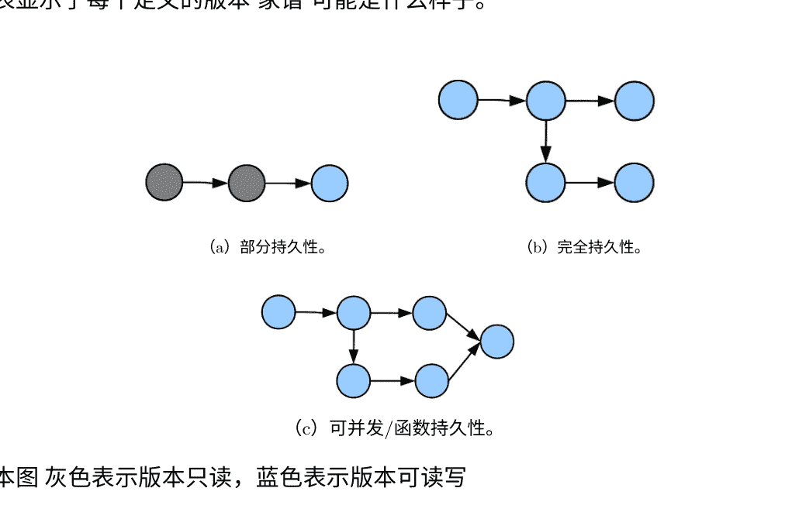

图1.1：版本图 灰色表示版本只读，蓝色表示版本可读写

### 1.3 部分持久性

问题：是否可能高效地实现部分持久性？

答案：是的，假设指针机内存模型和数据节点的入度限制为O(1)。这个结果归功于Driscoll、Sarnak、Sleator和Tarjan [6]。

证明思路：我们将扩展我们的数据节点以保留一个称为mods的修改日志。当我们修改一个节点足够多时，我们创建一个新节点来接收所有后续的更新，直到它也填满。

对于我们旧数据结构中的每个节点，新数据结构将有一个节点集合：一个当前节点包含最新版本，可能还有许多仅用于读取旧版本的旧节点。每次我们‘归档’一个节点，我们还将更新所有（有版本的）指针，使其指向最新的节点。

#### 1.3.1 证明：

我们扩展我们的数据节点以包含以下信息：

-   1. 一个只读区域用于数据和指针（对应于原始结构中的指针）
-   2. （新）一个可写区域用于反向指针。节点 x 对节点 y 有一个反向指针，如果 y 有一个指向 x 的指针。由于我们提前知道我们的节点最多有 p 个指针，所以这个区域的大小是有限的。
-   3. （新）一个可写的修改（'mods'）区域，用于形式为（字段，版本，值）的条目。这个区域的大小也需要固定，并且它对写入性能也有重要影响。

为了说明构造过程，请参考图1.2a和1.2b

我们按照以下方式实现读取和写入操作：

-   1. 读取（变量，v）在修改日志中搜索最大版本 w，使得 w ≤ v。如果值在一个“旧”节点中怎么办？那么我们通过一个旧版本的指针到达它（参见图1.2c和图1.3）。
-   2. 写入(var, val)
如果 n不满，只需添加到模块日志。如果 n没有更多模块日志的空间，
- n' = 新节点()
- 将每个字段（数据和前向指针）的最新版本复制到静态字段部分。
- 还要将反向指针复制到 n'
- 对于每个节点 x，使 n指向 x的节点，将其反向指针重定向到 n'（使用我们的指针来访问它们）（最多d个）。
- 对于每个节点 x，使 x指向 n的节点，递归调用write(x.p, n')（最多p次递归调用）。

对于某些数据结构，例如列表或树，我们通常提前知道 p是多少，因此我们可以像图1.3中那样为这些特定结构实现算法。

#### 1.3.2 分析：

-   - 空间:
如果我们选择模块日志的大小限制为2p，那么每个节点的大小为 d + p + 2p，这也是O(1)，因为我们假设任何节点只有 p ≤ O(1)个指针。选择这样的模块日志大小的原因在以下成本分析中得到了澄清。

-   - 时间: 读取是廉价的，检查单个节点的模数日志并选择所需版本需要恒定时间。如果模数日志中有空间，写入也很廉价。如果没有，写入可能很昂贵。让cost(n)表示写入节点 n的成本。在最坏的情况下，算法会进行递归调用，因此我们有：
$\text{cost}(n) = c + \sum_{x \to n} (\text{cost}(x))$
其中 c表示确定要复制到新节点的最新版本的 O(1)成本，复制回指针等。 x → n表示 x指向 n。

显然，成本可能很大，因为我们在递归步骤中可能会分割许多数据节点。然而，我们知道当一个节点变满时，下一个操作很可能会找到一个更空的节点。

## 1.4 完全持久性

部分持久化的构造可以扩展为实现完全持久化。这个结果是由[6]得出的。我们再次假设一个指针机器，每个节点有 p < O(1)个入指针。

我们需要解决两个新问题：

- 1) 现在我们需要以一种能够高效地检查哪个版本在前的方式来表示版本。版本形成一棵树，但遍历它的时间复杂度是 O(版本数)。
- 2）现在我们必须支持对任何版本的写入。这会影响我们处理写入的方式：我们不再有“当前”与“旧”节点的概念：每个节点都需要支持写入。

### 1.4.1 版本表示

版本表示问题通过保持表示版本结构的树以及以线性化方式高效表示该树来解决。

图1.4中树的线性化表示为 *ba, bb, bc, ec, eb, bd, ed, ea*。你可以将 *ba* 读作“开始节点 *a*”，将 *ea* 读作“结束节点 *a*”。这种表示方式无损地编码了树，并且我们可以直接使用该编码表示来回答关于树的查询。例如，我们知道 *c* 嵌套在 *b* 中，因为 *bb < bc* 且 *ec < eb*。

这种线性化表示可以使用“顺序维护”数据结构来实现。暂时来说，一个顺序维护数据结构支持以下两个操作，都在 *O(1)* 时间内完成。

- 在指定元素之前或之后插入一个项目。
- 检查项目 *s* precedes 项目 *t*。

例如，链表支持在 *O(1)* 时间内插入，但是测试优先级需要 *O(n)* 时间。同样地，平衡二叉搜索树支持这两个操作，但是时间复杂度为 *O(log n)*。Deitz和Sleator在[4]中展示了这两个操作的 *O(1)* 实现，这将在第8讲中介绍。

为了实现版本树查询，例如‘版本 *v* 是否是版本 *w* 的祖先’，我们可以使用两个比较查询 *bv < bw* 和 *ew < ev* 在 *O(1)* 时间内完成。为了实现像‘将版本 *v* 作为版本 *w* 的子节点添加’这样的更新操作，我们可以在 *bw* 之后和 *ew* 之前分别插入两个元素 *bv* 和 *ev*，同样在 *O(1)* 时间内完成。

### 1.4.2 构造和算法：

我们数据结构中的节点将保持与部分持久性情况下相同类型的附加数据。

对于每个节点，我们存储 d个数据条目和 p个后向指针，但现在允许最多2(d + p + 1)次修改。数据量 d也是每个节点的出指针的上限。此外，我们现在还版本化后向指针。

- 1. read(n.field, version): 通过使用有序维护数据结构，我们可以从修改日志中选择版本 version的最近祖先，并返回该值。
- 2. write(n.field, value, version): 如果节点中有空间，只需添加修改条目。否则：
    - m= new Node()。将节点t的修改日志内容按照图1.5的示意图分割成两部分子树。必须按照子树进行分割，而不是任意分割。现在节点 m具有图1.5中内部树的一些修改，节点 n保留了更新的‘旧’一半。
    - 从节点 n的‘旧’修改条目中计算每个字段的最新值，并将其写入节点 m的数据和后指针部分。
    - 递归地更新所有（最多） d + p + (d + p + 1)个邻居的前向和后向指针。
    - 将新版本插入到我们的版本树表示中。

### 1.4.3 分析：

- 空间 - 如果我们不分割，则为1，如果我们分割一个节点，则为 d + p + 2(d + p + 1) = 3d + 3p + 2，都是O(1)。
- 时间 - read(var, version)的实现方式与部分类似。我们使用辅助版本树数据结构在 O(1)的时间内从一组 O(1)元素中找到 version的最大祖先。我们使用辅助版本树数据结构在 O(1)的时间内从一组 O(1)元素中找到version的最大祖先。就像部分情况一样，当一个节点在其修改日志中有空间时，写入是廉价的，而当节点已满时则更加昂贵。

考虑 $\phi = -c$（空槽位数），那么当我们分裂时 $\Delta \phi = -2c (d+p+1)$，而当我们不分裂时 $\Delta \phi = c$。因此，摊销成本 $(n) \le c+c-2c (d+p+1) + (d+p+(d+p+1))*摊销成本(x)$，对于邻居中最坏的选择 $x$。当我们展开递归一次时，我们发现常数相互抵消：$c - 2c (d+p+1) + (2p+ 2p+1)c=0$。

- 开放：全持久化的去摊销。
- 开放：全持久化和部分持久化是否存在匹配的下界？

## ## 1.5 共同持久性

共同持久化提出了新的挑战。首先，我们需要再次找到版本的新表示方式。我们的树遍历技术不能扩展到有向无环图。此外，在共同更新之后，版本历史中可能存在$2^u$ paths。例如，通过重复连接一个字符串，我们可以得到类似图1.6中的版本图。

具有连接操作的双端队列（允许栈和队列操作）可以在每个操作中以常数时间完成（Kaplan, Okasaki和Tarjan [8]）。就像字符串一样，我们可以通过递归地将双端队列与自身连接来在多项式时间内创建隐式指数双端队列。

由Fiat和Kaplan [9]提出的一般转换如下：

- $e(v) = 1 + \log$（从根到 $v$的路径数）。这个度量被称为版本DAG的“有效深度”：如果我们通过DFS（通过复制每条路径，使它们不重叠）展开树并重新平衡该树，这是我们能够实现的最佳效果。
- $d(v) =$ 节点 $v$在版本DAG中的深度
- 开销：$\log(\text{更新次数}) + \max_v(e(v))$

当 $e(v) = 2^u$ 时，这个结果反映了性能较差，其中 $u$是更新次数。这仍然比完全复制要好得多。

Fiat和Kaplan还提出了一个下界，即如果查询是免费的，则更新的下界为 $\Omega(e(v))$。他们的构造每次更新需要进行 $e(v)$次查询。

OPEN：每个操作的空间开销为 $O(1)$或甚至 $O(\log (n))$。

Collette、Iacono和Langerman考虑了“不相交操作”的特殊情况：只在没有共享数据节点的版本之间执行的操作。从那里开始，他们展示了对于这种情况，$O(\log (n))$的开销是可能的。

如果我们只允许不相交的操作，那么每个数据节点的版本历史就是一棵树。在评估read(node, field, version)时，有三种情况：当节点在 version上被修改时，我们只需读取新版本。当节点在修改之间的路径上时，我们首先需要找到最后的修改。这个问题可以通过使用“link-cut trees”（参见第19讲）来解决。最后，当version在叶子节点之下时，问题就更加复杂了。该证明使用了诸如分数级联等技术，这将在第3讲中介绍。完整的构造在[11]中有详细解释。

## 1.6 函数式持久性

在[10]中探索了函数持久性和数据结构。 现有技术的简单示例包括以下内容。

- 功能平衡二叉搜索树- 为了在功能上持久化二叉搜索树，主要思想（也称为“路径复制”）是复制修改的节点，并通过复制所有祖先来传播指针更改。 如果没有父指针，从上往下工作。 假设树是平衡的，这种技术每个操作的开销为 $O(log(n))$。 Demaine、Langerman、Price也在[3]中展示了这一点，适用于链接剪切树。
- 双端队列- 允许堆栈和队列操作，并且可以在每个操作中进行常数时间的连接（Kaplan、Okasaki和Tarjan [8]）。 此外，Brodal、Makris和Tsichlas在[14]中展示了可以在常数时间内进行连接、更新和搜索，复杂度为 $O(log(n))$。
- Tries- 具有本地导航和子树复制和删除。 Demaine, Langerman, Price展示了如何在[3]中以最优方式持久化这个结构。

Pippenger在[13]中展示了功能版本与常规数据结构之间的最大log ()成本分离。

> OPEN: （对于功能和可合并性）更大的分离？ 更一般的结构转换？

> OPEN: 具有拆分和连接的列表？ 通用指针机器？

> OPEN: 具有剪切和粘贴的数组？ 特殊有向无环图？

## 讲座2

## 时间数据结构2

记录员: Erek Speed (2012), Victor Jakubiuk (2012) Aston Motes (2007), Kevin Wang (2007)

## 2.1 概述

持久化数据结构的主要思想是，当过去发生变化时，将获得一个全新的宇宙。更科幻的时间旅行方法是，你可以在过去进行更改，并在数据结构的当前状态以及过去和现在之间的所有更改中看到其结果。

我们为持久化数据结构维护一个更新和查询的时间线：

## 2.2 追溯性

- 插入（t, update）- 在时间 t插入操作“update”
- 删除（t）- 删除时间 t的操作
- 查询（t, query）- 在时间 t查询数据结构使用“query”

大写的插入表示对回溯数据结构的操作，小写的update表示对实际数据结构的操作。

你可以将时间 t 看作整数，但更好的方法是使用一个维护顺序的数据结构，以避免使用非整数（如果你想在时间 t 和 t+ 1之间插入操作），正如第一节课中提到的。

有三种类型的回溯性：

- 部分- 查询总是在 t = ∞（现在）进行
- 全 - 随时查询 t（可能是过去的）
- 非遗忘- 随时插入、删除、查询 t，如果操作修改了数据结构，我们必须说明哪些未来的查询被改变了。

### 2.2.1 具有交换律和逆元的简单情况

假设以下条件成立：

- 可交换的更新： x.y = y.x（x后跟 y与 y后跟 x相同）；即更新可以重新排序 ⇒Insert(t, op) = Insert(now, op)。
- 可逆的更新：存在一个操作 x^{-1}，使得 x.x^{-1} =∅ ⇒Delete(t, op) = Insert(now, op^{-1})。

### 部分回溯

这两个假设使我们能够轻松解决一些回溯问题，例如：

- 哈希
- 具有操作的数组 A[i]+= Δ（但没有直接赋值）

### 2.2.2 完全回溯

首先，让我们定义搜索问题：维护对象集合 S，可以进行插入、删除和查询 (x, S) 操作。

可分解的搜索问题[1980, 2007]：与搜索问题相同，但查询必须满足以下条件：query(x, A ∪ B) = f (query(x, A), query(x, B))，其中 f是某个在 O(1)时间内计算的函数（集合 A和 B可能重叠）。具有这种函数的问题的示例包括：

- 动态最近邻
- 线上的后继
- 点定位

声明1.可分解搜索问题（具有交换性和反转性）的完全回溯可以在时间和空间上都以 O(lg m)的开销完成（其中 m是操作的数量），使用段树[1980, Bentley和Saxe[19]]

我们希望在时间上构建一棵平衡搜索树（叶子节点表示时间）。每个元素“存在于”数据结构中的时间区间，对应于其插入和删除。每个元素出现在lg n nodes中。

在时间 t上查询这棵树时，我们想知道从时间开始到 t为止对这棵树进行了哪些操作。因为查询是可分解的，我们可以查看lg n different nodes并组合结果（使用函数 f）。

### 2.2.3 完全可回溯的一般情况

回滚方法：

- 写下一条（线性）的操作和查询链
- 以 O(r)的开销改变过去r时间单位。

这是我们在一般情况下能做到的最好的。

下界：$\Omega(r)$的开销是必要的。

证明：数据结构维护2个值（寄存器）：$X$和$Y$，初始值为$\emptyset$。支持以下操作：$X = x$，$Y+ = \Delta$，$Y = X.Y$，查询“$Y?$”。执行以下操作（克莱默法则）：

$$Y+ = a_n, X = X.Y, Y+ = a_{n-1}, X = X.Y, \dots, Y+ = a_0$$

这相当于计算

$$Y = a_n X^n + a_{n-1} X^{n-1} + \dots + a_0$$

现在，执行Insert($t=0, X=x$)，这会改变多项式的计算位置。这不能比重新计算多项式更快。在独立于历史的代数决策树中，对于任何域，无论系数的预处理如何，需要$\Omega(n)$个域操作（来自2001年的结果），其中$n$是多项式的次数。

### 2.2.4 单元探测问题

为了解决你的问题，你需要读取多少个整数（字）的内存？（给出了运行时间的下界）。

声明：$\Omega \left( \sqrt{\frac{r}{\lg r}} \right)$。

开放问题：$\Omega(r)$。

下界声明的证明：

- 数据结构维护 $n$ 个词（长度为 $w \ge \lg n$ 位的整数）。
- 允许进行算术运算。
- 查询=整数的值是多少？
- 计算FFT。
- 事后更改词 $\Rightarrow$ 动态FFT。
- 更改 $x_i$ 需要 $\Omega(\sqrt{n})$ 个单元探测。

### 2.2.5 优先队列

现在，让我们转向一些更积极的结果。优先队列表示一种数据结构，其中事后操作可能引发连锁反应，但我们仍然获得了一些不错的结果。主要操作是插入和删除最小值，我们希望实现事后插入和删除。

声明2。可以实现一个部分事后优先队列，每个部分事后操作的开销仅为$O(\lg n)$。

由于存在删除-最小，优先队列上的操作集是非交换的。现在更新的顺序显然很重要，插入一个删除-最小会导致一连串的反应，改变之后的一切。部分可逆优先队列在Demaine、Iacono和Langerman的一篇论文中有描述[2]。

为了对我们的数据结构在可逆操作下的变化有直观的理解，将其绘制在二维平面上是有帮助的。横轴表示时间，纵轴表示键值。每个插入(t, k)操作都会创建一个从点(t, k)开始向右射出的水平射线（见图2.2）。

每个删除-最小()操作都会创建一个从(t, -∞)开始向上射出的垂直射线，停在删除的元素的水平射线上。因此，水平射线变成了一条线段，端点为(t, k)和(t_k, k)，其中 t_k 是键 k 被删除的时间。

这种插入和删除的组合创建了一个非交叉的倒立的“L”形图形，其中每个L对应一个插入和删除-min()删除它。从不删除的元素保持向右的射线。图2.3通过添加一些delete-min到我们之前只有插入的图形来演示这一点。

接下来的讨论将集中在插入(t, “插入(k)”)上。如果你考虑删除为在删除时插入被删除的元素，那么很容易相信删除(t, “删除-min”)具有等效的分析。

考虑由图2.4表示的优先队列。它与之前看到的类似，但插入和删除更多，以更好地说明追溯操作的连锁反应。图2.5展示了当元素被追溯插入时会发生什么。红色显示了追溯操作及其连锁反应。级联变化迅速累积。

然而，由于我们只需要部分可逆性，我们只需要确定元素插入(t,“插入(k)”)插入到 Q_now 现在的优先队列中的位置。从简单的角度来看，很容易看出在 Q_now 插入的元素是：max {k, k' | k'在时间 ≥ t 被删除}。

也就是说，到达“末尾”的元素是先前被删除的最大元素(即图3中显示的链式反应的末尾)或者如果它比那些元素更大，则为 \(k\)(即插入没有引起链式反应)。

问题：维护“删除”元素很困难。这要求我们维护各种链式反应，这是不高效的。相反，我们希望简单地跟踪插入操作。只要我们定义了“桥”的新概念，这样的转换就是可能的。

**定义3.** 我们定义时间 \(t\)为一个桥梁，如果 \(Q_t \subseteq Q_{now}\)。

这意味着在桥梁 \(t'\)中存在的所有元素也存在于 \(t_{now}\)中。你可以将桥梁想象为分隔混乱的链式反应，在图2.6中可以看到。

如果 \(t'\)是时间 \(t\)之前的桥梁，那么
\[
\max \{k' \mid k'\text{在时间} \geq t\text{被删除}\} = \max \{k' \notin Q_{now} \mid k'\text{在时间} \geq t'\text{被插入}\}
\]
通过这种转换，我们只需要维护三个数据结构，就可以以 \(O(\lg n)\)的开销执行部分逆向操作。

- 我们将 \(Q_{now}\)存储为平衡二叉搜索树。每次更新时都会更改它。
- 我们将存储一个平衡的二叉搜索树，其中叶子节点等于插入操作，按时间顺序排序，并且通过增加以下内容进行增强：\(\forall\)节点 \(x: \max \{k' \notin Q_{now} \mid k'\text{插入在} x\text{的子树中}\}\)。
- 最后，我们将存储一个平衡的二叉搜索树，其中叶子节点存储所有更新操作，按时间顺序排序，并通过以下方式增强：## 第三讲
## 几何数据结构1

撰写者：Brian Hamrick (2012) Ben Lerner (2012), Keshav Puranmalka (2012)

### 3.1 概述

在上一节课中，我们学习了持久性和反应性的概念，以及几个实现这些思想的数据结构。

在这个讲座中，我们将研究用于解决点定位和正交范围查询的数据结构。 这些问题涉及应用程序，例如确定用户点击的GUI元素，一组GPS坐标所在的城市以及某些类型的数据库查询。

### 3.2 平面点定位

平面点定位是一个问题，我们给定一个平面图（没有交叉），定义了一个地图，例如GUI元素的边界。 然后，我们希望支持一个查询，该查询通过坐标（x，y）给出一个点，并返回包含该点的面（请参见图1的示例）。 通常情况下，这些问题既有静态版本，也有动态版本。 在静态版本中，我们事先给出整个地图，只想能够回答查询。 对于动态版本，我们还希望允许添加和删除边。

### 3.2.1 垂直射线射击

与平面点定位问题密切相关的问题是垂直射线射击。 就像在平面点定位中一样，我们对定义地图的平面图感兴趣。在这种情况下，当我们查询一个点（x，y）时，我们对位于其上方的第一条线段感兴趣。等效地，如果我们想象一下从查询点发射垂直射线，我们希望返回它相交的第一个地图段（参见图2）

我们可以使用垂直射线射击来解决静态情况下的平面点定位问题，通过预先计算每条边下方的面。对于动态平面点定位问题，我们可以再次使用这种技术，但我们需要动态地维护面数据，导致 $O(\log n)$的额外开销。垂直射线射击问题可以通过一种称为线扫描的技术来解决。

### 3.2.2 线性扫描

线性扫描是一种相对通用的减少几何问题维度的技术减少1。给定一个几何问题在 d 维空间中，我们可以考虑一个“垂直”（d-1）-维截面，即与 x1 轴垂直的超平面。现在我们想象一下我们的几何问题仅在该超平面内，并考虑当我们沿着 x1 轴移动超平面时它如何变化。如果这个 x1 维度有一个合适的“时间”解释，就像在垂直射线投射中一样，那么对于（d-1）-维问题的持久或完全回溯数据结构将允许我们解决 d 维问题。

在垂直射线投射的情况下，我们可以用平衡的二叉搜索树解决这个问题。更具体地说，我们正在进行 successor 查询。在上一节课中，我们看到如何制作一个部分持久的平衡二叉搜索树，查询时间为 O(log n)，我们也知道完全回溯的 successor 查询结构也可以用 O(log n) 查询来实现。然而，请注意，在这种情况下，successor 结构只允许我们处理水平线段，因为一般线段之间的的比较函数取决于 x 坐标。当我们应用线性扫描来解决二维问题时会发生什么？

当我们的垂直横截面从左到右扫过时，我们首先注意到，由于我们地图中没有交叉点的假设，没有两个线段会改变顺序。这意味着树结构只在少数离散时间发生变化。特别地，当我们到达一个线段的左端点时，我们执行该线段的插入操作，当我们到达右端点时，我们执行该线段的删除操作。

假设我们使用部分持久化的平衡二叉搜索树来实现这个线扫描，为了对点 (x, y) 进行垂直射线查询，我们找到对应于 x 坐标的更新，并在数据结构的该版本中使用持久化进行查询 (x, y)。

还值得注意的是，这个结构可以在 O(n log n) 的预处理时间内计算出来，正如 Dobkin 和 Lipton 在 [27] 中所示。

此外，如果我们使用完全回溯的后继数据结构，我们可以在 O(log n) 的时间内解决带有水平线段的动态垂直射线查询问题。参见 [23] 和 [29]。

垂直射线问题的几个变体仍然未解决。例如：

- 开放问题：在一般平面图中，我们能否以 O(log n) 的时间复杂度进行动态垂直射线查询？
- 开放问题：当射线不必垂直时，我们能否以 O(log n) 的时间复杂度进行静态射线查询？
请注意，这个问题的三维版本是由光线追踪问题引发的。

### 3.2.3 寻找交点

线扫描方法也可以用于在一组线段中寻找交点，这个问题很好地说明了线扫描方法。

给定平面上一组由端点定义的线段，我们希望找到它们之间的所有交点。请参见图3，这是一个问题的示例。

为了解决这个问题，我们使用线扫描技术，将线段存储在一个平衡二叉搜索树中。对搜索树的修改如下。

- 线段的左端点会导致我们将该线段插入树中。
- 线段的右端点会导致我们从树中删除该线段。
- 两个相交的线段会导致我们在树中交换它们的顺序。

当存在k个交点时，我们可以使用这些思想在 O(n log n + k)时间内解决线段相交问题。为了做到这一点，我们需要能够高效地确定两个线段下一次相交的时间。我们注意到，如果在我们添加或删除更多线段之前会发生一次相交，那么它必须涉及当前在树顺序中相邻的两个线段。然后，对于每个线段，我们跟踪它何时会与树中的后继线段相交，每个内部节点跟踪其子树中最早的相交。在每次更新时，维护这些额外的数据并不困难，时间复杂度为 O(log n)，并且执行交换操作可以在常数时间内完成。

### 3.3 正交范围搜索

在这个问题中，我们给出了n个d维空间中的点，并且查询是确定哪些点落在给定的盒子中（盒子被定义为d个区间的直积；在二维中，这只是一个矩形）。请参见图4的示例。从某种意义上说，这是前一个问题的逆问题，前一个问题是给定一个平面图，查询是以点的形式给出。

在问题的静态版本中，我们可以预处理这些点，而在动态版本中，点会被添加和删除。在两种情况下，我们都会动态查询这些点。查询有不同的版本：

- 盒子中是否有任何点？ 这是问题的“存在性”版本，也是最简单的版本。
- 盒子中有多少个点？ 这也可以解决存在性问题。
- 盒子中的所有点是什么？ 或者，盒子中有一个点，或者有十个点，在盒子中？

这些问题非常相似，我们可以用相同的效率来解决它们。 唯一的例外是最后一个问题 - 对于给定的输入，答案可能涉及返回集合中的每个点，这将花费 $O(n)$ 的时间。 因此，我们正在寻找类似于 $O(\log n + k)$ 的解决方案，其中 $k$ 是输出的大小。

### 3.3.1 范围树

让我们从一维情况开始， $d=1$。 要解决它，我们只需对点进行排序并使用二分查找。 查询是一个区间 $[a, b]$；我们可以找到 $a$ 的前驱和 $b$ 的后继，在排序列表中使用这些结果来确定盒子中是否有任何点；减去索引以确定点的数量；或者直接打印盒子中的点列表。不幸的是，数组不太适用于这种情况，尽管我们稍后会使用它们。

我们可以通过使用一种叫做范围树的结构来实现相同的运行时间。 范围树在70年代末同时被多位人士发明[22], [21], [30], [31], [35]。

我们可以按照以下方式构建一棵范围树。 考虑一棵平衡二叉搜索树（BBST），只有叶子节点存储数据。 这对于高维度来说很方便。 每个非叶子节点存储其子树中叶子节点的最小值和最大值；或者，如果我们只想存储一个值，则可以将最大值存储在左子树中。

同样，我们搜索 PRED(a)和 SUCC(b)（参见图5）。 在搜索过程中，我们会沿着树向下移动，并在一些点进行分支。 （与之前一样，找到 PRED(a)和 SUCC(b)需要 $O(\log n)$ 时间。）一旦到达 PRED (a)和 SUCC(b)的路径分开的地方，如果我们在搜索 PRED(a)时向左转，我们就知道该节点右子树的所有叶子节点都在给定的区间内。对于右分支的左子树也是如此。如果左子树向右分支或者右树向左分支，我们不关心另一个子节点的子树；那些叶子节点在区间之外。答案隐式表示如下：如果我们存储列表中的元素数量每个节点的子树都存储在节点中，我们可以在 $O(\log n)$ 时间内计算列表中的元素数量。 要找到前 $k$ 个数字，我们可以在 $\text{PRED}(a)$ 之后以 $O(k)$ 的时间访问前 $k$ 个元素(前两个句子中的操作可能更容易通过参考图6来可视化)。 这些结果与数组得到的结果相同，但是范围树更容易推广到更高的维度 。

让我们来看看 $2-d$ 的情况，在 $x$ 和 $y$ 中搜索 $a_1$ 和 $b_1$ 之间的点。 我们可以只使用每个点的 $x$ 坐标构建一个范围树，然后重复上述过程来确定哪些点在 $a_1$ 和 $b_1$ 之间。

我们现在想要按照 $y$ 坐标对点进行排序。 我们不能使用一个覆盖所有点的范围树，因为我们只对那些在 $a_1$ 和 $b_1$ 之间的点感兴趣，而不是集合中的每个点。我们可以通过为每个 $x$ 子树创建一个相应的一维 $y$ 范围树来限制我们的注意力，该范围树由该 $x$ 子树中的所有点组成，但现在按照它们的 $y$ 坐标进行排序。 我们还将在 $x$ 范围树的每个节点中存储一个指向相应 $y$ 树的指针（见图7的示例）。 例如， $\alpha_x$， $\beta_x$ 和 $\gamma_x$ 指向相应的子树 $\alpha_y$， $\beta_y$ 和 $\gamma_{yo}$。 在 $x$ 中， $\gamma_x$ 是 $\beta x$ 的子树，但 $\gamma_y$ 与 $\beta_y$ 不相交（尽管 $\gamma_y$ 和 $\gamma_x$ 存储相同的点集）。

这种结构占用了很多空间：每个点都存储在对数 $N$ 范围树中，因此我们使用了 $\theta(N\log N)$ 的空间。 然而，我们现在可以高效地进行搜索 - 我们可以首先通过 $x$ 坐标筛选我们的点集，然后通过对应的 $y$ 范围树进行搜索以筛选 $y$ 坐标。 我们通过 $O(\log N)$ 个子树进行搜索，因此查询时间为 $O(\log^2 N)$ 。

我们可以将这个想法扩展到 $d$ 维度，为每个 $x$ 子树存储一个 $y$ 子树，为每个 $y$ 子树存储一个 $z$ 子树，依此类推。这将导致查询时间为 $O(\log^d N)$。每个维度都会增加$O(\log N)$的空间因子；我们可以总共以 $O(N \log^{(d-1)})$ 的空间存储树。如果点集是静态的，我们可以在 $O(N \log^{(d-1)})$ 的时间内预处理它们；对于 $d=1$，排序需要 $O(N \log N)$ 的时间。在这个时间限制内构建范围树是非常复杂的，但是可以做到。

### 3.3.2 分层范围树

我们可以通过一种叫做分层范围树的思想，将这种数据结构的性能提高一个对数因子（参见[28]，[36]，[34]）。这也被称为分数级联或交叉链接，我们稍后会详细介绍。总体思路是重复使用我们的搜索。

在$2-d$情况下，我们重复地对相同的 $y$ 坐标子集进行搜索，例如当我们在 $a_2$ 和 $b_2$ 之间搜索 $\alpha_2$ 和 $\gamma_2$ 的点时。

为了避免这种情况，我们采取以下措施。不再使用树，而是存储一个按$y$坐标排序的所有点的数组（参考图8）。与以前一样，每个 $x$ 树中的节点指向一个相应的子数组，该子数组由树中的点按 $y$ 坐标排序。

我们可以像之前一样做，通过每个数组进行搜索，每次搜索花费 $O(\log n)$时间；但是我们也可以做得更好：我们可以只搜索一个数组，即树的根节点对应的数组，该数组包含每个元素，按照 $y$排序。
我们希望在下降过程中保持这些信息。当我们从 $x$树的一个节点$v$移动到其子节点之一，比如 $v_r$， $v_r$将指向一个按照 $y$排序的数组，该数组包含 $v$指向的 $y$数组的一个子集。这个子集是任意的，因为它取决于点的 $x$坐标。

让我们在$v$的数组的每个元素中存储一个指针，指向$v$的$_r$数组中的一个元素。如果元素同时存在于两个数组中，则它应该指向自身；否则，让它指向$v$的$_r$数组中的后继元素。（每个元素实际上存储两个指针，一个指向$v$的$_r$数组，一个指向$v$的数组。）因此，特别地，我们可以通过跟随指针来在任何子树中找到$a_2$和$b_2$的前驱和后继。这样，我们可以在$O(\log n+ k)$的时间内查询$y$坐标，从而避免了先前策略中的额外对数因子，使我们能够在总共$O(\log n)$的时间内解决$_{2}$-$d$问题。对于任意的$d$，我们可以将这种技术用于最后一个维度；因此，我们可以将一般查询时间改进为$O(\log d^{-1}n+ k)$（其中$d>1$）。

### 3.3.3 动态点集

我们可以使用摊销使之前的方案变得动态。一般来说，当我们更新一棵树时，我们只改变一些东西，通常是在叶子附近。在树的叶子附近更新只需要常数时间，因为我们只改变了一些东西。偶尔，我们需要更新树的一个大部分，这将花费更长的时间，但这种情况很少发生。
事实证明，如果我们有 $O(n \log^{d-1} n)$ 的空间和预处理时间，我们可以构建这个结构使用权重平衡树可以免费实现动态性。

## 3.3.4 权重平衡树

有不同种类的权重平衡树；我们将看一下最古老和最简单的版本，$BB[\alpha]$ 树 [33]。我们已经看过高度平衡树的例子：AVL树，其中左右子树的高度相差一个常数，以及红黑树，其中子树的高度相差一个乘法因子。

在一个权衡树中，我们希望左子树和右子树的大小大致相同。形式上，对于每个节点 $v$，我们希望 $size(left(v)) \geq \alpha \cdot SIZE(v)$ 且 $SIZE(right(v)) \geq \alpha \cdot SIZE(v)$。

我们还没有定义 size：我们可以使用子树中的节点数、子树中的叶子数或其他合理的定义。我们还没有选择 $\alpha$。如果 $\alpha = \frac{1}{2}$，我们会有一个问题：树必须始终完美平衡。然而，选择一个小的 $\alpha$（比如 $\alpha = \frac{1}{10}$），效果很好。权衡平衡是比高度平衡更强的性质：权衡平衡树的高度最多为 $\log_{1/\alpha} n$。

我们可以将这些树应用于我们的分层范围树 [31, 34]。在平衡权重树上的更新可以很快完成。通常，当我们添加或删除一个节点时，它只会影响附近的节点。偶尔，它会使树的大部分失衡；在这种情况下，我们可以销毁该部分树并重新构建。当我们这样做时，我们可以将其重新构建为完全平衡的树。

我们的数据结构只在一个方向上有指针——每个父节点指向其子节点，但子节点不指向其父节点或树的上层节点。因此，当一个子树失衡时，我们可以自由地重新构建整个子树。一旦我们重新构建了一个子树，在它再次失衡之前，我们可以至少进行 $\theta(k)$ 次插入或删除操作，其中 $k$ 是子树的大小。

当我们确实需要重新构建一个子树时，我们可以将重新构建的过程计入我们进行的 $\theta(k)$ 次更新操作中。由于我们添加的每个节点都有可能使其所属的每个子树失衡（总共 $\log(n)$ 个子树），我们可以在对数时间内更新树（假设树可以在 $\theta(k)$ 时间内重新构建，这很容易实现）。

因此，对于分层范围树，我们有 $O(\log^d n)$ 平摊更新，而查询仍然是 $O(\log^{d-1} n)$。

## 3.3.5 更多结果

对于静态正交范围搜索，我们可以在 $d > 1$ 的情况下实现 $O(\log^{d-1} n)$ 查询，使用更少的空间：$O\left(n \frac{\log^{d-1}(n)}{\log \log n}\right)$ [24]。在某些模型中，这是最优的。

我们还可以在 $d > 2$ 的情况下实现 $O(\log^{d-2} n)$ 查询，使用 $O(n \log^d(n))$ 空间 [25, 26]。最近的一个更近的结果使用 $O(n \log^{d+1-\epsilon}(n))$ 空间 [20]。这被认为是查询的最优结果的猜想。

这个问题还有非正交版本——我们可以用三角形或一般的简单形状进行查询，以及在一个或多个区间以无限开始或结束的盒子。

## 3.4 分数级联

分数级联是Chazelle和Guibas在[25]和[26]中提出的一种技术，动态版本由Mehlhorn和N¨aher在[32]中讨论。它本质上是分层范围树的思想放入一个通用的环境中，允许在运行时消除对数因子。

### 3.4.1 多列表查询

为了说明分数级联的技术，我们将使用以下问题。假设你有 $k$ 个已排序的列表 $L_1, \ldots, L_k$，每个列表的长度为 $n$，你想找到每个列表中 $x$ 的后继。可以通过 $k$ 个单独的二分查找来解决这个问题，结果是 $O(k \log n)$ 的运行时间。分数级联允许以 $O(k+ \log n)$ 的时间复杂度解决这个问题。

为了激发这个解决方案，我们可以看一下上面的分层范围树，并思考在从一个列表移动到下一个列表时如何保留信息。特别是，如果我们在 $L_1$ 的某个元素上，我们可以存储该元素在 $L_2$ 中的位置，然后快速地从一个列表走到下一个列表。不幸的是，可能情况是 $L_2$ 的所有元素都位于 $L_1$ 的两个元素之间，这种情况下我们在 $L_1$ 中的位置并没有告诉我们任何信息。所以我们应该在 $L_1$ 中添加一些更多的信息。这就引出了分数级联的思想。

定义新的列表 $L'_1, \ldots, L'_k$ 通过 $L'_k = L_k$ 定义，并且对于 $i < k$, 让 $L'_i$ 成为 $L_i$ 与 $L'_{i+1}$ 的合并结果。注意 $|L'_i| = |L_i| + \frac{1}{2} |L'_{i+1}|$, 所以 $|L'_i| \le 2n = O(n)$。

对于每个 $i < k$, 从每个元素保留两个指针。如果元素来自 $L_i$, 则保留指向 $L'_{i+1}$ 的两个相邻元素的指针，反之亦然。这些指针使我们能够将我们在 $L'_i$ 中的位置信息转化为我们在 $L_i$ 和 $L'_{i+1}$ 的一半中的位置信息，并且在 $O(1)$ 时间内完成。

现在对于所有的 $k$ 个列表中的 $x$ 进行查询是非常直接的。首先，使用二分查找查询 $L'_1$ 中 $x$ 的位置。现在要找到 $x$ 在 $L'_{i+1}$ 中的位置，从 $x$ 在 $L'_i$ 中的位置开始，使用额外的指针找到 $L'_{i+1}$ 中来自 $L'_i$ 的两个相邻元素。然后这些元素在 $L'_{i+1}$ 中恰好有一个元素在它们之间。要找到我们在 $L'_{i+1}$ 中的实际位置，我们只需与中间元素进行比较。这使得我们可以将关于 $x$ 在 $L'_i$ 的位置的信息转化为关于 $x$ 在 $L'_{i+1}$ 中的位置的信息，时间复杂度为 $O(1)$，我们可以检索 $x$ 在 $L_i$ 的位置从其在 $L'_i$ 中的位置中，时间复杂度为 $O(1)$，因此我们可以在 $O(k+\log n)$ 的时间内查询所有 $k$ 个列表中的 $x$。

### 3.4.2 通用分数级联

为了推广上述技术，我们首先注意到我们可以用“每隔一个元素”替换为“α个元素中的一个，均匀分布”，对于任意小的 α。在这种情况下，我们使用了 α = 1/2。然而，通过使用更小的 α，我们可以在任何图上进行分数级联，而不仅仅是在这里的单一路径上。为了做到这一点，我们只需（在一些细节上取模）从每个顶点沿着其出边级联 α的集合。当我们这样做时，循环可能导致一个顶点级联到自身，但是如果我们选择足够小的 α，我们可以确保集合的大小保持线性有界。

一般来说，分数级联允许我们做到以下几点。给定一个图，其中

-   每个顶点包含一组元素
-   每条边都带有一个范围[a, b]
-   图的局部有界入度，意味着对于每个 x ∈ R，包含 x的顶点的入边数量受到常数的限制。

我们可以支持一个搜索查询，在图的单个节点可达的顶点中找到每个 x，使得使用的边形成一个包含 k个顶点的树。与之前一样，我们可以使用 k个单独的二分搜索来进行搜索查询，而分数级联将其改进为 O(k+ log n)，其中 n是顶点集合的最大大小。

## 讲座4

## 几何数据结构2

记录员: Brandon Tran (2012), Nathan Pinsker (2012), Ishaan Chugh (2012), David Stein (2010), Jacob Steinhardt (2010)

## 4.1 概述- 几何学 II

我们首先展示如何进一步利用分数级联从 d维正交范围搜索中消除另一个 lg 因子，以便我们可以在 O(n lg^{d-2} n)时间内进行查询。回想一下，分数级联允许：

-   在长度为 n 的 k 个列表中搜索 x 的时间复杂度为 O(lg n + k)。
-   即使这些列表是通过浏览有界图在线找到的，这个方法也适用。

然后我们转向动态数据结构的主题。这些数据结构包含了关于运动物体的信息。它们支持以下三种类型的查询：(i) 改变物体的轨迹；(ii) 向前移动到指定的时间点（前进）；(iii) 返回当前时间物体状态的信息。我们将讨论的例子包括动态前驱/后继和动态堆。

## 4.2 三维正交范围搜索的查询时间复杂度为 O(lg n)

这项工作归功于 Chazelle 和 Guibas [CG86]。

通常，我们希望在空间中的点的区域进行查询，该区域由：[a1, b1] × [a2, b2] × [a3, b3] 定义。

### 4.2.1 步骤1

我们想要查询 (−∞, b2) × (−∞, b3)，我们称之为受限的二维情况。在我们的查询中没有左端点，所以我们查询的区域基本上是这样的：

我们想要在时间复杂度为 $ \mathcal{O}(k) + $ 在 $ z $坐标列表中搜索$ b_3 $所需的时间内调用被$ ( b_2, b_3 ) $支配的点。我们将这个问题转化为射线刺穿查询。基本思想是使用水平射线刺穿垂直射线，其中水平射线是我们查询的射线。

交叉表示导致交叉的垂直射线所代表的点位于查询范围内。我们想要做的是沿着水平射线行走，并在每个交叉点花费恒定的时间。对于每条垂直射线，我们保持一条位于射线底部点的水平线。这条线会向左右延伸，直到碰到另一条垂直射线。（这些线在下图中是蓝色的。）

在遍历时，我们使用二分搜索找到 $ z $值，然后在图片中从“面”到“面”进行移动。然而，我们希望限制面的度数（与其相邻的面的数量）以提高查询效率。因此，我们查看所有以某个垂直射线结束的水平线，并将其中大约一半延伸到面上，以创建更多度数较低的面（上图中的绿色虚线）。由于我们只扩展了一半，每个垂直射线的数量减少了2倍。由于 $\sum_{i=0}^{\infty} \frac{1}{2^i} = 2$，我们只会在空间上增加 $\mathcal{O}(n)$。这是由Chazelle [C86]引起的。

### 4.2.2 步骤2

现在我们想要在 $\mathcal{O}(k) + \mathcal{O}(\lg n)$次搜索中查询$[a_1, b_1] \times (-\infty, b_2) \times (-\infty, b_3)$。为了做到这一点，我们使用一维范围树在 $x$坐标上，每个节点存储步骤1中在其子树上的点的结构。

### 4.2.3 第三步

现在我们查询 $[a_1, b_1] \times [a_2, b_2] \times (-\infty, b_3)$。我们在 $y$-坐标上做类似于范围树的操作，每个节点 $v$ 存储一个键 $= \max(\text{left}(v))$，在其右子树上的点使用步骤2中的结构，在其左子树上的点使用步骤2中的结构，但是反转。反转的结构允许查询 $[a_1, b_1] \times (a_2, \infty) \times (-\infty, b_3)$。这可以像之前一样轻松地完成。此时，我们知道我们只能对步骤2中的结构进行恒定次数的调用。

我们从树上往下走。在每个节点 $v$上，如果 $\text{key}(v) < a_2 < b_2$，我们走向它的右子节点。如果 $\text{key}(v) > b_2 > a_2$，我们走向它的左子节点。最后，如果 $a_2 \leq \text{key}(v) \leq b_2$，在这个节点上我们查询第二步的结构和倒置的第二步结构。这样做的原因是，左子树中的结构允许从 $a_2$到 $\infty$的查询。然而，由于这只存储了 $y$坐标小于或等于 $\text{key}(v)$ 的点，我们得到了 $a_2$和$\text{key}(v)$ 之间的点。类似地，右子树中的结构允许向左查询，因此我们得到了 $\text{key}(v)$ 和 $b_2$之间的点。因此，我们只需要两次对第二步结构的调用和一次 $\lg n$的搜索(从上往下走树)。我们注意到，我们可以对所有三个坐标使用这个想法，但是由于范围树可以免费提供 $x$坐标(这需要额外的 $\lg$ 因子的空间)。

### 4.2.4 第四步

最后，我们查询 $[a_1, b_1] \times [a_2, b_2] \times [a_3, b_3]$。我们和第三步一样做，只是现在在 $z$-坐标上，并且在每个节点上存储第三步的结构。

### 4.2.5 总时间和空间

整个过程需要 $\mathcal{O}(\lg n + k)$ 时间和 $\mathcal{O}(n \lg^3 n)$ 空间。这意味着一般来说，对于 $d \geq 3$ 维度，正交范围搜索的成本为 $\mathcal{O}(\lg^{d-2}(n) + k)$。基本思想是，如果使用更多的空间不是问题，单侧区间等同于双侧区间。之所以这不会进一步减少运行时间，是因为如果我们尝试在四个维度上进行这个操作，在第一步中，初始结构需要考虑超过两个维度，这是它无法快速完成的。

## 4.3 动态数据结构

这项工作归功于Basch、Guibas和Hershberger [BGH99]。

动态数据结构的思想是，我们有一些以某种速度移动的对象，并且我们想知道它们在未来某个时间会在哪里。此外，我们希望能够考虑对象轨迹的变化。操作包括：

-   advance(t) : now = t
-   change(x, f(t))：改变 x 的轨迹为 f(t)

我们只处理以下轨迹模型：

-   仿射： f(t) = a + bt
-   有界度算术： f(t) = ∑_{i=0}^n a_i t^i
-   伪代数：任何感兴趣的证书在 O(1)次之间翻转为真和假。

我们将证书定义为关于点的布尔函数。

### 4.3.1 方法

1.  存储当前准确的数据结构。然后对当前的查询很容易。
2.  用存储当前准确且当前为真的条件来增强数据结构的证书。
3.  计算每个证书失效时的失败次数（需要 O(1)时间）。
4.  将失败次数放入优先队列中。当我们推进时间时，我们寻找失败的证书并进行修复。

### 4.3.2 指标

通常有四个指标用于衡量动态数据结构的性能：

-   响应性 - 当事件发生时（例如证书失效），数据结构能够多快地进行修复？
-   局部性 - 任何对象参与的证书的最大数量是多少？
-   紧凑性 - 总证书数量是多少？
-   效率 - 最坏情况下数据结构事件（忽略修改）与“必要”更改的最坏情况数量的比率是多少？（“必要更改”的概念有些模糊。在实践中，我们将根据每个问题来定义它。）

### 4.3.3 动态前驱

我们将首先研究的动态数据结构问题是动态前驱（也称为动态排序）。我们希望支持查询请求元素的前驱（假设元素按值排序）。我们采取以下方法：

1.  维护一个平衡的二叉搜索树。
2.  让 x₁, x₂, ..., xₙ 是BST的中序遍历。保持证书 { (xᵢ < xᵢ₊₁) | i = 1, 2, ..., n - 1 }。
3.  计算每个证书的失效时间为失效时间ᵢ := inf { t ≥ 现在 | xᵢ(现在) > xᵢ₊₁(现在) }。例如，如果每个物体的运动是线性的，计算当前点之后两条线相交的第一个时间点。
4.  按照以下方式实现 advance(现在)：
    当现在 >= Q.最小值时：
        现在 = Q.最小值事件(Q删除 - 最小值)现在 = t

```
定义事件(证书(x[i] < x[i+1]))：
    在BST中交换(x[i], x[i+1])
    添加证书(x[i+1] <= x[i])
    用 ( x [ i - 1 ] <= x [ i ] ) 替换 ( x [ i - 1 ] <= x [ i + 1 ])
    用 ( x [ i + 1 ] <= x [ i + 2 ] ) 替换 ( x [ i ] <= x [ i + 2 ])
```

每次证书失败时，我们将其从优先队列中移除，并替换任何不再适用的证书。每个事件更新优先队列需要 𝒪(lg n) 的时间，但问题在于可能有 𝒪(n²) 个事件。现在我们根据我们的指标进行分析。

-   效率：如果我们需要“知道”点的排序顺序，那么我们将需要每次排序变化都有一个事件。每对点可以交换固定次数，从而产生 𝒪(n²) 个可能的事件。因此，效率为 𝒪(1)。
-   响应性：因为我们使用了BBST，我们可以在 𝒪(lg n) 时间内修复固定数量的证书失败。
-   局部性：每个数据对象参与 𝒪(1) 个证书。事实上，每个对象最多参与2个证书。
-   紧凑性：总共有 𝒪(n) 个证书。

### 4.3.4 动态堆

这里的工作归功于de Fonseca和de Figueiredo [FF03]。

接下来我们考虑动态堆问题。对于我们这个问题，我们想要实现的数据结构操作是 $find_{min}$。我们通过维护一个堆来实现这个操作（目前只是一个普通的堆，不需要担心斐波那契堆）。我们的证书检查每个节点是否比堆中的两个子节点都小。每当一个证书破裂，我们只需应用堆向上操作来修复它，然后相应地修改堆中周围节点的证书。在这种情况下，我们的数据结构具有 $O(lg n)$的响应性，$O(1)$的局部性和 $O(n)$的紧凑性。唯一的非显而易见的指标是效率。我们下面证明效率实际上是 $O(lg n)$（通过证明总事件数是 $O(n lg n)$）。

分析动态堆中事件的数量。我们将使用摊还分析来证明动态堆中最多有$O(n lg n)$个事件。为了简化，我们将在所有函数都是线性的情况下进行分析，尽管一般情况下也是一样的。

将$Φ(t, x)$定义为在 $t$之后某个时间超过 $x$的后代数量。将$Φ(t, x, y)$定义为超过 $x$的后代数量（包括 $y$），并且超过时间大于 $t$。显然，$Φ(t, x) = Φ(t, x, y) + Φ(t, x, z)$，其中 $y$和 $z$是 $x$的子节点。

最后，定义$Φ(t) = \sum_{x} (Φ(t, x))$。$Φ$将是我们在摊还分析中使用的势能函数。

分析。观察到$Φ(t)$对于任何 $t$的值都是 $O(n lg n)$，因为它最多是所有节点的后代总数，这与所有节点的祖先总数相同，即$O(n lg n)$。我们将证明$Φ(t)$每次证书失败时至少减少1，这意味着证书总共最多可以失败$O(n lg n)$次。

考虑在时间 $t^+$时，节点 $y$超过其父节点 $x$的事件，并定义 $z$为 $x$的另一个子节点。节点 $x$和 $y$交换位置，但其他节点不会。这意味着在 $t$和 $t^+$之间，任何潜在函数的变化只有：

$$Φ(t^+, x) = Φ(t, x, y) - 1$$

和

$$Φ(t^+, y) = Φ(t, y) + Φ(t, y, z).$$

由于 $y > x$ now, 我们还可以看到

$$Φ(t, y, z) ≤ Φ(t, x, z).$$

最后, 我们需要

$$Φ(t, x, z) = Φ(t, x) - Φ(t, x, y).$$

由此可得：

$$\Phi(t^+) \leq \Phi(t) - 1,$$

这完成了分析。我们得出结论：数据结构修改的总次数为 $\mathcal{O}(n \lg n)$。

## 4.3.5 其他结果

现在我们来调查动态数据结构领域的结果。更全面的调查请参见[Gui04]。

| 结果 | 效率 | OPEN问题 |
| :--- | :--- | :--- |
| **2D凸包**（还有直径、宽度和最小面积/周长矩形） | $\mathcal{O}(n^{2+\epsilon})$, $\Omega(n^2)$ [BGH99] | 3D情况。 |
| **最小包围圆** | $\mathcal{O}(n^3)$ 事件 | $\mathcal{O}(n^{2+\epsilon})$? |
| **近似结果**（我们可以 $(1 + \epsilon)$-近似直径和最小圆/矩形） | $\frac{1}{\epsilon} \mathcal{O}(1)$ 事件 [AHP01] | |
| **德劳内三角剖分** | $\mathcal{O}(1)$ 效率 [AGMR98] | 有多少总证书更改？已知为 $\mathcal{O}(n^3)$ 和 $\Omega(n^2)$。 |
| **任何三角剖分** | $\Omega(n^2)$ 即使有斯坦纳点的更改 [ABdB+99]；$\mathcal{O}(n^{2+\frac{1}{3}})$ 事件 [ABG+02] | $\mathcal{O}(n^2)$ 事件？我们可以实现伪三角剖分的 $\mathcal{O}(n^2)$。 |
| **碰撞检测** | 参考[KSS00], [ABG+02]和[GXZ01]的工作 | |
| **最小生成树** | $\mathcal{O}(m^2)$ 简单 | **OPEN:** $o(m^2)$? $\mathcal{O}(n^{2-\frac{1}{6}})$ 适用于无H小图的图（例如平面图）[AEGH98]。 |

# 讲座5

## 动态最优性 1

记录员：Brian Basham（2012），Travis Hance（2012），Jayson Lynch（2012）

### 5.1 概述

在接下来的两节课中，我们将研究动态最优性的问题，即是否存在一种二叉搜索树算法，能够在任何输入字符串上“与其他算法一样好”。

在本讲座中，我们将定义二叉搜索树作为计算的形式模型，展示动态最优二叉搜索树需要满足的一些分析界限，并展示两个被猜测为动态最优的搜索树。第一个是伸展树，我们将只简要介绍。第二个将要求我们建立起一种几何视图来处理一系列的二叉搜索树查询。

### 5.2 二叉搜索树

在本讲座中，我们将探讨一个问题，即是否存在一个“最佳”的二叉搜索树。

我们知道有一种自平衡的二叉搜索树，每次查询的时间复杂度为 $O(\log n)$。我们能做得更好吗？

为了探索这个问题，我们需要对二叉搜索树有一个更严格的定义。

在本讲座中，我们将把二叉搜索树（BST）作为计算模型的一部分，它是计算机指针模型的一个子集。

#### 5.2.1 计算模型

BST可以被视为一种计算模型，其中数据必须以键的形式存储在二叉搜索树中。每个键都有一个指向其父节点的指针（除非它是根节点），以及一个指向其左子节点和右子节点的指针，如果它们不存在，则为null指针。存储在节点的左子节点中的键的值必须小于或等于存储在节点中的键的值，而后者又小于或等于右子节点存储的键值。该模型支持以下单位成本操作：

-   向左子节点移动。
-   向右子节点移动。
-   向父节点移动。
-   旋转节点 x。

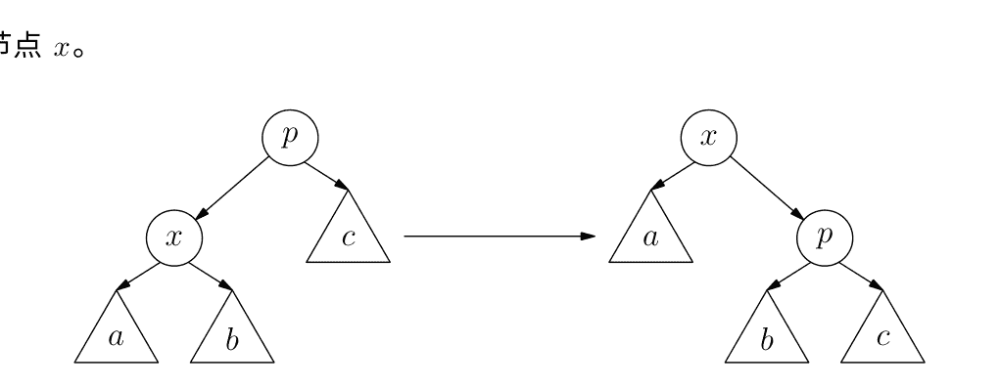

前三个操作只会改变树中的指针。最后一个操作会更新树本身。

这些模型支持查询搜索(x)，它从根节点开始，并可以使用上述操作，但必须在某个时刻访问具有键x的节点。在这两节课中，为了方便起见，我们将假设查询总是成功的。为了定义和证明的简便起见，我们还将忽略插入和删除操作。

#### 5.2.2 是否存在最佳二叉搜索树？

我们已经知道一些自平衡的二叉搜索树，每次搜索的时间复杂度为O(log n)。其中包括AVL树和红黑树。

> 问题: O(log n) 是最好的选择吗？
>
> 答案: 是的 - 在最坏的情况下。任何包含 n个项目的树都必须具有深度Ω(log n)，而对手可以选择每轮搜索位于最大深度的键。然而，在某些情况下，我们可以做得更好。一般来说，我们将考虑一系列搜索，并考虑完成整个序列所需的最总时间。

#### 5.2.3 搜索序列

我们假设存储在树中的键具有值{1,2,…n}。我们将按时间顺序考虑搜索操作的序列 x1, x2, … xm。有些序列在直观上比其他序列更容易。例如，如果 x1 = x2 = ⋯ = xm = X，那么任何以 X为根的搜索树都可以实现每次搜索的常数时间访问。

我们将研究一些BST算法的可能属性，以保证特定输入序列的访问时间边界。

#### 5.2.4 顺序访问属性

如果搜索序列 {1, 2... n} 每个操作的摊还时间为 O(1)，则BST算法具有顺序访问属性。

这个属性似乎很容易实现，因为它在 O(n) 时间内执行中序遍历。在这种计算模型中，它稍微复杂一些，因为所有搜索都必须从根节点开始。然而，通过旋转到根节点可以模拟从最后一个键开始，这一点我们在本讲座中不会证明。

#### 5.2.5 动态指针属性

如果BST算法对于任何操作序列 x1, x2, …..xm，对于 xk 的摊还访问时间为 O(|(xk - xk-1)|)，则具有动态指针属性。xk的摊还访问时间为O(|(xk-xk-1)|)。

这是顺序访问属性的一般化。动态指针属性告诉我，只要我的查询在空间上保持接近，所需的时间将很小。

动态指针属性可以通过一棵二叉搜索树（BST）以一定的困难实现。在更一般的指针机器模型中，可以通过一个级联树（level-linked tree），即在每个层级上相邻节点之间有指针的BST，很容易实现这一点。

#### 5.2.6 静态最优性/熵界

如果给定一个输入序列，其中元素k出现p_k分数的时间，BST算法是静态最优的，如果每次搜索的平摊访问时间是

$O(Σ_{k=1}^{n} p_k \log \frac{1}{p_k})$

这是静态树的平摊访问时间的信息论下界，因此被称为静态最优性。

#### 5.2.7 工作集属性

如果对于给定的搜索x_i，如果自上次访问x_i以来访问了t_i个不同的元素，则搜索的平摊时间为O(log t_i)的BST算法具有工作集属性。

工作集属性暗示了静态最优性（尽管我们不会证明）。如果一些项目在某个子序列中经常被访问，工作集属性保证这些访问是快速的。

工作集属性表示最近访问的键易于再次访问。动态指针属性表示与最近访问的键在空间上接近的键也易于访问。下面的属性将结合这些属性。

#### 5.2.8 统一属性

如果给定在$x_i$和$x_j$之间访问了$t_{i,j}$个唯一键，则BST算法具有统一属性[40]，那么搜索$x_j$的成本是摊销的。

$O(\log(\min_{i<j}(|x_i - x_j| + t_{i,j} + 2)))$

这是工作集属性和动态指针属性的一般化，并且暗示了两者。如果有一个最近访问过且在空间上相对接近的键，这个访问将是廉价的。

目前尚不清楚是否存在任何满足统一性质的二叉搜索树。这个性质可以通过指针机器数据结构[40]来实现。目前已知的最好上界是一棵二叉搜索树，在每个操作上实现了一个附加的$O(\log \log n)$因子。

#### 5.2.9 动态最优性

如果一系列搜索的总成本与该序列的最优二叉搜索树算法相比，乘法$O(1)$因子内，那么二叉搜索树算法就是动态最优的。最优的是离线最优的，即在特定序列已知的情况下，所有二叉搜索树算法的最小成本。动态最优性意味着特定的在线二叉搜索树算法可以对离线最优算法的成本进行常数近似。

未解之谜：是否存在一种在线动态最优的二叉搜索树算法？是否存在一种在线动态最优的指针机器算法（无论是与最佳离线二叉搜索树还是离线指针机器算法竞争）？

答案: 我们不知道以上任何一个。目前最好的算法是在线$O(\log \log n)$竞争算法，我们将在下一讲中学习。然而，有一些被猜测为动态最优的候选算法，尽管没有证明。

### 5.3 伸展树

Splay树是由Sleator和Tarjan [41]于1985年引入的。在Splay树中，搜索关键字$x$将从根节点开始，沿着树向下直到找到关键字$x$。然后，使用以下两个“splay”操作将关键字$x$移动到根节点，即$zig-zig$和$zig-zag$：

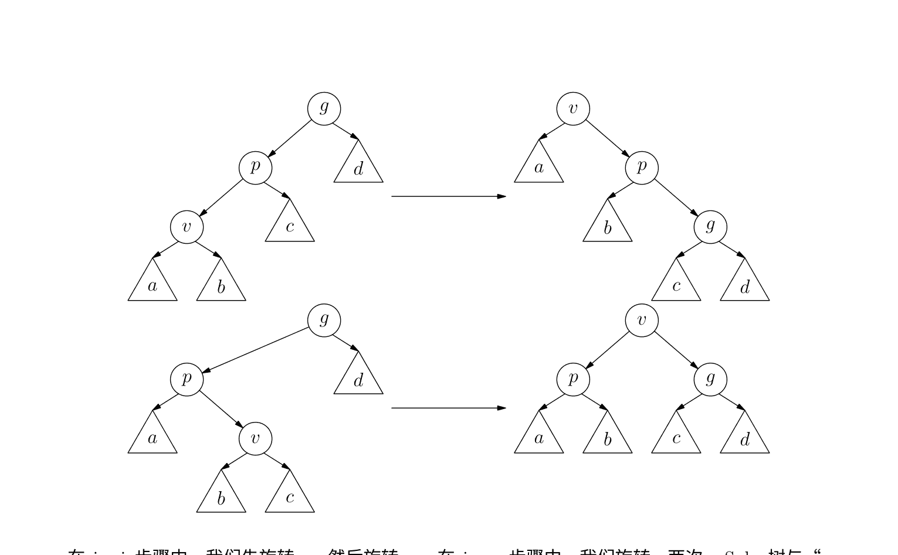

在zig-zig步骤中，我们先旋转 y，然后旋转 x。在zig-zag步骤中，我们旋转 x两次。Splay树与 “Move-to-root”算法不同之处在于zig-zig操作，而不仅仅是简单旋转。x两次。我们执行这些操作，直到 x要么在树的根部，要么是根的子节点，在这种情况下，我们对 x执行一次单旋转。

#### 5.3.1 分析性质

伸展树已经被证明具有上述一些性质。特别地，伸展树：

-   在静态情况下是最优的， [41]
-   具有工作集属性， [41]
-   具有动态指针属性。这是由Cole等人在2000年证明的。 [37][38]

目前还不知道伸展树是否在动态情况下是最优的，甚至是否满足统一性质。在原始论文中，有人猜测它们在动态情况下是最优的[41]，但这个猜测仍然未解决。

### 5.4 几何视图

事实证明，从[39]中有一种非常巧妙的二叉搜索树算法的几何视图。假设在键集 {1,2,…,n}上，我们有一个访问序列 x1,…,xm。我们可以用点(xi,i)来表示这个序列。

例子：如果我们的键集是 {1, 2, 3, 4} ，我们的访问序列是3 ，1, 4, 2，我们会画出这个图像：

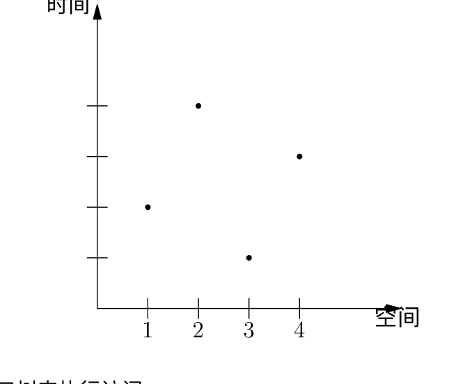

我们可以用这个静态二叉树来执行访问：

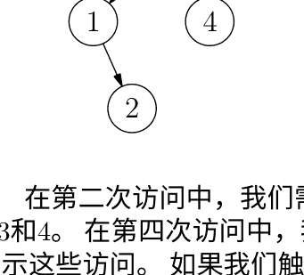

在第一次访问中，我们只需要访问3。在第二次访问中，我们需要访问3和1。在第三次访问中，我们需要访问3和4。在第四次访问中，我们需要访问3、1和2。我们还可以用几何方式表示这些访问。如果我们触摸了项目 x和时间 t，则在(x, t)处画一个点。

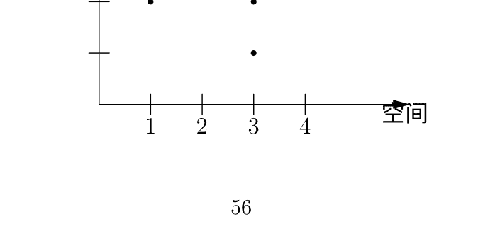

通常情况下，我们可以通过绘制每个被触摸的项目的点来表示给定输入序列的BST算法。我们认为算法的成本是总点数；在运行BST时，没有任何理由多次访问一个节点。因此，点数的数量在BST的成本的常数因子范围内。因此，点数的数量在BST的成本的常数因子范围内。

定义。我们说一个点集是树满足的，如果满足以下条件：对于任意一对不同时位于同一水平或垂直线上的点，存在第三个点位于由前两个点围成的矩形内（可以在边界上或内部）。

请注意，示例中给出的BST的点集是树满足的。一般来说，以下成立：

**定理。** 一个包含点 (xi, i) 的点集是树满足的，当且仅当它对应于输入序列 x1, ..., xm 的有效BST。

**推论。** 最优二叉搜索树的执行等同于包含输入的最小树满足集合。

**待解决问题：** 找到最小树满足集合的计算复杂度是多少？是否存在O(1)的近似算法？

证明. 首先，我们证明任何有效的BST算法的点集是树状满足的。考虑点(x, i)和(y, j)，其中 x 在时间 i 被触摸，y 在时间 j 被触摸。假设由对称性可知 x < y 且 i < j。我们需要证明在以(x, i)和(y, j)为角的矩形中存在第三个点。还让lca_t(a, b)表示节点 a 和 b 在时间 t 之前的最近公共祖先。我们有几种情况：

-   如果lca_i(x, y) = x，则我们可以使用点(lca_i(x, y), i)，因为如果 x 被触摸，lca_i(x, y)必定被触摸。
-   如果lca_j(x, y) = y，则我们可以使用点(lca_j(x, y), j)。
-   如果以上两种情况都不成立，则我们必须有 x 是 y 的祖先，并且在时间 i 之前，y 是 x 的祖先，并且在时间 j 之前。然后在某个时间 k (i ≤ k < j) 中，y 必须已经在 x 上方旋转，所以我们可以使用点 (y, k)。

接下来，我们将展示另一个方向：给定一个满足树形结构的点集，我们可以构建一个与该点集对应的有效二叉搜索树。现在我们将我们的二叉搜索树组织成一个按照下一个触摸时间的堆序排列的树堆。注意，下一个触摸时间存在并列情况，因此并不是唯一定义的，但只要我们选择一种方式来打破并列，这不是一个问题。当我们到达时间 i 时，被触摸的节点形成了一个连接的子树，符合堆序性质。现在我们可以取出这个子树，分配新的下一个触摸时间，并重新排列成一个新的局部树堆。现在，如果一对节点，x 和 y，跨越了触摸和未触摸部分之间的边界，那么如果 y 比 x 更早被触摸，那么 (x, 现在) → (y, 下一个 - 触摸(y)) 是一个不满足的矩形，因为最左边的这样的点将成为 x 的右子节点，而不是 y。 ■

#### 5.4.1 贪心算法

有一个简单的贪心算法来构建满足树形结构的集合。我们逐行考虑点集。现在添加任何必要的点到该行，以使当前子集满足。重复此过程，直到所有点的行都满足。有人猜测这个贪心算法的时间复杂度是 O(Opt) 或者甚至是 Opt + O(m)。

> **定理。** 在线可满足树算法意味着具有O(1)减速的在线二叉搜索树算法。
>
> **推论。** 如果贪婪算法是O(Opt)，那么我们有一个动态最优算法。

证明。首先，在分裂树中存储从访问中触及的节点。分裂树可以将一个节点移动到根，并在摊还O(1)时间内删除该节点，留下两棵树。这使我们能够仅在O(n)时间内对所有触及的节点进行重新排序和分离。现在，我们可以实质上构建一个二叉搜索树，它实质上是由之前触及的节点排序的分裂树的树堆。这些树使我们能够在触及分裂树中的节点时，高效地触及父树中的前驱和后继节点。因此，我们能够仅仅以一个恒定的因子减速来模拟可满足树算法的决策。

# 讲座6

## 动态最优性2

记录员: Aakanksha Sarda (2012) , David Field (2012) , Leonardo Urbina (2012) , Prasant Gopal (2010) , Hui Tang (2007) , Mike Ebersol (2005)

### 6.1 概述

在上一节课中，我们讨论了将二叉搜索树的执行表示为点集。BST执行被表示为算法执行期间触及的所有节点的点集。点集表示有效的BST执行，当且仅当它满足树形满足性。当且仅当由两个不在水平或垂直线上的点跨越的矩形包含另一个点时，点集满足树形满足性。这种二叉搜索的点集表示建议了一种离线贪心算法，通过逐行添加所需的点来使点集满足树形满足性。这个贪心算法被猜测为O(最优)。离线贪心算法可以在线模拟。

在这个讲座中，我们将专注于下界。我们将使用独立矩形的方法来建立下界。我们将讨论独立矩形方法的三个应用: Wilber 1、Wilber 2和有符号贪心。有符号贪心算法与贪心算法几乎相同，但它是一个下界。据推测，但尚未证明这两个算法在彼此之间相差一个常数因子。我们还将讨论O(lg lg n)竞争的探戈树。

### 6.2 独立矩形边界

现在我们使用独立矩形的方法来建立二叉搜索树性能的下界。如果矩形对不满足树形条件，并且任何一个矩形的任何一个角都不严格在另一个矩形内部，则这对矩形被称为独立的。独立矩形下界表明，使点集满足树形条件所需的额外点数大于或等于该点集中的最大独立矩形数。

由于满足树形的点集和二叉搜索树之间的等价性，这对二叉搜索树的性能设置了一个下界。

给定任意两个点 a 和 b，存在一个唯一的以 a为顶点，以 b为对角顶点的矩形。 我们将这个矩形称为矩形 ab。如果线段 ab的斜率为正，我们称这个矩形为S-矩形。S代表由该线段形成的斜线'/'。如果线段 ab的斜率为负，我们称这个矩形为B-矩形。B代表由该线段形成的反斜线'\'。

**定义4.** 一对矩形 ab和 cd如果不满足树形且两个矩形的任何一个角都不严格在另一个矩形内部，则称为独立矩形。

**定义5.** 给定一个点集 P，让OPT是 P的最小满足阿伯尔超集的基数。（OPT也可以用来指代最小超集）

**定义6.** 给定一个点集 P，让MAXIND□是 P定义的矩形的最大独立矩形集的基数。让MAXIND□和MAXIND□以相同的方式定义，但分别用于独立的S-矩形和独立的B-矩形。

**定理7.** 给定一个点集 S，OPT≥ |input|+ 1/2MAXIND□

从现在开始，所有引理、定义和定理都将使用S-矩形来陈述；但它们也可以对称地应用于B-矩形。

**定义8(S-满足).** 如果所有S-矩形都有另一个点在其中，我们称之为S-满足的点集。

**定义9 (OPT□).** 给定一个点集 P, OPT□=最小的S-满足超集的基数。

**引理10.** OPT□≥ |输入| +最大距离□

#### 6.2.1 引理的证明

证明. 假设输入点集 P中的点具有不同的 x和 y。如果不是这种情况，可以使输入倾斜，使得输入的x和y都是不同的。考虑由 P定义的S-矩形的最大独立子集。（或者其中任何一个最大子集，如果不唯一）我们将通过计费论证证明OPT□≥ |输入| +最大距离□。

垂直线段的存在：考虑独立集中最宽的矩形，如下图所示。将其左下顶点称为 a，将其右上顶点称为b。必定存在一条从该矩形底边到顶边的垂直线段，该线段在其他矩形中没有任何点。这是因为所有与最宽矩形内部相交的矩形必须与最宽矩形共享顶点 a，与最宽矩形共享顶点b，或者两者都不共享。由于独立性，共享 a的矩形必须位于共享b的矩形的左侧（它们不能仅仅由于不同的x坐标而共享边）。不共享的矩形不能有一个垂直边与特定的 a或 b共享矩形相交，而另一个垂直边不相交，因为矩形必须是独立的。由于共享 a和 b的矩形不能相交，并且共享的矩形必须适合于共享b和共享a的矩形之间，将有空间用于垂直段 v。

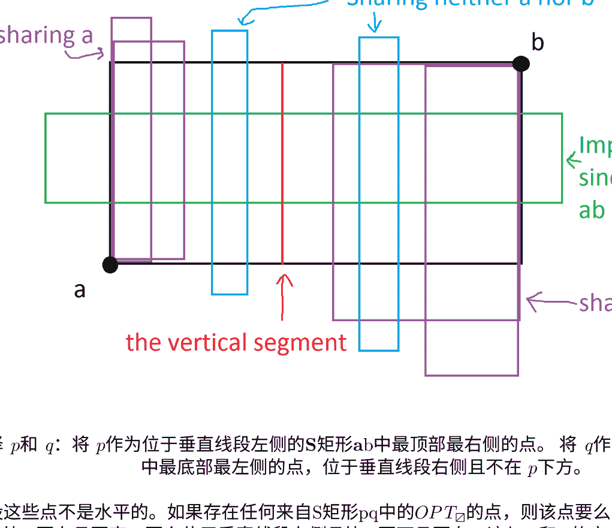

选择 p和 q：将 p作为位于垂直线段左侧的S矩形ab中最顶部最右侧的点。 将 q作为位于S矩形ab中最底部最左侧的点，位于垂直线段右侧且不在 p下方。

假设这些点不是水平的。如果存在任何来自S矩形pq中的OPT□的点，则该点要么位于垂直线段左侧且比 p更右且更高，要么位于垂直线段右侧且比 q更下且更右，这与 p和 q的定义相矛盾。 因此，S矩形pq不满足，这是一个矛盾。 因此，线段pq是水平的。

计费：将S矩形ab从独立S矩形集合中移除，并将其计费给包含 p和 q的水平线。（注意， a和 b没有被移除，只有S矩形ab被移除）。由于垂直线段与它们之间的水平线相交或包含在任何其他矩形中，因此对点对 p和 q不会再次计费，因此没有其他矩形包含线段 pq。对于水平线的任何一组 n计费，必须计费 n+1个不同的点，因为不能对任何一对点进行两次计费，并且计费的所有点对必须是线上的连续点。 这些点中最多只能有1个来自输入。 因此，在水平线上添加的点的数量大于或等于对该线的计费数量。 因此，OPT□ ≥ |input| + MAXIND□，如所需。

## 6.2.2 定理的证明

证明。使用引理：

$$
\begin{align*}
OPT &\geq \max(OPT_{\Box}, OPT_{\Box}) &(6.1)\\
&\geq 1/2(OPT_{\Box} + OPT_{\Box}) &(6.2)\\
&\geq |input| + 1/2 MAXIN D_{\Box} + 1/2 MAXIN D_{\Box} &(6.3)\\
&\geq |input| + 1/2 MAXIN D_{\Box} &(6.4)
\end{align*}
$$

□

## 6.3 下界

### 6.3.1 威尔伯的第二个下界[42]：

威尔伯的第二个下界可以如下介绍。给定输入（访问）点集：

- 1. 对于每个点 p:
    (a) 查看所有在 p下方的正交可见点
    (b) 计算 p左右方向的交替次数
- 2. 对所有 p求和

证明:为每个交替添加一个独立的符号不同的矩形。

打开:OPT = ΘWilber2

### 6.3.2 关键独立最优性 [43]：

现在假设关键值是“无意义的”。在这种情况下，我们可以随机排列它们。 考虑到这一点，我们可以提出以下主张：

$$E[OPT] = 工作集界限$$

因此，伸展树是关键独立最优的。

证明概要:在随机排列中，最大值的预期更改次数为

$$E[Wilber2(x_i)] = Θ(log t_i)$$

Wilber的第一个下界 [42]:我们可以通过以下方式得到Wilber的第一个下界。固定一个下界树 P，其键为输入。然后:

- 1. 对于每个节点 y of P: 计算访问序列 x1, x2, ..., xn 在 y的左子树和右子树之间的访问中交替的次数（忽略对 y 或 y 的子树之外的访问）。
- 2. 对所有 y 求和

证明:为每个交替添加一个独立的矩形。

例子:位反转序列考虑从列表中得到的数字序列，将它们的二进制表示反向读取。也就是说，从

0, 1, 2, 3, 4, 5, 6, 7, . . .

用二进制表示为,
000₁, 001₂, 010₂, 011₂, 100₂, 101₂, 110₂, 111₂

将其反转得到:
000₁, 100₂, 010₂, 110₂, 001₂, 101₂, 011₂, 111₂

换句话说
0, 4, 2, 6, 1, 5, 3, 7

如果我们将这个作为完美二叉树的访问序列，我们可以看到在 y 处的交替次数等于以 y 为根的子树的大小。 由此可得:
$$Wilber1 = \Theta(n \log n)$$
$$\Rightarrow \quad OPT = \Theta(n \log n)$$

**OPEN:**对于每个访问序列，是否存在一棵树 P 使得
$$OPT = \Theta(Wilber1)$$

## 6.4 Tango树

Tango树[DHIP04]是一个 O(lg lg n)竞争的BST。它们代表了从标准平衡树的 O(lg n)竞争比之前的重要进展。 Tango树的运行时间比Wilber的第一个界限高 O(lg lg n)，因此我们也得到了Wilber与 OPT之间的界限。 很容易看出，如果在不知道序列的情况下固定下界树（任何在线算法都必须这样做），Wilber的第一个界限可以与OPT相差Ω(lg lg n)，因此不能使用这种技术获得更好的界限。

为了实现这种改进的性能，我们将BST分成更小的辅助树，这些树是大小为 O(lg n)的平衡树。 如果我们必须操作 k个辅助树，我们可以在 O(klg lg n)时间内完成。 我们将实现 k=（当前访问所给出的Wilber界限增加的1），从而得到竞争性。

让我们再次考虑一个完美的二叉树 P，并选择一个节点 y在 P中。 我们定义 y的首选子节点为具有最近访问的子树的根节点，即首选子节点是左侧的子节点。 当且仅当最后一次访问在 y的左子树下时成立。如下图所示，每个节点最多只有一个首选子节点，并且通过树形成 “首选路径”。
如果 y没有子节点或其子节点尚未被访问，则它没有首选子节点。交错等效于更改节点的首选子节点，这意味着Wilber界限是首选子节点更改的总次数。

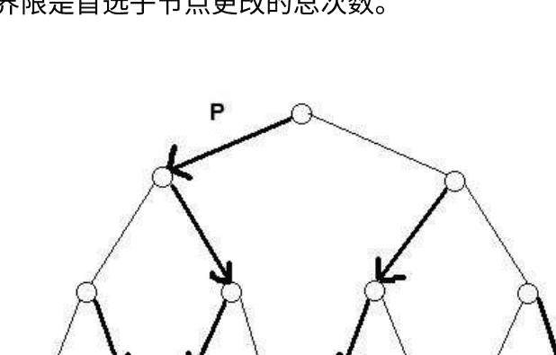

现在我们将首选路径定义为一系列首选子节点指针。我们将每个首选路径从 P存储在一个平衡的辅助树中，该辅助树在概念上与 T分离，使得叶子节点链接到 “子路径”的辅助树的根节点。

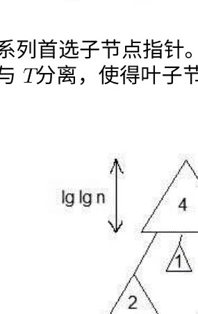

因为 P的高度是lg n，每个辅助树将存储 ≤ lg n个节点。因此，在辅助树上的搜索将花费 O(lg lg n)的时间，所以 k个辅助树的搜索成本为 O(klg lg n)。
首选路径不是按深度存储的（在BST模型中是不可能的），而是按键的排序顺序存储的。

### 6.4.1 搜索Tango树

要在这个数据结构中搜索节点 x，我们从顶部辅助树的根节点开始（其中包含 P的根节点）。然后我们遍历树寻找 x。我们很可能会跳转多个辅助树之间 - 假设我们访问了 $k$ 个树。 我们在每个辅助树上进行 $O(\lg \lg n)$ 的搜索，这意味着我们的整个搜索过程在 $O(k \lg \lg n)$ 的时间内完成。 这假设我们可以像搜索一样快速更新我们的数据结构，因为我们将被迫更改 $k-1$ 个首选子节点（除非节点没有首选子节点时的启动成本）。

### 6.4.2 平衡辅助树

每当首选路径发生变化时，必须更新辅助树。 当首选路径发生变化时，我们必须从某一点开始切断路径，并在那里插入另一条首选路径。

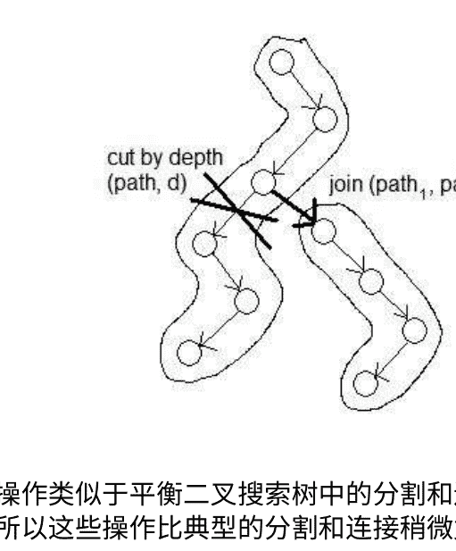

我们注意到切断和连接操作类似于平衡二叉搜索树中的分割和连接操作。 然而，由于辅助树是按键而不是深度排序的，所以这些操作比典型的分割和连接稍微复杂一些。

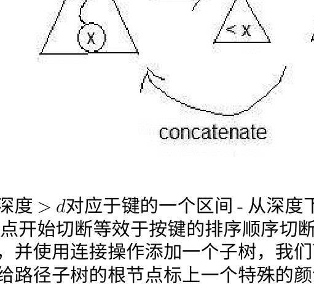

幸运的是，我们注意到深度 > d 对应于键的一个区间 - 从深度下方路径的最小值到深度下方路径的最大值。 因此，从某一点开始切断等效于按键的排序顺序切断一个段。 通过使用两次分割操作从辅助树中切除一个子树，并使用连接操作添加一个子树，我们可以改变首选路径。 为了执行这些切断和连接操作，我们给路径子树的根节点标上一个特殊的颜色，并假装它不存在。 这意味着我们只需要关心在高度为 $\lg n$ 的子树上进行分割和连接操作，而不需要试图弄清楚如何处理所有的东西。辅助子树悬挂在我们感兴趣的路径子树上。我们知道平衡二叉搜索树可以在$O(\lg size)$时间内支持分割和连接操作，这意味着它们都在$O(\lg \lg n)$时间内运行。因此，我们保持$O(\lg \lg n)$竞争力。

## 6.5 有符号贪婪算法

本节将在上一讲的贪心算法基础上，介绍一种修改过的“有符号贪心”算法，其运行时间作为一个下界。

### 6.5.1 算法

像之前一样，按行进行贪心算法扫描，每次考虑一个点行。然而，在有符号贪心算法中，我们只考虑未满足的$\square$-矩形（或者只考虑$\boxtimes$-矩形），来决定是否添加点。

因此，只有$\square$-矩形（或者只有$\boxtimes$-矩形）会被满足。此外，类似于原始贪心算法，每个添加的点都对应一个独立的$\square$-矩形。

定义11.定义$OPT_{\boxtimes}$为满足$\square$的最小并集和满足$\boxtimes$的超集的点的集合。

### 6.5.2 有符号贪心提供了一个下界

定理12.$\max\{\square\text{-贪心}, \boxtimes\text{-贪心}\} = \theta(\text{最大独立矩形下界})$

证明。

$$\begin{aligned}
&OPT_{\boxtimes} \geq |\text{输入}| + \frac{1}{2} \quad \quad \quad 2 \text{ 最大独立矩形的数量} & (6.5)\\
&\geq \frac{1}{2} \max(\square\text{-贪心}, \boxtimes\text{-贪心}) & (6.6)\\
&\geq \frac{1}{2} \max(OPT_{\square}, OPT_{\boxtimes}) & (6.7)\\
&\geq \frac{1}{4} (OPT_{\square} + OPT_{\boxtimes}) & (6.8)\\
&\geq \frac{1}{4} OPT_{\boxtimes} & (6.9)\\
&\square
\end{aligned}$$

因此，一个常数因子的“三明治”被创建，并且所有的表达式（1）到（5）必须在一个常数因子的范围内。特别地，（1）-独立矩形下界-和（2）必须在一个常数因子的范围内，定理得证。

### 6.5.3 贪心 vs. □-贪心

贪心对应于一个有效的二叉搜索树，并且提供了OPT运行时间的上界。有符号-贪心（OPT□）不是一个有效的二叉搜索树，但它提供了每个有效二叉搜索树运行时间的下界。贪心和有符号贪心得到的点集之间的关键差异在于有符号贪心未考虑 □-矩形和 □-矩形之间的相互作用，即为了满足 □-矩形而添加的点可能引入新的未满足 □-矩形或反之亦然。

项目想法：比较许多点集的上界和下界。

## 讲座7

## 内存层次结构 1

记录人：Claudio A Andreoni (2012)，Sebastien Dabdoub (2012)，Usman Masood (2012)，Eric Liu (2010), Aditya Rathnam (2007)

### 7.1 内存层次结构及其模型

到目前为止，在课堂上，我们已经使用了像字RAM或单元探针模型这样的计算模型。 这些模型考虑了一次与内存通信一个字：如果我们需要读取10个字，就需要10个单位的成本。

在现代计算机上，这几乎从来不是这种情况。 现代计算机具有内存层次结构，以尝试加快内存操作。 内存层次结构中的典型级别是：

| 内存级别 | 大小 | 响应时间 |
|----------|------|----------|
| CPU寄存器 | ≈ 100B | ≈ 0.5ns |
| L1缓存 | ≈ 64KB | ≈ 1ns |
| L2缓存 | ≈ 1MB | ≈ 10ns |
| 主内存 | ≈ 2GB | ≈ 150ns |
| 硬盘 | ≈ 1TB | ≈ 10ms |

很明显，最快的内存级别远小于最慢的内存级别。 一般来说，每个级别只与层次结构中直接下面的级别直接连接。 此外，更快、更小的级别的生产成本要高得多，所以不要指望1GB的寄存器空间很快就会出现。 许多级别以块的形式进行通信。 例如，要求主内存读取一个整数通常也会传输附近数据的“块”。 因此，处理其他块成员不需要额外的内存传输。 当与磁盘通信时，这个问题会加剧：10ms的时间主要用于查找数据（将读头移动到磁盘上）。 现代硬盘是圆形的，以7200转/分钟的速度旋转，所以一旦磁头处于位置，读取该“环”上的所有数据速度更快。

这表明需要设计能够处理数据“块”的算法。 在实践中，能够充分利用内存层次结构的算法会更快；而能够正确描述层次结构的内存模型对于分析来说更有用。我们将会看到一些今天我们将介绍一些基本模型及其相关结果。

## 7.2 外部内存模型

外部内存模型由Aggarwal和Vitter于1988年引入[44]；它也被称为“I/O模型”或“磁盘访问模型”（D AM）。外部内存模型将内存层次结构简化为只有两个级别。CPU连接到一个大小为 $M$ 的快速缓存；这个缓存又连接到一个速度较慢但实际上大小无限的磁盘。缓存和磁盘都被划分为大小为 $B$ 的块，因此缓存中有 $\frac{M}{B}$ 个块。从缓存到磁盘（或反之）传输一个块的成本为1个单位。对于缓存中的块进行的内存操作是免费的。因此，自然的目标是尽量减少缓存和磁盘之间的传输次数。

显然，任何来自于RAM模型的算法，其运行时间为 $T(N)$ ，在外部存储器模型中需要不超过 $T(N)$ 次内存传输（每个操作最多一次内存传输）。通常更难获得的下界是 $\frac{T(N)}{B}$ ，我们充分利用缓存局部性；即每个块只被读/写了固定次数。

请注意，外部存储器模型是对内存层次结构中最慢的连接的很好的近似。对于大型数据库，“缓存”可以是系统内存，“磁盘”可以是硬盘。对于小型模拟，“缓存”可能是L2缓存，“磁盘”可以是系统内存。

### 7.2.1 扫描

扫描 $N$ 个项目显然需要 $O(\lceil \frac{N}{B} \rceil)$ 次内存传输。天花板很重要，因为如果 $N = o(B)$ ，那么我们将读取比必要的更多的项目。

### 7.2.2 搜索

使用分支因子为$\Theta(B)$的B树来进行搜索。在实践中，我们希望它恰好为 $B+ 1$ ，这样一个节点就能适应一个内存块，而且我们始终有一个分支因子 $\geq 2$ 。然后，插入、删除和前驱/后继搜索都可以通过 $O(\log_{B+1} N)$ 个内存传输来处理。在比较¹模型中，这将需要 $O(\log N)$ 的时间；因此，通过 $O(\log B)$ 的因子进行了改进。

对于搜索来说， $O(\log_{B+1} N)$ 的界限实际上是最优的；我们可以从信息论的角度来看到这一点。我们想要弄清楚我们的项目在所有 $N$ 个项目中的位置。我们的项目可以放置的位置有 $N+ 1$ 个，我们需要 $\Theta(\log(N+ 1))$ 位的信息来指定其中一个位置。每次从缓存中读取（一个块）告诉我们项目在 $B$ 个项目中的位置，产生 $O(\log(B+ 1))$ 位的信息。因此，我们至少需要 $\Theta(\frac{\log(N+1)}{\log(B+1)})$ 或 $\Omega(\log_{B+1} N)$ 内存传输以显示所有 $\Theta(\log(N+ 1))$ 位。

然而，对于插入/删除操作，这个界限不是最优的。

¹这不是标准的比较模型；在这里，我们指的是元素之间唯一允许的操作是逐对比较它们。

### 7.2.3 排序

在字RAM模型中，B-树可以在最优时间内进行排序：只需插入所有元素，然后进行中序遍历。然而，在外部内存模型中，相同的技术导致 $O(N \log_{B+1} N)$ (摊销) 内存传输，这是不最优的。

最优算法是 $M$ 路归并排序的版本。通过解决适合缓存的子问题，它获得了性能，总共 $O(\frac{N}{B} \log_M \frac{N}{B})$ 内存传输。在比较模型中，这个界限实际上是最优的[44]。

### 7.2.4 排列

排列问题是：给定$N$个元素以某种顺序和一个新的顺序，重新排列元素以出现在新的顺序中。朴素地，这需要 $O( N)$ 次操作：只需将每个元素交换到其新位置。可能更快的方法是为每个项分配一个等于其排列顺序的键，然后应用上述最优排序算法。这给出了一个上界$O(\min\{N, \frac{N}{B} \log_M \frac{N}{B}\})$ (摊销)。请注意，此结果仅适用于“不可分割模型”，其中单词不能被切割并重新打包成其他单词。

### 7.2.5 缓冲树

缓冲树本质上是排序的动态版本。缓冲树每个操作实现 $O( \frac{1}{B} \log_M \frac{N}{B})$ (摊销) 内存传输。上界必须摊销，因为通常情况下是 $O(1)$。如果所有元素都被插入，然后按最小顺序删除，则它们也实现了最优排序上界。操作是批量更新（插入，删除最小值）和延迟查询。如果我们进行查询，我们不会立即得到答案；它是延迟的。还有一个新的操作叫做刷新，它以$O(\frac{N}{B} \log_M \frac{N}{B})$ 时间。所以如果我们执行 $O(N)$操作，然后执行刷新，不会花费额外的时间。查找最小值的查询是免费的；最小项一直保持。它们可以用作高效的外部存储器优先队列。

## 7.3 缓存遗忘模型

缓存无关模型是由Frigo、Leis-erson、Prokop和Ramachandran于1999年引入的外部存储器模型的一种变体[53, 54]。在这个模型中，算法不知道块大小 $B$或总内存大小 $M$。特别是，我们的算法看起来像普通的RAM算法，但我们会以不同的方式进行分析。

对于建模假设，我们将假设缓存是自动完成的。我们还将假设缓存机制是最优的（在离线意义上）。在实践中，可以通过LRU（最近最少使用）或FIFO（先进先出）来实现这一点，因为它们与离线最优算法具有 $O(1)$竞争性，如果它们具有两倍大小的缓存。由于我们的算法都不会因为将缓存大小 $M$替换为$2M$而改变，所以这不会改变我们的界限。

对于这个模型，好的算法给我们所有的 $B$和 $M$值都提供了好的算法。它们对于多级缓存和具有变化的 $B$和 $M$值的缓存尤其有用。

### 7.3.1 扫描

上界与外部存储器相同：$O(\lceil N/B \rceil)$ 内存传输。我们可以使用相同的算法，因为我们在分析中只依赖于 $B$。

### 7.3.2 搜索树

B树的缓存无关变体[47, 48, 52]提供了 INSERT、 DELETE和 SEARCH操作，其内存传输为 $O(\log_{B+1} N)$ (摊销)，与外部存储器模型相同。本讲座的后半部分集中讨论了缓存无关B树。

### 7.3.3 排序

与外部存储器模型一样，可以使用缓存无关方式在 $N$ 个元素上进行排序，时间复杂度为 $O\left(\frac{N}{B} \log_{\frac{M}{B}} \frac{N}{B}\right)$ 内存传输 [53, 50]。这将在下一节课中完成。

### 7.3.4 排列

最小值{}不再可能[53, 50]，因为这取决于知道 $M$ 和 $B$。外部内存模型的两个组件边界（排序或线性）仍然有效，我们只是不知道哪个给出最小值。

### 7.3.5 优先队列

可以实现一个优先队列，执行 INSERT， DELETE和 DELETE-MIN操作 在 $O\left(\frac{1}{B} \log_{\frac{M}{B}} \frac{N}{B}\right)$ (摊销) 内存传输 [46, 49]。这假设有一个高缓存，即：$M= \Omega(B^{1+\epsilon})$。

## 7.4 缓存遗忘B树

现在我们将讨论和分析导致先前所述的缓存无关搜索树结果的数据结构。 我们将使用一个与标准 B树共享许多特性的数据结构。 它需要进行修改，因为我们不知道 $B$，不像在外部内存模型中。 首先，我们将构建一个支持在 $O(\log_{B+1} N)$ 时间内进行搜索的静态结构。

### 7.4.1 静态搜索树

首先，我们将构建一个包含所有 $N$ 个元素的完全二叉搜索树。 为了在内存传输上实现对数 $B+1$ 的复杂度，树将以van Emde Boas布局[54]的形式存储在磁盘上。 vEB布局是递归定义的。 树将按高度一分为二；上半部分子树的高度为 $\frac{1}{2} \log N$，它包含 $O(\sqrt{N})$ 个元素。而顶部子树则链接到O(√N)个子树，每个子树包含O(√N)个元素。每个 √N+ 1个子树再根据vEB布局进行划分。在磁盘上，上半部分子树先存储，底部子树按顺序排列在其后。这种布局可以推广到高度不是2的幂次的树，其分支因子为O(1)（≥2）[47]。

请注意，当递归到达一个足够小的子树（大小小于B）时，我们可以停止。较小的工作集不会获得或失去任何东西，因为它们不需要任何额外的内存传输。

第13条声明。在van Emde Boas布局中对搜索树进行搜索需要 \(O(\log_{B+1} N)\) 内存传输。

证明。考虑“跨越”B的细节级别。也就是说，继续将树切成一半，直到每个子树的高度首次变为≤log B。此时，高度必须大于 \(\frac{1}{2} \log B\)。请注意，子树的大小至少为√B，最多为B，在这个“跨越”级别上有B到B²个元素。在从根到叶的（搜索）路径中，我们最多访问 \(\log N\) 个元素。子树²。然后，该级别上的每个子树最多需要2次内存传输³。因此，整个搜索需要 \(O(\log_{B+1} N)\) 次内存传输。

## 7.4.2 动态搜索树

请注意，以下描述是根据[48]的工作进行建模的，该工作是对[47]的简化。

### 有序文件维护

首先，我们需要一个额外的支持数据结构来解决有序文件维护（OFM）问题。暂时将其视为一个黑盒子；详细信息将在下一堂课中给出。

OFM问题涉及将N个元素存储在大小为O(N)的数组中，并具有指定的排序。请注意，这意味着结构中允许大小为O(1)的间隙。然后，OFM数据结构支持INSERT（在两个给定的连续项之间）和DELETE操作。它通过在大小为 \(O(\log^2 N)\) 的区间内移动元素（摊销）并通过O(1)个交错扫描来实现每个操作。由此可知，这些操作需要 \(O( \log^2 N / B )\) 转移。

打开据推测，O(log² N)（摊销）时间是最优的。

### 回到搜索树：链接vEB布局和OFM

现在，我们还希望能够快速进行搜索操作。

2树的高度为O(log N)；子树的高度为Ω(log B)。
3尽管每个子树的大小最多为B，但它们可能不与缓存边界对齐；例如，一半在缓存行i中，一半在行i+1中。

为此，我们在 \(N\)个键上构建一个OFM，加上必要的间隙。然后，我们在OFM项目上创建一个vEB排列的树，在树的叶子和OFM中的相应项目之间添加指针。结果如图7.1所示。

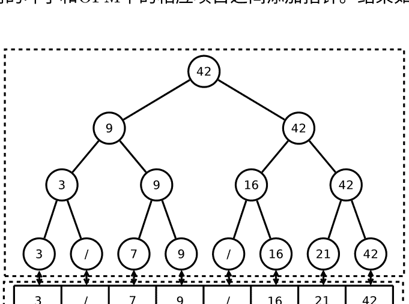

注意键都在叶子节点上。内部节点包含子树根节点的最大值（空缺视为 \(-\infty\)）。

使用这种结构，搜索通过检查每个节点的左子节点来决定是向左还是向右分支。它的时间复杂度为 \(O(\log_{B+1} N)\)。

插入操作需要先搜索要插入的项的后继节点。然后，我们将项插入到OFM中，最后从受影响的叶子节点更新树，直到根节点。注意更新必须按照后序方式执行，以便每个节点可以计算其子节点的新最大值。该过程在图7.2中有所说明。删除操作类似：我们在树中搜索，从OFM中删除，并更新树。

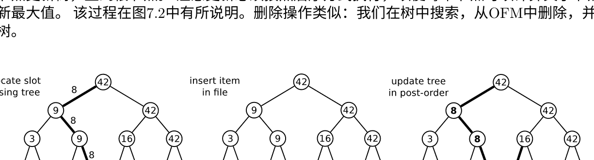

现在，我们想要分析更新操作。

第14条声明。插入和删除需要 \(O\left(\log_{B+1} N + \frac{\log^2 N}{B}\right)\) 块读取。

证明。我们立即注意到，找到要更新的项需要 \(O(\log_{B+1} N)\) 块读取，并且更新OFM \(O\left(\frac{\log^2 N}{B}\right)\)。

为了看到更新树需要多长时间，我们需要独立考虑三个不同的树层。对于第一层，我们定义小的vEB三角形为树中的子树，其1) 大小小于（或等于）B和2) 在树的最后两层之一。此外，我们将考虑大的vEB三角形，每个三角形都有1) 大于B的大小和2) 包含两个小的vEB三角形的层级。对于第二层，我们考虑叶子节点是较大的vEB块的根节点的子树。对于第三层，我们考虑从子树的根节点到整个树的根节点的路径。这个划分在图7.3中有所说明。

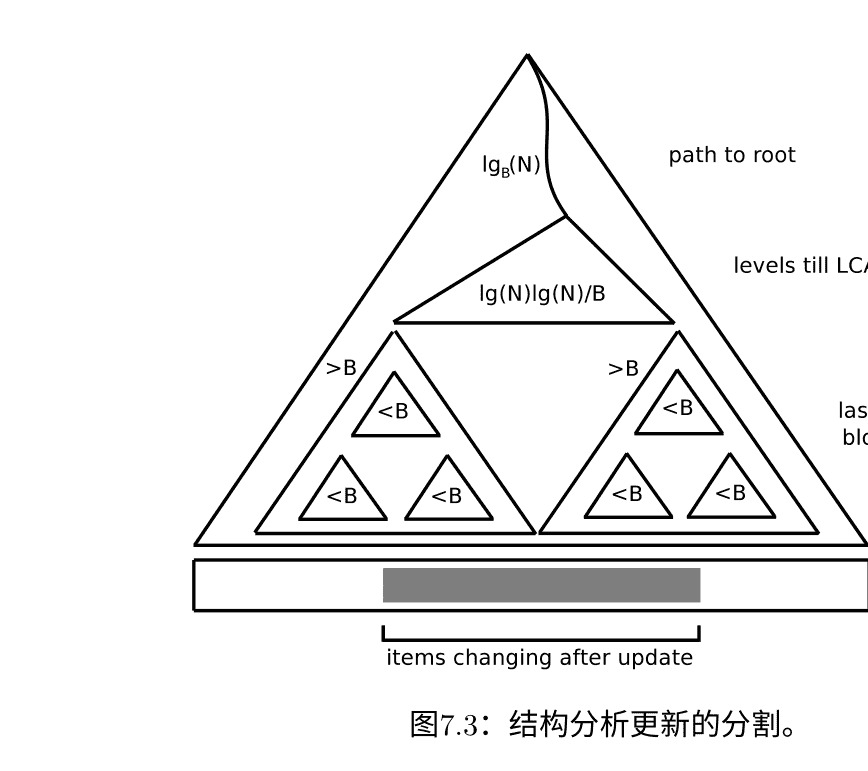

我们首先注意到，大小小于（或等于）B的块最多可以跨越两个内存块（当它位于两者之间时）。因此，读取一个小的vEB三角形最多需要读取两个块。因为我们是按后序方式更新结构，在最后两个级别时，我们只需要在缓存中保留4个块，两个用于小子vEB三角形，两个用于正在评估的父小vEB三角形。只要我们有至少4个块的缓存可用，我们就可以以摊销的常量块读取量更新所有最低两个级别的vEB三角形。由于存在O

这些三角形需要更新
最低的两个层级，更新它们需要 \(O\left(1 + \frac{\log^{2} N}{B}\right)\)（摊销）块读取。

向上进行，我们注意到 \(O\left(\frac{\log^{2} N}{B}\right)\) 大型vEB三角形的根是叶子节点 \(O\left(\frac{\log^{2} N}{B}\right)\)-大小树 \(\tau\)。注意，\(\tau\)的根是所有在叶子节点上被修改的项的最低公共祖先。\(\tau\)的大小（渐近地）等于我们已经为最低两层进行的读取量。因此，我们可以负担得起读取整个块来更新 \(\tau\) 的每个项，而不会增加运行时间。因此，可以使用任何简单的算法来更新 \(\tau\)。

最后，为了更新从根节点到整个结构的根节点的路径，我们需要进行 \(O(\log_{B+1} N)\) 个块读取。因此，我们可以在 \(O\left(\log_{B+1} N + \frac{\log^{2} N}{B}\right)\) 时间内更新整个树。

此时，我们仍然希望进一步改进界限。我们希望

实现是 \(O(\log_{B+1} N)\)（我们可以通过B树获得的），而且如果 \(B = o(\log N / \log \log N)\) 的话，我们所拥有的是太昂贵的。幸运的是，我们可以摆脱对数 \(\frac{N}{B}\)。 使用间接技术的组件

## 总结：添加间接性

间接性涉及将元素分组为 \(\Theta \left(\frac{N}{\log N}\right)\) 每个组的大小为 \(\Theta(\log N)\) 个元素。现在我们将在最小 of each \(O (\log N)\) 组上创建刚才描述的结构。

因此，OFM数组上的vEB-style BST将作用于 \(\Theta \left(\frac{N}{\log N}\right)\) 叶子节点而不是 \(\Theta(N)\) 叶子节点。

vEB存储允许我们在 \(O(\log_{B+1} N)\) 内搜索顶层结构；我们还需要扫描一个较低的组，成本为 \(O \left(\frac{\log N}{B}\right)\) 总搜索成本为 \(O(\log_{B+1} N)\) 内存传输。

现在，INSERT 和 DELETE 将需要我们一次重新组织整个组，但这个成本 \(O \left(\frac{\log N}{B}\right) = O(\log_B N)\) 内存传输，这足够便宜。与y-fast树一样，我们还希望管理组的大小：它们应该在25%和100%之间。

太小或太满的组可以根据需要合并然后分裂或合并（分别）通过销毁和/或形成新的组。我们需要 \(\Omega(\log N)\) 次更新来引起合并或分裂。因此，合并和分裂的成本可以计入更新，因此它们的摊销成本为 \(O(1)\) 只有在发生合并或分裂时才需要更新最小元素。因此，对vEB结构的昂贵更新仅在每 \(O (\log N)\) 次更新时发生，成本为

\(O \left(\frac{\log_{B+1} N + \frac{\log^2 N}{B}}{\log N}\right) = O \left(\frac{\log N}{B}\right) = O \left(\log_{B+1} N\right)\)。 因此，所有SEARCH，INSERT和DELETE操作的成本为 \(O(\log_{B+1} N)\)。

# 第8讲

# 内存层次结构2

记录员: Pedram Razavi (2012)，Thomas Georgiou (2012)，Tom Morgan (2010)

## 8.1 从上一堂课开始...

在上一堂课中，我们讨论了外部存储器和缓存无关内存模型。

我们还讨论了每个模型下一些重要的数据结构结果；其中最复杂的是缓存无感知的B树，可以在插入、删除和搜索时达到 \(O(\log_B N)\)的运行时间。在那个构造中，我们使用了有序文件维护（OFM）数据结构作为一个黑盒子来维护一个有序数组，更新操作的时间复杂度为 \(O(\log^2 N)\)。现在我们将填充OFM的细节。我们还将回顾在第一讲中介绍的列表标记问题，作为完全持久化数据结构的一个黑盒子，具体用于线性化版本树。

## 8.2 有序文件维护 [55] [56]

OFM问题是将 \(N\)个元素存储在大小为 \(O(N)\)的数组中，按照指定的顺序。此外，元素之间的间隙必须是 \(O(1)\)个元素宽，这样扫描 \(k\)个元素的成本为 \(O\lceil \frac{k}{B} \rceil\)个内存传输。该数据结构必须支持删除和插入-(在两个现有元素之间) 。这些更新操作通过重新排列一个连续的块大小为\(O(\log^2 N)\)的元素来完成，使用 \(O(1)\)个交错扫描。因此，内存传输的成本为 \(O(\frac{\log^2 N}{B})\)。

请注意这些界限是摊还的。

OFM结构通过保证数组的任何部分都不会过于密集或过于稀疏来获得其性能。当密度阈值被违反时，重新平衡（均匀重新分配元素）发生。为了激发讨论，想象一下数组（大小 \(O(N)\)）被分割成大小为\(\Theta(\log N)\)的片段。

现在想象一棵完全二叉树（深度： \(O(\log N) - \Theta(\log \log N) = O(\log N)\)）覆盖这些子集。每个树节点跟踪其元素数量和总数组槽位数。

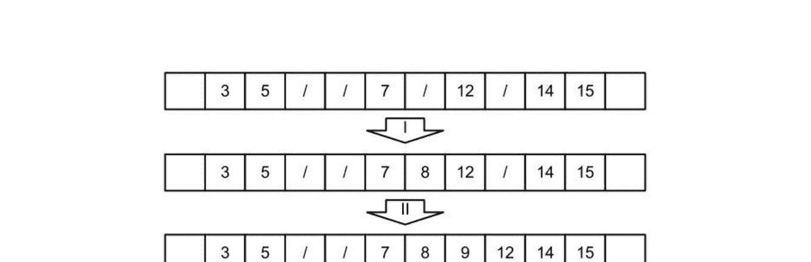

图8.1: OFM中的两个插入示例。“/”表示一个空的间隙，这些间隙的宽度都是O(1)。I. 在7之后插入元素8 II. 在8之后插入元素9。在这种情况下，12需要首先进行移位。

范围。 然后，区间的密度被定义为该区间中存储的元素数量与该区间中总数组槽数的比率。

### 8.2.1 更新

要更新元素 X,

-   更新包含 X的大小为Θ(log N)的叶子块。
-   向上遍历树，直到找到第一个在密度阈值内的节点。
-   均匀重新分配该节点区间中的元素。

节点的密度，用 ρ表示，是衡量区间占用程度的指标，因此我们可以将其定义为区间中的元素数量/数组槽数。密度为1意味着所有槽位都已满（过于密集），密度为0意味着所有槽位都为空（过于稀疏）。我们希望避免这两种极端情况，并保持一个密度阈值。密度阈值是深度相关的。深度，用 d表示，定义为树的根节点深度为0，树的叶子节点深度为 h= Θ(log N)。我们要求:

```
ρ ≥ 1/2 - (1/4)(d/h) ∈ [1/4, 1/2] : 不太稀疏
```

```
ρ ≤ 3/4 + (1/4)(d/h) ∈ [3/4, 1] : 不太稠密
```

请注意，密度约束在最浅的节点处最高。 直观地说，在最深的节点上节省工作（即具有严格的约束）相对于性能的提升很小，因为工作集相对较小。

请记住，BST从未被实际构建。 它只是一个概念工具，有助于理解和分析OFM结构。 为了执行树搜索操作，我们

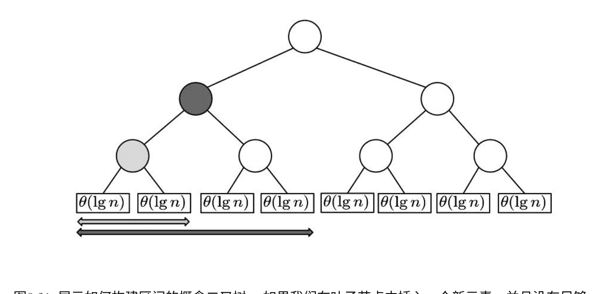

图8.2：展示如何构建区间的概念二叉树。如果我们在叶子节点中插入一个新元素，并且没有足够的空间，且区间太密集（显示为浅灰色），我们将向上遍历树并查看更大的区间（显示为深灰色），直到找到正确的区间。最终，我们最多到达根节点，这意味着整个数组的重新分配。

可以检查“节点”的左/右边界的二进制表示来确定该节点是左/右子节点。然后扫描可以相应地向左/右进行；这就是“交错扫描”。

### 8.2.2 分析

考虑一个深度为 \(d\) 的节点 \(D\) 及其深度为 \(d+1\) 的左子节点和右子节点；假设节点 \(D\) 在其阈值内，因此我们需要重新平衡其区间。观察到在平衡之后，节点 \(D\) 的所有后代都具有与节点 \(D\) 相同的密度。由于密度约束在较浅的深度上变得更严格，这意味着节点 \(D\) 的后代将（相对地）远离它们的阈值。

具体来说，节点 \(D\) 的两个子节点需要约 \(m\) 或 \(\Omega(\frac{m}{\log N})\) （其中 \(m\) 是子节点的大小）才能违反它们的阈值。因此，我们可以将重新平衡父节点区间的成本，其大小 \(\leq 2m\)，归咎于那些 \(\Omega(\frac{m}{\log N})\) 更新。每次更新的时间复杂度为 \(O(\log N)\)。

因为只有 \(\Omega(\frac{m}{\log N})\) 的更新（直到子节点违反阈值）但是 \(m\) 在父节点区间中计费。现在我们要处理的是我们只考虑了深度 \(d\) 和 \(d+1\)。

每个叶子节点都在 \(O(\log N)\) 个祖先节点之下，所以每次更新可能在每个树层级上计费。这导致总共有 \(O(\log^2 N)\)（摊销）内存移动。

这个分析是一个摊销结果。它可以变成最坏情况[57]，但我们在课堂上没有讨论过。它还猜测 \(\log^2 N\) 是这个问题的适当下界。

## 8.3 列表标记

列表标记是一个比OFM更容易的问题。它涉及在链表的每个节点中维护显式的（例如整数）标签。这些标签应该在列表上单调递增。数据结构需要支持在两个标签之间插入和删除一个标签。根据标签空间的大小，我们知道有各种时间复杂度范围：

| 标签空间 | 最佳更新查询时间 | 评论 |
| :--- | :--- | :--- |
| (1 + ε)N...N lg N | O(lg² N) | 使用OFM（线性空间） |
| N¹⁺ᵉ...N^O(1) | Θ(lg N) | OFM方法，阈值为 ≈ \(\frac{1}{a^d}, 1\) |
| 2ᴺ | Θ(1) | 简单：为每个项目使用 N位，因此通过二分间隔进行插入 |

### 8.3.1 列表有序维护

在这里，我们需要维护一个有序的链表，可以进行插入和删除。此外，它应该回答“排序查询”：节点 \(x\) 在节点 \(y\) 之前吗？使用间接引用[58]可以实现 \(O(1)\) 的更新和查询。

考虑一个覆盖一组“底部”结构的“顶部”摘要结构。底部结构的大小为 Θ(log N)。为了进行标记，我们可以使用简单的指数标签空间列表标记算法。所需的标签空间为 \(2^n = 2^{\log N} = N\)，这是可以承受的。摘要结构的大小为 \(O(\frac{N}{\log N})\)；每个元素指向底部成员之一。对于这个列表，使用 Θ(log N)列表标记算法。成本是 \(O(1)\) 摊销，因为每次更新的成本是Θ(log N)，但只有在每次更新底部成员时才会发生更新。

然后，我们可以为每个底部成员元素形成一个隐式标签，形式为（顶部标签，底部标签）。这需要 \(O(\log N)\) 位来存储，因此我们可以在 \(O(1)\) 时间内比较两个标签。关键点在于改变一个顶部标签会同时更新多个底部标签。这就是我们能够获得比上表中引用的最优结果更好性能的原因。最后，最坏情况下的边界也是可获取的[58]。

## 8.4 缓存遗忘优先队列 [59]

我们在缓存无关优先队列中的目标是在缓存无关模型中支持每个操作的 \(O(\frac{1}{B} \log_{M/B} \frac{NB}{M})\) 摊销内存传输。数据结构被分成Θ(log log n)大小的级别，大小为 N, N²/³, N⁴/⁹, …, O(1)。每个级别包含一个向上缓冲区，和许多向下缓冲区，这些缓冲区存储在数据结构中上下移动的元素作为链表。对于大小为 X³/²的级别，向上缓冲区的大小为 X³/²，最多有 X¹/²个向下缓冲区。

每个下缓冲区都有Θ(X)个元素，除了第一个可能会更小。

我们保持以下关于元素顺序的不变性：

1.  在给定的层级中，所有下缓冲区中的元素必须小于所有上缓冲区中的元素。

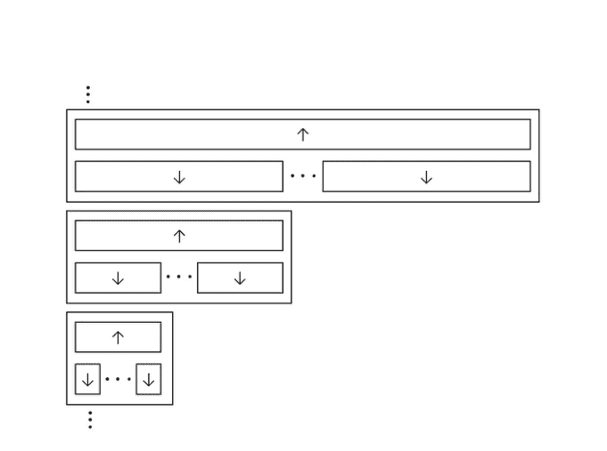

2.  在给定的层级中，下缓冲区必须按递增顺序排列 - 第\(i\)个下缓冲区中的所有元素必须小于\((i+1)\)个下缓冲区中的所有元素。
3.  下缓冲区在全局上是有序的 - 较小层级中的下缓冲区中的所有元素必须小于较大层级中的任何下缓冲区中的所有元素。

### 8.4.1 查找最小值

优先队列中的最小元素应始终位于最小级别的第一个下缓冲区中，因此我们只需在那里找到它。

### 8.4.2 删除最小元素

优先队列中的最小元素应始终位于最小级别的第一个下缓冲区中，因此我们只需前往那里并将其移除。然而，这可能导致下缓冲区溢出，此时我们执行一个拉操作。

### 8.4.3 插入

插入一个新元素需要三个步骤：

1.  将元素追加到最小级别的上缓冲区。
2.  如果新元素小于下缓冲区中的某个元素，则根据需要将其交换到下缓冲区中。
3.  如果上缓冲区溢出，则执行一个推操作。

### 8.4.4 推送

推送的目标是通过将所有元素移动到级别 X的下一个缓冲区来清空级别 X的上一个缓冲区。为了做到这一点，我们首先对所有这些元素进行排序，然后将它们分配给级别 X的下一个缓冲区和上一个缓冲区。这个分配是通过按照递增顺序扫描缓冲区（首先是下一个缓冲区，然后是上一个缓冲区）并将元素插入到它们应该属于的位置来完成的。如果其中一个下一个缓冲区溢出，我们只需将其分成两半，如果这导致下一个缓冲区的数量过多，我们将最后一个缓冲区移动到上一个缓冲区。如果上一个缓冲区溢出，我们只需对其进行推送操作。

### 8.4.5 拉

我们的目标是通过从级别 $X^{3/2}$下方带下最小的 X元素来重新填充下方缓冲区。一旦我们获得这些元素，我们将与上方缓冲区一起对它们进行排序。我们将保留上方缓冲区中的最大元素（与拉取之前的元素数量相同），然后将剩余的元素分配给下方缓冲区。

我们回忆起级别 $X^{3/2}$的每个下方缓冲区（除了第一个）应该有Θ(X)个元素，所以我们只需对级别 $X^{3/2}$的前两个下方缓冲区进行排序，并将最小的X元素从中带到级别 X的下方缓冲区。然而，如果这里的元素少于 X个，那么我们将从级别 $X^{9/4}$递归地拉取 $X^{3/2}$个元素。

### 8.4.6 分析

我们首先要证明，在忽略递归的情况下，在第X层的push或pull操作期间的内存传输次数为\(O(\frac{X}{B} \log_{M/B} \frac{X}{B})\)。首先，我们假设任何大小小于M的层都完全在缓存中，所以它们是免费的。在剩下的情况下，我们使用高缓存假设来说明$X^{3/2} > M \geq B^2$，因此$X > B^{4/3}$。

首先考虑在第$X^{3/2}$层进行push操作。排序的成本为\(O(\frac{X}{B} \log_{M/B} \frac{X}{B})\)，分布的成本为$O(X/B + X^{1/2})$。XB是扫描的成本，而$X^{1/2}$是加载每个down buffer的第一部分的成本。如果$X \geq B^2$，则这个分布的成本为$O(X/B)$，这在排序中可以忽略不计。只剩下一层，其中$B^{4/3} \leq X \leq B^2$，并且对于这一层，我们将简单地假设我们的理想缓存始终保留1个line buffer down buffer，因此我们不必支付$X^{1/2}$的启动成本。我们可以这样做，因为$X \leq B^2$所以根据高缓存假设$X^{1/2} \leq B \leq M/B$。因此，排序始终是主要的开销。拉取的分析基本上是相同的。

因此，推送或拉取的成本涉及 X个元素的成本为 $O(\frac{X}{B} \log_{M/B} \frac{X}{B})$。可以证明每个元素每个级别只能被计算为常数次数的推送和拉取。直观上讲，每个元素都会上升然后下降。因此，每个元素的成本为 $O(\frac{1}{B} \sum_{X} \log_{M/B}^{\frac{X}{B}})$。由于X呈双指数增长，$\log_{M/B}^{XB}$项呈指数增长。因此，最后一项，$\log_{M/B}^{NB}$主导了总和，我们得到了每个操作 $O(\frac{1}{B} \log_{M/B}^{NB})$。

## 讲座9
### 内存层次结构3
记录员: Tim Kaler (2012) Jenny Li (2012) Elena Tatarchenko (2012)

### 9.1 概述
这是关于内存层次结构的最后一堂课。今天的讲座是缓存无关数据结构和几何数据结构的交叉。

首先，我们描述了一种称为懒惰漏斗排序的最优缓存无关排序算法。然后，我们将看到如何将懒惰漏斗排序与扫描线几何技术相结合来解决批量几何问题。使用这种扫描线方法，我们讨论了如何解决批量正交二维范围搜索问题。最后，我们将讨论在线正交二维范围搜索，包括用于双边范围序列的线性空间缓存无关数据结构，以及从正常的四边范围搜索中节省对数对数因子。

### 9.2 惰性漏斗排序
一个漏斗将几个已排序的列表合并成一个已排序的列表放入输出缓冲区。假设我们想要合并总大小为 $K^3$ 的 $K$ 个已排序列表。我们可以在 $O(K^3)$ 的时间内将它们合并。 $\frac{K}{B} \lg_{M/B}(\frac{K}{B} + K)$ 内存传输。注意：在某些实现中， $+ K$ 项可能很重要，但通常第一个项会占主导地位。

一个 $K$ 漏斗是一棵具有 $K$ 个叶子的完全二叉树。一个 $K$ 漏斗中的每个子树都是递归的 $\sqrt{K}$ 漏斗。一个 $\sqrt{K}$ 漏斗的边指向缓冲区，每个缓冲区的大小为 $K^{3/2}$。因为有 $\sqrt{K}$ 个缓冲区，所以 $K$ 漏斗中缓冲区的总大小为 $K^2$。请参见图9.1以获取可视化表示。

当 $K$ 漏斗被初始化时，它的缓冲区都是空的。在最底部，叶子指向输入列表。

实际的漏斗排序算法是一种 $N^{1/3}$ 路归并排序，使用 $N^{1/3}$ 漏斗合并器。注意：我们可以图9.1：K漏斗排序的内存布局。由于上面的 $K^3$乘法器，只能承担$^3$漏斗作为合并器。

#### 9.2.1 填充缓冲区
在填充缓冲区时，我们希望最终结果是输出缓冲区完全填满。为了填充缓冲区，我们必须查看两个子缓冲区来提供数据。参见图9.2。只要两个子缓冲区仍然包含项目，我们将合并子缓冲区的元素到父缓冲区中。我们通过将两个子缓冲区中较小的元素放入其中一个子缓冲区来进行合并（常规二进制合并）。每当一个子缓冲区变为空时，递归地填充它。我们一次只考虑两个输入缓冲区和一个结果合并缓冲区。如上所述，漏斗排序树中的每个叶子都有一个输入列表，用于提供原始数据。

#### 9.2.2 通过惰性漏斗排序进行分布扫描
这个想法是我们可以使用漏斗排序来排序，但它也可以在键值上进行分治。

实际上，我们可以增强填充算法的二进制合并，以维护有关坐标的辅助信息。例如，我们可以给定一个点，使用这个漏斗排序来找出它的最近邻居。

### 9.3 正交二维范围搜索
给定 N个点和一些矩形，我们想要返回哪些点在哪些矩形中。

#### 9.3.1 批处理
批处理问题涉及首先获取所有 N 个点和 N 个矩形。我们有所有的信息提前，并且我们还给出了一批查询，并希望解决它们全部。

最优时间将是 $O(\frac{NB}{B} \lg_{M/B}(\frac{NB}{B}) + \frac{out}{B})$

算法
首先，计算包含每个点的矩形的数量。我们需要这个来确定漏斗中的缓冲区大小。

- 1. 使用惰性漏斗排序，按照x坐标对点和矩形的角进行排序。
- 2. 在x上进行分治，通过y进行归并排序，并执行上扫描线算法。我们有左边的板块L和右边的板块R，如图9.3所示。
哪些点在哪些矩形中的问题是当矩形完全跨越一个板块时出现的，如图9.7中的绿色矩形，但当矩形的点在该板块内时不出现。
- 4. 使用左边在L中的左下角的矩形的数量（被扫描线切割）和完全跨越R的矩形的数量来维护活动矩形的数量。当遇到一个矩形的左下角时，增加CL；当遇到一个矩形的左上角时，减少CL。
- 5. 对跨越板块 L 的矩形进行对称维护
- 6. 当我们在 L中遇到一个点时，将 CR添加到其计数器中。同样，将 CL添加到 R中的任何点的计数器中。

此时，我们可以创建正确大小的缓冲区。然而，这并不是最优解。

最优解是将二叉树划分为线性大小的子树，并使每个运行在线性时间内完成。

#### 9.3.2 在线正交2D范围搜索[61] [62]
可以预处理一组 $N$个点，以支持范围查询，同时只产生 $O(\log_B N + \frac{N}{B})$ 外部内存传输。

我们将考虑三种不同类型的范围查询：

- 2边范围查询：$(\le x_q, \le y_q)$
- 3边界查询：$([x_{q_{min}}, x_{q_{max}}], \le y_q)$
- 4边界查询：$([x_{q_{min}}, x_{q_{max}}], [y_{q_{min}}, y_{q_{max}}])$

执行缓存无感知范围查询只需要很少的额外空间。下表比较了在随机访问模型和缓存无感知模型中执行范围查询所需的空间。

| 查询类型 | 随机访问模型 | 缓存无感知模型 |
| :--- | :--- | :--- |
| 2边界 | O(N) | O(N) |
| 3边界 | O(N) | O(N lg N) |
| 4边界 | O(N lg N / lg lg N) | O(N lg² N / lg lg N) |

2边界查询
首先，我们将展示如何构建一个能够在仅使用线性空间的情况下执行2边界范围查询的数据结构。使用这个数据结构，可以构建出满足所需空间限制的3边界和4边界情况的数据结构。

在高层次上，我们的数据结构包含一个vEB BST，其中包含我们的 N个点按照它们的 y坐标排序。树中的每个点都包含一个指针，指向一个大小为 O(N)的单个数组。这个数组包含每个 N个点的一个或多个副本，并以特殊的方式组织。为了报告满足2边范围查询 ( ≤ x_q, ≤ y_q) 的点，我们在树中找到该点并跟随指针进入数组，然后扫描数组，直到遇到一个x坐标大于x_q的点。数组的结构保证我们只会扫描 O(out)个点并且扫描到的不同点正好满足范围查询 (≤ x_q, ≤ y_q)。

我们将继续描述数组的结构并证明以下命题：

- 1. 我们描述的高级过程将找到所有在(≤ x_q, ≤ y_q)范围内的点。
- 2. 扫描的点的数量为 O(out)。
- 3. 数组的大小为 O(N)。

第一次尝试
我们将首先描述一个简单的数组结构，它满足命题1和2，但是无法达到线性大小。这个尝试将引入在我们的第二次（也是成功的）尝试中会有用的概念。

定义15.如果一个数组 S中的范围 (≤ x_q, ≤ y_q)是密集的，那么 |{(x, y) ∈ S :x < x_q}| ≤ 2 · (≤ x_q, ≤ y_q)范围内的点的数量

定义16.如果一个范围在S中不是密集的，则称其为S的稀疏范围。

请注意，如果一个范围在数组S中是密集的，并且S按照x排序，则我们可以通过扫描S来报告该范围内的所有点。由于该范围在S中是密集的，我们报告的点数不会超过两倍。

我们的策略是构建一个数组S_0， S_1， ...， S_k，以便对于任何查询 (≤ x_q， ≤ y_q) ，存在一个i使得该查询在S_i中是密集的。考虑以下结构：

令y_i为在S_{i-1}中某个查询 (≤ x_q， ≤ y) 是稀疏的最大y。
令S_i=S_{i-1}∩(*, ≤ y_i)。
然后让我们的数组为 S_0 S_1 ... S_i.

现在考虑查询 (≤ x_q， ≤ y_q)。存在某个 i 使得 y_i< y_q，对于这个 i，查询将在 S_{i-1}中密集。否则， y_q 将是一个更大的 y值，对于某个查询 (≤ x_q， ≤ y)在 S_{i-1}中是稀疏的，这与 y_i的定义相矛盾。现在我们可以构建我们的vEB二叉搜索树，并使每个节点指向对应查询密集的子数组的起始位置。这种数据结构将允许我们在扫描只有 O(out)个点的情况下找到范围内的所有点 (满足声明1和2)。然而，数组 S_0 S_1 ... S_k 可能不具有 O(N)的大小。图7展示了一个例子，其中数组的大小将与 N 的平方成正比。

第二次（正确）尝试
令 $ x_i = $ 最大的 $ x $ 坐标，其中 $ (\leq x, \leq y_i) $ 在 $ S_{i-1} $ 中是稀疏的。
令 $ y_i $ 为在 $ S_{i-1} $ 中某个查询 $ (\leq x_q, \leq y) $ 是稀疏的最大 $ y $。
令 $ P_{i-1} = S_{i-1} \cap (\leq x_i, *) $。
（注意，这个定义与我们第一次尝试中的定义不同）

我们的数组现在将是 $ P_0 P_1 \ldots P_{i-1} S_i \ldots S_k $ （其中 $ S_j $ 在 $ i $ 和 $ k $ 之间的 $ j $ 具有 $ O(1) $ 的大小）

首先，我们证明数组的大小为 $ O(N) $。注意到 $ |P_{i-1} \cap S_i| \leq \frac{1}{2} |P_{i-1}| $，因为 $ (\leq x_i, \leq y_i) $ 在 $ S_{i-1} $ 中是稀疏的。将 $ P_{i-1} $ 存储到 $ (P_{i-1} - S_i) $。这导致每个点只被计算一次，乘以一个因子 $ \frac{1}{1-\frac{1}{2}} = 2 $。这意味着总使用的空间 $ \leq 2N $。

接下来，注意当数组中的元素重复时，它的 $ x $ 坐标必须小于查询中最后一个点的 $ x $ 坐标。因此，通过关注一个单调序列的 $ x $ 坐标，我们可以避免重复。

最后，扫描数组所花费的总时间将是 $ O(out) $，因为每个点只重复了 $ O(1) $ 次。因此，这个数据结构可以支持 $ O(\log_B N + \frac{out}{B}) $ 使用仅为 $ O(N) $ 的空间进行2边界查询。

3边界查询
维护一个vEB搜索树，其中叶子节点是由键值为 $ x $ 的点。每个内部节点存储两个2边界查询数据结构，其中包含该节点子树中的点。由于每个点出现在 $ O(\log N) $ 个内部节点的2边界数据结构中，所以结果结构使用了 $ O(N \log N) $ 的空间。

要执行3边界查询 \(([x_{q_{min}}, x_{q_{max}}], \leq y_q)\)，我们首先找到树中 $ x_{q_{min}} $ 和 $ x_{q_{max}} $ 的最近公共祖先。然后，在左子树的结构中执行查询 \( (\geq x_{q_{min}}, \leq y_q) \)，在右子树的结构中执行查询 \( (\leq x_{q_{max}}, \leq y_q) \)。报告的点的并集将是3边界查询的正确答案。

OPEN: 使用 \( O(\log_B N + \frac{out}{B}) \) 查询和 \( O(N) \) 空间的三边范围查询: 使用 \( O(N) \) 空间的 \( B \) 查询。

四边范围查询
注意我们可以轻松地实现 \( O(\log_B N + \frac{out}{B}) \) 的时间复杂度如果我们允许使用 \( O(N \log^2 N) \) 空间，通过构建以 \( y \) 为键的vEB树来查询3边范围结构。

然而，只使用 \( O(N \frac{\log^2 N}{\log \log N}) \) 空间，通过仅存储每个点在 \( O(\frac{\log N}{\log \log N}) \) 3边范围查询结构。

在概念上，我们将每个 \( \frac{1}{2} \lg \lg N \) 高度的子树合并为 \( \sqrt{\lg N} \) 度节点。这导致了一个高度为 \( O(\frac{\lg N}{\lg \lg N}) \)。

现在，和以前一样，我们在每个内部节点中存储两个三边范围查询结构，其中包含子树中的点。此外，我们在每个节点的区间中存储以 $x$ 为键的 $\lg N$ 静态搜索树，用于节点的 $\sqrt{\lg N}$ 子节点。为了执行查询 ($[x_{qmin}, x_{qmax}], [y_{qmin}, y_{qmax}]$) 我们首先找到最近的公共祖先 $y_q$ 和 $y_{qmax}$ 在树中。然后我们执行查询 ($[x_{qmin}, q_{qmax}], \geq y_{qmin}$ ) 在包含子节点中 taining $y_{qmin}$, 并且查询 ($[x_{qmin}, q_{qmax}], \leq y_{qmin}$ ) 在包含子节点中 taining $y_{qmax}$ . 最后，使用以 $x$ 为键的搜索树来关联包含 $y$ 的子节点之间的区间和包含 $y$ 的子节点之间的区间 来执行查询($[x_{qmin}, x_{qmax}], *$) 一次性处理所有中间子节点。这种数据结构支持 $O(\log_B N + \frac{out}{B})$ 4边范围查询，只使用 $O(N \frac{\log^2 N}{\log \log N})$ 空间。

## 第10讲
### 字典
记录员: Edward Z. Yang (2012), Katherine Fang (2012), Benjamin Y. Lee (2012), David Wilson (2010), Rishi Gupta (2010)

### 10.1 概述
在上一堂课中，我们讨论了内存层次结构和使用几何数据结构的链式缓存混淆数据结构。在本讲座中，我们将讨论不同的哈希方法。首先，我们将讨论不同的哈希函数及其特性，从基本的普适性到 k 独立性，再到一种简单但有效的哈希函数，称为简单查找表。然后，我们将讨论在数据结构中使用这些哈希函数的不同方法。我们将介绍基本的链式哈希、完美哈希、线性探测和布谷鸟哈希等方法。

哈希的目标是提供比二叉树更快的解决方案。我们希望能够在少于 $O(u \lg u)$ 的空间中存储信息，并在少于 $O(\lg u)$ 的时间内执行操作。

特别是，FKS哈希在最坏情况下实现 $O(1)$ 的查询时间，期望空间为 $O(n)$，对于静态字典问题的构建时间为 $O(n)$。布谷鸟哈希在动态字典问题中实现 $O(n)$ 的空间复杂度，$O(1)$ 的最坏情况查询和删除时间，以及 $O(1)$ 的摊销插入时间。

### 10.2 哈希函数
为了进行哈希，我们需要一个哈希函数。哈希函数允许我们将一个键的宇宙 $\mathcal{U}$ 映射到大小为 $m$ 的表中的一个槽位。我们定义了三种不同的四种哈希函数：完全随机、通用、k-wise独立和简单表哈希。

定义17.一个哈希函数 $h$ 是一个映射 $h$ such that
$$h : \{0, 1, \ldots, u - 1\} \rightarrow \{0, 1, \ldots, m - 1\}.$$

#### 10.2.1 完全随机哈希函数
定义18.一个哈希函数 $h$ 是完全随机的，如果对于所有的 $x \in \mathcal{U}$，独立于所有的 $y$ for all $y = x \in \mathcal{U}$,
$$\Pr_h\{h(x) = t\} = \frac{1}{m}$$
完全随机的哈希函数与CLRS的简单均匀哈希[141]是一样的。然而，根据给定的定义，一个哈希函数必须花费$\Theta(\lg m)$的时间来存储一个键$x \in \mathcal{U}$，以使其完全随机。有 $u$个键，这意味着总共需要$\Theta(u \lg m)$位的信息来存储一个完全随机的哈希函数。

考虑到在二叉树中存储所有键需要$\Theta(u \lg u)$的时间，$\Theta(u \lg m)$实际上对我们没有任何好处。因此，我们考虑一些具有较弱保证的哈希函数。

#### 10.2.2 通用哈希函数
第一个值得考虑的哈希函数是通用家族和强通用哈希函数家族。

定义19.哈希函数家族 $\mathcal{H}$ 是通用的，如果对于每个 $h \in \mathcal{H}$，以及所有的 $x = y \in \mathcal{U}$,
$$\Pr_h\{h(x) = h(y)\} = O\left(\frac{1}{m}\right)$$
定义20.哈希函数集合 $\mathcal{H}_{o}$ 是一个强通用家族如果对于所有的$x, y \in \mathcal{U}$ 使得 $x = y$,
$$\Pr_h\{h(x) = h(y)\} \leq \frac{1}{m}$$
有两个相对简单的通用哈希函数家族。

例子： $h(x) = [(ax) \mod p] \mod m$ 对于 $0 < a < p$ 在这个哈希函数家族中， $p$是一个大于等于$\mathcal{U}$的素数. 并且 $ax$可以通过向量点积来完成. 这里的思想是将关键字 $x$乘以某个数 $a$，取模一个素数 $p$，然后将其插入大小为 $m$的表中.

这种方法的缺点是，如果$p < m$或者更一般地，如果$ax \mod p$均匀分布，则表的较高槽可能未被使用，而大于$p \mod m$的表槽将具有较少的条目映射到它们。

好处是，属于这个通用族的哈希函数只需要存储$a$和$p$，这需要$O(\lg a + \lg p)$位。

例子： $h(x) = (a \cdot x) \gg (\lg u - \lg m)$ 如果$m$和$u$都是2的幂，则此哈希函数有效。如果我们假设计算机执行这些计算，那么$m$和$u$是2的幂是合理的。在这里，想法是将$a$乘以$x$## 10.5 线性探测

线性探测可能是你在初始学习哈希表时学到的处理哈希冲突的第一个算法。它非常简单：给定哈希函数 $h$ 和表大小 $m$，对于插入的元素 $x$，它将其放置在第一个可用的槽位 $h(x) + i \mod m$。如果 $h(x)$ 已满，我们尝试 $h(x) + 1$，然后是 $h(x) + 2$，以此类推。众所周知，线性探测是一个糟糕的想法，因为“富者越富，穷者越穷”；也就是说，当相邻元素形成长的连续序列时，它们更有可能导致增加冲突的大小。

然而，在实践中，有很多理由喜欢线性探测。当连续序列不太大时，它能很好地利用实际机器上的缓存局部性（加载的缓存行将包含我们可能探测的其他元素）。一些实验证据表明，与正常内存访问相比，线性探测只会增加10%的开销。如果线性探测在具有通用哈希函数的情况下性能真的很差，也许我们可以通过使用具有更好独立性保证的哈希函数来改进。

事实上，使用完全随机的哈希函数 $h$，我们每次操作只需要支付 $O(1/\epsilon^2)$ 的期望时间，同时使用 $O((1 + \epsilon)n)$ 的空间[146]。如果 $\epsilon = 1$，这将是 $O(1)$ 的期望时间，只需要双倍的空间（在Knuth的时代是一种奢侈，但现在是合理的！）在1990年，人们发现 $O(\lg n)$ 独立的哈希函数也可以实现每次操作的常数期望时间[147]。

2007年的突破性结果表明，实际上我们只需要5独立性就可以获得常数期望时间，在[148]（更新于2009年）中得到证明。这是一篇非常实用的论文，强调机器实现，并且在 $k = 5$ 的情况下引起了很大的关注。

同时也证明了2独立的哈希函数只能实现每次操作的 $\Omega(\lg n)$ 的坏下界；这个下界在2010年被[149]改进，证明存在一些4独立的哈希函数也具有 $\Omega(\lg n)$ 的期望时间（从而使得5独立性的下界变得紧密！）

最近的结果是[150]，表明简单的表格散列在每次操作中达到 $O(1/\epsilon^2)$ 的期望时间；这与完全随机的散列函数一样好。

开放寻址：在实际的设置中，例如像Python这样的字典中，简单的表格散列与线性探测法相比，是否能击败当前的二次探测法实现？

### 10.5.1 线性探测和完全随机散列

事实证明，给定一个完全随机的散列函数 $h$，我们可以在 $O(1)$ 的期望时间内进行查询，这是相当简单的，所以我们将在这里进行介绍[148]。进行这个证明的主要困难在于一个事实，即某个键 $x$ 映射到表中的位置 $h(x)$，不一定对应于键最终映射到的位置，因为采用了线性探测法。一般来说，我们更容易推断出 $h(x)$ 的分布（在完全随机散列函数的情况下非常简单），以及键实际上在表中的分布（这与之前存储的键有复杂的依赖关系）。我们将通过定义一个“危险”区间的概念来解决这个困难，这将使我们能够将散列值与键实际落在哪里联系起来。

定理30. 给定一个完全随机的哈希函数 $h$，使用线性探测法实现的哈希表将在 $O(1)$ 的预期时间内执行查询。

证明. 假设一个完全随机的哈希函数 $h$在大小为 $n$的域上，进一步假设表的大小 $m= 3n$（尽管这个证明适用于任意的 $m= (1 + \epsilon)n$；我们这样简化证明）。对于我们的分析，我们将引用一个想象中的完美二叉树，其中叶子对应于哈希表中的插槽（类似于我们对有序文件维护的分析）。节点对应于表中插槽的范围。

现在，定义一个高度为 $h$（即大小为$2^h$的区间）的节点为“危险节点”，如果哈希到该节点的键的数量大于 $\frac{2}{3} 2^h$。危险节点是指“填充插槽”的密度足够高，我们需要担心超级聚类。注意，“危险”只涉及哈希函数，而不涉及键的最终位置；映射到节点的键可能最终位于节点之外。（但是，还要注意，你最多需要$2^{h+1}$个键映射到一个节点才能填满一个节点；饱和节点将是该节点或相邻节点。）

考虑一个节点是危险的概率。根据假设 $m= 3n$，所以哈希到单个槽位的键的期望数量是 1/3，因此哈希到高度为 $h$的节点内的键的期望数量，表示为 $X_h$，是 $E[X_h] = 2^h /3$。用 $\mu$表示这个值，并注意“危险”的阈值是 $2\mu$。使用切尔诺夫界限，我们可以看到$\Pr[X_h > 2\mu] \leq e^{\mu}/2^{2\mu}= (e/4)^{2^h /3}$。关于这个概率的关键特性是它是双指数的。

最后，我们现在将表中的运行（聚类）与危险节点的存在联系起来。考虑一个长度为 $\in [2^l, 2^{l+1})$的表中的一次运行，其中 $l$是任意的。观察高度为 $h = l - 3$的节点跨越的运行；至少有8个节点，最多有17个节点。（这是17而不是16，因为我们可能需要一个额外的节点来完成范围。）考虑前四个节点：它们跨越了运行的 $> 3 \cdot 2^h$个槽位（只有第一个节点可能部分填充）。此外，占据这些节点中的槽位的键也必须在节点内部进行哈希处理（它们不能落在左侧，因为这将违反我们假设这是运行的前四个节点的假设）。现在我们看到至少有一个节点是危险的，因为如果所有节点都不危险，那么占据的槽位数将少于 $< 4 \cdot \frac{2}{3}^2 \cdot 2^h = \frac{8}{3} \cdot 2^h$（这少于我们覆盖的运行的槽位数$\frac{9}{3} \cdot 2^h$）。

利用这个事实，我们现在可以计算出在给定 $x$的情况下，一个运行包含长度 $\in [2^l, 2^{l+1})$的概率的上界。对于任何这样的运行，至少存在一个危险节点。通过对运行中节点的最大数量进行联合界限，这个概率是 $\leq 17 \Pr[\text{高度为 } l-3 \text{ 的节点是危险的}] \leq 17 \cdot (e/4)^{2^{h}/3}$因此，包含 $x$的运行的预期长度是 $\Theta(\sum_{l} 2^l \Pr[\text{长度为 } \in [2^l, 2^{l+1})]) = \Theta(1)$，如所需的（利用内部概率是双指数数量的倒数的事实）。

如果我们添加一个大小为$\lg^{n+1} n$的缓存，我们可以以高概率实现 $O(1)$的摊销；证明是我们给出的论证的一个简单推广，只是现在我们每批次检查是否在一个运行中。

## 10.6 布谷鸟哈希 - Pagh和Rodler（2004）[155]

布谷鸟哈希与双哈希和完美哈希类似。布谷鸟哈希受到布谷鸟的启发，布谷鸟会把自己的蛋放在其他鸟的巢里，把原本在那里的蛋挤出去。布谷鸟哈希解决了动态字典问题，在查询和删除时达到 O(1)的最坏情况时间复杂度，并在插入时达到 O(1)的期望时间复杂度。

设 $f$ 和 $g$ 为 $(c,6 \log n)$ -通用哈希函数。和往常一样，$f$ 和 $g$ 映射到一个具有 $m$ 行的表 $T$。但现在，我们将规定 $f$ 和 $g$ 哈希到两个不同的哈希表。所以 $T[f(x)]$ 和 $T[g(x)]$ 指的是两个相邻哈希表中的哈希条目。布谷鸟哈希中的布谷部分指的是在发生冲突时将一个表中的键挤出，并将其哈希到另一个表中，反复进行，直到冲突解决为止。

我们按照以下方式实现函数：

*   查询(x)：检查 $T[f(x)]$ 和 $T[g(x)]$ 是否包含 $x$。
*   删除(x)：查询 $x$ 并删除（如果找到）。
*   插入(x)：如果 $T[f(x)]$ 为空，我们将 $x$ 放入 $T[f(x)]$ 并完成。否则，我们说 $y$ 最初在 $T[f(x)]$ 中。我们像之前一样将 $x$ 放入 $T[f(x)]$，并将 $y$ 移到 $T[f(y)]$ 和 $T[g(y)]$ 中的任意一个位置。如果新位置为空，我们完成。否则，我们仍然将 $y$ 放在那里，并重复这个过程，将新移动的元素 $z$ 放入 $T[f(z)]$ 和 $T[g(z)]$ 中不包含 $y$ 的位置。我们以这种方式继续，直到完成或达到最大的 $6 \log n$ 元素移动次数。一旦我们移动了 $6 \log n$ 元素，我们选择一对新的哈希函数 $f$ 和 $g$，并重新哈希表中的每个元素。

请注意，我们始终保持不变的是每个元素 $x$ 要么在 $T[f(x)]$ 或者 $T[g(x)]$，这使得证明正确性变得容易。时间分析更加困难。

很明显，查询和删除都是 O(1) 操作。Insert(x) 不会非常慢的原因是被替换的元素数量通常非常小，并且当 $m$ 足够大时，我们很少重新哈希整个表。我们取 $m = 4n$。

由于我们只查看最多 $6 \log n$ 个元素，我们可以将 $f$ 和 $g$ 视为随机函数。设 $x = x_1$ 为插入的元素，$x_2, x_3, …$ 为按顺序被替换的元素序列。方便起见，我们可以将这个过程可视化为 cuckoo 图上的行走，该图具有顶点 $1, 2, …$ 和边 $(f(x), g(x))$ 对于所有 $x \in S$。插入新元素可以被视为在这个图上的行走。

元素可以被撞击的3种模式：

*   情况1：项目 $x_1, x_2, …, x_k$ 都是不同的。撞击模式看起来像（图表由Pramook Khungurn提供，Lec 1的笔记来自2005年教授的课程（作为6.897））。至少有一个项目（即 $x_2$）被撞击的概率是 $\Pr(T[f(x)] \text{ 被占用}) = \Pr(\exists y : f(x) = g(y) \vee f(x) = f(y)) < 2n/m = 1/2$。
    至少有2个项目被撞击的概率是第一个项目被撞击的概率（从上面的结果<1/2）乘以第二个项目被撞击的概率（同样由相同的逻辑<1/2）。通过归纳，我们可以证明至少有 $t$ 个元素被撞击的概率小于 $2^{-t}$，因此忽略重新散列的预期运行时间。这种情况下，完全重新散列的概率是 $<2^{-6\log n} = O(n^{-6})$。

    > 完全重新散列的概率是 $<2^{-6\log n} = O(n^{-6})$。

*   情况2：序列 $x_1, x_2, ...$ 在某个点上，$x_k$ 碰到了已经被碰撞的元素 $x_i$，然后 $x_i, x_{i-1}, ...$ 然后，依次碰撞元素 $x_1$。在这种情况下，我们假设在 $x_1$ 被碰撞后，所有被碰撞的元素都是新的且不同的。
    序列的长度（$k$）在实线箭头和虚线箭头的最大值的3倍以内，根据情况1，预计为 $O(1)$。同样，完全重新散列的概率是 $O(2^{-6\log n/3}) = O(n^{-2})$。

*   情况3：与第2种情况相同，只是虚线再次碰到了之前已经碰到过的东西。
    在这种情况下，成本是 $O(\log n)$ 次碰撞加上重新散列的成本。我们通过计数论证计算出第3种情况发生的概率。涉及 $t$ 个不同的 $x_i$ 的第3种情况配置数量为（对于其他 $x_i$ 有 $\leq n^{t-1}$ 个选择）·（第一个循环的索引有 $<t^3$ 个选择，第一个循环碰到现有路径，第二个循环碰到现有路径）·（对于 $x_i$ 关联的哈希值有 $m^{t-1}$ 个选择）=$O(n^{t-1} t^{3} m^{t-1})$。我们要选择的总配置数量为...# 麻省理工学院6.851高级数据结构

\(x_i\) 对应于布谷鸟图中的一个可能边。所以Case 3的总概率 (在插入 \(m = 4n\) 之后) 是

$$
\sum_{t} \frac{O(n^{-13m^{-1}})}{O(2^{-m^2})} = O(n^{-2}) \sum_{t} \frac{t^3}{2^{3t}} = O(n^{-2})
$$

如果没有重新散列，插入的成本是O(1)，根据Case 1和Case 2。重新散列的概率是 \(O(n^{-2})\)。因此，插入的时间为 \(P_r(\text{重新散列}) \cdot (O(\log n) + n \cdot \text{插入}) + (1 - P_r(\text{重新散列})) \cdot O(1) = O(1/n) \cdot \text{插入} + O(1)\)，因此总体上插入的成本是O(1)。因此，使用布谷鸟哈希，我们有\((2+\varepsilon)n\)空间，每个查询有2个确定性探测。

## 10.6.1 声明

无论是完全随机还是\(O(\lg n)\)次独立，我们都能得到O(1)的摊销期望更新，以及O(1/n)的构建失败概率，这是您的键集在当前布谷鸟哈希表中完全不可持续的机会，此时您需要重新开始并重新构建[155]。

对于布谷鸟哈希，6次独立是不足以获得O(1)的期望更新和\(1 - 1/n\)的构建失败概率的，这是相当糟糕的。这个结果由Cohen和Kane(2009)在[156]中证明。

使用简单查找哈希，构建失败概率变为\(\Theta(1/n^{1/3})\)，可以在[150]中找到。

**定理31** (对于完全随机的哈希函数，期望的更新次数是常数)。 \(P_r(\text{插入操作在长度为} k \text{的路径上发生}) \leq 1/2^k\)

对于两个哈希函数\(g\)和\(h\)，每个函数都有\(n\)个值，每个值都有\(\lg m\)位。因此，我们需要\(2n \lg n\)位来编码\(g\)和\(h\)。

**定理32** (在\(2n \lg(n)\)-k时间内编码哈希函数)。

# 第11讲

## 整数1

记录员：Sam Fingeret（2012），Shravas Rao（2012），Paul Christiano（2010）

### 11.1 概述

在本讲座中，我们将讨论用于解决前驱问题的整数数据结构。我们将首先描述我们可以使用的各种模型，然后介绍两种整数数据结构，Van Emde Boas和Y-fast树。

### 11.2 整数数据结构

在介绍任何整数数据结构之前，我们先介绍一些计算整数的模型（既为了准确地陈述我们所寻找的内容，也作为证明下界的框架）。

在每个模型中，内存被组织成一组大小为某个大小的单词（可能还有一小部分工作内存），每个操作都需要固定的成本。我们还始终做出固定宇宙假设。我们假设每个数据结构都需要根据一个固定的\(w\)位整数集合 \(\mathcal{U} = \{0, 1, 2, \ldots, u - 1\}\) 来回答查询。

#### 11.2.1 三分RAM

-   内存被划分为大小为 \(S\) 的数组，由大小为 \(w\) 的单元格组成。要求 \(w\) 大于 \(\log(S)\) 是实际可行的，否则您将无法访问整个数组。如果我们让 \(n\) 成为问题的规模，那么这也意味着 \(w \geq \log(n)\)。
-   存在一些固定的操作集，每个操作都修改 \(O(1)\)个内存单元。
-   单词作为指针，所以可以任意寻址单元。

#### 11.2.2 字-随机存取存储器

在字-随机存取存储器中，处理器可以使用 \(O(1)\) 固定操作 + ，-, *, /, %, &, |, >>, <<, <, >, 你会在高级语言如C中期望的原语。

#### 11.2.3 单元探针模型

-   内存被分成大小为 \(w\)的单元，其中 \(w\)是模型的一个参数。
-   从内存单元读取或写入的成本为1个单位。
-   其他操作是免费的。

这个模型并不真实地反映现代处理器，但它的简单性和普适性使其适用于证明下界。

这些模型在强大程度上有所不同。特别是，单元探针模型比传统的RAM模型更强大，而传统的RAM模型又比字-随机存取存储器模型更强大，接着是指针机器和BST。

### 11.3 后继/前驱查询

我们对能够维护一组整数 \(S\)的数据结构感兴趣，这些数据结构能够插入一个整数到 \(S\)中，从 \(S\)中删除一个整数，报告大于某个查询 \(x\)的 \(S\)中最小的元素，或者报告小于某个查询 \(x\)的 \(S\)中最大的元素。

我们首先介绍这些不同模型上这种数据结构的当前已知界限。

#### 11.3.1 二叉搜索树模型

在二叉搜索树模型中，已知该问题每个查询需要\(\Theta(\log( n))\)的时间。

#### 11.3.2 Word RAM模型

在Word RAM模型中，我们有一些数据结构。使用Van Emde Boas数据结构，我们可以实现每个查询 \(O(\log(w))\)的时间复杂度和\(\Theta(u)\)的空间复杂度。然而，我们可以通过修改Van Emde Boas数据结构的版本来减少空间使用量，每个查询 \(O(\log(w))\)的时间复杂度（高概率下），和\(\Theta(n)\)的空间复杂度。Y-fast树也能达到相同的界限。

还有融合树，可以在高概率下达到 \(O (\log_w (n))\)的时间复杂度，并且需要\(\Theta(u)\)的空间。我们将在第12讲中涵盖这些内容。

请注意，融合树的查询时间可能比Y-fast树好也可能不好，这取决于我们的 \(w\)和 \(n\)的值。如果我们根据这些值选择最优的数据结构，那么查询时间是 \(O (\sqrt{\log(n)})\) 时间复杂度，在高概率下需要\(\Theta( u)\) 的空间。这可以通过一个小计算来证明。

#### 11.3.3 单元探测模型

在单元探测模型下，下界是 \(O(npoly \log(n))\) 的空间复杂度，而上界是 \(\Omega \left( \min\{\log_w(n), \frac{\log(w)}{\log(\frac{\log(w)}{\log\log(n)})} \right\} \) 时间复杂度。后一种上界取决于van Emde Boas和融合树的最优情况。具体来说，当 \(w = O(poly \log(n))\) 时，van Emde Boas是最优的，而融合树在 \(w = 2^{\Omega(\sqrt{\log(n)\log\log(n)})}\) 时最优。

#### 11.3.4 指针机器模型

在这里，我们的单词由指针指定。使用van Emde Boas，我们可以每个操作使用 \(O(\log(\log(u)))\) 时间，并且使用 \(\Theta(u)\) 空间。每个操作的时间下界也存在 \(O(\log(\log(u)))\)，并且空间为 \(\Omega(u)\)。

### 11.4 Van Emde Boas树

现在我们将描述Van Emde Boas的结构。这个数据结构的目标是通过 \(T(u) \leq T(\sqrt{u}) + O(1)\) 来限制所有操作的运行时间。这样，我们使用主定理得到 \(T(u) = O(\log\log u)\)。

首先，如果我们给出一个二进制字符串 \(x\)，我们将高位\((x)\)写为前 \(|x|/2\) 位，将低位\((x)\)写为后 \(|x|/2\) 位。当 \(x\) 是一个具有二进制表示 \(bin(x)\) 的整数时，我们将 \(c\) 写为二进制表示为 \(high(bin(x))\) 的数字，将 \(i\) 写为二进制表示为 \(low(bin(x))\) 的数字。然后给定一个整数 \(x\)，它存储在块 \(V.cluster[c]\) 中，在该块中它位于位置 \(i\)。

一个大小为 \(u\) 的VEB，具有字长 \(w\)，由以下组成：\(\sqrt{u}\)大小的VEB，\(\sqrt{u}\)个字长为\(w/2\)的VEB，每个由 \(V.cluster[c]\) 表示。如果 \(x = (c, i)\) 包含在 \(V\) 中（且 \(x\) 不是最小值），那么 \(i\) 包含在 \(V.cluster[c]\) 中。此外，我们维护一个大小为 \(\sqrt{u}\) 的摘要 \(VEB V.summary\)，其中包含所有整数 \(c\)，使得 \(V.cluster[c]\) 不为空：一个\(\sqrt{u}\)大小字长为\(w/2\)的摘要VEB，其中包含所有整数 \(c\)，使得 \(V.cluster[c]\) 不为空。最后，每个结构包含最小元素 \(V.min\)（如果为空，则为None），以及最大元素 \(V.max\) 的副本。

为了回答查询 \(Successor(V, x = (c, i))\)，我们首先检查 \(x\) 是否小于或大于最小和最大元素。在这种情况下，最小元素是后继，或者没有后继。否则，我们检查 \(i\) 是否小于 \(V.cluster[c]\) 的最大值。在这种情况下，存在一个大于 \(x\) 的元素在同一个簇中，因此我们可以在该簇中递归搜索后继。否则，\(x\) 的后继是 \(V.cluster[c']\) 的最小值，其中 \(c'\) 是 \(V.summary\) 中 \(c\) 的后继。在这种情况下，我们在 \(V.summary\) 中递归查找 \(c\) 的后继。请注意，在这两种情况下，我们需要在大小为 \(O(\sqrt{u})\) 的VEB中进行单次搜索。

找到前驱的查询方式非常相似。

对于查询 \(Insert(V, x = (c, i))\)，我们再次从最小值和最大值开始检查。如果 \(V\) 为空（\(V.min\) 为None），那么我们让最小值和最大值都是 \(x\)，然后完成。如果 \(x\) 小于 \(V.min\)，那么我们让 \(V.min\) 为 \(x\)，并插入旧的最小值。如果 \(x\) 大于 \(V.max\)，那么我们用 \(x\) 替换 \(V.max\) 中的副本。现在，我们检查 \(V.cluster[c]\) 是否为空，或者是否没有最小值。在这种情况下，我们递归地将 \(c\) 插入 \(V.summary\)，然后将 \(i\) 插入 \(V.cluster[c]\)。在这种情况下，插入 \(i\) 将在常数时间内完成，因为此时\(V.cluster[c]\)为空。否则，我们只需将 \(i\) 递归地插入\(V.cluster[c]\)。

最后，为了执行删除操作，Delete(V, x = <c, i>)，我们从x是最小元素的情况开始。如果最大值也是x，则可以通过将V.min和V.max设置为None来删除此元素。否则，我们必须找到新的最小值，即<V.summary.min, V.cluster[V.summary.min].min>（注意最小值不存储在其他地方），删除它，并将其设置为新的V.min。要删除x（如果x不是V.min），我们首先从V.cluster[c]中递归删除 i。如果V.cluster[c]现在为空，则此操作将花费常数时间，现在我们必须从V.summary中递归删除 c。最后，我们必须更新V.max。如果V.summary为空，则V中只有一个元素，V.max必须设置为V.min。否则，V.max现在是<V.summary.max, V.cluster[V.summary.max].max>。

图11.1: VEB递归结构的可视化表示。请注意，每个级别都直接存储最小值，而不是递归存储。

> **定理33.** VEB在O(log log u)时间内执行后继、前驱、插入和删除操作。

**证明**。在所有情况下，运行时间 \(T\) 满足 \(T(u) \leq T(\sqrt{u}) + O(1)\)。请注意，我们只递归一次。根据主定理，得出 \(T(u) = O(\log \log u)\)。

### 11.5 二叉树视图

我们还可以将van Emde Boas结构解释为建立在位向量 \(v\)上的二叉树，其中 \(v[i] = 1\)表示 \(i\)在结构中，\(v[i] = 0\)表示\(i\)不在结构中。这是van Emde Boas在他的原始论文[64]中提出的结构。在给定节点上，我们存储其两个子节点的OR值，因此节点的值确定了结构中是否存在某个整数在该节点的区间内。我们还将在每个节点中存储其区间中存储的所有整数的最小值和最大值。此外，我们可以在O(1)时间内计算给定整数 \(x\)路径中的第 \(k\)个级别节点，因为该节点对应于 \(x\)的 \(k\)高阶级。

这个视图给了我们一个算法，可以快速计算任何给定整数的前驱或后继使用树结构，假设我们的集合是静态的。关键观察是，如果我们看一下沿着到给定整数 \(x\)的路径的节点的值，这些值形成一个连续的单调序列由零后面的连续的1组成。因此，我们可以进行二分搜索来找到序列中的1→0转换，所以让最后一个1值节点为 \(u\)，第一个0值节点为 \(v\)。在这种情况下，如果不存在转换，则结构中没有整数或者 \(x\) 在结构中，这两种情况都是微不足道的情况。如果 \(v\) 是 \(u\) 的左子节点，则我们知道 \(x\) 的后继必定在 \(u\) 的右子节点中，并且 \(u\) 的右子节点至少包含一个整数，因此我们可以简单地返回 \(u\) 的右子节点中存储的最小值。同样地，如果 \(v\) 是 \(u\) 的右子节点，则我们可以通过查看 \(u\) 的左子节点中存储的最大值来获得 \(x\) 的前驱。最后，为了从前驱或后继中获取元素，我们可以将结构中的所有元素存储在一个排序的链表中。

#### 11.5.1 分析

因为二叉树的高度为 \(w\)，并且查询时间由路径上的二分查找主导，所以这给出了 \(O(\lg w)\) 或 \(O(\lg \lg u)\) 的查询时间界限。然而，在指针机器上实现二分查找需要一个分层树，因此在每个节点上存储其高度为 \(2^i\) 的祖先的指针，其中 \(i=0,1,...,\lg w\)，因此因为我们有 \(O(u)\) 个节点，我们得到空间界限为 \(O(u \lg w)\)。此外，更新这个结构非常昂贵，因为我们必须更新路径上的所有节点，更新时间为 \(O(\lg u)\)。然而，正如van Emde Boas指出的[64]，不递归地存储最小值的相同技巧可以将更新时间降低到 \(O(\lg \lg u)\)，这个界限在指针机器上是最优的。

#### 11.5.2 间接引用

我们现在介绍第二种通过间接引用来减少树结构更新时间的方法。假设我们的树结构不是基于一组整数，而是使用一组二叉搜索树，每个二叉搜索树的大小为 \(\Theta(w)\)。换句话说，我们将树结构中的整数集合分成 \(\Theta(\frac{n}{w})\) 个部分，并将每个部分存储在一个二叉树中。对于给定的二叉搜索树，我们可以任意选择树中存储的任何整数作为其在较大树结构中的代表元素。

我们允许二叉搜索树的大小在 \([w/2, 2w]\) 范围内。一旦二叉搜索树变得太大，我们将其分成两个二叉搜索树。一旦二叉搜索树变得太小，我们将其与相邻的二叉搜索树合并，然后可能再次分割结果。这些分割和合并，以及更新顶层结构，都可以在 \(O(w)\) 时间内完成，因此我们只需要证明这在每个 \(O(w)\) 次更新中最多发生一次。然而，在分割后，我们可以验证二叉搜索树的顶点数在 \(2w/3\) 和 \(3w/2\) 之间，因此不需要再次进行分割或合并，直到进行下一次 \(O(w)\) 操作。当我们合并两棵树时，我们提前支付下一次需要分割合并的树的代价。

因此，每次修改的摊还时间总和为 \(O(1)\)，因此时间复杂度由底层更新时间支配，即 \(O(\lg w) = O(\lg \lg u)\)。

### 11.6 减少空间

到目前为止，所有给出的结构都需要 \(\Omega(u)\) 的空间，但我们希望实现最优的 \(\Theta(n)\) 空间复杂度。我们提出了两种方法来实现这个界限，并通过完美哈希的使用实现 \(O(\lg \lg u)\) 的更新时间，高概率下。

#### 11.6.1 vEB 中的哈希表

假设在我们原始的 van Emde Boas 结构中，我们不存储空的簇，并用动态完美哈希表替换子数组。通过将每个哈希表条目计入该簇中的最小值，结构中的每个整数最多被其唯一的父节点或摘要结构中的条目计入两次，因此我们获得了 \(\Theta(n)\) 的最优空间界限。此外，如果我们使用具有 \(O(1)\) 查询和更新的哈希表，并且高概率下，这使我们能够获得 \(O(\lg \lg u)\) 的查询和更新界限。

#### 11.6.2 X快速树

X快速树和Y快速树都是由Willard [65]提出的。虽然X快速树没有达到期望的界限，但它是达到的Y快速树的中间步骤。主要思想是只在简单的树形结构中存储值为1的节点。对于树中给定的值为1的节点，我们可以通过查看从根节点到给定节点的左子节点和右子节点的路径来计算相应的位串，其中左子节点对应于字符串中的0，右子节点对应于1。X快速树由所有这些位串的完美哈希表组成，用于存储树中所有值为1的节点，或者用于存储结构中整数的位串的前缀。

这个表允许我们在O(1)时间内将位串映射到存储在该节点中的最小和最大值。

请注意，我们可以通过检查其位串是否在哈希表中来查找树中任何给定节点的值。因此，我们仍然可以在 \(O(\lg w)\)时间内以很高的概率执行二分查找，并实现相同的查询界限。然而，要执行更新，我们仍然需要更新从根节点到路径上的所有节点，因此我们有一个 \(O(w)\)的更新界限。此外，我们为结构中每个整数的所有 \(w\)前缀存储信息，最坏情况下的空间界限为 \(O(nw)\)。

#### 11.6.3 Y-fast树

为了获得Y-fast树，我们使用相同的间接技巧。我们维护一个大小为\(\Theta( n/w)\)的顶层x-fast树结构，底层结构是大小为\(\Theta(w)\)的二分查找树。保持 \(O(\lg w)\)的查询界限，但现在可以将顶层更新计入\(\Theta(w)\)的底层更新中，因此更新时间由底层BST结构的 \(O(\lg w)\)时间主导。此外，顶层结构所需的空间现在为 \(O(n)\)，因此我们实现了总空间界限 \(O(n)\)，如期望的。

# 第12讲

## 整数2

我们继续分析整数数据结构，本讲座重点介绍融合树。这个结构使用了一些巧妙的位操作和字级并行计算。具体来说，我们讨论了以下技术，这些技术是理解融合树工作原理所必需的：草图，它可以将某些 \(w\) 位的单词压缩到少于 \(w\) 位，并行比较，可以以一个单词的代价比较多个单词，以及在常数时间内计算单词的最高有效位。

### 12.1 简介

### 12.2 融合树概述

我们首先描述融合树的关键结果，以及我们将在大部分讲解中假设的模型。与前一讲中描述的van Emde Boas树一样，我们将在字RAM模型（具有C风格操作的跨二分RAM）下工作，并且我们希望静态存储 \(w\) 位整数。在这些假设下，融合树在 \(O(\log_w n)\) 时间内执行前驱/后继操作，并且需要 \(O(n)\) 空间。其他感兴趣的模型和变体包括：

-   AC⁰ RAM版本[16⁰]：该模型限制了与常深度电路（但无限制的扇入和扇出）的操作。特别是，不允许乘法，因为它需要与比特数目的对数深度的电路（在过去，乘法相对于其他操作（如加法）非常昂贵；由于诸如流水线等优化，这种情况已不再存在）.
-   指数树动态版本[161]：该版本实现了 \(O(\log_w n + \lg \lg n)\) 的确定性更新时间，即相对于静态版本的 \(\lg \lg n\) 开销；
-   哈希动态版本[162]：该版本实现了\(O(\log_w n)\)的预期更新时间。这是基于执行类似哈希的草图。待解决：这个界限可以以高概率实现吗？

### 12.3 总体思路

融合树的基本结构是一棵B树，分支因子为 \(w^{1/5}\)；实际上，任何小的常数幂都可以，因为树的高度将是\(\Theta(\log_w n)\)。主要问题出现在搜索前驱节点时：我们希望为此操作实现O(1)的时间，但似乎不可能，因为它似乎至少需要读取\(O(w^{1/5} · w) = O(w^{6/5})\)位。

然而，这个（以及前任/后继）实际上可以在所需的时间限制内完成，具有 \(k^{O(1)}\)预处理。主要思想是区分一个节点中少于 \(w\) 位的键集合，这是下一节的基础。

### 12.4 素描

由于融合树中每个节点最多有 \(k = w^{1/5}\)个键，因此这些键可以用只有 \(w^{1/5}\)位的方式表示并进行比较是合理的。事实上，可以通过以下方式实现。让键值为 \(x_0 \leq x_1 \leq \cdots \leq x_{k-1}\)；每个键 \(x_i\)可以表示为一个深度为 \(w\) 的二叉树中的路径，如果 \(x_i\)的第 \(i\) 个最高有效位为0，则选择从根节点开始的左分支，否则选择右分支。然后，如果所有 \(k\)个键都叠加在同一棵树上，那么很明显，结果路径在最多 \(k -1\)个节点处分叉（这可以通过归纳法轻松形式化）。实质上，最多 \(k -1 = w^{1/5} -1\)个位对于排序 \(x_i\)很重要。请参见图12.1的示例。

特别是，让相应节点的位于位置 \(b_0, b_1, \ldots, b_{r-1}\)（其中 \(r \leq w^{1/5}\)）。那么，\(x\)的完美草图（用 \(sketch(x)\)表示）是一个 \(r\)位字符串，其中第 \(i\) 位是 \(x\)的第 \(b_i\)位。显然，草图操作保留了 \(x_i\)之间的顺序，因为每个草图保留了区分所有 \(x_i\)的位的正确顺序。草图还允许在常数时间内读取所有键，因为每个草图有 \(O(w^{1/5})\)位，所以所有草图的总大小为\(O(k w^{1/5}) = O(w^{2/5}) = o(w)\)位。在某些模型下，例如AC^0模型，完美草图操作是一个单一操作[160]。在本讲座的后面，我们将看到如何使用乘法和标准C语言操作来进行足够的近似。

然而，这引发了另一个问题。对于给定的查询\(q\)的搜索可能是这样的，即\(q\)不等于任何一个 \(x_i\)（因为对于前驱/后继的参数值没有限制）。因此，在二叉树中 \(q\)的路径可能会与其他路径的 \(x_i\)在一个不对应于位 \(b_0, \ldots, b_{r-1}\)的节点上分离；在这种情况下，\(sketch(q)\)在 \(sketch(x_i)\)中的位置不一定等于 \(q\)在 \(x_i\)中的位置。这可以通过下面讨论的 desketchifying技术来解决。

## 12.5 反素描

通过修改对 $q$ 的搜索，我们可以在没有任何额外（渐进）运行时开销的情况下获得 $q$ 的前驱或后继。设 $x_i$ 和 $x_{i+1}$ 是 $q$ 的草图邻居，即草图($x_i$) ≤ 草图($q$) ≤ 草图($x_{i+1}$)。然后我们确定实际元素之间的最长公共前缀（等价于最低公共祖先），可以是 $q$ 和 $x_i$，也可以是 $q$ 和 $x_{i+1}$。假设这个前缀 $p$ 的长度为 $y$；那么对应于这个前缀的节点是最高的，使得 $q$ 的路径与融合节点中每个键的路径分离。特别地， $n$ 的子树中没有包含 $q$ 路径的键。由于另一个子树包含融合节点的一个键（要么是 $x_i$，要么是 $x_{i+1}$），它必定包含 $q$ 的前驱或后继。可以通过以下方式确定：

*   如果 $q$ 的第($y+1$)位是1，则 $q$ 的前驱属于 $p0$ 子树，因此我们搜索 $e$ 的前驱 = $p011\cdots1$。
*   如果 $q$ 的第($y+1$)位是0，则 $q$ 的前驱属于 $p1$ 子树，因此我们搜索 $e$ 的后继 = $p100\cdots0$。

图12.2：当搜索查询不在融合节点的键中时的示例。键的路径为粗体，而查询 q 的路径为虚线；与位对应的层级如前所述被圈出。在这里，q 的示意邻居是 x0 和 x1，但是 x0 既不是 q 的前驱也不是后继。

在这两种情况下，搜索将成功找到所需的键，因为前缀中的所有示意位与目标匹配，并且后缀中的所有示意位（在第一个y位之后）要么是最高位（搜索前驱时）要么是最低位（搜索后继时）。一旦找到前驱/后继之一，只需检查融合节点中相应的相邻示意字。请参见图12.2的示例。

在我们的融合树在字RAM模型下以期望的时间界限内运行之前，仍然存在几个问题。首先，我们演示如何在合理的时间内执行完美草图的近似。然后，我们展示如何实现两个特定子程序的恒定运行时间：在一组编码为w^{2/5}位字的w^{1/5}位整数中找到一个整数的位置；以及确定w位字的最高有效位（这可以通过对它们进行异或运算来确定两个字符串的最长公共前缀的长度）。这将结束我们对融合树操作的描述。

## 12.6 近似素描

尽管完美草图作为一个AC^0操作可以在O(1)时间内计算，但我们希望找到一种只使用乘法和其他标准操作在字RAM上计算近似草图的方法。计算草图的困难部分在于连续且简洁地获取我们关心的所有位。因此，这个近似草图将在长度为O(w^{4/5})的可预测模式中（与我们正在草图的字x无关）分散所有重要位，并在它们之间添加一些垃圾。但我们将能够应用掩码来获取我们关心的位。

让 $x'$ 是 $x$ 掩码，只保留重要的位。所以
$$x' = x \text{ AND } \sum_{i=0}^{r-1} 2^{b_i}$$

现在将 $x'$ 乘以一些掩码 $m$（在位置 $m_j$ 上有设置位）得到
$$x' \cdot m = \left(\sum_{i=0}^{r-1} x_{b_i} 2^{b_i}\right)\left(\sum_{j=0}^{r-1} 2^{m_j}\right) = \sum_{i=0}^{r-1} \sum_{j=0}^{r-1} x_{b_i} 2^{b_i+m_j}$$

第34项声明。对于任何重要位 $b_0$, $b_1$, ... $b_{r-1}$，我们可以选择 $m_0$, $m_1$, ... $m_{r-1}$，使得

*   1. $b_j + m_j$ 对于所有 $j$ 是不同的。这意味着当我们将所有位相加时没有冲突。
*   2. 这意味着我们在 $x$ 中重要位的顺序在 $x' \cdot m$ 中得到保留。
*   3. 因此，位的跨度将很小。

证明。我们将选择一些 $m'_0, m'_1, ... m'_{r-1} < r^3$，使得 $b_j + m'_j$ 在模 $r^3$ 下都是不同的。我们将通过归纳法来证明这一点。假设我们已经选择了 $m'_0, m'_1, ... m'_{t-1}$。那么 $m'_t$ 必须与 $m'_i + b'_j - b_k \forall i, j, k$ 不同。对于 $i$（因为 $i$ 可以是之前的选择中的任意一个），有 $t$ 个选择，对于 $j, k$ 有 $r$ 个选择。因此，总共有 $t r^2 < r^3$ 个事物需要 $m'_t$ 避免，而我们有 $r^3$ 个选择，所以我们总是可以选择 $m'_t$ 来避免碰撞。因此，这满足性质 (1)。

为了满足(2)和(3)，我们直观地希望将 $m_i + b_i$ 按照 $r^3$ 的间隔分散开来。为了做到这一点，我们让
$$m_i = m'_i + (w - b_i + i r^3 \text{向下取整到最接近 } r^3 \text{的倍数}) \equiv m'_i \pmod{r^3}$$

我们声称，不证明的情况下，间隔将使得
$$m_0 + b_0 < \dots < m_{r-1} + b_{r-1}$$

因此，性质(2)和(3)将被满足。$\square$

## 12.7 并行比较

我们需要能够找到在键的草图中草图$(q)$ 位于哪个键的草图之间草图$(x_0) <$ 草图$(x_1) \dots$ 在给定节点中以恒定时间找到 $<$ 草图$(x_{k-1})$。我们可以使用标准操作进行并行比较。我们将使用一种称为“节点草图”的东西。

节点草图：我们将节点中的所有 $x_i$ 的草图存储在一个单词中，通过在每个草图之前添加一个 1 并将它们连接起来。结果将如下所示： $1草图(x_0)…1草图(x_{k-1})$。为了将草图 $(q)$ 与所有键草图进行一次减法比较，我们将草图 $(q)$ 复制 $k$ 次放入一个单词中 $0草图(q)…0草图(q)$。我们用草图 $(q)^k$ 表示。如果草图长度为5位，我们将草图 $(q)$ 乘以 $000001…000001$。

然后我们从节点草图中减去这个值。这样我们就可以通过一次操作从每个 $1草图(x_i)$ 中减去 $0草图(q)$：由于 $1草图(x_i)$ 始终大于 $0草图(q)$，进位不会导致减法相互干扰。事实上，每个块的第一个位将为 1 当且仅当草图 $(q)$ ≤ 草图 $(x_i)$。减去后，我们将结果与 $100000…100000$ 进行与运算，以屏蔽除了每个块的第一个位之外的所有位。

每个节点中的草图 $(x_i)$ 都已排序，因此对于某个索引 $k$，当 $i < k$ 时，草图 $(q) >$ 草图 $(x_i)$，否则草图 $(q)$ ≤ 草图 $(x_i)$。我们需要找到这个索引 $k$。等价地，我们需要找到上述结果中等于 1 的位数。这是找到最高有效位的索引的特殊情况。为了做到这一点，我们可以乘以 $000001…000001$：所有被设置为 1 的位将在结果的第一个块中碰撞，因此我们可以通过查看该块来找到它们的和。我们可以将结果与 $1111$ 进行与运算，并向右移位以获得总数。

总结一下，我们有：

*   1. 计算节点草图。
*   2. 计算草图 $(q)^k$。
*   3. 从节点草图中减去草图 $(q)^k$。
*   4. 与 $100000…100000$ 进行与运算。
*   5. 找到结果的最高有效位/1位的数量。这是0到1的转换的索引和草图的排名。

## 12.8 最高有效位

我们总结了在 $O(1)$ 时间内，在字RAM模型下计算一个 $w$ 位字中最高有效位的索引的方法。解决方案非常复杂，但它将使用我们刚刚学到的所有融合树技术。第一个见解是将字 $x$ 分成 $\sqrt{w}$ 个 $\sqrt{w}$ 位的簇。我们的策略是识别第一个非空簇（这是最困难的部分），然后找到该簇中第一个 1 位的索引。为了说明以下过程，让 $\sqrt{w}= 4$，并且
```
x = 0101 0000 1000 1101
```
*   1. 识别非空簇。这是通过一系列位操作在 $O(1)$ 时间内完成的。
    (a) 确定哪些簇的第一位被设置。计算x和一个常数F之间的按位与运算，得到t₁。
    ```
    x = 0101 0000 1000 1101
    F = 1000 1000 1000 1000
    ---
    t₁ = 0000 0000 1000 1000
    ```
    (b) 确定剩余位（非簇的第一位）是否被设置。计算前面的结果与x之间的按位异或运算，得到t₂。
    ```
    x = 0101 0000 1000 1101
    t₁ = 0000 0000 1000 1000
    ---
    t₂ = 0000 0000 0000 0000
    ```
    现在我们从F中减去t₂，如果F中的某个簇的1位被借位（变为0），那么我们就知道相应的簇中有东西。
    ```
    F = 1000 1000 1000 1000
    t₂ = 0000 0000 0000 0000
    ---
    t₃ = 0xxx 1000 1000 0xxx
    ```
    最后将这个结果与F进行按位异或运算，表示特定簇的剩余位被设置。
    ```
    F = 1000 1000 1000 1000
    t₃ = 0xxx 1000 1000 0xxx
    ---
    t₄ = 1000 0000 0000 1000
    ```
    (c) 现在只需对前面步骤的结果进行按位或运算，这将告诉我们哪些簇中有设置的位。
    ```
    t₁ = 0000 0000 1000 1000
    t₄ = 1000 0000 0000 1000
    ---
    y = 1000 0000 1000 1000
    ```
    我们可以将y视为所有√w簇的汇总向量。
*   2. 计算y的完美草图。我们需要在下一步中执行此操作，在并行比较中需要多个副本的草图(y)在一个单词中。上面我们计算了y，它告诉我们哪些簇中有位。不幸的是，这些位是分散的，但我们可以使用完美草图将它们压缩成一个√w字。幸运的是，我们确切地知道在这种情况下 $b_{i}$ (我们关心草图的位) 是如何分布的。我们关心每个 $\sqrt{w}$簇的第一位，即每隔一个 $\sqrt{w}$位。所以
    ```
    $b_{i} = \sqrt{w} - 1 + i\sqrt{w}$
    ```
    为了计算草图，我们声称（没有确切的证明）我们可以使用
    ```
    $m_{j} = w - (\sqrt{w} - 1) - j\sqrt{w} + j$
    ```
    如果我们这样做，那么
    ```
    $b_{j} + m_{j} = w + (i - j)\sqrt{w} + j$
    ```
    将在$0 \le i, j < \sqrt{w}$的情况下不同（无碰撞），并且方便
    ```
    $b_{i} + m_{i} = w + i$
    ```
    所以要得到我们完美的草图 $sketch(y)$，我们只需要将 $y \cdot m$ 乘以它，并将其右移 $w$。
*   3. 找到 $sketch(y)$ 中的第一个1位。这将告诉我们第一个非空的 $x$ 簇。我们对 $sketch(y)$ 与所有 $\sqrt{w}$ 的2的幂进行并行比较。在我们的例子中，这些是
    ```
    0001
    0010
    0100
    1000
    ```
    这将告诉我们第一个大于 $sketch(y)$ 的2的幂，这告诉我们sketch(y)中的第一个设置位。因为我们将$y$减小到 $sketch(y)$，它是 $\sqrt{w}$位，所以生成的单词用于并行比较占用 $\sqrt{w}(\sqrt{w+ 1}) < 2w$位，少于两个单词，所以我们可以在O(1)时间内进行此并行比较。
*   4. 现在我们知道第一个有置位的簇 $c$ of $x$，我们将找到第一个置位 $d$ of $c$。为了做到这一点，首先将 $x$ 右向 $c \cdot \sqrt{w}$ 移位，然后将结果与$11...11$进行按位与操作。只获取该簇中的位。现在我们执行与上一步相同类型的并行比较，以找到第一个置位 $d$。
*   5. 最后，我们计算最高有效置位的索引为 $c\sqrt{w} + d$。

沿途的每一步都需要 $O(1)$时间，这使得整个过程的时间复杂度为 $O(1)$。

## 第13讲

## 整数3

记录员: Karan Sagar (2012), Jacob Hurwitz (2012), Jingjing Liu (2010), Meshkat Farrokhzadi (2007), Yoyo Zhou (2005)

## 13.1 概述

在过去的两节课中，我们讨论了在字RAM模型中解决前驱和后继查询的几种数据结构: van Emde Boas树、y-fast树和fusion树。 这为前驱问题建立了一个上界。

在本讲座中，我们讨论了在受限空间下的静态前驱问题的单元探测复杂性的下界。 特别地，如果我们受到多项式空间的限制，那么我们可以得到一个下界
$$\Omega \left( \min \left\{ \frac{\lg w}{\lg \lg n}, \log_w n \right\} \right)$$
使用通信模型中的循环消除技术。 这表明van Emde Boas树和fusion树的最小值可以最优地解决静态前驱问题，最多有一个$\lg \lg$因子。

这个下界特别优雅，因为它只依赖于信息论。 另一方面，我们所看到的上界依赖于可用的计算机技术，因为它们使用特定的位操作和C风格的操作。

## 13.2 前任下界结果调查

### 13.2.1问题

给定一个数据结构 (一个包含$n$个$w$位整数的集合$S$) 和一个查询 (一个元素$x$, 可能不在$S$中), 目标是尽可能高效地找到$x$在$S$中的前驱。 观察到使用$O(2^w)$的空间我们可以预先计算并存储所有结果，以实现常数查询时间；为了避免问题变得太简单，我们假设我们的数据结构需要$O(n^{O(1)})$的空间。

我们即将讨论的结果实际上是一个更简单的问题，有颜色的前驱。在有颜色的前驱中，S的每个元素都被标记为红色或蓝色，目标是返回S中x的前驱的颜色。由于我们可以使用解决前驱问题的方法来解决有颜色的前驱问题，这为我们的原始问题提供了更强的下界。

### 13.2.2结果

*   Ajtai [Ajt88]证明了第一个 ω(即，超常数)的下界，声称 ∀w, ∃n 给出 Ω(√lg w) 的查询时间。
*   Miltersen [Mil94]用通信复杂度重新表述了相同的证明思路，然后证明了 ∀w, ∃n给出 Ω(√lg w) 的查询时间，以及 ∀n, ∃w给出 Ω(∛lg n)查询时间。
*   Miltersen, Nisan, Safra和Wigderson [MNSW95, MNSW98]引入了轮消除技术，并用它给出了相同下界的简洁证明。
*   Beame和Fich [BF99, BF02]证明了两个强下界。他们证明了 ∀w, ∃n给出 Ω( (lg w)/(lg lg w) ) 查询时间，并 ∀n, ∃w 给出 Ω( (lg n)/(lg lg n) ) 查询时间。他们还给出了一个静态数据结构，达到 O( min{ (lg w)/(lg lg w), √( (lg n)/(lg lg n) ) } )，这表明如果我们坚持纯粹的界限（仅依赖于 n或仅依赖于 w），这些界限是最优的。
*   肖 [Xia92]独立证明了与 Beame 和 Fich 相同的下界。
*   Sen 和 Venkatesh [Sen03, SV08] 给出了一个更强的版本的轮消除引理，我们将在本讲座中介绍，它给出了相同界限的更清晰的证明。
*   Patrascu 和 Thorup [PT06, PT07] 给出了静态问题的 n, w和空间之间的紧密权衡。将空间设为 n·2^a，他们找到了一个下界
    Θ( 最小{ log_w n, lg( (ω-1 o g) n)/a ), (log_q a)/log( (1+log n 1 o g) ω log( (log ω a)/log(1-o g) ) ) } )。
    第一个术语看起来像融合树，第二个像van Emde Boas，其他两个术语没有很好的直觉，但表明我们可以在某些空间值上做得更好。
    给定 O(多项式log n)空间，我们有 a = O(log log n)，暗示了Θ的界限 ( min{ log_ω n, (lg w)/(lg lg w) } )。这表明如果 ω = O(多项式 log n)，则van Emde Boas树是最优的，如果 log ω = Ω(√(log n log log n))，则融合树是最优的。

## 13.3 通信复杂性

### 13.3.1 通信复杂性观点

我们在通信复杂性模型中考虑这个问题。 在这个模型中，Alice知道一个值$x$, Bob知道一个值$y$。他们希望共同计算一些函数$f(x, y)$。
然而，它们受限于一种协议，即它们交替发送消息给对方；此外，爱丽丝的消息只能是 $a$位长，鲍勃的消息只能是 $b$位长。

将这个模型应用于有色前驱问题，我们可以将爱丽丝视为查询算法，她知道查询 $x$。 鲍勃是内存/RAM，他知道数据结构 $y$。 他们一起想要找到 $f(x, y)$，这是有色前驱查询的答案。 直观上，爱丽丝想要向鲍勃“询问”数据结构中的值，以便她可以计算答案。

因此，爱丽丝的消息将是地址位，所以 $a = O(\lg(\text{space}))$。 鲍勃将返回存储在数据结构中的值，所以 $b = w$，即字长。 每次通信的“回合”包括两条消息，并对应于单元探针模型中的一次探测。（这是一个静态问题，所以我们只有单元探针加载，没有写入。） 因此，消息的数量等于单元探针的两倍。 如果我们能在单元探针模型中建立一个下界，那将意味着在字RAM模型中有一个下界。

### 13.3.2 前驱下界

声明：在通信模型中，所需的消息数量（因此也是单元探测的数量）是 $\Omega(\min\{\lg_a w, \lg_b n\})$。

推论：这意味着 Beame-Fich-Xiao 的下界是 $\Omega\left(\min\left\{\frac{\lg w}{\lg \lg w}, \sqrt{\frac{\lg n}{\lg \lg n}}\right\}\right)$。
假设多项式空间，$a= \Theta(\lg n)$。 当 $\log_a w \stackrel{\Theta}{=} \log_b n$ 时，下界最大，其中
$$\frac{\lg w}{\lg \lg n} \stackrel{\Theta}{=} \frac{\lg n}{\lg w} \Leftrightarrow \lg w \stackrel{\Theta}{=} \sqrt{\lg n \lg \lg n} \Leftrightarrow \lg \lg w = \lg \lg n$$
利用这个等价性，我们现在将 $\Omega(\min\{\lg_a w, \lg_b n\})$ 重写为
$$\Omega\left(\min\left\{\frac{\lg w}{\lg a}, \frac{\lg n}{\lg w}\right\}\right) = \Omega\left(\min\left\{\frac{\lg w}{\lg \lg n}, \frac{\lg n}{\sqrt{\lg n \lg \lg n}}\right\}\right) = \Omega\left(\min\left\{\frac{\lg w}{\lg \lg w}, \sqrt{\frac{\lg n}{\lg \lg n}}\right\}\right)$$
这种表示方式最容易看到Beame-Fich-Xiao的下界。 然而，使用上述计算中的一些中间步骤，我们也可以将界限重写为
$$\Omega\left(\min\left\{\frac{\lg w}{\lg \lg n}, \log_w n\right\}\right)$$
这是我们在讲座开始时介绍的格式。 这种表示方式使得很容易看出min函数的第一个参数（除了一个 $\lg \lg$ 因子）类似于van Emde Boas复杂度，而第二个参数类似于fusion tree复杂度。

## 13.4 轮次消除

让我们回到抽象通信模型（与前驱问题无关）来讨论轮次消除。轮次消除给出了一些条件，可以在其中消除第一轮通信。为了做到这一点，我们考虑任意函数 $f$ 的“$k$倍”：

定义35。令 $f^{(k)}$ 为 $f$ 的一个变体，其中Alice有 $k$ 个输入 $x_1, \ldots, x_k$，而Bob有输入：$y_i$，$i \in 1, \ldots, k$，以及 $x_1, \ldots, x_{i-1}$（注意这与Alice的输入重叠）。目标是计算 $f(x_i, y_i)$。

现在假设Alice必须发送第一条消息。观察到即使她还不知道 $i$，她也必须发送这条消息。直观上，如果 $k$ 很大，她不太可能发送关于 $x_i$ 的任何有用信息，因为这是她输入中唯一重要的部分。因此，我们可以将通信协议视为从第二条消息开始。

引理36（轮消除引理）。假设存在一个以Alice先说话的协议，用于 $f^{(k)}$，使用 $m$ 条消息并且错误概率为 $\delta$。那么存在一个以Bob先说话的协议，用于 $f$，使用 $m-1$ 条消息并且错误概率为 $\delta + O(\sqrt{a/k})$。

Bob可以随机猜测这些比特；猜测所有比特正确的概率是$1/2^{a/k}$，因此失败的概率是$1-2^{-a/k}$。由于我们对小的$a/k$感兴趣，级数展开表明$1-2^{-a/k} \approx a/k$。因此，通过消除Alice的消息，错误概率应该增加大约$a/k$。实际上，这种直觉并不完全正确，我们只能通过以下方式限制错误的增加：$\sqrt{a/k}$，这在应用中通常是可以接受的。

## 13.5 前任界证明

证明概要：令 $t$ 为单元探测次数，或者等价地说，通信的轮数。我们的目标是应用轮消除引理$2t$次，以消除所有的消息。此时，必须猜测前任的颜色（假设 $n' \geq 2$，我们很快会定义），因此成功的概率最多为 $1/2$。

如果我们能够将错误概率的增加限制在每一步最多为$1/6t$，那么应用轮消除引理两次将使错误概率从0增加到最多$1/3$。然而，这将导致至少$2/3$的成功概率，这是一个矛盾。

换句话说，没有 $t$ 单元探测的算法可以解决这个问题，因此 $t$ 是任何静态随机着色前任数据结构的预期性能的下界。

### 13.5.1 消除 Alice → Bob

Alice的输入有 $w'$ 位（初始时，$w' = w$）。将其分成 $k = \Theta(at^2)$ 个相等大小的块 $x_1, \ldots, x_k$。每个块的大小为 $w'/k$ 位。如果我们可以将错误增加限制在 $O(1/t)$ 内，那么调整常数将得到所需的$1/6t$。

我们构建了一棵分支因子为$2^{w'/k}$的树，树上的节点对应于Alice的可能输入，即数据结构的元素。这棵树的高度为$k$。在最坏的情况下，我们可以使$i$个元素在第$i$个块中都不相同（初始时，$n' = n$）。
Alice和Bob知道输入的结构，所以Bob知道$i$和所有元素的公共前缀$x_1, \ldots, x_{i-1}$。因此，当Alice的消息被消除时，目标变为在数据结构中查询第$i$个块的$x_i$，并且$w'$减小为$w'/k = \Theta(w'/at^2)$。
这种数据结构的类比是van Emde Boas树，因为vEB二分搜索在层级上进行以找到最长前缀匹配，随着搜索的进行，它减少了$w'$次。使用引理，错误概率增加了$O(\text{次方根})$
$\sqrt{a/at^2} = O(1/t)$，这正好是我们每次消除所能承受的。

### 13.5.2 消除 Bob

现在Alice的消息被消除了，Bob先说话，所以他不知道查询的值。
Bob的输入是$n'$个大小为$w'$位的整数。将整数分成$k = \Theta(bt^2)$个相等的块，每个块包含$n'/k$个整数。记住融合树在进行$O(1)$次单元探测后可以递归到大小为$n/w^{1/5}$的集合中。在这里，我们证明了经过一次探测后，你只能递归到大小为$n/w^{O(1)}$的集合中，这给出了错误增加的相同界限，即$O(1/t)$。

为了得到下界，限制输入使得第$i$个块以二进制中的前缀$i$开始。Alice的查询以一些随机的$\lg k$位开始，这决定了哪个块是有趣的。如果Bob先说话，他无法知道哪个块是有趣的，

因此使用引理，消除错误的概率上升了$O(1/t)$；将$n'$减小到$n'/k = \Theta(n'/bt^2)$和$w'$减小到$w' - \lg k = w' - \Theta(\lg bt^2)$。只要$w'$不会变得太小，$w = \Omega(\lg(bt^2))$，这最后一项是可以忽略的（比如说，它最多将$w'$减小一倍）。

### 13.5.3 停止

因此，每一轮消除将$n'$减小到$\Theta(n'/bt^2)$和$w'$减小到$\Theta(w'/at^2)$。此外，通过选择适当的常数，最终的错误概率可以至多为$\frac{1}{3}$。

当$w' = O(\lg(bt^2))$或者$n' = 2$时，我们停止消除。如果满足这些停止条件，我们就证明了我们的下界：最初有很多轮次，所以我们可以进行足够的消除来将$n$和$w$减小到这些小值。否则，我们有一个协议可以在零次通信的情况下给出答案，而且错误概率最多为$\frac{1}{3}$，这是不可能的。所以我们必须处于第一种情况（满足停止条件）。

因此，我们建立了一个下界$t = \Omega(\min\{\lg_{a t^2} w, \lg_{b t^2} n\})$。然而，因为$t = O(\lg n)$且$a \ge \lg n$，我们有$a \le a t^2 \le a^3$。同样地，因为$t = O(\lg w)$且$b = w$，我们有$b \le b t^3 \le b^3$。因此，我们可以得出结论$t = \Omega(\min\{\lg_a w, \lg_b n\})$。

## 13.6 轮次消除引理证明概述

我们在课堂上没有时间讨论这一部分，所以在讲座视频中没有出现。

### 13.6.1 一些信息论基础

定义37。$H(x)$, 称为 $x$ 的熵, 是表示从 $x$ 的分布中抽取样本所需的平均比特数。形式上， $$H(x)=\sum_{x_0}\text{Pr}[x=x_0] \cdot \lg \frac{1}{\text{Pr}[x=x_0]}$$

定义38。$H(x \mid y)$是给定 $y$ 的条件下 $x$的条件熵：已知 $y$的情况下 $x$的熵： $$H(x \mid y) = E_{y_0}[H(x|y=y_0)]$$

定义39。$I(x: y)$是 $x$和 $y$之间的互信息或共享信息： $$I(x: y) = H(x) + H(y) - H((x, y)) = H(x) - H(x \mid y)$$

$I(x: y \mid z)$ 的定义与 $H(x \mid y)$ 类似。

### 13.6.2 轮消除引理

称为 Alice 的第一条消息 $m = m(x_1, \dots, x_k)$。接下来，我们使用信息论中的一个巧妙定理将熵重写为一个求和： $$a = |m| \geq H(m) = \sum_{i=1}^{k} I(x_i : m \mid x_1, \dots, x_{i-1})$$

如果 $i$在 $\{1, \dots, k\}$上均匀分布，则 $E_i[I(x_i : m \mid x_1, \dots, x_{i-1})] \leq \frac{H(m)}{k}$。这就是为什么 $\frac{a}{k}$是对Alice的消息的信息量的一个估计。请注意，我们对 $I(x_i : m \mid x_1, \dots, x_{i-1})$进行了限制，所以即使Bob已经知道 $x_1, \dots, x_{i-1}$并且收到了 $m$，他对 $x_i$的了解也最多只有 $\frac{a}{k}$个比特。

为了证明引理，我们必须根据假设的 $f^{(k)}$协议来构建一个 $f$协议。我们可以按照以下方式构建一个协议 $f(x, y)$:

1.  随机选择 $x_1, \dots, x_{i-1}$和 $i$ (对双方都已知) 作为先验。
2.  Alice假装 $x_i = x$。
3.  通过假设第一个消息为$m = m(x_1, \dots, x_{i-1},\tilde{x}_i, \dots, \tilde{x}_k)$, 其中$\tilde{x}_j$是从分布中随机抽取的随机变量, 运行 $f^{(k)}$协议, 从第二个消息开始。现在第一个消息不依赖于 $x_i = x$ (即使 $x_i$是随机选择的)，所以Bob可以自己生成它，不需要Alice的任何初始消息。
4.  现在Alice有一些实际的 $x$, 她必须将其用作 $x_i$, 几乎肯定$\tilde{x}_i = x$。但是我们知道$I(x_i: m)$非常小，所以消息实际上并不关键取决于 $x_i$。这意味着随机消息可能是好的：Alice现在可以修复 $x_{i+1}, \dots, x_k$, 以便 $m (x_1, \dots, x_{i-1},\tilde{x}_i, \dots, \tilde{x}_k) = m (x_1, \dots, x_{i-1}, x, \dots, x_k)$, 对于所需的 $x_i = x$。

最后一步是关键的一步，也引入了一个错误概率 $O(\sqrt{a/k})$。这可以根据信息论中的“平均编码定理”来证明。这个定理还解决了一个更微妙的问题：不仅必须存在 $x_{i+1}, \dots, x_k$，使得Bob的随机猜测的消息有效，而且它们的分布接近原始的分布，所以错误概率 $\delta$ 不会增加太多。

## 第14讲

## 整数 4

记录员：Leon Bergen (2012)，Andrea Lincoln (2012)，Tana Wattanawaroon (2012)，Haitao Mao (2010)，Eric Price (2007)

## 14.1 概述

今天我们要讲解的内容是：

-   排序和优先队列之间的转化
-   排序算法综述
-   比特序列
-   对数合并操作
-   打包排序
-   签名排序算法

排序和综述将为签名排序提供动机。比特序列将被用来构建对数合并，进而用来构建打包排序，最终用来构建签名排序。

## 14.2 排序简化为优先队列

Thorup [72] 表明，如果我们能够以 $O(nS(n, w))$ 的时间对n个w位整数进行排序，那么我们就有一个能够在 $O(S(n, w))$ 的时间内支持插入、删除和查找最小操作的优先队列。要获得常数时间的优先队列，我们需要线性时间的排序算法。
开放问题：线性时间排序

## 14.3 排序简化为优先队列

以下是一份结果列表，概述了该问题的当前进展。

-   比较模型：$O(n \lg n)$
-   计数排序：$O(n + 2^w)$
-   基数排序：$O(n \cdot w \lg n)$
-   van Emde Boas：$O(n \lg w)$，改进为$O(n \lg \frac{w}{\lg n})$（见[71]）。
-   签名排序：当$w = \Omega(\lg^{2+\varepsilon} n)$时，线性时间（见[67]）。
-   Han [69]：$O(n \lg \lg n)$确定性，AC$^0$ RAM。
-   Han and Thorup：$O(n \sqrt{\lg \lg n})$随机化，改进为$O(n \sqrt{\log \frac{w}{\lg n}})$（见[70]和[71]）。

今天，我们将完全关注签名排序的细节。只要$w = \Omega(\log^{2+\varepsilon} n)$，该算法就有效。基数排序，我们应该已经知道，适用于较小的$w$值，即当$w = O(\log n)$时。对于其他所有的$w$和$n$值，我们是否能够在线性时间内排序还是未知的。我们之前介绍过van Emde Boas树，它允许在$w = \log^{O(1)} n$时进行$O(n \log \log n)$排序。在一般情况下，我们所做的最好的一个随机化算法，时间复杂度为$O(n \sqrt{\log \frac{w}{\lg n}})$。

> > 开放问题：$O(n)$ time sort $\forall w$

## 14.4 排序对于 $w = \Omega(\log^{2+\varepsilon} n)$

Andersson、Hagerup、Nilsson和Raman于1998年开发了签名排序算法[67]。当 $w= \Omega(\log^{2+\varepsilon} n)$（其中$\varepsilon >0$）时，它可以在 $O(n)$ 时间内对n个w位整数进行排序。这是一个相当复杂的排序算法，因此我们将从头开始构建算法。首先，我们使用并行计算方法给出了一种对比特序列进行排序的算法。其次，我们展示了如何在 $O(\log k)$ 时间内合并两个包含 $k \le \log n \log \log n$个元素的字。第三，利用这个合并算法，我们创建了一种称为“打包排序”的变种mergesort，它可以在 $O(n)$ 时间内对n个b位整数进行排序，其中$w \ge 2(b + 1) \log n \log \log n$。第四，我们使用我们的打包排序算法来构建签名排序。

### 14.4.1 比特序列

一个比特序列是一个单调递增序列的循环移位，后面跟着一个单调递减序列。在循环检查时，它只有一个局部最小值和一个局部最大值。

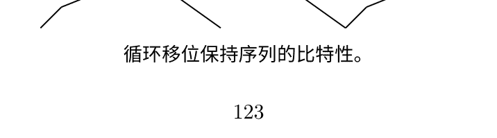

要对一个比特序列进行排序，我们运行下面图中所示的算法。假设 $n = \text{len}(\text{btcseq})$ 是偶数。

**算法1 比特序列排序算法**

```
btcseq(btcseq):
    对于i从0到n/2-1:
        如果btcseq[i]>btcseq[i+n/2]:
            交换(btcseq[i], btcseq[i+n/2])
    btcseq(btcseq[0:n/2-1])
    btcseq(btcseq[n/2:n-1])
```

比特序列排序维护两个不变性：(a)序列 btcseq包含多个比特序列的部分（每个btcseq级别将一个比特序列分成两个比特序列），(b)在考虑两个比特序列部分时，左边部分的元素始终小于右边部分的元素。

经过 $O(\log n)$ 轮次，btcseq 被分成 $n$ 个部分。由于左侧部分的元素小于右侧部分，排序完成。

有关排序比特序列的更多信息，包括此算法正确性的证明，请参见 [68，第27.3节]。

### 14.4.2 对数合并操作

下一步是合并两个已排序的单词，每个单词包含 $k$ 个 $b$ 位元素。首先，我们将第一个单词与第二个单词的逆序连接起来，得到一个比特序列。为了高效地反转一个单词，我们屏蔽掉最左边的 $\frac{k}{2}$ 元素，并将其右移 $\frac{k}{2} b$ 位，然后屏蔽掉最右边的 $\frac{k}{2}$ 元素，并将其左移 $\frac{k}{2} b$ 位。将两个结果单词进行或运算，得到原始单词的左半部分和右半部分互换。现在我们可以对单词的左半部分和右半部分进行递归，得到递归 $T(n) = T(\frac{k}{2}) + O(1)$，因此整个算法的时间复杂度为 $T(k) = O(\log k)$。通过将第一个单词左移 $k b$ 位并将其与第二个单词进行或运算，可以将两个单词连接起来。关键在于并行执行每个递归层次，以使每个层次花费相同的时间。这个列表反转在下图中有所说明。

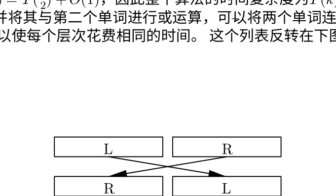

剩下的就是在我们的新单词中运行双调排序算法的元素。为此，我们必须将元素分为两半，并交换顺序不正确的对应元素。然后，我们可以并行地对第一半和第二半进行递归，再次给出递归方程$T(k) = 2T(k/2) + O(1) \Rightarrow T(k) = O(\log k)$时间。因此，我们需要一个常数时间的操作来执行所需的交换。

假设我们在每个打包到单词中的元素之前有一个额外的0位。我们使用这个多余的位来帮助位掩码我们的单词。我们将屏蔽元素的左半部分，并将这个额外的位设置为1，然后屏蔽元素的右半部分，并将它们左移$k/2$位。在我们从第一个单词中减去第二个单词之后，如果左半部分的元素大于右半部分的元素，则额外的位将出现1。因此，我们可以屏蔽额外的位，将单词向右移动$b-1$位，并将其与自身相减，得到一个单词，该单词将屏蔽所有属于左半部分的右半部分的元素，反之亦然。从这个中，我们使用位移、或运算和取反来得到我们的排序列表。请参见下面的图表以进行澄清；这个过程非常简单明了。

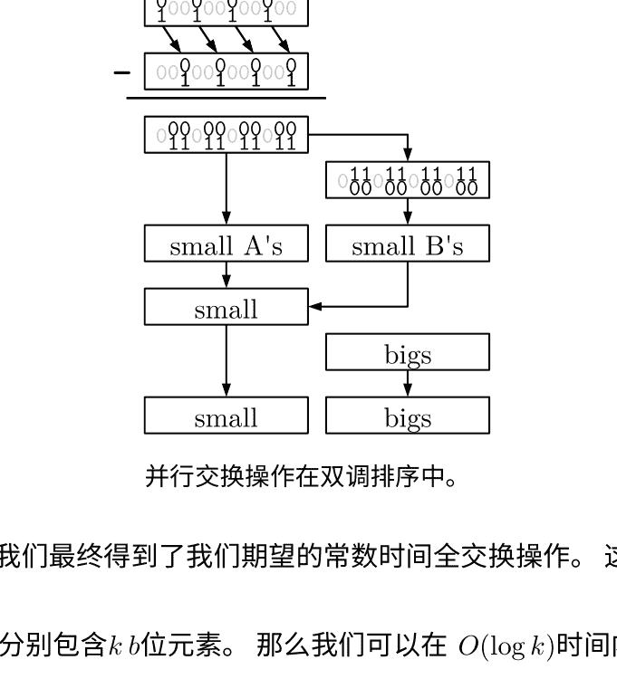

使用这些位操作技巧，我们最终得到了我们期望的常数时间全交换操作。这导致了下面的定理：

**定理40。** 假设两个单词分别包含$k$ 个 $b$ 位元素。那么我们可以在 $O(\log k)$时间内合并这些单词。

**证明。** 正如已经注意到的，我们可以在 $O(\log k)$时间内将第一个单词与第二个单词的逆序连接起来。然后我们可以将这些连接的单词应用于双调排序算法。

由于这个算法的递归深度为 $O(\log k)$，并且我们可以在常数时间内执行所需的交换操作，我们的合并操作的时间复杂度为 $O(\log k)$。

### 14.4.3 压缩排序

在本节中，我们将介绍压缩排序[66]，它可以在 $O(n)$ 时间内对 $n$ 个 $b$ 位整数进行排序，其中字长为 $w \ge 2(b+1) \log n \log \log n$。对于 $w$ 的这个界限，我们可以将 $k = \log n \log \log n$ 个元素打包到一个字中，在每个整数前面留下一个零位，并在字的开头留下 $\frac{w}{2}$ 个零位。

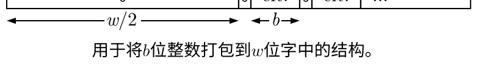

要使用打包排序对这些元素进行排序，我们按以下方式构建合并操作：

1.  在$O(\lg k)$时间内合并两个已排序的字，如前一节中的双调排序所示。
2.  使用(1)作为合并操作对$k$个元素进行归并排序。这种排序的递归关系为 $T(k) = 2T(k/2) + O(\lg k) \Rightarrow T(k) = O(k)$。
3.  将两个已排序的$r$个已排序字列表合并为一个已排序的$2r$个已排序字列表。这与标准归并排序的方式相同，只是我们使用(1)来加速操作。我们从两个列表中合并最左边的字开始，使用(1)。此合并后的第一个字必须包含整体上最小的$k$个元素，因此我们输出此字。
    然而，我们无法确定第二个单词中元素的相对位置。因此，我们检查第二个单词中的最大元素，并将第二个单词添加到包含此最大元素的列表的开头。我们继续以这种方式合并列表，总共需要 $O(r \log k)$ 的时间。
4.  使用(3)作为合并操作和(2)作为基本情况，对所有单词进行归并排序。

**定理41。** 假设单词大小 $w \ge 2(b+1) \log n \log \log n$。那么，打包排序可以在 $O(n)$ 时间内对 $n$ 个 $b$ 位整数进行排序。

**证明。** 上述算法中第4步定义的排序具有递归关系 $T(n) = 2T(\frac{n}{2}) + O(\frac{n}{k} \log k)$ 和基本情况 $T(k) = O(k)$。递归深度为 $O(\log \frac{n}{k})$，每个层级需要 $O(\frac{n}{k} \lg k) = O(\lg \frac{n}{k})$ 时间，所以总共它们贡献了 $O(n)$ 的成本。还有个基本情况，每个情况需要 $O(k)$ 的时间，总共运行时间为 $O(n)$，如所需。

### 14.4.4 签名排序算法

我们使用我们的打包排序算法来构建我们的七步签名排序。我们假设 $w \ge \log^{2+\varepsilon} n \log \log n$。签名排序将在 $O(n)$ 的时间内对 $w$ 位整数进行排序。我们将从将每个整数分成 $\lg^{\varepsilon} n$ 个相等大小的块开始，然后用 $O(\lg n)$ 位替换它们。

通过哈希进行签名。这些较小的签名可以使用线性时间的压缩排序进行排序。
由于哈希不保留顺序，我们将构建这些排序后的签名的压缩字典树，然后根据原始块的值进行排序。这将使我们能够恢复整数的排序顺序。签名排序将按照以下步骤进行：

- 1. 将每个整数分成 $\log^{\varepsilon} n$ 等大小的块。（注意与融合树的区别，融合树的块大小为 $\lg^{\varepsilon} n$）
- 2. 用 $O(\log n)$ 位哈希（静态完美哈希也可以）替换每个块。通过这样做，我们得到了一个 $O(\log^{1+\varepsilon} n)$ 位的签名。我们可以通过乘以一些随机值x来进行哈希，然后屏蔽哈希键。这样可以使我们在线性时间内进行哈希。现在，我们的哈希不保留顺序，但重要的是它保留了身份。
- 3. 使用打包排序在线性时间内对签名进行排序，如上所示。
- 4. 现在我们想要恢复签名的身份。在签名上构建一个压缩字典树，这样字典树的中序遍历就可以按照排序顺序给出我们的签名。压缩字典树只使用 $O(n)$ 的空间。
- 5. 根据它们的实际值递归地对trie中每个节点的边进行排序。这是对（节点ID，实际块，边索引）的递归，它占用 $O(\log n)$， $O(\log \varepsilon n)$， $O(\log n)$ 的空间。边索引用于跟踪排列。经过常数1+1层递归后，我们将有 $b = O(\log n + \frac{w}{\log^{1+\varepsilon} n}) = O(\frac{w}{\log n \log \log n})$，所以我们可以将打包排序作为递归的基本情况。
- 6. 对子边进行排列。
- 7. 对字典树进行中序遍历，从叶子节点获取所需的排序列表。

将这些步骤结合起来，我们得到：

## 定理42. 假设 $w \geq \log^{2+\varepsilon} n \log \log n$。那么签名排序将在 $O(n)$ 时间内对w位整数进行排序。

证明。将整数分成块并对它们进行哈希（步骤1和2）需要线性时间。使用打包排序对这些哈希块进行排序（步骤3）也需要线性时间。构建压缩的签名字典树需要线性时间（步骤4），对每个节点的边进行排序（步骤5）对于线性数量的节点来说需要常数时间。最后，扫描和排列节点（步骤6）以及对字典树叶子节点进行中序遍历（步骤7）将各自需要线性时间，完成证明。

> $\square$

## 第15讲

### 静态树

撰写者：Jelle van den Hooff（2012年），Yuri Lin（2012年），Andrew Winslow（2010年）

### 15.1概述

在本讲座中，我们将研究各种用于静态树的数据结构，在给定静态树的情况下，我们进行一些预处理，然后在数据结构上回答查询。本讲座中我们将研究三个问题：区间最小查询（RMQ），最近公共祖先（LCA）和层祖先（LA）；我们将在每次操作中以常数时间和线性空间支持所有这些查询。

### 15.1.1 区间最小查询（RMQ）

在区间最小查询问题中，我们给定（并预处理）一个包含n个数字的数组 A。在一个查询中，目标是找到由 A[i]和 A[j]跨越的范围内的最小元素：

```
RMQ(i,j) = (\arg)\min\{A[i], A[i+1], \dots, A[j]\} \\
= k, \quad \text{其中} \quad i \leq k \leq j \quad \text{且} \quad A[k] \text{被最小化}
```

我们不仅关心最小元素的值，还关心最小元素在 A[i]和 A[j]之间的索引 k；给定索引，查找最小元素的实际值很容易，所以找到最小元素的索引是一个更有趣的问题在 A[i]和 A[j]之间。

区间最小查询问题不是一个树问题，但它与一个树问题密切相关（最近公共祖先）。

### 15.1.2 最低公共祖先（LCA）

在最低公共祖先问题中，我们希望预处理一个具有 n nodes 的根树 T。在一个查询中，我们给定两个节点 x 和 y，目标是在 T 中找到它们的最低公共祖先：

### 15.1.3 层祖先（LA）

最后，我们还将解决层祖先问题，在这个问题中，我们再次给定一个根树 T。给定一个节点 x 和一个整数 k，查询目标是找到节点 x 的第 k 个祖先：

$$
\text{LA}(x, k) = \text{parent}^k(x)
$$

当然，k 不能大于 x 的深度。

所有这些问题都将在字RAM模型中得到解决，尽管模型的使用并不像我们在之前的讲座中讨论的整数数据结构那样重要。尽管最低公共祖先和层祖先看起来是相似的问题，但是据我们所知，解决它们需要完全不同的技术。然而，范围最小查询问题基本上与寻找最低公共祖先的问题相同。

### 15.2 RMQ和LCA之间的简化

### 15.2.1 笛卡尔树：从RMQ到LCA的归约

笛卡尔树是一种将数组 A 归约为二叉树 T 的好的机制，可以追溯到 Gabow、Bentley和 Tarjan [73] 在 1984 年的一篇论文中，并且提供了 RMQ 和 LCA 之间的等价关系。

为了构建一个笛卡尔树，我们从数组 $A$ 的最小元素开始，我们可以称之为 $A[i]$。这个元素成为笛卡尔树 $T$ 的根。然后，$T$ 的左子树是在 $A[<i]$ 的所有元素上构建的笛卡尔树（我们可以写成 $A[<i]$），而 $T$ 的右子树是在元素 $A[>i]$ 上构建的笛卡尔树。

下面是一个示例，数组 $A= [8, 7, 2, 8, 6, 9, 4, 5]$。数组的最小值是2，它被提升为根。这将问题分解为两个部分，一个是左子数组$[8, 7]$，另一个是右子数组$[8, 6, 9, 4, 5]$。7是左子数组中的最小元素，成为根的左子节点；4是右子数组的最小元素，成为根的右子节点。这个过程一直持续到我们得到下面的二叉树。

生成的树 $T$ 是一个最小堆。更有趣的是，对于给定的数组范围内的结果范围最小查询，对应的笛卡尔树 $T$ 中的这两个端点的最低共同祖先。

在多个相等的最小元素之间存在平局的情况下，有两个选项：

- 1. 任意打破平局，选择其中一个相等的元素作为最小值。
- 2. 将所有相等的元素视为一个“节点”，形成一个非二叉树。

因为第二个选项稍微复杂一些，在这门课程中我们将任意打破平局，尽管任何选项都不会影响答案。

### 15.2.2 线性时间构建

根据朴素递归算法构建笛卡尔树将至少需要$n \log n$时间，甚至可能需要二次时间。事实上，可以使用与上一讲中构建压缩字典树的方法基本相同的方法，在线性时间内计算笛卡尔树。

从左到右遍历数组，通过沿着树的右脊向上遍历（从叶子开始），将每个元素插入到适当的位置。
因为我们是从左到右构建树的，所以每个插入的元素都将成为目前为止创建的树的最右边的元素。
例如，如果我们有一棵树，已经插入了子数组$[2, 4, 5]$，下一个元素是3，那么插入的结果如下：

我们从5开始沿着树的右脊向上遍历，一直到2（根节点），这是第一个小于3的元素。将2和4之间的边替换为从2到3的新边，2的先前右子树成为3的左子树。

每次插入都需要恒定的摊销时间；尽管有时路径可能很长，但每次插入只会触及树的右脊上的节点，并且任何被触及的右脊上的节点最终都会位于插入节点的左子树中。右脊上的任何节点最多只会被触及一次，我们可以将昂贵的插入操作归咎于右脊长度的减少。

因此，即使在比较模型中，构建笛卡尔树也可以在线性时间内完成。

### 15.2.3 从LCA到RMQ的约简

我们还可以通过重建数组A来将LCA约简为RMQ，当我们给定一个二叉树T时。为了做到这一点，我们对树中的节点进行中序遍历。然而，我们必须有数字作为数组的值；为此，我们用树中每个节点的深度来标记它们。

这个序列的行为与原始数组A = [8, 7, 2, 8, 6, 9, 4, 5]完全相同，这个树是由它构建的。对于结果数组A上的RMQ(i, j)，与对应节点的输入树调用LCA(i, j)的结果相同。

### 15.2.4 RMQ宇宙缩减

RMQ和LCA之间的缩减的一个有趣的结果是，它们允许我们对RMQ问题进行宇宙缩减。在原始数组中，对于范围最小查询，任何数字的边界都没有保证，并且一般情况下元素可以是任意的有序宇宙。通过以上两个缩减的链接，首先通过构建笛卡尔树从元素中构建树，然后从树转换回深度数组，我们可以将范围缩减为整数集合 {0, 1, ..., n - 1}。

这种宇宙缩减非常方便；上述算法假设比较模型，但是在进行这对缩减之后，我们现在可以假设所有输入都是小整数，这使得我们可以在字RAM模型中以常数时间解决问题。

### 15.3 常数时间LCA和RMQ

### 15.3.1 结果

LCA和RMQ问题都可以以恒定的查询时间和线性存储空间进行最优解。第一种已知的技术记录在1984年Harel和Tarjan的一篇论文中, [74]。
在讲座中，我们研究了一种基于Bender和Colton的2004年论文[75]的算法。

### 15.3.2 从LCA到 ±1 RMQ的规约

Bender和Colton的算法解决了RMQ问题的一种特殊情况，其中相邻的值之间的差异要么是+1，要么是 -1, 称为 ±1 RMQ。

首先，我们将研究从LCA到 ±1 RMQ的规约。之前的规约不适用，因为差异可能大于1的绝对值。对于我们的新方法，我们基于中序遍历执行一个欧拉遍历，并将每次访问记录在我们的LCA数组中。在遍历的每一步中，我们要么向下一个级别，要么向上一个级别，因此我们数组中相邻值之间的差异要么是+1，要么是 -1。

由于每条边都被访问两次，所以数组中的条目比原始的中序遍历中的条目多，但仍然只有 O(N)。
要回答LCA(x, y)，计算RMQ(中序遍历(x), 中序遍历(y)), 其中中序遍历(x)是节点 x在数组中的中序出现。在创建数组的同时可以存储这些出现次数。观察到这个新数组也可以通过填充原始算法中数组中的间隙来创建。因此，任意两个原始值之间的最小值不会改变，这个新算法也能工作。

### 15.3.3 常数时间, n log n 空间RMQ

一个简单的数据结构可以在常数时间内回答RMQ查询，但只使用了 n log n 空间，可以通过预计算长度为2的幂的所有区间的RMQ来创建。

有 \(O(n \log n)\) 这样的区间总数，因为有 \(\log n\) 长度为2的幂次的区间不超过 \(n\)，有 \(n\) 个可能的起始位置。

我们声称任何查询的区间都是两个2的幂次区间的（非不相交）并集。假设查询的长度为 \(k\)。那么查询可以由长度为 \(2^{\lfloor \log k \rfloor}\) 的两个区间覆盖，这两个区间接触查询的起始和结束。通过取两个预先计算的答案的最小值来回答查询。观察到这样做是有效的，因为我们可以两次取最小值而没有任何问题。此外，这还使我们能够存储最小元素的位置。

### 15.3.4 间接引用以去除对数因子

我们已经看到间接引用用于去除时间的对数因子，但在这里我们将应用间接引用以实现 \(O(n)\) 的空间限制。将数组分成大小为 \(\frac{1}{2} \log n\) 的底部组（此特定常数将在后面使用）。然后，存储一个大小为 \(2n / \log n\) 的父数组，其中存储每个组的最小值。

现在一个查询可以通过在父数组中找到序列的RMQ来回答，并且在底部组中最多进行两个RMQ查询。请注意，对于足够小的查询，我们可能需要在底部组中回答双向查询。对于父数组，我们可以使用 \(n \log n\) 空间算法，因为对数会相互抵消。

### 15.3.5 非常小数组上的RMQ

唯一剩下的问题是如何解决大小为 \(n' = \frac{1}{2} \log n\) 的数组上的RMQ问题。思路是使用查找表，因为可能的不同数组的总数非常小。

注意，我们只需要查看组中的相对值来找到最小元素的位置。这意味着我们可以将所有值移动，使得组中的第一个元素为0。然后，一旦我们知道位置，我们可以在原始数组中查找最小元素的值。

现在我们将利用数组元素之间的差异要么是+1，要么是-1的事实。将第一个值移动到0后，现在只有 \(2^{\frac{1}{2} \log n} = \sqrt{n}\) 个不同的底部组，因为每个组都完全由其长的+1和-1序列定义。这个总数 \(\sqrt{n}\) 远远小于实际的组数！

事实上，它足够小，以至于我们可以为任何 \(2^{\lfloor \frac{1}{2} \log n \rfloor}\) 可能的查询中的任何 \(\sqrt{n}\) 组存储一个查找表，所需的位数为 \(O(\sqrt{n} (\frac{1}{2} \log n)^2 \log \log n)\)，这很容易适应 \(O(n)\) 的空间。现在每个组都可以存储一个指向查找表的指针，并且所有查询都可以在常数时间内回答，对于父数组、底部组和表来说，需要线性空间。

### 15.3.6 广义RMQ

我们使用线性空间和常数时间的RMQ算法来计算LCA。由于广义RMQ可以通过宇宙约简来计算LCA，我们也可以得到一个线性空间和常数时间的RMQ算法。

### 15.4 级别祖先查询（LAQ）

首先我们介绍一些符号。设 $h(v)$ 为节点 $v$ 的高度。给定节点 $v$ 和层级 $l$， $LAQ(v, l)$ 表示节点 $v$ 的祖先节点 $a$ 满足 $h(a) - h(v) = l$。今天我们将学习各种数据结构，它们具有不同的预处理和查询时间，可以回答 $LAQ(v, l)$ 查询。对于一个需要 $f(n)$ 查询时间和 $g(n)$ 预处理时间的数据结构，我们将运行时间表示为 $\langle g(n), f(n)\rangle$。以下算法摘自Bender和Farach-Colton[76]的论文中的一组算法。

### 15.4.1 算法A: $\langle O(n^2), O(1)\rangle$

基本思想是使用一个查找表，其中一个轴对应于节点，另一个对应于层级。通过增加层级来使用动态规划填充表格。这是蛮力方法。

### 15.4.2 算法B: $\langle O(n \log n), O(\log n)\rangle$

基本思想是使用跳跃指针。这些是指向节点的指针，引用节点的一个祖先。对于每个节点，在层级1, 2, 4, . . . , $2^k$创建跳跃指针。通过从当前祖先跳到目标祖先，每次跳跃超过剩余层级的一半来回答查询。所以最坏情况下跳跃次数为 $O(\log n)$。预处理是通过使用动态规划填充跳跃指针来完成的。

### 15.4.3 算法 C: $\langle O(n), O(\sqrt{n})\rangle$

基本思想是使用最长路径分解，通过递归地删除包含最长路径的树并对剩余的连通子树进行迭代来拆分树。每个被删除的路径按照自顶向下的路径顺序存储为数组，并且每个数组都有一个指针，从其第一个元素（路径的根）指向其在树中的父节点（来自上一递归级别的路径数组的元素）。通过在这个数组树中向上移动，遍历每个数组，可以在 $O(1)$ 时间内回答查询。在最坏的情况下，最长路径分解可能导致大小为 $k$、$k-1$、...的最长路径。每个路径只有一个子节点，导致具有高度 $O(\sqrt{n})$ 的数组树。可以通过预先计算节点高度一次性构建分解，并重用它们来快速找到最长路径。

### 15.4.4 算法 D: $\langle O(n), O(\log n)\rangle$

基本思想是使用梯子分解。这个想法与最长路径分解类似，但是每条路径都向后（树的根节点过去）扩展两倍。如果扩展路径到达根节点，则停止。根据梯子属性，我们知道节点 $v$ 至少位于大小为 $h$ 的最长路径上 $(v)$。因此，在到达根节点之前，最多进行 $O(\log n)$ 次梯子跳跃，因此查询时间为 $O(\log n)$。预处理与算法C类似。

### 15.4.5 算法 E: $\langle O(n \log n), O(1)\rangle$

这个想法是结合跳跃指针（算法B）和梯子（算法D）。每个查询将使用一个跳跃指针和一个梯子来达到目标节点。首先进行一次跳跃，以至少到达祖先的一半。跳跃到的节点包含在一个梯子中，该梯子还包含目标祖先。

### 15.4.6 算法 F: $\langle O(n), O(1)\rangle$

Dietz[77] 提出的算法也可以在 $\langle O(n), O(1)\rangle$ 内解决 LCA 查询，但更加复杂。在这里，我们将算法E与减少计算跳跃指针的节点数目相结合。动机是，如果我们知道 v 在第 l 层的祖先节点，那么我们也可以知道 v 的后代节点在第 l' 层的祖先节点。因此，我们只为叶子节点计算跳跃指针，确保每个节点都有一个后代节点在这个集合中。到目前为止，预处理时间为 O(n + L log n)，其中 L 是叶子节点的数量。不幸的是，对于任意的树，L = O(n)。

### 15.4.7 构建一个具有 $O(\log n)$ 叶子

将树结构分成两个组件：根部的宏树和一组微树（最大尺寸为 1/4 log n）根据宏树的叶子节点。考虑深度优先搜索，跟踪第 i 条边的方向，使用0表示向下，使用1表示向上。一个微树可以用二进制序列来描述，例如 W= 001001011，其中对于大小为 n 的树，|W|= 2n -1。因此，微树的可能数量的上界是 2^(2n-1) = 2^(2(1/4 log n)-1) = O(√n)。但这只是一个宽松的上界，因为并非所有的二进制序列都是可能的，例如00000...一个有效的微树序列具有相等数量的零和一，并且任何有效序列的前缀至少有与零一样多的零。

### 15.4.8 使用宏/微树来解决 LAQ的$\langle O(n), O(1)\rangle$问题

我们将使用宏/微树来构建一个具有 $O(n / \log n)$ 个叶子的树，并仅计算其叶子的跳跃指针（$O(n)$ 时间）。我们还计算所有微树及其查找表（参见算法A）的时间为 $O(\sqrt{n} \log n)$。因此，总预处理时间为 $O(n)$。查询 LAQ(v, l) 的执行方式如下：如果 v 在宏树中，则跳转到 v 的叶子后代，然后从叶子上跳跃并爬梯子。如果 v 在微树中，并且 LAQ(v, l) 在微树中，则使用叶子的查找表。如果 v 在微树中，并且 LAQ(v, l) 不在微树中，则跳转到 v 的叶子后代，然后从叶子上跳跃并爬梯子。

## 第16讲

## 字符串

撰写者：Cosmin Gheorghe (2012)，Nils Molina (2012)，Kate Rudolph (2012)，Mark Chen (2010)，Aston Motes (2007), Kah Keng Tay (2007), Igor Ganichev (2005), Michael Walfish (2003)

### 16.1概述

在本讲座中，我们考虑字符串匹配问题-在文本中找到查询字符串作为子字符串出现的所有位置。从一次性方法的角度来看，我们可以在$|T|$时间内解决字符串匹配问题，其中 $|T|$是我们的文本大小。这种纯粹的算法方法在Knuth-Morris-Pratt [83]，Boyer-Moore [78]和Rabin-Karp [81]的论文中得到了广泛研究。

然而，我们考虑到可能会对同一段文本进行多次查询。这促使我们开发预处理文本以实现更高效查询的数据结构。我们将展示如何构建、使用和分析这些字符串数据结构。

### 16.2前驱问题

在我们讨论字符串匹配之前，我们将解决一个更简单的问题，这是解决字符串匹配问题所必需的。这是字符串之间的前驱问题。假设我们有 $k$个字符串，$T_1$，$T_2$，...，$T_k$并且查询是：给定某个模式 $P$，我们想知道 $P$在这 $k$个字符串中的字典序位置。更具体地说，我们想知道在字符串的字典序中，$P$的前驱是哪个字符串。

使用我们已经开发的数据结构来解决这个问题是不高效的，因为字符串可能非常长，比较字符串的速度很慢。因此，我们需要使用其他一些数据结构来考虑这个事实。

### 16.2.1 字典树和压缩字典树

为了解决前驱问题，我们将使用一种称为字典树的结构。字典树是一棵根树，每个子分支都标有字母表Σ中的字母。我们将考虑任何节点 v存储一个字符串，该字符串表示从根节点 r到节点v的路径上所有分支标签的连接。更具体地说，给定一个递增深度的路径 p =r, v1, v2, ..., v从根节点 r到节点 v，节点 vi处存储的字符串是节点 vi-1存储的字符串与分支 vi-1vi上存储的字母的连接。我们将字典树叶子节点中存储的字符串称为单词，将所有其他节点中存储的字符串称为前缀。根节点 r表示空字符串。

我们按照字母顺序从左到右对每个节点的子节点进行排序。请注意，任何节点的扇出最多为 |Σ|。同时，字典树的中序遍历会按照排序顺序输出存储的字符串。

通常的做法是用特殊字符 $ ∉Σ 结束字符串，这样我们可以区分前缀和单词。图1中的示例字典树存储了四个单词 ana$、 ann$、 anna$ 和anne$。

如果我们每条边只分配一个字母，就没有充分利用字典树的树结构。更有用的是考虑压缩字典树，即移除每条边上的一个字母的限制，并通过连接这些路径上的字母来压缩非分支路径。这样，每个节点都会分支出去，每个经过的节点都代表着在两个不同单词之间的选择。对应于我们示例字典树的压缩字典树也在图1中显示出来。

### 16.2.2 解决前驱问题

我们将我们的k个字符串T1， T2， …, Tk存储在上述字典树数据结构中。 给定一个查询字符串P，为了找到它的前驱，我们从根节点开始沿着子节点的分支向下遍历字典树。 在某个点上，我们要么离开了树，要么到达了一个叶子节点。 如果我们到达了一个叶子节点，那么我们已经完成了，因为模式P恰好匹配我们的某个单词。 如果我们离开了树，那么前驱是我们离开的位置左侧子树中存储的最大字符串。 例如，如果我们在图1的树中搜索单词a nb，我们在遍历下降分支a和n后离开了树。 然后b在我们离开的节点的分支a和n之间，前驱是分支a后面子树中存储的最大字符串。

对于字典树的每个节点 v，我们将存储由 v定义的子树中的最长字符串。 然后，为了实现快速的前驱查询，我们需要一种同时允许快速遍历边（沿树向下移动）和在节点内进行快速前驱查询的方法。

### 16.2.3 字典树节点表示

根据我们选择的存储节点的方式，我们将得到不同的查询时间和空间限制。

### 数组

我们可以将字典树的每个节点存储为大小为 |Σ|的数组，数组中的每个单元格表示一个分支。 在这种情况下，沿着下一个分支移动只需要 O(1)的时间。 要在数组中找到前驱，我们只需预先计算所有可能的 |Σ|查询并存储它们。 因此，在节点内进行前驱查询也只需要 O(1)的时间。 不幸的是，每个节点使用的空间为 O(|Σ|)，因此总的字典树空间使用量为 O(|T||Σ|)，其中 |T|是字典树中的节点数，|T1| +|T2| + … +|Tk|。 总的查询时间为 O(|P|)。

### 二叉搜索树

我们可以将字典树节点存储为二叉搜索树。 更具体地说，我们将节点的分支存储在二叉搜索树中。 这将减少字典树的总空间为 O(|T|)，但会增加查询时间为 O(|P|log Σ)。

### 哈希表

对于每个节点使用哈希表可以得到一个空间复杂度为 O(|T|)、查询时间为 O(P)的字典树。 不幸的是，使用哈希只能进行精确搜索，因为哈希不支持前驱操作。

### Van Emde Boas

为了支持前驱查询，我们可以使用Van Emde Boas数据结构来存储字典树的每个节点。 使用这种方法，字典树的总空间复杂度为 O(|T|)，查询时间为 O(Plog log Σ)。

### 权衡平衡二叉搜索树

我们将节点v的子节点存储在一个权衡平衡二叉搜索树中，其中每个子节点x的权重等于子树x中的叶子节点总数。

为了构建这样一棵树，我们将节点v的子节点分成两部分，使得左侧子节点的后代叶子节点数尽可能接近右侧子节点的后代叶子节点数。然后我们对左侧子节点和右侧子节点进行递归操作。

为了支持在这棵新树中进行前驱搜索，我们可以为构建树的每条边e标记最大的边标签，该边标签对应于节点v的某个子节点x，在按照e确定的子树中。要更好地理解这个构造，请参考图2。

> 引理43。在我们将每个节点存储为上述的权衡平衡二叉搜索树的trie中，搜索时间为O(P+ log k)。

证明。我们将通过展示在树中跟随的每条边上，我们要么在 P中前进一个字母，要么将候选 T_i的数量减少1/3来证明这一点。假设在我们的遍历中，我们在表示节点 x的权衡平衡BST中的节点 y处。考虑节点 x的所有字典树子节点c1, c2, ..., cm在节点 y的子树中存在。让 D是的总后代叶子节点数目 c1, c2, ..., cm. 如果任何子节点 c_i的后代叶子节点数量最多为 D/3，则从 y出发的下一条边会使候选叶子节点数量减少至少1/3。否则，存在某个子节点 c_i至少有 D/3个后代。然后根据平衡二叉搜索树的构造， c_i最多只能是 y的孙子。然后，通过跟随下两条边，我们要么移动到前缀树中的节点 c_i，这种情况下我们在 P中前进一个字母，要么我们不移动到节点 c_i，这种情况下我们将潜在叶子节点数量减少1/3。

请注意 $k$ 是存储在字典树中的字符串的数量。尽管我们的数据结构实现了 $O(P+\log k)$ 的查询时间，但我们希望实现 $O(P+\log \Sigma)$ 的查询时间，以使查询时间与字典树中的字符串数量无关。我们可以通过使用间接引用和叶子修剪来实现这一点，类似于我们在常数时间和线性空间中解决层祖先问题时所使用的方法。

我们将通过剪掉所有至少具有 $|\Sigma|$ 个后代叶子的最大深度节点以下的边来修剪树。因此，我们将得到一棵顶级树，它最多具有 $|T|/|\Sigma|$ 个叶子，因此最多具有 $|T|/|\Sigma|$ 个分支节点。在这棵树上，我们可以使用数组来存储字典树节点，以实现线性查询和 $O(T)$ 的空间复杂度。请注意，我们只能为分支节点和叶子节点存储数组，因为可能存在的节点数量超过 $|T|/|\Sigma|$。但对于非分支节点，我们可以简单地存储指向下一个节点的指针，或者从一开始就使用压缩字典树。

底部的树比 $|\Sigma|$ 个后代叶子少，这意味着我们可以使用加权平衡二叉搜索树来存储 trie 节点，这样可以使用线性空间，但现在查询时间为 $O(P+\log \Sigma)$，因为叶子节点少于 $\Sigma$ 个。

总共，我们得到了一个数据结构，空间复杂度为 $O(T)$，查询时间为 $O(P+\log \Sigma)$。另一个满足这些界限的数据结构是后缀托盘[86]。

### 16.3 后缀树

后缀树是建立在 $T$ 的所有 $|T|$ 个后缀上的压缩 trie，末尾添加了 $。例如，如果我们的文本是字符串 $T=香蕉\$$，那么我们的后缀树将建立在 $\{香蕉\$, 香蕉\$, 香蕉\$, 香\$, 蕉\$, \}$ 上。从第 $i$ 个索引开始的后缀被表示为 $T[i:]$。对于后缀树的非叶节点，将节点中存储的前缀的长度定义为字母深度。

### 16.3.1 应用

后缀树是多功能的数据结构，对于字符串匹配和相关问题有着无数的应用：

**字符串匹配**

要解决字符串匹配问题，注意到 $T$ 的子串只是 $T$ 的前缀或后缀。因此，要找到模式 $P$，我们沿着树向下走，跟随对应于 $P$ 中下一组字符的边。最终，如果模式匹配，我们将到达一个存储 $P$ 的节点 $v$。最后，报告 $v$ 下面的所有叶子节点，因为每个叶子节点代表一个不同的出现。沿着树向下走有一种独特的方式，因为扇出的每个节点的边必须具有不同的首字母。搜索的运行时间取决于节点的存储方式。如果节点以哈希表的形式存储，这种方法可以达到 O(P) 时间。 使用托盘，我们可以达到O(P+ lg Σ)，使用哈希表和van Emde Boas结构，我们可以达到 O(P+ lg lg Σ)时间。 这两个最后的结果很有用，因为它们保持了节点的排序顺序，而哈希表不保持排序。

### 首次 k 出现

不需要报告所有匹配的子序列 T，我们可以报告第一个 k次出现的 P，只需要额外花费 O(k) 的时间。为了实现这一点，从每个节点到其最左边的叶子节点添加一个指针，然后通过链表连接所有叶子节点。然后，为了确定第一个 k次出现，执行上述搜索，然后简单地跟随指针找到与该模式匹配的前 k个叶子节点。

### 计数出现次数

在这个字符串匹配问题的变体中，我们必须找出模式 P在文本中出现的次数。然而，我们可以在每个节点中简单地存储子树的大小。

### 最长重复子串

为了找到最长重复子串，我们寻找具有最大字母深度的分支节点。我们可以在 O(T) 的时间内完成这个任务。假设我们给定两个索引 i和 j，并且我们想知道 T[i:] 和 T[j:] 的最长公共前缀。这只是一个最近公共祖先查询，在L15中可以在 O(1) 的时间内完成。

### 所有出现的 T[i : j] 的地方

当模式 P是文本 T的已知子串时，我们可以将问题解释为一个LA查询：我们想要找到 T[i:]的第( j -i)个叶子的祖先。我们必须小心，因为边的长度不是单位长度，所以我们必须将边解释为加权的，加权值为压缩到该边上的字符数。

我们必须对L15中的LA数据结构进行一些修改，以考虑加权边。我们将L15中的长路径/梯子数据结构中的节点存储在van Emde Boas前驱数据结构中，该数据结构使用 O(lg lg T)的空间。此外，我们无法在L15的底部数据结构中使用查找表。相反，我们通过使用梯子分解来在底部树上回答查询。这需要 O(lg lg n)个梯子，达到高度 O(lg n)。然后，我们只需要在最后一个梯子上运行前驱查询。这给我们 O(lg lg T)的查询时间和 O(T)的空间。这个结果归功于Abbott、Baran、Demaine和其他人在2005年春季的6.897课程中。

### 多个文档

当有多个文本时，我们可以用$1, $2, ..., $n$将它们连接起来。每当我们看到一个$1$时，我们会将其下面的部分修剪成叶子并节省空间。然后，为了找到最长的公共子串，我们寻找具有大于一个不同$的最大字母深度的节点。要计算包含模式$P$的文档数量，只需在每个节点上存储作为该节点的后代的不同$符号的数量。

### 文档检索

我们可以在额外的$O( d)$时间内找到包含模式$P$的$d$个不同文档$T_i$，总共需要$O(P + d)$时间。这是理想的，因为如果$P$在一个文档中出现了天文数字次数，在第二个文档中只出现了一两次，一个更加天真的算法可能会花费大量时间找到$P$的每个出现，而结果只有2个文档。这个数据结构由Muthukrishnan [85]提出，可以避免这个问题。

为了做到这一点，通过使每个$1$存储前一个叶子的编号$来增强数据结构。然后，假设我们已经搜索了模式$P$并来到了节点$v$。假设$v$的叶子后代编号为$l$到$n$。因此，我们希望在范围$[l, n]$中找到$1$的第一个出现，对于每个$i$。通过增强，这等价于寻找存储值为$< l$的$1$，因为这表示前一个$1$在区间$[l, n]$之外。

我们可以使用L15中的RMQ查询解决这个问题。在$O(1)$时间内找到最小值。假设最小值在位置$m$找到。然后，如果该叶子的存储值为$< l$，则这是一个答案，输出该模式在文档$i$中出现。然后，在剩余的区间$[l, m-1]$和$[m+1, n]$上递归。因此，我们想要的每个额外输出都可以在$O(1)$时间内找到，我们可以随时停止。

### 16.4 后缀数组

后缀树是强大的数据结构，在计算生物学、数据压缩和文本编辑等领域有广泛应用。然而，后缀数组是一种更简单、更紧凑的数据结构，适用于许多应用场景，它包含了后缀树中的大部分信息。后缀数组唯一的缺点是它不如后缀树直观和自然作为一种表示方式。在本节中，我们定义后缀数组，展示后缀数组在某种意义上与后缀树等价，并提供一个快速构建后缀数组的算法。

### 16.4.1 示例

让我们按照字典顺序将文本$T$的后缀存储在一个中间数组中。然后后缀数组就是存储每个后缀对应索引的数组。例如，如果我们的文本是$banana\$$，中间数组是$[ \$, a\$, ana\$, anana\$, banana\$, na\$, na na\$]$，后缀数组是$[6, 5, 3, 1, 0, 4, 2]$，如图2所示。由于后缀按字典顺序排序，我们可以使用二分查找在$O(|P| log |T|)$的时间内搜索模式$P$。

我们可以计算中间数组相邻条目之间的最长公共前缀的长度。如果我们将这些长度存储在一个数组中，我们就得到了所谓的LCP数组。这在图3中有所说明。这些LCP数组可以在O(|T|)的时间内构建，这是Kasai等人[82]的结果。在上面的例子中，从中间数组构建的LCP数组是[0, 1, 3, 0, 0, 2]。使用LCP数组，我们可以将模式搜索在后缀数组中提高到O(|P|+ log |T|)。

### 图2：后缀数组和LCP数组示例及其与后缀树的关系

### 16.4.2 后缀数组和后缀树

为了激发构建后缀数组和LCP数组的动机，请注意后缀数组存储相应后缀树的叶子节点，而LCP数组提供了有关内部节点高度的信息，如图2所示。我们现在的目标是展示后缀树可以在线性时间内转换为后缀数组，反之亦然。

为了形式化这种直觉，我们使用L15中的笛卡尔树。要构建笛卡尔树，请在笛卡尔树的根节点存储LCP数组中所有条目的最小值，并在剩余的数组片段上递归。具体示例请参见下图3。

### 从后缀树到后缀数组

要将后缀树转换为后缀数组，我们只需对后缀树进行中序遍历。如前所述，此过程按字母顺序返回所有后缀。

### 从后缀数组到后缀树

要将后缀数组转换回后缀树，请使用与后缀数组相关联的LCP数组创建一个笛卡尔树。与L15不同，在根节点使用所有最小值。笛卡尔树节点中存储的数字是内部节点的字母深度！因此，如果我们按顺序将后缀数组的条目作为叶子插入笛卡尔树中，我们可以恢复后缀树。

事实上，我们获得了一个带有字母深度信息的增强后缀树。从L15开始，这个构造在线性时间内是可能的。

### 16.5 DC3算法用于构建后缀数组

在这里，我们给出了DC3（差分覆盖3）分治算法的描述，用于在 O(|T| + sort(Σ))时间内构建后缀数组。我们紧密遵循Kärkkäinen-Sanders-Burkhardt [80]的论文中对DC3算法的阐述。因为我们可以在线性时间内从后缀数组创建后缀树，这是DC3的一个结果，Farach [79]，McCreight [84]，Ukkonen [87]和Weiner [88]独立地证明了这个结果。

1.  对字母表Σ进行排序。我们可以使用任何排序算法，导致 O(sort(Σ))项。
2.  用字母在文本中的排名替换每个字母。请注意，字母的排名取决于文本。例如，如果文本只包含一个字母，无论是什么字母，都将被替换为1。这个操作是安全的，因为它不会改变我们感兴趣的任何关系。我们还保证所使用的字母表的大小不会超过文本的大小（在字母表过大的情况下，通过忽略未使用的字母来实现）。
3.  将文本T分成3部分，并将字母的三元组打包成megaletters。更正式地说，将T₀、T₁和T₂定义如下：

$$ T_0 = < (T[3i], T[3i+1], T[3i+2]), \text{ 其中 } i = 0, 1, 2, ... > $$
$$ T_1 = < (T[3i+1], T[3i+2], T[3i+3]), \text{ 其中 } i = 0, 1, 2, ... > $$
$$ T_2 = < (T[3i+2], T[3i+3], T[3i+4]), \text{ 其中 } i = 0, 1, 2, ... > $$

请注意 Tᵢ是新字母表Σ³中的一个字母，只是文本而已。我们的文本大小变为原来的三分之一，而字母表大小变为原来的立方倍。

4.  对<T₀, T₁>进行递归，即对 T₀和 T₁的连接进行递归。由于我们的新字母表是立方大小的，而原始字母表是预排序的，所以对新字母表进行基数排序只需要线性时间。当这个递归调用返回时，我们已经对 T₀和 T₁的所有后缀进行了排序，得到了一个后缀数组。然后我们只需要对 T₂的后缀进行排序，并将它们与旧的后缀合并，就可以得到T的后缀，因为

$$ \text{后缀}(T) \cong \text{后缀}(T_0) \cup \text{后缀}(T_1) \cup \text{后缀}(T_2) $$

如果我们能够在线性时间内完成这个排序和合并，我们就得到了一个递归公式 \(T(n) = T(2/3n) + O(n)\)，这样就可以实现线性时间。

5.  使用基数排序对 T₂的后缀进行排序。一旦我们注意到这一点，这就变得很简单了。

$$ T_2[i:] \cong T[3i + 2:] \cong (T[3i + 2], T[3i + 3:]) \cong (T[3i + 2], T_0[i + 1:]). $$

这里的逻辑是，一旦我们用 T来重新写 T₂[i:]，我们就可以取出后缀的第一个字母并与剩余部分配对。我们最终得到的结果是，索引|3i+3 对应于 T₀中的一个三元组的起始位置，具体来说，就是 T₀[i+1]，而我们已经从递归调用中按顺序对其进行了排序。

因此，我们可以在两个坐标上进行基数排序，即三元组 T₀[i+1] 和单个字母 T[3i+2]，我们都知道它们的排序顺序。这样，我们可以得到排序后的 T₂[i:]。具体来说，基数排序只是在两个坐标上进行，其中第二个坐标已经排序好了。

6.  使用标准的线性合并将 T₀， T₁和 T₂的排序后的后缀合并。唯一的问题是以常数时间找到一种比较后缀的方法。记住， T₀和 T₁的后缀已经一起排序，因此比较来自 T₀的后缀和来自 T₁的后缀只需要常数时间。要与 T₂的后缀进行比较，我们将再次分解它以获得来自 T₀或 T₁的后缀。有两种情况：

    - **比较 T₀ 和 T₂:**

$$ T_0[i:] \text{ 对比 } T_2[j:] \cong T[3i:] \text{ 对比 } T[3j+2:] \cong (T[3i], T[3i+1:]) \text{ 对比 } (T[3j+2], T[3j+3:]) \cong (T[3i], T_1[i:]) \text{ 对比 } (T[3j+2], T_0[j+1:]) $$

    所以我们只比较第一个字母，然后如果需要的话，比较已经排序好的 T₀和 T₁的后缀。

比较 \(T_1\) 和 \(T_2\):

$$T_1[i:] \text{ 对比 } T_2[j:]$$
$$\cong T[3i+1:] \text{ 对比 } T[3j+2:]$$
$$\cong (T[3i+1], T[3i+2], T[3i+3:]) \text{ 对比 } (T[3j+2], T[3j+3], T[3j+4:])$$
$$\cong (T[3i+1], T[3i+2], T_0[i+1:]) \text{ 对比 } (T[3j+2], T[3j+3], T_1[j+1:])$$

因此，我们可以通过首先比较前面的两个字母，然后比较已排序的后缀 \(T_0\) 和 \(T_1\)（如果需要的话）来做类似的事情。

## 第17讲

### 简洁1

撰写者：大卫·本杰明（2012年），林飞（2012年），郑宇智（2012年），莫尔泽扎·扎迪莫加达姆（2010年），亚伦·伯恩斯坦（2007年）

### 17.1 概述

到目前为止，我们主要研究了如何减少查询时间和数据结构的预处理时间。在本讲座中，我们将重点关注尽可能紧凑地维护数据。本节的目标是获得非常“小”的空间，通常用于静态数据结构。

将要查看二进制字母表的二进制尝试。另一种方法是使用位串。线性空间很容易实现，但不是最优的。我们的目标是尽可能接近信息论的最优解。我们将将这个最优解称为OPT。请注意，大多数“线性空间”数据结构仍远未达到信息论最优解，因为它们通常使用O(n)个字来存储空间，而OPT通常使用O(n)个比特。这种严格的空间限制使得动态数据结构非常困难，因此大多数空间效率高的数据结构都是静态的。

以下是我们可以努力实现的一些可能目标：

- 隐式数据结构 - 空间 = 信息论-OPT + O(1)。关注的是位而不是单词。理想情况下使用O(n)位。O(1)是为了在OPT是小数时进行四舍五入。大多数隐式数据结构只存储数据的某种排列方式：这是我们真正能做的。作为一些简单的例子，我们可以参考堆，它是一种隐式动态数据结构，以及排序数组，它是这些数据结构的静态示例。
- 简洁数据结构 - 空间 = OPT + o(OPT)。换句话说，主导常数是1。这是最常见的空间高效数据结构类型。
- 紧凑数据结构 - 空间 = O(OPT)。请注意，一些“线性空间”数据结构实际上并不紧凑，因为它们使用O(w·OPT)位。这至少节省了O(w)的常规数据结构。例如，后缀树的空间是O(n)个单词，但其信息论下界是n位。另一方面，二叉搜索树可以看作是一种紧凑数据结构。

简洁是通常的目标。 隐式非常困难，紧凑通常是朝着简洁的数据结构努力的方向。

#### 17.1.1 迷你调查

- 隐式动态搜索树 - 静态搜索树可以用一个数组存储，每次搜索需要$ln n$个操作。然而，为了插入和删除操作，问题变得更加棘手。有一个旧的结果，使用指针和位的排列，在 $lg^2 n$时间内完成。2003年，Franceschini和Grossi [89]开发了一种隐式动态搜索树，支持插入、删除和前驱操作，最坏情况下时间复杂度为$O(\log(n))$，并且是缓存无关的。
- 简洁字典 - 这是静态的，没有插入和删除操作。在一个大小为$u$的宇宙中，有多少种方式可以拥有 $n$个项目。使用$lg \binom{u}{n} + O\left( \frac{\lg \binom{u}{n}}{\lg \lg u} \right)$ 位 [90] 或 $lg \binom{u}{n} + O\left( \frac{n (\lg \lg n)^2}{\lg n} \right)$ 位 [94] ，并支持 $O(1)$ 成员查询，与普通字典相比，时间相同但空间更少；$u$是元素从中提取的宇宙的大小。
- 简洁二进制字典树 - 具有 $n$ 个节点的可能二进制字典树的数量是第 $n$ 个卡塔兰数， $C_n = \binom{2n}{n}/(n+1) \approx 4^n$。因此，$OPT \approx \log(4^n) = 2^n$。我们注意到，这可以从基于根节点的左子树和右子树的大小的递归公式推导出来。

在本讲座中，我们将展示如何使用 $2n + o(n)$ 位的空间。我们将能够在 $O(1)$ 时间内找到左子节点、右子节点和父节点。我们还将提供一些关于如何在 $O(1)$ 时间内回答子树大小查询的直觉。子树大小很重要，因为它允许我们跟踪所在节点的等级。研究的动机是将牛津字典适应到 CD 上，空间有限。
- 几乎紧凑的k叉字典树 - 这样的字典树数量为$C_n^k = \binom{kn+1}{n}/(kn+1) \approx 2^{(\log(k)+\log(e))n}$。因此，$OPT = (\log(k) + \log(e))n$。最佳已知数据结构是由Benoit等人开发的 [91]。它使用$(\lceil \log(k) \rceil + \lceil \log(e) \rceil)n + o(n) + O(\log\log(k))$位。这种表示仍然支持以下查询，时间复杂度为$O(1)$：找到标签为i的子节点，找到父节点和找到子树大小。
- 紧凑的有序根树 - 这些与字典树不同，因为不存在缺失的子节点。可能的树的数量为$C_n$，因此$OPT = 2n$。查询可以要求我们找到节点的第i个子节点，节点的父节点或节点的子树大小。Clark和Munro [92]提供了一个紧凑的数据结构，使用$2n + o(n)$的空间，并在常数时间内回答查询。
- 简洁置换 - 在这个数据结构中，我们给出一个置换 $\pi$ of $n$项，并且查询的形式是 $\pi^k(i)$。Munro等人在[95]中提出了一个具有恒定查询时间和空间$(1 + \epsilon)n \log(n) + O(1)$位的数据结构。他们还获得了一个简洁的数据结构，其空间复杂度为 $\lceil \log n! \rceil + o(n)$位，查询时间为 $O(\log n / \log \log n)$。
- 紧凑的阿贝尔群 - 用 $O(\lg n)$位表示$n$个项的阿贝尔群，并用$\lg n$位表示列表中的一个项。
- 图 - 更加复杂。我们在课堂上没有详细讨论任何细节。
- 整数 - 隐式n位整数可以在 O(lg n)位读取和 O(1)位写入时进行递增或递减。打开： O(1)个字操作。

### 17.2 二叉前缀树的层次遍历表示

如上所述，二进制字典树的信息理论最优大小为2n位，每个节点两位。 要构建一个简洁的二进制字典树，我们必须用2n + o(n)位表示字典树的结构。

我们使用层次遍历表示字典树。 按层次顺序访问节点（从顶部开始，每层从左到右），每个节点写出两位。 每个位描述节点的子节点：如果有左子节点，则第一位为1，否则为0。 同样，第二位表示是否有右子节点。

例如，考虑以下字典树：

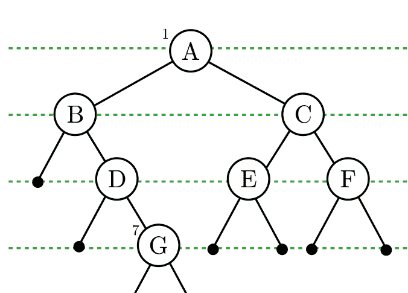

我们按顺序遍历节点A、B、C、D、E、F、G。 这将得到以下位串：
11 01 11 01 00 00 00
A  B  C  D  E  F  G

外部节点表示法等价地，我们可以将每个位与子节点关联，而不是与父节点关联。 对于每个缺失的叶子节点，我们添加一个外部节点，用上图中的·表示。 原始节点称为内部节点。 我们再次按层次顺序访问每个节点，对于内部节点添加1，对于外部节点添加0。具有 n个节点的树有 n+1个缺失的叶子节点，因此结果为2n+ 1位。 对于上面的例子，结果为以下位串：

1 1 1 0 1 1 1 0 1 0 0 0 0 0 0
A B C · D E F · G · · · · · ·

请注意，这个新的位串与之前的完全相同，只是在根节点前面多了一个1。 A.

#### 17.2.1 导航

这种表示方法使我们能够在常数时间内计算左子节点、右子节点和父节点。然而，它不能计算子树的大小。我们首先证明以下定理：

定理44。在外部节点的表示中，第$i$个内部节点的左子节点和右子节点在位置$2i$和$2i+1$上。

证明。我们通过对$i$进行归纳来证明这一点。对于$i=1$，也就是根节点，这显然是正确的。位串的第一个条目是根节点。然后，位$2i=2$和$2i+1=3$是根节点的子节点。

现在，对于$i>1$，根据归纳假设，第$i-1$个内部节点的子节点位于位置$2(i-1)=2i-2$和$2(i-1)+1=2i-1$。我们证明第$i$个内部节点的子节点紧随第$i-1$个内部节点的子节点之后。

从视觉上看，有两种情况：要么$i-1$与$i$在同一层级，要么$i$在下一层级。在第二种情况下，$i-1$和$i$分别是它们所在层级中的最后一个和第一个内部节点。

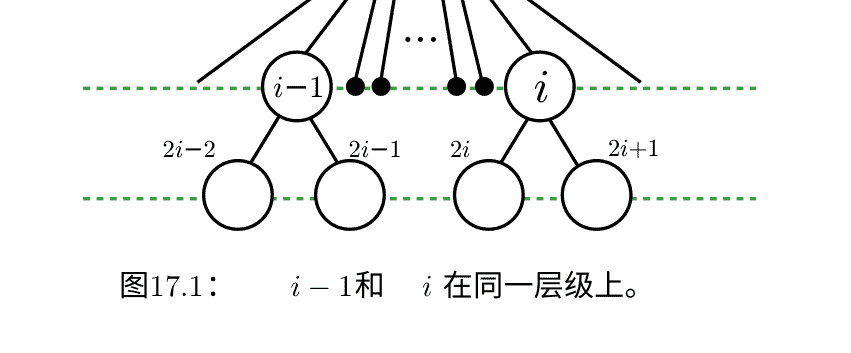

子节点的层级顺序保持不变，即，如果$A$在层级顺序中位于$B$之前，则$A$的子节点在$B$的子节点之前。第$i-1$个内部节点和第$i$个内部节点之间的所有节点都是没有子节点的外部节点，因此第$i$个内部节点的子节点紧随第$i-1$个内部节点的子节点之后，位于位置$2i$和$2i+1$。

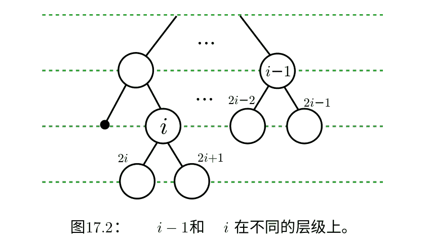

作为一个推论，位于 i 位置的父节点是 ⌊i/2⌋。 请注意，我们有两种计算位数的方法：我们可以按位位置计数，也可以仅按1计数。 如果我们能够在 O(1)时间内在两者之间进行转换，我们就可以高效地遍历树。

### 17.3 排名和选择

现在我们需要在n位字符串中的位置与二叉树中实际内部节点编号之间建立对应关系。

假设我们能够在O(1)时间内支持以下对n位字符串的操作，并且额外使用o(n)空间:

- rank(i) = 位置 i之前的1的数量
- select(j) = 第 j个1的位置。

这将给我们所需的二进制字典树表示。 空间要求为层次遍历表示的2n，并且rank/select的空间要求为o(n)。 以下是我们如何支持查询:

- left-child(i) = 2rank(i)
- right-child(i) = 2rank(i) + 1
- parent(i) = select(⌊i/2⌋)

请注意，按层次排序的树不支持子树大小等查询。 然而，在平衡括号表示中可以实现这一点。

#### 17.3.1 排名

该算法由Jacobsen于1989年[93]开发。 它使用了与RMQ相同的许多思想。基本思想是我们使用恒定数量的递归，直到我们降到大小为 k= lg(n)/2的子问题。 请注意，大小为k的可能字符串只有2^k = √n个，因此我们只需为大小为k的所有可能位字符串存储一个查找表。 对于每个这样的字符串，我们有k = O(log(n))个可能的查询，并且每个查询的解（元素的排名）需要log(k)位来存储。尽管如此，这仍然只需要 O(2^k·k log k) = O(√n lg n lg lg n)) = o(n)位。

注意，将整个 n位字符串简单地分成大小为 1/2 lg n的块是不可行的。因为我们需要保存 n/2 lg n相对索引，每个索引占用最多lg n位，总共需要Θ(n)位，这太多了。 因此，我们需要使用两次间接引用的技术。

步骤1：我们为长度为 1/2 lg n的位字符串构建查找表。 正如我们之前所讨论的，这需要 O(√n lg n lg lg n) = o(n)位的空间。

步骤2：将n位字符串分割成(lg^2 n)位的块。

在每个块的末尾，我们存储到目前为止的累积排名。每个累积排名需要lg n位。 而且最多有 n/ lg^2 n个块。 因此，所需的总空间为 O( n/ lg^2 n * lg n) = O(n/ lg n) 位

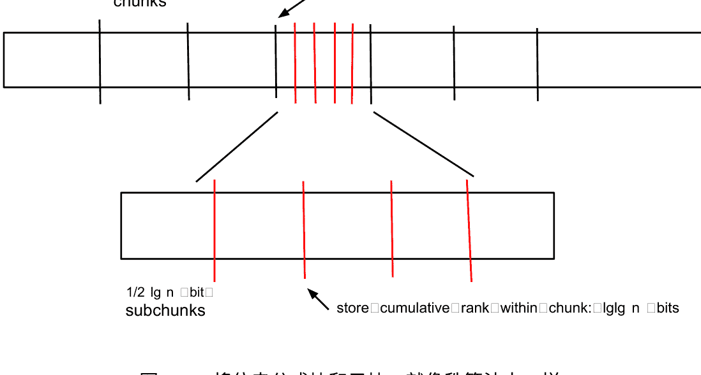

图17.3：将位串分成块和子块，就像秩算法中一样

步骤3：现在我们需要将每个块分成(1/2 lg n)位的子块。
然后，在每个子块的末尾，我们存储每个块内的累积秩。由于每个块的大小只有lg^2 n，所以每个索引只需要lg lg n位。最多有O(n/ lg n)个子块。因此，所需的总空间为O((n/lg n) lg lg n) = o(n)位。注意我们如何节省空间因为每个小块内的累积秩的大小较小。

步骤4：要找到总秩，我们只需执行以下操作：
秩 = 块的秩 + 块内子块的相对秩 + 元素在子块内的相对秩（通过查找表）。

该算法运行时间为O(1)，并且只需要O(n lg lg n / lg n)位。
实际上，可以将空间改进为O(n / lg^k n)位，其中k是任意常数。但这不在课程范围内。

#### 17.3.2 选择

这个算法是由Clark和Munro于1996年开发的[92]。选择算法与秩算法类似，但更加复杂。这次，由于我们要找到第i个1的位置，我们将数组分成具有相等数量的1的块，而不是相等大小的块。

步骤1：首先，我们将选择每个(lg n lg lg n)个1作为特殊的一个。我们将存储每个特殊的一个的索引。存储一个索引需要lg n位，所以这将花费O(n lg n/(lg n lg lg n)) = O(n/ lg lg n) = o(n)。
然后，给定一个查询，我们可以通过lg n lg lg n将其除以来跳转到包含我们所需结果的正确块中。

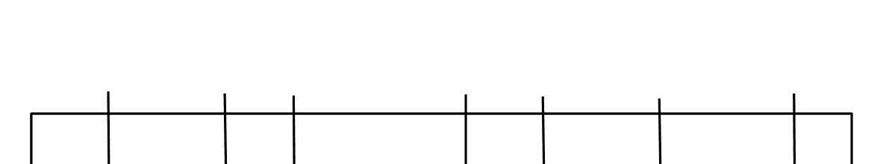

图17.4：将位字符串分成不均匀的块，每个块中包含相同数量的1，就像选择算法中一样

步骤2：现在，我们需要将注意力限制在一个包含lg n lg lg n 1位的单个块上。

令r为块中的总位数。

如果$r > (\lg n \lg \lg n)^2$位：

这是1位稀疏的情况。因此，我们可以负担得起在这个块中存储每个1位的索引数组。有$(\lg n \lg \lg n)$个1位。存储每个位最多需要占用$\lg n$空间（块的大小已经是多项式对数(n)，所以$\lg n$位已经足够）。而且最多有$\frac{n}{(\lg n \lg \lg n)^2}$个这样的稀疏块。所以，总共使用的空间为：

$O\left(\frac{n}{(\lg n \lg \lg n)^2} (\lg n \lg \lg n) \lg n\right) = o\left(\frac{n}{\lg \lg n}\right)$ 位。

如果$r < (\lg n \lg \lg n)^2$位：

我们已经将其减少为长度为$r \leq (\lg n \lg \lg n)^2$的位串。这很好，因为类似于Rank，这些块足够小，可以分成子块，而不需要太多的空间来存储子块的相对索引。

第三步：我们基本上在所有减少的位串上重复执行步骤1和步骤2，并将它们进一步减少为长度为$(1\ g\ \lg n)^{O(1)}$的位串。

第一步：

使用长度为$O((\lg n \lg \lg n)^2)$的减少块，我们再次挑选出特殊的1位，并将其分成每个$(\lg \lg n)^2$ th 1位。由于在每个块内，相对索引只需要$O(\lg \lg n)$位，所以所需的总空间为：

$O\left(\frac{n}{(\lg \lg n)^2} \lg \lg n\right) = O\left(\frac{n}{\lg \lg n}\right)$ 位。

第二步：

在 $(\lg \lg n)^2$ 1 位的组内，假设它总共有 $r$ 位：

如果 $r \geq (\lg \lg n)^4$，则存储相对选择的每个组的每个相对索引有 $(\lg \lg n)^2$ 位，n 每个相对索引需要 $\lg \lg n$ 位来存储。总共为：

$O\left(\frac{n}{(\lg \lg n)^4} (\lg \lg n)^2 \lg \lg n\right) = O\left(\frac{n}{\lg \lg n}\right)$ 位。

如果 $r < (\lg \lg n)^4$，则 $r < \frac{1}{2} \lg n$。那么它足够小，我们可以使用第4步：

第4步：使用长度 $\le 2^{\frac{1}{2} \lg n}$ 的查找表。 就像在rank中，查找表的总空间最多为：

$O(\sqrt{n} \lg n \lg \lg n)$。

因此，我们再次具有 $O(1)$ 的查询时间和 $O(\frac{n}{\lg \lg n})$ 位空间。

同样，对于任意常数k，这个结果可以改进为 $O(n/\lg^{k} n)$ 位，但我们在这里不会展示。

### 17.4 子树大小

我们展示了一种简洁的二进制字典树，它允许我们找到左孩子、右孩子和父节点。 但我们仍然希望在O(1)的时间内找到子树的大小。 层次遍历表示对此无效，因为层次遍历不提供深度信息。 因此，我们将尝试以深度优先顺序对节点进行编码。

为了做到这一点，注意到有$C_{n}$(卡特兰数)个具有n个节点的二进制字典树。 但是，也有$C_{n}$个具有n个节点的根有序树，以及$C_{n}$个具有n个括号的平衡括号字符串。 此外，我们将描述一个双射：二进制字典树 ⇔ 根有序树 ⇔ 平衡括号。 这使得问题变得更容易，因为我们可以使用平衡括号进行操作，它们具有自然的位编码：1表示开括号，0表示闭括号。

#### 17.4.1 双射

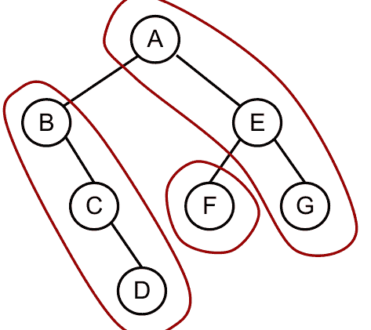

图17.5：一个带有圈圈的右脊的二叉前缀树示例。

我们将使用图17.5中的二叉前缀树。找到树的右脊，然后递归直到每个节点都位于脊柱中。 为了将其转化为有根有序树，我们可以将前缀树逆时针旋转45度。 因此，树的前三个节点将是前缀树的右脊（A，C，F）。 为了使树有根，我们将添加一个额外的根节点*。 现在，我们递归进入A，C和F的左子树。对于A来说，右脊只是B，D，G。对于C来说，右脊只是E：C的只有左孩子。图17.6显示了生成的有序根树。两种表示之间存在一个双射。

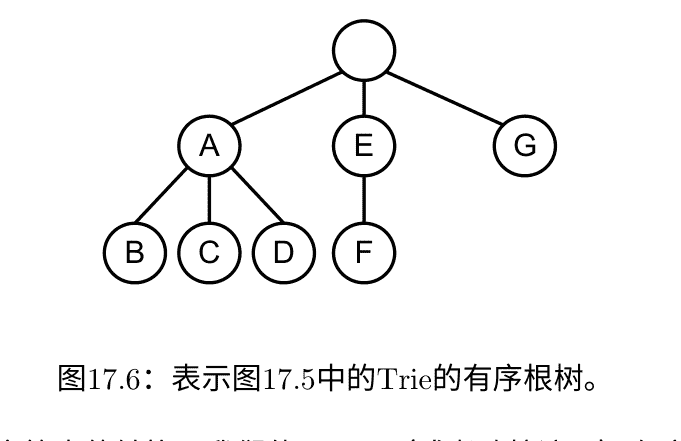

图17.6：表示图17.5中的Trie的有序根树。

从根有序树到平衡括号字符串的转换，我们使用DFS（或者欧拉遍历）有序树。当我们第一次访问一个节点时，我们会放置一个开括号，然后第二次访问时放置一个闭括号。图17.7中包含了图2中有序树的括号表示。

```
（（（）（））（（））（））
* A B B C C D D A E F F G G E *
```

图17.7：一个平衡括号字符串，表示图17.6中的有序树

现在，我们将展示如何通过这个双射来转换查询。例如，如果我们想在二进制字典树中找到父节点，这在括号字符串中对应什么？粗体是我们在二进制字典树中拥有的内容，在此之下，我们将描述两个双射的相应查询。

| 二进制字典树 | 根有序树 | 平衡括号 |
|--------------|----------|----------|
| 节点         | 节点     | 左括号[和匹配的右括号] |
| 左子节点     | 第一个子节点 | 下一个字符[如果是'('，否则为空] |
| 右子节点     | 下一个兄弟节点 | 匹配的')'之后的字符[如果是'('] |
| 父节点       | 上一个兄弟节点或父节点 | 如果前一个字符是')'，则是匹配的'('；如果是'('，则是该'(' |
| 子树大小     | size(node)+size(right siblings) | 到包围的')'的距离的1/2 |

可以使用rank和select来找到平衡括号表示的匹配括号。

## 第18讲 简洁

记录员: Sanja Popovic(2012), Jean-Baptiste Nivoit(2012), Jon Schneider(2012), Sarah Eisenstat (2010), Martí Bolívar (2007)

### 18.1 概述

在上一节课中，我们介绍了隐式、简洁和紧凑的数据结构的概念，并且给出了简洁二进制字典树的示例，同时展示了二进制字典树、根有序树和平衡括号表达式的等价性。引入了简洁数据结构来解决rank和select问题。

在这个讲座中，我们介绍了用于后缀数组和后缀树的紧凑数据结构。回想一下我们要解决的问题。给定一个文本 T，它的字母表为Σ，我们希望预处理T以创建一个数据结构。然后我们希望能够使用这个数据结构在Σ上搜索一个模式 P。

后缀数组是一个按字典顺序包含 T的所有后缀的数组。为了节省空间，后缀数组中的每个条目存储了相应后缀在 T中的起始索引。要在后缀数组中找到一个模式 P，我们对所有后缀执行二分搜索，这样我们就可以得到 P在 T中的所有位置。

### 18.2 调查

在本节中，我们对紧凑后缀数组的结果进行了简要调查。回想一下，紧凑数据结构使用 O(OPT) 位，其中OPT是信息论最优值。对于一个后缀数组，我们需要 |T| lg |Σ|位来存储文本 T。

#### 18.2.1 紧凑后缀数组和树

Grossi和Vitter 2000 [98] 后缀数组在 $$\left(\frac{1}{\varepsilon} + O(1)\right) |T| \lg |\Sigma|$$ 位，查询时间 $$O\left(\frac{|P|}{\log^\varepsilon_{|\Sigma|} |T|} + |\text{输出}| \cdot \log^\varepsilon_{|\Sigma|} |T|\right)$$。我们今天的讨论将会紧密跟随这篇论文。注意如何可以通过更高的空间使用来换取更好的查询时间。

Ferragina和Manzini 2000 [96] 所需的空间是 $$5H_k(T) \cdot |T| + O\left(|T| \cdot \frac{|\Sigma| + \lg |T|}{\lg \lg |T|} + |T|^\varepsilon \cdot |\Sigma|^{\varepsilon|\Sigma|+1}\right)$$ 位，对于所有固定的 k值。 H_k(T) 是第 k阶经验熵，或者是在已知前 k个字符的条件下的正常熵。更正式地说： $$H_k(T) = \sum_{|w|=k} \text{Pr}\{w\text{出现}\} \cdot H_0(\text{在 T中 w之后的字符}).$$ 请注意，因为我们是在经验情况下计算这个值， $$\text{Pr}\{w\text{ 出现 }\} = \frac{\text{出现 w的次数}}{|T|}.$$ 对于这个数据结构，查询时间为 $$O(|P| + |\text{输出}| \cdot \lg^\varepsilon |T|).$$

Sadakane 2003 [100] 位空间为 $$\frac{1+\varepsilon'}{\varepsilon} H_0(T)|T| + O(|T| \cdot \lg \lg |\Sigma| + |\Sigma| \cdot \lg |\Sigma|)$$ 查询时间是 $$O(|P| \lg |T| + |\text{输出}| \lg^\varepsilon |T|).$$ 其中0 < ε <1 和 ε' >0 是任意常数。请注意，这个界限更像是一个后缀数组，因为有乘法对数因子。这个界限适用于大字母表。

#### 18.2.2 简洁后缀数组和树

Grossi, Gupta, Vitter 2003 [97] 以位为单位的空间是 $$H_k(T) \cdot |T| + O\left(|T| \lg |\Sigma| \cdot \frac{\lg \lg |T|}{\lg |T|}\right),$$ 查询时间是 $$O(|P| \lg |\Sigma| + \frac{\lg^2 |T|}{\lg \lg |T|}).$$

Ferragina, Manzini, Mäkinen, Navarro [101] 位空间 $$H_k(T) \cdot |T| + O\left( \frac{|T|}{\lg^\varepsilon n} \right)$$，查询时间是 $$O(|P| + |\text{输出}| \cdot \lg^{1+\varepsilon} |T|)$$，还展示了计数查询的运行时间为O(|P|)。

#### 18.2.3 附加内容

Hon, Sadakane, Sung 2003 [103] 和 Hon, Lam, Sadakane, Sung, Yiu 2007 [102]详细信息低空间构建，工作空间为O(|T|·lg |Σ|)。

Hon, Sadakane 2002 [104] 和 Sadakane 2007 [105]详细说明了后缀树操作，如最大公共子串。

Sadakane 2007 [106]解决了这些结构上的文档检索问题。

Chan, Hon, Lam, Sadakane 2007 [107]描述了该问题的动态版本。

### 18.3 压缩后缀数组

在这些笔记的剩余部分中，我们将假设字母表是二进制的（换句话说，|Σ|= 2）。在本节中，我们将介绍一种简化（且占用空间较少）的数据结构，我们将在下一节中对其进行调整以适应紧凑的数据结构。总体而言，我们将介绍Grossi和Vitter的论文[98]的简化版本。我们将实现相同的空间限制，但查询时间稍差。

我们使用后缀数组解决的问题是找到SA[k]，即第k个后缀的起始位置，假设后缀按字典顺序排序。我们将使用与第16讲中相似的数据结构。我们仍然使用相同的分治方法，只是变为2路而不是3路。

#### 18.3.1 自顶向下

让我们介绍一些我们将在笔记中使用的符号。

开始：初始文本为T₀ = T，初始大小为n₀ = n，初始后缀数组为SA₀ = SA 其中SA是T的后缀数组。

步骤：在每个连续的迭代中，我们将两个相邻的字母组合在一起： $$T_{k+1} = \langle (T_k[2i], T_k[2i+1]) \rangle, \text{ 其中 } i=0,1,\ldots,\frac{n}{2}-1.$$ 这意味着每个步骤中大小减半： $$n_{k+1} = \frac{n_k}{2} = \frac{n}{2^k}$$

我们将递归后缀树定义为 $$SA_{k+1} = \frac{1}{2} \cdot (\text{提取 } SA_k \text{ 的偶数项})$$，其中“偶数项”被定义为在 $T_k$ 中索引为偶数的后缀。

显然，从 $SA_k$ 可以很容易地计算出 $SA_{k+1}$，并且由于 $SA_0$ 已知，这意味着我们可以轻松地从上到下进行。然而，为了使这个数据结构工作，我们需要从下到上进行。

#### 18.3.2 自底向上

我们需要一种用 $SA_{k+1}$ 表示 $SA_k$ 的方法。为此，我们定义以下函数：

$is\text{-}even\text{-}suffix_k(i)$ 这告诉我们 $SA_k[i]$ 是否是一个偶数后缀。更正式地说： $$is\text{-}even\text{-}suffix_k(i) = \begin{cases} 1 & \text{如果 } SA_k[i] \text{ 是偶数} \\ 0 & \text{否则} \end{cases}$$

$even\text{-}succ_k(i)$ 返回 $j$ 大于等于 $i$ 且 $SA_k[j]$ 是偶数的后缀。更简洁地说： $$even\text{-}succ_k(i) = \begin{cases} i & \text{if } SA_k[i] \text{是偶数} \\ j & \text{if } SA_k[i] = SA_k[j]-1 \text{是奇数} \end{cases}$$

$even\text{-}rank_k(i)$ “偶数排名”是指在第 $i$ 个后缀之前的偶数后缀的数量。

使用这些函数，我们可以写成： $$SA_k[i] = 2 \cdot SA_{k+1}[even\text{-}rank_k(even\text{-}succ_k(i))] - (1 - is\text{-}even\text{-}suffix_k(i))$$

在这里，2 的因子是为了解压缩数组的大小。如果谓词 $is\text{-}even\text{-}suffix_k(i)$ 为真， $even\text{-}succ_k(i) = i$，所以这等价于说 $$SA_k[i] = 2 \cdot SA_{k+1}[even\text{-}rank_k(i)].$$ 这基本上意味着我们在数组 $SA_{k+1}$ 中查找正确的值。如果 $is\text{-}even\text{-}suffix_k(i)$ 为假，则相当于在 $i$ 的“偶数后继”上执行相同的操作——这是在 $SA_k$ 中以 $SA_k[i]$ 之后一位置开始的后缀的索引，然后减去 1 以获得正确的起始位置在文本 $T_k$ 中。我们使用 $(1-is\text{-}even\text{-}suffix_k(i))$ 而不是 $is\text{-}odd\text{-}suffix_k(i)$，因为我们可以使用它来计算 $even\text{-}rank_k(i)$ 为 $even\text{-}rank_k(i) = rank_1(is\text{-}even\text{-}suffix_k(i))$。

如果我们可以在常数时间和少量空间内执行上述操作，那么我们可以将对 $SA_k$ 的查询减少到对 $SA_{k+1}$ 的查询，时间复杂度为常数。因此，如果我们的最大递归深度为 $\ell$，那么对 $SA_0$ 的查询将花费 $O(\ell)$ 的时间。如果我们设置 $\ell = \lg \lg n$，我们将把文本的大小减小到 $\ell = n/\lg n$。然后我们可以使用普通的后缀数组，它将使用 $O(\ell n)$ 的空间，从而实现压缩。如果我们想要，我们可以通过设置 $\ell = ^2\lg \lg n$ 来进一步改进，并获得 $\ell n = n/\lg ^2 n$。

#### 18.3.3 构造

我们可以将is-even-suffix<sub>k</sub>(i)存储为大小为n<sub>k</sub>的位向量。由于每个级别的n<sub>k</sub>都以2的倍数递减（几何级数），这总共需要O(n)的空间。然后我们可以使用上一节课中的rank<sub>k</sub>函数在位向量上实现even-rank<sub>k</sub>(i)，每个级别需要O(n<sub>k</sub>)的空间，总共需要O(n)的空间。

注意，即使是偶数排名的k(i)，在数组中也是排名为1的i(i)，其中a[i] = 偶数后继<sub>k</sub>(i)。我们在第17讲中看到如何以O(n<sup>1/log n<sub>k</sub></sup>)的时间复杂度进行操作(log n<sub>k</sub>)。同样，这是以几何级数递减的，所以总体上需要O(n)的空间。

在SA<sub>k</sub>[i]是偶数的情况下，进行偶数后继<sub>k</sub>(i)是微不足道的，因为它是一个恒等函数。这样留下了奇数值，但我们不能显式地存储它们，因为每个值需要log n<sub>k</sub>位。

无论我们使用什么数据结构，让我们按照i对j的值进行排序；也就是说，如果答案存储在名为odd_answers的数组中，那么我们将有even-succ<sub>k</sub>(i) = odd_answers[i - even-rank<sub>k</sub>(i)]，因为i - even-rank<sub>k</sub>(i)是奇数后缀中i的索引。这种排序等同于按照后缀数组中的后缀进行排序，或者T<sub>k</sub>[SA<sub>k</sub>[i]]。此外，这等同于按照(T<sub>k</sub>[SA<sub>k</sub>[i]], T<sub>k</sub>[SA<sub>k</sub>[i] + 1, ..., T<sub>k</sub>[SA<sub>k</sub>[even-succ<sub>k</sub>(i)]]])进行排序。最后，这等同于按照(T<sub>k</sub>[SA<sub>k</sub>[i]], even-succ<sub>k</sub>(i))进行排序。

因此，为了存储even-succ<sub>k</sub>(i)，我们存储形式为(T<sub>k</sub>[SA<sub>k</sub>[i]], even-succ<sub>k</sub>(i))的项目。每个这样的项目需要(2<sup>k</sup> + log n<sub>k</sub>)位，因为T<sub>k</sub>中的字符长度为2<sup>k</sup>，而even-succ<sub>k</sub>(i)需要log n<sub>k</sub>位。这意味着前面的log n<sub>k</sub>位不会经常改变，因此我们可以使用一元差分编码来存储每个值v<sub>i</sub>的前导log n<sub>k</sub>位： 0<sup>lead(v₁)</sup>10<sup>lead(v₂)−lead(v₁)</sup>10<sup>lead(v₃)−lead(v₂)</sup>1... 其中lead(v<sub>i</sub>)是v<sub>i</sub>的前导log n<sub>k</sub>位的值。然后将有n<sub>k</sub>/2个1（每个值一个1），最多2<sup>log n<sub>k</sub></sup> = n<sub>k</sub>个0（我们可以用log n<sub>k</sub>位存储的最大值是n<sub>k</sub>，即最大递增次数），因此总共使用的位数最多为(3/2)n<sub>k</sub>。再次由于n<sub>k</sub>的连续值的几何性质，这将需要O(n)位总共，因此整体数据结构仍然是压缩的。我们可以明确地存储剩余的2<sup>k</sup>位。

这将花费 2<sup>k</sup> · n<sub>k</sub> / 2 = 2<sup>k</sup>n<sub>k</sub> / 2<sup>k+1</sup> = n<sub>k</sub> / 2位。

请注意，如果我们维护排名和选择数据结构，我们可以高效地计算 lead(v<sub>i</sub>) = rank₀(select₁(i))。

因此，对于even − succ<sub>k</sub>的要求是 ½n + ³⁄₂n<sub>k</sub> + O(n<sub>k</sub> / (log log n<sub>k</sub>))。

整个结构的总需求是将此表达式与n<sub>k</sub> (for is − even − suffix<sub>k</sub>)相加，对所有k求和： $$\sum_{k=0}^{\log \log n} [ \frac{1}{2}n + \frac{3}{2}n_k + O(\frac{n_k}{\log \log n_k}) ] + n_k = \frac{1}{2}n \log \log n + 5n + O(\frac{n_k}{\log \log n_k})$$

不幸的是，因子n log log n使得它不紧凑，所以我们需要进一步改进。

### 18.4 紧凑后缀数组

为了减少数据结构的空间需求，我们希望存储更少的递归层级。我们选择存储 (1 + 1/ε) 层递归，其中 k 的值如下：0, εℓ, 2εℓ, ..., ℓ = lg lg n。

换句话说，我们不再每次递归步骤中将两个字母配对，而是将 2^εℓ 个字母聚集在一个步骤中。现在我们需要能够一次跳过 εℓ 个层级。

#### 18.4.1 层级跳跃

为了找到 SA_{kεℓ} 的公式，我们按照与我们对压缩后缀数组的构造类似的方式进行，但我们重新定义了“偶数”一词如下。现在，后缀 SA_{kεℓ}[i] 是“偶数”，如果它在 T_{kεℓ} 中的索引可被 2^εℓ 整除。这改变了 even-rank_{kεℓ}(i) 的定义方式。然而，我们不会改变 even-succ_{kεℓ}(i) 的定义：它仍然应返回值 j，使得 SA_{kεℓ}[i] = SA_{kεℓ}[j] - 1。它应该对所有“偶数”值的 SA_{kεℓ}[i] 执行此操作。

通过这些修改后的定义，我们可以按照以下方式计算 SA_{kεℓ}[i]：

- 重复计算偶数后继，直到索引 j 在下一个较低的级别上 — 换句话说， SA_{kεℓ}[j] 可以被 2^εℓ 整除。
- 递归计算 SA_{(k+1)εℓ}[even-rank_{kεℓ}(j)]。
- 乘以 2^εℓ (我们聚合在一起的字母数)，然后减去第一步中调用后继函数的次数。

这个过程之所以在压缩后缀数组中起作用，原因与之类似。我们首先计算 j，使得 SA_{kεℓ}[j] 可以被 2^εℓ 整除，并且 SA_{kεℓ}[j] - m = SA_{kεℓ}[i]，其中 0 ≤ m < 2^εℓ。递归计算给出了在 T_{(k+1)εℓ} 中与 SA_{kεℓ}[j] 对应的后缀的索引。如果我们将递归计算的结果乘以 2^εℓ，我们可以计算出 SA_{kεℓ}[j] 的真实值。然后我们减去值 m 以得到 SA_{kεℓ}[i]。

#### 18.4.2 分析

在获取我们可以递归的值之前，我们可能需要查找索引 2^εℓ 次的偶数后继。因此，总的搜索时间为 O(2^εℓ lg lg n) = O(lg^ε n lg lg n) = O(lg^ε' n), 其中ε' > ε。

我们在压缩构造中使用相同的一元差分编码来表示后继，每个级别总共需要 2n_{kεℓ} + n + o(n) 位。我们还必须存储 is-even-suffix_{kεℓ}(·) 向量和排名数据结构，每个级别总共需要 n_{kεℓ} + o(n) 位。总共有 1 + 1/ε 个级别。因此，总的空间大约为 (6 + 1/ε)n + o(n) 位，非常紧凑。

even successor信息如下：

$$O\left(\frac{n}{2^{\ell}}\right)=O\left(\frac{n}{\lg^{\varepsilon} n}\right)=o(n)$$

如果我们将$is\text{-}even\text{-}suffix_{k\varepsilon \ell}(\cdot)$向量存储为简洁字典（因为它们实际上是相当稀疏的），则所需的空间为：

$$_{\log} \binom{n_{k \varepsilon \ell}}{n_{(k+1) \varepsilon \ell}} \approx n_{(k+1) \varepsilon \ell} \lg \frac{n_{k \varepsilon \ell}}{n_{(k+1) \varepsilon \ell}} = n_{(k+1) \varepsilon \ell} \lg 2^{\varepsilon \ell} = \frac{n_{k \varepsilon \ell} \cdot \varepsilon \ell}{2^{\varepsilon \ell}} = \frac{n_{k \varepsilon \ell} \cdot \varepsilon \lg \lg n}{\lg^{\varepsilon} n}$$

因此，总空间为$(1 + 1/\varepsilon)n + o(n)$位。

问题：能否在$O(n)$空间内实现$(\lg^{\varepsilon}n)$?

## 18.5 后缀树 [99]

### 18.5.1 构造

在上一讲中，我们看到如何使用平衡括号在$4n + o(n)$位上存储具有$2n+1$个节点的二进制字典树。我们可以使用这个来存储压缩后缀树的结构。不幸的是，我们没有足够的空间来存储边的长度或字母深度，这将使我们能够轻松遍历树。

要在树中搜索模式 $P$，我们必须在进行搜索时计算字母深度。假设我们知道当前节点X的字母深度。要下降到它的子节点Y，我们需要计算它们之间的边的字母深度差，或者边的字母长度。

字母深度 $y$等于左侧后代和右侧后代共享的子字符串的长度。让 $\ell$成为最左侧的后代，让 $r$成为最右侧的后代。如果我们知道后缀数组中 $\ell$和 $r$的索引，那么我们可以使用后缀数组在文本中找到它们的索引。因为 $\ell$和 $r$都是 $x$的后代，我们知道它们在$letter\text{-}depth(x)$个字符上匹配。所以我们可以跳过$letter\text{-}depth(x)$个字符的比较，然后开始比较 $\ell$、 $r$和 $P$的字符。如果 $P$在与 $\ell$和 $r$不同之前就与它们不同，那么我们知道树中没有与 $P$匹配的后缀，我们可以停止整个过程。否则，$\ell$和 $r$将在某个点上不同，这将给出我们$letter\text{-}depth( y)$的值。请注意，在搜索树的整个过程中，我们执行的字母比较总数为 $O(|P|)$。

### 18.5.2 必要的二进制字典树操作

要找到 $\ell$, $r$和它们在后缀数组中的索引，注意在平衡括号表示的字典树中，每个叶子节点都是字符串“()”。

$leaf\text{-}rank(here)$给定位置上平衡括号字符串中节点左侧的叶子节点数量。可以通过计算 $rank_{()}(())n)$来得到。

**leaf-select(i)** 平衡括号字符串中第 $i$ 个叶子节点的位置。可以通过计算 $select_{()}(i)$ 来得到。

**leaf-count(here)** 给定位置上节点子树中的叶子节点数量。可以使用以下公式计算：
$$rank_{()}(\text{父节点的匹配 的位置}) - rank_{()}(\text{当前位置})$$

**leftmost-leaf(here)** 给定位置的节点的最左叶子在字符串中的位置。由以下公式给出：
$$leaf\text{-}select(leaf\text{-}rank(\text{here}) + 1).$$

**rightmost-leaf(here)** 给定位置的节点的最右叶子在字符串中的位置。由以下公式给出：
$$leaf\text{-}select(leaf\text{-}rank(\text{parent的匹配}) - 1).$$

因此，我们可以在平衡括号的字符串上使用排名和选择数据结构来找到表示以 $y$ 为根的子树的字符串部分中的第一个和最后一个叶子。然后，我们可以计算这些叶子的排名以确定后缀数组的索引。因此，我们可以以每个节点 $O(1)$ 的操作成本执行前面段落中描述的搜索。

### 18.5.3 分析

搜索模式 $P$ 所需的总时间是
$$O(|P| + |\text{输出}|) \cdot O(\text{后缀数组查找的成本})$$

Grossi和Vitter [98] 改进了这一点，以实现搜索时间为
$$O\left( \frac{|P|}{\log_{\Sigma} T} + |\text{输出}| \cdot \log_{\Sigma}^{\epsilon} T \right)$$

### 18.5.4 简洁后缀树

还可以改进，给定后缀数组创建简洁后缀树。在上述算法中，存储后缀树占用的空间太大，无法实现简洁性。相反，我们在后缀数组的每个 $b^{\text{th}}$ 条目中存储上述紧凑后缀树，这给我们带来了额外的存储成本 $O(n/b)$。

首先，修改树以返回合理的内容，如果 $P$ 与树中的任何项都不匹配，例如返回 $P$ 在叶子集合中的前任。如果我们将后缀划分为大小为 $b$ 的块，那么当我们在 $P$ 上查询时，后缀树将给出一个区间，其中任何与 $P$ 匹配的后缀必须位于与这些分隔符之一相接触的块中。这给我们一个范围的块来寻找真正的答案。算法的其余部分没有在讲座中涵盖，但在[99]和手写的讲座笔记中有解释。主要思想是使用一个查找表，其中存储以下信息：给定一个排序数组 $A$ 长度为 $b$（最多）位串和一个模式串 $P$ 长度最多为 $b^2$，我们的表存储 $P$ 在 $A$ 中的第一个和最后一个位置。注意，如果 $b \le 21$，则需要 $O(2^{b^2} + b \lg b) = O(\sqrt{n})$ 位空间。然后我们可以使用这个来高效地在一个块中找到第一个和最后一个匹配项。

## 第19讲

## 动态图1

记录人：贾斯汀·霍尔姆格伦（2012），简·简（2012），马克西姆·斯特潘尼科（2012），马什胡德·伊沙克（2007）

### 19.1 概述

在这个讲座中，我们讨论了具有许多应用的动态树，例如网络流和动态连通性问题，除了在理论上很有趣。这是我们讨论动态图的开始，在一般情况下，我们有一个无向图，并且我们希望支持删除和插入操作。我们将讨论一种名为Link-Cut树的数据结构，它实现了对所有操作的对数摊销时间。

### 19.2 链剪树

使用Link-Cut树，我们希望维护一棵由根节点具有任意数量的无序子节点的树的森林。该数据结构必须在O(lg n)摊销时间内支持以下操作：

- make tree()– 返回一个新的单例树中的顶点。这个操作允许我们添加元素并稍后操作它们。
- link(v, w)– 使顶点 v 成为顶点 w 的新子节点，即添加一条边(v, w)。为了保持表示有效，此操作假定 v 是其树的根节点，并且 v 和 w 是不同树的节点。
- cut(v)– 删除顶点 v 与其父节点 parent(v) 之间的边，其中 v 不是根节点。
- find root(v)– 返回顶点 v 所在树的根节点。这个操作很有意思，因为到根节点的路径可能非常长。这个操作可以用来判断两个节点 u 和 v 是否相连。
- path aggregate(v)– 返回从树的根节点到节点 v的路径上边的权重的聚合值，如最大值/最小值/总和等。 还可以增强数据结构，返回关于路径的各种统计信息。

Link-Cut Trees是由Sleator和Tarjan [108] [109]开发的。 它们实现了对所有操作的对数摊销成本。Link-Cut Trees与Tango树类似，它们使用了优选子节点和优选路径的概念。 它们还使用伸展树作为内部表示。

### 19.3 首选路径分解

链剪树是关于树中的路径的，所以我们想要将树分割成路径。 我们需要先定义一些术语。

#### 19.3.1 链剪树的定义

如果一个顶点被传递给上述任何操作作为参数，则我们说该顶点已被访问。我们将数据结构表示的抽象树称为“表示树”。 我们不允许改变表示树，它可以是不平衡的。 表示树被分割成路径（在数据结构表示中）。

节点v的“首选子节点”等于它的第i个子节点，如果最后一次访问v的子树是在第i个子树中，如果最后一次访问v的子树是v本身或者根本没有访问v的子树，则等于null。首选边是首选子节点和其父节点之间的边。 首选路径是树中首选边的最大连续路径，如果没有与之关联的首选边，则为单个节点。因此，首选路径将表示树的节点划分为不同的部分。

链接剪切树将森林中的每棵树 T表示为一棵辅助树的树，每个首选路径在 T中都有一棵辅助树。辅助树是伸展树，每个节点的键是其所在树的深度。 因此，对于辅助树中的每个节点 v，其左子树中的所有元素都比 v在 v所代表的树中更高（更接近根），而其右子树中的所有元素都更低。 辅助树使用路径父节点指针连接在一起。 每个辅助树都有一个路径父节点指针，它存储在辅助树的根节点中。 它指向与辅助树关联的首选路径中最顶部节点的父节点（在所代表的树中）。 我们无法存储路径到子节点的指针，因为子节点可能有很多个。

包括具有路径父节点指针的辅助树，我们将所代表的树表示为一棵辅助树的树，这棵树可能具有非常高的度数。

#### 19.3.2 链剪树的操作

##### 访问

上述所有操作都是使用一个 access(v)子程序实现的。 它重构了包含顶点 v的辅助树 T，使其看起来像是刚刚在其表示树中被访问过一样。

当我们访问一个顶点v时，一些首选路径会发生变化。从根节点R到v的首选路径被形成。当这个首选路径形成时，路径上的每条边都变为首选边，并且R中所有旧的首选边，其一个端点在这条路径上的，都被销毁，并被路径父指针所替代。

请记住，辅助树中的节点按照它们在R中的深度进行排序。因此，在节点v的左侧是比v更高的节点，在右侧是比v更低的节点。由于我们访问了节点v，它的优先子节点变为null。因此，如果在访问节点v之前，它位于一个优先路径的中间位置，那么在访问之后，该路径的较低部分将成为一个独立的路径。那么对于节点v的辅助树意味着什么？这意味着我们需要将所有小于节点v的节点分离到一个单独的辅助树中。最简单的方法是对节点v进行伸展操作，即将其移动到根节点，然后断开其右子树，使其成为一个独立的辅助树。

在处理完节点v的后代之后，我们需要从节点v到R的根节点创建一个优先路径。这就是路径父指针在引导我们从一个辅助树到另一个辅助树时的用处。在伸展操作之后，节点v成为根节点，因此它有一个路径父指针（除非它是T的根节点），指向它在R中的父节点，称为w。我们需要将节点v的优先路径与节点w的优先路径连接起来，使之成为一个整体。

##### ACCESS(v)

- 在其辅助树中将Splay节点 v带到根节点。左子树将包含所有大于 v的元素，右子树将包含所有小于 v的元素。
- 删除 v的首选子节点。
    - path-parent(right(v)) ← v
    - right(v) ← null (+ 对父指针进行对称设置)
- 循环直到达到根节点
    - w ← path-parent(v)
    - splay w
    - switch w的首选子节点
        - path-parent(right(w)) ← w
        - right(w) ← v (+ 对父指针进行对称设置)
        - path-parent(v) ← null
    - v ← w
- 仅为方便起见对节点 v进行S play操作

w是 v的真实父节点，而不仅仅是路径父节点。 换句话说，我们需要将 w的首选子节点设置为v。这是辅助树世界中的一个两阶段过程。 首先，我们必须断开 w的首选路径的较低部分，就像我们对 v做的那样（在 w上进行Splay操作并断开其右子树）。其次，我们必须将 v的辅助树连接到 w的辅助树。 由于 v的辅助树中的所有节点都比 w的任何节点都低，我们只需要将 v的辅助树作为 w的右子树即可。 为了做到这一点，我们只需断开 w与其右子节点的连接，并将指针指向 v。 最后，我们需要进行一些次要的清理工作来完成一次迭代：我们对 v进行第二次伸展。 由于 v是根节点 w的子节点，伸展只是将 v旋转到根节点。 另一个需要注意的是，在连接的所有阶段，我们都保留路径父指针。

我们以相同的方式继续构建首选路径，直到达到根节点 R。v在辅助树的树中将没有右子节点。.我们重复的次数等于首选子更改的次数。

##### 查找根节点

在我们知道如何处理访问之后，查找根节点操作非常简单。 首先，要找到节点v所代表的树的根节点，我们访问节点v，使其成为所代表树的根节点所在的辅助树的一部分。 由于所代表树的根节点是最高的节点，它在辅助树中的键值是最低的。 因此，我们尽可能向左移动节点v。当我们停止时，我们就找到了根节点。 我们对其进行伸展操作并返回它。我们需要进行伸展的原因是根节点可能在树中线性深入；通过将其伸展到顶部，我们确保下次查找根节点时速度更快。

##### 查找根节点(v)

- 访问(v)
- 将节点v设置为辅助树中最小的元素，即所代表树的根节点
    - 重复执行 v ← left(v)，直到left(v)为 null
- 访问 r
- 返回 r

#### 19.3.3路径聚合

像我们的所有操作一样，首先我们访问(v)。这是一个表示到 v的路径的辅助树。我们用你关心的值来增强辅助树，比如“总和”或“最小值”或“最大值”。当我们看到剪切和链接时，我们将看到如何轻松地维护这样的增强。

##### 路径聚合(v)

- 访问(v)
- 返回 v子树和（在每个辅助树中的增强）

##### 剪切

剪切(v, parent(v)在表示的树中的边意味着我们必须将 v的子树（在表示的树中）与辅助树的树分离成一个单独的辅助树。为了做到这一点，我们首先访问 v，因为它收集了比 v更高的所有节点在 v的左子树中。然后，我们只需要断开 v的左子树（在辅助树中）与 v的连接。注意，v在辅助树中变成了一个单独的节点，但是来自 v的子节点（在表示的树中）的路径父指针仍然指向 v，因此我们得到了我们想要的辅助树的树。因此，在剪切后有两棵辅助树。

##### CUT(v)

- 访问(v)
- left(v) ← null(+ 对称设置父指针)

##### 链接

链接两个表示的树也很容易。我们只需要访问 v和 w，使它们成为辅助树的根，并使后者成为前者的左子节点。

##### LINK(v, w)

- 访问(v)
- 访问(w)
- left(v) ← w(+ 对称设置父指针)

### 19.4 分析

从伪代码中可以看出，所有操作最多进行对数级的工作（摊还的，因为在查找根时进行了伸展操作）。因此，只需要限制访问的运行时间。首先，我们证明一个 $O(\lg^2 n)$的上界。

#### 19.4.1 一个 $O(\lg^2 n)$的上界。

从访问的伪代码中可以看出，其成本是循环迭代次数乘以伸展操作的成本。我们已经知道从之前的讲座中，伸展操作的成本是 $O(\lg n)$的摊还成本（伸展操作即使在分割和连接时也有效）。回想一下，访问中的循环有 $O(\text{\#首选子更改})$ 次迭代。因此，为了证明 $O(\lg^2 n)$的上界，我们需要证明首选子更改的次数在摊还意义下是 $O(\lg n)$的。换句话说，对于一系列$m$个操作，首选子更改的总数是 $O( m \lg n)$的。我们通过使用表示树的重链分解来证明这一点。

重量轻量分解是一种适用于任意树（不一定是二叉树）的通用技术。它根据其子树中节点的相对数量将每条边称为重边或轻边。

令 $size(v)$ 表示表示树中节点 $v$的子树中的节点数量。

定义45.从顶点 $parent(v)$到 $v$的边称为重边，如果 $size(v) > \frac{1}{2} size(parent(v))$，否则称为轻边。

此外，令 $\text{light-depth}(v)$ 表示从根到顶点 $v$的路径上的轻边数量。注意，$\text{light-depth}(v) \leq \lg n$，因为每经过一条轻边，我们当前子树中的节点数量至少减少一半。此外，注意每个节点最多只有一个重边指向子节点，因为最多只有一个子树包含超过其父节点子树节点数量一半的节点。在表示的树中，边有四种可能性：它们可以是优选的或非优选的，重边或轻边。

为了限制首选子节点更改的数量，我们对表示树进行重轻分解。请注意，访问不会改变表示的树，因此不会改变边的重或轻分类。对于每次首选边的更改（可能除了从访问节点出来的首选边之外），都会产生一个新创建的首选边。因此，我们计算改变状态为首选的边的数量。每次操作，最多有$\lg n$条轻边变为首选边（因为所有变为首选的边都在从根开始的路径上，根据上面的观察，路径上最多可以有$\lg n$条轻边）。现在，我们需要问有多少重边变为首选边。对于任何一个操作，这个数量可以是任意大的，但我们可以将其限制为 $O(\lg n)$摊销。为什么呢？嗯，在整个执行过程中，“重边变为首选边”的事件数量是受事件“重边变为非首选”加上$n-1$的限制（因为在最后，可能有$n-1$个重边首选，而在开始时可能没有）。但是当一条重边变为非首选时，一条轻边变为首选。我们已经看到，在最坏情况下，每个操作中最多有$\lg n$个这样的事件。因此，每个操作中最多有$\lg n$个事件“重边变为非首选”。因此，在摊还意义下，每个操作中最多有$\lg n$个事件“重边变为首选”（前提是$(n-1)/m$很小，即有足够的大的操作序列）。

#### 19.4.2 O(lg n)上界。

我们通过证明首选子节点切换的成本实际上是$O(1)$摊还的来证明$O(\lg n)$上界。从访问的伪代码中可以很容易地看出它的成本是

$$O(\lg n) + (\text{优选子节点切换的成本}) * (\text{优选子节点切换的数量})$$

从上面的分析中，我们已经知道优选子节点切换的数量是$O(\lg n)$，因此只需证明优选子节点切换的成本是$O(1)$。我们使用潜力法来实现。

设$v$的辅助树中的节点数为$s(v)$。然后我们定义潜力函数$\Phi = \sum \lg s(v)$

根据我们之前对伸展树的研究，我们有访问定理，即：

$$cost(splay(v)) \leq 3(\lg s(u) - \lg s(v)) + 1,$$

其中$u$是$v$的辅助树的根节点。现在注意到伸展$v$只会影响辅助树中节点的值，改变$v$的优选子节点会改变辅助树的结构，但辅助树的树结构保持不变。因此，在访问($v$)时，$s$的值只会对$v$的辅助树中的节点发生变化。还要注意，如果$w$是包含$v$的辅助树的根节点的父节点，则有$s(v) \leq s(u) \leq s(w)$。现在我们可以利用这个不等式和上面的摊还成本来计算每次循环中的总成本。求和式可以进行抵消，结果小于

$$3(\lg s(\text{表示树的根}) - \lg s(v)) + O(\#\text{首选子节点更改})$$

这反过来是$O(\lg n)$，因为$s(\text{根}) = n$。因此，访问的成本是$O(\lg n)$摊销的。

为了完成分析，我们解决了潜在的担忧，即在剪切或连接后，潜在可能会增加超过$O(\lg n)$。剪切将树分成两棵树，因此$s$的值只会减少，因此$\Phi$也会减少。当连接$v$和$w$时，只有$s$在$v$处的值增加，因为它成为辅助树的根。然而，由于$s(v) \leq n$，潜在增加最多为$\lg s(v) = \lg n$。因此，潜在的增加很小，剪切和连接的成本是$O(\lg n)$摊销的。

## 第20讲
## 动态图2

记录员: Josh Alman (2012), Vlad Firoiu (2012), Di Liu (2012), TB Schardl (2010)

## 20.1 概述

上一堂课我们讲解了动态树，也被称为链割树。链割树能够以摊还时间O(log n)表示一个动态的根树森林。

在本节课中，我们将看到如何为一般图维护连通性信息。我们将首先研究一种更简单的，虽然不严格更好的链割树替代方案，称为欧拉遍历树。然后，对于只能删除边的特殊情况下的递减连通性，我们将实现常数时间复杂度。然后，我们将使用欧拉遍历树在一般图中实现动态连通性，时间复杂度为O(log^2 n)。最后，我们将调查一些关于动态图已知和未知的内容。下一节课将讨论下界。

## 20.2 动态连通性

我们的目标是在无向图的基础上保持图的完整性：

- 插入/删除边或顶点（无边的顶点）。
- 连接 (u, v) : 判断 u和 v是否连接，适用于一般的无向图，可以进行顶点和边的插入和删除。
- 另一个可能的查询是确定整个图是否连通；尽管这似乎更容易，但当前的下界和上界与成对连通性相同。

我们将重点关注前一种类型的查询。

我们将考虑的不同类型的更新操作包括：

- 完全动态。支持顶点和边的插入和删除。
- 增量。仅支持顶点和边的插入。
- 减量。仅支持顶点和边的删除。

### 20.2.1 动态连通性的结果

对于特定类型的图，存在几个动态连通性的结果。

- 树。对于树，我们可以使用欧拉遍历树或链割树，在 $O(\log n)$ 时间内支持查询和更新。如果树只是减量的，那么我们可以在常数时间内支持查询，这将在本讲座中介绍。
- 平面图。Eppstein等人已经证明我们可以达到 $O(\log n)$查询和更新[111]。

这里是一些关于一般动态图的结果。

- 2000年，Thorup展示了如何获得 $O(\log n (\log \log n)^3)$更新和 $O(\log n / \log \log \log n)$查询[112]。
- Holm, de Lichtenberg和Thorup获得了 $O(\log^2 n)$更新和 $O(\log n / \log \log n)$查询[113]。
- 对于增量数据结构，我们目前最好的结果是使用并查集的$\Theta(\alpha(m, n))$[123]。
- 对于递减数据结构，我们有一个 $O(m \log n + \text{polylog} n + \#queries)$的解决方案，这基本上相当于对于稠密图的 $O(\log n)$解决方案[124]。
- 开放问题：是否可以对于一般图达到 $O(\log n)$查询和更新。

所有上述的运行时间都是摊还的。关于最坏情况的界限了解较少：

- Eppstein等人证明了最坏情况下的更新时间为 $O(\sqrt{n})$，查询时间为 $O(1)$[115]。
- 未解决的问题是我们是否能够实现 $O(\text{poly} \log n)$最坏情况下的更新和查询。

Patrascu和Demaine证明了动态连通性的两个下界，即 $O(x \log n)$更新需要 $\Omega(\log n / \log x)$查询时间，以及 $O(x \log n)$查询需要 $\Omega(\log n \log x)$更新时间，其中 $x > 1$ [114]。下一讲我们将更加关注下界。请注意，[112, 113, 115]在某种意义上都是最优的，根据[114]中的权衡界限。

最后，我们提出一个 OPEN 问题：是否可以实现O(log n)更新和poly log n查询？

## 20.3 欧拉游览树

Euler-Tour树是由Henzinger和King [110]提出的，是表示动态树的一种替代方法，与link-cut树相比。 Euler-tour树比link-cut树更简单，更容易分析，但不会自然地存储关于树中路径的聚合信息。 Euler-tour树非常适合存储子树的聚合信息，这是我们将下一节中使用的一个特性。

Euler-Tour树的思想是存储树的Euler遍历。在任意图中，Euler遍历是一条恰好经过每条边一次的路径。对于树，我们说每条边是双向的，所以树的Euler遍历是通过树的路径，从根节点开始并以根节点结束，恰好经过每条边两次-一次进入子树，一次退出子树。树的Euler遍历本质上是一棵树的深度优先遍历，在结束时返回根节点。树与其Euler遍历之间的对应关系如图20.1所示。

图20.1：一个示例树及其欧拉遍历。树中节点的访问顺序由弯曲的红色箭头表示。此处显示的树的欧拉遍历对应于序列：R A R B C D E C E C B F B G B R。

在欧拉遍历树中，我们将表示树的欧拉遍历存储在平衡二叉搜索树（BST）中。对于某个表示树，该树的欧拉遍历中的每次访问对应于BST中的一个节点。表示树中的每个节点都保存指向BST中表示其第一次和最后一次访问的节点的指针。例如，图20.1中的树的根节点与其欧拉遍历节点访问之间的指针在图20.2中显示。

欧拉遍历树支持以下操作：

- FindRoot(v): 查找包含节点v的树的根节点。在树的欧拉遍历中，根节点首先和最后被访问。因此，我们只需返回BST中的最小或最大元素。
- 剪切(v): 从树的其余部分中剪切以 v为根的子树。请注意，v的Euler遍历的子树是以 v开头和结尾的连续访问的子序列，包含在整个树的访问序列中。要剪切以 v为根的子树，我们可以在第一次访问 v之前和最后一次访问 v之后简单地分割BST。这种分割给我们提供了到达 v之前的树的Euler遍历，v的子树的遍历，以及离开v之后的树的遍历。将第一段和最后一段连接在一起，并可能删除第一段结束和最后一段开始之间的一个多余的访问，就得到了我们的答案。

链接 \((u, v)\) 将 \(u\)的子树插入 \(v\)作为子节点。在结果的欧拉遍历中，我们需要在访问 \(v\)之前和之后立即遍历 \(u\)的子树。因此，我们将在最后一次访问 \(v\)之前拆分 \(v\)的遍历，并在左侧部分后面连接一个单独的访问 \(v\)，然后是 \(u\)的欧拉遍历，然后是右侧部分。

连通性 \((v, w)\) 如果两个节点在同一棵根树中，则它们是相连的，因此只需检查 FindRoot \((v)\) = FindRoot \((w)\)。

子树聚合 \((v)\) 计算以\(v\)为根的子树中节点的最小值、最大值、总和等。这是通过在BST中的第一次和最后一次出现之间进行范围查询来实现的。

这些操作在欧拉遍历树上执行恒定数量的搜索、拆分和合并操作。这些操作在平衡BST数据结构上每个操作需要 \(O(\log n)\) 的时间复杂度。因此，欧拉遍历树的总运行时间为每个操作 \(O(\log n)\)。如果我们在欧拉遍历树中使用分支因子为\(\Theta(\log n)\)的B树，而不是平衡BST，我们可以实现每个搜索 \(O(\log n/\log \log n)\)（来自树的深度）和每个更新 \(O(\log^2 n/\log \log n)\)（来自深度乘以分支因子）。

### 20.3.1 树中的递减连接性

如果我们只使用递减树进行操作，我们将实现每个操作的常摊时间。我们假设所有边最终都会被删除，以使我们的摊还分析有效。我们做了一些观察：

1.  通过使用链割或欧拉遍历树，我们可以轻松地每次操作 \(O(\log n)\)。
2.  为了减少这个问题，我们使用叶子修剪：我们在至少有\(\log n\)个后代的最深节点以下进行剪枝。顶部树将有 \(O(n/\log n)\)个分支节点；压缩路径结果是一个大小为 O(n/ log n) 的树。我们可以在这个结构上使用链接割或欧拉遍历树，从而使查询顶部树的总时间为 O(n)。
3.  底部树只有 O(log n) 条边，所以我们可以将边集存储为位向量（只需要一个机器字）。我们还预处理了一个查找表，将从任意顶点到根的路径存储为边上的位向量。这使我们能够在常数时间内确定是否仍然存在一条到根的路径（计算根到路径和当前边集之间的按位与）。
4.  最后，我们需要回答关于在我们压缩的路径中如何在节点之间移动的查询。我们可以将每条路径分割成 O(n/ log n)大小的块，每个块的大小为 log n。每个块可以存储为一个位向量。然后，我们可以通过屏蔽位向量来回答块内的查询。当我们跨块回答查询时，我们可以将每个中间块视为存在，如果该块是全1向量，则视为不存在，然后使用1中的结构。因此，我们可以在 O(log n) 时间内回答所有路径查询，并且与之前一样，这为我们提供了所有查询的 O(n) 时间。

### 20.3.2 动态连通性在 O(log² n) 时间内

我们将研究[113]中描述的动态连通性算法，该算法实现了 O(log² n) 的摊还界限。

这个数据结构的高级思想是使用欧拉遍历树为输入图 G 存储一个生成森林（每个连通分量一个生成树）。仅凭这个思想，我们可以通过检查两个输入节点是否在同一棵树中来回答连通性查询；这可以通过对每个节点执行查找根并检查它们是否相同来完成，因为根是树的规范名称。插入(u, v)可以通过首先检查 u 和 v 是否在同一棵树中，如果不是，则将(u, v)添加到生成森林中。这种方法的问题在于删除(u, v)，特别是我们无法确定删除(u, v)是否会断开 u 和 v 之间的连接。为了处理删除操作，我们将通过将 G 分层分割为 log n 个子图，然后为每个子图存储一个最小生成森林。

为了实现这个想法，我们首先给每条边分配一个级别。边的级别是一个整数，范围在0到 log n 之间，包括0和 log n，并且只能随时间递减。（我们将使用每条边的级别作为充电机制。）我们定义 G_i 为 G 的子图，由级别小于等于 i 的边组成。注意 G_log n = G。让 F_i 成为 G_i 的生成森林。我们将使用建立在B树上的Euler-Tour树来实现我们的 F_i。

在算法执行过程中，我们将保持以下两个不变性：

我们还将维护每个 G_i 的邻接矩阵。

我们按照以下方式实现对这个数据结构的三个操作：

Connected(u, v) 检查顶点 u 和 v 是否连通。为了做到这一点，我们首先查询 F_log n 以查看是否在同一棵树中。这可以通过检查 F_log n 是否 Findroot(u) = Findroot(v) 来完成。使用基于B树的Euler-Tour树，这将花费 O(log n / log log n) 的时间。

插入(e= (u, v)) 将边 e= (u, v) 插入图中。为了做到这一点，我们首先将边 e的级别设置为log n，并更新 u和 v的邻接列表。如果 u和 v在 F_{log n}中的不同树中，将 e添加到 F_{log n}中。这需要花费 O(log n)的时间。

删除(e= (u, v)) 从图中删除边 e= (u, v)。为了做到这一点，我们首先从 u和 v的邻接列表中删除 e。如果 e不在 F_{log n}中，我们完成了。否则：

1.  对于所有 \(i \geq \text{level}(e)\)，从 \(F_i\) 中删除 \(e\)。
    现在我们想要寻找一个替代的边来重新连接 \(u\) 和 \(v\)。
    - 请注意，根据不变式，替代边的级别不能低于 \(\text{level}(e)\)。
      (回想一下，每个 \(F_i\) 都是一棵最小生成树)。
    - 我们将从级别 \(\text{level}(e)\) 开始搜索替代边，以保持不变式。

我们将通过以下步骤寻找这个替代边：

2.  对于 \(i = \text{级别}(e)\) 到 \(\log n\):
    (a) 让 \(T_u\) 是包含 \(u\) 的树，让 \(T_v\) 是包含 \(v\) 的树。不失一般性，假设 \(|T_v| \leq |T_u|\)。
    (b) 根据不变式，这意味着我们可以将 \(T_v\) 的所有边都推到级别 \(i-1\)。
    (c) 对于每个在级别 \(i\) 上的边 \((x, y)\)，其中 \(x\) 在 \(T_v\) 中:
        i. 如果 \(y\) 在 \(T_u\) 中，则将 \((x, y)\) 添加到 \(F_i, F_{i+1}, \ldots, F_{\log n}\)，并停止。
        ii. 否则设置 \(\text{level}(x, y) \leftarrow i - 1\)。

为了使删除操作能够正确工作，我们必须对我们的欧拉游览树进行扩充。首先，每个欧拉游览树必须记录其子树的大小，以便在 \(|T_v|\) 和 \(|T_u|\) 中找到较小的那个，时间复杂度为 \(O(1)\)。(这种扩充是标准且简单的。) 我们还需要对树进行扩充，以便知道每个节点 \(v\) 在最小生成森林 \(F_i\) 中是否包含与级别-i的边相关的任何节点。我们可以对树进行扩充，以便知道以某个内部节点为根的子树是否包含任何这样的节点。通过这种扩充，我们可以在 \(O(\log n)\) 的时间内使用后继和跳过空子树来找到下一个与级别-i相关的边，其中 \(x \in T_v\)。

第1行和第2(c)i行的总成本为 \(O(\log^2 n)\)，而循环中的第2(c)ii行的成本为 \(O(\log n \cdot \text{减少的边数})\)总成本。请注意，边的级别不能低于0，因此边最多减少 \(O(\log n)\)次。因此，删除操作的摊销成本为 \(O(\log^2 n)\)，正如所期望的那样。

## 20.4 其他动态图问题

我们还有其他类型的动态图问题的结果。

k-连通性

如果存在从v到 w的 k个顶点不相交（或边不相交）的路径，则一对顶点（v, w）是k-连通的。如果图中的每对顶点都是k-连通的，则图是k-连通的。确定整个图是否是k-连通的可以作为一个最大流问题来解决。在[117]中展示了一个 O(√n poly(lg n))的算法来解决 O(poly(lg n))-边连通性问题。关于单个顶点对之间的k-连通性已经有很多结果:

- 当 k= 2时, 复杂度为O(poly(lg n)) [113]
- 对于平面、递减图, 复杂度为O(lg² n) [118]

上述为摊还复杂度的界限。在[115]中还展示了最坏情况的界限:

- 对于2-边连通性, 复杂度为O(√n)
- O(n) 用于 2-顶点连通性和3-顶点连通性
- O(n^{2/3}) 用于 3-边连通性
- O(nα(n)) 用于 k= 4
- O(n lg n) 用于 O(1)-边连通性
- 开放问题: 对于 k = O(1), 是否可以达到 O(poly(lg n))? 或许 k= poly(lg n)? 这个问题对于整个图的 k-连通性也是开放的。

最小生成森林 — 可以获得 O(log⁴ n) 更新[113], 以及一般图的 O(√n)最坏情况更新[115]和平面图的 O(log n) 更新[111]。二分图性, 也称为2-可染色性, 可以归约为最小生成森林。

平面性测试- 我们询问是否将某些边 (u, v) 插入图中会破坏平面性- 通常可以在 O(n^{2/3}) [119]时间内完成。对于固定的嵌入, 平面性测试可以在 O(log² n) [115]时间内完成。La Poutre在[121]中展示了一种 O(α(m, n) · m + n)算法, 总共进行 m次操作对于增量图。

有向图- 现在我们想知道在有向图中, 顶点 v是否与顶点 w相连。请注意, 问题不再具有传递性。我们假设插入和删除是批量进行的, 意味着我们同时插入或删除一个顶点及其所有关联的边。当前的结果是:

- O(n²)摊还更新时间, O(1)最坏查询时间 [130] [134]
- Sankowski等人在最坏情况下证明了相同的界限。如果我们明确地存储传递闭包矩阵[133], 这是最优的。
- OPEN: 对于所有更新的最坏情况是O(n²)吗?
- O(m√nt)摊销批量更新, 对于任何 t = Ω(√n/t)的最坏情况查询是 O(√n) [132]
- O(m + n lg n)摊销批量更新, 最坏情况查询是 O(n) [131]
- OPEN: 完全权衡: 更新次数乘以查询次数是 O(mn)还是 O(n²)?
- 在无环图上：更新是 O(n^{1.575}t)，查询是 O(n^{0.575}/t)，再次 t = O(√n) [130]。

所有对最短路径— 所有顶点对之间最短路径的权重，仍然适用于无向图。结果包括：

- O(n^2(lg n + lg^2(1 + m/n))) 平摊更新时间复杂度， O(1) 最坏情况查询时间复杂度 [129]（改进自 [128]）
- OPEN: O(n^2) 或者O(n^2) 更新时间复杂度，即使对于无向图也是如此？
- O(n^{2.75}) 最坏情况更新时间复杂度， O(1) 查询时间复杂度 [127]
- 对于无权图， O(m√n polylg n) 平摊更新时间复杂度， O(n^{3/4}) 最坏情况查询时间复杂度 [126]
- 无向、无权且(1+ϵ)-近似： O(√mnt) 平摊更新时间复杂度， O(√m/t) 最坏情况查询时间复杂度， t = O(√n) [125]

## 第21讲
### 动态图3

记录员: R. Cohen(2012), C. Sandon(2012), T. Schultz(2012), M. Hofmann(2007)

### 21.1 概述

在上一节课中，我们介绍了Euler tour trees [137]，这是一种动态数据结构，可以在 $O(\lg n)$时间内执行link-cut tree操作。然后我们展示了如何使用Euler tour trees的生成森林来实现高效的动态连通性算法，就像[138]中演示的那样。这导致了更新操作（如边的插入和删除）的均摊时间复杂度为 $O(\lg^2 n)$，查询两个顶点的连通性的时间复杂度为 $O(\lg n/\lg \lg n)$。在本节课中，我们将转而研究动态连通性算法的下界。直到最近，动态连通性操作的最佳下界是$\Omega(\lg n/\lg \lg n)$，如Fredman和Henzinger在[135]中所述，以及Miltersen在[136]中独立描述的那样。然而，我们将在下面展示，可以使用Patrascu和Demaine在[140]中给出的方法证明$\Omega(\lg n)$。

### 21.2 单元探针复杂性模型

$\Omega(\lg n)$界限依赖于一种称为细胞探针复杂性模型的计算模型，最初由Fredman和Saks在[139]中用于证明动态下界。细胞探针模型将数据结构视为一个包含单元格或字的序列，每个单元格包含一个 $w$位字段。
该模型通过计算对单元格的读取和写入次数来计算算法的复杂性；任何额外的计算都是免费的。这使得该模型与具有恒定时间访问的RAM模型相当。由于计算是免费的，该模型对于确定上界没有用处，只能用于确定下界。

我们经验性地假设每个单元格的大小， $w$，至少为$\lg n$。这是因为我们希望单元格能够存储指向每个顶点的指针，而信息论告诉我们我们需要$\lg n$位来寻址$n$个项目。对于以下证明，我们进一步假设 $w= \Theta(\lg n)$。
在这个意义上，单元探测模型是一个双分模型，因为它提供了问题规模， $n$，和单元或机器规模， $w$之间的桥梁。

## 21.3 路径动态连通性下界

我们试图确定的下界是一系列对路径进行更新和查询的最佳可达到的最坏情况时间。我们将证明以下内容：

定理46。在单元探测模型下，最低下界的最坏情况成本是 Ω(lg n) 每个操作。
可以证明在摊还情况下，下界也是 Ω(lg n)，但我们只考虑最坏情况成本。

### 21.3.1 路径网格

我们首先将 N 个顶点排列在一个 √n 乘 √n 的网格中，如图1所示。该网格在连续的列 Ci 和 Ci+1 之间有完美匹配。这导致了一个具有 √n 个不相交路径的图，跨越列。这些路径可以由排列 π1, π2, ..., π√n-1 编码，其中 πi 是连接列 Ci 和 Ci+1 的边的排列。

图21.1：一个 √n 乘以 √n 的顶点网格，其中一个不相交路径被加深。

### 21.3.2 块操作

我们在网格上定义了两个操作：

- UPDATE(i, π) – 用排列 π 替换网格中的第 i 个排列 πi。这相当于 O(√n) 个边的删除和插入。
- VERIFY SUM(i, π) – 检查是否 ∑_{j=1}^{i}(πj) = π。换句话说，检查前 i 个排列 π1, π2, ... πi 等同于一个单一的排列 π。这相当于 O(√n) 个连通性查询。

### 21.3.3 构建坏访问序列

为了证明上述声明，我们需要使用一组随机的“坏”序列，以确保我们达到真正的下界。否则，数据结构可以调整到输入序列，从而利用序列中的模式并比最坏情况下运行得更快。我们希望找到最困难的操作序列和序列，以确保最坏情况下的下界。

首先，我们将交替执行更新和查询操作， UPDATE(i, π) 和 VERIFY SUM(i, π)。然后，我们将仔细选择这些操作的参数如下：

- π 用于 UPDATE – 每个 UPDATE 操作的排列 π 将是均匀随机的，这将随机改变每个 SUM 操作的结果（其中 SUM 计算 i 个排列的和，也必须由 VERIFY SUM 执行）。
- π 用于 VERIFY SUM – 使用均匀随机排列是不合适的，因为操作很容易检查一个排列是否与和匹配；它只需要找到一个不满足 π 的和中的路径即可。最坏情况的排列实际上是“正确”的排列，π = ∑_{j=1}^i (π_j)，因为这迫使操作在返回 TRUE 之前检查每条路径。
- i – 对于这两个操作，i 遵循位反转序列。要生成这个序列，取所有 n 位数 ni，将它们写成二进制，然后反转（或“镜像”）每个数字 ni 的位，以创建一个新的数字 mi。这将产生一系列具有一些特殊属性的数字。例如，该序列最大化了 WILBER 1 函数，因为它在每一步选择具有最大数量的非首选子节点的路径。

示例：使用上述参数选择规则，我们将在更新和查询操作之间交替使用最坏情况参数，从而产生“不好”的访问序列。例如，对于 3 位单元格，位反转序列是 (000₂, 100₂, 010₂, 011₂, 001₂, 101₂, 011₂, 111₂) = (0, 4, 2, 6, 1, 5, 3, 7)。

我们将给出的访问序列是：查询 (0, π正确), 更新 (0, π随机), 查询 (4, π正确), 更新 (4, π随机), ...

请注意，上述定义的查询序列在相邻块之间完美交错。

### 21.3.4 时间树

为了跟踪访问序列的顺序，我们可以创建一个二叉树，其中每个叶子代表一个查询/更新操作对，而叶子按照时间顺序排列。我们将称之为时间树。请注意，对于所有的 h 和 m，高度为 m 的第 m 个节点具有所有叶子，其 i 满足 i 的最后 m 位是 m 的位反转的后 m 位作为后代。因此，该树中任何非叶节点的左子树和右子树的叶子是交错的。这意味着可以通过在右子树中的叶子上进行正确的查询来确定在任何节点的左子树中执行了哪些更新。存储然后检索此信息的需求是使得此访问序列变得困难的原因。

第48项声明：对于时间树的任何非叶节点，令 ℓ 为每个子树中的叶子数。那么在 v 的右子树中表示的操作序列必须执行 Ω(ℓ√n) 次对在 v 的左子树中表示的操作期间最后修改的单元格的探测。

对于给定的单元格探测，最多只有一个叶子表示单元格最后一次修改的步骤，一个叶子表示此探测发生的步骤。因此，唯一包含此探测的 Ω(ℓ√n) 次探测的节点是这两个叶子的最近公共祖先。

总共有 √n 个叶子节点，因此在给定层上所有节点的值的和是 √n。有 Ω(log n) 层；因此，这个论断意味着这个操作序列使用的总的单元探测次数是 Ω(log n) · Ω(√n· √n) = Ω(n log n)。因此，这个论断暗示了论断2。

### 21.3.5 证明论断3的计划

为了证明论断3，我们将展示对于任意节点 v，为了回答 v 右子树中表示的查询，程序需要使用 Ω(ℓ√n log n) 位的信息，这些信息在 v 的左子树中的操作中被设置。

假设我们在 v 的子树中的操作之前知道路径的确切配置，通过执行 v 的左子树中表示的操作的正确序列，可以确定每个 UPDATE 操作使用的排列。有 √n = 2^{θ(√n log n)} 个可能的 √n 元素排列，因此跟踪 v 的左子树中的修改集合需要 Ω(ℓ √n log n) 位的信息。

### 21.3.6 使用 SUM 的简化证明

与其立即进行相关证明，我们将从一个热身开始。所以，想象一下我们使用的不是 VERIFYSUM 作为我们的查询，而是使用

```
SUM(i) = \sum_{j=0}^{i} \pi_j
```

换句话说，SUM(i) 返回前 i 个排列的组合。

设 R 为访问右子树 v 期间访问的所有单元格的集合，W 为在左子树 v 期间写入的所有单元格的集合。假设每个单元格的大小为 w = θ(log n)，R ∩ W 可以用 O(|R ∩ W|w) 比特来编码，我声称在 v 的右子树中执行的所有操作可以仅使用在 v 的左子树开始之前的单元格状态记录和 R ∩ W 的编码来模拟。

每次我们的模拟需要知道一个单元格中的信息时，有三种可能的情况，根据该单元格在时间树中的最后修改位置而定：

1.  v 的右子树：它的当前值是由模拟中的另一个操作设置的，因此我们可以轻松确定它。
2.  v 的左子树：这个单元格必须在 R ∩ W 中，所以我们可以从 R ∩ W 的编码中获取它的值。
3.  过去的子树：我们可以简单地在 v 的子树开始执行之前的单元格状态记录中查找它的值。

在每种情况下，我们都可以为模拟提供所需的数据，以便它能够正确地响应所有查询并给出正确的输出。对于 v 的右子树中每个叶子的 SUM(i) 值，提供了足够的信息来确定 v 的左子树中执行的确切排列，因此模拟的输出必须对每个可能的排列集合都不同。模拟的输入中唯一依赖于 v 的左子树中执行的排列的部分是 R ∩ W，因此 R ∩ W 的可能值至少与可能的排列集合一样多。因此，|R ∩ W| = Ω(ℓ √n log n)/log n = Ω(ℓ √n)。

### 21.3.7 证明使用验证和

我们已经证明了第3个命题的下界 Ω(ℓ√n) 的单元探测是将信息从左子树的更新操作传输到右子树的求和操作所必需的。现在我们将尝试使用验证和来证明一个类似的结果。

查询: 验证和(i, π): ∑_{j=1}^{i} (π_j) \stackrel{?}{=} π。如果前 i 个排列的组合等于排列 π，则返回 TRUE；否则返回 FALSE。

设置: 同样，我们假设我们知道整个过去的情况。然而，这一次，我们不假设我们知道左子树的更新或右子树的查询。但是，我们知道对于任何 i，只有一个 π 会返回 TRUE。此外，回想一下，我们正在使用最坏情况的 π 输入进行验证和操作。因为最坏情况的 π 是“正确”的排列，所以我们知道验证和总是会返回 true！

编码: 与之前一样，定义 R, W 和 P。然而，我们不仅需要编码求和，还需要编码输入 π。通过注意到输入 π 必须始终是导致 VERIFY SUM 返回 true 的排列，可以避免这种情况，如设置中所述。我们不需要编码 π，而是可以在解码过程中通过尝试所有可能的 π_i 排列并选择与编码的 P 排列匹配的排列来恢复。

解码: 我们首先模拟所有可能的输入排列以验证 VERIFY SUM 以恢复 π，如上所述。与之前一样，解码算法依赖于最后一次写入单元格的位置的知识。不幸的是，这不再容易辨别。因为我们模拟了所有可能的输入排列，所以我们在集合 R' 和 R 中查询单元格。让 R' 是这些错误查询读取的单元格的集合。如果我们读取了属于 R' \setminus R 的单元格 r，则排列 π 必然是错误的。然而，r 有可能与 W 相交，而 W 中的单元格不在 P 中，因此用于评估这些读取操作的状态数据将从过去获取值，而不是从左子树写入的数据。由于算法在单元格探测时读取了错误的位，当查询的答案应该为否时，它可能会返回是，导致错误的正面结果。

结果: 我们可以通过编码所有的 R 或 W 来解决这个问题，从而使我们能够检查是否 r ∈ W \setminus R 或 r ∈ 过去 \setminus P。然而，这需要大量的位数；W 可能会很大，达到 ℓ √n log n 个单元格，或 ℓ √n log^2 n 位，防止我们的编码适应所需的 ℓ √n log n 空间。相反，我们将尝试以低成本的方式编码我们是否在 R \setminus W 或 W \setminus R 中。

### 21.3.8 分隔符

为了解决描述为 VERIFY SUM 查询的解码问题，我们编码了一个分隔符。

定义49. 对于大小为 m 的集合，一个分隔符族是一个满足以下性质的族 S ⊂ 2^U：对于任意的 A, B ⊂ U，其中 (|A|, |B| ≤ m) 且 (A ∩ B = ∅)，存在一个 C ∈ S，使得 (A ⊂ C) 且 (B ⊂ U \setminus C)。

定理50. 存在分隔符族 S 使得 |S| ≤ 2^{O(m+\log \log U)}。

定理50的结果是我们可以有一个完美的哈希族 H，使得 |H| ≤ 2^{O(m+\lg \lg |U|)}，它将 A ∪ B 映射到一个没有冲突的 O(m) 大小的表中。这些表项中的每一个都存储两个位表示该元素是否在 A 或 B 中。存储完美哈希函数需要 \lg |H| 位，表项需要 2O(m) 位，因此总体上 \lg |H|+ 2O(m) = O(m+ \lg \lg |U|) + O(m) = O(m+ \lg \lg |U|) = \lg |S|。

因此，我们可以用 O(|R|+|W|+\lg \lg n) 位来编码一个分隔符 S。这个分隔符具有以下属性：R \setminus W ⊆ S 和 W \setminus R ⊆ S。通过将分隔符 S 与 P 一起编码，我们可以以以下方式成功解码每个写入操作。

解码（带有分隔符）：为了解码，我们首先模拟所有输入排列以恢复 π。然后，我们确定正在读取的单元格上次写入的时间：

- 右子树 – 与之前一样，我们对右子树执行的排列操作已知，因此在这里解码是简单的。
- P – 我们再次使用模拟的 P 集合中编码的信息来确定执行了哪些排列操作。
- S – 如果单元格在 S 中但不在 R \setminus W 中，则它必须在过去被最后写入，我们假设我们知道过去排列操作的影响。
- \overline{S} – 如果单元格不在 S 中，则不能在 R 中，这意味着这不可能是正确的 π。因此，我们中止这个解码并在其他地方寻找适当的 π。

### 21.3.9 结论

我们已经证明，我们可以通过使用 P 的编码表示和大小为 O(|R|+|W|+\lg \lg n) 的分隔符 S 来解码由左子树 UPDATE 操作引起的排列，从而给出我们一个下界

$$|P|O(\lg n) + O(|R| + |W| + \lg \lg n) = \Omega(\ell\sqrt{n}\lg n)$$

有两种可能性需要考虑。

- |R| + |W|= Ω(ℓ√n lg n) – 如果 |R| + |W| 很大，那么我们没有证明任何东西，因为我们的估计是显然正确的。然而，在这种情况下，每个左子树和右子树都处理了总共 O(ℓ) 个操作，每个操作都进行了 √n 个动态连通性操作。那么至少有一个动态连通性操作使用了 Ω(lg n) 的时间，主定理成立。
- |R| + |W| = o(ℓ√n lg n) – 这意味着左子树强制右子树至少进行了这么多次单元探测，这正是我们试图展示的。

## 参考文献

[1] Gerth Stlting Brodal: 带有常数更新时间的有界度数部分持久化数据结构. Nord. J. Comput. 3(3): 238-255 (1996)

[2] Erik D. Demaine, John Iacono, Stefan Langerman: 回溯数据结构. SODA 2004: 281-290

[3] Erik D. Demaine, Stefan Langerman, and Eric Price: 高效的可并发持久化 Trie 树版本控制. Algorithmica (2008).

[4] Paul F. Dietz, Daniel Dominic Sleator: 在列表中维护顺序的两种算法. STOC 1987: 365-372

[5] Paul F. Dietz: 完全持久化数组（扩展数组）. WADS 1989: 67-74

[6] James R. Driscoll, Neil Sarnak, Daniel Dominic Sleator, Robert Endre Tarjan: 使数据结构持久化. J. Comput. Syst. Sci. 38(1): 86-124 (1989)

[7] Yoav Giora, Haim Kaplan: 在直线平面子分割中的最优动态垂直射线射击. ACM Transactions on Algorithms 5(3) (2009)

[8] Haim Kaplan, Chris Okasaki, Robert Endre Tarjan: 简单的可合并持久化链表. SIAM J. Comput. 30(3): 965-977 (2000)

[9] Amos Fiat, Haim Kaplan: 使数据结构可合并持久化. J. Algorithms 48(1): 16-58 (2003)

[10] Chris Okasaki: 纯函数式数据结构. 纽约：剑桥大学出版社, 2003.

[11] Sebastien Collette, John Iacono, and Stefan Langerman. 可合并持久化再探. In Symposium on Discrete Algorithms (SODA), pages 593-601, 2012.

[12] T. H. Cormen和C. E. Leiserson和R. L. Rivest和C. Stein，算法导论。第3版。麻省理工学院出版社，2009年。

[13] Nicholas Pippenger. 纯函数式 Lisp. ACM 编程语言和系统交易，第19卷，第2期。（1997年3月），第223-238页。

[14] Gerth Stlting Brodal, Christos Makris, Kostas Tsichlas: 纯函数式最坏情况常数时间可连接排序列表. ESA 2006: 172-183

[15] Erik D. Demaine, John Iacono, Stefan Langerman: 回溯数据结构. ACM 算法交易 3 (2) : (2007年)

[16] Yoav Giora, Haim Kaplan: 在直线矩形平面子分区中的最优动态垂直射线射击. ACM 算法交易 5 (3) (2009年)

[17] Umut A. Acar, Guy E. Blelloch, Kanat Tangwongsan: 通过自适应计算的动态三维凸包. 计算几何学研讨会 2007年: 129-130

[18] Gudmund Skovbjerg Frandsen, Gudmund Skovbjerg Frandsen, Peter Bro Miltersen: 动态代数问题的下界. 信息与计算 171(2): 333-349(2001)

[19] Jon Louis Bentley, James B. Saxe: 可分解搜索问题 I: 静态到动态的转换. J. Algorithms 1(4): 301-358 (1980)

[20] S. Alstrup, G. Stolting Brodal, T. Rauhe, 新的正交范围搜索数据结构, 计算机科学基础, 2000. 会议录, 第41<sup>st</sup>届研讨会, 198-207.

[21] J.L. Bentley, 数据库应用中的多维二叉搜索树, IEEE 软件工程交易, 4:333-340, 1979.

[22] M. de Berg, O. Cheong, M. van Kreveld, M. Overmars, 计算几何: 算法和应用, *Springer*, 第三版, 2008.

[23] G. Blelloch, 空间高效的动态正交点定位、线段相交和范围报告, SODA 2008:894-903.

[24] B. Chazelle, 报告和计数线段相交, 计算机与系统科学杂志 32(2):156-182, 1986.

[25] B. Chazelle, L. Guibas, 分数级联: 一种数据结构技术, Algorithmica, 1(2):133-162, 1986.

[26] B. Chazelle, L. Guibas, 分数级联: *II*. 应用, Algorithmica, 1(2):163-191, 1986.

[27] D. Dobkin, R. Lipton, 多维搜索问题, SIAM Journal on Computing, 5(2):181-186, 1976.

[28] Gabow H., Bentley J., Tarjan R., 缩放和相关技术用于几何问题, Symposium on Theory of Computing, 1984. 会议记录, 第16<sup>th</sup>届年度

[29] Y. Giyora, H. Kaplan, 在直线平面细分中的最优动态垂直射线搜索, ACM Transactions on Algorithms, 5(3), 2009.

[30] D.T. Lee, C.K. Wong, 五元树: 用于多维数据库系统的文件结构, ACM Transactions on Database Systems, 5(3), 1980.

[31] G. Lueker, 一种用于正交范围查询的数据结构, 计算机科学基础, 1978年. 会议记录, 第19届年度研讨会, 28-34.

[32] K. Mehlhorn, S. N"aher, 动态分数级联, 算法学, 5(2): 215-241, 1990年.

[33] J. Nievergelt, E. M. Reingold, 有界平衡的二叉搜索树, 计算理论研讨会, 1972年. 会议记录, 第4届年度研讨会.

[34] D.E. Willard, 新的用于正交范围查询的数据结构, SIAM计算机杂志, 14(1):232-253. 1985年.

[35] D.E. Willard, 新的用于正交查询的数据结构, 技术报告, 1979年1月.

[36] D.E. Willard, 哈佛大学博士论文, 1978年.

[ABdB+99] Pankaj K. Agarwal, Julien Basch, Mark de Berg, Leonidas J. Guibas和John Hershberger. 动态平面细分的下界. 在SCG'99: 计算几何的第十五届年度研讨会上，第247-254页，美国纽约, 1999年. ACM.

[ABG+02] Pankaj K. Agarwal, Julien Basch, Leonidas J. Guibas, John Hershberger和Li Zhang. 动态碰撞检测的可变形自由空间平铺. I. J. Robotic Res., 21(3): 179-198, 2002年.

[AEGH98] Pankaj K. Agarwal, David Eppstein, Leonidas J. Guibas和Monika Rauch Henzinger. 参数化和动态最小生成树. 在FOCS上, 第596-605页, 1998年.

[AGMR98] Gerhard Albers, Leonidas J. Guibas, Joseph S. B. Mitchell和Thomas Roos. 移动点的Voronoi图. Int. J. Comput. Geometry Appl., 8(3): 365-380, 1998年.

[AHP01] Pankaj K. Agarwal和Sariel Hal-Peled. 维护移动点的近似范围测量. 在SODA '01: 第十二届年度ACM-SIAM离散算法研讨会, 页面148-157, 美国宾夕法尼亚州费城, 2001年. 工业和应用数学学会.

[BGH99] Julien Basch, Leonidas J. Guibas和John Hershberger. 移动数据的数据结构. J. Algorithms, 31(1): 1-28, 1999年.

[C86] Bernard Chazelle. 过滤搜索: 一种查询回答的新方法. 在Siam J. Comput., Volume 15, 1986年.

[CG86] Bernard Chazelle, Leonidas J. Guibas, 分数级联: 一种数据结构技术. 在Algorithmica, 第1卷, 1986年.

[FF03] Guilherme D. da Fonseca, Celina M.H. de Figueiredo, 动态堆有序树: 紧密分析和改进算法. 在Information Processing Letters, 第85期, 2003年2月14日.

[Gui04] Leonidas J. Guibas. 动态数据结构. 2004年.

[GXZ01] Leonidas J. Guibas, Feng Xie, 和 Li Zhang. 动态碰撞检测: 算法和实验. 在 ICRA, 第2903-2910页, 2001年.

[KSS00] David Kirkpatrick, Jack Snoeyink, 和 Bettina Speckmann. 简单多边形的动态碰撞检测. 在SCG '00: Proceedings of the sixteenth annual symposium on Computational geometry, 第322-330页, 美国纽约, 2000年. ACM.

[37] Richard Cole, Bud Mishra, Jeanette P. Schmidt, Alan Siegel: 关于Splay树的动态指针猜想. 第一部分：Splay排序log n-Block序列. SIAM J. Comput. 30(1):1-43 (2000)

[38] Richard Cole: 关于Splay树的动态指针猜想. 第二部分：证明. SIAM J. Comput. 30(1): 44-85 (2000)

[39] Erik D. Demaine, Dion Harmon, John Iacono, Daniel M. Kane, Mihai Patrascu: 二叉搜索树的几何性质. SODA 2009: 496-505

[40] John Iacono: 具有O(log n)最坏情况访问时间的Splay树的替代方案. SODA 2001: 516-522

[41] Daniel Dominic Sleator, Robert Endre Tarjan: 自适应二叉搜索树. J. ACM 32(3): 652-686 (1985)

[42] Robert Wilber, 通过旋转访问二叉搜索树的下界, SIAM Journal on Computing, 18(1):56-67, 1989

[43] John Iacono, 键独立最优性, Algorithmica, 42(1):3-10, 2005

[DHIP04] Erik D. Demaine, Dion Harmon, John Iacono, and Mihai Patrascu. 动态最优性 — 几乎. 在FOCS '04: Proceedings of the 45th Annual IEEE Symposium on Foundations of Computer Science (FOCS'04), pages 484-490. IEEE计算机学会, 2004.

[44] A. Aggarwal and J. S. Vitter. 排序和相关问题的输入/输出复杂性. 通信. ACM, 31(9):1116-1127, 1988.

[45] L. Arge. 缓冲树：一种设计批处理外部数据结构的技术. 算法学报, 37(1):1-24, 2003年6月.

[46] L. Arge, M. A. Bender, E. D. Demaine, B. Holland-Minkley, and J. I. Munro. 缓存无关优先队列和图算法应用. 在STOC '02会议上, 页码268-276, 2002年5月.

[47] M. A. Bender, E. D. Demaine, and M. Farach-Colton. 缓存无关B树. 在FOCS '00会议上, 页码399-409, 2000年11月.

[48] M. A. Bender, Z. Duan, J. Iacono, and J. Wu. 保持局部性的缓存无关动态字典. 在SODA '02会议上, 页码29-38, 2002年.

[49] G. S. Brodal和R. Fagerberg. 漏斗堆 - 一个缓存无关的优先队列. 在Proc. ISAAC '02, 2002年的第219-228页.

[50] G. S. Brodal和R. Fagerberg. 缓存无关的分布式扫描. 在Proc. ICALP '03, 第426页, 2003年.

[51] G. S. Brodal和R. Fagerberg. 关于缓存无关性的限制. 在Proc. STOC '03, 第307-315页, 2003年.

[52] G. S. Brodal, R. Fagerberg和R. Jacob. 通过二叉树的小高度实现缓存无关的搜索树. 在Proc. SODA '02, 2002年的第39-48页.

[53] M. Frigo, C. E. Leiserson, H. Prokop和S. Ramachandran. 缓存无关算法. 在 Proc. FOCS '99, 1999年的第285-298页.

[54] H. Prokop. 缓存无关算法. 硕士论文, 麻省理工学院, 1999年6月.

[55] Alon Itai, Alan G. Konheim, and Michael Rodeh. 稀疏表优先队列实现. 国际自动机、语言和编程学术会议 (ICALP), 1981年, 第417-432页.

[56] M. A. Bender, R. Cole, E. Demaine, M. Farach-Colton, and J. Zito. 两种简化的列表维护顺序算法. 第10届欧洲算法研讨会 (ESA), 2002年, 第152-164页.

[57] D.E. Willard. 一种密度控制算法, 用于在顺序有序文件中进行插入和删除, 具有良好的最坏情况时间. 在信息与计算, 97(2), 1992年4月, 第150-204页.

[58] P. Dietz, and D. Sleator. 两种维护列表顺序的算法. 在年度 ACM 计算理论研讨会 (STOC), 第365-372页, 1987年.

[59] L. Arge, M. A. Bender, E. D. Demaine, B. Holland-Minkley, 和 J. I. Munro. 缓存无关优先队列和图算法应用. 在 STOC '02 会议论文集中, 页码 268-276, 2002年5月.

[60] Gerth Stølting Brodal 和 Rolf Fagerberg. 缓存无关分布式扫描. 在第29届国际自动机、语言和编程学术会议的论文集中, 计算机科学讲义第2380卷, 页码 426-438, 西班牙马拉加, 2002年7月.

[61] Lars Arge和Norbert Zeh. 2006年. 用于缓存无感知平面正交范围搜索的简单和半动态结构. 在第二十二届计算几何年度研讨会论文集 (SCG '06) 中. ACM, 纽约, 纽约, 美国, 158-166.

[62] Lars Arge, Gerth Stlting Brodal, Rolf Fagerberg, 和 Morten Laustsen. 2005. 缓存无关平面正交范围搜索和计数. 在计算几何学年度研讨会论文集 (SCG '05) 中. ACM, 纽约, 纽约, 美国, 160-169.

[63] Thomas H. Cormen, Charles E. Leiserson, Ronald L. Rivest, 和 Clifford Stein. 算法导论. 2009.

[64] P. van Emde Boas, 在不到对数时间内保持森林的顺序, FOCS, 75-84, 1975.

[65] Dan E. Willard, 空间复杂度为 Θ(n) 的对数对数最坏情况范围查询是可能的, Inf. Process. Lett. 17(2): 81-84 (1983)

[Ajt88] M. Ajtai: 在 Yao 的单元探测模型中寻找前任的下界, 组合学 8(3): 235-247, 1988.

[BF99] P. Beame, F. Fich: 前任问题的最优界限, 计算理论研讨会 1999: 295-304.

[BF02] P. Beame, F. Fich: 前任问题及相关问题的最优界限, 计算机与系统科学杂志 65(1): 38–72, 2002.

[Mil94] P. Miltersen: 随机访问机器上的并集-分割-查找相关问题的下界, 计算理论研讨会 1994: 625–634.

[MNSW95] P. Miltersen, N. Nisan, S. Safra, A. Wigderson: 关于数据结构和非对称通信复杂性, 计算理论研讨会 1995: 103–111.

[MNSW98] P. Miltersen, N. Nisan, S. Safra, A. Wigderson: 关于数据结构和不对称通信复杂度的研究, 计算机与系统科学杂志, 57(1): 37–49, 1998.

[PT06] M. Patrascu, M. Thorup: 前驱研究的时间空间权衡, 计算理论研讨会 2006: 232–240.

[PT07] M. Patrascu, M. Thorup: 随机化对搜索前驱没有帮助, 离散算法研讨会 2007: 555–564.

[Sen03] P. Sen: 在单探针模型中搜索前驱的下界, IEEE计算复杂性会议 2003: 73–83.

[SV08] P. Sen, S. Venkatesh: 在单探针模型中搜索前驱的下界, 计算机与系统科学杂志 74(3): 364–385, 2008.

[Xia92] B. Xiao: 在单元探测模型中的新界限, 博士论文, 加利福尼亚大学圣地亚哥分校, 1992年.

[66] Susanne Albers, Torben Hagerup: 改进的并行整数排序算法, 信息与计算 136(1): 25-51, 1997年.

[67] A. Andersson, T. Hagerup, S. Nilsson, R. Raman, 线性时间排序算法?, 计算机系统科学杂志 57(1): 74-93, 1998年.

[68] T.H. Cormen, C.E. Leiserson, R.L. Rivest, C. Stein: 算法导论, 第二版, 麻省理工学院出版社和麦格劳-希尔图书公司, 2001年.

[69] Y. Han: O(n log log n)时间复杂度和线性空间的确定性排序算法, 算法学报 50(1): 96-105, 2004年.

[70] Y. Han, M. Thorup: 整数排序在 O(n√log log n)预期时间和线性空间, FOCS 2002: 135-144.

[71] D.G. Kirkpatrick, S. Reisch: 在随机访问机器上对整数进行排序的上界, Theoretical Computer Science 28: 263-276 (1984).

[72] M. Thorup: 优先队列和排序之间的等价. FOCS 2002: 125-134 (2002).

[73] H. Gabow, J. Bentley, R. Tarjan. 几何问题的缩放和相关技术. 在 STOC '84: Proc. 16th ACM Symp. Theory of Computing, pages 135-143, 1984.

[74] Dov Harel, Robert Endre Tarjan, 寻找最近公共祖先的快速算法, SIAM J. Comput. 13(2): 338-355 (1984)

[75] 迈克尔·本德尔, 马丁·法拉奇-科尔顿, LCA问题再探, 拉丁美洲信息技术年会2000: 88-94

[76] M. 本德尔, M. 法拉奇-科尔顿. 简化的层祖先问题. 计算机科学讲义. 321: 5-12. 2004.

[77] P. 迪茨. 在动态树中查找层祖先. 算法和数据结构, 第二届工作坊WADS '91会议论文集. 计算机科学讲义519: 32-40. 1991.

[78] R. 博耶和J. 摩尔. 一种快速字符串搜索算法. ACM通信杂志, 20(10):762-772, 1977.

[79] M. 法拉奇. 具有大字母表的最优后缀树构建. 在第38届计算机科学基础研讨会论文集中，页137-143。IEEE, 1997.

[80] Juha Karkkainen, Peter Sanders, 简单线性工作后缀数组构建, 在第30届国际自动机、语言和编程学术会议 (ICALP 03) 上. LNCS 2719, Springer, 2003年, 第943-955页.

[81] R. M. Karp 和 M. O. Rabin. 高效随机化模式匹配算法. IBM研究与发展杂志, 31:249-260, 1987年3月.

[82] T. Kasai, G. Lee, H. Arimura, S. Arikawa, 和 K. Park. 线性时间最长公共前缀计算在后缀数组中及其应用. 在第12届组合模式匹配学术会议 (CPM 01) 上, 第181-192页. Springer-Verlag LNCS n. 2089, 2001年.

[83] D. E. Knuth, J. H. Morris, and V. R. Pratt. 字符串快速模式匹配. SIAM计算杂志, 6(2): 323-350, 1977年.

[84] E. M. McCreight. 一种空间经济的后缀树构建算法. J. ACM, 23(2): 262-272, 1976年.

[85] S. Muthukrishnan. 高效的文档检索问题算法. SODA 2002: 657-666.

[86] Richard Cole, Tsvi Kopelowitz, Moshe Lewenstein. 后缀托盘和后缀三叉树: 用于更快的文本索引结构. ICALP 2006: 358-369.

[87] E. Ukkonen. 在线构建后缀树. Algorithmica, 14(3): 249-260, 1995年.

[88] P. Weiner. 线性模式匹配算法. 在第14届开关和自动机理论研讨会上, 页码1-11. IEEE, 1973年.

[89] G. Franseschini, R. Grossi. 隐式缓存无感知搜索树的最优最坏情况操作, 第8届算法和数据结构国际研讨会(WADS), 114-126, 2003年.

[90] A. Brodnik, I. Munro. 常数时间和几乎最小空间的成员资格, Siam J. 计算, 28(5): 1627-1640, 1999年.

[91] D. Benoit, E. Demaine, I. Munro, R. Raman, V. Raman, S. Rao. 表示更高度的树, Algorithmica 43(4): 275-292, 2005年.

[92] D. Clark, I. Munro. 高效的次级存储后缀树, SODA, 383-391, 1996.

[93] G. Jacobson. 简洁的静态数据结构, 博士论文, 卡内基梅隆大学, 1989.

[94] R. Pagh: 具有常数查询时间的静态字典的低冗余, SIAM Journal of Computing 31(2): 353-363 (2001).

[95] J. Ian Munro, Rajeev Raman, Venkatesh Raman, and Satti Srinivasa Rao: 排列的简洁表示, ICA LP (2003), LNCS 2719, pp. 345-356.

[96] P. Ferragina and G. Manzini, 压缩文本索引, Journal of the ACM, Vol. 52 (2005), 552-581.

[97] R. Grossi, A. Gupta, J. S. Vitter, 高阶熵压缩文本索引, SODA 2003: 841-850.

[98] R. Grossi and J. S. Vitter, 压缩后缀数组和后缀树及其在文本索引和字符串匹配中的应用, 第32届ACM理论计算机科学研讨会, pp. 397-406 (2000).

[99] J. I. Munro, V. Raman, and S. S. Rao, 空间高效的后缀树, 算法杂志, 39(2):205-222.

[100] K. Sadakane, 压缩后缀数组的新文本索引功能, 算法杂志, 48(2): 294-313 (2003).

[101] P. Ferragina, G. Manzini, V. M"akinen, and G. Navarro, 序列和全文索引的压缩表示, ACM算法事务, 3(2) 文章20 (2007).

[102] W-K. Hon, T-W. Lam, K. Sadakane, W-K. Sung, and S-M. Yiu. 一种空间和时间高效的算法用于构建压缩后缀数组, Algorithmica, 48(1) : 23-36 (2007).

[103] W-K. Hon, K. Sadakane, and W-K. Sung. 突破时间和空间限制的全文索引构建方法, 第44届IEEE计算机科学基础研讨会, pp.251-260 (2003).

[104] W-K. Hon and K. Sadakane. 用于查找最大唯一匹配的空间经济算法, 组合模式匹配, 计算机科学讲义, 2373 : 17-29 (2002).

[105] N. J. Larsson, and K. Sadakane. 更快的后缀排序算法, 理论计算机科学, 387(3) : 258-272 (2007).

[106] K. Sadakane. 灵活文本检索系统的简洁数据结构, 离散算法杂志, 5(1) : 12-22 (2007).

[107] H-L. Chan, W-K. Hon, T-W. Lam, and K. Sadakane. 动态文本集合的压缩索引, ACM算法事务, 3(2) 文章 21 (2007).

[108] D. D. Sleator, R. E. Tarjan, 一种用于动态树的数据结构, 计算机系统科学杂志, 28(3):362-391, 1983.

[109] R. E. Tarjan, 数据结构和网络算法, 工业与应用数学学会, 1984.

[110] Monika Rauch Henzinger, Valerie King: 随机动态图算法，每个操作的时间为多项式对数级别. STOC 1995: 519-527.

- [111] 大卫 · 埃普斯坦, 朱塞佩 · F · 意大利, 罗伯托 · 塔马西亚, 罗伯特 · 恩德雷 · 塔尔詹, 杰弗里 · 韦斯特-布鲁克, 莫蒂 · 杨: 在动态平面图中维护最小生成森林. 算法学报 13(1): 33-54 (1992)
- [112] 米克尔 · 索鲁普: 近似最优的全动态图连通性. STOC 2000: 343-350
- [113] 雅各布 · 霍姆, 克里斯蒂安 · 德 · 利希滕贝格, 米克尔 · 索鲁普: 对于连通性, 最小生成树, 2-边和双连通性的多对数确定性全动态算法. J.ACM 48(4): 723-760 (2001)
- [114] 米哈伊 · 帕特拉斯库, 埃里克 · D · 德迈恩: 动态连通性的下界. STOC 2005: 546-553
- [115] 大卫 · 埃普斯坦, 兹维 · 加利尔, 朱塞佩 · F · 意大利, 阿姆农 · 尼森茨维格: 稀疏化 - 加速动态图算法的一种技术. 算法学报 44(5): 669-696 (1997)
- [116] Mikkel Thorup: 减量动态连通性. J. Algorithms 33(2): 229-243 (1999)
- [117] Mikkel Thorup: 完全动态最小割. STOC 2001: 224-230
- [118] Dora Giammarresi, Giuseppe F. Italiano: 平面图上的减量2和3连通性. Algorithmica 16(3): 263-287 (1996)
- [119] Zvi Galil, Giuseppe F. Italiano, Neil Sarnak: 具有应用的完全动态平面性测试. J. ACM 46(1): 28-91 (1999)
- [120] Giuseppe F. Italiano, Johannes A. La Poutré, Monika Rauch: 在平面嵌入图中的完全动态平面性测试（扩展摘要）. ESA 1993: 212-223
- [121] Johannes A. La Poutré: 增量平面性测试的Alpha算法（初步版本）. STOC 1994: 706-715
- [122] Neil Robertson, Paul D. Seymour: 图的子图. XX. 瓦格纳猜想. J. 组合理论， B系列 92(2): 325-357 (2004)
- [123] Robert Tarjan: 一个好但不是线性的集合并算法的效率. J. ACM 22(2): 215-225 (1975)
- [124] Mikkel Thorup: 递减动态连通性. J. 算法 33(2): 229-243 (1999)
- [125] Liam Roditty, Uri Zwick: 无向图中动态近似全对最短路径. FOCS 2004: 499-508
- [126] Liam Roditty, Uri Zwick: 关于动态最短路径问题. ESA 2004: 580-591
- [127] Mikkel Thorup: 完全动态全对最短路径的最坏情况更新时间. STOC 2005: 112-119
- [128] Camil Demetrescu, Giuseppe F. Italiano: 动态全对最短路径的新方法. STOC 2003: 159-166
- [129] Mikkel Thorup: 完全动态全对最短路径：更快且允许负循环. SWAT 2004: 384-396
- [130] Camil Demetrescu, Giuseppe F. Italiano: 完全动态传递闭包：突破O(n²)的限制. FOCS 2000: 381-389
- [131] Liam Roditty, Uri Zwick: 具有几乎线性更新时间的有向图全动态可达性算法. STOC 2004: 184-191
- [132] Liam Roditty, Uri Zwick: 改进的有向图动态可达性算法. FOCS 2002: 679
- [133] Piotr Sankowski: 动态传递闭包通过动态矩阵逆 (扩展摘要). FOCS 2004: 509-517
- [134] Liam Roditty: 一个更快更简单的完全动态传递闭包. SODA 2003: 404-412
- [135] M. L. Fredman and M. R. Henzinger. 图中完全动态连通性问题的下界. Algorithmica, 22(3): 351-362, 1998.
- [136] P. B. Miltersen, S. Subramanian, J. S. Vitter, and R. Tamassia. 增量计算的复杂性模型. Theoretical Computer Science, 130(1): 203-236, 1994.
- [137] M. R. Henzinger, V. King, 具有多对数时间的随机动态图算法每个操作. STOC 1995: 519-527
- [138] J. Holm, K. Lichtenberg, M. Thorup, 多项式对数确定性全动态算法用于连通性、最小生成树、2-边和双连通性. J. ACM 48(4): 723-760, 2001
- [139] M. Fredman, M. Saks, 动态数据结构的单元探测复杂度. STOC 1989: 345-354
- [140] M. Pătraşcu, E. D. Demaine, 动态连通性的下界. STOC 2004: 546-553
- [141] Thomas H. Cormen, Charles E. Leiserson, Ronald L. Rivest, and Clifford Stein. 算法导论. 2009.
- [142] Martin Dietzfelbinger, Torben Hagerup, Jyrki Katajainen, and Martti Penttonen. 最接近对问题的可靠随机化算法. 算法杂志, 25(1): 19-51, 1997.
- [143] Mark N. Wegman and Larry Carter. 新的哈希函数及其在身份验证和集合相等性中的使用. 计算机与系统科学杂志, 22(3): 265-279, 1981.
- [144] Mikkel Thorup and Yin Zhang. 基于制表的4-通用哈希及其在二阶矩估计中的应用. SODA, 页码 615-624, 2004.
- [145] Alan Siegel. 关于极端随机常数时间高函数的通用类. SIAM-COMP, 33(3): 505-543, 2004.
- [146] Don Knuth. 关于“开放”寻址的注释, 1963.
- [147] Jeanette P. Schmidt and Alan Siegel. 无意识k-Probe哈希函数的空间复杂性. SIAM计算杂志, 19(5): 775-786, 1990.
- [148] Anna Pagh, Rasmus Pagh and Milan Ružić. 具有常数独立性的线性探测. 在 STOC’07: 计算理论第三十九届年度ACM研讨会论文集, 页码 318-327. ACM出版社, 2007.
- [149] Mihai Pătrașcu and Mikkel Thorup. 关于线性探测和最小化独立性所需的k-独立性. 在 Proc. 第37届国际自动机语言和编程学术会议 (ICALP), 页 715-726, 2010.
- [150] Mihai Pătrașcu and Mikkel Thorup. 简单表格哈希的威力. 在 Proc. 第43届ACM计算理论研讨会 (STOC), 页 1-10, 2011. 另见 arXiv:1011.5200.
- [151] Jeanette P. Schmidt, Alan Siegel and Aravind Srinivasan. 应用于有限独立性的Chernoff-Hoeffding界限. SIAM J. 离散数学, 8(2): 223-250, 1995.
- [152] Mihai Pătrașcu. 博客, 2011.
- [153] Martin Dietzfelbinger, Anna R. Karlin, Kurt Mehlhorn, Friedhelm Meyer auf der Heide, Hans Rohnert, and Robert Endre Tarjan. 动态完美哈希: 上界和下界. SIAM J. 计算., 23(4): 738-761, 1994.
- [154] Martin Dietzfelbinger and Friedhelm Meyer auf der Heide. 一种新的通用哈希函数类和实时动态哈希. 在 ICALP, 第6-19页, 1990.
- [155] Rasmus Pagh and Flemming Friche Rodler. 布谷鸟哈希. J. 算法, 51(2): 122-144, 2004.
- [156] Jeffrey S. Cohen and Daniel M. Kane. 布谷鸟哈希所需的独立性界限. ACM算法交易, 2009.
- [157] Michael L. Fredman, János Komlós, and Endre Szemerédi. 使用 O(1) 最坏情况访问时间存储稀疏表. J. ACM, 31(3): 538-544, 1984.
- [158] M. L. Fredman and D. E. Willard. 使用融合树突破信息理论障碍. Proceedings of the twenty-second annual ACM symposium on Theory of Computing, 1-7, 1990.
- [159] M. L. Fredman and D. E. Willard. 使用融合树超越信息理论障碍. 计算机与系统科学杂志, 47: 424-436, 1993.
- [160] A. Andersson, P. B. Miltersen, and M. Thorup. 只能使用 AC⁰ 指令实现融合树. 理论计算机科学, 215: 337-344, 1999.
- [161] A. Andersson and M. Thorup. 具有指数搜索树的动态有序集合. ACM杂志, 54: 3:13, 2007.
- [162] R. Raman. 优先队列: 小型，单调和跨二分法. 算法 - ESA’96, 121-137, 1996.