# MIT 6.854J 高级算法讲义

## 斐波那契堆

## 1.1 动机和背景

优先队列是理论计算机科学中的经典主题。 正如我们将看到的，斐波那契堆提供了一种快速而优雅的解决方案。 对于快速优先队列实现的搜索主要受到两个网络优化算法的推动：最短路径和最小生成树（MST）。

### 1.1.1 最短路径和最小生成树

给定一个图 \( G (V, E) \)，其中顶点 \( V \) 和边 \( E \)，以及一个长度函数 \( l: E \rightarrow \Re^+ \)。 我们分别定义最短路径和MST问题如下：

最短路径。 对于一个固定的源点 \( s \in V \)，找到到所有顶点 \( v \in V \) 的最短路径。

最小生成树 (MST).找到最小长度的边集合 \( F \subset E \) 使得 \( F \) 连接所有的 \( V \).

注意，最小生成树问题与最短路径问题相同，只是源点不固定。 毫不奇怪，这两个问题都可以通过非常相似的算法来解决，MST使用Prim算法而最短路径使用Dijkstra算法。 算法如下：

1. 在顶点上维护一个优先队列。
2. 将 \( s \) 放入队列中，其中 \( s \) 是起始顶点（最短路径）或任意顶点（ MST）。给 \( s \) 一个键值为0。
3. 重复从队列中删除键值最小的顶点 \( v \) 并将其标记为“已扫描”。对于每个邻居 \( w \) of \( v \):
    如果 \( w \) 不在队列中且未被扫描过，则添加它并赋予键值：
    * 最短路径：键值\((v)\) + 长度\((v \rightarrow w)\)
    * MST：长度 \((v \rightarrow w)\)
    另一方面，如果 \( w \) 已经在队列中，则将其键值减小到上述计算值和 \( w \) 当前键值的最小值。

### 1.1.2 堆

在顶点上维护优先队列的经典答案是使用二叉堆，通常称为堆。 堆常用于以下操作的时间复杂度较好：

| 操作 | 时间复杂度 |
|------|-------------|
| 插入 | O(log n) |
| 删除最小值 | O(log n) |
| 减小键值 | O(log n) |

如果一个图有 n个顶点和 m条边，那么运行Prim算法或Dijkstra算法的插入和删除操作将需要 O(n log n)的时间。 然而，在最坏的情况下，我们还将执行 m次减小键值操作，因为每次遇到新边时可能需要进行键值更新。这将花费 O(m log n)的时间。 由于图是连通的， m ≥ n，总体时间复杂度为 O(m log n)。

由于 m ≥ n，更便宜的键值减少会更好。 一种简单的方法是使用 d-堆。

### 1.1.3 d-堆

d-堆以更昂贵的删除为代价，使键值减少更便宜。这种权衡是通过将二叉堆替换为d叉堆来实现的——分支因子（任何节点的最大子节点数）从2变为 d。然后，树的深度变为 log_d(n)。然而，现在删除最小值操作必须遍历节点中的所有子节点，因此它们的成本增加到 d log_d(n)。因此，算法的运行时间变为 O(nd log_d(n) + m log_d(n))。选择最优的 d = m/n来平衡这两个项，我们得到总运行时间为 O(m log_{m/n} n)。

当 m = n^2时，这是 O(m)，而当 m = n时，这是 O(n log n)。这看起来相当不错，但事实证明我们可以做得更好。

### 1.1.4 平摊分析

平摊分析是一种用于限制算法运行时间的技术。 通常我们通过分析算法执行的各个操作，然后将操作的总数乘以执行一个操作所需的时间来分析算法。 然而，通常情况下，算法偶尔会执行一个非常昂贵的操作，但大部分时间操作都很廉价。平摊分析是一种分析操作的最坏情况运行时间和平均情况运行时间的技术。 这将使我们能够将昂贵但罕见的操作与廉价但频繁的操作相平衡。

有几种方法可以进行平摊分析；对于一个好的处理，请参阅Cormen、Leiserson和Rivest的《算法导论》。用于分析斐波那契堆的平摊分析方法是潜力方法：

* 使用潜力函数测量数据结构的某个方面。通常，这个方面与我们直观地认为的数据结构的复杂性或其不协调或糟糕排列的程度相对应。

数据结构对应于我们直观地认为的数据结构的复杂性，或者它偏离或处于糟糕排列的程度。

* 如果操作只在数据结构复杂时才昂贵，并且昂贵的操作也可以清理（“简化”）数据结构，并且需要许多廉价操作才能明显增加数据结构的复杂性，则我们可以将昂贵操作的成本分摊到许多廉价操作的成本上，以获得低平均成本。

因此，为了设计一个高效的算法，我们希望强迫用户执行许多操作来使数据结构复杂化，以便在这些操作中分摊昂贵操作的工作和清理数据结构的成本。

我们通过使用一个将数据结构（DS）映射到实数Φ(DS)的潜力函数Φ来计算数据结构的潜力。一旦我们定义了Φ，我们通过以下方式计算第i次操作的成本：

摊销成本（操作i）=实际成本（操作i）+Φ（数据结构i）-Φ（数据结构i-1）

其中数据结构i指的是第i个操作后的数据结构状态。摊销成本的总和为

∑ 实际成本（操作i）+Φ最终-Φ初始

如果我们能证明Φ最终≥Φ初始，那么我们就证明了摊销成本限制了实际成本，即∑摊销成本≥∑实际成本。 然后我们可以分析摊销成本，并展示这并不太多，知道我们的分析是有用的。大多数时候，很明显Φ_final≥Φ_initial，真正的工作是想出一个好的潜力函数。

## 1.2 斐波那契堆

1984年由Fredman和Tarjan发明的斐波那契堆数据结构提供了非常高效的优先队列实现。由于目标是找到一种最小化计算MST或SP所需操作次数的方法，我们感兴趣的操作类型是插入、减小键值、合并和删除最小。（我们还没有讲到为什么合并是一个有用的操作，但它将变得清晰。）实现这个最小化目标的方法是懒惰 -“只有在必要时才做工作，并尽可能简化结构，以便未来的工作变得容易”。这样，用户被迫进行许多廉价的操作，以使数据结构变得复杂。

斐波那契堆使用堆有序树。堆有序树是指保持堆属性的树，即对于树中的所有节点，父节点的键值(parent)≤子节点的键值(child)。

斐波那契堆H是一组具有以下属性的堆有序树：

1. 这些树的根节点以双向链表的形式保存在一个列表中（称为 $H$ 的“根列表”）；
2. 每棵树的根节点包含该树中的最小元素（这是由于它是堆有序树）；
3. 我们通过指向具有最小键值的树根的指针来访问堆；
4. 对于每个节点 $x$，我们跟踪 $x$ 的秩（也称为 $order$ 或 $degree$），即 $x$ 拥有的子节点的数量；我们还跟踪 $x$ 的标记（$mark$），它是一个布尔值，其作用将在后面解释。

对于每个节点，我们最多有四个指针，分别指向节点的父节点、其中一个子节点和两个兄弟节点。兄弟指针以双向链表的形式排列（父节点的“子节点列表”）。当然，我们还没有描述如何实现斐波那契堆的操作，它们的实现将为 $H$ 添加一些额外的属性。下面是维护斐波那契堆所使用的一些基本操作。

### 1.2.1 插入、合并、剪切和标记

插入一个节点 $x$。我们创建一个只包含 $x$ 的新树，并将其插入到 $H$ 的根列表中；这显然是一个 $O(1)$ 的操作。

合并两棵树。设 $x$ 和 $y$ 为我们要合并的两棵树的根节点；如果 $x$ 的键值不小于 $y$ 的键值，则将 $x$ 作为 $y$ 的子节点；否则，将 $y$ 作为 $x$ 的子节点。我们更新相应节点的秩和相应的子节点列表；这需要 $O(1)$ 的操作。

剪切一个节点。如果 $x$ 是 $H$ 中的根节点，我们就完成了。如果 $x$ 不是 $H$ 中的根节点，我们将其从其父节点的子节点列表中移除，并将其插入到 $H$ 的根节点列表中，更新相应的变量（$x$ 的父节点的秩减少等）。同样，这需要 $O(1)$ 个操作。（我们假设当我们想要找到一个节点时，我们有一个指针可以直接访问它，所以实际上找到节点需要 $O(1)$ 的时间。）

标记。我们说 $x$ 被标记为真时，它的标记被设置为“true”，当它的标记被设置为“false”时，它被标记为假。根节点始终是未标记的。如果 $x$ 不是根节点并且失去了一个子节点（即，它的一个子节点被剪切并放入根节点列表中），我们标记$x$。当 $x$ 成为根节点时，我们取消标记$x$。我们稍后将确保在它自身被剪切之前，没有被标记的节点失去另一个子节点（从而恢复为未标记状态）。

### 1.2.2 降低键值和删除最小值

起初，减小键值看起来与合并或插入没有任何区别；只需找到节点并从其父节点中剪切它，然后用新键将节点插入根列表中。这需要将其从父节点的子列表中移除，将其添加到根列表中，更新父节点的秩，并且（如果需要）更新最小键的指针。这需要 $O(1)$ 个操作。

删除最小值操作的工作方式与减小键值相同：我们的指针指向斐波那契堆中键值最小的节点，因此我们可以在一步中找到它。我们移除最小键的根节点，将其子节点添加到根列表中，并扫描所有根节点的链接列表以找到新的最小键的根。因此，删除最小值操作的成本是最小键的根的子节点数加上根节点数的 O(#根节点数)；为了使这个总和尽可能小，我们必须向数据结构中添加一些额外的功能。

### 1.2.3 根的人口控制

我们希望确保每个节点都有少量的子节点。这可以通过确保任何节点的后代总数是其子节点数量的指数来实现。在没有对节点进行任何“剪切”操作的情况下，一种实现这一点的方法是仅合并具有相同子节点数量（即相同秩）的树。很容易看出，如果我们仅合并具有相同秩的树，那么后代的总数（包括自己作为后代）始终是（2的子节点数量次方）。由于在大小为 n 的树中，距离根节点 k 的后代数量恰好是 n k，因此得到的结构被称为二项树。二项堆先于斐波那契堆，并且是它们的灵感来源之一。现在我们详细介绍斐波那契堆。

### 1.2.4 斐波那契堆的实际算法

* 维护一个堆有序树的列表。
* 插入：将一个度为0的树添加到列表中。
* 删除最小值：由于我们对整个数据结构的句柄是指向具有最小键的根的指针，因此我们可以立即找到要删除的节点。删除最小的根，并将其子节点添加到根列表中。扫描根节点以找到下一个最小值。然后合并所有树（合并相同秩的树），直到每个秩 ≤ 1为止。（假设我们已经实现了对于任何节点，后代数量是子节点数量的指数级增长，就像在二项树中一样，没有节点的秩 > c log n，其中c是常数。因此，合并操作会使我们得到 O(log n) 个根节点。）合并操作通过为任何根节点分配大小最大可能秩的桶来执行，我们刚刚证明了这个秩是 O(log n)。我们将每个节点放入适当的桶中，成本为 O(log n) + O(根节点数量)。然后我们从最小的桶开始，逐个整理所有可能的元素。这又产生了成本 O(log n) + O(根的数量)。
* 减小键值：剪切节点，改变其键值，并像以前一样将其插入到根列表中。此外，如果节点的父节点未标记，则标记它。如果节点的父节点已标记，则也将其剪切掉。递归地重复此过程，直到我们到达一个未标记的节点。将其标记。

### 1.2.5 斐波那契堆的实际分析

定义 Φ(数据结构) = (k·根节点数量 + 2·标记位数量)。注意，插入和删除最小值操作不会导致节点被标记 - 我们可以分析它们的行为而不涉及标记和未标记位。参数 $k$ 是一个我们稍后方便指定的常数。现在我们以摊还代价（定义为实际代价加上潜在函数的变化）来分析操作的代价。

* 插入：摊还成本为O(1)。实际工作为O(1)，加上添加新根节点时的潜在变化为$k * O(1)$。$O(1) + k * O(1) = O(1)$总摊还成本。
* 删除最小值：对于我们放入根列表中的每个节点（我们删除的节点的子节点），以及已经在根列表中的每个节点，我们都需要做常数工作将该节点放入相应的桶中，并且在合并节点时也需要做常数工作。我们的实际成本是将根节点放入桶中（O(#根节点数)），遍历桶（O(log n)），以及进行合并树操作（O(#根节点数)）。另一方面，我们的潜在变化为$k*(log n - #根节点数)$（因为在合并后最多只有$log n$个根节点）。因此，总摊销成本为 O(#根) + O(log n) + K * (log n - #根) = O(log n)。
* 减小键值：实际成本为O(1)，用于剪切、键值减小和重新插入。这也会增加潜在函数O(1)的值，因为我们将一个根节点添加到根列表中，可能还会增加2个，因为我们可能标记一个节点。唯一的问题是可能出现“级联剪切”-级联剪切是指由于节点已经被标记而导致其上方的节点被剪切，从而导致其上方的节点被剪切，依此类推。这可能会增加操作的实际成本（已标记的节点数）。幸运的是，我们可以通过潜在函数来支付这个成本！每当我们因为被剪切的已标记节点而不得不更新指针时，我们所承担的成本都会被潜在函数的减少所抵消，因为那个先前标记的节点现在在根列表中没有标记。

因此，这个操作的摊还成本只是O(1)。

唯一剩下要证明的是，在我们的斐波那契堆中，对于每个树中的每个节点，该节点的后代数量是该节点的子节点数量的指数级增长，即使在存在“奇怪”的标记位切割规则的情况下也是如此。我们必须证明这一点，以证实我们之前的断言，即所有节点的度数都$\le \log n$。

### 1.2.6 树很大

考虑某个节点 $x$的子节点，按照它们被添加到 $x$的顺序。

引理：被添加到 $x$的第 $i$个子节点的等级至少为 $i - 2$。

证明：设 $y$是被添加到 $x$的第 $i$个子节点。当 $y$被添加时，它至少有 $i - 1$个子节点。这是因为我们当前可以看到 $i - 1$个早先添加的子节点，所以它们在 $y$被添加时就存在。这意味着在 $y$的合并时，它至少有 $i - 1$个子节点，因为我们只合并相同等级的节点。由于一个节点在没有被剪切的情况下最多只能失去一个子节点，所以 $y$必须至少有 $i - 2$个子节点（$i - 1$个是在它被添加时，可能还有一个在之后可能丢失的子节点）。
■

请注意，如果我们使用的是二项树，适当的引理应该是rank = i - 1而不是$\ge i - 2$。

设S_k为具有k个子节点的节点的最小后代数。我们有S_0 = 1，S_1 = 2，并且，

```
S_k ≥ Σ_{i=0}^{k-2} S_i
```

这个递归式的解是S_k ≥ F_{k+2}，第(k+2)个斐波那契数。问任何一个路人，他们都会告诉你斐波那契数以指数方式增长；我们已经证明了S_k ≥ 1.5^k，完成了对斐波那契堆的分析。

### 1.2.7 实用性

只有最近问题规模才增加到斐波那契堆开始在实践中出现的程度。进一步研究这个问题可能会成为一个有趣的学期项目；如果你感兴趣，请咨询David Karger。

斐波那契堆允许我们改进Prim和Dijkstra算法的运行时间。对此的更彻底分析将在下一堂课中呈现。

## 持久化数据结构

## 2.1 引言和动机

到目前为止，我们只见过短暂的数据结构。一旦对短暂的数据结构进行了更改，就没有机制可以恢复到之前的状态。持久化数据结构实际上是具有考古学特征的数据结构。

部分持久化只允许您对当前数据结构进行修改，但允许查询任何先前版本。这些先前版本可以通过时间戳访问。

完全持久化允许您对数据结构的所有先前版本进行查询和修改。使用这种类型的持久性，版本不形成简单的线性路径-它们形成一个版本树。

提供持久性的明显方法是在每次更改数据结构时进行复制。

这种方法的缺点是需要与原始数据结构占用的空间和时间成比例的空间和时间。

事实证明，我们可以在广泛的数据结构类别中实现持久性，每个操作需要O(1)额外空间和O(1)的减速。

### 2.1.1 应用

除了明显的“回顾”应用之外，我们还可以使用持久性数据结构来通过将其维度之一表示为时间来解决问题。

一个例子是平面点定位的计算几何问题。给定一个平面，其中包含各种多边形或线段，将区域分割成多个区域，在哪个区域中包含查询点？

在一维中，线性点定位问题可以使用伸展树或二叉树来解决，只需搜索查询点两侧的两个对象。

为了解决二维问题，在每个顶点或线段交叉点处将平面分成垂直切片。这些切片很有趣，因为交叉点不会发生在切片内部：在每个切片内部，区域之间的分界线以固定顺序出现，因此问题简化为线性情况需要进行二分查找（加上一点线性代数）。图2.1展示了这些切片的一个示例。要定位一个点，首先通过对点的x坐标进行搜索找到它所在的垂直切片，然后在该切片内通过对点的y坐标进行搜索找到它所在的区域（加上代数运算）。进行两次二分查找仅需要 \(O(\log n)\) 时间，因此我们可以在 \(O(\log n)\) 时间内定位一个点。然而，为了搜索具有N个顶点的图形，需要设置不同的树，这将花费 \(O(n^2 \log n)\) 时间和 \(O(n^2)\) 空间来进行预处理。

注意，在图片的两个相邻切片之间只会有一个变化。如果我们将水平方向视为时间线，并使用持久化数据结构，我们可以将点的水平位置视为垂直点定位数据结构的“版本”。通过这种方式，我们可以保持 \(O(\log n)\) 的查询时间，仅使用 \(O(n)\) 的空间和 \(O(n \log n)\) 的预处理时间。

## 2.2 创建基于指针的持久化数据结构

现在让我们来讨论如何使任意基于指针的数据结构持久化。最终，我们将揭示一种通用的方法，使用O(1)的额外空间和O(1)的减速，首次由Sleator和Tarjan等人发表。我们主要讨论部分持久性以简化解释，但他们的论文也实现了完全持久性。

### 2.2.1 第一次尝试：胖节点

一种自然的方法是为每个节点添加修改历史记录，使数据结构持久化。因此，每个节点都知道在任何先前的时间点上它的值是什么。（对于完全持久化的结构，每个节点将保存一个版本树，而不仅仅是版本历史记录。）

这种简单的技术对于每个修改需要\(O(1)\)的空间：我们只需要存储新的数据。同样，每个修改需要\(O(1)\)的额外时间将修改存储在修改历史记录的末尾。（这是一个摊销的时间界限，假设我们将修改历史记录存储在可增长的数组中。对于完全持久化的数据结构，每个修改将增加\(O(\log m)\)的时间，因为版本历史记录必须以某种树的形式保存。）

不幸的是，访问时间行为不好。我们必须在遍历结构时找到每个节点的正确版本，并且这需要时间。如果我们进行了 m次修改，那么每个访问操作的时间复杂度为 O(log m)。（在部分持久化结构中，版本通过时间戳唯一标识。由于我们按照时间递增的顺序安排了修改，您可以通过在修改历史记录上进行二分查找，使用时间戳作为键来找到正确的版本。这需要 O(log m)的时间来找到任意时间戳之前的最后一个修改。对于完全持久化结构，时间界限相同，但需要进行树查找而不是二分查找。）

### 2.2.2 第二次尝试：路径复制

另一个简单的想法是在更改节点之前先复制该节点。然后，您必须通过数据结构将更改级联回去：所有指向旧节点的节点必须被修改为指向新节点。这些修改会导致更多的级联更改，依此类推，直到达到没有其他指向的节点为止，即根节点。（级联更改将始终达到根节点。）维护一个按时间戳索引的根节点数组；时间 t的根节点指向的数据结构正是时间 t的数据结构。（如果结构可能包含循环，则需要小心处理，但不会改变任何时间界限。）

图2.2展示了在二叉搜索树上进行路径复制的示例。进行修改会创建一个新的根节点，但我们保留旧的根节点以备后用；它显示为深灰色。请注意，旧树和新树共享一些结构（浅灰色节点）。

在这种数据结构上，访问时间更好。访问是免费的，只需找到正确的根节点。通过 m次修改，这将花费 O(log m)的额外查找时间——比起胖节点的乘法 O(log m)的减速要好得多。

不幸的是，修改的时间和空间要糟糕得多。实际上，它受限于结构的大小，因为单个修改可能导致整个结构被复制。这是 O(n)的复杂度。

路径复制同样适用于完全持久化的数据结构。

### 2.2.3 Sleator，Tarjan等人

Sleator，Tarjan等人提出了一种将大节点和路径复制的优点结合起来的方法，使得访问速度减慢 O(1)，修改空间和时间复杂度为 O(1)。以下是他们在树的特殊情况下的做法。

在每个节点中，我们存储一个修改框。该框可以容纳对节点的修改，可以是指针的修改，也可以是节点的键的修改，或者是节点特定的其他部分的修改。数据 - 并且修改的时间戳。最初，每个节点的修改框是空的。

每当我们访问一个节点，我们检查修改框，并将其时间戳与访问时间进行比较。（访问时间指定我们关心的数据结构的版本。）如果修改框为空，或者访问时间在修改时间之前，则我们忽略修改框，只处理节点的正常部分。另一方面，如果访问时间在修改时间之后，则我们使用修改框中的值，覆盖节点中的值。（假设修改框有一个新的左指针。那么我们将使用它而不是正常的左指针，但我们仍然使用正常的右指针。）

修改一个节点的工作方式如下。（我们假设每次修改只涉及一个指针或类似的字段。）如果节点的修改框为空，则将其填充为修改内容。否则，修改框已满。我们复制节点，但只使用最新的值。（也就是说，我们用修改框中存储的值覆盖节点的一个字段。）然后，我们直接在新节点上执行修改，而不使用修改框。（我们覆盖新节点的一个字段，而其修改框保持为空。）最后，我们像路径复制一样将此更改级联到节点的父节点。（这可能涉及填充父节点的修改框，或递归地复制父节点。如果节点没有父节点 - 即它是根节点 - 我们将新根节点添加到排序的根数组中。）

图2.3展示了这在一个持久搜索树上的工作原理。修改框以灰色显示。

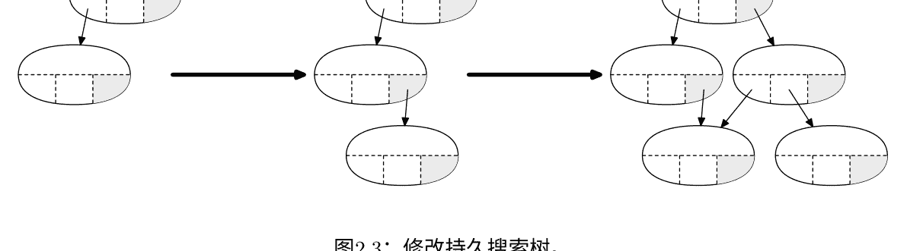

## 图2.3：修改持久搜索树。

使用这个算法，在给定任何时间 t时，数据结构中最多存在一个修改框，其时间为 t。因此，时间 t的修改将树分为三个部分：一个部分包含时间 t之前的数据，一个部分包含时间 t之后的数据，一个部分不受修改影响。

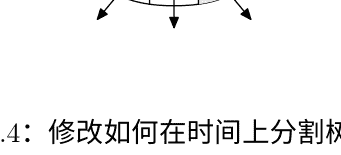

## 图2.4：修改如何在时间上分割树。

时间复杂度如何？ 嗯，访问时间会有 O(1)的减慢（加上一个 O(log m)的成本来找到正确的根节点），正如我们所希望的！（我们必须在访问每个节点时检查修改框，但仅此而已。）

修改所需的时间和空间需要摊销分析。 修改需要摊销O(1)的空间和时间。 为了看清楚，使用一个势函数φ，其中φ(T)是T中完整活跃节点的数量。 T的活跃节点就是从当前根节点到当前时间可达的节点（即，在最后一次修改之后）。 完整活跃节点是那些修改框已满的活跃节点。

那么，修改的成本是多少？ 每次修改涉及一些副本的数量，假设为k，然后是1次对修改框的更改。（嗯，不完全是这样——你可以添加一个新的根节点——但这不会改变论证。）考虑每个副本。每个副本的空间和时间成本为O(1)，但势函数减少了一个！（为什么？首先，我们复制的节点必须是完整和活跃的，因此它对势函数有贡献。然而，势函数只有在旧节点在新树中不可达时才会下降。但我们知道旧节点在新树中是不可达的——算法的下一步将是修改节点的父节点指向副本！最后，我们知道副本的修改框是空的。因此，我们用一个空的活跃节点替换了一个完整的活跃节点，φ减少了一个。）最后一步是填充一个修改框，这需要O(1)的时间并增加φ一个。

将所有这些放在一起，φ的变化是Δφ = 1 - k。 因此，我们支付了O(k + Δφ) = O(1)的空间和O(k + Δφ + 1) = O(1)的时间！

那么非树形数据结构呢？ 嗯，它们可能需要多个修改框。限制因素是节点的入度：有多少其他节点可以指向它。如果一个节点的入度是k，那么我们必须使用k个额外的修改框来获得O(1)的空间和时间成本。

### 2.2.4 几何搜索问题

让我们回到第2.1节讨论的几何搜索问题。我们现在知道如何创建一个持久化树；但是我们应该使用什么样的平衡树呢？

事实证明，这是一个伸展树崩溃的应用之一。原因是伸展操作。我们在访问伸展树时，每次旋转都是一次修改，因此我们每次访问都需要进行 O(log n)次修改（额外消耗 O(log n)的空间）—包括读取操作！

像红黑树这样的平衡树更适合。虽然不太性感，但是是一个更好的选择。红黑树通过最多一次旋转和一堆红/黑位操作来保持平衡。看起来不错—访问更便宜，修改的成本为 O(1)—几乎是。“几乎”是因为红/黑位操作可能会影响树上的多个节点，而不仅仅是一个节点。一个完全持久化的红黑树需要为树的每个版本保持正确的红/黑位值（以便进行进一步的修改）。这意味着改变一个红/黑位将被视为一次修改，并且会产生与持久化相关的成本。幸运的是，在几何搜索问题中，我们不需要查看旧版本树的红/黑位，因此我们只需要为最新版本的树保留它们，并支付 O(1)的持久化相关成本每次修改。

# 伸展树

## 3.1 引言

伸展树是具有良好平衡性质的二叉搜索树，当在一系列操作上进行摊销时。

当访问一个节点x时，我们执行一系列的伸展步骤将x移动到树的根节点。有6种类型的伸展步骤，每种步骤由1或2次旋转组成（参见图3.1、3.2和3.3）。

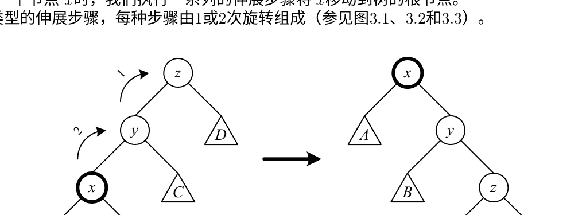

图3.1：rr伸展步骤：当x和x的父节点都是左孩子时执行。伸展步骤首先在z上进行右旋，然后在y上进行右旋（因此是rr）。对于x和x的父节点都是右孩子的情况，ll伸展步骤是类似的。

我们执行伸展步骤来使x成为根节点或者根节点的子节点，具体的步骤取决于x和x的父节点是左孩子还是右孩子。在后一种情况下，我们需要执行右旋或左旋的伸展步骤来使x成为根节点。这完成了对x的伸展操作。

我们将证明伸展操作的摊还代价为O(log n)，因此所有伸展树操作的摊还代价为O(log n)。

## 3.2 伸展步骤的分析

对于摊还分析，我们为每个节点x定义如下：

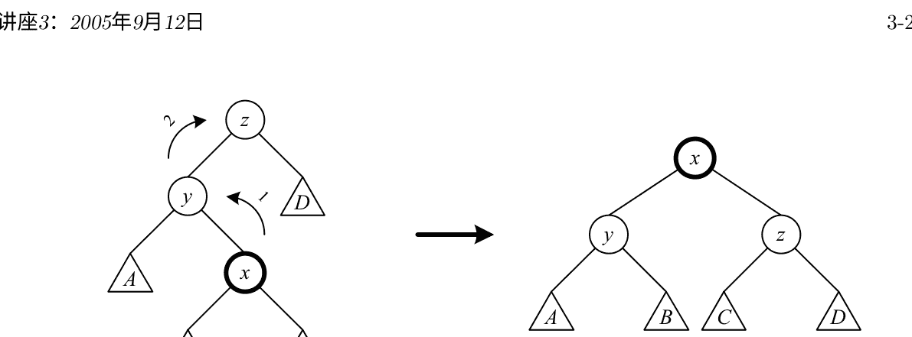

图3.2：lr伸展步骤：当x是右孩子且x的父节点是左孩子时执行此步骤。伸展步骤包括首先对y进行左旋，然后对z进行右旋。对于x是左孩子且x的父节点是右孩子的情况，rl伸展步骤是类似的。

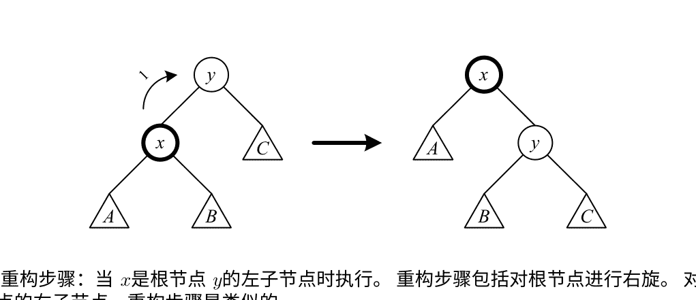

图3.3：重构步骤：当x是根节点y的左子节点时执行。重构步骤包括对根节点进行右旋。对于x作为根节点的右子节点，重构步骤是类似的。

- 一个常数权重 $w(x) > 0$ (对于分析，这可以是任意的)
- 权重和 $s(x) = \sum_{y \in \text{子树}(x)} w(y)$ (其中子树(x)是以x为根的子树，包括x)
- 排名 $r(x) = \log s(x)$

我们将 $r(x)$ 作为节点的潜力。经过i次操作后的潜力函数为 $\phi(i) = \sum_{x \in \text{tree}} r(x)$。

引理1 节点x进行伸展步骤的摊还成本为 $\leq 3 (r'(x) - r(x)) + 1$，其中r是伸展步骤前的排名，$r'$是伸展步骤后的排名。此外，$rr$、$ll$、$lr$和$rl$伸展步骤的摊还成本为 $\leq 3 (r'(x) - r(x))$。

证明：

## 讲座3：2005年9月12日

我们只考虑伸展步骤（参见图3.1）。伸展步骤的实际代价是2（进行了2次旋转）。伸展步骤只影响节点的势能/秩$x$、$y$和$z$；我们观察到$r'(x) = r(z)$，$r(y) \geq r(x)$，$r'(y) \leq r'(x)$。

伸展步骤的摊销代价因此为：摊销代价= 2+ $\phi (i+1) - \phi (i)$

```
= 2+ (r'(x) + r'(y) + r'(z) ) - (r(x) + r(y) + r(z) )
= 2+ (r'(x) - r(z) ) + r'(y) + r'(z) - r(x) - r(y)
\leq 2 + 0 + r'(x) + r'(z) - r(x) - r(x)
= 2 + r'(x) + r'(z) - 2r(x)
```

对数函数是凹的，即，$\log a+\log b \leq \log \frac{a+b}{2}$。因此我们也有（$s$是旋转步骤之前的权重和旋转步骤之后的权重和为）：

```
\frac{\log(s(x)) + \log(s'(z))}{2} \leq \log \left( \frac{s(x) + s'(z)}{2} \right)
\frac{r(x) + r'(z)}{2} \leq \log \left( \frac{s(x) + s'(z)}{2} \right) \quad (\text{注意， } s(x) + s'(z) \leq s'(x))
\leq \log \left( \frac{s'(x)}{2} \right)
= r'(x) - 1
r'(z) \leq 2r'(x) - r(x) - 2
```

因此，伸展步骤的摊销成本 $\leq 3(r'(x) - r(x))$。

相同的不等式也必须对 $ll$伸展步骤成立；不等式也对 $lr$（和 $rl$）伸展步骤成立。引理中的+1适用于 $rr$和 $ll$情况。

## 推论1：对于节点 $x$的伸展操作的摊销成本是 $O(\log n)$。

证明：

对于节点 $x$的伸展操作的摊销成本是涉及的伸展步骤的摊销成本之和：

```
摊销成本 = \sum_i \text{成本（伸展步骤}_i\text{）}
\leq \sum_i \left( 3(r^{i+1}(x) - r^i(x)) + 1 \right)
= 3\left( r(\text{根}) - r(x) \right) + 1
```

最后一个 $rr$ 或 $ll$ 伸展步骤（如果需要）导致 $+1$。如果我们将树中所有节点的 $w(x) = 1$，则 $r(根) = \log n$，我们有：

摊销成本 $\leq 3 \log n + 1 = O(\log n)$

## 3.3 伸展树操作的分析

### 3.3.1 查找

对于查找操作，我们执行普通的BST查找，然后对找到的节点（或最后遇到的叶节点，如果未找到键）进行伸展操作。我们可以将下降树的成本计入伸展操作的成本。因此，查找的摊销成本为 $O(\log n)$

### 3.3.2 插入

对于插入操作，我们首先执行普通的BST插入，然后在插入的节点上执行伸展操作。假设节点 $x$ 被插入到深度 $k$。将 $x$ 的父节点表示为 $y_1$， $y_1$ 的父节点表示为 $y_2$，以此类推（树的根节点为 $y_k$）。那么由于插入 $x$ 而引起的势能变化为（$r$ 为插入前的秩， $r'$ 为插入后的秩， $s$ 为插入前的权重和）：

$$\begin{aligned}
\Delta \phi &= \sum_{j=1}^{k} (r'(y_j) - r(y_j)) \\
&= \sum_{j=1}^{k} (\log(s(y_j) + 1) - \log(s(y_j))) \\
&= \sum_{j=1}^{k} \log \left(\frac{s(y_j) + 1}{s(y_j)}\right) \\
&= \log \left(\prod_{j=1}^{k} \frac{s(y_j) + 1}{s(y_j)}\right) \quad (\text{注意} \quad s(y_j) + 1 \leq s(y_{j+1})) \\
&\leq \log \left( \frac{s(y_2)}{s(y_1)} \cdot \frac{s(y_3)}{s(y_2)} \cdots \frac{s(y_k)}{s(y_{k-1})} \cdot \frac{s(y_k) + 1}{s(y_k)} \right) \\
&= \log \left( \frac{s(y_k) + 1}{s(y_k)} \right) \\
&\leq \log n
\end{aligned}$$

伸展操作的摊还成本也是 $O(\log n)$，因此插入的摊还成本是 $O(\log n)$。

我们已经证明了以下内容：

定理1 所有伸展树操作的摊还成本为 $O(\log n)$。

# 后缀树和斐波那契堆

## 4.1 后缀树

回想一下，我们的目标是在长度为 n 的文本中找到长度为 m 的模式。还记得trie树吗？每个节点都包含一个大小为 |Σ| 的数组，以实现 O(m) 的查找。

### 4.1.1 Trie的大小

之前，我们已经看到了一个在Trie大小上是线性的构造算法。我们希望展示Trie的大小与文本大小成线性关系，以便构造算法的时间复杂度为O(n)。我们可以通过使用压缩后缀树来实现这个大小目标。在压缩树中，每个节点都有严格多于一个的子节点。下面，我们看到了从未压缩后缀树到压缩后缀树的转换。

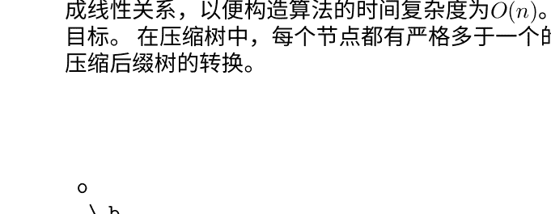

这将如何改变Trie中的节点数量？由于没有只有一个子节点的节点，这是一棵满二叉树（即每个内部节点的度≥2）。

引理1：在任何一棵满树中，节点的数量不超过叶子节点数量的两倍。

当我们使用尾部$时，trie中的叶子节点数量就是后缀的数量。那么这是否意味着有n个叶子节点，而树的大小为O(n)？是的；然而，节点的数量并不一定是树的完整大小 - 我们还必须存储子字符串。对于具有不同字符的字符串，将字符串存储在边上可能会导致O(n^2)大小的算法。相反，我们只需在每条边上存储原始文本中的起始和结束索引，这意味着每个节点的存储空间为O(1)，因此树的总大小实际上是O(n)。

通过压缩树，我们仍然可以使用慢查找算法在O(m)的时间内进行查找，该算法逐个字符地将模式与trie中的文本进行比较。当慢查找遇到压缩节点时，它会检查节点中的所有字符，就像遍历未压缩的节点序列一样。

### 4.1.2 构建Trie树

构建压缩树的一种简单方法是先构建一个未压缩的树，然后再进行压缩。然而，这种方法需要二次时间和空间。

压缩Trie树的构建算法仍然按顺序插入S_1到S_n。当我们向下遍历Trie树插入新的后缀时，可能需要在边的中间离开。例如，考虑只包含bbb的Trie树。要插入ba，我们必须分割边：

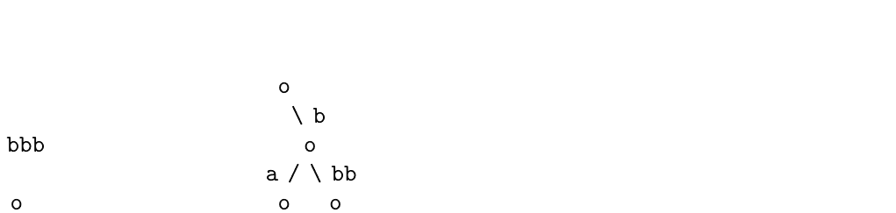

分割边很容易；我们将从分割中创建一个新节点，然后从插入中创建一个新节点（叶子节点）。

压缩Trie树的一个问题是在压缩边上放置后缀链接的位置。另一个问题是我们之前描述的操作树的时间是基于n（文本中的字符数）；然而，现在n可能大于节点数。

fastfind是一种算法，用于在已知模式在trie中的情况下，向下遍历trie。fastfind只检查压缩边的第一个字符；如果第一个字符匹配，那么所有其他字符都必须匹配，因为模式在trie中，并且边上没有分支（即，如果模式存在且没有分支，则必须匹配整个边或停在边的中间）。如果模式比边短，那么fastfind将在边的中间停止。因此，fastfind中的操作次数与trie中检查的节点数量成线性关系，而不是与模式的长度成线性关系。

假设我们刚刚插入了S = aw，并且位于新创建的叶子节点，该节点具有父节点p_i。我们保持以下不变性：

不变性: 除了当前父节点之外，每个内部节点都有一个后缀链接（暂时忽略后缀链接指向的位置问题）。

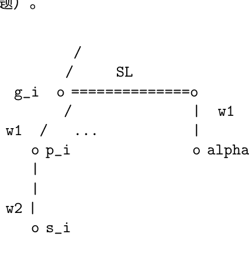

现在我们详细描述构造过程。让 $g_i$ 成为 $p_i$ 的父节点。要插入 $S_{i+1}$：上升到 $g_i$，遍历那里的后缀链接，并进行 $w_1$ 的快速查找，这将带你到节点 $\alpha$（从而保持下一次的不变性）。从 $p_i$ 到 $\alpha$ 建立一个后缀链接。从那里，对 $w_2$ 进行慢速查找并进行所需的插入。由于 $p_i$ 之前是一个叶节点，它还没有后缀链接。$g_i$ 之前是一个内部节点，所以它有一个后缀链接。$w_1$ 是已经在 $g_i$ 下的 $trie$ 中的 $S_i$ 的部分（即 $p_i$ ），这就是为什么我们可以在其上进行快速查找。$w_2$ 是之前不在 $trie$ 中的 $S_i$ 的部分。

运行时间分析将分为两部分。第一部分是从 $g$ 的后缀到 $p$ 的后缀的成本。第二部分是从 $p$ 的后缀到搜索的底部的成本。向上的成本是恒定的，因为由于压缩边只需要两步。

观察第二个成本（$slowfind$部分），我们可以看到它是 $p_i$ 和 $p_{i+1}$ 后缀之间长度差异的字符数，即 $|p_{i+1}| - |p_i| + 1$。将所有 $i$ 的这个项求和，得到 $|p_n| - |p_0| + n = O(n)$。

对于第一个成本，回想一下 $fastfind$ 的运行时间将被 $slowfind$ 的运行时间上界限制。到达 $g_{i+1}$ 最多需要 $|g_{i+1}| - |g_i|$ 的时间。如果 $g_{i+1}$ 在 $p_i$ 的后缀之下，则没有成本。如果后缀 $p$ 的 $i$ 小于后缀 $g$ 的 $i+1$，则后缀 $p$ 的 $i$ 为后缀 $p$ 的 $i+1$，并且快速查找只需要从 $g$ 的 $i+1$ 步骤到 $p$ 的 $i+1$ 步骤，因此成本为 $O(1)$。

插入的进展是

- 后缀 $g$ 的 $i$
- $g$ 的 $i+1$
- 后缀 $p$ 的 $i$
- $p$ 的 $i+1$

总时间与压缩树的大小成线性关系，压缩树的大小与输入的大小成线性关系。

## 4.2 堆

Prim和Dijkstra的最短路径和最小生成树算法在6.046中有所涉及。两者都是贪婪算法，首先将节点距离设置为无穷大，然后在选择最短路径时放松距离。为了执行这些操作，我们使用优先队列（通常实现为堆）。堆是一种数据结构，支持插入、减小键和删除最小值操作（可能还有其他操作）。

使用标准二叉堆，所有操作在 *O*(log *n*)时间内运行，因此两种算法的运行时间都是 *O*(*m* log *n*)时间。我们希望改进堆的性能，以获得更好的运行时间。我们可以证明 *O*(log *n*)是删除最小值所需的时间的下界，因此改进必须来自其他地方。斐波那契堆可以在 *O*(1)时间内执行减小键值操作，使得Prim和Dijkstra算法只需要 *O*(*m* + *n* log *n*)时间。

思路：在插入过程中，尽量做最少的工作。与其执行整个插入过程，我们只需将节点放在某个列表的末尾，只需 *O*(1)时间。这将需要我们执行 *O*(*n*)的工作来执行删除最小值。然而，我们可以将这线性量的工作用于下一次删除最小值，使其更加高效。

斐波那契堆使用“堆有序树”，意味着每个节点的子节点的键值大于其父节点，并且最小元素位于根节点。对于斐波那契堆，我们只有一个子指针，一个双向链表的子节点，并且每个节点都有父指针。

合并两个堆有序树的时间是常数时间：比较两个根节点的键值，并将具有较大根节点的堆有序树作为较小根节点的子节点。

要插入到堆有序树中，比较新元素 *x*和根节点。如果 *x*较小，它成为新的根节点，旧的根节点成为它的子节点。如果 *x*较大，它将被添加到子节点列表中。

要减小一个键值，你需要从子节点列表中删除该节点，然后执行合并操作。

最昂贵的操作是删除最小元素。找到最小节点很容易，它就是根节点。然而，当我们移除根节点时，可能会有大量需要处理的子节点。因此，我们希望保持树中任何节点的子节点数量相对较小。我们将在下一堂课中看到如何做到这一点。

# 最大流

## 6.1 最大流问题

在这一部分中，我们定义了一个流网络，并设置了我们在本讲座中要解决的问题：最大流问题。

定义1： 一个网络是一个有向图 $G = (V, E)$，其中包含一个源顶点 $s \in V$ 和一个汇顶点 $t \in V$。每条边 $e = (v, w)$ 从 $v$ 到 $w$ 都有一个定义的容量，用 $u(e)$ 或 $u(v, w)$ 表示。对于任意一对顶点 $(v, w)$，定义容量也是有用的，其中对于任意一对 $(v, w) \in E$，$u(v, w) = 0$。让 $m = |E|$ 和 $n = |V|$ 分别表示图中的边数和顶点数。

在网络流问题中，我们为每条边分配一个流量。有两种定义流量的方式：原始（或总）流量和净流量。

定义2 原始流量是一个函数 $r(v, w): V^2 \to \diamond$，满足以下性质：
- 守恒性： $\sum_{w \in V} r(w, v) - \sum_{w \in V} r(v, w) = 0$，对于所有 $v \in V \setminus \{s, t\}$。
- 容量约束： $0 \leq r(v, w) \leq u(v, w)$。

对于除源点和汇点之外的每个顶点 $v$，守恒性要求进入 $v$ 的总流量等于离开 $v$ 的总流量。容量约束要求沿任何边的流量为正且小于该边的容量。我们说一个流 $f$ 是可行的，如果满足这两个条件。

在原始流中，我们可以同时有从 $v$ 到 $w$ 的流和从 $w$ 到 $v$ 的流。然而，在净流量的表述中，我们只跟踪这两个流的差异。

### 定义3：净流量

净流量是一个函数 $f(v, w): V^2 \to R$，满足以下条件：
- 偏斜对称性： $f(v, w) = - f(w, v)$。
- 守恒性： $\sum_{w \in V} f(v, w) = 0$，对于所有的 $v \in V \setminus \{s, t\}$。
- 容量约束： $f(v, w) \leq u(v, w)$ 对于所有的 $v, w \in V$。

通过公式 $f(v, w) = r(v, w) - r(w, v)$，可以将原始流 $r(v, w)$ 转换为净流。例如，如果我们从 $v$ 到 $w$ 有7个单位的流量，从 $w$ 到 $v$ 有4个单位的流量，那么从 $v$ 到 $w$ 的净流量是 $f(v, w) = 3$。偏斜对称性直接来自于这个关联原始流和净流的公式。因为我们可以从原始流转换为净流，所以在接下来的讲座中我们只考虑净流问题。

尽管偏斜对称性将 $f(v, w)$ 和 $f(w, v)$ 联系起来，但重要的是注意容量对于净流问题仍然是有方向的。在一个方向上的容量 $u(v, w)$ 与反向方向上的容量 $u(w, v)$ 是独立的。

为了简化后面的讲座符号，我们用 $f(v, S)$ 或 $-f(S, v)$ 来表示 $\sum_{w \in S} f(v, w)$。

## 定义4 流量

流量 $f$ 的值被定义为 $|f| = \sum_{v \in V} f(s, v)$。

流量的值是离开源点的所有边上的流量之和 $s$。我们后来证明这等同于所有进入汇点的流量之和 $t$。流量的值表示我们能从源点运输到汇点的量有多少。本讲座的目标是解决最大流问题。

## 定义5 最大流问题

给定一个网络 $G = (V, E)$，找到一个可行流 $f$，使其值最大。

## 6.2 流分解和割

在本节中，我们将展示任何可行流都可以分解为从源到汇点的路径和循环。我们利用这个事实来推导出网络割对最大流值的一个上界。

引理1（流分解） 我们可以将任何可行流 $f$ 在网络 $G$ 上分解为至多 $m$ 个循环和 $s-t$ 路径。

证明：以下算法提取出 $m$ 条路径和循环。
1. 找到一条从节点 $s$ 到节点 $t$ 的正流路径。（如果流量非零，则至少存在一条这样的路径。）
2. 反增加该路径上的流量 - 也就是将路径上的流量减少直到某条边上的流量变为0。
3. 将此路径添加为流分解的一个元素。
4. 继续这些操作，直到没有从 $s$ 到 $t$ 的路径具有正流量。
5. 如果仍然有一些边具有非零流量，则剩余的流量可以分解为循环。以以下方式找到一个循环：选择任意具有非零流量的边，并沿着具有非零流量的出边继续，直到找到一个循环。
6. 在找到的循环上进行反增广。
7. 将该循环添加为流分解的一个元素。
8. 继续寻找循环，直到没有更多具有非零流量的边。

每次我们对路径或循环进行反增广时，都会将某条边上的流量清零。最多有 $m$ 个反增广操作，因此流分解中最多有 $m$ 条路径/循环。

在网络流问题中，与图的一个割一起工作是有用的，特别是一个 $s-t$ 割。

定义6 网络 $G$ 的一个割是将顶点 $V$ 分成两组：$S$ 和 $\bar{S} = V \setminus S$。

定义7 一个 $s-t$ 割是一个割，使得 $s \in S$ 且 $t \in \bar{S}$。

我们通常将一个割表示为一对 $(S, \bar{S})$，或者只是 $S$。我们推广了净流量和边的容量的概念，以定义割的净流量和容量。

定义8 割 $(S, \bar{S})$ 的净流量定义为 $f(S) = \sum_{v \in S} \sum_{w \in \bar{S}} f(v, w)$。

定义9 割的值（或容量）定义为 $u(S) = \sum_{v \in S} \sum_{w \in \bar{S}} u(v, w)$。

总之，割的流量（或容量）是所有从 $S$ 到 $\bar{S}$ 的边上的流量（或容量）之和。请注意这些定义中方向很重要。在这些定义中，沿着边的反向流量或容量，从 $w \in \bar{S}$ 到 $v \in S$，不计入。

使用割集很有用，因为有以下引理：

引理2： 给定一个流 $f$，对于任何割集 $S$， $f(S) = |f|$。换句话说，所有 $s-t$ 割集承载相同的流量：流 $f$ 的值。

证明：我们可以直接使用引理1来证明这个陈述。我们将流量分解为 $s-t$ 路径和循环。每个 $s-t$ 路径必须最终到达 $\bar{S}$，所以它必须从集合 $S$ 到 $\bar{S}$ 多一次，而不是从 $\bar{S}$ 到 $S$。因此，沿着该路径携带流量 $x$ 的 $s-t$ 路径对总流量的贡献正好是 $x$。一个循环必须从 $S$ 到 $\bar{S}$ 的次数与从 $\bar{S}$ 到 $S$ 的次数相同，对割的值没有贡献。因此，割的总值等于沿着每条 $s-t$ 路径的流量之和，即 $|f|$。

或者，我们可以通过对集合 $S$ 的大小进行归纳来证明引理。对于 $S=\{s\}$，命题成立。现在，假设我们将一个顶点 $v$ 从 $\bar{S}$ 移动到 $S$。值 $f(S)$ 的变化如下：
- $f(S)$ 增加 $f(v, \bar{S})$。
- $f(S)$ 减少 $f(S, v) = -f(v, S)$。

总之，在将顶点 $v$ 从 $S$ 移动到 $\bar{S}$ 后，$f(S)$ 的总变化等于 $f(v, \bar{S}) + f(v, S) = f(v, V) = 0$（根据流量守恒）。■

对于一个流网络，我们定义最小割为图的一种割，其容量最小。然后，引理3给出了任何流的值的上界。

引理3 如果 $f$ 是一个可行流，则 $|f| \leq u(S)$ 对于任何割 $S$ 成立。

证明：对于所有的边 $e$，$f(e) \leq u(e)$，所以 $f(S) \leq u(S)$（任何割 $S$ 上的流量不超过割的容量）。根据引理2，$|f| = f(S)$，所以 $|f| \leq u(S)$ 对于任何割 $S$ 成立。■

如果我们选择最小割 $S$，那么我们得到了最大流值的上界。

## 6.3 最大流最小割定理

在本节中，我们展示了引理3给出的最大流上界是精确的。这是最大流最小割定理。

为了证明定理，我们引入了剩余网络和增广路径的概念。

定义10 设 $f$ 是网络 $G$ 上的可行流。对应的剩余网络，记作 $G_f$，是一个具有与网络 $G$ 相同顶点的网络，但具有容量 $u_f(v, w) = u(v, w) - f(v, w)$ 的边。只有容量非零的边，$u_f(v, w) > 0$，才包含在 $G_f$ 中。

注意可行性条件意味着 $u_f(v, w) \geq 0$ 和 $u_f(v, w) \leq u(v, w) + u(w, v)$。这意味着剩余网络中的所有容量都是非负的。

定义11 增广路径是从节点 $s$ 到节点 $t$ 的有向路径在剩余网络 $G_f$ 中。

图6.5：剩余网络的一个例子。这个剩余网络对应于图6.1中的网络和图6.2中的流量。虚线对应于可能的增广路径。

请注意，如果在 $G_f$ 中存在增广路径，则意味着我们可以在原始网络 $G$ 中沿着这样的路径推动更多的流量。更准确地说，如果我们有一个增广路径 $(s, v_1, v_2, ..., v_k, t)$，我们可以沿着该路径推动的最大流量是 $\min\{u_f(s, v_1), u_f(v_1, v_2), u_f(v_2, v_3), ..., u_f(v_{k-1}, v_k), u_f(v_k, t)\}$。因此，对于给定的网络 $G$ 和流量 $f$，如果在 $G_f$ 中存在增广路径，则流量 $f$ 不是最大流量。

更一般地，如果 $f'$ 是 $G_f$ 中的可行流，则 $f + f'$ 是 $G$ 中的可行流。流 $f + f'$ 仍然满足守恒，因为流守恒是线性的。流 $f + f'$ 是可行的，因为我们可以重新排列不等式 $f'(e) \leq u_f(e) = u(e) - f(e)$ 以得到 $f'(e) + f(e) \leq u(e)$。反过来，如果 $f'$ 是 $G$ 中的可行流，则流 $f - f'$ 是 $G_f$ 中的可行流。

使用剩余网络和增广路径，我们可以陈述并证明最大流最小割定理。

定理1（最大流最小割定理）。在一个流网络 $G$ 中，以下条件是等价的：
1. 一个流 $f$ 是最大流。
2. 剩余网络 $G_f$ 没有增广路径。
3. $|f| = u(S)$ （对于某个割 $S$）。

这些条件意味着最大流的值等于最小 $s-t$ 割的值：$\max |f| = \min u(S)$，其中 $f$ 是一个流，$S$ 是一个 $s-t$ 割。

证明：我们证明每个条件都意味着另外两个条件。
- 1 ⇒ 2：如果在 $G_f$ 中存在增广路径，那么我们之前已经证明我们可以沿着该路径推送额外的流量，所以 $f$ 不是最大流。1 ⇒ 2 是这个陈述的逆否命题。
- 2 ⇒ 3：如果剩余网络 $G_f$ 没有增广路径，$s$ 和 $t$ 必须是不连通的。令 $S$ 为从 $s$ 在 $G_f$ 中可达的顶点的集合。由于 $t$ 不可达，集合 $S$ 描述了一个 $s-t$ 割。

根据构造，所有跨越割的边 $(v, w)$ 的剩余容量为 0。这意味着在原始网络 $G$ 中，这些边的 $f(v, w) = u(v, w)$。因此，$|f| = f(S) = u(S)$。

## 6.4 Ford-Fulkerson算法

Ford-Fulkerson算法解决了给定网络的最大流问题。算法的描述如下：
1. 从 $v$ 到 $w$ 开始，设置 $f(v,w) = 0$。
2. 从 $s$ 到 $t$ 找到一条增广路径（例如，使用深度优先搜索或类似算法）。
3. 使用前一步找到的增广路径来增加流量。
4. 重复直到没有更多的增广路径。

如果容量都是整数，则运行时间为 $O(m|f|)$。这是因为找到一个增广路径并更新流量需要 $O(m)$ 的时间，而我们找到的每个增广路径都必须增加至少1的整数流量。

一般来说，如果我们有整数容量，则我们的解满足一个整数性质：存在一个整数最大流。这是因为每个增广路径都会增加整数数量的流量。

由于运行时间与最大流的值成正比，所以这个特定算法只适用于最大流值 $|f|$ 较小的情况。例如，当所有容量都不超过1时，最大流 $|f|$ 最多为 $n$。一般来说，该算法的运行时间可能与输入的二进制表示一样糟糕。图6.7展示了这种形式的Ford-Fulkerson算法的一个糟糕情况。

我们将这样的算法描述为伪多项式，因为它在我们关心的变量上是多项式的（但不一定是输入）。

如果容量是有理数，那么可以证明算法会结束。然而，它可能需要超过 $O(m|f|)$ 的时间。如果容量是实数，算法可能永远不会结束，甚至不会收敛到非最优值。

然而，如果我们为选择增广路径设置更好的规则，可能会得到更好的结果。在展示一些对Ford-Fulkerson算法的改进之前，我们将介绍一些关于算法运行时间的新概念。

|                                                                                           |                                                                               |
|-------------------------------------------------------------------------------------------|-------------------------------------------------------------------------------|
|        %& &  &  &  #  &  &&  &  &  &&  &  &&&  |                                                                               |
|  *   +   &&  (  AE  #  '  !  #  *  &  #  //  ) ! ""  *  &  &  &&  0  &&  2 !  &  # 1 3) |                                                                               |
| *   (  &  (  AE  &  (  &  &  #  &  (  AE  &  ( &  &  &&  (  &  4 45  '  &  &  (&  &  &  & |                                                                               |

6   7& &
*
 45 '  &     &  &
    #   #   45 '  &  &  &  ,  8

+   -   #  #  &   &  #  ) :45  &  #  '
   &  (  !  ?  ;  7&  )
*    _  #  &   &  # &  &  &  (  )  &  &  ;  -  &  <  &  && " &  (  &&  (  &  &  &  &  &  &
*   &  &  (  '  #  &  &  45 '  &  &  # &  &  (  &  45  &  ;  #  &   45>  )
*    45 & ( ? @ "  &  (  45 )
*   &  (  &  &  '   0  ?  &  &   &  &  &

A&  &  ( &       )
6    B)   (&  & )  *   "
    &  ( &  &  &  ( &  )  *  &  &  &  &  &  (  &  &  &     7  &  &  ( & )

;

□ □ □ □ □□□ □  □ □ □ □  □ □ □ □          □;□

□  □ □ □ □ □□□□□ □□ □□ □□ □

□□ □□□□ □ □□    □ □□

□□ □□□□□□□ □□□□ □□

□□  □ □□□

□□ □□□ □ □□□   □□□

□□  □  □  □ □□ □

□□  □ □□

□□□ ,□  □□ □□ □ □□ □□ □□□□□□□□□□□□□□□□ □□ □□ □□ □ □□ □□ □□□□□□□

□□ □□□8  9  □,□□   □□□

    □□□□□□□□ □□□□□

□  □□8   99□□ <   □

□    □

□□   □□□□□□ □□8  9□□

□□  □ □ □

□ □□□ □□&□ □ □□□ □□□  □ □□□ □□□ &  □ □&(  □ □□□□□□□□□□□□□□□□□□□'□□□□□ □□□ □&  □ □ □ □ □□□ □□□ &  □ □&(□

□ □□□ □□□□□□□□□□□□□□□□□□□□□□□□□&□ □□&( □□&( □□□□ & □□ □&(□□&( ) -(□ □ □□□□□□□□□□□□□□□□□□□□□

□ □ □□□& □□&  □□□ □&(□□& □□□□□□□□□□□□□□□□□□□□□□□□& □ □ &(□ □'□ □ □□□ □□□ □□□ &(□ ) -(□ &

□ □ □ □ □□□□ □ □ □ □ □ □ □ □ □ □;□

□ □ □ □ □□□□ □ □ □ □ □ □ □ □ □
□ □ □ □ □□□□ □ □ □ □ □ □
□ □ □ □ □□□□
□ □ □ □ □□□□ □ □ □ □ □ □
□ □ □ □ □□□□ □ □ □ □ □ □ □ □ □
□ □ □ □ □□□□ □ □ □ □ □ □ □ □ □
□ □ □ □□□□ □ □ □ □ □ □ □ □ □
□ □ □ □ □ □ □ □ □ □ □ □ □ □ □

□ □ □ □ □□□□

< □ □ □< □ □ □ □ □□□□ □ □ □ □ □ □ □ □ □ □ □ □ □ □ □ □ □ □ □□□□ □□□ □□□ □ □&<
□□□ □ □ □□□□ □□□
□ □ □ □ □□□□ □□8 9□
□ □ □ □□□□ 8 9 □<□ □ □
□ □ □ □ □□□□ □□□
□ □ □ □ □ □ □ □ □ □ □ □ □ □ □

□ □ □ □ □□□□ # □ □ □ □□&□ □ □ □ □)

□ □ □ □ □) □ □ □ □□□□□ □ □ □ □ □□□□□ □□□ □□□ □ □ □ □□□ □ □ □□□□ □ □ □ □ □ □
□ □ □ □ □□ □ )6 □ □ □ □ □ □ □ □ □ □ □□□□ □□□□□ □□□ □□□ □ □ □ □□□ □ □ □ □ □ □ □ □ □□□□ □ □ □ □ □ □□& □ □ □ □ □□□ □ □ □ □ □ □ □ □ □□□ □ □ □ □ □ □ □ □ □)
□ □ □ □ □ □ )6 □ □ □ □□□□ □ □ □ □ □ □□□□ □□□□ □ □ □□□□ □ □ □ □ □ □ □ □ □ □□□□ □ □ □ □ □ □□& □ □ □ □ □ ( □ □ □ □ □ □ □ □ □ □ □ □ □ □ □)
□ □ □ □ □ □ □□□□□ □) □ □ □ □ □ □ □ □ □&□ □ □ □ □ □ □ □ □
□ □ □ □ □ □ □ □ □ □ □□□ □ □2 □ &□ □ □ □ □ □ □ 0 □ □ □ □ □ (□ □ & □ □ □ □ □ □ □) %& □"'" □ □ □ □ □ □ □ □ □ □ □# □ □ □ □ □ □ □ □ □ □□□□ □&□" □ )如果在每一步中，增广路径要么是s → 1 → 2 → t，要么是s → 2 → 1 → t（用虚线表示），那么算法运行得很慢。在增广过程中，流量最多增加2。

定义12 如果算法在输入的一元表示中是多项式的，则称其为伪多项式算法。

定义13 如果算法在输入的二进制表示中是多项式的，则称其为弱多项式算法。

定义14 如果算法在输入的组合复杂度中是多项式的，则称其为强多项式算法。（例如，在最大流问题的情况下，算法必须在n和m中是多项式的。）

## 6.4.1 改进的Ford-Fulkerson算法

至少有两种可能的方法可以改进Ford-Fulkerson算法。这两种改进都依赖于更好地选择增广路径（而不是随机选择增广路径）。

+ 1. 使用广度优先搜索，我们可以选择最短长度的增广路径。使用这个路径选择规则，增广的次数受到n·m的限制，因此算法的运行时间降低到O(nm^2)时间。
+ 2. 我们还可以选择最大容量的增广路径：在所有增广路径中增加流量最多的路径（最大容量增广路径）。可以在O(m log n)时间内使用修改后的Dijkstra算法（忽略循环）找到这样的路径。增广次数最多为m ln |f| ≤ m ln(nU)，其中U = max{u(v, w)}（对于整数容量）。

在本讲座中，我们证明了第二个改进的时间界。考虑当前剩余网络中的最大流f。我们应用流分解引理，引理1（舍弃循环，因为它们不会改变|f|）。最多有m条路径承载所有的流量，因此必定存在至少一条路径承载至少|f|/m的流量。因此，具有最大增广量的增广路径最大容量至少增加原始网络中的流量 |f|/m。这会减少剩余图中的最大可能流量从 |f| 到 (1 - 1/m)|f|（记住，剩余图中的最小可能流量越小，原始图中的相应流量越大）。

我们需要将流量 |f| 减少 (1 - 1/m)倍，大约 m ln |f| 次，然后再将剩余图中的最大流量减少到1。这是因为

```
|f| (1 - 1/m)^{m ln |f|} ≈ |f| (1/e)^{ln |f|} ≈ 1.
```

再进行一步，剩余图的最大流量将为0，意味着原始图中的相应流量是最大的。因此，我们需要 O(m ln |f|) 次增广。由于一次增广步骤大约需要 O(m log n) 时间，总运行时间为 O(m^2 ln |f| · ln n)。这个算法是弱多项式的，但不是强多项式的。

## 6.4.2 缩放算法

我们还可以通过使用缩放算法来改进 Ford-Fulkerson 算法的运行时间。思路是将我们的最大流问题简化为简单情况，其中所有边的容量要么为0，要么为1。

缩放思想由 Gabow 于 1985 年和 Dinic 于 1973 年提出，具体如下：

+ 1. 通过舍入低位来将问题缩小。
+ 2. 解决缩小后的问题。
+ 3. 将问题放大，加回我们舍入的位，并修复任何解决方案中的错误。

在最大流问题的具体情况下，算法如下：

+ 1. 将图中所有容量设为0。
+ 2. 将每个容量的高位移入。然后每个容量要么为0，要么为1。
+ 3. 解决这个最大流问题。
+ 4. 重复这个过程，直到我们处理完所有剩余的位。

这个算法的描述告诉我们如何缩小问题的规模。然而，我们还需要描述如何扩大我们的算法并修复错误。

扩大问题的规模：

+ 1. 从缩小问题的最大流开始。将每个容量的位向左移动1位，将所有容量加倍。如果我们将所有流量值加倍，仍然得到最大流。
+ 2. 增加一些容量。这样可以恢复我们截断的低位。在剩余网络中找到增广路径以重新最大化流量。

我们最多需要找到$m$个增广路径。在我们将问题扩大之前，我们已经解决了一个最大流问题，所以剩余网络中的某个割的容量为0。将所有容量和流量加倍保持不变。然而，当我们增加边的时候，割的容量最多增加$m$次：每条边增加一次。我们找到的每个增广路径至少增加1个流量，所以我们最多需要找到$m$个增广路径。

每个增广路径最多需要 $O(m)$ 时间来找到，所以在每次缩放算法的迭代中我们花费 $O(m^{2})$ 时间。 如果任何边的容量最多为 $U$，即一个 $O(\lg U)$ 位数，我们需要 $O(\lg U)$ 次缩放算法的迭代。

因此，算法的总运行时间为 $O(m^{2} \lg U)$。 这个算法也是一个弱多项式算法。

□□□□□□ □□ □□□□□□□□□
□□□□□□□ □□□□□□□ □□□□□□□□□□□□□□□□□□□□ □□□□
□□□□□□□ □□□□□□□□□□ □□□□□□□

□□□□□□□ □□□□□□ □□

□□ □□□□□ □□ □□

□□□! □□□□□□□□□□ □□□'□! □ #□ □□□□□□ □□□□□□ □□□ □□ □□ □$□ □□□□□"" □! □□□□ □□□ □□%&□'□ □ □□ □## □□□#□! □□□□ □□□□□□□ □□□ □!□ □□ □## □"□ □□(□□□ □□□□□□ □□□□ □□%&□ □□ □ □'□□#□ □□□□□! □□□ □ □ □□ □□ □□□□□□ □□□ □□□□□□ □□□ □" □□□ □□□□ □□□□□□ □□□ □□□□□□(□□□□□) □□□□ □"" □□ □□ □ □□ □□ □□□□□□□ □□ % □ % □

□□ □□□*□□□ □+ □ □ □□□ □ □□□ □□ □□%

□□□□ □,□□□□ □ □□□ □□□ □! □ □,□ □! □ □□ □□ □□

□ □ □□□ □□□ □ □□□□ □ □□□□ □□□ □□

&□ □□□ □□ □□□□□ □ □□ □"□□!□□ #□ □□□□ □ □□□□□ □□ □.□□ # □□%* □□ + □ □"#□ □□ □□□□ □□□ □□)(□□□ □! □□! □ □ □(□□ □□□ □□□ #!□ □□ 0* □ □/□□ □□ (□%* □! □ □) □ □ □# □ □□□ + □ □"#□ □□ □□□ □□. □"1 □□ □ □'□ □)(□□ □□ □□!)(□ □ □! □□ □,□□ □□□ □□□□ □□ □□□□□ □ □+□□ □□ □□□ □%

□ □ □ □ □ □□ □□□□ □ □□□

&□ □□ □□ □□□ # □! □□ □□□! □!#□ □□ □"□! □ #□ □! □" □ □ □□ □□□□ □□ □□□ □□ □"□□ □□ □!□□ □ □ □) □ □□ □ □ □□□□ □ □□ □! □□ □□□ □ □□ □! □ □ □□ □ □□ □ □! □□ □□% &□ □□ □ □ □ □ □! □ □ □ □ □ □ □ # □! □□ □□□□ □2 □ □3% &□ □ □ # □! □□ □□□□□ □ □□□! □!" □□ □□ ## □ □ □□ □□ □□ □)(□□□□□ □ □□ □□ □ □□ □□ □□ □□ □ □□□□□ □ □! □ □□ □ □ □□ □□ □□ □□2 □ □ □□#.□ 3%

□ □ □ □ □ □ □□□□□□□□□□ □ □ □ □

&□ □4 □ □ □ 1 □ □ □' □ □ □ □□□□ □ □ □ □□□#□! □ □ □□□□ □ □ □□□ □(□ □ □ # □! □□ □□□□□ □ □□ □□!# □□ □□□□□ □ □□ □ □□ □ □'□ □#□ □□ 2 □ 553% &□ □□ □ □□□□ □ □/□ □□ □□□□ □□□□ □ □ □ □ □ □□□□□□□□□□ □ □## □ □□ □□□□□ □ □ # □ □ # □ □□% & □ □! □□ □□□ □ □□ □ □) !## ! □ □□) □ □□ □ □'□ □□ □□! □! □ " □ □□ □ '□ □ □□ □ □ □ □ □ □ □ □ □ □ □ □ □ □ □ □ □ □(□ □ □□ □2 3 □ □ □□□□ □ □□ □□ □ □□ □ □ □ □+□ □ □ □2 3 □ □ □□%

&□ □ □ □! □) □□□ □" □□ □ □ □ □ □)(□#! □ □ □! □" □ □□ □ □□□ □ □ □ □ □)(□□□□□ □ □ □ □ □ ! □□' □□ □□! □ □% □ ("! □□ □□ □□ □)(□ □ □ □ □ □ □ □ □)(□#!! □ □ □"!" □ □.□

□2□3 6 □2□3 □ □□ 6 □

# 7 □ □ □ □□□% □ 0□ □ □ □ □ □ □ □& □ □ □ □ □ □ □

□ □ □□ □ □ □ □ □2□3 6 □2□3 □！□ #□ □ □□！□ □□ □ □！□ □ □ □ □ □ %& □ □ □□！□！ □ □ □ #□ □ □！□ □ □ □ □ □□□□ □ □ #□ )！□ □ □ □1##！□ □ □ □ □

□ □ □ □ □ □□ □ □ □ □ □ □ □ □ □ □□2□3 □ □ □ □ □ □ □ □ □ □ □□□□□ □ □□ □ □ □ □ □ □□□ □ □ □ □ □ □ □□ □ □ □□ □ □ □ □ □□ □ □ □□6 □ □ □ □ □□2 □3 6 □2 □3 □ □ □ □2 □3 6 □2 □3 □ □ □ □6 □ □ □ □□□□！□ □ □ #□ □□

+ * □ □ □ (2 □□ □ □！□□ [#！□ □！) □ □ □ □ # □ □3 □ □ □ □ □ □□ □" □□□□ □ □ □ □□ □ □ □ □□□ □ □ % & □ □ □ □ □ □ □□□□ □ □ □ □ □ □ □□ □ □□□□□"□ □ □ □ □ □！□ □!) □ □ □ □ □□ % □ □ ' □ □ □ □2□3 6 2 □ □ □ □ □ □ " □ □ □ □ □ □.□3 □！□ □ □ □ □ □ □ □ □ □ □ □□！□□"□ □ □ □ %

&！ □！ □ □ □□！□！□ □ □ □□□ □ □ □□ □ □ □！ □！□！" □ □ □□2□3 □ □ □□2 9 □ 5□ □ □3□）！□ □ □ □ □ □ □ □ % □ □ □□□ □！ □ " □ □ □□ □ □ □ □ □ 2 5□3 □ □ □-□ □ % & □ □ □ □ □ □□□□ □！ □！ □ " □ □ □□2 9 5 □ □ 5□:3） □！ □2 9 □ 5□ □ □3 □ □□！ □ □ □ □ □ □ □ □ □ □ □ □]##！□ □ □！ □ " □ □ □ (99□ 5□ □ □)！□ 9 □ 5□ □ □ □. < □ □！"" □ □ □ 9 :□ □ □ □ □ □ □□□！□ □ □ □ □ □ □ □ □ □ ' □ □ □ □99□% □ □ &□ □ □！ □ " □ □ □99□ 5□:）！□ 99□ 5□ □:）. < □ □ □ □ □□□□ # □ □ # □ □ □ □□□□ □ □ □ □ □ □ □ □ □ □ #□ □ □#. □ □ □□ □ □ □ ' □ □ □ '□ □ □ □. □ □ □ □ □ □999:%

□ □ □ □ □

+ * □ □ □ □ □ □ □ □ □2 □3 6 □2□3 □ □ □6□□% 7！□！ □ □ ' □ □ □'□□ □ □ □ □！□ □ □ □ □ □2 □3□12□32 □ □ □□□□ □ + □ □#. □ □ □ □2□3 □ □2□3 □ □ □ □ #□ □# □！） □% 2 □ #□ □ □ □！□ □ □！□□ # □ □AE □ □#. □ □ □ □ □□□ □ □ □ □ □'□□ □#□# □ □ □□□□ □ □ □ ' □ □ □ □ □+□ " □ □ □ □□□□ □ □□□！' □ □ □ □ □ □ □ □+□ □ □ □ □ □ □ □ □ □ %□□ □ □ □ □ #！ □ □ □ □ □ □ □ □ □ □ □ □□！□□ " □ □ □ □ □ □ □ □ □ □ □ □' □ □ %3

□ □ □□□ □ □□□' □！ □ □ □ #□ □ □ □ □ □ □ □ □ □ □！□ □ □ □ □&□ □ □ □ □ □ +□ □#. □ □ □1##！□ □ □"□□！ □ □ □ #□ □ □ □

> >□2 □ □ □ □ □#□ □#□ !) □3

□ □ □ □6 □2□3 □ □2□3% □ □ "" □ □□！ □ □ □ □ □'□□！ □ □ □ #□ □ □ □ □]##！□ □ □□！ □ □ □ .!□'□ □ □)□□□ □！□□！ □ □ □ □-□□ #□ □#.□ □ □ □ □ □ □！ □ □ #！% * □#！ □□□□ □ □ □' □ □ □ □ □ □ □！ □ □ □□！□！ □ □ □) □ □ □□□□ □ ## □ □ □% □ □""！□ □ □ □ □！□ □ □ □ □ □！□ □" □ □ □）□□！ □ 9 □:% ?. □ □ □ □ □0□□ □ □ □&□ □ □ □ □ □ □ □ □ □ □

□ □ □ □ □□ □□ □1

□ □ □！□ □ □#. □ #! □"□ □ □ □□□□□ □:% & □ □ □ )□□ □ □□ □ □ □ □ □ □ □ □ □ □

> >□2    □ □ □□□ □!#□！) □3───#!
        □ □           □#! □

@□ □ □ □ □□ □□ □ □ □ □□□ □ □ □□□□ □ □ □□□ □ □ □ □ □

> >□2□    □,3 □ > □2,35> □2□,3

□ □ □□ □ □□ □ □□ □ □□

> >□2 □) □ □□# □ □ □ □□ □ □
    □#! □

?. □ □!□ □ □ □□"""□" □ □ □.□□□ □ □ □□□□□ □ □ □□□□ □"□! □ □ □#□ □ □ □ □ □ □ □□#□ □ □ □# □  □ □ □ □!□□ □
□#□!□ □ □ □□□□# #□#! □ □□# □ □ □ □ □!□ □ □ □□%□

□    □ □    □ □ □

A□ □ □ ""□ □ □ □ □□□□□ □ □ □□ □ □!□□□ □ □ #.□□ □ □ □ □ □□□□□□□ □ □ □ □ □% □ □ □ □ □ □ □ □ □ □ □ □ □ □ □ □ □ □ □ □ □
□ □ □□ ! □ "□ □□ □ □ □ □" □#□ □ □ □ □ □ □'□''□ □ □ □□□□2,3 □ □ □% □ □ □□! □ #. □ □ □ □ □□ □!□ □ □ □ □ □ □ □ □ □ □ □ □ □
□ □ □ □ □'□ #□ □ □□   □ □ □ □  □ □ □□2 □3 □ □ □% * 1 □ □ □ □ □□!□□□ □ □ □ □ □ □ □□□□□□ □ □ □ □ □ #.#□ □ □ □ □ □ □ □□□ □ □ □ □ □ □! □ □ □!□□ □ □ □ □ □ □ □ □ □ □'□ #□ □ □ □ □ □ □!□ □ □ □ □ □□ □□ □ □ □ □ □ □ □ □ □ □ □ □ !) □ □( □ □2#!□ 3 □  □ □ □ □□□ □ □ □ □! □# □ □ □ □ □( □ % & □ □ □ □ □ '□ □ □   □ □ □ □ □ □ □ □ □ □ □ □ □    □ □ □ □□
□ □ □ □□□%

7!□ □ □4□□ □ □1□□ □ □ □ □ □ □ □ □ #□!□ □ □□□ □ □□□ □□! □ □ □ □ □ □ □"□ □# □ □ □ □ □ □ □ □"□□□□□□% 7!□ 6
2223    □ ! □ □ □ □ □ □! □ □ □ #□! □) □ #□ □ □ □ □□□□□□□       □ □ □ □ □ □#□ □ 6 2#! □ 5#! □ □□%□
&□ □ □)!□ □ □ □ □□□□□ □ □ □ □ □□□ #□ □ □ □ □ 4 □ □ □1□□ □ □ □ □ □ □ □ □ □ □ □ 2 5□3%

□ □ □□ □ □

0!□ □ □□□□ □□□□□ □□) 4 □ □ □1□□ □ □' □ □ □ □ □ □ □ □□□□ □ □ □□ # □ □ □ □□□□□ □ □ □ □#□! □ □ □ □ ) □ □ □ □ □ #□.
□ □ □□ □ □ %□ □ □ □! □ □ □ □ □"□ □)！□ □ □ □ □ □ □□□ □.□□ □ □ □ □ □ □ □ □'□ □ □ □□□□□ □ □ □ □ □ □ □ □ □ □ □ □ □ □ □ □ □ □ □ □ □□□ %□ □

&□ □ □ □ □ □(□□!) 4 □ □ □1□□ □ □' □ □□ □ □ □ □□□! □ □ □ □ □ □ □ □ □ □ □ □ □ □ □□□< □ #□ □□ )□ □ □ □ □ ! □ □ □#. □ □ □ □ %□-

,) □ □ □ □ □ □□□□ □ □ #□□ □ □ □□#! □ □ □ □! □ □ □□! □ □ □□□ □ □ □ □ □ □ □ □ □ □□□□□< □ # □ □ □ □ □ □ □ □ □ □ □ □ □ □ □ □ □ □ □ □ □! □ □ □#. )□ □ %□=

B □ □ □ □ 8!□ □ □ □ #! □ # □ #! □ □ □ □□□□□ □ □ □□ □! □ □ □ □ □□□□ □! □ □ □□C□ □ □ □ # □!□ □ □ □□□) □ □ □ □ □ □ □ □ □ □ □ □ □ □%□B□ □ □ □ □ □ □ □ □ □□ □□ □ □ □ ! □ □ □ □ □Æ □ #□ %□

□ □ □ □□ □ □ □ □□□□□□□ □ □ □□□□□ □ □ □□ □ □□ #□ □) □ ! □ □ □ □ # □ ! □ □ □ □ '□□□□□ □''□ □ □ □ □ □ □ □ □ □ □ □ □□□ □ □□□(□ □ □ □ #!□ □ □ □ □□□! □!# □ □ □ □ □□! □ #□ □ □□ □D □ □ □□2 5 □3 □ □ □ % E□ □ □ □ □ □ □ □ □ □ □ □ □ □ □ □ □ □ □ □ □ □ □ □ □ □ □ □□□□□□ □ □ □ %□[content]

# # # # # # #

*# #! # # 4# # # 1# # # ! # (#<) # # # =# # # # . # # # # #" # # # # # # # # # ! # # # # # # # # ! # # # ) # # # # # # # # #" # / # # # #% # # # # # ! # # # # # # # # # # # # # # # # # # # # # # #" # # / # # # # # #/AE # # # # # .%

# # # # # # # #" (# # # # # !) # # # # # + # # # # # # # # # #" (# # # # # !) # # # # # # #% # # # # # ! # # # #" # " #" # ! # # # # # # # # + #

# # # 2 3 # # # # # # ! # # # # # # # # # # # # # # # # # # # 2 3 # " # # # # # # # # # # / # # # # # # # 2 3 # # # %

# #   # # # # #

E# # # # # # # # # # # # #"# # # !) # # # # # # # # # # # # # # # # # # # # # # # . #! # # # #

#%  # # # # # # # #  # # # #  # # # !) # # # # # # # # # # # # # # # # .# # # # # # # # # # (#%  # # # # # #)  # # # #  # # # # # #
!# #!)  # # # #  # # # # # # #% & # # #!# # # # # # 2 #! # 3 # # # # ! # !  # # # # #% & # # #" #! # # # # # # #
# # # # # # # # #!# # # # #! #! # # ## 2 5 # 3 # # # # # # # # # # # # # # # #% & # # # # # # #" # #!!
# # # # # # #" # #!)! #%

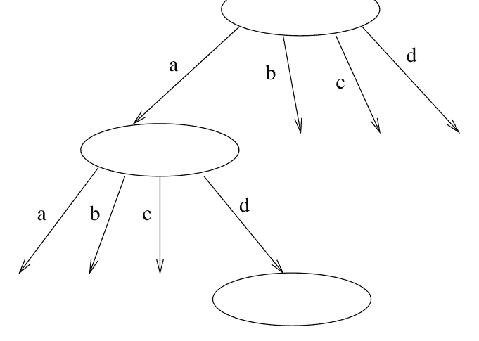

7# # # # #%  # * # # + # #" # # !)  # # # # ! # # # # # # # % # #

%  # # *  # # # # # # # # ! # # # #." # !)  # # # # # # # # % # & # # # $ # # # # # # # # # # # # # # # # # # # # #" # # # # # # # # # # #
# # # # # # # # # # # # # # # # # # # ! # # # # # # # # # # # ! # # # # # ! # # # # # #% # # # # " # #!! # # # # # # # #! # # # # # ! # # # # # # # # ! # # # # #" # # # # # # # # # # # # # # # # # # # # # # # # # # # #% # # # 7 # # # # #
#%)! # # # # + # #" #% & # # ! # # # # ! # # # # # # # # -# # !) # # # # # ! # # # # #% * # # # # # # ! # # # # # # #
# # # # # # # # " # # # # # # # # # . # # # # # # !} # # # ( # G # # # # # # G # # # # # # #" # # # # # # # # # # # # # # # # # .
# # # # # # (#% & # # # )! # # # # # # # # # # # # # # # #)! # # "  # # # # # # 2 3  # # # # # # & # "  ! # # # # # # # # # # #
# # # # # # # # # # # # ! # / # # # # # # # # # ! # # # !)# ## "! # # # # # # # # # # # # #) # # # # # +  # # # # ! "3 # # # # # 2
# # # # ! # # # # # # # # #%

% !  # /AE"  # # # # # # # # # #" (# # # # # ! # # # # # #" ! # # # #  # # # # # # # # # # # # # # # # # # #
# # # #  # # # # !} # # . # # # (#/AE # !) # # # # + # % *  # . # # # # # # # !} # # # # + #  # # # # # # ! # #
# # # AE # # # # # # + # | # # # !} # # # # # # # # # # # # # # # # # # # # # #" (# # # ! # # # # # #%  # # # #" (# # # ! # #

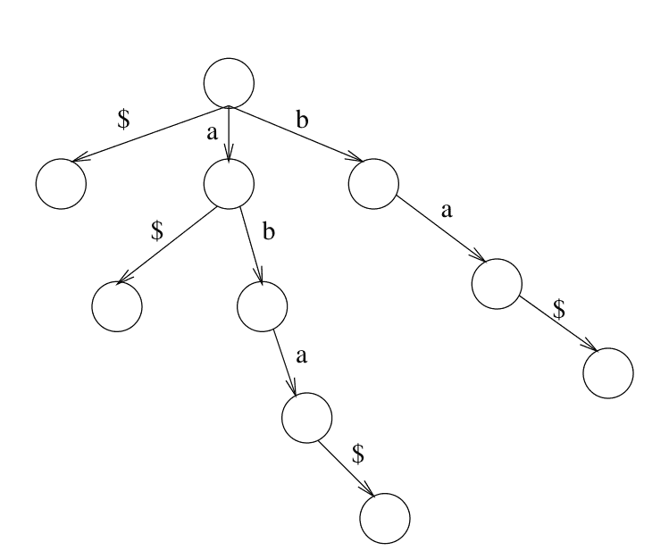

! ) □ □ □ □ □ /\AE + □ □ □ □ □ □ □ □ □ □ □ □ □ ( ! □ □ □ □ □ ! □ □ ! ) □ □ □ □ □ /\AE + □ □ □ □ □ " □ □ □ □ □ ( %) □ ! □ □ □ □ □ □ ! □ □ □ □ □ □ □ □ □ □ □ □ □ □ □ □ □ □ □ □ □ /\AE + □ □ □ □ □ " □ □ □ □ □ □ □ □ □ ( □ # □ □ ) □ ! □ □ □ □ □ □ " " □ □ □ □ □ ! □ □ □ □ □ " □ □ □ □ □ + □ □ □ " □ □ □ □ # □ □ □ □ □ □ □ □ ( %) □ & □ □ □ □ □ ( □ ! ) □ □ □ □ □ □ □ □ □ /\AE + □ □ □ □ □ □ □ □ □ □ ( % , ) ) 2 □ □ □ □ □ /\AE + □ □ □ □ □ □ □ ! □ □ □ □ □ □ □ □ □ □ □ □ □ □ □ □ □ □ □ □ □ ) ! □ □ □ □ □ □ □ □ □ □ □ □ □ □ □ □ □ □ □ □ □ □ □ □ □ □ □ □ □ □ □ □ □ # # □ □ □ □ ! □ □ □ □ □ □ □ □ % □ □ □ # □ □ □ " □ □ □ □ □ □ # □ □ □ □ □ ' □ □ □ □ □ □ /\AE + # □ □ □ □ □ □ □ □ □ □ □ □ □ □ ! ! □ % , ) □ □ □ □ □ □ □ □ □ □ □ □ ( □ /\AE + # □ □ □ □ □ □ □ □ □ □ □ □ □ % , . ! □ ) ! □ □ □ □ □ □ □ ! ! □ □ □ □ □ □ □ □ □ □ □ □ □ ( %) □ # # □ ! □ □ □ □ □ □ □ □ □ □ □ □ □ □ □ # □ □ □ " □ □ □ + □ □ □ □ □ □ □ □

! □ /\AE " □ □ □ □ □ □ □ □ □ □ □ □

& □ □ □ ! □ # □ □ # # □ □ □ □ ! □ □ . □ ! □ □ # □ □ □ □ /\AE + □ □ □ □ □ □ □ # □ □ □ □ □ □ □ □ □ □ □ □ " □ □ □ % □ □ □ □ □ □ □ □ □ □ □ □ ' □ □ □ □ □ □ □ □ %

□ □ □ □ □ □ □ □ □ □ " " ! □ □ □ □ D □ □ □ □ □ □ □ □ □ □ □ □ □ □ □ □ □ □ □ □ □ □ □ □ □ □ □ □ □ □ □ □ □ □ □ □ □ □ □ □ □ □ □ □ □ □ □ □ □ + □ □ □ □ □ □ □ ! □ □ □ □ □ □ □ □ ! □ □ □ □ ! □ □ □ %

0 □ + □ □ □ □ □ □ □ ' □ □ □ < □ □ /\AE + # □ □ □ □ □ □ □ □ □ # □ □ ! ! □ ( # □ □ □ □ □ □ □ □ ! □ □ □ □ □ ( □ □ □ ) □ □ □ □ /\AE + □ □ □ ( %) □

□ □ □ □ □ # □ □ □ /\AE □ □ □ □ □ □ □ □ □ □ /\AE □ □ □ □ □ □ □ □ □ □ □ □ □ □ □ □ □ □ □ □ □ □ □ □ □ □ □ □ □ □ □ □ □ □ □ □ □ □ □ □ □ □ □ □ □ □ □ □ □ □ □ □ □ □

□ □ □ # □ □ □ □ /\AE + □ □ □ □ □ . □ □ □ □ □ □ □ □ □ □ ! □ □ □ □ □ □ □ □ /\AE + 2 □ □ □ □ □ □ □ □ □ □ □ □ □ □ □ # ! □ □ □ □ □ □ □ □ /\AE + □ □ □ % □ □ □ □ □ □ □ □ □ □ □ □ □ □ □ □ ( □ /\AE + # □ □ □ □ ) □ ! ! □ □ □ □ □ □ □ ! □ □ □ D □ □ □ □ □ □ □ □ □ □ □ □ □ □ # □ □ □ □ □ □ □ ! □ □ □ □ □ □ □ □ □ % & □ □ □ ) # # ! □ □ □ □ □ □ □ □ □ □ □ □ □ □ □ □ □ " □ □ □ □ □ □ □ □ % □

□ □ □ □ □ □ □ □ □ □ □ □ ( □ □ □ □ □ □ □ □ □ □ □ □ □ □ □ ( □ □ □ □ □ □ □ □ □ □ □ □ □ □ □ □ □ □ □ □ □ □ □ □ □ □ □ □ □ □ □ □ □ # # □ □ □ □ ! □ □ □ □ □ □ □ □ % □ □ □ # □ □ □ " □ □ □ □ □ □ # □ □ □ □ □ ' □ □ □ □ □ □ /\AE + # □ □ □ □ □ □ □ □ □ □ □ □ □ □ ! ! □ % , ) □ □ □ □ □ □ □ □ □ □ □ □ ( □ /\AE + # □ □ □ □ □ □ □ □ □ □ □ □ □ % , . ! □ ) ! □ □ □ □ □ □ □ ! ! □ □ □ □ □ □ □ □ □ □ □ □ □ ( %) □ # # □ ! □ □ □ □ □ □ □ □ □ □ □ □ □ □ □ # □ □ □ " □ □ □ + □ □ □ □ □ □ □ □

□ □ □ □ □ □ □ □ %,□!□ □□□□ □ □□□□ □ □□□ □ □ □ □ □ □ □ □ □ □ □ □□□□□ □%□ □ □ □ □ □

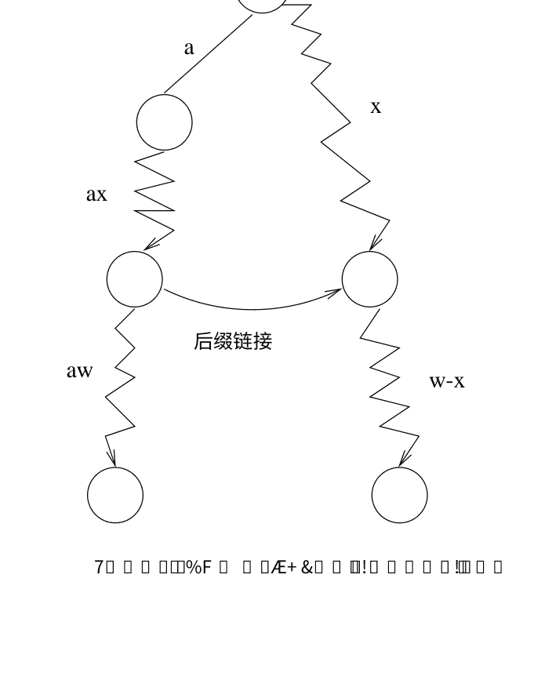

7□ □ □ □□□%F □ □□Æ+&□ □□!□ □ □ □ □□□ □ □

# □   □ □ □ □

A□ □ □ □ □□□□ □ □ □□!□ □ □ □ □□□□□□ □ □ □ □ □ □ □ □ '□□□□ □ □!□ □ □ □ □ □ □ □ □ □□Æ+ # □ □□□ □ □□ □ □!□ □ □ □ □ □ □ □□□□ □ □ □□Æ+ # □ □□ □ □) □ □ □ □"□□ □ % & □ □ □)□ □ □ □ □! □ # □ □ □ □□! □ □ □ □ □ □! □ □ □ □ □ □ □ □□□! □ □ □□□□ □ □ □□Æ+ # □ □ □ □□□□ □ □□□ □ □!□ □ □ □ □ □ □ □! □! □ □ □ □ □ □ □%

□ □ □□□□□ □ □ □ □□□□□ □ □ □ □ □ □ □□□ □ □ □ □! □ □# □!□ □□ □L2L2(□!) □ □□Æ+ □ □ □ 3% □ □ □□) □ □ □ □ □□□□ □□Æ+ # □ □ □ □□□ □ □ □ □!□□ □ □ □ □ □ □ □□## □!□ □□2 3 □ □°3% □□L2□ □## □ □ □□ □+ □ #□ □ □ □ □□□! □ □ □ □ □□ □□ □□ □ □ □! □ □□□□ □ □□ □ □ □ □□□2□3 □ □ □! □ □ □ " □ □ □ □ □ □ □%

对偶性

本讲座涵盖了弱对偶性和强对偶性，并解释了寻找线性规划对偶的规则，附带一个例子。在我们讨论对偶性之前，我们首先要了解一些关于线性规划最优解位置的一般事实。

1.1 LP解的结构

1.1.1 二维空间中的直觉

考虑一个线性规划 -

最大化 $y^Tb$
约束条件 $y^TA \leq c$

这个线性规划的可行域通常是一个凸多面体。将其在2维空间中可视化，以简化问题。现在，最大化 $y^Tb$ 与最大化向量 $b$ 所代表的方向上的向量 $y$ 的投影是相同的。无论我们选择哪个方向 $b$，最大化 $y^Tb$ 的点 $y$ 都不能严格位于可行域的内部。原因是从内部点出发，我们可以朝任何方向移动更远，仍然保持可行性。特别是沿着 $b$ 移动，我们可以到达一个投影更大的点。这种直觉表明，线性规划的最优解永远不会位于可行域的内部，而只会位于边界上。事实上，我们可以更进一步。我们可以证明对于任何线性规划，最优解总是在可行域多面体的“角落”上。这个概念在下一小节中得到了形式化。

1.1.2 一些定义

+   定义1（多面体的顶点）多面体中的一个点，它对于某个线性目标是唯一最优的，被称为多面体的顶点。
    定义2（多面体的极点）多面体中的一个点，它不是多面体中另外两个点的凸组合，被称为多面体的极点。

多面体的一个极点是指在多面体中不是其他两个点的凸组合的点。

定义3（紧致性）形式为 $a^T x \le b$, $a^T x = b$ 或 $a^T x \ge b$ 的约束在线性规划中对于某个点 $y$ 来说是紧致的，如果 $a^T y = b$。

定义4（基本解） 对于一个n维线性规划，如果有n个线性独立的约束对于该点是紧致的，则该点被称为基本解。

定义5（基本可行解） 一个点是一个基本可行解，当且仅当它是一个基本解且可行。

注意：如果x是一个基本可行解，那么它实际上是所有紧约束条件下唯一的紧点。这是因为，在n维空间中，一组线性无关的等式只能有一个解。

定理1 对于一个多面体P和一个点$x \in P$，以下命题是等价的：

+   1. x是一个基本可行解
    2. x是P的一个顶点
    3. x是P的一个极点

证明：假设LP处于规范形式。

+   1. 顶点 ⇒ 极点
    设v是一个顶点。那么对于某个目标函数c，c^T x在v处唯一最小化。假设v不是一个极点。那么，v可以写成v = λy + (1-λ)z 其中y和z都不是v，且满足0 ≤ λ ≤ 1。
    现在，c^T v = c^T [λy + (1-λ)z] = λ c^T y + (1-λ) c^T z
    但是，由于v是一个最小点，c^T v ≤ c^T y 和 c^T v ≤ c^T z。这是一个矛盾，因为v是唯一的使c^T x最小化的点。
    2. 极点 ⇒ 基本可行解
    假设x是一个极点。根据定义，它位于多面体内，因此是可行的。假设x不是一个基本解。令T为约束矩阵A的行集合，这些约束在x处是紧束的。令a_i (一个1×n向量)表示A的一行。因为 x 不是一个基本解，T 不包含 $\Re^n$。所以，存在一个向量 d=0，使得对于所有的 $a_i \in T$, $a_i \cdot d = 0$。

如果 $a_i \notin T$，那么通过选择一个足够小的 $\epsilon: 0 < \epsilon \leq min_{i / a_i \cdot d \neq 0} \frac{a_i \cdot x - b_i}{a_i \cdot d}$，我们可以确保因此，y 和 z 是可行的。由于 $x = y/2 + z/2$，x 不能是一个极端点-矛盾。

3. 基本可行解 $\Rightarrow$ 顶点

设 x 为一个基本可行解。考虑目标函数最小化 c·y 对于 $c = \sum_{i \in T} a_i$。那么，$c \cdot x = \sum_{i \in T} (a_i \cdot x) = \sum_{i \in T} b_i$。对于任意的 $x' \in P$，$c \cdot x' = \sum_{i \in T} (a_i \cdot x') \geq \sum_{i \in T} b_i$，只有当 $a_i \cdot x' = b_i \quad \forall i \in T$ 时才有相等。这意味着 $x = x'$，并且 x 唯一地最小化了目标函数 c·y。

这证明了顶点、极点和基本可行解是等价的术语。

定理2 任何标准形式的有界线性规划在基本可行解处有最优解。

证明：考虑一个最优解 x，它不是一个基本可行解。作为最优解，它是可行的，因此它不是基本的。如同前面的证明，让 T 为约束矩阵 A 在 x 处约束紧密的行的集合。由于 x 不是一个基本解，T 不能张成 $\Re^n$。因此，存在一个向量 d=0，使得对于所有的 T 中的 $a_i$，有 $a_i \cdot d = 0$。对于具有足够小绝对值的标量 $\epsilon$，$y = x + \epsilon d$ 是可行的，并且表示包含 x 在方向 d 上的一条直线。在 y 处的目标函数是 $c^T x + \epsilon c^T d$。由于 x 是最优的，$c^T d = 0$，否则，一个相反符号的 $\epsilon$ 可以减小目标函数。这意味着，这条直线上的所有可行点都是最优的。在这条直线上的运动方向将减小一些 $x_i$。继续进行，直到某个 $x_i$ 减小为0。这将导致比以前多一个紧密约束。

这种技术可以重复使用，直到解决方案变得基本。

因此，我们可以将任何可行解转换为一个不差的基本可行解。事实上，这个证明给出了解决线性规划问题的算法：在所有基本可行解上评估目标函数，并选择最佳的解。假设有 m 个约束条件和 n 个变量。由于一组 n 个约束条件定义了一个基本可行解，最多可以有 m 个基本可行解。对于每组 n 个约束条件，需要解一个线性不等式系统 $(\binom{m}{n})$。通过高斯消元法，需要 $O(n^3)$ 的时间。这通常是一个指数复杂度的算法，与 n 有关。注意，输出大小在 n 的多项式时间内，因为最优解只是一个线性等式系统的解。

## 1.2 线性规划的对偶问题

给定标准形式的线性规划问题：

> 最小化 c·x
约束条件为：Ax = b; x ≥ 0

我们将上述线性规划称为原始线性规划。问题的决策版本是：最优解是否满足c·x ≤ δ? 这个问题属于NP，因为如果我们找到一个满足最优解值 ≤ δ的可行解，我们可以在多项式时间内验证它是否满足这些要求。一个更有趣的问题是这个问题是否属于co-NP。我们需要找到一个易于验证的证明，证明不存在一个满足 c·x < δ的x。为了做到这一点，我们需要引入对偶的概念。

## 1.2.1 弱对偶性

我们寻求最优解的一个下界。考虑一个向量 y（在这里将其视为行向量）。对于任何可行解 x，都有 yAx = yb成立。如果我们要求 yA ≤ c，则有 yb = yAx ≤ cx。因此，yb是 cx的一个下界，特别是最优解 cx的一个下界。为了得到最好的下界，我们需要最大化 yb。这个新的线性规划问题：

> 最大化 yb
受限于：yA ≤ c

被称为对偶线性规划。（注意：对偶程序的对偶是原始程序）。因此，原始最优解由对偶最优解下界限制。这被称为弱对偶。

> 定理3 (弱对偶) 考虑LP z = min{c·x | Ax = b, x ≥ 0}和其对偶 w = max{y·b | yA ≤ c}。那么 z ≥ w。

推论1 如果原始问题可行且无界，则对偶问题不可行。

## 1.3 强对偶

事实上，如果原始问题或对偶问题可行，则两个最优解相等。这被称为强对偶。在本节中，我们首先用一个引力模型对定理进行直观解释。正式证明如下。

## 1.3.1 一个引力模型

考虑LP \( \min\{y·b \mid yA \geq c\} \)。我们将这个可行区域表示为一个空心多面体，向上指向向量 \( b \)。如果一个球被投入多面体中，它将停在最低点，即上述LP的最优解。注意，任何最小值都是全局最小值，因为LP的可行区域是一个凸多面体。在平衡点上，有力量的平衡 - 重力和地板（约束）的法向反作用力。让 \( x_i \) 表示第 \( i \) 个约束施加的力量。这个力量的方向由 \( A \) 的第 \( i \) 列给出。然后所有约束施加的总力 \( Ax \) 平衡重力 \( b \)：\( Ax = b \)。

物理世界还给出了约束条件，即 \( x \geq 0 \)，因为地板的力永远是向外的。只有球接触到的那些地板才会施加力。这意味着对于不紧的约束条件，相应的 \( x_i \) 的值为零：如果 \( yA_i > c_i \)，则 \( x_i = 0 \)。这可以总结为

这意味着 \( x \) 和 \( y \) 满足：

\[ y·b = \sum yA_i x_i = \sum c_i x_i = c·x \]

但是弱对偶性表明对于每个 \( x \) 和 \( y \)，都有 \( yb \leq cx \)。因此，\( x \) 和 \( y \) 是它们各自线性规划的最优解。这意味着强对偶性-原始问题和对偶问题的最优解相等。

## 1.3.2 一个正式的证明

定理4（强对偶性） 考虑 \( w = \min\{y·b \mid yA \geq c\} \) 和 \( z = \min\{c·x \mid Ax = b, x \geq 0\} \)。那么 \( z = w \)。

证明：考虑LP \( \min\{y·b \mid yA \geq c\} \)。考虑最优解 \( y^* \)。不失一般性忽略所有对于 \( y \) 不严格的约束条件。如果存在冗余的约束条件，去掉它们。显然，这些改变不会改变最优解。去掉这些约束条件会导致一个新的 \( A \)，它的列数更少，以及一个新的更短的 \( c \)。我们将证明新LP的对偶问题具有与原问题相等的最优解。通过在对应于被去掉约束条件的位置填充零，这个对偶最优解可以扩展为原问题的对偶最优解。关键是我们不需要那些约束条件来得到对偶最优解。

在放弃这些约束条件之后，最多还剩下 \( n \) 个紧约束条件（其中 \( n \) 是向量 \( y \) 的长度）。由于我们已经去除了所有冗余，这些约束条件是线性无关的。就新的 \( A \) 和 \( c \) 而言，我们有新的约束条件 \( yA = c \)。\( y^* \) 仍然是最优解。

声明：存在一个x，使得Ax = b。

证明：假设不存在这样的x，即Ax = b是不可行的。那么线性等式的“对偶性”意味着存在一个z使得zA = 0，但zb ≠ 0。不失一般性，假设zb < 0（否则，只需取−z）。现在考虑(y + z)。A(y + z) = Ay + Az = Ay ≤ c。因此，它是可行的。
(y^* + z).b = y^*.b + z.b < y^*.b，这比假设的最优解更好——矛盾。因此，存在一个x使得Ax = b。所以，存在一个x使得Ax = b。
让这个称为 x^*。

声明：y^*.b = c.x^*。

证明：y^*.b = y^*.(Ax)^* = (y^*.A).x = c.x（因为 Ax = b 和 y^*A = c）

声明：x^* ≥ 0

证明：假设相反。那么，对于某个 i， x^*_i < 0。令 c' = c + e'_i，其中 e_i 在第 i 个位置以外都是0。由于 A 具有满秩， yA ≥ c 有一个解，记为 y'。此外，由于 c' ≥ c， y' 对于原始约束 yA ≥ c 是可行的。但是，y'.b = y'Ax^* = c'x^* < cx^* = yb（因为 c_i 现在更高且 x_i < 0）。这意味着 y' 给出了比最优解更好的目标值-矛盾。因此， x^* ≥ 0。

因此，在对偶中存在一个可行的 x，其目标与原始问题相等最优解。因此，根据弱对偶性， x 必须是对偶问题的最优解。因此，原始问题和对偶问题的最优解是相等的。

推论2 检查线性不等式系统的可行性和优化线性规划问题的难度是相同的。

证明：优化器 → 可行性检查器
使用优化器来优化任意的函数，将线性不等式系统作为约束条件。这将自动检查可行性，因为每个最优解都是可行的。

可行性检查器 → 优化器
我们构建了一个从寻找 LP_1 的最优解到寻找 LP_2 的可行解的约化。考虑 LP_2 = min { 0.x | Ax = b, x ≥ 0, yA ≤ c, c.x = b.y }。任何 LP_2 的可行解都会给出 LP_1 的最优解，这是由于强对偶定理。因此，寻找最优解并不比寻找可行解更困难。

## 1.4 对偶规则

通常原始问题被构造为最小化问题，因此对偶问题变成了最大化问题。对于标准形式，原始问题如下：

z = min (c^T x)
Ax ≥ b
x ≥ 0

而对偶问题如下：

w = max (b^T y)
A^T y ≤ c
y ≥ 0

对于原始问题的混合形式，对偶问题描述如下：
原始问题：

z = min c_1x_1 + c_2x_2 + c_3x_3
A_11x_1 + A_12x_2 + A_13x_3 = b_1
A_21x_1 + A_22x_2 + A_23x_3 ≥ b_2
A_31x_1 + A_32x_2 + A_33x_3 ≤ b_3
x_1 ≥ 0
x_2 ≤ 0
x_3    无限制

对偶：

w = max y_1b_1 + y_2b_2 + y_3b_3
y_1A_11 + y_2A_21 + y_3A_31 ≤ c_1
y_1A_12 + y_2A_22 + y_3A_32 ≥ c_2
y_1A_13 + y_2A_23 + y_3A_33 = c_3
y1 无限制
y2 ≥ 0
y3 ≤ 0

这些规则总结在下表中。

| 原始约束 | 最小化问题 | 最大化问题 | 对偶变量 |
| :--- | :--- | :--- | :--- |
| ≥ b_i | ≥ 0 | 变量 |
| ≤ b_i | ≤ 0 |      |
| = b_i | 自由 |      |
| **原始变量** | **最小化问题** | **最大化问题** | **对偶约束** |
| ≥ 0 | ≤ c_j | 约束 |
| ≤ 0 | ≥ c_j |      |
| 自由 | = c_j |      |

原始中的每个变量对应于对偶中的一个约束，反之亦然。对于最大化问题，上界约束是“自然”约束，而对于最小化问题，下界约束是自然约束。如果约束是自然方向的，则相应的对偶变量是非负的。

有一个有趣的观察是，原始问题越紧，对偶问题越松。例如，在原始问题中的等式约束导致对偶问题中的无限制变量。在原始问题中添加更多约束导致对偶问题中的更多变量，因此更灵活。

## 1.5 最短路径-一个例子

考虑在图中寻找最短路径的问题。给定一个图 G，我们希望找到从指定源节点到所有其他节点的最短路径。这可以表示为一个线性规划问题：

w = max (d_t - d_s)
s.t. d_j - d_i ≤ c_ij, ∀i,j

在这个公式中，d_i 表示节点_i到源节点_s的距离。约束条件c_ij本质上是三角不等式-从源节点到节点_i的距离不应该超过从节点_j到节点_i的距离加上从节点_j到源节点的距离。

直观地，人们可以想象将网络物理上拉伸，以增加源-目标距离。当我们无法再拉动而不破坏一条边时，我们找到了一条最短路径。

这个程序的对偶如下。原始问题中的约束矩阵对于每对节点(i, j)都有一行，并且对于每个节点都有一列。对应于(i, j)的行在第i列上有+1，在第j列上有-1，在其他地方都是零。

1.  基于此，我们得出结论，对偶问题对于每对(i, j)都有一个变量，称为y_{ij}。
2.  它对于每个节点i都有一个约束。对于进入节点i的每条边，约束的系数为+1，对于离开i的每条边，系数为-1。约束的右侧对于节点s的约束为-1，对于节点t的约束为1，对于其他节点为0，基于原始问题中的目标函数。此外，所有约束都是等式约束，因为原始问题中的d_i变量在符号上没有限制。
3.  对偶变量也必须具有非负约束，因为原始问题中的约束是“自然”的（最大化的上界）。
4.  目标是最小化∑_{i,j} c_{ij} y_{ij}，因为原始约束的右侧是c_{ij}。

因此，对偶问题是：

z = min ∑_{i,j} c_{ij}y_{ij}
∑_{j}(y_{js} - y_{sj}) = -1
∑_{j}(y_{jt} - y_{tj}) = 1
∑_{j}(y_{ji} - y_{ij}) = 0, 对于所有的 i ≠ s, t
y_{ij} ≥ 0, 对于所有 (i, j)

这正是解决最小成本单位流的线性规划问题，以总流量为1的形式。这些约束对应于除源点和汇点之外的所有节点的流量守恒。流量的值被强制为1。直观地说，这意味着我们可以使用最小成本单位流算法来找到网络中的最短路径。

对偶性是一个非常有用的概念，特别是因为它可以从不同的角度来看待手头上的优化问题，这可能更容易处理。

## 10.1 最短增广路径：单位容量网络

解决最小成本流问题的最短增广路径算法是最大流问题的自然扩展。请注意，这里的最短路径是由边的成本定义的，而不是边的容量。

对于单位容量图的情况，我们假设所有弧的容量都是单位容量，并且没有负成本弧。因此，循环中任何流的值必须小于或等于 n。鉴于每个增广路径将流的值增加1，最多需要 n 个增广步骤来找到最小成本流。

可以使用任何单源最短路径算法找到最短增广路径。由于图中没有负权边，我们可以使用Dijkstra算法。每个路径计算需要 O(m log n) 时间，总运行时间为 O(nm log n)。

出现了两个问题：

- 如果增广操作创建了负权边怎么办？
- 我们如何知道结果是最小费用流？

我们通过以下命题回答这两个问题。

**命题1** 在SAP算法下，残余图中永远不会出现负的约减成本循环。

**证明：**（归纳法）。我们想要证明一个SAP不会在 G_f 中引入负循环。最初没有负成本循环。可以通过使用从 s 开始的最短路径距离来计算可行价格。在找到最短的 s-t path之后，它的约减成本为0。路径上的每条弧的约减长度为0。这证明了最短路径边上的三角不等式性质是紧密的。因此，当我们沿着路径增广时，我们创建的残余反向弧的约减成本为0。因此，在新的 G_f 中，价格函数仍然是可行的。此外，还有：

- 没有剩余负约减成本弧
- 没有负约减成本循环
- 没有负成本循环

这个声明的证明也证明了算法的正确性，因为它也适用于算法终止时的剩余图。

我们提出的SAP算法有两个限制。它只适用于单位容量图，并且不能处理具有负成本循环的图。

## 10.2 MCF按容量缩放：一般网络

我们可以通过缩放将SAP算法扩展到一般容量网络。在每个缩放阶段，我们增加一位精度，总共 O(log U) 个阶段。

在每个阶段结束时，我们都有一个MCF和一个可行的价格函数。在引入下一位之后，我们可以在负约减成本弧上引入剩余容量。这将导致价格函数不再可行。我们可以通过沿着负弧发送流量来解决这个问题。这会在某些节点上引入流量过剩（一单位）和其他节点上的流量不足（一单位）。

我们使用最大流最小割算法将多余的流量发送回不足的地方。

由于每条弧最多可以产生一单位的多余流量，总的多余流量最多为 m 单位，所以 m 个最短增广路径足以将所有多余流量发送回不足的地方。使用迪杰斯特拉算法寻找最短增广路径，与之前一样，每个阶段的运行时间为 O(m^2 log n)。算法的总运行时间为 O(m^2 log n log U)。

## 10.3 最大流最小割算法的成本缩放

在一般网络中解决最大流最小割问题的另一种方法是通过成本缩放，而不是容量。这对于具有整数成本的图形很有用，因为所有循环的成本都是整数。这个想法是允许略微负成本的弧，并不断改进价格函数。我们引入了 ε-最优的概念：

定义1：如果对于所有剩余弧 (i,j)，其约减成本 c_{ij}^{p} = c_{ij} - p(i) + p(j) ≥ -ε，则价格函数 p 是 ε-最优的。

我们从一个最大流和一个零价格函数开始，这将是 C-最优的。在每个阶段，我们从一个 ε-最优的最大流转换为一个 (ε/2)-最优的最大流。我们什么时候可以终止算法？

命题2 一个 1/(n+1)-最优的最大流是最优的。

证明：我们从观察到在一个整数成本图中，最小的负循环成本是-1开始。剩余网络中的所有循环成本至少为 -n/(n+1)，这严格大于 -1。因此任何剩余循环的约减成本至少为 -n/(n+1)，而一个 1/(n+1)-最优的最大流是最优的。

为了从一个 ε-最优的最大流得到一个 (ε/2)-最优的最大流，我们首先饱和所有负成本的剩余弧。这使得所有剩余弧的约减成本为非负，但是引入了网络中的过剩和不足。然后，我们使用最小费用流将过剩推回不足，而不允许任何边的约减成本降低到 -ε/2 以下。

使用动态树，该算法的运行时间为 O(mn log n log C)。

## 10.4 最新技术

双重缩放算法结合了成本和容量缩放的思想。它的运行时间为 O(mn log C log log U)。

Tardos的最小平均成本循环算法（'85）是一个强多项式算法用于MCF。该算法通过找到平均每条边成本最负的负循环来进行处理。因此，特定负性的短循环优于长循环。该算法使用了来自 ε-最优性思想的成本缩放技术。在每次 m 步负循环饱和之后，一条边变为“冻结”，意味着其流量值不再改变。最小平均成本循环算法的时间复杂度为 O(m^2 polylog m)。

□ □ □ □ □ □□□ □ □ □ □ □ □□□□ □ □ □ □ □ □□□□ □ □ □ □ □ □□□□ □ □ □ □ □ □

□ □ □ □ □ □□□ □ □ □ □ □ □□□□ □ □ □ □ □ □□□□ □ □ □ □ □ □□□□ □ □ □ □ □ □□□□ □ □ □ □ □ □□□□ □ □ □ □ □ □

□ □ □ □ □ □□□ □ □ □ □ □ □□□□ □ □ □ □ □ □□□□ □ □ □ □ □ □□□□ □ □ □ □ □ □□□□ □ □ □ □ □ □□□□ □ □ □ □ □ □

□ □ □ □ □ □□□ □ □ □ □ □ □□□□ □ □ □ □ □ □□□□ □ □ □ □ □ □□□□ □ □ □ □ □ □□□□ □ □ □ □ □ □□□□ □ □ □ □ □ □

1. □ □ □□□ □□ □ □ □ □□□□ □□ □ □ □ □ □□□□ □ □ □ □ □ □□□□ □ □ □ □ □ □□□□ □ □ □ □ □ □□□□ □ □ □ □ □ □
2. □ □ □ , □ □ □ □ □ □□□□□! □ □ □ □ □ □ □ □ □ □ □ □ □ □ □ □ □ □ □ □ □ □ □ □ □ □ □ □ □ □ □ □

一段文本

另一段文本

## 标题

带引用的段落 "引用内容"

- 列表项1
- 列表项2

| 列1 | 列2 |
| --- | --- |
| 数据1 | 数据2 |

```
代码块内容
```

> > 引用段落

正文段落


结尾段落# 第章（标题）

第一段内容（乱码文本）

第二段内容（乱码文本）

第三段内容（乱码文本）

## 文档标题

## 副标题

这是一段介绍性文本内容，用于说明文档的背景和目的。

- 列表项一
- 列表项二
- 列表项三

> > 这是一段引用文本，用于强调或引用其他来源。

```
示例代码块
代码内容
```

这是最后一段文本，用于总结或结束文档。

# # 文档标题

这是一个段落的内容，包含一些文本。

- 1. 第一项
- 2. 第二项

> > 这是一个引用文本。

```
代码示例
```

由于图片内容显示为乱码或损坏的文本，无法准确提取标题、段落、列表等元素。图片中包含无法识别的字符和符号，可能由于编码或加载问题导致。

## 文档标题

这是一个段落，内容基于图片中的文本块提取，但由于编码问题显示为乱码。

- 1. 项目一
- 2. 项目二
- 3. 项目三

```
代码示例：
$ echo 'Hello World'
```

```
□& □□□□□□□□□□□□□□□□□□□□□□□□□□□□□□□□□ □ □□□□□□□□□□&
□&' □□□□□□ □ □□□□□□□□□□□□□□□□□□□□□□□□□□ □□□□□□□ □ □□□□□□□□□□□ &
□&9 □□□□□□□□ □ □ □□□□□□□□□□ □□□□□□□□□□□□□□ □ □□□□□□□ □ □ □&
```

* □□□□□□□□□□□□□□□□□□□□□□□□□□□□□□□□□□□□□□□ □ □□□□□□□□□□□□□□□□□□□□□□□□□□□□□□"□□
4□ □□ □! □□□□□□□□ □□□□□.□□□□ □□□□ □7 □ & 1 □ □ □□□□□□□□□□□□□□□□□□□□□□□□□□□□□□□□□□□□□□ □ □□□□□□□□□□□□□□□□
!□ □□□□□□□□□ □ □□□□ +0□&

/ □□ □,□ □ □□□□" □□ □ □□□□□□□□ □ □□□ □□□□ □□□□□□□□□□□□□ □□□ □ □
(□ □ □ *□□□□ □□□

□ □ □+□ 0□ □□□ □! □ □ >□ □□□□□□□□□ □□□□□□□ □ □□□ □□□□ □□ □□□ □( □□□□ □□□□□□□□□□□□□□□ □ □
□ □ □□□7□ □□ □ □□□□ □□□□□□□□□□□&□) □□ □7 □□□□ □ □□□□ □ □ □□□ □□□□□ □□□□□□□ □
□□ □□□□ □□□□ □□□□ □□□□□□□□□□□□□□□□□□□ □□□□□□□□□□□□ □7 □□ □ □□□□□□□□□□□□□□□ □ □□□□ □& □ □
1 □ □ □ □7 □ □□□□ □□□□ □□□□□□□ □ □□□□ □□□□□ □□□# □□□□□□□□□□□□□□□□ □$□□□□□□ □□ □□ □□□□□□□□□□□ □ □
□ □□□□! □□□□ □ □□

```
    □ □ □□□□□□□□ □
    □ □□ □
    □ □□
```

□□ □□□□□□ □□□ □ □□□□ □ □□□□ □ □□□□□□ □□□□□7 □ □□□□□ □□□□□ #□ □□ □□□ □□□ □□□□ □□
!□ □ > □□□ □ □ □□□□ □□□$ □□□□□□

```
    □□□□ □ = □
    □ □#□ = □$□
    □ □#□ = □$□ □ □$□
```

5□ □□ □ □□□□□□□□□□□□□ □□□ □ □□□□ □

# □□ □□# □ = □$□ □ #□$□

1 □ □ □ □□□ □□□□ □ □□□ □7 □ □□□□ □ □□□□ □□ □ □□□□□□□&□)□□ □ □□□□□ □□□7□□ □□□□ □□□□ □□□□□□□□
! □□□□"□□□□ □□□ □ □□ □□ % □□□□ □ #□$&' □□ □□□ □ □□ □□□□□□□□□□ □□□□□ □ □□□□ □□□ □ □□□□□ □ □ □□□□
□ □□□ □ □□□□ □ □□□□ □□□□□.□□ □□□□ □□□□7□ □□□ □ □ □□□□ □□□ □□□□ □□□□ □□ □ □ □□□□ □□□□ □□□□ □□ □□ □□□
□ □8 □□□!□□ □□□□ □□□□ □□□□□□□□□□□□□ □7 □ & □□□□ □ □□□□ □□□□ □□□□ □!□□□□□ □□□□□□□□□□ □ □□□
□ □□□□□ □□□□□ □□□□#□$□ □□□ □□ □ □□□ □□□ □□□□□□□□ □□□□# □□□ □$ □□ □□□! □ " □ □□□□□□□□□ □□□□□ □□□
4(□ & 1 □ □□□□□□□□□□ □ □ □□□□ □□□□ □ □□□# □ = □$, □!! □( □ □□□ □□□□□□□ □ □□ □□□□□! □ " □ □ □ □□
□!!□( □ □□□ □□□ □ □□ ■□&

    □ □□□□' □□□ □ □□ □ □□□□□□□ □!! □(□ □□□□ □□□ □□□□□ □ □□□□□ □ □□□□□□□□ □ □□□□□□□ 4(□ □& 0
4□ □□ □! □ □ □□□□□ □ □□□□□□□□□ □ □□□□ □□□□□ □□□□□□□□ +□ □□□□□□□□□□□□□□□ □□□□□□□□□ □ □□□□□ □ □ □□ □□ □
□ □" □! □ □□ □ □- □ □# □ □ "! □$ □7 □ □ □□ □□□ □ □□□ □ □□□ "□" □□ □□□□□□ □&□) □ □ □ □□□□ □□□ □□ □□ □□□□ □
□ 4 □□□ □!□□ □□□□ □□□ □ □□ □! □ " □ □ □□□□□□□□□□□□□ " □ □□ □□□□ □□□□□□□□□□ □&□ □□□ □ □□□□ □□ □□□ □□□□
7 □ □ □□□□ □ □□ □□□□" □ □ $! □ 4 □ □H □ □ □□ □□□ □ □ □□□□□ "□□□ □□□70 □□□□ □! □ □□□□ □

## 文档编辑助手使用说明

; 请确保在提交前仔细检查文档格式。文档格式应遵循以下规范：使用标准字体，如宋体或黑体；标题应使用加粗样式；段落首行缩进两个字符；列表项使用阿拉伯数字或项目符号；表格应清晰对齐；插图需有明确的图注和编号；引用内容应使用引号并注明来源；代码块应使用等宽字体并高亮显示。

请在提交前确认所有链接均有效且指向正确的资源。

请确保文档内容准确无误，没有拼写或语法错误。

; 文档版本应标注为 V1.0，修订日期为 2023年10月27日。所有修改需记录在修订历史中。最终版本需经由项目负责人审核批准后方可发布。发布渠道包括内部知识库和公司官网。

审核状态：已批准 发布状态：已发布

"文档发布后，请通知所有相关团队成员查阅。"

) 相关团队成员应在三个工作日内阅读并反馈意见。如有重大修改意见，需提交修订申请。

| 项目 | 负责人 | 截止日期 |
| :--- | :---: | :--- |
| 格式校对 | 张三 | 2023-10-30 |
| 内容审核 | 李四 | 2023-10-31 |
| 最终发布 | 王五 | 2023-11-01 |

) 请各负责人按时完成任务，确保项目进度。

| 状态 | 描述 |
| :--- | :--- |
| 进行中 | 任务正在执行中 |
| 已完成 | 任务已成功结束 |
| 待审核 | 任务结果待上级确认 |

# □ □ □ □ □□□  □

□ □□

$□ □ □ □

□ □ □ □□ □ □ □ □ □ □ □ □ □□□□'□□□ □ □ . □ □ □! □□□ □ □ □# □□□ □

+   * □ □ □ □□□ □ □ □0 □ □ □ □□□□ □ □ □ □□□'□ □ □ □ □ □ □ □ □ □□□ □ □ □A3# 3 □ □ □ □$□□ □ □ □ □ □ □ □ □ □ □ □□□□□ □ □ □' □□□□ ,□ □- □ □ □ □□ □□□□ □ □,□- □ □ ' □ □ □ □□□□□ □ □ □□□□□ - □ □ □□- □ -# ; □ □ □

+   □,□- □ □    □,□- □,□-: □ □ □

□ □ □ □□□,□- □ □ ' □ □ □ □ □    □#

□ □ □□□□□ □ □ □ □□□ □ □ □ □0 □ □ □ □□□□□ □ □ □ □ □ □ □ □ □□"□□□□□ □ □ □ □ A3#

□ □ □ □ □□□□ □□□

□ □ □ □   □ □ □ □□□ □ □

# □ □ □ □ □□□ □ □ □=

□ □ □ □ □□% □ □ &□ □ □ □ □□□ □ □ *□ □ □ □□□□ □ □ □ □ □□□□ □ □ □ □ □ □ □ □ □ □□(□ □ □ □ □ □ □ □ □ □ □ □ □ □ □ □ □ □ □

> □ : □ , □-□ ,□ □□ -

)□ □ □ □□□□ □ □ □□□□ □ □□□□ □ □ □□□□□ □ □ □ □ □ □ .□ □ □ □ □ □$□□□ □□□ □ □ □ □ □ □ (□ □ : □ □ □ □ □ ,□ □□?- □ □

)□ □ □□ □ □ □ □ □ $ □□□□□ □ □ □ □ □ □ □ □ □ □ □ □ " □ □ □ □ □ □ □ □ + □ □ □□#%□□□#□ □□ : □ □ □ □ □□ □ □ □ □ □ □ □ □ □ (□□□ □ □ □ □ □ □ □ □ □ $ □□ □□□□-# %□ □ □ □

5C/ □# □ " □ □ □ ( □ □ □ □ □ □ □□: □□ □□ □ □ □ □ □ □ □ □ □ - □ □ ,□ □□@-

&□ □ □ □ □□□ □ □ □ □ □'□□□ □ ! □ □ □ □ □□□□ □ □ □ □ □ □ □ ( □□ □□□□□'□□ □! □ □ □ □-□□ □□□% □ □ □ □ □ □ □ □ □ □ □ , □ □- □ □ □ □□□□ □ □ □□□□ □ □ □ □ □ # □ □

# 15.1上一讲的补充说明

定理1 如果原始问题P（原始）或对偶问题D（对偶）是可行的，则它们具有相同的值。

# 15.2对偶问题的规则

一般来说，我们将原始问题P构造为最小化问题，而对偶问题D构造为最大化问题。如果P是标准形式的线性规划问题，给定如下：

```
z = min(c^T x)
Ax ≥ b
x ≥ 0
```

那么对偶问题D可以表示为：

```
w = max(b^T y)
A^T y ≤ c
y ≥ 0
```

一般来说，对偶的形式取决于原始问题的形式。如果给定一个混合形式的原始线性规划问题 P：

```
x = min(c1 x1 + c2 x2 + c3 x3)
A11 x1 + A12 x2 + A13 x3 = b1
A21 x1 + A22 x2 + A23 x3 ≥ b2
A31 x1 + A32 x2 + A33 x3 ≤ b3
x1 ≥ 0
x2 ≤ 0
x3 符号无限制 (UIS)
```

那么对偶问题 D 的形式为：

```
$$w = \max(b_1 y_1 + b_2 y_2 + b_3 y_3)$$
$$\begin{align}
y_1 A_{11} + y_2 A_{21} + y_3 A_{31} &\leq c_1 \\
y_1 A_{12} + y_2 A_{22} + y_3 A_{32} &\geq c_2 \\
y_1 A_{13} + y_2 A_{23} + y_3 A_{33} &= c_3 \\
y_1 &\quad \text{无限制的符号 (UIS)} \\
y_2 &\geq 0 \\
y_3 &\leq 0
\end{align}$$
```

通过简单的转换，我们可以确认这与原始的对偶形式一致，并且事实上对偶的对偶是原始的。

我们可以用下表总结这些结果，表明了取对偶的规则。
请注意，原始中的每个变量对应于对偶中的一个变量，原始中的每个约束对应于对偶中的一个变量。

| 原始 | 最小化 | 最大化 | 双重 |
|------|--------|--------|------|
| 约束 | ≥ b_i<br>≤ b_i<br>= b_i | ≥ 0<br>≤ 0<br>无限制 | 变量 |
| 变量 | ≥ 0<br>≥ 0<br>无限制 | ≤ c_j<br>≤ c_j<br>= c_j | 约束 |

请注意，这是有直观意义的。 例如，原始的最小化问题具有自然约束作为下界。 这对应于对偶最大化问题中的正变量。相反，原始的最大化问题具有自然约束作为上界。

现在，对偶最小化问题具有一个负变量。

为了对这些关系有直观的理解，我们考虑变量的符号对极小化问题中相应约束的类型的影响。

根据弱对偶性，我们知道 $c^T x \geq yb = yAx$。考虑 $x_1 \geq 0$ 的情况。 那么为了使 $yA x_1 \leq c_1 x_1$成立，对于任意的 $y$，我们必须有 $yA_{11} \leq c_1$。类似地，如果 $x_2 \leq 0$，则为了使 $c^T x \geq yAx$成立，我们必须有$yA_{12} \geq c_2$。最后，对于 $x_3$不受限制，我们必须有 $yA_{13} = c_3$，因为将两边都乘以 $x$可能会改变任何不等式的方向。一般来说，原始问题中的更严格的约束导致对偶问题中的更宽松的约束。相等的约束导致一个不受限制的变量，而添加新的约束则会创建新的变量和更多的灵活性。

我们现在来看一个例子，展示原始问题和对偶问题之间的关系。我们考虑将最短路径问题表述为一个线性规划问题。给定一个图 $G$，我们希望找到从一个点（源点）到另一个点的最短路径。我们将问题表述为一个对偶（或最大化）线性规划问题。

```
w = \max(d_t - d_s) \\
d_j - d_i \leq c_{ij} \\
d_j \quad \text{无限制}
```

每个变量 $d_i$ 表示到顶点 $i$ 的距离，每个约束表示三角不等式——即，到顶点 $i$ 的距离应该始终小于等于从顶点 $j$ 到顶点 $i$ 的距离加上从顶点 $j$ 到顶点 $i$ 的距离。对于这个问题的任何可行解都会找到最短路径距离的下界——最大化目标确保这些最短路径距离是有效的。你可以想象将源点和汇点物理上拉开，慢慢地。第一次无法再拉开时，这表示已经到达最短路径。

约束矩阵 $A$ 有 $2$ 行和 $n$ 列，元素为 $\pm 1$ 或 $0$。每行 $ij$ 在列 $i$ 中有 $1$，在列 $j$ 中有 $-1$，在其他列中为 $0$。因此，我们可以将原始问题写成如下形式：

```
z = \min(c^T x) \\
= \sum_{i,j} c_{ij} x_{ij} \\
\sum_{j=1}^{n} x_{js} - x_{sj} = -1 \\
\sum_{j=1}^{n} x_{jt} - x_{tj} = 1 \\
\sum_{j=1}^{n} x_{ji} - x_{ij} = 0 \quad \text{对于所有的 } i = s, t
```

但这只是一个最小成本单位流的线性规划！约束条件表示流量守恒，其中一单位流量进入汇点，一单位流量从源点流出。所有其他顶点的流入流出量必须相等。因此，任何可行的线性规划解都将是一个可行的流量。目标函数只是试图最小化这个流量的成本。我们可以看到，LP的对偶问题通常可以让我们从不同（但等价）的角度理解问题。

考虑一个线性规划问题 $\min\{cx \mid Ax \geq b\}$。我们考虑一个由一组约束条件定义的中空多面体。让 $c$ 是指向上的引力向量。我们可以把一个球放在多面体中，让它掉到底部。

在平衡点 $x$处，地板施加的力与重力力平衡。
地板的法向力与 $A_i$的方向对齐。因此，我们有 $c = \sum y_i A_i$，其中
非负的力系数 $y_{i}$。特别地， $y$是一个可行解，满足$\max\{yb \mid yA =c, y \geq 0\}$。
由于力只能由接触球的墙壁施加，所以如果$A_{-i}^*x > b_{-i}$，则$y_{-i}=0$。
因此，我们有

$$y_{-i}^*(a_{-i}^*x - b_{-i})=0,$$

因此，

$$yb = \sum\ y_{-i}^*(a_{-i}^*x_{-i})=cx,$$

这意味着$y$是对偶最优解。

# 15.5互补松弛

上述例子引出了互补松弛的概念。给定可行解$x$和$y$， $cx - by \geq 0$被称为对偶间隙。只有当间隙为零时，解才是最优的。
因此，间隙是衡量我们离最优解有多远的好指标。
回到原始的原始和对偶形式，我们可以重写对偶形式： $yA + s = c$，其中$s \geq 0$ （即$s = c_j - yA_j$）。

# 定理2：对于可行的$x$和$y$，以下是等价的：

- $x$和$y$是最优的
- $sx = 0$
- $x_j s_j =0$对于所有的$j$
- $s_j > 0$意味着$x_j = 0$

证明：首先， $cx = by$当且仅当

$$(yA + s)x = (Ax)y,$$

因此， $sx = 0$. 如果$sx=0$，那么由于$s$, $x \geq 0$，我们有$s_j x_j=0$，所以当然$s_j > 0$会强制$x_j=0$.
相反很容易。 ■

互补松弛的基本思想是，最优解不能同时具有变量 $x_j$和相应的对偶约束 $s_j$ slack —— 必须有一个是紧的。
这可以用另一种方式陈述：

```
$$y_{i}(a_{i}x - b_{i}) = 0 \text{ 对于所有 } i,$$
$$(c_{j} - yA_{j})x_{j} = 0 \text{ 对于所有 } j$$
```

证明：注意在原始/对偶的定义中，可行性意味着 $y_{i}(a_{i}x - b_{i}) \geq 0$（因为 $\geq$ 约束对应非负的 $y_{i}$) 。另外，$(c_{j} - yA_{j})x_{j} \geq 0$，因此

$$\sum y_{i}(a_{i}x - b_{i}) + (c_{j} - yA_{j})x_{j} = yAx - yb + cx - yA x = cx - yb = 0$$

在最佳状态下。但由于所有项都是非负的，它们必须全部为0。 ■

# 15.6使用互补松弛性的示例

在某些线性优化问题中，通过研究其原始和对偶的最优解，我们可以获得新的见解，使用互补松弛性。我们将给出两个示例。在第一个示例中，我们将考虑最大流问题的线性规划形式。使用互补松弛性，我们推导出最大流最小割定理。在第二个示例中，我们考虑最小成本循环问题。使用线性规划框架，我们给出了互补松弛性性质的另一种证明，这是在第13讲（关于最小成本流的讲座）中介绍的。

# 15.6.1最大流最小割定理

在最大流问题中，我们可以想象网络具有一条弧 $(t, s)$，其容量为无穷大。我们正在最大化该弧上的流量。因此，最大流问题可以写成如下形式（以总流量形式）：

```
$$\text{最大化 } x_{ts}$$
$$\sum_{w} x_{vw} - x_{wv} = 0$$
$$\begin{aligned}
x_{vw} &\leq u_{vw} \\
x_{vw} &\geq 0
\end{aligned}$$
```

在对偶问题中，对于每个节点 $v$都有一个守恒约束。此外，对于每条边 $(v, w)$ 都有一个容量约束。因此，在原始形式中，我们对于每个守恒约束有一个变量 $z_{v}$，对于每个容量约束有一个变量 $y_{vw}$。因此，原始形式为：min Σ u_{vw} y_{vw}
      vw
     z_v - z_w + y_{vw} ≥ 0
     z_t - z_s + y_{ts} ≥ 1
           y_{vw} ≥ 0

我们将第一组约束条件重写为 y_{vw} ≥ z_w - z_v。此外，第二个约束条件可以写成 z_t - z_s ≥ 1。这是因为在任何最优解中 y_{ts} = 0。如果在某个最优解中 y_{ts} > 0，那么 u_{ts} = ∞ 意味着 u_{ts}y_{ts} = ∞，因此最优值是无界的。这是不可能的，因为最大流问题从不是不可行的（特别是零流是一个可行解）。

如果我们将 y_{vw} 视为 (v, w) 的边长，将 z_v 视为从 s 到 v 的距离，我们可以这样解释对偶问题：通过调整边长来最小化网络的体积，同时满足从 s 到 t 的距离至少为 1 的约束。这里网络的体积定义为边容量 u_{vw} 和边长 y_{vw} 的乘积的边体积之和。

请注意，原始问题中的最优解最多是网络的最小割值，因为我们可以将最小割边的长度设为1，否则设为0。这满足了 s-t 距离约束（因为任何 s-t 路径都必须经过某个割边）。这个解的值是最小割边容量的总和。根据强对偶性，这意味着最大流 ≤ 最小割。现在我们证明另一个方向。

将 z_{v}, y_{vw} 表示为原始问题的最优解，类似地，将 x 表示为对偶问题的最优解。由于 z 是距离，我们总是可以将 z 重新缩放为 0。令 T={v | z_v ≥ 1}。注意 s ∉ T，t ∈ T。因此，T 是一个 s-t 割。

现在考虑任意穿过切割的边 (v, w)：

1. 如果 v ∈ T 且 w ∉ T，则 z_v ≥ 1 且 z_w < 1。因此， z_v - z_w + y^*_{vw} ≥ z_v - z_w > 0。因此，原始问题中边 (v, w) 的约束是松弛的。根据互补松弛条件，对偶问题中的变量 x_{vw} 必须是紧绷的，即 x_{vw} = 0。

2. 如果 v ∉ T 且 w ∈ T，则 z_v < 1 且 z_w ≥ 1。由此可得，变量 y^*_{vw} ≥ z^*_w - z^*_v > 0。同样，根据互补松弛条件，对偶问题中的约束 x_{vw} ≤ u_{vw} 是紧绷的。因此， x_{vw} = u_{vw}。

换句话说，在最大流中，进入 T 的所有边都饱和，离开 T 的所有边都为空。因此，在最大流中，进入 T 的净流量等于 T 的割值。由于流量值等于任何 s-t 割中进入的净流量，最大流值等于 T 的割值，至少等于最小割值。因此，我们已经证明了最大流 ≥ 最小割，这完成了最大流最小割定理的证明。

## 扫描线

定义1 扫描线技术：给定一个平面问题，在平面上扫描一条线，处理发生在线上的事件，并留下解决了的问题的部分。

### 17.1凸包

凸包问题是找到平面上给定点集的最小包围凸多边形。

#### 17.1.1算法

解决凸包问题的一种方法是使用扫描线技术找到凸包的上包络线。凸包的下包络线可以通过稍微修改以下算法重新运行来找到。

使用从负无穷到正无穷在x轴上扫过的垂直扫描线。当扫描线扫过时，我们将维护扫描线左侧点的部分凸包。当扫描线穿过一个新点时，我们需要更新部分凸包以包括新点。当扫描线经过所有点后，我们将得到凸包的完整上包络线。

为了确定扫描线穿过点的顺序，我们可以使用优先队列，如最小堆，按照它们的x坐标排序。因此，唯一剩下的问题是如何将新点插入到现有凸包中。插入新点时，会出现两种情况：(1)现有凸包可以扩展以包括新点，或者(2)新点需要修改现有凸包。非正式地说，我们可以通过观察到在情况(1)中，新点会导致凸包边界的“右转”，而在情况(2)中，新点会导致凸包边界的“左转”来区分这两种情况。这可以通过计算包络的最右边线段与最右边包络点和新点之间的线段之间的角度来确定。如果角度小于180度，则属于情况(1)，否则属于情况(2)。

情况1：由于新点可以安全地添加到现有的包络线上而不违反其凸性，因此新点直接添加到包络线点的列表中。

情况2：在这种情况下，新点不能安全地添加到现有的包络线上而不违反其凸性，因此必须修改现有的包络线以容纳新点。这可以通过以下步骤完成。在新点上的包络线。对新点的前任进行凸性检查。如果凸性检查失败，则从包络线中删除该点。现在，新点有一个新的前任。在新点的前任上重复凸性检查和删除，直到凸性检查满足为止，此时我们将再次获得一个有效的上包络线。

#### 17.1.2分析

假设问题中有n个点。创建最小堆并执行提取最小值操作的运行时间为O(n log n)。凸性检查需要固定的代数运算量，因此时间复杂度为O(1)。情况（1）只是在O(1)的时间内扩展了一个链表，并且最多可能发生n次，这意味着时间复杂度为O(n)。为了找出情况（2）的运行时间贡献，我们限制了算法过程中可能从包络线中删除的总数。这个限制是n，因为每个点最多只能被删除一次。因此，情况（2）的摊销成本也是O(n)。这给出了总的运行时间复杂度为O(n log n)。

### 17.2线段相交

在线段相交问题中，给定n条线段，必须输出所有两两相交点的坐标。

#### 17.2.1算法

在这个算法中，我们将使用一个水平扫描线，从正无穷扫描到负无穷沿着y轴。我们的想法是，在我们经过每个交点时输出它。同时，我们将努力使算法对输出敏感。也就是说，尽管可能存在O(n^2)个交点，这将需要一个O(n^2)的时间算法，但如果交点的数量k远小于n，我们将以更少的时间运行。

如果一个线段与当前扫描线相交，则将其视为“活动”线段。当扫描线扫过时，我们会遇到三种类型的事件：

1. 新线段变为活动状态
2. 旧线段变为非活动状态
3. 两个活动线段相交

事件（1）和（2）可以通过包含按y坐标排序的线段端点的最小堆来处理。在处理第三种情况时，关键思想是只有“相邻”的扫描线上的线段才会相交。为了快速查找相邻线段，我们可以使用二叉搜索树（BST）按照其与扫描线相交的x坐标存储线段。在将新线段插入BST后，确定它是否最终会与其相邻线段相交。如果是这样，将一个交叉事件插入事件队列中。稍后，当发生交叉事件时，我们输出一个交点，交换BST中线段的顺序，并找到它们的两个新邻居和可能的未来交叉。

#### 17.2.2 分析

从事件队列中插入和提取线段激活和停用将花费总共 O(n log n)的时间。 从BST中插入的总时间将花费 O(n log n)，而从BST中删除的总时间将花费 O(n)。 交叉事件的数量为 k，因此将交叉事件插入事件队列中的总时间为 O(k log n)。 因此，总运行时间为 O((n + k) log n)。

## 18.1 随机化在线算法的竞争比下界

设计一个在线算法可以看作是算法设计者和对手之间的一场游戏。算法设计者选择一个算法 $A_i$，对手选择一个输入 $\sigma_j$。收益矩阵包含算法在输入 $C_A$ 上的成本 $i(\sigma_j)$。算法设计者希望最小化成本，而对手希望最大化成本。随机化在线算法是确定性算法的概率分布，因此对应于算法设计者的混合策略。

### 18.1.1 博弈论分析

冯·诺伊曼证明了对于任何游戏，玩家都存在平衡（混合）策略。在平衡状态下，双方都无法通过改变策略进一步改善（增加或减少，取决于玩家）成本。

然而，问题集6的问题4a表明，如果一个玩家的混合策略已知（且固定），那么另一个玩家的最佳响应是一个纯策略。这意味着，如果其中一位玩家正在使用均衡（最优）混合策略，那么另一位玩家的最佳响应是一个纯策略，并且产生的成本是均衡成本。同样，对于算法设计师而言，纯策略对应于确定性算法，而混合策略对应于随机算法，因此这导致了姚的极小极大原理：

> 定理1 姚的极小极大原理：如果对于某个输入分布，没有确定性算法是 $k$ 竞争的，则不存在随机的 $k$ 竞争算法。

### 18.1.2 示例：页面置换

假设有 $k+1$ 个页面和 $n$ 次访问，并且对于每次访问，页面都有 $1/(k+1)$ 的概率被请求。换句话说，这是一个长度为 $n$ 的输入上的均匀分布，其中有 $k+1$ 个页面。

### 在线算法

无论在线算法做什么，在任何时刻内存中只有k个页面。因此，以概率$1/(k+1)$，所请求的页面不在内存中。因此，对于n次访问，预期的错误次数为$n/(k+1)$，每个错误的请求数为 $k+1$，即$\Theta(k)$。

### 离线算法

尽管请求序列仍然是随机选择的，但离线算法在开始运行之前可以访问整个序列。

如前面的讲座所示，离线算法的最优算法是最远未来算法，它会驱逐未来最远请求的页面。该算法在每次出错时，每 $k+1$ 个不同的页面出现一次错误，因为在每次错误之后，被驱逐的页面直到所有其他k个页面被请求之后才会再次被请求。

计算查看所有 $k+1$ 个不同页面所需的预期请求次数如下所示：
$$
E[总请求数] = \sum_{i=1}^{k+1} E[\text{第} i-1 \text{个不同请求和第} i \text{个不同请求之间的请求数}]
$$
$$
P(\text{第} i-1 \text{个不同请求之后的每个请求都是第} i \text{个不同请求}) = \frac{k+2-i}{k+1}
$$
$$
E[\text{第} i-1 \text{个不同请求和第} i \text{个不同请求之间的请求数}] = \frac{k+1}{k+2-i}
$$
$$
E[总请求数] = \sum_{i=1}^{k+1} \frac{k+1}{k+2-i} = (k+1) * (\frac{1}{k+1} + \frac{1}{k} + \frac{1}{k-1} + \frac{1}{k-2} + ... + \frac{1}{1}) = \Theta(k\log k)
$$

### 结论

在线算法每个错误的期望页面数为$\Theta(k)$。离线算法每个错误的期望页面数为$\Theta(k\log k)$。因此，错误计数的比率为$\Theta(\log k)$。

使用Yao的极小极大原理，这表明没有随机算法的竞争比率能比$\Theta(\log k)$更好。