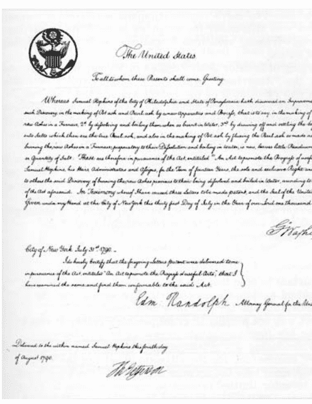
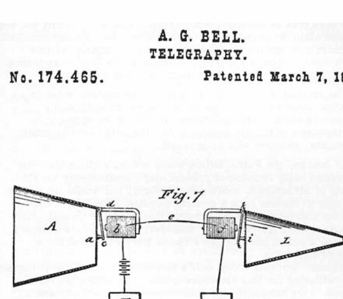
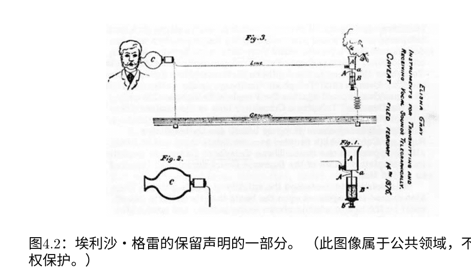
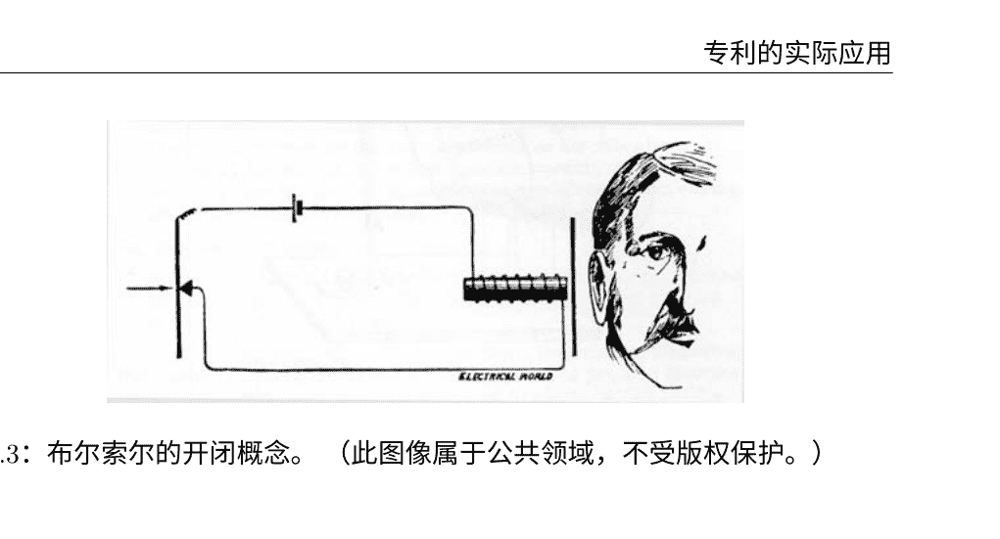
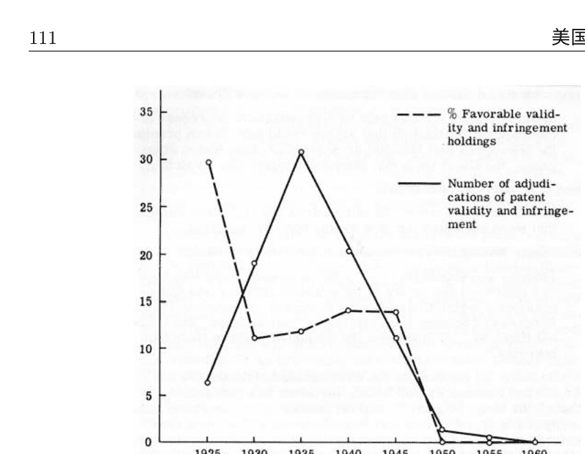

# MIT 6.901 发明专利讲义

2008年春季

有关引用这些材料或我们的使用条款的信息，请访问： [http://ocw.mit.edu/terms](http://ocw.mit.edu/terms)。

## 创新或灭亡

发明和专利的重要性案例

罗伯特·H·莱恩斯
莱恩斯和莱恩斯 马萨诸塞州波士顿
麻省理工学院电气工程系讲师 马萨诸塞州剑桥市

初版
为MIT开放式课程转录
http://ocw.mit.edu

## 创新或灭亡

发明和专利的重要性案例

## 目录

- 介绍
- 1 美国专利制度的起源和发展 5
  - 1.1 结论
- 2 专利局和法院的角色
  - 2.1 专利局的性质
  - 2.2 专利局的问题
  - 2.3 专利局决定的审查
  - 2.4 法院的现状
  - 2.5 专利局和法院决定的报告
  - 2.6 法院的进一步作用-侵权诉讼
- 3 专利法
  - 3.1 可专利发明的类别
  - 3.2 专利可行性条件
  - 3.3 干涉
  - 3.4 发明的法定测试
  - 3.5 “作为整体的主题”的显而易见性
  - 3.6 专利的法定有效性推定
  - 3.7 评论-对发明的法律承认
- 4 专利实施（基本电话专利的历史）
  - 4.1 贝尔发明背后的情况
  - 4.2 贝尔的基本专利
  - 4.3 贝尔公司的创立-和海盗
  - 4.4 进入最高法院
  - 4.5 我们最高法院对贝尔专利的反应会是怎样的？
- 5 发明家的权利、义务和问题
  - 5.1 大学与政府关系
  - 5.2 目前政府机构关于专利的法规
  - 5.3 工业就业协议
  - 5.4 谈判中的问题和危险
  - 5.5 卡迪教授并不孤单
  - 5.6 结论
- 6 美国专利的未来
  - 6.1 先前对专利制度的建议改进
  - 6.2 搜索
  - 6.3 反对程序
  - 6.4 技术培训的法庭
  - 6.5 今天的专利是否值得保留？
  - 6.6 问题出在哪里
  - 6.7 任务
- 7 专利制度的现代化
  - 7.1 关于共同欧洲专利和司法的现有提案
  - 7.2 对美国专利制度修订的一些不同想法
- 8 通过法院现代化来帮助专利制度和法律 125
  - 8.1 批评的性质
  - 8.2 已经提出的一些措施
  - 8.3 一个不同的提案
  - 8.4 结论
- 9 经济衰退的公式
  - 9.1 偶然性的可悲
  - 9.2 “心灵锁链”
  - 9.3 “一致是一种精神错乱状态”
  - 9.4 心智容器
  - 9.5 这次滑动尺度规则行不通
  - 9.6 高级科学家的新用途
  - 9.7 创新或灭亡

## 图表列表

| 编号 | 描述 |
| :--- | :--- |
| 1.1 | 第一个美国专利授予，1790年7月31日 12 |
| 4.1 | 贝尔原始电话专利的一部分 50 |
| 4.2 | Elisha Gray的保留部分 54 |
| 4.3 | Bourseul的开闭概念 59 |
| 4.4 | Philip Reis的构造 60 |
| 5.1 | Cady的专利图纸 77 |
| 5.2 | Nicolson原始专利的一部分 80 |
| 5.3 | Pierce专利的一部分 87 |
| 6.1 | 美国最高法院对专利的兴趣 111 |

## 创新或灭亡

发明和专利的重要性案例

## 介绍

美国专利制度不需要辩护者。尽管它在某些方面可能不完全适应我们当前的问题和需求，尽管有时它可能被滥用，但它在我国的进步史上取得的成就是不可磨灭的。尽管在本世纪下半叶它没有得到充分利用，但我认为它目前的服务同样是无可争议的；尽管一些没有亲身经历的批评家可能不同意。这些批评家可以自己写书。

我已经承诺要写下我的观点，作为一个倡导者，今天和以往一样，激励一个人为了成为独立个体而奋斗，促进整个国家的福祉。在我的讲座中，其中许多已经包含在这本书中，我坦率地描绘了一个基于这一哲学的画面，特别是为工程师和应用科学家，从而支持专利。但是，发明、专利和创新不能脱离它们的社会、政治和经济环境来看待，尽管法学院提供的课程是机械化的。因此，要在不深入探讨我们社会许多方面的相互作用的情况下审查专利法的原则，将是讨论一个理论上不存在的系统。因此，这本书不仅仅是针对工程师和应用科学家的，其中一些部分也是针对律师、经济学家、商人和政治家的。

我发现将所有方面以便让不同学科的读者理解并不是没有困难的。因此，插图仅限于非技术人员能够理解的技术，而法律和经济讨论则足够基础，至少在技术读者中部分能够理解，但不会牺牲给法学家或经济学家的观点。

那些期望在这个主题上得到工程“食谱”方法的人在这里找不到。同样，那些期望以普罗克鲁斯特式的“案例研究”形式呈现的人也会感到失望。

撰写一本跨学科的书需要混合运用跨学科的技巧，因此我试图将历史、基本原理、程序、问题和冲突点交织在一起，形成我认为是专利制度真正的结构模式，努力在一个快速变化的世界中生存。

¹ 戈登·麦凯专利法讲座，于1956-58年在哈佛大学举行。

在某些情况下，我解释了采用这种方法的原因，以便读者能更好地理解我的表达方式。

第1章介绍了美国专利制度的起源和历史背景的概述；在结尾处，对该制度当前是否有效地履行其最初的历史目的或满足现在的要求提出了严肃的问题。我希望到本书结束时，读者能对这些问题的一些答案有所了解。

第2章回顾了专利局和法院在专利法管理中的作用，特别是为了那些对专利申请和司法审查的行政细节不熟悉的人的利益。

第3章讨论了美国专利法的法定规定，并参考了法院解释和裁决的实际案例。虽然可以很容易地就可专利发明的类别和专利条件达成一致，但对于1952年专利法所确定的“发明”和“显而易见”的标准存在广泛的争议。因此，我在本章的一节中讨论了这个争议，并提出了我自己的观点-基于我认为符合国家利益的解释，即鼓励独立的美国发明家及其支持者以及公司发明家。在这方面，本章以领先的独立发明家提供的统计数据结束，突显了他们对技术的重要现有贡献，以及如果不对独立发明家的工作进行自由和同情的法律承认，独立发明家将从美国舞台上消失的必要性。

在第4章中，我采用了一种最有效的讲授方法，将创新的完整图景联系在一起-从构思和发明阶段，到财务支持和发展，创业，企业形成，以及与盗版的法律争议。在这里，我选择了贝尔电话案例作为媒介，因为这个过时的发明涉及到技术和一定程度的重要性，对所有读者来说都很熟悉，并且几乎发生了所有可能发生的事情，除了贝尔所经历的匿名性，他在最高法院中得到了一票之救。

发明创新周期中紧密编织的是发明人与雇主之间以及发明人与潜在用户或许可证持有人之间的关系。这些包括典型的工业、大学和政府合同条款。由于发明经常被盗窃，本书在第5章中回顾了发明者面临的陷阱。然而，这种盗版的确凿案例非常少，因此我选择了一个以前鲜为人知的例子（在压电领域），这个例子花费了二十多年的时间才通过法律裁决得到证实和确立。希望通过公开揭露这一情况，能够提醒发明家，并且或许能够让商业和政府机构在试图规避发明家的专有地位时三思而行。

第6章批评性地讨论了改进专利制度的最新提议，包括国会和法院对政府在专利和其他事项上的相互冲突的观点。

我已经将对欧洲经济共同体计划的现代化项目的考虑留到第7章，以期提供一个统一的欧洲专利和专利法。这可能对美国制度产生的影响被指出，并且提出了我对我们制度的行政改进的一些观点。

尽管本书的预期主要读者群是工程专业人员，但解决当前的发明和专利保护问题需要的不仅仅是工程考虑。在这方面有一个明确的，甚至是主要的法律方面，必须说一些话。因此，在第8章中，我补充了第7章关于专利局和行政改进的技术建议，并提出了现代化司法审查的建议。我试图用工程师可以理解的语言来阐述这些观点，但同时又不失对法律和准法律专业人员的影响力。

第9章强调了上述问题的一般经济后果。

如果最终认为我对我们国家的法院过于苛刻，我的回答是，我的立场不仅仅基于学术研究。我的攻击是经过深思熟虑的，对我来说是必要的。我的请求很简单。在为时已晚之前，让我们恢复个人的重要性和尊严，并认可并保护他的思想成果。由自由和受鼓励的创造性思维引领的动态社会 - 政府重新扮演仆人和伙伴的角色 - 是自由世界的最大希望。

# 第1章
美国专利制度的起源和发展

本章对美国专利制度的历史背景进行了调查，并在结论时提出了严肃的问题，即该制度当前是否有效地履行了最初的历史目的或满足了现在的需求。

“蜜糖填充的牡蛎”听起来像是一场美食噩梦。然而，对于希腊殖民地Sybaris的当局来说，大约在基督诞生前五百年，这可能是一道“独特而奇特的菜肴”，没有人有权利在一年内准备和供应，除了最初发明它的厨师。

这种导致消化不良的官方邀请是最早记录的类似于我们对发明授予专利的概念之一。国家向在其手中表现出优秀的个人授予各种种类的奖励政策，这一政策从中世纪欧洲继承而来。例如，罗马用胜利游行来奖励她的军事英雄，并将征服的土地分配给他们，他们可以对其征税。英国君主行使授予权利、特许权、宪章、委任、职位、垄断权或类似权利的特权，例如贵族头衔或探索新世界的许可。他们通过一份寄给“凡看到此文的人”的文件来进行，这是一份公开记录在专利卷宗中的公开文件，称为“Litterae Patentes”或专利信函。

从以下考虑可以理解，英国国王有充分的理由在适当的情况下授予某些种类的专利：中世纪的欧洲是一个野蛮或半野蛮的地区，离野蛮不远。工业和贸易处于不稳定的状态。贵族们不仅在英国，而且在大陆上，作为统治者在他们各自的领地上向所有通过他们领土的人征收过路费。

¹ 雅典美食家；《饮食学者》（3卷），C. D. 雍吉，编辑，博恩古典图书馆，1854年，第835页。

统治者在他们各自的领域中拥有至高无上的权力，要求所有经过他们领土的人交纳过路费。他们可以在山坡和其他有利地点设防，不受所谓的上级君主的控制。直到火药的发明，这些君主才能够使他们的贵族屈服。

那个时代的贸易由商人们进行，他们通过各个贵族的领地从一个国家到另一个国家旅行。由于商人们在经营业务时面临巨大的费用和风险，他们被迫对他们在欧洲销售的商品收取非常高的价格。许多商品是昂贵的奢侈品，只有非常富有的人才能买得起。

十一世纪开始的十字军东征持续了几个世纪，使欧洲人与当时相对高度文化的萨拉森人接触。他们发展了艺术，并精通代数和天文学等科学，甚至“代数”这个词也来自阿拉伯语。

十字军回到家乡时，带回了他们在东方发现的许多东西，包括各种艺术和工业的知识。意大利的城邦，如热那亚和威尼斯，作为当时最强大的集团，直接受益于与东方的接触。他们因为在东方和西方之间建立起的贸易而繁荣起来。为了有东西可以出售，作为对从事相关风险的人的奖励，他们通过向受青睐的个人授予垄断权来刺激新的艺术和工业的发展。早期的授权报告了对谷物磨坊的授权，并且在1474年，威尼斯共和国议会通过了适用于所有发明类别的第一部专利法。该法律禁止侵权十年，但允许政府自由使用发明，前提是政府与发明者进行交涉，不允许其他人代表政府使用该发明²。

为了保护他们的贸易和建立的工业，欧洲商人们联合起来进行共同防御，组织了自己的军队和海军。在中世纪晚期，他们变得非常强大，正如汉萨同盟所证明的那样。直到几个世纪后，新大陆的发现开辟了新的贸易路线，意大利城邦才被降为更大国家的一部分。

但意大利城市并不是唯一受益的社区。这种与东方的贸易所孕育出的商品和技能逐渐传播到整个欧洲。由于英格兰位于最西边，与大陆有着物理上的隔离，它并不处于最有利的位置来获得这些优势，而其他国家常常嫉妒地保护着这些优势。为了克服这些劣势，英国君主采用了大陆的做法，通常向外国人授予专利，并在有限的时间内给予他们权利。

² 这个陈述是基于一些英国专利律师给我的信息，他们记得在1930年代的某个时候，M. Frumian在英国特许专利代理人协会上发表了一篇名为“专利发明的早期历史”的论文。

享有独家权利从事新兴产业，并同意将其进口到领土中作为授予的考虑。

这样，纺织业就被引入英国。1331年，爱德华三世授予弗兰德的约翰·肯普一项关于羊毛织物的专利，1336年授予布拉班特的织工们。1440年，约翰·希达姆获得了一项专利，使他能够引进一种新发明的制盐工艺³。继爱德华四世之后，都铎王朝通过谈判吸引了熟练的外国工匠——德国铁匠、意大利造船工、诺曼底玻璃制造商和法国铁匠⁴。

还向个人和公司授予专利，以鼓励他们从事涉及风险的商业或其他冒险。其中包括由伊丽莎白一世特许成立的东印度贸易公司，以及由她的直接继任者特许成立的哈德逊湾公司，后者在加拿大仍然是一个重要的商业力量。

在当时相对不发达的工业和商业状态下，这种专利无疑对国家的利益和人民的福祉是必要的。因此，这些专利的目标是：首先，国内供应外国高价商品，从而降低其成本，进而鼓励更广泛的使用；其次，为英国工人在新兴产业中提供就业机会。事实上，其中一些专利明确规定必须雇佣英国学徒。

例如，英国专利局的前馆长戈姆引用了亨利六世授予约翰·奥特南的1449年专利：“……教授王国的许多臣民制作彩色玻璃的艺术。”据报道，这个专利授予的导火索是伊顿公学需要彩色窗户。更晚一些，国王法庭明确阐述了这类专利的理论基础：

> “专利的理由是，通过奖励发明者，鼓励他们将其发明公之于众，从而使整个国家受益。”

但是，如果一个人在王国内引入了一项新的发明和新的贸易，那么他的生命和财产或资产都会面临危险。或者，如果一个人发现了一项新的事物，那么国王可以通过特许状向他授予一定时间的专利，以补偿他的成本和努力，因为起初王国的人民对此一无所知，没有使用它的知识或技能⁷。因为起初王国的人民对此一无所知，没有使用它的知识或技能，所以国王可以通过特许状向他授予一定时间的专利，以补偿他的成本和努力，因为起初王国的人民对此一无所知，没有使用它的知识或技能。

³ A. A. Gomme，发明专利，Longmans Green and Co.，1946年，第12页
⁴ 专利局学会杂志，第18卷，第21页以后（1936年）。
⁵ A. A. Gomme，发明专利，第12页
⁶ H. Hardin，专利局百年纪念，Her Majesty‘s Stationery Office，1953年，第21页，第34页。
⁷ 78 Eng. Rep. 148 (Ipswich)的织布工人，国王法庭，1615年)。

但仁慈的措施经常伴随着滥用。在授予专利时，英国国王并不总是考虑这些是否给他们的臣民带来了好处。

后者在1215年的伦尼米德对约翰国王进行了反抗，结果产生了著名的《大宪章》。君主在那里同意商人不得禁止从事贸易，“如果他们以前没有被公开禁止。”这表明不会对当前的贸易专利造成干扰，但会限制君主在现有贸易中授予进一步专利的权力。

《大宪章》并不是英国国王与他们的臣民所达成的唯一合同。然而，历史表明，君主们对这些协议的看法与一些国家今天对待条约的看法相似。当君主在某种情况下被迫屈服于更大的力量时，例如约翰在伦尼米德的情况下，他们会签署任何放在他们面前的文件；但是，一旦危险过去，他们就会忘记自己的承诺，并表现得好像从未做出过承诺一样。

为了筹集资金、奖励亲信以及其他原因，继任的英国君主们授予了许多专利，这些专利对人民来说变得繁重。一个人将被赋予在某个行业中独家经营的权利，比如制革业；另一个人将被赋予在肥皂、盐、淀粉、硝石、皮革、纸张或玻璃贸易中经营的权利；另一个人将被赋予买卖铁或钢的权利；还有一个人将被赋予进口某些物品的权利；等等。有时，垄断权涵盖整个英格兰的贸易；而有时，涵盖特定地区的特定商品的销售。由于之前这些垄断活动是对公众自由开放的，唯一的结果就是提高了价格，这些价格必须由众多人支付，以使得受宠的专利持有人能够获利。

1601年秋天，作为对抗议的回应，伊丽莎白一世女王宣布，如果她的臣民因这些专利授予感到冤屈或受到伤害，他可以在女王法庭上测试专利的有效性。接下来的1602年春天，爱德华·达西提起了侵犯他制作和进口纸牌专利授予的诉讼。专利授予的正当理由是基于公共政策的考虑，即如果没有这个授予，那些本应“去耕种”的人将会从事制作纸牌的艺术⁸。”这就是著名的垄断案。尽管法庭认为纸牌垄断是无效的，但这个案件被视为承认了一件非常重要的事情，即专利“垄断”的合适和不合适的主题之间的界限。引用判决中的话说，

> 如果有人通过自己的费用和努力，或者通过自己的智慧或发明，将任何新的贸易引入从未使用过的引擎领域，以促进贸易的发展；并且这对国家有益；那么在这种情况下，国王可以授予他一项合理时间的专利垄断权，直到其他人学会同样的技术，以考虑他的发明对国家的贡献；否则不授予。

这一法律一直适用于英国至今。一个人仍然可以在英国获得专利，不仅仅是为了他自己的发明，还可以为从境外引进的新产品或想法申请专利。

尽管D'Arcy案的判决，下一位君主詹姆斯一世在1603年登基后，授予的专利垄断权比以往任何时候都多，包括丝绸和旅馆等领域。对于在英国的有害垄断的抗议声越来越高，直到1623年的专利垄断法案，议会完全剥夺了君主的这一特权。

然而，专利法例对于发明专利做出了一个例外，这正是法官们在达西案中所指出的同样例外，实际上，它是对普通法的一种宣告，即不会为“……”提供特权。今后在这个领域内，对于任何新制造方式的专利和特权的授予，其有效期不得超过十四年，并且必须授予真正的和首次发明者，同时也不能违反法律，对国家造成危害，如提高国内商品价格、损害贸易或普遍不方便⁹。”英美两国的专利法都直接源自这个发明例外，上述引用的规定仍然作为现行英国专利法第6条存在。

美国殖民者对专利非常熟悉，并且知道在某些情况下它们的价值，就像《专利法》中所规定的那样。与母国一样，宪法公约之前的几个殖民地曾经授予专利，以引进工业。这些专利不一定是为了新发明，有时也是为了引进国外的旧工业，并且为了支持那些为生存而奋斗的人。促进工业的鼓励不仅通过特别法令授予的垄断权来实现，这些法令相当于英国皇冠的授予，还通过奖金、补贴等方式实现。

殖民者在授予这些特权时，充分意识到了他们来自的国家中的垄断恶习，并采取了预防措施，以防止这些恶习再次发生。例如，马萨诸塞州总法院（殖民地立法机构）于1641年颁布了一项法令，规定“我们之间不得授予或允许任何垄断，除非是对国家有益的新发明，并且只有短时间内有效。”康涅狄格州也有类似的规定。马萨诸塞州、康涅狄格州、弗吉尼亚州、南卡罗来纳州、纽约州和其他殖民地授予了许多专利，涵盖了不同的制盐方法，有些是发明的，有些是进口的，有时还附带条件，要求在有限的时间内建立制盐厂。殖民者还授予了类似的专利，涵盖了其他物品的独家制造权，并且通常也有类似的条件。

这些包括铁制品和机械制造、锯木厂、粮食磨坊和烟斗工厂。

根据1641年的法令，马萨诸塞州总法院首次授予专利给塞缪尔·温斯洛（1641年）用于一种新颖的方法。

⁸ 《专利法》（1623年）第21章第3条。
⁹ 《肯德尔诉温索尔案》（21 How. 322, 327, 328）；《电影公司诉环球电影公司案》（243 U.S. 502, 510, 511）。

用于制盐。同一机构授予的第一个机械专利是给约瑟夫·詹克斯（1646年）用于制造镰刀的磨坊。1667年，马萨诸塞州向任何愿意建造干船坞的人提供了为期十五年的垄断权，随后一年将年限增加到二十一年。即使在宪法通过后成为州的几个殖民地仍然继续授予专利。例如，纽约州向利文斯顿和富尔顿授予了在纽约水域内经营蒸汽船的专有权，但后来被首席大法官马歇尔判定违反宪法的州际商业条款而被废除。

1787年的宪法会议代表们对所有情况都非常熟悉，他们希望为新国家提供专利制度的好处。因此，弗吉尼亚州的詹姆斯·麦迪逊和南卡罗来纳州的查尔斯·平克尼提议国会在这方面拥有一定的权力。麦迪逊的提议是国会应该有权力：“为文学作者保护他们的版权一段有限的时间。通过奖励和规定，鼓励有用的知识和发现。”顺便说一句，原子能委员会正在做麦迪逊很久以前建议的事情¹¹。某些涉及可裂变材料和原子武器生产的发明根据原子能法的排除规定无法获得专利。然而，发明人可以要求对其贡献进行补偿，并且在设定的某些标准下，可以获得委员会的一笔款项。通过对未分类奖励和与原子能委员会的经验研究，一些专家认为宪法的创立者在拒绝麦迪逊的提议时是非常明智的。他们相信核计划没有像我们自由企业的其他非政府控制计划那样迅速和广泛地发展起来，部分原因是这种所谓激励的不足。

查尔斯·平克尼不喜欢麦迪逊提出的政府应该评估并支付发明的金额的提议。他自己的提议是，国会应该有权力“授予有用发明的专利。”为了确保作者在一定时间内拥有独家权利。”根据这个概念，竞争激烈的工业市场将决定一项发明的价值。

根据宪法第一条第8节的规定，宪法规定并仍然规定，国会应有权力：“通过为作者和发明家在有限时间内保护他们各自的著作和发现，促进科学和有用艺术的进步。”

根据这一规定，国会可以授予一个科学发现者对其自己的发现的独家权利。

> 11 42 U.S.C. 2187（第157节）。（U.S.C.的缩写指的是美国法典-联邦法律的集合体。）

宪法使用了“科学”、“专有权”、“发现12”等词语。然而，正如将要明确的，国会只为某些类型的进步提供了专有权，而不是为了科学发现本身。这一条款是宪法中唯一与创建私有财产权相关的条款，旨在促进科学和有用的艺术的进步。它建立在我们资本主义体系的伟大传统和哲学基础之上 - 为了众多人的利益而对个人在开发想法方面提供有限的保护。

这一条款中并没有提到授予专利的具体内容。而是使用了“确保”的词语。麦迪逊后来在《联邦党人文集》中解释说，尽管“确保”一词只适用于版权，因为版权在普通法中被认为是一种自然财产权利，但没有理由不将同样的原则应用于发明：“对于有用的发明权，同样有理由属于发明家。同样有理由属于公众。公众利益与个人权利的要求在这两种情况下完全一致。”

然而，杰斐逊拒绝接受发明属于发明家作为自然权利的观点。他认为发明是为了整个社会的利益。

宪法通过后，华盛顿总统建议制定法律以进一步推动这一宪法规定，并且在1790年，第一届国会通过了一项法令。联邦创始人们认为这个问题非常重要，他们在其中规定国务卿（托马斯·杰斐逊）、战争部长（马萨诸塞州的亨利·诺克斯）和司法部长（弗吉尼亚州的埃德蒙·兰多夫）应该共同审查所有专利申请，总统和国务卿应亲自签署专利授权。这三位杰出的人物，杰斐逊、诺克斯和兰多夫，实际上构成了这个国家的第一个专利局，杰斐逊是第一位专利审查员、专利局长和律师。

华盛顿、杰斐逊和兰多夫签署了第一个专利。

然而，杰斐逊反对所有形式的垄断，最初将专利纳入此类别，但由于他的经验，他被迫表示专利法给予了“超出我的想象的发明动力”，因此，“没有人比我更希望创造力得到充分的鼓励13。”

根据1790年的法律，在颁发专利之前，必须仔细审查申请，以确定所谓的发明是否“在之前已知或使用”，以及它是否真的“足够有用和重要”，值得获得专利的尊严。

授予。然而，不到三年的时间，法律中的“足够有用和重要”的条件被取消，专利只需注册而不需要审查即可颁发；但是这个问题仍然在国务院的监督下。随之而来的是混乱——欺诈行为、繁琐的诉讼、多个相互冲突的专利等等。

约四十多年后，在缅因州参议员约翰·拉格尔斯的敦促下，1836年的专利法案恢复了只有经过审查后才授予专利的“美国”制度，并且专利局被重新组织并成为国务院的一个独立机构，机构负责人正式称为专利专员。随后，专利局于1849年转移到内政部，后来于1926年在商务部获得了现在的地位。长期以来，人们一直呼吁将专利局作为一个完全独立的行政部门14，或许具有更适应当前国家需求的扩展功能。但是这样扩展和现代化的功能似乎仍然适合商务部的职责。

## 1.1 结论

值得注意的是，我们专利制度背后的历史目的主要关注的是创新的问题，而不仅仅是赤裸裸的发明。

目标不仅仅是授予专利，而是鼓励我们中的少数有创造力的人承担引入新产品、艺术或流程到商业流通中所固有的风险，以最终造福于众多人。 这种鼓励采取了一种契约形式：君主提供给发明家有限的保护，以防止他人抄袭，作为交换，发明的细节将被公开；这基于一个理论，即奖励个人有利于整个公众，而如今这一理论被苏联人比我们更具有讽刺意味地更有效地应用。

另一个目的是通过专利中的发明公开，防止像以前那样由父亲秘密传给儿子而导致的艺术流失再次发生。

但是，美国当前的专利制度，以及其管理和司法对待，是否对创新起到了有效的刺激作用，已经成为一个极其重要和紧迫的问题。

这个制度是否为发明家及其支持者提供了那种安全感，从而激励他们毫不犹豫地踏上创新的风险之路？

它的奖励是否激励了众多工程师，作为他们在许多行业和政府中就业的条件，他们将自己对任何发明的权利都转让给了雇主？

在某些大型企业中，它的使用是否主要减少到了防御和交叉许可的需求，而不是作为刺激创新的独家地位的保护？

我们今天是否真的担心“失传的艺术”？这个制度是否促进了有用的军事、核能和航天艺术的进步？

简而言之，我们的专利制度在许多领域是否大大减少到了发放带有红色印章的文件——大多是形式而缺乏实质？

# 第二章

# 专利局和法院的角色

为了那些对专利申请和司法审查细节不熟悉的读者，本书总结了专利局和法院的角色。

考虑到本书的多功能目的和希望读者的多样化背景，有必要简要回顾在专利局提交和审理专利申请以及法院在专利诉讼中的作用。对于那些对这个领域有了解的人来说，这一章显然没有太大的兴趣。

也许追溯程序的一个有趣方式是设身处地想象自己是一个在完成发明初期取得成功的虚构独立发明家。为了获得专利，他必须向专利局提交一份详细的描述，根据法律规定，这份描述必须以一种特定的格式呈现，并且使用通常对于发明者和非法人士来说相当陌生的法律术语。专利申请本身必须包含对发明的清晰简明描述（在这里称为规范），通常还包括插图，展示设备的首选形式，以及一组简洁的末尾段落，称为权利要求，阐明发明者和他的律师认为专利局应该允许作为专利授予范围的新颖特征。

## 2.1 专利局的性质

应该记得，宪法授权国会通过为发明家在有限的时间内保护他们的发现来促进有用艺术的进步。然而，先前已经指出，除了一些有争议的程序外，如原子能法或太空法的补偿规定，纯粹的科学家并没有得到国会的奖励。相反，国会认为适用于应用科学家和工程师的专利法是合适的，他们从中获益。

纯科学家的发现并将其转化为有用的艺术品。1952年，国会将专利法编纂成法律，然而增加了一些修改，旨在消除或至少限制某些法院作为社会哲学问题而否决专利的倾向。

法规本身定义了专利局的结构和运作方式，要求专利局局长负责审查每个专利申请并发放每个专利（和商标）。因此，专利局必须维护一个庞大的最新技术图书馆，否则协助专利局长的专利审查员将无法进行合理彻底的调查。

专利局的专员还得到专利上诉委员会的协助，该委员会被称为上诉委员会。委员会的成员和专员一样，由总统任命，并被授予首席审查员的头衔。他们的主要职责是对审查员拒绝认可所申请发明专利的最终决定进行审查。幸运的是，他们是从专利局有经验的人员中选拔出来的，并且目前还不是纯粹的政治任命。

在我们发明家新提交的专利申请被审查其新颖性之前，它会先由分类审查员进行筛选，以确定所涉及的主题是否与特定组的熟练审查员处理的发明类别相关。然而，由于申请通常按照收到的顺序进行审查，并且由于平均而言有一年的积压案件，我们的发明家可能需要等待那么长时间才能审查到他的申请。

当被分配到该案件的审查员接触到申请时，他（或她）会特别关注所要求批准的新颖性声明。如果这些声明被批准，它们代表了专利授予的范围和界限。然后，审查员会查阅被分成成千上万个类别和子类别的专利和出版物的文件。他正在寻找与所声称的新颖概念最接近的现有技术。他不仅寻找申请中描述的确切设备，还寻找类似的设备。如果该案件中的专利代理人在提交申请之前进行了自己的搜索，并未找到确切的预期，那么审查员也很可能找不到。

然而，即使该发明在任何先前的专利或出版物中都找不到，但如果它是任何熟练的技工可以轻易从先前的专利或出版物中发展出来的东西，那么该设备就不具备可专利性。

在完成搜索后，审查员通常会根据他能找到的最接近的先前技术来拒绝申请。这是有一个非常明确的原因的。作为一名尽职的公务员，审查员不会轻易授予专利，除非他确信确实有一个真正的新发明¹。通过拒绝案件，他将责任转嫁给申请人，要求后者解释为什么应该授予他专利。

¹如果我们的司法机构能够像执业律师一样体验在专利局成功申请专利的困难，他们对专利的尊重无疑会增加。

即使其他人在审查员引用的先前技术中接近他所谓的发明，他仍然可以获得专利。
申请人的律师必须在审查员拒绝后的六个月内回复，指出为什么先前技术与他客户的新颖性要求无关，并且如果原始要求没有明确定义该新颖性，则适当修改这些要求。这个拒绝（或部分拒绝）和修改或争论的过程将继续，直到审查员认为问题已经解决。在某些情况下，审查员将允许修改后的要求，或者在重新考虑后，允许原始要求或其中的一部分，并且专利将随之被授予，并列入三百万美国专利之中。在其他情况下，审查员对发明的问题不会被说服。申请人的律师坚持认为有发明，而审查员坚决认为没有发明，并做出最终的拒绝。有时律师会亲自与审查员面谈。然后，他可以要求主审查员重新审查助理审查员的决定。在会议上，助理审查员向主审查员阐述他拒绝的理由，而律师则陈述他的观点，可能还有发明人的帮助。然后，主审查员做出决定。如果他同意律师的观点，他会推翻助理审查员的决定，允许申请通过以便专利可以颁发。
另一方面，如果他认为助理审查员是正确的，他不会推翻他的决定，而是建议律师转向上诉委员会。

在后一种情况下，律师向委员会提交一份简要陈述，其中描述了案件的历史、发明的性质和细节、被拒绝的权利要求的含义、审查员引用的先前技术以及对审查员认为错误的原因，无论是事实上的还是法律上的。然后，审查员提交回复简要陈述，陈述他的观点，委员会可以仅凭这两份简要陈述来决定案件。然而，可以要求进行口头辩论。律师将出席委员会，为自己的案件辩护，但通常不会出席听证会的审查员。

委员会可能会支持审查员的拒绝意见，或者推翻该意见并命令授予专利。
有时，委员会发现虽然无法支持审查员的立场，但权利要求由于其他原因而不具备可专利性。在这种情况下，委员会将提出自己的拒绝理由，允许申请人修改其权利要求以克服新的异议，或要求重新考虑新的理由。

当两个或更多申请人声称拥有相同的发明时，“干涉”审查员被指派任务，试图确定谁实际上是第一位发明人。证词通常由公证人或法庭官员进行，受到交叉审问，并由冲突申请人提交的其他发明活动证据支持。在这些帮助下，以及简要陈述和口头辩论的帮助下，专利干涉委员会做出决定，确定谁是先发明者。

当然，专员本人不能决定或关注所有这些事务的管理。因此，他有几个助理专员

专利局的使命。顺便提一下，不要认为只有俄罗斯人在技术领域利用女性的才能，我们最近还得到了一位女助理专利专员在商标事务上的出色服务。

## 2.2 专利局的问题

当由于外部组织的吸引力而导致审查员的快速更替，尤其是对年轻审查员的吸引力时，案件积压显然会增加。整个专利制度的有效性和实用性因此受到损害。因此，专利局面临的更大的行政问题是，首先要让公众和国会意识到其职能的重要性；其次，迫切需要尽快提升审查员的地位，以吸引有能力的职业男女。

电子计算机形式的自动化可能有助于搜索过程。事实上，通过计算机技术在某些有限的化学案例中促进审查员搜索的有趣实验正在进行中。

是否会提供足够的时间和资金来实现在电气和电子领域以及机械领域进行大量交叉引用，以便在搜索任务中使用计算机，这是一个真正的问题。例如，一个发明家提交了一个关于新真空管的申请，但可能会发现在先前的一个无线电接收电路的专利中，已经提到了他的真空管，尽管该专利中并未将其作为发明的一部分进行声明。然而，早期真空管的披露将成为新真空管获得专利的障碍。除非将这种管构造在计算机中输入为在无线电接收专利中被披露但未被声明的信息，否则计算机将不会提供该信息。然而，今天，审查员在浏览专利时可以注意到这些与专利标题或正常分类不符的附带披露。

因此，交叉引用细节并对所有显示和描述在专利中的组合的每个微小组件进行分类是一个巨大的问题，如果计算机搜索要成功的话。对于我们中的一些人来说，这似乎还相当不切实际。对某些化学化合物进行分类可能又是另一回事。

1935年，仅有31,900份申请仍在等待初步或进一步的审查行动，即“待定”。最近，几乎有25万份申请²。目前有大约6,000个案件正在上诉委员会等待处理，并且一些听证会已经安排在上诉提交后的一年多之后。

在合理彻底地审查和考虑的前提下，加快专利授予的问题尤为重要，特别是在...

尽管在保持专利局更加更新方面取得了巨大进展，但由于预算和人员有限，这个问题仍然存在。

## 2.3 专利局决定的审查

假设上诉委员会与审查员一致认为申请未披露可获专利的发明，并因此对申请人做出了不利决定。国会提供了两种替代方案，以便对此类决定进行法院审查。

其中一种是在哥伦比亚特区联邦地区法院对专利专员提起诉讼。申诉人可以要求法官重新审查上诉委员会的不利决定，重新审视发明的可专利性案件（所谓的全新行动），并考虑关于申请和授予专利的更多详细证据的理由。地区法院法官将要么支持专利局对申请的拒绝，要么如果他不同意上诉委员会的决定，指示颁发专利。

在这次审判中，专员由他自己的律师代表，对申请人的证人进行盘问，并可能代表专员提供证人。

从地方法院的不利决定，可以向哥伦比亚特区巡回上诉法院上诉。如果巡回上诉法院拒绝推翻专利局的决定，可以通过一份被称为“特别上诉”的上诉申请向美国最高法院提出请求进行最终审查；但是目前最高法院不太可能授予专利。

另一方面，如果申请人不希望进入联邦地方法院，并且对专利局的审查记录中存在的证据非常满意，他可以选择在海关和专利上诉法院上诉，严格依据该记录⁵。这个法院最初是所谓的立法法院，根据宪法第一条的规定设立，作为国会的法庭，与宪法第三条的司法法院（如联邦地方法院、上诉法院和最高法院）区别开来。然而，国会最近将海关和专利上诉法院转变为根据宪法第三条设立的司法法院。海关和专利上诉法院的五名法官审理来自海关和专利决定的上诉。过去，这些法官并非技术培训人员，但最近专利律师被考虑为法庭成员并被任命，法院越来越多地依靠他们处理来自专利局的上诉。如果申请人对海关和专利上诉法院的决定不满意，他有机会向美国最高法院申请特别上诉；但是近年来，此类申请未被批准。同样，当对专利局的决定不满意时，可以向专利审查委员会上诉。

> ³同样的救济措施也适用于商标和设计专利案件
> ⁴ 35 U.S.C. 145
> ⁵ 35 U.S.C. 141

专利干涉，败诉方可以向海关和专利上诉法院上诉，或者可以在适当的地方方法院提起诉讼，要求撤销专利局的决定，并提供新的证词和证据。

## 2.4 法院的现状

哥伦比亚特区的法院有时需要审查专利局的决定，也需要审查几乎每个联邦行政官员或仲裁机构的行动。联邦通信委员会将无线电台授予甲方而不是乙方；或者内政部将土地授予甲方而不是乙方；或者国务卿拒绝发放护照；或者军队的某个雇员认为自己不公正地失去了职位。每年，许多对行政决定不满意的人来到哥伦比亚特区的各个法院。当然，要求法官精通各种行政机构处理的技术复杂性是不现实的，这些机构通常由在相关技术主题上接受过培训的专家组成。因此，在这种情况下，法官不会试图代替行政机构的事实调查，除非在罕见情况下。法院明智地认为，除非行政机构滥用职权，除非当事人没有得到公正的听证会，除非没有实质性证据支持机构的决定，或者除非该决定是不合理和明显错误的，否则法院不会推翻行政机构的裁决，即使考虑到所有证据，法院可能会对事实问题做出不同的决定。当然，法院将保持其重要的法律解释功能，并乐意用自己对法律的解释替代机构的解释。

对专利局专员提起的诉讼在哥伦比亚特区地方法院上有一些不同的立足点，因为法律允许地方法院接受专利局之前未考虑过的新证据，并根据提供的所有事实做出决定。然而，在相对近期的过去，专利局在案件之后一直得到地方法院的支持，似乎无论提供了什么新证据都没有关系。

在1952年的最新专利法案之后，旨在对专利的法院处理产生稳定影响，专利局发生了一些逆转。然而，哥伦比亚特区上诉法院的一些法官似乎仍然持敌对态度，正如反对意见的丹纳赫法官所示：

基本上，大多数意见中渗透的哲学是一个

通过将专利局视为具有确定性正确性推定的等同物（1）和认为充分的披露引发了法律问题（2），从而达到了国会提供的救济的无效化结果。地方法院的裁决、结论、备忘录意见和判决被降为零地位。威尔金法官听取了许多证人的证词，获得了图表和展示材料的好处，对争议点进行了详细解释，并与对方律师进行了交流。记录显示，对于根据35 U.S.C. 145提出的案件的许多方面，进行了密切而仔细的审查，该条款允许不满意的申请人在地方法院追求其救济，该法院可以判定申请人有权获得专利“根据案件事实”。

我们最近指出，在现行的案例法和联邦规则下，即使对于专利案件，“地方法院在没有陪审团的情况下作出的事实认定只有在明显错误的情况下才能在上诉中被撤销。”我们指出，在这种情况下，我们有责任调查地方法院的认定是否明显错误。

在这里，多数人没有努力证明威尔金斯法官的认定是“明显错误”的或者“明显错误的”。他们只是傲慢地将其视为无意义和无效，与多数人对问题的处理背景相悖。我将在稍后尝试展示地方法官在新证据面前作出的充分支持的认定是如何坚定不移的。我无法理解我们能够有其他选择。

而且，最近，哥伦比亚特区上诉法院的伯格法官表示，虽然他“被迫”遵循“现行的判决”来支持专利局的无创造性判定，但他认为那些判决对专利的限制要比宪法或国会最初设想的要严格得多。⁸。

法官伯格继续说，

> 对我来说，这个案例说明了对专利的不友好态度。
这在一定程度上源于我们对垄断的天然厌恶。从垄断是不好的这个前提出发，有人认为专利作为垄断至少是可疑的。但是，专利在技术词典的意义上只是一种垄断，就像土地所有权一样，我们不应该让理性被语义所迷惑。

对专利的这种不友好态度在这里有时由专利局的律师提出的论点中得到了体现，他们认为巴克## 2.5 专利局和法院决定的报告

罗杰斯的漫画描绘了火箭、喷气式飞机和太空时代，毫无疑问，这将被用作对一些专利申请的“预先公开”。看起来，没有受到任何对开发工作的的责任的约束的想象力可能会对实际实施和实现巴克罗杰斯漫画和平装书“奇幻故事”的预测和预言的男性和女性的未来专利保护构成障碍。事实上，专利局的律师告诉我们，鲁布·戈尔德堡的漫画也被用于同样的目的。这似乎不是鼓励从事研究和发明的人获得最大激励的方式。这可能意味着在这些领域进行广泛的研究和实验最终可能会由于经济上的必要性或默认而成为政府的垄断。

因此，我们可以希望联邦法院的补救措施，由国会旨在为专利申请人提供对不当专利局决定的救济，最终被解释为已经通过1952年的专利法恢复。

科学家们有他们的期刊，描述各种技术领域的最新进展。同样，律师们有各种行政法庭的报告，如专利局和法院的报告，其中包含对当前法律解释的决定以及对各种事实情况如何处理的说明。通过这些决定的报告，律师通过类比的过程，试图回答客户关于他的发明是否可获得专利以及在各种情况下他的法律权利可能是什么的问题。

在其每周的官方公报中，专利局除了发布规定、规则、通知和有趣的专利局或法院决定的报告外，还会简要通知每周授予的每一个专利。

该通知包括了专利申请中的典型图纸（如适用），以及一个典型的权利要求，可能代表了专利授予的范围⁹。由于“权利要求”规定了专利授予的特权的范围和限制，律师可以通过扫描《官方公报》来了解与其客户相关的领域中最近的专利授予情况，以便及时更新并了解可能与客户的竞争对手存在的冲突。

专利被分类为一般和机械专利、化学专利和电气专利，刊登在《官方公报》上。设计专利也会被授予。专利局对各种物品的新颖和装饰性美学设计进行了报告。

此外，官方公报发布了专利局拟注册的商标，以便任何认为此注册可能对其造成损害的人提出反对意见。商标是商业实体在其产品或服务中采用和使用的标志（如符号、词语等）。它有助于将这些产品或服务与是其来源的商业实体（例如，宝洁公司在肥皂上使用的象牙标志）在公众心目中联系起来。与专利不同，普通法商标不是通过在专利局注册而获得的，而是通过采用和使用它。然而，联邦对商标进行注册（在州际贸易中使用），在对侵权者执行商标和在某些外国国家获得商标注册方面，提供了某些程序上的优势。

我简要地谈了一下这个问题，因为现在在某些地方对于专利局类似地在其公报中发布拟授予专利的意图以供反对的提案，有了新的兴趣。理论上，如果公众能够通过向审查员提出一些为什么不应该授予专利的理由来反对专利的授予，比如审查员可能忽视的先前技术，法院应该对目前法定的专利有效性推定给予更多实质性的支持，稍后将讨论，因为公众在专利授予之前有机会反驳发明的指控。

在第6章中，我将分析一系列有关补救立法的提案，包括反对制度的问题，基于稍后提出的原因，我现在认为这些提案更有可能对美国专利制度造成不利影响。

## 2.6 法院的进一步作用-侵权诉讼

让我们假设专利已经被专利局授予。除了一些小的例外情况外，这个局随后失去了对该专利的管辖权。下一个可能涉及专利的法庭是联邦地方法院。这是怎么发生的呢？

有人开始“侵犯”这项专利。这可能意味着除了专利所有人或专利许可人之外的其他人制造、使用或销售（或诱导制造、使用或销售）该发明，从而违反了专利所有人排除他人制造、使用或销售的权利。（“许可人”是指已经通过与专利所有人或代表他行事的授权合同获得许可或权利的人，以确保他免于专利所有人的诉讼。通常，许可合同涉及某种许可费，通常称为版税，并且通常基于许可人可能涉及的与该发明相关的业务的百分比。）

当专利持有人得知此行为后，他要求相关人士停止侵权行为，并对过去的侵权行为进行追究或者，如果专利持有人准备授予他许可证，可以就此进行谈判。

假设侵权者拒绝停止侵权或谈判许可证。然后，根据哈佛大学已故教授乔治·华盛顿·皮尔斯的话来说，专利就成为了“提起诉讼的许可证”。专利持有人有权在侵权者居住地或侵权者从事业务并实施侵权行为的联邦地区法院提起诉讼，要求法院发布禁令，禁止进一步侵权，并赔偿专利持有人对其发明的未经许可使用造成的损失。

被告侵权者必须对诉讼进行答辩，陈述他违反原告的专利权的理由。通常，他会列举早期类似的专利或出版物，并提到早期声称是发明者或使用者，希望在审判中能够说服法院，证明相对于之前的工作没有取得真正的进展，不足以获得专利授权，因此专利局在授予专利时出错。被告通常还会提出理由，解释为什么他的产品在构造上与专利中描述和要求的精确发明不构成侵权。还可以提出其他辩护理由。

然而，我还应该提到另一个重要的辩护，有时是适用的，即专利持有人在违反我们的反托拉斯法（包括限制或密谋限制贸易）方面滥用他的专利¹⁰。

他可能要求某些非法限制，例如强迫许可证持有人为他购买未获专利的物品，这是超出实际法定权利、特权或“垄断”（以宽泛的意义使用后一术语）范围的限制，专利授予所提供的。

被告通常还会以反诉的方式攻击专利，以与为侵权诉讼辩护时使用的相同理由进行辩护。他要求法院发布一项判决，认定该专利无效或无法执行，或者被告的产品不构成侵权。这样，即使原告撤回诉讼，被告的反诉仍将在法院进行裁决。

投诉、答辩和反诉是普通专利诉讼中常见的文件。

在案件审判之前，法官通常要求被告缩小所谓的先前专利、出版物和使用清单，作为对发明的预期依据。同时，法官要求原告陈述他试图证明的发明日期以及他所依赖的具体权利要求。

然后法官听取案件。原告通常在技术专家的帮助下，例如熟悉该领域的工程师或科学家，向法庭解释专利的范围，将工程和技术术语和概念翻译成通俗的语言。他解释了这个发明所要解决的问题，然后提供证据说明被告正在做什么，以及为什么这构成了对专利权的侵权。原告随后结束了他的陈述。为什么呢？因为我们的法律规定专利被认为是有效的；也就是说，专利局的审查过程使得专利在法律上具有有效性的光环。这意味着被告有责任证明该专利无效。

至少在理论上，法律对被告施加了非常沉重的责任。原告提出了所谓的初步证据，被告有责任提出自己的证据。然而，如果被告通过证据克服了原告的初步证据，那么对于有效性的最终证明责任就落在原告身上。

被告可以召请他的技术专家出庭解释先前专利或出版物（以及先前使用）的披露，试图说服法官认为该发明要么已经被披露或公开使用，要么与专利审查员的观点相反，任何熟悉该领域的人（与专家区别开来）都会知道如何制造这个发明。原告当然可以对被告的证人进行盘问。当被告完成辩护后，原告有机会进行反驳。

法官必须做出决定。他研究各方提交的后续简要陈述和证词记录，做出决策，并写下决定。联邦民事诉讼规则要求他对专利的有效性和侵权问题做出具体的事实和法律结论。他必须以书面形式呈现他的调查结果。

这些专利决定和联邦地区法院其他领域的决定被记录在一系列被称为《联邦补充》的卷册中，简称为“F. Supp.”，卷册号作为前缀，页码作为后缀。

然而，审判法官的决定并非最终决定。他只是一个阶梯的第一级。败诉方有权对他的决定提起上诉，上诉至上诉法院。一个巡回法院是一个通常包括几个州的地理区域。例如，第一巡回法院由马萨诸塞州、缅因州、新罕布什尔州、罗得岛州和波多黎各领地组成。第一巡回法院的上诉法院位于波士顿，并听取其巡回区内所有联邦地方法院的上诉。总共有十个巡回法院和哥伦比亚特区。

上诉法院通常由三名法官组成小组，审查地方法院的决定，支持或推翻审判法官的决定，视情况而定。上诉法院的决定在《联邦记者》中有所报道，第一系列的卷册缩写为“F.”，目前的第二系列缩写为“F. 2d”。

这些上诉法院的上方是美国最高法院。在上诉法院败诉的一方没有绝对权利被美国最高法院审理。根据宪法第三条，最高法院理论上必须处理某些类型的案件，但这些案件不包括专利上诉。败诉方必须通过上述的申请书向最高法院提出请求，要求法院自行决定是否审查上诉法院的决定。

申请书是一种请求最高法院发出裁定书的方式。

最高法院只授予极少数此类令状。在涉及大公司的重要案件中，它更有可能授予裁定证书，而不是在涉及小公司或个人诉讼当事人的案件中，即使问题可能是相同的。

最近的过去经验表明，当上诉法院维持专利时，最高法院有可能授予裁定证书，然后继续销毁该专利。然而，当上诉法院废除专利时，我不知道现代有哪个案例是最高法院授予裁定证书以恢复它的。

最高法院的决定在几个不同的卷册中有所报道，其中没有一个是美国法律报告，简称为“U.S.”例如，我稍后将提到贝尔电话案件，它们在126 U.S.上有报道。因此，任何希望查找审判和上诉法院决定的人，可以参考《联邦补充》、《联邦报道》和《美国法律决定》（或者在专利和相关领域的情况下，参考《美国专利季刊》），他将在那里找到各个法院为维持或销毁专利所提出的确切理由。

借助这些过去的判决，律师可以尝试向他的客户说明法院对法律的表达和应用，从而制定出应对客户情况的程序。

## 第三章

### 专利法

虽然可以明确列举可获得专利的发明和法定限制类别，并附有案例说明，但根据1952年专利法案，什么是“显而易见”和什么是“发明”仍然未定。因此，本章总结了对这个至关重要的问题的讨论，而最高法院迄今为止拒绝审理此问题。在这里，作者提出了他的观点，部分基于独立发明者在美国创新中所扮演的非常真实的角色。

显然，必须有一套规则或准则来确定各种可能可获得专利的发明（暂时以通俗意义使用该词），或者至少确定在哪种情况下公共政策要求不授予专利。

正如早先所提到的，1952年的专利法案对我们的专利法进行了编纂，重述了先前法规的实质，并采纳了在20世纪30年代之前确立的具有建设性的司法判例。此外，它还引入了针对最高法院最近破坏性政策对专利制度造成的损害的法律变革。这些限制措施包括废除了“天才的闪现”作为发明的测试，稍后将进行讨论，并且松散而随意地使专利权要求在功能上而不是结构上进行无效化。

## 3.1 可专利发明的类别

1952年的法案是根据前面讨论的宪法第一条第8款的规定通过的，该规定赋予国会通过为有限时间内向发明家保护其发现的专有权来促进有用艺术的进步。这里使用了两个词：“发明家”和“发现”。虽然对于语言学家来说，发明和发现可能涉及不同的概念，但在专利法中，它们以前是指同一件事并被用作同义词。

1952年法案的第一条款，第100条，规定“该术语的期限
> 1 Cuno Engineering Corp. v. Automatic Devices Corp. , 214 U.S. 84, 91 (1941)
“发明”意味着发明或发现。”如前所述，“发现”一词不包括对科学原理的赤裸发现，而第100条的定义似乎将该词限定为仅指“发明”，正如之前的法院判决中所使用的那样。

然后，法规继续定义各种发明类别-列举了一个过程，一个机器，一个制造品，一种物质或一种材料。其中一些词在今天有点过时，但它们来自最早的专利法案，当时描述发明的唯一合适术语是“机器”或“制造品”。在我们现代的术语中，“机器”几乎无法描述电子元件或电路；但是法院继续使用这些旧的法规语言，遵循之前最高法院的判决和国会的实际意愿和意图。因此，能够实现有用功能的设备是一台“机器”，而可以由机器生产或制造的物品是一种“制造品”。举个例子，织布机是一台“机器”；织好的布是一种“制造品”。

“物质组成”一词是不言自明的。如果有人发明了一种新的化合物，那么这种化合物可能是可专利的。如果有人仅仅发现了一种存在于自然界中的化合物或元素，那么这是不可专利的。因此，对由韧性钨制成的电灯丝的权利要求被无效化²。通用电气公司的发明家W. D.库立奇在电灯泡的韧性钨丝方面取得了重要进展。他通过从自然界中提取钨的杂质来实现这一目标；但是，从天然钨中去除杂质只会得到纯钨，而纯钨本身就是韧性的。当然，纯钨是一种自然元素，即使它在自然界中从未以纯形式存在过。有趣的是，无效化这项专利的法官（特拉华地区法院的莫里斯法官）之前曾经支持过这项专利。然而，当他被告知该专利仅涵盖了自然状态下的元素时，他认为它不能成为“垄断”的对象，即使它在自然界中从未以纯形式存在过。元素不包括在法定的发明类别中。

“材料”是法规中的一个新词，可能与“制造”有非常相似的意义，尽管“材料”可以通过一种在传统语言中不一定被称为“制造”的过程来产生。

“过程”在一定程度上被定义为“过程、艺术或方法”。它通常包括一系列步骤来完成或产生某种结果。化学过程当然很容易理解。下一章将讨论贝尔电话案例，将展示出也可能存在一种电气过程。

假设有人以一种新颖的方式排列旧机器的各个部分来执行新的操作。这是一个过程或方法吗？这种情况在调整现有的金属穿孔机时，这种情况曾在美国最高法院出现，使得模具不仅仅是穿孔金属，而是将穿孔部分抬起并扭曲以扩大穿孔，从而制作出扩展金属板³。被告辩称，这不属于可获得专利的发明类别，因为原始的带有模具的“机器”是旧的，因此不可获得专利，并且最终的“制造品” - 扩展金属 - 是一种旧物品。根据这种推理，发明家没有创造出新的机器、新的制造品，显然也没有创造出新的物质组成。尽管如此，最高法院认为这项发明涉及一种新的过程，尽管在几次机会中，该法院此前曾通过附带意见暗示，除非涉及化学、电气或其他“基本”现象，否则不可能有一种新颖的可获得专利的过程或方法。然而，这个案例决定了可获得专利的过程、艺术或方法也可以涉及机械操作步骤：它可以是一种操作旧机器以获得新结果的新方法。

除了将“过程”定义为“过程、技术或方法”之外，1952年专利法还规定“过程”应包括对已知过程、机器、制造、物质或材料的新用途。

为了理解这个定义的重要性，让我们回顾一下波士顿牙医威廉·莫顿博士的案例，他被认为是第一个发现并立即采用醚的人。纽约眼科和耳科医院以及其他一些医院确实侵犯了莫顿博士的专利。提起了侵权诉讼侵犯了莫顿博士的专利。提起了侵权诉讼⁴，法院认定莫顿博士“应被列为人类最伟大的恩人之一”。但是，法院质疑，所声称的发明是否是一种新的过程？不，没有涉及新的步骤序列。研究人员之前已经吸入过醚。（问题：他们之前是否像莫顿教授的方法那样吸入醚以产生新的麻醉效果？）莫顿博士声称使用醚用于麻醉目的。法院表示，这不是一种新的“技术”或“过程”。它是一种新的物质组成吗？醚在之前已经被发现。它是一种新的机器吗？不是。它是一种新的制造吗？不是。因此，法院得出结论，这个具有划时代意义的发现不属于国会定义的有限类别中的可专利对象。因此，莫顿博士的专利被废除。

一个发现可能很出色和有用，但却无法获得专利……还需要更多。更多是必要的。新的力量或原理必须被体现和运用，并且只能在与其操作的手段或媒介相关或结合的情况下获得专利。

再举一个例子：柑橘水果行业长期以来一直受到从南方运输的柑橘水果上形成的蓝霉的困扰。人们发现，如果将橙子涂上硼砂溶液，水果上的斑点或切口将被完全覆盖，蓝霉也不会形成。Brogdex公司申请并获得了一项涵盖该产品及其制造工艺的专利。据称，只要果皮上带有极少量的硼砂，新鲜柑橘水果就能抵抗蓝霉。美国果农侵犯了这项专利，Brogdex提起诉讼。地方法院和上诉法院认为该专利有效并构成侵权。然而，最高法院认为这个发明既不是机器也不是物质组成⁵。它也不是一种制造品，因为水果的形态或外观没有改变（就像库利奇德仍然只生产钨一样）。换句话说，它不属于任何可专利的类别，因此无法通过专利来保护。至于以方法形式声明该发现，最高法院认为使用硼砂的方法在此之前就已经被知晓，但不是用于填补小斑点以防止蓝霉，而是用于保鲜水果，而且涂抹硼砂的方法与此处使用的方法相同（就像莫顿医生涂抹醚到鼻孔的方法据称也是旧的）。不能为旧方法的新用途获得专利。

让我们假设，作为对比，处理橙子时使用硼砂发生了化学反应，导致橙子不再是橙子，硼砂也不再是硼砂。那么我们将得到一种新的物质组合-既不是橙子也不是硼砂。这是否可以获得专利？

类似的情况发生在染毛皮以保护毛皮时，发生了化学反应，实际上将天然毛发转化为新的保护纤维。它不再具有天然毛皮的特征。在这种情况下，上诉巡回法院表示，这项发明是一种新的制造品，因此属于可获得专利的发明类别。

因此，可以看出，在将一项发现解释为属于可获得专利类别时，有很大的灵活性和争论的余地。敌对的法院不会允许法律随着科学发现而发展，而热衷于保护发现中的财产权的法院（根据宪法第一条第8款）可以极大地鼓励有益艺术的进步。

我们都可以理解为什么国会没有认为允许对纯科学发现进行专利授予是合适的。然而，如果这种发现的实际应用不能被认为属于国会为此目的设定的可专利发明类别，那就有问题了。例如，莫顿博士并没有试图重新对醚进行专利申请；他试图为特定的新结果申请其使用的专利。这难道不会使其脱离纯科学发现的范畴吗？国会、工程、科学、科学、工程和商业界的人士，以及负责1952年专利法的律师们似乎已经肯定地回答了这个问题，即通过将“过程”定义为“已知过程、机器、制造、物质或材料的新用途”。尽管法院的判决数量很少，无法对这个新定义的最终影响形成意见，但专利局的上诉委员会已经解释它的意思是新用途必须不类似于以前涉及的用途，而且专利权利要求必须以过程或方法的形式表述，而不是装置的形式。

## 3.2 专利可行性条件

现在转向专利可保护的发明的定义，我们发现第101条限定了“谁发明或发现”。这意味着个人或个人，因为公司或其他组织实体本身不能发明或发现。进行创造和发明的个人，然而，可以将他们的专利权或部分专利权以书面形式转让给公司或政府，以便专利或部分专利实际上可以由发明者以外的其他人拥有。但申请必须以第一位发明者的名义提交。该条款规定，在这个国家，专利只能授予第一位发明者。在英国，专利被授予任何将新发明引入该国。英国的理念鼓励新技术的引进和发明。然而，在这个国家不是这样，因为如果专利被授予非第一位发明者，法院将判定其无效。

继续讨论第101节，发明家必须发明或发现一种“新的和有用的”发明。对于新颖性的要求问题以前已经讨论过。至于“有用”这个词，几乎一切都被认为是有用的。除了促进欺诈或对公共健康有害或违反公共政策的设备之外，还有一些例外。“永动机”或任何其他无法运作的提案都缺乏实用性。然后列出了前面提到的五类可申请专利的发明：“过程、机器、制造品、或物质”或“材料”；此外，还有“任何新的和有用的改进”。并不是每个人都能做出基本的发明，但法律赋予人们权利，可以寻求对机器、制造品、物质或过程的改进申请专利。

第101节还规定，可以在上述类别中获得专利，但需符合第102节中规定的要求，该节列出了“专利的可获得性、新颖性和失去专利权的条件”。国会明确声明“一个人应有权获得专利，除非...。”这似乎是一种努力（尚未成功）来遏制对专利的不加区分的无效宣告。

第一个限制是，如果发明在本国已被他人知晓、使用，或者在本国或外国的印刷出版物中被专利或描述，那么专利将无法被授予专利申请人（第102条[a]）。发明人不必实际意识到这些先前的知识、使用、出版或专利，因为如果发明“在印刷出版物中被描述”或者在他进行发明之前已经有专利被授予，那么他将无法获得专利。即使之前的专利持有人没有声称相同的创新特征，而只是在当前发明者的概念之前在专利中“描述”了该发明，这个描述也成为了法定的限制。这个限制展示了在提交专利申请之前进行美国和外国专利以及出版物的专利和文献搜索的重要性。

至于“在本国已为他人所知或使用”这一短语，有必要了解一点历史。这并非一直是法律规定。早期的专利法规定，无论在世界任何地方，只要有知识或使用，就不能获得专利。然而，认识到鼓励在本国利用新概念的重要性，国会对此进行了修订，仅涵盖在本国先知道或使用的情况-这在我们与外国的当前关系中是一个敏感问题。如果发明在国外已为人所知或使用，但在发明之前未获得专利或在印刷出版物中描述，那么在本国获得专利不会受到限制，前提是发明者不知道这种知识或在国外的使用情况。当然，如果他知道，他就不是发明者。

法院对“已知”一词的解释非常严格，意味着“一项发明……已经通过实践减少到实际应用中。”如果发明仅仅是“先前的构想”（例如实验室笔记本的绘图或披露，或未发表的手稿），或者“先前的机器”不是“工作机器”而只是“简单的实验”，那么该发明就不被视为“已知”。即使在发明者在这里发明之前，这个国家的个人已经知道某个设备在国外已经成功使用过，也不符合法定的“已知”。

“使用”一词同样是法院构建的主题。简而言之，它意味着公开使用，而不是实验或秘密使用，并且不包括仅仅是构思或被放弃的实验，例如公司实验室或学习机构中进行的实验，而没有进行出版、实际公开使用或申请专利。

所有这些都与知识、使用、申请专利或出版有关（第102条[a]）之前一个人进行发明。还有一个时间限制。如果申请人等待太久，即使在第102条(a)下没有禁止，根据第102条(b)的限制，他可能会失去机会，该条款规定一个人应有权获得专利。
除非该发明在本国或外国的印刷出版物中被专利或描述，或者在本国公开使用或销售，距离申请日期一年以上。
> 7 Schittler案的适用，CCPA, 234 F 2d 882, 887.
> 8 Doyle诉Spaulding案, C.C. 19 F. 744; Westinghouse Machine Co.诉General Electric Co., 2 Cir., 207 F. 75, City of Milwaukee诉Activated Sludge, Inc., 7 Cir., 69 F. 2d 577.
> 9 Paddies, Inc.诉Broadway Dept. Stores案, 147 F. Supp 373.

在美国申请专利。

即使他在第102（a）条下具备资格，如果他在发表论文或科学论文后一年多才提交专利申请，那么他就来不及获得专利。如果在提交之前，他等待了其他人在出版物中描述他的发明一年以上，那么也来不及获得专利。如果他在发明首次公开使用或上市后一年以上才提交申请，同样也来不及获得专利。

在一些外国国家，如果任何描述该发明的文件在该国公开，那么申请专利已经太晚了；例如，在英国就是这种情况。在德国，无论在任何语言或国家的公开印刷品中描述该发明，在德国申请之前，都会阻止获得德国专利。因此，延迟申请以获得外国专利保护并不完全安全。

因此，第102（b）条关于“公开使用”或“销售”的最后限制对应用科学家或工程师非常重要。他的新产品总是在进行测试、销售和使用；因此，问题是他应该何时提交专利申请。也许在19世纪末的波士顿，与木质铺路砖的发明有关的那些基本案例之一部分回答了这个问题。在这些砖块在收费公路上使用了几年之后，才申请了专利。被告侵犯了该专利，并声称该专利无效，因为在发明人提交专利申请之前，这些砖块已经在街上公开使用了两年多。（当时，法规规定公开使用两年，而不是现在的一年。）最高法院发现，除了在街上进行实际测试外，没有其他方法可以证明这个发明的有效性，而且情况表明发明人只是想测试这个发明是否好用。因此，法院将其解释为一种实验性的使用，而不是“公开使用”。

随之而来的是一个绅士发明了用于女性紧身胸衣的钢制支撑物，取代了以前的鲸骨。他把一个样品给了一位女性朋友试用，她使用了几年。然后这位发明家申请了他的专利。当这个案件送到法庭时，被告以“公众使用”为论据，声称在发明家申请专利之前，这种紧身胸衣已经被人们穿了两年多。而发明家则根据之前提到的铺路砖案例的规则进行辩论。

于是法庭制定了第二个重要规则¹¹，即除非申请在法定期限内提交，否则即使是公众的单次使用，除非在明确规定的实验或保密使用的限制或条件下，否则都会成为授予专利的障碍。这个非常严格的规则已经被几家拥有重要专利的公司发现，令他们非常懊悔。

最近的一个案例 12，涉及对一项用于铸造图案塑料片的专利侵权诉讼。被告证明，在申请专利的一年前，原告已经销售了几百张通过该专利制造的塑料片。于是，原告坚称专利的使用和由其方法制造的产品的销售仅仅是为了确定专利的成功商业利用所需的“生产控制措施”，但法院认为这构成了法律意义上的“先前使用”。

这个判决显著地指出了在首次销售后的一年内，不仅对新产品，而且对制造该产品的方法提交专利申请的重要性。最安全的程序是在公众获得该产品之前，甚至在其上市之前提交申请。此外，法院已经解释，“销售”一词包括出售的提议。因此，无论是对于产品还是制造方法的专利保护，都应该在任何销售提议或公众使用后的一年内进行仔细探讨。

回到第102节的限制，我们可以看到第(c)部分禁止专利，如果发明人放弃了他的发明。即使一个人已经生产和测试了一个发明，以证明其所谓的实际减少，但是把它放在架子上并忘记了，与此同时，它被另一个人独立发明，他不能作为第一发明人对抗第二个人。放弃不促进有用的艺术，因此，根据我们的公共政策，奖励这种不活跃是不合适的。因此，非常重要的是要意识到，一个人不能把想法放在一边然后忘记它们，然后希望在以后的某个时候为它们恢复早期日期。

那些没有利用的早期日期对别人的勤奋毫无用处。

第102节(d)涉及外国专利申请的影响。一个人必须在希望保护发明的每个国家单独申请专利，尽管现在看来，一个单一的欧洲经济共同体专利可能会在很少的几年内建立起来，如第7章所讨论的那样。根据《世界版权公约》13条款，一个国家的版权注册也同时作为其他加入公约的外国国家的注册。另一方面，专利必须通过各个国家的专利局获得。第102节(d)规定，如果一个人在本国申请之前在外国申请超过十二个月，并且如果专利在美国申请之前在国外获得，他将被禁止在这里获得专利。

然而，这与提供不同的公约的规定相辅相成 14，根据这个公约，人们可以在任何是成员国的外国进行申请。

+   12. 美国化学公司诉塑料玻璃公司，第三巡回法院，243 F. 2d 892 (1957)。
13. 美国是这个1952年公约的签署国，由第83届国会第742号公共法案于1955年9月16日生效。
14. 巴黎公约于1883年3月20日签署，经过1900年12月14日修订（布鲁塞尔）；1911年6月2日修订（华盛顿特区）；1925年11月6日修订（海牙）；1934年6月2日修订（伦敦）。1958年10月6日至31日在里斯本举行的进一步会议导致了进一步的修订。

通过这种方式，可以获得在美国早期申请日期的有效利益，前提是在美国申请日期的十二个月内完成外国申请。同样，外国人也可以享有相互特权在这里申请。因此，在决定是否在国外申请之前有一年的宽限期；如果在那一年内提交了声称享有国际公约利益的外国申请，将被视为与美国申请同时提交。

然而，美国政府不允许其公民无条件地在国外申请专利。这是因为国防法规。专利局提交的专利申请将由陆军、空军、原子能委员会和其他人员协助专利局局长进行审查，以确定是否包含可能危及国家安全的信息。如果答案是肯定的，专利局局长将发布一项保密令，禁止在获得政府许可之前在国外申请。如果在这种情况下，仍然希望在国外申请，可以向专利局局长提交请愿书，陈述为什么不需要在特定情况下保密。专利局局长将与最初认为涉及机密材料的军种讨论此事，然后将决定是否允许在国外申请以及在哪些国家申请。然而，如果在提交申请后六个月内没有收到专利局的保密令通知，自动获得在国外申请的许可，但对于铁幕国家可能需要特别许可。

第102条（e）规定，如果一个发明在他人的专利申请之前已经在另一个专利中被描述，那么他在这个国家获得专利的机会就会受到限制。

如果之前的专利要求该发明，并且独立发明者在之前专利的申请日期之前完成了他的发明，那么他可以要求专利局宣布他与其他专利持有人之间的干涉争议。通过这种方式，他可能有权利进行当事人之间的证词，以确定真正的第一发明人是谁。然而，如果专利中揭示了发明，但没有要求该发明，并且再次，独立发明者在之前专利的申请日期之前完成了发明，那么独立发明者可以通过单方面证据，通过宣誓书 15，证明他更早的发明日期，并因此消除其他专利对他的授予的限制。

第102条（f）规定了先前讨论过的申请人必须是第一发明人的必要性问题。

## 3.3 干涉

第102条（g）规定了上述干涉争议，以确定多个人声称是原始发明人的发明优先权。法规描述了法院确立的规则，即第一申请人不一定是法律上的第一发明人。

15专利局实施规则第131号

提交申请不一定是第一发明人。发明者是第一个将其付诸实践的人，但这个规则有一个例外。如果尽管最后将其付诸实践，但他是第一个构思并在对手进入领域并继续工作直到付诸实践之前勤奋工作的人，则他是第一发明人。

也许对干涉术语的一些定义可能会有所帮助。构思涉及到获得发明的完整思维图，即使尚未构建出来。如果一个人要依靠绘图、笔记本披露或类似材料来证明构思，他必须证明争议中所声称的发明的所有要素都存在或隐含其中。因此，非常希望能够保留完整的笔记。发明的实践意味着构建并成功测试发明（尽管在非常简单的设备的情况下有一些例外），或者为理论上可操作的模型提交专利申请。构建和成功测试被称为“实际”的实践，提交专利申请可能构成“虚拟”的实践。发明者的测试由合格证人提供的证实非常重要，因为为了避免可能的欺诈，法院要求在接受发明者所述日期之前对其证词进行独立证实。

然而，很多时候，特别是对于一个既没有金钱也没有时间来构建和测试发明的个人来说，如果他对发明的理论可行性感到满意，他可以通过提交专利申请来保护自己的权益，从而获得一种建设性的实践减少。美国政府目前在授予开发或改进发明的合同中采取的立场是，无论一个人在开发一个构想或通过提交专利申请等方式将其减少到实践中花费了多少钱，如果政府拨款大量资金首次在合同下建造该发明，政府必须获得免费许可证，没有任何附加条件 16。然后，政府可以毫不顾忌地将商业上构建该发明的任务交给其他人，而不是发明者和开发者。

作为一个曾经在政府专利政策委员会任职的律师协会委员会的成员，我可以说，不幸的是，很多律师对这个问题都漠不关心，这给小公司带来了特别沉重的负担。然而，当个人发明家及其公司被阻止提出创造性的想法时，最终受损的是政府，因为正是从这些创造性的闪念中孕育出了我们的国防和进攻武器，以及我们的经济扩张和发展的种子。

## 3.4 发明的法定测试

17，被1952年专利法第103条的最后一句话被国会推翻：

发明的制造方式不应否定专利的可获得性

它已被另一种完全不同的测试所取代，该测试假定了第102条的要求已经满足。它的内容如下：

> 如果所寻求专利的主题与先前技术的差异使得整体上的主题在发明时对于具有普通技术水平的人来说是显而易见的，即使该发明与第102条中所述的主题没有完全相同或描述不一致，也不能获得专利。

发明的制造方式不应否定专利的可获得性

至今，最高法院拒绝了每一个机会去解释这个法定规定，即判断一个改进是否足够重要以获得专利。由于这个问题对每一个发明家、工程师或其他与发明有关的人来说都是最紧迫的，因此讨论这项立法的历史以及至少某些下级法院对此的观点可能会有所帮助。

自从至少1850年以来，“具有所述主题相关领域的普通技术水平的人”一直是设定的标准。然而，不幸的是，这个标准并不总是得到满足，而是因不同的法院而异。当一个法院希望支持一个专利时，就会设定一个标准。当另一个法院希望无效一个专利时，标准就会完全不同。事情发展到了这样的地步，如前所述，标准不再是“具有所述主题相关领域的普通技术水平的人”，而是受到“创造天才的闪光”启发的标准。

这种“创造性天才的闪现”标准在全国范围内引起了一场抗议风暴，因为在实践中几乎不可能达到。这样的标准将使我们许多最重要的专利无效，包括伊莱·惠特尼的棉花机、麦考密克的收割机、缝纫机、空气制动器、电报、电话和电灯。当然，这样的无效将会阻碍发明。

无论最高法院的少数法官是否满意这个结果，国会肯定不满意。此外，国会的反应并不是出于对我们大型企业的关切：

¹⁷ *Cuno Engineering Corp. v. Automatic Devices Corp.*, U.S. 84, 91 (1941).
¹⁸ *Hotchkiss v. Greenwood*, 11 How. 248, 267 (1850).

相反，通过专利制度的运作，小公司和新来者能够在不受大型企业侵占发展的情况下立足。Polaroid、Thiokol、Mallory和许多其他公司代表了小型和适度规模的企业，它们在现有行业的竞争中推出了新产品...不应该认为每次找到废除专利的借口就一定会使竞争受益 ¹⁹。

即便如此，国会并不希望改变法律，而是将‘创造性天才的闪现’标准降低到‘在相关领域具有普通技术水平的人’的水平。国会本身在《修订者注释》第103条中如此表示：

增加这一段是出于这样的考虑，即法规中的明确陈述可能会产生一些稳定的效果...

有趣的是，已故法官勒内德·汉德曾表示，第103条实际上并不构成新的立法，而是将法律恢复到‘二三十年前’法院开始采用‘创造性天才的闪现’标准之前的状态。一些法院遵循了汉德法官的决定，而其他一些则没有。

国会似乎相信只有通过这样恢复法律，发明者的信心才能重新建立起来，有益艺术的进步才能得到推动。因此，国会再次研究这个问题，目的是制定进一步的立法。参议院司法委员会的一个小组委员会已经听取证词并收集证据多年。

该小组委员会的几份报告都表达了对法院仍然无效的大量专利的不满。

在这里可以明确说明的是，第103条的起源正是由于这种不满。例如，1943年已故的查尔斯·F·凯特林领导的国家专利规划委员会的报告中出现了以下内容：

> 目前专利制度最严重的弱点是缺乏统一的测试或标准来确定发明家的特定贡献是否值得获得专利授权。

> 专利局在授予专利方面的决定与法院对其有效性的决定之间存在着越来越大的鸿沟。如果专利能够更有把握地得到法院的支持，那将是非常可取和一个重大的进步。我们法律中没有比现有专利有效性的不确定性更具破坏专利制度目的的特征了。

## 3.5 “作为整体的主题”的显而易见性

至少从19世纪末的最高法院判决开始，一个发明如果作为一个整体是显而易见的，而不仅仅是一部分，就不具备可专利性 21。

《世纪词典》对“显而易见”的定义如下：“容易发现、看到或理解的；明显的；显而易见的；明显的。”因此，确定一个发明是否显而易见的方法是通过证据。

在一次又一次的侵犯专利的诉讼中，原告提供了证据表明他是第一个提出了一个备受追捧的问题的解决方案，并且在他的解决方案公开后，被告侵占了他的发明。法院在批准这种侵占行为时，很少对原告的证据表示异议，但却撤销了他的专利，称其仅涉及“显而易见”的步骤或装置。但这样的推理引发了问题。

如果发明者所披露的问题的解决方案是显而易见的，为什么被告不早早采用它呢？为什么他要等到原告将发明品推向市场后才采用呢？如果先前的技术发展构成了对给定问题的满意解决方案，正如每个被告所主张的那样，为什么被告不使用那些先前的技术，而要花钱进行诉讼以获得使用原告发明的权利呢？另一方面，如果先前的技术并不令人满意，难道可以真的认为原告在他的装置中所实现的只是先前技术中“作为一个整体”显而易见的东西吗？

但是在案例之后，法院坚持认为发明在事后看来“显而易见”，在先前的知识中，面对无可争辩的证据，没有“在该技术领域具有普通技术水平的人”认为该发明在当时是“显而易见的”。最近，上诉法院维持了地方法院的裁决，认为“我对‘星期一早上的四分卫’不感到困扰”，因为“更敏感的法官”会感到困扰；“在我看来，这并不需要创造性的天才”来制造原告的发明；“我无法看出有什么创新”。在早些时候，一位地方法院法官也曾类似地评论过。“我满意地认为这只是……我无法看出……”；上诉法院推翻了这个决定，认为这些陈述不是事实的发现，而只是意见的表达，没有“支持它的记录中的证词”。

然而，第103节的法规明确规定，法院需要决定的问题不是对普通法院或技术专家来说在事件之后可能显而易见的，而是什麽

在发明时，对于具有普通技术水平的人来说，这些都是显而易见的：在该主题相关的领域中，这些差异是否显而易见。

最近，海关和专利上诉法院再次重申了这一观点²⁴：

> 什么是可专利的“发明”……只是是否显而易见，即在发明时，所声称的差异与现有技术之间是否显而易见，对于具有普通技术水平的人来说。

当然，这并不意味着法院通过事后识别来判断发明是否显而易见。

第四巡回上诉法院的已故法官帕克²⁵的观点可能会引起兴趣：

> 先前技术的状态、发明所解决的问题、它在解决问题方面的成功、它在该领域的接受程度以及它在商业上的成功应该比法官（对该领域或行业问题不熟悉）根据问题的解决方案而认为的在该领域熟练人士应该知道或能够做到的更重要。

他继续说道：

> 尤其是法官应当警惕允许在废弃的实验和纸上专利的坟场中发现先见之明。在这种情况下，关键的问题是：“如果在艺术和工业中引起如此巨大变革和改进的东西早已存在并且随手可得，为什么其他人没有想到使用它呢？”

正如一家上诉法院所指出的²⁶：

> 通常情况下，总能够找到任何专利人的贡献的起源，如果不是总能够找到。但是如果根据这种推理来判定专利无效，那么很少有专利能够幸存下来。

此外，一旦被披露，发明总是“简单”和“显而易见”的。早期的最高法院曾经说过²⁷：

在这一点上，我们不得不说我们不能同意这个论点，即为了达到预期目标，不同部分或元素的组合是如此显而易见，以至于不值得被视为发明。现在它已经成功了，对于任何人来说，他也可以做得很好。这在最有价值的发明中经常发生。虽然可能不是绝对的规则，但可以作为一个普遍规律，如果已知元素的新组合和排列产生了以前从未达到过的新的有益结果，那就是发明的证据。

在铁丝网专利案中，专利的发明在于将刺绕绕载体线多次，从而为刺提供了支撑，使其永久地与载体线垂直。先前的技术揭示了相同的刺，但没有支撑，因此它在载体线上摇晃而不是被牢固地保持在直角上。

最高法院评论说，这个简单的装置“可能很奇怪”，没有“显而易见”。然而，回顾起来，这个改进看起来“简单”和“显而易见”，它为完成先前的技术无法做到的事情奠定了基础。通过新的铁丝网发明，牲畜可以被困在有线的围栏内。

不久之后 ^29，在维护一个专利时，最高法院谈到了一个“对普通人来说如此简单以至于令人惊讶为什么之前没有想到”的发明。而且，稍后 ^30：

> 它的简单性不应让我们对其本质视而不见。许多事情，专利法充斥着例证，似乎在事后显而易见
已经完成的事情总是容易的。事后的知识总是容易的，
一旦问题解决了，就不再困难。

回顾起来，Eibel Process案件中涉及的发明再次是“简单”和“显而易见”的。它只是稍微提高了Fourdrinier造纸机背带的后端，以便上面行进的液态纸浆可以通过重力稍微快一点。尽管进展很小，但行业迅速采纳了它。

再次，20世纪40年代早期的 Ray-O-Vac案件中的发明是“在拥挤的领域中非常狭窄的一个”。它包括将手电筒电池封装在钢壳中，以防止泄漏。但这个想法从未发生过（因此显然不是显而易见的），对于那些长期以来一直被电池泄漏困扰的“在该领域具有普通技术能力的人”来说，除了发明者之外。

+   ^28 143美国275, 283 (1892).
^29 波茨诉克里格尔, 155美国597, 608 (1895).
^30 纽约钻石橡胶公司诉合并橡胶轮胎公司, 220美国428, 434 (1911).
^31 艾贝尔工艺公司诉明尼苏达和安大略纸业公司, 261美国45 (1923).
^32 固特异轮胎和橡胶公司诉雷奥瓦克公司, 321美国275, 279 (1944).

因此，诚实地遵守第103条的精神和范围似乎在很大程度上有助于稳定专利可保护发明的最终测试。

## 3.6 专利的法定有效性推定

众多判决表明，特别是根据1952年专利法第282条的规定，

> 专利应被假定有效。证明专利无效的责任应由主张无效的一方承担。

最高法院此前曾裁定 ^33^“举证责任在于提出该辩护的一方”，“任何合理的疑虑都应该对他不利。”

但是二十世纪中期的法院对这一推定几乎没有给予任何关注。正如法官加尔斯顿所说 ^34^，

> 在过去的二十年里，尽管法院曾表示专利享有有效推定，但在后来的几年里，只是口头上表示而已。现在很明显，由于存在法定推定，不能忽视它。

这一政策遵循了早在1940年代的布莱克大法官的异议 ^35^：

> 在没有法定规定相反的情况下，我看不出为什么要延伸仅仅由于专利的颁发而产生的有效推定。...

此外，1952年专利法第282条规定了“法定规定”。此外，当被告在侵权诉讼中引用的技术与专利局审查员面前的技术基本相同时，推定的力度大大增加。

如果不是专利领域的偏见，行政法领域的决策趋势似乎表明，尽管没有，但应该有一个不断增长的趋势，即在确定专利可行性方面，应特别重视专业审查员的使用。毫无疑问，根据第282条，国会意图不仅仅通过“星期一早晨的后卫”来使专利无效。

## 3.7 评论-对发明的同情法律承认的论证

在某些司法领域确实存在这样一种感觉，即专利不应该授予“小玩意”或琐碎的设备，而应与原子弹等发明相对比；也许这可能严重影响对1952年专利法的解释。

这确实是道格拉斯法官在他对A&P案的意见中提倡的公共政策。

涉及本案的专利属于专利局孵化出的不可思议专利清单之一。

如果我正确理解道格拉斯法官的观点，他认为对于日常家居用品的专利是一种“不可思议的专利”。他确实将一个领结的专利归类为其中之一。显然，道格拉斯法官认为领结是“最简单的设备”之一，是“一系列小玩意”的改进，人们不应该鼓励他们投入创造力。值得注意的是，这个观点仅仅是道格拉斯法官的意见，在当时得到了布莱克法官的赞同，其他法官没有赞同。

然而，记录显示，在另一个时间，一个特定的发明在领结上的重要性足以彻底改变整个行业，并且一位伟大的法官，Learned Hand，对此进行了专利保护³⁸。很可能，道格拉斯法官和布莱克法官本人也从那个发明中受益，因为他们很可能不再佩戴以前的领结。此外，最高法院本身对一个光秃秃的领结纽扣进行了专利保护³⁹，以及对其他对公众有相当价值的服装和其他“小玩意”的专利保护。

正如以后将更加明显的，个人发明家和小公司在这些发明的发展中所起的作用仍然很大。而在大萧条后期，专利局局长康威·P·科伊的呼吁仍然相关：

> 我们声称，专利授予发明家的权利，即在17年的期限内，阻止他人制造、使用或销售所涵盖的发明。但我们知道，我们的舌头在嘴里打转，因为我们比他更清楚，通过我们目前的专利权裁决方法，他将很难阻止他的财产被不当占有，并且可能被迫无助地站在一旁被掠夺。...

> 我坚信，穷人发明家以及通过他们的公众，正是因为所谓赋予他们的垄断权利，才遭受了不公正待遇，现在并没有完全保护起来。我们需要的不是减少，而是增强所谓专利的垄断权。以这种形式获得真正的保护将成为发明家与强大公司的冲击之间最后的防线。

专利应该起到一个平衡器的作用，使个人或小企业能够对抗最强大的对手。它应该具有保护性质，就像一个微弱的人面对狂奔的大象时手中的高威力步枪一样。不幸的是，这个专利并没有提供任何保护措施...

美国的专利制度，比世界上任何其他国家都更能给予个人或小公司希望、鼓励、机会和报酬。它与孕育它的宪法一样民主。

国会至少部分地认识到了这个问题，并试图解决它。希望1952年的专利法恢复了发明的标准，至少恢复到最初并一直保持到最近几年的水平。因此，如果涉及公共政策问题，国会明确表示，制定新的专利法的目的是消除法院先前判决对发明者的打击。

考虑到独立发明者和小公司仍然产生了大量重要的突破性发明，我们不能坐视不管，仅仅等待政府赞助和大公司研究的成果。在现代历史上，美国从未像现在这样受到来自国外的严重威胁，无论是经济上还是军事上，因此从各个方面鼓励发明变得如此迫切。

为了鼓励发明，1954年，国会在《内部审查法典》第1235节中，在特定情况下允许专业发明家及其支持者享受资本利得税待遇，同时对作者进行歧视。最近在麻省剑桥应用科学学院的主持下进行的独立发明家的访谈研究充分揭示了财政部拟议废除第1235节以及禁止发明家（甚至是业余发明家）出售专利享受资本利得待遇的错误。

这些独立发明家的经验范围广泛，从六年到四十多年的创新工作都有涉及。他们更重要的发明包括：直流仪器校准方法；磁放大控制系统；机械-电气传感器；将电容变化转换为输出电压的系统；能阻挡热量但允许阳光透入的遮阳板；图像增强方面的发明；医疗仪器；方法；以高速连续压缩薄片材料的方法 - 用于纸张、纺织品和塑料；燃油汽笛；汽油箱设计；声音的混响装置；UHF调谐器；电动机；宽带放大器；动力转向；RC振荡器；动态噪声抑制器；立体声放大系统；氩气触发管；冷阴极管；闪光灯；电子管；模拟计算机的阴极射线管显示器；高真空设备；测量仪器校准设备；压力和温度敏感开关 - 广泛应用于航天器。（我已经用斜体标记了这些发明，它们彻底改变了行业。）

这些发明家中的大多数人出售或独家许可他们的发明，从而将自己置于第1235条的资本利得类别下；或者他们拥有自己的公司，这些公司大多数情况下是围绕着一个或多个他们自己的发明建立起来的，利用资本利得条款来发展公司。他们技术上成功的发明大约占20%到80%，平均约为三分之一。其中，只有大约五分之一的发明对发明者来说是有实质性收入的；通过许可或出售发明每年的平均回报为10,000美元到50,000美元。

发明的制作和收益之间的平均时间间隔为五年；在其他人能够被说服采用之前，超过一半的商业上成功的发明必须由发明者自己在市场上开拓。这些发明家中只有一个人在发明过程中获得了来自政府合同的任何财务支持。

此外，受访的发明家不仅为国家提供了许多新产品和新工艺，而且在这个过程中创造了成千上万个新工作岗位和数千万美元的新销售额。我们敢冒险打击这个充满创新的源泉，使已经非常危险和投机的职业变得难以追求吗 42？法院或行政机构的不友善决定只会否定国会的政策，这个政策鼓励发明家继续发明，商人冒险开发发明。

> 42本杰明·F·米斯纳，“今天的发明家——一个沮丧的研究”，《美国工程师》第33卷，第4期，第38-40页（1963年）。

# 第4章 专利的实际应用 (基本电话专利的历史)

本章采用了一种富有启发性的方法，这种方法在讲座中被证明最有效，将发明、创业、商业和法律周期有机地结合在一起，通常与贝尔电话案例相关。之所以选择这个特定的发明，是因为它的技术对所有类型的读者来说都很熟悉，并且贝尔几乎经历了可能发生的一切，除了在最高法院以一票之差被拯救，避免了许多现代发明家所经历的匿名。

通过对所谓的贝尔电话案件进行详细研究，涉及到一个人人都能理解和熟知的发明，我们既可以将之前讨论的专利法的许多原则联系起来，又可以建立一个真正的实验室实验，观察美国工业和商业对独立创新的典型行动和反应。通过这种方式，我们可以了解专利诉讼在法庭上的复杂性和神秘性。

## 4.1 贝尔发明背后的情况

首先，让我们来了解一下亚历山大·格雷厄姆·贝尔。他并不是美国出生的。这对于这个案件发生的事情有一定的意义。在这个案件中，只有美国公民才能提交一个称为“保留权申请”的意向，并随后提交一个发明的专利申请。如果保留权申请及时后跟一个专利申请，发明者就可以获得保留权申请的早期日期的好处。如果贝尔是一个美国公民的话，拥有申请保留权的权利，其他人所声称的某些先前发明就不能对他声称的先前发明权提出异议。贝尔必须等到他完成了他的发明过程，至少在理论上，才能在专利局提交申请。

> ¹Frederick V. Hunt, 电声学, 哈佛应用科学专著，第 5 号，哈佛大学出版社和约翰·威利 & 儿子公司，1954年，第23-25页。
> ²外国出生的美国人之前所做的大量基础发明，应该让我们对当前的安全限制和对发明鼓励的影响感到担忧

贝尔于1847年3月3日出生在爱丁堡，他的父亲是一位演讲教师的儿子。他很小的时候就对语言和唇读问题产生了兴趣，并最终协助他的父亲，他的父亲是伦敦大学的演讲教授。当他的父亲在这个国家得到一个职位时，他派他的儿子代替他加入波士顿聋人学校的教职人员。

此时，西联公司已经收购了该国的小型独立运营电报系统，控制着该国的第一个国家通信链。它面临的一个问题是如何在同一根电线上同时传输多个莫尔斯电码信息。它的工程师们正在努力解决这个问题。贝尔听说了这个问题，产生了兴趣，并决定着手解决它。幸运的是，在他贫困的状态下，他遇到了波士顿的一位律师，加德纳·格林·哈伯德，他对能够解决这个问题的发明所带来的潜在财务回报感到好奇，并同意提供资金供贝尔进行研究。

贝尔提出的概念与同时传输多个不同音调的相关，每个音调携带一个不同的电报信息。在接收端，提供了一些调谐的簧片，每个簧片调谐到不同的音调。贝尔推理认为，只有调谐到特定音调的簧片才能重现该音调，因此每个信息将通过相应的簧片进行选择性接收。

对于我们的目的来说，记住这个多电报问题，即所谓的“谐波电报”，是贝尔所要探索的概念。这一点很重要，因为它说明了当发明家或应用科学家着手解决问题时经常发生的情况。经常情况下，调查者会偶然发现一个辅助性的发现，或者观察到一些他无法解释的现象。当给予发明家放弃计划中的研究目标的自由，并探索这个偏离时，发明家们创造出的发明比最初的研究项目所设想的要重要得多，这些解决了不同且通常更重要的问题。现在有一个严肃的问题，即在政府资助的研究下，甚至在许多工业公司的研究政策下，调查者是否有权停下来，暂时搁置原始目标，并探索这个引人注目的新领域。

贝尔在实验中与托马斯·A·沃森合作，在一个阁楼上共同工作，正如流传的故事所说，他们一起研究谐波电报。有一天，沃森调整了一个簧片，结果不是来回振动，以接通和断开电路，从而复制电报的点划信号，而是簧片卡在了闭合电路的位置上。

贝尔当时在房间里，听到了他以前从未听过的声音，一种完全不同质量和清晰度的压抑音调，接通和断开簧片的音调。他对于在一个完全封闭的电路中如何能够复制音调感到困惑。这也许是第一个迹象，表明除了接通和断开电路之外，还可以获得其他的通信结果。当电路保持闭合时，这里传来了一个音调，卡住的簧片显然对其后面的绕组中的电流变化作出了响应。请注意，贝尔当时还在解决这个谐波电报问题。

然而，此时贝尔意识到这一发现的重要性，他去找哈伯德先生请求停止对谐波电报的研究，并开始研究语音复制中存在的问题。

哈伯德先生对解决西联电报公司的多重电报问题有浓厚兴趣，无法看到语音机器的未来，因此一再指示贝尔继续研究谐波电报，并忘记那些深奥的语音问题。然而，记录显示贝尔将他的工作倾向于语音机器，以谐波电报的改进版本为幌子。

1876年2月14日，贝尔提交了一项专利申请。该申请声称涵盖了同时产生多音调信息的谐波电报。然而，该申请明确解释了它还涵盖了一种能够复制声音的机器。贝尔将这两项发明放在了同一个案件中。不到一个月后的3月7日，专利局就颁发了第一个贝尔专利。专利号是174,465。请注意，贝尔只用了不到一个月的时间就获得了他的专利。与今天颁发专利可能需要数年的情况相比，特别是考虑到随后发生的事件，其他人很快就开始侵犯贝尔的权利。至少贝尔不像现代发明家那样，迅速获得了一项使他能够维护自己权益的专利，而不是坐在那里等待挫败。这是贝尔及时获得专利的幸运情况。

## 4.2 贝尔的基本专利

图2重现了与原始电话有关的基本贝尔专利的一部分，其中图7说明了一个口音器件A，声音会被引导到其中。有一个金属振膜 a，它会根据声音振动。在振膜 a后面有一个电磁绕组 b，它连接在以下电路中：从地 E，通过电池，到达并通过绕组 b，沿着线路 e，到达类似的接收绕组 f，然后再次返回地 g。因此，提供了一个闭合电流流动的电路。在这个专利中，贝尔解释说，当振膜 a根据声音振动而靠近或远离绕组 b时，其相对于绕组 b的变化位置会能够在绕组 b中引起电流的变化。通过这种技术，声音产生的精确波动可以转化为上述电路中的相应电流波动或变化。接收或因此，再现振膜会被吸引和排斥，从而使得振膜前面的空气相应地振动，从而再现原始的声音。

**图4.1**：贝尔的原始电话专利的一部分。（此图像属于公共领域，不受版权保护。）

现在这就是贝尔在他的专利中提出的理论。在涉及他的专利的后续诉讼中提出的证据表明，贝尔在获得他的专利之前从未使这个装置用于声音的工作。然而，重要的是要注意，他确实有一个有效的操作理论。稍后会详细介绍。

他的律师在专利中提出了两种类型的权利要求。应该记得，可专利的发明类别之一是一种新的设备，可以是旧元素的新组合，以新的合作方式运作以实现新的结果。还应该记得，法律允许对新的过程、艺术或方法进行专利，即一系列能够与各种不同类型的设备一起执行的新步骤。贝尔提出的概念是一种方法，其中连续的电流将保持不变，但其值将根据声音的波动而改变，而不会中断完整电路的电流流动。贝尔声称，这就是他的新方法。他的律师在方法和设备形式上表述了权利要求，这样做是明智的。不久将证明，如果他只以具体设备形式表述权利要求，贝尔的早期竞争对手可能会免于侵权指控。但是，由于律师将权利要求广泛地涵盖了方法，因此法院有理由将侵权设备（这些设备与贝尔的设备不同）解释为属于贝尔的发明范围。引用权利要求5：

> 本发明涉及一种传输语音或其他声音的方法和装置，通过产生与所述语音或其他声音伴随的空气振动形式相似的电波，如本说明书所述。

当然，根据现今的要求，专利局不会允许像这样的权利要求被书写，因为需要更加精确的结构描述，法院也不太可能支持这样的一般措辞。

专利局（以及法院）已经变得非常固守仪式和正式。然而，对于我们的故事来说，重要的是贝尔的律师既获得了该方法的专利，也获得了一件装置的专利。

在贝尔的指导下，沃森发展出了用永久磁铁替代这种电磁装置的原则。这简化了商业结构，第二项专利，编号186,787，在1877年1月30日发行，主要用于固定磁铁的改进。

贝尔在通常困扰个体发明家和企业家的不利条件下仍在苦苦挣扎，他做出了自然的选择。他去找了对通信最感兴趣的西联电报公司，以10万美元的价格出售了他的电话基本专利。西联电报公司反过来咨询了当时最有能力的科学家、工程师和最优秀的商业头脑，得出结论：一种能够复制声音的仪器没有商业前景。因此，它拒绝了贝尔的提议³。

有趣的是，离开主题简要指出，我们当今所谓最有能力的工业、科学和政府人员一次又一次地做出类似缺乏想象力的决策。在过去，发明家们坚持不懈，以自己的方式前进，就像贝尔一样，按照真正的美国传统，有时候他们的发明取得了成功，使国家受益。然而，我们政府、工业和法院最近的政策，如后面所述，往往扼杀或至少阻碍了很多创新的动力。

## 4.3 贝尔公司的创立-和海盗

然而，在贝尔时代，美国的开拓精神仍然存在，而贝尔没有受阻，决心自己推广他的发明。他和他的合作伙伴在波士顿筹集了资金，并成立了美国贝尔电话公司。一两年内，他们实际上向公众提供了仪器。

现在，贝尔已经开始了一项商业活动，与研究冒险不同，他需要并且确实获得了商业上可接受的结构的实际改进专利。这些粗糙的电话仪器的需求非常大，以至于新公司无法满足订单。

两年后，1879年（贝尔已经指明了方向），西联电报公司改变了它的决定，认为说话的电报没有商业前途。电报玩具，并成立了美国说话和电话公司。按照典型的自由企业方式，受到贝尔获得专利的刺激，西联电报公司雇用了两位著名的发明家来绕过贝尔的发明并避免他的专利。整个世界都熟悉托马斯·阿尔瓦·爱迪生和埃利沙·格雷这两个被西联电报公司选中的人。

托马斯·爱迪生在被西联电报公司雇佣后，开始着手设计一种我们今天称之为传感器的装置，以更有效地利用声音振动来影响电流的大小，比贝尔的装置更加有效。他发明了碳按钮麦克风，并且至今仍在使用。因此，西联电报公司将贝尔的专利局限于电磁铁和振膜，并推出了自己的电话，使用了爱迪生的发明。

这种碳按钮麦克风的性能远远优于贝尔的粗糙电磁装置，因此西联电报公司的仪器质量远远超过美国贝尔电话公司的仪器。当顾客可以从竞争对手那里获得一种改进的仪器时，后者公司面临的问题就开始显现出来了。

为了解决这个问题，贝尔的公司决定雇佣贝尔以外的发明家，努力生产出与爱迪生的碳按钮麦克风一样好的仪器。因此，他们聘请了埃米尔·柏林，他在爱迪生的碳按钮麦克风专利申请提交给专利局之前的两周就已经提交了申请。（当然，这也是他被选中的原因之一。）虽然柏林没有发明碳按钮麦克风，但他设计了一种金属接触麦克风，可以称之为可变电阻麦克风。这是一种根据不同物理原理（可变电阻）工作的装置，与贝尔的电感铁振膜装置不同，如果是新的，就有权获得独立的专利保护。这一点的重要性在于，由于可变电阻也是爱迪生碳按钮麦克风操作的原理，如果柏林能够获得对可变电阻麦克风的广泛专利权，贝尔公司将拥有另一种工具来抵御西联电报公司的挑战。

专利局设立了一项干涉程序，以确定柏林和爱迪生谁有权利获得广泛的可变电阻麦克风声明。有趣的是，多年后，当柏林的专利最终颁发时，它扩展了美国贝尔电话公司的基本“垄断”效应，这个术语在民间广泛使用。尽管后来它被美国马萨诸塞州地区巡回法院以爱迪生的工作为先例无效。

美国贝尔电话公司认为贝尔的基本专利非常广泛，不限于任何特定形式的设备。

> 历史一再表明，重要专利的授予并不会扼杀进步，反而促使行业寻找替代方法以避免专利，从而进一步推动有用艺术的进步。

在这种解释下，当然，使用爱迪生改进的传感器——碳按钮麦克风的电话将侵犯贝尔专利的广泛电话权利要求。贝尔因此不能袖手旁观并容忍西联对他的专利的侵权。前面引用的基本专利的第5项权利要求并未指定电学波动是否类似于空气振动，是通过可变电阻还是通过磁性电枢电路引起的，但它广泛地涵盖了这些波动是如何产生的。因此，根据这个理论，这个广泛的权利要求涵盖了任何发现的方法，相当于贝尔所披露的磁性电枢-振膜装置，美国贝尔电话公司起诉了西联。

我还没有提到埃利沙·格雷，他和爱迪生一样，曾经在西联电报公司担任发明家。他被雇佣的原因之一是，1876年2月14日，亚历山大·格雷厄姆·贝尔提交了基本专利的专利申请的同一天，美国公民埃利沙·格雷在专利局提交了一份关于电话的保留申请。他显然独立构思了闭路电路的概念，并根据声音变化来改变其中的电流值。（见图3。）当声音振动使一个振膜 a（图1）来回移动时，同时将一根导线 A 插入到一个导电水溶液 B 中，且深度不断变化。因此，理论上，导线 A 在水和水溶液 B 之间的电阻会变化，因为导线与水之间的接触面积多少不同。因此，这是一个可变电阻装置，在一个不间断的电路中来回移动，就像空气波动一样。但格雷没有跟进这个保留申请，因此他的权利相应地丧失了。然而，他对西联电报公司仍然有用，因为无论他是否获得专利，如果格雷在贝尔之前确实发明了这个发明，贝尔的专利就可以无效。在电话案件中还提出了一项欺诈指控，声称格雷的保留申请的消息传给了贝尔的律师，并且后者据说安排了贝尔的申请在专利局中修改，以包括格雷的可变电阻原理，但最高法院没有找到任何这样的欺诈证据。

在贝尔电话和西联电报之间的诉讼中，进行了大量的证词收集，后者的律师建议他们的客户认为贝尔将会赢得这个案件。由于他们在专利局有一起干涉案件，爱迪生诉柏林案，涉及到广泛的可变电阻问题，而且由于他们在基本的贝尔专利上进行了法庭诉讼，西联决定看看是否能够达成妥协。值得补充的是，尽管西联侵犯了贝尔的第5项专利权，但贝尔公司另一方面却无法在商业上使用爱迪生的碳按钮麦克风发明。换句话说，西联的律师们确信他们会输掉诉讼，但贝尔也急于解决它以获得爱迪生发明的权利。

因此，双方达成了一项协议，根据该协议，美国贝尔电话公司在17年内将支付其收入的五分之一给西联，西联将把其余的电话设备股份交给美国贝尔电话公司。

³工业家肖恩西·德佩的技术和财务顾问在后来拒绝了以1/3的股份出售给贝尔企业的10,000美元的报价。

从那时起，西联电报公司在接下来的十七年内不再从事电话业务。当然，这是一个商业决策，可能是由于专利问题所迫。然而，它无疑是一个最具命运性的管理决策之一。回顾历史，它导致了西联电报公司随后的衰落。

## 4.4 进入最高法院

在与西联电报公司的法庭诉讼解决之后，其他同样雄心勃勃的企业家按照美国的传统在全国各地涌现，每个人都建立了一家小型电话公司，并按照自己的方式前进，无视贝尔的专利。随后对塔夫茨学院的教授多贝尔、纽约南区的分子电话公司、宾夕法尼亚东区的克莱商业电话公司以及纽约南区的人民电话公司和过境电话公司提起诉讼，每起诉讼都维护了贝尔的专利。

最后，所有这些案件都提交给了美国最高法院，该法院决定将它们合并，并一次性审理所有上诉。这些电话案件在最高法院判决的完整卷册中有所报道，被称为126 U.S.。

被告对贝尔的专利的有效性提出了质疑。他们还否认侵权，理由是后者的专利必须局限于专利中所示的内容，而被指控侵权的电话中没有使用专利中的磁性电枢-振膜装置。现在，我将审查最高法院对这些不同辩护的处理方式以及其决定。

首先，读者可以通过了解这些被告引用的一些认为在贝尔之前就已经发明了这一发明的十五位不同的人，来了解重要发明与现有技术之间的密切关系。

他们包括德国的菲利普·赖斯，前面提到的埃利沙·格雷和托马斯·爱迪生，多贝尔教授和丹尼尔·德劳博。被告还声称在贝尔的基本专利之前，有八项美国专利，六项英国专利和一项法国专利，都揭示了相同的发明。被告进一步声称，在贝尔的第二项改进专利之前，有六项美国专利，三项英国专利和一项加拿大专利涉及相同的发明。他们列举了贝尔之前的六十三项出版物，包括法国、英国、德国、美国、意大利和爱尔兰的出版物，都被认为是贝尔概念的先驱。与后者的第二项专利相关，他们列出了五十一项出版物，以表明其他人在贝尔之前就已经想到了这一发明。现在，这些都是技术人员、应用科学家、商业人士和律师，他们提出了合理的论点，试图说服法院贝尔的贡献是被预期的。因此，我将继续详细介绍这些辩护的细节以及法院如何处理它们。

这里的第一个辩护是贝尔试图申请专利的是一种自然力，一种科学事实。在第5项权利要求中，他声称垄断的是一种科学事实，即如果以与声音产生的方式相同的方式改变电流，就能够复制语音。被告坚称，这是一种自然事实，我们的专利法不适用于此。他们引用了一项最高法院的判决来支持这一原则，即奥赖利诉莫尔斯（15 How. 62）案。在那个案件中，电报发明人塞缪尔·F·B·莫尔斯试图声称所有利用电力从一点传输信息到另一点的用途。最高法院认为，试图申请所有这些可能的电力用途的专利过于宽泛，实际上是试图申请一种自然力。法院驳回了莫尔斯最宽泛的权利要求，即第8项权利要求。

因此，贝尔诉讼中的被告通过类比论证，声称贝尔的第5项专利要求给予他对所有可能使这些电流与声音波动相对应的方法的垄断权，并且作为一种自然发现，它仅代表了根据我们的专利法不受专利保护的那些事物之一。正如先前解释的那样，纯粹的科学发现在我们的法律下是不可专利的。

法院是如何回答的？引用自第534页：

> 在奥赖利诉莫尔斯案中，判决认定以广泛的术语（第86页）要求使用电流的动力，即“电磁学”，无论如何发展，用于制作或打印可理解的字符、字母或符号…是无效的，因为（第20页）它是一项通过使用电磁学产生效果的专利要求，与产生该效果所必需的过程或机械不同。

法院继续指出，在贝尔的案例中，另一方面，

> 该权利要求并非是关于电流在其自然状态下从电池中产生的使用，而是将连续的电流放入一个闭合电路，并使其达到特定的条件以适应声音和其他声音的传输，并在该条件下将其用于该目的。

电流在闭合电路中达到某种特定条件，以适应声音和其他声音的传输，并在该条件下将其用于该目的。

### 法院并未忽视这个事实

也许电力在传输语音方面根本无法使用，除非是贝尔发现的那种方式，因此从实际上讲，他的专利给予了他在这个目的上的独家使用权，但这并不意味着他的权利是与他的专利中所涉及的特定过程中使用电力有别的。

它确实将更清楚地展示他的发现的重要性，但不会使他的专利无效。

最高法院得出结论，这不是贝尔将原始自然状态、电池力量、电流力量并试图声音再现的所有用途都归为自己的案例。相反，这是贝尔将电流塑造成原本不存在的东西，并根据声音产生的气压变化来改变该电流。这是一种方法或过程。这不是纯粹的科学发现。相反，它是将科学发现应用于特定问题的方法。这是我们专利法所涵盖的一种发明。

接下来的辩护是，贝尔在专利颁发之前并没有真正使他的发明起作用。大家可能还记得贝尔曾目睹过卡住的簧片的实验，但那不是声音。那时他实际上还没有传输声音，事实上，直到他的基本专利颁发之后，他才成功地这样做。所以，被告辩称，贝尔直到获得专利之后才真正发明了这项发明。

法院是如何回答的呢？引用535页的话说：

> > 贝尔申请专利时，他从未实际传输过以电报方式说出的话，以便在接收端清晰地听到和理解，但是，

法院继续说 - 这一点非常重要 -

在他的说明书中，他准确地并且清晰地描述了他的过程，也就是说，必须创造的确切电气条件，他还描述了，以足够的准确性使普通技术人员能够制造出来的一种装置，如果按照指示使用，将产生所需的效果，接收这些话语，并将它们传递到指定的位置并交付。

### 法庭在该议题上得出了结论（第536页）

法律并不要求发现者或发明家在获得一个过程的专利时必须成功地将他的技术带入实际达到最高的完美程度。如果他能以足够清晰和准确的方式描述他的方法，使那些熟悉该领域能够理解这个过程，并且如果他指出了一些实际操作的方法，那就足够了。贝尔就是这样做的。

因此，先前处理过的法律规定，即理论上可操作的专利申请的提交构成了法律上的实质性实施。发明家不需要等到他能积累数百万美元来建造和测试计算机。如果他有一些值得保护的新原则，并且可以在理论上证明其可操作性，他可以获得专利。

接下来的辩护是，没有侵权，因为正如前面指出的，该专利的第5项要求装置“基本上如前所述”。贝尔提出了一种电磁式电枢膜麦克风。被告坚称他们没有使用那些电磁铁。例如，多贝尔教授使用了一种看起来类似于我们现在描述的静电式麦克风的麦克风，作为电路中的可变阻抗。这个被告的观点是，他的装置仅限于通过将振膜靠近和远离电磁绕组来引起电流变化。

法庭对这个非侵权的辩护做出了如下处理（第538页）：

> > 该专利既涉及磁铁和可变电阻的方法，也涉及所描述的特定磁铁装置，或者等效的装置。

法庭在这里的意思是，就方法而言，无论是使用磁铁（即贝尔的电磁电枢膜麦克风结构）还是可变电阻装置，都可以实施该方法。但是，无论使用哪种装置，仍然涉及使电流随声音波动而变化的方法。然而，就装置而言，法庭同意专利要求中描述的装置只是贝尔披露的磁铁振膜装置，或者等效的装置。虽然不太清楚，但法庭后来似乎暗示可变电阻装置也是“磁铁”的等效装置。无论如何，可以看出贝尔的律师在专利要求中插入“方法”这个神奇词语以及装置是多么重要。

继续进行法院的分析：

> > 毫无疑问，当贝尔获得他的专利时，他认为磁铁发电法是最好的。事实上，他明确表示，他更喜欢它，但这并不排除在任何情况下使用其他方法来使用该过程。

情况。这两种装置都通过逐渐改变强度而不是交替开闭电路来运行。

很明显，先前的技术非常接近贝尔。整个区别在于，先前的发明家通过实际的开闭开关来中断电路，而不是始终保持电路闭合，并在其中变化电流，这种方法无法复制复杂的波形，如语音，尽管它可以复制音乐音调。

> 法院得出结论（第539页）：
显然，对于这样的发现，专利不应仅限于他为证明其构思的真实性而采用的简单手段。

因此，专利法的另一个重要点是，如果一项发明是广泛的发明，法院可以广泛解释它。如果这项进步是开创性的进步，试图以另一种等效方式获得相同结果的行为将无法逃脱侵权。等效范围的问题再次回到法院的态度和对一项发明范围的结论问题上。如果法院认为确实取得了实质性进步，并且被告正在使用该发明的实质部分，等效范围可能会很广。另一方面，如果法院认为发明是狭窄的，它可能会认为被告的结构略有不同，不构成侵权，拒绝授予实质等效结构的广泛范围。

现在我来详细介绍被被告方作为预先技术的细节，这些技术预先揭示了贝尔的发明。其中一份先前技术出版物是巴黎的布尔索尔在1854年发表的。需要明确的是，这是在贝尔发明之前的二十二年。以下是最高法院认为布尔索尔当时的想法（第542页）：

> 早在1854年，布尔索尔在他已经提到的通信中，实质上说，如果人类语音在清晰的说话中产生的空气振动可以通过电力在远处复制，那么说话本身将会被复制并在那里被听到。作为刺激探究这一目标的手段，他引起了人们对电报基础原理的注意，并提出了将该原理应用于这一目的的建议。他说：“……假设一个人在一个足够灵活以不丢失声音振动的可移动盘附近说话，这个盘会与电池交替连接和断开连接，你在远处会有另一个盘同时执行相同的振动。”

这个操作在图4中显示。

然而，布尔索尔仅仅提出了一个关于语音的问题。他几乎拥有一切。他甚至提出使用电报的原理，使电流以相同的方式变化。

声音振动是变化的。但请注意，他打算制造和中断电路。

图4.3：布尔索尔的开闭概念。（此图像属于公共领域，不受版权保护。）

下一个先前的技术是德国的菲利普·赖斯在贝尔发明之前大约十五年的工作。赖斯的工作涉及一种用于再现音乐声音的装置，其中一个振膜根据声波的变化来回移动，并相应地使一个臂部来回移动并与电路断开和连接。最高法院提请注意赖斯对他的装置的描述，称其涉及一种“每个声波都会导致电流的断开和闭合”的系统。图5显示了赖斯的构造，如冯·勒加特的一篇论文所示，其中包括一个移动臂部与接触点接触和脱离的振膜 c。螺丝 h可以调节这种开闭调整的程度。如果适当调整，它甚至可以产生贝尔的操作，使电路不断开和闭合，而产生可变接触电阻现象。这一点已经由布雷克的实验证明⁸。

亨特教授 ^9在他已经引用的书中对赖斯的工作有非常有趣的描述。以下是他作为科学家对赖斯工作性质的结论，简要概括。

尽管竭力试图证明相反，但在赖斯的著作中找不到他曾经考虑过除了完全中断电流之外的任何传输方式的证据。这个结论令人信服的原因是，他的接收器非常不敏感，即使在他的发射器处于产生波动电流所需的罕见状态时，也无法产生可听的语音复制品。

最高法院对赖斯的工作进行了如下总结（第544页）：

贝尔发现失败不是因为工艺，而是因为所采用的原理。他发现他所称之为间歇电流 - 即通过交替打开和关闭电路引起的电流 - 在任何情况下都无法复制人类声音中的微妙空气振动形式，而真正的方法是通过增加和减小连续电流的强度来操作。

因此，法庭得出结论，

如果赖斯继续下去，他可能会找到成功的方法，但他停下来并失败了。贝尔接手了他的工作，并取得了成功的结果。

最后，关于德劳博的所谓先前调查，人民电话公司找到了这位多产的发明家，他在贝尔之前就声称已经制造了大量的电话。出于某种未解释的原因，他只展示了一些零散的部件，而这些部件都无法工作。但他提供了大约五十名证人，农民之类的人，他们都宣誓说在贝尔发明电话之前就听到了这些不同的仪器中传来的声音。考虑到其他情况，大多数法庭成员无法相信这一点。尽管德劳博表示他没有钱申请专利，并且没有及时意识到这项发明的重要性，但法庭发现他能够筹集资金申请其他发明的专利，他曾与朋友一起参观了贝尔在一次百年展览会上的演示，并且看到了贝尔的仪器，但从未向朋友们声称自己已经做过同样的事情。在人民电话公司将德劳博视为击败贝尔的可能冠军之前，这种明显的先前发明权感似乎没有被揭示出来。法庭的大多数成员发现德劳博没有在贝尔之前发明这个发明，尽管有三位法官持不同意见。因此，以4比3的投票结果，两位法官未参与，贝尔的专利被最高法院维持。

值得指出的是，在发表多数意见后的四天，首席大法官韦特去世了。如果没有首席大法官韦特的说服力，贝尔的专利会发生什么呢？假设他早一点去世了呢？专利是否会以3比3的维持结果，或者今天没有一个美国学童会知道亚历山大·格雷厄姆·贝尔呢？

另一个有趣的观点是法院不愿意仅凭口头证词来确定发明和演示的日期¹⁰。如果德劳博发明了这个发明，并保留了适当的书面记录和模型，再加上技术合格证人的证明，这些无疑会使法院的多数人得出不同的结论¹¹。这对于应用科学家和发明家来说是一个重要的教训，要保持有日期的记录和模型，并让那些了解发明的人作证。

另一个有趣的事实是，贝尔的发明引发了一个局面，在随后的一个世纪里，据报道已经发放了3000多项与电话相关的改进专利。

据说，有见识和善意的人有时攻击专利制度，认为它会阻碍发明，因为先驱者获得了基本专利，并且在有限的时间内可以排除其他人。然而，专利的历史表明，与其阻碍发明，这个系统反而促进和激发了无数新的设备，以绕过专利或改进专利，以谈判交换或权利，如上所示。确实，这实现了宪法中“促进科学和有益艺术进步”的目标。

同样值得注意的是，麻省理工学院的爱德华·L·鲍尔斯教授对美国电话公司及其子公司的历史进行了深入研究，并给出了他的意见。

鲍尔斯教授有理由相信，电话公司的设备所有权政策很可能是受到了美国联合鞋机公司的设备租赁政策的影响。看起来，虽然贝尔有时被认为在建立不要求电话用户拥有设备的政策方面表现出了利他主义，但他的财务支持者G.G.哈伯德是美国联合鞋机公司及其租赁设备政策的前导人戈登·麦凯的亲密伙伴。

## 4.5 我们现在的最高法院对贝尔的专利可能会有何反应？

如果贝尔今天必须出庭面对我们的最高法院，他可能会有什么命运？ 当然，我们必须假设他已经获得了专利，并且尚未因与一个或多个大公司在专利局的干扰而筋疲力尽。 正如我将在后面所展示的，这样的公司以无理地将他们在专利局的成千上万份申请中的一个外部人的发明读入其中，并且他们担心将来可能会想要使用这个发明，而引发了干扰，这已经是臭名昭著的。 我们还必须假设专利相对及时地颁发，以便财力雄厚的模仿者尚未能够将有进取心的发明家赶出市场。

为了分析的目的，我们将提到经典的最高法院判决案，即*Jungerson v. Ostby and Barton Co.*. 12最高法院驳回了一项关于将蜡离心到模具中以精确复制珠宝设计等目的的发明的专利。 尽管这项发明使整个行业长期以来一直在寻求的新颖结果成为可能，一旦被公之于众，它就会被盲目地复制，并且它是第一种能够精确复制这种珠宝的技术。 最高法院作出了如下判决（第563页）：

> 容易失去的方法，也就是所谓的“失蜡法”或“失蜡法”，是对容易失去的方法的改进，该方法早在16世纪就开始使用了。 贝文文托·塞利尼的论文...

最高法院表示，先前的技术已经存在了400多年；人们只需要使用它！

让我们将贝尔的情况与赖斯在贝尔之前约15年的工作以及布尔索尔在此之前约22年的著作进行对比，这些工作告诉世界，如果人们能够使声音产生的空气波动引起电流的相应变化，并使用电报设备，那么电话就会诞生。 这难道不就是塞利尼在16世纪告诉世界可以使用蜡模进行金匠工艺的事实吗？这也正是最高法院在容易失去的案件中所称的“熔融材料与模具的复杂细节紧密贴合”的必要性，这一点在艺术领域的专业人士中得到了认可。

最高法院认为，容许荣格森的发明只是塞利尼方法的“改进”，包括对离心力的应用。 毫无疑问，荣格森并没有发现离心力！ 贝尔的发明同样可以通过对赖斯设备的“改进”，即通过适当调整赖斯的螺旋来实现。 在贝尔之前，螺旋调整已经被认可了！

最高法院强调了“那些熟悉该领域并揭示了力量应用的必要性”的事实 - 尽管当然，这种技术中荣格森特定成功的离心力行动并不重要，然而，法院认为这一事实“没有法律意义”（第566页）。

法院认为，尽管塞利尼古老的教导和对力量的认识，但之前没有人能够实现荣格森长期追求的结果，并不重要。那么，为什么尽管布尔索尔的教导，之前没有人能够达到贝尔的结果，这一事实就更重要呢？布尔索尔自己难道没有“认识和揭示了应用于声音的电波振动的必要性”吗？

答案可能在荣格森案的异议中。法官弗兰克福特采纳了上诉法院法官勒纳德·汉德的异议观点，指出（第569-570页）。

> 我的观点是，如果有一个新的组合，无论物理变化多么微小，只需要采取这一步骤或步骤，就需要“发明”，而这个“发明”，无论其他方面如何，都属于心智活动的范畴。

而且仅仅是这些。... 事实上，这正是辩护的基础
多年来，所有的要素都是公开和可用的，除了那些微不足道的修改，什么都不需要，而这些修改却证明是如此有成效。
... 有什么比发现那些其他人一直有强烈动机去发现但却没有看到的东西更好的发明测试呢，尽管它一直在他们眼前？

但是我们早就过了可以扮演虚伪角色的时候。
在我看来，真正的哲学涉及杰克逊法官在他的异议中的诚实评估（第572页）。

这个法院对于打击专利的强烈热情，以至于唯一有效的专利是这个法院无法掌握的专利。

读者可以推测，在我们现在的最高法院面前，贝尔是否能够维持他的专利，今天是否能够找到支持者愿意投资于这样一项投机、风险和革命性的业务，知道最终它可能会受到法院同样的对待，以及我们今天是否能够建立一个私营的美国贝尔电话系统，提供了令人瞩目的进步和服务，而外国政府拥有的电话公司根本无法接近，更不用说匹敌了。

12 335 U.S. 560.

## 第五章

## 发明家的权利、义务和问题（雇员与雇主关系）

发明创新循环的核心是发明者与雇主之间以及发明者与潜在用户或许可证持有人之间的相互作用。本文详细介绍了包括典型的工业、大学和政府合同条款在内的这些关系。由于证明发明的侵权是一件困难的事情 - 尽管这种情况每天都在发生 - 因此我们提到了一个非常罕见的已证实的实例，这个实例花费了数十年的时间来解决 - 先驱压电电路发明。这可能有助于预警发明者在他的道路上遇到的陷阱，并鼓励企业和政府认识到独立发明者的专有地位，而不是绕过或试图摧毁它。

在这个契约和条件谈判权力相当削弱的时代，工程师和应用科学家似乎对雇主或雇佣他们作为顾问的公司在发明和专利方面的义务知之甚少。因此，首先简要讨论一些法律的一般原则，然后再审查一些我们领先的机构（工业、教育和政府）以及具体的当前合同条款的政策。

雇主和雇员之间关于专利和发明处置的协议是口头还是书面并不重要。很久以前，在英国，一部所谓的《欺诈法令》¹被制定出来，目的是防止在几乎无法解决的案件中进行诉讼，这些案件涉及某些口头合同的种类。原告将声称口头协议的条款，而被告将否认这些条款。没有书面证据来证明任何一方的主张。法院如何解决争议？

因此，《欺诈法令》使某些种类的合同无法执行，除非是书面形式。美国法律采用了这部《欺诈法令》，但是雇员承诺将其发明转让给雇主的口头协议不包括在法院将拒绝执行的口头协议之列。如果能够证明其存在，法院将予以执行²。
[/content]发明人承诺将其发明转让给雇主的口头协议不包括在法院将拒绝执行的口头协议之列。如果能够证明其存在，法院将予以执行2。

虽然实际上专利的转让必须符合特定的法定规定，要求以书面形式进行，但雇主和雇员之间对发明或专利的所有权的理解可以是口头的。那么，如何证明口头协议呢？一种方法是检查各方之间的关系和行为，这可能揭示出各方的权利。仅仅雇主和雇员之间的关系，并不意味着雇员有义务将他的发明分配给雇主。

举个例子，如果一个人被一家公司雇佣为销售工程师或秘书，并且发明了对雇主非常有用的发明，甚至对雇主的产品进行了改进，那些发明就是雇员的财产，除非另有约定。而且，雇主的类型并不重要。雇主可以是公司、个人、大学或美国政府。最后一种情况由最高法院决定3：

> 一个员工在他所服务的部门内履行分配给他的所有职责的同时，可以在任何方向上发挥他的创造力，确保他所构思和完善的任何发明都是他个人的财产。

为什么会这样呢？也许最好的答案是另一个例子。让我们假设一个人被雇为木工。他以履行木工的职责作为回报获得薪水。然而，碰巧他观察力敏锐且思维深沉，有一天他灵感迸发，想到了如何制作一种新型的地板支架，这种支架甚至可以在雇主的业务中得到很好的应用。基于法律或道德原因，这个发明应该归雇主所有吗？当然，雇主并没有将发明列为木工的职责之一，而且他肯定没有为木工使用他的创造能力而支付薪水。现在这是一个测试。这个员工的薪水是为了进行发明吗？他的职责仅仅是木工，还是他被雇佣专门进行发明？

> 在这种情况下，法院作出了如下判决：

确实，在他将发明向被告披露的时候，... 他是公司的一名员工。然而，他的工作是木工。与地板架或地板架铰链完全无关。无论如何都不能说他的发明是在他的工作过程中完成的4。

如果理解是员工是销售工程师、秘书、董事，并且他被雇佣来执行这些职责，就业并不意味着雇员有义务进行发明。在双方合同未定义进一步权利的情况下，雇员所发明的任何东西都属于他自己的财产，无论他是如何被激发去进行发明的。这是法律的一般规定。之前已经指出，美国政府官员有时认为他们应该拥有其他人没有的特权。

这种策略已经被之前的最高法院拒绝了⁵：

> 政府没有权力征用一个人在专利中投资的财产，就像它没有权力征用一个人在房地产中投资的财产一样；一个发明者在发明时正是在政府雇佣下，并不意味着他将其所有权或利益转让给政府。

这很重要，因为我们很快将看到政府从直接雇员和与政府签订合同的人那里，目前短视地要求的特殊合同。

现在，让我们考虑一个稍微不同的情况。假设另一种情况是一个不是为了发明而受雇的个人，但他仍然做出了一项发明。同时假设他使用了雇主的设施和其他同事的服务来完善这个发明。这个发明仍然属于发明者吗？是的 - 但这次雇主为推动发明做出了贡献。在这种情况下，为雇主创建了所谓的“车间权利”：雇主获得了一项非独占性、免费使用的、不可撤销的个人许可来使用这个发明。他不能将这个许可证给其他人使用；它只属于他个人，并且他可以免费使用这个发明。然而，这个发明仍然属于雇员。

现在考虑一个涉及美国政府雇员的情况。这个雇员是一名海军军官，他的职责是制定保护菲律宾的计划。如果他发现了一种将鱼雷适应飞机的方法和装置，那么问题就是他的职责是否意味着要进行这样的发明。如果是的话，这个发明就属于政府。至少，然而，这些事实在政府中建立一个不可撤销的许可证，用于使用原告的发明和专利⁶。

在另一个案例⁷中，一位工业化学家被公共卫生部门解除职务，以便他可以解决埃奇伍德兵工厂的一个特定问题；但他仍然按照正常工资支付。这不是一个由雇员在雇佣职责中没有考虑到构思和完善发明的情况。在这种情况下，法院重申，“规则是发明是雇员的财产。”这也不是雇主唯一的索赔是因为事实雇员使用雇主的财产和其他员工的服务来开发他的发明，并同意雇主使用后者。在这里，法院再次重申，“发明是雇员的财产，但雇主有不可撤销的许可权来使用它”，即“车间权利”。

这里提出的案例是一个雇员在从事实验以制作发明的过程中进行发明。法院对于在公共卫生服务部门和由政府支付的埃奇伍德兵工厂进行的工作没有区别。因此，法院得出结论：

> 他只是按照薪水支付的工作内容进行了工作。在这种情况下，我们认为他的发明是雇主，即美国政府的财产。

有趣的是，将这个案例与涉及国家标准局无线电部门的两名工程师员工进行对比。这些人被分配到政府的各种无线电研究项目中。他们在同样的无线电领域构思了一个商业设备中有用的想法，即构建一个从电网供电的电源装置，以为无线电接收器提供板电压而不需要B电池。他们获得了这个发明的专利，并授予杜比利尔电容器公司独家许可，但保留了政府的非独占许可，因为他们使用了政府设施来完善这个发明。政府认为自己有权完全拥有这些专利，而不仅仅是非独占的免费许可，因此提起诉讼以获得法院的判决。法院解释道：

> 美国对这些许可证并不满意，并试图在这三起诉讼中…… 获得一项判决，强制被告在专利中的权利、所有权和利益。

法院所采用的测试是，这些发明是否是工程师为解决政府的某些问题而产生的结果。法院得出的结论是，他们的上级没有给予任何关于涉及争议发明的研究问题的具体指示。这是重要的一点。虽然作为他们的雇佣的一部分，工程师被指示参与某些无线电领域的研究项目和问题，但这与消除收音机中的电池无关。因此，法院认为

> 最多只能说洛厄尔和邓莫尔在发明被带到戴林格博士的注意之后，被允许在实验室继续他们的工作并完善之前已经完成的发明。

> 美国诉Dubilier Condenser Corp., 49 F. 2d 306.

法院拒绝认定国家标准局无线电部门的研究人员的所有专利都属于美国，除非有特殊协议。只有那些涉及到在特定职责范围内进行的发明的专利才会成为政府财产。

## 5.1 大学与政府关系

根据这些法律原则，有必要研究各种教育和商业机构与员工签订的合同方式。

首先考虑哈佛大学。哈佛大学采取了与普通法完全一致的态度，即学生或教授并非为了发明而受雇或获得设施，因此他们所做的任何发明都成为他们自己的财产，可以随意处理。然而，在洛厄尔校长任内，由于与Philip Drinker博士的呼吸器发明有关的某种不愉快事件的推动下，大学采取了一个例外。现在，任何大学成员在涉及公共卫生或治疗学领域的专利上，都需要获得哈佛学院校长和院士（大学的法定名称）的同意。尽管在其他领域可能会引起尴尬，但从公共关系的角度来看，似乎没有什么比公共卫生更敏感了。

然而，与政府合同相关的情况下，哈佛大学的政策有相当大的修改。美国政府在与哈佛大学的合同中要求后者承担某些义务，其中包括其员工和在政府合同下在哈佛工作的其他人应向政府授予某些权利。在与政府合同下工作的情况下，哈佛大学的一般员工协议如下：

> 为了使哈佛大学能够履行其在哈佛学院校长与美国政府之间的合同下的义务，并作为我的雇佣条件。

然后，在政府合同中一次又一次地使用的一个术语是“主题发明”。大多数政府部门要求，如果在合同履行期间，合同下的员工首次构思了一个发明，或者首次通过在合同下成功构建和操作该发明，政府将有权自由实施该发明，并由其他人为其制造该发明。因此，在这份员工协议中，所谓的“主题发明”被以下方式定义：

> 任何发明、改进或发现（无论是否可申请专利），由我构思或首次实际实施...要么（A）在根据合同要求或需要的工作中，要么（B）在执行工作时...这是在书面理解的基础上进行的，即将签订合同。关于这种发明，员工同意并授予

> 给美国政府不可撤销的、非独占的、不可转让的和免版税的使用许可以在全球范围内实施和促使实施每个“主题发明”。

员工还同意及时向他的合同官员披露该发明。根据这份特定合同，员工有一个选择⁹要么自己申请专利，要么给政府提供这个机会。如果员工选择了第一项选择，他可能会拥有商业非政府的发明权利。应该记得，在申请专利方面存在一些障碍，包括发明的公开发表、在本国公开使用或销售发明物的时间在申请提交之前超过一年。根据这份政府合同，因此，雇员同意在任何此类发表、公开使用或销售他的发明物之后的八个月内通知项目主管，他不打算提交申请。政府将有四个月的时间来提交申请，如果有意愿的话。此外，政府要求在这些合同下，无论如何都有权复制受版权保护的材料、数据、计划和规格；并且这些权利与专利许可一起授予。项目主管本人也签署了类似的协议，雇员协议的条款直接纳入他自己的协议中。

现在让我们转向麻省理工学院。该学院有一种略有不同的理念。它只同意哈佛大学的观点，即员工创造或开发的与学院研究项目无关且学院不提供任何资金支持的发明或发展。发明或开发的个人将拥有其独家所有权。学院不会将薪水支付或正常学术环境的提供视为学院在此类发明中享有权益的理由。

以前，如果教职员工或学生创造了学院享有权益的发明，专利申请通常会通过纽约市研究公司提交，该非营利组织致力于促进发明以获取进一步的研究资金。发明的净收入在扣除费用后，平均分配给研究公司和学院，学院利用这些收入进一步推动自己的教育和研究政策。发明者通常会从研究公司根据发明所谈判的总版税中获得12%的收入。

目前，与研究公司的协议已经终止，尚不清楚将采取什么新政策。实际情况将待定。

⁹陆军、海军和空军的合同。

由于在麻省理工学院的研究中花费了数百万美元，专利的匮乏应引起对刺激员工将新发现和技术转化为可专利的发明阶段的政策的考虑。与哈佛大学一样，该研究所的员工必须在与政府合同相关的发明和版权协议中执行之前讨论过的协议。

与原子能委员会的合同有一点不同的情况出现。应该记得，法律禁止在原子能领域授予与裂变材料的生产、过程或用于生产此类材料或武器本身的工具有关的专利。因此，原子能委员会采取了更加坚决的立场，并拒绝让发明者自己申请专利。相反，它声称有权决定谁将拥有这项发明。

因此，在AEC专利条款下，以下规定被提出：

> 只要任何这样的发明或发现是通过使用委员会资金全部或部分支付的工作而产生的…委员会将拥有确定是否以及在何处提交专利申请的唯一权力。

即使承包商在AEC合同下花费自己的钱来进行发明，AEC也要求特定的权利。在这种情况下，委员会将至少保留对该发明、发现、专利申请的非独占、不可撤销、免费使用权。

根据1958年的国家航空航天法案，管理员通过适当的决定，除非放弃政府的权利，否则有权要求美国在该计划下享有独占的发明权。如果这些限制仍然存在，只有历史才能记录美国工业和美国发明家是否真正受到这些规定或该法案第306条赋予管理员授予的对航空航天活动中重要科学或技术贡献的货币奖励制度的刺激和挑战。

在我看来，最近的国会听证会并没有导致任何真正的态度改变。

## 5.2 目前政府机构关于专利的法规摘要

根据《武装部队采购法规》第九部分的规定，国防部在其研究和开发合同下获得免版税、非独占许可权，以制造和拥有任何在其研究和开发合同下产生的发明，并且在涉及供应或产品交付的合同中不获得许可或其他专利权。类似的政策也适用于退伍军人事务部、邮政局（同意不使用其许可权与承包商或其商业许可证持有人竞争）、以及总务管理局的合同。根据研究和营销法案，农业部要求其研究和开发合同产生的发明要么公开，要么分配给政府，以发放免版税、非独占许可证给合格方。

卫生、教育和福利部保留政府决定发明所有权和处置的权利，这些发明源于其研究和开发合同。而在癌症化疗领域的工业研究合同中，专利权可能留给承包商，但该权利归卫生局局长所有，以保护公众利益，例如通过确保免版税、非独占性许可证给公众所有。非营利机构合同商也可能拥有根据研究和开发合同产生的发明的专利权，但必须遵守保护公众利益的规定。

虽然内政部目前的政策是试图将专利权分配给政府，但在承包商不合作的情况下，将接受免版税、不可撤销、非独占性许可证。商务部在是否由政府拥有专利或获得免版税非独占性许可证方面也采取灵活的做法。在海事管理局的研究和开发合同中，对海洋研究采用相同的规定，但涉及核材料或原子能的专利规定使用了1946年修订的原子能法案。根据该法案，原子能委员会也行使着保留政府决定和处置专利权的唯一权力。

1958年的国家航空航天法案，之前提到过，是根据1946年的原子能法案进行的修改，并且更广泛地要求管理机构本身被视为已经制造或发现了任何在与管理者签订的合同、子合同、安排或其他关系下制造或发现的发明或发现，而不管合同或安排是否涉及管理者的资金支出。如果按照航天法案的字面解释，仅仅与管理者讨论一个想法就会成为一种“关系”或“安排”，将所有权利归政府所有。难怪许多美国工业、科学和法律代表都对这个法规的措辞提出了抗议，而且正在考虑提出修订案。事实上，丹佛研究所最近进行的一项为期两年的彻底研究的主要发现是，从数百万美元的NASA研究项目中几乎没有产生商业发明：在NASA的生命周期内，每年只有大约六个专利申请来自NASA资助的合同的发展。政府需要等多久才能了解到很少有真正有能力和骨气的公司会在这种所谓的刺激下生产？

10“根据联邦太空研究合同制定的财产权和发明”，1959年众议院专利和科学发明小组委员会第85届国会第一次会议听证会。

与苏联哲学的类比是显而易见的，正如一份关于拟议修订的国会报告所讨论的 11:

> 对比了美国专利制度及其运作与苏联专利制度及其运作。论点大致如下：美国专利制度依赖于自由和公开的市场竞争，而苏联制度则依赖于政府对生产某种产品的经济或商业必要性的决定作为其工业运作的基础。苏联制度所谓的专利与1958年国家航空航天法第305和306条的措辞相似（这些条款与原子能法的专利和补偿或奖励条款基本相同）。如果NASA和AEC法规的政府所有权条款被严格执行，将与苏联制度的“公共专利”条款相对应，即在政府批准下不能私自商业化发明。NASA和AEC法规的“补偿或奖励”条款与俄罗斯制度的“私人专利”条款相对应，即除非政府允许发明在公众利益上进行商业化或使用，否则发明者将不会得到奖励。

## 5.3 工业就业协议

现在让我们转向工业组织。通用电气公司和美国无线电公司提供了两个雇主雇员合同的典型例证。通用电气公司不将发明工程师视为与其他员工不同的群体。它提供了一个广泛的条款：“考虑到我在任何职位上的雇佣”因此，如果一个人想要这个职位，他同意“我所创造或构思的所有发明...从进入公司雇佣的时候直到我离开”将成为通用电气公司的独有财产。然而，有一个限制。只有两个发明领域被包括在内，即与公司的“业务、工作或调查领域相关的发明...或者由我为公司做的任何工作引发或建议的发明。”然后，员工同意协助通用电气公司获得专利，并保留充分的书面发明记录，这些记录将成为公司的财产。

另一个重要条款涵盖了一家公司与大学有着本质区别的事项。正如我之前所指出的，有些事情不适合获得专利保护，或者专利对它们没有任何意义。技术知识和商业秘密属于这一类别。一般规定即雇主和雇员之间存在着保密关系，即使离开雇主，雇员也不能自由披露商业机密。例如，在最近的一个有趣案例中，即刻剃须膏制造商卡特公司起诉高露洁公司侵犯专利权并在雇佣一位关键员工（发明家）时进行不正当竞争，后者利用了该员工在卡特公司获得的商业机密 12。法院不仅维护了该专利权，还因高露洁公司雇佣离职员工并利用他在前一份工作中获得的商业机密的恶意行为而判给了律师费和费用。

为了在书面上获得这种保护，而不仅仅依赖于一般规则，通用电气公司的雇佣协议规定，作为雇佣条件，雇员同意“在任何时间，无论是在雇佣期间还是之后，都不得透露公司的任何信息、知识或数据...与公式、商业流程、方法、机器、制造、组合、发明、发现或其他具有秘密或机密性质的事项有关 13。”在第二个例子中，美国无线电公司的雇佣协议并不适用于所有员工。专利协议仅限于雇员在能够“合理预期做出新的贡献和发明”的职位上的雇佣。因此，如果一个人在美国无线电公司担任清洁工或秘书，他仍然拥有发明的普通法权利，即使是受到他在美国无线电公司实验室所见的刺激。

雇员在职期间制造的与公司业务或利益相关的发明，或是根据公司分配的任务而产生的发明，都同意转让给公司。然而，为了保护其在政府合同下的义务，RCA要求即使雇佣的人在职业上不需要发明，通常也没有转让发明的义务，RCA也要在两种例外情况下获得权利；如果雇佣是在政府合同下进行的，并且工作旨在获得政府合同的授予。RCA的协议，就像其他公司的协议一样，排除了在加入公司之前制造的所有发明。

现在，让我们来谈谈雇主如何对发明者进行补偿。最近，据报道，一家相对较小的公司采取了非常自由的政策，不仅在提交专利申请时支付25美元的象征性金额，专利获得后再支付50美元，而且还同意根据从他人许可中获得的净现金版税，支付给员工作为激励发明的10%版税。当然，大多数公司没有这样的政策。GE在提交专利申请时支付100美元的奖金，部分以现金形式支付，部分以公司股票形式支付。

12卡特对高露洁棕榄公司的诉讼，230 F. 2d 855。
13术语“机密”和“秘密”是以普通意义使用的，而不是指政府安全意义上的。
14电子制造（一个月刊），1957年10月，第115页。

## 5.4 谈判中的问题和危险 - 罕见的已证实案例之一

然而，有必要对进行此类披露的危险进行审查，以及某些大公司在与杰出的科学家和工程师处理时的不当行为的可耻记录，以便了解所涉及的风险。

Frederick V. Hunt教授以简历形式描述了其中一些风险15。他的描述是无线电历史的重要组成部分，现在将通过与提交给西电公司和国际电话电报公司的发明相关的过去经验的补充信息来补充。这些是极少数几个实际曝光此类行为的例子；即使在这里，也需要几十年的时间来证明。

我们将从韦斯利大学的沛压晶体和电路发明开始。卡迪教授的名字是

> 15 弗雷德里克·V·亨特，电声学，第23-25页。

在电子领域，卡迪博士以稳定电振荡的先驱之一而非常有名。在第一次世界大战期间，他是一位致力于解决潜艇问题的美国科学家之一。他听说了法国的保罗·朗之万教授的研究成果，后者发现他可以利用居里夫人的压电发现来进行潜艇探测：如果潜艇发出的声能击中石英板，压电效应将产生一个小电压，可以被探测到。相反地，如果对晶体施加交流电压，晶体将被迫振动并将声音传输到水中。这就是卡迪和其他一些人在新伦敦所关注的装置类型。

战后，卡迪继续对这些石英装置进行研究，并发明了几项被归为两项专利的发明16。当人们意识到每个专利实际上涉及多个发明时，就会申请所谓的“再发明专利”。在以下情况下可以授予再发明专利。如果一个人在专利中出现了错误，或者没有意识到或理解发明的真正范围，在某些情况下可以重新申请该专利。这并不会延长专利的“垄断”期，因为再发明专利的日期是从原始专利的发布日期开始计算的，但至少专利持有人将拥有一份准确的专利。

这就是卡迪所经历的情况，因此他的原始专利被作为一组再发明专利发布17。这些发明中包括所谓的晶体稳定器和晶体控制振荡器。图6显示了专利图纸中的图3，其中电子管4具有一个输入调谐电路，包括线圈7和电容器9，以及一个输出电路，其中线圈8与线圈7耦合形成一个“阿姆斯特朗振荡器”，其频率主要由线圈和电容器的值控制。卡迪发现，如果将一块石英连接到12号位置的电路中，在这个振荡电路的非常狭窄的调节范围内，电路（专利图纸中的图5和图6中的区域4）会出现一种现象，即晶体似乎锁定了频率。如果调节电容器9再多一点，晶体就失去了控制，因此晶体只能在非常有限的范围内稳定振荡器。这就是稳定器的发明。

Cady还发现，如果他使用一根长的石英棒，如图2所示，在第一个放大器管的输入1-4处将石英的一端连接起来，并将石英的另一端连接到最后一个放大器的输出5处，石英棒12本身将在输出和输入之间机械地耦合能量，并在没有线圈和电容器的情况下维持振荡，并且频率由尺寸控制和确定。

16. 美国专利号1,450,246（1923年4月3日）和1,472,583（1923年10月30日）
17. 再版专利号17,245（四电极晶体稳定器）；17,246（四电极晶体振荡器）；17,247（“阿姆斯特朗”振荡器的晶体稳定器）；17,355（压电晶体谐振器）；17,356（压电晶体波测量仪）；17,357（晶体谐振器与另一介质耦合）；17,358（包含压电晶体的滤波器）；和17,358（将两个电路耦合的晶体谐振器）石英棒。考虑到四电极晶体棒的固有尺寸，振荡频率并不是很高。然而，这仍然是第一个晶体控制的振荡器。

因此，Cady对这些进展非常兴奋，他去了通信领域的逻辑企业巨头，并征求了美国电话和电报公司以及西电公司对他的发明的兴趣。他自由地披露了他的专利申请，允许公司的工程师，包括他的前学生H. D. Arnold，研究主任，多次访问他在卫斯理大学的实验室，并自由地提供了公司的设备样品。Cady预计公司正在评估这些材料，以决定是否使用他的发明，并获得许可。然而，让我们看看Cady很快陷入的困境。

直到最近才承认，早在1924年6月，美国电话和电报公司开始利用石英晶体振荡器获得恒定频率振荡以用于无线电发射器。Cady在《皮尔斯诉美国通信公司案》的地方法院记录中的宣誓证词中说：

> 美国电话和电报公司和西电公司的工程师们对我隐瞒了这个事实，
相反，让我相信压电晶体对他们没有任何商业价值。

Cady收到的信件作为原告的CXXI号证据出现在这个诉讼中。他们声明公司对这些发明没有兴趣，然而现在的事实表明他们已经未经Cady允许就占有了这些发明。更令人不解的是，Cady继续说：

> 我突然陷入了所谓的干涉案件50, 545，Cady诉Nicolson，声称亚历山大·麦克林·尼科尔森在我之前很久就已经发明了我的这三个发明。

而Cady进一步表示，这种干扰是基于以下主张

> 这些副本完全复制了我在1921年将专利申请副本交给阿诺德博士时的形式。

因此，“隐瞒”和“干扰”成为这位杰出科学家从这家巨大公司获得的回报，他曾与其坦率而自由地打交道。

那么，西电和美国电话电报公司的律师们根据什么依据声称尼科尔森进行了这些发明？记录显示，在1917年阿诺德从华盛顿会议返回后，法国和英国向一群美国科学家披露了朗之万的压电晶体工作，尼科尔森开始着手解决这个问题。他确实在某些方面做出了原创贡献。

正如亨特的描述所解释的那样，罗谢尔盐晶体21。图7展示了尼科尔森原始专利的一部分，该专利的申请于1918年4月10日提交。

图5.2：尼科尔森原始专利的一部分。第12项权利要求中写道：“用于将声能转化为电能的装置，包括一个能够对压力变化产生电动势的物质、一个具有控制成员的空间电流装置，以及连接所述装置和所述空间电流装置的连接件，其中所述装置包括一种能够对压力变化产生电动势的物质。”（此图像属于公共领域，不受版权保护。）

在专利的第12图中，罗谢尔盐晶体53被放置在敌方战壕附近的一个隧道中。该晶体连接到一对耳机54，以便可以检测到敌人的动向。作为一种修改，该晶体可以调制一种所谓的电振荡器（专利的第11图），并且天线可以将振荡信号传输到远程接收器，而不是使用罗谢尔盐晶体和耳机之间的导线。那就是尼科尔森的原始案例。他的第一项权利要求（第12项）指定了晶体装置的组合，该装置能够对压力变化产生电动势，以将声能转化为电能，空间电流振荡管50，以及将转换装置与振荡管连接起来的连接件。但是这又如何与卡迪的晶体控制振荡器有关呢？在卡迪的振荡器中，晶体不是用来接收声音的，相反，它用来确定和产生振荡频率本身。

# 怎么可能有干扰呢？

> > 只显示了晶体作为电话发射器或麦克风的等效物。他对振荡频率的控制一无所知。

美国电话电报公司的律师们凭借一份有效的早期申请，展示了一个振荡器和一个晶体，不论其作为最初描述和意图的操作，他们从Cady的专利申请中复制了他的权利要求，从而引发了上述的干涉。正如法官福特指出的那样，直到“Cady披露之后”，尼科尔森电路才声称成为一个晶体控制的振荡器。

因此，Cady教授发现自己陷入了与美国电话电报公司的法律争斗中。他随后将其股份出售给了美国无线电公司。亨特解释了由于不当处理，属于Cady教授的权利要求后来被授予了尼科尔森。因此，在尼科尔森的专利中，可以找到Cady的发明的权利要求，即在没有晶体振动器控制时，电路是稳定非振荡的，并且当系统振荡时，振动的频率由振动器的频率稳定确定。

从法官福特在皮尔斯诉美国通信公司案中的后续决定中可以看出，这种不当处理的重要性是显而易见的。

事实上，尽管尼科尔森可能认为他拥有一个晶体控制的振荡器，但实际上并非如此。

Cady教授通过他与尼科尔森电路的后续实验表明，振荡并非由晶体控制，而是由电路的其他元素决定。Edward L. Bowles教授的证据证明，尼科尔森电路中晶体的功能是调制振荡（他最初声称的唯一功能，也是他早期专利的基础），而不是控制频率。

被告人引入了尼科尔森1918年的笔记本页面...签署这些页面的证人F.W.克兰茨博士证实，尼科尔森当时没有提到晶体可以用来控制振荡频率的发现，尼科尔森在1918年提交申请时也没有提出这样的主张。

## 5.5 卡迪教授并不孤单

然而，美国电话电报公司并不只对Cady教授持偏见。以法国的Langevin教授的申请为例，他与美国相隔千里之遥。Langevin的申请展示了一个由交流振荡驱动的石英晶体，通过线圈产生声音。相反，声波击打晶体会被转化为电能并接收。这是Langevin的发明。

因此，Nicolson的申请中包含了这样一项权利要求：“包括压电装置的振荡电路。”这当然就是Langevin发明的内容。产生了干扰。Langevin抱怨法国代表M. Fabry和H. Abraham向包括Arnold博士和其他西方电气公司的一群科学家透露了他的发明，正如之前提到的，早于Nicolson的1918年申请日期。但是，美国电话电报公司再次获胜。Nicolson被授予优先权，因为Langevin的远距离证据在技术上不足够。因此，海关和专利上诉法院作出了裁决：22

就目前为止，关于双方证词的记录非常不正式和不令人满意。由于记录不完整而引起的缺陷。

法庭被迫否定1917年华盛顿会议上的实际披露事实（由Cady教授在Pierce v. American Communications Company, Inc.中作证）。用法庭的话来说，引用了上诉委员会的话：

> > 无论Langevin是否拥有该发明或是否向Fabry或Abraham传授了相关知识，事实仍然是没有提供任何书面证据显示在华盛顿会议上披露了什么。

非常重要的是，AT&T和Western Electric的律师在这起干涉案中没有使用他们以前雇佣的Frederick W. Kranz博士作为证人。Kranz博士在Pierce v. American Communications Company, Inc.中的陈述非常有启示性：

1918年，尼科尔森和我坐在相邻的桌子上...我记得有一个共同点
1917年，在实验室的一次会议上，Crandall博士告诉我们法国的Paul Langevin教授使用压电晶体作为声音传输器和接收器的工作。

既然成功地占有了Cady教授和Langevin教授的发明，为什么AT&T不试图占有已故的George Washington Pierce教授的商业实用和最重要的晶体控制振荡器发明呢？他曾是哈佛大学的Rumford物理学教授和Gordon McKay应用物理学教授。Pierce振荡器有两种主要类型（图8）：首先，如专利中的图2所示，适当的双电极晶体2连接在电子管24的栅极26和阳极或板30之间；其次（专利中的图11），双电极晶体2连接在栅极28和灯丝或阴极26之间。

但尼科尔森的巨大的罗谢尔盐晶体对声波的响应至少有三个电连接，并且可以追溯到每个管电极的某种连接。因此，皮尔斯的发明为什么不应该根据尼科尔森的申请由西电公司和根据AT&T工程师贝利的申请由AT&T公司主张呢？因此，AT&T复制了皮尔斯的权利要求并引发了干涉。然而，这一次，它遇到了一个准备为自己的权益而战的应用科学家。

经过多年的诉讼，皮尔斯最终获得了胜利²³。当贝利被击败时，西电公司敦促尼科尔森作为先发明人。皮尔斯的律师认为AT&T和西电公司实际上是同一家公司，前者拥有后者超过98%的股份。他试图证明它们具有相同的管理控制，并且实际上是同一实体。因此，由于皮尔斯击败了贝利（AT&T），他不需要对尼科尔森的申请再提起诉讼。争论是这个问题已经是终局裁决了。不久之后，AT&T的律师乔治·E·福克访问了剑桥，伸出手，对皮尔斯教授说：“叫我乔治。”

当基本的皮尔斯振荡器专利颁发时，皮尔斯教授仔细地在其中只声称了他在Cady的基础上取得的进展，并且他不会提出足够广泛以支配Cady的任何权利要求，尽管我被告知，由于与AT&T的和解，他可以获得后来在尼科尔森专利中颁发的任何振荡器权利要求。

西方电气公司尼科尔森专利随后颁发，其中包括朗之万的权利要求和Cady的权利要求，多年来，AT&T使用这项专利作为一种手段来收取每个晶体控制振荡器的专利费 - 也就是说，除了那些了解尼科尔森专利的真正含义的人之外。

让我举个例子。尼科尔森专利的权利要求1是从朗之万教授那里得到的，它写道：“一种包括压电器件的振荡电路。”这项权利要求在其真实的历史中，是指朗之万的想法，即让一个振荡电路驱动一个晶体。它与晶体自身控制振荡无关。然而，在他们的许可政策中，AT&T已经阅读了这一点，或者试图将其应用于晶体控制振荡器。这就是所谓的“口头侵权”。权利要求的措辞听起来好像是在侵权，但是根据文件历史所示，权利要求的含义并不是同一回事。因此，没有侵权。我强调这一点，因为很多时候仅仅通过阅读专利的权利要求，无法确定它们实际上涵盖了什么。

在几年前的重写历史中，通过电话公司的眼睛，试图从尼科尔森的晶体调制器连接迷宫中演变出皮尔斯振荡器。然而，在皮尔斯诉美国通信公司案中，爱德华·L·鲍尔斯教授讨论了这一点。

海辛文本第15页的电路图标有标注为“尼科尔森振荡器电路”。为了准确起见，我指出，第15页上所示的所谓尼科尔森电路及其变体与1918年4月10日提交的专利1,495,429以及1923年4月23日提交的图11所指向的所谓分案专利2,212,845不相符合。这一点从简单的检查中就可以清楚地看出。

鲍尔斯教授解释了这一细节，并如法官福特所述，展示了

> 尽管尼科尔森可能相信他拥有一个晶体控制的振荡器，但实际上他并没有。

此外，法官福特还发现

> 尼科尔森仍然展示了他早期专利中的整个罗谢尔盐晶体，带有三个电极，以便作为两对电极运作
。
...
皮尔斯振荡器的设计是为了在由晶体确定的频率上振荡
只有在晶体的存在下，系统才能振荡。尼科尔森则声称，他的系统可以在由晶体的固有频率确定并在晶体的控制下振荡，但他还小心地指出，通过适当使用电抗，它也可以在一些其他频率上振荡，而不是由晶体确定的频率。显然，这与皮尔斯振荡器不是同一回事。

。。。被告方…辩称在1918年，尼科尔森已经发现了皮尔斯后来申请专利的电路。但这些只是表明在1918年，他正在研究可能与皮尔斯的电路表面上相似的电路，就像他早期的专利中所展示的那样，然而，这些专利只揭示了不同的功能和操作模式的晶体。。。这些页面并不能证明一个结论，即尼科尔森在1918年已经预见到皮尔斯后来所发现的事情。

现在我想要讲述一下，关于科学家在将发明带给我们的公司制造商时所面临的困境，最新的关于这种活动的声明，这次是与国际电话和电报公司有关。同样，皮尔斯教授也参与其中。这个决定在皮尔斯诉国际电话和电报公司案中被报道25。新泽西地区法院的哈特肖恩法官发现

在1920年代或1930年代初，皮尔斯提交了专利申请之后，皮尔斯应ITT的要求，不仅向他们展示了他的机密文件，以便他们检查是否有可能获得许可证，而且还允许ITT的代表参观他的实验室。在诉讼和审判中，有人提出了皮尔斯的披露是否具有机密性以及ITT是否违反了这种机密性的问题。

法庭继续讲述了ITT推动的各种策略：

毫无疑问，ITT采用了一切可能的手段来隐藏其电路图，以免皮尔斯向他们展示了他所知道的关于他的发明的一切。

再次强调：

在这里，我们必须记住，正如上面所看到的，ITT以一种特别保密的方式行事，特别是对于那个在以前的几年里以各种方式给予它帮助的人，包括提供秘密文件的访问权限以及在他的实验室进行的个人访问和会议。

## 5.6 结论

向外部组织披露发明的发明家面临的困境，正如刚才提到的典型（但很少被证明的）具体经历所指出的那样。目前的法律应用是不充分的；必须采取更适当的措施来保护发明家的权益。

在下一章中，我将讨论国会提出的一些改进专利制度和法院对专利的执行的建议。如果能够启动一个有效的计划，我们的大型企业巨头可能会更加谨慎地使用他人的发明，并通过昂贵而令人烦恼的诉讼来消耗发明家。

马萨诸塞州联邦地区法院的Wyzanski法官在与Rudenberg教授的电子显微镜专利^26有关的情况下，对“专利的个人持有者”的状况表示遗憾。

> 他们完全受制于大型企业，这些企业可以使用发明，拒绝接受发明家的合理报价，允许他起诉侵权，最终，如果在侵权诉讼中败诉，甚至不支付足够覆盖诉讼费用的版税。

> 北卡罗来纳州中区地方法院法官海耶斯的话也有类似的效果 ^27：

对于发明家来说，这个结果并不令人鼓舞。事实上，一个专利，无论其是否有效，无论其是否被严重侵权，如果它必须经历与本案专利面临的障碍相同的困难，那么对于一个资金有限的个人来说，它将毫无价值。这是辩护方忽视专利权的战斗，直到最高法院强制采取其他行动。

所以现在是坦诚交谈的时候了。如果国会在在这个不稳定的时期急于鼓励发明家（我已经试图在这里证明许多重要的进步都来自独立发明家，完全不涉及已建立的研究实验室和组织），那么国会必须让发明家在潜在的侵权者和法院面前更加安全。

图5.3：皮尔斯专利的一部分。（此图像属于公共领域，不受版权保护。）

# 第6章

## 美国专利的未来

讨论了改进专利制度的最新提议，包括国会和法院中的相互冲突的理念。

已经提出了许多建议提交给国会，作为可能未来立法的基础，以改善专利制度及其运作。 它们可能会撤销法院和其他政府机构对发明家和具有风险资本的人士产生的沮丧和打击，使他们在开发和开拓新领域时采取更大胆的方法，除非在政府指导或其他固有限制和缺乏想象力的赞助下。

## 6.1 专利制度的先前建议改进

在专利领域活跃的科学家中，包括战时科学研究和发展办公室主任范尼瓦·布什博士。布什博士和其他一些科学家以及律师们在试图在本国恢复和增加发明的肥沃土壤以及更快的有用艺术发展方面发挥了主动作用。 为此，已经为参议院司法委员会专利小组提供了一项研究和一系列建议。

不幸的是，正如后面将会明显的，我不同意已经提出的主要建议可以解决潜在问题；但是我赞赏他们的主动性、目的和真诚努力。 作为建设性批评的一部分，此外，将提出替代性建议，我相信这些建议可以有效扭转目前专利制度运作中的不健康趋势。 还将讨论应用科学家和工程师在帮助扭转这些趋势方面的角色。

> > 1参议院专利、商标和版权小组委员会，研究1，第18页。第84届国会，第2届会议（1958年）。还应该注意到，专利局仍然无法调查先前的使用或销售，这是对“有效”专利授予的其他障碍。

## 6.2 搜索

布什博士研究中处理的一个因素是专利局在对发明的可能新颖性进行搜索时的固有缺乏彻底性，原因包括（1）要搜索的材料和搜索方法的限制，（2）相对较小的审查员队伍，（3）专利局运营的有限预算，以及（4）审查员可以为每个案件分配的有限时间。审查员在搜索先前的专利和出版物时的彻底性，并根据此决定是否授予专利，实际上并没有得到很好的控制，尽管考虑到上述限制，这代表了一个很好的折衷方案。

博士 布什和其他人认为，如果这种搜索得到改进，使其更加彻底和全面，法院可能会更加重视专利，并不会轻易将其驳回。这些人建议国会拨款更多资金，增加专利局的分类和细分，以确保审查员不会错过任何相关内容，更全面地检查文献和专利，无论是国内还是国外的，以及安装计算机和其他数据处理设备来帮助审查员。虽然对于试图改进搜索程序以更加确保发放的专利是真正的新概念，我认为不会有任何反对意见，但我认为不可能实现布什博士表达的“确保专利局发放的专利实际上是有效的”的希望。这种说法也被一些律师提出，似乎忽视了“有效性”并不是通过将两个和两个输入到机器中，转动曲柄以激活逻辑序列操作，并得到四的答案来确定的这一事实。

法律规定专利被认为是有效的。然而，这与法律的任何其他领域的推定没有区别。这意味着，如果发明家在获得专利后作为原告出庭，经过合理调查，克服有效性推定的证据责任就落在被告身上。但是，希望搜索如此彻底，以至于真正“有效”的专利产生的观点忽视了这样一个事实，即先前的技术并没有揭示专利所授予的完整装置。专利授予的“有效性”更多地取决于法院对于所做的的事情是否代表了普通技工在该领域内会完成的先前技术的明显扩展的观点。审查员认为这一进展并不明显，或者不在普通技工创造能力范围之内。法院在其观点中要么同意，要么不同意专利审查员的观点。因此，“有效性”或真正“有效”的专利取决于法官的观点 - 而公众所描绘的法官的观点甚至是一个人机气质、教育、背景、经验、智力和偏见的功能。

我们是否也要假装存在一个理论体系，根据这个体系，律师的技能、法庭氛围、证人的态度以及当事人的性质对于真正“有效”的专利的最终结果没有任何影响？ 而且，正如前几章所述，美国最高法院将依据塞利尼在16世纪的建议来推翻20世纪中叶的专利——这个专利解决了一个长期存在的问题，除了某些被杰克逊法官称为“热衷于推翻专利”的最高法院法官之外，没有人能够在塞利尼那里看到这个解决方案——我们可能就放弃更彻底的搜索将导致真正“有效”的专利的希望。

另一个例子可以在一个案例中找到，在这个案例中，法官面前有与专利局考官考虑过的相同的先前专利，而专利局考官根据这些专利判断发明已经存在。因此，搜索是完美的。被告无法找到比专利局考官已经充分考虑过的更好的先前技术。法官承认最好的先前技术已经被“专利局考官引用，并且他对Kline专利的权利要求的允许是他的一个发现，即这些专利没有披露具有调节手段的张力弹簧。”法院继续说：“我不同意这一点。”然后法官继续说，发明家所做的一切只是运用了“关于可调性的机械技能的熟悉应用”。因此，法院在与技术专利考官相同的记录基础上得出结论，这一进步只是由于纯粹的“机械技能”，任何机械师都可以做到，因此缺乏应该授予专利的非显而易见性。

只要发明的真正测试是关于所做的事情是否代表了真正的进步的观点问题，这如何影响完美搜索的问题呢？ 法院总是可以不同意专利局的观点，特别是如果法院充满了上述的“热情”。因此，我相信，尽管更彻底和更容易的搜索是一个可取的目标，布什博士希望这将导致真正有效的专利是徒劳的。正如前面提到的，已故最高法院法官杰克逊坦率地承认，“唯一有效的专利是这个法院无法得到的专利。”

因此，对于目前的目的来说，如果一个人现在可以在法庭上被16世纪赛利尼的著作阻挠，那么不仅需要详细编目专利局目前积累的仅有的1100万份文件，而且还需包括几乎每一份已记录的文学作品- 包括科幻小说的奇幻预言⁵。

## 6.3 反对程序

布什研究中提出的下一个建议是在这个国家建立一个反对制度。 当专利局打算授予专利时，必须公布。

这样，有意愿的人可以通过向专利局的审查员提供证据来反对授予专利的意图，从而使其放弃授予专利。希望通过这种方式，法院会认为公众有机会向专利局提供存在的最佳现有技术，以便如果专利局授予专利，有效性的推定将得到加强。然而，这个提议实际上也是基于这样一个假设，即搜索的不足至少是法院驳回专利的一个主要原因之一。我现在将努力证明这个假设是无效的，并且引入这样的反对程序只会延迟专利的授予，并且在成千上万个案例中进一步复杂化试图获得专利的程序和费用，而这些案例中将不会有诉讼。

在1963年之前各个上诉法院作出的六十个决定中，有八个案例明确指出，废除专利的理由是专利局忽视了新技术。这些案例认为，这些专利并没有比专利审查员实际考虑的专利更为相关。根据我作为一名物理学家和律师的教育和经验，我对其中一些案例进行了研究，并得出结论，所谓的“被忽视”的专利实际上并不比审查员实际考虑的专利更为相关。事实上，第七巡回上诉法院曾经评论道：

> 合理的结论是，未被引用的先前专利被认为不相关而被搁置，而不是被无意中忽视⁶。

专利审查员不可能引用与某项发明相关的所有专利。他挑选出他认为最接近申请人概念的专利，并让申请人证明他已经进行了创新。

此外，在上述七个上诉法院的决定中，法院对专利局进行了彻底的搜索，并且没有依赖于任何额外的先前技术，只考虑了审查员引用和考虑的先前技术。他们只是对专利局关于发明问题的意见持不同看法。

对于这组决定中的其他案例，没有任何迹象表明搜索不足。

因此，似乎法院主要是因为搜索不足而拒绝专利。实际上，更详尽的搜索如何解决法院和审查员在某一步骤是否代表一个简单的技工还是一个有创造力的发明家的工作上的分歧问题呢？如果反对程序的理由是基于法院必须确信进行了彻底的搜索，那么这个基本假设似乎已经被证明是错误的。

> ⁶ *Helm v. Lake Shore*, 107 U.S.P.Q. 313.

尽管所有专利都代表着潜在的诉讼，并且应该由律师认真起诉，并由专利局密切审查，但从1948年到1963年的期间，全国地方法院实际上只审理了约0.3%的专利。在每个案件中进行反对程序将导致99.7%的专利的发放被搁置，以换取百分之三的利益。然而，即使如此，如果法院能够以此方式公正地行使司法职能，并对专利法做出建设性和健康的发展，这也可能是值得的。

然而，我们可以从那些实际上采用反对程序的外国国家中获得线索。在英国，没有像我们这里这样严格的审查制度。然而，在申请被接受后，它将被公开以供反对。反对的理由与在侵权诉讼中使专利无效的理由相同，即先前发明者的预先知识和在英国的先前使用或披露。例如，1958年，有18,531项专利被批准，但只有382项反对被提出。此外，在英国还有一种延迟的反对程序。在专利颁发后的十二个月内，可以提起撤销程序，但在1958年，只有81项此类程序。因此，那一年在英国的总反对数实际上约为2.5%。

如果这个国家只有2.5%的反对意见，这些提议可能值得考虑。但应该指出，在1950年到1960年的时期里，没有进行任何真正的搜索，也没有任何法定的专利有效性推定存在于我们的法律中，英国的上诉法院在他们面前维持了一半以上的专利。这似乎反映了一种财产权和鼓励新思想、新产品和新产业的态度，与我们的态度不同。

在荷兰，一个有严格专利审查制度的国家，从1951年到1954年，共有10,593个申请被公开，其中803个遭到了反对，约占7.6%。再次，这只是一个相对较小的比例。然而，由于这些反对意见，荷兰专利局在超过一半的反对案件中重新考虑了授予专利的决定，因此在授予专利之前显然发现了错误。

在瑞典，另一个拥有严格审查制度的国家，1954年有5,005项专利被公开供反对，其中409项遭到反对，约占8%。

然而，真正的考验在于引起对美国最接近的一个积极工业化国家的关注，即西德。那里的情况为我们提供了一个真实的指示，即如果在美国设立反对制度，可能会发生什么。德国的搜索是严格的，就像我们的一样；但是根据我的经验，即使是在反对程序的结果下，德国专利审查员的搜索也不比美国专利局的更彻底。

在德国，当专利局公布专利供反对时，外部利益相关者可以提交反对意见书，并有时出席口头听证会，试图说服专利局不授予该专利。

听证会上，外部利益相关者试图说服专利局不授予该专利。1954年，共有16,743份申请被公开，其中5,710份遭到反对，占公开申请总数的34%。

在美国，超过三分之一的案件遭到反对，这将给负担过重的专利局带来混乱，并使小发明家和小公司的处境更加难以忍受。大公司甚至小型组织无疑会在自己领域中反对几乎所有的专利，这几乎成为常态，相比之下，我们可能会有80%或更多的专利遭到反对，而西德只有略多于三分之一。

## 6.4 技术培训的法庭

现在我们来谈谈第三个命题，即应该设立一个特殊的科学或技术法庭，为法官提供科学和技术事实。布什博士说：“要求法官在法律方面有专长，但在科学方面没有专长，来判断高度技术或科学问题的价值是不合理的。”然而，类似的评论也适用于其他领域的诉讼，如经济学、海事法、医学和其他专业领域，其中非专业法官通常没有接受过培训。问题实际上可以归结如下：废除专利是否表明对科学或技术要点的错误理解？

很少听到有人抱怨一个认真完成了他的“家庭作业”的法官没有充分理解涉及的科学问题。这些问题总是用普通、简单的术语来解释，以便一个聪明的非专业法官能够理解。双方的技术专家用法院能够理解的日常语言解释了几个关键点，并进行了类比。

然而，如果法官放弃职责，没有真正努力做出认真的工作，那就有理由抱怨。大多数专利律师似乎都同意，他们更喜欢那些听取各种案件并能够自行权衡专利案件问题的法官的司法气质，前提是他们不受杰克逊法官所提到的“激情”的影响。依赖技术顾问对事实的决定是危险的，特别是考虑到一旦技术培训有素的人知道了问题的解决方案，这个解决方案往往变得显而易见。凭借他的专业培训，一个只有技术培训的人通常没有能力确定一个进步是否是一个熟练的机械师可以完成的。法官接受过培训，能够权衡和处理定义模糊的标准，这是他们的职责。

> 《参议院专利、商标和版权小组委员会研究报告8，第86届国会，第2届会议（1961年）》引用了许多法院指定专家解释细节的实例。

在专利案件中，“熟悉该领域的技术人员”和在过失案件中的“合理或谨慎人”

英国专利界在相对近期成功地任命了一位具有工程背景的法官，专门审理专利案件。很快，这位法官在他的司法职责上受到限制，陷入了只有技术人员才会做出的决定的困境，而不是具备法律经验的决定，这些决定反映了司法洞察力和气质。在很短的时间内，上议院不得不在他的七个专利案件中推翻这位法官的判决。我们的一位英国合作伙伴评价这位法官已经“迷失在技术细节中，没有进行司法考虑。”

另一个对严格的技术人员态度的危险以及公正司法考虑的保护的例子是荷兰专利局上诉部门（由专利局局长严格控制）和哥伦比亚特区地方法院在General Radio Co. v. Watson案中对涉及相同发明的判决进行比较。争议中的发明涉及到在工业用途中使用的某种类型的自动变压器，该变压器通过碳刷从铜绕组的不同部分接触不同电压，由绕组本身发出的一种破坏性高温氧化铜引起了烧毁故障，而不是多年来一直被这个领域的专业人员认为是碳刷及其组件过热引起的。通过适当的涂层，找到了防止高温氧化铜发展的解决方案。

荷兰和美国专利局的审查员引用了完全相同的有关涂层用于不同类型电子设备的先前技术，最终拒绝了相应的申请。

美国专利局的技术上诉委员会支持了审查员的最终拒绝决定。

然而，在荷兰，上述专员的上诉部门 - 无法再进一步上诉或审查 - 驳回了审查员关于先前技术的相关性，并发现发明家实际上是第一个发现这一问题的人，尽管世界各地的工程师多年来一直在努力解决这个问题。无论是出于保护荷兰工业的愿望，正如我根据我的丰富经验坚信的那样，还是出于其他信念，由技术人员控制的上诉部门确实形成了一种新的不可专利性原则。它裁定即使在之前没有人解决过这个问题，并且由于故障只能来自碳刷侧或绕组侧，工程师们应该意识到如果不是碳刷有问题，那就一定是绕组有问题：

上诉部门认为，在目前的情况下，只有两种可能性可供选择，因此无法欣赏到找到烧毁真正原因的发明，即使在合理的情况下，碳刷的异常行为乍一看可能被怀疑为原因，但已知的变压器（即铜线上的氧化亚铜形成）并不是真正的原因。

一旦问题的解决方案变得清晰明了，将事后诸葛亮与事前的洞察混淆在一起，许多有能力的技术人员都会出现这种困惑，我曾与他们共事。

能够正确看待问题并权衡事件的可能性，而不陷入细节之中——简言之，看到森林而不是树木——这是受过良好培训的法律思维的特长。因此，在驳回美国专利局的决定后，哥伦比亚特区地方法院的莫里斯法官作出了如下裁决：

> 毫无疑问，由原告发现并在申请中描述的方法，对于工业厂房的使用来说，是对原有专利设备的显著改进，尤其是在克服原有设备的故障困难方面已经完全成功用于这种用途。事实上，委员会并否认Smith先生发现的方法在商业上的接受和明确的成功，并确认“在某些情况下，变压器在特定不利条件或工作下的故障问题一直是一个难以捉摸的问题”，并且“变压器故障问题直到进行了广泛的研究项目才被发现。”

然而，罕见的跨学科人士，他将司法气质与科学背景相结合，不仅可以保护莫里斯法官所涉及的权利，而且可以对他的技术发现的技术合理性深信不疑，这是大多数非专业法官所没有的。再加上创造能力，随着我们从二十世纪中期的幼稚中成长起来，专利法以及影响科学和技术其他方面的法律将会蓬勃发展。

这是社会的责任 - 包括我们的工程和科学社区 - 劝说当前一代少数有才华的跨学科人才为国家带来这种领导力的好处。国家不能继续与善意和有能力的政治和司法人员斗争，尽管他们在艺术、法律和社会科学方面受过二十世纪早期标准的教育，但缺乏跨学科培训和在科技和科学方面的真实经验，这对于在这个时代进行智能、自信和进步的决策至关重要。今天政府的许多决策都取决于远远超出那些被要求做出决策的人的真正理解的科学和技术考虑因素。

当法官、内阁成员或总统必须依赖技术顾问时，不仅仅是为了问题的细节或分析以及行动方案的意见（这似乎是正确和必要的），而且还为了决策的非常基本和根本的科学和技术基础，这是令人恐惧的。

那么，真正做出决策的是谁？我们迫切需要在政府中有经验的跨学科和有创造力的人，如果我们希望在这个科学时代实现领导力和增长的重要性，我们必须努力教育这样的稀有个体。否则，我们只会像往常一样维持对美国以前的成就的保护。

现在让我们从一般转向具体。如果从中选择最有能力的执业律师作为法官，他们具有丰富的科学背景和经验，并且展示了创造才能的记录，这将为专利法和我们迅速融合的社会科学生活的其他方面注入新的生命。由于这种任命纯粹是政治性的（总统有权选择所有联邦法官），工程和科学界的压力可能会产生影响。因此，我提议通过纳入一些真正有才华的跨学科人员来提升政治和任命官员的地位，这些人现在几乎无一例外都从事私人追求，而不是为技术法庭或顾问委员会等技术机构放弃决策的虚拟权力。

## 6.5 今天的专利是否值得保留？

在1955年10月10日至12日的参议院专利、商标和版权小组委员会听证会上，已故法官勒纳德·汉德受到已故参议员奥马洪尼的询问，内容如下：

> 在您的意见中，国会行使宪法赋予其的权力，为发明家的发明或发现提供法律上的独占使用权，这是一件好事吗？我现在用“好和新”替代了“好和有用”。这是一件好事吗？它是否促进了艺术和科学的发展？

汉德法官回答道：

> 这正是问题所在。没有人知道，也没有人能知道，除非他们研究这个系统在我们目前非常复杂的工业社会中已经运作了150年的情况。
>
> ...双方都在空中打转。一方面，有很多人说如果没有专利制度，国家将会崩溃；另一方面，像瑟曼·阿诺德这样的人，他曾是哥伦比亚特区上诉法院的法官，他说专利制度已经过时，不再有用，现在它成为大公司滥用的工具。

然后，作为他多年担任法官的结果，汉德法官发表了自己的观点：

我认为，刺激的地方是那些非常有能力的人，他们会被希望获得经济回报的希望所激励，从而全身心地投入其中。

当他被具体问到时：

在您担任法官处理专利案件的所有经验中，您是否对专利法是否起到了有用的作用有任何想法或观念？

汉德法官回答道：

我有一个观点……我认为它起着重要的作用。

在他的报告结束时，我们一些更有前途的小公司的官员和个人发明家对专利制度的意义发表了声明。例如，拍立得的律师表示¹⁰：

> 该公司显然非常依赖其专利。它的业务在很大程度上依赖于其专利结构，并且从一开始就采取了积极的专利政策，以保护其所有商业产品以及其研究小组的潜在商业价值的发展。
>
> 商业价值。……我们认为毫无疑问，兰德博士在光偏振材料的商业化和开发方面取得的成功在很大程度上归功于对这些发明所获得的专利。

在进一步探讨专利制度是否值得保存的问题之前，让我们先参考一下同一国会委员会的第三项研究以及随后的一份“专利诉讼状况分析¹¹”。从1949年到1960年期间，58.5%的已颁发专利被分配给了公司。（无法确定有多少这些被分配的专利最初是独立发明者的成果，后来他们将申请转让给了公司。）百分之四十的专利是颁发给个人的，并且没有分配给公司。

专利持有人中包括外国人、美国政府和其他人。然而，在这58.5%中，只有略多于三分之一代表美国的大型企业。因此，从1939年到1960年，总共有73%的专利授予给了个人（私人发明家或支持者）持有自己的专利，或者授予给了小型企业。

当然，小家伙是最需要保护的人，他是通过保护的保证来冒险并推动有用艺术的进步的人。小家伙，然而，由于法院负担沉重，它很少甚至从不处理某些专利案件的特别申请¹²。

确实，任何涉及专利的案件都是因为非同寻常的情况而被听取的，比如政府要求法院审理该案件。小型公司和个人发明家因此遭受了苦难，因为下级法院感到被迫在所有情况下都遵循最高法院在打击巨型公司专利时所确立的先例。正如杰克逊大法官所说，最高法院在这方面表现出了“热情”。

在之前的章节中，我提到了许多在许多不同领域取得实质性突破的个人，他们为我们今天享受的技术进步做出了贡献，并且推动了许多新公司的发展和增长，这些公司在我们当前的经济中扮演着重要角色。他们刚开始时都是小个体。幸运的是，这个过程并没有停止。

在最近的过去，原子时代的许多基本发展是由个人而不是大公司或政府赞助的研究所带来的。这就是爱因斯坦、卢瑟福、费米、邓宁、埃奇顿等人的历史，他们最初作为个人在大学实验室等地工作。

> 前专利专员卡斯帕·乌姆斯指出¹³：
>
> 今天许多大公司的名字都是那些创立它们的人熟悉的名字；韦斯汀豪斯、杜邦、固特异、辛格、福特、爱迪生、贝尔、莱特兄弟 - 列表是无穷无尽的。
>
> 个人还没有被抛弃。发明远比大多数人想象的更频繁地来自他的单一思维和单一目标，而不是法规所揭示的。不仅要看19世纪的伟大贡献，还要看我们自己的时代，甚至是这个十年。有德福雷斯特和他的三极管，有阿姆斯特朗和他的无线电电路，有兰德和他的拍立得相机，还有许多其他人。发明家独自工作。小企业依靠个人的贡献不断发展，在所有大型企业研究设施广泛且经过验证的领域中，小企业和那些个人所在的小企业超过了它们。然而，尽管这些大型机构拥有更好的设施和更广泛的研究兴趣，但令人惊讶的创新往往来自小企业和小型实验室。小企业是勇敢和冒险的挑战，只要他们被允许在他们已经成功对抗平庸、停滞和衰退的规则下继续战斗，那么小企业就是一个挑战。

同样的效果是乔治·E·弗罗斯特律师在参议院司法委员会第2项研究中的报告¹⁴：

> 非传统者，通常是一个经验不足的局外人，需要采取导致重大发展的步骤。历史上充满了这种事件。经验丰富的鞋制造机械设计师考虑并低估了水泥工艺。一家规模较小、经验较少的公司的工程师们认识到了潜力，并成功地利用了这个工艺。第一个成功的胶带胶带是一家相对较小的公司的“实用”工人和“修补匠”，而不是杜邦的科学家们正在研究同样的问题。通用电气和西屋- 有着庞大预算的研究意识组织- 都错误地低估了线型闪光灯的价值。结果是，一家相对较小的公司，Wabash Appliance Company，开发了这个产品。

芝加哥大学教授约翰·朱克斯的最新研究表明，自1900年以来（大规模工业和政府研究活动的时代）的六十项重大发明中，有三十三项（超过一半）是由个人发明家完成的！这些发明包括青霉素、电子显微镜、合成光偏振器、链霉素、家用燃气冰箱、直升机、快速冷冻、回旋加速器、圆珠笔、铬镀、自动上链腕表和拉链扣等。

而且，正如历史一再证明的那样，许多重要发明都是由领域外的人或完全外行人完成的，而不是专家或组织研究机构的成员。朱克斯举例说明：

> 喷气发动机的发明和一段时间的发展都是由非发动机设计专家完成的。陀螺罗盘的发明者既不是科学家也不是水手。动力转向、基本无线电发明、石油裂解、磁记录器等重大发展都发生在与其使用相关的公司之外¹⁵。

事实表明，如果我们要在这个严峻的来自苏联的时代保持我们的技术和经济优势，就不能仅仅依靠政府和大公司的研究。

在美国电气工程师学会的一个小组讨论会上，S.W.赫尔瓦尔德透露苏联人已经复制了我们私营企业系统的许多优点。

> 他们复制了我们私营企业系统的许多优点。...激励制度被用来鼓励新的想法。

专利是我们主要的现代激励制度之一。阻止个人和“外部人”进行发明，就会削弱我们历史上的重要进步的来源之一。

进一步的第17条文章揭示了关于美国发明速度的令人担忧的事实。当记住所有政府赞助的研究合同都要求透露专利时；政府本身至少雇用了五个不同且独立的专利律师团队全职为政府提交专利申请以保护政府在可专利的进步方面；而私营行业仍然非常谨慎地提交专利申请，至少是出于防御目的，以便能够制造自己的产品而不会面临诉讼；那么可以看出专利数量可能是本国发明数量的某种指标。我从所提到的文章中呈现的数据中得出了以下结论：

- 尽管研发支出从1930年到1960年增长了十倍，但每年发放的专利数量基本保持不变。
- 政府研究工作和政府-工业研究工作中的发明产量较工业商业工作低。
- 在当今的工业研究实验室中，每项发明可能代表了至少7.5人年的努力。
- 每项授予给美国公司的专利所代表的努力平均约为30人年。
- 在西方集团国家中，美国在人均发明方面落后于瑞士、瑞典、德国、挪威、丹麦和英国。

在这个危险时刻，我们能否承受不充分发挥所有激励体系（包括专利）的效力？

虽然上述讨论希望能够证明专利在今天仍然发挥着至关重要的作用，特别是对于个人发明家或小公司，但人们经常提出一个问题：专利是否不会阻碍进步，特别是当它们掌握在企业手中时。

为什么今天会出现这个问题——当许多大公司已经向我们政府的反垄断律师屈服，并实际上公开了他们的专利以避免诉讼——这是很难理解的。正如前专利专员罗伯特·C·沃森所指出的：

> 由于RCA、IBM和AT&T [同意]法令，22,500项专利被抛弃了，可以说是公开了，我想知道这场灾难的经济影响何时何地会被评估¹⁸。

此外，回答专利据称扼杀而不是促进有用艺术进步的问题，我可以举一个典型的例子。当无线电公司开发出彩色电视管，即所谓的阴影掩膜管时，CBS-Hytron被激励而不是受到打击，继续开发改进制造这种管子的方法；通用电气公司则基于不同原理开发了另一种后加速器型彩色管；已故的E. O. Lawrence教授则基于另一种原理开发了Chromotron；而菲尔科公司则基于另一种技术开发了“苹果管”。因此，即使是大型企业，发放专利也不会扼杀进步。相反，它促使其他公司寻找绕过专利的方法，在这个意义上，它非常好地履行了宪法第一条第八款的目的。

本文还讨论了专利激发的竞争体系与仅由政府赞助的研究和开发之间的现实效用，律师弗罗斯特（19）也对此发表了看法：

> 通过政府赞助的研究和制造经验可以看出，在竞争压力通常不存在的情况下，竞争在研究中的价值得到了彰显。正是一群“局外人”坚持追求气体扩散过程来分离原子弹开发中的同位素，最终证明了这一过程最为成功。在战时合成橡胶计划中，RFC（美国联邦信贷公司）最初只批准基于石油原料的丁二烯工厂的建设，这主要是出于金钱考虑。然而，事实证明，1943年生产的丁二烯中有80%来自于国会施加压力下建设的醇基工厂。战后的经验在合成橡胶领域更加具有启示性。...一位研究分析师

对于研究来说，这更加具有启示性。
工业进展报告显示，然而，所有六个战后主要技术发展中的进展主要来自没有参与政府计划并在竞争环境中进行研究的四家公司。类似的不令人满意的经验也在与政府合同开发飞机发动机的过程中报告。历史的教训是

清晰。.................... 专利制度是维护竞争环境的强大力量。现有的担忧被迫 - 在不支付专利费用甚至被成功开发排除在外的情况下 - 以开放的心态探索所有的替代方案。从积极的一面来看，专利保护的可用性鼓励新公司以全新的方法进入行业，不受经验带来的心理障碍的影响。

举个例子：在第二次世界大战期间，当原子能计划达到关键时刻，急需某些专门的电子设备时，只需要采用一位教授的发明，这在我们的自由经济体系下，并在专利的鼓励下，是完全必要的。

法律曾经刺激人们发展艺术。然而，如果他没有自己着手行动，会怎样呢？

## 6.6 问题出在哪里

但是今天，教授、其他个人发明家和小商人面临着什么呢？他们面临之前提到的“激情”，以及一个明显的事实，即唯一有效的专利是最高法院无法触及的那个。他们还面临着下级法院将遵循法官勒纳德·汉德从最高法院得到的“我们的命令”。他们还面临着许多大公司和政府的态度，他们相信他们可以侵占发明，因为专利很可能会在法庭上被驳回，申请人也会被消耗殆尽。

回想一下，法官威扬斯基对这种做法的谴责。还记得卡迪教授、皮尔斯教授和美国电话电报公司的情况吗？我之前已经处理过了。此外，科学界对埃德温·阿姆斯特朗少校的自杀感到悲痛，他当时正与几家大型侵权公司进行一场令人困扰的战斗，涉及他的频率调制专利。

> > 即使在现今最高法院态度复杂化之前，托马斯·爱迪生在1900年6月3日的《纽约世界报》上曾说过：
>
> 在这个国家，不存在发明者的垄断。
> 当他发明了一些在科学和商业界具有划时代意义的东西时，就会有海盗从四面八方涌现出来，争夺他对自己思想的权利。

三十年后，爱迪生评论道：

> > 考虑到实验和为维护自己的权益而进行的诉讼的费用，这些专利给我带来的成本超过了回报。
> 我在版税方面过得很糟糕...我们在美国有一个糟糕的保护发明免受侵权的系统。
> 我知道有几个发明家很穷。他们的想法本可以使他们成为百万富翁，但由于允许海盗通过我们非常有缺陷的保护系统侵占他们的权利，他们一直很穷。
> ...。我不得不在法庭上为我的权益进行长时间的斗争。有时候要坚持诉讼长达十年、十二年或十四年。

在工程师、应用科学家和小公司试图生产新发明的道路上，另一个障碍是专利律师本身的立场，他们充分利用法院的敌意，经常挑战所有专利。当他们试图维护专利时，他们不应该批评法院，因为他们教会了法院如何对待专利。

美国政府自身在索取对其使用他们发明的补偿的发明者面前的做法也是令人沮丧的特点。司法部一直有一项政策，即当政府欠外部发明者的版税数额可观时，将拒绝发明者的索赔。此外，当发明者向陆军、海军、原子能委员会、空军提出索赔时，还要接受各个部门专利部门的不同调查，这个过程可能持续多年，如果涉及的金额较大，通常会导致发明者与政府对抗。

此外，还有许多案例，小公司将其商业设备出售给政府，然后发现政府自由传播这些专有物品的详细信息，并将其提供给任何人进行竞标，而不考虑专利或其他权利的问题。然后，原创者必须在法庭上寻求救济（如果有的话）²²。

正如前面所解释的，政府合同中包含的条款是，无论一个人在签订合同之前在完善发明方面做了多少工作，以及存在或之前的专利或专利申请，除非他在签订合同之前有足够的资源来完全建造并成功运营发明，否则政府至少获得该发明的免费许可，并且在原子和空间开发中，政府甚至获得完全所有权，而无需对发明者承担任何义务。

参议员拉塞尔·B·朗²³认为，将政府赞助合同产生的任何发明的完全所有权授予公众符合公众利益。他的观点显然源于这样的误解，即政府合同的利润与合同人的背景投资有一定关系或补偿，或者最有能力的工人和公司将会唯唯诺诺地以政府提供的任何条件出售他们的智力成果，或者被迫接受政府条件的人将能够按照“公众利益”的要求完成工作。另一方面，代表埃米利奥·Q·达达里奥的人愿意与政府达成强制性的免版税非独占许可协议。最近已故的肯尼迪总统的指示²⁶似乎仍然让政府机构在一定的规定范围内自行决策，包括公司及时使用发明。

保留商业权益，否则将强制许可；但是在国会的某些地方仍然存在不安。

但是，正如任何有自尊心或勇气的雇员、顾问或合同人坚持与雇主或承包商自由约定工作条款一样，那些执行政府合同的人应有权与政府自由谈判。他们应该能够获得在不同情况下产生的发明的灵活和公平的补偿条件，即使是在政府资金的帮助下开发的。许多有才华的雇员或顾问拒绝仅仅考虑薪水或微薄的利润数字作为对他们的智慧的回报，而坚持要求一种与对承包商的工作价值更现实相关的回报。如果国会禁止政府谈判代表达到这种人才通常坚持的条款类型的灵活性，那么政府是否应该被剥夺最有能力的人才的能力？

如果我们要接受目前流行的哲学观点，即我们应该欢迎开明政府的指导，那么难道我们没有权利期望国会相信其政府承包商有自由进行谈判吗？如果政府官员不能够得到如此的信任，而必须适应目前在高层提倡的“统一政策”，那么我们就不能抱怨结果是一成不变的平庸。加利福尼亚州律师里德·C·劳勒指出

> 员工可以与雇主协商特殊合同，尊重他们的发明。为什么政府承包商被法律禁止与政府协商特殊合同？...有很多人拒绝为要求他们将所有发明归属于雇主的工业雇主工作。

这些拒绝成为雇员的人 经常组建自己的公司，创造新的行业和新的企业以整个公众和人类的利益为目标。...

发明和专利的权利应该受到保护。

当立法破坏了承包商与政府进行公平补偿的谈判自由时，个人就会被摧毁，这些承包商开发的发明也会被摧毁。

最近的国会听证会确实揭示了非常有才华的技术组织和人员对向政府提供他们的想法或为其工作的不情愿，这涉及到太空和原子技术的政府垄断。剥夺政府获得非凡人才和组织的“公共利益”是否合理？

作为一个必然结果，可以简单地预测那些出于善意但显然不成熟的“非盈利”合同政策在政府中的命运。教授们对这一政策的大力支持反映了将大学和其他象牙塔经验中演化出的善意理论推广到现实世界中的危险。

讽刺的是，我们竟然在所谓的“公共利益”中为国家争取所有权利的时候，连苏联都已经认可并采纳了我们曾经测试过但现在被放弃的资本主义刺激创造力的方案。显然，苏联对于今天在美国提出的政府所有权和控制计划并不感兴趣，他们甚至向自己的国家雇员发明家支付额外的报酬，用于国家使用由国家自己资助的发明！正如路易斯·德弗洛雷斯海军上将所说的那样 29：

> > 专利制度的创建是为了奖励和激励创造力和发明力。将一种新颖的想法归类为发明家的财产，可以保留独家使用权，出售或出租以获得专利费，这样可以公开使用这个想法，而不用担心竞争，如果侵权可以通过法律追诉。

> 这些权利和好处为人们提供了强大的激励，使他们发挥自己的聪明才智，并致力于寻找新的、改进的做事方式和新的工具来完成这些事情。毫无疑问，专利和专利权的存在对我国的快速工业增长产生了深远影响，并促使本土的聪明才智得以发挥。

> 然而，近年来政府有一种倾向，即侵占个人的专利权，这将减少并趋于扼杀最初设计的激励作用。历史告诉我们，社会主义尽管有着善意的理想，但在人类进化的竞争世界中是行不通的。人的天性倾向于超越他的同伴。如果他的努力没有得到回报或受到规则的阻碍，他将漂泊无定。

> 我们还有一个税务问题，除了之前讨论过的给予一部分专利持有人的资本收益优惠外，研究机构或个人投资者没有机会从他的失败实验中收回成本，从而确保进一步工作的资金。新成立的应用科学学院正在努力分析发明家和商业研究机构的真实需求，以便提出一个明智、计划良好的税收激励计划，以奖励和激励成功创新的最终目标。

今天的激励在哪里？当然，一些更加坚强的人总是会继续冒险。但难怪许多专利律师办公室里都有未被积极开发的进一步发展的新想法。或者说，今天的发明家对将资金投入到发明家的疯狂想法中感到谨慎。回报在哪里？他的保护在哪里？

令人惊讶的是，大多数新创业者都去政府寻求赞助，然后被限制只能从事那些政府雇员敢于授权的工作。他们很少能够从事那些看似“不可能”的激进和不寻常的事物，而这些事物过去曾催生出新的产业，并且很少有重要的自由去利用意外发现的机会，去探索一个项目中意外发现的重要性往往比最初的目标更重要。难怪许多客户对将自己的商业进展适应政府目的不感兴趣 ^30^？

讽刺的是，在我们正在摧毁专利制度并鼓励侵犯专有权益的过程中，极权主义对我们的生活方式构成威胁时，它却鼓励研究和发明。法院所扮演的角色被认为是这种鼓励中最重要的因素，因为它的制衡应该被用来纠正其他政府部门的滥用行为。道格拉斯法官坦率地解释了问题的关键所在：

司法机构制定自己的观点。宪法法律先例的重新审查是每个法官的个人事务，每个法官都会出现 ^31^.

根据这一理念，显然，一些法官，作为个人事务，已经确定他们不同意宪法第一条第八款，授予专利的权威。在最近的一本书中，前法官克拉克的法律助手约翰·弗兰克坦率地承认“布莱克对专利制度持有明显不利的观点”。为了阻止这种“热情”，已故的斯通法官，弗兰克先生说“虽然他给布莱克分配了许多好案件，但从未分配给他与专利有关的案件 ^32^。”此外，现任最高法院利用“特定的宪法条款来迫使各州遵守最高法院多数派所支持的社会理念”也是众所周知的 ^33^。

在最近一次美国律师协会的演讲中，阿瑟·戈德伯格法官似乎重申了布莱克和道格拉斯的哲学，显然至少也被首席大法官厄尔·沃伦和威廉·布伦南法官所共享。

+   30 “州商业-创造者在哪里？”《时代》杂志，1962年9月21日，第81页。“与其在消费品领域进行创新，不如进行修改和修整...僵硬政府法律可能扼杀创新力。... ”

31 威廉·道格拉斯，我们法官们，1956年，双日出版社。

32 约翰·弗兰克，大理石宫殿，1958年，Knapp出版社，第77-78页。

33 J. R. 施密德豪泽，联邦与州之间的最高法院仲裁者，北卡罗来纳大学出版社，1958年，第185页。

小杰，最高法院的职能是充当“全国学校校长”，了解社会机构的好坏。约翰·马歇尔·哈兰法官在反驳中警告，然而 34;

当前一个潜在的、可能引起严重麻烦的观念是，司法职能的观点似乎越来越流行。这就是我们社会中所有未能通过其他手段得到纠正的缺陷应该在法院中得到治愈的观点...一些好心的人显然相信，与政治过程相比，司法过程更有可能孕育出更好的解决方案来解决紧迫或棘手的问题。这是对司法的一种赞美，但却是不符合民主原则的。

一个仅仅基于“应该做点什么”的冲动或者只关注于特定案件的“公正”或“不公正”的司法决定，不太可能产生持久的影响...我们有序自由的体系，就像普通法一样，是基于明智和统一适用的法律原则，而不是基于特定案件中什么是对或错的特例观念。

迄今为止，区别我们政府体制与极权主义国家的一个特征是，我们是一个以法律而非人为基础的国家；我们的权利是由一定程度的法律先例而非法官的个人观点来确定的。现在我们面临的一个反常现象是，那些不受选民监督的人能够将他们自己的个人信条强加于国家，尽管宪法存在。耶鲁法学院的罗德尔教授说:

授予法官巨大的政府权力，让他们在余生中无需承担真正的责任，只需按照自己受偏见驱使的良心行事，有时候法官们会开始误把自己，无论他们是自由派还是保守派，当作上帝，而最高法院大法官们是人 35。

罗德尔教授指出了一个又一个案例，其中的决定不是基于先例，不是基于法律的内容，不是基于国会的意图，而是基于“法官对道德和伦理观点的个人看法”。正义杰克逊所提到的“激情”是如何产生的，现在变得清晰明了。

## 6.7 任务

假设一下，如果司法机构中有法官希望找到理由来支持宪法第一条第八款授权的财产权，无论何时何地都能够适当和可行地保护，就像法院在另一项宪法规定下对个人自由进行严密保护一样。

修正案。大型企业将不再敢轻视个人发明家。风险投资将被鼓励支持新的创意，因为他们有保证专利一旦授予将有真正的机会得到保护。这将刺激我们的经济优势，而无需政府补贴。

美国政府将不再轻易否认个人发明家的权益，也不再如此明目张胆地侵犯小企业的专有权。外部人士将开始思考政府问题，因为他们将因自己的工作而获得回报。整个国防努力将受益，而不必所有的思考都由政府资金赞助。

除非司法机构本身进行改革，否则很难看到法院批准的盗版许可证如何得到制止，以及由此带来的灾难性后果。1952年专利法的最近历史，特别是旨在遏制最高法院破坏专利的某些技术的立法，表明仅凭立法本身无法在合理短期内实现所期望的目标，而且也无法明确无误地实现。正如之前所述，最高法院拒绝审理一案又一案，这些案件本应导致对1952年法案中“发明”含义的解释进行对峙。影响法院的两种途径可能是：首先，国会对保护发明人权益的措辞要强硬；其次，新任命的法官能够因其对创新过程及其培育和鼓励要求的理解而赢得同事们的尊重。

此外，我们不应仅仅满足于将专利法恢复到20世纪30年代之前的状态。我们需要法院进行积极的发展，以适应现代社会，这在其他法律领域是自然而然的，而专利法却没有取得进展。例如，对于塞利尼古代著作的专利法的最高法院处理，与1892年第二巡回上诉法院对爱迪生碳丝灯泡专利的决定形成了对比，尽管事实上

> 在此之前已经使用了全玻璃灯罩，通过玻璃罩封口的铅丝。尽管先前的技术表明... 使用高电阻和小散热面积的燃烧器，尽管已经尝试过不完全真空中的碳笔...

发明是在用一种耗尽的玻璃容器中成功使用碳丝的情况下发现的。爱迪生让它起作用了！

不仅贝尔、爱迪生和韦斯汀豪斯在现今最高法院的眼中不再是发明家，而且马可尼甚至在事实发生四十年后被剥夺了发明家的称号。正如法官弗兰克福特在那个案例中所说的那样，

> 爱迪生电灯公司诉美国电灯公司，52 F. 300, 307, 308。
马可尼无线电报公司诉美国，320 U.S. 1 (1943)。

因为一位法官能够通过一种复杂的推理过程证明任何人都可以像马可尼一样准确地得出干扰，而斯通在纸上暗示了这一点，所以法院认为马可尼的专利无效。
因为一位法官能够通过一种复杂的推理过程证明任何人都可以像马可尼一样准确地得出干扰，而斯通在纸上暗示了这一点，所以法院认为马可尼的专利无效

尽管事实上

除了马可尼之外，没有人真正得出了正确的推论，将其体现在一个可行的人类福祉中。

然后，陈述法院决定的真正原因：

> > 法官们应该[是]...警惕将他们自己对创造过程性质的观念引入国会立法，而国会“促进科学和有用的艺术家进步”已经为“有限的时间内保护发明家对他们的发现的独占权”。发明家对他们的发现享有独占权。”

因此，对于Westinghouse空气制动器（专利号88,929和再版专利号5,504）的情况也是如此，尽管通过气压操作铁路制动器的想法和许多用于此类操作的装置早在此之前就已经被其他人构思出来，但并未成功应用。类似的评论也适用于J. S. Glidden发明的带刺铁丝（专利号157,124）38；尼古拉·特斯拉发明的交流负载线圈39；以及许多其他发明，这些发明帮助公司启动并建设了我们迄今为止所熟知的美国40。

并不需要有经验的工程师或科学家来解释图9的图表，该图表显示了自1925年以来美国最高法院对专利的命运。如果不采取有效措施，会发生什么？考虑到1950-1952年间最高法院的态度，在地方法院中，赢得有效性和侵权的机会仅为28%，在上诉法院中，逆转不利的下级法院决定的机会为18%，而在美国最高法院中则根本没有机会。与之形成鲜明对比的是，英国的机会超过50%，这个国家没有严格的审查制度，也没有专利有效性的法定推定，但却希望通过鼓励个人的创造精神来促进经济，最终造福国家。

我们的法律仍然有一个宪法授权的专利制度，旨在通过给予发明家独家有限期权利来促进有用的艺术。与我们惊人的资本主义经济的其他方面一样，奖励有创造力的个人对整个国家有益。

图6.1：美国最高法院对专利的兴趣程度的衡量。

整个社会通过少数有天赋的人的开拓工作和后来的众多产业而进步。专利制度，即使不总是最适合我们当前的需求，也代表了对有创造力的工程师和科学家的主要物质回报。忽视它，或拒绝积极坚持其保护，对我来说是一个严重的错误。工程师和科学家有责任对专利制度产生浓厚兴趣，并为其改进、现代化乃至生存做出重要贡献。

问题不在于系统的概念，而在于管理和运作不完全适应当前要求或大多数人明显希望的社会趋势。

## 创造或灭亡

# 第7章

## 专利制度的现代化

本章讨论了当前计划对我们的系统可能产生的影响，以及作者对现代化和改进美国专利制度及其管理的几点看法。

在美国专利局大部分思考似乎都集中在获取新建筑、加快政府专利审查程序、简化干涉和其他办公室流程，以及为熟练人才提供更多希望从事专利局职业的激励措施等问题之际，我们的欧洲朋友正在进行一项更基本的现代化计划。比起在美国和国外正在考虑的计划细节，更重要的是欧洲实验的热情和活力精神。这种精神源于坚定的信念，即鼓励个人并保护他们的专有权益有助于国家的利益，这些概念至少在过去是美国自豪和传统的一部分。在我们现在创造的氛围中，严肃地修订专利制度的基本概念以适应现代时代是不可能的；事实上，有些人似乎不再确定个人奖励与所谓的“公共利益 $^{1}$”是否一致。

让我们简要探讨一下西欧在二十世纪中叶专利制度方面的相当激进的观念，涉及经济和社会需求。在这样做的过程中，我们必须记住，战后的巨大推动力仍在一个觉醒的欧洲经济共同体中发挥作用，它摒弃了纯粹的民族主义的小障碍，并拒绝保留长期建立的旧体制，仅仅因为它们已经存在了很长时间。

$^{1}$这种精神的一种度量似乎现在已经被商务部科学技术助理部长S. Herbert Hollomon点燃，他已经成立了商务技术咨询委员会的专利小组，以紧迫感深入研究这些问题。此外，商务部技术服务办公室主任唐纳德·A·肖恩博士和国家发明家委员会主席查尔斯·斯塔克·德雷珀教授也正在进行研究。

## 7.1 关于共同欧洲专利和司法的现有提案

为了满足现代欧洲的需求，尽管比利时、法国、荷兰、意大利、卢森堡和西德的国家法律和专利发放要求存在广泛差异，这些国家已经联合起来，试图创建一个单一的欧洲专利。对于法院在不断发展的技术迷宫中的限制表示赞赏，但也认识到司法程序的必要性，这些人提议建立一个既能进行行政专利审查又能进行司法职能的单一欧洲专利局，以补充各个国家法院的程序。

由各国政府代表提出的初步计划，并在1963年柏林夏季会议上得到进一步确定，大致如下：

发明家可以直接在欧洲专利局或任何一个国家专利局申请单一的欧洲专利，然后由国际审查员组成的这个专利局，得到所有成员国的财政支持，首先检查申请文件的形式是否充分，然后将申请转发给国际专利研究所，可能位于海牙，在那里，一组受过训练的技术官员将进行新颖性搜索，并报告能找到的最接近的现有技术。然而，对于所声称的发明是否实际上是可专利的发明，不会表达任何意见，根据这个现有技术的情况。相反，这个新颖性搜索的目的之一是使专利申请人自己决定，在现有技术的基础上，他是否实际上拥有可专利的发明，并且是否应该继续保持他的申请，或者是否应该修改他的权利要求，以更清楚地显示他的创新步骤如何超越以前的成果。

然后，欧洲专利局会按照惯例发布申请作为初步授权，包括申请人的原始或修改后的权利要求以及国际专利研究所的新颖性搜索报告。因此，公众将会知道申请人主张的内容以及国际搜索发现的任何先前技术，任何感兴趣的公众成员都可以对此进行自己的评估。

此发布的专利将在发布后五年自动被视为废弃，除非申请人或公众成员提交一份关于专利有效性的最终审查和确定的请愿书给欧洲专利局。这样的请愿书必须公开发布，以便任何对此专利主张感兴趣的人在有限时间内加入请愿，并告知欧洲专利局他们所知道的任何先前技术或其他无效性原因。

> 2国家专利代理机构委员会，“便利在多个国家就同一发明申请专利及其审查的欧洲公约”，未发表的草案，1962年6月14日。

因此，在最终确定最初方案是否可专利之前，欧洲专利局的审查员不仅拥有国际专利研究所的搜索结果，还拥有各个国家技术界能够收集到的所有先前技术参考资料。然后，对权利要求的审查将类似于德国、荷兰或美国的系统，包括拒绝和修正，并向欧洲专利局的特别委员会上诉以作出最终决定。

欧洲专利授予采用这种两阶段程序的原因之一是，像西德这样的国家专利的平均有效期（由于未支付逐渐增加的续展费而自愿缩短）约为七年。而在申请共同欧洲专利的原始提交和最终审查的五年期间，预计时间长度将接近相同。在此期限结束时，大约一半的专利可能会被放弃，欧洲专利局和国家法院将不会因为经济不可行或不重要的专利而混乱。受到初步专利授予的威胁或关注的一方，不必等待专利权人来找他以获得专利有效性的有约束力的裁决。

一旦选择申请欧洲专利，申请人将被禁止在任何单独的国家获得国家专利。然而，在这个拟议计划的初期阶段，保留了申请单独的国家专利的权利。

如果在欧洲专利局初步专利公布之后但最终审查和授予专利之前，在任何国家法院提起专利侵权诉讼，国家法院只有决定侵权而无权决定有效性，必须暂停诉讼以便欧洲专利局进行最终审查并对有效性做出裁决。如果欧洲专利局决定没有发明或由于其他原因初步专利无效且无法授予任何类型的最终专利，可以向欧洲专利局的上诉委员会提出上诉，其决定是最终的。

即使在专利最终授予之后，在其有效期内的任何时间，公众而不仅仅是侵权者，都有权向欧洲专利局的特别委员会提起诉讼，要求宣布该专利无效。并且可以向由国际选定的法官组成的欧洲专利法院提起上诉。

然而，一旦最终专利被授予，各国法院可以继续进行侵权诉讼，以确定该专利是否被侵犯。如果在这些法院出现对有效性的质疑，并且欧洲专利局的有效性委员会或欧洲专利法院也要考虑此事，各国法院可以选择将侵权决定推迟，直到欧洲专利法院对有效性做出最终决定。在此类侵权诉讼中，各国法院可以要求欧洲专利局在技术问题上充当专家，包括专利的保护范围，或者他们可以要求欧洲专利局法院解释欧洲专利法中的有争议条款。关于侵权的裁决可以上诉到国家上诉法院，就像现今的做法一样，但最终上诉不会提交给各个国家的最高法院，而是提交给欧洲专利法院。此外，任何担心自己是否侵犯专利的人，都可以向欧洲专利局的上述特别委员会申请，声明自己的产品或过程是否构成侵权。对于这一结果的决定可以上诉到同一法院，但欧洲专利法院关于侵权的决定将对国家法院具有约束力。因此，为了在欧洲专利法院的最高指导下建立有效性和侵权的共同标准以及法律的统一性，国家司法主权正在被大幅削减。

此外，将尽量减少在国家法院的诉讼和在欧洲专利局的经济无用专利的审查。搜索、审查、有效性和侵权程序必须得到简化和标准化，因为如果目前在各个国家专利、竞争性专利局、独立司法程序和不同标准中所涉及的时间、精力和熟练人力的巨大浪费不加以消除的话，就必须进行简化和标准化。

在与一个积极、热情和敌对的竞争社会进行生存竞赛时，这些激进而深远的现代化措施正在国外得到考虑，而在美国，我们更关心将法律恢复到四十年前的状态；为专利局建造一座崭新的大楼；以及加快律师和专利局之间的搜索和谈判进程。事实上，尽管涉及的问题越来越多，我们似乎认为自己足够聪明，可以在越来越短的时间内产生“有效”的最终专利：获得和保留有能力的职业审查员以及技术复杂性的增加。这就是我们一直以来的做法，显然只需要引入时间研究和效率“专家”以及计算机来加快进程。

从前辈那里，我们可以得出一个教训：关注实质而不是形式，不要固守经济、社会和政治上已经过时的程序和格式⁴。

欧洲在工业产权的有能力管理和同情保护方面对美国的经济和政治影响是另一个问题，目前政府中似乎很少有人关注。如果美国要成为一个在实际行动中引领“新前沿”的世界“领导者”，而不仅仅是在华丽辞藻、陈词滥调和一厢情愿的思考中，它必须在我们自由企业资本主义社会的摇摇欲坠的基础上加固。

> ³爱德华·E·麦格拉思，《美国应如何应对红色“太空人”壮举》，《波士顿环球报》，1961年4月13日。

> ⁴参议院司法委员会第148号报告，第87届国会，第2届会议（1962年），第12页：“现有专利制度的生存正面临威胁。”

增加超结构的楼层。我们过时的专利局程序背后的原因是什么？为什么我们的司法机构从上到下普遍对工业产权保护持敌对态度或缺乏兴趣和同情？共和党人和民主党人对专利和基于专有权的不公平竞争的投诉都不友好，这并非偶然。我们的工业社会的广大群体对专利和维护其专有权的斗争变得不再热衷，这并非偶然。我们的工程界远非“热衷”，和我们社会的许多其他群体一样，他们寻求安全而不是追求工作中的刺激和冒险以及巨大回报的梦想。

根据麻省理工学院的发明、专利和创新课程所进行的对大学、政府、大型公司和小公司电子实验室中应用科学家和工程师的最近采访，以及由应用科学院分析的结果，揭示了一种令人震惊的冷漠态度。那些在政府资助或就业下工作的人对专利制度没有个人激励，实际上对专利毫不关心，因为后者将成为政府的财产。在许多情况下，他们报告说，由于个人努力得不到认可，再加上说服上级尝试新事物或彻底不同事物的巨大困难，导致他们只是为了工资而工作的态度。在一个主要的太空实验室中，坦率地承认，如果脑海中出现了一个真正新颖的概念，它将在NASA计划之外的其他商业公司中得到完善，因为政府的专利政策是全面收购的。这使得解决NASA的问题变得安全和规律。在过去的四年中，这个实验室进行了数百万美元的太空研究，确实提交了三个专利申请；但同一公司的商业部门在同一时期提交了数百个这样的申请。

正如政府的专利政策扼杀了创造力，公司的雇佣协议也减少了工程师们对发明的兴趣。造成这种缺乏动力的两个主要原因是：首先，公司抵制真正的新想法；其次，奖励和认可程序实际上与创造力无关。大多数商业公司的工程师和应用科学家在接受采访时表示，他们目前有一些相当新的想法，认为这些想法将对公司的产品有所帮助。但是，由于获取新想法的困难甚至政治危险，他们甚至不敢提出这些想法以获得公正的考虑和接受。许多受访者也想到了在他们所在领域之外的可能发明；但是，不采取任何行动的普遍解释要么是公司的雇佣协议使这些发明成为雇主的财产，要么是我们现行专利制度所涉及的时间、费用和风险令人望而却步。此外，许多人认为任何认可都会归功于公司内部的高层。工业和政府管理者是否意识到了这种士气的缺乏；或者他们根本不在乎？意识到它的影响吗？普遍存在的美国管理理念认为人才平等和应用科学家和工程师的可互换性削弱了创造性成就的根基。没有根就不会开花！5。

## 7.2 对美国专利制度修订的一些不同想法

因此，看看我们美国专利制度的基础，我质疑它是否适合支撑起今天和明天的社会秩序。如果制度建立在与现代趋势不符的基本概念上，它只能崩溃。渴望“好旧时光”是没有用的，因为大多数美国人在现代选举中明确表明他们希望采用一种不同的社会结构，不管对错。因此，除非专利制度的目的和效果与现代趋势相匹配，即使在过时的专利制度中存在的好处也可能消失。

例如，我们应该质疑，在所有情况下，是否明智地将同样数量的排他权授予某些大公司，以及授予小企业或增长中的新企业建立的排他权。难道把政府的一个部门（专利局）经过多年考虑后授予一项权利，然后让另一个部门（司法部的反垄断部门）限制或废除这种权利不是一种可怕的浪费吗？特别是在最高法院思维的趋势不是针对真正的反垄断违规行为，而是针对拥有可能被不当使用而导致违规行为的工具的情况下，这难道不是事实吗？6?

我们应该质疑，在国家明显朝着更多联邦监督的道路上前进的同时，是否在公共卫生这个高度敏感领域的发明专利方面，我们现有的专利类型是否能够达到与其他不那么敏感的工业产品领域相同的社会目的。这必须得到审查，因为虽然1962年，已故参议员埃斯特斯·凯法弗未能攻击制药专利，但墙上的字迹已经可以看到了。

在为时已晚之前，我们国家的工程、科学、法律和商业界应该探索能够在公众高度敏感的情况下仍然保留专利制度的重要刺激因素的政策。如果我们拒绝检查我们现有的专利制度形式是否在我们现在的社会中仍然像本世纪初那样有意义和适当，那么我们这些普遍支持专利制度的人将对后代造成不利影响。如果我们不计划将我们的专利制度与欧洲经济共同体的专利制度整合起来，那么我们将进一步造成不利影响。

关于程序，确实，我们似乎应该更加注重使发明家在专利局的道路更加容易，而不是仅仅从现在的角度来看，使政府加快对专利的审查速度更容易更快，并不能解决问题。在速度的氛围中，专利局的审查员或其他任何人都无法进行创造性的工作。事实上，如果要求法官高度重视审查员的结论，审查员应该有更多的时间对专利性问题进行彻底考虑，并应用明显性和其他发明标准的司法测试。

速度并不是，也从来不是，彻底工作的替代品；因此，我们必须决定发放优质专利是否比迅速发放可能较差的大量专利更为重要。再次强调，问题是：美国关心的是实质还是纯粹的形式？

因此，让我们考虑另一种基于假设的方法，即专利审查员不仅仅是大众的仆人，而且根据专利制度存在的宪法规定，也对个体发明家负有责任。他不应仅仅从事拒绝的破坏性过程，而应通过积极帮助发明家加快专利审查过程，以便在发明显现时及时发放专利。对于一个审查员来说，当协助发明家获得具有适当范围的专利时，感到满意应该与现在许多审查员在被上诉委员会驳回时感到满意一样重要。

为此，可以通过专利局局长的行政命令对现行专利局实践进行改革，以考虑专利局对发明者的责任，这一责任长期被忽视。具体而言，当审查员确信发明存在但对申请人的权利要求不满意时，应要求他提出不同的权利要求或要求与发明者或其代理人进行面谈，以制定这样的权利要求。这是西德专利局的常规做法。这是加快审查程序的健康方式，比现在所提出的所谓“紧凑型”专利审查仅限制申请人进行两次专利局行动要好得多。

我们是否还可以进一步采取措施，以加快审查程序并减少在上诉委员会和法院前的上诉次数？当专利局确信发明存在，但与发明者的代理人无法就权利要求的工作达成一致时，专利局是否可以给申请人选择：要么接受最终拒绝，要么接受包含专利局认为适当的范围的权利要求的快速专利；但在专利文件中包括专利局未批准但申请人仍然认为能更公正地描述发明的权利要求。

声明的整个目的是向公众提示专利授予的范围和界限。然而，通过阅读声明，没有人能够理解声明涵盖的内容或实际意义，除非有经验的律师参考专利的文件历史。由于律师必须研究这些文件历史来解释声明，因此他似乎同样能够确定专利局根据这个新提案授予的声明是否足够广泛，或者发明人的声明是否提供了更充分的保护。因此，公众可以得知法院对专利的最终范围可能会作出什么样的判断，这似乎是设立声明的唯一原因。这样一来，对于专利的最终范围，公众就能够得到警示，而这似乎是设立声明的唯一原因。

这种制度可能会带来专利申请审查的迅速进行和大量上诉程序的消除。这在现代法院的实践中被解释为纯粹的程序利益，尤其是对于专利局允许的声明，它们才具有有效性的推定。

我还有一个建议，可以加快专利申请审查的进程，这也是专利局局长可以完成的，那就是废除一些在索权草案起草中仪式化和形式化的规定。在我们法律发展的某个时候，采取更严格的规定可能是合理的，为了引入清晰和明确性，并确定索权应如何解释，但我质疑这是否仍然有效⁸。

在1952年的专利法中，国会部分授权了功能性索权语言（“手段”加功能），并规定这应该被解释为涵盖专利说明书中披露的结构及其等效物。这旨在抑制法院的批评，并简化索权起草，以便允许适当的覆盖范围。

然而，我们是否也应该消除与专利局就广泛索权术语达成一致所涉及的耗时障碍，仅仅因为规定禁止使用替代或说明性表达，例如“金属、塑料、木材或类似材料”或“例如电气、机械或电机成员”等？我们是否不应该重新审视这些表达，看看它们是否真的引入了不确定性和模糊性，或者相反，它们是否澄清了意图？

另一个提议是鼓励及时披露想法，而不用担心诉讼和侵占。值得怀疑的是，专利局之外的任何机构都没有收到这么多新想法。此外，专利局通常在期刊或商业设备中发布这些想法的多年前就收到了这些想法；而且，专利的发放延迟阻碍了向公众迅速传达申请内容的能力。在这个时代，我们的系统需要加速新产品和新思想的发展，这样做符合公众利益吗？这个系统是否应该被专利局的保密要求所阻碍，直到发明者敢于冒险披露？

我提议专利局或商务部的相关机构应承担额外的职责，以一套预定的保护措施迅速将发明者和感兴趣的潜在许可证持有人联系在一起。当然，发明者必须有自由拒绝。

> ⁸罗伯特·H·莱恩斯，“最近态度——司法、行政和立法——预示了美国现行专利制度的消亡”，加拿大专利研究所通报，1962年1月。

> ⁹同前。

如果发明人愿意，他可以选择不参与这个提案，并按照他现在的方式进行。然而，如果他希望获得这个提案的好处，他将同意以下条件：（1）他的发明细节可以被可能订阅专利局服务的潜在许可证持有人了解；（2）如果潜在许可证持有人感兴趣，发明人同意按照预先确定的与所涉及行业相关的一套特许权或其他支付标准达成协议。

希望成为该机密信息的潜在许可证持有人或接收者的人，将同意保守这些披露信息，并且如果他们决定采用这些想法，并且专利局授予了覆盖相同内容的专利，他们将尊重该专利，并根据预先确定的一套标准进行安排。订阅此服务的潜在许可证持有人将有权向专利局提出他们所知道的任何先前技术或先前使用情况，以免审查员在不应授予专利的情况下错误地发放专利。这个程序保护了潜在许可证持有人，并且不应该阻碍专利申请的审查。潜在许可证持有人仍然有权对侵权进行争议，或者基于任何当时正在进行的申请对发明人身份进行争议，但是这个权利可能应该限制在正在进行的申请上，以保护发明人免受干扰争议，这些争议可能是许可证在此之前独立演化出来但并未认为重要而未采取行动的事项。这也将鼓励潜在许可证持有人更及时地提交申请，从而更快地传播有益于有用艺术进展的信息。为了达到同样的目的，还可以提供有益的税收条款，尽管这不是必要或必需的条件。

在这样的制度下，发明家将感到自由，让有意向的潜在许可证持有人检查他们的发明，并通过随后的直接联系，进一步提供不包含在专利申请中的机密信息，而不用担心法律纠纷。这也应该保护潜在许可证持有人免受要求不合理价格的发明家的阻碍；它还保护潜在许可证持有人的独立开发和防止意外颁发专利。

此外，通过利用目前在分类部门工作的审查员，所有这些都可以实现。这些审查员擅长确定发明的领域和性质，因为它们被提交，能够将其与潜在许可证持有人提出的类似请求进行关联。美国政府本身似乎有兴趣订阅这项服务。在这种情况下，实际上可以消除许多当前发明家对政府的复杂和不信任。

由于专利局的实践规则是根据专利法的法定授权制定的，长期以来一直承认专利局有权允许他人检查申请，前提是申请人以书面形式给予许可，因此似乎不需要国会采取新的立法或其他行动来实施这个计划。相反，这似乎特别属于专利局局长的管辖范围内专利用于建立这样的联络功能。专利局已经承担了一个有些类似但不那么全面的计划，与邀请关注可供许可的专利有关。

此提案远远超出了国家发明家委员会和小型企业管理局的产品列表循环的概念，应该激励发明家完成对与自己的业务或领域以及完全不同领域相关的想法的思考；所有这些都有保证，这样的披露是值得的，不会涉及昂贵的法律程序和诉讼的可能性。

如果我们要享受许多最优秀的工程师和科学家在与军事和其他高优先领域无关的领域和设备上工作的奢侈，我们必须找到一些激励措施-类似上述系统的措施-来促使这些工程师和科学家解决与他们日常工作无关的问题。毫无疑问，那些在各个领域做出贡献的重要发明证明了这样一个结果的价值。这可能是解决我们在日常生活中选择我们想要从事的工作的自由并更有效地与苏联社会竞争的问题的一部分，在那里最优秀的大脑被迫从事军事和其他紧迫的国家问题。

最后，我们应该尽快探索专利制度是否能够作为几乎是唯一的普遍政府对于实用艺术进步的奖励而足够。科学家和工程师在创造力方面受到的刺激当然不仅仅来自专利制度，还包括对科学或技术本身的热情，科学或工程界的认可，论文的发表，诺贝尔奖的获得以及在组织中获得更高职位。在应用科学和工程领域提供各种程度的创新进展的奖励和认可的私人赞助努力正在应用科学院的主持下进行。

此外，我们应该选择与有用的艺术和应用科学相关的情况，通过专利来实现货币、商业和声望的回报，并使专利制度现代化，以有效满足当前需求，并提供刺激，以重新激发二十世纪中期应用科学和工程界的创造力 ¹⁰。

然而，最重要的是，我们应该迅速决定我们应该主要激发的是发明本身，还是实际创新的执行 - 需要开发和创业，以及 ¹¹。如果是后者，

> ¹⁰还要注意阿尔伯特·森特-吉尔吉的建议，“科学、人类和政治”，《周六文学评论》，1962年10月20日，第24页，关于在这个科学主导的时代，有才华的科学家们在跨学科方面积极参与的必要性，这也许是当今世界最重要的事实之一。

> ¹¹并非所有的“创新”都需要发明。如果我们追求的是创新，难道我们不应该去定义“创新”并给予奖励吗？

# 第8章 为了帮助专利制度和法律的现代化

正如我强烈怀疑的那样，也许将税收优惠福利与创新者的关键相结合，而不是创造专有权并且对专利制度进行过度强调，将是一种更有效的刺激措施，而且作为一个附带的好处，它将极大地简化我们的诉讼问题。

由于专利和保护专有权利的问题既有法律上的决定性因素，也有技术上的决定性因素，因此有必要在完整性的利益上准确定位我们当前的司法审查制度中的困难。在这里，我们用非法律专业人士也能理解的语言来做这件事。这里包括一些建议，这些建议对专利诉讼当事人以及所有拥有财产权利的人都会产生深远影响。

为了恢复我们现行专利制度的激励机制，改善法院对创造性个人财产权的态度，可能需要逐步采取一些建议。如果能克服最高法院对专利的敌意或不关心，可能仍然存在其他与法律其他方面相关的个人偏见。因此，有必要提出一个更普遍的建议来解决所有这些令人不安的影响，特别是因为我们认识到法院的构成不可能一夜之间改变。

## 8.1 批评的性质

除了对最高法院在特定案件中的决定存在党派或种族不满（这种不满可能会一直存在，但也许可以通过从许多法律领域和经验中更好地选择法官来缓和），法律专业人士还存在严重的更深层次的担忧。他们自然而然地不愿批评这个威严的机构，不是因为对任命到高位的人的智慧或司法洞察力过度敬畏，而是因为先前法院对我们的生活方式的历史稳定性所具有的重要性。

对最高法院行为的知情批评涵盖了广泛的范围。一些批评家普遍认为，法院上涌入的案件数量使得不可能做出经过深思熟虑、写得好的值得尊重的决定。哈佛法学院的亨利·M·哈特教授提出了“时间”《正义法官图表》1展示了在现有条件下达到有良心、博学的决策的实际不可能性，与诉讼当事人的公平竞争无关。根据哈特教授的假设，如果法官们实际上确实研究了所有的请愿书和上诉，他们每年大约可以给予1300多份请愿书和上诉约十分钟的考虑2：其他人认为法院对许多与我们生活方式息息相关的领域，包括专利、版权和财产权等，几乎不予关注，甚至倾向于忽视，而更多地关注其他类型权利的次要滥用3。事实上，在法官们自己中间，对最高法院变成上诉侵权法庭的转变存在着极大的不满：

> 对于个别个人伤害案件的审查，其中唯一的问题是证据的充分性，我认为不仅忽视了法院的正当职能，而且偏离了法院应该处理的重要而困难的事务。

许多律师对于法官们（终身任命）应该把他们自己对社会、经济和法律行为的个人观点强加给选民的哲学表示强烈反对。还有一些人谴责某些法官对法律先例、国会的立法职能以及最高法院至少应该努力为我们的司法和法律程序带来一些稳定和秩序的历史职责缺乏尊重。在1958年哈佛大学的霍姆斯讲座上，法官勒纳德·汉德坦率地解释了这种危险的状况：

> 我相信这样说并不是不尊重，我发现无法预测法院对一项它非常不赞成的法令会采取什么态度，即使它只涉及经济问题；而且... 当法令涉及到那些现在被称为“个人权利”的其他利益时，答案变得更加模糊不清5。

罗伯茨大法官在马尼奇诉南方船公司案中的早期预测有多准确：

> 废除先前考虑过的决定所带来的恶果必然是显而易见的。在本案中，下级法院自然感到受约束6。

1. 《哈佛法律评论》第73卷，第84-125页（1959年）。
2. 根据同一计算公式，十分钟在1960年和1961年被缩减。《哈佛法律评论》第74卷，第99、100页（1960年）和第75卷，第85、86页（1961年）。
3. 罗伯特·H·赖恩斯，“在提供技术信息时的一些法律考虑”，《无线电工程师学会交易》第E WS-2卷，第3期，第84-88页（1959年）；哈里·G·海恩，“版权法的最新发展”，《美国律师协会第九届版权研讨会》第10页。
4. 先生 司法斯图尔特， *Sentilles v. Inter-Carribean Shipping Corp.* ，361 U.S. 107, 111 (1959)。
5. “个人权利”指的是权利法案。
6. 321 U.S. 96, 113 (1944)。

要遵循并清楚地宣布法律，以便按照法律行事。如果诉讼当事人和联邦下级法院不这样做，法律就不再是一张规范行为的图表，而是一场游戏；它不再解决权利和责任，而是使其不稳定……可悲的后果将不可避免地导致司法行政失去声誉。当律师和公众明白在当前争议中，之前的裁决没有任何效力时，对法庭的尊重必然会下降。

与此相结合的是，明显的哲学观念是，即使这是基于最薄弱的理由，也要达到偏袒或偏厌某一类诉讼当事人的目的，以此来服务于正义的目标。用我们最有能力的联邦法官的话来说7:

> > 在我看来，工程师没有任何疏忽的证据。我无法从整体上阅读记录，找到任何疏忽的证据。但我知道我的阅读记录的方法与美国最高法院大多数法官的方法不同，正如过去的案例所展示的那样，我希望我是一个合法的法官，并且我认识到我的权威的限度，无论上诉法官是否认识到。

最近的一系列国会反对最高法院决定的行动，一些人指出，显示出一种不健康的冲突。某些法官为了达到某个结果而推翻长期确立和经过深思熟虑的法律和法规，这对尽职尽责的执法人员来说尤其令人沮丧。最近发生的这类事件可以通过《里奥斯诉美国》和《埃尔金斯等诉美国》8来说明。

根据这个程序，我们可以预期每当法院改变成员或成员改变个人观点时，都会出现新的法律逆转。

再举一个例子：在回顾过去的二十年时，即使没有先看最高法院的实际决定，我几乎可以百分之百准确地预测哪些法官最终会反对专利持有人。即使在不了解专利案件的优点或问题，或者专利持有人以某种方式参与的案件的情况下，这也是真实的。

虽然承认法官在裁定证明书问题上行使自由裁量权的必要性，但许多律师对法院拒绝审理宪法明确规定的事项表示抗议，认为这是对宪法赋予最高法院“应当具有上诉管辖权”的权力的明显侵犯。它通过以“没有实质性的联邦问题”为由驳回上诉来拒绝审理。如果工作负荷过重，一些人认为，法院有责任提出抗议。

因为宪法明确规定最高法院应该审理“源于本宪法”和“美国法律”的上诉，而国会有权利，而不是法院，制定“例外”10。

法院的每一位活跃执业律师都感到这种自由和轻松的命令带来的挫败感。多年来，法院一直在解释上诉和特别上诉之间的差异，将上诉也降低为自己的自由裁量11，尽管宪法规定，但如今已经不可能再为法院驳回的所有上诉（因为缺乏实质性的联邦问题）辩护了12。

例如，就我所在公司的实践而言，我会询问

- 1. 一个涉及对一项授权剥夺陪审团审判权的州法规进行解释的案件，该授权是根据秘密听证会的结果，未经通知，在法院的一个锁着的私人房间里进行的，法官故意将律师排除在外，这种案件是否没有“实质性的联邦问题”13。
- 2. 一个涉及对1952年专利法的新颖解释的案件，该解释允许销毁一项法院承认为（1）“有用且巧妙”，（2）“先前未知”，（3）“解决了先前技术问题”的设备的专利，并且（4）“取得了商业成功”（简而言之，这是法律上已知的证明可专利发明的所有测试），这种案件是否具有重要意义；特别是在类似情况下，其他上诉法院对该法进行了相反的解释，并且在这些上诉法院的当事方与原告一起寻求最高法院对该法的首次解释15。
- 3. 一个在广播中广泛使用的发明专利在一个电路中是否有效，在另一个电路中是否无效16。

> 10第三条 美国宪法第二节。
> 11约翰·P·弗兰克，“美国最高法院：1950年-1951年”，芝加哥大学法学评论，第19卷，第2期，第165、231页（1952年）。
> 12《哈佛法律评论》第73卷，第84-125页（1959年）。
> 13莱恩斯诉上级法院法官，马萨诸塞州330号案，上诉被驳回，美国346号案。
> 14格拉戈夫斯基诉鲍克拉夫特，164 F. Supp 189, 190; 1 Cir., 267 F. 2d 479 (1959), 被拒绝上诉 361 U.S. 884。
> 15尽管各个巡回法院存在冲突，尽管专利局完全蒙在鼓里，每一次对于1952年专利法下什么是可专利和什么不可专利的解释的请愿最高法院都予以了拒绝，尽管每周专利局仍在授予成千上万个专利！
> 16皮尔斯诉美国通信 & 麦凯无线电, 280 F. 2d 278, 第一巡回法院 (1960), 皮尔斯诉艾伦B.杜蒙特实验室, 297 F. 2d 323, 第三巡回法院 (1962) 被拒绝 1962年10月9日,皮尔斯诉航空通信设备公司, 307 F. 2d 790, 第五巡回法院 (1962), 被拒绝 371 U.S. 954 (道格拉斯大法官持异议), 被拒绝再审 372 U.S. 925。

- 4. 数千个矿业租赁申请人在哥伦比亚特区巡回上诉法院的一项分裂决定中所遭受的破坏，允许内政部长无视他自己明确规定的强制性法规，剥夺石油租赁申请人在矿业租赁法下的权利，是否足够重要，需要最高法院考虑，特别是在这个决定的一个月内，哥伦比亚特区巡回上诉法院的三个不同小组在平行案件中分别作出了不同的分裂决定，即是否遵循或拒绝遵循这个决定。

其他律师可以很容易地补充和补充这些插图，以及更值得关注和影响深远的问题 - 但是这些问题显然对一些最高法院法官不重要。

对此可以采取什么措施？

## 8.2 已经提出的一些措施

有人提议减轻最高法院和完整的联邦司法系统的负担，即仅基于公民身份多样性的某些联邦管辖案件。看起来，这得到了一些法院和一些国会成员的支持18。但是，那些认为联邦法院有必要行使这种管辖权的人对此提出了严重的反对意见19。尽管将管辖金额从3,000美元提高到10,000美元的妥协已经通过，但我们的问题仍然存在。

哈兰法官提议增加法律助理的数量。当然，无论如何都应该这样做 - 但不能用法律助理的观点来替代法官们是否应该审理案件以及作出决定的观点。其他人建议将专员的行政助理分配给法院，或者任命经验丰富的律师来帮助法官们履行任务20。然而，正如已故的杰克逊法官所指出的，这些提议显然无法消除前面提到的真正困难21。

对于扩大法庭和分段审理的其他建议仍然不足以满足需求22。

## 8.3 一个不同的提案

答案可能在于减轻最高法院的负担，同时提供对各个巡回上诉法院不断冲突的小组的决定进行审查的机会，这可以通过新设立的中级上诉法院或上诉法院来实现，该法院位于巡回上诉法院和美国最高法院之间。这将使得目前应该由最高法院审理但该法院无法处理或因个人兴趣或不感兴趣而不愿处理的案件得到审查23。

我们的社会可能目前非常复杂，确实，中级上诉法院的个别法官可能在专门领域，如专利、不正当竞争、税收、版权等方面更加了解，可以在这些领域指导法院，但不会带来可能存在的将审判法院变成专家或技术人员的危险。这样一个中级上诉法院，以最高法院作为上级法院，不会把个人观点强加于公众，也不会根据法律先例和原则以外的其他因素来决定案件。此外，法律中可以引入一定程度的稳定性和统一性，许多我们生活方式的方面，包括财产权利，将不再被忽视。

此外，这将使最高法院有空闲时间来审理强制上诉和非常偶尔从中级上诉法院认证的案件。实际上，强制领域可能会受到限制或限制（就像法院通过“无实质性联邦问题”原则为自己所做的那样），并且所有案件都被降级为请愿书领域 - 有点像纽约的上诉实践。在某些有限情况下，还可以提供特殊规定，绕过中级上诉法院，直接向最高法院提起诉讼。

在我看来，这个提案可能在很大程度上解决之前提到的困难，提供一个稳定的单一法院审查，我们的公民享有这种权利，宪法也有所规定，但同时使最高法院不再处理除了那些必须听取、仔细考虑和决定的案件之外的所有案件。此提案还可以保护法院免受大部分国籍多样性上诉的干扰，对此一直存在很大的批评。

这样一个中间法庭还会在最高法院法官之间的其他司法争议案件中产生附带好处，就像在佛罗里达州酸橙和牛油果种植者公司诉雅各布森等人案中所发生的那样。在那个案件中，法官弗兰克福特和道格拉斯提出了异议，认为一个由三名法官组成的地方方法院根据宪法无效的理由禁止一项州法案的决定不仅扩大了最高法院的权力。

### 义务管辖但与拥有主导地位的原则相矛盾

只有在经过两个司法筛选之后，才能请求本法院审查决定。

因此，对于不慎授予的令状的争议，例如在Needleman诉美国案中，至少可以部分地避免。

## 8.4 结论

现在是考虑积极行动的时候了。律师们以往通过他们的制衡保护我们的自由。现在，这些自由正面临严重的威胁。我们这一代人在兴趣和决心上不应该缺乏寻找迅速和可行的解决办法。

# 第9章

### 经济衰退的公式

虽然本书在某些部分涵盖了相当广泛的内容，但它明确地处理了修订专利法的需求，或者至少将其实践回归到宪法第一条中国家创始人的最初意图。此时，我想强调的是，这只是更大画面的一小部分。事实上，如果将这幅画视为一种点彩绘画，即通过使用成千上万个小色点而不是刷笔来发展整体，那么专利改革只是一个单独但引人注目的点。

更大的画面是，在开发出一种可以超过全球产量的工业技术之后，在每年投资160亿美元的研究后，这个国家似乎已经获得了一种确保经济衰退的绝佳公式。

如果有任何怀疑我们的创造性工业能力正在停滞不前——停滞不前就是在现代技术中失去优势——请考虑到在过去几十年中，汽车工业再次成为唯一能够带领国家走出经济低迷的主要推动力，这已经是第三次了。但这一次越来越明显的是，即使是这个伟大的产业，无论其表现多么惊人和出色，也无法独自吸纳所有失业者，并将国民生产总值增长率提升到期望和必要的水平。

虽然我们一直认为自己是所有现代国家中最有创造力的国家——电话、联合收割机、电灯、大规模生产的飞机和汽车都是这种信仰的象征——但事实是，在美国工业中，接受的规则是修改而不是创新。塑料、加工食品、外置马达和合成纤维在二战前就已经出现在市场上了。

## 9.1 偶然性的可悲

尽管在研究方面进行了大量的支出，并且有着意外发现的美妙诱惑，承诺我们对太空的探索将带来意想不到的发现，它们将带来新的、令人惊叹和革命性的丰富多样性改变以往生活概念并加速经济发展的产品中，没有什么比一些烹饪器具更引人注目的了。甚至在这里，制造商否认NASA声称这些物品是太空研究的结果。事实上，自电视以来，美国科技并没有开发出每个家庭都感到迫切需要购买的重要产品。

不仅私人工业研究没有产生回报，而且政府巨额技术支出所期望的溢出效应尚未出现。

我的一个朋友，他从来不是一个危言耸听者，直到看到有关彩色胶片为Land Polaroid相机问世所引起的轩然大波的报道，他才意识到我们所面临的麻烦。“这确实是一项杰出而可称赞的成就，但唯一令人‘敬畏’的是Newsweek竟然用这个词来形容它。”他继续说道，自从1928年卡尔文·柯立芝宣布当年的迷你高尔夫热潮将阻止任何衰退或萧条以来，没有任何他读过的东西像这样让他感到不安。

## 9.2 “心灵锁链”

有一些表达出的担忧。总统内阁的一位成员承认，“国际竞争开始在我们身边打转。国家的研究努力并没有为增长健康的经济所需的新消费品、新机器、新工业流程带来。”

担任高级管理职位的科学家们并不过分担心。“我们有足够的纯科研基础，只是还没有得到应用，”一位以其研究深度而闻名的工业巨头的长期规划主任声称。其他权威的观点是：“我们并不缺乏发明的能力。我们的问题在于发明的激励。”和“增加经济回报将给美国的创造力带来真正的提升。...这是一个将风险和激励平衡起来的问题。”

不幸的是，这个问题不仅仅是将风险和激励平衡起来。如果只是这样的话，专利改革和法院以及政府对风险的认识可能会恢复旧的激励措施，这在技术革命的初期阶段使美国能够领先并提供前所未有的大规模商品的时代。

如今，没有一个当代发明家是家喻户晓的，大多数行业都被威廉·布莱克所称为“心灵锻造的镣铐”所束缚，因此极其怀疑爱迪生、福特或贝尔是否会被现在以他们名字命名的公司雇佣，并且如果被雇佣，是否能够成功地发挥作用，因为这三个人在现在已经确立的工业管理规则和人员选拔程序方面都是非传统的。

## 9.3 “一致是一种精神错乱状态”

应用于我们目前的工业和技术组织状态以及我们面临的日益严峻的挑战，剧作家克利福德·奥德茨坚持认为这一诊断可能更多地是真实而非令人震惊。他强烈坚称“这是必须开拓的边疆。”这是一种不允许个人主义存在的新型加尔文主义。这是一种令人恐惧的现象，和任何加尔文主义者一样僵化。

这是否是一种新型的加尔文主义和精神病态可以有争议，但是一致性是创新的敌人这一点是毋庸置疑的。而且由于一致性是大多数大型企业组织的氛围，我们可能为我们在大规模生产和管理方面所崇敬的成就付出了过高的代价。

## 9.4 心智容器

根据办公室的机智人士，对于高管来说，没有什么比组织结构图更神圣的了。这可能是真的，因为这个国家最大的广告公司的负责人似乎意识到，他在走在危险的边缘上时说：“我们从来没有认为组织结构应该复杂或者成为目标。”组织结构图可能令人印象深刻，但却没有意义 - 实际上可能具有限制性。一个大公司或组织是否可以在没有澄清行政责任的图表的情况下运作，与创造力和发明激励无关 - 但是这些纸质金字塔中像耳环一样垂下的轮廓矩形确实有关。

也许最有效的思维容器是组织结构图 - 它不让新鲜的思想进入，也不让任何思想流出。如果这是它的主要目的，那么它肯定是成功的。但是，如果鼓励创造性思维和行动是一个公司或组织的目标，那么它是人类自己建立的最大障碍。每周有更多的想法在四条规定的边界内被粉碎、压碎和忽视，比西班牙宗教法庭在其存在的四个世纪内压制的想法还要多。

前奥运会跳水冠军弗雷德·V·赞达尔现在是政府和私营行业海洋研究的顾问，最近对指挥链和沟通线路发表了一些深刻的评论。他说：“在所有大型组织中，都存在一个潜在的层次，有效地阻碍了来自上下的所有沟通。”奇怪的是，声纳在海洋中探测到了一个类似的阻塞水层，但这里的水平并不固定，而是周期性地上升和下沉，有时还会分开。”他讽刺地补充道：“在人类中似乎没有发生这样的现象。”当被问及这个层次由什么组成时，赞达尔回答道：“在这两种情况下，都是悬浮的淤泥。”但我想，如果你仔细检查，你会发现其中一个有浮游生物和微小的海洋生物；另一个有主管和纸上推手。”

## 9.5 这次滑动尺度规则行不通

当然，如果目标是激发创造力 - 并且为了行业和国家的生存，必须这样做 - 就必须特别关注人员招聘过程。

在教育界，关于大学入学和能力测试解释已经存在广泛分歧。芝加哥大学的两位心理学家认为，高智商并不是“天才”的可靠标志，可能只是表明智力上的平庸。在一系列实验中，他们发现大约有30个智商约为150的真正的智力竞赛孩子们几乎没有创造能力，而同样数量的智商较低的孩子们在将事实转化为令人兴奋的新形式方面表现出色。

在英国的剑桥大学，物理科学学生的智力灵活性较低，而艺术专业学生的情感受限较多。还发现，逻辑处理事实的能力和发现新方法的能力并不一定同时存在。

当然，对于专利律师来说，这既不是新鲜事，也不令人惊讶。伟大发明家的名单显示，最初的“突破性”发现往往是那些在他们最终革新的领域缺乏专业知识的人的创意。

> > 正如亨利·贝塞默爵士所说，他发明了以他名字命名的炼钢工艺，“我没有从长期实践中获得的固定观念来控制和偏见我的思维。”

所有这些都表明，如果要寻找和认可创新的基因，当前的衡量标准和测量规则将不得不被抛弃。

这当然需要最严格的再教育和完全改变管理思维。到目前为止，就业面试官和人事采购经理一直能够通过在一些经过时间考验的准则内操作来保险起见，这些准则是根据这个组织的安全习俗、民间风俗和信仰量身定制的。其中一些陈规陋习令人难以置信，直到接受这样一个事实：每个公司实际上都是一个自成一体的亚文化。

- 这里有一些随机收集的例子：
- 一个S.B.适合一份工作…另一个评级
- 一个Sc.M. …但是一个Sc.D.会过于资深… 任何同时拥有S.B.和LL.B.学位的人很可能在上级面前喜欢争论。
- 到目前为止相当基础而且无疑经过时间考验。但请听听这些：在不到五年的时间里在三个不同地方工作的人要么不稳定，要么是一个“漂泊者”。
- …寻找岩石的人是可靠的…低油耗小型车的驾驶员很少请假…痴迷于跑车的人则正好相反，但通常成为优秀的应用工程师…滑雪者通常写出很好的提案。

## 9.6 高级科学家的新用途

所有研究过这个问题的人都承认，许多既定的做事方式之所以能够保持下去，不是因为逻辑或习惯，而是因为巨大的既得利益的制约力。在许多情况下，员工的“既得利益”，尤其是在监管层面上，被发现与高层管理人员的既得利益一样强大，甚至更强大。

因此，与其直接对抗那些扼杀创新和创造力的致命僵化力量，或者试图消除那些扼杀独创性的习俗和先例的阻碍，一个新的方法被提出并在一个政府部门中进行了试运行。这种新方法要求创造一个新的职业，该职业将在行政责任和权威线路之外运作，能够获得和保持所有员工的信任，能够威慑监管报复，并且始终能够获得和高层管理人员的尊重。

这需要一个有能力的人来完成。但幸运的是，有一些这样的人可以随时可用。这些人是我们的高级科学家，他们已经达到了公司强制退休年龄的年龄，并在我们伟大的技术教育机构中达到了名誉地位。他们中的一些人是我们最著名的发明家，受人尊敬的教育家，经验丰富的管理者，以及几乎每个科学学科中的原创思想家。在应用科学学院的理事会的意见中，这些人代表了一个国家资源，在我们目前的困境中，让他们无所作为将是背叛。值得一提的是，应用科学学院正在编制一份名单，并建立一个活动，使这一伟大的国家资源可供国家使用。

## 9.7 创新或灭亡

虽然我在这个摘要中列举的特定问题似乎是管理、董事会、股东和可能的投资者的特定领域，但事实并非如此。创造力及其所面临的任何障碍是美国每个人的关注，适用于社会的每个部分和每个领域。对疾病的征服可能会受到严重延迟，对疾病性质和控制的最有希望的调查，对新药物发现的速度，这将使我们能够在心脏病、癌症和精神疾病方面取得最终胜利，当研究的激励措施没有得到充分认可，而是成为民粹主义政治攻击的对象时，所有这些都会受到威胁。

我们都曾戏称打车鞭制造商的消失，但有多少人意识到曾经为数以百万计的人们带来光明未来的飞行工程行业，只存在了短短15年——从多引擎螺旋桨飞机的问世到喷气式飞机的取代。再过一年，只剩下两个我们伟大的飞机制造商将继续制造飞机，而国家几乎已经决定在下一轮中坐观其变 - 超音速航母。

随着技能过时的速度不断增加，令人烦恼的失业将成为一个越来越严重的公民问题，整个社区甚至整个州都将受到沉重的打击。答案并不是像某位政府发言人所说的那样，美国工匠不应该寻求居住的永久性和子女的教育，而应该像鸟儿一样准备好迁徙到适合他们技能的新工作机会所在的地方。而是工业、政府、金融和人民自己都应全力振兴我们人民和环境多样性所赋予的创造力，这是我们的天赋，也是近两个世纪以来我们天才的标志。

当然，这将需要对我们的教育过程进行彻底改革，重新评估我们技术的许多方面，并且科学界必须认识到“科学的政治家需要关注的不仅仅是科学”。但是，除此之外别无选择，因为时间不多了。

在古巴危机的九十个重要日子里，我们听到了很多关于“军事选择”的言论，有人说古巴导弹威胁只是一种转移注意力的手段，而真正的苏联目标是占领柏林。

关于苏联的基本目标，不容有任何误解的争论。全面热核战争的武装威胁只是一种转移注意力的手段 - 苏联的目标是通过经济和工业的统治来控制世界。

在这里没有选择。对于美国和自由世界，只有一种行动方针 -

创新或灭亡

# 索引

- A T & T，78-80，97
- 应用科学学院，40，102，113，118，133
- 空气制动器，33，106
- 飞机，129
- 亚历山大·格雷厄姆·贝尔，viii，43-47，49，50，52-54，57-60，95，105，130
- 亚历山大·麦克林·尼科尔森，74，75，77-79，81
- 美国律师协会，103
- 美国贝尔电话公司，47-49，60
- 美国果农，26
- 美国电气工程师学会，96
- 美国说话和电话公司，48
- 美国电话和电报公司-公司，74，77，99
- 美国电话公司，58
- 反垄断，18，20
- 苹果管，98
- 武装服务采购规章，67
- 原子能法，6，1946年原子能法，68
- 原子能委员会（AEC），6，67-69，100
- 总检察长，48
- 汽车，129
- 自动变压器，91
- 圆珠笔，96
- 铁丝网，37，106
- 贝尔电话案件，viii，22，24，43，49，50
- 本韦努托·塞利尼，59，60，87，90，105
- 贝斯默法，132
- 上诉委员会，12-15，27，78，91，115
- 专利干涉委员会，13
- 布尔索尔，54，60
- 英国专利局，3
- Brogdex公司，26
- 标准局，64，65
- Cady诉Nicolson案，74
- 卡尔文·库立奇，130
- 加尔文主义，131
- 剑桥大学，英格兰，132
- 卡特公司，70
- 垄断案，4
- 卡斯帕·奥姆斯，95
- 警示，43，44，49
- CBS-Hytron，98
- 查尔斯·凯特林，34
- 查尔斯·平克尼，6
- 切斯特菲尔德香烟，71
- 铬镀，96
- 色电管，98
- 巡回法院，48
- 克莱商业电话公司，50
- 克利福德·奥德茨，131
- 高露洁公司，70
- 领结，39
- 计算机，112
- 专利可行性条件，27
- 首次发明人，31
- 外国专利，30，31
- 新颖和有用，27
- 先前专利或出版物，27
- 先前专利，31
- 公开使用，29，30
- 时间，28，29
- 国会，viii，6，7，11，12，14，15，17，18，23-28，30，33，34，38，40，41，82，85，86，93，94，98，101，104-106，116，117，122-125，136
- 国会，23
- 宪法，6，7，11，15，17，21，23，26，40，93，98，103，104，106，115，123，124，126，129
- 宪法草案，5，6
- 康威 • P • 科，39
- 版权，7，18
- 棉花机，33
- 上诉法院，15-17，21，22，26，36，88，93，105，106，124-126
- 海关和专利上诉法院，15，16，36，78
- 中级，126
- 回旋加速器，96
- 丹尼尔 • 德劳博，51，57，58
- 丹佛研究所，68
- 农业部，68
- 商务部，8，68
- 国防部，67
- 卫生、教育和福利部，68
- 内政部，8，16，68
- 财政部，40
- 地方法院，15-17，19-21，24，89，91，92，106
- 分部申请，77
- F • W • 克兰茨博士，78
- 菲利普 • 德林克博士，65
- 杜比利尔电容公司，64
- 邓宁，95
- 杜邦，95
- 荷兰专利局，89，91
- 东印度贸易公司，3
- 埃奇顿，95
- 爱迪生诉柏林，49
- 埃德蒙•兰道夫，7
- 爱德华•达西，4，5
- 爱德华•鲍尔斯，58，78，80
- 艾贝尔工艺，37
- 爱因斯坦，95
- 电灯，33，129
- 电子显微镜，82，96
- 埃利沙•格雷，48，49，51
- 埃尔金斯等诉美国，123
- 埃米利奥•Q•达达里奥，100
- 欧内斯特•海明威，131
- 醚，25，26
- 欧洲经济共同体，ix，30，109
- 欧洲专利局，110-112
- 联邦通信委员会，16
- 联邦报告，21，22
- 联邦补充，21，22
- 联邦党派文件，7
- 费米，95
- 佛罗里达青橙和鳄梨种植者公司诉雅各布森等，126
- 福特，95，130
- 弗雷德•V•赞德尔，131
- 加德纳•格林•哈伯德，44，45
- 通用电气（GE），69-71，96，98
- 通用电气公司，24
- 通用电台公司诉沃森，91
- 总务管理局，67
- 乔治•E•弗罗斯特，96
- 乔治•华盛顿，7
- 乔治•华盛顿•皮尔斯，79，81，99
- 皮尔斯振荡器，79，81
- 德国专利局，89
- 德国，29
- 固特异，95
- 戈登•麦凯，58
- 政府合同，第八，65，66，97
- 英国，27，29，89，106
- H. D. Arnold，74
- 哈佛大学，65，67
- 收割机，129
- 直升机，96
- 亨利·诺克斯，7
- 亨利·M·哈特，121，122
- 荷兰，89，91
- 上议院，91
- 哈德逊湾公司，3
- 哈兰大法官，104，125
- 杰克逊大法官，60，87，90，125
- 马歇尔大法官，6
- 罗伯茨大法官，122
- 韦特大法官，58
- 沃伦大法官，103
- Kline v. Creative Textiles Inc.，87
- I T & T，81
- IBM，97
- 侵权，2，4，16，19-21，25，26，29，30，35，38，46，49，50，53，54，70，80，82，89，99，102，106，111，112，117
- 口头侵权，80
- 干涉，31，32，48，78
- 构思，32
- 证实，32
- 实际应用，32
- 内部审查代码，40
- 国际电话和电报公司，71
- 国际电话和电报公司，81
- 许可证，viii，19，20，41，61，63，64，66-68，70，71，74，80，81，100，101，105，116-118
- 灯泡，105
- 大宪章，3，4
- Mahnich v. Southern S.S. Co.，122
- Mallory，34
- 麻省理工学院（MIT），58，66，67，113
- 矿业租赁法，125
- 分子电话公司，50
- 垄断，7
- 垄断，24
- 1958年国家航空航天法，67-69
- 国家航空航天局（NASA），67-69，113，130
- 詹姆斯·麦迪逊，6，7
- 喷气发动机，96
- 约翰·朱克斯，96
- 约翰·P·弗兰克，103
- 约翰·拉格尔斯，8
- 约瑟夫·詹克斯，6
- 法官利尔德·汉德，34，39，60，93，94，122
- 法官莫里斯，92
- 法官瑟曼·阿诺德，93
- 法官威扎斯基，82
- 容尔格森，59，60，105
- 容尔格森诉奥斯特比和巴顿公司，59
- 布莱克大法官，38，39，103
- 布伦南大法官，103
- 道格拉斯大法官，39，103，126
- 弗兰克福特大法官，60，126
- 戈德堡大法官，103
- 国家专利规划委员会，34
- Needleman v. United States，127
- Nobel Prize，118
- O'Reilly v. Morse，51
- Office of Scientific Research and Development，85
- Official Gazette，18，19
- Overland Telephone Company，50
- 专利法
- 1836年专利法，8
- 1952年专利法，viii，16，18，23，25，27，33，38-40，95，105，116，124
- 专利局，7，8，11，12，14-21，27，34，38，44，45，47-49，59，85-92，109，112-115
- Paul Langevin，72，74，78-80
- Penicillin，96
- 人民电话公司，50，57
- 菲尔科公司，98
- 菲利普·赖斯，51，55，57，59
- 闪光灯，96
- 皮尔斯诉美国通信公司，74，77-80
- 皮尔斯诉国际电话和电报公司，81
- 压电电路，viii，61，71
- 宝丽来，34，94，95，130
- 邮政部，67
- 动力转向，96
- 宝洁公司，19
- 多尔贝教授，50，51，53
- 公共卫生局，63
- 购物权，63，64
- 歌手，95
- 滑动拉链，96
- 太空法案，11
- 国务院，8
- 欺诈法令，61
- 专利法令（1623年），5
- 链霉素，96
- 主题发明，65，66
- 最高法院，viii，15，21-26，29，33，35-39，43，49-52，54，55，57-60，62，63，87，90，95，99，103-106，114，121-126
- 印第安纳州最高法院，71
- 卫生局长，68
- 瑞典，89
- 合成光偏振器，96
- 快速冷冻，96
- 美国无线电公司（RCA），69-71，77，97，98
- 雷奥瓦克，37
- 收割机，33
- 冰箱，96
- 再发专利，72
- 研究和营销法案，67
- 纽约市研究公司，66
- 里奥斯诉美国，123
- 罗伯特·C·沃森，97
- 俄罗斯，14
- 卢瑟福，95
- 塞缪尔·F·B·莫尔斯，51
- 塞缪尔·温斯洛，5
- 参议院司法委员会，34
- 专利小组委员会，85
- 参议院司法委员会，96
- 参议院专利、商标和版权小组委员会，93
- 奥马洪尼参议员，93
- 缝纫机，33
- 电报，33，44，45，51，54
- telegraph，45
- 电话，33，45，47-50，54，57-60，129
- 特斯拉线圈，106
- Thiokol，34
- Thomas A. Watson，44，47
- 托马斯·爱迪生，48，49，51，95，99，105，130
- 托马斯·杰斐逊，7
- 商标，12，14，15，18，19
- 三极管，95
- 美国联合鞋业公司，58
- 美国专利季刊，22
- 美国报告，22
- 通用版权公约，30
- 范尼瓦·布什，85-87，90
- 退伍军人管理局，67
- Wabash Appliance Company，96
- Walter G. Cady，71，72，74，77-79，99
- 手表，96
- 西德，89，90
- 西德专利局，115
- 西电公司，71，74，78-80
- Western Union 公司，44，45，47-50
- Westinghouse，95，96，105
- Willie Westinghouse，130
- Wright Brothers，95，130