# MIT 6.977 超快光学讲义

Franz X. Kaertner

2005年春季学期

## 目录

- 1 引言
    - 1.1 课程目标
    - 1.2 脉冲特性
    - 1.3 应用
    - 1.4 激光基础知识回顾
    - 1.5 历史
    - 1.6 激光材料
- 2 Maxwell-Bloch 方程
    - 2.1 Maxwell 方程
    - 2.2 各向同性介质中的线性脉冲传播
        - 2.2.1 平面波解 (TEM 波)
        - 2.2.2 复数表示法
        - 2.2.3 波因特矢量、能量密度和强度平面波场
        - 2.2.4 介电极化率
    - 2.3 布洛赫方程
        - 2.3.1 两能级模型
        - 2.3.2 偶极近似下的原子-场相互作用
        - 2.3.3 拉比振荡
        - 2.3.4 密度算符
        - 2.3.5 能量和相位弛豫
        - 2.3.6 具有相干经典外场的双能级原子外场
    - 2.4 介电感应率
    - 2.5 衰减方程
    - 2.6 具有色散和增益的脉冲传播
        - 2.6.1 色散 . 48
        - 2.6.2 损耗和增益 . 52
    - 2.7 克拉默斯-克罗尼希关系 . 55
    - 2.8 脉冲形状和时间带宽乘积 . 57
- 3 非线性脉冲传播 63
    - 3.1 光学克尔效应 . 63
    - 3.2 自相位调制 (SPM) . 64
    - 3.3 非线性薛定谔方程 . 67
        - 3.3.1 NSE的孤子 . 67
        - 3.3.2 基本孤子 . 68
        - 3.3.3 高阶孤子 . 70
        - 3.3.4 逆散射理论 . 73
    - 3.4 NSE的普适性 . 77
    - 3.5 孤子扰动理论 . 77
    - 3.6 周期性扰动引起的孤子不稳定性 . 84
    - 3.7 脉冲压缩 . 89
        - 3.7.1 通用脉冲压缩方案 . 89
        - 3.7.2 导模谱增宽 . 91
        - 3.7.3 色散补偿技术 . 92
        - 3.7.4 色散补偿镜 . 97
        - 3.7.5 空芯光纤压缩技术 . 112
    - 3.8 附录：Sech代数 . 113
    - 3.9 总结 . 114
- 4 激光动力学（单模） 127
    - 4.1 速率方程 . 127
    - 4.2 激光振荡的建立和连续波操作 . 132
    - 4.3 稳定性和弛豫振荡 . 133
    - 4.4 Q开关 . 136
        - 4.4.1 主动Q开关 . 137
        - 4.4.2 单频率Q开关脉冲 . 140
        - 4.4.3 主动Q开关理论 . 142
        - 4.4.4 被动Q开关 . 146
    - 4.5 示例：单模连续波Q开关微芯片激光器 . 155
        - 4.5.1 被动Q开关微芯片激光器的设置 . 155
        - 4.5.2 Q开关微片激光器的动力学 . 157
    - 4.6 Q开关模式锁定 . 163
- 4.7 总结...............................................167
- 5 主动模式锁定
    - 5.1 模式锁定的主方程...................................174
    - 5.2 通过损耗调制实现主动模式锁定.......................177
    - 5.3 通过相位调制实现主动模式锁定.......................182
    - 5.4 通过附加SPM实现主动模式锁定.......................183
    - 5.5 通过孤子形成实现主动模式锁定.......................186
        - 5.5.1 稳定性条件.....................................188
        - 5.5.2 数值模拟.......................................196
        - 5.5.3 实验验证.......................................201
    - 5.6 总结...............................................203
    - 5.7 偏离共振频率的主动锁模.............................207
        - 5.7.1 偏离共振频率主动锁模激光器的动力学。212
        - 5.7.2 非正常系统和瞬态增益...........................215
        - 5.7.3 偏离共振频率激光器的非正常行为。217
- 6 被动锁模
    - 6.1 慢饱和吸收体锁模.................................227
    - 6.2 快饱和吸收体锁模.................................232
        - 6.2.1 无群延迟色散和自相位调制.......................233
        - 6.2.2 有群延迟色散和自相位调制.......................237
    - 6.3 孤子锁模.........................................241
    - 6.4 色散管理孤子形成..................................246
- 7 Kerr镜和附加脉冲锁模
    - 7.1 Kerr镜锁模（KLM）.................................257
        - 7.1.1 偏轴光学和激光谐振腔设计回顾。258
        - 7.1.2 两镜面谐振腔...................................261
        - 7.1.3 四镜共振腔.....................................270
        - 7.1.4 克尔透镜效应...................................275
    - 7.2 加性脉冲模锁定....................................280
- 8 半导体饱和吸收体
    - 8.1 载流子动力学和饱和特性............................291
    - 8.2 高光强效应.......................................295
    - 8.3 分裂成多个脉冲....................................299
    - 8.4 总结...............................................306
- 9 噪声和频率控制 309
    - 9.1 模式组合 . . . . . . . . . . . . . . . . . . . . . . . . . . . . . . . .310
    - 9.2 锁模激光器中的噪声 . . . . . . . . . . . . . . . . . . . . . . . . . .314
        - 9.2.1 光谱 . . . . . . . . . . . . . . . . . . . . . . . . . . . . . . . .317
        - 9.2.2 微波谱 . . . . . . . . . . . . . . . . . . . . . . . . . . . . . . . .320
        - 9.2.3 示例: Yb-光纤激光器: . . . . . . . . . . . . . . . . . . . . . . . . .321
    - 9.3 孤子的群速度和相速度 . . . . . . . . . . . . . . . . . . . . . . . . . .324
    - 9.4 飞秒激光频率梳 . . . . . . . . . . . . . . . . . . . . . . . . . . . . .326
- 10 脉冲表征 333
    - 10.1 强度自相关 . . . . . . . . . . . . . . . . . . . . . . . . . . . . . . .333
    - 10.2 干涉自相关 (IAC) . . . . . . . . . . . . . . . . . . . . . . . . . . . . .336
        - 10.2.1 未调制的Sech-的干涉自相关脉冲 . . . . . . . . . . . . . . . . . . . . . . . . .341
        - 10.2.2 带调制高斯波的干涉自相关脉冲 . . . . . . . . . . . . . . . . . . . . . . . . .342
        - 10.2.3 二阶色散 . . . . . . . . . . . . . . . . . . . . . . . . . . . . . . . .342
        - 10.2.4 三阶色散 . . . . . . . . . . . . . . . . . . . . . . . . . . . . . . . .343
        - 10.2.5 自相位调制 . . . . . . . . . . . . . . . . . . . . . . . . . . . . . . . .345
    - 10.3 频率分辨光学门控 (FROG) . . . . . . . . . . . . . . . . . . . . . . . . . . .347
        - 10.3.1 偏振门控FROG . . . . . . . . . . . . . . . . . . . . . . . . . . . . . . . .349
        - 10.3.2 FROG反演算法 . . . . . . . . . . . . . . . . . . . . . . . . . . . . . . . .351
        - 10.3.3 二次谐波FROG . . . . . . . . . . . . . . . . . . . . . . . . . . . . . . . .354
        - 10.3.4 FROG几何结构 . . . . . . . . . . . . . . . . . . . . . . . . . . . . . . . .355
    - 10.4 光谱干涉和SPIDER . . . . . . . . . . . . . . . . . . . . . . . . . . . . . .357
        - 10.4.1 光谱干涉 . . . . . . . . . . . . . . . . . . . . . . . . . . . . . . . .357
        - 10.4.2 SPIDER . . . . . . . . . . . . . . . . . . . . . . . . . . . . . . . .359
        - 10.4.3 亚二周期钛宝石激光器的特性化脉冲 . . . . . . . . . . . . . . . . . . . . . . . . .365
        - 10.4.4 SPIDER的优缺点 . . . . . . . . . . . . . . . . . . . . . . . . . . . . . . . .367
- 11 超快测量技术 371
    - 11.1 泵浦探测测量 . . . . . . . . . . . . . . . . . . . . . . . . . . . . . . .371
        - 11.1.1 非共线泵浦-探测测量: . . . . . . . . . . . . . . . . . . . . . . . . . . .371
        - 11.1.2 共线泵浦探测测量: . . . . . . . . . . . . . . . . . . . . . . . . . . .372
        - 11.1.3 异频泵浦探测 . . . . . . . . . . . . . . . . . . . . . . . . . . . . . . . .374
    - 11.2 电光采样: . . . . . . . . . . . . . . . . . . . . . . . . . . . . . . . .376
    - 11.3 THz光谱学和成像 . . . . . . . . . . . . . . . . . . . . . . . . . . . . . . .378
    - 11.4 四波混频 . . . . . . . . . . . . . . . . . . . . . . . . . . 380
- 12 脉冲放大 . . . . . . . . . . . . . . . . . . . . . . . . . . . . 385

## 第1章 引言

### 1.1 课程目标

- 超短脉冲的产生：纳秒、皮秒、飞秒、阿秒脉冲
- 超短脉冲的传播
- 线性和非线性效应。
- 在高精度测量、非线性光学、光信号处理、光通信、X射线产生等方面的应用。

### 1.2 脉冲特性

通常情况下，不是一个孤立的脉冲，而是一个脉冲列。

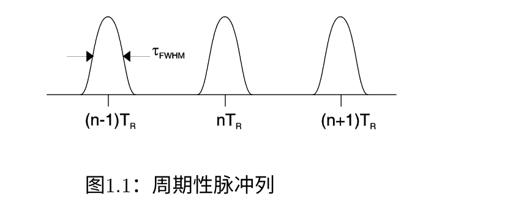

图1.1：周期性脉冲列

$T_R$: 脉冲重复时间

$W$: 脉冲能量

$P_{ave} = W/T_R$ : 平均功率

$\tau_{\text{FWHM}}$是脉冲在时间域内强度包络的半高全宽。

峰值功率由以下给出

$$P_p = \frac{W}{\tau_{\text{FWHM}}} = P_{ave} \frac{T_R}{\tau_{\text{FWHM}}}, \qquad \qquad \qquad (1.1)$$

峰值电场由以下给出

$$E_p = \sqrt{2Z_{F_0} \frac{P_p}{A_{\text{eff}}}}. \qquad \qquad \qquad (1.2)$$

$A_{\text{eff}}$是光束横截面， $Z_{F_0} = 377\Omega$是自由空间阻抗。

### 时间尺度:

- 1 ns ~ 30 cm (高速电子， GHz)
- 1 ps ~ 300 $\mu$m
- 1 fs ~ 300 nm
- 1 as = $10^{-18}$ s ~ 0.3 nm = 3 Å (金属中的典型晶格常数)

迄今为止产生的最短脉冲约为 4-5 fs在800 nm ($\lambda/c = 2.7$ fs)，小于两个光学周期和250 as在25 nm。 对于少周期脉冲，电场变得重要，不仅仅是强度!

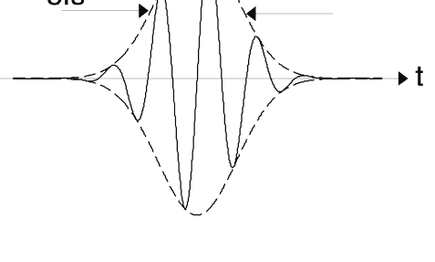

图1.2: 中心波长为800 nm的5 fs脉冲的电场波形。电场依赖于载波包络相位。

### 1.3. 应用

**平均功率：**

$P_{ave} \sim 1W$，正在进行中的功率可达10可达$kW$，尚未脉冲化

**重复频率：**

$T_R^{-1} = f_R=$ 毫赫 $- 100 \text{ GHz}$

**脉冲能量：**

$W = 1\text{pJ} - 1\text{kJ}$

**脉冲宽度：**

$\tau_{\text{FWHM}} = \begin{cases} 5 \text{ fs} - 50 \text{ ps}, & \text{锁模} \ 30 \text{ ps} - 100 \text{ ns}, & \text{Q – 开关} \end{cases}$

**峰值功率：**

$P_p = \frac{1 \text{ kJ}}{1 \text{ ps}} \sim 1 \text{ PW},$

使用Nd:玻璃获得（LLNL - 美国，[1][2][3]）。对于典型的实验室脉冲，峰值功率为

$P_p = \frac{10 \text{纳焦耳}}{10 \text{飞秒}} \sim 1 \text{兆瓦}$

**典型实验室脉冲的峰值场强：**

$E_p = 2 \times 377 \times \frac{10^6 \times 10^{12} \text{ V}}{\pi \times (1.5)^2 \text{ 米}} \approx 10^{10} \frac{\text{V}}{\text{m}} = \frac{10 \text{ 伏特}}{\text{纳米}}$

### 1.3 应用

- **高时间分辨率：** 超快光谱学，追踪凝聚态物质中的超快物理过程（见图1.3），化学反应，物理和生物过程，用飞秒脉冲影响化学反应：飞秒化学（2000年诺贝尔奖获得者阿赫迈德·泽维尔），高速电路测试和电信号采样，见图1.4。

### Pump-probe measurement

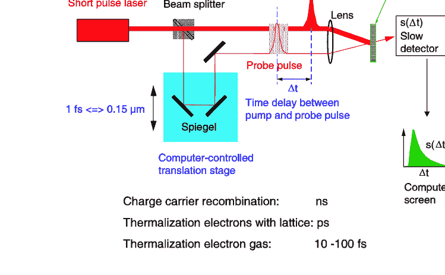

图1.3：泵浦-探测装置，用于提取半导体中与载流子动力学相关的时间常数。

### High Speed A/D-Conversion (100 GHz)

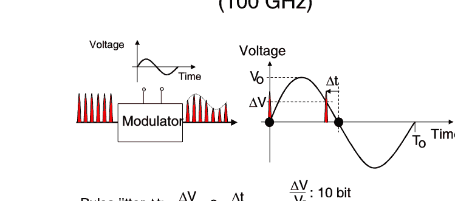

图1.4：高重复频率皮秒或飞秒激光的高速A/D转换。

### 1.3. 应用

- 高空间分辨率： $c\tau_{\text{FWHM}}$；光学成像，例如光学相干断层扫描，见图1.5-1.8。

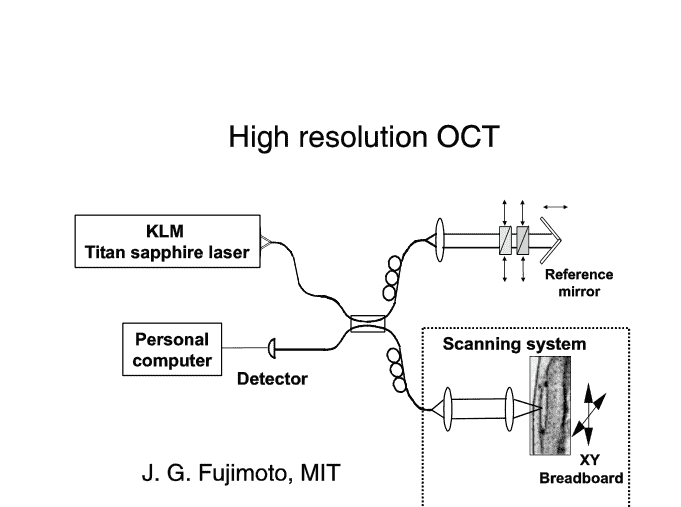

图1.5：光学相干断层扫描的设置。由James Fujimoto提供。经允许使用。

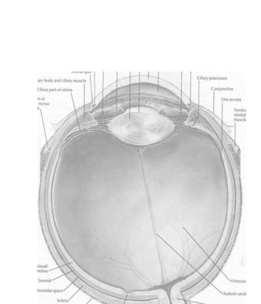

图1.6：人眼的横截面。由James Fujimoto提供。经允许使用。

## 1.4 激光基础知识回顾

- 通过强散射介质进行成像：

图1.8: 直接透射光子的成像结果呈现出清晰的图像。用于X射线成像的替代方法；然而，透射率非常低。

> MIT OCW提供的图。

- 高带宽：大规模波分复用-光通信，一个源产生多个信道或大规模时分复用，高比特率的短脉冲流。

- 高强度：低平均功率下的大强度 ⇒非线性频率转换、激光材料加工、手术、高强度物理学：X射线产生、粒子加速...

线性和环形腔：

图1.9a: （图中描述了一个线性谐振腔）

稳态运行：电场必须在一次往返后重复自身。
考虑一个单色的线偏振场

$$E(z, t) = \Re \left\{ E_0 e^{\mathrm{j}(\omega t - kz)} \right\}, \quad (1.3)$$

其中

$$k = \frac{\omega}{c} n \tag{1.4}$$

是介质中的传播常数，折射率为 n。考虑图1.9a中的线性谐振腔。

从（1）到（2）的传播由 n = n' + jn''（复折射率）确定，电场由给出

$$E = \Re\left\{ E_0 e^{\frac{\omega}{c} n_g'' c_g} e^{j\omega t} e^{-j\frac{\omega}{c}(n_g' c_g + c_a)} \right\}, \tag{1.5}$$

其中 n_g是增益介质的复折射率（假设在增益介质外 n=1），c_g是增益介质的长度，c_a是外部增益介质，而 c = n_g c_g + c_a是谐振腔中的光学路径长度。

返回到（1），即一个完整的往返结果为

$$E = \Re\left\{ r_1 r_2 e^{2\frac{\omega}{c} n_g'' c_g} E_0 e^{j\omega t - j2\frac{\omega}{c} c} \right\} \Rightarrow r_1 r_2 e^{2\frac{\omega}{c} n_g'' c_g} = 1, \tag{1.6}$$

即增益等于损耗，并且我们得到相位条件

$$\frac{2\omega c}{c} = 2m\pi. \tag{1.7}$$

相位条件确定了共振频率，即

$$\omega_m = \frac{m\pi c}{c} \tag{1.8}$$

和

$$f_m = \frac{mc}{2c}. \tag{1.9}$$

纵向模式的模间距为

$$\Delta f = f_m - f_{m-1} = \frac{c}{2c} \tag{1.10}$$

(仅在没有色散的情况下成立，即 n = n(\omega))。假设频率独立的腔体损耗和钟形增益（见图1.10）。

图1.10: （图中描述了增益和损耗曲线）

> MIT OCW提供的图。

为了确保单频操作，使用滤波器 (etalon)；区分均匀和非均匀宽化增益介质，光谱孔烧伤的影响！区分小信号增益 g₀ 每个往返，

即激光强度 $I \rightarrow 0$ 的增益，以及大信号增益，通常由以下给出

$$g = \frac{g_0}{1 + \frac{I}{I_{\text{sat}}}}, \tag{1.11}$$

其中 $I_{\text{sat}}$ 是饱和强度。增益饱和负责稳态增益（见图1.11），并假设均匀宽化增益。

为了产生短脉冲，即短于腔往返时间，我们希望在稳态下有许多纵向模式运行。对于多模激光，激光场由以下给出

$$E(z, t) = \Re\left[\sum_{m} \hat{E}_m e^{j(\omega_m t - k_m z + \phi_m)}\right], \tag{1.12a}$$
$$\omega_m = \omega_0 + m\Delta\omega = \omega_0 + \frac{m\pi c}{L}, \tag{1.12b}$$
$$k_m = \frac{\omega_m}{c}, \tag{1.12c}$$

其中符号 $\hat{}$ 表示频域量。方程式(1.12a)可以重写为

$$E(z, t) = \Re\left\{ e^{j\omega_0(t - z/c)} \sum_{m} \hat{E}_m e^{j(m\Delta\omega(t - z/c) + \phi_m)} \right\} \tag{1.13a}$$
$$= \Re\left[ A(t - z/c) e^{j\omega_0(t - z/c)} \right] \tag{1.13b}$$

具有复杂的包络

$$A\left(t - \frac{z}{c}\right) = \sum_{m} E_m e^{j(m\Delta\omega(t - z/c) + \phi_m)} = \text{复杂包络（缓变）}. \tag{1.14}$$

$e^{j\omega_0(t-z/c)}$ 是载波（快速振荡）。载波和包络以相同的速度传播（不考虑色散）。包络函数具有周期

$$T = \frac{2\pi}{\Delta\omega} = \frac{2L}{c} = \frac{L}{c}. \tag{1.15}$$

$L$ 是往返长度（光学）！

**例子：**

我们假设有 $N$ 个模式，振幅相等 $E_m = E_0$，相位相等 $\phi_m = 0$，因此包络为

$$A(z, t) = E_0 \sum_{m=-(N-1)/2}^{(N-1)/2} e^{j(m\Delta\omega(t-z/c))}. \tag{1.16}$$

随着

$$\sum_{m=0}^{q-1} a^m = \frac{1-a^q}{1-a}, \tag{1.17}$$

我们得到

$$A(z, t) = E_0 \frac{\sin\left[\frac{N\Delta\omega}{2}\left(t-\frac{z}{c}\right)\right]}{\sin\left[\frac{\Delta\omega}{2}\left(t-\frac{z}{c}\right)\right]}. \tag{1.18}$$

激光强度 $I$ 与 $E(z, t)^2$ 成正比，平均在一个光学周期内：$I \sim |A(z, t)|^2$。在 $z=0$ 时，我们得到

$$I(t) \sim |E_0|^2 \frac{\sin^2\left(\frac{N\Delta\omega t}{2}\right)}{\sin^2\left(\frac{\Delta\omega t}{2}\right)}. \tag{1.19}$$

图1.12: （图中描述了由方程(1.19)给出的周期脉冲）

(a) 由方程(1.19)给出的周期脉冲，周期 T: 1/Δf = L/c

- 脉冲持续时间 $\Delta t = \frac{2\pi}{N\Delta\omega} = \frac{1}{N\Delta f}$
- 峰值强度 $\sim N^2 |E_0|^2$
- 平均强度 $\sim N|E_0|^2$ ⇒ 峰值强度增强了一个因子 N。

(b) 如果模式的相位没有锁定，即 $\phi_m$是一个随机序列

- 强度随机波动在平均值($\sim N|E_0|^2$)周围，与锁模情况相同
- 相关时间为 $\Delta t_c \approx \frac{1}{N \cdot \Delta f}$
- 波动仍然具有周期 T: 1/Δf, 在通常的多模激光器中。

在通常的多模激光器中， $\phi_m$随时间 t变化。

## 1.5 历史

- 1960年: 第一台激光器，红宝石，迈曼[4]。
- 1961年: Q开关的提议，Hellwarth[5]。
- 1963年: 第一次在红宝石激光器中观察到锁模现象，Guers和Mueller [6],[7], Statz和Tang [8]。在He-Ne激光器上。
- 1964年: 活性模锁 (HeNe, Ar等), DiDomenico [9], [10]和Yariv [11]。
- 1966年: 通过在红宝石中使用饱和染料吸收剂实现被动模锁，由A. J. Dellaria，Mocker和Collins [12]。
- 1966年: 染料激光器，F. P. Schäfer等人 [13]。
- 1968年: 染料激光器的锁模 (Q开关)，Schmidt，Schäfer [14]。
- 1972年: 染料激光器的连续被动模锁，Ippen，Shank，Dienes [15]。
- 1972年：关于主动模锁的解析理论 [21, 22]。
- 1974年：亚皮秒脉冲，Shank，Ippen [16]。
- 1975年：使用慢速[1]，[24]和快速饱和吸收剂[25]的被动模锁定理论预测了双曲正切脉冲。
- 1981年：碰撞脉冲模锁激光（CPM），[17]。
- 1982年：脉冲压缩[20]。
- 1984年：孤子激光，Mollenauer，[26]。
- 1985年：啁啾脉冲放大，Strickland和Morou，[27]。
- 1986年：钛蓝宝石（固体激光），P. F. Moulton [28]。
- 1987年：外部压缩，Fork等人，波长600纳米，脉冲宽度6飞秒[18, 19]。
- 1988年：叠加脉冲模锁（APM），[29, 30, 31]。
- 1991年：克尔透镜模锁，Spence等人，[32, 33, 34, 35, 36]。
- 1993年：拉伸脉冲激光，Tamura等人[37]。
- 1994年：啁啾镜，Szipoecs等人[38, 39]
- 1997年：双啁啾镜，Kaertner等人[40]
- 2001年：5飞秒，亚二周期脉冲，八度跨度，Ell等人[42]
- 2001年：高次谐波产生的250阿秒，Krausz等人[43]

图1.13：不同激光系统的脉冲宽度（按年份）。

> 由Erich Ippen提供。经许可使用。

图1.14: 钛宝石激光器的脉冲宽度（按年份）。

## 1.6 激光材料

| 激光材料 | 吸收波长 | 平均发射λ | 带宽 | 脉冲宽度 |
| --- | --- | --- | --- | --- |
| Nd:YAG | 808纳米 | 1064纳米 | 0.45纳米 | ~ 6皮秒 |
| Nd:YLF | 797纳米 | 1047纳米 | 1.3纳米 | ~ 3皮秒 |
| Nd:LSB | 808纳米 | 1062纳米 | 4纳米 | ~ 1.6皮秒 |
| Nd:YVO4 | 808纳米 | 1064纳米 | 2纳米 | ~ 4.6皮秒 |
| Nd:光纤 | 804纳米 | 1053纳米 | 22-28纳米 | ~ 33飞秒 |
| Nd:玻璃 | 804纳米 | 1053纳米 | 22-28纳米 | ~ 60飞秒 |
| Yb:YAG | 940,968纳米 | 1030纳米 | 6纳米 | ~ 300飞秒 |
| Yb:玻璃 | 975纳米 | 1030纳米 | 30纳米 | ~ 90飞秒 |
| Ti:Al2O3 | 480-540纳米 | 796纳米 | 200纳米 | ~ 5飞秒 |
| Cr4+:Mg2SiO4: | 900-1100纳米 | 1260纳米 | 200纳米 | ~ 14飞秒 |
| Cr4+:YAG | 900-1100纳米 | 1430纳米 | 180纳米 | ~ 19飞秒 |

- 过渡金属: (Cr 3+, Ti3+, Ni2+, CO2+等) (外 3d-电子) →宽带
- 稀土: (Nd 3+, Tm3+, Ho3+, Er3+等) (屏蔽 4f-电子) →窄带

## 第1章 引言

## 参考文献

[1] M. D. Perry 和 G. Mourou, "Terawatt to Petawatt Subpicosecond Lasers," Science, Vol. 264 (1994), p. 917.

[2] M. D. Perry 等, "Petawatt Laser Pulses," Optics Letters, Vol. 24 (1999), p. 160.

[3] T. Tajima 和 G. Mourou, Phys. Rev. Spec. Topics-Accelerators 和 Beams 5(031301) 1 (2002). 参见 也 wwwapr.apr.jaeri.go.jp/aprc/e/index_e.html, www.eecs.umich.edu/CUOS/HERCULES/index, www.clf.rl.ac.uk

[4] T. H. Maimann, "红宝石中的受激光辐射", 自然 187, 493-494, (1960).

[5] R. W. Hellwarth, 编辑, 量子电子学进展, 哥伦比亚出版社, 纽约 (1961).

[6] K. Gürs, R. Müller: "通过控制光学激光器的发射来实现宽带调制 (耦合调制)", 物理学快报. 5,179-181 (1963).

[7] K. Gürs (编辑): "光学红宝石激光器中的拍频和调制", 在量子电子学II I(哥伦比亚大学出版社, 纽约 1964).

[8] H. Statez, C.L. Tang (编辑): "塞曼效应和振荡激光模式之间的非线性相互作用", 在量子电子学III(哥伦比亚大学出版社, 纽约 1964).

[9] M. DiDomenico: "激光器内部 (耦合型) 调制的小信号分析," J. Appl. Phys. 35, 2870-2876 (1964).

[10] L.E. Hargrove, R.L. Fork, M.A. Pollack: "同步腔内调制引起的He-Ne激光器模式锁定," Appl. Phys. Lett. 5,4-5 (1964).

[11] A. Yariv: "多模激光振荡器中的内部调制," J. Appl. Phys. 36, 388-391 (1965).

[12] H.W. Mocker, R.J. Collins: "Q开关红宝石激光器中的模式竞争和自锁效应," Appl. Phys. Lett. 7, 270-273 (1965).

[13] F. P. Schäfer, F. P. W. Schmidt, J. Volze: "有机染料溶液激光器，" Appl. Phys. Lett. 9, 306 – 308 (1966).

[14] F. P. W. Schmidt, F. P. Schäfer: "饱和吸收体自模锁染料激光器，" Phys. Lett. 26A, 258-259 (1968).

[15] E.P. Ippen, C.V. Shank, A. Dienes: "连续波染料激光器的被动模锁，" Appl. Phys. Lett. 21, 348-350 (1972).

[16] C.V. Shank, E.P. Ippen: "模锁连续波染料激光器产生亚皮秒千瓦脉冲，" Appl. Phys. Lett. 24, 373-375 (1974).

[17] R.L. Fork, B.I. Greene, C.V. Shank: "通过碰撞脉冲模锁定产生比0.1皮秒更短的光脉冲," Appl. Phys. Lett.38, 617-619 (1981).

[18] W.H. Knox, R.L. Fork, M.C. Downer, R.H. Stolen, C.V. Shank, J.A.V aldmans: "在5kHz重复率下将光脉冲压缩到8飞秒," Appl. Phys. Lett. 4 6, 1120-1122 (1985).

[19] R.L. Fork, C.H.B. Cruz, P.C. Becker, C.V. Shank: "通过使用三次相位补偿将光脉冲压缩到六飞秒," Opt. Lett. 12, 483-485 (1987).

[20] D. Grischowsky, A. C. Balant: 标题, Appl. Phys. Lett. 41, pp. (1982).

[21] J. Kuizenga, A. E. Siegman: "FM und AM mode locking of the homogeneous laser - Part I: Theory, IEEE J. Quantum Electron. 6, 694-708 (1970).

[22] J. Kuizenga, A. E. Siegman: "FM und AM mode locking of the homogeneous laser - Part II: Experimental results, IEEE J. Quantum Electron. 6, 709-715 (1970).

[23] G.H.C. New: Pulse evolution in mode-locked quasicontinuous lasers, IEEE J. Quantum Electron. 10, 115-124 (1974).

[24] H.A. Haus: Theory of mode locking with a slow saturable absorber, IEEE J. Quantum Electron. QE 11, 736-746 (1975).

[25] H.A. Haus, C.V. Shank, E.P. Ippen: Shape of passively mode-locked laser pulses, Opt. Commun. 15, 29-31 (1975).

[26] L.F. Mollenauer, R.H. Stolen: 孤子激光器, 光学快报 9, 13-15 (1984).

[27] D. Strickland and G. Morou: "啁啾脉冲放大," 光通信 56,229-221,(1985).

[28] P. F. Moulton: "Ti:Al2O3的光谱和激光特性", JOSA B 3, 125-132 (1986).

[29] K. J. Blow and D. Wood: "具有非线性外腔的锁模激光器," J. Opt. Soc. Am. B 5, 629-632 (1988).

[30] J. Mark, L.Y. Liu, K.L. Hall, H.A. Haus, E.P. Ippen: 在具有非线性外腔的激光器中产生飞秒脉冲, 光学快报 14,48-50 (1989).

[31] E.P. Ippen, H.A. Haus, L.Y. Liu: 加性脉冲锁模, J. Opt. Soc. Am. B 6, 1736-1745 (1989).

[32] D.E. Spence, P.N. Kean, W. Sibbett: 60飞秒脉冲产生自自锁模的钛宝石激光器, Opt. Lett. 16, 42-44 (1991).

[33] D.K. Negus, L. Spinelli, N. Goldblatt, G. Feugnet: 标题, in Advanced Solid-State Lasers G. Dubé, L. Chase (Eds.) (Optical Society of America, Washington, D.C., 1991) pp. 120-124.

[34] F. Salin, J. Squier, M. Piché: 钛铝2氧化物激光器的锁模和自聚焦: 一个高斯近似, Opt. Lett. 16, 1674-1676 (1991).

## 第2章 Maxwell-Bloch方程

## 2.1 Maxwell方程

Maxwell方程组由

$$
\begin{aligned}
\vec{\nabla} \times \vec{H} &= \vec{j} + \frac{\partial \vec{D}}{\partial t}, \\
\vec{\nabla} \times \vec{E} &= -\frac{\partial \vec{B}}{\partial t}, \\
\vec{\nabla} \cdot \vec{D} &= \rho, \\
\vec{\nabla} \cdot \vec{B} &= 0.
\end{aligned}
$$

Maxwell方程式的附带材料方程式为：

$$
\begin{aligned}
\vec{D} &= \epsilon_0 \vec{E} + \vec{P}, \\
\vec{B} &= \mu_0 \vec{H} + \vec{M}.
\end{aligned}
$$

在这里，$E$和$H$是电场和磁场，$D$是电通量，$B$是磁通量，$j$是自由载流子的电流密度，$\rho$是自由电荷密度，$P$是极化，$M$是磁化。通过对方程式(2.1b)取旋度并考虑$\vec{\nabla} \times (\vec{\nabla} \times \vec{E}) = \vec{\nabla} (\vec{\nabla} \cdot \vec{E}) - \Delta \vec{E}$，我们得到

$$
\Delta \vec{E} - \mu_0 \frac{\partial}{\partial t} \left( \vec{j} + \epsilon_0 \frac{\partial \vec{E}}{\partial t} + \frac{\partial \vec{P}}{\partial t} \right) = \frac{\partial}{\partial t} \vec{\nabla} \times \vec{M} + \vec{\nabla} \left( \vec{\nabla} \cdot \vec{E} \right)
$$

因此

$$
\left(\Delta - \frac{1}{c_0^2} \frac{\partial^2}{\partial t^2}\right) \vec{E} = \mu_0 \left( \frac{\partial \vec{j}}{\partial t} + \frac{\partial^2}{\partial t^2} \vec{P} \right) + \frac{\partial}{\partial t} \nabla \times \vec{M} + \nabla \left( \nabla \cdot \vec{E} \right). \tag{2.4}
$$

真空中的光速是

$$
c_0 = \frac{1}{\sqrt{\mu_0 \epsilon_0}}. \tag{2.5}
$$

## 2.2 各向同性介质中的线性脉冲传播

对于介电非磁性介质，没有自由电荷和由自由电荷产生的电流，有 $M = 0$, $j = 0$, $\rho = 0$。我们得到 $D = \epsilon (\vec{r}) E = \epsilon_0 \epsilon_r (\vec{r}) E$

$$
\nabla \cdot (\epsilon (\vec{r}) \vec{E}) = 0. \tag{2.6}
$$

此外，对于均匀介质，我们得到 $\nabla \cdot E = 0$，波动方程(2.4)大大简化

$$
\left(\Delta - \frac{1}{c_0^2} \frac{\partial^2}{\partial t^2}\right) \vec{E} = \mu_0 \frac{\partial^2}{\partial t^2} \vec{P}. \tag{2.7}
$$

这是由介质中的极化驱动的波动方程。 如果介质是线性的，并且只有由极化率 $\chi(\omega) = \epsilon_r(\omega) - 1$ 描述的感应极化，我们在频域得到

$$
\widehat{\vec{P}}(\omega) = \epsilon_0 \chi(\omega) \widehat{\vec{E}}(\omega). \tag{2.8}
$$

代入(2.7)

$$
\left(\Delta + \frac{\omega^2}{c_0^2}\right) \widehat{\vec{E}}(\omega) = -\omega^2 \mu_0 \epsilon_0 \chi(\omega) \widehat{\vec{E}}(\omega), \tag{2.9}
$$

其中 $\widehat{\vec{D}} = \epsilon_0 \epsilon_r(\omega) \widehat{\vec{E}}(\omega)$，因此

$$
\left(\Delta + \frac{\omega^2}{c_0^2}(1+\chi(\omega))\right) \widehat{\vec{E}}(\omega) = 0, \tag{2.10}
$$

折射率为 $n$ 和 $1+\chi(\omega)=n^2$

$$
\left( \Delta + \frac{\omega^2}{c^2} \right) \hat{\vec{E}}(\omega) = 0, \quad \text{(2.11)}
$$

其中 $c=c_0/n$ 是介质中的光速。

### 2.2.1 平面波解（TEM 波）

方程 (2.11) 的复平面波解为

$$
\hat{\vec{E}}^{(+)}(\omega, \vec{r}) = \hat{\vec{E}}^{(+)}(\omega) e^{-j\vec{k}\cdot\vec{r}} = E_0 e^{-j\vec{k}\cdot\vec{r}} \cdot \vec{e} \quad \text{(2.12)}
$$

带有

$$
|\vec{k}|^2 = \frac{\omega^2}{c^2} = k^2. \quad \text{(2.13)}
$$

因此，色散关系由以下给出

$$
k(\omega) = \frac{\omega}{c_0} n(\omega). \quad \text{(2.14)}
$$

从 $\nabla \cdot \vec{E} = 0$，我们可以看出 $\vec{k} \perp \vec{e}$。在时间域中，我们得到

$$
\vec{E}^{(+)}(\vec{r}, t) = E_0 \vec{e} \cdot e^{j\omega t - j\vec{k}\cdot\vec{r}} \quad \text{(2.15)}
$$

带有

$$
k = 2\pi/\lambda, \quad \text{(2.16)}
$$

其中 $\lambda$ 是波长， $\omega$ 是角频率， $\vec{k}$ 是波矢， $\vec{e}$ 是极化矢量，而 $f = \omega/2\pi$ 是频率。从方程 (2.1b) 中，我们得到磁场的表达式

$$
-j\vec{k} \times E_0\vec{e}e^{j(\omega t - \vec{k}\cdot\vec{r})} = -j\mu_0\omega H^{(+)}, \quad \text{(2.17)}
$$

或

$$
\vec{H}^{(+)} = \frac{E_0}{\mu_0\omega} e^{j(\omega t - \vec{k}\cdot\vec{r})} \vec{k} \times \vec{e} = H_0\vec{h}e^{j(\omega t - \vec{k}\cdot\vec{r})} \quad \text{(2.18)}
$$

与

$$
\vec{h} = \frac{\vec{k}}{|\vec{k}|} \times \vec{e} \quad \text{(2.19)}
$$

和

$$
H_0 = \frac{|k|}{\mu_0 \omega} E_0 = \frac{1}{Z_F} E_0 \quad \text{(2.20)}
$$

自然阻抗是

$$
Z_F = \mu_0 c = \sqrt{\frac{\mu_0}{\epsilon_0 \epsilon_r}} = \frac{1}{n} Z_{F0} \quad \text{(2.21)}
$$

具有自由空间阻抗

$$
Z_{F0} = \sqrt{\frac{\mu_0}{\epsilon_0}} = 377 \Omega \quad \text{(2.22)}
$$

对于一个反向传播的波，有 $\vec{E}^{(+)}(\vec{r}, t) = E_0 \vec{e} \cdot e^{j\omega t + j\vec{k} \cdot \vec{r}}$ $\vec{H}^{(+)} = H_0 \vec{h} e^{j(\omega t + \vec{k} \cdot \vec{r})}$ with

$$
H_0 = -\frac{|k|}{\mu_0 \omega} E_0 \quad \text{(2.23)}
$$

请注意，向量 $\vec{e}, \vec{h}$ 和 $\vec{k}$ 构成一个正交三面角，

$$
\vec{e} \perp \vec{h}, \quad \vec{k} \perp \vec{e}, \quad \vec{k} \perp \vec{h}. \quad \text{(2.24)}
$$

### 2.2.2 复数表示法

物理 $\vec{E}, \vec{H}$ 场是实数：

$$
\vec{E}(\vec{r}, t) = \frac{1}{2} \left( \vec{E}^{(+)}(\vec{r}, t) + \vec{E}^{(-)}(\vec{r}, t) \right) \quad \text{(2.25)}
$$

with $\vec{E}^{(-)}(\vec{r}, t) = \vec{E}^{(+)}(\vec{r}, t)^*$。 通过添加不同的光谱成分可以获得一般的时间形状，

$$
\vec{E}^{(+)}(\vec{r}, t) = \int_0^\infty \frac{d\omega}{2\pi} \widehat{\vec{E}}^{(+)}(\omega) e^{j(\omega t - \vec{k} \cdot \vec{r})} \quad \text{(2.26)}
$$

相应地，磁场由以下给出

$$
\vec{H}(\vec{r}, t) = \frac{1}{2} \left( \vec{H}^{(+)}(\vec{r}, t) + \vec{H}^{(-)}(\vec{r}, t) \right) \quad \text{(2.27)}
$$

with $\vec{H}^{(-)}(\vec{r}, t) = \vec{H}^{(+)}(\vec{r}, t)^*$。 一般解为

$$
\vec{H}^{(+)}(\vec{r}, t) = \int_0^\infty \frac{d\omega}{2\pi} \widehat{\vec{H}}^{(+)}(\omega) e^{j(\omega t - \vec{k} \cdot \vec{r})} \quad \text{(2.28)}
$$

with

$$
\widehat{\vec{H}}^{(+)}(\omega) = \frac{E_0}{Z_F} \vec{h} \quad \text{(2.29)}
$$

### 2.2.3 坡印廷矢量、能量密度和强度

对于平面波场

| 数量 | 实场 | 复场 | ⟨⟩ₜ |
| :--- | :--- | :--- | :--- |
| 能量密度 | $w = \frac{1}{2} (\epsilon_0\epsilon_r \vec{E}^2 + \mu_0\mu_r \vec{H}^2)$ | $w = \frac{1}{4} (\epsilon_0\epsilon_r |\vec{E}^{(+)}|^2 + \mu_0\mu_r |\vec{H}^{(+)}|^2)$ | |
| 坡印廷矢量 | $\vec{S} = \vec{E} \times \vec{H}$ | $\vec{T} = \frac{1}{2} \vec{E}^{(+)} \times (\vec{H}^{(+)})*$ | |
| 强度 | $I = |\vec{S}| = c w$ | $I = |\vec{T}| = c w$ | |
| 能量守恒 | $\partial w/\partial t + \nabla\cdot\vec{S} = 0$ | $\partial w/\partial t + \nabla\cdot\vec{T} = 0$ | |

对于 $\vec{E}^{(+)}(\vec{r}, t) = E_0\hat{x} e^{j(\omega t - kz)}$ 我们得到能量密度

$$
w = \frac{1}{2} \epsilon_0 |E_0|^2, \quad \text{(2.30)}
$$

坡印廷矢量

$$
\vec{T} = \frac{1}{2Z_F} |E_0|^2 \hat{e}_z \quad \text{(2.31)}
$$

和强度

$$
I = \frac{1}{2Z_F} |E_0|^2 = \frac{1}{2} Z_F |H_0|^2. \quad \text{(2.32)}
$$

### 2.2.4 介电极化率

极化由以下给出

$$
\vec{P}^{(+)}(\omega) = \frac{\text{偶极矩}}{\text{体积}} = N \cdot \langle\vec{p}^{(+)}(\omega)\rangle = \epsilon_0\chi(\omega)\vec{E}^{(+)}(\omega), \quad \text{(2.33)}
$$

其中 N 是单位的密度和 $\langle\vec{p}\rangle$ 是单位（原子，分子，…）的平均偶极矩。

#### 经典谐振子模型

在一维中由电力驱动的阻尼谐振子, $x$, 由以下微分方程描述

$$
m \frac{d^2x}{dt^2} + 2\frac{\omega_0}{Q} m \frac{dx}{dt} + m\omega_0^2x = e_0E(t), \quad \text{(2.34)}
$$

通过使用假设 $x(t) = \hat{x}e^{j\omega t}$，我们得到偶极矩的复振幅 $p = e_0 x(t) = \hat{p}e^{j\omega t}$

$$
\hat{p} = \frac{\frac{e_0^2}{m}}{(\omega_0^2 - \omega^2) + 2j\frac{\omega_0}{Q}\omega}\hat{E}. \quad \text{(2.35)}
$$

对于极化率，我们得到

$$
\chi(\omega) = \frac{N\frac{e_0^2}{m}\frac{1}{\epsilon_0}}{(\omega_0^2 - \omega^2) + 2j\omega\frac{\omega_0}{Q}} \quad \text{(2.36)}
$$

因此

$$
\chi(\omega) = \frac{\omega_p^2}{(\omega_0^2 - \omega^2) + 2j\omega\frac{\omega_0}{Q}}, \quad \text{(2.37)}
$$

等离子体频率 $\omega_p$，由 $\omega_p^2 = Ne_0^2 / m\epsilon_0$ 确定。图2.1显示了经典极化率 (2.37) 的实部和虚部。

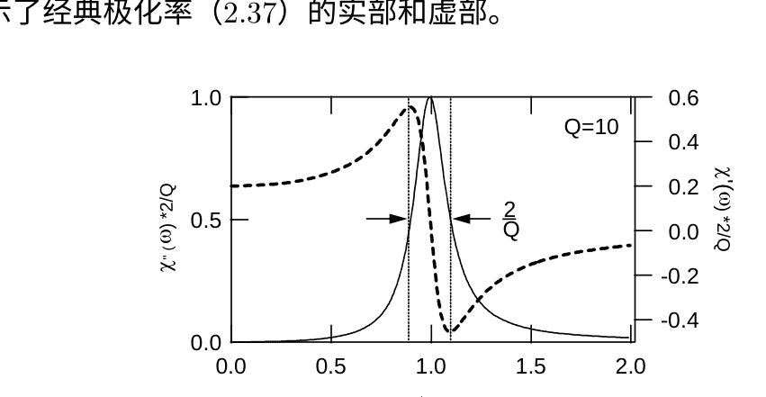

注意，由于损耗，存在小的共振频移。在共振点之外，虚部迅速趋近于零。而实部则在共振点以下趋近于一个常数值 $\omega_p^2/\omega_0^2$，并在共振点以上趋近于零，但比实部慢，即在共振点之外仍然存在对折射率的贡献，但几乎没有损耗。

## 2.3 布洛赫方程

低浓度的原子显示出类似于气体、染料和一些固体激光介质中的线光谱。通常，原子、分子或固体介质中有无限多个能级本征态，并且光谱线与这些能级之间的允许跃迁相关。

对于许多物理考虑，只考虑可能的能级本征态中的两个已经足够，例如与激光跃迁相关的那些。激光的泵浦过程可以通过现象学弛豫过程来描述，其中上激光能级和下激光能级之间发生能量转移。由此得到的简单模型通常被称为两能级原子，从数学上讲也等效于外部磁场中的自旋1/2粒子，因为自旋只能与场平行或反平行，即它具有两个能级和能级本征态。两能级原子或自旋与电场或磁场的相互作用场被布洛赫方程描述。

### 2.3.1 两能级模型

只有两个能量本征值的原子由两维状态空间描述，该空间由两个能量本征态 $|e\rangle$ 和 $|g\rangle$ 张成。这两个状态构成一个完备的正交归一系统。相应的能量本征值为 $E_e$ 和 $E_g$（图2.2）。

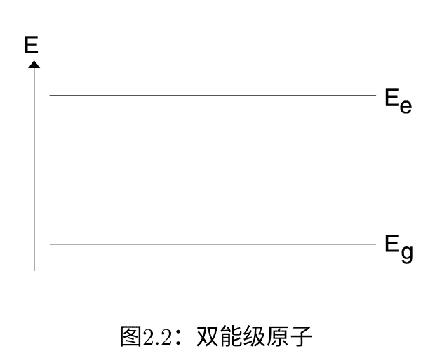

在位置表示即 $x$ 表示中，这些状态对应于波函数$$\psi_e(x) = <x|e>, \quad \text{和} \quad \psi_g(x) = <x|g> \quad (2.3)$$

8) 原子的哈密顿量由以下给出

$$H_A = E_e|e><e| + E_g|g><g| \quad (2.39)$$

在这个二维状态空间中，只有 $2 \times 2 = 4$ 个线性无关的线性算符是可能的。在这个空间中，一个可能的算符基的选择是

$$\begin{aligned}
\mathbf{1} &= |e><e| + |g><g|, \quad &(2.40) \\
\boldsymbol{\sigma}_z &= |e><e| - |g><g|, \quad &(2.41) \\
\boldsymbol{\sigma}^+ &= |e><g|, \quad &(2.42) \\
\boldsymbol{\sigma}^- &= |g><e|. \quad &(2.43)
\end{aligned}$$

非厄米算符 $\boldsymbol{\sigma}^\pm$ 可以被厄米算符替代-算符 $\boldsymbol{\sigma}_{x,y}$

$$\begin{aligned}
\boldsymbol{\sigma}_x &= \boldsymbol{\sigma}^+ + \boldsymbol{\sigma}^-, \quad &(2.44) \\
\boldsymbol{\sigma}_y &= -\mathrm{j}\boldsymbol{\sigma}^+ + \mathrm{j}\boldsymbol{\sigma}^-. \quad &(2.45)
\end{aligned}$$

如果我们看一下这些算符作用于任意态时的作用，这些算符的物理意义就变得明显起来

$$|\psi> = c_g|g> + c_e|e> \quad (2.46)$$

我们得到

$$\begin{aligned}
\boldsymbol{\sigma}^+|\psi> &= c_g|e>, \quad &(2.47) \\
\boldsymbol{\sigma}^-|\psi> &= c_e|g>, \quad &(2.48) \\
\boldsymbol{\sigma}_z|\psi> &= c_e|e> - c_g|g>. \quad &(2.49)
\end{aligned}$$

算符 $\boldsymbol{\sigma}^+$ 从基态到激发态产生一个跃迁，而 $\boldsymbol{\sigma}^-$ 则相反。与 $\boldsymbol{\sigma}^+$ 和 $\boldsymbol{\sigma}^-$ 不同，$\boldsymbol{\sigma}_z$ 是一个厄米算符，其期望值是一个可观测的物理量，具有期望值

$$<\psi|\boldsymbol{\sigma}_z|\psi> = |c_e|^2 - |c_g|^2 = w, \quad (2.50)$$

原子的反转 $w$，因为 $|c_e|^2$ 和 $|c_g|^2$ 是在相应的测量中，找到原子处于状态 $|e>$ 或 $|g>$ 的概率。

## 2.3. 布洛赫方程

如果我们考虑一个包含N个原子的系列，总的反转率为 $\sigma = N < \psi|\boldsymbol{\sigma}_z|\psi >$。如果我们从哈密顿量(2.38)中分离出项 $(E_e + E_g)/2 \cdot \mathbf{1}$，其中 $\mathbf{1}$ 表示单位矩阵，我们相应地重新调整能量值，并得到两能级系统的哈密顿量

$$\mathbf{H}_A = \frac{1}{2}\hbar\omega_{eg}\boldsymbol{\sigma}_z, \quad (2.51)$$

具有过渡频率

$$\omega_{eg} = \frac{1}{\hbar}(E_e - E_g). \quad (2.52)$$

这种形式的哈密顿量是有利的。 算符(2.41)到(2.43)之间存在以下的对易关系

- $[\boldsymbol{\sigma}^+, \boldsymbol{\sigma}^-] = \boldsymbol{\sigma}_z, \quad (2.53)$
- $[\boldsymbol{\sigma}^+, \boldsymbol{\sigma}_z] = -2\boldsymbol{\sigma}^+, \quad (2.54)$
- $[\boldsymbol{\sigma}^-, \boldsymbol{\sigma}_z] = 2\boldsymbol{\sigma}^-, \quad (2.55)$

和反对易关系分别为

- $[\boldsymbol{\sigma}^+, \boldsymbol{\sigma}^-]_+ = 1, \quad (2.56)$
- $[\boldsymbol{\sigma}^+, \boldsymbol{\sigma}_z]_+ = 0, \quad (2.57)$
- $[\boldsymbol{\sigma}^-, \boldsymbol{\sigma}_z]_+ = 0, \quad (2.58)$
- $[\boldsymbol{\sigma}^-, \boldsymbol{\sigma}^-]_+ = [\boldsymbol{\sigma}^+, \boldsymbol{\sigma}^+]_+ = 0. \quad (2.59)$

算符 $\boldsymbol{\sigma}_x, \boldsymbol{\sigma}_y, \boldsymbol{\sigma}_z$ 满足角动量对易关系

- $[\boldsymbol{\sigma}_x, \boldsymbol{\sigma}_y] = 2\mathbf{j}\boldsymbol{\sigma}_z, \quad (2.60)$
- $[\boldsymbol{\sigma}_y, \boldsymbol{\sigma}_z] = 2\mathbf{j}\boldsymbol{\sigma}_x, \quad (2.61)$
- $[\boldsymbol{\sigma}_z, \boldsymbol{\sigma}_x] = 2\mathbf{j}\boldsymbol{\sigma}_y. \quad (2.62)$

二维状态空间可以根据规则表示为 $\mathbb{C}^2$中的向量：

$$|\psi > = c_e|e> + c_g|g> \rightarrow \begin{pmatrix} c_e \\ c_g \end{pmatrix}. \quad (2.63)$$

然后，这些算符由矩阵表示

| 算符 | 矩阵表示 |
| :--- | :--- |
| $\sigma^+$ | $\begin{pmatrix} 0 & 1 \\ 0 & 0 \end{pmatrix}$ |
| $\sigma^-$ | $\begin{pmatrix} 0 & 0 \\ 1 & 0 \end{pmatrix}$ |
| $\sigma_z$ | $\begin{pmatrix} 1 & 0 \\ 0 & -1 \end{pmatrix}$ |
| $\mathbf{1}$ | $\begin{pmatrix} 1 & 0 \\ 0 & 1 \end{pmatrix}$ |

### 2.3.2 偶极近似下的原子-场相互作用

原子的偶极矩 $\vec{p}$ 基本上由位置算符 $\vec{x}$ 决定

$$\vec{p} = -e_0 \vec{x}$$

然后，处于状态(2.46)的原子的偶极矩的期望值是

$$< \psi|\vec{p}|\psi > = -e_0( |c_e|^2 < e|\vec{x}|e > + c_e c_g^* < g|\vec{x}|e > + c_g c_e^* < e|\vec{x}|g > + |c_g|^2 < g|\vec{x}|g > ).$$

为了简化起见，我们可以假设介质是原子气体。原子具有反演对称性，因此能量本征态必须是对称或反对称的，即 $< e|\vec{x}|e >=< g|\vec{x}|g >= 0$。我们得到

$$< \psi|\vec{p}|\psi > = -e_0( c_e c_g^* < g|\vec{x}|e > + c_g c_e^* < g|\vec{x}|e >^* ).$$

(注意，这意味着原子中没有永久偶极矩，这是在能量本征态中。注意，这在固体中可能不是这种情况。构成固体的原子是以晶格排列的，这可能会破坏对称性。如果是这样，就会有永久偶极矩，因此矩阵元 $< e|\vec{x}|e >$ 和 $< g|\vec{x}|g >$ 不会消失。如果是这样，还会有晶体场，这将通过线性斯塔克效应引起能级位移。)
因此，一个原子只有在平均情况下才会表现出偶极矩，如果产物 $c_e c_g^* = 0$，即原子的状态处于叠加态 $|e>$ 和 $|g>$。

## 2.3. 布洛赫方程

通过偶极矩阵元

$$\vec{M} = e_0 \langle g|\vec{x}|e \rangle \quad (2.71)$$

偶极矩的期望值可以写成

$$\langle \psi|\vec{p}|\psi\rangle = -(c_e c_g^* \vec{M} + c_g c_e^* \vec{M}^*) = - \langle \psi|(\boldsymbol{\sigma}^+ \vec{M}^* + \boldsymbol{\sigma}^- \vec{M})|\psi \rangle. \quad (2.72)$$

由于这对于任意状态都成立，偶极算符 (2.68) 可以表示为

$$\vec{p} = \vec{p}^+ + \vec{p}^- = -\vec{M}^* \boldsymbol{\sigma}^+ - \vec{M} \boldsymbol{\sigma}^-. \quad (2.73)$$

因此，算符 $\boldsymbol{\sigma}^+$ 和 $\boldsymbol{\sigma}^-$ 与复偶极矩算符 $\vec{p}^+$ 和 $\vec{p}^-$ 成正比。

电偶极在电场中的能量是

$$\mathbf{H}_{A-F} = -\vec{p} \cdot \vec{E}(\vec{x}_A, t). \quad (2.74)$$

在原子位置 $\vec{x}_A$ 处的电场可以写成

$$\vec{E}(\vec{x}_A, t) = \frac{1}{2} \left( \vec{E}(t)^{(+)} + \vec{E}(t)^{(-)} \right) = \frac{1}{2} \left( \hat{\vec{E}}(t)^{(+)} e^{\mathrm{j}\omega t} + \hat{\vec{E}}(t)^{(-)} e^{-\mathrm{j}\omega t} \right), \quad (2.75)$$

其中 $\hat{\vec{E}}\ (t)^{(+)}$ 表示具有 $\omega \approx \omega_{eg}$ 的缓变复场包络。

在旋波近似 (RWA) 中，我们只保留相互作用哈密顿量中缓变的分量。正如我们后面将看到的，如果没有场，算符 $\boldsymbol{\sigma}^+$ 的演化如 $\boldsymbol{\sigma}^+(t) = \boldsymbol{\sigma}^+(0) e^{\mathrm{j}\omega_{eg} t}$，因此我们在RWA中得到

$$\mathbf{H}_{A-F} = -\vec{p} \cdot \vec{E}(\vec{x}_A, t) \approx \mathbf{H}_{A-F}^{RWA} = \frac{1}{2} \vec{M}^* \vec{E}(t)^{(-)} \boldsymbol{\sigma}^+ + h.c.. \quad (2.77)$$

两能级原子在经典场中的薛定谔方程为

$$\mathrm{j}\hbar \frac{d}{dt} |\psi > = (\mathbf{H}_A + \mathbf{H}_{A-F}) |\psi > \approx (\mathbf{H}_A + \mathbf{H}_{A-F}^{RWA}) |\psi >. \quad (2.79)$$

在能量表示中，我们得到

$$\begin{aligned}
\frac{d}{dt} c_{e} &= -j \frac{\omega_{eg}}{2} c_{e} - j \Omega_{r} e^{-j \omega t} c_{g}, & (2.80) \\
\frac{d}{dt} c_{g} &= +j \frac{\omega_{eg}}{2} c_{g} - j \Omega_{r} e^{+j \omega t} c_{e}, & (2.81)
\end{aligned}$$

以拉比频率定义为

$$\Omega_{r} = \frac{\vec{M}^{*} \hat{\vec{E}}}{2\hbar}. \qquad (2.82)$$

暂时假设拉比频率是实数。如果不是这样的话，就需要进行变换，包括在振幅 $c_{a,b}$ 中引入相移来消除这个相位。正如预期的那样，场耦合了能量本征态。

### 2.3.3 拉比振荡

如果入射光具有恒定的场振幅 $E_0$ 方程(2.80)和(2.81)可以求解，我们观察到人口差异的振荡，即拉比振荡[1]。为了证明这一点，我们引入场和原子共振之间的失谐

$$\Delta = \frac{\omega_{eg} - \omega}{2} \qquad (2.83)$$

和新的概率振幅

$$\begin{aligned}
C_{e} &= c_{e} e^{j \frac{\omega}{2} t}, & (2.84) \\
C_{g} &= c_{g} e^{-j \frac{\omega}{2} t}. & (2.85)
\end{aligned}$$

这导致了具有恒定系数的新方程组

$$\begin{aligned}
\frac{d}{dt} C_{e} &= -j \Delta C_{e} - j \Omega_{r} C_{g}, & (2.86) \\
\frac{d}{dt} C_{g} &= +j \Delta C_{g} - j \Omega_{r} C_{e}. & (2.87)
\end{aligned}$$

注意，这些是时间上的模耦合方程。现在，模式是电子模式而不是光子模式。但除此之外一切都是一样的。

## 2.3. 布洛赫方程

相同。对于消失的失谐情况，消除一个变量特别容易，我们得到

$$\frac{d^2}{dt^2} C_e = -\Omega_r^2 C_e \quad (2.88)$$

$$\frac{d^2}{dt^2} C_g = -\Omega_r^2 C_g. \quad (2.89)$$

这组方程的解就是我们要找的振荡。如果原子在时间 t=0 处于基态，即 C_g(0)=1 和 C_e(0)=0，我们得到

$$C_g(t) = \cos(\Omega_r t) \quad (2.90)$$

$$C_e(t) = -\mathrm{j} \sin(\Omega_r t). \quad (2.91)$$

然后，找到原子处于基态或激发态的概率是

$$|c_g(t)|^2 = \cos^2(\Omega_r t) \quad (2.92)$$

$$|c_e(t)|^2 = \sin^2(\Omega_r t), \quad (2.93)$$

如图2.3所示。在假设实数偶极矩阵元 $M_{eg} = M_{eg}^*$ 的情况下，我们得到

$$<\vec{p}> = -\vec{M} c_e c_g^* + \mathrm{c.c.} \quad (2.94)$$

$$= -\vec{M} \sin(2\Omega_r t) \sin(\omega_{eg} t). \quad (2.95)$$

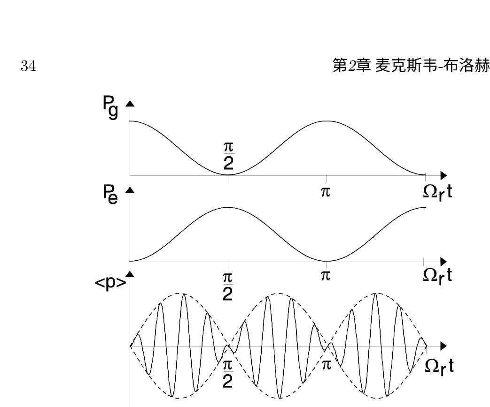

相干外场以周期 $T_r = \pi/\Omega_r$ 的方式驱动原子系统的两个可用态之间的人口。仅在这个周期的一半时间内施加场会导致人口的完全反转。

这些拉比振荡已经在从气体到半导体的各种系统中观察到。有趣的是，从相干驱动的双能级原子发出的光与驱动场的频率不同。根据方程（2.95）计算极化的傅里叶谱，我们得到频率为 $\omega_{\pm} = \omega_{eg} \pm 2\Omega_r$ 的线。这显然是一个非线性输出，这些旁带被称为Mollow旁带[2]。对于这些振荡的存在最重要的是原子系统的相干性至少持续一个拉比振荡。如果这种相干性被足够快地破坏，则无法发生拉比振荡，因此无法通过与光的相互作用来产生两能级系统的反转。这是光-物质相互作用中一大类情况的情况。因此，我们对由于额外相互作用导致相干性丧失的情况感兴趣。

与热浴中的原子相互作用。

### 2.3.4 密度算符

为了研究不相干或耗散过程，使用密度算符而不是确定性波函数的统计描述是有用的，类似于经典统计力学，其中粒子的确定性轨迹被概率分布所取代。

纯态的密度算符由状态与自身的外积定义

$$\rho = |\psi\rangle\langle\psi| \quad (2.96)$$

或者在坐标表示中由一个 2×2-矩阵表示

$$\rho = \begin{pmatrix} \rho_{ee} & \rho_{eg} \\ \rho_{ge} & \rho_{gg} \end{pmatrix} \quad (2.97)$$

对于纯态(2.46)的情况，这是

$$\rho = \begin{pmatrix} c_e c_e^* & c_e c_g^* \\ c_g c_e^* & c_g c_g^* \end{pmatrix} \quad (2.98)$$

显然，对于一个两能级系统的相当简单的情况，密度矩阵的每个元素都对应一个物理量。主对角线包含了能级的占据概率，而非对角线元素是原子的偶极矩的正频率或负频率分量的期望值，即其对介质极化的贡献。

任意算符 A 的期望值可以使用迹公式计算

$$\langle A \rangle = Tr\{\rho A\} = \langle\psi|A|\psi\rangle \quad (2.99)$$

密度算符的优势在于可以以统计意义处理纯态的混合物。例如，如果原子处于状态 $|e>$ 的概率为 $p_e$，并且处于状态 $|g>$ 的概率为 $p_g$，则密度算符 $\rho = p_e|e><e| + p_g|g><g|$ 被定义为可以用来计算可观测量的平均值的统计意义

$$\rho = p_e |e\rangle\langle e| + p_g |g\rangle\langle g| \quad (2.100)$$

$$\langle A \rangle = Tr\{\rho A\} = p_e \langle e|A|e\rangle + p_g \langle g|A|g\rangle \quad (2.101)$$

由于矩阵(2.64)到(2.67)在空间中构成了一个完备基 $2 \times 2$-矩阵，我们可以将密度矩阵表示为

$$\boldsymbol{\rho} = \rho_{ee} \frac{1}{2}(\mathbf{1} + \boldsymbol{\sigma}_z) + \rho_{gg} \frac{1}{2}(\mathbf{1} - \boldsymbol{\sigma}_z) + \rho_{eg} \boldsymbol{\sigma}^+ + \rho_{ge} \boldsymbol{\sigma}^-$$

$$= \frac{1}{2} \mathbf{1} + \frac{1}{2} (\rho_{ee} - \rho_{gg}) \boldsymbol{\sigma}_z + \rho_{eg} \boldsymbol{\sigma}^+ + \rho_{ge} \boldsymbol{\sigma}^-,$$

由于密度矩阵的迹始终为一（归一化）。选择新基$\mathbf{1}, \boldsymbol{\sigma}_x, \boldsymbol{\sigma}_y, \boldsymbol{\sigma}_z$，我们得到

$$\boldsymbol{\rho} = \frac{1}{2} \mathbf{1} + \frac{1}{2} (\rho_{ee} - \rho_{gg}) \boldsymbol{\sigma}_z + d_x \boldsymbol{\sigma}_x + d_y \boldsymbol{\sigma}_y,$$

用

$$d_x = \frac{1}{2} (\rho_{eg} + \rho_{ge}) = \Re\{< \boldsymbol{\sigma}^{(+)} >\},$$

$$d_y = \frac{\mathrm{j}}{2} (\rho_{eg} - \rho_{ge}) = \Im\{< \boldsymbol{\sigma}^{(+)} >\}.$$

偶极子算符的期望值由(2.73)给出

$$< \vec{\mathbf{p}} > = Tr\{\boldsymbol{\rho} \vec{\mathbf{p}}\} = -\vec{M}^* Tr\{\boldsymbol{\rho} \boldsymbol{\sigma}^+\} + c.c. = -\vec{M}^* \rho_{ge} + c.c.$$

从薛定谔方程对于波函数$|\psi>$我们可以轻松地推导出密度算符的运动方程，称为冯诺依曼方程

$$\dot{\boldsymbol{\rho}} = \frac{d}{dt} |\psi><\psi| + h.c. = \frac{1}{\mathrm{j}\hbar} \mathbf{H} |\psi><\psi| - \frac{1}{\mathrm{j}\hbar} |\psi><\psi| \mathbf{H}$$

$$= \frac{1}{\mathrm{j}\hbar} [\mathbf{H}, \boldsymbol{\rho}].$$

由于方程的线性性质，这也是描述任意混合态的密度算符的正确方程。对于一个双能级原子，冯·诺依曼方程是

$$\dot{\boldsymbol{\rho}} = \frac{1}{\mathrm{j}\hbar} [\mathbf{H}_A, \boldsymbol{\rho}] = -\mathrm{j} \frac{\omega_{eg}}{2} [\boldsymbol{\sigma}_z, \boldsymbol{\rho}].$$

## 2.3. 布洛赫方程

$$\dot{\rho}_{ee} = 0, \quad \dot{\rho}_{gg} = 0, \quad \dot{\rho}_{eg} = -j\omega_{eg}\rho_{eg} \rightarrow \rho_{eg}(t) = e^{-j\omega_{eg}t}\rho_{eg}(0), \quad \dot{\rho}_{ge} = j\omega_{eg}\rho_{ge} \rightarrow \rho_{ge}(t) = e^{j\omega_{eg}t}\rho_{ge}(0).$$

但，孤立的两能级原子具有相当简单的动力学，种群保持不变，只有偶极矩随着跃迁频率 \(\omega_{eg}\) 振荡，如果在 \(t=0\) 时有诱导的偶极矩，即系统处于叠加态。

### 2.3.5 能量和相位弛豫

实际上，不存在孤立的原子。事实上，在我们的情况下，我们对辐射原子感兴趣，即它与场有偶极相互作用。与自由场的无限多模式的耦合已经导致了自发辐射，这是一个不可逆的过程。我们可以通过使用哈密顿量来处理这个过程。

$$\mathbf{H} = \mathbf{H}_A + \mathbf{H}_F + \mathbf{H}_{A-F}$$

，\(\mathbf{H}_F\) 是自由场的哈密顿量，而 \(\mathbf{H}_{A-F}\) 描述了它们之间的相互作用。沿着这些线的完整处理超出了本课程的范围，通常在量子力学课程中进行。但是这个计算的结果很简单，并导致了简化密度矩阵的冯·诺依曼方程，即原子的密度矩阵。根据自发辐射速率 \(1/\tau_{sp}\)，即自发寿命的倒数 \(\tau_{sp}\)，种群会发生变化

$$\frac{d}{dt}|c_e(t)|^2 = \frac{d}{dt}\rho_{ee} = -\Gamma_e \rho_{ee} + \Gamma_a \rho_{gg}$$

使用缩写

$$\Gamma_e = \frac{1}{\tau_{sp}}(n_{th} + 1), \quad \Gamma_a = \frac{1}{\tau_{sp}}n_{th}.$$

在这里，\(n_{th}\) 是自由模式中热激发子的数量，频率为 \(\omega_{eg}\) 的场的热激发光子数为 \(n_{th} = 1/(\exp(\hbar\omega_{eg}/kT) - 1)\)，温度为 \(T\)。

## 第2章 麦克斯韦-布洛赫方程

处于激发态或基态的总概率必须保持不变，即

$$\frac{d}{dt}\rho_{gg} = -\frac{d}{dt}\rho_{ee} = \Gamma_e\rho_{ee} - \Gamma_a\rho_{gg} \qquad (2.118)$$

如果群体衰减，极化也会衰减，因为 $\rho_{ge} = c_e^* c_g$，即

$$\frac{d}{dt}\rho_{ge} = j\omega_{eg}\rho_{eg} - \frac{\Gamma_e + \Gamma_a}{2}\rho_{ge} \qquad (2.119)$$

因此吸收和发射过程对相位也是破坏性的，因此相应的速率在相位衰减速率中相加。

考虑相干(2.113)和非相干过程(2.118-2.119)，得到归一化平均偶极矩 $d = d_x + jd_y$和反转 $w$的以下方程

$$\dot{d} = \dot{\rho}_{ge} = (j\omega_{eg} - \frac{1}{T_2})d \qquad (2.120)$$

$$\dot{w} = \dot{\rho}_{ee} - \dot{\rho}_{gg} = -\frac{w - w_0}{T_1} \qquad (2.121)$$

具有时间常数

$$\frac{1}{T_1} = \frac{2}{T_2} = \Gamma_e + \Gamma_a = \frac{2n_{th} + 1}{\tau_{sp}} \qquad (2.122)$$

和平衡反转 $w_0$，由于原子被热场热激发

$$w_0 = \frac{\Gamma_a - \Gamma_e}{\Gamma_a + \Gamma_e} = \frac{-1}{1 + 2n_{th}} = -\tanh\left(\frac{\hbar\omega_{eg}}{2kT}\right) \qquad (2.123)$$

时间常数 $T_1$表示两级系统中的能量弛豫和 $T_2$表示相位弛豫。 $T_2$是振幅之间的相关时间$c_e$和 $c_g$之间的相关时间。. 这种相干性被两级系统与环境的相互作用所破坏。 在这个模型中，能量弛豫速率是相位弛豫速率的一半，即

$$T_2 = 2T_1 \qquad (2.124)$$

(2.124)激光介质中的原子不仅与电磁场相互作用，还与主晶格的声子相互作用，它们在气体激光中可能相互碰撞等。确定能量和相位弛豫速率时必须考虑所有这些过程。这些过程不仅破坏相位，而且实际上并不导致系统的能量损失。

因此，这些过程降低了 T₂，但对 T₁没有影响。 在实际系统中，相位弛豫时间往往比两倍能量弛豫时间短得多，因此，这些过程只会减小T2，而不会影响T1。在真实系统中，相位弛豫时间往往比两倍能量弛豫时间短得多，

$$T_2 \leq 2T_1. \tag{2.125}$$

如果反转偏离其平衡值 w₀，它会以时间常数 T₁回到平衡状态。方程式（2.123）表明，对于所有温度T> 0，反转是负的，即下能级比上能级更强烈地被占据。因此，在一个两能级系统中，无相干热光无法实现反转。只有在有更多能级和上激光能级的后续弛豫过程的情况下，才能通过无相干光泵浦实现反转。由于这些弛豫过程，速率 Γₐ偏离了平衡表达式（2.117），必须用泵浦速率 Λ来替代。 如果泵浦速率 Λ超过 Γₑ，与方程式（2.123）相对应的反转将变为正值。

$$w_0 = \frac{\Lambda - \Gamma_e}{\Lambda + \Gamma_e}. \tag{2.126}$$

如果我们允许人工负温度，我们得到T< 0对于松弛速率的比率

$$\frac{\Gamma_e}{\Gamma_a} = \frac{1 + \bar{n}}{\bar{n}} = e^{\frac{\hbar\omega_{eg}}{kT}} < 1. \tag{2.127}$$

因此，两能级系统的泵浦将系统远离热平衡，这是可以预料的。

### 2.3.6 具有相干经典外场的两能级原子

如果除了与外部热浴的耦合之外，还有一个相干的外场，该外场模拟了自发衰变、泵浦和其他非相干过程，哈密顿量必须通过与该场的偶极相互作用来扩展。

$$\mathbf{H}_E = -\vec{p}\vec{E}(\vec{x}_A, t). \tag{2.128}$$

再次使用RWA中的相互作用哈密顿量

$$ H_E = \frac{1}{2} \vec{M}^* \vec{E}(t)^{(-)} \sigma^+ + h.c. \quad (2.129) $$

这导致冯·诺依曼方程中的额外项

$$ \dot{\rho}|_E = \frac{1}{\mathrm{j}\hbar} [H_E, \rho] \quad (2.130) $$
$$ = \frac{1}{2\mathrm{j}\hbar} \vec{M}^* \vec{E}(t)^{(-)} [\sigma^+, \rho] + h.c. \quad (2.131) $$

或者

$$ \dot{\rho}_{ee}|_E = \frac{1}{2\mathrm{j}\hbar} \vec{M}^* \vec{E}^{(-)} \rho_{ge} + c.c., \quad (2.132) $$
$$ \dot{\rho}_{ge}|_E = \frac{1}{2\mathrm{j}\hbar} \vec{M} \vec{E}^{(+)} (\rho_{ee} - \rho_{gg}), \quad (2.133) $$
$$ \dot{\rho}_{gg}|_E = -\frac{1}{2\mathrm{j}\hbar} \vec{M}^* \vec{E}^{(-)} \rho_{ge} + c.c.. \quad (2.134) $$

偶极矩和反转的演化受到改变

$$ \dot{d}|_E = \dot{\rho}_{ge}|_E = \frac{1}{2\mathrm{j}\hbar} \vec{M} E^{(+)} w, \quad (2.135) $$
$$ \dot{w}|_E = \dot{\rho}_{ee}|_E - \dot{\rho}_{gg}|_E = \frac{1}{\mathrm{j}\hbar} (\vec{M}^* \vec{E}^{(-)} d^* - \vec{M} \vec{E}^{(+)} d). \quad (2.136) $$

因此，包括泵浦和退相干过程在内的两能级系统的总动力学由方程(2.120)和(2.121)给出

$$ \dot{d} = -\left( \frac{1}{T_2} - \mathrm{j}\omega_{eg} \right) d + \frac{1}{2\mathrm{j}\hbar} \vec{M} E^{(+)} w, \quad (2.137) $$
$$ \dot{w} = -\frac{w - w_0}{T_1} + \frac{1}{\mathrm{j}\hbar} (\vec{M}^* \vec{E}^{(-)} d - \vec{M} \vec{E}^{(+)} d^*). \quad (2.138) $$

这些方程被称为布洛赫方程。它们描述了原子与经典电场相互作用的动力学。与方程(2.7)一起，它们构成了麦克斯韦-布洛赫方程。

## 2.4 介电感应率

如果入射场是单频的，即

$$\vec{E}(t)^{(+)} = \hat{\vec{E}}e^{j\omega t}, \tag{2.139}$$

并且假设原子的反转 $w$ 可以很好地由其时间平均 $w_s$ 来表示，则在稳态下，偶极矩将以相同的频率振荡

$$d = \hat{d}e^{j\omega t}, \tag{2.140}$$

并且反转将调整到一个新的稳态值 $w_s$。通过假设(2.139)和(2.140)代入方程(2.137)和(2.138)，我们得到

$$\hat{d} = \frac{-j}{2\hbar} \frac{w_s}{1/T_2 + j(\omega - \omega_{eg})} \vec{M}\hat{\vec{E}}, \tag{2.141}$$

$$w_s = \frac{w_0}{1 + \frac{T_1}{\hbar^2} \frac{1/T_2 |\vec{M}\hat{\vec{E}}|^2}{(1/T_2)^2+(\omega_{eg}-\omega)^2}}. \tag{2.142}$$

我们引入了归一化线形函数，这在这种情况下是一个洛伦兹函数，

$$L(\omega) = \frac{(1/T_2)^2}{(1/T_2)^2 + (\omega_{eg} - \omega)^2}, \tag{2.143}$$

并根据公式(2.32)，将场的平方 $|E^{(0)}|^2$ 与传播的平面波的强度 $I$ 相连接，$I = \frac{1}{2Z_F}|\hat{\vec{E}}|^2$，

$$w_s = \frac{w_0}{1 + \frac{I}{I_s}L(\omega)}. \tag{2.144}$$

因此，静态反转取决于入射光的强度，因此，$w_0$ 可以称为未饱和反转，$w_s$ 饱和反转和 $I_s$，与

$$I_s = \left[ \frac{2T_1 T_2 Z_F}{\hbar^2} \frac{|\vec{M}\hat{\vec{E}}|^2}{|\hat{\vec{E}}|^2} \right]^{-1}, \tag{2.145}$$

是饱和强度。偶极子算符的期望值由以下给出

$$<\vec{p}> = -(\vec{M}^* d + \vec{M} d^*). \tag{2.146}$$

与单位体积的原子数 $N$ 相乘，将原子的偶极矩与介质的复极化 $\hat{P}^{+}$ 相关联，因此与极化率相关，根据以下关系

$$\hat{P}^{(+)} = -2NM^{*}\hat{d}, \tag{2.147}$$

$$\hat{P}^{(+)} = \epsilon_{0}\chi(\omega)\hat{E}. \tag{2.148}$$

从定义(2.147)，(2.148)和方程(2.141)我们得到介质的线性敏感度

$$\chi(\omega) = \vec{M}^{*}\vec{M}^{T} \frac{\mathrm{j}N}{\hbar\epsilon_{0}} \frac{w_{s}}{1/T_{2} + \mathrm{j}(\omega - \omega_{eg})}, \tag{2.149}$$

这是一个张量。在接下来的内容中，我们假设原子的方向是随机的，即原子偶极矩 $\vec{M}$ 和电场的对齐是随机的。因此，我们必须对波的电场和原子偶极矩之间的夹角进行平均，这导致

$$\begin{pmatrix} M_{x}M_{x} & M_{x}M_{y} & M_{x}M_{z} \\ M_{y}M_{x} & M_{y}M_{y} & M_{y}M_{z} \\ M_{z}M_{x} & M_{z}M_{y} & M_{z}M_{z} \end{pmatrix} = \begin{pmatrix} \overline{M_{x}^{2}} & 0 & 0 \\ 0 & \overline{M_{y}^{2}} & 0 \\ 0 & 0 & \overline{M_{z}^{2}} \end{pmatrix} = \frac{1}{3}|\vec{M}|^{2}\mathbf{1}. \tag{2.150}$$

因此，对于均匀和各向同性介质，极化率张量收缩为标量

$$\chi(\omega) = \frac{1}{3}|\vec{M}|^{2}\frac{\mathrm{j}N}{\hbar\epsilon_{0}}\frac{w_{s}}{1/T_{2} + \mathrm{j}(\omega - \omega_{eg})}. \tag{2.151}$$

极化率的实部和虚部

$$\chi(\omega) = \chi'(\omega) + \mathrm{j}\chi''(\omega) \tag{2.152}$$

然后给出

$$\chi'(\omega) = -\frac{|\vec{M}|^{2}Nw_{s}T_{2}^{2}(\omega_{eg}-\omega)}{3\hbar\epsilon_{0}}L(\omega), \tag{2.153}$$

$$\chi''(\omega) = \frac{|\vec{M}|^{2}Nw_{s}T_{2}}{3\hbar\epsilon_{0}}L(\omega). \tag{2.154}$$

## 2.4 介电常数

如果入射辐射足够弱，即

$$T_{1}T_{2}\frac{\left|\vec{M}^{*}\hat{\vec{E}}\right|^{2}}{\hbar^{2}}L(\omega)\ll 1 \tag{2.155}$$

我们得到 $w_s \approx w_0$。由于 $w_0 < 0$，尤其是对于光学跃迁 $w_0 = -1$，复电极化率的实部和虚部如图2.4所示。

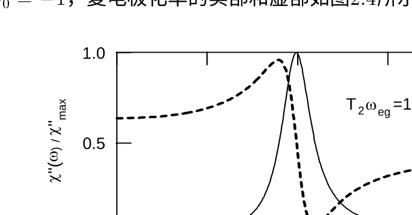

量子力学计算得到的电极化率与谐振子模型推导的经典电极化率在靠近跃迁频率附近相当吻合，对于具有相当高 $Q = T_2\omega_{ab}$ 的跃迁。请注意，远离共振时会有明显的偏差。远离共振时不应使用旋转波近似。

当考虑平面电磁波通过介质传播时，实部和虚部的物理意义变得明显，

$$\vec{E}(z, t) = \Re\left\{\hat{\vec{E}}e^{\mathrm{j}(\omega t - k z)}\right\}, \tag{2.156}$$

它沿着正 $z$ 方向传播。传播常数 $k$ 与电极化率相关

$$k = \omega\sqrt{\mu_0\epsilon_0(1 + \chi(\omega))} \approx k_0\left(1 + \frac{1}{2}\chi(\omega)\right), \text{其中 } k_0 = \omega\sqrt{\mu_0\epsilon_0} \tag{2.157}$$

在这个假设下我们得到

$$k = k_0(1 + \frac{\chi'}{2}) + j k_0 \frac{\chi''}{2}. \tag{2.158}$$

电极化率的实部对折射率有贡献 $n = 1 + \chi'/2$。对于 $\chi'' < 0$，虚部导致波的指数衰减。 对于 $\chi'' > 0$，波会被放大。 波的放大发生在 $w_0 > 0$，即倒置介质。

偶极矩的相位弛豫速率 $1/T_2$ 决定了吸收线的宽度或放大器的带宽。

## 2.5 衰减方程

利用波动方程式Eq.(2.7)和电场诱导的极化表达式，我们得到了描述电磁场与静态原子集合相互作用的完整的Maxwell-Bloch方程组，这些原子位于位置 $z_i$。

$$\left( \Delta - \frac{1}{c_0^2} \frac{\partial^2}{\partial t^2} \right) \vec{E}^{(+)}(z, t) = \mu_0 \frac{\partial^2}{\partial t^2} \vec{P}^{(+)}(z, t), \qquad (2.159)$$
$$\vec{P}^{(+)}(z, t) = -2N M^* d(z, t) \qquad (2.160)$$
$$\dot{d}(z, t) = -(\frac{1}{T_2} - j\omega_{eg})d + \frac{1}{2j\hbar} \vec{M} \vec{E}^{(+)} w, \qquad (2.161)$$
$$\dot{w}(z, t) = -\frac{w - w_0}{T_1} + \frac{1}{j\hbar} (\vec{M}^* \vec{E}^{(-)} d - \vec{M} \vec{E}^{(+)} d^*) \qquad (2.162)$$

在接下来的内容中，我们考虑一个具有极化矢量 $ħ$，频率 $\omega_{eg}$ 和波数 $k_0 = \omega_{eg}/c_0$ 的电磁波，其具有缓慢变化的包络向右传播

$$\vec{E}(z, t)^{(+)} = \sqrt{2Z_{F_0}} A(z, t) e^{j(\omega_{eg} t - k_0 z)} \vec{e}, \qquad (2.163)$$

with

$$\left| \frac{\partial A(z, t)}{\partial t} \right|, \left| c \frac{\partial A(z, t)}{\partial z} \right| \ll |\omega_{eg} A(z, t)|. \qquad (2.164)$$

注意，我们对复振幅 $A(t)$ 进行了归一化，使其幅度的平方与波的强度成比例。 这也将根据原子介质中的偶极矩激发出一波波动。

$$d(z, t) = \hat{d}(z, t) e^{j(\omega_{eg} t - k_0 z)}, \qquad (2.165)$$

## 2.6 具有色散和增益的脉冲传播

这也是缓变的。 在这种情况下，我们从方程 (2.159-d) 中得到

$$\left( \frac{\partial}{\partial z} + \frac{1}{c_0} \frac{\partial}{\partial t} \right) A(z, t) = j N \vec{e}^T \vec{M}^* \sqrt{\frac{Z_{F_0}}{2}} \hat{d}(z, t), \tag{2.166}$$

$$\frac{\partial}{\partial t} d(z, t) = -\frac{1}{T_2} \hat{d} + \frac{\sqrt{2 Z_{F_0}}}{2 j \hbar} \left( \vec{M} \vec{e} \right) A(t) w \tag{2.167}$$

$$\frac{\partial}{\partial t} w(z, t) = -\frac{w - w_0}{T_1} + \frac{\sqrt{2 Z_{F_0}}}{j \hbar} \left( \left( \vec{M}^* \vec{e}^* \right) A^*(t) \hat{d} - \left( \vec{M} \vec{e} \right) A(t) \hat{d} \right) \tag{2.168}$$

此外，在极限情况下，去相干时间 \( T_2 \) 比电场包络的变化快得多时，可以通过绝热消除快速衰减的偶极矩，即

$$\hat{d} = T_2 \frac{\sqrt{2 Z_{F_0}}}{2 j \hbar} \left( \vec{M} \vec{e} \right) A(t) w, \tag{2.169}$$

$$\dot{w} = -\frac{w - w_0}{T_1} + \frac{|A(t)|^2}{E_s} w, \tag{2.170}$$

其中 \( E_s = I_s T_1 \)，被称为介质的饱和光强，\( [J/cm^2] \)，
注意，现在我们不再需要关心偶极矩，我们只剩下介质的能级差和波的复场振幅的速率方程。

$$\left( \frac{\partial}{\partial z} + \frac{1}{c_0} \frac{\partial}{\partial t} \right) A(z, t) = \frac{N \hbar}{4 T_2 E_s} w(z, t) A(z, t), \tag{2.171}$$

$$\dot{w} = -\frac{w - w_0}{T_1} + \frac{|A(z, t)|^2}{E_s} w(z, t) \tag{2.172}$$

方程 (2.171) 清楚地显示我们在倒置介质中获得增益，并且增益随通过介质的电磁功率密度饱和。

## 2.6 脉冲传播与色散和增益

在许多情况下，激光的模式锁定可以最容易地在时间域中研究。 然后，模式锁定变成了一个非线性的耗散波传播问题。

传播问题。在本章中，我们讨论脉冲在线性和非线性介质中传播的基本要素，只讨论了后续章节所必需的内容。关于非线性脉冲传播的全面讨论可以在[6]中找到。

我们考虑沿着z轴传播的偏振沿着x轴的单色电磁波的电场，其频率为 $\Omega$ (图2.5)。

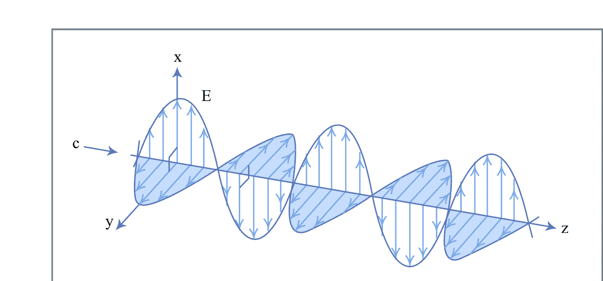

在线性、各向同性、均匀且无损耗的介质中，该电磁波的电场由以下公式给出

$$
\begin{aligned}
\vec{E}(z, t) &= \vec{e}_x E(z, t), \\
E(z, t) &= \Re \left\{ \tilde{E}(\Omega) e^{j(\Omega t - Kz)} \right\} \\
&= |\tilde{E}| \cos(\Omega t - Kz + \varphi), \quad \quad \quad (2.173)
\end{aligned}
$$

其中 $\tilde{E} = |\tilde{E}|e^{j\varphi}$ 是电磁波在频率 $\Omega$ 和波数 $K = \Omega/c = n\Omega/c_0$ 处的复波幅。这里，$n$ 是折射率，$c$ 是介质中的光速，$c_0$ 是真空中的光速。相位恒定的平面以波的相速度 $c$ 传播。通常，我们有许多频率的叠加，其频谱如图2.6所示。

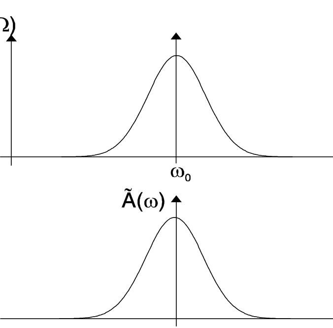

一般来说，折射率是频率的函数，我们对由围绕某个载波频率 $\omega_0$ (Fig. 2.6) 组合的单色波叠加产生的脉冲的传播感兴趣。

$$
E(z, t) = \Re \left\{ \frac{1}{2\pi} \int_{0}^{\infty} \tilde{E}(\Omega)e^{j(\Omega t - K(\Omega)z)} d\Omega \right\}. \tag{2.174}
$$

我们总是可以将方程(2.174)中的复电场分解为一个载波和一个包络 $A(z, t)$

$$
E(z, t) = \Re \left\{ A(z, t)e^{j(\omega_0 t - K(\omega_0)z)} \right\}. \tag{2.175}
$$

包络由以下公式给出

$$
A(z, t) = \frac{1}{2\pi} \int_{-\omega_0}^{\infty} \tilde{A}(\omega)e^{j(\omega t - k(\omega)z)} d\omega, \tag{2.176}
$$

我们引入了偏移频率、偏移波矢和频谱

$\omega = \Omega - \omega_0, \tag{2.177}$
$k(\omega) = K(\omega_0 + \omega) - K(\omega_0), \tag{2.178}$
$\tilde{A}(\omega) = \tilde{E}(\Omega = \omega_0 + \omega), \tag{2.179}$

(见图2.8).

根据色散关系，脉冲在传播过程中会被重新塑形。

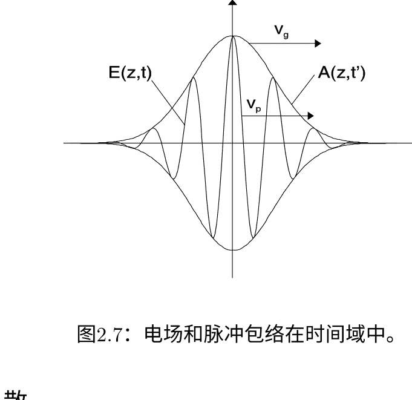

图2.7: 电场和脉冲包络在时间域中。

### 2.6.1 色散

如果脉冲的频谱宽度与载波频率相比较小，那么包络随时间的变化很慢。此外，如果色散关系 $k(\omega)$ 在脉冲频谱上变化很慢，那么用其泰勒展开式来表示色散关系 $K(\Omega)$ 是有用的，参见图2.8。

$k(\omega) = k'\omega + \frac{k''}{2}\omega^2 + \frac{k^{(3)}}{6}\omega^3 + O(\omega^4). \tag{2.180}$

如果折射率与频率有关，则色散关系不再与频率线性相关，请参见图2.8。

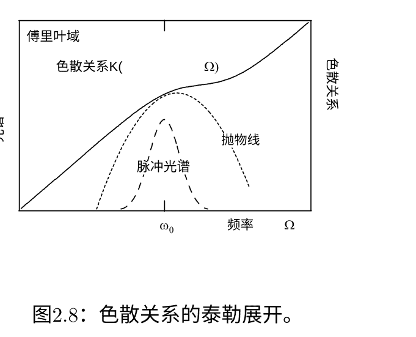

图2.8：色散关系的泰勒展开。

暂时我们只保留方程（2.180）中的第一项，即线性项。然后根据（2.176）通过定义群速度 $v_g= 1/k'$，我们得到脉冲包络。

$$A(z, t) = A(0, t - z/v_g).$$

因此，色散关系在载波频率处的导数决定了相应波包的速度。我们引入局部时间 $t' = t - z/v_g$。相对于这个局部时间，脉冲形状在传播过程中是不变的。

$$A(z, t') = A(0, t').$$

如果脉冲的频谱变得足够宽，以至于(2.180)中的第二项变得重要，具有不同载波频率的波包将以不同的群速度传播，脉冲将扩展。

当保留到二阶色散关系项时，根据(2.176)可得

$$\frac{\partial A(z, t')}{\partial z} = -\mathrm{j}\frac{k''}{2} \frac{\partial^2 A(z, t')}{\partial t'^2}.$$

这相当于非相对论自由粒子的薛定谔方程。就像在量子力学中一样，它描述了波包的扩展。在这里，扩展是由色散关系中的第一个非平凡项引起的，它通过群速度色散（GVD）描述了电磁波包的扩展。当然，我们可以保留色散关系中的所有项，这将导致方程中的高阶导数。

因此，通常将第一项称为色散，将高阶项称为高阶色散。在接下来的内容中，我们总是在局部时间框架中工作，以消除脉冲的平凡运动。因此，我们省略了撇号以简化符号。图2.9显示了高斯波包在没有高阶色散的介质中传播过程中的演化，其中给出了 $k''=2$ 的归一化单位。脉冲持续扩散。

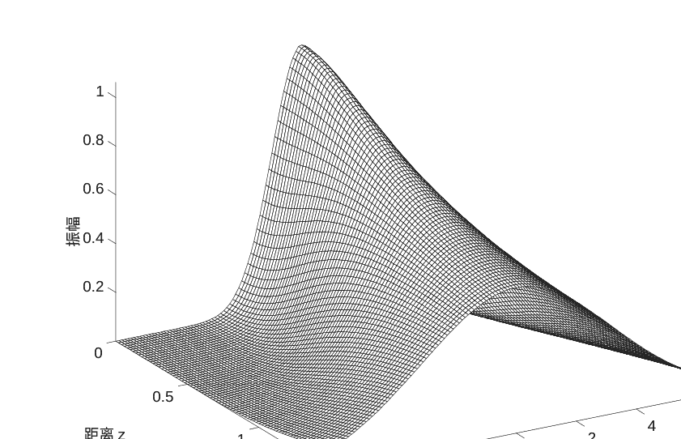

图2.9: 在色散介质中，高斯脉冲包络的振幅，|A(z, t')|。

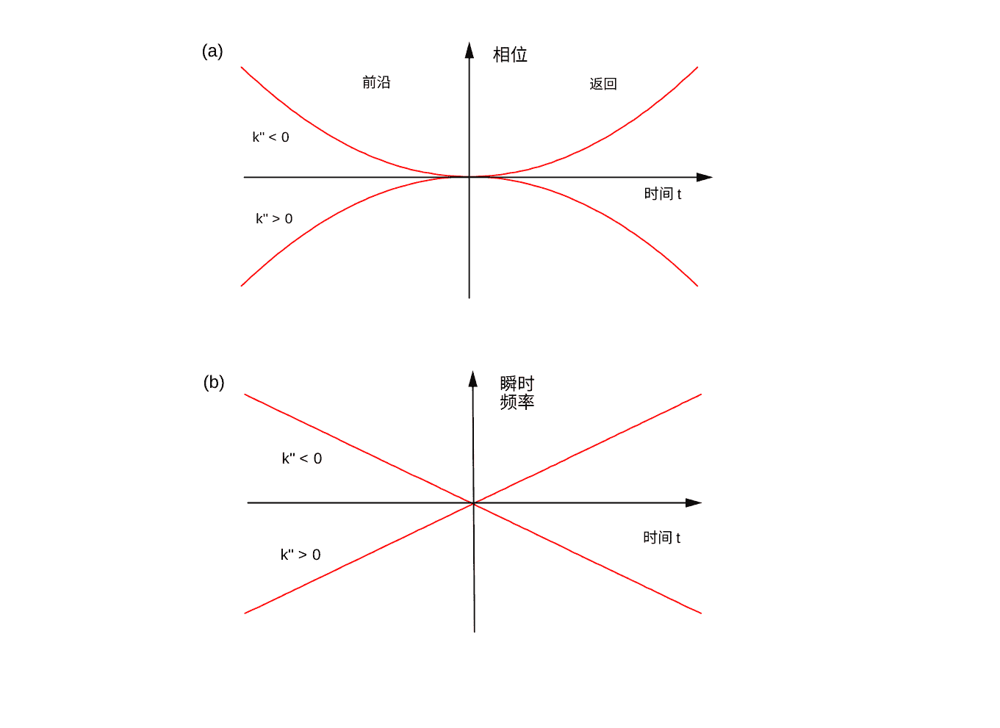

图2.10：(a) 高斯脉冲的相位和(b) 瞬时频率在正或负色散介质中传播过程中的变化。

如图2.10(a)所示，在色散介质中传播过程中，脉冲会获得线性啁啾，即其相位变成抛物线形状。 相位对时间的导数即为瞬时频率，如图2.10(b)所示。它表明低频率在脉冲前部，而高频率在脉冲后部。 这是由于正色散 $k'' > 0$导致低频率的波包比高频率的波包传播速度更快。

### 2.6.2 损耗和增益

如果考虑的介质有损耗，我们可以将这种损耗纳入复折射率中

$$ n(\Omega) = n_r(\Omega) + j n_i(\Omega). \quad\quad (2.185) $$

折射率由介质中极化对电场的线性响应 $\chi(\Omega)$决定

$$ n(\Omega) = \sqrt{1 + \chi(\Omega)}. \quad\quad (2.186) $$

对于光学薄介质，即 $|\chi(\Omega)| \ll 1$，我们可以近似得到

$$ n(\Omega) \approx 1 + \frac{\chi(\Omega)}{2}. \quad\quad (2.187) $$

对于具有电偶极跃迁的两能级原子，在旋波近似下，极化率由复洛伦兹线型给出

$$ \chi(\Omega) = \frac{2j\alpha}{1 - j\frac{\Omega - \Omega_0}{\Delta\Omega}}, \quad\quad (2.188) $$

其中 $\alpha$将被证明是跃迁的峰吸收或增益，与原子反转密度成正比，$\Omega_0$是光学跃迁的中心频率，$\Delta\Omega$是跃迁的半高全宽。图2.11显示了复洛伦兹线型的归一化实部和虚部。

$$ \chi_r(\Omega) = \frac{-2\alpha \frac{(\Omega - \Omega_0)}{\Delta\Omega}}{1 + (\frac{\Omega - \Omega_0}{\Delta\Omega})^2}, \quad\quad (2.189) $$
$$ \chi_i(\Omega) = \frac{2\alpha}{1 + (\frac{\Omega - \Omega_0}{\Delta\Omega})^2}, \quad\quad (2.190) $$

这些是非反转光学跃迁的复杂敏感度的实部和虚部，即损耗。

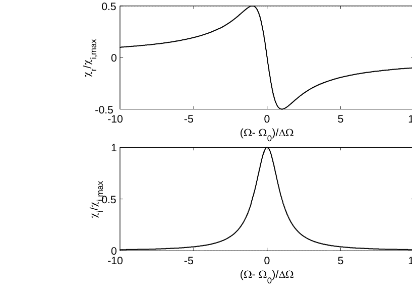

图2.11：复杂洛伦兹函数的实部和虚部的归一化。

跃迁的实部改变介质的实部折射率，而虚部导致非反转介质中的损耗。

在第2.6.1节中，对于脉冲包络的波动方程（2.184）的推导没有对实部折射率进行限制。因此，波动方程（2.184）也适用于复折射率的情况。

如果我们假设介质具有复折射率（2.187），则波数由以下公式给出

$$K(\Omega) = \frac{\Omega}{c_0} \left(1 + \frac{1}{2}(\chi_r(\Omega) + j\chi_i(\Omega))\right). \qquad (2.191)$$

自从我们引入了复杂的波数，我们必须重新定义群速度为波数的实部关于频率的倒数。在线中心，我们得到

$$v_g^{-1} = \frac{\partial K_r(\Omega)}{\partial \Omega}\bigg|_{\Omega_0} = \frac{1}{c_0}\left(1 - \alpha\frac{\Omega_0}{\Delta\Omega}\right). \qquad (2.192)$$

因此，对于一个窄吸收线，$\alpha > 0$和 $\frac{\Omega_0}{\Delta\Omega} \gg 1$，群速度的绝对值可以比真空中的光速大得多。

对于一个倒置的，因此是放大的跃迁，α < 0。这没有任何问题，因为群速度只描述了高斯波包的峰值的运动，而高斯波包不是因果波包。因果波包在某个较早的时间t < t0，在某个空间区域内等于零。高斯波包在任何时间都填满整个空间，并且可以通过泰勒展开在任何时间重建。因此，这种信号的峰值的超光速运动并不违反特殊相对论。

由于增益和损耗，波矢的虚部（2.191）在包络方程（2.184）中必须完全处理。在频域中，这导致了一个带有载波频率在线中心的波包，ω0 = Ω0 和 K_r(Ω0) = k0，到项

$$\frac{\partial \tilde{A}(z, \omega)}{\partial z} \bigg|_{(\text{损耗})} = \frac{-\alpha k_0}{1 + \left( \frac{\omega}{\Delta \Omega} \right)^2} \tilde{A}(z, \omega). \quad (2.193)$$

在时间域中，我们得到了逆线宽的二阶近似

$$\frac{\partial A(z, t)}{\partial z} \bigg|_{(\text{损耗})} = -\alpha k_0 \left( 1 + \frac{1}{\Delta \Omega^2} \frac{\partial^2}{\partial t^2} \right) A(z, t), \quad (2.194)$$

这对应于洛伦兹线形在线中心的抛物近似（图2.11）。对于一个反转的光学跃迁，我们得到一个类似的方程，只需将损耗替换为增益

$$\frac{\partial A(z, t)}{\partial z} \bigg|_{(\text{增益})} = -\text{增益} \left( 1 + \frac{1}{\Omega_g^2} \frac{\partial^2}{\partial t^2} \right) A(z, t), \quad (2.195)$$

其中增益 = -α k0是单位长度线心处的峰值增益，Ω_g是增益跃迁的半高全宽。增益与原子系统中的反转成比例，参见方程(2.149)，该方程还取决于场强或强度，根据速率方程(2.172)

$$\frac{\partial g(z, t)}{\partial t} = -\frac{g(z, t)}{\tau_L} - \frac{\text{增益} |A(z, t)|^2}{E_L}. \quad (2.196)$$

在这里，E_L是增益介质的饱和能量密度，τ_L是反转的寿命，即增益介质的上态寿命。

表2.1: 熔融石英和蓝宝石的Sellmeier系数表。

| 参数 | 熔融石英 | 蓝宝石 |
|------|----------|--------|
| a1 | 0.6961663 | 1.023798 |
| a2 | 0.4079426 | 1.058364 |
| a3 | 0.8974794 | 5.280792 |
| λ1^2 | 4.679148·10^{-3} | 3.77588·10^{-3} |
| λ2^2 | 1.3512063·10^{-2} | 1.22544·10^{-2} |
| λ3^2 | 0.9793400·10^2 | 3.213616·10^2 |

## 2.7 克拉默斯-克罗尼希关系

线性极化率是线性系统对外加电场的频率响应，它是因果关系的，因此实部和虚部满足Kramers-Kroenig关系。

$$\chi_r(\Omega) = \frac{2}{\pi} \int_0^\infty \frac{\omega \chi_i(\omega)}{\omega^2 - \Omega^2} d\omega = n^2(\Omega) - 1, \quad (2.197)$$
$$\chi_i(\Omega) = -\frac{2}{\pi} \int_0^\infty \frac{\Omega \chi_r(\omega)}{\omega^2 - \Omega^2} d\omega. \quad (2.198)$$

在透明介质中，我们远离共振点进行操作。然后，吸收或极化率的虚部可以近似为

$$\chi_i(\Omega) = \sum_i A_i \delta(\omega - \omega_i) \quad (2.199)$$

而Kramers-Kroenig关系导致了折射率的Sellmeier方程

$$n^2(\Omega) = 1 + \sum_i A_i \frac{\omega_i}{\omega_i^2 - \Omega^2} \quad (2.200)$$
$$= 1 + \sum_i a_i \frac{\lambda}{\lambda^2 - \lambda_i^2}. \quad (2.201)$$

例如，表2.1显示了熔融石英和蓝宝石的Sellmeier系数。

图2.12显示了具有紫外线和红外线共振的材料（如玻璃）的典型情况。

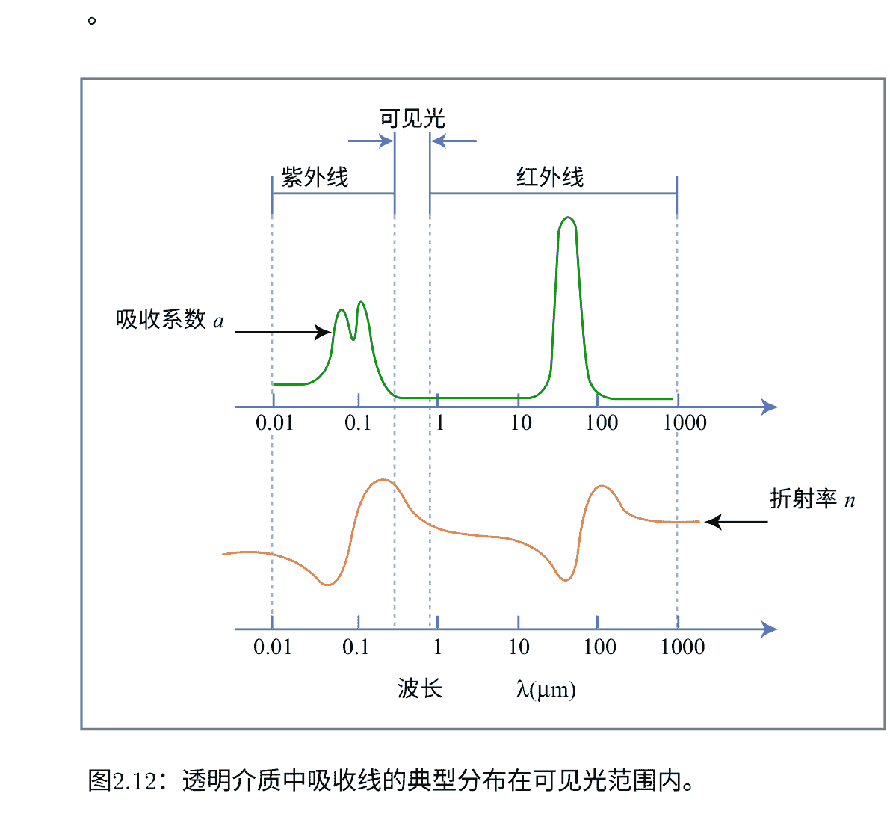

图2.12：透明介质中吸收线的典型分布在可见光范围内。

> MIT OCW提供的图。

折射率随波长减小的区域通常称为正常色散范围，相反的行为称为异常色散。

- $\frac{dn}{d\lambda} < 0$：正常色散（蓝色折射比红色更多）
- $\frac{dn}{d\lambda} > 0$：异常色散

图2.13显示了一些常用介质的透明范围。

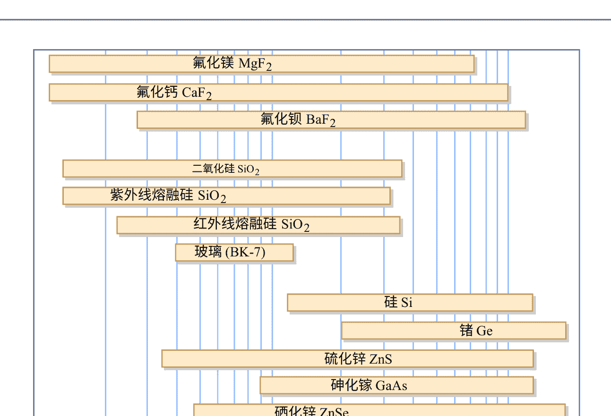

图2.13：一些材料的透明范围。

MIT OCW提供的图。

## 2.8 脉冲形状和时间带宽乘积

下表2.2显示了一些常用脉冲形式的脉冲形状、频谱和时间带宽乘积。

| $a(t)$ | $\hat{a}(\omega) = \int_{-\infty}^{\infty} a(t)e^{-j\omega t} dt$ | $\Delta t$ | $\Delta t \cdot \Delta f$ |
| --- | --- | --- | --- |
| 高斯：$e^{-\frac{t^2}{t\tau^2}}$ | $\sqrt{2\pi}\tau e^{-\frac{1}{2}\tau^2\omega^2}$ | $2\sqrt{\ln 2}\tau$ | 0.441 |
| 双曲正割函数：$\text{sech}(\frac{t}{\tau})$ | $\frac{\tau}{2}\text{sech}(\frac{\pi}{2}\tau\omega)$ | $1.7627\tau$ | 0.315 |
| 矩形函数：$=\begin{cases}1, & |t| \leq \tau/2 \\ 0, & |t| > \tau/2 \end{cases}$ | $\tau\frac{\sin(\tau\omega/2)}{\tau\omega/2}$ | $\tau$ | 0.886 |
| 洛伦兹曲线：$\frac{1}{1+(t/\tau)^2}$ | $2\pi\tau e^{-|\tau\omega|}$ | $1.287\tau$ | 0.142 |
| 双指数：$e^{-\left|\frac{t}{\tau}\right|}$ | $\frac{\tau}{1+(\omega\tau)^2}$ | $\ln2 \tau$ | 0.142 |

表2.2：脉冲形状，对应的光谱和时间带宽乘积。

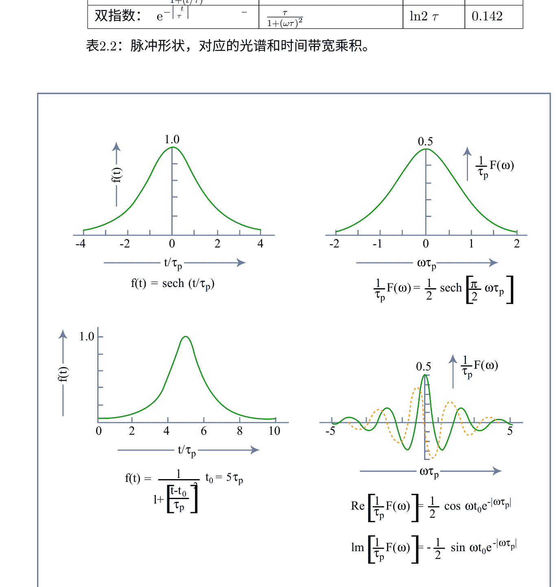

图2.14：与上表的傅里叶关系。

MIT OCW提供的图。

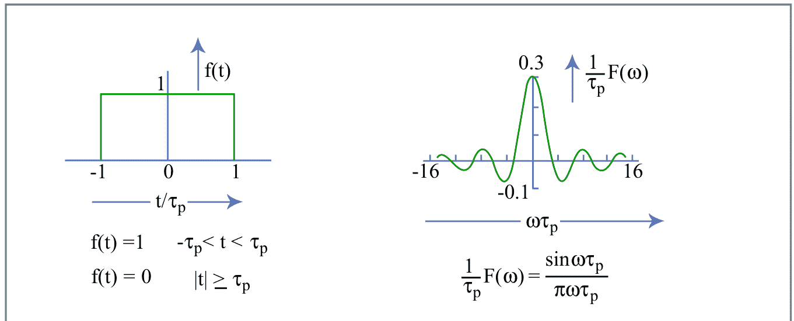

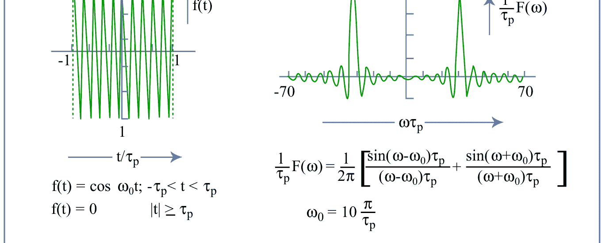

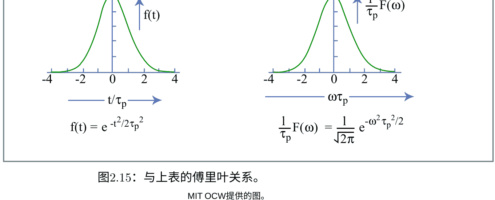

图2.15：与上表的傅里叶关系。

# 第2章 麦克斯韦-布洛赫方程

## 参考文献

[1] I. I. Rabi: "在旋转磁场中的空间量子化". Phys. Rev. **51**, 652-654 (1937).

[2] B. R. Mollow, "Power Spectrum of Light Scattered by Two-Level Systems," Phys. Rev **188**, 1969-1975 (1969).

[3] P. Meystre, M. Sargent III: Elements of Quantum Optics, Springer Verlag (1990).

[4] L. Allen and J. H. Eberly: Optical Resonance and Two-Level Atoms, Dover Verlag (1987).

[5] G. B. Whitham: "Linear and Nonlinear Waves," John Wiley and Sons, NY (1973).

# 第3章 非线性脉冲传播

有许多非线性脉冲传播问题值得详细考虑，例如在相干区域中通过两能级介质的脉冲传播，这导致自诱导透明和由正弦-戈登方程控制的孤子。介质的基本模型是之前讨论过的两能级原子，具有无限长的弛豫时间 T_{1,2}，即假设脉冲远比介质的退相时间短。在这样的介质中存在脉冲，其中脉冲的前半部分完全反转介质，而脉冲的后半部分从介质中提取能量。如式（2.39）中定义的拉比频率的积分是2π的倍数。感兴趣的读者可以参考Allen和Eberly的书[1]。在这里，我们对由Kerr效应引起的非线性动力学感兴趣，这对于理解光通信和短脉冲生成中的脉冲传播问题非常重要。

### 3.1 光学克尔效应

在各向同性和均匀介质中，折射率不能依赖于电场的方向。因此，对于这样的介质，最低阶的折射率只能二次依赖于电场，即强度[22]

$$ n = n(\omega, |A|^2) \approx n_0(\omega) + n_{2,L} |A|^2 $$

在这里，我们假设脉冲包络 A被归一化，使得 |A|^2是脉冲的强度。这就是光学克尔效应， n_{2,L}被称为强度相关的折射率系数。注意，非线性折射率取决于场的极化，而不深入细节，我们假设处理的是线偏振电场。对于大多数透明材料，强度相关的折射率是正的。

表3.1：不同材料的非线性折射率系数。在文献中，最常用的是静电单位制。转换为n2,L[cm^2/W] = 4.19·10^{-3}n2,L[esu]/n0

| 材料 | 折射率 n | n2,L[cm^2/W] |
|---|---|---|
| 蓝宝石 (Al2O3) | 1.76 @ 850 nm | 3·10^{-16} |
| 熔融石英 | 1.45 @ 1064 nm | 2.46·10^{-16} |
| 玻璃 (LG-760) | 1.5 @ 1064 nm | 2.9·10^{-16} |
| YAG (Y3Al5O12) | 1.82 @ 1064 nm | 6.2·10^{-16} |
| YLF (LiYF4), n_e | 1.47 @ 1047 nm | 1.72·10^{-16} |
| 硅 | 3.3 @ 1550 nm | 4·10^{-14} |

## 3.2 自相位调制 (SPM)

在一个纯一维传播问题中，强度相关的折射率在脉冲包络传播过程中施加了额外的自相位移，该自相位移与脉冲的瞬时强度成正比

$$\frac{\partial A(z,t)}{\partial z} = -jk_0 n_{2,L} |A(z,t)|^2 A(z,t) = -j\delta |A(z,t)|^2 A(z,t). \quad (3.2)$$

其中 \delta = k_0 n_{2,L}是自相位调制系数。自相位调制 (SPM) 仅在时间域中引起相移。因此，脉冲的强度分布不变，只有脉冲的频谱发生变化，这在非线性光学课程中已经讨论过。图 (3.1) 显示了在传播过程中受到自相位调制的高斯脉冲的频谱（对于\delta=2和归一化单位）。通过四波混频 (FWM) 的非线性过程产生了新的频率分量。如果我们观察由于自相位调制而在传播过程中脉冲的相位，参见图3.2 (a)，我们发现脉冲重新分配其能量，使得低频成分位于脉冲的前部，高频成分位于脉冲的后部，类似于正色散的情况。

## 3.2 自相位调制 (SPM)

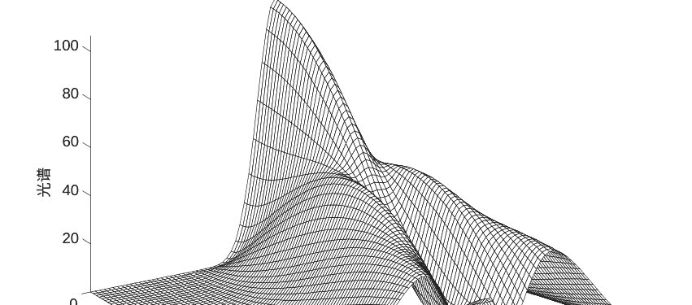

图3.1: 光谱 |Â(z, ω=2πf)|² of 一个高斯脉冲在自相位调制下的主题。

# 第3章 非线性脉冲传播

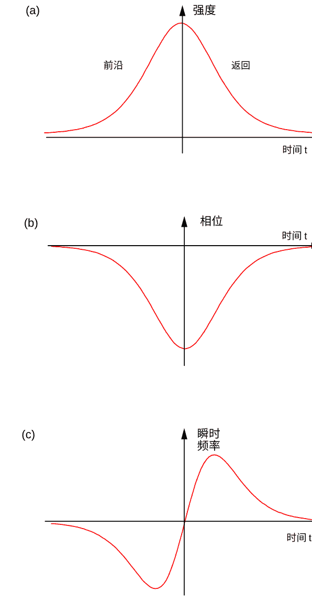

图3.2: (a) 强度, (b) 相位和 (c) 瞬时频率在正自相位调制介质中传播的高斯脉冲。

## 3.3 非线性薛定谔方程

如果色散和自相位调制两种效应同时作用于脉冲上，场包络满足以下方程

$$j \frac{\partial A(z, t)}{\partial z} = -D_2 \frac{\partial^2 A}{\partial t^2} + \delta |A|^2 A, \qquad (3.3)$$

这个方程被称为非线性薛定谔方程 (NSE) - 如果我们将虚数单位放在左边 -, 因为它具有薛定谔方程的形式。它被称为非线性, 因为势能是由波函数本身的平方导出的。正如我们从上一节的讨论中所看到的, 正色散和正自相位调制导致光谱成分的类似重新分布。

这增强了脉冲在时间上的展宽。然而, 如果我们有负色散, 即具有高载波频率的波包比具有低载波频率的波包传播得更快, 那么脉冲前端通过自相位调制产生的高频波包有机会追上脉冲本身, 这是由于负色散的原因。

对于低频来说情况正好相反。这种排列结果导致脉冲不再发散, 即孤立波。从NSE (3.3) 中也可以明显看出, 负色散是必要的来抵消正Kerr效应。因为对于正Kerr效应, NSE中的势能始终为负。只有束缚解, 即明亮的孤立波, 如果动能项, 即色散, 具有负号, $D_2 < 0$。

### 3.3.1 NSE的孤子

在接下来的内容中, 我们研究了负色散和正自相位调制的NSE的不同解决方案。我们不打算在这里对NSE的解决方案进行全面的数学深入讨论, 因为这对接下来的内容并不必要。这可以在其他地方详细找到[4, 5, 6, 7]。

不失一般性, 通过归一化场振幅 $A = \frac{A'}{\tau} \sqrt{\frac{2D_2}{\delta}}$, 传播距离 $z = z' \cdot \tau^2 / D_2$, 时间 $t = t' \cdot \tau$, NSE (3.3)在负色散情况下总是可以转化为归一化形式

$$ j \frac{\partial A'(z', t')}{\partial z'} = \frac{\partial^2 A'}{\partial t'^2} + 2|A'|^2 A' $$
这相当于设置 \( D_2 = -1 \) 和 \( \delta = 2 \)。对于数值模拟，在下一章节中展示，我们模拟了归一化的方程(3.4)，坐标轴使用归一化的位置和时间单位。

### 3.3.2 基本孤子

我们寻找NSE(3.3)的稳态波函数，使其绝对值的平方成为一个自洽的势能。这种势能在量子力学中是众所周知的sech²势能[8]，因此孤立脉冲的形状是sech

$$ A_s(z, t) = A_0 \mathrm{sech} \left( \frac{t}{\tau} \right) e^{-j\theta}, $$

其中 \( \theta \)是孤子的非线性相移

$$ \theta = \frac{1}{2} \delta A_0^2 z $$

与仅自相位调制的情况不同，解的相位偏移在脉冲的时间上是恒定的，而不是与瞬时功率成比例。非线性效应和线性效应之间的平衡要求非线性相移等于脉冲的色散扩展

$$ \theta = \frac{|D_2|}{\tau^2} z. $$

由于场振幅 \( A(z, t) \)被归一化，使得绝对值的平方是强度，孤子能量通量由下式给出

$$ w = \int_{-\infty}^{\infty} |A_s(z, t)|^2 dt = 2A_0^2 \tau. $$

从方程 (3.6) 到 (3.8)，我们得到对于恒定脉冲能量密度，孤子的宽度与负色散量成正比

$$ \tau = \frac{4|D_2|}{\delta w}. $$

## 3.3 非线性薛定谔方程

注意，基本孤子的脉冲面积仅由色散和自相位调制系数确定

脉冲面积 = \int_{-\infty}^{\infty} |A_s(z, t)| dt = \pi A_0 \tau = \pi \sqrt{\frac{|D_2|}{2\delta}} \quad (3.10)

因此，具有不同面积的初始脉冲不能发展成纯孤子

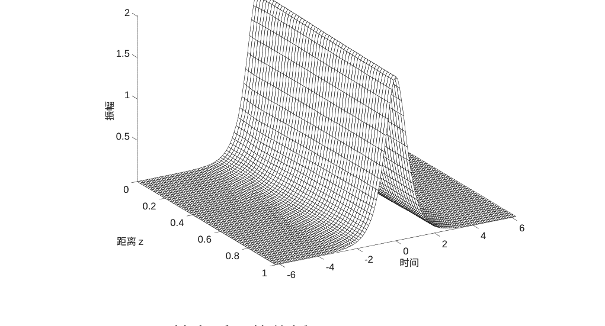

图3.3显示了基本孤子脉冲的数值解。孤子获得相移$\pi/4$的距离称为孤子周期，原因将在下一节中明确。

由于色散在频率上是恒定的，即NSE没有更高阶色散，孤子的中心频率可以任意选择。然而，由于色散，具有不同载波频率的孤子的群速度将不同。通过将NSE转换为移动坐标系，可以轻松地找到以下一般基本孤子解

$$ A_s(z, t) = A_0 \text{sech}(x(z, t)) e^{-j\theta(z, t)} \quad (3.11) $$

用

$$ x = \frac{1}{\tau}(t - 2|D_2|p_0 z - t_0), \quad (3.12) $$

和非线性相移

$$ \theta = p_0(t - t_0) + |D_2|\left(\frac{1}{\tau^2} - p_0^2\right) z + \theta_0. \quad (3.13) $$

因此，能量流量 w或振幅 A_0，载波频率 p_0，相位 θ_0和起点 t_0，即基本孤子的定时尚未确定。只有孤子面积是固定的。如果其中一个被指定，能量流量和宽度将被确定，给定一定的色散和SPM系数。

### 3.3.3 高阶孤子

NSE具有恒定的色散，在我们的情况下是负色散。这意味着群速度与频率成线性关系。我们假设两个基本解相距很远，以便它们不相互作用。然后，这个线性叠加在实际上是NSE的另一个解。如果我们选择后一个时间开始的孤子的载波频率高于前一个孤子的频率，后一个孤子将由于负色散追上前导孤子，脉冲将发生碰撞。

图3.4显示了这种情况。显然，这两个脉冲完全从碰撞中恢复，即NSE具有真正的孤子解。孤子具有类似粒子的特性。由几个基本孤子组成的解称为高阶孤子。如果我们仔细观察图3.4，我们会发现在局部时间框架中静止的孤子，在没有碰撞的情况下沿着t = 0线稍微向前推进。对碰撞的详细分析还会显示孤子的相位发生了变化[4]。由于孤子碰撞引起的相位变化被用于构建全光开关[10]，使用折回的马赫-泽尔德尔干涉仪，可以通过Sagnac光纤环以自稳定的方式实现。

## 3.3. 非线性薛定谔方程

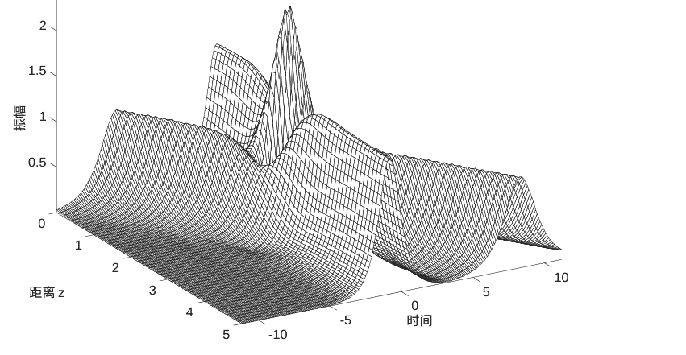

图3.4：具有高载波频率的孤子与具有较低载波频率的孤子发生碰撞。碰撞后，两个脉冲完全恢复。

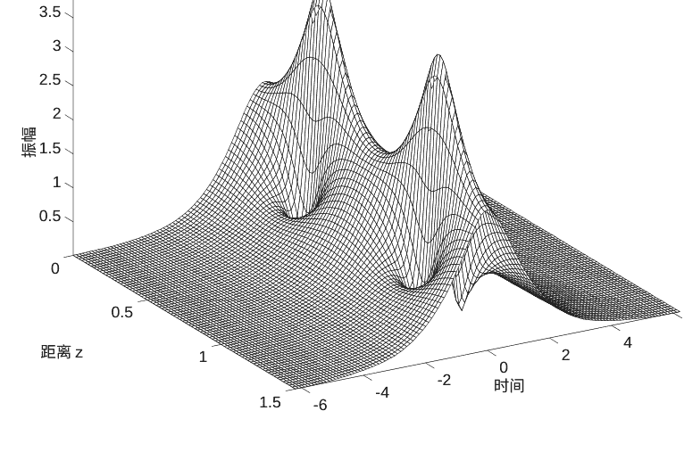

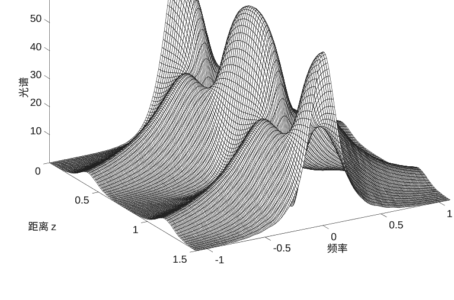

图3.5: (a) 高阶孤子的振幅和, (b) 具有相同载波频率的两个基本孤子的光谱

非线性薛定谔方程也显示出具有相同速度的高阶孤子解，即所谓的呼吸解，它们具有相同的载波频率。图3.5(a)和(b)显示了这样一个高阶孤子解的振幅和光谱，它的面积是基本孤子的两倍。模拟从具有两倍基本孤子面积的sech脉冲开始，如图3.3所示。由于两个孤子的相互作用，时间形状和光谱呈现出复杂但周期性的行为。这个周期是孤子周期 $z = \pi/4$，如上所述。从图3.5(a)和3.5(b)可以看出，高阶孤子动力学在半个孤子周期后导致脉冲极大地缩短。这个过程被Mollenauer用来构建他的孤子激光器[11]。在孤子激光器中，如图3.5(a)所示，高阶孤子的脉冲压缩被用于模锁。

Mollenauer在光纤中开创了孤子传播的先河，正如Hasegawa和Tappert [3]所提出的，使用孤子激光器在1.55 μm产生了第一个皮秒脉冲。关于孤子激光器的详细介绍可参考Haus [12]。

到目前为止，我们已经讨论了NSE的纯孤子解。但是，如果开始传播的输入脉冲不对应基本或高阶孤子，会发生什么呢？

### 3.3.4 逆散射理论

显然，NSE有由基本孤子组成的解。因此，这些解遵循某种超级叠加原理，这对于非线性系统来说是非常令人惊讶的。当然，与线性系统不同，不是任意的超级叠加都是可能的。NSE解的多样性的更深层次原因可以通过研究其物理和数学特性来找到。解NSE的解析公式的数学基础是逆散射理论[13, 14, 4, 15]。这是一种解可积非线性波动方程的谱变换方法，类似于傅里叶变换解线性波动方程[16]。

让我们简要回顾一下如何解线性偏微分方程（p.d.e.）的初值问题，例如方程（2.184），它处理的是纯色散脉冲传播的情况。该方法在图3.6中概述。我们将初始脉冲傅里叶变换到频谱域中，因为指数函数是具有常系数的微分算子的特征解。

常数系数。方程 (2.184) 的右侧仅由微分算子的幂组成，因此指数函数是右侧的特征函数。因此，在傅里叶变换后，偏微分方程变成了一组普通微分方程 (o.d.e.) ，每个偏波对应一个方程。

每个波的激发由初始波的频谱给出。微分算子的特征值，构成方程 (2.184) 的右侧，由色散关系 $k(\omega)$ 给出，虚数部分忽略。剩余常微分方程的解是色散关系的简单指数形式。现在，我们有传播波的频谱，并通过反傅里叶变换，即对所有分波求和，找到传播脉冲的新的时间形状。

与用于解线性波动方程的傅里叶变换方法一样，逆散射理论再次基于一个谱变换 (图3.7) 。然而，这个变换现在取决于波动方程和初始条件的细节。这种依赖关系导致了一个修改后的叠加原理。正如[7]所示，对于许多可积非线性波动方程，可以像在量子理论中处理粒子在势阱中的散射问题一样，制定一个相关的散射问题。然而，势阱现在由波动方程的解决方案确定。因此，初始势已经由初始条件给出。散射问题的定态，即对应哈密顿量的本征解，类似于复振荡的单色波，即微分算子的本征函数。本征值类似于色散关系，就像线性偏微分方程的情况一样，本征解遵循简单的线性常微分方程。

> [7]

给定的势将有一定数量的束缚态，对应于离散光谱和散射态的连续谱。连续本征值谱的特征是反射系数-在势场反射时，波的散射系数。因此，某个特定的势，即某个初始条件，具有一定的离散光谱和连续光谱，以及相应的反射系数。从量子力学和电磁散射问题的逆散射理论中，我们知道，势能可以从散射数据，即反射系数和离散光谱的数据中重建[?]。对于一类非常普遍的散射势，这是正确的。正如现在几乎可以猜到的那样，初始条件的离散本征态将导致孤立子解。我们已经研究了其中一些孤立子的动力学-

> [?]

解决方案如上。连续光谱将导致一种被称为连续谱的色散波。因此，对于给定的任意初始条件，NSE的最一般解是一个孤子的叠加，可能是一个更高阶的孤子，以及一个连续谱的贡献。

连续谱在传播过程中会发生色散，所以过一段时间后只有孤子被识别出来。因此，连续谱成为NSE解的一个渐近小贡献。因此，连续谱的动力学完全由波动方程的线性色散关系描述。

从频谱到时域的反变换并不像线性p.d.e的傅里叶变换那样简单。必须解一个线性积分方程，即Marchenko方程[17]。尽管如此，非线性方程的解已经被简化为解两个线性问题，这是一个巨大的成功。

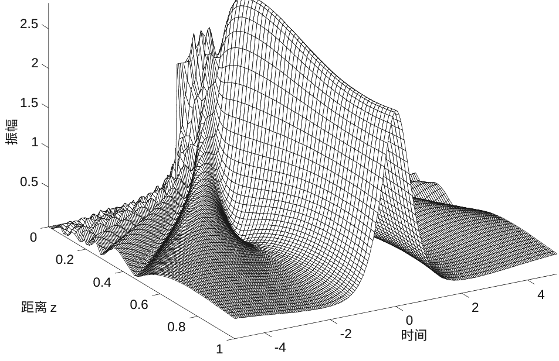

## 第3章。非线性脉冲传播

为了理解NSE解的这些特性，我们解决了一个矩形形状的初始脉冲的NSE。结果如图3.8所示。对于这个初始条件，需要解决的散射问题与矩形势箱中的非相对论粒子相同[32]。势的深度选择得足够小，以便只有一个束缚态。因此，我们从由基本孤子和连续态组成的波开始。很容易识别出连续态的贡献，即在传播过程中与孤子分离的色散波。

这个解说明了由于色散和自相位调制的存在，孤子脉冲整形可能对脉冲生成产生强烈影响[18]。当色散和自相位调制适当调整时，孤子形成可以在锁模激光器中产生非常干净、稳定和极短的脉冲。

### 3.4 NSE的普适性

在上面，我们详细推导了对于色散和自相位调制的NSE。NSE的输入非常低，我们只需要承认第一个非平凡的色散效应和最低阶非线性效应。

这是在玻璃、气体或等离子体等各向同性和均匀介质中可能发生的效应。因此，NSE及其性质对于自聚焦[19]、等离子体物理中的Langmuir波和蛋白质分子中的波等许多其他效应都很重要。自聚焦将在后面更详细地讨论，因为它是Kerr-镜模锁定的基础。

### 3.5 孤子扰动理论

从前面的讨论中，我们对描述特殊哈密顿系统的NSE的可能解有了充分的了解。然而，NSE几乎无法完全描述一个真实的物理系统，例如一个真实的光纤[21, 22]。事实上，正如我们在前面的推导中所看到的，NSE本身只是对完整波动方程的近似。我们将色散关系近似为在孤子的假定载波频率处的抛物线。同时，由强度相关折射率描述的瞬时Kerr效应只是对Kerr介质的真实 $\chi^{(3)}$ -非线性的近似[23, 24]。因此，研究非线性薛定谔方程的孤子解在高阶色散等扰动效应下的变化是非常重要的。非线性元件的有限响应时间、增益和放大器的有限增益带宽可以弥补实际系统中的不可避免损耗。对扰动下的孤子进行研究与孤子本身一样古老。许多作者将散射领域中的扰动效应进行了处理[25, 26]。最近，基于线性化非线性薛定谔方程的扰动理论得到了发展，这比散射振幅的表述更具说明性。这最初是由Haus [27]使用，并由Kaup [28]严格地加以阐述。在本节中，我们将介绍这种方法，因为它对接下来的内容是必不可少的。

一个系统，其中最重要的物理过程是色散和自相位调制，由NSE补充了一些扰动项 $F$

$$\frac{\partial A(z, t)}{\partial z} = -j \left[ |D_2| \frac{\partial^2 A}{\partial t^2} + \delta |A|^2 A \right] + F(A, A^*, z). \quad (3.14)$$

在接下来的内容中，我们对非常接近基本孤子的完整方程(3.14)的解有兴趣，即

$$A(z, t) = \left[ a\left(\frac{t}{\tau}\right) + \Delta A(z, t) \right] e^{-j k_s z}. \quad (3.15)$$

这里， $a(x)$ 是根据eq.(3.5)的基本孤子

$$a\left(\frac{t}{\tau}\right) = A_0 \text{sech}\left(\frac{t}{\tau}\right), \quad (3.16)$$

和

$$k_s = \frac{1}{2} \delta A_0^2 \quad (3.17)$$

是单位长度的孤子相移，即解的波矢。

从理想孤子的偏离可以由于右侧的附加驱动项 $F$ 或者已经存在于初始条件中的偏离而产生。我们使用形式 (3.15) 作为求解NSE的一阶微扰 $\Delta A$ 的假设，即我们在线性化NSE时围绕基本孤子展开，并得到微扰的表达式。

$$\frac{\partial \Delta A}{\partial z} = -j k_s \left[ \left( \frac{\partial^2}{\partial x^2} - 1 \right) \Delta A + 2 \text{sech}^2(x) (2 \Delta A + \Delta A^*) \right] + F(A, A^*, z) e^{j k_s z}, \quad (3.18)$$

其中 $x = t/\tau_0$。由于非线性性质，场与其复共轭耦合。因此，方程（3.18）实际上对应着两个方程，一个是振幅方程，一个是其复共轭方程。因此，我们引入向量表示法

$$\Delta \mathbf{A} = \begin{pmatrix} \Delta A \\ \Delta A^* \end{pmatrix}.$$

我们进一步引入了归一化传播距离 $z' = k_s z$ 和归一化时间 $x = t/\tau_0$。线性化扰动NSE的表达式为$\partial$

$$\frac{\partial}{\partial z'} \Delta \mathbf{A} = \mathbf{L} \Delta \mathbf{A} + \frac{1}{k_s} \mathbf{F}(A, A^*, z) e^{j z'} \quad (3.20)$$

在这里，$\mathbf{L}$ 是由NSE的线性化引起的算子

$$\mathbf{L} = -j \sigma_3 \left[ \left( \frac{\partial^2}{\partial x^2} - 1 \right) + 2 \, \text{sech}^2(x) (2 + \sigma_1) \right], \quad (3.21)$$

其中 $\sigma_i, i=1,2,3$ 是Pauli矩阵。对于非齐次方程(3.20)的解，我们需要 $\mathbf{L}$ 的特征函数和谱。我们在3.3.2节中发现，基本孤子具有四个自由度，四个自由参数。这已经给出了线性化NSE的四个已知特征解和主解。

它们由通用基本孤子的导数决定，根据方程（3.11）到（3.13）关于自由参数的导数。这些本征函数是

$$\mathbf{f}_w(x) = \frac{1}{w}(1 - x \tanh x) a(x) \begin{pmatrix} 1 \\ 1 \end{pmatrix}, \quad (3.22)$$

$$\mathbf{f}_{\theta}(x) = -j a(x) \begin{pmatrix} 1 \\ -1 \end{pmatrix}, \quad (3.23)$$

$$\mathbf{f}_{p}(x) = -j x \tau a(x) \begin{pmatrix} 1 \\ -1 \end{pmatrix}, \quad (3.24)$$

$$\mathbf{f}_{t}(x) = \frac{1}{\tau} \tanh(x) a(x) \begin{pmatrix} 1 \\ 1 \end{pmatrix}, \quad (3.25)$$

它们描述了孤子能量、相位、载波频率和定时的扰动。这些向量函数的每个分量在图3.9中显示。

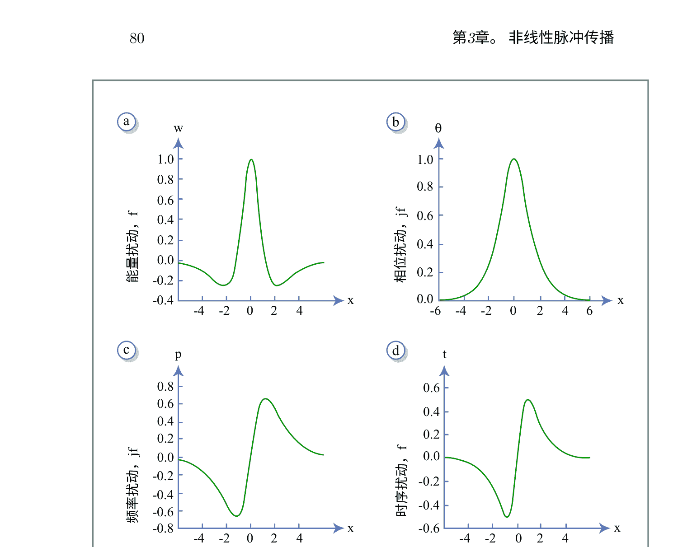

图3.9：孤子幅度（a）、相位（b）、频率（c）和定时（d）的扰动。

MIT OCW提供的图。

线性化NSE的演化算符对这些孤子扰动的作用是

$$ \mathbf{L}\mathbf{f}_w = \frac{1}{w} \mathbf{f}_\theta, \quad (3.26) $$
$$ \mathbf{L}\mathbf{f}_\theta = 0, \quad (3.27) $$
$$ \mathbf{L}\mathbf{f}_p = -2\tau^2 \mathbf{f}_t, \quad (3.28) $$
$$ \mathbf{L}\mathbf{f}_t = 0. \quad (3.29) $$

方程（3.26）和（3.28）表明，由于SPM和GVD，能量和载波频率的扰动会转化为脉冲的额外相位和时序波动，这是光纤中孤子压缩的基础[27]。由于系统是自主的，没有相位参考，时序和相位扰动可以无限增加，这是Gordon-Haus效应的起源[29]。

系统中没有相位参考。Kaup [28]研究了线性化NSE的完整连续频谱，给出的频谱为

$$ \mathbf{L} \mathbf{f}_{k}=\lambda_{k} \mathbf{f}_{k}, \quad (3.30) $$
$$ \lambda_{k}=j\left(k^{2}+1\right), \quad (3.31) $$
$$ \mathbf{f}_{k}(x)=e^{-jkx}\begin{pmatrix} (k-j \tanh x)^{2} \sech^{2} x \\ 1 \end{pmatrix}, \quad (3.32) $$

和

$$ \mathbf{L} \overline{\mathbf{f}}_{k}=\overline{\lambda}_{k} \overline{\mathbf{f}}_{k}, \quad (3.33) $$
$$ \overline{\lambda}_{k}=-j\left(k^{2}+1\right), \quad (3.34) $$
$$ \overline{\mathbf{f}}_{k}=\sigma_{1} \mathbf{f}_{k}. \quad (3.35) $$

我们对特征函数的定义与Kaup [28]稍有不同，因为我们还将复数空间中的内积定义为

$$ \langle\mathbf{u}|\mathbf{v}\rangle=\frac{1}{2} \int_{-\infty}^{+\infty} \mathbf{u}^{+}(x) \mathbf{v}(x) d x. \quad (3.36) $$

采用这个定义，在第二个分量是第一个分量的复共轭的子空间中，向量与自身的内积是信号的能量，一个物理量。

这个内积下，算符 $\mathbf{L}$ 不是自伴的。这个数学性质的物理起源是，线性化系统由于孤子的参数泵浦而不守恒能量。

然而，从(3.21)和(3.36)我们可以很容易地看出，伴随算符是

$$ \mathbf{L}^{+}=-\sigma_{3} \mathbf{L} \sigma_{3}, \quad (3.37) $$

因此，我们得到伴随算符的谱

$$ \mathbf{L}^{+} \mathbf{f}_{k}^{(+)}=\lambda_{k}^{(+)} \mathbf{f}_{k}^{(+)}, \quad (3.38) $$
$$ \lambda_{k}^{(+)}=-j\left(k^{2}+1\right), \quad (3.39) $$
$$ \mathbf{f}_{k}^{(+)}=\frac{1}{\pi\left(k^{2}+1\right)^{2}} \sigma_{3} \mathbf{f}_{k}, \quad (3.40) $$

和

$$ \mathbf{L}^+\overline{\mathbf{f}}_{k}^{(+)} = \overline{\lambda}_{k}^{(+)}\overline{\mathbf{f}}_{k}^{(+)} \quad (3.41) $$
$$ \overline{\lambda}_{k}^{(+)} = j(k^{2}+1) \quad (3.42) $$
$$ \overline{\mathbf{f}}_{k}^{(+)} = \frac{1}{\pi(k^{2}+1)^{2}}\sigma_{3}\overline{\mathbf{f}}_{k}. \quad (3.43) $$

$\mathbf{L}$ 和其伴随算符的本征函数彼此正交，并且它们已经适当地归一化

$$ \langle \mathbf{f}_{k}^{(+)}|\mathbf{f}_{k'}^{(+)} \rangle = \delta(k-k'), \quad \langle \overline{\mathbf{f}}_{k}^{(+)}|\overline{\mathbf{f}}_{k'}^{(+)} \rangle = \delta(k-k') \quad (3.48) $$
$$ \langle \overline{\mathbf{f}}_{k}^{(+)}|\mathbf{f}_{k'}^{(+)} \rangle = \langle \mathbf{f}_{k}^{(+)}|\overline{\mathbf{f}}_{k'}^{(+)} \rangle = 0. \quad (3.49) $$

这个系统描述了连续激发，通过考虑孤子的四个自由度的扰动（3.22）-（3.25）及其伴随算符，使其完备

$$ \mathbf{f}_{w}^{(+)}(x) = j2\tau\,\sigma_{3}\mathbf{f}_{\theta}(x) = 2\tau\,a(x)\begin{pmatrix} 1 \\ 1 \end{pmatrix}, \quad (3.44) $$
$$ \mathbf{f}_{\theta}^{(+)}(x) = -2j\tau\,\sigma_{3}\mathbf{f}_{w}(x) \ = \frac{-2j\tau}{w}(1-x\tanh x)a(x)\begin{pmatrix} 1 \\ -1 \end{pmatrix}, \quad (3.45) $$
$$ \mathbf{f}_{p}^{(+)}(x) = -\frac{2j\tau}{w}\sigma_{3}\mathbf{f}_{t}(x) = \frac{2j}{w}\tanh x\,a(x)\begin{pmatrix} 1 \\ -1 \end{pmatrix}, \quad (3.46) $$
$$ \mathbf{f}_{t}^{(+)}(x) = \frac{2j\tau}{w}\sigma_{3}\mathbf{f}_{p}(x) = \frac{2\tau^{2}}{w}x\,a(x)\begin{pmatrix} 1 \\ 1 \end{pmatrix}. \quad (3.47) $$

现在，单位算符可以分解为两个投影，一个投影到连续体上，一个投影到孤子变量的扰动上[28]

$$ \delta(x-x') = \int_{-\infty}^{\infty} dk\left[ |\mathbf{f}_{k}\rangle\langle\mathbf{f}_{k}^{(+)}| + |\overline{\mathbf{f}}_{k}\rangle\langle\overline{\mathbf{f}}_{k}^{(+)}| \right] \ + |\mathbf{f}_{w}\rangle\langle\mathbf{f}_{w}^{(+)}| + |\mathbf{f}_{\theta}\rangle\langle\mathbf{f}_{\theta}^{(+)}| \ + |\mathbf{f}_{p}\rangle\langle\mathbf{f}_{p}^{(+)}| + |\mathbf{f}_{t}\rangle\langle\mathbf{f}_{t}^{(+)}|. \quad (3.48) $$

任何偏差 $\Delta A$ 都可以分解为导致四个孤子参数偏移的贡献和连续贡献。

此外，连续部分可以写成

$$\mathbf{a}_c = \int_{-\infty}^{\infty} dk \left[ g(k) \mathbf{f}_k(x) + \bar{g}(k) \bar{\mathbf{f}}_k(x) \right]. \quad (3.50)$$

如果我们将分解式 (3.49) 代入 (3.20) ，我们得到

$$\frac{\partial \Delta \omega}{\partial z'} \mathbf{f}_\omega + \frac{\partial \Delta \theta}{\partial z'} \mathbf{f}_\theta + \frac{\partial \Delta p}{\partial z'} \mathbf{f}_p + \frac{\partial \Delta t}{\partial z'} \mathbf{f}_t + \frac{\partial}{\partial z'} \mathbf{a}_c = \mathbf{L} (\Delta \omega(z')\mathbf{f}_\omega + \Delta p(z')\mathbf{f}_p + \mathbf{a}(z')_c) + \frac{1}{k_s}\mathbf{F}(A, A^*, z') e^{-iz'}. \quad (3.51)$$

通过将该方程与共轭演化算符 (3.38) 到 (3.43) 的特征解的标量积 (3.36) 相乘，并使用特征值 (3.26) 到 (3.35) ，我们得到

$$\frac{\partial}{\partial z'} \Delta w = \frac{1}{k_s} < \mathbf{f}_w^{(+)} | \mathbf{F} e^{jz'} >, \quad (3.52)$$
$$\frac{\partial}{\partial z'} \Delta \theta = \frac{\Delta W}{W} + \frac{1}{k_s} < \mathbf{f}_\theta^{(+)} | \mathbf{F} e^{jz'} >, \quad (3.53)$$
$$\frac{\partial}{\partial z'} \Delta p = \frac{1}{k_s} < \mathbf{f}_p^{(+)} | \mathbf{F} e^{jz'} >, \quad (3.54)$$
$$\frac{\partial}{\partial z'} \Delta t = 2\tau \Delta p + \frac{1}{k_s} < \mathbf{f}_t^{(+)} | \mathbf{F} e^{jz'} >, \quad (3.55)$$
$$\frac{\partial}{\partial z'} g(k) = j(1 + k^2) g(k) + \frac{1}{k_s} < \mathbf{f}_k^{(+)} | \mathbf{F}(A, A^*, z') e^{jz'} >. \quad (3.56)$$

注意，连续体必须在定义的子空间中

$$\sigma_1 \mathbf{a}_c = \mathbf{a}_c^*. \quad (3.57)$$

连续体的光谱 $g(k)$和 $\bar{g}(k)$有关

$$\bar{g}(k) = g(-k)^*. \quad (3.58)$$

然后，我们可以使用(3.32)，(3.50)和(3.57)直接计算连续谱

$$a_c = -\frac{\partial^2 G(x)}{\partial x^2} + 2 \tanh(x) \frac{\partial G(x)}{\partial x} - \tanh^2(x) G(x) + G^*(x) \text{sech}^2(x). \quad (3.59)$$

其中 $G(x)$ 是，除了相位因子 $e^{iz'}$ 外，戈登的相关函数[33]。它是光谱的反傅里叶变换

$$ G(x) = \int_{-\infty}^{\infty} g(k) e^{ikx} dk. \quad (3.60)$$

由于 $g(k)$ 满足方程(3.56)，在没有驱动项F的情况下，戈登的相关函数满足一个纯色散方程

$$ \frac{\partial G(z', x)}{\partial z'} = -j \left(1 + \frac{\partial^2}{\partial x^2}\right) G(z', x). \quad (3.61)$$

当只有一个归一化频率为 $k_0$ 的连续模式存在时，观察连续谱的频谱是很有启发性的，即 $g(k) = \delta(k - k_0)$。根据方程(3.59)和(3.60)，我们有

$$ a_{c,k}(x) = [k_0^2 - 2jk_0 \tanh(x) - 1] e^{-jk_0x} + 2\text{sech}^2(x) \cos(x). \quad (3.62)$$

这个连续贡献的频谱是

$$ \tilde{a}_{c,k}(\omega) = 2\pi(k_0^2 - 1)\delta(\omega - k_0) + 2k_0 P.V. \left(\frac{2}{\omega - k_0} + \frac{\pi}{\sinh\left(\frac{\pi}{2}(\omega - k_0)\right)}\right) + \pi\frac{\omega - k_0}{\sinh\left(\frac{\pi}{2}(\omega - k_0)\right)} + \pi\frac{\omega + k_0}{\sinh\left(\frac{\pi}{2}(\omega + k_0)\right)}. \quad (3.63)$$

## 3.6 周期性扰动引起的孤子不稳定性

周期性扰动对孤子的影响对于理解超短脉冲激光和长距离光通信系统[30, 31]非常重要。

在长距离传输系统中，脉冲必须周期性放大。在锁模激光系统中，非线性、色散和增益通常以集中的方式出现。在这些系统中传播的孤子只是平均孤子，它们以周期性的方式通过离散的元件传播，稍后我们将看到。

这种周期性扰动的影响可以通过方程（3.14）中的附加项 $F$ 来建模扰动的NSE。

$$ F(A, A^*, z) = j\xi \sum_{n=-\infty}^{\infty} \delta(z - nz_A)A(z, t). \quad (3.64)$$

根据方程（3.56），对孤子进行周期性踢动会导致能量向连续模式的散射

$$\frac{\partial}{\partial z} g(k) = j k_s (1 + k^2) g(k) + < \mathbf{f}_k^{(+)} \mathbf{F}(A, A^*, z) e^{j k_s z} >. \quad (3.65)$$

$$< \mathbf{f}_k^{(+)} \mathbf{F}(A, A^*, z) e^{j k_s z} >= j \xi \sum_{n=-\infty}^{\infty} \delta(z - n z_A) \frac{1}{2} \cdot \quad (3.66)$$

$$\begin{aligned} &\int_{-\infty}^{+\infty} \frac{1}{\pi (k^2 + 1)^2} e^{j k x} \begin{pmatrix} (k + j \tanh x)^2 \\ -\text{sech}^2 x \end{pmatrix} \cdot \begin{pmatrix} 1 \\ 1 \end{pmatrix} A_0 \, \text{sech} \, dx \\ &= j \xi \sum_{n=-\infty}^{\infty} \delta(z - n z_A) \cdot \\ &\quad \int_{-\infty}^{+\infty} \frac{A_0}{2\pi (k^2 + 1)^2} e^{j k x} (k^2 + 2 j k \tanh x - 1) \cdot \text{sech} \, dx \end{aligned} \quad (3.67)$$

注意, $\frac{d}{dx} \text{sech}x = -\text{sech}x \tanh x$, 因此

$$\begin{aligned} &< \mathbf{f}_k^{(+)} \mathbf{F}(A, A^*, z) e^{j z} > = -j \xi \sum_{n=-\infty}^{\infty} \delta(z - n z_A) \cdot \\ &\int_{-\infty}^{+\infty} \frac{A_0}{2\pi (k^2 + 1)} e^{j k x} \cdot \text{sech} \, dx \\ &= -j \xi \sum_{n=-\infty}^{\infty} \delta(z - n z_A) \frac{A_0}{4(k^2 + 1)} \text{sech} \left( \frac{\pi k}{2} \right). \end{aligned} \quad (3.68)$$

使用 $\sum_{n=-\infty}^{\infty} \delta(z - n z_A) = \frac{1}{z_A} \sum_{m=-\infty}^{\infty} e^{j m \frac{2\pi}{z_A} z}$ 我们得到

$$\frac{\partial}{\partial z} g(k) = j k_s (1 + k^2) g(k) - j \frac{\xi}{z_A} \sum_{m=-\infty}^{\infty} e^{j m \frac{2\pi}{z_A} z} \frac{A_0}{4(k^2 + 1)} \text{sech} \left( \frac{\pi k}{2} \right). \quad (3.69)$$

方程(3.69)是一个具有恒定系数的线性微分方程，用于连续振幅 $g(k)$的变量常数解法通过假设

$$g(k, z) = C(k, z) e^{j k_s (1 + k^2) z}, \quad (3.70)$$

和初始条件 C(z=0)=0,我们得到

$$\frac{\partial}{\partial z}C(k, z) = -j\frac{\xi}{z_A} \sum_{m=-\infty}^{\infty} \frac{A_0}{4(k^2+1)} \text{sech}\left(\frac{\pi k}{2}\right) e^{-j\left(k_s(1+k^2)-m\frac{2\pi}{z_A}\right)z}, \quad (3.71)$$

或者

$$C(k, z) = -j\frac{\xi}{z_A}\frac{A_0}{4(k^2+1)}\text{sech}\left(\frac{\pi k}{2}\right) \cdot \sum_{m=-\infty}^{\infty} \int_0^z e^{j(-k_s(1+k^2)+m\frac{2\pi}{z_A})z} dz \\ = -j\frac{\xi}{z_A}\frac{A_0}{4(k^2+1)}\text{sech}\left(\frac{\pi k}{2}\right) \cdot \\ \sum_{m=-\infty}^{\infty} \frac{e^{j(-k_s(1+k^2)+m\frac{2\pi}{z_A})z}-1}{m\frac{2\pi}{z_A}-k_s(1+k^2)}. \quad (3.72)$$

存在一个共振分母，在某些归一化频率 k_m 为 z→∞时会发散。这些频率由以下给出

$$m\frac{2\pi}{z_A} - k_s(1+k_m^2) = 0, \quad (3.73)$$
$$\text{或者} \quad k_m = \pm \sqrt{ \frac{m\frac{2\pi}{z_A}}{k_s} - 1 }. \quad (3.74)$$

通过设置 k=ωτ, k_s = |D_2|/τ^2 并引入孤子在扰动的一个周期内获得的非线性相移 φ_0 = k_s z_A，我们得到了一个方便的公式来确定共振旁带的位置

$$\omega_m = \pm \frac{1}{\tau} \sqrt{ \frac{2m\pi}{\phi_0} - 1 }, \quad (3.75)$$

和系数

$$C(\omega, z) = -j\frac{\xi}{z_A}\frac{A_0}{4((\omega\tau)^2+1)}\text{sech}\left(\frac{\pi\omega\tau}{2}\right) \\ \cdot \sum_{m=-\infty}^{\infty} z_A \frac{e^{j(-k_s(1+(\omega\tau)^2)+m\frac{2\pi}{z_A})z}-1}{2\pi m - \phi_0(1+(\omega\tau)^2)}. \quad (3.76)$$

在频率不等于共振条件时，系数保持有界，并且在共振时，它们与 z_A 线性增长，导致脉冲的破坏。为了稳定孤子免受共振增长的影响侧带，共振频率必须保持在孤子的频谱之外，参见图3.10，它供给连续谱，即 $\omega_m \gg 1$。只有当 $\phi_0 \ll \pi/4$ 时，才满足这个条件。这个条件要求孤子周期远远长于扰动周期。例如，图3.10显示了光纤激光器中观察到的共振侧带。对于光通信系统，这个条件要求孤子能量保持足够小，以使孤子周期远远长于放大器之间的距离，这构成了对孤子的周期性扰动。这些侧带通常被称为凯利侧带，根据第一个正确描述其起源的人[30]。

为了说明其重要性，我们讨论了图3.11中所示的长腔Ti:蓝宝石激光系统观察到的频谱，并在[37]中详细描述。由于重复频率低，腔体中积累了相当大的脉冲能量，这导致每个往返中的大非线性相移。图3.12显示了激光器输出的频谱。凯利侧带清晰可见。正是这种不稳定性，限制了这些在孤子脉冲整形区域运行的系统中脉冲能量的进一步增加。能量从主脉冲流向侧带，侧带以脉冲为代价而增长。在某一点上，脉冲整形变得不稳定，因为后面将讨论的条件。

图3.10：由于周期性扰动引起的孤子和连续谱之间的相位匹配导致共振旁带的产生。所示情况为 $\phi_0 = \pi/2$。

图3.11：高脉冲能量激光腔的示意布局。所有阴影部分的镜子都是（双色调镜）DCMs。标准的100 MHz腔，多次通过腔（MPC）被包围在虚线框中。泵浦光源是频率加倍的Nd:Vanadate，

图3.12：测量得到的模锁光谱，FWHM为16.5 nm，中心波长为788 nm

## 3.7 脉冲压缩

到目前为止，我们已经讨论了在负色散介质中的脉冲传播和正自相位调制。然后，在足够大的脉冲能量下，可以形成孤子，因为由SPM在脉冲前后产生的低频和高频分量是慢和快的，因此追上脉冲并保持在一起。如果色散是正的会发生什么？显然，由SPM在脉冲前后产生的低频和高频分量是快和慢的，并且以连续的方式远离脉冲。这导致高度但线性调制的脉冲，可以通过将其通过线性负色散介质或棱镜对或光栅对进行非线性传播后进行压缩。

通过这种方式，脉冲可以被大约3到20倍压缩。这种脉冲压缩过程可以用更一般的方式来描述。

### 3.7.1 通用脉冲压缩方案

光脉冲的脉冲压缩的一般方案是由吉雷和图尔瓦瓦独立提出的[38]，而吉奥德迈尼等人则在1968年提出了类似的方案[39]。输入脉冲首先通过一个相位调制器进行频谱扩展。希望生成的频谱上的相位能够方便地被移除，即所有频谱分量都可以重新相位调整，以在时间域中生成尽可能短的脉冲。为了压缩飞秒脉冲，必须使用超快相位调制器，即脉冲必须通过自相位调制自己的相位。1969年，费舍尔等人提出了使用光学克尔液体在短脉冲峰值附近产生的大正色散来将皮秒脉冲压缩到飞秒持续时间的方法[40]。同年，劳伯劳[41]使用含有CS₂的多个腔体和一对衍射光栅将由锁模Nd:玻璃激光器产生的20皮秒脉冲压缩了大约十倍。

如第3.2节所讨论的，在介质中的光学Kerr效应引起了折射率的强度相关变化 Δn = n₂LI(t)，其中 n₂L是非线性折射率系数，I(t)是光强度。在Kerr介质中传播时，光场经历的自感应强度相关非线性相移 Δφ(t) = - (ω₀/c)n₂I(t) c，其中 ω₀是脉冲的载波频率。可以从中计算出脉冲的诱导频率扫描 $\Delta\omega = d\Delta\varphi/dt$，参见图3.13。在脉冲的中心部分附近，能量大部分集中，相位呈抛物线状，导致频率近似线性啁啾。在具有相同符号的Kerr介质中，正色散的存在可以扩大具有线性啁啾的区域[42]。为了压缩频谱宽度增宽和啁啾的脉冲，可以使用一个色散延迟线，其特征是几乎线性的群延迟 $T_g(\omega)$。或者，如果新生成的频谱上产生的啁啾是非线性的，则需要通过相应的非线性群延迟 $T_g(\omega)$来消除这种啁啾。图3.13显示，在SPM和正色散的情况下，会产生具有更线性啁啾的更平滑的频谱，因此最终压缩的脉冲质量更高，即总脉冲能量的更高百分比真正集中在短脉冲中，而不是在大的未压缩脉冲基座中。

对于在均匀介质中传播的光束，不幸的是，非线性折射率不仅导致时间相位调制，还导致空间相位调制，从而引起自聚焦或散焦和小尺度的不稳定性[43]。因此，脉冲压缩的一个基本要求

图3.13：两种情况下的强度分布、频谱、瞬时频率、最佳二次压缩和理想压缩：上排为短纤维，即高非线性和低色散；下排为最佳非线性和色散。[42]

## 3.7. 脉冲压缩

脉冲压缩的一个重要要求是，克尔效应由导向非线性介质提供，以获得空间均匀的光谱展宽。1974年，Ippen等人在没有自聚焦和自散焦的情况下，使用导向多模光纤首次测量了自相位调制[44]。充满液态CS₂的导向多模光纤[44]。 1978年，Stolen和Lin在单模硅芯光纤中报告了自相位调制的测量结果[45]。 单模光纤的重要优势是相位调制可以施加在光束的整个横截面上，从而消除了光束翼部的未调制光问题[44]。 1981年，Nakatsuka等人在正色散区域使用光纤作为克尔介质进行了第一次脉冲压缩实验[42]。

### 3.7.2 导模谱增宽

导模的电场可以写成[52]:
$$E(\mathbf{r}, \omega) = A(z, \omega) F(x, y) \exp[i\beta(\omega)z] \qquad (3.77)$$
其中 $A(z, \omega)$ 是给定频率分量的模振幅， $F(x, y)$ 是模横向场分布， $\beta(\omega)$ 是模传播常数。 导模场的传播方程分解为振幅 $A(z, \omega)$ 和场分布 $F(x, y)$ 的两个方程。 在一阶微扰理论中，折射率的微扰 $\Delta n= \bar{n}_2 |E|^2$ of比模式定义的折射率变化小得多，不会改变模式分布 $F(x, y)$，而模传播常数 $\beta(\omega)$ 可以写成 $\bar{\beta}(\omega) = \beta(\omega) + \Delta\beta$，其中微扰 $\Delta\beta$ 由以下给出

$$\Delta\beta = \frac{(\omega_0/c) \iint \Delta n |F(x, y)|^2 dx dy}{\iint |F(x, y)|^2 dx dy}. \qquad (3.78)$$
如方程 (3.78) 所示，包括光纤非线性效应的微扰 $\Delta\beta$ 与光纤横截面上的微扰 $\Delta n$ 的空间平均值有关。 通过这种方式，实现了空间均匀的自相位调制（SPM）。

使用常规单模光纤和棱镜光栅压缩器，1987年从碰撞脉冲模锁染料激光器产生的50 fs脉冲在620 nm处获得了6 fs的脉冲[46]，见图3.14。最近，从腔脉冲倒掉的钛宝石激光器产生的13 fs脉冲被压缩到4.5飞秒。

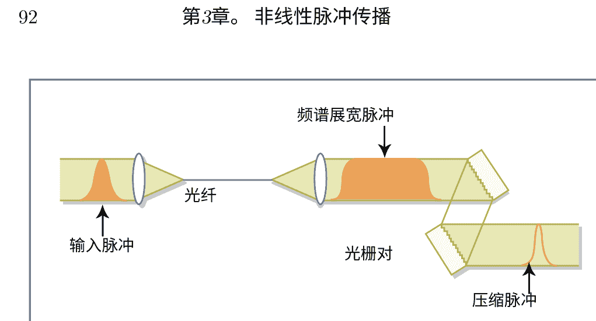

图3.14：光纤光栅脉冲压缩器产生飞秒脉冲 [53]

> MIT OCW提供的图。

使用由石英 45°-棱镜对、宽带啁啾镜和薄膜Gires-Tournois介质干涉仪构成的压缩器，使用相同技术产生飞秒脉冲 [47, 54]。使用单模光纤限制了脉冲的能量为几纳焦。

1996年，使用由充满惰性气体的中空光纤（泄漏波导）构成的相位调制器引入了一种强脉冲压缩技术，可处理高能量脉冲 [48]。使用来自钛蓝宝石系统的20飞秒种子脉冲和形成色散延迟线的啁啾镜实现了中空光纤压缩技术的实施，产生了持续时间为4.5飞秒的脉冲 [49]，能量高达0.55毫焦 [50]。该技术具有直径较大的导光元件和高损伤阈值的快速非线性介质的优点。

利用相位调制过程产生的超宽带频谱的可能性与能够控制该带宽上的频率相关的色散延迟线的发展密切相关。

### 3.7.3 色散补偿技术

相位调制施加的脉冲频率扫描（啁啾）在脉冲峰值附近近似线性，因为大部分能量集中在那里。在相位调制器中存在色散的情况下，啁啾在几乎整个脉冲上变得线性。因此，最佳的时间压缩需要具有频率依赖的群延迟 $T_{g,comp}(\omega) = \partial\phi/\partial\omega$ 的特性。在色散延迟线中，频率上几乎线性依赖。由于在SPM的情况下，非线性指数 n_2 通常在共振点附近为正值，压缩器中需要负的群延迟色散（GDD = ∂T_g/∂ω）。为了产生最短的脉冲，相位调制器和压缩器之后的脉冲群延迟必须几乎与频率无关。T_g(ω)可以围绕中心频率 ω_0展开为Taylor级数:

$$T_g(\omega) = \phi'(\omega_0) + \phi''(\omega_0)\Delta\omega + \frac{1}{2}\phi'''(\omega_0)\Delta\omega^2 + \frac{1}{3!}\phi''''(\omega_0)\Delta\omega^3 + \cdots \quad (3.79)$$

其中 $\Delta\omega = \omega - \omega_0$，而 $\phi''(\omega_0)$、$\phi'''(\omega_0)$和 $\phi''''(\omega_0)$分别是二阶、三阶和四阶色散项。这些色散项的临界值，超过这些值时色散会导致脉冲发生显著变化，可以用一个简单的缩放表达式来表示：$\phi^{(n)} = \tau_p^n$，其中 $\phi^{(n)}$是n阶色散项，$\tau_p$是脉冲持续时间。例如，具有 $\phi'' = \tau_p^2$的二阶色散会导致脉冲变宽超过两倍。因此，由色散引起的脉冲变宽和失真对于缩短脉冲持续时间变得越来越重要。

方程（3.79）表明，为了将脉冲压缩到接近变换极限，应该消除这些高阶色散项。例如，假设输入脉冲是变换极限的，通过相位调制器进行压缩的条件是:

$$\begin{aligned}
\phi''(\omega_0) &= \phi''_{\text{调制器}} + \phi''_{\text{压缩器}} = 0 \quad &(3.80)\\
\phi'''(\omega_0) &= \phi'''_{\text{调制器}} + \phi'''_{\text{压缩器}} = 0 \quad &(3.81)
\end{aligned}$$

迄今为止已经开发了几种压缩器方案，包括衍射光栅、布鲁斯特切割的棱镜对、光栅和棱镜的组合、薄棱镜和啁啾镜以及仅啁啾镜等。接下来，我们将简要概述这些压缩器方案的主要特点。

### 光栅和棱镜对

1968年，Treacy首次使用一对衍射光栅实现了负群组延迟[55]。1984年，Fork等人使用一对布鲁斯特角棱镜获得了负群组延迟[56]。自从可以非常低的群组延迟，棱镜对已经广泛用于激光振荡器内的色散控制。

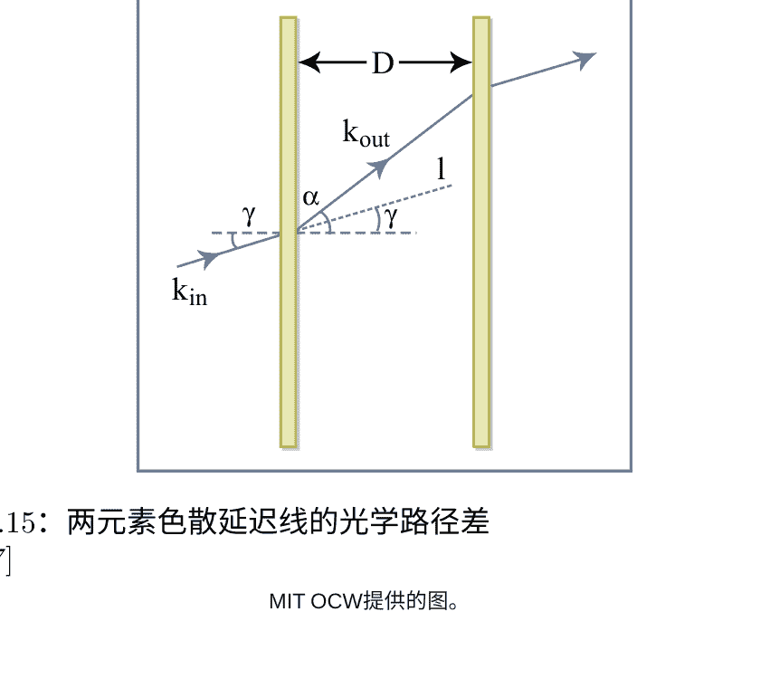

图3.15：两元素色散延迟线的光学路径差[107]

MIT OCW提供的图。

与光栅对相比，对比度下降。 在这两种光学系统中，可调色散的起源是由衍射和折射引起的角色散。 这些系统引入的色散可以通过计算输入和输出参考平面之间累积的相位来轻松计算[78]。 为了理解这些系统的主要特性，我们将参考图3.15。第一个元素将输入光束散射到波矢 k_in 和输入路径矢量 1 的方向 k_out。 光束在第一个和第二个元素之间通过，并向其原始方向散射回来。 散射光束与没有光栅的参考光束之间的相位差为： φ(ω) = k_out(ω) · 1。 考虑两个元素之间的自由空间传播，我们有 |k_out| = ω/c，累积的相位可以写成

$$
\phi(\omega) = \frac{\omega}{c} |\mathbf{1}| \cos[\gamma - \alpha(\omega)] = \frac{\omega}{c} \frac{D}{\cos(\gamma)} \cos[\gamma - \alpha(\omega)] \tag{3.82}
$$

其中： γ是入射波矢与法线之间的角度； α是出射波矢的角度，它是频率的函数； D是沿着法线方向的散射元素之间的间距。在光栅对的情况下，衍射角 α的频率依赖性由光栅控制定律，在一阶衍射的情况下为：

$$\frac{2\pi c}{\omega} = d[\sin \alpha(\omega) - \sin \gamma] \tag{3.83}$$

其中，d是光栅的凹槽间距。使用方程（3.82）和方程（3.83），可以得到GDD和高阶色散项（单程）的解析表达式：

$$\phi''(\omega) = -\frac{4\pi^2 c D}{\omega^3 d^2 \cos^3 \alpha(\omega)} \tag{3.84}$$

$$\phi'''(\omega) = \frac{12\pi^2 c D}{\omega^4 d^2 \cos^3 \alpha(\omega)} \left(1 + \frac{2\pi c \sin \alpha(\omega)}{\omega d \cos^2 \alpha(\omega)}\right) \tag{3.85}$$

从方程（3.84）可以明显看出光栅对产生负色散。D是光栅之间的距离。光栅对的一个缺点是衍射损耗。对于双程配置，损耗通常为75%。同时，有效衍射的带宽也是有限的。

对于布鲁斯特角棱镜对，方程（3.82）简化为以下表达式（单程）[56]：

$$\phi(\omega) = \frac{\omega}{c} c_p \cos \beta(\omega) \tag{3.86}$$

其中c_p是棱镜顶点之间的距离，β(ω)是折射光线与连接两个顶点的直线之间的角度。二阶和三阶色散可以用光学路径P(λ)=c_p cos β(λ)来表示：

$$\phi''(\omega) = \frac{\lambda^3}{2\pi c^2} \frac{d^2 P}{d \lambda^2} \tag{3.87}$$

$$\phi'''(\omega) = -\frac{\lambda^4}{4\pi^2 c^3} \left(3 \frac{d^2 P}{d \lambda^2} + \lambda \frac{d^3 P}{d \lambda^3}\right) \tag{3.88}$$

在布鲁斯特角处评估的光学路径的以下导数为：

$$\frac{d^2 P}{d \lambda^2} = 2[n'' + (2n - n^{-3})(n')^2] c_p \sin \beta - 4(n')^2 c_p \cos \beta \tag{3.89}$$

$$\frac{d^3 P}{d \lambda^3} = [6(n')^3 (n^{-6} + n^{-4} - 2n^{-2} + 4n^2) + 12n' n'' (2n - n^{-3}) + 2n'''] c_p \sin \beta \tag{3.90}$$
$$+ 12[(n^{-3} - 2n)(n')^3 - n' n''] c_p \cos \beta \tag{3.91}$$

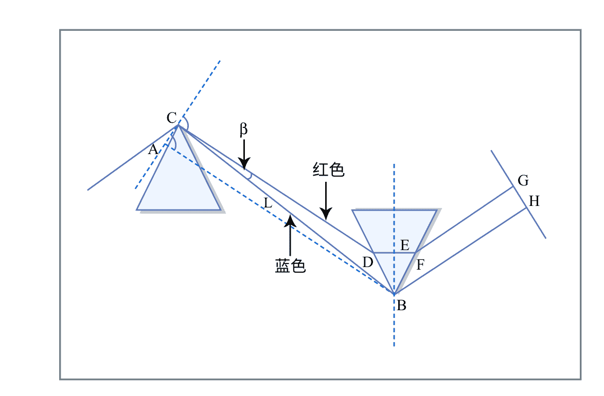

图3.16：用于色散补偿的棱镜对。蓝色波长在光路中的材料较红色波长少。因此，蓝色波长比红色波长延迟较少。

MIT OCW提供的图。

其中 $n$ 是棱镜材料的折射率；$n'$，$n''$ 和 $n'''$ 分别是 $n$ 的一阶、二阶和三阶导数，相对于波长。棱镜压缩器具有减小损耗的优点。

仅使用熔融二氧化硅棱镜进行色散补偿，1994年直接从振荡器中产生了亚10飞秒的光脉冲[79]。1996年，通过使用充满气体的空心光纤对能量为数十微焦耳的脉冲进行光谱扩展，使用棱镜压缩器将其压缩到10飞秒[48]。

无论是光栅还是棱镜对，负群延迟色散与大量的高阶色散相关联，无法独立于所需的群延迟进行降低或调整，从而限制了可以获得正确色散控制的带宽。通过将棱镜和光栅对与相反符号的三阶色散相结合，这个缺点只能部分地克服。通过外部压缩，1987年产生了6飞秒的脉冲[46]，1997年产生了小于5飞秒的脉冲[47]。由于光栅的高衍射损耗，这种组合无法用于激光振荡器中的少光周期脉冲生成，也无法用于高功率水平的外部压缩器，因为会出现

### 棱镜中的非线性效应

### 3.7.4 色散补偿镜

由于提供高色散且光束路径中的材料很少，啁啾镜被用于高能脉冲的压缩，从而避免了非线性效应。

光栅和棱镜压缩器受到高阶色散的影响。 1993年，Robert Szipoecs和Ferenc Krausz [80]提出了一个新的想法，即啁啾镜。激光镜是由交替的高和低折射率的四分之一波长厚度层组成的介质镜，产生强烈的布拉格反射。在啁啾镜中，布拉格波长被啁啾，因此不同波长在反射时会穿透不同深度的镜子，从而产生波长依赖的群延迟。事实证明，通过外部压缩[95]生成几个周期的脉冲以及通过Kerr透镜锁模激光器[58]直接生成的脉冲，都严重依赖于啁啾镜[57, 83, 59]进行色散补偿。

使用啁啾镜的两个原因。首先，标准介质布拉格镜的高反射带宽，Δf，是由高折射率材料和低折射率材料的菲涅尔反射率r_B决定的。

$$ r_B = \frac{\Delta f}{f_c} = \frac{n_H - n_L}{n_H + n_L} \quad (3.92) $$

其中，f_c是镜子的中心频率。金属镜一般过于损耗，特别是在腔内激光镜使用时。对于通常用于宽带光学涂层的材料系统，如二氧化硅和二氧化钛，n_{SiO2}=1.48和n_{TiO2}=2.4，（这些折射率可能因使用的沉积技术而有所不同），可以覆盖一个分数带宽Δf/f_c=0.23。这个分数带宽只有一个跨越镜子Δf/f_c=2/3的三分之一。此外，布拉格镜的群延迟变化已经影响到了填充了半个光谱范围的脉冲Δf=0.23f_c。通过引入啁啾镜[57]，解决了这个困境，它相当于啁啾光纤布拉格光栅，而这个光栅在光纤光学[60]中已经是一个成熟的组件。当镜子堆叠的布拉格波长变化足够缓慢，并且没有对层对数的限制时，可以设计出镜子的任意高反射率范围。使用啁啾镜的第二个原因是基于它们的色散特性。

光从啁啾多层结构内部不同位置反射的波长依赖性穿透深度。镜子是滤波器，在任何滤波器的设计中，控制群延迟和群延迟色散是困难的。当设计需要在一个八度或更大的波长范围内工作时，这个问题进一步增加。

匹配问题在过去几年中，已经开发了几种超宽带色散补偿镜的设计。对于不扩展高反射率范围远远超过使用相同材料的布拉格镜的色散补偿镜，可以使用多腔滤波器设计来近似所需的相位和幅度特性[61, 62]。对于覆盖高反射率范围高达 Δf/f_c= 0.4的色散补偿镜，已经开发了双啁啾镜（DCMs）的概念[83][81]。它基于以下观察。简单的啁啾镜在任意波长范围内提供高反射率，并且在一定范围内通过其波长依赖性穿透深度可以自定义平均群延迟[73]（见图3.17（a）和（b））。然而，由于环境介质和镜子堆叠之间以及堆叠内部的阻抗不匹配，群延迟作为频率的函数显示周期性变化（见图3.17 b和图3.18）。一种减轻这些不匹配并更好地控制群延迟色散（GDD）的结构是双啁啾镜（DCM）（图3.17 c），类似于锥形光纤布拉格光栅[64]的方式。

图3.18显示了由25个折射率步骤组成的布拉格和啁啾镜的反射率和群延迟，其中n_H = 2.5和n_L = 1.5，类似于TiO_2和SiO_2的折射率，导致菲涅尔反射率为r_B = 0.25。布拉格镜可以分解为对称的折射率步骤[83]。布拉格波数定义为k_B = π/(n_L d_L + n_H d_H)，其中d_L和d_H分别是低折射率层和高折射率层的厚度。布拉格波数描述了由相等折射率步骤组成的布拉格镜的中心波数。在第一种情况下（图3.18，虚线），只有布拉格波数呈线性啁啾6.8微米^{-1} < k_B < 11微米^{-1}在前20个折射率步骤中保持不变，在最后5个折射率步骤中保持不变。假设结构嵌入在低折射率介质中，计算结构的反射率。群延迟的大幅振荡是由于带调制的光栅和周围低折射率材料的不同阻抗引起的。

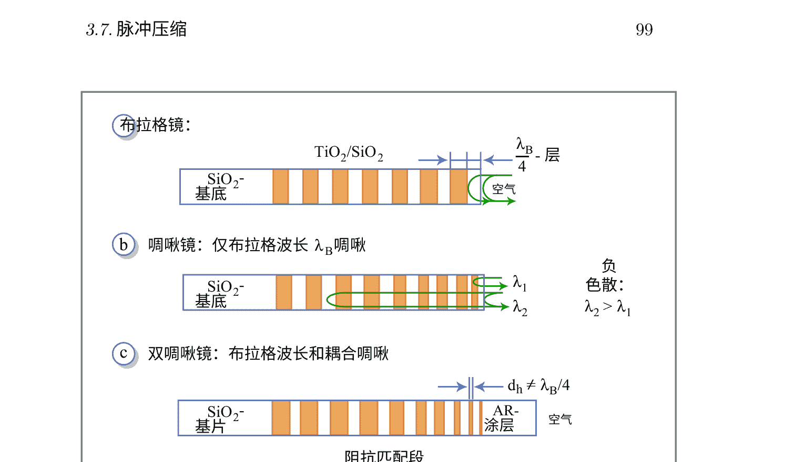

图3.17: a) 标准布拉格反射镜; b) 简单的带调制反射镜; c) 双带调制反射镜，具有匹配部分以避免残余反射引起镜子的不希望的群延迟和群延迟色散振荡。MIT OCW提供的图。

光栅和周围低折射率材料之间的界面处引起强烈反射。通过将光栅阻抗与低折射率材料进行绝热匹配，可以避免这种反射。图3.18通过虚线和实线曲线展示了高折射率层在前12个步骤中根据线性和二次绝热匹配定律进行额外调制的情况。其中α=1和2。参数m表示第m个折射率步骤，λB,12=0.740微米。双带调制技术明显减小了群延迟的振荡。

高折射率层的二次锥形，因此，光栅的振荡在群延迟中完全消除，这也可以通过耦合模分析[81]来解析地显示出来。由于双色散，在镜子的短波长端打开了一个高透射窗口，非常适合于钛宝石激光器的泵浦。

到目前为止，双色散镜只与镜子的低折射率材料匹配。理想情况下，匹配可以通过适当设计的AR涂层扩展到任何其他环境介质。然而，这种AR涂层必须具有非常高的质量，即理想情况下具有非常低的残余反射率，最好是功率

由于版权限制，图像已被删除。

请参阅：
Kaertner, F. X., 等. "双色散镜的设计和制造."光学快报15 (1990): 326-328.

图3.18：具有25层对和折射率 $n_{H}=2.5$和 $n_{L}=1.5$的啁啾镜的反射率和群延迟的比较.上部分显示了放大的反射率的前百分之一。虚线曲线显示了简单啁啾镜的结果。虚线和实线曲线显示了双啁啾镜的结果，除了布拉格波数 $k_{B}$的啁啾外，高折射率层的厚度在前12层对中也进行了啁啾，从零啁啾到线性啁啾的最大值，即 $\alpha=1$， (虚线曲线)，以及二次啁啾，即 $\alpha=2$(实线曲线)。[83]。

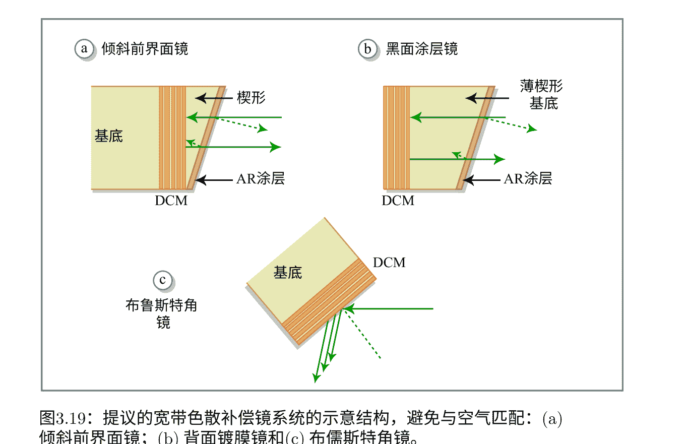

图3.19：提议的宽带色散补偿镜系统的示意结构，避免与空气匹配：(a) 倾斜前界面镜；(b) 背面镀膜镜和(c) 布儒斯特角镜。

> MIT OCW提供的图。

反射率为 $10^{-4}$，即振幅反射率为 $r=10^{-2}$ 所需。如果剩余反射被引导出光束路径，则可以放宽AR镀膜的质量要求。这是通过所谓的倾斜前面或背面镀膜镜实现的[65]，[66]，(图3.19 (a) 和 (b))。在背面镀膜镜中，理想的DCM结构与镜子的低折射率材料相匹配，沉积在由相同或至少非常相似的低折射率材料制成的基底的背面。AR镀膜沉积在略微倾斜的基底前面，使得剩余反射被引导出光束，不影响色散特性。因此，AR镀膜的任务仅是减少镜子在空气-基底界面处的菲涅尔损耗，因此，如果在此界面的剩余反射的量级为0.5%，对于某些应用来说已经足够好了。然而，为了保持整体镜子的色散为负值，基底必须非常薄，通常在200-500微米的量级。在这么薄的基底上制造激光级质量的光学元件非常困难，而镀膜引起的应力会导致基底的不良变形。前面镀膜镜克服了这个缺点。

## 第3章 非线性脉冲传播

通过在常规激光级基底上沉积与楔形材料折射率匹配的理想DCM结构，实现了稳定且跨越一个八度的镜子[69]。在镜子顶部粘贴一个100-200 μm的薄楔形，然后在这个楔形上沉积AR涂层[68]。这样可以得到稳定且跨越一个八度的镜子，已经成功应用于外部压缩实验[69]。

这两种结构都有局限性。首先，它们在光束中引入了一个楔形，导致光束的非理想角色散。通过使用两个方向相反的楔形镜子成对使用，可以部分补偿这个问题。第二个缺点是似乎不可能在一个或多个八度的带宽上制造具有小于0.5%残余反射率的高质量AR涂层[68]，即在一次反射中，这样的镜子至少有1%的损耗，因此这样的镜子会在激光器内部引起高损耗。对于外部压缩，这些损耗是可以接受的。

克服AR涂层问题的第三种可能性是使用理想的DCM在布鲁斯特角入射下（图3.19）[67]。在这种情况下，低折射率层自动匹配到环境空气。然而，在p-偏振入射下，层对的折射率对比度或菲涅尔反射率降低，需要更多的层对才能实现高反射率。此外，镜子对光的穿透深度增加，使得层中的散射和其他损耗更加明显。另一方面，这样的镜子由于更高的穿透深度，每次反射可以产生更多的色散。对于外部压缩，这样的镜子可能具有优势，因为它们可以覆盖比一个八度音程更宽的带宽。

这个概念很难应用于制造曲面镜。反射光束还存在空间啁啾，对于较大的穿透深度可能变得相当大，并且必须通过背向反射或在另一个布鲁斯特角镜子上进行额外反射来去除。对于腔内镜子，通过镜子对的方式可以解决这个困境，这种方式可以消除由于不完美的AR涂层和匹配结构而产生的假反射，从而实现色散镜中的匹配结构。但是，这种设计也有其缺点和限制。在制造过程中需要高精度，并且根据镜子的带宽，可能只能在有限的入射角范围内使用它们。

### 双啁啾镜片

已经提出了几种通过互相补偿GDD振荡[70， 71， 72]来增加激光镜子带宽的建议，使用计算机进行优化。这些早期研究导致了在考虑的带宽的近一半上反射率低于95%。导致DCM的想法帮助我们在分析上表明，设计一对覆盖一个八度带宽（即600 nm到1200 nm）的DCM，具有高反射率和改进的色散特性是可行的[76]。在钛宝石激光系统中使用这些镜对导致直接从激光器产生的光谱跨越一个八度的5 fs脉冲[58]。然而，这些镜对的潜力远未得到充分利用。

DCM对，见图3.20，由镜子M1和M2组成。每个镜子由具有给定波长依赖穿透深度的AR涂层和低折射率匹配的双啁啾背镜MB组成。通过足够缓慢地啁啾和使用足够数量的层对，可以轻松将背镜的高反射率范围扩展到一个八度。

DCM M1可以分解为与顶层介质的折射率相匹配的双啁啾背镜MB。在M2中，在背镜和AR涂层之间插入一个中心频率处的四分之一波厚度的层，其折射率等于背镜MB的顶层介质。新的背镜包括四分之一波层，可以重新优化以实现与MB相同的相位，并在整个带宽的八度范围内增加一个 π-相位移。

然而，所得GDD的平滑度强烈依赖于AR涂层和双啁啾部分提供的匹配质量。图3.21显示了AR涂层对总DCM结构的GDD的影响。AR涂层被表示为一个具有两个输入波a₁， b₂和两个输出波a₂， b₁的二端口。左端口和右端口之间的波之间的连接由传输矩阵描述。

$$\begin{pmatrix} a_1 \\ b_1 \end{pmatrix} = T_{ar} \begin{pmatrix} a_2 \\ b_2 \end{pmatrix} \quad \text{其中} \quad T_{ar} = \begin{pmatrix} \frac{1}{t} & \frac{r^*}{t^*} \\ \frac{r}{t} & \frac{1}{t^*} \end{pmatrix} \qquad (3.93)$$

我们假设多层AR涂层是无损耗的。在这里，r和t是端口1处反射和透射的复系数，假设端口2处无反射终端。背面镜MB被假设与AR涂层的第一层完全匹配，在考虑的总带宽范围内具有完全反射。因此，它在感兴趣的范围内的复反射率为

$$\rho_b = e^{j\phi_b(\omega)} \qquad (3.94)$$

相位 $\phi_b(\omega)$由所需的群延迟色散确定

$$GDD_b = -d^2\phi_b(\omega)/d\omega^2 \qquad (3.95)$$

在镜子的中心频率，$\omega_c$，它的相位和群延迟有一个未确定的常数相位。相位的所有高阶导数由镜子的所需色散确定。在不考虑与环境空气的匹配问题的情况下，可以在[73]中找到用于设计DCM的解析公式，显示出定制的色散特性。

## 3.7. 脉冲压缩

包括AR涂层的总反射率如下 (3.93)

$$\rho_{tot} = \frac{t}{t^*} \rho_b \frac{1 - r^*/\rho_b}{1 - r \rho_b} \qquad (3.96)$$

对于根据方程式 (3.94)的完全反射背镜的特殊情况，我们得到

$$\rho_{tot} = \frac{t}{t^*} e^{j\phi_b(\omega)} \frac{1 - z^*}{1 - z}, \quad \text{其中} \quad z = r e^{j\phi_b(\omega)} \qquad (3.97)$$

新的反射率再次为1，但由于AR涂层的不完美传输特性，导致了反射率的相位出现新的贡献。具有AR涂层的传输系数为

$$t = |t| e^{j\phi_t}, \qquad (3.98)$$

反射系数的总相位变为

$$\phi_{tot} = 2\phi_t + \phi_b(\omega) + \phi_{GT I} \qquad (3.99)$$

其中

$$\phi_{GT I} = 2 \arctan \left[ \frac{Im\{z\}}{1 + Re\{z\}} \right] \qquad (3.100)$$

在这里，$\phi_t$是透射系数的相位，$\phi_{GT I}$是由非完美AR涂层引起的Gire-Tournois干涉仪的相位，即 $r = 0$，以及背面镜MB，（图3.21）。相位 $\phi_t$ 对于良好的AR涂层，即 $| r | < 0.1$，是线性的，因此不会引入GD和GDD中的不必要的振荡。然而，相位 $\phi_{GT I}$变化很快，因为 $\phi_b(\omega)$在感兴趣的频率范围内变化超过几个 $2\pi$。这些振荡的大小与AR涂层的质量成比例，即与 $|r|$成比例。因此，当AR涂层的剩余反射率较小时，GDD振荡会减小。

假设反射率$r$是实数且小于等于0.1，那么群延迟和群延迟色散的振荡可以很容易地估计为

$$T_{g,GT I} = \frac{d\phi_{GT I}}{d\omega} \approx -r T_{gb}(\omega) \cos[\phi_b(\omega)] \qquad (3.101)$$

与

$$\begin{aligned}
T_{gb}(\omega) &= -d\phi_b(\omega)/d\omega, \\
GDD_{GT I} &= \frac{d^2\phi_{GT I}}{d\omega^2} \approx r \left( T_{gb}^2(\omega) \sin[\phi_b(\omega)] - GDD_b \cos[\phi_b(\omega)] \right) \qquad (3.102)
\end{aligned}$$

当在激光器内发生多次反射时，GTI反射在一个往返中相干叠加，如果锁模机制不足够强大以抑制它们，则会导致前脉冲和后脉冲。实验结果表明，每个往返中需要具有$r < 0.01$或更小的AR涂层残余反射，以足够抑制前脉冲和后脉冲。这相当于具有小于$10^{-4}$残余功率反射率的AR涂层，这只能在非常有限的范围内实现，如上所述。

在以800 nm为中心的350 nm有限波长范围内，通过重新优化AR涂层部分和双色散部分形成一个匹配质量更高的组合匹配部分后，可以有效地实现小至$10^{-4}$的残余功率反射率。对于接近一个八度的更大带宽，不再可能实现$10^{-4}$的残余功率反射率[68]。

通过在镜子对M1和M2上反射，可以以一阶$r$的相干减法的方式实现前脉冲和后脉冲的相干减法，参见图3.20(a)和(b)。在具有反射率(3.97)的镜子上进行两次反射，并在具有AR涂层和背面镜子之间具有额外相移$\pi$的类似镜子上进行一次反射，其中$z$被替换为$-z$，导致一阶GTI效应的相干减法。两次反射的总反射率由假设具有相同AR涂层的个体复反射率的乘积给出。

$$\rho_{tot,2} = -\left(\frac{t}{t^*}\right)^2 e^{i2\phi_b(\omega)} \frac{1-z^{*2}}{1-z^2} \qquad (3.103)$$

现在，GTI效应与AR涂层的功率反射率$r^2$成比例，而不是振幅反射率$r$，这是一个巨大的改进，因为可以设计AR涂层到镜子的低折射率材料SiO$_2$，其剩余功率反射率在0.001和0.01之间同时覆盖一个八度的带宽[68]。

然而，并不存在一个单一的物理层，在一个周期内为所有频率分量产生$\pi/2$的相移。尽管如此，在中心频率处具有四分之一波厚度的层是一个很好的起始设计。然后，镜子M2中的背面镜MB可以重新优化，以处理离中心频率更远的四分之一波厚度的偏差，因为背面镜作为高色散介质，其相位或群延迟可以随意设计。

图3.22：具有泵浦窗口的镜子的反射率，以粗实线表示，左侧为刻度。用于无棱镜钛宝石激光器的完美色散补偿的群延迟设计目标以粗虚线表示，右侧为刻度。设计的镜子的单个群延迟以细线表示，其平均值以虚线表示，在波长范围为650-1200 nm之间几乎与设计目标相同。使用白光干涉测量的测量群延迟以厚实实线表示，从600-1100 nm。超过1100nm，使用的Si-探测器的灵敏度阻止了进一步的测量。

图3.23显示了顶部图中对一对镜子的设计反射率，以高分辨率考虑层中的吸收。下面的图显示了镜子的反射率，该镜子在510-550 nm范围内具有高透射率，用于钛宝石晶体的泵浦。每个镜子由40对SiO2和TiO2层制成，使用离子束溅射[74， 75]。两个镜子的反射率覆盖了从580 nm到1200 nm或250到517 THz的超过一个八度的带宽，平均反射率约为99.9%，包括层中的吸收。

此外，镜子的色散校正了所有腔内元件（如钛宝石晶体和薄小角度的BaF2楔子）的二阶和更高阶色散，以在一个往返中的12次反射中从650 nm到1200 nm进行细微调整。色散补偿中的较低波长边界选择由钛宝石的泵浦窗口决定并受限。色散测量使用白光干涉法[77]进行，最高可达约1100 nm，因为硅探测器的滚降。每个镜子的群延迟振荡比高质量DCM覆盖的350 nm带宽大约大10倍。然而，在两个镜子的平均群延迟中，振荡理想上被抑制，因为通过十倍以上的抵消。因此，镜子对的有效残余反射率，覆盖一个八度的带宽，r²，甚至比传统DCM的更小。

### 主动色散补偿方法

基于液晶调制器（LCM）、声光调制器（AOM）和机械可变镜的各种主动脉冲压缩方案已经得到了发展。

**使用液晶调制器进行色散补偿**
一种基于液晶调制器（LCM）的脉冲整形技术[84]提供了大带宽（300-1500 nm）和原位自适应相位控制的优势，见图3.23。1997年，Yelin等人[85]基于LCM展示了一种自适应飞秒脉冲压缩方法。通过一个薄全息透射光栅对振荡器产生的强调制80飞秒脉冲进行了4-f脉冲整形器的发送。一个可编程的一维LCM放置在整形器的傅里叶平面上，用作脉冲光谱操作的可更新滤波器。脉冲长度最短为11 fs（变换极限持续时间：9 fs）的脉冲。通过基于二阶和三阶色散系数的二维空间搜索的自适应压缩优化算法，获得了11 fs（变换极限持续时间：9 fs）的脉冲。

在2001年，Karasawa等人[86]仅使用LCM进行相位补偿，将宽带脉冲从充满氩气的空心光纤压缩到5 fs。最近[51]，通过液晶空间光调制器进行自适应脉冲压缩和光谱相位干涉测量（SPIDER）[87]作为反馈信号，实现了3.8 fs的脉冲。

该方法的一个问题是由于液晶有源矩阵技术在傅里叶平面上的像素化。像素边缘的衍射和黑色基质的吸收引入了寄生效应。实际光谱调制应尽量接近平滑函数，尽管个体调制器元素的固定有限尺寸限制了脉冲压缩的时间范围[88]。其他问题与LCM的光学损伤有关，这限制了最大脉冲能量，并且由设备引入了高损耗。

已经提出了各种非像素化设备：Dorrer等人报道了一种光学寻址的液晶光阀[89]。光阀由两个连续的透明电极和连续的液晶扭曲向列相和光导Bi$_{12}$SiO$_{20}$（BSO）的层组成。对BSO层（在蓝绿光谱区域）的照明局部变化引起了电导率的变化。当在两个电极之间施加电压时，BSO电导率的变化导致液晶层的电压降变化。由于液晶的双折射是电压依赖的，因此产生了折射率的局部变化，从而导致局部光谱分量的光学相位变化。使用显示设备来寻址光阀。避免了像素化效应，因为光阀本身是一个连续的设备。光阀的控制比电学寻址的液晶光阀更加复杂。此外，由于其有限的空间频率响应，光谱分辨率受到限制。

**使用声光调制器进行色散补偿**
1997年，Tournois提出了一种声光可编程色散滤波器(AOPDF)，用于提供大的色散补偿范围[91]。该装置基于一种双折射单轴晶体中的共线声光相互作用，参见图3.24。声频是时间的可变函数，可以控制衍射光脉冲的群延迟。同时，衍射脉冲的频谱幅度受声信号的强度驱动。正如参考文献[91]所示，AOPDF的光学输出E$_{out}$(t)与光学输入E$_{in}$(t)和缩放后的声信号的卷积成正比：

$$E_{out}(t) \propto E_{in}(t) \otimes S(t/\alpha) \qquad (3.104)$$

其中，缩放因子 $\alpha = \Delta n(V / c)$是声音速度与光速之比乘以普通波和非普通波之间的折射率差。因此，通过生成适当的函数 S(t)，可以生成具有由滤波器带宽的倒数给出的任意卷积的时间分辨率。这种装置已经在千赫兹啁啾脉冲放大激光链中使用，通过AOPDF补偿增益收窄和残余相位误差，从而产生17飞秒的变换极限脉冲[92]。总吞吐量为10-50%，取决于设备的带宽。接近一个八度带宽的设备是可能的。

### 使用可变形镜片进行色散补偿

机械可变形镜片可以用于主动色散控制，正如Heritage等人所提出的[93]。最近，通过在4f零色散伸缩器的傅里叶平面上放置一个静电可变形的、镀金的硅氮膜镜片，实现了脉冲压缩[94]。膜片悬浮在39个致动器电极上。施加在每个致动器上的电势产生了膜片和电极之间的静电吸引力，从而导致镜片表面的变形，进而导致输入脉冲的光谱分量的相位调制。总相位差为$\phi= 2(2\pi)\Delta z/\lambda$，其中$\Delta z$是镜片的偏转。镜片膜的最小曲率半径由$R =T /P$给出，其中$T$是膜片张力，$P$是最大静电压力。镜片曲率的这种限制限制了镜片对高阶相位的校正可能性。

该方法的主要优点包括：相位调制平滑变化；由于镜片的高反射率（97%）而减小损耗；相对较高的致动器密度。使用锁模钛宝石激光器进行了实验，可变形镜片将之前在玻璃中经过色散拉伸到90 fs的15 fs脉冲重新压缩到接近带宽极限[94]。

最近，A. Baltuška等人[95]使用由一对啁啾镜和一个光栅色散线以及一个位于焦平面上的计算机控制的柔性镜组成的压缩机，成功实现了约220 THz的带宽上的色散控制。脉冲整形器的总吞吐量不到12%，这是因为光栅的衍射效率较低。使用这个压缩机，通过光参量放大产生的可见光-近红外脉冲被压缩到4飞秒的持续时间。

### 3.7.5 空心光纤压缩技术

单模光纤只能压缩低能量脉冲。1996年，DeSilvestri在米兰的团队[48]开发了一种技术，能够产生毫焦耳范围内的几个周期光脉冲。该技术基于激光脉冲在充满惰性气体的空心光纤中传播（空心光纤压缩技术），见图3.25。空心光纤的模式是泄漏模式，即它们会经历辐射损耗。然而，有一种模式，即EH$_{11}$模式，其损耗要比高阶模式小得多。这种模式用于脉冲压缩。

光纤中的非线性指数可以通过气压来控制。典型的光纤直径为100-500 μm，典型的气压范围为0.1-3bar。与光纤压缩一样，重要的是考虑非线性相互作用和色散的优化。必须考虑介质和波导的色散。更详细的信息请参见参考文献[107]。

目前，空心光纤压缩技术是生成亚10fs毫焦耳脉冲的唯一方法。随着参数啁啾脉冲放大的出现，这将很快改变。

## 3.8 附录：sech代数

双曲正割被定义为

$$\text{sech}(x) = \frac{1}{\cosh(x)} \quad (3.105)$$

见图3.26

$$\cosh^2(x) - \sinh^2(x) = 1 \quad (3.106)$$

$$\text{sech}^2(x) = 1 - \tanh^2(x) \quad (3.107)$$

$$\frac{d}{dx}\text{sech}(x) = -\tanh(x)\text{sech}(x) \quad (3.108)$$

$$\frac{d^2}{dx^2}\text{sech}(x) = \text{sech}(x)\ [1 - 2\text{sech}^2(x)] \quad (3.109)$$

## 第3章 非线性脉冲传播

$$
\int_{-\infty}^{+\infty} \text{sech}(x) dx = \pi \tag{3.110}
$$

$$
\int_{-\infty}^{+\infty} \text{sech}^2(x) dx = 2 \tag{3.111}
$$

$$
\int_{-\infty}^{+\infty} x^2 \text{sech}^2(x) dx = \frac{\pi^2}{6} \tag{3.112}
$$

| 函数 $f(t)$ | 傅里叶变换 $\tilde{f}(\omega) = \int f(t) e^{-j\omega t} dt$ |
| :--- | :--- |
| $\text{sech}(t)$ | $\pi \text{sech}(\frac{\pi}{2}\omega)$ |
| $\text{sech}^2(t)$ | $\frac{\pi\omega}{\sinh(\frac{\pi}{2}\omega)}$ |
| $\text{sech}^3(t)$ | $\frac{1}{2}(1 + \omega^2) \pi \text{sech}(\frac{\pi}{2}\omega)$ |
| $\text{sech}^5(t)$ | $\frac{1}{24}(\omega^4 + 10\omega^2 + 9) \pi \text{sech}(\frac{\pi}{2}\omega)$ |
| $\tanh(t)\text{sech}(t)$ | $-j\pi\omega \text{sech}(\frac{\pi}{2}\omega)$ |
| $\tanh^2(t)\text{sech}(t)$ | $\frac{1}{2}(1 - \omega^2) \pi \text{sech}(\frac{\pi}{2}\omega)$ |
| $\tanh^3(t)\text{sech}(t)$ | $-j\frac{\omega}{6}(5 - \omega^2) \pi \text{sech}(\frac{\pi}{2}\omega)$ |
| $\tanh(t)\text{sech}^3(t)$ | $-j\frac{\omega}{6}(1 + \omega^2) \pi \text{sech}(\frac{\pi}{2}\omega)$ |
| $\tanh^2(t)\text{sech}^3(t)$ | $\frac{1}{2}(1 + \omega^2) \pi \text{sech}(\frac{\pi}{2}\omega) - \frac{1}{24}(\omega^4 + 10\omega^2 + 9) \pi \text{sech}(\frac{\pi}{2}\omega)$ |
| $t\tanh(t)\text{sech}(t)$ | $\pi \text{sech}(\frac{\pi}{2}\omega) - \frac{\omega\pi^2}{2} \tanh(\frac{\pi}{2}\omega)\text{sech}(\frac{\pi}{2}\omega)$ |
| $t\tanh^2(t)\text{sech}(t)$ | $-j\omega\pi \text{sech}(\frac{\pi}{2}\omega) - \frac{\pi^2}{4}(1 - \omega^2) \tanh(\frac{\pi}{2}\omega)\text{sech}(\frac{\pi}{2}\omega)$ |
| $t\tanh^3(t)\text{sech}(t)$ | $\frac{1}{6}(5 - 3\omega^2) \pi \text{sech}(\frac{\pi}{2}\omega) - \frac{\omega\pi^2}{12}(5 - \omega^2) \tanh(\frac{\pi}{2}\omega)\text{sech}(\frac{\pi}{2}\omega)$ |
| $t\tanh(t)\text{sech}^3(t)$ | $\frac{1}{6}(1 + 3\omega^2) \pi \text{sech}(\frac{\pi}{2}\omega) - \frac{\omega\pi^2}{12}(1 + \omega^2) \tanh(\frac{\pi}{2}\omega)\text{sech}(\frac{\pi}{2}\omega)$ |
| $t\text{sech}(t)$ | $-j\frac{\pi^2}{6} \tanh(\frac{\pi}{2}\omega)\text{sech}(\frac{\pi}{2}\omega)$ |
| $t\text{sech}^3(t)$ | $-j\omega\pi \text{sech}(\frac{\pi}{2}\omega) - j\frac{\pi^2}{4}(1 + \omega^2) \tanh(\frac{\pi}{2}\omega)\text{sech}(\frac{\pi}{2}\omega)$ |

## 3.9 总结

我们发现，最低阶可逆线性效应GVD和均匀各向同性介质中的最低阶可逆非线性效应SPM导致了波包的非线性薛定谔方程。这个方程描述了一个哈密顿系统。这个方程是可积的，即它具有无限多的守恒量。

这个方程有孤子解，显示出复杂但持久的振荡行为。特别是，基本孤子，一个sech形状的脉冲，没有色散，使它们非常适合长距离光通信。由于非线性薛定谔方程的普适性，一旦脉冲变得非常短，这种动力学对于锁模激光器也非常重要。

光谱经历了色散，峰值功率足够高，非线性效应变得重要。一般来说，这适用于亚皮秒脉冲。此外，我们发现了一种扰动理论，使我们能够将NSE的解分解为接近基本孤子的基本孤子和连续辐射。我们证明了孤子的周期性扰动可能导致边带生成，如果孤子在扰动周期内的非线性相移与π/4相当。孤子扰动理论还将为后续研究锁模激光器中的噪声提供框架。

具有正色散和自相位调制的介质可以用于脉冲压缩。脉冲压缩中的主要问题是找到一个能够完全反转由光谱展宽引起的群延迟的压缩器。根据带宽的不同，可以通过光栅、棱镜、啁啾镜、脉冲整形器、AOPDF或其组合来实现。

## 第3章 非线性脉冲传播

## 参考文献

[1] L. Allen 和 J. H. Eberly: Optical Resonance and Two-Level Atoms, Dover (1987).

[2] A. Yariv, "Quantum Electronics", Wiley Interscience (1975).

[3] A. Hasegawa 和 F. Tapert, "Transmission of stationary nonlinear optical pulses in dispersive dielectric fibers. I. Anomalous dispersion," Appl. Phys. Lett. 23, pp. 142 - 144 (1973).

[4] V. E. Zakharov 和 A. B. Shabat, "Exact Theory of Two-Dimensional Self-Focusing and One-Dimensional Self-Modulation of Waves in non-linear Media", Zh. Eksp. Teor. Fiz. 34, pp. 61 - 68 (1971); [Sov. Phys. - JETP 34, pp. 62 - 69 (1972).]

[5] P. G. Drazin和R. S. Johnson, "Solitons: An Introduction," 剑桥大学出版社, 纽约 (1990年).

[6] G. B. Witham, "Linear and Nonlinear Waves," Pure & Applied Mathematics Series, 纽约: Wiley-Interscience (1974年).

[7] G. L. Lamb, Jr., "Elements of Soliton Theory," 纽约: Wiley-Interscience (1980年).

[8] F. Schwabl, "Quantenmechnik," Springer, 柏林 (1988年).

[9] L. F. Mollenauer和R. H. Stolen, "The soliton laser" Opt. Lett. 9, pp. 13 – 15 (1984年).

[10] J. D. Moores, K. Bergman, H. A. Haus和E. P. Ippen, "Optical switching using fiber ring reflectors," J. Opt. Soc. Am. B 8, pp. 594 – 601 (1990年).

[11] L. F. Mollenauer, R. H. Stolen and J. P. Gordon, "在光纤中实验观察皮秒脉冲变窄和孤子现象", Phys. Rev. Lett. **45**, pp. 1095 – 1098 (1980).

[12] H. A. Haus and M. N. Islam, "孤子激光的理论", IEEE J. Quant. Electron. **QE-21**, pp. 1172 – 88 (1985).

[13] N. J. Zabusky and M. D. Kruskal, "无碰撞等离子体中的‘孤子’相互作用和初始状态的再现", Phys. Rev. Lett., **15**, pp. 240 – 243 (1965).

[14] C. S. Gardener, J. M. Greene, M. D. Kruskal and R. M. Miura, "解决Korteweg-de Vries方程的方法", Phys. Rev. Lett. **19**, pp. 1095 – 1097 (1967).

[15] M. J. Ablowitz, D. J. Kaup, A. C. Newell & H. Segur, "非线性问题的傅里叶分析 - 逆散射变换", 应用数学研究 **53**, 第249至315页 (1974).

[16] A. C. Newell, "逆散射变换", 收录于《当代物理学专题》. 孤立子. 编者：R. Bullogh & P. Caudrey, 柏林, 斯普林格(1978).

[17] V. A. Marchenko, "关于散射波势能形式相位的重建", 苏联科学院学报, **104**第695至698页(1955).

[18] H. A. Haus, "光纤孤立子，其特性和应用", IEEE会议论文集 **81**, 第970至983页 (1993).

[19] R. Y. Chiao, E. Garmire, and C. H. Townes, "光束的自陷", 物理评论快报 **13**, pp. 479 – 482 (1964).

[20] A. S. Davydov, "分子系统中的孤子", 物理学脚本 **20**, pp. 387 – 394 (1979). 伦敦: 约翰·默里出版社.

[21] Y. Kodama, and A. Hasegawa, "单模介质导波器中的非线性脉冲传播," IEEE J. Quantum Electron. **QE-23** pp.510 – 524 (1987).

[22] A. Hasegawa, "光纤中的光孤子," 施普林格出版社, 柏林 (1989).

## 参考文献

[23] G. Placek, Marx Handbuch der Radiologie, ed. by E. Marx (Academische Verlagsgesellschaft, Leipzig, Germany, 1934), 2nd ed., Vol. VI, Part II, p. 209 – 374.

[24] F. X. Kärtner, D. Dougherty, H. A. Haus, and E. P. Ippen, "拉曼噪声和孤子压缩," J. Opt. Soc. Am. B 11, pp. 1267 – 1276, (1994).

[25] V. I. Karpman, and E. M. Maslov, "孤子的微扰理论," Sov. Phys. JETP 46 pp. 281 – 291 (1977); J. P. Keener and D. W. McLaughlin, "受扰动的孤子," Phys. Rev. A 16, pp. 777 – 790 (1977).

[26] D. J. Kaup, and A. C. Newell, "孤子作为粒子、振子和在缓变介质中的应用: 一个奇异摄动理论," Proc. R. Soc. Lond. A. 361, pp. 413 – 446 (1978).

[27] H. A. Haus and Y. Lai, "量子理论的孤子压缩: 一种线性化方法", Opt. Soc. Am B 7, 386 – 392 (1990).

[28] D. J. Kaup, "光纤中孤子的微扰理论", Phys. Rev. A 42, pp. 5689 – 5694 (1990).

[29] J. P. Gordon and H. A. Haus, "光纤传输中相干放大孤子的随机行走", Opt. Lett. 11, 665 – 668. (1986).

[30] S. M. J. Kelly, "周期放大平均孤子的特征旁带不稳定性", Electronics Letters, 28, pp. 806 - 807 (1992).

[31] J. N. Elgin 和 S. M. J. Kelly, "Spectral modulation and the growth of resonant modes associated with periodically amplified solitons", Opt. Lett., 21, pp. 787 - 789 (1993).

[32] J. Satsuma, 和 N. Yajima, "Initial Value Problems of One-Dimensional Self-Modulation of Nonlinear Waves in Dispersive Media," Supplement of the Progress in Theoretical Physics, 55, pp. 284 – 306 (1974).

[33] J. P. Gordon, "Dispersive perturbations of solitons of the nonlinear Schrödinger equation", J. Opt. Soc. Am. B 9, pp. 91 – 97 (1992).

[34] F. M. Mitschke 和 L. F. Mollenauer, "Discovery of the soliton self-frequency shift", Opt. Lett. 11, pp. 659 – 661 (1986).

[35] J. P. Gordon, "孤子自频移理论", Opt. Lett. 11, pp. 662 – 664 (1986).

[36] A. C. Newell和J. V. Moloney, "非线性光学", Addison-Wesley Publishing Company, Redwood City, (1993).

[37] A.M. Kowalewicz, A. T. Zare, F. X. Kärtner, J. G. Fujimoto, S. De-wald, U. Morgner, V. Scheuer和G. Angelow, "多次通过腔Kerr透镜锁模Ti:Al2O3 oscillator产生150-nJ脉冲", Opt. Lett., 28, 1507-09, 2003.

[38] F. Gires, P. Tournais, C.R. Acad. Sci. (Paris) 258 6112 (1964).

[39] J.A. Giordmaine, M.A. Duguay, J.W. Hansen: 光脉冲的压缩, IEEE J. Quantum Electron. 4 252-255 (1968).

[40] R. A. Fisher, P. L. Kelly, T. K. Gustafson: 利用光学克尔效应产生亚皮秒脉冲, Appl. Phys. Lett. 14 140-143 (1969).

[41] A. Laubereau: 外部频率调制和皮秒脉冲的压缩, Phys. Lett. 29A 539-540 (1969).

[42] H. Nakatsuka, D. Grischkowsky, A. C. Balant: 正群速度色散光纤中的非线性皮秒脉冲传播, Phys. Rev. Lett. 47 910-913 (1981).

[43] A.J. Campillo, S.L. Shapiro, B.R. Suydam: 自聚焦引起的光束周期性断裂, 应用物理学快报 23 628-630 (1973).

[44] E.P. Ippen, C.V. Shank, T.K. Gustafson: 光纤中皮秒脉冲的自相位调制, 应用物理学快报 24 190-192 (1974).

[45] R.H. Stolen, C. Lin: 硅光纤中的自相位调制, 物理评论A 17 1448-1453 (1978).

[46] (此条目缺失，原文为[46]但未提供内容)

[47] A. Baltuška, Z. Wei, M.S. Pshenichnikov, D.A. Wiersma, R. Szipöcs: 光脉冲在1 MHz重复率下压缩至5 fs, Opt. Lett. **22**, 102-104 (1997).

[48] M. Nisoli, S. De Silvestri, O. Svelto: 通过一种新的脉冲压缩技术产生高能量10 fs脉冲, Appl. Phys. Lett. **68** 2793-2795 (1996).

[49] M. Nisoli, S. De Silvestri, O. Svelto, R. Szipöcs, K. Ferencz, Ch. Spielmann, S. Sartania, F. Krausz: 高能量激光脉冲压缩至5 fs以下, Opt. Lett. **22** 522-524 (1997).

[50] G. Cerullo, S. De Silvestri, M. Nisoli, S. Sartania, S. Stagira, O. Svelto: 几个光周期的激光脉冲：从高峰功率到频率可调性, IEEE J. Selec. Topics in Quantum Electr. **6** 948-958 (2000).

[51] B. Schenkel, J. Biegert, U. Keller, C. Vozzi, M. Nisoli, G. Sansone, S. Stagira, S. De Silvestri, O. Svelto: 通过级联空心光纤超连续谱的自适应压缩产生3.8飞秒脉冲, Opt. Lett. **28** 1987-1989 (2003).

[52] G. P. Agrawal: 非线性光纤光学 (Academic Press, 圣地亚哥 1995).

[53] 超短激光脉冲, 编辑W. Kaiser, Springer Verlag, 1988年.

[54] A. Baltuška, Z. Wei, R. Szipöcs, M. S. Pshenichnikov, D. A. Wiersma: 全固态腔驻波子5飞秒激光, Appl. Phys. B **65** 175-188 (1997).

[55] E.B. Treacy: 皮秒光脉冲的压缩, Phys. Lett. **28A,** 34-35 (1968).

[56] R.L. Fork, O.E. Martinez, J.P. Gordon: 使用棱镜对的负色散, Opt. Lett. **9** 150-152 (1984).

[57] R. Szipöcs, K. Ferencz, C. Spielmann和F. Krausz, Opt. Lett. **19,** 201–203 (1994).

[58] R. Ell, U. Morgner, F.X. Kärtner, J.G. Fujimoto, E.P. Ippen, V. Scheuer, G. Angelow, T. Tschudi, Opt. Lett. **26,** 373-375 (2001).

[59] E.J. Mayer, J. Möbius, A. Euteneuer, W.W. Rühle, R. Szipöcs, Opt. Lett. **22**, 528 (1997).

[60] K. O. Hill, F. Bilodeau, B. Malo, T. Kitagawa, S. Theriault, D. C. Johnson, J. Albert, K. Takiguch, Opt. Lett. **19**, 1314-1316 (1994).

[61] A. V. Tikhonravov, M. K. Trubetskov, A. A. Tikhonravov, *OSA Topical Meeting on Optical Interference Coatings*, Tucson Arizona, February 7-12, 1998.

[62] B. Golubovic, R. R. Austin, M. K. Steiner-Shepard, M. K. Reed, S. A. Diddams, D. J. Jones and A. G. Van Engen, *Opt. Lett.* vol. 25, pp. 175-278, 2000.

[63] R. Szipöcs, G. DeBell, A. V. Tikhonravov, M. K. Trubetskov, 超快光学会议, 瑞士阿斯科纳, 1999年7月11日至16日.

[64] M. Matsuahara, K. O. Hill, Applied Optics **13**, 2886-2888 (1974).

[65] G. Tempea, V. Yakovlev, B. Bacovic, F. Krausz, and K. Ferencz, J. Opt. Soc. Am. B **18**, 1747-50 (2001).

[66] N. Matuschek, L. Gallmann, D. H. Sutter, G. Steinmeyer, and U. Keller, Appl. Phys. B **71**, 509-522 (2000).

[67] G. Steinmeyer, Conference on Lasers and Electro-Optics, Cleo 2003, Baltimore, June 2-6th, 2003.

[68] J. A. Dobrowolski, A. V. Tikhonravov, M. K. Trubetskov, B. T. Sullivan, and P. G. Verly, Appl. Opt. **35**, 644-658, (1996).

[69] A. Apolonski, A. Poppe, G. Tempea, C. Spielmann, T. Udem, R. Holzwarth, T. Hänsch, and F. Krausz, Phys. Rev. Lett. **85**, 740 (2000).

[70] R. Szipöcs 和 A. Kohazi-Kis, Applied Physics B **65**, 115-135 (1997).

[71] V. Laude 和 P. Tournois, 论文 CTuR4, 激光和电光学会议, 美国巴尔的摩, (1999).

[72] R. Szipöcs, A. Köházi-Kis, S. Lakó, P. Apai, A. P. Kovácz, G. DeBell, L. Mott, A. W. Louderback, A. V. Tikhonravov, M. K. Trubetskov, Applied Physics B **70**, S51-557 (2000).

## 参考文献

- [73] N. Matuschek, F.X. Kärtner, U. Keller, IEEE 量子电子学杂志, JQE-5, 129-137 (1999).
- [74] V. Scheuer, M. Tilsch, and T. Tschudi, SPIE Conf. Proc. 2253, 445-454, (1994).
- [75] M. Tilsch, V. Scheuer, and T. Tschudi, SPIE Conf. Proc. 2253, 414-422 (1994).
- [76] F. X. Kärtner, U. Morgner, T. R. Schibli, E. P. Ippen, J. G. Fujimoto, V. Scheuer, G. Angelow and T. Tschudi, J. of the Opt. Soc. of Am. 18, 882-885 (2001).
- [77] K. Naganuma, K. Mogi, H. Yamada, Opt. Lett. 15, 393 (1990).
- [78] I. Walmsley, L. Waxer, C. Dorrer: The role of dispersion in ultrafast optics, Rev. Scient. Instrum. 72 1-29 (2001).
- [79] J. Zhou, G. Taft, C.-P. Huang, M.M. Murnane, H.C. Kapteyn, I.P. Christov: 脉冲在宽带钛蓝宝石激光器中的演化，光学快报 19 1149-1151 (1994).
- [80] R. Szipöcs, K. Ferencz, C. Spielmann, and F. Krausz: 呈啁啾多层涂层用于飞秒激光器中的宽带色散控制，光学快报 19 201-203 (1994).
- [81] N. Matuschek, F. X. Kärtner, U. Keller: 双啁啾镜的理论，IEEE J. Select. Topics Quantum Electron. 4 197-208 (1998).
- [82] G. Tempea, F. Krausz, Ch. Spielmann, K. Ferencz: 用啁啾介质镜控制150 THz的色散，IEEE J. Select. Topics Quantum Electron. 4 193-196 (1998).
- [83] F.X. Kärtner, N. Matuschek, T. Schibli, U. Keller, H.A. Haus, C. Heine, R. Morf, V. Scheuer, M. Tilsch, T. Tschudi: 双色散镜的设计和制造，Opt. Lett. 22 831-833 (1997).
- [84] A.M. Weiner, D.E. Leaird, J.S. Patel, J.R. Wullert: 通过使用多元液晶相位调制器进行可编程飞秒脉冲整形，Opt. Lett. 15 326-328 (1990).
- [85] D. Yelin, D. Meshulach, Y. Silberberg: 自适应飞秒脉冲压缩, Opt. Lett. 22 1793-1795 (1997).
- [86] N. Karasawa, L. Li, A. Suguro, H. Shigekawa, R. Morita, M. Yamashita: 仅使用空间光调制器进行相位补偿的光脉冲压缩至5.0 fs, J. Opt. Soc. Am. B 18 1742-1746 (2001).
- [87] C. Iaconis, I.A. Walmsley: 自参考光谱干涉法测量超短光脉冲, IEEE J. Quantum Electron. 35 501-509 (1999).
- [88] A.M. Weiner: 利用空间光调制器进行飞秒脉冲整形, Rev. Scient. Instrum. 71 1929-1960 (2000).
- [89] C. Dorrer, F. Salin, F. Verluise, J.P. Huignard: 通过非像素化空间光调制器对飞秒脉冲进行可编程相位控制, Opt. Lett. 23 709-711 (1998).
- [90] M.A. Dugan, J.X. Tull, W.S. Warren: 高分辨率声光调制对未放大和放大的飞秒激光脉冲进行整形, J. Opt. Soc. Am. B 14 2348-2358 (1997).
- [91] P. Tournois: 用于激光系统中群延迟时间色散自适应补偿的声光可编程色散滤波器, 光学通信, 140, 245-249 (1997).
- [92] F. Verluise, V. Laude, Z. Cheng, Ch. Spielmann, P. Tournois: 通过声光可编程色散滤波器控制超短脉冲的幅度和相位：脉冲压缩和整形, 光学快报, 25, 575-577 (2000).
- [93] J.P. Heritage, E.W. Chase, R.N. Thurston, M. Stern: 一种简单的飞秒光学三阶色散器, 在1991年OSA技术文摘系列（美国光学学会，华盛顿特区，1991年）的激光和电光学会会议上, 论文CTuB3。
- [94] E. Zeek, K. Maginnis, S. Backus, U. Russek, M.M. Murnane, G. Mourou, H. Kapteyn, G. Vdovin: 通过可变镜片实现脉冲压缩, Opt. Lett. 24 493-495 (2000).

## 参考文献

[95] A. Baltuška, T. Fuji, T. Kobayashi: 通过光参量放大和可编程色散控制实现可见光脉冲压缩至4 fs， Opt. Lett. 27 306-308 (2002).

[96] E.A.J. Marcatili, R.A. Schmeltzer: 空心金属和介质波导用于长距离光传输和激光， Bell Syst. Tech. J. 43 1783-1809 (1964).

[97] E.-G. Neumann: 单模光纤 (Springer-Verlag, Berlin 1988).

[98] M. Nisoli, S. Stagira, S. De Silvestri, O. Svelto, S. Sartania, Z. Cheng, M. Lenzner, Ch. Spielmann, F. Krausz: 一种新型高能量脉冲压缩系统：多千兆瓦级次5飞秒脉冲的产生， Appl. Phys. B 65 189-196 (1997).

[99] M. Nisoli, E. Priori, G. Sansone, S. Stagira, G. Cerullo, S. De Silvestri, C. Altucci, R. Bruzzese, C. de Lisio, P. Villoresi, L. Poletto, M. Pascolini, G. Tondello: 截断贝塞尔光束在亚10飞秒范围内的高亮度高阶谐波产生， Phys. Rev. Lett. 88 33902-1-4 (2002).

[100] T. Brabec, F. Krausz: 非线性光脉冲在单周期范围内的传播， 物理评论快报 78 3282-3285 (1997).

[101] S. Stagira, E. Priori, G. Sansone, M. Nisoli, S. De Silvestri, Ch. Gadermaier: 具有任意偏振态的少光周期激光脉冲的非线性导波传播， 物理评论A (即将发表) (2002).

[102] H.J. Lehmeier, W. Leupacher, A. Penzkofer: 通过三阶谐波产生确定的稀有气体和N2的非共振三阶超极化率， 光学通信 56 67-72 (1985).

[103] A. Dalgarno, A. E. Kingston: 惰性气体的折射率和Verdet常数， 皇家学会A系列 259 424-429 (1966).

[104] R. W. Boyd, 非线性光学 ，学术出版社，圣地亚哥 (1992).

[105]

[106] G. Tempea, T. Brabec: 空心波导中自聚焦的理论, Opt. Lett. 23, 762-764 (1998).

[107] S. De Silvestri, M. Nisoli, G. Sansone, S. Stagira, and O. Svelto, "外部压缩产生的少周期脉冲" in "少周期脉冲产生及其应用", 编者 F. X. Kaertner, Springer Verlag, 2004.

[108] T. Brabec, F. Krausz: 强几个周期激光场: 非线性光学的前沿, Rev. Mod. Phys. 72 545-591 (2000).

[109] D. E. Spence, P. N. Kean, W. Sibbett: 自模锁Ti:蓝宝石激光器产生60飞秒脉冲, Opt. Lett. 16 42-44 (1991).

[110] D. Strickland, G. Mourou: 压缩放大的调制光脉冲, 光通信 56 219-221 (1985).

## 第4章

## 激光动力学（单模）

在我们开始研究多模激光器的动力学之前，我们应该回顾一下“单模”激光器的技术重要工作状态。术语“单模”用引号括起来，因为它不一定是真正的单模。可能有几种模式运行，例如由于空间孔烧孔，但以非相干的方式进行，因此只有光束的平均功率才重要。有关单模激光器动力学和Q开关的更详细说明，建议参考以下参考文献[1][3][16][4][5]。

### 4.1 速率方程

在第2.5节中，我们推导了两能级原子与激光的相互作用。场向右传播的运动方程（2.171）和（2.172），在这里再次给出：

\[
\left( \frac{\partial}{\partial z} + \frac{1}{v_g} \frac{\partial}{\partial t} \right) A(z, t) = \frac{N\hbar}{4T_2 E_s} w(z, t) A(z, t), \tag{4.1}
\]

\[
\dot{w} = -\frac{w - w_0}{T_1} + \frac{|A(z, t)|^2}{E_s} w(z, t) \tag{4.2}
\]

其中 \( T_1 \) 是能量弛豫速率，\( v_g \) 是嵌入两能级原子的宿主材料中的群速度，\( E_s = I_s T_1 \)，介质的饱和光强 \([J/cm^2]\)，和 \( I_s \) 是饱和强度，根据方程 (2.145)

\[
I_s = \left[ \frac{2T_1T_2Z_F}{\hbar^2} \frac{\left| \vec{M} \hat{E} \right|^2}{\left| \hat{E} \right|^2} \right]^{-1}
\]

它将饱和强度与跃迁的微观参数（如纵向和横向弛豫速率以及跃迁的偶极矩）相关联。

图4.1：两能级原子的速率方程

在许多情况下，将 (4.1) 和 (4.2) 归一化为能级e和g或2和1的占据数，分别为 $N_2$ 和 $N_1$，以及与原子相互作用并以相应群速度 $v_g$ 传播的模式中的光子密度 $L$，更加方便，参见图4.1。在以群速度 $v_g$ 传播的模式中的强度 $I$ 与具有体积 $V$ 的模式中存储的光子数 $N_L$ 相关联。

\[
I = \text{光子频率}_L \frac{N_L}{2^* V} v_g = \frac{1}{2^*} \text{光子频率}_L n_L v_g \qquad (4.3)
\]

其中，光子频率$_L$是光子的能量。对于线性激光谐振腔，$2^* = 2$（然后只有一半的光子朝一个方向传播），对于环形激光器，$2^* = 1$。在这个第一种处理中，我们考虑空间独立的速率方程，即我们假设激光在单模式上振荡，并且泵浦和模式能量密度在激光材料内是均匀的。与交互截面 $\sigma$ 定义为

\[
\sigma = \frac{\text{光子频率}_L}{2^* I_s T_1} \qquad (4.4)
\]

将方程 (4.1) 乘以模式中的原子数，我们得到

\[
\frac{d}{dt}(N_2 - N_1) = -\frac{(N_2 - N_1)}{T_1} - \sigma (N_2 - N_1) v_g n_L + R_p \quad (4.5)
\]

注意，$v_g n_L$是光子通量，因此 $\sigma$是激发发射截面在原子和光子之间。$R_p$是注入到上部的泵浦速率激光能级。类似的速率方程可以推导出光子密度

\[
\frac{d}{dt}n_L = -\frac{n_L}{\tau_p} + \frac{l_g \sigma v_g}{L V_g} [N_2 (n_L + 1) - N_1 n_L] \quad (4.6)
\]

在这里，$\tau_p$是腔体或腔体衰变时间中的光子寿命在方程 (4.6) 中的一个是自发辐射，相当于通过占据模式的一个光子的受激辐射。$V_g$是活性增益介质的体积。对于具有半透明镜的激光腔具有传输 $T$，在腔中产生小功率损耗 $2l = -\ln(1-T) \approx T$ (对于小 $T$) 每个往返，腔体衰变时间为 $\tau_p = 2l / T_R$，如果 $T_R = 2* L/c_0$是具有光学长度 $2L$或具有光学长度 $L$的环形腔。光学长度 $L$是增益介质中的光学长度之和 $n_g^{group}$ $l_g$和剩余的自由空腔长度 $l_a$。内部损耗可以以类似的方式处理，并对腔衰减时间有贡献。注意，在没有场的情况下，反转的衰减速率 $1/T_1$不仅仅是由于自发辐射，还是非辐射衰减过程的结果。例如，参见图4.2中显示的四能级系统。在第三和第一能级的人口为零的极限情况下，由于快速弛豫速率，即 $T_{32}$, $T_{10} \rightarrow 0$，我们得到

\[
\frac{d}{dt} N_2 = -\frac{N_2}{\tau_L} - \sigma v_g N_2 n_L + R_p \quad (4.7)
\]
\[
\frac{d}{dt} n_L = -\frac{n_L}{\tau_p} + \frac{l_g \sigma v_g}{L V_g} N_2 (n_L + 1) \quad (4.8)
\]

其中 $\tau_L = T_{21}$是上激光能级的寿命。实验上，激光谐振腔中的光子数和反转不是## 第4章 激光动力学（单模）

非常方便的量，因此，我们将两个方程都归一化到往返振幅增益 $g = \frac{l_g}{L} \frac{\sigma v_g}{2V_g}$ 和 $N_2 T_R$ 光线经历的和腔内循环功率 $P = I \cdot A_{eff}$。

$$\frac{d}{dt}g = -\frac{g - g_0}{\tau_L} - \frac{gP}{E_{sat}} \quad (4.9)$$
$$\frac{d}{dt}P = -\frac{1}{\tau_p} P + \frac{2g}{T_R} (P + P_{vac}), \quad (4.10)$$

用

$$E_s = I_s A_{eff} \tau_L = \frac{h f_L}{2^* \sigma} \quad (4.11)$$
$$P_{sat} = E_{sat} / \tau_L \quad (4.12)$$
$$P_{vac} = h f_L v_g / 2^* L = h f_L / T_R \quad (4.13)$$
$$g_0 = \frac{2^* v_g R_p}{2 A_{eff} c_0} \sigma \tau_L, \quad (4.14)$$

激光器的小信号往返增益。注意，在增益和损耗前面的两倍因素是由于事实上，$g$和$l$是相对于振幅的增益和损耗。方程（4.14）阐明了表征特定激光材料可实现的小信号增益的优势指标是$\sigma \tau_L$-乘积。

| 激光介质 | 波长λ₀ (nm) | 截面 σ (cm²) | 上限寿命 τ_L (μs) | 线宽 Δf_{FWHM} = \frac{2}{T₂} (THz) | 典型 | 折射指数 n |
| :--- | :--- | :--- | :--- | :--- | :--- | :--- |
| Nd³⁺:YAG | 1,064 | 4.1 · 10⁻¹⁹ | 1,200 | 0.210 | H | 1.82 |
| Nd³⁺:LSB | 1,062 | 1.3 · 10⁻¹⁹ | 87 | 1.2 | H | 1.47 (ne) |
| Nd³⁺:YLF | 1,047 | 1.8 · 10⁻¹⁹ | 450 | 0.390 | H | 1.82 (ne) |
| Nd³⁺:YVO₄ | 1,064 | 2.5 · 10⁻¹⁹ | 50 | 0.300 | H | 2.19 (ne) |
| Nd³⁺:玻璃 | 1,054 | 4 · 10⁻²⁰ | 350 | 3 | H/I | 1.5 |
| Er³⁺:玻璃 | 1,55 | 6 · 10⁻²¹ | 10,000 | 4 | H/I | 1.46 |
| 红宝石 | 694.3 | 2 · 10⁻²⁰ | 1,000 | 0.06 | H | 1.76 |
| Ti³⁺:Al₂O₃ | 660-1180 | 3 · 10⁻¹⁹ | 3 | 100 | H | 1.76 |
| Cr³⁺:LiSAF | 760-960 | 4.8 · 10⁻²⁰ | 67 | 80 | H | 1.4 |
| Cr³⁺:LiCAF | 710-840 | 1.3 · 10⁻²⁰ | 170 | 65 | H | 1.4 |
| Cr³⁺:LiSGAF | 740-930 | 3.3 · 10⁻²⁰ | 88 | 80 | H | 1.4 |
| 氦-氖 | 632.8 | 1 · 10⁻¹³ | 0.7 | 0.0015 | I | ~1 |
| Ar⁺ | 515 | 3 · 10⁻¹² | 0.07 | 0.0035 | I | ~1 |
| CO₂ | 10,600 | 3 · 10⁻¹⁸ | 2,900,000 | 0.000060 | H | ~1 |
| 罗丹明-6G | 560-640 | 3 · 10⁻¹⁶ | 0.0033 | 5 | H | 1.33 |
| 半导体 | 450-30,000 | ~ 10⁻¹⁴ | ~ 0.002 | 25 | H/I | 3 - 4 |

表4.1：一些常用固体激光材料、半导体和染料激光器的波长范围、受激发射的截面、上态寿命、线宽、线型类型（H=均匀展宽， I=非均匀展宽）和折射率的比较。

这个乘积越大，使用某种激光材料可以获得的小信号增益 g0 就越大。表4.1

从方程（2.145）和（4.4）可以得到一个跃迁的相互作用截面与其微观参数（如线宽、偶极矩和能量弛豫速率）之间的关系。

$$\sigma = \frac{hf_L}{I_{sat}T_1} = \frac{2T_2}{\hbar^2 Z_F} \frac{|\vec{M}\hat{\vec{E}}|^2}{|\hat{\vec{E}}|^2}.$$

这个方程告诉我们，如果偶极矩相同，宽带激光材料自然会显示出较小的增益截面。

### 4.2 激光振荡和连续波操作的建立

如果 $P_{vac} \ll P \ll P_{sat} = E_{sat}/\tau_L$，那么 $g = g_0$，我们从方程（4.10）中得到，忽略 $P_{vac}$

$$\frac{dP}{P} = 2(g_0 - l)\frac{dt}{T_R} \qquad (4.15)$$

或者

$$P(t) = P(0)e^{2(g_0 - l)\frac{t}{T_R}}. \qquad (4.16)$$

激光功率从真空波动中建立起来，直到达到饱和功率，当增益饱和在建立时间内发生时

$$T_B = \frac{T_R}{2(g_0 - l)} \ln \frac{P_{sat}}{P_{vac}} = \frac{T_R}{2(g_0 - l)} \ln \frac{A_{eff}T_R}{\sigma \tau_L}. \qquad (4.17)$$

在建立相之后的一段时间内，激光器达到稳态，饱和增益和稳态功率由方程(4.9-4.10)得到，忽略了以下的自发辐射，并且对于 $\frac{d}{dt}=0$：

$$g_s = \frac{g_0}{1+\frac{P_s}{P_{sat}}} = l \qquad (4.18)$$

$$P_s = P_{sat} \left( \frac{g_0}{l} - 1 \right), \qquad (4.19)$$

由于版权限制，图像已被删除。

请参阅：
Keller, U., 超快激光物理， 瑞士联邦理工学院， ETH Höniggerberg—HPT, CH-8093 Zurich, Switzerland.

### 4.3 稳定性和弛豫振荡

一旦发生扰动，激光器如何达到稳态？

$g = g_s + \Delta g \quad (4.20)$
$P = P_s + \Delta P \quad (4.21)$

将其代入方程(4.9-4.10)并进行线性化得到

$\frac{d\Delta P}{dt} = +2\frac{P_s}{T_R}\Delta g \quad (4.22)$
$\frac{d\Delta g}{dt} = -\frac{g_s}{E_{sat}}\Delta P - \frac{1}{\tau_{\text{stim}}}\Delta g \quad (4.23)$

其中 $\frac{1}{\tau_{\text{stim}}} = \frac{1}{\tau_L} \left(1 + \frac{P_s}{P_{\text{sat}}}\right)$ 是刺激寿命。扰动会衰减或增长，如

$(\Delta P, \Delta g)^T = (\Delta P_0, \Delta g_0)^T e^{st} \quad (4.24)$

这导致方程组 (使用 $g_s = l$)

$A (\Delta P_0, \Delta g_0)^T = \begin{pmatrix} -s & 2\frac{P_s}{T_R} \\ -\frac{T_R}{E_{sat} 2\tau_p} & -\frac{1}{\tau_{\text{stim}}} - s \end{pmatrix} (\Delta P_0, \Delta g_0)^T = 0 \quad (4.25)$

只有当系数矩阵的行列式为零时才有解，即

$$s\left( \frac{1}{\tau_{\text{stim}}} + s \right) + \frac{P_s}{E_{sat} \tau_p} = 0, \quad (4.26)$$

它确定线性化系统的弛豫速率或特征频率

$$s_{1/2} = -\frac{1}{2\tau_{\text{stim}}} \pm \sqrt{ \left( \frac{1}{2\tau_{\text{stim}}} \right)^2 - \frac{P_s}{E_{sat}\tau_p} }. \quad (4.27)$$

引入泵浦参数 \( r = 1 + \frac{P_s}{P_{sat}} \)，它告诉我们我们多久超过阈值泵浦激光，本征频率可以重新写成

$$s_{1/2} = -\frac{1}{2\tau_{\text{stim}}} \left( 1 \pm j \frac{ \sqrt{ \frac{4(r-1)\tau_{\text{stim}}}{\tau_p} - 1 } }{r} \right), \quad (4.28)$$

$$= -\frac{r}{2\tau_L} \pm j \frac{ \sqrt{ (r-1) - \left( \frac{r}{2\tau_L} \right)^2 } }{\tau_L \tau_p} \quad (4.29)$$

有几个结论可以得出：

- (i): 稳态 \( (0, g_0) \) 对于 \( g_0 < l \) 和 \( (P_s, g_s) \) 对于 \( g_0 > l \) 始终稳定，即 \( \text{Re}\{s_i\} < 0 \)。
- (ii): 对于泵浦超过阈值的激光，\( r > 1 \)，弛豫速率变为复数，即存在弛豫振荡

$$s_{1/2} = -\frac{1}{2\tau_{\text{stim}}} \pm j \frac{ \sqrt{ \frac{1}{\tau_{\text{stim}} \tau_p} } }{ \tau_{\text{stim}} \tau_p }. \quad (4.30)$$

频率为 \( \omega_R \) 的光子等于刺激寿命的倒数和光子寿命的几何平均值

$$\omega_R = \frac{ \sqrt{ \frac{1}{\tau_{\text{stim}} \tau_p} } }{ \tau_{\text{stim}} \tau_p }. \quad (4.31)$$

对于具有长上能级寿命的激光器，即存在一定的泵浦功率范围，即 \( \frac{r}{4\tau_L} < \frac{1}{\tau_p} \)。

### 4.3. 稳定性和弛豫振荡

- • 如果激光器的泵浦强度足够大，即 r 可以足够大，使得刺激寿命变得和腔体衰减时间一样短，弛豫振荡消失。

弛豫振荡和后来的不稳定性的物理原因是，增益对光场反应较慢，即刺激寿命相对于腔体衰减时间较长。

### 例子：二极管泵浦的Nd:YAG激光器

$\lambda_0 = 1064$纳米， $\sigma= 4 \cdot 10^{-20}$厘米²，有效面积 $A_{eff} = \pi (100$微米 $\times 150$微米)
$\tau_L = 1.2$毫秒， $l= 1\%$， $T_R= 10$纳秒

从方程(4.4)我们得到:

$I_{sat} = \frac{h f_L}{\sigma \tau_L} = 3.9 \frac{\text{kW}}{\text{cm}^2}$
$P_{sat}= I_{sat} A_{eff}= 1.8$瓦
$P_s= 91.5$瓦
$\tau_{stim} = \frac{\tau_L}{r}= 24$微秒
$\tau_p= 1$微秒
$\omega_R = \frac{1}{\tau_{stim} \tau_p} = 2 \cdot 10^{5}$秒$^{-1}$。

图4.4显示了具有长上态寿命几百微秒的固态激光器在时间和频率域中通常观察到的输出波动。

通过复杂本征频率4.29的虚部与实部的比值，还可以定义松弛振荡的质量因子。

$Q = \frac{4\tau_L (r-1)}{\tau_p r^2}$

对于具有毫秒级寿命的固态激光器，这个值可以达到几千。

由于版权限制，图像已被删除。

请参阅：
Keller, U., 超快激光物理， 瑞士联邦理工学院， ETH Hönggerberg—HPT, CH-8093 Zurich, Switzerland.

图4.4：通常在时间和频率域中观察到的弛豫振荡。

### 4.4 Q开关

通过增加腔体的Q值，可以突然释放激光介质中储存的能量，使激光达到阈值。这可以通过主动方式实现，例如快速移动共振腔镜片，或者通过在腔体中放置饱和吸收体来被动实现[1, 16]。

Hellwarth在激光发明后的一年首次提出了这种方法。

由于版权限制，图像已被删除。

请参阅：
Keller, U., 超快激光物理， 瑞士联邦理工学院， ETH Hönggerberg—HPT, CH-8093 Zurich, Switzerland.

图4.5：主动Q开关激光的增益和损耗动态。

激光。作为固态激光器的一个粗略定向，通常适用以下相关时间尺度的关系。

$$\tau_L \gg T_R \gg \tau_{p \circ} \quad \quad \quad (4.32)$$

#### 4.4.1 主动Q开关

图4.5展示了主动调Q激光器的原理动态。激光器由一个长度与上能级寿命相当的泵浦脉冲泵浦，同时保持腔内损耗足够高，以使激光器无法达到阈值。因此，激光介质充当能量储存器。能量只通过自发和非辐射跃迁来松弛。然后突然降低腔内损耗，例如通过旋转腔镜。激光器的泵浦远远超过阈值，净增益下的光场呈指数增长，直到脉冲能量接近增益介质的饱和能量。增益饱和并被提取，使得激光器被脉冲本身关闭。

典型的主动调Q脉冲是非对称的：上升时间与腔体的Q值被主动调至高值后的净增益成正比。光强增长与 $2g_0/T_R$成正比。当增益耗尽时，下降时间主要取决于腔体衰减时间 $\tau_p$。对于短Q开关脉冲，需要短腔长、高增益和大的腔Q变化。如果Q开关不快速，脉冲宽度可能受到开关速度的限制。典型的电光和声光开关分别为10纳秒和50纳秒。

由于版权限制，图像已被删除。

请参阅：
Keller, U., 超快激光物理， 瑞士联邦理工学院， ETH Hönggerberg—HPT, CH-8093 Zurich, Switzerland.

图4.6：非对称主动Q开关脉冲。

例如，使用二极管泵浦的Nd:YAG微片激光器[6]，使用基于$LiTaO_3$的电光开关，可以产生重复频率为5千赫兹、峰值功率为25千瓦、平均功率为34毫瓦、脉冲能量为6.8微焦耳的脉冲（图4.7）。

由于版权限制，图像已被删除。

请参阅：Kafka, J. D., and T. Baer. "Mode-locked erbium-doped fiber laser with soliton pulse shaping." Optics Letters 14 (1989): 1269-1271.

图4.7：使用电光开关的Q开关微片激光器。脉冲使用采样示波器[8]测量。

使用Nd:YLF [7]也取得了类似的结果，相应的设置如图4.8所示。

图4.8：主动Q开关激光器的设置。

#### 4.4.2 单频率Q开关脉冲

只有在振荡单一频率时，Q开关激光器才能提供稳定的输出。通常情况下，这不会自动实现。实现这一点的一种方法是在Q开关操作期间使用单一频率激光器进行种子激发，以便在脉冲建立之前，已经在其中一个纵向模式中存在一定的能量。这种模式将在其他模式能够提取能量之前提取所有能量，参见图4.9。

由于版权限制，图像已被删除。

请参阅：
Keller, U., 超快激光物理， 瑞士联邦理工学院， ETH Hönggerberg—HPT, CH-8093 Zurich, Switzerland.

实现单模输出的另一种可能是在腔体中使用一个腔膜或使腔体长度非常短，以使得只有一个纵向模式在增益带宽内（图4.10）。这通常只在腔体长度在几毫米或更短的情况下才会发生。微芯片激光器[6][11][10]可以与电光调制器结合使用以实现非常紧凑的高峰值功率激光器，脉冲宽度为亚纳秒级（图4.7）。

由于版权限制，图像已被删除。

请参阅：Keller, U., 超快激光物理， 瑞士联邦理工学院， ETH Hönggerberg—HPT, CH-8093 Zurich, Switzerland.

图4.10：在微芯片激光器中，谐振腔可以非常短，以至于在增益带宽内只有一个纵向模式。

### 4.4.3 主动Q开关理论

我们希望对主动调Q脉冲的脉冲建立和衰减有一些了解。我们考虑理想情况，即激光腔的损耗可以瞬间从高值切换到低值，即品质因子从低值切换到高值（图：4.11）。

#### 泵浦间隔：

在以恒定泵浦速率 $R_p$，与小信号增益 $g_0$成比例的情况下进行泵浦，反转率被建立起来。由于没有场存在，增益遵循简单的方程：

$$\frac{d}{dt}g = -\frac{g - g_0}{\tau_L} \quad (4.33)$$

或者

$$g(t) = g_0(1 - e^{-t/\tau_L}) \quad (4.34)$$

### 4.4. Q开关

#### 脉冲建立相位：

假设腔损耗瞬时切换，我们寻找速率方程的近似解，从初始增益或反转率 $g_i = h f_L N_{2i} / (2 E_{sat}) = h f_L N_i / (2 E_{sat})$ 开始，我们可以安全地省略指数，因为只有一个上态的粒子数。我们进一步假设在脉冲建立过程中，受激发射速率是主导项，改变了反转率。然后速率方程简化为

$$\frac{d}{dt}g = -\frac{gP}{E_{sat}p} \tag{4.35}$$
$$\frac{d}{dt}P = \frac{2(g-l)}{T_R}P \tag{4.36}$$

导致

$$\frac{dP}{dg} = \frac{2E_{sat}}{T_R}\left(\frac{l}{g} - 1\right) \tag{4.37}$$

我们使用以下初始条件来描述腔内功率 $P(t=0) = 0$ 和初始增益 $g(t=0) = g_i = r \cdot l$。注意，$r$ 表示激光器在Q开关操作后被抽运超过阈值的次数，腔内损耗已经减小到 $l$。然后可以直接求解4.37，我们得到

$$P(t) = \frac{2E_{sat}}{T_R}\left(g_i - g(t) + l \ln \frac{g(t)}{g_i}\right) \tag{4.38}$$

从这个方程中我们可以推导出脉冲的最大功率，因为当增益减小到损耗时，腔内功率的增长将停止，即 $g(t)=l$，(图4.11)

$$P_{\max} = \frac{2lE_{sat}}{T_R}(r - 1 - \ln r) \tag{4.39}$$
$$= \frac{E_{sat}}{T_p}(r - 1 - \ln r) \tag{4.40}$$

这是生成脉冲的第一个重要量，如图4.12所示，已经归一化。

接下来，我们可以找到最终增益 $g_f$，即当脉冲发射完成时，即(4.38)的右侧消失时。

$$\left(g_i - g_f + l\ln\left(\frac{g_f}{g_i}\right)\right) = 0$$

使用泵浦参数 $r = g_i/l$，这给出了最终增益与初始增益或最终反转的比值的表达式。

$$1 - \frac{g_f}{g_i} + \frac{1}{r}\ln\left(\frac{g_f}{g_i}\right) = 0,$$

$$1 - \frac{N_f}{N_i} + \frac{1}{r}\ln\left(\frac{N_f}{N_i}\right) = 0,$$

这仅取决于泵浦参数。进一步假设，没有内部损耗，那么我们可以估计由...产生的脉冲能量。

$$E_P = (N_i - N_f)hf_L.$$

这也等于输出耦合脉冲能量，因为没有内部损耗被假设。因此，如果最终反转变小，所有储存在增益介质可以被提取。我们定义能量提取效率

$$\eta = \frac{N_i - N_f}{N_i}$$

这告诉我们有多少最初储存的能量可以使用eq.(4.43)来提取。

$$\eta + \frac{1}{r} \ln (1 - \eta) = 0$$

这个效率在图4.13中绘制。

注意，能量提取效率只取决于泵浦参数 r。现在，发射的脉冲能量可以写成

$$E_P = \eta(r) N_i h f_L$$

并且我们可以通过脉冲能量和峰值功率之间的比值来估计发射脉冲的脉冲宽度，使用(4.40)和(4.47)

$$\tau_{\text{脉冲}} = \frac{E_P}{2l P_{peak}} = \tau_p \frac{\eta(r)}{(r - 1 - \ln r)} \frac{N_i h f_L}{2l E_{sat}} \\ = \tau_p \frac{\eta(r)}{(r - 1 - \ln r)} \frac{g_i}{l} \\ \tau_p \frac{\eta(r) \cdot r}{(r - 1 - \ln r)}.$$

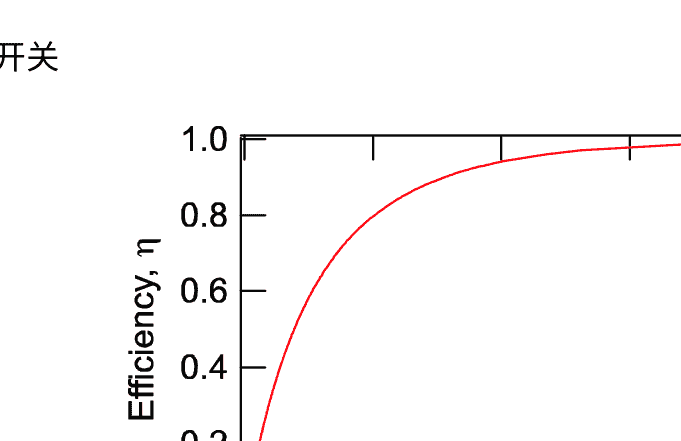

图4.13：能量提取效率作为泵浦功率的函数。

脉冲宽度归一化到腔衰减时间 τ_p 如图所示 4.14。

### 4.4.4 被动Q开关

在被动调Q的情况下，腔内损耗调制是通过饱和吸收体来进行的，对于低强度的光来说引入了大的损耗，而对于高强度的光来说引入了小的损耗。

弛豫振荡是由于激光介质中储存的能量和反转以及光场之间的周期性交换引起的。 没有饱和吸收体，这些振荡会被阻尼。 如果由于某种原因系统中增益过大，光场可以迅速积累。 特别是对于低增益截面，激光场对反转的反作用较弱，它可以进一步增长。 在光强度存在损耗饱和的情况下，这种增长是有利的。 激光器变得不稳定，光场强度增长直到增益在净损耗以下饱和，参见图4.15。

图4.15：被动调Q激光器的增益和损耗动态

现在，我们想要展示饱和吸收体导致弛豫振荡的不稳定性，从而产生巨脉冲激光。
我们通过图4.16中的饱和吸收体扩展我们的激光模型。

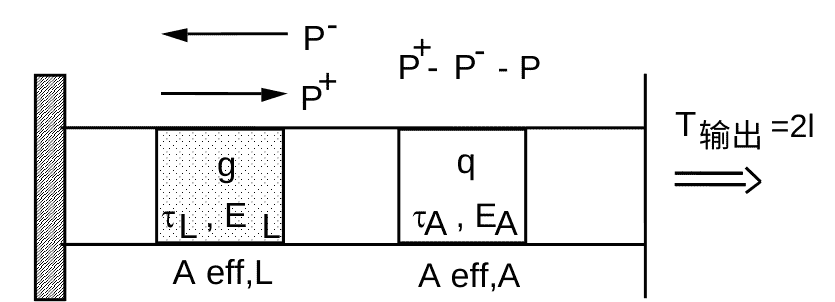

图4.16：由速率方程描述的简单激光模型。 我们假设输出耦合很小，因此可以认为一个往返内的激光功率与位置无关。 在腔体中忽略驻波效应，场密度与两倍循环功率 P⁺ 或 P⁻ 有关。

被动调Q激光器的速率方程

我们做出以下假设：首先，激光增益介质和饱和吸收体的横向弛豫时间比系统中任何其他动力学过程都要快得多，因此我们可以使用速率方程描述激光动力学。 其次，我们假设激光强度、增益和饱和吸收的变化在腔体中，时间尺度上很小，大约是往返时间 $T_R$ 的顺序，（即小于20%）。然后，我们可以使用激光的速率方程，如上所述，再加上饱和损耗的相应方程 $q$ 类似于增益方程。

$$
\begin{aligned}
T_R \frac{dP}{dt} &= 2(g - l - q)P &(4.49)\\
T_R \frac{dg}{dt} &= -\frac{g - g_0}{T_L} - \frac{g T_R P}{E_L} &(4.50)\\
T_R \frac{dq}{dt} &= -\frac{q - q_0}{T_A} - \frac{q T_R P}{E_A} &(4.51)
\end{aligned}
$$

其中 $P$ 表示激光功率，$g$ 表示每个往返的振幅增益，$l$ 表示每个往返的线性振幅损耗，$g_0$ 表示每个往返的小信号增益和 $q_0$ 表示每个往返的未饱和但可饱和损耗。量 $T_L = \tau_L/T_R$ 和 $T_A = \tau_A/T_R$ 是增益介质的归一化上态寿命和吸收体恢复时间，归一化到腔体的往返时间。能量 $E_L = h\nu A_{ef f,L}/2*\sigma_L$ 和 $E_A = h\nu A_{ef f,A}/2*\sigma_A$ 是增益和吸收体的饱和能量，分别是增益体和吸收体。

对于具有增益弛豫时间约为 $\tau_L \approx 100 \mu s$ 或更长的固体激光器，以及腔体往返时间 $T_R \approx 10 ns$，我们得到 $T_L \approx 10^4$。此外，我们假设吸收体的恢复时间远远短于腔体往返时间，即 $\tau_A \approx 1 - 100 ps$，因此通常这在半导体中是可实现的，并且可以通过半导体材料的低温生长来随意工程化$^{[20, 30]}$。只要激光器保持连续运行和单模式，吸收体将跟随瞬时激光功率。然后，通过使用方程 (4.51) 可以将饱和吸收进行绝热消除。

$$q = \frac{q_0}{1 + P/P_A} \quad \text{与} \quad P_A = \frac{E_A}{\tau_A}, \quad (4.52)$$

并将其代入方程 (4.49) 中。在这里，$P_A$ 是吸收体的饱和功率。在一定的饱和吸收量下，弛豫振荡变得不稳定，发生了Q开关。为了找到稳定性的判据，我们线性化系统

$$
\begin{aligned}
T_R \frac{dP}{dt} &= (g - l - q(P))P &(4.53)\\
T_R \frac{dg}{dt} &= -\frac{g - g_0}{T_L} - \frac{g T_R P}{E_L}. &(4.54)
\end{aligned}
$$

静态解

与连续运行激光器的情况一样，激光器的静态工作点由净增益为零的点确定

$$\frac{g_0}{1 + P_s/P_L} = l + \frac{q_0}{1 + P_s/P_A} \qquad (4.55)$$

这个方程的图形解如图4.17所示

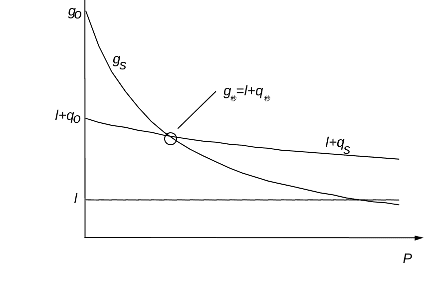

图4.17：静态工作点的图形解

稳定的静态工作点或Q-开关的条件

对于线性化系统，与方程（4.25）对应的系数矩阵只受到饱和吸收体的影响[23]:

$$T_R \frac{d}{dt} \begin{pmatrix} \Delta P_0 \\ \Delta g_0 \end{pmatrix} = A \begin{pmatrix} \Delta P_0 \\ \Delta g_0 \end{pmatrix} \quad ,\text{其中} \quad A = \begin{pmatrix} -2 \frac{dq}{dP}\big|_{P^{cw}} \frac{P_s}{E_L} & 2 \frac{P_s}{T_R} \\ - \frac{g_s T_R}{E_L} & - \frac{T_R}{\tau_{\text{刺激}}} \end{pmatrix} \qquad (4.56)$$

系数矩阵 A具有具有负实部的特征值，当且仅当其迹为负且行列式为正时，结果为两个条件

$$-2P \left. \frac{dq}{dP} \right|_{cw} < \frac{r}{T_L} \quad \text{其中} \quad r=1+\frac{P_A}{P_L} \quad \text{和} \quad P_L=\frac{E_L}{\tau_L}, \qquad \qquad \qquad \qquad \qquad \qquad \qquad \qquad \qquad \qquad (4.57)$$

和

$$\left. \frac{dq}{dP} \right|_{cw} \frac{r}{T_L} + 2g_s \frac{r-1}{T_L} > 0. \qquad \qquad \qquad \qquad \qquad \qquad \qquad \qquad \qquad \qquad \qquad \qquad \qquad \qquad \qquad \qquad \qquad \qquad \qquad \qquad (4.58)$$

取消 T_L 后，我们得到

$$\left| \left. \frac{dq}{dP} \right|_{cw} \right| < \left| \left. \frac{dg_s}{dP} \right|_{cw} \right|. \qquad \qquad \qquad \qquad \qquad \qquad \qquad \qquad \qquad \qquad \qquad \qquad \qquad \qquad \qquad \qquad \qquad \qquad \qquad \qquad (4.59)$$

对于自行开始振荡的激光器，关系式4.59自动满足，因为小信号增益大于总损耗，参见图4.17。不等式 (4.57) 有一个简单的物理解释。 (4.57) 的右侧是增益朝向平衡的弛豫时间，在给定泵浦功率和恒定激光功率下。左侧是激光功率固定时功率波动的衰减时间。如果增益不能对激光功率的波动快速反应，弛豫振荡会增长，并导致激光的被动Q开关。

从方程 (4.55) 和方程 (4.57) 可以看出，我们得到

$$-2T_L P \left. \frac{dq}{dP} \right|_{cw} = 2T_L q_0 \left. \frac{\frac{P}{\chi P_L}}{\left(1+\frac{P}{\chi P_L}\right)^2} \right|_{cw} < r_s \quad \text{with} \quad \chi = \frac{P_A}{P_L}, \qquad \qquad \qquad \qquad \qquad \qquad \qquad \qquad \qquad \qquad \qquad \qquad \qquad \qquad \qquad (4.60)$$

其中 \chi 是吸收体对连续波饱和的有效 “刚度”。 稳定性关系 (4.60) 在图4.18中可视化。

由于版权限制，图像已被删除。

> 请参阅：
Kaertner, Franz, 等. "通过半导体器件控制固态激光器动力学." 光学工程 34, 第7期 (1995年7月): 2024-2036.

图4.18：不同产品 $2q_0T_L$的连续波Q开关稳定性关系的图形表示。绘图所使用的连续波刚度为 $\chi=100$。

激光器进行Q开关的倾向随着产品 $q_0T_L$的增加而增加，并且如果饱和吸收体难以饱和，则减小，即 $\chi \gg 1$。从图4.18和方程（4.60）可以推断出，如果数量

$$MDF = \frac{2q_0T_L}{\chi} < 1 \qquad (4.61)$$

小于1。MDF的缩写代表模锁定驱动力，尽管表达式（4.61）控制着Q开关不稳定性。我们将在下一节中看到这个参数与模锁定的联系。对于具有长上能级寿命的固体激光器，即使是极小量的饱和吸收，即使是百分之一的比例，也可能导致足够大的模锁定驱动力将激光器驱动到Q开关。图4.19显示了在固定MDF下根据关系（4.60）可以发生Q开关的$\chi - P/P_L$-平面上的区域。对应的MDF值上方是Q开关区域。对于MDF <1，无法进行连续波Q开关。因此，如果需要设计连续波Q开关激光器，必须选择具有MDF >1的吸收体。操作点越靠近连续波Q开关区域，连续波Q开关现象就越明显。为了理解不稳定性的性质，我们观察线性化方程的特征解和特征值。

由于版权限制，图像已被删除。

> 请参阅：
Kaertner, Franz, 等. "通过半导体器件控制固态激光器动力学." 光学工程 34, 第7期 (1995年7月): 2024-2036.

> 图4.19: 对于给定的MDF值，cw-Q开关发生在相应曲线上方的区域。对于小于1的MDF值，无法进行cw-Q开关。

章节4.56

$$\frac{d}{dt} \left( \begin{array}{c} \Delta P_0(t) \\ \Delta g_0(t) \end{array} \right) = s \left( \begin{array}{c} \Delta P_0(t) \\ \Delta g_0(t) \end{array} \right) \qquad (4.62)$$

这导致了特征值

$$sT_R = \frac{A_{11} + A_{22}}{2} \pm j \sqrt{A_{11}A_{22} - A_{12}A_{21} - \left( \frac{A_{11} + A_{22}}{2} \right)^2}. \qquad (4.63)$$

根据方程(4.56)中的矩阵元素，我们得到

$$
\begin{aligned}
s &= \frac{-\frac{2}{T_R} \frac{dq}{dP}\bigg|_{cw} P_s - \frac{1}{\tau_{\text{刺激}}}}{2} \pm j\omega_Q \qquad (4.64) \\
\omega_Q &= \sqrt{-\frac{2}{T_R} \frac{dq}{dP}\bigg|_{cw} P_s \frac{r}{\tau_L} + \frac{r-1}{\tau_p \tau_L} - \left( \frac{-\frac{2}{T_R} \frac{dq}{dP}\bigg|_{cw} P_s - \frac{1}{\tau_{\text{刺激}}}}{2} \right)^2} \qquad (4.65)
\end{aligned}
$$

其中泵浦参数现在被定义为小信号增益与稳态总损耗之比，即 r = g_0/(l + q_s)。这个有点长的表达式清楚地显示了，当系统变得不稳定时，

$$-2\frac{dq}{dp}\bigg|_{cw} P_s > \frac{T_R}{\tau_{刺激}}, \text{当} \tau_L \gg \tau_p \text{时，振荡频率逐渐增加}$$

$$\omega_Q \approx \frac{r-1}{\tau_p \tau_L} \approx \frac{1}{\tau_p \tau_{stim}}. \quad\quad\quad\quad\quad (4.66)$$

也就是说，被动调Q可以被理解为激光器弛豫振荡的一种不稳定化。如果系统只是稍微处于不稳定状态，调Q振荡的频率接近弛豫振荡频率。如果我们将由可饱和吸收体引入的增长率 \gamma_Q 定义为一个参数，那么特征值可以写成

$$s = \frac{1}{2} \left( \gamma_Q - \frac{1}{\tau_{刺激}} \right) \pm j \sqrt{\gamma_Q \frac{r}{\tau_L} + \frac{r-1}{\tau_p \tau_L} - \left( \frac{\gamma_Q - \frac{1}{\tau_{刺激}}}{2} \right)^2}. \quad\quad (4.67)$$

图4.20显示了具有可饱和吸收体和无可饱和吸收体的系统的根轨迹图。可饱和吸收体不稳定化了弛豫振荡。这种分叉类型被称为霍普分叉，并导致振荡。

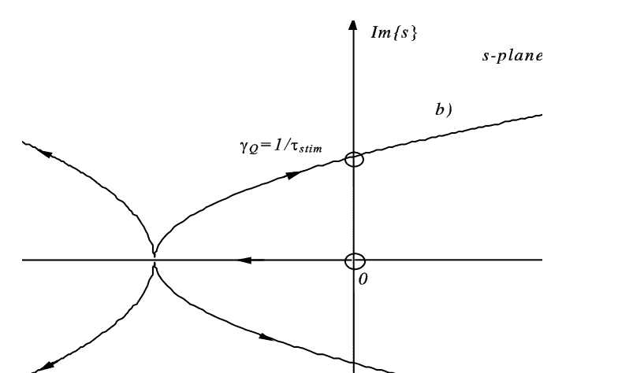

作为一个例子，我们考虑以下参数的激光器：$\tau_L = 250\mu s, T_R = 4ns, 2l_0 = 0.1, 2q_0 = 0.005, 2g_0 = 2, P_L/P_A = 100$。速率方程被数值求解，并在图4.21和4.22中显示。

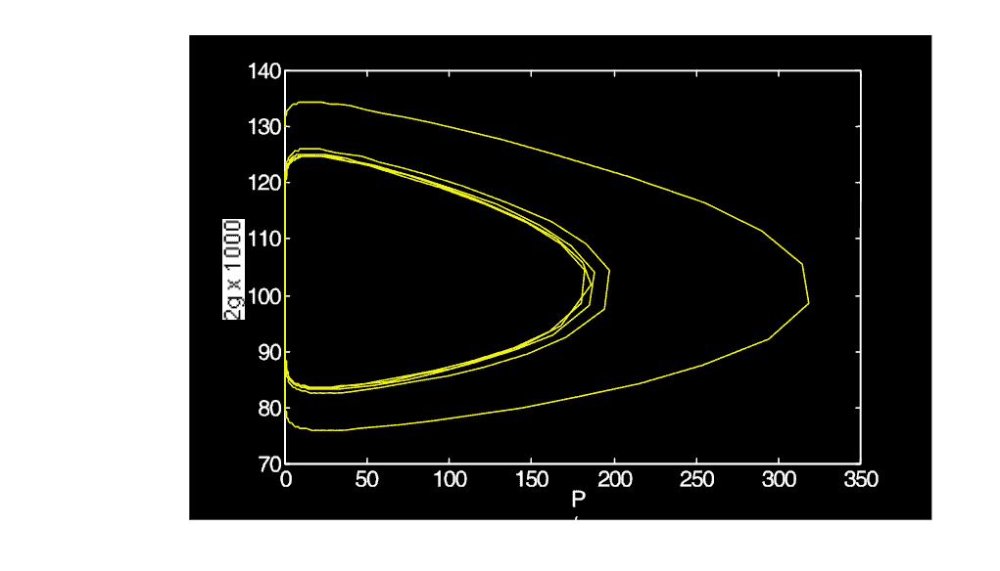

图4.21：速率方程的相空间图。需要几个振荡，直到达到稳态极限环。

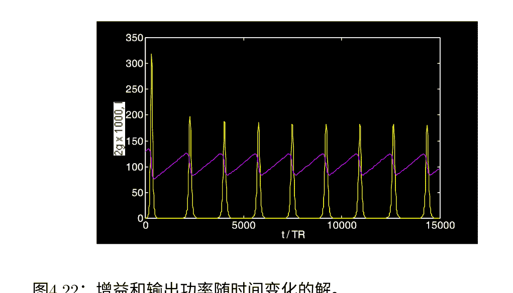

图4.22：增益和输出功率随时间变化的解。

## 4.5 例子：单模CW-Q开关微芯片激光器

Q开关微芯片激光器是紧凑且简单的固态激光器，可以提供具有衍射极限输出光束的高峰值功率。由于腔长极短，通常小于1毫米，可以实现脉宽远低于纳秒的单频Q开关操作。

使用Nd:YAG晶体与薄片Cr⁴⁺:YAG [8, 9]粘接的被动Q开关微芯片激光器展示了337皮秒和218皮秒的脉冲持续时间。使用半导体饱和吸收体被动Q开关了产生100纳秒脉冲的单片Nd:YAG激光器[38]。

### 4.5.1 被动调Q微片激光器的设置

图4.23(a)显示了被动调Q微片激光器的实验设置，图4.23(b)显示了半导体饱和吸收体的结构[12, 13]。饱和吸收体的结构被称为反共振法布里-珀罗饱和吸收体（A-FPSA），因为在微片激光器中，光束尺寸由二极管激光泵浦时在激光晶体中形成的热透镜决定。因此，可以使用A-FPSA的顶部反射镜来调节吸收体相对于腔内功率的有效饱和强度。200或220 μm厚的Nd:YVO₄或Nd:LaSc3(BO3)4（Nd:LSB）激光晶体[39]被夹在10%输出耦合镜和A-FPSA之间。后者在泵浦波长808 nm处具有高反射率，并在激光波长1.062 μm处具有预设计的反射率。激光晶体通过808 nm的半导体二极管激光器通过一个二色性分束器进行泵浦，该分束器透射泵浦光并反射1.064μm的输出光束用于Nd:YVO₄或1.062 μm的Nd:LSB激光。为了获得短的调Q脉冲，腔体必须尽可能短。高掺杂的激光晶体具有仅约为 100μm的短吸收长度，从而导致了短但仍然高效的微片激光器[13]。饱和吸收体由一个介质顶部镜和18对在GaAs/AlAs布拉格镜上生长的GaAs/InGaAs MQW组成。吸收体的总光学厚度约为1 μm。因此，腔体长度的增加是由于## 4.5. 例子：单模连续波调Q微片激光器

图4.23: (a) 连续波被动调Q微片激光器的实验装置。(b) 反共振法布里-珀罗半导体饱和吸收体的结构[37]。

图4.24：使用Nd:YVO₄ microchip激光器实现的单模Q开关脉冲。

吸收体可以忽略不计。更多细节请参见[12, 13]。使用Nd:LSB晶体已经实现了56皮秒的脉冲，见图(4.24)。

### 4.5.2 Q开关微片激光器的动力学

被动Q开关微片激光器如图4.23(a)所示，完全由速率方程(4.49)到(4.51)建模。为了理解连续波Q开关动力学对吸收体参数的基本依赖关系，我们对Nd:LSB微片激光器进行了数值模拟，如图4.23所示。使用的参数集在表4.2中给出。对于这些参数，根据公式(4.55)，我们得到了一个模式锁定驱动力 MDF = 685。一旦激光器超过阈值，该激光器明显在连续波Q开关工作区域内运行。注意，Q开关条件(4.61)在这里考虑的微片激光器上只有有限的有效性，因为腔长远小于吸收体恢复时间。

因此，吸收体动力学的绝热消除实际上不再合理。图4.25和4.26显示了在微秒和皮秒时间尺度上对一次脉冲发射事件附近的一组速率方程（4.49）到（4.51）的数值解。

目前尚未找到速率方程组的解析解。因此，Q开关激光器的优化已有很长的历史[4, 5]，一般而言，这导致了复杂的设计准则[5]，如果要得到速率方程的最一般解。

| 参数 | 值 |
| :--- | :--- |
| $2\,g_{0}$ | 0.7 |
| $2\,q_{0}$ | 0.03 |
| $2\,l$ | 0.14 |
| $T_{R}$ | 2.7 ps |
| $\tau_{L}$ | 87 $\mu$s |
| $\tau_{A}$ | 24 ps |
| $E_{L}$ | 20 $\mu$J |
| $E_{A}$ | 7.7 nJ |

表4.2：用于模拟Q开关微片激光器动力学的参数集。

图4.25：通过微秒时间尺度上的速率方程的数值解求解Q开关微片激光器的动力学。

图4.26：通过皮秒时间尺度上的速率方程的数值解求解Q开关微片激光器的动力学。

考虑到方程。然而，仔细观察模拟结果，我们可以得出一组非常简单的设计准则，如下所示。

从图4.25可以看出，脉冲重复时间 $T_{rep}$ 比Q开关脉冲的宽度长几个数量级。因此，在两个脉冲发射之间，由于泵浦作用，增益增加直到激光器达到阈值。这由方程(4.50)描述，其中可以忽略受激发射项。因此，脉冲重复频率由增益再次被泵浦到阈值的关系决定 $g_{th} = l + q_0$，如果在脉冲发射后饱和到值 $g_f$。在很好的近似情况下，

$g_f = l - q_0$，只要它是一个正数。如果 $T_{rep} < \tau_L$，我们可以线性化指数函数，得到

$$g_{th} - g_f = g_0 \frac{T_{rep}}{\tau_L} \qquad (4.68)$$

$$T_{rep} = \tau_L \frac{g_{th} - g_f}{g_0} = \tau_L \frac{2q_0}{g_0}. \qquad (4.69)$$

图4.26显示，功率增加，因为吸收体饱和比增益快。为了获得脉冲的快速上升，我们假设一个易于饱和的吸收体，即 $E_A \ll E_L$，以及增益和吸收的恢复时间应远远长于脉冲宽度 $\tau_{pulse}$， $\tau_A \gg \tau_{pulse}$。由于我们假设增益和吸收体都很慢，在脉冲的增长和衰减过程中可以忽略方程(4.50)和(4.51)中的驰豫项。然后，增益和损耗的方程可以表示为未知的调Q脉冲形状 $f_Q(t)$ 的函数。

$$P(t) = E_P f_Q(t)$$

可以解决。脉冲形状 $f_Q(t)$ 再次被归一化，使其在时间上的积分为一，因此脉冲能量为 $E_P$。类似于在方程(4.84)和(4.85)中推导出的Q开关锁模阈值，我们得到

$$q(t) = q_0 \exp\left[-\frac{E_P}{E_A} \int_{-\infty}^{t} f_Q(t') dt'\right],$$

$$g(t) = g_{th} \exp\left[-\frac{E_P}{E_L} \int_{-\infty}^{t} f_Q(t') dt'\right].$$

将这些表达式代入激光功率的方程(4.49)，并对脉冲宽度进行积分，可以确定提取的脉冲能量。结果是总损耗和增益之间的平衡。

$$l + q_P(E_P) = g_P(E_P)$$

用

$$q_P(E_P) = q_0 \frac{1 - \exp\left[-\frac{E_P}{E_A}\right]}{\frac{E_P}{E_A}},$$

$$g_P(E_P) = g_{th} \frac{1 - \exp\left[-\frac{E_P}{E_L}\right]}{\frac{E_P}{E_L}}.$$

因为我们假设吸收体完全饱和，所以我们可以将 $q_P(E_P) \approx 0$。图4.27显示了方程(4.73)的解，即脉冲能量与饱和和非饱和损耗之间的比值的函数关系 $s = q_0 / l$。同时，对于小和大的s值，近似解如虚线所示。因此，饱和和非饱和损耗之间的比值越大，腔内脉冲能量就越大，这是不令人惊讶。注意，提取的脉冲能量与输出耦合成正比，如果没有其他损耗，则为 2l。如果我们假设，s << 1，那么我们可以近似使用低能量近似

$$E_P = 2E_L \frac{q_0}{l+q_0}. \qquad (4.76)$$

然后，外部发射的脉冲能量由以下给出

$$E_P^{ex} = 2lE_P = E_L \frac{4lq_0}{l+q_0}. \qquad (4.77)$$

因此，总提取的脉冲能量在可饱和和不可饱和损耗中完全对称。对于给定的可饱和吸收量，提取的脉冲能量在尽可能大的输出耦合时达到最大。当然，仍然必须达到阈值，即 l + q0 < g0。因此，在接下来的内容中，我们假设 l > q0，如图4.26所示。激光器达到阈值后，吸收剂立即漂白。光场增长并提取储存在增益介质中的一些能量，直到增益饱和为低损耗值 l。然后，光场再次衰减，因为增益低于损耗。在衰减期间，只要可饱和损耗小于，光场可以饱和增益相似的程度。

在接下来的内容中，我们将假设恒定的输出耦合器损耗 l。然后，从图4.26(b)可以看出脉冲形状几乎对称，并且可以很好地近似为双曲正割平方，原因很快就会变得明显。因此，我们假设

$$f_Q(t) = \frac{1}{2\tau_P} \text{sech}^2\left(\frac{t}{\tau_p}\right).$$

通过将这个假设代入方程(4.49)并使用(4.71)、(4.72)，我们可以计算脉冲宽度。

- \frac{2T_R}{\tau_P} \tanh\left(\frac{t}{\tau_p}\right) = g_{th} \exp\left[ -\frac{E_P}{2E_L} \left(1 + \tanh\left(\frac{t}{\tau_p}\right)\right) \right] - l.

同样，我们忽略了饱和吸收。 如果我们将这个方程展开到 E_P/E_L的一阶，并比较系数，我们从常数项得到能量(4.77)，从tanh项得到脉冲宽度的以下简单表达式。

$$\tau_P = 2 \frac{T_R}{q_0}.$$

对于结果为sech^2-脉冲的FWHM脉冲宽度，我们得到

$$\tau_{P,FWHM} = 3.5 \frac{T_R}{q_0}.$$

因此，对于微片激光器的最佳运行，在考虑的极限条件下，我们得到一个非常简单的设计准则。 如果我们有一个最大的小信号往返增益 g_0，我们应该设计一个吸收体，其 q_0比 g_0/2稍小，并且一个输出耦合器，其 q_0< l < g_0 - q_0，以便激光器仍然满足连续波-Q开关条件。 正是这种简单的优化使我们能够从连续波-Q开关固体激光器中获得最短的脉冲。 注意，对于Nd:YVO4激光器，最大饱和吸收为2 q_0= 13%，腔内时间为 T_R= 2.6 ps，根据(4.81)我们预计脉冲宽度约为 τ_P= 70ps，这与上述实验中观察到的接近。 我们实现了56至90 ps之间的脉冲[13]。 典型的提取脉冲能量约为 E_P= 0.1-0.2 μJ，脉冲宽度约为60 ps[13]。 使用饱和能量

关于 $E_L=30 \mu J$ 和输出耦合器损耗 $2l= 0.1$，根据(4.77)，我们预计最大提取脉冲能量为 $E_{Pex}= 2 \mu J$。因此，我们有一个数量级的偏差，这清楚地表明吸收体仍然引入了太多的非饱和腔内损耗。降低这些损耗应该导致从这种非常简单和便宜的激光器中获得 $\mu J$ - 50 ps的脉冲，与任何其他脉冲生成技术相比。

## 4.6 Q开关模式锁定

为了理解Q开关模锁的工作模式，我们重新考虑了速率方程(4.49)到(4.51)。图4.28显示，我们可以在两个时间尺度上描述激光功率。一个是在Q开关包络的数量级上，并在激光腔内多次往返中发生， $T = mT_{R}$。因此，它的数量级是微秒。另一个时间尺度 $t$是脉冲宽度的数量级，即皮秒。假设归一化的脉冲形状 $f_n(t)$为第n个脉冲，使得

$$\int_{-T_R/2}^{T_R/2} f_n(t - nT_R)dt = 1, \qquad (4.82)$$

我们可以对激光功率做以下假设

$P(T, t) = E_P(T) \sum_{n=-\infty}^{\infty} f_n(t - nT_R). \tag{4.83}$

在这里，$E_P(T = mT_R)$是第m个脉冲的脉冲能量，在腔体中经过多次往返后才会明显变化。 第m个脉冲的形状$f_m(t)$，目前还没有进一步的兴趣。 为了简单起见，我们假设锁模脉冲的持续时间远远短于吸收体的恢复时间。 在这种情况下，在锁模脉冲的持续时间内，方程（4.52）中吸收体的驰豫项可以忽略不计。 由于吸收体的恢复时间被假设为远远短于腔体往返时间，所以在脉冲到达之前吸收体是未饱和的。 因此，对于吸收体在一个脉冲期间的饱和，我们得到

$q(T = mT_R, t) = q_0 \exp \left[ -\frac{E_P(T)}{E_A} \int_{-T_R/2}^{T_R/2} f_m(t')dt' \right]. \tag{4.84}$

然后，每个往返损失的脉冲能量可以写成

$q_P(T) = \int_{-T_R/2}^{T_R/2} f_m(t)q(T = mT_R, t)dt = q_0 \frac{1 - \exp \left[ -\frac{E_P(T)}{E_A} \right]}{\frac{E_P(T)}{E_A}}. \tag{4.85}$

方程 方程(4.85)表明饱和吸收体饱和的是脉冲能量，而不是激光的平均强度，就像cw-Q-开关(4.52)的情况一样。因此，在相同的平均功率下，吸收体的漂白效应要强得多。 在一个往返周期内对方程(4.49)和(4.50)进行平均后，我们得到了以下两个方程，描述了脉冲能量和增益在粗粒度时间尺度 $T$上的动态:

$T_R \frac{dE_P}{dT} = 2(g - l - q_P(E_P))E_P, \tag{4.86}$

$T_R \frac{dg}{dT} = -\frac{g - g_0}{T_L} - \frac{g E_P}{E_L}. \tag{4.87}$

这种平均是允许的，因为在一个脉冲内增益介质的饱和是可以忽略的，这是由于固体激光材料的小交互截面。将方程(4.49)、(4.50)和(4.52)与(4.84)、(4.86)和(4.87)进行比较，很明显稳定性准则(4.53)也适用于Q开关模式锁定，只需将吸收剂的连续饱和公式(4.52)替换为脉冲饱和公式(4.85)。然后，稳定性对抗Q开关模式锁定要求

$$-2E_P \left. \frac{dq_P}{dE_P} \right|_{cw-mod} < \left. \frac{r}{T_L} \right|_{cw-mod}, \tag{4.88}$$

用

$$-2E_P \left. \frac{dq_P}{dE_P} \right|_{cw-mod} = 2q_0 \frac{1 - \exp\left[-\frac{E_P}{E_A}\right] \left(1 + \frac{E_P}{E_A}\right)}{\frac{E_P}{E_A}}. \tag{4.89}$$

当以平均功率 $P = E_P/T_R$来表示时，类似于Eq.(4.60)，我们得到

$$-2T_L E_P \left. \frac{dq_P}{dE_P} \right|_{cw-mod} = 2T_L q_0 \frac{1 - \exp\left[-\frac{P}{\chi_P P_L}\right] \left(1 + \frac{P}{\chi_P P_L}\right)}{\frac{P}{\chi_P P_L}}, \tag{4.90}$$

其中 $\chi_P = \chi T_A$描述了吸收体在与连续波激光器以相同的平均功率连续工作时与增益相比的有效刚度。因此，类似于连续波Q开关和模锁的情况，引入Q开关模锁的驱动力是有用的

$$QMDF = \frac{2q_0 T_L}{\chi_P}. \tag{4.91}$$

图4.29显示了不同吸收体强度的关系式(4.88)。从图4.18到图4.29，我们使用 $T_A = 0.1$。我们可以看到，当从图4.18到图4.29时，短的归一化恢复时间实际上导致了横坐标的缩放，同时保持所有其他参数不变。将方程(4.61)与(4.91)进行比较，可以得出，在连续波模锁的情况下，吸收体的饱和程度更强，饱和因子为

$1/T_A$，这个数值可以很容易达到1000。因此，Q开关模式锁定的驱动力要比模式锁定的驱动力大得多，MDF。因此，Q开关模式锁定的倾向性明显高于cw Q开关。然而，现在，平均功率远低于吸收体的损伤阈值，因此可以很容易地使吸收体饱和（图4.29）。因此，可以在足够大的腔内功率下离开Q开关模式锁定的状态。

由于版权限制，图像已被删除。

> > 请参阅：
> Kaertner, Franz, 等. "通过半导体器件控制固态激光器动力学." 光学工程 34, 第7期 (1995年7月): 2024-2036.

## 图4.29: 对于不同产品的Q开关模式锁定的稳定关系的可视化 2q0TL。脉冲操作的假设刚度为 χP=10，对应于 TA=0.1。cw Q开关和Q开关模式锁定的关系的函数形式非常相似。

当从连续波到脉冲饱和时，刚度的变化从根本上重新调整了x轴。对于低温生长的吸收体， TA可以小到 10−6

由于版权限制，图像已被删除。

> > 请参阅：
> Kaertner, Franz, 等. "通过半导体器件控制固态激光器动力学." 光学工程 34, 第7期 (1995年7月): 2024-2036.

## 图4.30: 自启动模式锁定和对Q开关模式锁定的稳定性

## 4.7. 总结

我们总结了Q开关模式锁定的结果，如图4.30所示。它显示了根据饱和吸收体的不同强度（即不同值）的Q开关模式锁定的稳定边界，即等式(4.88)。我们还可以根据激光器中的各种过程推导出自启动模式锁定的最小临界驱动力 MDF_c[24][25][27][28]。或者，根据脉冲刚度的定义，我们可以得到

$$\chi_{p,c} \leq \frac{2q_0T_L}{MDF_c} T_A \quad (4.92)$$

因此，对于一个自启动的纯连续波模锁激光器，我们必须设计吸收体，使其MDF大于这个临界值。或者换句话说，脉冲刚度必须小于临界值 \(\chi_{p,c}\)，在吸收体强度 q_0的固定值下。总是存在一个权衡：一方面，模锁驱动力必须足够大以实现自启动。另一方面，饱和吸收必须足够小，以使激光器能够在参数范围内稳定地抵抗Q开关模锁，参见图(4.30)。

## 4.7 总结

从一个简单的两能级激光器和吸收体模型出发，我们对由饱和吸收体模锁和Q开关的固态激光器的动力学进行了表征。固态激光材料的独特性质，即它们的长上能级寿命和受激发射的小截面，使得激光动力学在至少两个时间尺度上分离。

其中一个过程是能量的积累和衰减，通常发生在激光的上态寿命或腔衰减时间的时间尺度上。另一个过程是脉冲整形，通常在腔内几个往返中发生。通过分离这些过程，我们可以区分不同的激光动力学，包括连续波Q开关，Q开关模锁和连续波模锁。我们找到了不同状态的稳定边界，这为给定固体激光器的吸收体设计提供了指导，以支持其中一种状态。半导体吸收体是模锁激光器的良好选择，因为载流子寿命可以通过低温生长来调控[20]。当脉冲变得足够短时，激光脉冲会更有效地饱和吸收体，从而稳定激光，防止意外的Q开关模锁。它已经在实验中证明，这种技术可以控制各种固态激光器的激光动力学，例如Nd:YAG，Nd:YLF，Nd:YVO4，[18]在皮秒范围内。

通过半导体器件和由负GVD和SPM引起的孤子形成，我们可以使用类似的半导体吸收剂来模拟飞秒激光器的锁模[35]。这里推导出的稳定性准则可以适用于皮秒和飞秒激光器。然而，当从皮秒脉冲转变为飞秒脉冲时，吸收剂动力学的特性可能发生 dramatical 变化[36]。特别是，饱和能量可能不仅取决于激发波长，还取决于脉冲宽度。此外，脉冲可能存在额外的损耗机制，例如由于孤子形成而导致的脉冲的额外滤波损耗，这通过面积定理与脉冲的能量耦合。在将理论应用于飞秒激光系统之前，必须考虑到这一点，这将在后面更详细地讨论。

# 第5章

## 主动模锁

为了简化起见，我们假设激光器在横向基本模式下运行，因此我们只需要处理激光器的纵向模式，类似于简单的平行法布里-珀罗共振腔（图5.1）。我们只考虑场的一个偏振，然而，正如我们将在后面所说的，对于一些锁模激光器，偏振动力学将变得重要。

锁模的任务是以相位同步的方式使尽可能多的纵向模式激光，以便所有模式的叠加表示一个空间范围远远小于腔体的脉冲。

然后，脉冲将以与脉冲的中心频率相对应的群速度传播。

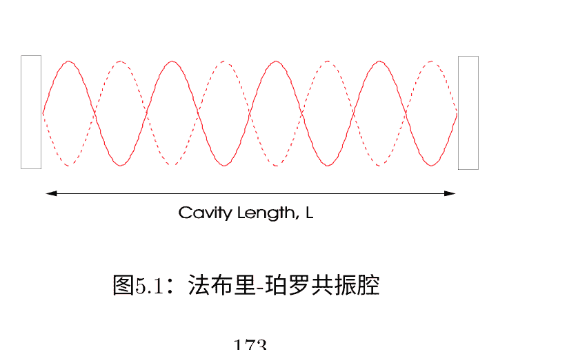

## 5.1 模式锁定的主方程

暂时考虑冷腔（即腔内只有简单的线性介质，没有激光）。腔内场的最一般解是左行波和右行波的叠加。

```
E^{(左)}(z,t) = Re \left\{ \sum_{n=0}^{\infty} \hat{E}_n e^{j(\Omega_n t + K_n z)} \right\}
```

和

```
E^{(右)}(z,t) = Re \left\{ \sum_{n=0}^{\infty} \hat{E}_n e^{j(\Omega_n t - K_n z)} \right\}
```

波数的可能值为 K = nπ/L，这是由于金属镜或腔内一次往返后的周期性边界条件导致的。如果镜子完全反射，左行波和右行波的方程（5.1）和（5.2）包含相同的信息，只需要处理其中一个即可。通常，腔内的一个镜子不完全反射以耦合出光，然而，这可以被视为理想模式结构的微扰。

我们将方程（5.2）中的模式视为连续体，并用积分代替求和

```
E^{(右)}(z,t) = \frac{1}{2\pi} Re \left\{ \int_{K=0}^{\infty} \hat{E}(K) e^{j(\Omega(K) - K z)} dK \right\}
```

用

```
\hat{E}(K_m) = \hat{E}_m 2L.
```

类似于第2章讨论的脉冲传播，并描述了谐振腔中的脉冲传播。然而，在这里，它更像是一个初始值问题，而不是边界值问题。请注意，模式的波数是固定的，而不是频率。为了更加强调这一点，我们引入一个新的时间变量 T = t 和一个局部时间框架 t' = t - z/v_{g,0}，而不是传播距离 z，其中 v_{g,0}是中心波数 K_n处的群速度

```
v_{g,0} = \left. \frac{\partial \omega}{\partial k} \right|_{k=0} = \left( \left. \frac{\partial k}{\partial \omega} \right|_{\omega=0} \right)^{-1}
```

脉冲的时间演化由以下决定

为了引入一个缓变的包络，我们将频率和波数移动到中心频率 $\omega_0 = \Omega_{n_0}$ 和中心波数 $k_0 = K_{n_0}$

```
$$
\begin{aligned}
k &= K - K_{n_0}, & (5.6) \\
\omega(k) &= \Omega(K_{n_0} + k) - \Omega_{n_0}, & (5.7) \\
\hat{E}(k) &= \hat{E}(K_{n_0} + k), & (5.8)
\end{aligned}
$$
```

脉冲的时间演化由以下决定

```
$$ E^{(\text{右})}(z, t) = \frac{1}{2\pi} Re \left\{ \int_{-\infty}^{\infty} \hat{E}(k) e^{j(\omega(k)t - kz)} dk \right\} e^{j(\omega_0 t - k_0 z)}. \qquad (5.9) $$
```

类似于第2章，我们定义一个缓变的场包络，已经归一化为光束中的总功率流

```
$$ A(z, t) = \sqrt{\frac{A_{eff}}{2Z_0}} \frac{1}{2\pi} \int_{-\infty}^{\infty} \hat{E}(k) e^{j(\omega(k)t - kz)} dk. \qquad (5.10) $$
```

在迟滞时间 $t'$ 和时间 $T$ 的情况下，我们得到类似于方程(2.184)的结果。

```
$$ A(T, t') = \sqrt{\frac{A_{eff}}{2Z_0}} \frac{1}{2\pi} \int_{-\infty}^{\infty} \hat{E}(k) e^{j((\omega(k)-v_{g,0}k)T + k v_{g,0} t')} dk. \qquad (5.11) $$
```

可以写成

```
$$ \left. T_R \frac{\partial A(T, t')}{\partial T} \right|_{(GDD)} = j \sum_{n=2}^{\infty} D_n \left( -j \frac{\partial}{\partial t'} \right)^n A(T, t'), \qquad (5.12) $$
```

具有每个谐振器往返的色散系数 $T_R = \frac{2L}{v_{g,0}}$

```
$$ D_n = \left. \frac{2L}{n! v_{g,0}^{n+1}} \frac{\partial^{n-1} v_g(k)}{\partial k^{n-1}} \right|_{k=0}. \qquad (5.13) $$
```

色散系数 (5.13) 看起来有些可疑，然而，很容易证明它们等价于谐振器中心频率处的往返相位 $\phi_R(\Omega) = \frac{\Omega}{c} n(\Omega) 2L$ 的导数

```
$$ D_n = -\left. \frac{1}{n!} \frac{\partial^n \phi_R^{(n)}(\Omega)}{\partial \Omega^n} \right|_{\Omega=\omega_0}, \qquad (5.14) $$
```

到目前为止，只处理了无损耗的谐振器。通过添加类似的项可以对增益和损耗进行建模

```
$$T_R \left.\frac{\partial A(T, t')}{\partial T}\right|_{(\text{损耗})} = -l A(T, t') \tag{5.15}$$
```

其中 l 是每个往返的振幅损失。类似地，我们可以写出增益的表达式

```
$$T_R \left.\frac{\partial A(T, t')}{\partial T}\right|_{(\text{增益})} = \left(g(T) + D_g \frac{\partial^2}{\partial t'^2}\right) A(T, t'), \tag{5.16}$$
```

其中 g(T) 是增益，$D_g$ 是增益在洛伦兹线型最大值处的曲率。

```
$$D_g = \frac{g(T)}{\Omega^2_{\text{增益}}} \tag{5.17}$$
```

$D_g$ 是增益色散。g(T) 是平均增益，可以从谐振腔中每个单元的速率方程计算得到。分布式增益满足以下方程

```
$$\frac{\partial g(z, t)}{\partial t} = -\frac{g_{\text{增益}} - g^0_{\text{增益}}}{\tau_L} - \frac{g_{\text{增益}} |A(z, t)|^2}{E_L}, \tag{5.18}$$
```

其中 $E_L$ 是饱和能量 $E_L = \frac{h\nu_L}{2\sigma_L A_{eff}}$, $\tau_L$ 是上能级寿命，$\sigma_L$ 是增益截面。对于典型的固体激光器，腔内脉冲能量远小于饱和能量。因此，一个往返内增益的变化很小。此外，我们假设增益在空间上是均匀饱和的，$g(z, t') = g(t')$。然后，通过对 (5.18) 在一个往返内进行平均，我们可以得到平均增益 g(T) 的方程。

```
$$\frac{\partial g(T)}{\partial T} = -\frac{g - g_0}{\tau_L} - g \frac{W(T)}{E_L T_R}, \tag{5.19}$$
```

其中 W(T) 是时间 t = T 时的腔内脉冲能量

```
$$W(T) = \int_{t'=-T_R/2}^{T_R/2} |A(T, t')|^2 dt' \approx \int_{-\infty}^{\infty} |A(T, t')|^2 dt'. \tag{5.20}$$
```

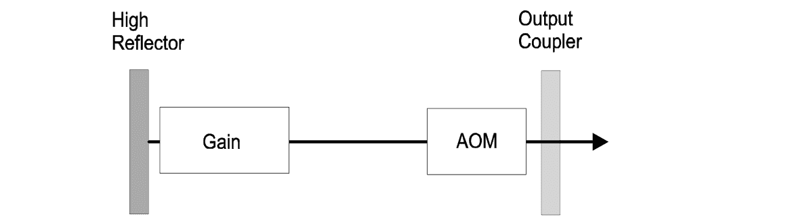

图5.2：带有幅度调制器（声光调制器）的主动模锁激光器。

考虑到所有影响，包括线性影响：损耗、色散、增益和增益色散，以及饱和吸收和自相位调制等非线性影响，我们得到了模锁的主方程。

```
$$ T_{R} \frac{\partial A(T, t')}{\partial T} = -l A(T, t') + j \sum_{n=2}^{\infty} D_n \left(j \frac{\partial^n}{\partial t^n}\right) A(T, t') + g(T) \left(1 + \frac{1}{\Omega_g^2} \frac{\partial^2}{\partial t'^2}\right) A(T, t') - q(T, t') A(T, t') - j\delta |A(T, t')|^2 A(T, t'). \quad (5.21) $$
```

为了保持符号简单，我们再次用 \( t' \) 替换 \( t \) 。这个方程最初是在Haus [4]的假设下推导出来的，假设每个往返和每个元素的变化都很小。

## 5.2 通过损耗调制进行主动模式锁定

主动模式锁定最早是在1970年由Kuizenga和Siegman使用高斯脉冲分析进行研究的，我们希望将其委托给练习[3]。后来在1975年，Haus [4]引入了主方程方法(5.21)。我们遵循Haus的方法，因为它还显示了解的稳定性。

我们在腔体中引入一个损耗调制器，例如声光调制器，根据周期性地改变腔内损耗。

## 参考文献

- [1] R. W. Hellwarth, 编辑, 量子电子学进展, 哥伦比亚出版社, 纽约 (1961年).
- [2] A. E. Siegman, “激光”, 大学科学出版社, 加利福尼亚州米尔谷 (1986年).
- [3] O. Svelto, “激光原理”, 普伦姆出版社, 纽约 (1998年).
- [4] W. G. Wagner and B. A. Lengyel, “激光中巨脉冲的演化”, 应用光学杂志 34, 2040−2046 (1963年).
- [5] J. J. Degnan, “最佳耦合调Q激光理论”, IEEE量子电子学杂志 QE-25, 214−220 (1989年). 和 “被动调Q激光的优化”, IEEE量子电子学杂志 QE-31, 1890−1901 (1995年).
- [6] J. J. Zayhowski, C. Dill, Optics Lett. 17, 1201 (1992).
- [7] S. H. Plaessmann, K. S. Yamada, C. E. Rich, W. M. Grossman, Applied Optics 32, 6618 (1993).
- [8] J. J. Zayhowski, C. Dill, ”Diode-pumped passively Q-switched picosecond microchip lasers,” Opt. Lett. 19, pp. 1427−1429 (1994).
- [9] J. J. Zayhowski, J. Ochoa, C. Dill, ”UV generation with passively Q-switched picosecond microchip lasers,” Conference on Lasers and Electro Optics, (Baltimore, USA) 1995, paper CTuM2 p. 139.
- [10] P. Wang, S.-H. Zhou, K. K. Lee, Y. C. Chen, “固态自Q开关激光器中的皮秒激光脉冲生成”, 光学通信, 第114卷, 第439-441页 (1995年).
- [11] J. J. Zayhowski, “空间孔燃烧对驻波激光腔单模操作的限制”， 光学快报， 第15卷， 第431-433页（1990年）。
- [12] B. Braun, F. X. Kärtner, U. Keller, J.-P. Meyn and G. Huber, “被动Q开关的180皮秒Nd:LaSc3(BO3)4微片激光器”， 光学快报， 第21卷， 第405-407页（1996年）。
- [13] B. Braun, F. X. Kärtner, G. Zhang, M. Moser and U. Keller, “56皮秒被动Q开关二极管泵浦微片激光器”， 光学快报， 第22卷， 第381-383页， 1997年。
- [14] O. Forster, "分析Ⅰ，一变量的微积分与积分", Vieweg, Braunschweig (1983).
- [15] E. P. Ippen, "被动模锁的原理", Appl. Phys.B 58, pp. 159–170 (1994).
- [16] A. Penzkofer, "纳秒到飞秒脉冲的被动Q开关和模锁", Appl. Phys.B 46, pp. 43–60 (1988).
- [17] U. Keller, D. A. B. Miller, G. D. Boyd, T. H. Chiu, J. F. Ferguson, M. T. Asom, "用于Nd:YLF激光器的固态低损耗腔内饱和吸收体：一种反共振半导体法布里-珀罗饱和吸收体", Opt. Lett. 17, pp. 505–507 (1992).
- [18] U. Keller, “超快全固态激光技术”， 应用物理B 58, 347-363页（1994年）。
- [19] J. P. Meyn, “钕-镧-钪-硼：一种用于微型固体激光器的新材料”， 博士论文， 汉堡大学。
- [20] G. L. Witt, R. Calawa, U. Mishra, E. Weber, 编辑, “低温（LT）Ga As及相关材料”, 241页， 匹兹堡, （1992年）。
- [21] H. Haken, “协同学动力学导论”, Springer Verlag, 柏林（1983年）。
- [22] A. Yariv, “量子电子学”, Wiley Interscience（1975年）。
- [23] H. A. Haus, “连续波被动锁模的参数范围”, IEEE J. Quantum Electron., QE-12, pp. 169 – 176 (1976年).
- [24] E. P. Ippen, L. Y. Liu, H. A. Haus, “自启动条件对于加性脉冲锁模激光器的影响,” 光学快报 15, pp. 183 – 18 (1990).
- [25] F. Krausz, T. Brabec, C. Spielmann, “自启动被动锁模激光器,” 光学快报 16, pp. 235 – 237 (1991).
- [26] H. A. Haus, E. P. Ippen, “自启动被动锁模激光器,” 光学快报 16, pp . 1331 – 1333 (1991).
- [27] J. Herrmann, “被动耦合腔或Kerr镜头锁模固态激光器的启动动态, 自启动条件和锁模阈值,” 光学通信 98, pp. 111 – 116 (1993).
- [28] C. J. Chen, P. K. A. Wai和C. R. Menyuk, “具有快速饱和吸收体的被动自启动锁模激光器”, Opt. Lett. 20, pp. 350– 352 (1995年).
- [29] R. W. Boyd, “非线性光学”, Academic Press, 纽约 (1992年).
- [30] L. R. Brovelli, U. Keller, T. H. Chiu, “用于锁模固态激光器的抗谐振法布里-珀罗饱和半导体吸收体的设计和操作”, J. Opt. Soc. of Am. B 12, pp. 311 – 322 (1995年).
- [31] K. Smith, E. J. Greer, R. Wyatt, P. Wheatley, N. J. Doran, “由激光二极管泵浦的全集成铒光纤孤子激光器”, Electr.Lett. 27, pp. 244 – 245 (1990年).
- [32] U. Keller, T. K. Woodward, D. L. Sivco, A. Y. Cho, “耦合腔共振被动锁模Nd:YLF激光器”, Opt. Lett. 16 pp. 390 – 392 (1991).
- [33] U. Keller, T. H. Chiu, “共振被动锁模Nd:YLF激光器”, IEEE J. Quantum Electron. QE-28, pp. 1710 – 1721 (1992).
- [34] G. P. Agrawal, N. A. Olsson, “半导体激光放大器中光脉冲的自相位调制和光谱展宽”, IEEE J. Quantum Electron. 25, pp. 2297 - 2306 (1989).
- [35] D. Kopf, K. J. Weingarten, L. Brovelli, M. Kamp, U. Keller, “使用A-F PSA的二极管泵浦100飞秒被动锁模Cr:LiSAF”, Opt. Lett. 19, pp. (1994).
- [36] W. H. Knox, D. S. Chemla G. Livescu, J. E. Cunningham, and J. E. Henry, "Femtosecond Carrier Thermalization in Dense Fermi Seas," Phys. Rev. Lett. 61, 1290 – 1293 (1988).
- [37] B. Braun, U. Keller, "Single frequency Q-switched ring laser with an antiresonant Fabry-Perot saturable absorber," Opt. Lett. 20, pp. 1020 – 1022 (1995).
- [38] S. A. Kutovoi, V. V. Laptev, S. Y. Matsnev, "Lanthanum scandoborate as a new highly efficient active medium of solid state lasers," Sov. J. Quantum Electr. 21, pp. 131 – 132 (1991).
- [39] B. Beier, J.-P. Meyn, R. Knappe, K.-J. Boller, G. Huber, R. Wallenstein, Appl. Phys. B 58, 381 – (1994).

由于版权限制，图像已被删除。

请参阅：
Keller, U., 超快激光物理, 瑞士联邦理工学院, ETH Hönggerberg—HPT, CH-8093 Zurich, Switzerland.

图5.3：主方程的示意图，用于主动锁模激光器。

调制频率必须非常精确地调节到谐振腔的往返时间，ωM = 2π/TR，参见图5.2。然后，锁模过程由主方程描述。

$$T_R \frac{\partial A}{\partial T} = \left[ g(T) + D_g \frac{\partial^2}{\partial t^2} - l - M \left( 1 - \cos(\omega_M t) \right) \right] A. \quad (5.22)$$

忽略GDD和SPM。该方程可以解释为由增益、损耗和调制器引起的总脉冲整形，参见图5.3。

如果我们将方程（5.22）中的增益固定为其稳定值，无论它是什么，方程（5.22）都是一个线性偏微分方程，可以通过变量分离法求解。我们预计脉冲的宽度远小于往返时间 TR。它们将位于损耗调制的最小值处，其中余弦函数可以近似为抛物线，我们得到

$$T_R \frac{\partial A}{\partial T} = \left[ g - l + D_g \frac{\partial^2}{\partial t^2} - M_s t^2 \right] A. \quad (5.23)$$

Ms是调制强度，对应于损耗调制在时间域中的曲率在最小损耗点处

$$D_g = \frac{g}{\Omega^2_{\text{增益}}}, \quad (5.24)$$
$$M_s = \frac{M \omega_M^2}{2}. \quad (5.25)$$

## 5.2. 通过损耗调制进行主动模锁

方程（5.23）右侧的微分算符对应于谐振子问题的薛定谔算符。因此，该算符的本征函数是厄米-高斯函数

$$A_n(T, t) = A_n(t)e^{\lambda_n T/T_R}, \qquad\qquad (5.26)$$
$$A_n(t) = \frac{W_n}{2^n\sqrt{n!}\tau_a} H_n(t/\tau_a)e^{-\frac{t^2}{2\tau_a^2}}, \qquad\qquad (5.27)$$

其中 $\tau_a$定义了高斯函数的宽度。宽度由增益色散和调制器强度之比的四次方根给出

$$\tau_a = \sqrt[4]{D_g/M_s}. \qquad\qquad (5.28)$$

注意，从方程（5.26）我们可以得出，每个本征模式的每个往返增益由 $\lambda_n$（或一般来说是 $\lambda_n$的实部）给出，它们由以下给出

$$\lambda_n = g_n - l - 2M_s\tau_a^2(n+\frac{1}{2}). \qquad\qquad (5.29)$$

每个本征解的相应饱和增益为

$$g_n = \frac{1}{1+\frac{W_n}{P_L T_R}}, \qquad\qquad (5.30)$$

其中 $W_n$是相应解的能量，$P_L = E_L/\tau_L$增益的饱和功率。方程（5.29）表明，对于给定的 $g$，本征解中的 $n=0$，即基模，具有每个往返中最大的增益。

因此，如果最初存在一个由所有本征解叠加而成的场分布，基模将增长最快，并将增益饱和到一个值

$$g_s = l + M_s\tau_a^2. \qquad\qquad (5.31)$$

使得 $\lambda_0= 0$，因此所有其他模式将衰减，因为对于 $n \ge 1$，$\lambda_n < 0$。这也证明了基模解的稳定性[4]。因此，在谐振腔往返时间和调制器周期之间没有失调的情况下，主动锁模会导致具有FWHM脉冲宽度的高斯稳态脉冲。

$$\Delta t_{FWHM} = 2\ln 2\tau_a = 1.66\tau_a. \qquad\qquad (5.32)$$

高斯脉冲的频谱由以下给出

$$\tilde{A}_0(\omega) = \int_{-\infty}^{\infty} A_0(t) e^{i\omega t} dt \tag{5.33}$$
$$= \sqrt{\sqrt{\pi} W_n \tau_a} e^{-\frac{(\omega \tau_a)^2}{2}}, \tag{5.34}$$

其全宽半最大值为

$$\Delta f_{FWHM} = \frac{1.66}{2\pi \tau_a}. \tag{5.35}$$

因此，高斯脉冲的时间带宽乘积为

$$\Delta t_{FWHM} \cdot \Delta f_{FWHM} = 0.44. \tag{5.36}$$

模锁激光器的稳态脉冲形状是由时间域中的抛物线损耗调制（脉冲缩短）和频率域中的抛物线滤波（脉冲拉伸）共同作用形成的，参见图5.4和5.5。当这两种效应平衡时，稳态脉冲被实现。由于外部调制仅限于电子速度和脉冲宽度仅与增益带宽的倒数平方根成比例主动模锁通常只能得到在10-100皮秒范围内的脉冲宽度。

图5.5：(b) 有限的增益带宽使每个往返中的脉冲变宽。对于一定的脉冲宽度，这两个过程之间存在平衡。

例如：Nd:YAG; $2l = 2g = 10\%$, $\Omega_g = \pi \Delta f_{FWHM} = 0.65$ THz, $M = 0.2$, $f_m = 100$ MHz, $D_g = 0.24$ ps$^2$, $M_s = 4 \cdot 10^{16}$ s$^{-1}$, $\tau_p \approx 99$ ps。根据脉冲宽度(5.28)，方程(5.31)可以有多种重写方式 $g_s = l + M_s \tau_a^2 = l + \frac{D_g}{\tau_a^2} = l + \frac{1}{2} M_s \tau_a^2 + \frac{1}{2} \frac{D_g}{\tau_a^2}$, (5.37)

这意味着在稳态下，饱和增益高于损耗水平l，因此激光器中的许多模式都保持在阈值以上。需要额外的增益来克服调制器由于脉冲的有限时间宽度和脉冲的有限带宽而引起的损耗。通常

$$\frac{g_s - l}{l} = \frac{M_s \tau_a^2}{l} \ll 1, \tag{5.38}$$

因为脉冲比往返时间短得多，因此可以从中计算出稳态脉冲能量

$$g_s = \frac{1}{1 + \frac{W_s}{P_L T_R}} = l. \tag{5.39}$$

模锁的名称源于对这个脉冲形成过程在频域中的研究。注意，术语

$$-M[1-\cos(\omega_M t)] A$$

根据每个腔模存在，确实会产生边带

$$\begin{aligned}
-M[1-\cos(\omega_M t)] \exp(j\omega_{n0}t) &= -M\left[ \exp(j\omega_{n0}t) - \frac{1}{2}\exp(j(\omega_{n0}t-\omega_M t)) - \frac{1}{2}\exp(j(\omega_{n0}t+\omega_M t)) \right] \\
&= M\left[ -\exp(j\omega_{n0}t) + \frac{1}{2}\exp(j\omega_{n0-1}t) + \frac{1}{2}\exp(j\omega_{n0+1}t) \right]
\end{aligned}$$

如果调制频率与腔回波频率相同，则每个运行模式产生的边带被注入到相邻模式中，导致相邻模式的同步和锁定，即模锁，参见图5.6。

## 5.3 通过相位调制进行主动模锁定

相位调制器也可以产生侧带，而不是幅度调制器。然而，产生的侧带与载波不同相，导致脉冲的啁啾。

## 5.4. 通过附加自相位调制进行主动模锁

这导致了稳态脉冲上的啁啾。我们可以再次使用主方程来研究这种模锁类型。唯一改变的是调制变为虚数，即在方程（5.22）中将M替换为jM。

$$T_R\frac{\partial A}{\partial T} = \left[ g(T) + D_g\frac{\partial^2}{\partial t^2} - l - jM (1 - \cos(\omega_M t)) \right] A. \qquad (5.40)$$

虚数单位可以在计算的大部分过程中被提取出来，我们得到相同的厄米高斯特征解（5.26,5.27），然而，参数τₐ变为τ'ₐ，并且现在是复数，不再是脉冲宽度。

$$\tau'_a = \sqrt[4]{-j} \sqrt[4]{D_g / M_s}. \qquad (5.41)$$

地面模式或稳态解为

$$A_0(t) = \frac{W_s}{2^n \sqrt{\pi n!} \tau'_a} e^{-\frac{t^2}{2\tau_a^2} \frac{1}{\sqrt{2}}(1+j)}, \qquad (5.42)$$

其中 $\tau_a = \sqrt{D_g/M_s}$与之前一样。我们最终得到了啁啾脉冲。脉冲缩短的实际原理是什么，因为调制器只是给脉冲加了一个啁啾，实际上并没有缩短它？可以很容易地证明，如果一个带有啁啾参数β的高斯脉冲

$$A_0(t) \sim e^{-\frac{t^2}{2\tau_a^2} \frac{1}{\sqrt{2}}(1+j\beta)}, \qquad (5.43)$$

具有啁啾β>1，随后的滤波实际上会缩短脉冲。

## 5.4 通过附加SPM实现主动模式锁定

由于脉冲在增益介质中的强聚焦，还可能出现额外的自相位调制。让我们考虑一个带有额外自相位调制的主动锁模激光器的情况，参见图5.7。可以写出相应的主方程。

$$T_R\frac{\partial A}{\partial T} = \left[ g(T) + D_g\frac{\partial^2}{\partial t^2} - l - M_s t^2 - j\delta |A|^2 \right] A. \qquad (5.44)$$

不幸的是，这个方程没有解析解。但是在这种情况下，很容易猜到会发生什么。只要SPM不是过度的，脉冲将经历额外的自相位调制，从而在脉冲上产生啁啾。因此，可以对主方程的稳态解（5.44）做出一个类似于（5.43）的啁啾高斯型的猜测。

$$A_0(t) = Ae^{-\frac{t^2}{2\tau_a^2}(1+j\beta)+j\Psi T/T_R} \quad \text{(5.45)}$$

注意，我们允许每个往返增加一个额外的相位移 $\Psi$，因为添加的SPM在一个往返后不会保持相位不变。这仍然是强度包络的稳态解。通过使用中间结果将其代入主方程

$$\frac{\partial^2}{\partial t^2}A_0(t) = \left\{ \frac{t^2}{\tau_a^4}(1+j\beta)^2 - \frac{1}{\tau_a^2}(1+j\beta) \right\} A_0(t). \quad \text{(5.46)}$$

导致

$$j\Psi A_0(t) = \left\{ g - l + D_g \left[ \frac{t^2}{\tau_a^4}(1+j\beta)^2 - \frac{1}{\tau_a^2}(1+j\beta) \right] - M_s t^2 - j\delta |A|^2 e^{-\frac{t^2}{\tau_a^2}} \right\} A_0(t). \quad \text{(5.47)}$$

## 5.4. 通过附加自相位调制进行主动模锁

为了找到一个近似解，我们在括号中展开高斯函数，这是SMP在指数项中的一阶结果。

$$ j\Psi = g - l + D_g \left[ \frac{t^2}{\tau_a^4} (1 + j\beta)^2 - \frac{1}{\tau_a^2} (1 + j\beta) \right] - M_s t^2 - j\delta |A|^2 \left( 1 - \frac{t^2}{\tau_a^2} \right). \tag{5.48} $$

这必须对所有时间成立，因此我们可以比较常数项和二次项前面的系数，这导致了两个复杂的条件。这导致了四个方程，用于未知的脉冲宽度 τa，啁啾 β，往返相位 Ψ和必要的过量增益 g - l。由于SMP引起的非线性峰相移 φ

二次项的实部和虚部导致

$$ 0 = \frac{D_g}{\tau_a^4} (1 - \beta^2) - M_s, \tag{5.49} $$
$$ 0 = 2\beta \frac{D_g}{\tau_a^4} + \frac{\phi_0}{\tau_a^2}, \tag{5.50} $$

常数项给出过量增益和额外的往返相位。

$$ g - l = \frac{D_g}{\tau_a^2}, \tag{5.51} $$
$$ \Psi = D_g \left[ -\frac{1}{\tau_a^2} \beta \right] - \phi_0. \tag{5.52} $$

前两个方程直接给出啁啾和脉冲宽度。

$$ \beta = -\frac{\phi_0 \tau_a^2}{2 D_g} \tag{5.53} $$
$$ \tau_a^4 = \frac{D_g}{M_s + \frac{\phi_0^2}{4 D_g}}. \tag{5.54} $$

然而，需要注意的是，这种简单的分析并不能提供任何关于这些近似解的稳定性的线索。事实上，计算机模拟显示，在纯主动模式锁定已经实现的脉冲宽度之外，经过SPM约2倍的额外脉冲缩短后，SPM会使脉冲变得不稳定[5]。这是非常宽带的激光介质（如钛宝石）不能简单产生的原因之一。

## 第5章 主动模锁定

通过主动锁模产生飞秒脉冲。在增益介质中，对于非常短的脉冲，自相位调制会使锁模不稳定。必须采取额外的稳定措施。例如，在主动锁模的情况下，添加负群延迟色散可能导致稳定的孤子形成。

## 5.5 通过孤子形成的主动锁模

光纤激光器[8, 9, 11]和固体激光器[10]的实验结果表明，在负群延迟色散区域中的孤子整形导致脉冲稳定和显著的脉冲缩短。在系统中具有足够的负色散和自相位调制，并且具有皮秒甚至飞秒脉冲，由于群延迟色散和自相位调制引起的脉冲整形可能比调制和增益滤波更强，参见图5.8。这种情况下的结果主方程为

$$T_R \frac{\partial A}{\partial T} = \left[g + (D_g - j|D|)\frac{\partial^2}{\partial t^2} - l - M(1 - \cos(\omega_M t)) - j\delta|A|^2\right] A. \quad (5.55)$$

## 5.5. 用孤子形成的主动模锁定

对于孤子形成占主导地位的情况，稳态解是一个孤子加上一个连续贡献

$$A(T, t) = (a(x)e^{jpt} + a_c(T, t)) e^{-j\theta} \tag{5.56}$$

with

$$a(x) = A \text{sech}(x), \quad \text{and} \quad x = \frac{1}{\tau}(t + 2D \int_0^T p(T')dT' - t_0) \tag{5.57}$$

where a_c is the continuum contribution. 相位由以下确定

$$\theta(T) = \theta_0(T) - \frac{D}{T_R} \int_0^T \left( \frac{1}{\tau(T')^2} - p(T')^2 \right) dT', \tag{5.58}$$

我们总是假设孤子能量和孤子宽度之间的关系保持不变 (3.9)

$$\frac{|D|}{\tau(T)^2} = \frac{\delta A(T)^2}{2}. \tag{5.59}$$

我们还允许孤子振幅 A或能量 W=2A^2\tau以及孤子变量相位 $\theta_0$，载波频率 p和定时发生连续变化 t_0。$\phi_0$是每个往返的孤子相位偏移

$$\phi_0 = \frac{|D|}{\tau^2}. \tag{5.60}$$

然而，我们假设载波频率、定时和相位的变化很小。根据第3.5章中发展的孤子摄动理论，将(5.56)引入(5.55)中，我们得到

$$\begin{split}
T_R \left[ \frac{\partial a_c}{\partial T} + \frac{\partial W}{\partial T} \mathbf{f}_w + \frac{\partial \Delta \theta}{\partial T} \mathbf{f}_\theta + \frac{\partial \Delta p}{\partial T} \mathbf{f}_p + \frac{\partial \Delta t}{\partial T} \mathbf{f}_t \right] \\
= \phi_0 \mathbf{L} (\mathbf{a}_c + \Delta p \mathbf{f}_p) + \mathbf{R} (\mathbf{a} + \Delta p \mathbf{f}_p + \mathbf{a}_c) \\
- M \omega_M \sin(\omega_M \tau x) \Delta t \mathbf{a}(x)
\end{split} \tag{5.61}$$

最后一项是因为主动模锁器打破了系统的时间不变性，导致恢复力将孤子推回到其平衡位置。L, R分别是线性化NSE和主动模锁方案的算符

$$\mathbf{R} = g \left( 1 + \frac{1}{\Omega_g^2 \tau^2} \frac{\partial^2}{\partial x^2} \right) - l - M (1 - \cos(\omega_M \tau x)), \tag{5.62}$$

矢量 $\mathbf{f}_w$, $\mathbf{f}_\theta$, $\mathbf{f}_p$和 $\mathbf{f}_t$描述了孤子在孤子能量、相位、载波频率和时序变化时的变化。

## 5.5.1 稳定性条件

我们想要证明，如果负群延迟色散和增益色散之间的比值足够大，那么在模锁和增益色散的存在下，稳定的孤子是存在的。通过与相应的伴随函数进行数量积，我们可以从（5.61）中得到孤子参数和连续体的运动方程。具体来说，对于孤子能量，我们得到

$$ T_R \frac{\partial W}{\partial T} = 2 \left( g - l - \frac{g}{3 \Omega_g^2 \tau^2} - \frac{\pi^2}{24} M \omega_M^2 \tau^2 \right) W + < \mathbf{f}^{(+)}_w | \mathbf{R} \mathbf{a}_c > . \tag{5.63} $$

我们可以看到，增益饱和在微扰的一阶中不会导致孤子与连续体之间的耦合，因为它们在数量积（3.36）的意义上是正交的。这也意味着在一阶微扰中，总场能量包含在孤子中。

因此，对于零阶，稳态孤子能量 $W_0 = 2 A_0^2 \tau$ 由饱和增益等于总损耗的条件决定，由于线性损耗 $l$，增益滤波和调制器损耗引起的总损耗

$$ g - l = \frac{\pi^2}{24} M \omega_M^2 \tau^2 + \frac{g}{3 \Omega_g^2 \tau^2} \tag{5.64} $$

具有饱和增益

$$ g = \frac{g_0}{1 + W_0 / E_L} . \tag{5.65} $$

围绕这个稳态值的线性化给出了孤子扰动

$$ T_R\frac{\partial \Delta W}{\partial T} = 2\left(-\frac{g}{(1+W_0/E_L)}\left(\frac{W_0}{E_L}+\frac{1}{3\Omega_g^2\tau^2}\right) + \frac{\pi^2}{12} M\omega_M^2 \tau^2\right)\Delta W + <\mathbf{f}_w^{(+)}|\mathbf{R}\mathbf{a}_c> \tag{5.66} $$

$$ T_R\frac{\partial \Delta \theta}{\partial T} = <\mathbf{f}_{\theta}^{(+)}|\mathbf{R}\mathbf{a}_c> \tag{5.67} $$

$$ T_R\frac{\partial \Delta p}{\partial T} = -\frac{4g}{3\Omega_g^2\tau^2}\Delta p + <\mathbf{f}_p^{(+)}|\mathbf{R}\mathbf{a}_c> \tag{5.68} $$

$$ T_R\frac{\partial \Delta t}{\partial T} = -\frac{\pi^2}{6}M\omega_M^2\tau^2\Delta t + 2|D|\Delta p + <\mathbf{f}_t^{(+)}|\mathbf{R}\mathbf{a}_c> \tag{5.69} $$

并且对于连续体我们得到

$$ T_R\frac{\partial g(k)}{\partial T} = j\Phi_0(k^2+1)g(k) + <\mathbf{f}_k^{(+)}|\mathbf{R}\mathbf{a}_c> + <\mathbf{f}_k^{(+)}|\mathbf{R}(\mathbf{a}_0(x)+\Delta w\mathbf{f}_w + \Delta p\mathbf{f}_p)> - <\mathbf{f}_k^{(+)}|M\omega_M\sin(\omega_M\tau x)\mathbf{a}_0(x)> \cdot \Delta t \tag{5.70} $$

因此，主动模锁和增益色散的作用有几个效果。首先，模锁导致孤子（5.69）的定时恢复力。其次，增益色散和主动模锁导致扰动孤子与连续体之间的耦合，从而导致连续体的稳定激发。

然而，正如我们稍后将看到的，通过模锁器稳定的孤子的脉冲宽度与仅通过主动模锁的高斯脉冲宽度并不相差太远。然后关系

$$ \omega_M\tau \ll 1 \ll \Omega_g\tau \tag{5.71} $$

得到满足。弱增益色散和弱主动模锁器仅将孤子耦合到连续谱，但从一阶来看，连续谱不会对孤子产生耦合。忽略式(5.70)[6]中矩阵元素的高阶项导致(5.66)到(5.70)中孤子扰动与连续谱的解耦。对于远高于阈值的激光器，即

$W_0/E_L >> 1$，增益饱和始终稳定振幅扰动，而式(5.67)到(5.69)表明相位、频率和定时波动。这与孤子存储环中激光放大器补偿环路损耗的情况相反[14]。

通过对(5.70)进行逆傅里叶变换和弱耦合，我们得到连续态的关联函数

$$ T_R \frac{\partial G}{\partial T} = \left[ g - l + j\Phi_0 + \frac{g}{\Omega^2_{\text{增益}}} (1 - j D_n) \frac{\partial^2}{\partial t^2} - M (1 - \cos(\omega_M t)) \right] G + \mathcal{F}^{-1} \left\{ < \mathbf{f}_k^{(+)} | \mathbf{R} \mathbf{a}_0(x) > - < \mathbf{f}_k^{(+)} | M \omega_M \sin(\omega_{M\tau} x) \mathbf{a}_0(x) > \Delta t \right\} \tag{5.72} $$

其中 $D_n$是归一化到增益色散的色散

$$ D_n = |D| \Omega^2_g / g. $$

注意，连续态的运动方程的齐次部分，即控制连续态衰减的部分，与孤子存储环中噪声的齐次部分相同，在没有孤子或比特位存在的位置上[14]。因此，连续态的衰减不受非线性的影响，但是当孤子通过干扰元素时，会持续激发连续态。因此，在上述近似条件下，孤子解的稳定性完全由连续态的稳定性(5.72)决定。从(5.72)可以看出，连续态的演化遵循带有GVD的主动模锁方程，但增益的值由(5.64)确定。在余弦函数的抛物线近似中，我们再次得到Hermite Gaussians作为演化算符的特征解，但现在特征解的宽度现在由以下给出

$$ \tau_c = \tau_a \sqrt[4]{(1 - j D_n)} \tag{5.74} $$

以及相关的特征值是

$$ \lambda_m = j\Phi_0 + g - l - M \omega_M^2 \tau_a^2 \sqrt{(1 - j D_n)} (m + \frac{1}{2}). \tag{5.75} $$

## 5.5.2 用孤子形成的主动模锁定

增益被限制在稳态值，由条件(5.64)给出，我们得到

$$ \lambda_m = +j\Phi_0 + \frac{1}{3} \sqrt{D_g M_s} \left[ \left( \frac{\tau_a}{\tau} \right)^2 + \frac{\pi^2}{4} \left( \frac{\tau_a}{\tau} \right)^{-2} - 6 \sqrt{(1 - j D_n)} (m + \frac{1}{2}) \right]. \tag{5.76} $$

当所有连续模式在每个往返中看到净损耗时，稳定性得到保证，即对于 $m \ge 0$，从(5.76)我们得到

$$ \left( \frac{\tau_a}{\tau} \right)^2 + \frac{\pi^2}{4} \left( \frac{\tau}{\tau_a} \right)^2 < 3 Re \{ \sqrt{(1 - j D_n)} \}. \tag{5.77} $$

关系(5.77)建立了一个关于脉冲宽度缩减比 $\xi= (\tau_a/\tau)^2$的二次不等式，这是脉冲宽度缩减的度量

$$ \xi^2 - 3 Re \{ \sqrt{(1 - j D_n)} \} \xi + \frac{\pi^2}{4} < 0. \tag{5.78} $$

正如所预期的那样，只有当我们具有最小量的负归一化色散时，才能满足这个不等式，从而形成一个孤子

$$ D_{n, crit} = 0.652. \tag{5.79} $$

因此，我们的摄动假设只在超过这个临界负色散量时才给出有意义的结果。由于$\xi$比较了高斯函数和双曲正割函数的宽度，因此比较相应脉冲的强度曲线的全宽半最大值更相关

$$ R = \frac{1.66}{1.76} \sqrt{\xi}. \tag{5.80} $$

> 请参阅：Kaertner, F., D. Kopf, and U. Keller. "Solitary-pulse stabilization and shortening in actively mode-locked lasers." *Journal of the Optical Society of America B* 12, no. 3 (March 1995): 486.
> 图5.9：脉冲宽度缩小与归一化色散的关系。在$D_{n,crit} = 0.652$以下，无法形成稳定的孤子。

图5.9显示了最大脉冲宽度缩减 $R$ 允许的稳定性准则（5.78）随标准化色散的变化。脉冲宽度缩减的临界值为 $R_{crit} \approx 1.2$。对于大的标准化色散，图1显示，当标准化色散达到 200时，孤子的脉冲宽度可以缩小至原来的 5倍保持稳定。即使在 $D_n = 5$ 的中等负色散下，我们也可以将脉冲宽度缩小 2倍。对于大的标准化色散，稳定性准则（5.78）渐近地接近该行为。

$$ \xi < \sqrt{\frac{9D_n}{2}} \quad \text{或者} \quad R < \frac{1.66}{1.76} \sqrt{\frac{9D_n}{2}}. \tag{5.81} $$

因此，可能的脉冲宽度缩减与标准化色散的四次方根成比例，这表明需要大量的色散来保持稳定的孤子并抑制连续谱。

这个物理原因是增益滤波和主动锁模器不断将能量从孤子中释放到连续谱中。对于孤子，色散和自相位调制的作用始终保持平衡并保持脉冲形状。然而，从（5.72）可以看出，连续谱可以被视为一个弱背景脉冲，一旦生成，它就不会经历自相位调制，而是被色散扩展。这也是为什么连续谱的本征态由长脉冲组成的原因，这些脉冲的脉宽会随着同时也与色散的四次方（5.74）有关。然后，长连续谱脉冲在主动调制器中遭受更高的损耗，而短孤子在通过增益介质时由于其更宽的频谱而遭受减少的增益。只要连续谱看到的往返增益小于孤子，孤子就是稳定的。

原则上，通过引入大量的负色散，理论将预测出任意短的脉冲。然而，主方程(5.55)只在脉冲每次通过时非线性变化较小时才正确描述激光系统。这给出了一个上限，即孤子在一个往返过程中可以经历的非线性相移Φ0。对于这个上限的保守估计是Φ0= 0.1。然后，(5.55)中各个算符的作用仍然可以被视为连续的。即使考虑允许的最大相移值更大，因为在光纤激光器中，色散和自相位调制同时发生，因此即使在大的非线性相位移每个回过程中，方程(5.55)也可以正确描述激光器的行为，但当Φ0接近 2π[30, 31]时，会出现固有孤子和边带不稳定性。在每个回过程中相位移有限的条件下，我们得到

$$ \tau^2 = \frac{|D|}{\Phi_0}. \tag{5.82} $$

因此，从（5.32）式，定义ξ，（5.81）和（5.82）式，我们得到脉冲宽度的最大可能减小

$$ R_{max} = \frac{1.66}{1.76} \frac{12 (9\Phi_0/2)^2}{D_g M_s} \tag{5.83} $$

因此，脉冲宽度的最小值为

$$ \tau_{min} = \frac{6}{9\Phi_0 M_s} \frac{2D_g^2}{.} \tag{5.84} $$

所需的归一化负群速度色散量由以下公式给出

$$ D_n = \frac{2}{9} \frac{3 (9\Phi_0/2)^2}{D_g M_s} \tag{5.85} $$

方程（5.83）到（5.85）是本文的主要结果，因为它们允许我们计算可能的脉冲宽度减小和所需的由于版权限制，图像已被删除。

> 请参阅：Kaertner, F., D. Kopf, and U. Keller. "Solitary-pulse stabilization and shortening in actively mode-locked lasers." *Journal of the Optical Society of America B* 12, no. 3 (March 1995): 486.
> 表5.1：不同激光系统的最大脉冲宽度减小和所需的归一化负群速度色散。在所有情况下，我们使用饱和增益 $g= 0.1$和每个往返的孤子相移 $\Phi_0= 0.1$。对于宽带增益材料，最后一列表示相当长的瞬态时间，这需要再生模锁。

## 5.5.3 用孤子形成的主动模锁定

给定激光系统的负群速色散。表（5.1）显示了对几种增益介质和典型激光参数的这些公式的评估。

表5.1显示，主动锁模激光器中的孤子形成可能导致脉冲显著缩短，钛蓝宝石中可达到10倍。由于（5.83）中的12次方根，缩短主要取决于增益材料的带宽，对于不同的激光材料，带宽可以变化几个数量级。为了实现这种额外的脉冲缩短，所需的负色散量在可以通过光栅、Gires-Tournois干涉仪或棱镜来实现的范围内。

当然，在实验中，必须远离这些极限，以足够抑制连续谱。然而，数值模拟表明，从稳定到不稳定行为的转变非常明显。

这个原因可以从连续谱（5.76）的特征值结构中理解。瞬态衰减的时间尺度由基本连续模的实部的倒数给出，在不稳定转变时发散。尽管如此，对于这种瞬态时间的良好估计由（5.76）的实部的主导项给出。

$$ \frac{\tau^{\text{转}}}{T_R} = \frac{1}{Re\{\lambda_0\}} \approx \frac{3}{\sqrt{D_g M_s R^2}} \qquad (5.86) $$

这种瞬态时间也在表（5.1）中显示出来，适用于不同的激光系统。

因此，如果不太接近不稳定边界，这些瞬态会在大约1,000到100,000个往返时间内衰减，这取决于增益带宽和调制强度。因此，首先，连续模式的本征值（由（5.72）的右侧激发）是纯虚数，与模式编号无关，即 $\lambda_n \approx j\Phi_0$。因此，只要连续体是稳定的，（5.72）的解为

$$ G(x) = \frac{-j}{\Phi_0}\mathcal{F}^{-1} \biggl\{ < \mathbf{f}_k^{(+)} | \mathbf{R} \mathbf{a}_0(x) > - M_s \tau^2 < \mathbf{f}_k^{(+)} | x \mathbf{a}_0(x) > \frac{\Delta t}{\tau} \biggr\}. \qquad (5.87) $$

因此，在稳态下，连续谱的数量级为

$$ |G(x)| \approx \frac{A_0 D_g}{\Phi_0 \tau^2} = \frac{A_0}{D_n}. \qquad (5.88) $$

这再次证明了色散对连续谱的扩展。方程（5.88）表明，每个往返的孤立脉冲的非线性相移必须尽可能大。这也最大化了归一化色散，使得从孤子辐射到连续谱的相位变化足够快，以使稳态下的连续谱保持较小。请注意，根据（5.88），生成的连续谱的大小与连续模的最低本征值的实部相当独立。因此，不稳定性的边界非常明确。然而，过渡到不稳定性的瞬态时间尺度可以任意长。因此，数值模拟只有在系统中的瞬态时间尺度从理论上考虑到（5.86）中所推导的情况下才是可靠的。给定激光的模拟时间应至少为10倍 τ_trans的数量级，或者如果接近不稳定点，则更长，如我们将在下一节中看到的那样。

### 5.5.4 数值模拟

表5.1显示，主动锁模激光器中的孤子形成可能导致脉冲显著缩短，钛蓝宝石中可达到10倍。我们选择Nd:YAG激光器作为示例，因为它具有适度的增益带宽和较大的增益色散。这将限制脉冲宽度的缩小至约3，但连续谱的衰减时间（5.86）（也见表5.1）在700个往返中达到稳态，因此可以在适度的计算时间内达到锁模激光器的稳态，同时仍满足所涉及的近似条件。模拟中使用的系统参数如表5.2所示。对于方程（5.55）的模拟，我们使用标准的分裂步傅里叶变换方法。通过选择积分步长为往返时间 T_R，将SPM和GDD的离散作用包括在内。我们在频带为 1T Hz 的范围内使用1024个点的离散化，这相当于时间域的分辨率为 1ps。下图仅显示模拟窗口的十分之一的时间和频率范围。

图5.10显示了模拟结果，使用一个持续时间为68皮秒的高斯脉冲，脉冲能量为40纳焦耳，对于 $D_n = 24$，即 $D = -17$皮秒$^2$。对于给定的SPM系数，这应该导致脉冲稳定缩短一个因子 $R = 2.8$。因此，在至少几千个往返后，表5.2：数值模拟使用的参数

| 参数 | 值 |
|------|-----|
| l | 0.1 |
| g0 | 1 |
| PL | 1瓦 |
| Ωg | 2π·60吉赫 |
| ωM | 2π·0.25吉赫 |
| TR | 4纳秒 |
| M | 0.2 |
| δ | 1.4·10^-4瓦^-1 |
| D | -17皮秒^2 / -10皮秒^2 |

由于版权限制，图像已被删除。

> > 请参阅：Kaertner, F., D. Kopf, and U. Keller. "Solitary-pulse stabilization and shortening in actively mode-locked lasers." *Journal of the Optical Society of America B* 12, no. 3 (March 1995): 486.
> > 图5.10：在Nd:YAG激光器中脉冲强度的时间演化，使用表5.2中的参数，D = -17皮秒^2，前1000个往返在激光腔中，起始脉冲为68皮秒的高斯脉冲。

激光应该再次达到稳态，脉宽为24皮秒。图5.10显示了前一千个往返中脉冲的演化，即4μs实时。起始处的长高斯脉冲包含了相当数量的连续谱。解的连续部分与孤子相比不经历由SPM引起的非线性相移。因此，孤子与连续谱周期性地干涉，孤子周期为Tsoliton/TR=2π/ϕ0=20π。这就是图5.10中脉冲幅度的振荡原因，随着连续谱的衰减而消失。还要注意，由于每个往返的大非线性相移，孤立脉冲迅速形成。图5.11显示了10,000个往返中的时间和频率域模拟。激光在大约4,000个往返后达到稳态，对应于 6 × τtrans，最终脉宽为24皮秒，与上述解析公式的预测完全一致。

较低的归一化色散 Dn= 15 或 D= -10 ps²只允许通过 R= 2.68减小脉冲宽度。然而，使用相同数量的SPM，我们离开了稳定孤子产生的范围。

由于版权限制，图像已被删除。

> 请参阅：
Kaertner, F., D. Kopf, and U. Keller. "Solitary-pulse stabilization and shortening in actively mode-locked lasers."
*Journal of the Optical Society of America B* 12, no. 3 (March 1995): 486.

图5.11：在10,000个往返中，强度（a）和频谱（b）的时间演变与图2中的相同参数。激光在大约4,000个往返后达到稳定状态。

由于版权限制，图像已被删除。

请参阅：

> Kaertner, F., D. Kopf, and U. Keller. "Solitary-pulse stabilization and shortening in actively mode-locked lasers." Journal of the Optical Society of America B 12, no. 3 (March 1995): 486.

图5.12: (a) Nd:YAG激光器中强度在表5.2中的参数下的前1,000个往返的时间演变。负色散的量减少到 D = -10ps^2，再次从68ps的脉冲开始。在这种情况下，由于不足的色散，连续谱不会像图5.2和5.3中那样衰减。(b) 相同的模拟经过50,000个往返。

图5.12(a)显示与图5.10类似，在这种情况下，前1000个往返中的第一个 1,000次。 再次，孤立脉冲迅速形成于长高斯初始脉冲之外。 但与图5.10中的情况相反，在这个时间尺度上，连续谱不再衰减。 色散太低，无法快速扩展连续谱。 然后，连续谱在许多个往返中积累，如图5.12(b)所示。大约经过10,000个往返后，连续谱增长到足够大，从孤子中提取了相当数量的能量。 但令人惊讶的是，连续谱模式在约30,000个往返后停止增长，并达到了一个新的准稳态。

## 5.5.3 实验验证

上述理论非常好地解释了仅由主动模锁器稳定的皮秒钛宝石实验[10]的情况。
使用Gires-Tournois干涉仪获得大量负群延迟，以在上述稳定孤子区域内操作激光器。 在这里，我们想更详细地讨论最近使用再生式主动锁模Nd:玻璃激光器[7]获得的实验结果，结果为310fs。如果可以忽略自相位调制和群速度色散，弱锁模器将产生具有FWHM为 τa,FWHM= 10 ps的高斯脉冲。然而，强自相位调制阻止了稳定脉冲的形成。 实验中可用的负色散太低，无法实现稳定孤子的形成，因为在这个功率水平上孤子的脉宽由 τ= 4|D|/(δW) =464 fs给出，对于所讨论的例子。 归一化色散不足以允许如此大的脉冲宽度缩减。 提供足够的负色散会产生一个310 fs的完美sech形状的孤子脉冲，如图5.13所示。对于这种情况的数值模拟需要通过腔体进行数百万次往返，直到达到稳态。 这意味着实时需要毫秒级，但需要几天的计算机时间。 还观察到了不稳定行为的转变，这是短孤立fs脉冲与长ps脉冲同时出现的特征，这是由于不稳定连续谱在数值模拟中发现的Nd:YAG激光器的情况（见图5.12(b)） 。图5.14显示了采样示波器上快速探测器二极管的信号。 探测器的总带宽为 25GHz，因此无法分辨fs脉冲，但可以分辨后续大约 100ps长脉冲的宽度。

由于版权限制，图像已被删除。

请参阅：Kaertner, F., D. Kopf, and U. Keller. "Solitary-pulse stabilization and shortening in actively mode-locked lasers." Journal of the Optical Society of America B 12, no. 3 (March 1995): 486.

图5.13：主动锁模脉冲的自相关（实线）和相应的 sech²拟合（虚线），附加孤子形成。

由于版权限制，图像已被删除。

请参阅：Kaertner, F., D. Kopf, and U. Keller. "Solitary-pulse stabilization and shortening in actively mode-locked lasers." Journal of the Optical Society of America B 12, no. 3 (March 1995): 486.

图5.14：当锁模激光器在不稳定过渡时，快速探测器的采样信号。探测器无法分辨出短的飞秒脉冲，因此产生了与探测器响应时间相对应的尖峰。在飞秒脉冲之前大约有一个 100ps长的脉冲。

### 5.6 总结

本节的主要结果是，纯主动锁模与幅度调制器导致高斯脉冲。 脉冲宽度与增益带宽的平方根成反比。 相位调制器导致啁啾的高斯脉冲。 纯主动锁模产生的孤子比高斯脉冲短得多，可以通过主动锁模器稳定。

这一发现对被动模锁也有重要的影响。 这意味着一个慢饱和吸收体，即恢复时间远远长于孤子宽度的吸收体，足以稳定脉冲，即实现激光的模锁。

## 参考文献

-   [1] H. A. Haus, “短脉冲的产生”，收录于《超短脉冲的紧凑源》，I. N. Duling III 编，剑桥大学出版社（1995年）。
-   [2] D. J. Kuizenga 和 A. E. Siegman，”均匀激光的FM和AM模锁 - 第一部分：理论”，IEEE量子电子学杂志 QE-6，pp. 694–708 (1970年)。
-   [3] D. J. Kuizenga 和 A. E. Siegman，”均匀激光的FM和AM模锁 - 第一部分：理论”，IEEE量子电子学杂志 QE-6，pp. 694–701 (1970年)。
-   [4] H. A. Haus，“强迫模锁定理论”，IEEE量子电子学杂志 QE-11，第323-330页（1975年）。
-   [5] H. A. Haus和Y. Silberberg，“非线性折射率激光锁模”，IEEE量子电子学杂志QE-22，第325-331页（1986年）。
-   [6] F. X. Kärtner, D. Kopf, U. Keller，“主动锁模激光器中的孤立脉冲稳定和缩短”，美国光学学会B12，第486-496页（1995年）。
-   [7] D. Kopf, F. X. Kärtner, K. J. Weingarten, U. Keller，“通过增益重塑和孤子形成在Nd:玻璃激光器中缩短脉冲”，光学快报19，第2146-2248页（1994年）。
-   [8] J.D. Kafka和T. Baer，”具有孤子脉冲整形的锗掺杂光纤激光器”，Opt. Lett.14，第1269-1271页（1989年）。
-   [9] K. Smith, R. P. Davey, B. P. Nelson和E.J. Greer，”光纤和固体激光器 ”，（摘要编号120），伦敦，英国，1992年5月19日，第1/1-4页。
-   [10] J.D. Kafka, M. L. Watts和J.W.J. Pieterse, ”再生模锁Ti:Sapphire激光器中的皮秒和飞秒脉冲产生”, IEEE J. Quantum Electron. QE-28, 第2151-2162页 (1992年)。
-   [11] F. Fontana, N. Ridi, M. Romagnoli, P. Franco, ”完全集成的30 ps模锁光纤激光器在1530-1560 nm范围内电子调谐”, Opt.Comm. 107, 第240-244页 (1994年)。
-   [12] D. J. Jones, H. A. Haus和E. P. Ippen, ”主动调制纤维激光中的孤子”, 将发表在Opt. Lett.中。
-   [13] U. Keller, T. H. Chiu和J. F. Ferguson, ”使用腔内饱和吸收体的自启动飞秒锁模Nd:玻璃激光器”, Opt. Lett. 18, pp. 1077- 1079 (1993)。
-   [14] H. A. Haus和A. Mecozzi, ”孤子位流的长期存储”, Opt. Lett. 21, 1500 – 1502 (1992)。

## 5.7 偏离共振频率的主动锁模

到目前为止，我们只考虑了腔内脉冲与外部调制器之间完全同步的情况。从技术上讲，实现这种完美的同步并不容易。一种方法是进行再生锁模，即检测到锁模激光器的一部分输出信号，从检测器中滤除与往返频率相同的拍频，然后将其发送到驱动调制器的放大器中。如果腔长由声波振动和热膨胀引起波动，这个过程将强制同步。

然而，了解系统对调制器和谐振器之间失调的敏感程度是很有趣的。事实证明，这是一个在外部驱动系统中发生的物理和数学丰富的情况，例如在流体力学中从层流到湍流的转变。这个转变已经困扰了物理学家一百多年[1]。在过去的5到10年里，Trefethen和其他人提出了一种关于湍流转变的场景[2]。这个模型不仅提供了从层流（即高度有序的动力学）到湍流（即混沌运动）转变的定量描述，还提供了一个直观的物理图像来解释湍流的发生。这样的图像是许多激光不稳定性的基础，特别是在同步激光系统中。

根据这个理论，湍流是由系统稳定静态点的强瞬态增长和非线性反馈机制引起的偏差。非线性反馈机制将一部分放大的扰动反馈到初始扰动中。因此，扰动会反复经历强烈增长。一旦瞬态增长足够大，稳定静态点的微小扰动就会使系统进入湍流状态。小的扰动在真实系统中始终存在，可以是系统固有噪声或环境噪声，也可以是计算机模拟中的有限精度。在这种情况下，线性化稳定性分析的预测变得毫无意义。失调主动锁模激光是这样一个系统的绝佳例子，此外还可以进行解析研究。迄今为止，失调情况只进行了实验研究[3][4]或数值研究[5]。在这里，我们考虑了一种解析方法。请注意，这种类型的不稳定性无法通过广泛应用于激光理论中的线性稳定性分析来检测，而我们在本课程中经常使用该方法来证明脉冲形成的稳定性。

必须意识到，可能会出现这样的情况，即线性稳定性分析的结果只有非常有限的有效性。具有失谐的主动锁模激光中脉冲包络的运动方程可以写成

$$ T_M \frac{\partial A(T,t)}{\partial T} = \left[ g(T) - l + D_f \frac{\partial^2}{\partial t^2} - M(1 - \cos(\omega_M t)) + T_d \frac{\partial}{\partial t} \right] A(T,t). $$

在这里，A(T,t)仍然是之前的脉冲包络。有一个时间T，它在谐振腔往返时间T_R的时间尺度上粗粒化，以及一个解析结果脉冲形状的时间t。饱和增益用g(T)表示，并且保持动态，因为我们不再假设增益和场的动力学最终达到稳态。频域内腔损耗的曲率限制了激光的带宽，由D_f给出，并且为简单起见保持不变。M是由调制器引入的损耗调制的深度，其角频率为ω_M= 2π/T_M，其中T_M是调制器周期。请注意，方程（5.89）描述了调制一个周期之间脉冲的变化。谐振腔往返时间和调制器周期之间的失谐是T_d = T_M - T_R。这种失谐意味着脉冲在一个往返后以一定的时间偏移击中调制器，这可以通过添加项T_d来描述。

在主方程中，饱和增益g遵循一个单独的常微分方程。

$$ \frac{\partial g(T)}{\partial T} = -\frac{g(T) - g_0}{\tau_L} - g \frac{W(T)}{P_L}. $$

与之前一样，g_0是由泵浦引起的小信号增益，P_L是增益介质的饱和功率，τ_L是增益弛豫时间，W(T)= ∫|A(T,t)|² dt是在时间T处储存在腔体中的总场能量。与之前一样，我们预期脉冲的脉宽远小于腔体的往返时间，并且我们假设它们仍然会被放置在调制器引入低损耗的位置附近（图5.15），因此我们仍然可以用抛物线来近似余弦函数。

$$ T_M \frac{\partial A}{\partial T} = \left[ g - l + D_f \frac{\partial^2}{\partial t^2} - M_s t^2 + T_d \frac{\partial}{\partial t} \right] A. $$

图5.15：失调主动锁模激光器中的脉冲漂移动力学，其中调制器周期大于腔体往返时间。位移A是由于腔体往返时间和调制器周期之间的不匹配引起的。位移B是由于脉冲前后在调制器中经历的不均匀损耗引起的。增益饱和到一个可能的稳态脉冲不经历净增益或净损耗的水平，这打开了脉冲后面的净增益窗口。在该窗口内的扰动在漂移向稳态脉冲的过程中被放大。

MIT OCW提供的图。

在这里， $M_s = M\omega_M^2/2$ 是损耗调制在最小损耗点处的曲率，与之前一样。现在允许时间t的范围从 $-\infty$ 到 $+\infty$ ，因为调制器损耗确保只有在物理允许的范围 $-T_R/2 \ll t \ll T_R/2$ 辐射才能积累。在消失失调的情况下，即 $T_d=0$ ，右侧的微分算子（5.91）产生产生动力学，通常称为演化算子 $\hat{L}$ ，对应于谐振子的薛定谔算子。因此，引入产生和湮灭算子是有用的

$$ \hat{a} = \frac{1}{\sqrt{2}} \left( \frac{\tau_a \partial}{\partial t} + \frac{t}{\tau_a} \right), \quad \hat{a}^{\dagger} = \frac{1}{\sqrt{2}} \left( -\frac{\tau_a \partial}{\partial t} + \frac{t}{\tau_a} \right), \qquad (5.92) $$

其中 \(\tau_a = \sqrt[4]{\frac{...}{}}\) 演化算符 \(\hat{L}\) 则为

$$ \hat{L} = g - l - 2\sqrt{D_fM_s}\left(\hat{a}^\dagger\hat{a} + \frac{1}{2}\right) \qquad (5.93) $$

演化方程(5.91)可以写成

$$ T_M \frac{\partial A}{\partial T} = \hat{L}A. \qquad (5.94) $$

因此，这个演化算符的本征解是Hermite-Gaussians，我们之前已经使用过

$$ A_n(T, t) = u_n(t)e^{\lambda_n T / T_M} \qquad (5.95) $$

$$ u_n(t) = \frac{W_n}{2^n \sqrt{\pi n!} \tau_a} H_n(t/\tau_a) e^{-\frac{t^2}{2\tau_a^2}} \qquad (5.96) $$

而 \(\tau_a\) 是高斯脉冲的脉宽。(见图5.16a)

图5.16：零失谐的线性化系统的低阶本征模式，Δ=0，(a)和失谐，Δ=0，32，在(b)中。

MIT OCW提供的图。

本征模式彼此正交，因为在这种情况下演化算符是厄米的。

本征模式 \(u_n(t)\) 的往返增益由其本征值（或一般情况下的本征值的实部）给出，即 \(\lambda_n = g_n - l - 2\)

$$ \sqrt{D_fM_s}(n + 0.5) \quad \text{其中} \quad g_n = g_0 \left(1 + \frac{W_n}{P_L T_R}\right)^{-1}, \quad \text{其中} \quad W_n = \int |u_n(t)|^2 dt. $$

本征值证明，在给定的脉冲能量下，具有 n=0的模式，我们称之为基础模，经历了最大的增益。因此，在稳态下，基模将使增益饱和到一个值，使得 λ₀ = 0，并且所有其他模式都经历净损耗，即 λₙ < 0，如前所述。通过线性化稳定性分析[6]可以严格证明这是一种稳定的情况。因此，完美同步的主动锁模产生的高斯脉冲的强度剖面的 1/e-半宽度由 τₐ给出。

在非零失谐 Tₐ的情况下，情况变得更加复杂。演化算符（5.93）变为

$$ \hat{L}_D = g - l - 2\sqrt{D_f M_s} \left[ \left(\hat{a}^\dagger - \Delta\right) \left(\hat{a} + \Delta\right) + \left(\frac{1}{2} + \Delta^2\right) \right] \qquad (5.97) $$

通过归一化的失谐

$$ \Delta = \frac{1}{2\sqrt{2 D_f M_s}} \frac{T_d}{\tau_a}. \qquad (5.98) $$

引入移位的产生和湮灭算符，$\hat{b}^\dagger = \hat{a}^\dagger + \Delta$ 和 $\hat{b} = \hat{a} + \Delta$，我们得到

$$ \hat{L}_D = \Delta g - 2\sqrt{D_f M_s} \left( \hat{b}^\dagger \hat{b} - 2\Delta \hat{b} \right) \qquad (5.99) $$

通过过量增益

$$ \Delta g = g - l - 2\sqrt{D_f M_s} \left( \frac{1}{2} + \Delta^2 \right) \qquad (5.100) $$

由于失谐。注意，得到的演化算符不再是厄米的，甚至不是正规的，即 $[\hat{A}, \hat{A}^\dagger] = 0$，这导致本征模变得非正规[8]。尽管如此，计算新演化算符的本征矢和本征值是一个简单的练习，可以用 $\hat{b}^\dagger \hat{b}$ 的本征态$|l\rangle$表示，它们是以 $\Delta$为中心的Hermite Gaussians。通过假设，找到了与$\hat{L}_D$对应的本征矢$|\varphi_n\rangle$

$$ |\varphi_n\rangle = \sum_{l=0}^n c_l^n |l\rangle, \quad \text{with} \quad c_{l+1}^n = \frac{n-l}{2\Delta\sqrt{l+1}} c_l^n. \qquad (5.101) $$

然而，本征向量不再彼此正交。本征解作为时间的函数给出了一个埃尔米特多项式和一个平移的高斯函数的乘积 \(u_n(t) = \langle t |\varphi_n\rangle \sim H_n(t/\tau_a) \exp \left[-\frac{(t-\sqrt{2}\Delta \tau_a)^2}{2\tau_a^2}\right]\)。

再次，线性化稳定性分析表明，基态，即\(|\varphi_0\rangle\)，一个高斯波包，是一个稳定的静态解。令人惊讶的是，线性化分析预测了在抛物线调制和增益近似中，对于所有的失谐值，基态的稳定性。这个结果甚至与增益的动力学无关，即活性介质的上态寿命，只要有足够的增益来支持脉冲。只有基态的最大值的位置，\(\sqrt{2}\Delta \cdot \tau_a\)，取决于归一化失谐度。

图5.15总结了迄今为止所得到的结果。在失谐的情况下，静态高斯脉冲的中心被偏离了调制器最小损耗的位置。由于激光腔内一次往返中的净增益和损耗必须为零，以保持稳定的脉冲，在失谐的情况下，脉冲后面有一个长的净增益窗口，这是由于必要的过量增益。图2显示了归一化失谐 \(\Delta = 0\) 的几个最低阶本征函数在(a)中和\(\Delta = 0.32\)在(b)中的情况。由于非正常演化算符的结果，这些本征函数不正交。

## 5.7.1 偏离共振主动锁模激光器的动力学

为了深入了解系统的动力学，我们对具有表5.3中所示参数的Nd:YLF激光器进行计算机模拟。

| 符号 | 数值 | 符号 | 数值 |
|---|---|---|---|
| \(E_L\) | 366 μJ | \(g_0\) | 0.79 |
| \(\tau_L\) | 450 μs | \(M_s\) | \(2.467 \times 10^{17} \, s^{-2}\) |
| \(\Omega_g\) | 1.12 THz | \(D_g\) | \(2 \times 10^{-26} \, s^{2}\) |
| \(T_R\) | 4 ns | \(\tau_a\) | 17 ps |
| \(l\) | 0.025 | \(\lambda_0\) | 1.047 μm |
| \(M\) | 0.2 | | |

表5.3：Nd:YLF激光器模拟中使用的数据。

图5.17展示了当主方程被分解为以t=0为中心的埃尔米特高斯函数时，系数\(c_n\)的时间演化。

## 5.7. 偏离共振频率的主动锁模

根据公式（5.96），将方程分解为以t=0为中心的埃尔米特高斯函数，展示了系数\(c_n(T)u_n(t)\)的演化。

$$ A(T, t) = \sum_{n=0}^{\infty} c_n(T) \ u_n(t) $$

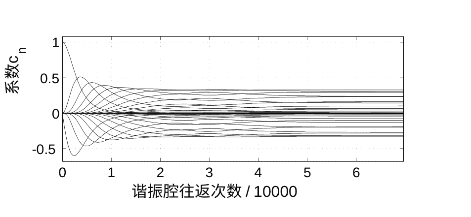

图5.17：埃尔米特-高斯基函数中包络系数随谐振腔往返次数变化的情况。归一化失谐度为 Δ = 3.5。模拟从无失谐的稳态开始。从1开始的曲线是基态。为了描述一个移动的脉冲，需要很多模式。

图5.18和5.19展示了归一化失谐度为 Δ = 3.5时，与稳态增益的偏差和脉冲包络在时域中的情况。

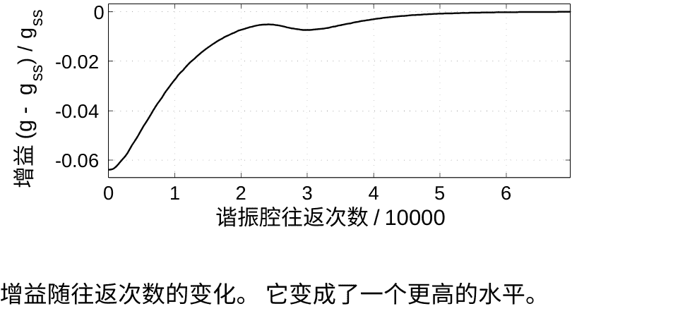

图5.18：增益随往返次数的变化。它变成了一个更高的水平。

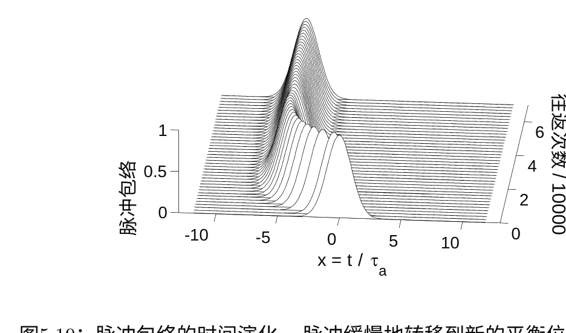

图5.19：脉冲包络的时间演化。脉冲缓慢地转移到新的平衡位置，位置为 \(\sqrt{2}\Delta = 4.9\) 与模拟结果一致。

图5.20到5.22显示了稍高的归一化失谐度 Δ=4 的相同量。

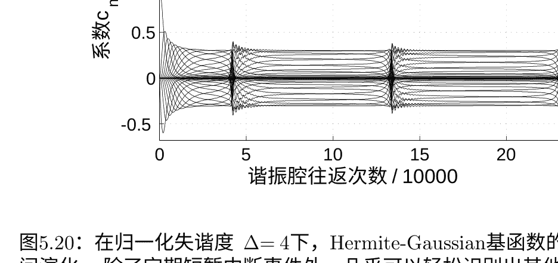

图5.20：在归一化失谐度 Δ= 4下，埃尔米特-高斯基函数的系数的时间演化。除了定期短暂中断事件外，几乎可以轻松识别出其他正常运动的事件（间歇性行为）。在这些事件之间的较长时间段内，激光器几乎达到稳态。

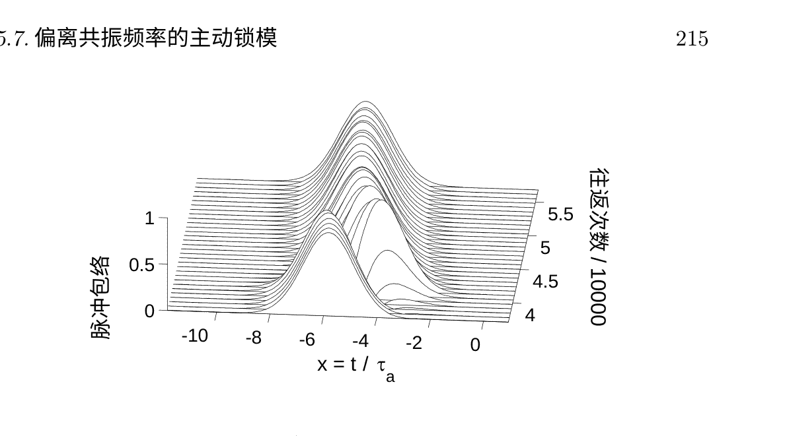

图5.22：脉冲包络的时间演化。

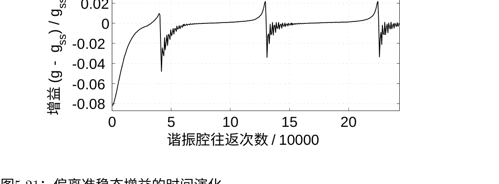

图5.21：偏离准稳态增益的时间演化。

图片清楚地显示系统不再接近稳态，而是保持湍流状态，即动力学是混沌的。

## 5.7.2 非正常系统和瞬态增益

为了深入了解非正常时间演化的动力学，我们考虑以下二维非正常系统。

$$\frac{du}{dt} = Au, \quad u(0) = u_0, \quad u(t) = e^{At}u_0$$

$$A = \begin{pmatrix} -\frac{1}{2} & \frac{a}{2} \\ 0 & -1 \end{pmatrix} \Rightarrow A^\dagger = \begin{pmatrix} -\frac{1}{2} & 0 \\ \frac{a}{2} & -1 \end{pmatrix}, \quad [A, A^\dagger] = \frac{a}{4} \begin{pmatrix} a & 1 \\ 1 & a \end{pmatrix} = 0.$$
(5.103)

参数 \(a\) 缩放非正常性的强度，类似于模锁激光器中的失谐 \(\Delta\) 或流体力学中的雷诺数，其中线性化的Navier-Stokes方程构成了一个非正常系统。

线性系统的特征值和特征向量为

$$\lambda_1 = -\frac{1}{2}, \quad \mathbf{v}_1 = \begin{pmatrix} 1 \\ 0 \end{pmatrix}, \quad \lambda_2 = -1, \quad \mathbf{v}_2 = \frac{1}{\sqrt{1+a^2}} \begin{pmatrix} a \\ -1 \end{pmatrix}.$$
(5.104)

特征向量构成一个完备的系统，每个初始向量都可以在这个基础上进行分解。然而，对于较大的 \(a\)，两个特征向量变得越来越平行，因此一个几乎与基向量正交的小初始向量的分解需要较大的分量（图5.23）。解决方案是

$$u(t) = e^{At}u_0 = c_1 e^{-t/2} \vec{v}_1 + c_2 e^{-t} \vec{v}_2.$$

由于特征值为负，两个贡献都衰减，系统是稳定的。然而，一个特征分量的衰减速度是另一个的两倍。对我们来说重要的是系统由于近似平行的特征向量而显示的瞬态增益。两个系数 \(c_1\) 和 \(c_2\) 都很大。当一个分量衰减时，另一个仍然存在，导致的向量是

$$ u(t \to 2) \approx c_1 e^{-1} \vec{v}_1 $$

在这个瞬态阶段，扰动可以比初始扰动大得多。这是瞬态增益。对于大的 \(a\)，它可以变得任意大。

## 5.7.3 偏离共振的激光的非正常行为

算符的非正常性，\([\hat{L}_D, \hat{L}_D^\dagger] \sim \Delta\)，随着偏离共振而增加。图5.24显示了不同偏离值下的归一化本征模之间的标量积

$$ C(m, n) = \left| \frac{\langle \varphi_m | \varphi_n \rangle}{\sqrt{\langle \varphi_m | \varphi_m \rangle \langle \varphi_n | \varphi_n \rangle}} \right| \quad (5.105) $$

对于零偏离，本征模是正交的。随着偏离的增加，正交性消失。递归关系式(5.101)告诉我们，新本征模与基态的重叠随着偏离的增加而增加。这对应于线性化问题的本征模的并行化，从而导致大的瞬态增益，\(\| e^{\hat{L}_D t} \|\)，在非正常情况下 [2]。

图5.24d显示了通过数值模拟计算线性化系统的展开式中的Fock态到算符 \(\hat{b}\) 的线性化系统的初始扰动的瞬态增益。标准化失谐 \(\Delta = 3\) 已经导致扰动的瞬态增益达到 \(10^6\) 的数量级，在 20, 000个往返中，这导致系统对扰动的极高敏感性。

忽略增益饱和的线性化系统的解析解表明，瞬态增益与失谐按照 \(\exp(2\Delta^2)\) 的比例关系。随着失谐的增加，这种随失谐指数级增长完全决定了系统的动力学。

> 由于版权限制，图像已被删除。
>
> 请参阅：
> Kaertner, F. X., 等。《模式锁定激光器中的湍流》。物理评论快报82卷，第22期 (1999年5月)：4428-4431。

图5.24：作为特征向量的数量的函数的特征向量的标量积，对于 \(\Delta = 0\) 的情况如(a)所示，\(\Delta = 1\)如(b)所示，\(\Delta = 3\)如(c)所示。(d)显示了这些失谐计算的时间函数的瞬态增益和 \(\Delta = 2\)，从线性化系统动力学的角度来看。

> 由于版权限制，图像已被删除。
>
> 请参阅：
> Kaertner, F. X., 等。《模式锁定激光器中的湍流》。物理评论快报82卷，第22期 (1999年5月)：4428-4431。

图5.25：通过数值模拟得到的临界失谐度作为归一化泵浦速率和腔衰减时间与上态寿命的函数。临界失谐度几乎与所示的所有激光参数无关。平均临界失谐度 \(\Delta \approx 3.65\)。

## 5.7. 偏离共振频率的主动锁模

图5.25显示了Nd:YLF激光器在参数空间中的湍流过渡表面，即临界失谐度 \(\Delta\)，泵浦速率 \(r = g_0/l\) 和腔衰减时间 \(T_{cav} = T_R/l\) 与上态寿命 \(\tau_L\) 之间的比率。在这个模型中，我们没有包括自发辐射。

湍流过渡总是发生在标准化失谐度为约 \(\Delta \approx 3.7\) 时，这给出了瞬态增益 \(\exp(2\Delta^2) = 10^{12}\)。这意味着数值积分算法的不确定性已经放大到与稳态本身一样大的扰动。要证明系统动力学真正变得混沌，必须计算李雅普诺夫系数[9]。李雅普诺夫系数描述了相空间轨迹如果它们从接近的起点开始，它们会多快分离。它的形式上定义如下。两条轨迹 \(y(t)\) 和 \(z(t)\) 在 \(t = t_0\) 时开始接近

$$||y(t_0) - z(t_0)|| = \varepsilon = 10^{-4}.$$
(5.106)

然后，系统运行一段时间 \(\Delta t\) 并使用两个轨迹之间距离的对数增长率，即李雅普诺夫系数，进行评估

$$\lambda_0 = \ln \left( \frac{||y(t_0 + \Delta t) - z(t_0 + \Delta t)||}{\varepsilon} \right)$$
(5.107)

对于下一次迭代，轨迹 \(z(t)\) 根据 \(y(t_0+\Delta t)\) 和 \(z(t_0+\Delta t)\) 之间的距离进行重新缩放

$$z(t_1) = y(t_0 + \Delta t) + \varepsilon \frac{y(t_0 + \Delta t) - z(t_0 + \Delta t)}{||y(t_0 + \Delta t) - z(t_0 + \Delta t)||}.$$
(5.108)

计算轨迹的新点 \(z(t_1+\Delta t)\) 和 \(y(t_1+\Delta t) = y(t_0+2\Delta t)\)，并使用新的指数使用方程(5.107)计算李雅普诺夫系数 \(\lambda_1\) 的新估计。这个过程继续进行，并且李雅普诺夫系数被定义为所有近似值的平均值，直到迭代足够长，以至于其变化在迭代之间低于某个错误界限。

$$\lambda = \frac{1}{N} \sum_{n=0}^{N} \lambda_n$$
(5.109)

图5.26显示了上述Nd:YLF激光器的李雅普诺夫系数作为归一化失谐度的函数。当李雅普诺夫系数变为正时，系统对初始条件的微小变化呈指数敏感性。当系统呈指数敏感性时，即李雅普诺夫系数变为正时，在初始条件的微小变化下，系统被称为混沌的。图表清楚地表明，在临界失谐度约为 \(\Delta_c \approx 3.7\) 时，动力学是混沌的。

> 由于版权限制，图像已被删除。
>
> 请参阅：
> Kaertner, F. X., 等。《模式锁定激光器中的湍流》。物理评论快报82卷，第22期 (1999年5月)：4428-4431。


在湍流区域，系统无法达到稳定状态，因为它会被新的脉冲打断，这些脉冲是在净增益窗口之外产生的，参见图5.15，对于正失谐度的脉冲。这个脉冲会饱和增益，几乎形成的稳态脉冲会被破坏，并且最终被新的脉冲所取代。增益饱和提供了非线性的反馈机制，一旦由于瞬态线性放大机制而产生了强烈的扰动，它会强烈地干扰系统。

如果考虑到额外的噪声源，如激光放大器的自发辐射噪声和技术噪声，临界失谐度会变小。然而，由于超指数增长，临界失谐度不会对噪声源的强度产生很大的依赖。如果在模拟中包含自发辐射噪声，我们会得到与图5.25中临界失谐度相同的形状，但临界失谐度会降低到约 \(\Delta_c \approx 2\)。请注意，这个临界失谐度对系统参数的任何其他变化都非常不敏感。因此，可以预期没有再生反馈的主动锁模激光器在实际失谐度下运行不稳定，参见由(5.98)给出的。

$$ T_d = 4\sqrt{2D_f M_s \tau_a} $$

## 5.7. 偏离共振频率的主动锁模

对于上述Nd:YLF激光器，使用表5.3中的数值可以得到调制频率的相对精度

\( \frac{T_d}{T_R} = 1.7 \times 10^{-6} \).

通过现代微波合成器很容易实现和保持频率稳定性的派生值。然而，这要求Nd:YLF激光器的腔长也稳定到这个限度。请注意，钢的热膨胀系数为 \( 1.6 \times 10^{-5} / K \)。

# 参考文献

[1] Lord Kelvin, Philos. Mag. 24, 188 (1887); A. Sommerfeld, Int. Mathem. Kongr. Rom 1908, Vol. III, S. 116; W. M. F. Orr, Proc. Irish Acad. 27, (1907).

[2] L. Trefethen, A. Trefethen, S. C. Reddy u. T. Driscol, Science 261, 578 (1993); S. C. Reddy, D. Henningson, J. Fluid Mech. 252, 209 (1993); Phys. Fluids 6, 1396 (1994); S. Reddy et al., SIAM J. Appl. Math. 53; 15 (1993); T. Gebhardt and S. Grossmann, Phys. Rev. E 50, 3705 (1994).

[3] H. J. Eichler, 光学通信 56, 351 (1986). H. J. Eichler, I. G. Koltchanov和B. Liu, 应用物理学B 61, 81 (1995).

[4] U. Morgner和F. Mitschke, 物理评论A 54, 3149 (1997).

[5] H. J. Eichler, I. G. Koltchanov和B. Liu, 应用物理学B 61, 81 - 88 (1995).

[6] H. A. Haus, IEEE JQE 11, 323 (1975).

[7] H. A. Haus, D. J. Jones, E. P. Ippen和W. S. Wong, Journal of Lightwave Technology, 14, 622 (1996).

[8] G. Bachman 和 L. Narici, "Functional Analysis", 纽约, Academic Press (1966).

[9] A. Wolf, J. B. Swift, H. L. Swinney 和 J. A. Vastano, Physica D 16, 285 (1985).

# 第六章

## 被动模锁

正如我们在第五章中所看到的，主动模锁激光器中的脉冲宽度与损耗调制的曲率成反比。在主动模锁中，我们受到电子信号发生器速度的限制。因此，这个曲率永远不会很强。然而，如果脉冲可以自己调制吸收，吸收调制的曲率可以变得很大，换句话说，脉冲产生的净增益窗口可以和脉冲本身一样短。在这种情况下，净增益窗口随着脉冲的缩短而缩短。因此，被动模锁激光器可以产生比主动模锁激光器更短的脉冲。

然而，被动锁模需要适当的饱和吸收体。根据饱和吸收体恢复时间和脉冲宽度之间的比值，可以区分图6.1中所示的运行模式。该图描述了最终稳态脉冲形成过程。

在固体激光器中，腔内脉冲能量远低于增益介质的饱和能量时，可以忽略增益饱和。然后，需要存在一个快速饱和吸收体，该吸收体在脉冲之前和之后立即打开和关闭脉冲产生的净增益窗口。这种锁模原理称为快速饱和吸收体锁模，参见图6.1 a)。

在半导体和染料激光器中，通常腔内脉冲能量超过增益介质的饱和能量，因此增益介质会饱和。如果在腔内引入一个类似但未泵浦的介质，该介质作为一个吸收体，其饱和能量略低于增益介质，则仍然可以创建一个短的净增益窗口。例如，这可以通过在吸收体介质中进行比增益介质更强的聚焦来安排。然后吸收体首先褪色并打开净增益窗口，脉冲稍后通过褪色增益来关闭，参见图6.1 b)。这种模锁原理称为慢饱和吸收体模锁。

当使用半导体饱和吸收体进行皮秒和飞秒激光器的模锁时，即使使用恢复时间为几皮秒的较慢吸收体，也能够产生亚皮秒脉冲，在脉冲之后产生显著的净增益窗口，参见图6.1 c)。根据我们对孤子形成存在下的主动模锁的研究，我们可以预期在强孤子形成存在下，这种情况可能仍然稳定。这种模锁机制被称为孤子模锁，因为由于自相位调制和群速度色散，脉冲形成了稳定的sech形状，尽管在脉冲之后存在净增益窗口。

> 由于版权限制，图像已被删除。
>
> 请参阅：
> Kartner, F. X., 和 U. Keller. "通过慢饱和吸收体稳定类似孤子脉冲." Optics Letters 20 (1990): 16-19.

图6.1：被动模锁激光器中由增益和损耗动力学引起的脉冲整形和稳定机制：(a)仅使用快速饱和吸收体；(b)使用增益和损耗饱和的组合；(c)使用具有有限弛豫时间和孤子形成的饱和吸收体。

## 6.1 慢饱和吸收体锁模

由于固体激光器中受激发射的截面很小，典型的腔内脉冲能量远小于增益的饱和能量。因此，我们忽略了由于一个脉冲而引起的增益饱和效应，增益只对平均功率饱和。然而，有些增益介质具有较大的增益截面，如半导体和染料，见表4.1，典型的腔内脉冲能量可能足够大，以至于在单次通过中明显饱和增益。实际上，正是这个效应使得锁模染料激光器如此成功。慢饱和吸收体锁模的模型必须考虑到一个脉冲通过时增益的变化[1, 2]。在接下来的内容中，我们考虑一个在一次往返中经历饱和增益和慢饱和吸收体的锁模激光器。在染料激光器中，两种介质都是具有不同饱和强度或将光聚焦到染料喷射中的染料，因此增益和损耗可能显示出不同的饱和能量。在脉冲相对于其弛豫时间很短的极限情况下，增益的弛豫方程可以近似为

$$
\frac{dg}{dt} = -g \frac{|A(t)|^2}{E_L} \quad (6.1)
$$

系数 $E_L$是增益的饱和能量。积分方程显示，增益随脉冲能量 $E(t)$饱和

$$
E(t) = \int_{-T_R/2} dt |A(t)|^2 \quad (6.2)
$$

通过增益时

$$
g(t) = g_i \exp[-E(t)/E_L] \quad (6.3)
$$

其中 $g_i$是脉冲到达之前的初始小信号增益。饱和吸收体的损耗也有类似的方程，其响应（损耗）由 $q(t)$表示

$$
q(t) = q_0 \exp[-E(t)/E_A] \quad (6.4)
$$

其中 $E_A$是饱和吸收体的饱和能量。如果背景损耗用 $l$表示，锁模的主方程为

$$
\frac{1}{T_R}\frac{\partial}{\partial T}A = \left[g_i(\exp(-E(t)/E_L))A - lA - q_0\exp(-E(t)/E_A)\right]A + \frac{1}{\Omega_f^2}\frac{\partial^2}{\partial t^2}A
$$
(6.5)

在这里，我们用增益 $D_g = \frac{1}{\Omega_f^2}$来替代滤波作用由一个单独的固定滤波器产生。这个积分-微分方程的解可以通过一个近似得到：指数函数被展开到二阶。如果增益和饱和吸收介质的消耗不过度，这是合理的。考虑其中之一的展开：

$$
q_0\exp(-E(t)/E_A) \approx q_0\left[1 - (E(t)/E_A) + \frac{1}{2}(E(t)/E_A)^2\right]
$$
(6.6)

我们只考虑饱和增益和损耗以及有限增益带宽。那么主方程为

$$
T_R\frac{\partial A(T,t)}{\partial T} = \left[g(t) - q(t) - l + D_f\frac{\partial^2}{\partial t^2}\right]A(T,t)
$$
(6.7)

滤波器色散，$D_f=1/\Omega_f^2$，有效地模拟了激光器的有限带宽，这可能不仅仅由于有限增益带宽，而是包括了所有带宽限制效应的抛物线近似。假设脉冲是时间的对称函数。那么积分的第一次幂给出了时间的反对称函数，它的平方是对称的。作用在脉冲上的反对称函数 $A(t)$会引起位移。因此，稳态解不会导致每次通过的变化为零，即导数$\frac{1}{T_R}\frac{\partial A}{\partial T}$必须将其等同于脉冲的时间偏移 $\Delta t_{of}$。当这样做时，可以轻松确认 $A(t)=A_o\ \text{sech}(t/\tau)$是满足约束条件的解。(6.6) 因此，我们正在寻找一个"稳态"解 $A(t,T)=A_o\ \text{sech}\left(\frac{t}{\tau} + \alpha\frac{T}{T_R}\right)$。注意，$\alpha$是脉冲宽度的一部分，脉冲在每个往返中由于损耗和增益而发生形状变化。可以使用以下关系轻松找到其系数的约束条件

## 6.1. 慢饱和吸收体锁模

sech脉冲的以下关系

$$
E(t) = \int_{-T_R/2} dt|A(t)|^2 = \frac{W}{2} \left(1 + \tanh\left(\frac{t}{\tau} + \alpha \frac{T}{T_R}\right)\right) \quad (6.8)
$$

$$
E(t)^2 = \left(\frac{W}{2}\right)^2 \left(2 + 2\tanh\left(\frac{t}{\tau} + \alpha \frac{T}{T_R}\right) - \text{sech}^2\left(\frac{t}{\tau} + \alpha \frac{T}{T_R}\right)\right) \quad (6.9)
$$

$$
T_R \frac{\partial}{\partial T} A(t, T) = -\alpha \tanh\left(\frac{t}{\tau} + \alpha \frac{T}{T_R}\right) A(t, T) \quad (6.10)
$$

$$
\frac{1}{\Omega_f^2} \frac{\partial^2}{\partial t^2} A(t, T) = \frac{1}{\Omega_f^2 \tau^2} \left(1 - 2\text{sech}^2\left(\frac{t}{\tau} + \alpha \frac{T}{T_R}\right)\right) A(t, T) \quad (6.11)
$$

将它们代入主方程(6.5)并收集不同时间函数前面的系数。常数项给出了必要的小信号增益

$$
g_i \left[1 - \frac{W}{2E_L} + \left(\frac{W}{2E_L}\right)^2\right] = l + q_0 \left[1 - \frac{W}{2E_A} + \left(\frac{W}{2E_A}\right)^2\right] - \frac{1}{\Omega_f^2 \tau^2} \quad (6.12)
$$

奇数 tanh－函数前面的常数提供了每个回程的时间偏移

$$
\alpha = \frac{\Delta t}{\tau} = g_i \left[\frac{W}{2E_L} - \left(\frac{W}{2E_L}\right)^2\right] - q_0 \left[\frac{W}{2E_A} - \left(\frac{W}{2E_A}\right)^2\right] \quad (6.13)
$$

最后， sech²函数前面的常数决定了脉冲宽度

$$
\frac{1}{\tau^2} = \frac{\Omega_f^2 W^2}{8} \left(\frac{q_0}{E_A^2} - \frac{g_i}{E_L^2}\right) \quad (6.14)
$$

这些方程具有重要的意义。首先考虑逆脉冲宽度的方程 (6.14) 。为了得到一个实数解，右边必须是正的。这意味着 q₀/E_A² > g_i/E_L²。饱和吸收体必须比增益介质更容易饱和，因此更强烈，以打开增益的净窗口 (图6.2) 。通过更强烈地聚焦到饱和吸收体染料喷射器（减少饱和吸收体的饱和能量）而不是增益染料喷射器（反转的，即光学上泵浦）。

图6.2：慢饱和吸收体锁模激光的动力学。

> MIT OCW提供的图。

方程（6.12）对脉冲通过之前的净增益做出了说明。脉冲通过之前的净增益是

$$
g_{i} - q_{0} - l = -\frac{1}{\Omega_{f}^{2}\tau^{2}} + g_{i}\left[\frac{W}{2E_{L}} - \left(\frac{W}{2E_{L}}\right)^{2}\right] - q_{0}\left[\frac{W}{2E_{A}} - \left(\frac{W}{2E_{A}}\right)^{2}\right].
$$
(6.15)

使用条件（6.14）可以表示为

$$
g_{i} - q_{0} - l = g_{i}\left[\frac{W}{2E_{L}}\right] - q_{0}\left[\frac{W}{2E_{A}}\right] + \frac{1}{\Omega_{f}^{2}\tau^{2}}.
$$
(6.16)

由于饱和吸收体的效应大于增益，所以该增益为负。由于脉冲通过之后的指数尾部与通过之前相同，可以得出脉冲通过之后的净增益与通过之前相同，因此也是负的。脉冲在前端和后端都对噪声积累稳定。如果饱和吸收体和增益之间的饱和能量比$\chi_{P} = E_{A}/E_{P}$非常小，则该原理有效。在给定系统中可实现的最短脉冲宽度为

$$
\tau = \frac{4}{\sqrt{q_{0}}\Omega_{f}} \frac{E_{A}}{W} > \frac{2}{\sqrt{q_{0}}\Omega_{f}}.
$$
(6.17)

大于号来自于我们的理论基于指数的展开，这只对于$\frac{W}{2E_{A}} < 1$。如果决定系统带宽的滤波器色散$1/\Omega_{f}^{2}$再次被平均增益色散$g/\Omega_{g}^{2}$替代，并且假设$g = q_{0}$。请注意，染料激光器的锁模原理非常迷人，因为实际上系统中的任何元素都不是快速的。这是两种介质之间的相互作用，在飞秒时间尺度上打开了一个短暂的时间窗口。介质本身只需要足够快地在一次往返之间完全恢复，即在纳秒时间尺度上。

在过去的十五年中，染料激光器已经在很大程度上被固态激光器所取代，后者比染料提供更大的带宽，并且因为它们不会随时间而退化，所以更容易处理。随之而来的是对不同的锁模原理的需求，因为这些宽带固态激光介质的饱和能量要高得多。

## 6.2 快饱和吸收体锁模

快速饱和吸收体锁模的激光动力学再次由主方程（5.21）[3]描述。现在，损耗 $q$ 瞬间对场的强度或功率 $P(t) = |A(t)|^2$ 产生反应

$$
q(A) = \frac{q_0}{1 + \frac{|A|^2}{P_A}},
$$
(6.18)

其中 $P_A$ 是吸收体的饱和功率。没有吸收体响应（6.18）的主方程（5.21）的解析解。因此，我们对吸收体响应进行展开以获得解析洞察。如果吸收体未饱和，我们可以对小强度展开响应（6.18）。

$$
q(A) = q_0 - \gamma |A|^2,
$$
(6.19)

具有饱和吸收调制系数 $\gamma = q_0 / P_A$ 的常数。
非饱和损耗 $q_0$ 可以被吸收在损耗 $l_0 = l + q_0$ 中得到的。
主方程是，参见图6.3

$$
T_R \frac{\partial A(T, t)}{\partial T} = \left[ g - l_0 + D_f \frac{\partial^2}{\partial t^2} + \gamma |A|^2 + j D_2 \frac{\partial^2}{\partial t^2} - j \delta |A|^2 \right] A(T, t).
$$
(6.20)

由于版权限制，图像已被删除。

> 请参阅：
Keller, U., 超快激光物理, 瑞士联邦理工学院, ETH Hönggerberg—HPT, CH-8093 Zurich, Switzerland.

方程 (6.20)是一个广义的Ginzburg-Landau方程，从超导学中非常复杂的解解空间中得到。

### 6.2.1 无群延迟色散和自相位调制

我们首先考虑没有SPM和GDD的情况，即 $D_2=\delta = 0$

$$
T_R \frac{\partial A(T, t)}{\partial T} = \left[ g - l_0 + D_f \frac{\partial^2}{\partial t^2} + \gamma |A|^2 \right] A(T, t). \quad (6.21)
$$

在虚数单位之前，这个方程与NSE仍然非常相似。为了找到最终的脉冲形状和宽度，我们寻找稳态解

$$
T_R \frac{\partial A_s(T, t)}{\partial T} = 0.
$$

由于这个方程与NSE相似，我们尝试以下假设

$$
A_s(T, t) = A_s(t) = A_0 \text{sech} \left( \frac{t}{\tau} \right). \quad (6.22)
$$

注意，这里有

$$
\frac{d}{dx}\text{sech}x = -\tanh x\text{sech}x, \qquad (6.23)
$$

$$
\frac{d^2}{dx^2}\text{sech}x = \tanh^2 x\text{sech}x - \text{sech}^3x, = (\text{sech}x - 2\text{sech}^3x). \qquad (6.24)
$$

)将假设(6.22)代入主方程(6.21)，假设稳态，得到

$$
0 = \left[(g - l_0) + \frac{D_f}{\tau^2}\left[1 - 2\text{sech}^2\left(\frac{t}{\tau}\right)\right] + \gamma|A_0|^2\text{sech}^2\left(\frac{t}{\tau}\right)\right]\cdot A_0\text{sech}\left(\frac{t}{\tau}\right). \qquad (6.25)
$$

通过与sech-和sech³表达式的系数比较，可以得到脉冲峰值强度和脉冲宽度 τ 以及饱和增益的条件

$$
\frac{D_f}{\tau^2} = \frac{1}{2}\gamma|A_0|^2, \qquad (6.26)
$$

$$
g = l_0 - \frac{D_f}{\tau^2}. \qquad (6.27)
$$

从方程 (6.26) 和 sech 脉冲的脉冲能量，参见方程 (3.8)，$W = 2|A_0|^2\tau$，

$$
\tau = \frac{4D_f}{\gamma W}. \qquad (6.28)
$$

方程 (6.28) 与孤子宽度非常相似，只是保守脉冲整形效应 GDD 和 SPM 被增益色散和饱和吸收所取代。每个往返的孤子相移被方程 (6.28) 中饱和增益和损耗之间的差异所取代。有趣的是，我们更仔细地观察增益和损耗之间的差异 $D_f / \tau^2$

每个往返大约需要时间。从主方程 (6.21) 我们可以根据脉冲能量推导出一个运动方程，根据

$$
T_R \frac{\partial W(T)}{\partial T} = T_R \frac{\partial}{\partial T}\int_{-\infty}^{\infty} |A(T,t)|^2 dt \qquad (6.29)
$$

$$
= T_R \int_{-\infty}^{\infty} \left[A(T,t)^*\frac{\partial}{\partial T}A(T,t) + c.c.\right] dt \qquad (6.30)
$$

$$
= 2G(g_s, W)W, \qquad (6.31)
$$

## 6.2. 快速饱和吸收锁模

其中 \(G\) 是每个往返的净能量增益，在达到稳态时消失[3]。 将主方程代入 (6.30) 得到

$$
\begin{aligned}
\int_{-\infty}^{\infty} (\text{sech}^2 x) \, dx &= 2, \\
\int_{-\infty}^{\infty} (\text{sech}^4 x) \, dx &= \frac{4}{3}, \\
-\int_{-\infty}^{\infty} \text{sech} x \frac{d^2}{dx^2} (\text{sech} x) \, dx &= \int_{-\infty}^{\infty} \left( \frac{d}{dx} \text{sech} x \right)^2 dx = \frac{2}{3}.
\end{aligned}
$$

导致

$$
\begin{aligned}
G(g_s, W) &= g_s - l_0 - \frac{D_f}{3\tau^2} + \frac{2}{3}\gamma|A_0|^2, \\
&= g_s - l_0 + \frac{1}{2}\gamma|A_0|^2 = g_s - l_0 + \frac{D_f}{\tau^2} = 0.
\end{aligned}
$$

具有饱和增益

$$
g_s(W) = \frac{g_0}{1 + \frac{W}{P_L T_R}}
$$

方程(6.36)和(6.28)确定了脉冲能量

$$
\begin{aligned}
g_s(W) &= \frac{g_0}{1 + \frac{W}{P_L T_R}} = l_0 - \frac{D_f}{\tau^2}, \\
&= l_0 - \frac{(\gamma W)^2}{16D_g}.
\end{aligned}
$$

图6.4显示了激光器中饱和吸收体的增益和损耗随时间变化的情况，在归一化时间尺度上进行了锁模。在这里，我们假设吸收体在强度达到最大值 \(q_0 = \gamma A_0^2\) 时呈线性饱和。如果完全利用这个最大饱和吸收，请参见图6.5。根据方程(6.26)，给定饱和吸收 \(q_0\)，可以实现的最小脉冲宽度为

$$
\frac{D_f}{\tau^2} = \frac{q_0}{2},
$$

待定

$$
\tau = \sqrt{\frac{2}{q_0} \frac{1}{\Omega_f}}.
$$由于版权限制，图像已被删除。

请参阅：
Kartner, F. X., 和 U. Keller. "通过慢饱和吸收体稳定类似孤子脉冲." *Optics Letters* 20 (1990): 16-19.

图6.4：在归一化时间尺度上使用快速饱和吸收体的被动锁模激光器中的增益和损耗 $x = t/\tau_o$。假设吸收体的饱和与强度线性相关，即 $q(A) = q_0 \left( 1 - \frac{|A|^2}{A_0^2} \right)$。


## 图6.5：理想饱和吸收体的饱和特性

### 6.2. 快速饱和吸收模式锁定

请注意，与主动锁模相比，现在可实现的脉冲宽度与增益带宽的倒数成比例，从而得到更短的脉冲。图6.4的解释如下：在稳态下，饱和增益低于损耗，脉冲之前和之后的饱和和损耗的一半左右。这意味着脉冲之外存在净损耗，这可以防止脉冲前沿和后沿的不稳定性增长。如果存在稳定的锁模操作，脉冲之外必须始终存在净损耗，否则，在增益峰值处运行的连续波信号将比脉冲获得更多增益，并且会突破。根据公式（6.35），在饱和吸收体饱和期间，利用了三分之一的饱和损耗，并且实际上只有六分之一用于克服由于有限增益带宽而引起的滤波器损耗。请注意，存在最小脉冲宽度的限制，这是因为饱和增益（6.27）为 $g_s = l + ^1$

公式（6.40），如果我们假设激光的有限带宽由增益确定，即 $D_f = D_g = \frac{g}{\Omega^2_{\text{增益}}} q_0$，因此，根据 $q_0 \gg l$ 我们得到

$$\tau_{\min} = \frac{1}{\Omega_g} \qquad (6.41)$$

对于线性饱和吸收模型。这对应于模式锁定在增益介质的整个带宽上，因为对于sech形状的脉冲，时间带宽乘积为0.315，因此，

$$\Delta f_{FWHM} = \frac{0.315}{1.76 \cdot \tau_{\min}} = \frac{\Omega_g}{1.76 \cdot \pi}. \qquad (6.42)$$

以钛蓝宝石为例，这对应于 $\Omega_g = 270 \text{ THz}$， $\tau_{\min} = 3.7 \text{ fs}$， $\tau_{FWHM} = 6.5 \text{ fs}$。

### 6.2.2 有群延迟色散和自相位调制

在了解没有GDD和SPM时发生了什么之后，我们来看一下具有GDD和SPM的完整主方程（6.20）的解。结果发现存在稳态解，它们是带调制的双曲正切函数[4]

$$A_s(T, t) = A_0 \left(\text{sech}\left(\frac{t}{\tau}\right)\right)^{(1+j\beta)} e^{j\psi T/T_R}, \qquad (6.43)$$
$$= A_0\text{sech}\left(\frac{t}{\tau}\right)\exp\left[j\beta \ln \text{sech}\left(\frac{t}{\tau}\right) + j\psi T/T_R\right]. \qquad (6.44)$$

其中 ψ 是脉冲的往返相移，我们必须考虑。只有脉冲的强度变得稳定。每次往返仍然存在相移，这是由于群速度和相速度之间的差异引起的（这些效应已经被转化掉了）以及非线性效应。

与上一节一样，我们可以将这个假设代入主方程并比较系数。使用以下关系

$$\frac{d}{dx}\left(f(x)^b\right) = b f(x)^{b-1} \frac{d}{dx}f(x) \qquad (6.45)$$

$$\frac{d}{dx} (\text{sech} x)^{(1+j\beta)} = -(1+j\beta) \tanh x (\text{sech} x)^{(1+j\beta)} \qquad (6.46)$$

$$\frac{d^2}{dx^2} (\text{sech} x)^{(1+j\beta)} = \left((1+j\beta)^2 - (2+3j\beta-\beta^2) \text{sech}^2 x\right) (\text{sech} x)^{(1+j\beta)} \qquad (6.47)$$

在主方程中比较系数与相同函数导致两个复杂方程

$$\frac{1}{\tau^2} (D_f + jD_2) (2 + 3j\beta - \beta^2) = (\gamma - j\delta) |A_0|^2 \qquad (6.49)$$

$$l_0 - \frac{(1+j\beta)^2}{\tau^2} (D_f + jD_2) = g - j\psi \qquad (6.50)$$

这些方程是方程(6.26)和(6.27)的扩展，等效于每次往返的相移 ψ，脉冲宽度 τ，调制 β 和峰值功率 |A_0|^2 或脉冲能量。方程(6.50)的虚部仅确定相移，通常不重要。方程(6.50)的实部给出了饱和增益

$$g = l_0 - \frac{1-\beta^2}{\tau^2} D_f + \frac{2\beta D_2}{\tau^2} \qquad (6.51)$$

方程 (6.49) 的实部和虚部给出

$$\frac{1}{\tau^2} \left[D_f (2 - \beta^2) - 3\beta D_2\right] = \gamma |A_0|^2 \qquad (6.52)$$

$$\frac{1}{\tau^2} \left[D_2 (2 - \beta^2) + 3\beta D_f\right] = -\delta |A_0|^2 \qquad (6.53)$$

我们引入了归一化色散， $D_n = D_2/D_f$，以及没有GDD和SPM的系统的脉冲宽度，即纯饱和吸收模锁定的宽度， $\tau_0= 4D_f/(\gamma W)$。将方程 (6.53) 除以 (6.52) 并引入归一化非线性 $\delta_n = \delta/\gamma$，我们得到一个二次方程来描述啁啾，

$$\frac{D_n \left(2 - \beta^2\right) + 3\beta}{\left(2 - \beta^2\right) - 3\beta D_n} = -\delta_n,$$

或者在重新排序之后

$$\frac{3\beta}{2-\beta^2} = \frac{\delta_n + D_n}{-1 + \delta_n D_n} \equiv \frac{1}{\chi}. \tag{6.54}$$

注意 χ仅取决于系统参数。因此，啁啾由以下公式给出

$$\beta = -\frac{3}{2}\chi \pm \sqrt{\left(\frac{3}{2}\chi\right)^2 + 2}. \tag{6.55}$$

通过公式 (6.52) ，我们可以得到啁啾，从而得到脉冲宽度

$$\tau = \frac{\tau_0}{2} \left(2 - \beta^2 - 3\beta D_n\right), \tag{6.56}$$

根据公式 (6.54) ，也可以写成

$$\tau = \frac{3\tau_0}{2}\beta(\chi - D_n) \tag{6.57}$$

为了具有物理意义，脉冲宽度必须是一个正数，即乘积 β(χ−Dn)必须始终大于0，这决定了公式 (6.55) 中的根

$$\beta = \begin{cases} -\frac{3}{2}\chi + \sqrt{\left(\frac{3}{2}\chi\right)^2 + 2}, & \text{对于 } \chi > D_n \\ -\frac{3}{2}\chi - \sqrt{\left(\frac{3}{2}\chi\right)^2 + 2}, & \text{对于 } \chi < D_n \end{cases}. \tag{6.58}$$

图6.6(a,b和d)显示了与系统参数[4][5]相关的啁啾、脉冲宽度和非线性往返相移。 脉冲稳定性的一个必要但不充分的条件是，在脉冲前后必须存在净损耗。 从方程(6.51)中，我们得到

$$g_s - l_0 = -\frac{1-\beta^2}{\tau^2}D_f + \frac{2\beta D_2}{\tau^2} < 0. \tag{6.59}$$

如果我们定义稳定性参数 $S$，则 $S = 1 - \beta^2 - 2\beta D_n > 0, \quad (6.60)$。$S$ 必须大于零，如图6.6(d)所示。

由于版权限制，图像已被删除。

请参阅：
Haus, H. A., J. G. Fujimoto, E. P. Ippen. "Structure for additive pulse modellocking." *Journal of Optical Society of Americas B* 8 (1991): 208.

图6.6： (a)脉冲宽度，(b)啁啾参数，(c)脉冲后的净增益，与稳定性有关。(d)每次通过的相移。[4]

图6.6 (a-d) 表明存在三个基本的工作区域。首先，没有群延迟色散和自相位调制，脉冲始终稳定。其次，如果存在强独立子类脉冲整形，即 $\delta_n \gg 1$ 和 $-D_n \gg 1$ 的色散比正值时，脉冲的啁啾始终比正色散小得多，类似于独立子。最后，如果满足条件 $\delta_n = -D_n$，则脉冲甚至是无啁啾的。此时的解为

$$A_s(T, t) = A_0 \left( \text{sech} \left( \frac{t}{\tau} \right) \right) e^{j\psi T / T_R}, \quad \text{对于} \quad \delta_n = -D_n. \quad (6.61)$$

## 6.3. 孤子模锁定

注意，对于这个讨论，我们总是假设正的SPM系数。在这个范围内，我们也可以直接从系统中获得最短的脉冲，这可以比纯饱和吸收模锁定短2-3倍。请注意，图6.6表明，如果非线性折射率，即 $\delta_n$ 进一步增加，甚至可以得到任意更短的脉冲。 然而，这只是饱和吸收体线性近似的人为现象，它现在可以变得任意大，比较(6.18)和(6.19)。 从快速饱和吸收体模型的分析中我们发现，图6.4，只有六分之一的饱和吸收用于克服增益滤波。 这是因为饱和吸收体必须对抗连续波辐射的突破，以塑造和稳定脉冲。 通过SPM和GDD，这种要求得到了放宽。 脉冲塑形可以仅通过SPM和GDD完成，即孤子形成，吸收体只需稳定脉冲。 但是，所有的饱和吸收都可以用于稳定性，即增加了大约六倍的脉冲缩短因子。

√6 = 2.5在一个抛物线中 滤波器情况。 注意，对于实验者来说，三倍的因素是一个很大的数字。 这告诉我们，从饱和吸收模型中得出的钛蓝宝石的6.5 fs极限可以通过包括GDD和SPM减小到2.6 fs，这大约是800nm中心波长下的一个光学周期2.7 fs。 在那一点上，我们迄今为止所做的所有近似都会失效。

如果负色散的量减少得太多，即脉冲变得太短，吸收剂将无法保持它们的稳定性。

如果存在强正色散，脉冲再次变得稳定而长，但高度啁啾。 然后可以通过外部压缩脉冲，但不能完全达到它们的变换极限，因为这些是非线性啁啾的脉冲，参见方程 (6.43) 。

在强孤子脉冲整形的情况下，吸收体不需要真的很快，因为脉冲是通过群延迟色散 (GDD) 和自相位调制 (SPM) 来整形的，吸收体只需要稳定孤子以抵抗连续谱。 这种模式被称为孤子锁模。

### 6.3 孤子锁模

如果系统中存在强孤子形成，饱和吸收体不需要很快[6][7][8]，见图6.7。描述锁模过程的主方程为

$$T_R \frac{\partial A(T, t)}{\partial T} = \left[ g - l + (D_f + jD) \frac{\partial^2}{\partial t^2} - j\delta |A(T, t)|^2 - q(T, t) \right] A(T, t). \tag{6.62}$$

饱和吸收体遵循一个单独的微分方程，描述每个往返中脉冲对吸收体的响应

$$\frac{\partial q(T, t)}{\partial t} = -\frac{q - q_0}{\tau_A} - \frac{|A(T, t)|^2}{E_A}. \tag{6.63}$$

其中 $\tau_A$ 是吸收体恢复时间，$E_A$ 是饱和能量。 如果孤子整形效应远大于脉冲在吸收体饱和和滤波器损耗期间会经历的损耗。饱和增益等于这些损耗。连续谱的损耗，$l_c$ 必须高于孤子的损耗，以保持孤子的稳定。

由于版权限制，图像已被删除。

请参阅：
Kartner, F. X., 和 U. Keller. "通过慢饱和吸收体稳定类似孤子脉冲." *Optics Letters* 20 (1990): 16-19.

图6.7：慢饱和吸收体对类孤子脉冲的响应。

### 6.3. 孤子模锁定

由于版权限制，图像已被删除。

请参阅：
Kartner, F. X., 和 U. Keller. "通过慢饱和吸收体稳定类似孤子脉冲." *Optics Letters* 20 (1990): 16-19.

图6.8：连续谱，在光增益窗口中可能会增长，在色散的作用下扩散到高吸收区域。

由于滤波器和可饱和吸收体的整形，稳态脉冲将是一个类孤子和连续谱的组合，类似于强孤子形成的主动模锁情况，如第5.5节所讨论的。

$$A(T, t) = \left( A \, \text{sech}\left(\frac{t}{\tau}\right) + a_c(T, t) \right) e^{-j \phi_0 \frac{T}{T_R}} \quad (6.64)$$


图6.9：归一化增益、孤子和连续谱。连续谱是利用增益峰值的长脉冲

连续谱可以看作是与孤子竞争可用增益的长脉冲。在频域中，参见图6.9，与连续谱相比，孤子具有宽谱。因此，连续谱在增益峰值处经历增益，而孤子谱平均经历较小的增益。连续谱在时间域中的这种增益优势必须通过饱和和吸收剂响应来补偿，参见图6.8。对于孤子，非线性和色散之间存在平衡，但对于连续谱则不然。因此，连续谱通过色散扩展到高吸收区域。这种机制必须清除孤子后面的增益窗口，这是由吸收剂的缓慢恢复引起的。与主动锁模的情况一样，一旦孤子太短，即出现了过长的净增益窗口，连续谱的损耗可能低于孤子的损耗，参见图6.7，连续谱可能突破并破坏单脉冲孤子解。经验法则是吸收剂恢复时间可能是孤子宽度的10倍左右。这种锁模原理对于具有半导体饱和吸收剂的激光器的锁模尤为重要，这些激光器显示出典型的吸收剂恢复时间，范围可能从100fs到100ps。使用半导体饱和吸收剂已经产生了13fs的脉冲。图6.10显示了用饱和吸收剂锁模的钛宝石激光器在腔内色散的不同值下测得的光谱。降低色散会增加孤子的带宽，从而增加其损耗，同时降低连续谱的损耗。在某个色散值处，激光器必须通过连续谱的突破而变得不稳定。在所示的例子中，这发生在色散值约为$D = -500 fs^2$。连续谱突破在光谱中心出现的额外光谱成分清晰可见。进一步降低色散可能会导致与形成更高阶孤子相关的更稳定但复杂的光谱。请注意，所示的光谱是时间平均光谱。


图6.10：半导体饱和吸收体模锁Ti：蓝宝石激光器的测量（—）和模拟（---）光谱，对应于不同的净腔内色散值。

MIT OCW提供的图。


图6.11：与图6.10中所示光谱相对应的测量（—-）和模拟（---）自相关。

MIT OCW提供的图。

## 6.4 色散管理孤子形成

非线性薛定谔方程描述了介质中的脉冲传播，其中包括连续分布的色散和自相位调制。 对于产生10 fs及以下脉冲的激光器，Spielmann等人首次指出，在一个往返中脉冲发生了很大变化，并且腔内脉冲成形元件的顺序对脉冲形成有重大影响[9]。 激光谐振腔中线性色散的离散作用以及激光晶体中正的自相位调制和正的群延迟色散的同时作用不再可以忽略。 强色散变化对激光动力学的重要性首次在光纤激光器中发现，并称为拉伸脉冲锁模[11]。 掺铒光纤段的正色散与负色散被平衡的光纤环激光器。 在环中循环的脉冲被拉伸和压缩了多达20倍。 这种行为的一个结果是非线性的显著减少，从而增加了对SPM诱导的不稳定性的稳定性。 由于周期性扰动引起的旁带，在第3.6节中讨论，不再观察到（见图6.12）。

由于版权限制，图像已被删除。

请参阅：
Tamura, K., E. P. Ippen, H. A. Haus, and L. E. Nelson. "来自拉伸脉冲模锁全光纤环激光器的77飞秒脉冲生成。"光学快报18 (1993): 1080-1082.

图6.12：在传统的孤子区域，即净负色散和几乎零平均色散的拉伸脉冲工作模式下，工作的锐钛掺杂光纤激光器的光谱[11]。

### 6.4. 色散管理孤子形成

输出脉冲的能量可以增加100倍。最小脉冲宽度为63飞秒，带宽比铒增益带宽宽得多[12]。图6.12还显示了色散管理区域中的光谱增强，即光纤激光器在色散管理区域中的光谱。从钛蓝宝石等固体激光器产生超短脉冲的能力在过去十年中取得了进展，并直接从激光器中产生了5飞秒的脉冲。在如此短的脉冲长度下，脉冲在通过激光晶体时会被拉伸到十倍的因子，从而形成色散管理孤子[10]。这些激光器产生的光谱不是简单形状的，原因有很多。在这里，我们想考虑由于色散管理孤子形成对光谱形状和激光动力学的影响。


图6.13：(a) Kerr镜锁模Ti: 蓝宝石激光器示意图：P's，棱镜；L，透镜；DCM's，双色散镜；TiSa，钛蓝宝石。(b) 与色散管理光纤传输的对应关系。

MIT OCW提供的图。

产生超短脉冲的锁模激光器至少由增益介质（钛蓝宝石晶体）和色散平衡元件（镜子、棱镜对），见图6.13 a。该系统可以分解为共振腔臂和晶体，见图6.13 b。为了实现超短脉冲，色散平衡元件应该在激光脉冲的宽带范围内产生接近零的净色散，而色散元件应该在激光脉冲的宽带范围内产生显著的群延迟。这个事实暗示了一个类比于色散管理光纤传输链路中的色散管理脉冲传播[14]。具有足够色散变化的系统可以支持孤立波。可以证明，Kerr非线性产生的自洽非线性散射势能允许在零净色散系统中形成具有简单相位因子的周期解。这些脉冲类似于孤子，因为它们是自治的哈密顿（无损耗）问题的解，就像上面讨论的传统孤子一样。但它们的形状不是双曲正切。图6.14显示了在具有负色散的线性介质中的哈密顿自洽解的数值模拟，以及在具有正色散和正自相位调制的非线性介质中的后续传播，遵循方程

$$
\frac{\partial}{\partial z} A(z, t) = jD(z) \frac{\partial^2}{\partial t^2} A(z, t) - j\delta(z) |A|^2 A(z, t) \quad\quad (6.65)
$$

在图6.15中，负色散段中心显示了稳态强度分布，经过1000个往返。很明显，解从一个周期重复到另一个周期，即存在一个新的孤立波解决了分段非线性薛定谔方程6.65，色散管理孤子。与传统的孤子相比，方程6.65的色散管理孤子（没有SAM和没有滤波）在峰值下降到约-10dB时类似于高斯脉冲，但随后显示出相当复杂的结构，参见图6.15。所使用的色散映射$D(z)$如图6.14的插图所示。还可以额外包括饱和增益、洛伦兹增益滤波和快速饱和吸收剂。图6.14显示了在一个周期（通过谐振腔的一次往返）中包括这些效应的行为。

吸收体的响应为 $q(A) = q_o / (1 + |A|^2 / P_A)$，其中 $q_o = 0.01/\text{mm}$ 和 $P_A = 1\text{MW}$。带宽受限增益由洛伦兹型轮廓建模，增益带宽为 $2\pi \times 43\text{THz}$。滤波和饱和吸收降低了哈密顿问题的频谱和时间旁瓣。
从图6.14可以推断出，稳态脉冲形成可以以下面的方式理解。根据对称性，脉冲在

## 6.4. 色散管理孤子形成

由于版权限制，图像已被删除。

请参阅：

> Chen, Y., 等. "色散管理模锁定." 美国光学学会杂志 B 16 (1999): 1999-2004.


在色散单元的中间。 一个起始于增益晶体中心的无啁啾脉冲，即非线性段，通过SPM而在时间上由GVD引起色散，从而在脉冲上产生一个相当线性的啁啾。 脉冲离开晶体后，在通过左侧或右侧谐振腔臂时经历负GVD，将正啁啾的脉冲压缩到臂末端的变换极限处，可以放置输出耦合器。 向晶体的反向传播引入了负啁啾，生成了非线性薛定谔方程(6.65)的时间反演解。 因此，在非线性晶体中的后续传播将脉冲在频谱和时间上压缩到其在晶体中心的初始形状。 晶体中的频谱比负色散段要窄，因为它在进入SPM段之前被负预啁啾，并且只有在脉冲被压缩之后才会再次发生频谱扩展。 这一结果进一步解释了在具有线性腔的激光器中，负色散仅位于激光谐振腔的一个臂（即棱镜对和不使用啁啾镜）中，频谱在包含负色散的臂中最宽。 在具有线性腔的激光器中，负色散在腔的两个臂中均等分布，脉冲运行每个往返通过色散图两次。脉冲在腔体的每个端点都很短，最重要的是，脉冲在晶体中的每次通过都是相同的，这利用了饱和吸收剂的作用（在本例中是Kerr-镜片锁模），每个往返两次，与谐振腔臂中的非对称色散分布形成对比。因此，对称的色散分布导致有效的饱和吸收比非对称的色散分布强两倍，从而产生更短的脉冲。此外，负色散段和正色散段之间的色散摆动仅为一半，这允许在相同的平均功率水平下操作更短的色散管理孤子。

> 由于版权限制，图像已被删除。

请参阅：
Chen, Y., 等. "色散管理模锁定." 美国光学学会杂志 B 16 (1999): 1999-2004.


为了进一步说明色散管理孤子形成的效率，我们提供了一系列模拟，这些模拟从一个具有相同大小的负色散线性段和正色散非线性段开始，饱和吸收器作用和滤波。

> > 由于版权限制，图像已被删除。
> 请参阅：
> Chen, Y., 等. "色散管理模锁定." 美国光学学会杂志 B 16 (1999): 1999-2004.

图6.16: 在负色散段中心的脉冲轮廓序列，对于三个SPM的大小为 $t_o= 3fs$，实线曲线（5.5 fs）对应 $\delta= 1(MW mm)^{-1}$，虚线曲线（7 fs）对应 $\delta= 0.5 (MWmm)^{-1}$，没有SPM的虚线曲线对应 $\delta= 0$。 色散映射如图6.14所示。输出耦合器损耗为3%。 [10]

图6.16中的虚线曲线仅显示了增益、损耗、饱和吸收和增益滤波的脉冲形状。我们通过增加自相位调制（SPM）而保持能量恒定来获得其他轨迹。正如可以看到的那样，增加自相位调制（SPM）可以使脉冲变得更短。最短的脉冲大约可以比没有自相位调制（SPM）的脉冲短三倍。模拟中选择的参数列在图题中。图题。在这方面，行为类似于具有常规孤子形成的快饱和吸收体情况，在上一节中已经讨论过。

色散管理孤子情况的一个主要区别在图6.17中有所体现。该图显示了色散管理孤子系统（无增益、无损耗、无滤波）的参数范围，该系统不平衡以产生作为图的横坐标的净色散。每条曲线给出了拉伸对应的能量与净腔色散的轨迹。比率 $S = LD/\tau^2_{\text{FWHM}}$ （或者脉冲宽度与固定晶体长度 $L$相等）。可以看到，对于脉冲宽度大于8 fs且晶体长度 $L=$ 2 mm的情况下，在零或正净色散的色散管理系统中不存在有限能量的解。持续时间大于8 fs的脉冲需要净负色散。因此，只有在首先提供负色散的情况下，才能在零净色散下实现超短色散管理孤子操作。在相同能量下，通过减小净色散可以形成更短的脉冲，前提是已经通过了8 fs的阈值。对于固定色散摆动 $\pm D$，拉伸与频谱宽度或脉冲宽度的倒数呈二次关系。没有拉伸的长脉冲具有sech形状。对于拉伸比为3-10的脉冲，它们呈高斯形状。对于更大的拉伸比，脉冲光谱变得越来越平顶，如图6.16所示。

由于版权限制，图像已被删除。

请参阅：
Chen, Y., 等. "色散管理模锁定." 美国光学学会杂志 B 16 (1999): 1999-2004.


为了深入了解激光动力学以及噪声和调谐行为，对于色散管理孤子情况，采用主方程方法是有优势的 [16]。必须注意到，克尔相移是由一个振幅和宽度变化的脉冲产生的，当它在环中循环时。对于一个恒定宽度的脉冲，δ|a|2必须被一个模拟脉冲的平均形状加权的相位曲线所取代，该曲线由脉冲的强度加权。因此，自相位调制作用被替换为

$$\delta|A|^2 = \delta_o|A_o|^2 \left(1 - \mu \frac{t^2}{\tau^2}\right)$$ (6.66)

其中 $A_o$是在最小宽度位置的脉冲振幅。Kerr相位轮廓在 $t$的二阶展开。系数 $\delta_o$和$\mu$通过变分法求得。饱和吸收剂的作用也是类似地展开的。最后，平均作用在脉冲上的净腔内色散被替换为一个循环内的共振腔中的有效色散 $D_{\text{net}}$。主方程变为

$$T_R \frac{\partial}{\partial T} A = (g - l)A + \left(\frac{1}{\Omega_f^2} + jD_{\text{net}}\right) \frac{\partial^2}{\partial t^2}A + (\gamma_o - j\delta_o)|A_o|^2 \left(1 - \mu \frac{t^2}{\tau^2}\right) A$$ (6.67)

这个方程有高斯脉冲解。主方程(6.67)是一个拼接，不是一个普通的微分方程。方程中的系数取决于脉冲解，并最终需要通过迭代找到。然而，该方程以解析的方式考虑了系统中的脉冲整形。它将使我们能够将传统的孤子摄动理论扩展到色散管理孤子的情况。

拉伸脉冲操作的另一个有趣特性需要强调。即使线性传播脉冲所看到的净色散为零或略为正时，也可能形成色散管理孤子。这是一个令人惊讶的结果，是在色散管理孤子传播的研究中发现的[14]。事实证明，在两个具有相反色散的光纤段或在非线性晶体中的情况下，拉伸脉冲的频谱会在传播过程中发生变化。正（正）色散段的频谱比异常（负）色散段的频谱窄，参见图6.14。只要正 $D_{\text{net}}$不太大，脉冲就会看到一个有效的净负色散。在（6.67）中，$D_{\text{net}}$应该被 $D_{\text{eff}}$替换，可以通过变分计算得到。因此，即使 $D_{\text{net}}$ 为零，色散管理的类孤子解也可以存在。然而，它们只存在于拉伸因子很大的情况下，参见图6.17。色散管理孤子的一个显著特性是，尽管它们在介质中传播时会遇到突变的色散变化，但它们不会辐射（产生连续谱）。这可以通过以下事实来理解，即色散管理孤子是底层动力学的解，已经包含了包括Kerr效应在内的周期性色散变化。这与连续分布的色散环境中的孤子形成对比，在那里色散和非线性的周期性变化会导致辐射。

## 参考文献

- [1] G.H.C. New: "脉冲在锁模准连续激光器中的演化，" IEEE J. Quantum Electron. 10, 115-124 (1974)
- [2] H. A. Haus, "具有缓慢饱和吸收体的锁模理论，" IEEE J. Quantum Electron. 11, pp. 736 – 746 (1975).
- [3] H. A. Haus, “具有快速饱和吸收体的锁模理论”， J. Appl. Phys. 46, 3049-3058页 (1975年).
- [4] H. A. Haus, J. G. Fujimoto, E. P. Ippen, “附加脉冲锁模的结构”， J. Opt. Soc. of Am.B 8, 2068-2076页 (1991年).
- [5] E. P. Ippen, “被动锁模原理”， Appl. Phys.B 58, 159-170页 (1994年).
- [6] F. X. Kärtner和U. Keller, “使用缓慢饱和吸收体稳定类似孤子脉冲” , Opt. Lett. 20, 16-19页 (1995年).
- [7] F.X. Kärtner, I.D. Jung, U. Keller: 标题, “具有饱和吸收体的孤子锁模”， IEEE J. Sel. Top. Quantum Electron. 2, 540-556页 (1996年), 超快电子学、光子学和光电子学专题特刊。
- [8] I. D. Jung, F. X. Kärtner, L. R. Brovelli, M. Kamp, U. Keller, ”仅使用缓慢饱和吸收体实验验证孤子锁模，” 光学快报 20, pp. 1892 – 1894 (1995).
- [9] C. Spielmann, P.F. Curley, T. Brabec, F. Krausz: 超宽带飞秒激光器， IEEE量子电子学杂志 30, 1100-1114 (1994).
- [10] Y. Chen, F. X. Kärtner, U. Morgner, S. H. Cho, H. A. Haus, J. G.Fujimoto, and E. P. Ippen, “色散管理锁模， ” 光学学会美国分会B 16, 1999-2004, 1999.
- [11] K. Tamura, E.P. Ippen, H.A. Haus, L.E. Nelson: 77-fs脉冲生成来自拉伸脉冲模锁全光纤环形激光器, 光学快报 18, 1080-1082 (1993)
- [12] K. Tamura, E.P. Ippen, H.A. Haus: 拉伸脉冲激光器中的脉冲动力学应用物理快报 67, 158-160 (1995)
- [13] F.X. Kärtner, J. A. d. Au, U. Keller, "慢和快饱和吸收体的模锁-有何不同,". 量子电子学选题 4, 159 (1998)
- [14] J.H.B. Nijhof, N.J. Doran, W. Forysiak, F.M. Knox: 具有净异常、零和正常色散的稳定孤子状传播的色散管理系统, 电子快报 33, 1726-1727 (1997)
- [15] Y. Chen, H.A. Haus: 在净正色散区域中的色散管理孤子， J. Opt. Soc. Am. B 16, 24-30 (1999)
- [16] H.A. Haus, K. Tamura, L.E. Nelson, E.P. Ippen, "纤维环激光器中的拉伸脉冲叠加脉冲模锁定：理论和实验， "IEEE J. Quantum Electron. 3 1, 591-598 (1995)
- [17] I. D. Jung, F. X. Kärtner, N. Matuschek, D. H. Sutter, F. Morier-Genoud, Z. Shi, V. Scheuer, M. Tilsch, T. Tschudi, U. Keller, ”半导体饱和吸收镜支持亚10 fs脉冲， ” Appl.Phys. B 65, pp. 137-150 (1997).

## 第7章 Kerr-镜和附加脉冲模锁

有许多方法可以产生饱和吸收动作。可以使用真实的饱和吸收体，如半导体或染料和固体激光介质。也可以利用人工饱和吸收体。两种最突出的人工饱和吸收体锁模技术被称为Kerr-镜模锁和附加脉冲模锁。附加脉冲模锁有时也被称为耦合腔模锁。Kerr-镜是在90年代初发明的[1][2][3][4][5][6][7]，但早在之前就已经预测会发生[8][9][10]。

### 7.1 Kerr镜锁模（KLM）

Kerr-镜模锁的一般原理如图7.1所示。在包含增益介质和Kerr介质的激光腔中形成的脉冲不仅经历自相位调制，还经历自聚焦，即激光束的非线性聚焦，由于Kerr介质的非线性折射率。通过Kerr介质传播的时空激光脉冲具有时间依赖的模式尺寸，随着更高的强度获得更强的聚焦。如果在腔的正确位置放置一个硬光阑，它会剥离脉冲的翅膀，导致脉冲变短。这种组合机制具有与饱和吸收体相同的效果。如果使用响应时间为几飞秒或更短的电子Kerr效应，就创建了一个快速饱和吸收体。而不是一个分离的

### 258第7章。 KERR-镜头和附加脉冲模锁定


图7.1: KLM的原理机制。由于激光晶体中增益的空间变化，硬光阑也可以被软光阑替代。

通过使用一个独立的Kerr介质和一个硬光阑，增益介质既可以作为Kerr介质，也可以作为软光阑（即增加增益而不是饱和吸收）。 如果腔体接近稳定边界运行，激光模式尺寸对额外的非线性透镜的敏感性将大大增强。 因此，了解激光谐振腔的稳定范围非常重要。 激光谐振腔最好用偏轴光学[11][12][14][13][15]来理解。

### 7.1.1 傍轴光学和激光谐振腔设计的回顾

保持其形式的傍轴波动方程的解是厄米-高斯光束。 由于我们只考虑基本横向模式，所以我们处理的是高斯光束。

$$ U(r, z) = \frac{U_o}{q(z)} \exp\left[ -jk \frac{r^2}{2q(z)} \right], $$ (7.1)

### 7.1. 克尔透镜模锁定 (KLM)

使用复数q参数 $q = a + jb$ 或其倒数

$\frac{1}{q(z)} = \frac{1}{R(z)} - j\frac{\lambda}{\pi w^2(z)}$ (7.2)

以功率 $P$为单位表达的高斯光束强度 $I(z, r) = |U(r, z)|^2$由下式给出

$I(r, z) = \frac{2P}{\pi w^2(z)} \exp \left[ -\frac{2r^2}{w^2(z)} \right]$. (7.3)

使用q参数简化了高斯光束传播的描述。 在自由空间从 $z_1$到 $z_2$的传播中，光束参数 $q$的变化仅由以下规律决定

$q_2 = q_1 + z_2 - z_1$, (7.4)

其中 $q_2$和 $q_1$分别是 $z_1$和 $z_2$处的光束参数。 如果光束腰，即光束具有最小斑点尺寸 $w_0$和平面波前 ($R = \infty$)，位于 $z= 0$，则光束斑点尺寸和曲率半径的变化可以明确表示为

$w(z) = w_o \left[ 1 + \left( \frac{\lambda z}{\pi w_o^2} \right)^2 \right]^{1/2},$ (7.5)

和

$R(z) = z \left[ 1 + \left( \frac{\pi w_o^2}{\lambda z} \right)^2 \right]$. (7.6)

光束的角发散度与光束腰的倒数成反比。 在远场，半角发散度由以下公式给出：

$\theta = \frac{\lambda}{\pi w_o}$, (7.7)

如图7.2所示。

### 第260章。 KERR-LENS和ADDITIVE PULSE MODE LOCKING


MIT OCW提供的图。

由于衍射，光束腰处的斑点尺寸越小，发散度越大。瑞利范围定义为从腰部开始，光束面积翻倍的距离，可以表示为

$$ z_R = \frac{\pi w_o^2}{\lambda}. $$

高斯光束的共焦参数定义为两倍的瑞利范围

$$ b = 2z_R = \frac{2\pi w_o^2}{\lambda}, $$

并对应于光束聚焦的长度。Hermite-Gaussian光束在准轴光学系统中的传播可以使用ABCD法则[11]进行高效评估

$$ q_2 = \frac{Aq_1 + B}{Cq_1 + D} $$

其中，$q_1$和$q_2$分别是光学系统或元件输入和输出平面的光束参数。一些光学元件的ABCD矩阵总结在表7.1中。如果一个具有腰$w_{01}$的高斯光束被一个距离腰$z_1$的薄透镜聚焦，

表7.1：部分光学元件的ABCD矩阵。

| 光学元件 | ABCD 矩阵 |
| :--- | :--- |
| 自由空间（长度 d） | $\begin{bmatrix} 1 & d \\ 0 & 1 \end{bmatrix}$ |
| 薄透镜（焦距 f） | $\begin{bmatrix} 1 & 0 \\ -1/f & 1 \end{bmatrix}$ |
| 球面镜（曲率半径 R） | $\begin{bmatrix} 1 & 0 \\ -2/R & 1 \end{bmatrix}$ |
| 界面（折射率 n1 -> n2） | $\begin{bmatrix} 1 & 0 \\ 0 & n1/n2 \end{bmatrix}$ |
| 球面界面（曲率半径 R） | $\begin{bmatrix} 1 & 0 \\ (n1-n2)/(n2 R) & n1/n2 \end{bmatrix}$ |
| ... | ... |## 第7章 Kerr透镜和附加脉冲锁模

### 7.1. Kerr透镜锁模

新的焦距

$$z_2 = f + \frac{(z_1 - f) f^2}{(z_1 - f)^2 + \left( \frac{\pi w_{01}^2}{\lambda} \right)^2} \quad (7.11)$$

以及束腰 $w_{02}$

$$\frac{1}{w_{02}^2} = \frac{1}{w_{01}^2} \left( 1 - \frac{z_1}{f} \right)^2 + \frac{1}{f^2} \left( \frac{\pi w_{01}}{\lambda} \right)^2 \quad (7.12)$$


图7.3：透镜对高斯光束的聚焦。

### 7.1.2 双镜谐振腔

我们考虑图7.4中所示的双镜谐振腔。

| 光学元件 | ABCD矩阵 |
| :--- | :--- |
| 自由空间距离 $L$ | $\begin{pmatrix} 1 & L \\ 0 & 1 \end{pmatrix}$ |
| 薄透镜焦距 $f$ | $\begin{pmatrix} 1 & 0 \\ -1/f & 1 \end{pmatrix}$ |
| 镜子在角度$\theta$入射下，矢向平面的曲率半径 $R$ | $\begin{pmatrix} 1 & 0 \\ \frac{-2\cos\theta}{R} & 1 \end{pmatrix}$ |
| 镜子在角度$\theta$入射下，切向平面的曲率半径 $R$ | $\begin{pmatrix} 1 & 0 \\ \frac{-2}{R\cos\theta} & 1 \end{pmatrix}$ |
| 布儒斯特板在矢向平面下的角度 $\theta$ 和厚度 $d$ | $\begin{pmatrix} 1 & \frac{d}{n} \\ 0 & 1 \end{pmatrix}$ |
| 布儒斯特板在切向平面下的角度 $\theta$ 和厚度 $d$ | $\begin{pmatrix} 1 & \frac{d}{n^3} \\ 0 & 1 \end{pmatrix}$ |

表7.1：常用光学元件的ABCD矩阵。


图7.4：具有曲率半径为R1和R2的双镜谐振腔。

该谐振腔可以展开进行ABCD矩阵分析，参见图7.5。


图7.5：展开的双镜谐振腔。注意，只有镜子1的一半聚焦强度属于描述一个谐振腔往返的基本周期。

根据图7.5描述的一个往返的ABCD矩阵的乘积如下：

$$M = \begin{pmatrix} 1 & 0 \\ \frac{-1}{2f_1} & 1 \end{pmatrix} \begin{pmatrix} 1 & L \\ 0 & 1 \end{pmatrix} \begin{pmatrix} 1 & 0 \\ \frac{-1}{f_2} & 1 \end{pmatrix} \begin{pmatrix} 1 & L \\ 0 & 1 \end{pmatrix} \begin{pmatrix} 1 & 0 \\ \frac{-1}{2f_1} & 1 \end{pmatrix} \quad (7.13)$$

为了进行这个乘积并制定腔体稳定性准则，使用腔体参数是方便的。

得到的腔体往返ABCD矩阵可以写成以下形式：

$$M = \begin{pmatrix} (2g_1g_2 - 1) & 2g_2L \\ 2g_1(g_1g_2 - 1)/L & (2g_1g_2 - 1) \end{pmatrix} = \begin{pmatrix} A & B \\ C & D \end{pmatrix}. \quad (7.14)$$

### 谐振腔稳定性

ABCD矩阵描述了光线在谐振腔内传播的动态。光线的特征向量为$r= \begin{pmatrix} r \\ r' \end{pmatrix}$，其中$r$是光轴距离，$r'$是光线相对光轴的斜率。如果在多次往返后没有光线逃逸，则谐振腔是稳定的，这种情况发生在矩阵$M$的特征值幅度小于1时。由于我们有一个无损耗的谐振腔，即$\det|M|=1$，特征值的乘积必须为1，因此稳定的谐振腔对应于具有幅度为1的共轭复特征值对。特征值

方程由 $M$ 给出

$$\det|M - \lambda I| = \det \begin{vmatrix} (2g_1g_2 - 1) - \lambda & 2g_2L \\ 2g_1(g_1g_2 - 1)/L & (2g_1g_2 - 1) - \lambda \end{vmatrix} = 0, \quad (7.15)$$

$$\lambda^2 - 2(2g_1g_2 - 1)\lambda + 1 = 0. \quad (7.16)$$

特征值是

$$\lambda_{1/2} = (2g_1g_2 - 1) \pm \sqrt{(2g_1g_2 - 1)^2 - 1}, \quad (7.17)$$
$$= \begin{cases} \exp(\pm\theta), & \cosh \theta = 2g_1g_2 - 1, \quad \text{对于 } |2g_1g_2 - 1| > 1. \\ \exp(\pm j\psi), & \cos \psi = 2g_1g_2 - 1, \quad \text{对于 } |2g_1g_2 - 1| \leq 1 \end{cases} \quad (7.18)$$

具有单位幅度的复共轭对应于稳定的谐振腔。因此，稳定的双镜谐振腔的稳定性准则是

$$|2g_1g_2 - 1| \leq 1. \quad (7.19)$$

稳定和不稳定参数范围由以下给出

- 稳定：$0 \leq g_1 g_2 = S \leq 1$ (7.20)
- 不稳定：$g_1g_2 \leq 0$ 或 $g_1g_2 \geq 1$，其中 $S = g_1 g_2$，是腔体的稳定参数。

稳定性准则可以很容易地几何解释。重要的是镜子中点 $M_i$ 和腔体端点之间的距离，即 $g_i = (R_i - L)/R_i = -S_i/R_i$，如图7.6所示。


可以从图7.6中使用以距离 $S_i$ 表示的稳定性准则推导出稳定谐振腔的以下规则。注意，距离和半径可以是正数和负数。

稳定：$$ 0 \leq \frac{S_1 S_2}{R_1 R_2} \leq 1 $$

规则如下：

- 如果沿光轴排列的镜面曲率半径重叠，则谐振腔是稳定的。
- 如果半径不重叠或一个半径位于另一个半径内，则谐振腔是不稳定的。

图7.7展示了稳定和不稳定的谐振腔配置。


对于具有凹面镜和 $R_1 \leq R_2$ 的双镜谐振腔，我们得到如图7.8所示的一般稳定性图。镜子距离$L$有两个范围，在这两个范围内腔体是稳定的，$0 \leq L \leq R_1$ 和 $R_2 \leq L \leq R_1 + R_2$。


有趣的是研究镜子上的光斑大小和腔体内的最小光斑大小与镜子距离$L$的关系。

### 谐振腔模式特性

谐振腔的稳定模式在一次往返后会重现自身，即从方程（7.10）中我们得到
$$ q_1 = \frac{Aq_1 + B}{Cq_1 + D} \quad (7.23) $$
逆$ q $参数直接与光束相位前沿曲率和光斑尺寸相关，由以下公式确定
$$ \left( \frac{1}{q} \right)^2 + \frac{A-D}{B} \left( \frac{1}{q} \right) + \frac{1-AD}{B^2} = 0. \quad (7.24) $$
解为
$$ \left( \frac{1}{q} \right)_{1/2} = -\frac{A-D}{2B} \pm \frac{j}{2|B|} \sqrt{(A+D)^2 - 1} \quad (7.25) $$
如果我们将此公式应用于（7.15），我们可以找到镜面1上的光斑尺寸
$$ \left( \frac{1}{q} \right)_{1/2} = -\frac{j}{2|B|} \sqrt{(A+D)^2 - 1} = -j \frac{\lambda}{\pi w_1^2}. \quad (7.26) $$
或者
$$ w_1^4 = \left( \frac{2\lambda L}{\pi} \right)^2 \frac{g_2}{g_1} \frac{1}{1-g_1 g_2} \quad (7.27) $$
$$ = \left( \frac{\lambda R_1}{\pi} \right)^2 \frac{R_2 - L}{R_1 - L} \left( \frac{L}{R_1 + R_2 - L} \right). \quad (7.28) $$

通过对称性，我们可以通过交换指数1和2来找到镜子2上的光斑大小：

$$
\begin{aligned}
w_{2}^{4} &=\left(\frac{2 \lambda L}{\pi}\right)^{2} \frac{g_{1}}{g_{2}} \frac{1}{1-g_{1} g_{2}} \\
&=\left(\frac{\lambda R_{2}}{\pi}\right)^{2} \frac{R_{1}-L}{R_{2}-L}\left(\frac{L}{R_{1}+R_{2}-L}\right).
\end{aligned}
$$

通过使用传播矩阵将聚焦的高斯光束转换为其新的焦点，可以找到腔内聚焦点的位置

$$
\begin{aligned}
M &=\begin{pmatrix} 1 & z_{1} \\ 0 & 1 \end{pmatrix} \begin{pmatrix} 1 & 0 \\ -\frac{1}{2 f_{1}} & 1 \end{pmatrix} \\
&=\begin{pmatrix} 1-\frac{z_{1}}{2 f_{1}} & z_{1} \\ -\frac{1}{2 f_{1}} & 1 \end{pmatrix},
\end{aligned}
$$

通过适当选择 $z_{1}$，可以将其转换为新的焦点，参见图7.9。


图7.9：双镜谐振腔（MIT OCW提供的图）。

经过简单计算得到

$$
\begin{aligned}
z_{1} &=L \frac{g_{2}\left(g_{1}-1\right)}{2 g_{1} g_{2}-g_{1}-g_{2}} \\
&=\frac{L\left(L-R_{2}\right)}{2 L-R_{1}-R_{2}},
\end{aligned}
$$

并且，根据对称性再次得到

$$
\begin{aligned}
z_{2} &=L \frac{g_{1}\left(g_{2}-1\right)}{2 g_{1} g_{2}-g_{1}-g_{2}} \\
&=\frac{L\left(L-R_{1}\right)}{2 L-R_{1}-R_{2}}=L-z_{1}.
\end{aligned}
$$

腔内聚焦点的光斑尺寸为

$$w_o^4 = \left(\frac{\lambda L}{\pi}\right)^2 \frac{g_1g_2(1-g_1g_2)}{(2g_1g_2-g_1-g_2)^2} \qquad (7.36)$$
$$= \left(\frac{\lambda}{\pi}\right)^2 \frac{L(R_1-L)(R_2-L)(R_1+R_2-L)}{(R_1+R_2-2L)^2}. \qquad (7.37)$$

所有这些量对于双镜谐振腔在图7.11中显示。请注意，所有谐振腔和高斯光束都与共焦谐振腔相关，如图7.10所示。


图7.11：从上到下：腔参数 $g_1$，$g_2$，$S$，$w_0$，$w_1$，$w_2$，$z_1$ 和 $z_2$，对于具有 $R_1= 10\mathrm{cm}$ 和 $R_2= 11 \mathrm{cm}$ 的双镜谐振腔。

### 7.1.3 四镜谐振腔

更复杂的谐振腔，如图7.12 a)所示的四镜谐振腔，可以转化为等效的双镜谐振腔，如图7.12 b)和c)所示。


谐振腔的每个臂（端镜，$L_1$，$R_1$）或（端镜，$L_2$，$R_2$）等效于具有新曲率半径 $R'_{1/2}$ 的新镜子，距离旧参考平面 $d_{1/2}$ 处 [12]。这仅仅是因为每个对称光学系统等效于一个位置为$d$处的透镜

距离旧参考平面 $d$ 处

$$
M = \begin{pmatrix} A & B \\ C & A \end{pmatrix} = \begin{pmatrix} 1 & d \\ 0 & 1 \end{pmatrix} \begin{pmatrix} 1 & 0 \\ \frac{-1}{f} & 1 \end{pmatrix} \begin{pmatrix} 1 & d \\ 0 & 1 \end{pmatrix} = \begin{pmatrix} 1 - \frac{d}{f} & d\left(2 - \frac{d}{f}\right) \\ \frac{-1}{f} & 1 - \frac{d}{f} \end{pmatrix}
$$

用

$$\begin{aligned} d &= \frac{A - 1}{C} \\ \frac{-1}{f} &= C \end{aligned}$$

谐振腔1的矩阵为

$$
M = \begin{pmatrix} 1 & 0 \\ \frac{-2}{R_1} & 1 \end{pmatrix} \begin{pmatrix} 1 & 2L_1 \\ 0 & 1 \end{pmatrix} \begin{pmatrix} 1 & 0 \\ \frac{-2}{R_1} & 1 \end{pmatrix} = \begin{pmatrix} 1 - \frac{4L_1}{R_1} & 2L_1 \\ \frac{-4}{R_1}\left(1 - \frac{2L_1}{R_1}\right) & 1 - \frac{4L_1}{R_1} \end{pmatrix}
$$

由此得到

$$\begin{aligned} d_1 &= -\frac{R_1}{2} \frac{1}{1 - R_1/(2L_1)} \\ R_1' &= -\left(\frac{R_1}{2}\right)^2 \frac{1}{L_1[1 - R_1/(2L_1)]} \end{aligned}$$

对于长度为 $L_{1/2}$ 远大于曲率半径的腔臂，新的曲率半径大约是 $R_1$ 乘以因子 $\frac{4L_1}{R_1}$ 的倒数倍。典型值为 $R_1=10\text{cm}$ 和 $L_1= 50\text{cm}$。然后新的曲率半径为 $R_1'=5\text{mm}$。其他谐振腔臂也适用类似的方程。

$$\begin{aligned} d_2 &= -\frac{R_2}{2} \frac{1}{1 - R_2/(2L_2)} \\ R_2' &= -\left(\frac{R_2}{2}\right)^2 \frac{1}{L_2[1 - R_2/(2L_2)]} \end{aligned}$$

请注意，当 $R_i/L_i < 1$ 时，新的镜面半径为负值。等效镜之间的新距离 $L'$ 在谐振腔稳定区域也是负值，请参见图7.8。我们得到

$$L' = L + d_1 + d_2 = L - \frac{R_1 + R_2}{2} - \delta$$
$$\delta = \frac{R_1}{2} \left[ \frac{1}{1 - R_1/(2L_1)} - 1 \right] + \frac{R_2}{2} \left[ \frac{1}{1 - R_2/(2L_2)} - 1 \right] \quad (7.46)$$
$$= -(R_1' + R_2') \quad (7.47)$$

或者

$$L = \frac{R_1 + R_2}{2} - (R_1' + R_2') + L' \quad (7.48)$$

从第7.1.2节的讨论中，我们可以看到稳定范围最多覆盖一个距离 $\delta$。图7.13显示了谐振腔特性作为腔长 $L$ 的函数，对于以下参数 $R_1 = R_2= 10\text{cm}$ 和 $L_1= 100\text{cm}$ 和 $L_2= 75\text{cm}$，导致

$$d_1 = -5.26 \text{cm}$$
$$R_1' = -0.26 \text{cm}$$
$$d_2 = -5.36 \text{cm}$$
$$R_2' = -0.36 \text{cm} \quad (7.49, 7.50)$$
$$L' = L - 10.62 \text{cm} \quad (7.51)$$

注意，公式(7.27)到(7.37)可以用Eq.(7.49)-(7.51)中相应的带撇的量来代替。结果如图7.13所示。从 $L$ 到 $L'$ 的转换根据图7.14改变了稳定范围。激光模式的共焦参数大致等于稳定范围。

### 散光补偿

到目前为止，我们考虑的是正常入射的曲面镜。在实际腔体中，情况并非如此，必须分别分析切向光和径向光的腔体性能。增益介质通常是一块具有折射率$n$和厚度$t$的薄板，会产生散光。

散光意味着径向和切向平面的光束焦点不在同一位置。此外，腔体的稳定区域对于不同的平面是不同的，输出光束是椭圆形的。这是因为光束以一定角度进入平板时，在两个平面上的折射不同，这可以通过径向和切向平面的不同ABCD矩阵来描述，参见表7.1。幸运的是，可以通过平衡光束的散光来解决这个问题。

## 7.1 克尔透镜模锁定（KLM）


图7.13：从上到下依次为腔体参数、$g_1$、$g_2$、$S$、$w_0$、$w_1$、$w_2$、$z_1$和$z_2$，对于具有$R_1 = R_2= 10 \text{ cm}$、$L_1= 100 \text{ cm}$和$L_2= 75 \text{ cm}$的四镜共振器。

## 第7章 KERR透镜和附加脉冲模锁定


图7.14：四镜面谐振腔的变换稳定范围，其中 $R = (R_1 + R_2)/2$。

在特定入射角$\theta$的曲面镜引入的像散引起的平板折射[12]。曲面镜的焦距在一个角度下给出：

$$
f_s = f / \cos\theta
$$
$$
f_t = f \cdot \cos\theta
\tag{7.52}
$$

在布儒斯特角下，板的传播距离为$t$。因此，在矢状和切向平面中的等效穿越距离为（表7.1）：

$$
d_s = t \sqrt{n^2 + 1}/n^2
$$
$$
d_t = t \sqrt{n^2 + 1}/n^4
\tag{7.53}
$$

不同的距离必须补偿在矢状和切向平面上的不同焦距。假设两个相同的镜子 $R = R_1 = R_2$，得到条件：

$$
d_s - 2f_s = d_t - 2f_t
\tag{7.54}
$$

对于 $f = R/2$，我们得到：

$$
R \sin\theta \tan\theta = Nt, \text{其中} N=\sqrt{n^2 + 1}\frac{n^2 - 1}{n^4}
\tag{7.55}
$$

注意，$t$是板的厚度，而不是光束在板中的路径长度。该方程给出了$\cos\theta$ 的二次方程：

$$
\cos^2\theta + \frac{Nt}{R}\cos\theta - 1 = 0
\tag{7.56}
$$

$$
\cos\theta_{1/2} = -\frac{Nt}{2R} \pm \sqrt{1 + \left(\frac{Nt}{2R}\right)^2}
$$

由于角度是正的，唯一的解是：

$$
\theta = \arccos\left[ \sqrt{1 + \left(\frac{Nt}{2R}\right)^2} - \frac{Nt}{2R} \right]
$$

这结束了线性谐振腔的设计和分析。

## 7.1.4 克尔透镜效应

在高强度下，增益介质中的折射率变成了强度相关的。

$$
n = n_0 + n_2 I
$$

高斯光束的强度分布产生了一个强度相关的折射率分布。

$$
I(r) = \frac{2P}{\pi w^2} \exp\left[ -2\left(\frac{r}{w}\right)^2 \right]
$$

在光束的中心，折射率可以近似为一个抛物线。

$$
n(r) = n_0' \left(1 - \frac{1}{2}\gamma^2 r^2\right), \text{其中}
$$
$$
n_0' = n_0 + n_2 \frac{2P}{\pi w^2}, \quad \gamma = \frac{1}{w^2} \sqrt{\frac{8n_2 P}{n_0' \pi}}
$$

抛物线折射率介质的薄片等效于薄透镜。如果抛物线折射率介质的厚度为$t$，则描述垂直入射介质中光线传播的ABCD矩阵为[16]。

$$
M_K = \begin{pmatrix} \cos\gamma t & \frac{1}{n_0'} \sin\gamma t \\ -n_0' \gamma \sin\gamma t & \cos\gamma t \end{pmatrix}
$$

注意，对于小的$t$，我们恢复了薄透镜公式($t \rightarrow 0$,但$n_0'\gamma^2 t = 1/f = \text{const.}$)。如果将克尔介质放置在布儒斯特角下，我们再次需要区分矢状面和切向面。对于矢状面，进入介质的光束尺寸保持不变，但对于切向面，它会扩大一个因子 $n_0'$。

$$
w_s = w
$$
$$
w_t = w \cdot n_0'
\tag{7.64}
$$

与 $w^2$ 成比例的斑点尺寸必须被 $w^2 =w_s w_t$所取代。因此，在布儒斯特角入射下，两个平面在传播过程中开始相互作用，因为$\gamma$参数通过$w_s$和$w_t$耦合在一起。

$$
\gamma_s = \frac{1}{w_s w_t} \sqrt{\frac{8 n_2 P}{n_0' \pi}}
\tag{7.65}
$$
$$
\gamma_t = \frac{1}{w_s w_t} \sqrt{\frac{8 n_2 P}{n_0' \pi}}
\tag{7.66}
$$

没有证明（见[12]），我们得到了表7.2中列出的矩阵。对于低峰值功率 $P$，可以忽略克尔透镜效应，并且表7.2中的矩阵收敛于线性传播的矩阵。当激光器被锁模时，峰值功率 $P$增加了许多数量级，大致等于腔体往返时间与最终脉冲宽度的比值，假设脉冲能量恒定。对于100 MHz、10 fs的激光器来说，这是一个$10^6$的因子。借助克尔效应的矩阵形式，可以迭代地找到激光器中的稳态光束腰。从线性腔的数值开始，可以得到一个新的谐振腔模式，从而改善光束腰的数值。

| 光学元件 | ABCD矩阵 |
| --- | --- |
| 克尔介质<br>法线入射 | $M_K = \begin{pmatrix} \cos \gamma t & \frac{1}{n_0' \gamma} \sin \gamma t \\ -n_0' \gamma \sin \gamma t & \cos \gamma t \end{pmatrix}$ |
| 克尔介质<br>矢状面 | $M_{Ks} = \begin{pmatrix} \cos \gamma_s t & \frac{1}{n_0' \gamma_s} \sin \gamma_s t \\ -n_0' \gamma_s \sin \gamma_s t & \cos \gamma_s t \end{pmatrix}$ |
| 克尔介质<br>切向面 | $M_{Kt} = \begin{pmatrix} \cos \gamma_t t & \frac{1}{n_0'^{3} \gamma_t} \sin \gamma_t t \\ -n_0'^{3} \gamma_t \sin \gamma_t t & \cos \gamma_t t \end{pmatrix}$ |

表7.2：克尔介质的ABCD矩阵，采用抛物线指数模型 $n(r) = n_0' (1 - \frac{1}{2} \gamma^2 r^2)$。

通过计算基于给定峰值功率 $P$ 的新腔体往返传播矩阵，可以迭代地获得光束腰的新数值，直到迭代之间的变化可以忽略不计为止。使用这样的模拟，可以找到共振腔中在特定位置上连续波运行和锁模运行之间光束腰的变化，可以用delta参数来表示。

$$
\delta_{s,t} = \frac{1}{p} \frac{w_{s,t}(P, z) - w_{s,t}(P=0, z)}{w_{s,t}(P=0, z)} \quad (7.67)
$$

其中$p$是峰值功率与自聚焦的临界功率之比。

$$
p = P/P_{crit}, \quad \text{其中} \quad P_{crit} = \frac{\lambda_L^2}{2\pi n_2 n_0^2} \quad (7.68)
$$

为了了解某个腔体配置对KLM的敏感性，有趣的是计算标准化的光束尺寸变化 $\delta_{s,t}$ 作为最关键腔体参数的函数。对于四镜腔体，选择的自然参数是晶体与泵浦镜位置之间的距离 $x$ 和镜子距离 $L$，参见图7.12。图7.15显示了以下腔体参数的图表：$R_1 = R_2= 10$ cm, $L_1= 104$ cm, $L_2= 86$ cm, $t= 2$ mm, $n= 1.76$ 和 $P= 200$ kW。


图7.15：光束缩窄比 $\delta_s$，对于腔参数 $R_1 = R_2= 10$ cm, $L_1= 104$ cm, $L_2= 86$ cm, $t= 2$ mm, $n= 1.76$ 和 $P= 200$ kW。由Onur Kuzucu提供。经许可使用。

## 第278章 KERR透镜和附加脉冲模锁定

克尔透镜效应可以以不同的方式利用，以实现模式锁定。

## 软光圈KLM

在软光圈KLM的情况下，腔体被调谐，以使得克尔透镜效应在模式锁定时导致激光模式的收缩。激光器中的非饱和增益取决于泵浦模式和激光模式的重叠。从激光的径向光子分布 $N(r)$和反转 $N_P(r)$的速率方程开始，它们与泵浦光束和激光光束的强度成比例，我们得到一个增益，与 $N(r)$ 和 $N_P(r)$的乘积成比例。如果我们假设激光模式和泵浦模式的焦点在同一位置，并忽略两束光随距离变化的变化，我们得到：

$$
g \sim \int_0^\infty N(r) N_P(r) r dr
$$
$$
\sim \int_0^\infty \frac{2P_P}{\pi w_P^2} \exp\left[-\frac{2r^2}{w_P^2}\right] \frac{2}{\pi w_L^2} \exp\left[-\frac{2r^2}{w_L^2}\right] r dr
$$

在增益介质中，泵浦光和激光光束的横截面为 $A_P = \pi w_P^2$ 和 $A_L = \pi w_L^2$，我们得到：

$$
g \sim \frac{1}{A_P + A_L}
$$

如果泵浦光束在增益介质中的聚焦程度远远大于激光光束，则激光模式在增益介质中的横截面会收缩，从而导致增益增加。当激光器处于稳态时，饱和增益的变化将被用于研究。然而，这个一般的论证即使对于这种情况也是适用的。图7.16显示了软光圈KLM激光器中晶体内和靠近晶体的激光模式尺寸的变化由于自聚焦。


图7.16：软光圈KLM激光器中晶体内和靠近晶体的激光模式尺寸的变化，由于自聚焦效应。（MIT OCW提供的图）

## 硬光圈KLM

在硬光圈KLM激光器中，谐振腔的一个臂包含（通常靠近端镜）一个光圈，使其稍微切割光束。当发生克尔透镜效应并导致光束在该位置收缩时，光束的损耗减少。请注意，根据光圈是位于谐振腔的长臂还是短臂，克尔透镜效应有利于还是不利于锁模的工作点可能会有很大不同（见图7.13）。

## 第7章 KERR-LENS和附加脉冲模锁定


图7.17：APM的原理机制。

## 7.2 加性脉冲模锁定

与克尔透镜模锁定一样，附加脉冲模锁定（APM）也是一种人工饱和吸收体效应[17][18][19][20][21][22]。图7.17显示了这个通用原理的工作方式。从主激光腔发出的一小部分光被外部注入到非线性光纤中。在光纤中发生强烈的自相位调制（SPM），并在脉冲的峰值和翼之间引入了显著的相位差。在所示的情况下，相位差为$\pi$。

经过修改和严重扭曲的脉冲的一部分以干涉稳定的方式重新注入到腔中，使得注入的脉冲在中心与下一个腔内脉冲构成相长干涉，而在翼部构成相消干涉。这种叠加导致了更短的腔内脉冲，而这个过程产生的脉冲整形与快速饱和吸收体获得的脉冲整形相同。再次，产生了一种人工饱和吸收体作用。

## 7.2 加性脉冲模锁定


图7.18：非线性马赫-泽尔德干涉仪示意图。（MIT OCW提供的图）

图7.18显示了一个简单的非线性干涉仪。在实践中，这样的干涉仪可以通过在各向同性克尔介质中使用偏振器和分析器来实现自稳定，如图7.19所示。


图7.19：使用光纤中的非线性偏振旋转的非线性马赫-泽尔德干涉仪[25]。（MIT OCW提供的图）

克尔效应旋转了偏振椭圆，从而将相位调制转换为幅度调制。该操作与图7.18中的非线性马赫-泽尔德干涉仪的操作一一对应。

## 第282章 克尔透镜和加性脉冲模锁定

图7.18中的系统可以相对简单地进行分析，因此值得研究其推导和隐含的假设。耦合器由散射矩阵描述：

$$
S = \begin{bmatrix} r & \sqrt{1 - r^2} \\ \sqrt{1 - r^2} & -r \end{bmatrix}.\tag{7.69}
$$

干涉仪的输出为：

$$
b_1 = \left[r^2 e^{-j\phi_1} + (1 - r^2) e^{-j\phi_2}\right] a,\tag{7.70}
$$
$$
b_2 = 2r\sqrt{1 - r^2} \exp \left[-j \frac{\phi_1 + \phi_2}{2}\right] \sin \left[\frac{\phi_2 - \phi_1}{2}\right] a,\tag{7.71}
$$

$\phi_1$ 和 $\phi_2$分别是两个由线性"偏置"贡献 $\phi_{bi}$和克尔相位移 $\phi_{Ki}$组成，$\phi_i = \phi_{bi} + \phi_{Ki}$， $(i=1,2)$，

$$
\phi_{Ki} = \kappa_i |a|^2, \; (i=1,2).\tag{7.73}
$$

输出端口二的功率与线性和非线性损耗有关：

$$
|b_2|^2 = 2r^2 (1 - r^2) (1 - \cos [\phi_2 - \phi_1]) |a|^2
$$
$$
= 2r^2 (1 - r^2) \{(1 - \cos [\phi_{b2} - \phi_{b1}]) + \sin [\phi_{b2} - \phi_{b1}] (\phi_{K2} - \phi_{K1})\} |a|^2\tag{7.74}
$$

根据偏置相位 $\phi_b = \phi_{b2} - \phi_{b1}$，振幅损耗为：

$$
l = r^2 (1 - r^2) (1 - \cos \phi_b) |a|^2,\tag{7.75}
$$

和等效快饱和吸收体的$\gamma$参数为：

$$
\gamma = (\kappa_1 - \kappa_2) r^2 (1 - r^2) \sin \phi_b.\tag{7.76}
$$

如果干涉仪是共振系统的一部分，系统的频率会受到干涉仪的相移的影响，进而影响相位。

当线性系统的共振频率 $(\gamma = \delta= 0)$ 没有干涉仪时，应保持有干涉仪时的共振频率，干涉仪的净相移必须选择为零。

由于假设存在小的损耗，因此 $r^2 \gg 1 - r^2$

$$
\mathrm{Im} \left[r^2 e^{-j\phi_{b1}} + (1 - r^2) e^{-j\phi_{b2}}\right] = \mathrm{Im} \left[r^2(1 - j\phi_{b1}) + (1 - r^2) e^{-j\phi_{b2}}\right] = 0\tag{7.77}
$$

或者

$$
\phi_{b1} = \frac{-(1 - r^2)}{r^2} \sin \phi_{b2}
$$

和 $\cos\phi_{b1}=1$。通过这个调整，干涉仪的响应变为：

$$
b_1 \approx a + \Delta a = a - (1 - r^2) (1 - \cos \phi) a
$$
$$
- (1 - r^2) (\phi_{K2} - \phi_{K1}) \sin \phi a
$$
$$
- j r^2 \phi_{K1} - j (1 - r^2) \phi_{K2} \cos \phi a,
$$

在这里我们设 $\phi = \phi_{b2}$。这给出了主方程的参数 $l$, $\gamma$ 和 $\delta$：

$$
l = (1 - r^2) (1 - \cos \phi),
$$
$$
\gamma = (\kappa_1 - \kappa_2) (1 - r^2) \sin \phi,
$$
$$
\delta = \kappa_1 r^2 + \kappa_2 (1 - r^2) \cos \phi.
$$

由于偏置相位的特殊选择，非线性干涉仪对线性相位没有贡献。这与表达式(7.75)和(7.76)一致。克尔系数为：

$$
\kappa_1 = r^2 \left(\frac{2\pi}{\lambda}\right) \frac{n_2}{A_{eff}} L_{Kerr},
$$
$$
\kappa_2 = (1 - r^2) \left(\frac{2\pi}{\lambda}\right) \frac{n_2}{A_{eff}} L_{Kerr}.
$$

在这里，$\lambda$是光场的自由空间波长，$A_{eff}$是模式的有效面积，$n_2$是强度相关的折射率，而$L_{Kerr}$是克尔介质的长度。图7.20是饱和吸收系数$\gamma$相对于损耗和克尔效应的归一化值（注意当损耗趋近于零时，$\gamma$趋近于零）作为$r^2$的函数。

## 第7章 KERR-LENS和附加脉冲模锁定


图7.20：归一化饱和吸收剂系数 $\gamma/ \left[ \left( \frac{2\pi}{\lambda} \right) \frac{n_2}{A_{eff}} L_{Kerr} l \right]$ 作为函数 $r^2$ 的一部分，以损耗 $l$ 作为参数[25]。（MIT OCW提供的图）

大的饱和吸收剂系数可以在适度的损耗值下实现。

## 参考文献

[1] D. E. Spence, P. N. Kean, W. Sibbett, "60-fsec pulse generation from a self-mode-locked Ti:Sapphire laser", Opt. Lett. 16, pp. 42 – 44 (1991)

[2] U. Keller, W. 't Hooft, W. H. Knox, J. E. Cunningham, "Femtosecond Pulses from a Continuously Self-Starting Passively Mode-Locked Ti:Sapphire Laser," Opt. Lett. 16, pp.1022 – 1024 (1991).

[3] D. K. Negus, L. Spinelli, N. Goldblatt, G. Feugnet, "钛蓝宝石中的Kerr透镜锁模产生亚100飞秒脉冲," in 先进固体激光, G. Dube, L. Chase, 编. (美国光学学会, 华盛顿特区, 1991), 10, pp.120 – 124.

[4] F. Salin, J. Squier and M. Piche, "钛蓝宝石激光器的锁模和自聚焦: 一个高斯近似," 光学快报 16, pp. 1674 –1676 (1991).

[5] M. Piche, F. Salin, "无孔径的固体激光器的自锁模," 光学快报 18, pp. 1041 – 1043 (1993).

[6] G. Cerullo, S. De Silvestri, V. Magni, L. Pallaro, "用于Kerr镜锁模式锁飞秒钛蓝宝石激光器的谐振腔", Opt. Lett. 19, pp. 807 – 809 (1994).

[7] G. Cerullo, S. De Silvestri, V. Magni, "自启动Kerr镜锁模式锁飞秒钛蓝宝石激光器", Opt. Lett. 19, pp. 1040 – 1042 (1994).

[8] L. Dahlström, "通过光学Kerr效应被动锁模和Q开关高功率激光器", Opt. Comm. 5, pp. 157 – 162 (1972).

[9] E. G. Lariontsev和V. N. Serkin，"利用自聚焦增加超短光脉冲的对比度和缩窄"，Sov. J. Quant. Electron. 5, pp. 769 – 800 (1975).

[10] K. Sala, M. C. Richardson, N. R. Isenor，"利用光学Kerr效应调制器被动锁模激光器," IEEE J. Quant. Electron. QE-13, pp. 915 – 924 (1977).

[11] H. Kogelnik and T. Li, "激光束和谐振腔," Appl. Opt. 5, pp. 1550 – 1566 (1966).

[12] H. Kogelnik, E. P. Ippen, A. Dienes and C. V. Shank, "CW染料激光器的散光补偿腔," IEEE J. Quantum Electron. QE-8, pp. 373 – 379 (1972).

[13] O. Svelto, "激光原理," 第三版, Plenum Press, 纽约和伦敦, (1989).

[14] H. A. Haus, "光电子学中的场和波", Prentice Hall 1984.

[15] F. K. Kneubühl 和 M. W. Sigrist, "激光", 第三版，Teubner Verlag, 斯图加特 (1991).

[16] A. E. Siegman, "激光", University Science Books, 加利福尼亚州米尔谷 (1986).

[17] K. J. Blow 和 D. Wood, "具有非线性外腔的锁模激光器", J. Opt. Soc. Am. B 5, pp. 629 – 632 (1988).

[18] K. J. Blow 和 B. P. Nelson, "具有非线性非孤立子外腔的F-center激光器的改进锁模", Opt. Lett. 13, pp.1026 –1028 (1988).

[19] P. N. Kean, X. Zhu, D. W. Crust, R. S. Grant, N. Langford and W. Sibbett, "增强色心激光器的模锁", Opt. Lett. 14, pp. 39 – 41 (1989).

[20] J. Mark, L. Y. Liu, K. L. Hall, H. A. Haus and E. P. Ippen, "非线性外腔激光器中的飞秒脉冲产生", Opt. Lett. 14, pp. 48 – 50 (1989).

[21] E. P. Ippen, H. A. Haus and L. Y. Liu, "叠加脉冲模锁", J. Opt. Soc. Am. B 6, pp. 1736–1745 (1989).

[22] J. Goodberlet, J. Jacobson and J. G. Fujimoto, P. A. Schultz and T. Y. Fan, "自启动叠加脉冲模锁二极管泵浦Nd:YAG激光器", Opt. Lett. 15, pp. 504–506 (1990).

[23] F. X. Kärtner, L. R. Brovelli, D. Kopf, M. Kamp, I. Calasso and U. Keller, "通过半导体器件控制固态激光器动力学", Optical Engineering, 34, pp. 2024–2036, (1995).

[24] K. Tamura, "加性脉冲限制", Opt. Lett., 19, pp. 31–33 (1994).

[25] H. A. Haus, J. G. Fujimoto and E. P. Ippen, "加性脉冲和Kerr镜模锁定的解析理论", IEEE J. Quantum Electron., 28, pp. 2086–2095 (1992).

[26] H. A. Haus, J. G. Fujimoto and E. P. Ippen, "加性脉冲模锁定的结构", J. Opt. Soc. Am., 8, pp. 2068–2076 (1991).

## 第8章 半导体饱和吸收体

到目前为止，我们只考虑了人工饱和吸收体，但当然也有可能使用真实的吸收体进行锁模。半导体材料是一种突出的饱和吸收体候选者，这一概念由Islam、Knox和Keller [1][2][3]首创。使用半导体材料的一个巨大优势是，通过材料组成和能带结构工程，可以选择这些吸收体操作的波长范围（见图8.1）。尽管这些结构中载流子动力学的基本物理学在很大程度上已经被理解[4]，但半导体饱和吸收体的实际开发仍在进行中。

由于版权限制，图像已被删除。

> 请参阅：
> Keller, U., 超快激光物理学, 瑞士联邦理工学院量子电子学研究所, ETH Hönggerberg—HPT, CH-8093 Zurich, Switzerland. 获得许可后使用.


### 8.1. 载流子动力学和饱和特性

典型的半导体饱和吸收体结构如图8.2所示。在GaAs-晶片上生长了一个半导体异质结构（这里是AlAs/GaAs）（20-40对）。层厚度选择为在激光工作的中心波长处的四分之一波长。这些结构作为四分之一波长的布拉格反射镜。在布拉格反射镜的顶部，生长了一个半波长厚的低折射率材料层（这里是AlAs），其在中心具有一个场强最大值。在场强最大值处，嵌入了一个化合物半导体的块层或单个或多个量子阱（MQW）结构，它对激光的工作波长起到饱和吸收的作用。吸收镜作为激光器的一个端镜（见图8.3）。


图8.3: 半导体饱和吸收体安装在散热器上，作为腔体端镜之一。弯曲的镜子决定了激光束在饱和吸收体上的聚焦尺寸，因此在给定腔内能量下调吸收体上的能量密度。

这些材料中存在丰富的超快载流子动力学，可以有利地用于饱和吸收体的设计。在体块半导体中，载流子动力学发生在三个主要的时间尺度上（见图8.4 [5]）。

当电子-空穴对被产生时，可以将这种激发视为等效的两能级系统。如果忽略载流子之间的相互作用，这是一个非常粗糙的假设。

如果忽略载流子之间的相互作用，可以将其视为等效的两能级系统，这是一个非常粗糙的假设。


图8.4: 体块半导体材料中的载流子动力学。可以区分出三个时间尺度。

- I. 相干载流子动力学，在室温下可能持续10-50飞秒，取决于激发密度。
- II. 载流子之间的热化，由于载流子-载流子散射和通过LO-声子发射冷却到晶格温度。
- III. 载流子俘获或复合[5]。

> MIT OCW提供的图。

存在一个相干区域（I），其持续时间取决于条件和材料，通常为10-50飞秒。然后在相位（II）中，载流子间的散射开始并导致相干的破坏和电子和空穴气体的热化，由于载流子在导带或价带中的高激发。这通常发生在60-100飞秒的时间尺度上。在300飞秒-1皮秒的时间尺度上，热载流子气体主要通过发射LO声子（GaAs中为37毫电子伏）与晶格相互作用。载流子气体冷却至晶格温度。在热化和冷却过程之后，载流子位于导带和价带的底部，分别。载流子消失（III）要么被困在杂质态中，这可能发生在100飞秒-100皮秒的时间尺度上，要么通过辐射或复合中心重新组合，这可能发生在纳秒时间尺度上。III-V半导体中的载流子寿命可以达到几十纳秒，而硅或锗等间接半导体的寿命可以达到毫秒级。载流子寿命可以通过生长条件和材料纯度的不同调控在100飞秒-30纳秒的范围内。特殊的低温生长会导致形成或捕获和复合中心，以及离子轰击可能导致非常短的寿命[9]。图8.5显示了当受到100飞秒脉冲激发时，半导体饱和吸收体的典型泵浦探测响应。

典型的双时间行为源于快速热化（光谱孔烧蚀）[7]和载流子冷却以及缓慢的捕获和复合过程。


MIT OCW提供的图。

利用两能级系统饱和强度的公式Eq.(2.145)，我们可以估计半导体吸收体的饱和光强 $F_s$（饱和能量密度）的典型值，用于带间跃迁。饱和光强 $F_A$，也与吸收截面 $\sigma_A$相关，则给出

$F_A = \frac{hf}{\sigma_A} = I_A \tau_A = \frac{\hbar^2}{2T_2 Z_F \left| \vec{M} \right|^2}$

$= \frac{\hbar^2 n_0}{2T_2 Z_{F0} \left| \vec{M} \right|^2}$

III-V半导体中带间跃迁的偶极矩值约为 d= 0.5nm，对于不同材料变化很小。结合退相干时间约为 T2= 20fs和线性折射率 n0= 3，我们得到

$F_A = \frac{\hbar^2 n_0}{2T_2 Z_{F0} \left| \vec{M} \right|^2} = 35 \frac{\mu J}{cm^2}$

图8.6显示了基于图8.7中的金属镜的宽带GaAs半导体饱和吸收体上使用10 fs激光脉冲在800 nm处进行的饱和荧光测量和泵浦探测迹线[11]。泵浦探测迹线显示出50 fs的热化时间和长时间的吸收漂白，由于捕获和复合，其恢复时间为50 ps。

由于版权限制，图像已被删除。

> 请参阅: Jung, I. D.等。 "支持亚10 fs脉冲的半导体饱和吸收镜" 。应用物理B 65 (1997): 137-150 。

图8.6: 基于宽带金属镜的GaAs饱和吸收体上使用10 fs脉冲的饱和光强和泵浦探测测量。点是测量值，实线是对两级饱和特性的拟合[11]。

吸收体上观察到损伤的光强典型值大约为几mJ/cm²。将吸收体饱和10倍而不损坏仍然是可能的。损伤阈值强烈依赖于吸收体的生长、设计、制造和安装（散热）。

> 由于版权限制，图像已被删除。
> 请参阅：
> Fluck, R., et al. "用于10 fs脉冲生成的宽带饱和吸收体。"光学快报 21 (1996): 743-745.

图8.7：GaAs饱和吸收体在GaAs晶片上生长并通过后续处理转移到金属镜上[10]。

### 8.2 高光强效应

为了避免由半导体饱和吸收体引起的Q开关锁模，吸收体往往在饱和光强之上运行，或在Q开关操作过程中进入这个状态。因此，了解高激发水平下发生的非线性光学过程也很重要[13]。图8.8显示了类似于图8.2的半导体饱和吸收镜的差分泵浦探测测量结果，但适用于1.55 μm范围的脉冲激光光源的开发。

通信。该结构是一个具有InP半波层和嵌入式InGaAsP量子阱吸收体的Ga As/AlAs布拉格镜，其带边在1.530 μm处。该镜子与空气匹配，具有Al₂0₃单层Ar涂层。在低光强(5.6 μJ)下，量子阱的漂白动力学是主导因素。在更高的光强下，InP半波层中的双光子吸收（TPA）和自由载流子吸收（FCA）发展并最终占主导地位[13]。


图8.8：半导体饱和吸收镜（GaAs/AlAs-Bragg镜和InP半波层嵌入InGaAsP量子阱吸收体，用于1.55 μm范围的反射率差测量。该镜子通过Al₂O₃单层AR镀膜与空气匹配）。在低能量下，量子阱的漂白动力学占主导地位。在较高能量下，TPA和FCA发展并最终占主导地位[13]。

> > Langlois, P.等。 "半导体饱和吸收镜的高能量超快动力学。" 应用物理学快报75 (1999): 3841-3483。获得许可使用。

TPA和FCA对此行为负责的假设已经通过实验证实。图8.9显示了在1.56 μm高能量激发下的差分反射率测量，其中吸收漂白可以忽略（实线曲线）。量子阱靠近场的零点。强烈的TPA峰值后是单～5ps的感应FCA衰减。这两种动力学过程与激发的波长没有显著关系，只要激发保持在带隙以下。约～5ps的衰减归因于InP半波层的载流子扩散[13]虚线曲线显示了一个~350 μm厚的InP衬底中的差分吸收，其中没有形成驻波图案，~5ps衰减消失。

图8.9中的插图显示了TPA和FCA的功率依赖性。如预期，TPA和FCA分别与泵浦功率线性和二次相关。探测光的泵浦诱导吸收（TPA）与泵浦功率成线性关系。由于FCA是由仅通过TPA由泵浦产生的载流子产生的，因此FCA与泵浦功率的平方成比例。


图8.9：在1.56 μm下高光束激发条件下的反射率差测量结果，其中吸收漂白可以忽略不计（实线曲线）。对于FCA，~5ps的衰减被归因于InP半波层中的载流子扩散。虚线曲线显示了一个厚度约为~350 μm的InP衬底的差吸收，其中没有形成驻波模式。（插图）TPA和FCA成分的线性和二次光束强度依赖性。

> Langlois, P.等。"半导体饱和吸收镜的高能量超快动力学。"应用物理学快报75 (1999): 3841-3483。获得许可使用。

这些高光束效应导致饱和吸收体的饱和特性发生强烈变化。高光束效应的重要性首次在共振吸收体中认识到这一效应（见图8.10）。通过添加顶部反射镜和适当的间隔层，吸收体内的场增强。这导致了在观察时的有效较低饱和光束强度相对于腔内影响或强度。因此，高能量效应在低腔内强度下已经达到（见图8.9）。


图8.10：在半导体饱和吸收体上添加一个顶部反射镜使得量子阱中的场增强约10倍，与非共振情况相比。

> Theon, E. R., et al. "半导体饱和吸收镜中的双光子吸收。" 应用物理学快报74 (1999): 3927-3929. 用许可。


图8.11: 使用1.53 μm的150 fs脉冲测量共振吸收体的饱和能量（点）。使用快速或慢速饱和吸收体和TPA进行拟合。还显示了吸收体在脉冲持续时间较长的激光器中使用时的缩放饱和特性。

> Theon, E. R., et al. "半导体饱和吸收镜中的双光子吸收。" 应用物理学快报74 (1999): 3927-3929. 用许可。

饱和特性的翻转对模式锁定有正面和负面的影响。首先，如果可以利用现有的腔内脉冲能量达到翻转点，可以抑制Q开关。其次，如果翻转点过早出现，脉冲会分裂成多个脉冲，以优化整体脉冲流的净增益。

### 8.3 分裂成多个脉冲

在使用快速和慢速饱和吸收体进行模式锁定的处理中，我们只关注对能量波动的稳定性（Q开关模式锁定）以及对连续波辐射或连续谱的突破的稳定性。另一个经常观察到的不稳定性是脉冲分裂。如果存在这样的机制，显然会对孤子脉冲整形过程产生影响。

如果我们假设脉冲完全由类孤子脉冲整形过程塑造，FWHM脉冲宽度由以下公式给出

$\tau_{FWHM} = 1.76 \frac{4|D_2|}{\delta W}. \tag{8.4}$

其中 $W$ 表示脉冲能量。$D_2$ 表示负色散，$\delta$ 表示自相位调制系数。随着脉冲能量的增加，吸收体的饱和程度增强，根据饱和吸收体和孤子公式，脉冲变短。在某一点，吸收体会饱和，无法提供进一步的脉冲稳定。然而，克尔非线性可能尚未饱和，因此，根据孤子公式，脉冲宽度随着脉冲能量的增加而不断减小。这样的过程会继续下去，直到连续谱突破，因为孤子损耗大于连续谱损耗，或者脉冲分裂成两个脉冲。脉冲的能量会减少，每个脉冲会变长，并且由于有限增益带宽而经历减少的损耗。由于脉冲能量减少，吸收体的饱和程度也会减弱，因为它不再像之前那样饱和。然而，一旦吸收体已经被单脉冲解饱和，对于双脉冲解也会被强烈饱和。由于有限增益带宽，双脉冲解的滤波损耗大大降低。结果，脉冲会分裂成双脉冲。为了找到脉冲分裂成多个脉冲的转折点，我们根据6.35写下了由增益、滤波损耗和饱和吸收体引起的往返损耗。

$l_m = \frac{D_f}{3 \tau_m^2} + q_s(W_m), \quad (8.5)$

其中，$q_s(W_m)$ 是脉冲通过可饱和吸收体时经历的饱和损耗。这种饱和损耗由以下公式给出

$q_s(W) = \frac{1}{W} \int_{-\infty}^{+\infty} q(T, t) |A_s(t)|^2 dt. \quad (8.6)$

对于快饱和吸收体模型中的双曲正切形态的稳态脉冲，可以很容易地计算出该表达式

$q_{fast}(t) = \frac{q_0}{1 + \frac{|A(t)|^2}{P_A}}, \quad \text{其中} \quad P_A = \frac{E_A}{\tau_A}. \quad (8.7)$

对于慢饱和吸收体模型，由于松弛项可以忽略不计，因此可以简化为

$q_{slow}(t) = q_0 \exp \left[ -\frac{1}{E_A} \int_{-\infty}^{t} |A_s(t')|^2 dt' \right]. \quad (8.8)$

## 第8章 半导体饱和吸收体

### 8.3. 分裂成多个脉冲

对于慢吸收体8.8，吸收体损耗(8.6)可以独立于脉冲形状进行评估

$$ q_{s,slow}(W) = q_0 \frac{1 - \exp\left[-\frac{W}{E_A}\right]}{\frac{W}{E_A}} $$

因此，对于慢吸收体，损耗仅取决于脉冲能量。相反地，对于快吸收体，必须考虑脉冲形状，并且对于sech形状的脉冲，可以得到[14]

$$ q_{s,fast}(W) = q_0 \frac{1}{\alpha(1+\alpha)} \tanh^{-1}\left[\sqrt{\frac{\alpha}{1+\alpha}}\right], \text{ with } \alpha = \frac{W}{2P_A\tau} $$

以及多脉冲解的一个脉冲的脉冲能量。能量是根据总增益损耗平衡确定的

$$ \frac{g_0}{1 + \frac{mW_m}{P_L T_R}} = l + l_m $$

通常，饱和吸收体的损耗远小于输出耦合器的损耗。在这种情况下，总损耗固定不受吸收体饱和和滤波器损耗的影响。然后，平均功率不依赖于腔内脉冲数。如果是这种情况，双脉冲解的一个脉冲的能量约为单脉冲解的一半，因此，双脉冲的宽度根据(8.4)是单脉冲的两倍。然后，单脉冲和双脉冲解的滤波器和吸收体损耗由以下给出

$$ l_1 = \frac{D_f}{3\tau_1^2} + q_s(W_1) $$

$$ l_2 = \frac{D_f}{12\tau_1^2} + q_s\left(\frac{W_1}{2}\right) $$

只要单脉冲解稳定，不会分裂成双脉冲

$$ l_1 \leq l_2 $$

被满足。只要单脉冲解和双脉冲解之间的滤波器损耗差异小于饱和吸收体损耗差异，就是这种情况

$$ \frac{D_f}{4\tau_1^2} < \Delta q_s(W) = q_s\left(\frac{W}{2}\right) - q_s(W) $$

图8.12显示了快吸收体的单脉冲和双脉冲解之间的饱和吸收差异与单脉冲峰值功率与饱和功率之间的比率以及慢吸收体的单脉冲能量与饱和能量之间的比率的函数。因此，对于这两种情况，最佳饱和比率，在此比率下，单脉冲和双脉冲之间的区分度最大，因此，在分裂成多个脉冲之前，脉冲最短，大约为3。请注意，为了得到这个绝对数值，我们假设饱和吸收量与其他腔内损耗相比可以忽略不计，因此饱和增益水平、增益和滤波器色散是固定的。

由于版权限制，图像已被删除。

> 请参阅:
> Kartner, F. X., J. A. d. Au, and U. Keller. "慢和快饱和吸收体的锁模--有什么区别."量子电子选题4 (1998): 159.

图8.12：对于给定的脉冲能量或峰值功率，sech形状脉冲在慢（- - -）和快（_____）饱和吸收体中经历的损耗差异。

在这个最佳操作点上，对于快吸收体，对多重断裂的抑制比慢吸收体的值大约多50%。由于最小脉冲宽度与Δqs(W)的平方根成比例，参见公式（8.15），慢吸收体的最小脉冲宽度只比同样强度的快饱和吸收体长约22%。图8.12还预测，如果过饱和，由快饱和吸收体锁模的激光比由慢饱和吸收体锁模的激光更稳定，抵抗多重脉冲断裂。这是因为与慢饱和吸收体相比，快饱和吸收体以脉冲的峰值功率饱和，而慢饱和吸收体以脉冲能量饱和。当脉冲分裂成两倍长且每个脉冲能量减半时，脉冲的峰值功率为个别脉冲的变化因子为四倍。因此，在快饱和吸收体的情况下，长脉冲和短脉冲之间的区分更大，特别是在强饱和的情况下。请注意，图8.12是基于快和慢饱和吸收体的简单饱和公式（方程8.9和8.10）进行的。我们将这些预测与使用Nd:玻璃激光器进行的数值模拟和实验观察进行了比较[15][16]。

参考文献[15]中描述的Nd:玻璃激光器通过一个显示出快恢复时间 τ_A = 200 fs，调制深度 q_0 = 0.005，饱和能量 E_A = 17 nJ的饱和吸收体进行锁模。其他激光参数可以在[16]中找到。如果没有类似孤子脉冲形成（GDD和SPM关闭），预计激光器将产生大约200 fs的短脉冲，每个往返周期产生一个脉冲，这与第6章中讨论的快饱和吸收体锁模非常相似。如果在模拟中包括负GDD和正SPM，动力学将变得非常不同（见图8.13）

由于版权限制，图像已被删除。

请参阅：
Kartner, F. X., J. A. d. Au, and U. Keller. "慢和快饱和吸收体的锁模--有什么区别." 量子电子选题4 (1998): 159.

随着小信号增益的增加，即脉冲能量的增加，由于类孤子脉冲整形，孤子缩短至80飞秒（图8.13）。

由于版权限制，图像已被删除。

请参阅：
Kartner, F. X., J. A. d. Au, and U. Keller. "慢和快饱和吸收体的锁模--有什么区别."量子电子选题4 (1998): 159.

脉冲宽度很好地遵循孤子关系（8.4），（虚线）。脉冲比没有GDD和SPM时变短了约2.5倍，然后分裂成更长的双脉冲。当吸收剂饱和约两倍时，脉冲分裂成双脉冲，接近上面讨论的最短脉冲点。图8.13显示，双脉冲的分裂点也非常接近连续谱突破的不稳定点。事实上，在小信号增益为 \(g_0 = 0.09\) 时，分裂后的第一个脉冲列显示出较长和较短的脉冲共存，这表明连续谱突破。但是接下来的五个示踪是相等高度和能量的双脉冲。对于吸收剂的更强饱和，双脉冲会分裂成三脉冲等等。然后动力学变得更加复杂。

这种行为已经在Nd:玻璃激光器[15]（见图8.15）以及Cr4+:YAG激光器[17]中详细观察到。刚才讨论的模拟与Nd:玻璃实验的参数相匹配。

由于版权限制，图像已被删除。

请参阅：
Kartner, F. X., J. A. d. Au, and U. Keller. "慢和快饱和吸收体的锁模--有什么区别."量子电子选题4 (1998): 159.

图8.15：Nd:玻璃激光器中的脉冲宽度[15]随腔内储能即脉冲能量的变化。点表示测量值，实线表示单脉冲和双脉冲类soliton脉冲流的拟合曲线。

图8.15清楚地显示了观察到的脉冲宽度按照soliton公式的缩放，直到脉冲在饱和比约为2时分裂。请注意，吸收剂的恢复时间为200 fs，比脉冲宽度达到的时间稍短。尽管如此，最佳饱和比接近预期的约为3。如果选择吸收剂恢复时间更短，以避免连续谱突破，可以更清楚地观察到纯双脉冲和三脉冲的分裂。图8.16显示了在腔内进行20,000次往返后获得的最终模拟结果，如果将吸收剂恢复时间从200 fs减少到100 fs，再次考虑不同的小信号增益，例如腔内功率水平和脉冲能量。现在，我们观察到单脉冲解的清晰分裂成双脉冲，甚至在更高的腔内功率水平下，分裂成三脉冲，而不会产生连续谱。请注意，脉冲之间的间距与200 fs响应时间观察到的间距非常不同。这个间距将取决于吸收剂的细节，也可能即使只是非常小的情况下，也会受到动态增益饱和的影响，在这种情况下产生的效应[17]。

由于版权限制，图像已被删除。

请参阅：
Kartner, F. X., J. A. d. Au, and U. Keller. "慢和快饱和吸收体的锁模--有什么区别."量子电子选题4 (1998): 159.

图8.16：每个曲线显示了在吸收体响应时间 𝜏ₐ=100fs 下进行2万次腔体往复后获得的脉冲强度分布，对应不同小信号增益的值。模拟始终以1 ps的初始脉冲开始，显示为第一条曲线。请注意，只有单脉冲解是稳定的。

### 8.4 总结

实际吸收体具有直接幅度调制的优势，并且不需要额外的腔体或将谐振器操作接近稳定边界以实现有效的相位到幅度转换。

特别是在紧凑的谐振器设计中，对于GHz范围内的高重复频率激光器来说，具有低饱和能量和紧凑性的半导体饱和吸收体为这一重要技术挑战提供了解决方案。

## 参考文献

-   [1] M. N. Islam, E. R. Sunderman, C. E. Soccolich, I. Bar-Joseph, N. Sauer, T. Y. Chang, and B. I. Miller: "量子阱被动模锁的色心激光器," IEEE J. Quantum Electronics. 25, 2454-2463 (1989).
-   [2] S. Tsuda, W. H. Knox, E. A. de Souza, W. Y. Jan, and J. E. Cunnigham, "饱和布拉格反射器的锁模超快固体激光器," IEEE J. Sel. Top. Quantum Electronics 2, 454-464 (1996).
-   [3] U. Keller, "半导体非线性对固体激光器锁模和Q开关的影响," in 半导体和半导体材料, Vol. 59A,由A. Kost和E. Garmire编辑, Academic Press, Boston 1999.
-   [4] J. Shah, "半导体和半导体纳米结构的超快光谱学," 固体科学系列 115, Springer Verlag,柏林 (1996).
-   [5] E. O. Goebel, "半导体的超快光谱学," 在固体物理学进展 30, pp. 269 – 294 (1990).
-   [6] W. H. Knox, R. L. Fork, M. C. Downer, D. A. B. Miller, D. S. Chemla 和 C. V. Shank, "飞秒激发非热载流子在GaAs量子阱中的分布," 物理评论快报 54, pp. 1306 – 1309(1985).
-   [7] J. L. Oudar, D. Hulin, A. Migus, A. Antonetti, F. Alexandre, "由于非热化光致激发载流子在GaAs中的亚皮秒光谱孔燃烧," 物理评论快报 55, pp. 2074 – 2076 (1985).
-   [8] W. H. Knox, C. Hirlimann, D. A. B. Miller, J. Shah, D. S. Chemla and C. V. Shank, "Femtosecond Dynamics of Resonantly Excited Excitons in Room-Temperature GaAs Quantum Wells," Phys. Rev. Lett. 56, 1191 – 1193 (1986).
-   [9] G. L. Witt, R. Calawa, U. Mishra, E. Weber, Eds., "Low Temperature (LT) GaAs and Related Materials," 241, Pittsburgh, (1992).
-   [10] R. Fluck, I. D. Jung, G. Zhang, F. X. Kärtner, and U. Keller, “Broadband saturable absorber for 10 fs pulse generation,” Opt. Lett. 21, 743-745 (1996).
-   [11] I. D. Jung, F. X. Kärtner, N. Matuschek, D. H. Sutter, F. Morier-Genoud, Z. Shi, V. Scheuer, M. Tilsch, T. Tschudi, U. Keller, "半导体饱和吸收镜支持亚10 fs脉冲，" Appl.Phys. B 65, pp. 137-150 (1997).
-   [12] E. R. Thoen, E. M. Koontz, M. Joschko, P. Langlois, T. R. Schibli, F. X.Kärtner, E. P. Ippen, and L. A. Kolodziejski, “半导体饱和吸收镜中的双光子吸收，” Appl. Phys. Lett. 74, 3927-3929, (1999).
-   [13] P. Langlois, M. Joschko, E. R. Thoen, E. M. Koontz, F. X. Kärtner, E. P. Ippen, and L. A. Kolodziejski, “半导体饱和吸收镜的高能量超快动力学”, Appl. Phys. Lett. 75, 3841-3483, (1999).
-   [14] T. R. Schibli, E. R. Thoen, F. X. Kaertner, E. P. Ippen, "通过逆饱和吸收抑制Q开关模锁并分裂成多个脉冲", App. Phys. B 70, 41-49 (2000).
-   [15] J. Aus der Au, D. Kopf, F. Morier-Genoud, M. Moser and U. Keller, " 二极管泵浦的Nd:玻璃激光器产生的60-纳秒脉冲", Opt. Lett. 22, 207-309(1997).
-   [16] F.X. Kärtner, J. A. d. Au, U. Keller, "慢和快饱和吸收体的锁模-有何不同,". Sel. Top. Quantum Electron. 4, 159 (1998).
-   [17] B. C. Collings, K. Bergman, W. H. Knox, "真正的基本孤子在一个被动锁模的短腔Cr4+:YAG激光器中,", Opt. Lett., 22,1098-1100 (1997).

## 第9章 噪声和频率控制

到目前为止，我们只考虑了今天飞秒激光器中最重要的脉冲整形机制引起的确定性稳态脉冲形成。由于最近对使用锁模激光器进行频率计量和高分辨率激光光谱学以及相位敏感非线性光学的兴趣，锁模激光器发射的模式梳的噪声和调谐特性非常受关注。孤子扰动理论非常适合成功预测许多固体和光纤激光系统的噪声行为[1]，以及由于腔内非线性效应引起的锁模激光器中的群速度和相速度的变化[5]。我们重新考虑了描述锁模激光器中脉冲整形效应的主方程的推导。

我们假设在稳态下，激光器在某个位置 z (例如在输出耦合器的位置) 内部产生一个带有包络函数 a ( T = mTr, t) 的脉冲序列。这些包络函数是相应主方程的解，其中每个往返周期的动力学在一个慢时间尺度T = mTR上描述。然后从激光器发射的脉冲列包括载波

$$ A(T, t) = \sum_{m=-\infty}^{+\infty} a(T = mTr, t)e^{j\left[\omega_c\left(t-mT_R+\left(\frac{1}{v_g}-\frac{1}{v_p}\right)2mL\right)\right]} . \qquad (9.1) $$

重复频率为 fR= 1/TR，中心频率为 ωc。两者通常会受到镜子振动、腔内脉冲能量变化引起的相位和群速度变化的缓慢漂移的影响。

注意，中心频率和重复频率仅在长时间内定义，与激光器中的往返时间相比。通常，它们只在比重复频率的期望值长三个数量级的时间尺度上改变。

### 9.1 模式组合

假设脉冲包络、重复频率和中心频率不再改变。然后对应的时域信号如图9.1所示。

图9.1：无噪声模锁激光器发射的脉冲列。脉冲可以有啁啾，强度包络以重复频率 f_R重复。如果电场与重复频率按有理数关系，则电场仅以速率 f_CE周期性重复。

脉冲 a(T = mT_r, t)是描述激光系统的主方程的稳态解，如第6章所研究的。假设稳态解是根据方程（6.64）扰动的孤子

$$ a(t, T) = \left( A_0 \text{sech}\left(\frac{t - t_0}{\tau}\right) + a_c(T, t) \right) e^{-j\phi_0 \frac{T}{T_R}} \quad (9.2) $$

具有孤子相移

$$ \phi_0 = \frac{1}{2} \delta A_0^2 = \frac{|D|}{\tau^2} \quad (9.3) $$

因此，从脉冲到脉冲存在一个载波包络相移 Δφ<sub>CE</sub>，给出 by

$$ \Delta\phi_{CE} = \left( \frac{1}{v_g} - \frac{1}{v_p} \right) \bigg|_{\omega_c} 2L - \phi_0 + \mod(2\pi) \qquad\qquad\qquad\quad (9.4) $$
$$ = \omega_c T_R \left( 1 - \frac{v_g}{v_p} \right) - \phi_0 + \mod(2\pi) $$

未受扰动脉冲列的傅里叶变换为

$$ \hat{A}(\omega) = \hat{a}(\omega - \omega_c) \sum_{m=-\infty}^{+\infty} e^{j(\Delta\phi_{CE} - (\omega - \omega_c)T_R)m} $$
$$ = \hat{a}(\omega - \omega_c) \sum_{n=-\infty}^{+\infty} e^{j m T_R \left( \frac{\Delta\phi_{CE}}{T_R} - \omega \right)} $$
$$ = \hat{a}(\omega - \omega_c) \sum_{n=-\infty}^{+\infty} T_R \delta\left( \omega - \left( \frac{\Delta\phi_{CE}}{T_R} + n\omega_R \right) \right) \qquad (9.5) $$

如图9.2所示。每个组合线都被载波-包络偏移频率 \(f_{CE} = \frac{\Delta\phi_{CE}}{2\pi T_R}\) 所移动从原点。

图9.2：锁模激光器输出的光学模式组合。

为了得到重复频率、中心频率和其他脉冲参数的自治方程，我们采用孤子扰动理论。这在脉冲接近孤子的情况下是合理的，即在快饱和吸收体情况下，这是无啁啾解，当增益滤波与色散的比率等于SAM作用与自相位调制的比率时，参见方程（6.61）。然后，在第m个往返中，脉冲解是由不可逆动力学稳定的非线性薛定谔方程的解，并受到额外扰动的影响。

## 第9章 噪声和频率控制

获得重复频率、中心频率和其他脉冲参数的自洽方程，我们采用孤子扰动理论。这在脉冲接近孤子的情况下是合理的，即在快饱和吸收体情况下，这是无啁啾解，当增益滤波与色散的比率等于SAM作用与自相位调制的比率时，参见方程 (6.61) 。然后，在第 m 个往返中，脉冲解是由不可逆动力学稳定的非线性薛定谔方程的解，并受到额外扰动的影响。

$$T_{R} \frac{\partial}{\partial T} A = jD \frac{\partial^{2}}{\partial t^{2}} A - j\delta |A|^{2} A + (g-l)A + D_f \frac{\partial^{2}}{\partial t^{2}} A + \gamma |A|^{2} A + L_{\text{pert}}$$ (9.6)

由于不可逆过程和扰动，方程(9.6)的解是一个具有振幅、相位、频率和时间的扰动的孤子脉冲加上一些连续谱

$$A(t,T) = [(A_0 + \Delta A_0) \text{sech}[(t-\Delta t)/\tau] + a_c(T, t)] e^{-j\phi_0 T/T_R} e^{j\Delta p(T)t} e^{-j\theta_0}$$ (9.7)

脉冲能量 $w_0 = 2A_0^2 \tau$。
扰动引起孤子的振幅、相位、中心频率和定时的波动，并产生背景辐射，即连续谱

$$\Delta A(T,t) = \Delta w(T)f_w(t) + \Delta \theta(T)f_{\theta}(t) + \Delta p(T)f_p(t) + \Delta t(T)f_t(t) + a_c(T,t).$$ (9.8)

在这里，我们将振幅扰动重写为能量扰动。
通过使用伴随基和正交关系，可以从扰动中投影出由扰动的非线性薛定谔方程 (9.6) 引起的脉冲参数的动力学，参见第3.5章。注意， $f_i$ 对应于方程 (3.22) - (3.25) 中向量的第一个分量。通过使用与方程 (3.44) - (3.47) 和新的正交关系相对应的伴随基 $\bar{f}_i^*$ ，可以从扰动中投影出由扰动的非线性薛定谔方程 (9.6) 引起的脉冲参数的动力学。

$$\text{Re} \left\{ \int_{-\infty}^{+\infty} \bar{f}_i^*(t) f_j(t) dt \right\} = \delta_{i,j}.$$ (9.9)

### 9.1. 模式组合

我们得到

$$ \frac{\partial}{\partial T} \Delta w = - \frac{1}{\tau_w} \Delta w + \frac{1}{T_R} \text{Re} \left\{ \int_{-\infty}^{+\infty} f_w^*(t) L_{\text{pert}}(T, t) dt \right\} \quad (9.10) $$
$$ \frac{\partial}{\partial T} \Delta \theta(T) = \frac{2\phi_o}{T_R} \frac{\Delta w}{w_o} + \frac{1}{T_R} \text{Re} \left\{ \int_{-\infty}^{+\infty} f_\theta^*(t) L_{\text{pert}}(T, t) dt \right\} \quad (9.11) $$
$$ \frac{\partial}{\partial T} \Delta p(T) = - \frac{1}{\tau_p} \Delta p + \frac{1}{T_R} \text{Re} \left\{ \int_{-\infty}^{+\infty} f_p^*(t) L_{\text{pert}}(T, t) dt \right\} \quad (9.12) $$
$$ \frac{\partial}{\partial T} \Delta t = -\frac{2|D|}{T_R} \Delta \omega + \frac{1}{T_R} \text{Re} \left\{ \int_{-\infty}^{+\infty} f_t^*(t) L_{\text{pert}}(T, t) dt \right\} \quad (9.13) $$

请注意，不可逆动力学确实将产生的连续谱与孤子参数耦合在一起。在这里，我们假设这种耦合很小，在接下来的内容中忽略它，参见[1]。由于增益饱和和抛物线滤波器脉冲能量和中心频率的波动被阻尼，其归一化衰减常数为

$$ \frac{1}{\tau_w} = (2g_d - 2\gamma A_o^2) \quad (9.14) $$
$$ \frac{1}{\tau_p} = \frac{4}{3} \frac{g_s}{\Omega_g^2 \tau^2 T_R} \quad (9.15) $$

在这里，$g_s$是饱和增益，$g_d$与差分增益相关

$$ g_s = \frac{g_o}{1+\frac{w_o}{P_L T_R}} \quad (9.16) $$
$$ g_d = \frac{dg_s}{dw_o} \cdot w_o \quad (9.17) $$

请注意，在这个模型中，我们假设增益瞬间跟随腔内平均功率或脉冲能量，这在一般情况下是不正确的。然而，通过在扰动方程中添加动态增益模型，可以很容易地包括增益的弛豫。为了简单起见，我们在这里忽略这一点。由于系统是自主的，在自由运行系统中没有重新定时和重新相位。

### 9.2 锁模激光器中的噪声

在这个框架内，可以轻松地包含激光器对噪声的响应。由于具有饱和增益$g_s$和过剩噪声因子$\Theta$的放大介质引起的自发辐射噪声，在扰动的主方程（9.6）中导致加性白噪声，其中$L_{\text{pert}} = \xi(t, T)$，其中$\xi$是一个具有自相关函数的白噪声源

$$\langle\xi(t', T')\xi(t, T)\rangle = T_R^2 P_n \delta(t - t')\delta(T - T') \qquad\qquad (9.18)$$

其中自发辐射噪声能量 $P_n \cdot T_R$为

$$P_n = \Theta \frac{2g_s}{T_R} \hbar \omega_c = \Theta \frac{\hbar \omega_c}{\tau_p} \qquad\qquad (9.19)$$

在激光器的每个回程中，脉冲中添加了噪声。$\tau_p$是腔衰减时间或腔内光子寿命。请注意，噪声被近似为白噪声，即在时间尺度$t, T$上都是不相关的噪声。不同回程之间的噪声肯定是不相关的。然而，在快时间尺度 $t$上的白噪声假设了平坦增益，这是一个近似。

通过根据（9.8）-（9.13）中的脉冲参数的运动方程在存在这种噪声的情况下进行投影，我们得到了额外的噪声源，这些噪声源驱动着锁模激光器中的能量、中心频率、定时和相位波动

$$\begin{aligned}
\frac{\partial}{\partial T} \Delta w &= -\frac{1}{\tau_w} \Delta w + S_w(T), \qquad\qquad & (9.20) \\
\frac{\partial}{\partial T} \Delta \theta(T) &= \frac{2\phi_o}{T_R} \frac{\Delta w}{w_o} + S_\theta(T), \qquad\qquad & (9.21) \\
\frac{\partial}{\partial T} \Delta p(T) &= -\frac{1}{\tau_p} \Delta p + S_p(T), \qquad\qquad & (9.22) \\
\frac{\partial}{\partial T} \Delta t &= \frac{-2|D|}{T_R} \Delta p + S_t(T), \qquad\qquad & (9.23)
\end{aligned}$$

用

$$S_w(T) = \frac{1}{T_R} \mathrm{Re} \left\{ \int_{-\infty}^{+\infty} \bar{f}_w^*(t) \xi(T, t) dt \right\}, \quad (9.24)$$

$$S_{\theta}(T) = \frac{1}{T_R} \mathrm{Re} \left\{ \int_{-\infty}^{+\infty} \bar{f}_{\theta}^*(t) \xi(T, t) dt \right\}, \quad (9.25)$$

$$S_p(T) = \frac{1}{T_R} \mathrm{Re} \left\{ \int_{-\infty}^{+\infty} \bar{f}_p^*(t) \xi(T, t) dt \right\}, \quad (9.26)$$

$$S_t(T) = \frac{1}{T_R} \mathrm{Re} \left\{ \int_{-\infty}^{+\infty} \bar{f}_t^*(t) \xi(T, t) dt \right\}. \quad (9.27)$$

新的降噪源遵循相关函数

$$\langle S_w(T') S_w(T) \rangle = \frac{P_n}{4w_0} \delta(T - T'), \quad (9.28)$$

$$\langle S_{\theta}(T') S_{\theta}(T) \rangle = \frac{4}{3} \left( 1 + \frac{\pi^2}{12} \right) \frac{P_n}{w_0} \delta(T - T'), \quad (9.29)$$

$$\langle S_p(T') S_p(T) \rangle = \frac{4}{3} \frac{P_n}{w_0} \delta(T - T'), \quad (9.30)$$

$$\langle S_t(T') S_t(T) \rangle = \frac{\pi^2}{3} \frac{P_n}{w_0} \delta(T - T'), \quad (9.31)$$

$$\langle S_i(T') S_j(T) \rangle = 0 \text{ 对于 } i \neq j. \quad (9.32)$$

振幅、相位、频率和时间波动的功率谱

通过自相关函数的傅里叶变换来定义

$$|\Delta \hat{w}(\Omega)|^2 = \int_{-\infty}^{+\infty} \langle \Delta \hat{w}(T + \tau) \Delta \hat{w}(T) \rangle e^{-j\Omega \tau} d\tau, \text{等等}. \quad (9.33)$$

经过简单计算，放大器噪声引起的功率谱为

$$\left| \frac{\Delta \hat{w}(\Omega)}{w_0} \right|^2 = \frac{4}{1/\tau_w^2 + \Omega^2} \frac{P_n}{w_0}, \quad (9.34)$$

$$|\Delta \hat{\theta}(\Omega)|^2 = \frac{1}{\Omega^2} \left[ \frac{4}{3} \left( 1 + \frac{\pi^2}{12} \right) \frac{P_n}{w_0} + \frac{16}{(1/\tau_p^2 + \Omega^2)} \frac{\phi_0^2}{T_R^2} \frac{P_n}{w_0} \right], \quad (9.35)$$

$$|\Delta \hat{p}(\Omega) \tau|^2 = \frac{1}{1/\tau_p^2 + \Omega^2} \frac{4}{3} \frac{P_n}{w_0}, \quad (9.36)$$

$$\left| \frac{\Delta \hat{t}(\Omega)}{\tau} \right|^2 = \frac{1}{\Omega^2} \left[ \frac{\pi^2}{3} \frac{P_n}{w_0} + \frac{1}{(1/\tau_w^2 + \Omega^2)} \frac{4}{3} \frac{4 |D|^2}{T_R^2 \tau^4} \frac{P_n}{w_0} \right]. \quad (9.37)$$

这些方程表明，能量和中心频率的波动变得稳定，均方波动

$$\left\langle\left(\frac{\Delta w}{w_{o}}\right)^{2}\right\rangle=2 \frac{P_{n} \tau_{w}}{w_{o}}$$

$$\left\langle(\Delta \omega \tau)^{2}\right\rangle=\frac{2}{3} \frac{P_{n} \tau_{p}^{2}}{w_{o}}$$

而相位和时间则经历随机漫步，方差为

$$\sigma_{\theta}(T)=\left\langle(\Delta \theta(T)-\Delta \theta(0))^{2}\right\rangle=\frac{4}{3}\left(1+\frac{\pi^{2}}{12}\right) \frac{P_{n}}{w_{o}}|T|+16 \frac{\phi_{o}^{2} P_{n}}{T_{R}^{2} w_{o}} \tau_{p}^{3}\left(\exp \left[-\frac{|T|}{\tau_{p}}\right]-1+\frac{|T|}{\tau_{w}}\right)$$

$$\sigma_{t}(T)=\left\langle\left(\frac{\Delta t(T)-\Delta t(0)}{\tau}\right)^{2}\right\rangle=\frac{\pi^{2}}{3} \frac{P_{n}}{w_{o}}|T|+\frac{4}{3} \frac{4|D|^{2} P_{n}}{T_{R}^{2} \tau^{4} w_{o}} \tau_{\omega}^{3}\left(\exp \left[-\frac{|T|}{\tau_{p}}\right]-1+\frac{|T|}{\tau_{p}}\right)$$

相位噪声导致光学域中每条模式锁定频率梳的有限宽度。定时抖动导致检测到的微波信号具有有限的线宽，这相当于激光器在重复频率上的基本波动。严格来说，自由运行的模式锁定激光器（或自主振荡器）中的相位和时间不再是稳态过程。然而，由于我们知道这些是高斯分布的变量，我们可以相对容易地计算经历相位扩散过程的相量的幅度谱。相位差 $\varphi=\Delta \theta(T)-\Delta \theta(0)$ 是一个方差为 $\sigma$ 的高斯分布变量，并具有概率分布

$$p(\varphi)=\frac{1}{\sqrt{2 \pi \sigma}} e^{-\frac{\varphi^{2}}{2 \sigma}}, \text { with } \sigma=\left\langle\varphi^{2}\right\rangle.$$

因此，具有相位 $\varphi$ 的相量的期望值是

$$\left\langle e^{j \varphi}\right\rangle=\frac{1}{\sqrt{2 \pi \sigma}} \int_{-\infty}^{+\infty} e^{-\frac{\varphi^{2}}{2 \sigma}} e^{j \varphi} d \varphi = e^{-\frac{1}{2} \sigma}.$$

#### 9.2.1 光谱

$$a(t, T) = \left( A_0 \mathrm{sech}\left(\frac{t - t_0}{\tau}\right) + a_c(T, t) \right) e^{-j\phi_0\frac{T}{T_R}}$$

在噪声存在的情况下，激光输出从方程(9.1)变为随机过程。忽略背景连续体，我们得到：

$$A(t, T = mT_R) = \sum_{m=-\infty}^{+\infty} (A_0 + \Delta A(mT_R)) \mathrm{sech}\left( \frac{t - mT_R - \Delta t(mT_R)}{\tau} \right) e^{j\Delta\phi_{CE} \cdot m} e^{j(\omega_c + \Delta p(mT_R))t} e^{-j\Delta\theta(mT_R)}$$

为了简化起见，在下面的方程 (9.45) 中，我们将忽略振幅和载波频率的波动，因为它们是有界的，并且只在与组合频率的偏移较大时才变得重要。然而，在相位和定时抖动的方程 (9.34) 和 (9.36) 中，我们保留它们。我们假设是一个稳态过程，因此可以从中计算出光功率谱

$$S(\omega) = \lim_{\substack{T=2NT_R \\ T\to\infty}} \frac{1}{T} \langle \hat{A}_T^*(\omega) A_T(\omega) \rangle$$

与有限时间间隔相关的光谱

$$\hat{A}_T(\omega) = \int_{-T}^{T} A(t)e^{-j\omega t} dt = \hat{a}_0(\omega - \omega_c) \sum_{m=-N}^{N} e^{jmT_R \left( \frac{\Delta\phi_{CE}}{T_R} - \omega \right)} e^{-j[(\omega - \omega_c)\Delta t(mT_R) + \Delta\theta(mT_R)]}$$

其中 $\hat{a}_0(\omega)$是脉冲形状的傅里叶变换。在这种情况下

$$\hat{a}_0(\omega) = \int_{-\infty}^{\infty} A_0 \mathrm{sech}\left(\frac{t}{\tau}\right) e^{-j\omega t} dt = A_0 \pi \tau \mathrm{sech}\left(\frac{\pi}{2} \omega \tau\right)$$

使用(9.46)，激光的光谱由以下给出

$$S(\omega) = \lim_{N\to\infty} |\hat{a}_0(\omega - \omega_c)|^2 \frac{1}{2NT_R} \sum_{m'=-N}^{N} \sum_{m=-N}^{N} e^{jT_R \left( \frac{\phi_{CE}}{T_R} - \omega \right)(m - m')} \langle e^{+j[2\pi(f - f_c)(\Delta t(mT_R) - \Delta t(m'T_R)) - (\theta(mT_R) - \theta(m'T_R))]} \rangle$$

## 第9章 噪声和频率控制

注意，相位和时间差只取决于相位差 \(k = m - m'\)。在当前模型中，相位和时间波动是不相关的。因此，对于 \(N \rightarrow \infty\) 我们得到

\[
S(\omega) = |\hat{a}_0(\omega - \omega_c)|^2 \frac{1}{T_R} \sum_{k'=-\infty}^{\infty} e^{j T_R \left(\frac{\Delta \phi_{CE}}{T_R} - \omega\right) k} \langle e^{+j[2\pi(\omega - \omega_0)(\Delta t((m+k)T_R) - \Delta t(mT_R))]} \ e^{-j(\theta((m+k)T_R) - \theta(mT_R))} \rangle.
\] (9.50)

期望值正好是在(9.43)中计算的类型，这导致

\[
S(\omega) = \frac{|\hat{a}_0(\omega - \omega_c)|^2}{T_R} \sum_{k'=-\infty}^{\infty} e^{j T_R \left(\frac{\phi_{CE}}{T_R} - \omega\right) k} e^{-\frac{1}{2} \sigma_{\theta}^2 (k T_R)} e^{-\frac{1}{2}[(\omega - \omega_c)\tau]^2 \sigma_{t}^2 (k T_R)}
\] (9.51)

我们通常对频率偏移远小于能量和频率弛豫时间的线附近的噪声感兴趣，这由方差的长期行为决定，方差在 \(|T|\) 中呈线性增长

\[
\sigma_{\theta}(T) = \frac{4}{3} \left( 1 + \frac{\pi^2}{12} + 16 \frac{\tau_w^2}{T_R^2} \phi_o^2 \right) \frac{P_n}{w_o} |T| = 2 \Delta \omega_{\phi} |T|,
\] (9.52)
\[
\sigma_{t}(T) = \frac{1}{3} \left( \pi^2 + \frac{\tau_p^2}{T_R^2} \left( \frac{D}{\tau^2} \right)^2 \right) \frac{P_n}{w_o} |T| = 4 \Delta \omega_{t} |T|.
\] (9.53)

具有速率

\[
\Delta \omega_{\phi} = \frac{2}{3} \left( 1 + \frac{\pi^2}{12} + 16 \frac{\tau_w^2}{T_R^2} \phi_o^2 \right) \frac{P_n}{w_o},
\] (9.54)
\[
\Delta \omega_{t} = \frac{1}{6} \left( \pi^2 + \frac{\tau_p^2}{T_R^2} \left( \frac{D}{\tau^2} \right)^2 \right) \frac{P_n}{w_o}.
\] (9.55)

从泊松公式

\[
\sum_{k=-\infty}^{+\infty} h[k] e^{-jkx} = \sum_{n=-\infty}^{+\infty} G(x + 2n\pi)
\] (9.56)

其中

$$G(x) = \int_{-\infty}^{+\infty} h[k]e^{-jkx} dk, \quad (9.57)$$

并且通过方程（9.51）到（9.55），我们最终得到了锁模激光的光谱线

$$S(\omega) = \frac{|\hat{a}_0(\omega - \omega_c)|^2}{T_R^2} \sum_{n=-\infty}^{+\infty} \frac{2\Delta\omega_n}{(\omega - \omega_n)^2 + \Delta\omega_n^2}, \quad (9.58)$$

这些是模式组合位置上的洛伦兹线

$$\omega_n = \omega_c + n\omega_R - \frac{\Delta\phi_{CE}}{T_R}, \quad (9.59)$$
$$\omega_n = \frac{\Delta\phi_{CE}}{T_R} + n'_R\omega, \quad (9.60)$$

半高全宽为

$$\Delta\omega_n = \Delta\omega_\phi + [\tau(\omega_n - \omega_c)]^2\Delta\omega_t, \quad (9.61)$$

通过估计组合中包含的模式数M来

$$M = \frac{T_R}{\tau}, \quad (9.62)$$

我们可以看到时序波动对组合中心处的组合线宽的贡献可以忽略不计。因此，组合中心处的组合线宽为9.54

$$\Delta\omega_\phi = \frac{2}{3}\left(1 + \frac{\pi^2}{12} + 16\frac{\tau_w^2}{T_R^2}\phi_o^2\right)\frac{\Theta 2g_s}{N_0 T_R}, \quad (9.63)$$
$$\Delta\omega_\phi = \frac{2}{3}\left(1 + \frac{\pi^2}{12} + 16\frac{\tau_w^2}{T_R^2}\phi_o^2\right)\frac{\Theta}{N_0 \tau_p}, \quad (9.64)$$

其中 $N_0 = \frac{w_o}{\hbar\omega}$ 是腔内光子数，$\tau_p = T_R/(2l)$是腔内光子寿命。请注意，这个模锁激光器的结果与连续波激光器的Schawlow-Towns线宽密切相关，其为 $\Delta f_\phi = \frac{\Theta}{2\pi N_0 \tau_p}$。对于波长约为1$\mu m$的固体激光器，腔内脉冲能量通常为50 nJ，相应的光子数为 $N_0 = 2.5 \cdot 10^{11}$，重复频率为100 MHz，输出耦合器为10%和一个过剩噪声系数为 $\Theta = 2$ 时，我们得到 $\Delta f_{\phi} \sim \frac{\Theta}{3\pi N_0 \tau_p} = 8\mu Hz$ 没有非线性相位转换项的情况下，非线性相移 $\phi_o$。这些固有的线宽是由于在比往返时间更快的时间尺度上发生的波动，因此无法通过外部伺服控制机制进行补偿。对于亚10飞秒激光器，光谱填满了整个增益带宽，KLM效应相当强，因此幅度和中心频率的弛豫时间约为10-100个腔体往返。在非常短脉冲的钛宝石激光器中，非线性相移每个往返大约为1弧度。然后，大部分波动是由幅度波动转化为相位抖动引起的。这些贡献可以将线宽增加100-10000倍，从而将线宽提高到mHz和Hz级别。

## 9.2. 锁模激光器中的噪声

### 9.2.1 微波谱

不仅光谱学是感兴趣的，激光的光电检测输出光谱也是感兴趣的。简单的光电检测可以将低抖动的光脉冲流转换为极低相位噪声的微波信号的组合。光电探测器电流与激光输出功率成正比。从方程 (9.45) 我们得到

$$I(t) = \eta \frac{e}{\hbar\omega_c} |A(T, t)|^2 = \eta \frac{e}{\hbar\omega_c\tau} \times$$
$$\sum_{m=-\infty}^{+\infty} (w_0 + \Delta w(mT_R))^{\frac{1}{2}} \text{sech}^2\left(\frac{t - mT_R - \Delta t(mT_R)}{\tau}\right), \quad (9.65)$$

其中 $\eta$ 是量子效率。为了简单起见，我们再次忽略幅度噪声，只考虑由于定时抖动而产生的后果。然后，我们得到光电流的傅里叶变换

$$\hat{I}_T(\omega) = \eta \frac{e\omega_0}{\hbar\omega_0\tau} |a_0|^2(\omega) \sum_{m=-N}^{+N} e^{-j\omega(mT_R+\Delta t(mT_R))}, \quad (9.66)$$

$$|a_0|^2(\omega) = \int_{-\infty}^{\infty} \frac{1}{2} \text{sech}^2(x)\ e^{-j\omega\tau x}dx \quad (9.67)$$
$$= \frac{\pi\omega\tau}{\sinh\left(\frac{\pi}{2}\omega\tau\right)}, \quad (9.68)$$

根据方程（9.46）计算其功率谱

$$S_I(\omega) = \frac{(\eta e N_0)^2}{T_R} \left| |a_0|^2(\omega) \right|^2 \sum_{k=-\infty}^{+\infty} e^{-j\omega k T_R} e^{-j\omega(\Delta t(k T_R) - \Delta t(0))},$$
$$= \frac{(\eta e N_0)^2}{T_R} \left| |a_0|^2(\omega) \right|^2 \sum_{k=-\infty}^{+\infty} e^{-j\omega k T_R} e^{-\frac{1}{2}[(\omega\tau)^2 \sigma_t(k T_R)]} \quad (9.69)$$

再次使用泊松公式得到

$$S_I(\omega) = \frac{(\eta e N_0)^2}{T_R} \left| |a_0|^2(\omega) \right|^2 \sum_{k=-\infty}^{+\infty} e^{-j\omega k T_R} e^{-j\omega(\Delta t(k T_R) - \Delta t(0))},$$
$$= \frac{(\eta e N_0)^2}{T_R^2} \left| |a_0|^2(\omega) \right|^2 \sum_{n=-\infty}^{+\infty} \frac{2\Delta\omega_{I,n}}{(\omega - n\omega_R)^2 + \Delta\omega_{I,n}^2} \quad (9.70)$$

具有第n谐波的线宽 $\Delta\omega_{I,n}$

$$\Delta\omega_{I,n} = \left( 2\pi n \frac{\tau}{T_R} \right)^2 \Delta\omega_t = \left( \frac{2\pi n}{M} \right)^2 \Delta\omega_t. \quad (9.71)$$

微波光谱的基频线 ($n=1$) 的宽度比光学线宽小了 $M^2$ 倍。对于重复频率为100MHz的10飞秒激光器，模式数 $M$ 约为一百万。

### 9.2.2 示例：Yb-光纤激光器

图9.3显示了一个接近零色散的拉伸脉冲锁模激光器的示意图。因此，高登-豪斯抖动的贡献应该被最小化。事实上，已经证明和讨论了这些类型的激光器达到了最小抖动水平[2][3][4]。

图中所示的拉伸脉冲激光器的定时抖动在表9.1中计算。

上述理论结果是通过孤子扰动理论推导出来的。图9.3中的拉伸脉冲锁模激光器实际上与孤子激光器相差很远，参见[3][4]。脉冲在呼吸过程中明显变化。

图9.3：拉伸脉冲锁模激光器的示意图。

| 参数 | 值 |
| :--- | :--- |
| 增益半宽半最大值 | $\Omega_g = 2\pi \cdot \frac{0.3\mu m/fs}{(1.\mu m)^2} 0.02\mu m= 38THz$ |
| 饱和增益 | $g_s = 1.2$ |
| 脉冲宽度 | $\tau_{FWHM}= 50飞秒, \tau = \tau_{FWHM}/1.76 = 30飞秒$ |
| 脉冲重复时间 | $T_R= 12纳秒$ |
| 中心频率波动的衰减时间 | $\frac{1}{\tau_p} = \frac{4}{3} \frac{g_s}{\Omega_g^2 \tau^2 T_R} = \frac{4}{3} \frac{1}{T_R}$ |
| 腔内功率 | $P= 100毫瓦$ |
| 腔内脉冲能量/光子数 | $w_o= 1.2纳焦耳, N_0= 0.6 \cdot 10^{10}$ |
| 噪声功率谱密度 | $P_n = \Theta \frac{2g_s}{T_R} \hbar \omega_o$ |
| 放大器过剩噪声因子 | $\Theta = 10$ |
| ASE噪声 | $\frac{P_n}{w_o} = \Theta \frac{2g_s}{T_R N_0} = \frac{1}{3}赫兹$ |
| 色散 | $5000飞秒^2$ |
| 频率到时间转换 | $\frac{4}{\pi^2} \frac{4|D|^2}{\tau^4} \frac{\tau_p^2}{T_R^2} = \left( \frac{2}{\pi} \frac{3}{4} \frac{3 \cdot 10000}{1000} \right)^2 = (3.7)^2$ |
| 定时抖动密度 | $\left| \frac{\Delta \hat{t}(\Omega)}{\tau} \right|^2 = \frac{1}{\Omega^2} \frac{\pi^2}{3} \frac{P_n}{w_o} \left( 1 + \frac{4}{\pi^2} \frac{4|D|^2}{\tau^4} \frac{1}{(T_R^2/\tau_p^2 + T_R^2 \Omega^2)} \right)$ |
| 定时抖动 $[f_{min}, f_{max}]$ 为 $f_{min} << 1/\tau_p$, $f_{min}=10kHz, D=5000fs^2$ | $\Delta t = \tau \sqrt{ \frac{1}{12 \cdot f_{min}} \frac{P_n}{w_o} \left( 1 + \frac{4}{\pi^2} \frac{4|D|^2}{\tau^4} \frac{\tau_p^2}{T_R^2} \right) } = 0.2 f s$ |

表9.1：图9.3所示的拉伸脉冲锁模激光器的参数。

通过腔体的传输最多可增加10倍。因此，在添加腔体中的噪声时，理论应该考虑平均脉冲宽度。更多细节请参见[3][4]。实际上，这些量子限制（ASE）和相当小的光学和微波线宽很难观察到，因为它们通常被技术噪声所淹没，例如泵浦功率的波动，可能导致增益波动，或者镜子振动，空气密度波动或热漂移，直接导致激光器重复频率的变化。图9.4显示了基频重复频率的第N=32次谐波（即1.3 GHz）的单边带相位噪声谱L(f)在光电流谱9.70中。光电流9.65的第N=32次谐波的相位与定时抖动直接相关。

$$\Delta\varphi(T) = 2\pi N f_R \Delta t(T) \quad (9.72)$$

单边带相位噪声是这些相位波动的功率谱密度，以与功率谱密度相同的方式定义光电流本身，即

$$L(f) = 2\pi S_{\Delta\varphi}(\omega)$$

在某个频率间隔内的相位波动可以很容易地进行评估

$$\Delta\varphi^2 = 2 \int_{f_{\min}}^{f_{\max}} L(f) df.$$

然后定时抖动是

$$\Delta t = \frac{1}{2\pi N f_R} \sqrt{2 \int_{f_{\min}}^{f_{\max}} L(f) df}.$$

对于图9.4中显示的测量结果，我们得到从10kHz到20 MHz的综合时间抖动为50 fs。这大约是表9.1中推导出的限制的200倍。这种差异来自于几个效应，最明显的是光电探测器在光电检测过程中的幅度到相位转换，这种效应尚未得到很好的理解，以及其他噪声源，如泵浦激光器的噪声，我们可能没有建模。然而，这些噪声源原则上可以通过精心设计和反馈回路来消除。因此，了解组和相速度对腔内功率或脉冲能量的依赖关系至少在当前基本模型中是很重要的。由于更高阶线性色散或非线性效应，可能会导致组和相速度的额外变化，这也可能会导致组和相速度对腔内脉冲能量产生异常的依赖关系。在这里，我们以瞬时Kerr效应对类似孤子脉冲的组和相速度的影响为例进行讨论。

## 9.3 孤子的群速度和相速度

Kerr效应导致脉冲相速度的变化，从而导致孤子的自相移， $\phi_o$ ，每个往返。群速度的变化在NLSE的解中并不明显地出现。对于超短脉冲来说，自陡峭化变得重要，导致NLSE中出现了一个额外的项，因此在主方程（9.6）中出现了一个额外的项。

$$L_{\text{pert}} = -\frac{\delta}{\omega_c} \frac{\partial}{\partial t}(|a(T, t)|^2 a(T, t)).$$

这个项的影响预计很小，大约为1/(ω₀τ)，因此只对几个周期的脉冲很重要。然而，事实证明，这个项改变了孤子脉冲的相速度和群速度，就像非线性相移本身一样。我们以一种摄动的形式考虑这个项。这个摄动项是奇数且实数，因此只在代入到方程（9.6）中时导致一个时间偏移。

$$ T_R \frac{\partial \Delta (T)}{\partial T} \bigg|_{sst} = -\frac{\delta}{\omega_c} A_0^3 \Re \left\{ \int_{-\infty}^{+\infty} \tilde{f}_t^*(t) \frac{\partial}{\partial t} \left( \text{sech}^3 \left( \frac{t}{\tau} \right) \right) dt \right\} (9.77) $$
$$ = \frac{\delta}{\omega_c} A_0^2 = \frac{2 \phi_0}{\omega_c}. (9.78) $$

这种往返延迟或群延迟，加上非线性相移，导致了每个往返的载波和包络之间的相位变化

$$ \Delta \phi_{CE} = -\phi_0 + \omega_o T_R \frac{\partial}{\partial T} \Delta t(T) \bigg|_{\text{自陡}} = -\frac{1}{2} \delta A_0^2 + \delta A_0^2 = \frac{1}{2} \delta A_0^2. (9.79) $$

这种载波与包络之间的每个往返相位延迟的复合效应导致了载波包络频率

$$ f_{CE} = \frac{\Delta \phi_{CE}}{2\pi} f_R = \frac{\phi_0}{2\pi} f_R. (9.80) $$

群延迟还会根据光学腔的长度改变激光的重复频率，因此改变

$$ \Delta f_R = -f_R^2 \Delta t(T) \bigg|_{\text{自陡}} = -2 \phi_0 \frac{f_R}{\omega_o} f_R = -\frac{2}{m_0} f_{CE}, (9.81) $$

其中 m₀是载波波的模式数。方程(9.80)和(9.81)共同决定了光学频梳的第 m条线的频移 f_m = f_CE + m f_R，这是由于腔内脉冲能量调制和腔长变化引起的。

$$ \Delta f_m = \Delta f_{CE} + m \Delta f_R = f_{CE} \left( 1 - \frac{2m}{m_0} \right) \frac{\Delta w}{w_0} - m f_R \frac{\Delta L}{L_0}. (9.82) $$

具体来说，方程(9.82)预测，模式数为 m = m₀/2的模式，即中心频率的一半处的模式，其频率不会改变。

## 9.4 飞秒激光频率梳

作为腔内脉冲能量的函数。当然，必须记住，这个模型目前是基于自相位调制和自陡峭作为功率相关的载波包络频率的原因。可能还有其他机制导致功率相关的载波包络频率。其中一个效应是激光增益介质引起的群延迟，另一个是由于载波频率变化引起的载波包络变化，这很可能在泵浦功率上有非常强的额外依赖性。尽管如此，公式9.82可以通过控制腔长和腔内脉冲能量来控制飞秒激光的光学频率梳，通过泵浦功率。

尽管如此，公式 (9.82) 可以通过控制腔长和腔内脉冲能量来控制飞秒激光的光学频率梳，通过泵浦功率。根据图9.2，光学梳的每条线由

```
$f_m = f_{CE} + m f_R \quad (9.83)$
```

注意，如果飞秒激光发射的光谱覆盖超过一个八度，那么可以在低频率处对组合的一部分进行频率加倍，并将其与组合的相应高频率部分在光电探测器上进行拍击，参见图9.5。结果是一个由拍击频率的离散线组成的光电探测器拍击信号

```
$f_k = k f_R \pm f_{CE} \quad (9.84)$
```

确定载波包络偏移频率的这种方法称为f-to-2f干涉测量。可以通过滤波器提取载波包络偏移频率，并与本地振荡器或激光的重复频率的一部分同步，例如 $f_R/4$。

图9.6显示了一个跨越200 MHz的八度的Ti:蓝宝石激光器的设置，其中载波包络偏移频率 $f_{CE}$被锁定在36 MHz的本地振荡器上，使用f-to-2f自参考方法[6]。该激光器的光谱输出如图9.7所示。1140 nm处的光谱分量在一个啁啾镜延迟线中与570 nm处的光谱分量适当延迟。1140 nm范围在一个1mm的BBO晶体中进行频率加倍，频率加倍的光与570纳米的基波通过偏振分束器，投射到相同的偏振态中。然后，信号通过一个10纳米宽的滤波器进行滤波，并使用光电倍增管（PMT）进行检测。图9.8显示了PMT的典型信号。通过将数字相位检测器的误差信号馈送到放大器中的AOM（参见图9.6），通过调制泵浦光功率，从而通过Eq. (9.82)改变载波包络频率，实现了相位锁定。带通滤波器用于选择170 MHz处的载波包络拍频信号。该信号经放大后，频率除以16，并与信号发生器（Agilent 33250A）提供的参考频率fLO进行比较，使用数字相位检测器将载波包络拍频信号除以16，以增加PLL的锁定范围。当环路打开时，相位检测器充当频率判别器，输出为载波包络频率与指定锁定频率之间的差频。输出信号经过环路滤波器放大，我们的情况下是比例和积分控制器，并反馈给AOM，闭合环路。相位检测器的输出与剩余的载波包络相位演化和本地振荡器之间的抖动成比例，除以分频比16。载波包络相位波动的功率谱密度（PSD）通过相位检测器的输出在矢量信号分析仪（VSA）上进行测量。经过适当的缩放，除以分频因子后，相位误差PSD如图9.9所示。测量是分步进行的，每个十进制点的数量相等。载波包络相位波动的功率谱密度（PSD）可以积分得到总相位误差。在1 MHz以上的范围内（参见图9.9），此测量的准确性受到矢量信号分析仪的噪声底线的限制。在测量频率范围内，我们得到了约0.1弧度的积分载波包络相位抖动。相位噪声的主要贡献来自低频波动 <10 kHz。如果除了载波包络频率外，激光的重复频率也被锁定到频率标准，例如铯钟，那么光学域中的飞秒激光频率梳将完全以微波精度确定，并可用于光学频率测量[6]。


由于版权限制，图像已被删除。

> 请参阅：
Mucke, Oliver, 等. "自参考200 MHz八度跨越的Ti:蓝宝石激光器，带有50阿秒载波包络相位抖动。"光学快报13卷，第13期（2005年6月）：5163-5169。获得许可后使用。

图9.6：载波包络相位稳定的200 MHz光谱跨度的钛宝石激光器。飞秒激光器本身位于灰色区域内。AOM，声光调制器；S，银端镜；OC，输出耦合镜；PBS，偏振分束器立方体；PMT，光电倍增管；PD，数字相位检测器；LF，环路滤波器；VSA，矢量信号分析仪。载波包络频率被锁定在36 MHz。


> 请参阅：
Mucke, Oliver, 等. "自参考200 MHz八度跨越的Ti:蓝宝石激光器，带有50阿秒载波包络相位抖动。"光学快报13卷，第13期（2005年6月）：5163-5169。获得许可后使用。

图9.7: 钛蓝宝石激光器的输出光谱在线性尺度上的曲线（黑色曲线）和对数尺度上的曲线（灰色曲线）。自参考使用的波长570和1140纳米由两条虚线表示。

由于版权限制，图像已被删除。

> 请参阅：
Mucke, Oliver, et al. "自参考的200 MHz光谱跨度钛宝石激光器，50阿秒载波包络相位抖动。"Optics Express 13, no. 13 (June 2005): 5163-5169.

## 图9.8： 使用100 kHz分辨率带宽（RBW）测量的射频功率谱。 在载波包络频率偏移频率处，信噪比约为35 dB的峰值。

由于版权限制，图像已被删除。

> 请参阅：
Mucke, Oliver, et al. "自参考的200 MHz光谱跨度钛宝石激光器，50阿秒载波包络相位抖动。"Optics Express 13, no. 13 (June 2005): 5163-5169.

图9.9：载波包络相位噪声功率谱密度（左）和累积相位抖动（右），导致仅有45 as的累积包络时序抖动。

## 参考文献

-   1. H.A. Haus和A. Mecozzi: 锁模激光器的噪声, IEEE J. Quantum Electron. 29, 983-996 (1993年)。
-   2. S. Namiki和H. A. Haus: “在P-APM全光纤环形激光器中观察到几乎量子极限的定时抖动”，J. of the Opt. Soc. of Am. B.,13, 2817-2823 (1996年)。
-   3. S. Namiki和H. A. Haus: “拉伸脉冲光纤环形激光器的噪声: 第一部分-理论”，IEEE J. of Quantum Electronics, 33, 640-659 (1997年)。
-   4. Ch. Xu, S. Namiki, H. A. Haus: “拉伸脉冲光纤激光器的噪声: 第二部分-实验”, IEEE J. of Quantum Electronics, 33,660-668 (1997年)。
-   5. H.A. Haus 和 E.P. Ippen: 孤子的群速度, Opt. Lett. 26, 1654-1656 (2001)
-   6. D. J. Jones, S. A. Diddams, J. K. Ranka, R. S. Windeler, J. L. Hall, 和 S. T. Cundiff, Science 288, 635 (2000).

## 第10章 脉冲特性

使用高速光电探测器和采样示波器可以直接对大于20 ps的超短激光脉冲进行电子特性测量。可用带宽为100 GHz的光电探测器。对于更短的脉冲，通常需要在光学领域使用非线性光学效应进行自相关或互相关测量，即使用脉冲本身来测量其宽度，因为在如此短的时间尺度上没有其他可控事件可用。

### 10.1 强度自相关

使用二次谐波强度自相关测量脉冲持续时间是一种标准方法。图10.1显示了背景无关强度自相关的设置。输入脉冲被分成两个，其中一个脉冲被延迟了 τ。这两个脉冲以非共线的方式聚焦到非线性光学晶体中。非线性光学晶体被设计为在脉冲的整个带宽上具有高效的二次谐波产生能力，即具有较大的二阶非线性光学感应率，并且对特定波长范围进行相位匹配。我们不考虑电场和相位匹配的 z-依赖性。

效应。为了简化符号，我们省略了归一化因子。诱导的非线性极化被表示为介质的两个干涉电场E1(t), E2(t)与非线性响应函数的卷积。

二阶非线性极化率 $\chi^{(2)}$.

```
$P^{(2)}(t) \propto \iint_{-\infty}^{\infty} \chi^{(2)}(t - t_1, t - t_2) \cdot E_1(t_1) \cdot E_2(t_2) dt_1 dt_2$
```

由于版权限制，图像已被删除。

请参阅：
Keller, U., 超快激光物理, 瑞士联邦理工学院, ETH Hönggerberg—HPT, CH-8093 Zurich, Switzerland.

图10.1：强度自相关的背景无关设置。为了避免自相关仪中的色散和脉冲失真，需要使用反射光学元件和薄晶体来测量非常短的脉冲，通常是亚100飞秒的脉冲。

我们假设材料响应是瞬时的，并用 $\chi^{(2)}(t - t_1, t - t_2)$用一个Dirac delta函数 $\chi^{(2)} \cdot \delta(t - t_1) \cdot \delta(t - t_2)$来代替，这导致

```
$P^{(2)}(t) \propto E_1(t) \cdot E_2(t)$  (10.1)
```

由于动量守恒，参见图10.1，我们可以将乘积分开 $E(t) \cdot E(t - \tau)$在几何上抑制了可能来自单个脉冲的简单SHG的背景。如果脉冲不重叠，则信号为零。

```
$P^{(2)}(t) \propto E(t) \cdot E(t - \tau)$。  (10.2)
```

由于版权限制，图像已被删除。

> 请参阅: Keller, U., 超快激光物理, 瑞士联邦理工学院, ETH Hönggerberg—HPT, CH-8093 Zurich, Switzerland.

> 表10.1：脉冲形状及其与强度自相关函数的FWHM, τp 之间的去卷积因子的关系。

假设非耗尽的基波辐射和薄晶体的使用，第二谐波辐射的电场与极化成正比。由于动量守恒，参见图10.1，我们发现

```
$I_{AC}(\tau) \propto \int_{-\infty}^{\infty} \left| A(t) A(t - \tau) \right|^2 dt. \quad (10.3)$
$\propto \int_{-\infty}^{\infty} I(t) I(t - \tau) dt, \quad (10.4)$
```

用复包络 $A(t)$ 和强度 $I(t) = |A(t)|^2$ 表示输入脉冲。光电探测器的响应通常比脉冲宽度慢得多，因此进行积分。请注意，强度自相关是对称的，这是由构造决定的。

$$I_{AC}(\tau) = I_{AC}(-\tau)\text{。} \qquad (10.5)$$
从方程（10.3）显然可以看出，强度自相关不包含脉冲电场的全部信息，因为时间域中的脉冲相位完全丢失。然而，如果脉冲形状已知，可以通过相关函数的反卷积来提取脉冲宽度。表10.1给出了一些常用脉冲形状的反卷积因子。

### 10.2 干涉自相关（IAC）

一种脉冲表征方法，也揭示了脉冲的相位是由J.C. Diels引入的干涉自相关（图10.2 a）。输入光束再次分成两部分，其中一部分被延迟。然而，现在两个脉冲被共线地发送到非线性晶体中。只有SHG分量在滤波器之后被检测到。

由于版权限制，图像已被删除。

> 请参阅：Keller, U., 超快激光物理, 瑞士联邦理工学院, ETH Hönggerberg—HPT, CH-8093 Zurich, Switzerland.


## 10.2. 干涉自相关 (IAC)

Michelson干涉仪后的总场 $E(\mathrm{t}, \tau)$ 由两个相同的脉冲延迟给出
$\tau$ 相对于彼此

$$E(t, \tau) = E(t+\tau) + E(t) \qquad\qquad\qquad (10.6)$$
$$= A(t+\tau) e^{j\omega_c(t+\tau)} e^{j\phi_{CE}} + A(t) e^{j\omega_c t} e^{j\phi_{CE}} . \qquad\quad (10.7)$$

$A(t)$是复振幅，项 $e^{j\omega_0 t}$描述了频率为 $\omega_0$的振荡， $\phi_{CE}$是载波包络相位。方程(10.1)写作

$$P^{(2)}(t, \tau) \propto \left( A(t+\tau) e^{j\omega_c(t+\tau)} e^{j\phi_{CE}} + A(t) e^{j\omega_c t} e^{j\phi_{CE}} \right)^2 \qquad\quad (10.8)$$

这只是理想情况，如果两束光的路径完全相同。如果例如使用介质或金属分光镜，那么在Michelson干涉仪中会涉及不同的反射，导致两个脉冲之间的相位差。图10.2(a)所示的情况。
通过图10.1(b)所示的完全对称延迟台可以避免这种情况。这可以通过图10.1(b)所示的完全对称延迟台来避免。

再次，辐射的二次谐波电场与极化成正比

$$E(t, \tau) \propto \left( A(t+\tau) e^{j\omega_c(t+\tau)} e^{j\phi_{CE}} + A(t) e^{j\omega_c(t)} e^{j\phi_{CE}} \right)^2 . \qquad\quad (10.9)$$

光电探测器（或光电倍增管）对每个单个脉冲的包络进行积分

$$I(\tau) \propto \int_{-\infty}^{\infty} \left| \left( A(t+\tau) e^{j\omega_c(t+\tau)} + A(t) e^{j\omega_c t} \right)^2 \right|^2 dt .$$
$$\propto \int_{-\infty}^{\infty} \left| A^2(t+\tau) e^{j2\omega_c(t+\tau)} \right.$$ \n$$\qquad\qquad\qquad\qquad\left. + 2A(t+\tau) A(t) e^{j\omega_c(t+\tau)} e^{j\omega_c t} \right.$$ \n$$\qquad\qquad\qquad\qquad\left. + A^2(t) e^{j2\omega_c t} \right|^2 . \qquad\quad (10.10)$$

对绝对值的平方进行评估得到以下表达式

$$I(\tau) \propto \int_{-\infty}^{\infty} \left[ |A(t+\tau)|^4 + 4|A(t+\tau)|^2|A(t)|^2 + |A(t)|^4 \right.$$ \n$$\qquad\qquad\qquad\left. + 2A(t+\tau)|A(t)|^2 A^*(t) e^{j\omega_c \tau} + \text{c.c.} \right.$$ \n$$\qquad\qquad\qquad\qquad\left. \tau)(A^*(t))^2 e^{j2\omega_c \tau} + \text{c.c.} \right] dt . \qquad\quad (10.11)$$

由于它与两个脉冲都相同，所以载波-包络相位 $\phi_{CE}$消失了。干涉自相关函数由以下项组成

```
$$I(\tau) = I_{back} + I_{int}(\tau) + I_{\omega}(\tau) + I_{2\omega}(\tau)$$
```

### 背景信号

```
$$I_{back} = \int_{-\infty}^{\infty} (|A(t+\tau)|^4 + |A(t)|^4) dt = 2 \int_{-\infty}^{\infty} I^2(t) dt$$
```

### 强度自相关 $I_{int}(\tau)$:

```
$$I_{int}(\tau) = 4 \int_{-\infty}^{\infty} |A(t+\tau)|^2|A(t)|^2 dt = 4 \int_{-\infty}^{\infty} I(t+\tau) \cdot I(t) dt$$
```

### 相干项随 $\omega_c$振荡: $I_{\omega}(\tau)$:

```
$$I_{\omega}(\tau) = 4 \int_{-\infty}^{\infty} \mathrm{Re}\left[ \left( I(t) + I(t+\tau) \right) A^*(t) A(t+\tau) e^{j\omega\tau} \right] dt$$
```

### 相干项随 $2\omega_c$振荡: $I_{2\omega}(\tau)$:

```
$$I_{2\omega}(\tau) = 2 \int_{-\infty}^{\infty} \mathrm{Re}\left[ A^2(t) (A^*(t+\tau))^2 e^{j2\omega\tau} \right] dt$$
```

方程 (10.12)通常相对于背景强度 $I_{back}$ 进行归一化，从而得到干涉自相关迹

```
$$I_{IAC}(\tau) = 1 + \frac{I_{int}(\tau)}{I_{back}} + \frac{I_{\omega}(\tau)}{I_{back}} + \frac{I_{2\omega}(\tau)}{I_{back}}$$
```

方程 (10.17)是归一化干涉自相关的最终方程。 项 $I_{int}(\tau)$是强度自相关，通过非共线二次谐波产生进行测量，如前所述。 因此，平均干涉自相关结果是强度自相关在1的背景上。

图10.3显示了一个计算和测量的sech形脉冲的IAC。

## 10.2. 干涉自相关（IAC）

由于版权限制，图像已被删除。

> 请参阅：
Keller, U., 超快激光物理, 瑞士联邦理工学院, ETH Hönggerberg—HPT, CH-8093 Zurich, Switzerland.


与强度自相关一样，干涉自相关也必须对称构造：

$I_{IAC}(\tau) = I_{IAC}(-\tau) \qquad (10.18)$

只有当设置中两个副本之间的光束路径完全相同，即两个脉冲之间甚至没有相位差时，这才是真实的。相位差会导致条纹图案的移动，在几个周期长的脉冲中表现得非常明显。为了避免这种对称性破坏，必须将延迟线安排如图10.2 b所示，使得每个脉冲通过相同数量的基底材料并经历相同的反射。

在 $\tau= 0$ 时，所有积分都相同。

$$ I_{int}(\tau=0) \equiv 2 \int |A^2(t)|^2 dt = 2 \int |A(t)|^4 dt = I_{back} $$
$$ I_{\omega}(\tau=0) \equiv 2 \int |A(t)|^2 A(t) A^*(t) dt = 2 \int |A(t)|^4 dt = I_{back} $$
$$ I_{2\omega}(\tau=0) \equiv 2 \int A^2(t) (A^2(t))^* dt = 2 \int |A(t)|^4 dt = I_{back} $$

然后，我们得到了零时间延迟的干涉自相关

$$
I_{IAC}(\tau)|_{\max} = I_{IAC}(0) = 8 \\
I_{IAC}(\tau \rightarrow \pm\infty) = 1 \\
I_{IAC}(\tau)|_{\min} = 0
$$

这是干涉自相关仪（IAC）翼和峰之间重要的1:8比例，这是正确对准干涉自相关仪的良好指南。对于调制脉冲，包络不再是实数。脉冲的调制导致干涉自相关仪中的节点。图10.4显示了调制的sech脉冲的干涉自相关仪。

$$ A(t) = \left( \text{sech} \left( \frac{t}{\tau_p} \right) \right)^{(1+j\beta)} $$

对于不同的调制。

> 由于版权限制，图像已被删除。
>
> 请参阅：
> Keller, U., 超快激光物理, 瑞士联邦理工学院, ETH Hönggerberg—HPT, CH-8093 Zurich, Switzerland.

图10.4：调制对干涉自相关仪的影响。

## 10.2.1 未调制sech脉冲的干涉自相关仪

未调制sech脉冲的包络

$$ A(t) = \text{sech}(t/\tau_p) $$

sech脉冲的干涉自相关

$$ I_{IAC}(\tau) = 1 + \{2 + \cos(2\omega_c\tau)\} \frac{3 \left( \left( \frac{\tau}{\tau_p} \right) \cosh \left( \frac{\tau}{\tau_p} \right) - \sinh \left( \frac{\tau}{\tau_p} \right) \right)}{\sinh^3 \left( \frac{\tau}{\tau_p} \right)} + \frac{3 \left( \sinh \left( \frac{2\tau}{\tau_p} \right) - \left( \frac{2\tau}{\tau_p} \right) \right)}{\sinh^3 \left( \frac{\tau}{\tau_p} \right)} \cos(\omega_c\tau) $$

## 10.2.2 带调制高斯脉冲的干涉自相关

高斯脉冲的复包络

$$A(t) = \exp \left[ -\frac{1}{2} \left( \frac{t}{t_p} \right)^2 (1 + j\beta) \right] .$$ (10.23)

高斯脉冲的干涉自相关

$$I_{IAC}(\tau) = 1 + \left\{ 2 + e^{-\frac{\beta^2}{2} \left( \frac{\tau}{\tau_p} \right)^2} \cos(2\omega_c \tau) \right\} e^{-\frac{1}{2} \left( \frac{\tau}{\tau_p} \right)^2} + 4 e^{-\frac{3+\beta^2}{8} \left( \frac{\tau}{\tau_p} \right)^2} \cos \left( \frac{\beta}{4} \left( \frac{\tau}{\tau_p} \right)^2 \right) \cos (\omega_c \tau) .$$ (10.24)

## 10.2.3 二阶色散

在存在色散的情况下，在傅里叶域中计算发生的事情是相当简单的。

$$E(t) = A(t)e^{j\omega_c t} \xrightarrow{\mathscr{F}} \tilde{E}(\omega)$$ (10.25)

经过色散介质传播后，我们在傅里叶域中得到。

$$\tilde{E}'(\omega) = E(\omega)e^{-i\Phi(\omega)}$$

和

$$E'(t) = A'(t)e^{j\omega_c t}$$

图10.5显示了脉冲振幅在经过具有二阶色散的介质传播之前和之后的情况。脉冲由于色散而变宽。如果进一步增加色散，脉冲的变宽程度增加，并且图10.5中显示的干涉自相关迹线会出现一个特征性的基座，这是由于项 $I_{int}$ 引起的。干涉自相关敏感部分的宽度保持不变，更多地与脉冲中的相干时间有关，与逆谱宽成正比，不会改变。

# 10.2. 干涉自相关 (IAC)

由于版权限制，图像已被删除。请参阅：Keller, U., 超快激光物理, 瑞士联邦理工学院, ETH Hönggerberg—HPT, CH-8093 Zurich, Switzerland.

图10.5：各种不同的二阶色散对于一个变换极限的10飞秒Sech脉冲的影响。

## 10.2.4 三阶色散

我们预计，三阶色散对于脉冲有显著影响。

$$\frac{D_3}{\tau^3} > 1$$

这是一个10飞秒Sech脉冲的$D_3 > \left(\frac{10 \text{飞秒}}{1.76}\right)$图10.6和10.7展示了对脉冲形状和干涉自相关的影响。奇数阶色散项在脉冲中产生了不对称性。干涉自相关在翼部产生了特征性的节点。

由于版权限制，图像已被删除。

请参阅：

> Keller, U., 超快激光物理, 瑞士联邦理工学院, ETH Hönggerberg—HPT, CH-8093 Zurich, Switzerland.


由于版权限制，图像已被删除。

请参阅：

> Keller, U., 超快激光物理, 瑞士联邦理工学院, ETH Hönggerberg—HPT, CH-8093 Zurich, Switzerland.


## 10.2.5 自相位调制

在没有适当的负色散补偿的情况下，自相位调制在时间域内产生脉冲上的相位。这个相位在强度自相关中是看不见的，但在IAC中清晰可见，参见图10.8，其中峰值非线性相移 $ \phi_0 = \delta A^2_0 = 2 $和图10.8中非线性相移 $ \phi_0 = 3 $的高斯脉冲。

由于版权限制，图像已被删除。

请参阅：
Keller, U., 超快激光物理, 瑞士联邦理工学院, ETH Hönggerberg—HPT, CH-8093 Zurich, Switzerland.

图10.8：在800纳米处的10飞秒脉冲中，纯自相位调制导致非线性相移 $ \phi_0 = 2 $时脉冲形状和干涉自相关的变化。

由于版权限制，图像已被删除。

> 请参阅：
> Keller, U., 超快激光物理, 瑞士联邦理工学院, ETH Hönggerberg—HPT, CH-8093 Zurich, Switzerland.

图10.9：在800纳米处的10飞秒脉冲中，纯自相位调制导致非线性相移 φ₀ = 3时脉冲形状和干涉自相关的变化。

通过观察上述经历的IAC脉冲轨迹，我们得出结论，在经历二阶和三阶色散以及自相位调制的情况下，仅仅通过观察IAC是无法准确预测脉冲可能具有的相位扰动的。因此，一直以来都希望能够唯一地从测量数据中重构出电场的幅度和相位。事实上，可以严格证明，脉冲的幅度和相位可以从IAC和测量的频谱唯一地推导出来，只存在时间反演的不确定性[1]。此外，已经证明，将脉冲与复制品进行互相关可以实现重构[3]。

在已知介质中调制的脉冲和脉冲频谱足以重构脉冲[3]。由于脉冲的频谱已知，只需要确定相位。如果假设了某个相位，可以计算出电场和测量的互相关或IAC。最小化测量的互相关或IAC之间的误差将给出所需的频谱相位。这个过程被称为PICASO（仅通过互相关和频谱获得相位和强度）。

注意，除了使用SHG测量自相关和干涉自相关之外，还可以使用半导体材料（激光或LED）中的双光子吸收或更高阶吸收[4]。

然而，如今两种广泛使用的脉冲表征技术是频率分辨光学门控（FROG）和光谱相位干涉测量直接电场重建（SPIDER）。

## 10.3 频率分辨光学门控（FROG）

我们紧密跟随FROG发明者Rich Trebino的脚步。在频率分辨光学门控中，要表征的脉冲被另一个超短脉冲门控[5]。门控不是简单的线性采样技术，而是在介质中以与自相关测量相同的方式交叉脉冲，该介质具有瞬时非线性（$\chi^{(2)}$或$\chi^{(3)}$）（图10.1和10.10）。FROG信号是未知电场的卷积。

$E(t)$与门控场$g(t)$（通常是未知脉冲本身的副本）的耦合。然而，在待测脉冲和门脉冲相互作用后，发射的非线性光学辐射不会被简单的光电探测器接收，而是被光谱分辨检测。频率-分辨强度或光谱图$S_F(\tau, \omega)$的一般形式为

$$S_F(\tau,\omega)\propto\left|\int_{-\infty}^{\infty}E(t)\cdot g(t-\tau)e^{-j\omega t}dt\right|^2.\quad (10.26)$$

由于版权原因，图像已被移除。

# 图10.10：波形E(t)的光谱图告诉了给定时间间隔内的强度和频率[5]。

通过时间-频率分布来表示信号或波形的方法具有悠久的历史。最著名的是音乐乐谱，它是一系列音调的时间序列，给出了其频率和音量，参见图10.11。


# 图10.11：音乐乐谱是要播放的信号的时频表示。

时频表示在雷达社区、信号处理和量子力学中是众所周知的[9]（谱图、Wigner分布、Husimi分布等）。图10.12显示了不同调制脉冲的谱图。就像音乐乐谱一样，谱图以频率和时间为视觉显示。

由于版权原因，图像已被移除。

图10.12：就像音乐乐谱一样，谱图以频率和时间为视觉显示[5]。

需要注意的是，FROG测量技术中的门脉冲不需要非常短。实际上，如果我们有

$$g(t) \equiv \delta(t) \tag{10.27}$$

那么

$$S_F(\tau, \omega) = |E(\tau)|^2 \tag{10.28}$$

相位信息完全丢失。不需要短脉冲。脉冲长度的数量级的门长度就足够了。它在时间上解析了慢分量，在频谱上解析了快分量。

### 10.3.1 偏振门控FROG

图10.13显示了设置[6][7]。FROG基于产生一个明确定义的门脉冲，可能尚未知道。这可以通过使用待测脉冲和超快非线性相互作用来实现。

例如，电子Kerr效应可以用来诱导超快极化调制，可以用同样的脉冲对脉冲进行门控。


图10.13: 极化门FROG设置。瞬时Kerr效应被用来旋转信号脉冲 $E(t)$ 的极化，在门脉冲 $E(t - \tau)$ 的存在下，与门脉冲的强度成比例[5]。
MIT OCW提供的图。

在FROG图中分析的信号，请参见图10.14,

$$E_{sig}(t, \tau) = E(t) |E(t - \tau)|^2 \tag{10.29}$$

由于版权原因，图像已被移除。

图10.14: 信号脉冲反射了在时间$2\tau /3$ [5]处的门控脉冲的颜色

从PG-FROG生成的FROG图对于啁啾脉冲是相同的，与图10.12相同。图10.15显示了更复杂脉冲的FROG图


图10.15：更复杂脉冲的FROG轨迹。

### 10.3.2 FROG反演算法

光谱图反演算法需要知道门函数 $g(t - \tau)$，在给定情况下与尚未知的脉冲相关。那么我们如何从FROG轨迹得到关于振幅和相位的脉冲形状呢？如果存在这样的算法，能够产生解决方案，那么这个解决方案的唯一性问题就会出现。为了深入了解这些问题，我们意识到，FROG轨迹可以写成

$$I_{FROG}(\tau, \omega) \propto \left| \int_{-\infty}^{\infty} E_{sig}(t, \tau) e^{-j\omega t} dt \right|^2 \quad (10.30)$$

将信号场写成时间变量的傅里叶变换，即

$$E_{sig}(t, \tau) = \int_{-\infty}^{\infty} \hat{E}_{sig}(t, \Omega) e^{-j\Omega \tau} d\Omega \quad (10.31)$$

产生

$$I_{FROG}(\tau, \omega) \propto \left| \int_{-\infty}^{\infty} \int_{-\infty}^{\infty} \hat{E}_{sig}(t, \Omega) e^{-j\omega t - j\Omega\tau} dt d\Omega \right|^2. \tag{10.32}$$

这个方程表明FROG-trace是与信号场 $E_{sig}(t, \tau)$ 相关的二维傅里叶变换的模的平方.方程(10.32)的逆变换被称为二维相位恢复问题。幸运的是，对于这种逆变换存在算法[8]，并且已知二维傅里叶变换(FT)的模(或模的平方)基本上唯一地确定了它的相位，如果满足额外的条件，如有限支持或给定关系(10.29)。基本上唯一意味着存在歧义，但它们在可能的二维变换的函数空间中不是稠密的，即它们发生的概率为零。

此外，未知的脉冲 $E(t)$ 可以很容易地从修改后的信号场 $\hat{E}_{sig}(t, \Omega)$ 中获得，因为

$$\begin{align*} \hat{E}_{sig}(t, \Omega) &= \int_{-\infty}^{\infty} E_{sig}(t, \tau) e^{j\Omega\tau} d\tau \tag{10.33} \\ &= \int_{-\infty}^{\infty} E(t) g(t - \tau) e^{-j\Omega\tau} d\tau \tag{10.34} \\ &= E(t) G^*(\Omega) e^{-j\Omega t} \tag{10.35} \end{align*}$$

用

$$G(\Omega) = \int_{-\infty}^{\infty} g(\tau) e^{-j\Omega\tau} d\tau. \tag{10.36}$$

因此存在

$$E(t) \propto \hat{E}_{sig}(t, 0). \tag{10.37}$$

唯一的条件是选择门函数使得 $G(\Omega) = 0$.这非常强大.

### 傅里叶变换算法

傅里叶变换算法在其他相位恢复问题中也常用，如图10.16所示


> 图10.16：FROG追踪反演的傅里叶变换算法。蓝色操作表示由所使用的门控技术和FROG数据[5]引起的约束。
> MIT OCW提供的图。

### 广义投影

信号场 $E_{sig}(t, \tau)$ 必须满足两个约束条件，这些约束条件定义了集合，见图10.17。两个集合的交集得到 $E(t)$。先移动到一个约束集合中最近的点，然后再移动到另一个约束集合中最近的点，如果两个集合都是凸的，则收敛到解。不幸的是，FROG约束不是凸的。尽管如此，该算法的效果令人惊讶地好。更多信息请参考参考文献[5]。


> 图10.17：广义投影应用于FROG[5]。
> MIT OCW提供的图。

### 10.3.3 二次谐波FROG

到目前为止，我们只讨论了PG-FROG。然而，如果我们选择一个 $\chi^{(2)}$ 非线性，例如SHG，并将门控场设置为脉冲的副本 $g(t) = E(t)$，我们在eq.(10.26)中测量的是频谱分辨的自相关信号。测量的FROG-trace的边缘具有以下特性

$$\int_{-\infty}^{\infty} S_F(\tau, \omega) \, d\omega \propto \int_{-\infty}^{\infty} |E(t)|^2 \cdot |g(t-\tau)|^2 \, dt = I_{AC}(\tau). \quad (10.38)$$

$$\int_{-\infty}^{\infty} S_F(\tau, \omega) \, d\tau \propto \left| \int_{-\infty}^{\infty} \hat{E}(\omega) \cdot \hat{G}(\omega - \omega')^2 d\omega' \right|^2 = \left| \hat{E}_{2\omega}(\omega) \right|^2. \quad (10.39)$$

对于 $g(t) = E(t)$，我们得到

$$\int_{-\infty}^{\infty} S_F(\tau, \omega) \, d\omega \propto I_{AC}(\tau). \quad (10.40)$$

$$\int_{-\infty}^{\infty} S_F(\tau, \omega) \, d\tau \propto \left| \hat{E}_{2\omega}(\omega) \right|^2. \quad (10.41)$$

测量FROG-trace的设置与测量强度自相关函数的设置相同（图10.1），只是第二谐波的光电探测器被光谱仪替换（图10.18）。

由于强度自相关函数和积分谱可以同时测量，这给出了通过边际值（10.38，10.39）检查所有测量正确性的冗余性。图10.19显示了用FROG测量到的最短脉冲的SHG-FROG轨迹。

由于版权限制，图像已被删除。

> 请参阅：
> Baltuska，Pshenichnikov和Wiersma。量子电子学杂志35（1999）：459。

图10.19：4.5 fs激光脉冲的FROG测量。

## 10.3.4 FROG几何结构

FROG信号 \(E_{sig}\) 也可以通过与 SHG 或 PG 不同的非线性相互作用生成，参见表 10.20[5]。

| | 灵敏度 | 模糊性 | 特点 |
| :--- | :--- | :--- | :--- |
| SHG | .001 nJ | 时间方向；多个脉冲的相对相位 | 最敏感；最准确 |
| THG | 1 纳焦 | 多个脉冲的相对相位 | 紧束缚光束 |
| TG | 10 纳焦 | 无 | 对紫外和瞬态光栅实验有用 |
| PG | 100 纳焦 | 无 | 简单、直观、放大脉冲的最佳方案 |
| SD | 1000 纳焦 | 无 | 对紫外有用 |

SHG = 二次谐波产生  PG = 偏振门  THG = 三次谐波产生 TG = 瞬态光栅  SD = 自衍射

图10.20：FROG几何结构及其优缺点。
MIT OCW提供的图。

## 10.4 光谱干涉和SPIDER

直接电场重建的光谱相位干涉法 (SPI-DER) 避免了相位轮廓的迭代重建。迭代傅里叶变换算法的缺点是有时耗时较长，无法进行实时脉冲表征。此外，对于“病态”脉冲形式，重建是困难甚至不可能的。

在数学上尚未证明检索算法在存在噪声的情况下是一致的。

光谱剪切干涉法提供了一种优雅的方法来克服这些缺点。这项技术最早由C. Iaconis和I.A. Walmsley于1999年引入[11]，被称为光谱相位干涉法直接电场重建 (SPIDER)。在讨论SPIDER之前，让我们先看一下光谱干涉法的一般情况。

### 10.4.1 光谱干涉

脉冲的频谱可以很容易地用光谱仪测量。如果我们能够确定频谱上的相位，那么脉冲将完全被了解。为了确定这个未知的相位，Froehly和其他人提出了脉冲测量的光谱干涉法[12]。

如果我们有一个有参考的电场 $E_R(t)$，将未知的电场 $E_S(t)$与参考脉冲延迟并在光谱仪中干涉，如图10.21所示，我们得到光谱仪的输出。

$$
\begin{aligned}
E_I(t) &= E_R(t) + E_S(t - \tau) & (10.42)\\
\hat{S}(\omega) &= \left|\int_{-\infty}^{+\infty} E_I(t) e^{-j\omega t} dt\right|^2 = \left|\hat{E}_R(\omega) + E_S(\omega)e^{-j\omega\tau}\right|^2 & (10.43)\\
&= \hat{S}_{DC}(\omega) + S^{(-)}(\omega)e^{j\omega\tau} + S^{(+)}(\omega)e^{-j\omega\tau} & (10.44)
\end{aligned}
$$

用

$$
\begin{aligned}
\hat{S}^{(+)}(\omega) &= \hat{E}_R^*(\omega)E_S(\omega) & (10.45)\\
\hat{S}^{(-)}(\omega) &= \hat{S}^{(+)*}(\omega) & (10.46)
\end{aligned}
$$

其中 (+) 和 (-) 与之前一样表示，良好分离的正负 "频率" 信号，其中 "频率" 现在与 τ 相关，而不是 ω。

如果选择足够大的 τ，反傅里叶变换后的频谱 $S(t) = F^{-1}\{\hat{S}(\omega)\}$ 得到良好分离的信号，参见图10.22。

$$S(t) = S_{DC}(t) + S^{(-)}(t + \tau) + \hat{S}^{(+)}(t - \tau)$$

我们可以通过时间域中的滤波器隔离正频率项或负频率项。对应项的反变换到频率域并计算其中一个项的光谱相位得到信号的光谱相位，直到已知参考脉冲的相位和延迟引起的线性相位贡献。

$$\Phi^{(+)}(\omega) = \arg\{\hat{S}^{(+)}(\omega)e^{j\omega\tau}\} = \varphi_S(\omega) - \varphi_R(\omega) + \omega\tau$$

图10.23：SPIDER的工作原理。

> 改编自F. X. Kaertner. Few-Cycle Laser Pulse Generation and its Applications. 纽约，纽约: Springer-Verlag, 2004。

### 10.4.2 SPIDER

如果我们没有一个良好的参考脉冲，我们可以做什么呢？C.Iaconis和I.A. Walmsley [?]提出了生成两个略微频率偏移的上转换光谱并研究这两个副本的光谱干涉的想法，见图10.23。我们使用

$$E_R(t) = E(t)e^{j\omega_s t} \quad (10.49)$$
$$E_S(t) = E(t-\tau)e^{j(\omega_s+\Omega)t} \quad (10.50)$$
$$E_I(t) = E_R(t) + E_S(t) \quad (10.51)$$

其中 \(\omega_s\) 和 \(\omega_s + \Omega\) 是用于上转换的两个频率， \(\Omega\) 被称为两个脉冲之间的频谱剪切。 \(E(t)\) 是未知的电场，具有频谱

$$\hat{E}(\omega) = \left| \hat{E}(\omega) \right| e^{j\phi(\omega)} \quad (10.52)$$

使用这些特殊构造的信号和参考脉冲的光谱干涉结果为

$$\hat{S}(\omega) = \left| \int_{-\infty}^{+\infty} E_I(t)e^{-j\omega t} dt \right|^2 = \hat{S}_{DC}(\omega) + \hat{S}^{(-)}(\omega)e^{j\omega\tau} + \hat{S}^{(+)}(\omega)e^{-j\omega\tau} \quad (10.53)$$

## # 第10章 脉冲特性

$$
\hat{S}^{(+)}(\omega) = \hat{E}^{*}_{R}(\omega)\hat{E}_{S}(\omega) = \hat{E}^{*}(\omega - \omega_s)\hat{E}(\omega - \omega_s - \Omega) \tag{10.54}
$$
$$
\hat{S}^{(-)}(\omega) = \hat{S}^{(+)*}(\omega) \tag{10.55}
$$

相位 $\psi(\omega) = \arg[\hat{S}^{(+)}(\omega)e^{-j\omega\tau}]$从隔离的正频谱分量导出

$$
\psi(\omega) = \varphi(\omega - \omega_s - \Omega) - \varphi(\omega - \omega_s) - \omega\tau. \tag{10.56}
$$

线性相位 $\omega\tau$可以在独立确定时间延迟$\tau$后减去。显然，光谱剪切 $\Omega$必须小于脉冲的光谱带宽 $\Delta\omega$，参见图10.23。然后，方程（10.56）中的相位差与脉冲中的群延迟成正比，即

$$
-\Omega\frac{d\varphi}{d\omega} = \psi(\omega), \tag{10.57}
$$

或者

$$
\varphi(\omega) = -\frac{1}{\Omega} \int_{0}^{\omega} \psi(\omega')d\omega'. \tag{10.58}
$$

注意，时间延迟$\tau$的校准误差 $\Delta \tau$会导致脉冲的啁啾误差

$$
\Delta\varphi(\omega) = -\frac{\omega^2}{2\Omega}\Delta\tau. \tag{10.59}
$$

因此，选择一个不太小的频谱剪切 $\Omega$是很重要的。 需要多小呢？ 我们基本上用样本间距 $\Omega$对相位进行采样。 奈奎斯特定理指出，如果脉冲只在长度为 $[-T, T]$的时间域内非零，我们可以唯一地解析出它，其中 $T = \pi/\Omega$。
另一方面，剪切 $\Omega$必须足够大，以便可以用可用的光谱仪解析出频谱中的条纹。

## SPIDER设置

我们遵循Gallmann等人的工作[?]，该工作可用于对持续时间为几个光学周期的脉冲进行表征。 设置如图10.24所示。

图 10.24: SPIDER设置; SF10: 65毫米玻璃块 ( GDD/z ≈ 160 fs²/ mm ) , BS: 金属分光镜 (≈ 200 μm, Cr-Ni涂层100纳米) , τ: 未调制副本之间的可调延迟, τ_SHG: 未调制脉冲和强调制脉冲之间的延迟, RO: 反射物镜 (Ealing-Coherent, x35, NA=0.5, f=5.4 mm) , TO: 折射物镜, L: 透镜, 光谱仪: Lot-Oriel MS260i, 光栅: 400 l/mm , Blaze-angle 350 nm, CCD: Andor DU420 CCI 010, 1024 x 255 像素, 26 μm/像素[13]。 Richard Ell提供的照片，已获得许可。

生成两个无附加调制的副本:
Michelson-型干涉仪生成两个未调制的副本。 光束分束器BS必须是宽带的，以免扭曲脉冲。 两个副本之间的延迟τ必须适当选择，即在所示的设置中，它约为400-500 fs，相当于空间中的120-150 μm距离。

## 光谱剪切：

脉冲的光谱剪切副本是通过与频率 $\omega_s$ 的准单色光束进行和频生成（SFG）来生成的
这些准单色信号是通过信号脉冲的第三个副本（参见图10.24）在强色散玻璃板上传播时进行强调制生成的。对于当前设置，我们估计由于玻璃色散引起的高斯脉冲展宽约为5 fs到6 ps。超过千倍的拉伸确保了SFG在光学带宽小于1 nm的范围内进行，形成准单色信号。通过第二个延迟线可以调节两个未调制副本与时间重叠 $\tau_{SHG}$。通过信号脉冲 $E(t)$ 在强色散介质中传播，可以计算出拉伸脉冲的传播特性。

$$H_{玻璃} (\omega) = e^{-jD_{玻璃} (\omega-\omega_c)^2/2}$$

)忽略线性群延迟和高阶色散项。通过与传输特性的卷积，我们得到了离开玻璃块的脉冲电场的解析部分

$$E_{拉伸} (t) = \int_{-\infty}^{+\infty} \hat{E}(\omega)e^{-jD_{玻璃} (\omega-\omega_c)^2/2}e^{j\omega t} d\omega =$$

$$= e^{jt^2/(2D_{玻璃})}e^{j\omega_c t} \int_{-\infty}^{+\infty} \hat{E}(\omega)e^{-jD_{玻璃} ((\omega-\omega_c)-t/D_{玻璃})^2/2}d\omega$$

如果脉冲的频谱足够平滑，可以应用稳相法来评估积分，我们得到

$$E_{拉伸} (t) \propto e^{j\omega_c(t+t^2/(2D_{玻璃}))} \hat{E}(\omega = \omega_c + t/D_{玻璃})$$

因此，瞬时频率为

$$\omega_{瞬} = \frac{d}{dt} \omega_c (t + t^2/(2D_{玻璃})) = \omega_c + t/D_{玻璃}$$

在该频率处给出的是光谱振幅， $\hat{E}(\omega = \omega_c + t/D_{玻璃})$

对于大的拉伸，即

$$|\tau_p/D_{玻璃}| \ll |\Omega|$$

可以假设上转换是准单色的。

## SFG:

使用10-50 μm的楔形BBO晶体进行I型相位匹配的SFG。II型相位匹配可以实现更大的接受带宽。通过由曲面镜组成的反射物镜将脉冲聚焦到BBO晶体中。信号由另一个物镜进行聚焦。由于与啁啾脉冲的SFG，光谱剪切与两个脉冲之间的延迟τ有关，由方程(10.64)确定为

Ω = -τ / D_glass. (10.66)

请注意，条件(10.65)和(10.66)与两个脉冲之间的延迟应远大于脉冲宽度的事实一致 τ_p 这也使得可以使用傅里叶变换方法分离图10.22中的光谱来确定光谱相位。为了表征亚10fs脉冲，晶体厚度约为30 μm是一个很好的折衷方案。

效率仍然足够高，适用于常见的冷却CCD相机，色散已经足够低，相位匹配带宽足够大。

## 信号检测和相位重建:

额外的透镜将SPIDER信号聚焦到一个光谱仪中，CCD相机位于出口平面。数据记录和分析由计算机执行。首先通过切割和锁定检测来搜索SPIDER信号。切割轮以这样的方式放置，使得非啁啾脉冲由轮子的外部部分调制，而啁啾脉冲由轮子的内部部分调制。外部和内部部分具有不同的缝隙频率。然后，SPIDER信号由差频（和和频）调制，由锁定放大器进行判别。一旦测量到信号，可以通过改善BBO晶体中光束的空间和时间重叠来进一步优化。SPIDER的一个优点是只从测量数据中提取缺失的相位信息。由于非线性晶体的有限相位匹配带宽和光栅和CCD的光谱响应，基本频谱不以其原始形式成像，而是在光谱翼部分具有降低的强度。但只要干涉条纹可见，光谱翼部分的任何阻尼和光谱的变形都不会影响SPIDER的相位重建过程。

技术提供了正确的信息。然后通过检测脉冲的光谱干涉来生成SPIDER迹线

$$E_R(t) = E(t)E(\omega_s)e^{j\omega_s t} \quad (10.67)$$
$$E_S(t) = E(t-\tau)E(\omega_s + \Omega)e^{j(\omega_s+\Omega)t} \quad (10.68)$$
$$E_I(t) = E_R(t) + E_S(t) \quad (10.69)$$

然后根据方程(??,10.55)得到SIDER迹线的正负频率分量

$$\hat{S}^{(+)}(\omega) = \hat{E}^*_R(\omega)\hat{E}_S(\omega) = E^*(\omega-\omega_s)E(\omega-\omega_s-\Omega)E^*(\omega_s)E(\omega_s+\Omega) \quad (10.70)$$
$$\hat{S}^{(-)}(\omega) = \hat{S}^{(+)*}(\omega) \quad (10.71)$$

和相位 $\psi(\omega)=\mathrm{arg}[\hat{S}^{(+)}(\omega)e^{-j\omega\tau}]$从孤立的正频谱分量减去已经得到线性相位偏移

$$\psi(\omega) = \varphi(\omega-\omega_s-\Omega)-\varphi(\omega-\omega_s)-\varphi(\omega-\omega_s-\Omega)+\varphi(\omega_s-\Omega)-\varphi(\omega_s). \quad (10.72)$$

因此，除了一个额外的常数，它可以提供脉冲内的群延迟特性。恒定的群延迟没有物理意义。

## SPIDER-校准

这是SPIDER测量中最关键的部分。有三个需要高精度和重复性确定的量:

- 延迟 $\tau$
- 移动 $\omega_s$
- 剪切 $\Omega$

## 延迟 $\tau$:

延迟 $\tau$是未调制脉冲之间的时间偏移。它在SPIDER相位中以频率相关的相位项的形式出现，方程（10.56），如果不正确地减去，会导致脉冲啁啾误差，参见方程（10.59）。

最好使用光谱仪检测到的脉冲进行 $\tau$的确定，但不带有光谱剪切，这样观察到的条纹间距将恰好为 $1/\tau$。这样的干涉图可以通过阻挡啁啾脉冲并重叠两个未调制脉冲的单个SHG信号来获得。

对干涉图进行傅里叶变换即可得到所需的延迟 τ。在实践中，这种技术可能很难使用。实验和模拟表明，即使是微小的变化也会导致困难。实际上，这种技术可能很难使用。实验和模拟表明，即使是微小的变化也会导致 τ (±1 fs) 显著改变了重建的脉冲持续时间 (≈ ± 1 - 10%)。

确定 τ 的另一种方法是以下方式。正如已经提到的那样，通过对SPIDER相对于 ω的微分，可以得到 τ。因此，延迟 τ表示一个恒定的GDD。因此，对 τ的不正确确定等效于错误的GDD测量。脉冲的真实物理GDD可以通过同时进行IAC测量来最小化。最大信号水平，或者最短IAC轨迹意味着平均GDD为零。然后，脉冲持续时间仅受到不依赖于 τ的高阶色散的限制。在IAC测量之后，选择延迟 τ，使得SPIDER测量提供最短的脉冲持续时间。这是有道理的，因为通过IAC，我们知道脉冲持续时间仅受到高阶色散的限制，而不受GDD ∝ τ 的限制。这种方法的缺点是需要额外的IAC设置。

频移 ω_s: SFG过程将原始光谱向高频移动一个频率 ω_s ≈ 300THz，相当于当Ti:蓝宝石脉冲被表征时，向更高频率移动约450 nm。如果SPIDER设置调整得好，CCD测量到的SPIDER干涉图的平方与基本光谱相似。通过将两个光谱相互相关，可以确定频移。确定 ω_s只影响我们分配给给定相位值的频率，这并不是很关键。剪切 Ω:

光谱剪切是不关键的，可以通过玻璃色散和延迟τ进行估计。

### 10.4.3 亚二周期Ti:蓝宝石激光脉冲的表征

可以优化设置、数据记录和处理，以便在屏幕上显示SPIDER干涉图、重建的相位、GDD和强度包络，更新速率在0.5-1s的范围内。

实时SPIDER测量使得外部优化成为可能色散补偿导致直接从激光器获得4.8飞秒的脉冲[13]，见图10.25。

图10.25：4.8飞秒钛宝石激光脉冲的SPIDER测量。(a)以对数刻度显示的SPIDER干涉图。(b)脉冲的光谱功率密度和光谱相位。(c)脉冲的计算群延迟色散。(d)强度包络和时间相位曲线[13]。

> Richard Ell提供的照片，已获得许可。

图10.25(a)显示了CCD相机检测到的SPIDER干涉图。干涉图的调制达到了90%，显示的图形的分辨率无法解析这一点。大量的干涉条纹确保可靠的相位计算。图(b)显示了通过光谱分析仪注册的激光谱，以对数刻度显示。在此图中添加了计算得到的光谱相位曲线。相位曲线的小斜率对应于一个常数GD，这是一个不重要的时间偏移。图10.25(c)显示了通过对角频率 $\omega$ 的两个导数得到的GDD。最后的图(d)显示了脉冲持续时间为4.8飞秒的强度包络，以及时间相位曲线。

## 10.4.4 SPIDER的优缺点

| 优点 | 缺点 |
|------|------|
| 直接分析相位提取 | 复杂的实验设置 |
| 没有移动镜或其他组件 | 需要精确的延迟校准 |
| 可能的实时特征化 | 需要“紧凑”频谱 (没有零强度间隔) |
| 简单的1-D数据采集 | 需要昂贵的CCD相机 |
| 对光谱响应的轻微依赖 |  |
| 非线性晶体和光谱仪 |  |

# 第10章 脉冲特性

# 参考文献

-   [1] K. Naganuma, K. Mogi, H. Yamada, "超短光脉冲啁啾测量的一般方法", IEEE J. of Quant. Elec. **25**, 1225-1233 (1989).
-   [2] J. C. Diels, J. J. Fontaine, and F. Simoni, "相敏感测量来自环腔的飞秒激光脉冲," in Proceedings of the International Conf. on Lasers. 1983, STS Press: McLean, VA, p. 348-355. J. C. Diels等, "用飞秒精度控制和测量超短脉冲形状（幅度和相位）, " 应用光学 **24**, 1270-82（1985年）。
-   [3] J.W. Nicholson, J.Jasapara, W. Rudolph, F.G. Ometto和A.J. Taylor, "通过频谱和交叉相关测量对飞秒脉冲进行全场特征化, " 光学快报 **24**, 1774（1999年）。
-   [4] D. T. Reid等, Opt. Lett. **22**, 233-235（1997年）。
-   [5] R. Trebino, "频率分辨光学门控：超短激光脉冲的测量, " Kluwer Academic Press, 波士顿, （2000年）。
-   [6] Trebino等, Rev. Sci. Instr., 68, 3277（1997年）。
-   [7] Kane和Trebino, Opt. Lett., 18, 823（1993年）。
-   [8] Stark, 图像恢复, 学术出版社, 1987年。
-   [9] L. Cohen, “时频分布-综述”, IEEE会议论文集, **77**, 941-981（1989年）。
-   [10] L. Gallmann, D. H. Sutter, N. Matuschek, G. Steinmeyer和U. Keller， “用光谱相位干涉法对亚6fs光脉冲进行表征，直接电场重建”， Opt. Lett. 24, 1314 (1999年)。
-   [11] C. Iaconis和I. A. Walmsley， 自参考光谱干涉法测量超短光脉冲， IEEE J. of Quant. Elec. 35, 501 (1999年)。
-   [12] C. Froehly, A. Lacourt, J. C. Vienot, "Notions de reponse impulsionelle et de fonction de tranfert temporelles des pupilles opticques, justifications experimentales et applications," Nouv. Rev. Optique 4, 18 (1973).
-   [13] Richard Ell, "Sub-Two Cycle Ti:sapphire Laser and Phase Sensitive Nonlinear Optics," PhD-Thesis, University of Karlsruhe (TH), (2003).

# 第11章 超快测量技术

## 11.1 泵浦探测测量

### 11.1.1 非共线泵浦-探测测量：

图11.1：非共线泵浦-探测设置与共极化泵浦-探测光束。 改编自U. Keller。

图11.1显示了一个非共线泵浦-探测测量装置。为了抑制探测光的背景光和低频噪声，泵浦光束被切割。常规机械切割器的典型切割频率为 $f_{ch} = 100 Hz - 2kHz$。已经制造出了高达20kHz的机械切割器。通过声光调制器或电光调制器，切割频率可以达到几百兆赫。

让我们将 $S_{in} = S_0 + \delta S$表示为探测脉冲能量，其中 $S_0$是平均值，$\delta s$是脉冲源的低频噪声，$S(t)$是通过测试装置传输的探测信号。然后，通过测试装置传输的检测信号可以写成

$$S(t) = T(P(t))S_{in} = T_0S_{in} + \frac{dT}{dP}(P_0m(t)) \quad\quad\quad (11.1)$$

其中 $T_0$是没有泵浦脉冲的透射率，$P_0$是泵浦脉冲能量而 $m(t)$是斩波器调制函数。很明显，如果探测激光的噪声 $\delta S$是低频的，那么通过选择适当大的斩波器频率可以将信号从噪声底噪中移开在$m(t)$中。理想情况下，斩波器频率选择得足够大，以实现 shot噪声限制的检测。

有时测试设备或样品表面粗糙，泵浦光散射到探测器上。这可以通过正交泵浦和探测光的偏振来部分抑制。这是一种在凝聚态物质中理解弛豫动力学的标准技术，例如半导体中的载流子弛豫过程。

### 11.1.2 共线泵浦探测测量：

有时候泵浦和探测脉冲必须共线，例如在进行泵浦探测波导器件的测量时。然后，泵浦和探测脉冲，可能都在相同的中心波长上，必须要能够分离开。这可以通过使用正交的泵浦和探测偏振来实现，如图11.2所示，或者通过以不同频率切割泵浦和探测，并在差频处进行检测，参见图11.3。

### 11.1.3 异频泵浦探测

如果可以选择更高的差频进行检测，并且可以使用混频接收器更好地滤波，锁相检测将得到极大改善。如图11.4所示，使用AOM来准备一个39和40 MHz的探测和参考脉冲。泵浦光束以1kHz的频率进行切割。在测试装置之后，通过在Michelson干涉仪中延迟参考脉冲，将探测和参考脉冲叠加在一起。使用接收器将1MHz的拍频降频到基带。

如果使用AM或FM接收器，并且产生参考脉冲和探测脉冲的干涉仪稳定，可以检测到高信噪比的幅度和相位非线性。

## 11.2 电光采样：

电光采样是由Valdmanis和Mourou在20世纪80年代初发明的[8][5]。它基于在显示线性电光效应的介质中传播时，短激光脉冲的偏振旋转。偏振旋转是由施加的电场引起的，即光脉冲对瞬时电场进行采样，参见图11.6。

在图11.6中，通过飞秒激光脉冲激活的光电导开关产生了一个电瞬态。如图11.7所示，延迟脉冲使用电光探针对瞬态电脉冲进行采样。

## 11.3 THz光谱学和成像

通过亚100飞秒脉冲激活的光电导开关或亚100飞秒脉冲的光整流引起了THz电磁脉冲的产生，可以通过类似的光电导接收器或电光采样[8][9]接收 。这项技术是由Ch. Fattinger和D. Grischkowsky [7]首创的。

图11.11显示了由于材料传播而产生的典型THz波形和失真。

## 11.4 四波混频

比泵浦-探测更先进的超快光谱技术是四波混频(FWM)。 它不仅可以研究能量弛豫过程，如泵浦-探测测量中的情况，还可以研究均匀和非均匀宽化材料中的去相干过程。典型的设置如图11.12所示

假设这些脉冲与由第2章（2.159-2.162）推导出的布洛赫方程模拟的两能级系统共振相互作用。

$$\left(\Delta - \frac{1}{c_0^2}\frac{\partial^2}{\partial t^2}\right) \vec{E}^{(+)}(z,t) = \mu_0 \frac{\partial^2}{\partial t^2} \vec{P}^{(+)}(z,t), \quad\quad\quad (11.2)$$

$$\vec{P}^{(+)}(z,t) = -2NM^* d(z,t) \quad\quad\quad\quad\quad\quad\quad\quad (11.3)$$

$$\dot{d}(z,t) = -\left(\frac{1}{T_2} - \mathrm{j}\omega_{eg}\right)d + \frac{1}{2\mathrm{j}\hbar} \vec{M} E^{(+)} w, \quad\quad\quad (11.4)$$

$$\dot{w}(z,t) = -\frac{w - w_0}{T_1} + \frac{1}{\mathrm{j}\hbar}(\vec{M}^* \vec{E}^{(-)}d - \vec{M} E^{(+)}d^*)\quad\quad (11.5)$$

位于 \(z= 0\)的两能级系统将处于基态，即在第一次脉冲到达之前，\(d(t= 0) = 0\)且\(w(t= 0) = -1\)。 也就是说，此时还没有极化现象。 假设与两能级系统相互作用的脉冲很弱，我们可以应用微扰理论。 然后第一个复杂场的脉冲到达

$$\vec{E}^{(+)}(\vec{x}, t) = \vec{E}_0^{(+)} \delta(t) e^{j(\omega_{eg}t - j\vec{k}_1\vec{x})} \quad\quad\quad (11.6)$$

根据布洛赫方程，将产生一个极化波

$$d(\vec{x}, t) = - \frac{\vec{M}\vec{E}_0^{(+)}}{2j\hbar} e^{j(\omega_{eg}-1/T_2)t} e^{-j\vec{k}_1\vec{x}} \delta(z), \quad\quad\quad (11.7)$$

随着时间的推移，它将衰减。一旦产生了极化，第二个脉冲将改变能级分布并引起弱的能级光栅

$$\Delta w(\vec{x}, t) = \frac{\left|\vec{M}\vec{E}_0^{(+)}\right|^2}{\hbar^2} e^{-t_{12}/T_2} e^{-j(\vec{k}_1-\vec{k}_2)\vec{x}} e^{-(t-t_2)/T_1} \delta(z) + c.c., \quad\quad\quad (11.8)$$

当第三个脉冲到来时，它将从这个入射光栅散射出去，即它将引起一个极化，向着方向辐射出一波 $\vec{k}_3 + \vec{k}_2 - \vec{k}_1$。

$$d(\vec{x}, t) = \frac{\vec{M}\vec{E}_0^{(+)}}{2j\hbar} \frac{\left|\vec{M}\vec{E}_0^{(+)}\right|^2}{\hbar^2} e^{-t_{12}/T_2} e^{-t_{32}/T_1} e^{-j(\vec{k}_3+\vec{k}_2-\vec{k}_1)\vec{x}} \delta(z) \quad\quad\quad (11.9)$$

因此，在这个方向上检测到的信号，参见图11.12，与辐射偶极子层的平方成正比 $S(t) \sim |d(\vec{x},t)|^2$将在两个时间尺度上衰减。如果脉冲1和脉冲2之间的时间延迟 $t_{12}$变化，它将随着去相干时间 $T_2/2$而衰减。如果脉冲2和脉冲3之间的时间延迟变化为 $t_{32}$，信号强度将随着能量弛豫时间 $T_1/2$而衰减。

# 参考文献

-   [1] K. L. Hall, G. Lenz, E. P. Ippen, and G. Raybon, "用于波导光学非线性时间域研究的混频泵浦-探测技术," 光学快报 17, p.874-876, (1992).
-   [2] K. L. Hall, A. M. Darwish, E. P. Ippen, U. Koren and G. Raybon, "InGaAsP光放大器中的飞秒指数非线性," 应用物理学快报 62, p.1320-1322, (1993).
-   [3] K. L. Hall, G. Lenz, A. M. Darwish, E. P. Ippen, "InGaAsP二极管激光器中的亚皮秒增益和折射率非线性," 光通信 111, 第589-612页 (1994年)。
-   [4] J. A. Valdmanis, G. Mourou, and C. W. Gabel, “皮秒电光采样系统,” 应用物理学快报 41, 第211-212页 (1982年)。
-   [5] B. H. Kolner and D. M. Bloom, "GaAs集成电路中的电光采样," IEEE量子电子学杂志22, 第79-93页 (1986年)。
-   [6] S. Gupta, M. Y. Frankel, J. A. Valdmanis, J. F. Whitaker, G. A. Mouro u,F. W. Smith and A. R. Calaw , "低温分子束外延生长的GaAs中的亚皮秒载流子寿命," 应用物理学快报59, 第3276-3278页 (1991年)。
-   [7] Ch. Fattinger, D. Grischkowsky, "太赫兹光束," Appl. Phys. Lett. 54, pp.490-492 (1989)
-   [8] D. M. Mittleman, R. H. Jacobsen, and M. Nuss, "T射线成像," IEEE JSTQE 2, 679-698 (1996)
-   [9] A. Bonvalet, J. Nagle, V. Berger, A. Migus, JL Martin, and M. Jo ffre, "超快速度控制自旋和电荷密度振荡在a GaAs量子阱中," Phys. Rev. Lett. 76, 4392 (1996).

# 第12章 脉冲放大

我们使用的演示主要由

    Francois Salin
    Center for Intense Lasers
    and Applications (CELIA)
    Universit´e Bordeaux I, FRANCE
    www.celia.u-bordeaux.fr

并由里克·特雷比诺扩展。幻灯片可以从里克·特雷比诺的网页和他的超快光学课程下载：

http://www.physics.gatech.edu/gcuo/UltrafastOptics/