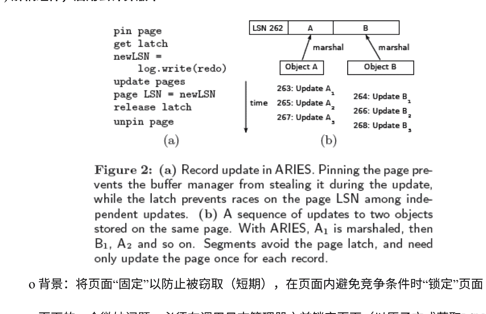

# UCB CS262A 计算机系统的高级话题讲义

# 导论讲座

## I. 行政事项

讲师: 埃里克・布鲁尔和乔・海勒斯坦

埃里克・布鲁尔
- 麻省理工学院博士, 1994年
- 互联网系统, 移动计算, 安全, 并行计算
- 创办了Inktomi, 联邦搜索基金会
- 联系方式: brewer@cs.berkeley.edu

乔・海勒斯坦
- 威斯康星大学博士, 1995年
- 数据库, 声明性网络
- 联系方式: hellerstein@cs.berkeley.edu

课程先决条件: 今年没有入学考试, 但请复习本科材料

课程的传统目标:
- 介绍各种当前的操作系统研究主题
- 教你如何进行操作系统研究

新目标:
- 操作系统和数据库研究的共同基础
- 动机: 操作系统和数据库社区在目标和思想上历史上是分开的, 尽管在目标和思想上有很多重叠。我们经常使用独立的词汇, 并且通常有完全独立的“经典”论文, 另一个社区通常没有阅读过(尤其是操作系统人员不阅读数据库论文, 因为数据库只是一个应用程序)。一年级高级系统课程的第一部分。262A本身满足软件广度要求

研究 = 分析和综合
- 分析: 理解他人的工作-包括好的和不好的。
- 系统研究并非一成不变: 很少有“可以证明正确”的答案。
- 综合: 寻找推进技术发展的新方法。

## 第1讲

课程分为两部分：
- 文献调研
- 学期项目

**不会涵盖基础知识。**

分析：文献调研：阅读、分析、批评论文。
- 所有研究项目都会以某种方式失败。
- 成功的项目：仍然获得了一些有趣的结果。

课堂上：讲座形式并进行讨论。

综合：进行一小部分真正的研究。
- 建议的项目将在3-4周内分发
- 2-3人的团队
- 海报展示和学期末的“会议论文”
- 通常最好的论文会进入真正的会议（需要额外工作）

课前准备：
- 阅读论文很难，尤其是一开始。
- **课前阅读。**

作业：    简要 总结/论文
- 不超过1/2页
- 论文中最重要的两个方面
- 一个主要缺陷

课程主题：（系统设计的很大一部分是关于共享的）
- 文件系统
- 虚拟内存
- 并发、调度、同步
- 通信
- 多处理器
- 分布式系统
- 事务、恢复和容错
- 保护和安全
- 操作系统结构
- “揭示的真理”-总体原则

研究生课程 =>材料可能有争议（希望如此！）

讲座形式：讲解1-2篇论文和公告

评分：50%项目论文，15%项目演示，25%期中考试，10%论文摘要
- 可以不写3个摘要，没有惩罚，不需要理由
- 摘要：<1/2页，至少一点批评，摘要应该不超过一半

阅读列表：
- 没有教科书
- 几乎所有东西都在线上，否则我会在课堂上分发副本。
- “热身”论文：“UNIX分时系统”
- 下次阅读：System R论文（在红皮书中）

## II. UNIX分时系统

“热身”论文。材料应该主要是复习。

经典系统和论文：几乎完全在10页中描述。

关键思想：几个概念的优雅组合，相互契合。

系统特点：
- 分时系统
- 分层文件系统
- 设备无关的I/O
- 基于shell的tty用户界面
- 基于过滤器的无记录处理范式

Unix版本3：
- 在PDP-11上运行
- < 50 KB
- 2人年编写
- 用C语言编写

文件系统：
- 普通文件（未解释的）
- 目录（受保护的普通文件）
- 特殊文件（I/O）

目录：
- 根目录
- 路径名
- 根树
- 当前工作目录
- 指向父目录的后向链接
- 多个指向普通文件的链接

特殊文件：
- 统一的I/O模型
- 统一的命名和保护模型

可移动文件系统：
- 树形结构
- 挂载在普通文件上

保护：
- 用户界面，RWX位
- 设置用户ID位
- 超级用户只是特殊的用户ID

统一的I/O模型：
- 打开，关闭，读取，写入，寻找
- 其他系统调用
- 字节，没有记录

文件系统实现：
- I节点表
- 路径名扫描
- 挂载表
- 缓冲数据
- 后台写入

### I节点表：
- 短而唯一的名称，指向文件信息
- 允许简单高效的fsck
- 无法处理会计问题

### 进程和镜像：
- 文本、数据和堆栈段
- 进程交换
- 管道
- 退出(status)
```
pid = fork()
```
```
exec(file, arg1, ..., argn)
```
```
pid = wait()
```

### Shell：
- stdio和I/O重定向
- 过滤器和管道
- 从单个shell进行多任务处理
- shell只是一个程序
```
cmd arg1 ... argn
```

### 陷阱：
- 硬件中断
- 软件信号
- 陷入系统例程

# System R和DBMS概述

## DBMS历史
- 60年代末：网络（CODASYL）和分层（IMS）DBMS。Charles Bachman: CODASYL前身IDS的创始人（60年代初在GE工作）。图灵奖第8位（1973年，在Dijkstra和Knuth之间。）
    - IMS示例：供应商记录类型和零件记录类型。一个是父级，一个是子级。问题包括冗余和需要有一个父级（删除异常）。
    - 低级“逐条记录”数据操作语言（DML），即物理数据结构反映在DML中（没有数据独立性）。
- 1970年：Codd的论文。数据库研究中最有影响力的论文。以“数据独立性”为关键思想的逐批次DML。允许模式和物理存储结构在幕后发生变化。Papadimitriou: "在计算机科学中我们能希望找到的最清晰的范式转变"。Edgar F. Codd: 图灵奖第18位（1981年，在Hoare和Cook之间）。
    - 数据独立性，逻辑和物理都有。
    - 在幕后你可以玩哪些物理技巧？想想现代硬件！
    - "Hellerstein的不等式":
        - 当 dapp/dt << denvironment/dt时需要数据独立性
        - 其他情况下是否也成立？
        - 这是两个主题的早期而强大的实例：间接级别和适应性
- 70年代中期：Codd的愿景在两个全功能（有点）原型中得到了广泛采用。几乎所有今天商业系统的祖先
    - Ingres : UCB 1974-77
        - 一个“临时团队”，包括Stonebraker和Wong。早期和开创性的。创立了Ingres Corp（加利福尼亚州），CA-Universe，Britton-Lee，Sybase，MS SQL Server，Wang的PACE，Tandem Non-Stop SQL。
    - System R
        - 15位博士学位。创立了IBM的SQL/DS和DB2, Oracle, HP的Allbase, Tandem Non-Stop SQL。虽然两个团队之间有很多信息交流，但System R可以说做得更好。
        - Jim Gray：图灵奖第22位（1998年，位于Englebart和Brooks之间）
        - System R团队中有很多伯克利的人，包括Gray（伯克利第一个计算机科学博士），Bruce Lindsay，Irv Traiger，Paul McJones，Mike Blasgen，Mario Schkolnick，Bob Selinger，Bob Yost。请参阅 http://www.mcjones.org/System_R/SQL_Reunion_95/sqlr95-Prehisto.html#Index71.
    - 两者都是可行的起点，证明了关系方法的实用性。理论与实践的直接例证！
        - ACM软件系统奖第6名由两者共享
    - 两个系统的声明目标是将Codd的理论转化为一个可行的系统，速度比CODASYL快得多，使用和维护也更容易。有趣的是，Stonebraker获得了ACM SIGMOD创新奖第1名（1991年），Gray获得了第2名（1992年），而Gray则获得了图灵奖第一名。
- 80年代初：关系系统的商业化
    - 埃里森的Oracle通过阅读白皮书击败了IBM进入市场。
    - IBM发布了多个RDBMS，最终定居于DB2。Gray（System R），Jerry Held（Ingres）和其他人加入了Tandem（Non-Stop SQL），Kapali Eswaran创办了EsVal，从而衍生出了HP Allbase和Cullinet
    - 关系技术公司（Ingres Corp），Britton-Lee/Sybase，Wang PACE grow out of Ingres group
    - CA发布了CA-Universe，这是Ingres的商业化产品
    - Informix由加州大学校友Roger Sippl（没有研究背景）创办。
    - Teradata由加州理工学院的一些校友创办，基于专有的网络技术（虽然没有软件研究的背景，但请参见本学期稍后的并行数据库管理系统讨论！）80年代中期：SQL成为“星际标准”。
    - DB2成为IBM的旗舰产品。
    - IMS“日落”。
- 今天：网络和分层系统是遗留系统（尽管广泛使用！）IMS在银行、航空公司预订等领域仍被广泛使用。对IBM来说是一头摇钱树关系型数据库被商品化--微软、Oracle和IBM争夺市场的大部分份额。NCR Teradata、Sybase、HP Nonstop和其他几家公司在边缘生存。开源软件正在崛起，包括MySQL、PostgreSQL、Ingres（重生）。BerkeleyDB是一种广泛使用的嵌入式事务存储，但现在由Oracle拥有。
    - XML和面向对象的特性已经渗透到关系产品中，作为接口和数据类型，进一步复杂化了Codd的愿景的"纯洁性"。

## 应用程序的数据库视图
像SAP和PeopleSoft这样的大型、复杂的记录管理应用程序，在DBMS上运行。"企业应用程序"使企业运转顺畅。一些例子：
- ERP：企业资源计划（SAP、Baan、PeopleSoft、Oracle、IBM等）
- CRM：客户关系管理（E.phiphany、Siebel、Oracle、IBM等）
- SCM：供应链管理（Trilogy、i2、Oracle、IBM等）
- 人力资源、直销、呼叫中心、销售力自动化、帮助台、目录管理等。

通常是客户端-服务器（Sybase的"发明"）与基于表单的API。关注数据管理而非资源管理。

传统上，DBMS的主要任务是使这些类型的应用程序易于编写。

## 关系系统架构
请参阅《数据库基础与趋势》中的文章，深入讨论以下问题。数据库是庞大的软件。通常很难进行模块化。在宏观和微观层面上有很多系统设计决策。我们将主要关注微观决策 - 因此在后续讲座中可重用的思想 -。在这里我们关注宏观设计。

## 磁盘管理选择：
- 每个关系一个文件
- 文件系统中的大文件
- 原始设备

## 进程模型：
- 每个用户一个进程
- 服务器
- 多服务器

## 硬件模型：
- 无共享
- 共享内存
- 共享磁盘

## 基本模块：
- 解析器
- 查询重写
- 优化器
- 查询执行器
- 访问方法
- 缓冲区管理器
- 锁管理器
- 日志/恢复管理器

## 关于System R的注释
请参阅System R团聚笔记，了解有趣的背景和八卦。

本文中出现的一些“系统经典问题”：
- 预计会放弃系统的第一个版本
- 尽可能通过标准的外部接口公开内部（例如，将目录作为表格、/proc文件系统等）优化快速路径
- 解释 vs. 编译 vs. 中间"操作码"表示
- 组件故障作为一个常见情况需要考虑
- 由复制功能之间的交互引起的问题（在这种情况下，调度）

## 一些重要的讨论要点
- 存储机制的灵活性：域/反转 vs. 堆文件/索引。 在现代数据库管理系统中常见的使用TID列表。为什么要教条主义？ 数据独立性怎么样？ 一个答案：你必须为每个"访问方法"正确处理事务。
- System R通常是CPU受限的（虽然这是一个粗粒度的断言--实际上意味着不是磁盘受限）。 在现代良好配置的数据库管理系统中，这也是常见的。为什么？
- 数据库管理系统实际上不是单体设计。 RSS的东西将锁定和日志记录与磁盘访问、索引和缓冲区管理交织在一起。 但是RDS/RSS边界是清晰的，而且RDS是可分解的。
- 通过视图进行访问控制：数据独立性的深度应用？！ System R的事务贡献（概念和实现）与关系模型一样重要，实际上应该与关系模型解耦。

### “车队问题”：
- 一个经典的跨层调度交互。 我们将在后面再次看到这个！
- 在论文中解释得不好。

我一直觉得这个演示很困惑。 有一些问题正在发生。 前两个问题涉及操作系统和数据库调度之间的交互：
a. 即使数据库“进程”持有高流量的数据库锁，操作系统也可以抢占它。
b. 在等待期间，处于数据库锁队列中的数据库进程会消耗它们的操作系统调度配额（这在文本中解释得不好）。 一旦它们用完了所有的调度配额，它们将从“多道程序集”中移除并进入“休眠”状态 - 运行它们需要昂贵的操作系统调度。
最后一个问题是
c. 数据库管理系统使用先来先服务的等待队列来管理锁。对于高流量的数据库锁，数据库进程平均每个T个时间步骤请求一次。 如果操作系统抢占了持有高流量数据库锁的数据库进程，那么锁后面的队列将包含几乎所有的数据库进程。 此外，队列太长以至于在T个时间步骤内无法排空，因此它是“稳定的” - 每个数据库进程在队列排空之前都重新排队，浪费了它们的调度配额，然后它们被送入休眠状态。 因此，每个数据库进程在每个操作系统唤醒周期内只能进行一次锁的授予和随后的T个时间步骤的有用工作，之后它们再次排队等待锁，浪费了它们在队列中的调度配额，然后被放回休眠状态。 结果是每个操作系统唤醒周期内的有用工作时间约为T个时间步骤，这比调度的开销要短 - 因此系统处于抖动状态。
- 请注意，解决方案只攻击了前一个评论中唯一可以在不与操作系统交互的情况下处理的问题： (c) FCFS数据库锁队列。 这里的解释很令人困惑，我认为。 重点是始终允许当前处于"多程序集"中的任何一个DB进程立即获得锁定，而不会浪费等待锁定的时间片，因此没有时间片浪费在等待上，因此每个进程几乎将其分配的所有时间片都用于"真正的工作"。 请注意，所提出的策略可以在不需要知道哪些进程位于操作系统的多程序集中的情况下实现这一目标。

## System R和INGRES的影响
System R和INGRES是所有当前系统都基于的原型。基本架构相同，许多想法仍然存在于今天的系统中：
- 优化器基本上没有改变
- RSS/RDS分割在许多系统中仍然存在
- SQL，游标，重复项，NULL等
    - 重复项的利弊。替代方案？
    - NULL的优缺点。替代方案？
    - 分组和聚合
- 可更新的单表视图
- 用户级别的事务开始/结束
- 保存点和恢复
- 目录作为关系
- 灵活的安全性（GRANT/REVOKE）
- 完整性约束
- 触发器（！！）
- 聚类
- 编译查询
- B树
- 嵌套循环和排序合并连接，所有连接都是两路连接
- 双重日志以支持日志故障

他们犯的错误：
- 影子分页
- 谓词锁定
- SQL语言
    - 重复语义
    - 子查询 vs. 连接
    - 外连接
- 拒绝哈希

## 操作系统和数据库管理系统：哲学上的相似之处和不同之处
- UNIX论文：“UNIX最重要的工作是提供文件系统”。
    - UNIX和System R都是“信息管理”系统！
    - 两者还为代码提供编程API
- 关注点的不同：自下而上（系统的优雅）vs.自上而下（语义的优雅）
    - UNIX的主要目标是提供一组小而优雅的机制，并让程序员（即C程序员）在其之上构建。例如，他们自豪地表示“不需要大型的'访问方法'例程来保护程序员免受系统调用的影响”。 毕竟，操作系统将其角色视为向计算机程序员呈现硬件。
    - System R和Ingres的主要目标是提供一个完整的系统，使程序员（即SQL +脚本）与系统隔离开来，同时保证数据和查询的明确定义的语义。 毕竟，数据库管理系统将其角色视为为应用程序员管理数据。
- 影响复杂性的去向！是系统还是最终程序员？
- 问题：哪个更好？在什么环境下？
- 后续问题：互联网系统更像企业应用程序（传统上构建在数据库管理系统上）还是科学/终端用户应用程序（传统上构建在操作系统和文件上）？为什么？关系数据库管理系统的致命弱点：一个封闭的盒子
    - 无法利用技术而不经过完整的SQL堆栈。一个解决方案：使系统可扩展，说服世界将代码下载到数据库管理系统中
    - 另一个解决方案：组件化系统（困难吗？由于事务语义，RSS很难分解）
- 操作系统的阿喀琉斯之踵：很难决定"正确"的抽象层次正如我们将要阅读的那样，许多UNIX抽象（例如虚拟内存）隐藏了*太多*的细节，搞乱了语义。另一方面，过低的层次可能会给程序员带来太大的负担，破坏系统的优雅一个解决方案：使系统可扩展，说服高级应用程序下载代码到操作系统中
    - 另一个解决方案：组件化系统（由于保护问题而困难）传统上是分开的社区，尽管
    - 后来明确需要集成UNIX论文：“我们认为，在我们的环境中，锁既不是必要的，也不足够，以防止同一文件的用户之间的干扰。” 它们是不必要的，因为我们面对的不是由独立进程维护的大型单一文件数据库。
    - System R：“已经证明了将一个非常高级的数据子语言SQL编译成机器级代码的可行性。”

因此，这门课的主要目标是从这两个方向出发，总结出教训，并思考如何在今天的环境中无论是在这些历史上分离的系统内部还是外部使用这些教训。

# 讲义

UNIX快速文件系统
日志结构化文件系统
日志文件系统的分析和演化

## I. 背景
i-node：每个文件的元数据结构（每个文件唯一）
- 包含：所有权、权限、时间戳、约10个数据块指针
- 它们形成一个由“i-number”索引的数组。因此，每个i-node都有一个唯一的i-number。
- 对于FFS，数组是显式的，对于LFS，数组是隐式的（其i-node映射是由i-number索引的i-nodes的缓存）间接块：
- i-node只包含少量的数据块指针
- 对于较大的文件，i-node指向一个间接块（在一个4K块中，每个4字节的条目可以容纳1024个条目），该间接块再指向数据块。对于更大的文件，可以有多级间接块。

## II. UNIX的快速文件系统
原始的UNIX文件系统简单而优雅，但速度较慢。
只能达到约20 KB/秒/臂；约1982年磁盘带宽的2%。

问题:
- 块太小
- 文件的连续块不靠近（成熟文件系统的随机放置）
- i节点远离数据（所有i节点在磁盘开始处，所有数据在其后）
- 目录的i节点不靠近
- 没有预读

| 特征 | 原始的UNIX文件系统 | 新文件系统的方面 |
| :--- | :--- | :--- |
| 块大小 | 小 | 4096或8192字节的块大小（为什么不更大？） |
| 块分配 | 连续块不靠近（随机放置） | 大块和小片段 |
| 磁盘布局 | 无分组 | 磁盘分为柱面组 |
| 元数据位置 | i节点远离数据 | 每个柱面组包含超级块、i节点、空闲块位图、使用情况摘要信息 |
| 预读 | 没有预读 |  |## FFS/LFS

请注意，现在i节点分布在整个磁盘上：使i节点靠近文件，目录的i节点在一起

-   柱面组约16个柱面，或7.5 MB
-   柱面头分散布置，不全部在一个盘片上

两种局部性技术：

-   不要让磁盘在任何一个区域填满
-   悖论：为了实现局部性，必须将不相关的事物分散得很远
-   注意：新的文件系统每秒获得175KB，因为空闲列表包含连续的块（它产生了局部性），但旧系统的块是随机排序的，只获得30KB每秒

这些技术的具体应用：

-   目标：将目录保持在一个柱面组内，将不同的目录分散开
-   目标：在一个柱面组内分配连续的块，偶尔切换到一个新的柱面组（在1MB处跳转）。
-   布局策略：全局和局部
-   全局策略将文件和目录分配给柱面组。选择“最佳”下一个块进行块分配。
-   局部分配例程处理特定的块请求。如果需要，从一系列备选项中选择。

结果：

-   大型读/写占用磁盘带宽的20-40%。
-   比原始UNIX速度快10-20倍。
-   大小：新系统中的3800行代码，旧系统中的2700行代码。
-   总磁盘空间的10%无法使用（除非以50%的性能价格）。

可以做更多；后续版本可以。

对系统接口进行了改进：（实际上是第二篇小论文）

-   长文件名（14 -> 255）
-   咨询文件锁（共享或独占）；锁的持有者的进程ID存储在锁中=>如果进程不再存在，则可以重新获取锁
-   符号链接（与硬链接相对比）
-   原子重命名功能（在此之前，没有原子读-修改-写操作）

-   磁盘配额
-   可以使写时复制（copy-on-write）工作，以避免从用户->内核复制数据。（只需要为未对齐的页面复制）
-   过度分配将节省时间；稍后返回未使用的分配。优点：1）分配开销较小，2）更有可能获得连续的块

论文的3个关键特点：

-   为其运行的硬件参数化FS实现。
-   基于测量的设计决策
-   局部性“胜出”

一个主要缺陷：

-   来自单个安装的测量数据。
-   忽视了技术趋势

对未来的教训：不要忽视底层硬件特性。

对比研究方法：改进现有系统 vs. 设计全新系统。

# III. 日志结构化文件系统

完全不同的文件系统设计。

技术动机：

-   CPU超越磁盘：I/O变得越来越成为瓶颈。
-   大内存：文件缓存效果良好，减少了大部分磁盘读写。

当前文件系统存在的问题：

-   大量小写操作。
-   同步操作：在太多地方等待磁盘。（这也使得RAID无法充分发挥作用，缺乏并发性。）（这使得从RAID中获得很大收益变得困难。）
-   创建新文件需要5次寻址：（大致顺序）文件i-node（创建），文件数据，目录项，文件i-node（完成），目录i-node（修改时间）。

LFS的基本思想：

-   使用高效、大容量、顺序写入的方式记录所有数据和元数据。
-   将日志视为真实数据（但保持其内容的索引）。
-   依靠大内存提供快速的缓存访问。

## FFS/LFS

-   磁盘上的数据布局具有“时间局部性”（对写入很好），而不是“逻辑局部性”（对读取很好）。为什么这样更好？因为缓存有助于读取，但对写入没有帮助！

可能存在的两个问题：

-   缓存未命中时的日志检索。
-   循环回绕：当达到磁盘末尾时会发生什么？
    -   不再有大的空闲空间可用。
    -   如何防止碎片化？

日志检索：

-   保持与UNIX相同的基本文件结构（inode、间接块、数据）。
-   检索只是找到文件的inode的问题。
-   UNIX的inode保存在一个或几个大数组中，LFS的inode必须浮动以避免原地更新。
-   解决方案：一个inode映射，告诉每个inode的位置。（还保存其他信息：版本号，最后访问时间，空闲/已分配。） inode映射像其他所有内容一样写入日志。
-   inode映射的映射写入磁盘上的特殊检查点位置；在崩溃恢复中使用。

磁盘环绕：

-   压缩实时信息以打开大块的空闲空间。 问题：长期存储的信息会一次又一次地复制。
-   通过空闲空间记录线程日志。 问题：磁盘将会碎片化，使得I/O再次变得低效。
-   解决方案：分段日志。
    -   将磁盘划分为大的固定大小段。
    -   在段内进行压缩；在段之间进行线程切换。
    -   写入时，仅使用干净的段（即没有实时数据）。
    -   偶尔清理段：读入几个段，以压缩形式写出实时数据，留下一些碎片。
    -   尝试将长期存储的信息收集到永远不需要清理的段中。
    -   注意，没有空闲列表或位图（如FFS中的），只有一个干净段的列表。

要清理哪些段？

-   在每个段中保持空闲空间的估计，以帮助找到具有最低空闲空间的段。

## FFS/LFS

利用率。

-   始终从利用率为0的段开始清理，因为这些是简单的...
-   如果正在清理的段的利用率为U：
    *   写入成本 = (总读写字节数) / (新写入的数据) = 2 / (1-U)。(除非U为0)。
    *   随着U的增加，写入成本也增加：U = .9 => 成本 = 20!
    *   需要成本小于4到10; => U小于.75到.45。

## 如何清理一个段?

-   段摘要块包含段的映射。必须列出每个i节点和文件块。对于文件块，您需要{i号，块号}
-   要清理一个i-node：只需检查它是否是当前版本(来自i-node映射)。如果不是，则跳过；如果是，则写入日志头并更新i-node映射。
-   要清理文件块，必须确定它是否仍然有效。首先检查UID，它只告诉你这个文件是否是当前的(当文件被删除或长度为零时，UID才会改变)。请注意，UID不会在每次文件被修改时都更改(因为您将不得不更新其所有块的UID)。接下来，您必须遍历i-node和任何间接块，以获取此块号的数据块指针。如果它指向这个块，则将该块移动到日志的开头。

## LFS清理的模拟：

-   初始模型：引用的均匀随机分布；贪婪算法用于选择要清理的段。

-   为什么模拟比公式效果更好？因为段利用率存在方差。

-   增加了局部性（即90%的引用指向10%的数据），结果变得更糟！
-   第一个解决方案：按年龄顺序写出清理后的数据，以获得热段和冷段。

-   * 这是什么编程语言特性？这让你想起了什么？分代垃圾回收。
* 只有帮了一点忙。

问题：即使冷段最终也必须达到清理点，但它们下降得很慢。占用了大量的空闲空间。你相信这是真的吗？

解决方案：清理冷段值得付出更多，因为这样可以更长时间地保留空闲空间。

更好的思考方式是：不要清理具有高d-free/dt（利用率的一阶导数）的段。如果忽略它们，它们会自行清理！LFS使用年龄作为d-free/dt的近似值，因为直接跟踪后者很困难。

-   新的选择函数：MAX(T*(1-U)/(1+U))。

-   * 导致所需的双峰利用函数。
* LFS保持在80%的磁盘利用率以下的写入成本。

### **FFS/LFS**

检查点：

-   只是一个优化，用于向前滚动。减少恢复时间。
-   检查点包含：指向i节点映射和段使用表的指针，当前段，时间戳，校验和（？）
-   在写入检查点之前，请确保刷新i节点映射和段使用表。
-   使用“版本向量”方法：将检查点写入具有时间戳和校验和的交替位置。在恢复过程中，使用最新的（有效的）检查点。

崩溃恢复：

-   Unix必须读取整个磁盘以重建元数据。
-   LFS从检查点状态开始，通过日志向前滚动。
-   结果：恢复时间以秒计，而不是以分钟到小时计。
-   目录操作日志 == 日志意图实现原子性，然后在恢复过程中重做，（对于没有数据的新文件进行撤消，因为无法重做）

目录操作日志：

-   “意图 + 动作”的示例：将意图作为“目录操作日志”进行写入，然后写入实际操作（创建、链接、取消链接、重命名）
    -   这使它们成为原子操作
    -   在恢复时，如果您看到操作日志条目，则可以重做操作以完成它（对于没有数据的新文件创建，您将撤消它）
    -   => “逻辑”重做日志

一个有趣的观点：LFS的效率并不来自于了解磁盘几何的细节；这意味着它可以更好地适应不断变化的磁盘技术（如可变的扇区/磁道数）

论文的关键特点：

-   CPU的速度超过了磁盘的速度；这意味着I/O正在成为一个越来越大的瓶颈。
-   将文件系统信息写入日志并将日志视为真相；依靠内存缓存来提高速度。
-   难题：找到/创建长时间运行的磁盘空间以（顺序地）写入日志记录。解决方案：从段中清除活动数据，根据成本/效益函数选择要清除的段。

一些缺陷：

-   假设文件完整写入；否则会在LFS中出现文件内碎片。
-   如果小文件“变大”，那么LFS与UNIX相比如何？

## FFS/LFS

一个教训：重新思考设计中的基本假设，什么是主要的，什么是次要的。在这种情况下，他们让日志成为真相，而不仅仅是恢复的辅助工具。

# IV. 日志文件系统的分析和演进

日志文件系统:

-   预写式日志: 通过将数据写入日志来提交数据，同步和顺序写入
-   与LFS不同，稍后将数据移动到其正常（类似FFS）的位置；这种写入称为检查点，类似于段清理，它在（循环）日志中腾出空间
-   对于随机写入更好，对于大的顺序写入略差
-   所有读取都是针对固定位置的块，而不是日志，日志只在崩溃恢复和检查点读取。
-   比FFS（fsck）更好的崩溃恢复（下面会讲到），因为它更快
-   Ext3文件系统是Linux中的主要文件系统；RieserFS变得越来越受欢迎

三种模式:

-   写回模式: 仅记录元数据，独立地写回数据和元数据因此，在崩溃后，元数据可能存在悬空引用（如果在数据之前写入元数据并在崩溃之间发生）
-   有序模式: 仅记录元数据，但总是在引用元数据被记录之前写入数据块。这种模式通常是最合理的，被Windows NTFS和IBM的JFS使用。
-   数据日志模式: 将数据和元数据都写入日志
    -   日志流量大幅增加；还必须将大多数块写两次，一次写入日志，一次用于检查点（为什么不是全部？）

崩溃恢复:

-   加载超级块以找到日志的尾部/头部
-   扫描日志以检测完整的已提交事务（它们有一个提交记录）
-   重放日志条目以更新内存中的数据结构
    -   这被称为“重做日志记录”，条目必须是“幂等”的
    -   回放是从最旧到最新的；日志的尾部是检查点停止的地方
    -   如何找到日志的头部？

一些细节:

-   可以将事务分组在一起：较少的同步和写入，因为热门元数据可能在一个事务中多次更改
-   需要写入一个提交记录，以便您知道所有的复合事务已经写入磁盘
-   ext3 记录整个元数据块（物理日志记录）；JFS和NTFS记录逻辑记录
    -   这意味着日志流量较少

## # FFS/LFS

-   区分写入顺序和持久性/持久性：谨慎排序意味着在崩溃后，文件系统可以恢复到一致的过去状态。 但是在JFS的情况下，该状态可能远在过去。对于ext3来说，相差30秒更为典型。 如果你真的想要某个东西持久，你必须同步刷新日志。

## ## 语义块级分析（SBA）

-   好主意：在文件系统和真实磁盘驱动程序之间插入特殊磁盘驱动程序
    -   优点：简单，捕获所有磁盘流量，可以与黑盒文件系统一起使用（不需要源代码），甚至可以通过VMWare用于另一个操作系统，可以比性能基准更具洞察力

-   缺点：必须对磁盘布局有一定的了解，每个文件系统都不同，需要大量的推理；实际上只对写入有 用
    -   要使用得好，需要使用智能应用程序来测试文件系统的某些功能（以便更容易进行推理）

## ## 语义跟踪回放（STP）

-   使用两种类型的插入：1）生成跟踪的SBA驱动程序，和2）位于应用程序和真实文件系统之间的用户级库
    -   用户级库跟踪脏块和应用程序调用的fsync

-   回放：给定这两个跟踪，STP生成一组定时的命令发送到原始磁盘设备。
    -   可以根据这个序列的时间来理解性能影响。

-   声明：修改跟踪比修改文件系统更快，比构建模拟器更简单且更少出错
    -   仅限于简单的文件系统更改

-   最佳示例用法：显示在有序模式和数据日志模式之间动态切换实际上可以获得最佳性能。（对于随机写入使用数据日志）

## # AutoRAID

目标：自动化RAID中数据的高效复制

-   RAID设置和优化很困难
-   将快速镜像（2个副本）与较慢、更节省空间的奇偶磁盘混合
-   自动迁移这两个级别之间

RAID级别（加粗的是实际使用的）：

-   **RAID 0**: 条带化（仅带宽）
-   **RAID 1**: 镜像（简单、快速，但需要2倍的存储空间）
    -   读取速度更快，写入速度较慢（为什么？）
-   RAID 2: 位交错与纠错码（ECC）
-   专用奇偶磁盘（RAID级别3），字节级条带化
    -   专用奇偶校验磁盘是写入瓶颈，因为每次写入都会写入奇偶校验
-   RAID 4: 专用奇偶校验磁盘，块级条带化
-   **RAID 5**: 旋转奇偶校验磁盘，块级条带化
    -   最流行的；旋转磁盘将奇偶校验负载分散
-   RAID 6: 具有两个奇偶校验块的RAID 5（容忍两个故障）

RAID小写问题：

-   覆盖块的一部分需要2次读取和2次写入！
-   读取数据，读取奇偶校验，写入数据，写入奇偶校验

每种复制方式都有其最佳工作负载的狭窄范围...

-   错误 ⇒1）性能差，2）更改布局昂贵且容易出错
-   还难以添加存储：新磁盘 ⇒更改布局和重新排列数据...

(另一个问题：备用磁盘被浪费)

关键思想：镜像活动数据（热数据），RAID 5用于冷数据

-   假设一次只有部分数据在活动使用
-   工作集变化缓慢（以允许迁移）

部署位置：

-   系统管理员：让人工移动文件...糟糕。痛苦且容易出错
-   文件系统：最佳选择，但难以实现/部署；无法与现有系统配合使用

## AutoRAID

-   智能阵列控制器：（魔术磁盘）块级设备接口。易于部署
    -   因为有一个明确定义的抽象；可以轻松使用NVRAM（为什么？）

### 特点：

-   块映射：间接级别，以便块可以在磁盘之间移动
    -   • 意味着只需要一个“零块”（全零），一种写时复制的变体
    -   • 实际上可以将每个唯一块映射到一个真实块

-   活动块的镜像

-   RAID 5 用于非活动块或大型顺序写入（为什么？）

-   开始时完全镜像，然后随着磁盘填充而转为10%镜像

-   以64K块（8-16个块）为单位进行提升/降级

-   热插拔磁盘等（热插拔只是一种受控故障）

-   轻松添加存储（进入镜像池）
    -   • 允许不同大小的磁盘很有用（为什么？）

-   不需要主动热备份（本质上）；只需保留足够的工作空间

-   日志结构化RAID 5写入。（为什么这样做是正确的？很好的大流，不需要为部分写入读取旧奇偶校验位）

### 大小：

-   PEX = 1MB

-   PEG = PEX集合

-   段 = 128K

-   重定位块 = RB = 64K（用于填补空洞的大小）

### 问题：

-   何时降级？当镜像存储过多（>10%）时
-   降级会留下一个空洞（64KB）。它会发生什么？移动到空闲列表并重新使用
-   降级的RB会写入RAID5日志，一个写入数据，第二个写入奇偶校验位
-   为什么日志RAID5比原地更新好？更新数据需要读取所有旧数据以重新计算奇偶校验位。日志忽略旧数据（变为垃圾）并仅写入新数据/奇偶校验条带。

-   何时晋升？当写入RAID5块时…只需将其写入镜像中，旧版本变为垃圾。

-   RB应该有多大？更大 ⇒更细粒度的迁移，更小 ⇒较少的映射信息，更大 ⇒较少的寻道

-   如何找到RB的位置？将地址转换为（LUN，偏移量），然后查找此对在表中的RB。映射大小∝ RB的数量，必须与总存储大小成比例。

-   控制器用于读取的缓存

-   控制器使用NVRAM进行快速提交，然后将数据移动到磁盘。如果NVRAM已满怎么办？等待直到NVRAM块刷新到磁盘，然后写入NVRAM。

## # AutoRAID

-   磁盘写入通常会写入两个磁盘（因为新写入的数据是“热的”）。必须等待两者都完成（为什么？）。主机必须等待两者吗？不，只需等待NVRAM。
-   后台会发生什么？1）压缩，2）迁移，3）平衡。
-   压缩：清理RAID5并填补镜像磁盘中的空洞。镜像磁盘会被清理吗？是的，当RAID5需要PEG时；即选择具有许多空洞的磁盘，并将其使用的RB移动到其他磁盘。结果为空的PEG现在可供RAID5使用。
-   如果没有足够的空洞怎么办？将多余的RB写入RAID5，然后回收PEG。

糟糕的情况？当工作集大于镜像存储时，出现抖动

## # 性能：

-   始终优于常规RAID，与普通磁盘相当（但更差）
-   他们无法使传统RAID正常工作...

## # 其他事项：

-   “最短寻道”--选择离块最近的磁盘（2个磁盘中的一个）
-   空闲时，填补RAID5中的空洞而不是追加到日志中（更容易，因为所有RBs的大小都相同！）
    -   为什么不一直这样做？需要读取剩余的条带并重新计算奇偶校验
-   非常重要的是行为是动态的：使其在工作负载、技术变化和添加新磁盘时具有鲁棒性。极大地简化了磁盘系统的管理

## # 论文的关键特点：

-   RAID很难使用好--两个级别和自动数据移动简化了它
-   自动混合镜像和RAID5
-   将魔法隐藏在简单的SCSI接口后面

# 基于段的恢复

ARIES工作得很好，但已经有20多年了，存在一些问题：

-   被认为非常复杂
-   没有可用的带有源代码的实现
-   一个单体数据库管理系统的一部分：可以重用事务用于其他系统吗？
-   页面中的LSN将大对象分割成多个部分（图1），防止高效的I/O
-   DBMS在云计算中似乎很难扩展（除了分区）

原始目标（稳定性）：

-   构建一个具有完整ARIES风格的开源事务系统，支持steal/no-force事务
-   尝试使DBMS更加“分层”，类似于操作系统的风格
-   尝试支持更广泛的事务系统：版本控制、文件系统、生物信息学或科学数据库、图问题、搜索引擎、持久化对象等等
-   竞争性能

这些目标大部分得到了满足，尽管开源版本需要更多用户，我们只尝试了一些不寻常的应用。

原始版本基本上是直接的ARIES；开发带来了许多见解，新版本基于段。

## 面向段的恢复（SOR）

一个段只是一系列字节的范围

-   可能跨越多个页面
-   可能每页有很多个
-   类似于计算机体系结构中的段和页面（但体系结构使用段来保护边界，我们使用它们来恢复边界；在两者中，页面是固定大小且移动到磁盘的单位）

关键思想：改变ARIES设计的两个核心要点：

-   恢复段而不是页面
-   页面上没有LSN
    -   ARIES：每个页面启用一次性重做语义的LSN
    -   SOR：保守估计LSN（较旧）=>至少一次语义[但现在必须限制我们在重做中可以采取的操作]

SOR的四个重要优点：## 1) 启用DMA和/或零拷贝I/O

-   每个页面没有LSN意味着大对象在磁盘上是连续的
-   没有“分段和重组”将对象从磁盘移动到内存
-   不需要将CPU卷入对象I/O（非常昂贵）；使用DMA代替

### 2) 修复持久化对象

问题：考虑一个页面上有多个对象，每个对象在内存中都有一个表示（例如C++或Java对象）
-   假设我们更新了对象A并生成了LSN=87的日志条目
-   接下来我们更新对象B（在同一页上），生成其LSN=94的日志条目，并将其写回磁盘页面，更新页面的LSN
-   这种模式破坏了恢复过程：新页面的LSN（94）意味着页面反映了重做日志条目87，但实际上并没有。
-   ARIES的“解决方案”：磁盘页面（在内存中）必须在每次日志写入时更新；这就是“写透缓存”——所有更新都被写入缓冲管理器页面

SRU解决方案：
-   没有页面LSN，因此没有错误
-   缓冲管理器是基于缓存驱逐的——“写回缓存”。这意味着对于热对象的复制/编组要少得多。
-   这就像应用程序缓存和缓冲管理器之间的“无力量”(!)

### 3) 启用高/低优先级事务（实时重新排序日志）

使用页面，我们原子地分配LSN与页面写入[绘制图2]
-   根本不可能重新排序日志条目
-   理论上，两个独立的事务可以根据优先级或因为它们要去不同的日志磁盘（或日志服务器）而重新排序它们的日志条目

SRU：在页面更新时不需要知道LSN（只需要确保在提交之前分配LSN，以便在以后的事务之前排序；这很容易确保——只需使用正常的锁定并遵循WAL协议）
-   高优先级更新：将日志条目移动到日志的前面或高优先级的“快速”日志磁盘
-   低优先级更新通常放在日志的末尾

### 4) 解耦组件；启用云计算版本



-   背景：将页面“固定”以防止被窃取（短期），在页面内避免竞争条件时“锁定”页面
-   页面的一个微妙问题：必须在调用日志管理器之前锁定页面（以原子方式获取LSN）
-   SRU没有页面LSN，实际上对于页面没有任何共享状态=>不需要锁定
-   SRU解耦了三个不同的事物：
    -   应用程序<->缓冲管理器：这是上面描述的写回缓存：只需要在驱逐时进行交互，而不是在每次更新时
    -   缓冲管理器<->日志管理器：不需要在日志管理器调用期间持有锁定；现在可以异步和批量一起进行日志管理器调用
    -   段可以通过零拷贝I/O直接移动，无需元数据（例如页面LSN）和CPU参与。简化存档和读取大型对象（例如照片）。
-   希望：有人（最好是在CS262中）能够使用SRU构建一个分布式事务服务
    -   应用程序、缓冲管理器、日志管理器、稳定存储可以是不同的集群
    -   性能：（图11）分布式事务的差异可达1-3个数量级

## 生理重做（回顾）：

-   重做操作仅应用一次（使用页面LSN）
-   物理和逻辑日志的结合
    -   物理：写入前图像或后图像（或两者）
    -   逻辑：写入逻辑操作（“插入”）
-   生理：
    -   重做是物理的
    -   正常的撤销操作类似于重做，并设置一个新的LSN（不会恢复到旧的LSN -- 鉴于一个页面上有多个对象，这种方法行不通！）
    -   为了实现更高的并发性，不要撤销B-Tree（或其他索引）的结构更改；而是使用新的逻辑撤销操作来代替物理撤销操作，该操作是相反的操作。这样可以通过短时间锁定结构更改而不是长时间锁定（直到事务结束）来实现并发性
    -   分槽页面：为每个页面添加一个偏移量数组（槽），然后使用槽号存储记录，并使用数组查找该记录的当前偏移量。这样可以在不产生任何日志条目的情况下更改页面布局。

## SRU 重做：

-   重做可能被应用多次；我们可以回溯比严格必要更久的时间
-   重做必须是物理上的“盲写”——写入的内容不依赖于之前的内容
-   撤销对并发仍然可以是逻辑的
-   分槽页布局更改需要重做日志记录

### 核心SRU重做阶段：

-   定期将估计的LSN写入日志（在写回页面后）
-   从段的磁盘版本开始（或从快照或整个段写入）
-   重放自估计的LSN以来的所有重做（最坏情况下是截断日志的开头），即使有些可能已经被应用过
-   对于段的所有字节：要么它在磁盘上是正确的且未更改，要么它是在恢复期间按时间顺序写入的（因此正确反映了最后一个接触该字节的日志条目）

## 混合恢复：可以混合使用SRU和传统的ARIES

-   某些页面具有LSN，某些页面没有
-   无法轻易查看页面并告知！（所有字节都用于段）
-   记录页面类型更改并清零页面
    -   恢复可能会暂时损坏页面，直到获取正确类型为止，在此时从全零页面正确地向前滚动。
-   使用示例：
    -   B-树：内部节点在页面上，叶子节点是段
    -   字符串表：短字符串适合页面，特别是如果它们的大小会改变；长字符串适合段，因为它们具有连续的布局

### 额外的东西：

为什么页面上有LSN？
-   这样我们就可以原子地写入时间戳（LSN）和页面
-   问题：页面写入不再是原子的
-   解决方案：使它们原子化，以使ARIES仍然工作
-   将一些位写入页面的所有扇区（8K页面= 16个512B扇区）；将这些位与其他地方存储的值进行比较。没有匹配=>恢复页面（但可能匹配并且错误）。假设扇区是原子写入的，这是合理的。
-   为每个页面（包括LSN）编写一个校验和，在读取页面时进行校验
-   两种解决方案都会对I/O性能产生影响

### SRU方法：

-   对每个段（或一组小段）进行校验和
-   在校验和失败时，可以重放最后的重做操作，这可以修复一个损坏的页面（然后使用校验和进行确认）；如果这不起作用，则返回到旧版本并向前滚动
-   盲目写入可以修复损坏的页面，因为它们不依赖于其内容

操作系统中的高级主题 CS262a

埃里克·A·布鲁尔教授（在乔·海勒斯坦的帮助下）

# 轻量级可恢复虚拟内存

论文（在相关工作中）：

RVM...提出并回答了“什么是平均应用程序的基本事务实现的最简单方法？”这个问题。通过这样做，它使得事务对于迄今为止对复杂事务设施感到困惑的应用程序变得可访问。

答案：实现了无偷取、无强制的虚拟内存持久性库，具有手动写时复制和仅重做日志。

目标：允许Unix应用程序以具有明确失败语义的方式操作持久数据结构（例如文件系统的元数据）。

现有的解决方案（如Camelot）过于笨重。希望有一个“轻量级”版本的这些功能，不提供（不需要的）分布式和嵌套事务、共享日志等支持。

解决方案：一个只提供可恢复虚拟内存的库包。

从Camelot中得到的教训：
-   多个地址空间和它们之间的常量IPC开销很大。
-   笨重的功能会施加额外的繁重编程约束。
-   Camelot的大小和复杂性以及其对特殊Mach功能的依赖导致了维护困难和可移植性的缺失。（在“生产”系统中，前者不应该是一个问题。）

Camelot有一个糟糕的对象和进程模型。它的组件化导致了大量的IPC。它的日志截断效果不佳。可能对Mach的拥抱过于热衷。
-   然而，需要注意的是，CMU系统的黄金时代从分享的工件中学到了很多东西：Mach，AFS，Coda...
-   这篇论文中有很多积极的精神。

架构：
-   关注元数据而不是数据
-   外部数据段：将文件映射到内存中的mmap思想
-   进程将数据段的区域映射到其地址空间。不允许别名。
-   对RVM的更改作为事务的一部分进行。
-   在修改区域的一部分之前必须调用set_range操作。允许在中止后将旧值的副本（在内存中）高效地恢复。
-   无刷新提交在性能上换取了更弱的永久性保证。在哪些情况下可以使用无刷新提交事务？
-   无恢复 == 无显式中止 => 除了崩溃恢复之外，不进行撤消
-   就地恢复（应用程序代码不需要担心恢复！）
-   为了确保持久化数据结构在多个事务事后丢失时仍然保持一致。示例：文件系统。
-   没有隔离性，没有序列化，没有处理媒体恢复（但可以添加）。非常系统的观点；在数据库领域不太流行...

这些可以用来实现一种有趣的事务检查点。在事务完成之前，可能需要刷新写前日志，但愿意接受任何时间的“检查点”。(内部) 事务点。
-   刷新：强制将日志写入磁盘。
> • p6: “请注意，原子性是独立于永久性的。” 这让数据库专家感到困惑。在这个上下文中，它意味着所有的事务都是原子的（全部发生或全部不发生），但是最近的事务在崩溃时可能会被遗忘。也就是说，它们在崩溃时从“全部”变为“无”，尽管系统告诉调用者事务已提交。刷新可以防止这种情况发生，这只会在无刷新事务中发生。
-   截断：将日志内容反映到外部数据段并截断日志。

### 实施：

-   日志仅包含新值，因为未提交的更改永远不会写入外部数据段。没有撤销/重做操作。区分外部数据段（主副本）和VM后备存储（持久临时副本）=>可以通过传播到VM而无需UNDO来窃取（因为您尚未覆盖主副本）
-   崩溃恢复和日志截断：请参阅论文。
-   缺少"set range"调用非常糟糕-仅在某些崩溃期间才会出现令人讨厌的非确定性错误。.. 可能使用静态分析来验证set range的使用情况...
-   预写式日志记录：先记录意图，然后对主副本进行幂等更新（重试更新直到成功）

#### 优化：

-   事务内部：合并set_range地址范围很重要，因为程序员必须进行防御性编程。
-   在提交时合并不刷新的日志记录。

#### 性能：

-   在全面考虑的基础上击败了Camelot。
-   与虚拟机的集成不会成为一个重大问题，只要实际/物理内存的使用不会过大。
-   日志流量优化可以显著节省资源（尽管不是多个因素）。

### 论文的3个关键特点：

-   目标：提供一个允许程序以明确的故障语义操作持久数据结构的工具。
-   原始经验与一个重量级的、完全通用的事务支持设施有关，这导致了一个构建轻量级设施的项目，该设施仅提供可恢复的虚拟内存（因为这是上述目标所需的全部内容）。
-   轻量级设施以约10K行代码提供了所需的功能，具有更好的性能和可移植性。

显著的改进性能和可移植性。

一个缺陷：本文描述了如何减少和简化通用设施以支持更窄的应用领域。

尽管它认为通过在减少的功能之上构建其他层次可以恢复更一般的功能，但这尚未得到证明。

还允许"持久性错误"--在一定范围内的错误无法通过重新启动来修复...它们会一直持续到手动修复为止。

一个教训：在构建通用操作系统功能时，选择一项（或很少几项）并且做得很好，而不是提供一个提供许多功能但做得很差的通用功能。

# 分布式事务的背景：

### 提交事务的两种模型：

-   一阶段：仅用于维护易失性状态的服务器。服务器只向此类服务器发送结束请求（即它们不参与提交的投票阶段）。
-   二阶段：用于维护可恢复状态的服务器。服务器向此类服务器发送投票和结束请求。

### 可能返回4种不同的投票结果：

-   投票中止
-   只读提交投票：参与者未修改可恢复数据并退出提交协议的第二阶段。
-   投票-提交-易失性：参与者未修改可恢复数据，但想知道事务的结果。
-   投票-提交-可恢复：参与者已修改可恢复数据。

# 并发控制

CS262，2011年秋季。

乔·海勒斯坦

## I.并发和控制顺序。

-   传统编程抽象中的顺序。
-   为什么并发很难？
-   为什么顺序很重要？哪些顺序很重要？这些都是深奥的问题。
-   退一步：忽略共享状态、侧信道等。假设没有共享，没有显式通信，

## II.代理间通信：会合/加入

古老的通信场景：1个发送者，1个接收者。

1.  时空会合：两个山顶上的定时烟信号。代理1有指令在特定时间（和地点）产生一缕烟。代理2有指令在同一时间（和地点）观察。
2.  接收者持久：烟信号和瞭望塔。代理2在瞭望塔等待约定地点的烟信号。代理1随意吹烟。（如果太早怎么办？）
3.  发送者持久化：WatchFires。代理1可以点燃一个篝火。当方便时，代理2会检查篝火。（如果太早怎么办？）
4.  双方持久化：Watchfire和Watchtower。两者都持久存在。

要点：（1）单方持久化允许另一方异步操作。（2）但是持久化方必须跨越瞬态方的时间。（3）在没有任何时间协调的情况下，双方持久化是确保会合的方法：第二个到达必然与第一个重叠。

这非常类似于数据库引擎中选择连接算法的选择！

下一个问题：多通信。我们能保证顺序吗？通过时间约会，代理可以协调（“共享一个时钟”）。通过接收者持久化，接收者可以观察/维护发送者的顺序。发送者持久化更常见，但不能（自然地）保持顺序！

**注意：在大多数计算环境中，这种推理是颠倒的。存储是一个给定的，并且最终成为一个隐式的通信通道。 必须控制跨代理的操作。**

## III. 关于状态和持久性

### 什么是状态？

-   所有的内存值、寄存器、堆栈、程序计数器等等

### 什么是持久状态？

-   持久状态：在时间上进行通信的状态。例如，跨PC设置进行通信。写入是将信息发送到未来，读取是接收信息。
-   DRAM如何保持状态？发送者保持！并且要记住：发送者保持不能保证顺序！！（附注：操作系统如何进行磁盘持久化？）

## IV. 如何控制通信？

-   预防：改变约会的空间或时间！
    -   写入者使用私有空间（影子副本、写时复制、多版本、函数式编程等）
    -   和/或协议安排适当的“时间”进行约会（例如通过锁定协议或出版位置协议来约定时间方案）。
    -   和/或协议通过锁定或发布位置方案来安排适当的“时间”进行约会（例如，通过锁定协议或发布位置方案来协商时间方案）。
        -   这些协议通常递归地依赖于受控通信！（例如在释放锁定时进行回调或继续，例如在众所周知的位置发布转发指针后进行轮询等）
-   检测：识别出违反排序约束的不良通信，并以某种方式撤销代理。
-   确保所有执行的通信都是不可见的，或者递归地撤销。

## V. 可接受的通信顺序

1.  状态的基本操作是什么？通信 - 即数据依赖关系。
2.  对于这些操作，哪些顺序是重要的？这取决于情况！
3.  客户端对可接受的排序的观点：串行调度，可串行性。
4.  冲突。假设有两个客户端和一个服务器。哪些交错不保留客户端的观点？R-W和W-W冲突。冲突可串行性是可串行性的保守测试。

## VI. 锁定作为“反连接前厅”。

-   思路：由于通信是会合的，让我们防止不适当的会合-没有冲突！结果：等效。基于提交时间的串行调度。（动态！）
-   在空间中考虑会合：例如两个间谍在一个锁定的房间里传递消息。
-   在你可以“进入”会合点之前：
    -   检查当前是否有冲突的操作被授予访问会合点的权限（非“反连接”）。
        -   如果与已授予的操作有冲突（连接），则在前厅等待
        -   如果没有冲突，则将自己标记为已被授予访问权限（持久性直到结束）。进入会合点进行你的业务
    -   当已授予的事务离开时，选择一个相互兼容的事务组进入已授予组。
-   一些我们可以玩的空间游戏
    -   可以在空间中“移动”会合点（锁代理？锁缓存？）
    -   可以根据其他考虑因素进一步延迟会合。
-   你应该了解Gray的论文中的多粒度锁！（MySQL的开发人员花了几年时间才学会这个。）

## VII. 时间戳排序（T/O）

读写的流对称连接，输出数据和中止。
T/O. 在事务产生时通过时间戳（墙钟？序列？乱序？）预先声明调度。没有反连接 = 没有等待！但是当检测到重新排序时重新启动...

-   为每个对象跟踪读时间戳和写时间戳：读时间戳：最大计数器而不是持久性。
-   拒绝（中止）过时读取。
-   拒绝（中止）延迟写入已具有较新读时间戳的对象（写入已经错过）。可以允许（忽略）延迟写入已具有较新写时间戳的对象。（Thomas写规则。）

多版本事务/顺序：重新启动场景更少

-   保持读时间戳集合，这有点像对称持久性。
-   读取永远不会被拒绝！（比普通事务/顺序更自由）
-   对于x的写规则：区间(W(x)) = [ts(W), mw-ts]，其中mw-ts是W(x)之后的下一次写入 - 即Min_w w-ts(x) > ts(W)。如果该区间中存在任何R-ts(x)，必须拒绝写入。即该读取应该读取此写入。注意，比普通事务/顺序更自由，因为后续写入可能“掩盖”这个写入，以供更晚的读取使用。
-   持久状态的垃圾回收：任何早于活动事务的最小时间戳的内容。

注意：在多版本事务中没有等待（阻塞，反连接）

## 第八章 乐观并发：与历史进行反连接

通过在验证之前获取时间戳来预先声明调度。

-   通过基本OCC进行
-   思路：持久化读取历史记录，写时复制，并尝试在提交时在时间窗口内进行反连接以确保“冲突按特定顺序”
-   OCC反连接谓词很复杂 - 事务编号，读/写阶段的时间戳，读/写集合：
    -   验证Tj。假设TN(Ti) < TN(Tj)。如果对于所有未提交的Ti，可串行化，则满足以下条件之一（“对于所有”类似于反连接 - 即notin（未提交的Ti集合，以下条件都不满足））：Ti在Tj开始读取之前完成写入（防止乱序的rw和ww冲突）。
    -   WS(Ti) ∩ RS(Tj) = 空，Ti在Tj开始写入之前完成写入（按顺序防止rw冲突，防止乱序的ww冲突）
    -   WS(Ti) ∩ RS(Tj) = 空, WS(Ti) ∩ WS(Tj) = 空, Ti在Tj开始读取之前完成读取（没有ww冲突，防止后向rw冲突）
    -   GC?

注意：OCC中的反连接是针对所有未提交的事务。这意味着在验证期间，未提交事务的集合不能改变。即一次只能验证一个事务。也就是说，隐式地在“系统验证”资源上有一个X锁。

## IX. ACID

不是一个公理系统。只是一个记忆法。不要过度解释。记住可串行性，并保证提交/中止。

-   原子性：一次性可见所有效果
-   一致性：基于状态约束
-   隔离性：应用程序编写者不需要考虑并发
-   持久性：提交是一种契约

## X. 所有关于NoSQL和松散一致性的讨论是关于什么？

将一些协调工作从读/写存储中移出，并放入应用程序逻辑中。

-   ACID：在控制顺序的理论+系统基础上构建应用程序逻辑。
-   松散一致性：在松散的基础上构建应用程序逻辑，控制顺序。即放弃隔离性，要求程序员关注可能关心的并发问题。
-   松散一致性缺失：缺乏理论+软件基础来确保应用程序逻辑满足所需的约束。
-   Gray的事务“一致性程度”如何？
    -   一致性程度的脏数据描述：如果事务T看到程度X的一致性，则...
        -   程度0：T不覆盖其他事务的脏数据
        -   程度1：T看到程度0的一致性，并且T在EOT之前不提交任何写操作
        -   程度2：T看到程度1的一致性，并且T不读取其他事务的脏数据
        -   程度3：T看到程度2的一致性，并且其他事务在T完成之前不修改T读取的任何数据。
    -   请注意，Gray的定义存在长期未解决的问题。请参阅阅读列表中的Adya论文。

## XI. 哪些顺序真正重要？CALM定理。

注意：如果每个人至少是1级学位，那么不同的事务可以选择他们希望“看到”的学位而不必担心。即真正的隔离对所有人都是可选的。

最终一致性？

通常涉及到复制状态上的读写推理。 一个很好的参考是Terry等人的PDIS 1994年

在比读写更高层次的抽象中，顺序有什么关系？

CALM定理：一致性和逻辑单调性。对于单调代码，不需要协调（即顺序控制）。 非单调代码需要通过协调来保护。

# 并发控制：锁定，乐观，一致性级别

## 事务复习

问题陈述：

* 数据库： 一组固定的命名资源（例如元组，页面，文件等）
* 一致性约束： 数据库必须满足才能被认为是"一致"的。示例：
    * 账户余额总和 = 资产总和
    * P 是 R 的索引页
    * ACCT-BAL > 0
    * 每个员工都有一个有效的部门
* 事务： 由开始和结束语句括起来的一系列操作。每个事务（"xact"）都被假定为保持一致性（系统可以保证）。
* 目标： 并发执行事务，具有高吞吐量/利用率，低响应时间和公平性。

一个事务调度：

| T1 | T2 |
|---|---|
| 读取(A) |  |
| A = A - 50 |  |
| 写入(A) |  |
|  | 读取(A) |
|  | temp = A*0.1 |
|  | A = A - temp |
|  | 写入(A) |
| 读取(B) |  |
| B = B + 50 |  |
| 写入(B) |  |
|  | 读取(B) |
|  | B = B + temp |
|  | 写入(B) |

系统只能理解读取和写入操作；不能假设其他操作的语义。

任意交错可能导致：
- 临时的不一致性（好的，不可避免的）
- “永久”的不一致性，也就是在事务完成后仍然存在的不一致性。

一些定义：
- 调度：系统中所有已提交操作的“历史”或“审计跟踪”，执行这些操作的事务以及它们所影响的对象。
- 串行调度：如果每个单独的事务的所有操作都在一起出现，则调度是串行的。
- 调度的等价性：如果满足以下条件，则两个调度S1和S2被认为是等价的：
  1. 参与S1和S2的事务集合是相同的。
  2. 对于S1中的每个数据项Q，如果事务Ti执行了read(Q)操作，并且Ti读取的Q的值是由Tj写入的，则在S2中也是如此。[所有的读操作都是相同的]
  3. 对于S1中的每个数据项Q，如果事务Ti执行了最后的write(Q)指令，则在S2中也是如此。[相同的写操作“胜出”]
- 可串行性：如果存在一个串行调度S'使得S和S'等价，则调度S是可串行的。

关于并发控制的一种思考方式 - 依赖关系：
1. T1读取N ... T2写入N：一个读写依赖
2. T1写入N ... T2读取N：一个写读依赖
3. T1写入N ... T2写入N：一个写写依赖
可以为调度S构建一个"序列化图"(SG(S))：
- 节点是事务T1，...，Tn
- 边：Ti -> Tj，如果从Ti到Tj存在一个读写、写读或写写依赖
定理：调度S可串行化当且仅当SG(S)是无环的。

### 锁定

一种确保可串行性的技术，同时希望保持高并发性。在工业界中是赢家。

基础知识：
- 一个"锁管理器"记录了由谁以及以什么"模式"锁定了哪些实体。还维护等待队列。
- 在使用实体之前，一个良好形式的事务会锁定它们，并在一段时间后解锁它们。
多个锁模式：一些数据项可以共享，因此不需要所有锁都是排他的。
锁兼容性表1：
假设两种锁模式：共享（S）和排他（X）锁。

|| S | X |
|---|---|---|
| S | T | F |
| X | F | F |

如果您请求一个与现有锁不兼容的模式的锁定，您必须等待。
两阶段锁定（2PL）：
- 增长阶段：一个事务可以获取锁，但不能释放任何锁。
- 缩减阶段：一个事务可以释放锁，但不能获取任何新锁。（实际上，通常会一次性释放所有锁，以避免“级联中止”。）
定理：如果所有事务都是良好形式的并遵循2PL，则任何结果调度都是可序列化的（注意：这是如果，而不是当且仅当！）

#### 一些实现背景

- 维护一个以散列的主存结构为基础的锁表
- 通过锁名称进行查找
- 按事务ID查找
- 锁定/解锁必须是原子操作（由临界区保护）
- 锁定/解锁一个项目通常需要几百条指令
- 假设T1在P上有一个S锁，T2正在等待在P上获取X锁，现在T3想要在P上获取S锁。我们给T3授予S锁吗？

嗯，饥饿，不公平等等。可以做一点点，但不多。所以...

- 为每个锁定的对象管理FCFS队列，其中包含未完成的请求
- 所有相邻且兼容的事务组成一个兼容组
- 前面的组是已授予的组
- 组模式是组成员中最严格的模式
- 转换：通常希望进行转换（例如，对于"测试和修改"操作将S转换为X）。转换应该排在队列的后面吗？

- 不！会立即发生死锁（关于死锁的更多说明稍后）。所以将转换放在已授予的组之后。

### 锁的粒度和一致性级别

粒度部分很容易。但仍有一些人不知道它（例如MySQL）。一定要了解IS、IX、SIX锁。为什么会出现SIX锁？

首先，一个定义：当事务完成时，写入被提交；否则，写入是脏的。

#### 基于锁的一致性级别描述：

这实际上不是一种级别的描述，而是通过锁定来实现它们的方法。但是，它更好地定义了。

- 级别0：对更新的项目设置短写锁（"短"=操作的长度）
- 级别1：对更新的项目设置长写锁（"长"=EOT）
- 级别2：对更新的项目设置长写锁，并对读取的项目设置短读锁
- 级别3：设置长写锁和读锁

#### 关于一致性级别的脏数据描述

如果事务T看到级别X的一致性，则...

- 程度0：T不覆盖其他事务的脏数据
- 级别1：
  - T看到级别0的一致性，并且
  - T在EOT之前没有提交任何写入
- 级别2：
  - T看到级别1的一致性，并且
  - T不读取其他事务的脏数据
- 3度：
  - T看到2度的一致性，并且
  - 其他事务在T完成之前不会破坏T读取的任何数据。

#### 各种程度防止的不一致性示例

垃圾读取：

```
T1: 写入(X); T2: 写入(X)
谁知道X最终会变成什么值?
解决方案: 设置短写锁 (0度)
```

丢失更新：

脏读取：

```
T1：写入(X)
T2：读取(X)
T1：中止
现在T2的读取是错误的。
解决方案：设置长X锁和短S锁（2度）
许多系统在2度上运行长时间查询。
```

不可重复读取：

```
T1：读取(X)
T2：写入(X)
T2：结束事务
T1：读取(X)
现在 T2 已经读取了两个不同的值 X。
解决方案：长读锁（3级）
```

幻像：

```
T1：读取范围 [x - y]
T2：插入 z，x<z<y
T2：结束事务
T1：读取范围 [x - y]
Z 是一个“幻像”数据项（哎呀！）
解决方案：？？
```

注意：如果每个人至少是1级，则不同的事务可以选择他们希望“看到”的一致性级别而不用担心。即可以有不同级别的一致性的混合。

### Oracle 的快照隔离

在 Oracle 中也称为“可串行化”。奥威尔式！

思路：给每个事务一个时间戳，并在事务开始时给出 DBMS 的“快照”。然后在提交时安装他们的写入。只读事务永远不会被阻塞或回滚！

注意：为了避免丢失更新，确保“较旧”的事务不会覆盖较新的已提交事务。

技术:"写入时归档"。即将旧元组版本移到一边，但不丢弃它们。
- 写入时，如果页面上有空间，它们可以移动到不同的"插槽"。否则移动到"回滚段"
- 读者看到适当的版本（快照加上他们自己的更新）。非平凡：需要与索引和文件扫描一起工作。
- 写入在提交时可见。
- "先提交者获胜"：在提交时，如果T1和T2存在写-写冲突，并且T1提交，则T2被中止。Oracle通过设置锁来强制执行此规则。优点和缺点？

#### 一个快照隔离调度：

T1: 读取(A0), 读取(B0), 写入(A1), 提交
T2: 读取(A0), 读取(B0), 写入(B2), 提交

现在，B2 = f(A0, B0); A2 = g(A0, B0)。这个调度是可串行化的吗？示例：

- A正在检查，B是储蓄。约束条件：余额总和大于$0。
- 最初，A=70，B=80。
- T1从支票中扣除$100。
- T2从储蓄中扣除$100。

“写偏斜”！还有更微妙的问题，参见O'Neil的论文。

尽管IBM抱怨这些异常意味着这种技术是“破碎的”，但快照隔离在流行并且“大部分时间”（当然在领先的基准测试中）工作。

问题：如何扩展快照隔离以提供真正的可串行化调度？成本如何？

### 乐观并发控制

有吸引力的简单想法：优化冲突很少的情况。
基本思想：所有事务包括三个阶段：

1. 读取。在这里，所有写入都是对私有存储（影子副本）的。
2. 验证。确保没有发生冲突。
3. 写入。如果验证成功，则将写入公开。（如果不成功，则中止！）

什么时候会有意义？三个例子：

1. 所有的交易都是读取者。
2. 大量的交易，每个交易只访问/修改少量的数据，总数据量很大。
3. 与总路径长度相比，冲突"真正发生"的交易执行部分很小。

#### 验证阶段

- 目标：确保只产生可串行化的调度。
- 技术：实际上找到一个等价的可串行化调度。也就是说，
    1. 在执行过程中为每个事务分配一个TN。
    2. 确保如果按照TN上的"<"顺序运行事务，则得到一个等价的可串行调度。

假设TN(Ti) < TN(Tj)。那么如果满足以下三个条件之一，它就是可串行的：

1. Ti在Tj开始读取阶段之前完成写入阶段。
2. WS(Ti) ∩ RS(Tj) = ∅并且Ti在Tj开始写入阶段之前完成写入阶段。
3. WS(Ti) ∩ RS(Tj) = ∅ 且 WS(Ti) ∩ WS(Tj) = ∅ 且 Ti在完成读取阶段之前完成其读取阶段。

这正确吗？每个条件都保证了三种可能的冲突类别（W-R，R-W，W-W）只能“单向”进行：较高的事务ID（j）依赖于较低的（i），但反之则不然。（在下面提到冲突时，它们隐含地按照i然后j的顺序排列。）
1. 对于条件1，这是显而易见的（真正的串行执行！）
2. 交错Wi/Rj，但确保没有WR冲突。允许RW和前向WW。
3. 交错Wi/Rj或Wi/Wj。即仅禁止Ri/Wj交错，并确保所有冲突都是RW

分配TN的：在事务开始时不是乐观的；在读取阶段结束时进行。注意：这满足条件（3）的后半部分。

### 在 Mesa 中使用进程和监视器的经验

#### I. 在 Mesa 中使用进程和监视器的经验

本文的重点是轻量级进程（今天的线程）以及它们如何相互同步。

**历史：**
- 第二个系统；跟随 Alto。
- 计划使用许多程序员构建一个大型系统。（关于商业化的一些想法。）
- 服务器和网络的出现引入了大量并发使用的应用程序。

**选择构建单一地址空间系统：**
- 单用户系统，所以保护不是问题。（安全性来自语言。）
- 希望进行全局资源共享。

**大型系统，许多程序员，许多应用程序：**
- 基于模块的编程与信息隐藏。

由于他们从零开始，他们可以将硬件、运行时软件和语言相互整合。

**进程间通信的编程模型：共享内存（监视器）与消息传递。**
- Needham和Lauer声称这两个模型是对偶的。
- 选择共享内存模型是因为他们认为可以更自然地将其作为Mesa的语言构造来实现。

**如何同步进程？**
- 非抢占式调度器：往往会产生非常复杂的系统。为什么？
  - 必须知道每个调用的过程是否可能调用yield。违反了信息隐藏。
  - 禁止多处理器系统。
  - 无论如何都需要一个单独的抢占机制来处理I/O。
  - 无法在页面错误时进行多程序设计。
- 简单的锁定（例如信号量）：结构化纪律太少，例如无法保证在每个代码路径上都会释放锁定；希望有一种可以集成到Mesa语言构造中的东西。

# 第19讲

选择轻量级进程和监视器的抢占式调度。

轻量级进程：
易于分叉和同步
共享地址空间
快速创建、切换和同步的性能；存储开销低。

监视器：
监视器锁（用于同步）
与语言的模块结构相关联：清楚地表明正在监视的内容。
语言自动获取和释放锁。
与特定的不变量相关联，有助于用户思考程序

条件变量（用于调度）
o 悬空引用类似于指针的引用。 还有基于语言的解决方案，可以禁止这些类型的错误，例如do-across，它只是一个并行控制结构。 它消除了悬空进程，因为语法定义了fork和join的点。

o 监视器（尤其是Mesa）导致了Java的几个方面。Java的synchronized对象是监视器的面向对象编程版本，它们是比监视记录更好的解决方案。

| 监视器 | Java同步对象 |
|---|---|
| 外部 | 公共 |
| 内部 | 私有同步 |
| entry | 公共同步 |

对象是面向对象编程版本的监视器，它们是比监视记录更好的解决方案。（每个实例都有自己的锁，而不仅仅是数组的每个元素。）

对设计和实现问题进行的更改：
o 监视器模块中的3种类型的过程：

- entry（获取和释放锁）。
- internal（不进行锁定）：无法从模块外部调用。
- external（不进行锁定）：可从外部调用。这有什么用处？
- 允许将相关的事物分组到一个模块中。
- 允许在监视器锁之外完成部分工作。
- 允许控制释放和重新获取监视器锁。

o 通知语义：
将锁让给唤醒的进程：上下文切换太多。为什么这种方法是可取的？
（等待的进程知道它等待的条件保证成立。）

# 第19讲

- 通知器保持锁定，唤醒的进程被放在监视器队列的前面。在存在优先级的情况下无法工作。

- 通知器保持锁定，唤醒的进程没有保证 => 唤醒的进程必须重新检查其条件。

这种方法还能实现哪些其他类型的通知？
超时，广播，中止。

- o中止：一个很好的中止请求 - 允许目标进程达到等待或监视器退出，然后自愿中止。无需重新建立不变量 - 与直接杀死进程相比！

- o死锁：仅释放当前监视器的锁，而不是任何嵌套调用的监视器。这是模块化系统和同步的一般问题：同步需要对锁有全局知识，这违反了模块化编程的信息隐藏范例。为什么对于非抢占式调度器来说，监视器死锁比让步问题更轻微？

- 希望尽可能插入尽可能多的让步，以提供增加的并发性；只在需要同步时使用锁。

- 很难找到让步错误（症状可能在虚假让步之后出现）

- o基本死锁规则：没有递归，直接或相互

- o锁粒度：引入监视器记录，以便相同的监视器代码可以并行处理多个实例。

- o中断：中断处理程序不能阻塞等待获取监视器锁。

- 引入 `nakednotifies`：在不持有监视器锁的情况下完成通知。

- 必须担心定时竞争：通知可能发生在监视器条件检查和其`call on Wait`之间。这是一个“检查时间到使用时间”（`toctou`，发音为“tock-too”）错误--测试的条件在使用时不再适用。特别是，序列：1) 检查`waiters == false`， 2) `naked notify`，3) 进入睡眠是一个`toctou`错误。在条件变量中添加了一个`wakeup-waitingflag`；`naked notify`如果目标醒来，则设置`wakeup waiting`标志，在该进程进入睡眠之前，检查此位是否设置，如果设置，则重置它，并保持醒来以再次检查通知。

- 一般情况下，具有需要获取锁的消息处理程序会发生什么？（使用中断将任务排队，然后在进程上下文中获取锁）

- o优先级倒置

- 高优先级进程可能会在低优先级进程上阻塞

- 解决方案：暂时提高监视器持有者的优先级，使其与最高优先级的阻塞进程相同（有点棘手 - 当高优先级进程完成监视器后会发生什么？必须知道下一个最高优先级的优先级 => 保持排序或在退出时扫描列表）

- 火星探测器由于这种错误而停止工作，必须从地球上进行调试和修复！异常：在解开堆栈时必须恢复监视器的不变性。Java如何处理？（必须使用一系列的`try-finally`块）

- 认为你可以只是杀死一个进程并释放锁是幼稚的 - 每个锁都保护着一些真正需要在释放锁之前恢复的不变量。

- 具有异常但没有异常处理程序的入口过程不会释放监视器锁。这确保了死锁和进入调试器，但至少保持了不变性。

# 第19讲

提示 vs. 保证:

    通知只是一个提示。

    o ⇒不需要唤醒正确的进程，如果稍微改变等待条件（两者解耦），也不需要更改通知者。

    o ⇒更容易实现，因为唤醒过多的进程总是可以的。如果我们迷失了，甚至可以唤醒所有人（广播） o 启用超时和中止

    o 一般原则：在性能上使用对正确性几乎没有或者最好没有影响的提示。Inktomi使用提示来实现容错：如果提示错误，我们将超时并使用备用策略 ⇒对于错误的提示来说，性能有所损失，但没有错误。

性能:

    o 上下文切换非常快：2个过程调用。

        * 最终对性能没有太大影响：

        - 仅在单处理器系统上运行。

        - 并发主要用于清晰地组织目的。

    o 过程调用很慢：30条指令（RISC处理器调用快10倍）。由于堆分配的过程帧。他们为什么这样做？

        * 不想担心进程堆栈冲突的问题。

        * 心理模型是“任何过程调用都可能是一个分叉”：传输是基本的控制转移原语。

    o 进程创建：~1100条指令。

        * 大多数情况下足够好。

        * 后来实现了快速分叉包，它保留了一个池或“可用”进程。

论文的3个关键特点:

    o 描述了设计者在设计、构建和使用一个大型系统时的经验，该系统积极依赖轻量级进程和监视器设施来满足其软件并发需求。

    o 描述了在实际生活中为一个大型系统实现线程与监视器设计时的各种微妙问题。

    o 讨论了各种原语和三个代表性应用程序的性能和开销，但没有给出各种事物的重要性整体图片。

一些缺陷:

    o 忽略使用锁和异常编程的困难程度。(不清楚是否有更好的方法)。

    o 性能讨论没有给出整体情况。

# 第19讲

一个教训：轻量级的带监视器的线程编程范式可以成功地用于构建大型系统，但在设计和实现中必须正确处理一些微妙的问题。

计算机系统中的高级主题 CS262A
埃里克·布鲁尔教授

## SEDA
Capriccio

## I. 背景

线程：

- 标准模型（类似于Mesa）
- 带锁/互斥锁等的并发线程 用于同步的阻塞调用 可能长时间持有锁

- 由于操作系统开销，超过100个线程会出现问题（为什么？）
  - 查看SEDA图表，了解吞吐量与线程数的关系
- 操作系统、库、调试器等提供强大支持

事件：

- 许多小的处理程序运行直到完成
- 基本模型是事件到达并运行处理程序
  - 状态是全局的还是处理程序的一部分（中间没有太多）
没有上下文切换，只有过程调用

- 线程存在，但只运行事件循环 -> 处理程序 -> 事件循环
  - 堆栈跟踪对于调试没有用！
  - 通常每个CPU一个线程（多个线程不会增加任何东西，因为线程不会阻塞）
  - 有时会为可能阻塞的事物添加额外的线程；例如，仅支持同步磁盘读取的操作系统

- 与有限状态机（FSMs）非常匹配
  - 箭头是改变状态的处理程序
  - 阻塞调用分为两个状态（调用之前和之后）
允许非常高的并发性
  - 将10000个FSM多路复用到少量线程上

### II. 合作任务调度

任务

# 第4周

- 抢占式: 任务可以随时被中断
  - 必须使用锁/互斥体来保证原子性
  - 在持有锁的情况下可能会被抢占 - 其他人必须等待直到你重新调度
  - 可能希望区分短和长的原子段（短的应该完成工作）

- 无序 串行: 任务运行直到完成
  - 基本事件处理程序是原子的
  - 不允许阻塞
  - 如果它们运行时间过长怎么办？（对此没有太多办法，可以终止它们；这意味着对于友好系统可能更好）
  - 支持多处理器很困难

- 无序 合作: 任务不会被抢占，但会让出处理器
  - 可以使用堆栈并进行调用，但仍然是交错的
  - 让出点不是原子的：限制了在原子段中可以做的事情
  - 通过编译器的帮助更好：调用是否是让出点？
  - 支持多处理器很困难

无序注意: 如果抢占不能影响当前的原子段，那么抢占是可以的。 实现这一点的简单方法是数据分区！只有访问共享状态的线程是一个问题！

- 可以抢占系统例程
- 可以抢占以切换到不同的进程（具有自己的线程集），但假设进程不共享状态

分阶段操作：如何实现分阶段操作？

- 线程：不太糟糕 - 只需阻塞直到操作完成（同步）
  - 假设其他线程在此期间运行
  - 占用大量内存（完整堆栈）
  - 简单的内存管理：堆栈分配/释放与自然生命周期匹配

- 事件：困难
  - 必须在续延中存储活动状态（通常在堆上）处理程序生命周期太短，因此需要显式分配和稍后释放
  - 作用域也很糟糕：需要多处理程序作用域，通常意味着全局作用域
  - 将函数分成两个函数：前和后
  - 调试很困难
  - 演化很困难：添加一个让步调用意味着需要更多的分解工作；将一个非让步调用转换为让步调用更糟糕 - 每个调用点都需要分解，而这些调用点可能会变成让步，从而导致问题扩散

原子分裂阶段动作（非常困难）：

# 第4周

- 线程 - 悲观：获取锁然后阻塞
- 线程 - 乐观：读取状态，阻塞，尝试写入，如果失败则重试（并重新阻塞！）
- 事件 - 悲观：获取锁，在继续中存储状态；稍后的回复完成并释放锁。（似乎很难调试，如果事件永远不会发生呢？或者发生多次呢？）
- 事件 - 乐观：读取状态，存储在继续中；应用写入，如果失败则重试
- 基本问题：独占访问可能持续很长时间 - 很难取得进展
- 一般问题：何时可以将锁移到一侧或另一侧？
- 一种策略：
  - 将结构视为可能阻塞的操作序列（如缓存读取）
  - 获取锁，遍历序列，如果阻塞则释放并重新开始
  - 如果成功遍历完整个序列，则操作是短暂的（且原子的）
  - 这似乎很难自动化！编译器需要知道某些操作大部分情况下不会阻塞或者不会第二次阻塞...然后还需要知道某些事物可以在没有多个副作用的情况下重试...

主要结论（对我来说）：编译器是未来并发的关键

## III. SEDA

需要解决的问题：

1. 需要比线程更好的实现并发的方法
2. 需要提供优雅的降级
3. 需要使反馈循环能够适应变化的条件
- 互联网使并发性更高，需要高可用性，并确保负载超过目标范围。

优雅降级：

- 希望吞吐量在超过容量后线性增加并保持稳定
- 希望响应时间在饱和之前保持较低，并随后线性增加
- 希望在负载过载的情况下保持公平
- 几乎没有系统能够提供这一点
- 关键是尽早丢弃工作或将其排队以供以后处理（线程在锁、套接字等上有隐式队列）
- 虚拟化使得你很难知道你的位置！

线程存在的问题（声称）：

# 第4周

实际上，线程的限制太小（大约100个）；其中一部分是由于内部数据结构的线性搜索或内核内存分配的限制所致

关于锁、开销、TLB和缓存未命中的论断更难理解 - 似乎不是基本事件

- 事件使用的内存更少吗？ 可能有一些，但不会少50%
- 事件是否会有更少的缺失？ 延迟是相同的，所以只有在工作集较小的情况下才会有
- 浪费虚拟机来存储堆栈是不好的吗？ 只有在有大量线程的情况下才会有
- 堆栈是否存在碎片问题（许多部分填充的页面）？ 可能在某种程度上存在（每个堆栈至少需要一页）。如果是这样，我们可以采用非连续堆栈帧模型（导致不同类型的碎片化）。如果是这样，我们可以分配子页面（就像FFS为碎片所做的那样），并通过子页面线程化堆栈（但这需要编译器支持并且必须重新编译所有库）

- 队列是隐式的，这使得控制或甚至识别瓶颈变得困难 SEDA的一个关键见解
- 没有用户分配的线程：程序员定义可以并发的内容，SEDA管理线程。否则无法控制总体线程数量或分布

基于事件的方法也存在问题：

- 调试
- 遗留代码
- 堆栈破坏

解决方案：

- 在一个阶段内使用线程，在阶段之间使用事件
- 阶段具有显式队列和显式并发
- （在一个阶段中的）线程可以阻塞，但不要太频繁
- SEDA会根据需要添加和删除阶段中的线程
- 简化了模块化：队列在性能方面解耦了阶段，但代价是延迟
- 线程永远不会跨越阶段，但事件可以按值传递或按引用传递。
- 阶段调度影响局部性 - 最好连续运行一个阶段，而不是跟随一个事件通过多个阶段。 这应该弥补跨越阶段的额外延迟。

反馈循环：

- 适用于具有平滑行为的任何可测量属性（通常是连续的） 属性通常需要在控制区域内是单调的（否则会陷入局部极小值/极大值）
- 在一个阶段内：批处理控制器决定一次处理多少个事件
  - 平衡大批量处理的高吞吐量和小批量处理的低延迟——寻找吞吐量下降的点
- 线程池控制器：找到保持队列长度低的最小线程数
- 基于优先级或队列长度进行全局线程分配...

# 第4周

性能非常好，退化更加平缓，而且更加公平！

- 但为了保持响应时间目标，会有大量丢弃的请求
- 然而，实际上无法做得比这更好...

### 事件与线程再探

- SEDA如何执行分阶段操作？
- 阶段内部：
  - 线程可以直接阻塞
  - 一个阶段内有多个线程，因此必须保护共享状态。常见情况是每个事件大部分是独立的（比如HTTP请求）
- 阶段间：
  - 将动作分为两个阶段
  - 通常是单向的：没有返回（相当于尾递归）。这意味着继续是下一个阶段的事件内容。
  - 阶段中的循环更难：必须手动传递状态
  - 原子性也很棘手：如何在多个阶段中保持锁定？通常尽量避免，但否则需要一个阶段来锁定，稍后一个阶段来解锁

## IV. Capriccio

思路：不要切换到事件，让我们修复线程以利用异步I/O

- 扩展到100,000个线程（定性差异：每个连接一个！）
- 启用编译器支持和不变量

为什么使用用户级线程？（大部分来自调度器激活的相同参数）

- 简单，低成本的同步（但对于慢速的I/O不适用）
- 对线程语义，不变量的*控制*
- 启用应用程序特定的行为（例如调度）和优化
- 启用编译器辅助（例如安全栈）

但是，仍然存在问题：

- 仍然有两个调度程序
- 异步I/O通过消除最大的阻塞原因（在内核中）来缓解这个问题
仍然可能会意外地阻塞——页面错误或close()的例子

# 第4周

- 当前版本在这种情况下实际上会停止运行（所以应该很少见）不能在用户级别调度多个进程，只能在一个进程内调度线程（对于专用机器如服务器来说不是问题）

具体来说：

- 对于传统应用程序的POSIX接口，但现在在用户级别使用运行时库
- 使所有线程操作的时间复杂度为O(1)
- 处理100,000个线程的堆栈空间（不能简单地给每个线程2MB）
  - 这样使用的堆栈空间更少
  - 而且更快！
  - 而且更安全！（任何固定数量可能不足够）

### 异步I/O

- 允许大量用户线程映射到少量内核线程
- 提供更好的磁盘吞吐量

有关网络（epoll）和磁盘（AIO）的不同机制，但这对用户来说是隐藏的

### 资源感知调度：

尚未完善

目标：透明但应用程序特定（！）

注意：早期关于操作系统可扩展性的大量工作难以使用且缺乏充分理由

在这里，我们不要求程序员做任何工作，并且我们专注于实际上确实需要不同支持的服务器

# 并发控制和性能

## Agrawal/Carey/Livny：锁定 vs. 乐观

以前的研究结果相互矛盾：

- Carey & Stonebraker (VLDB84)，Agrawal & DeWitt (TODS85)：阻塞胜过重启
- Tay (哈佛博士) 和Balter (PODC82)：重启胜过阻塞
- Franaszek & Robinson (TODS85)：乐观胜过锁定

本论文的目标：

- 很好地对问题及其变体进行建模
- 捕捉之前产生冲突结果的原因
- 基于问题的变量提出建议

### 方法论

- 模拟研究，比较阻塞 (即2PL)，立即重启 (被拒绝锁时重新启动)，和乐观 (类似于Kung和Robinson)
- 注意系统模型：
  - 数据库系统模型：硬件和软件模型 (CPU，磁盘，DB的大小和粒度，负载控制机制，CC算法
  - 用户模型：用户任务的到达，任务的性质 (例如批处理与交互式)
  - 事务模型：逻辑引用字符串 (即CC调度)，物理引用字符串 (即磁盘块请求，CPU处理突发)。
  - 对每个进行概率建模。他们认为这是对DBMS进行性能研究的关键。
- 逻辑排队模型
- 物理排队模型

### 测量

- 测量吞吐量，主要是
- 还要注意响应时间的方差
- 选择一个数据库大小，以便出现明显的冲突 (否则性能相当)

### 实验1：无限资源

- 你想要多少个磁盘和CPU就有多少个
- 由于事务多次阻塞而导致的阻塞抖动
- 重启平台：重启前的自适应等待时间 (平均响应时间)
  - 作为原始负载控制的一种方式！
- 乐观地按对数比例扩展
- 在锁定下，响应时间的标准差要低得多

### 实验2：有限资源 (1个CPU，2个磁盘)

- 每个人都在抖动
- 阻塞吞吐量在mpl 25时达到峰值
- 乐观吞吐量在10时达到峰值
- 重启吞吐量在10时达到峰值，在50时达到平台期 - 与乐观相当或更好
- 在超高mpl (200) 下，重启击败了阻塞和乐观

- 但总吞吐量比mpl 25时的阻塞更差
- 实际上，重启实现了mpl 60
- 负载控制是答案 - 将其添加到阻塞和乐观中使它们更好地处理更高的mpl

### 实验3：多个资源（每个资源有5、10、25、50个CPU和2个磁盘）

- 乐观开始在25个CPU上获胜
  - 当有用的磁盘利用率只有约30%时，系统开始表现得像无限资源一样
- 在50个CPU上效果更好

### 实验4：交互式工作负载

添加用户思考时间。

- 使系统看起来拥有更多资源
- 所以乐观的思考时间为5秒和10秒。 对于1秒的思考时间，阻塞仍然获胜。

### 质疑两个假设：

- 虚假重启-偏向乐观
  - 虚假重启导致冲突较少。
  - 乐观的冲突成本更高
  - k > 2个事务争夺一个项目的问题
  - 将不得不惩罚其中的k-1个事务进行真实重启
- 写锁获取
  - 回顾我们对锁升级和死锁的讨论
  - 盲目写入偏向于重启（乐观在这里不是问题），特别是在无限资源的情况下（阻塞会长时间持有写锁；浪费死锁重启在这里不是问题）。
  - 在有限资源的情况下，盲目写入会更早地重启事务（使重启看起来更好）

### 结论

- 阻塞比重新启动更好，除非资源利用率低
- 在高思考时间的情况下可能发生
- MPL控制很重要。 典型的方案是入场控制。
  - 尽管如此，Restart的自适应负载控制太笨拙了。
- 错误的假设使阻塞看起来相对更糟

Wulf的最后一句话！

## # 抽奖调度

### ## I. 抽奖调度

非常通用的比例共享调度算法。

传统调度器存在的问题：

- 优先级系统充其量是临时的：最高优先级总是获胜
- 通过调整优先级来实现“公平份额”，通过反馈循环实现长期公平性（最高优先级仍然始终获胜，但Unix优先级始终在变化）
- 优先级反转：高优先级作业可能被低优先级作业阻塞
- 调度器复杂且难以控制

抽奖调度：

- 优先级由每个进程拥有的票数确定：优先级是竞争此资源的所有票数的相对百分比。
- 调度程序随机选择获胜的票，将资源分配给所有者
- 票可以用于各种不同的资源（均匀分布），并且与机器无关（抽象）彩票调度有多公平？

如果客户端获胜的概率为p，则期望获胜次数（来自二项分布）为np。

- 二项分布的方差：$\sigma^2 = np(1-p)$
- 准确性随着$\sqrt{n}$
- 几何分布用于找到首次获胜的尝试次数
- 总体答案：大部分准确，但可能存在短期不准确性；请参阅下面的步幅调度。

票转移：如何处理依赖关系

- 基本思想：如果你被其他人阻塞，将你的票给他们
- 例子：客户端-服务器
  - 服务器没有自己的票
  - 客户端在RPC期间将所有票都给服务器
  - 服务器的优先级是所有活动客户端的优先级之和
  - 服务器可以使用抽奖调度来优先为高优先级客户提供服务
- 非常优雅的解决了长期存在的问题（不过不是第一个解决方案）

# 调度

票据膨胀：自己制作票据（印刷自己的货币）

- 只适用于相互信任的客户
- 假设通货膨胀是暂时的时候效果最好
- 允许客户动态调整优先级，无需通信

货币：与基准货币建立汇率

- 只在一个组内允许通货膨胀
- 简化小型抽奖，例如用于互斥锁

补偿票据：如果一个线程在其时间片结束之前被I/O限制并且常规阻塞，会发生什么？ 如果不进行调整，这意味着线程获得的处理器份额少于其应得的份额。

- 基本思想：如果你完成了时间片的一部分f，你的票据将膨胀1/f，直到下一次获胜。
- 例子：如果B平均使用了1/5的时间片，它的票据将膨胀5倍，它将获胜的次数增加5倍，并获得其正确的份额。
- 如果B在1/5和整个量子之间交替怎么办？

### 问题：

- 不像我们希望的那样公平：互斥锁的比例为1.8:1，而多媒体应用程序的比例为1.92:1.50:1，而不是3:2:1
- 模拟期中考试问题：这些差异在统计上是否显著？ （可能是的，这意味着抽奖是有偏见的，或者存在影响相对优先级的次要力量）
- 多媒体应用程序：由于X服务器假设统一优先级而不是使用票据，所以存在偏见。结论：要真正起作用，必须在所有地方使用票据。 每个队列都是一个隐含的调度决策... 每个自旋锁都忽略优先级...
- 我们能强制它不公平吗？ 有没有办法使用补偿票据来获得更多时间，例如提前退出以获得补偿票据，然后在下一次运行完整时间？
- 内核周期怎么样？ 如果一个进程间接地使用了很多周期，比如通过以太网驱动程序，它会隐式地获得更高的优先级吗？ （可能）

### 步幅调度：彩票调度的延续（不在论文中）

- 基本思想：使用“通行证”作为单位，以确定性的方式标记时间
- 使用“通行证”作为单位来虚拟地标记时间
- 一个进程有一个步幅，即执行之间的通行证数量。 步幅与票数成反比，所以优先级高的作业步幅小，因此运行频率高。
- 非常规律：优先级为p的作业每1/p个通行证运行一次。
- 算法（大致）：始终选择通行证号码最低的作业。 通过增加步幅来更新通行证号码。
- 与补偿票据类似的机制：如果一个作业只使用了一部分f，通过更新通行证号码来f×步幅而不仅仅使用步幅。
- 总体结果：它比抽奖调度更准确，错误可以被限制

## # 调度

绝对而不是概率性地

# CS262，秋季 2008：并行数据库和MapReduce

- 并行数据库
  - 数据库机器与商品硬件的历史。
  - 关系模型的附带好处：并行性。

- 基本概念
  - 流水线与分区并行性
  - 加速比（问题规模固定）与扩展比例（问题和硬件增长）
  - 并行性的障碍：启动、干扰和偏斜
    - 关于干扰的论文中的注释：1%的减速限制了扩展比例为37倍
  - 共享内存和磁盘的再讨论
    - 不可避免地，你想要缓存，从而导致处理器亲和性。为什么不编码它呢？

- 数据库数据流模型：迭代器和流水线。下次会更多讨论！哈希连接和
  - 排序算法。

- 排序基准，平衡硬件流水线
  - 对多核的影响？数据中心？
  - “困难的事情”：数据库布局，查询优化，混合工作负载，实用工具！

- MapReduce
  - 目标
    - 自动并行化/分布
    - 容错性
    - I/O调度
    - 状态/监控
  - 结构
    - 粘贴的图形
    - 映射（k1，v1）->列表（k2，v2）
    - 减少（k2，列表（v2））->列表（任何）

- 平台：
  - 普通PC（双处理器），普通网络，数百/数千台机器，廉价IDE磁盘
  - GFS用于可靠的文件存储
  - 作业={任务}，传递给调度程序

- 基本执行：
  - 数据“自动”分区为M个“拆分”。通过哈希取模R来完成减少。用户指定M和R。
  - 拆分是将单个“文件”分成物理块（字节数）
  - 映射器写入内存缓冲区。定期地，缓冲区在本地刷新。位置发送到主节点。
  - 主节点通过RPC通知Reduce工作节点有关Mapper刷新结果的信息。然后通过排序进行基于分组的操作。将输出附加到GFS中的最终输出文件中，用于此Reduce分区。
  - 当所有的M和R都完成时，主节点唤醒用户程序从MapReduce调用中"返回"。R Reduce文件保留在原地，可能在另一个MapReduce阶段中重用。

- FT：# CS262, 2008年秋季：并行数据库和MapReduce

- 主节点对工作节点进行故障检测。
- 已完成的映射任务被重置为“空闲”状态（即尚未启动），因为它们在故障节点的磁盘上无法访问。正在进行的映射和Reduce也被设置为“空闲”状态。已完成的Reduce安全地存储在GFS中。
- 由于“拉取”模型，所有的Reducer都需要被告知故障情况。
- 主节点故障可以通过对工作节点状态进行检查点处理来处理。
- 为了确保正确性，需要对映射和归约进行原子提交。因此，暂时写入私有临时文件（R代表M的，1代表R的）。
- 当Mapper完成后，它向主节点发送消息，其中包含R文件的名称，主节点将其记录在其数据结构中。后续的这些消息将被忽略。
- 当Reduce完成后，工作节点将临时输出重命名为最终输出名称。GFS中的原子重命名确保只有可能的多个冗余归约器中的一个“获胜”。
- 显然，非确定性函数提供了宽松的语义。

- 局部性：
  - 主节点根据输入的GFS块的位置分配Mapper。最好在具有副本的机器上，否则在网络中“接近”（同一交换机）。

- 粒度：
  - M和R的数量比机器多得多。对于负载平衡很好，并且在故障后需要进行负载平衡。由于主节点必须管理M和R的状态（O(M*R)）和调度决策（O(M+R)），因此不希望这个状态非常庞大。此外，可能不希望有太多的R，因为结果会分散到许多文件中。
  - 经验法则：选择M约为16MB-64MB，R为机器数量的小倍数（例如100）。2K台机器，M=200K，R=5K。

- Stragglers:
  - 注意原因：故障但可纠正的磁盘，共享资源利用，代码中的错误。
  - 一个解决方案：竞争。最后一批任务的冗余执行。何时有用，何时不用？

- 组合器函数：用于可交换/可结合的Reduce。
  - 在映射器中进行部分预聚合。输出到本地中间文件以发送给Reducer。

- 其他内容
  - 副作用：由程序员来确保原子性和幂等性。
  - 可选择跳过错误的输入记录：信号处理程序发送带有序列号的UDP数据包到主节点。如果看到>1个这样的包，下次跳过它。
  - 用于调试的顺序本地版本。
  - 主节点中的HTTP服务器用于状态、标准错误、标准输出。
  - 运行“计数器”的聚合以进行健全性检查。

- 性能
  - 1800台机器，2GHz的Xeon处理器，4GB的内存，160GB的硬盘，Gb以太网。根节点上有100-200 Gbps的两级树交换网络。
  - Grep实验：在图表中看到启动成本-1分钟启动，总共150秒！启动包括代码传播，在GFS中打开1000个文件，获取用于本地化优化的GFS元数据。哇。

- 排序：891秒，1800台机器，3600个磁盘。其中1057秒是TeraSort基准测试。(2006年在80台Itanium机器上用了435秒和2520个磁盘，2000年在1952台IBM SP机器上用了1952个磁盘！)
- 注意FLuX项目 (ICDE 03, SIGMOD 04)
  - 完全流水线化
  - 处理对 + 分区
  - 相当复杂，但更强大
- 大局观问题
  - 何时需要复杂性？MapReduce中的架构优雅？
  - 编程模型

# SQL查询优化

## 基础知识

给定：连接n个表的查询
“计划空间”：大量的可替代、语义等效的计划。
错误的危险：计划的运行时间可以相差几个数量级
理想目标：将声明性查询映射到最高效的计划树。
传统智慧：只要避免糟糕的计划，就没问题。
工业界最先进的技术：大多数优化器使用System R技术，在大约10个连接时工作“还行”。

处理复杂查询、聚合、子查询等方面存在广泛的变异性。等待重写论文。

### 方法1：优化预测器

（绝对不要与同名公司混淆）
您希望在0时间内获得以下信息：

- 逐个考虑每个可能的计划。
- 运行并测量性能。
- 最快的那个是保留者。

### 方法2：构造一个启发式算法并查看其是否有效

大学INGRES

- 始终使用NL-Join（尽可能使用索引内连接）
- 将关系按从小到大的顺序排序

Oracle 6

- “基于语法”的优化

### 好的，好的。方法3：思考！

三个问题：

- 定义搜索计划空间
- 为计划进行成本估计
- 找到一种有效的算法来搜索“最便宜”的计划

Selinger和System R团队是第一个做对的。查询优化的圣经。

# SQL复习

```
SELECT [DISTINCT] <列列表>
FROM <表列表>
{WHERE < “布尔因子” 列表 (CNF中的谓词) >}
{GROUP BY <列列表>}
{HAVING <布尔因子列表>}
{ORDER BY <列列表>};
```

语义是:

1.  对FROM子句中的表进行笛卡尔积（也称为交叉积），只投影出出现在其他子句中的列
2.  如果有WHERE子句，则应用其中的所有过滤器
3.  如果有GROUP BY子句，则在结果上形成分组
4.  如果有HAVING子句，则使用它过滤分组
5.  如果有ORDER BY子句，则确保输出按正确顺序
6.  如果有DISTINCT修饰符，则删除重复项

当然，计划不会完全按照这样的方式执行；查询优化将1和2交错到一个计划树中。GROUP BY、HAVING、DISTINCT和ORDER BY几乎按照这个顺序应用。

## 计划空间

所有你喜欢的查询处理算法:

- 顺序和索引（聚集/非聚集）扫描
- NL-join, （排序）-merge join, 哈希 join
- 排序和基于哈希的分组
- 计划以非阻塞方式通过获取下一个迭代器流动

注意这里包含了一些假设:

- 选择被“推下去”
- 投影被“推下去”
- 所有这些只适用于单个查询块

其他一些常见的假设（System R）

- 仅保留深度优先计划树
- 避免笛卡尔积

## 成本估算

查询优化的软肋。

要求:

- 根据输入基数估算每个操作符的成本
- 在一定程度上同时考虑I/O和CPU成本的准确性
- 估算谓词选择性以计算下一步的基数
- 假设谓词之间是独立的

- 明显是一门不精确的科学。
- “Selingerian”估算（不再是最先进的技术，但也不是离谱的）
    - 元组和页面的数量
    - 每列的值的数量（仅适用于索引列）
        - 这些估算定期进行（为什么不一直进行？）
    - 信封背面的计算：CPU成本基于RSS调用的数量，没有区分随机和顺序IO
    - 当你无法估算时，使用“湿手指”技术
- 新的替代方法：
    - 抽样：目前只针对基本关系有具体结果
    - 直方图：越来越好。在工业界很常见，一些有趣的新研究。
    - 控制“错误传播”

## 搜索计划空间

- 穷举搜索
- 动态规划（修剪无用子树）：System R
- 自顶向下，变换版本的DP：Volcano，Cascades（在MS SQL Server中使用？）
- 随机搜索算法（例如Ioannidis & Kang）
- 作业调度技术
- 在以前的几年中，我们阅读了许多这些（它们很有趣！），但可以说更相关的是讨论查询重写。

## System R优化器的搜索算法

只看左深计划：有n! 个计划（不考虑连接方法的选择）观察：其中许多计划共享公共前缀，因此不要枚举所有计划

听起来像是一个工作...动态规划！

1.  找到访问每个基本关系的所有计划
    - 在“可搜索谓词”上可用时包括索引扫描
2.  对于每个关系，保存最便宜的无序计划和每个“有趣顺序”的最便宜计划。丢弃所有其他计划。
3.  现在，尝试所有的方式来连接到目前为止保存的所有一表计划。保存最便宜的无序二表计划和最便宜的“有趣的有序”二表计划。
    - 注意：次要连接谓词就像无法推迟的选择一样
4.  现在尝试将二表计划与一表计划组合的所有方式。保存最便宜的无序和有趣的有序三路计划。现在可以丢弃二路计划了。
5.  继续组合k路和一路计划，直到得到一组完整的计划树。
6.  在顶部，通过使用有趣的有序计划或向无序计划添加排序节点来满足GROUP BY和ORDER BY，以获得最便宜的方式。

一些额外的细节：

- 如果在k路计划和一路计划之间没有谓词，不要组合它们，除非所有谓词都已使用完毕（即推迟笛卡尔积）排序合并连接的成本考虑了输入的现有顺序。

## 评估：

- 仅将复杂性降低到大约 n2^{n-1}，并且您可以选择存储choose(n, ceil(n/2))个计划
- 但是无笛卡尔积规则对某些查询可能会产生很大的影响。
- 对于最差的查询，DP在10-15个连接处失败。
- 向搜索空间添加参数会使情况变得更糟（例如，昂贵的谓词、分布、并行等）

## 简单的变化以提高计划质量：

- 丛林树：(2(n-1))! / (n-1)!个计划，DP复杂度为3^n - 2^{n+1} + n + 1需要存储2^n个计划（实际上由于细微原因更糟糕）
- 考虑交叉产品：最大化优化时间

子查询101：Selinger在基础知识方面做得非常全面。

- 子查询分别进行优化
- 无关联vs.有关联的子查询
  - 无关联的子查询基本上是在执行中计算一次的常量。
  - 相关子查询就像函数调用

# Volcano和交换操作符

有许多技术可以并行化特定的查询操作符（例如哈希连接，排序等），但你真正需要的是以一种清晰、统一的方式并行化查询引擎。

Volcano的解决方案：将并行性封装在自己的查询操作符中，而不是在QP基础设施中。

概述：可用的查询内部并行性种类：

- 流水线
- 分区，有两种情况：
  - 内部运算符并行性（例如并行哈希连接或并行排序）
  - 运算符间并行性 - 灌木树

我们希望以一种清晰的封装方式启用所有这些功能，包括设置、拆卸和运行时逻辑。

交换操作符：你可以将其插入任何单站点数据流图中，作为所需的操作符 - 对其他操作符匿名。

实施：

- 注意：Volcano是使用进程完成的，但现在你会使用线程
- 将图分成两个线程。下面的线程在顶部有一个X-OUT迭代器。上面的线程在底部有一个X-IN迭代器。
- X-OUT是下面迭代器的驱动程序。多次调用next()，构造一个数据包，通过IPC或网络通信将该数据包推送到X-IN的“端口”上的队列中。当X-IN的队列中有元组时，它会响应next()。
- 流控制：端口上的信号量决定了生产者能够超前于消费者的最大程度。这类似于有界队列。
- 请注意，引入队列允许推式生产者与拉式消费者一起工作。队列允许它们的生产速率有一个有界的漂移，超过这个漂移，一方将会阻塞/轮询。

交换的好处：

1.  在SMP中，不透明地处理克隆的设置和拆除（对于共享无内容，需要在每个站点上有守护程序，并且需要一个请求克隆生成的协议）
2.  在本地子计划的顶部，允许流水线并行性：将基于迭代器的单线程“拉”转换为基于网络的跨线程“推”。
    - 为什么推送有益？
    - 在本地子计划的顶部，允许解耦子计划的调度。
    - 在子计划内部，可以混合使用拉取和推送以获得最佳效果

## Volcano和Exchange的“可扩展性”特性:

- 运算符不解释记录，支持函数，分区也是如此

## Exchange还有一些后续扩展:

- Graefe在《软件工程事务》上还有一篇关于克隆的启动和拆除的更多细节的论文。不幸的是，这并不是很美观。
- 伯克利的River项目重新审视了分区并行性，以实现自适应负载平衡，适用于无状态运算符（每个数据项可以进入任何消费者分区）。
- FLuX（容错、负载平衡交换）是伯克利的一项工作，旨在扩展Exchange以添加所述功能。
- Google MapReduce基本上将分区并行性应用于简单的数据流管道，并在其工作负载中展示了广泛的适用性。它还包括简单的容错和负载平衡技术-比River或Flux更简单，但对于他们的工作负载足够有效。Sawzall的相关论文提出了一个适用于这个环境的“小语言”，这与数据流或查询语言形成对比。

## 发人深思的问题:

- 正如我们将再次看到的那样，封装通信/流细节是一种良好的编程范例。这对于异步编程模型，特别是分布式或并行编程模型来说，是否有更广泛的教训？事实上，Volcano实际上是针对更一般的并行编程进行的，尽管他们只朝着那个方向迈出了一些步骤。
- 请注意，优化器选择在计划中弹出交换操作的位置。结合上述观点，这意味着什么？如果我们正确编程，这种决策能否由优化器在更一般的编程任务中进行？查询优化能否在更通用的上下文中发挥作用？
- 那么涡旋和交换呢？我们能否使交换运算符的使用变得动态，并动态控制并行度和点?

# 涡旋

起点：观察到查询优化器是一个具有非常缓慢反馈循环的自适应系统:

1.  观察环境：每天/每周（运行统计）
2.  使用观察来选择行为：查询优化
3.  采取行动：查询执行

有理由相信这太慢了。人们已经研究了更智能的事物（详见调查文章）:

- 每个查询的适应性：在查询执行过程中附带统计信息收集。[Chen/Roussopoulos 94]。
- 运行时抽样：在运行时对数据库进行抽样以估计成本。（许多论文始于80年代末）
- 运行时“竞争”：对于查询的初始阶段，尝试多个计划，然后选择最佳的替代方案。[Antoshenkov, DEC RDB, 96]。仅用于基表访问方法选择。
- 操作者间的适应性：在计划中放置一个材料化操作者。材料化操作者运行后重新优化。例如 [Kabra/DeWitt98]
- 自适应操作者：对于可用内存的变化，对大型操作者（例如哈希连接，排序）进行了一些有益的工作。例如 [Pang/Carey/Livny 93]。还有一些关于根据用户反馈偏好其中一个输入的交互式查询系统的连接算法的工作 [Haas/Hellerstein 97]。自适应分区：River [Arpaci/etal. 99] 自适应地决定如何对数据流进行分区。

Eddies是使用Exchange的设计精神来吸收一堆东西的努力：
将决策封装在数据流操作符中。Eddy允许根据元组逐个基础进行自适应重排序数据流操作符的子树。这是想法：

- Eddy被“连接起来”，使其输入是子树的输入，输出是子树的输出，并且子树中的所有操作符都是输入和输出的eddy。请注意，eddy可以为计划中的所有操作符提供服务，也可以仅为一部分操作符提供灵活性。
- Eddy由操作符上的部分排序参数化，告诉它哪些操作符必须在数据流中先于哪些操作符，并且哪些操作符可以相互重新排序。
- 如果所有操作符都在“Joe Hellerstein规则”的意义上进行流水线处理（即在生成元组的同时消耗元组），那么eddy将会：
1.  观察运算符的生产/消费速率
2.  选择每个元组访问的运算符顺序。
- 实质上，数据流图边的选择已被“路由策略”取代。
- 因此，涡旋运算符可以作为控制逻辑的单一封装位置（在控制理论的意义上）。
- 为了确保每个元组最多只访问每个运算符一次，并且按照给定的偏序关系以一致的顺序访问，每个元组都附有一个“就绪/完成”位的“导向向量”来指导

注意与INGRES的优化方案有一种模糊的相似性，它也可以在某种意义上“每个元组”更改连接顺序。在架构层面上，这一切都很好。但是还有很多问题。一些基本问题：

- 许多人使用竞争方案指责涡旋过度和效率：所有这些元组处理的开销是否太高？你真的想要或需要根据每个元组进行适应吗？这个问题在Postgres中的一篇短文中描述了一个简单的批处理方案和性能研究。什么是最佳的路由策略？你如何定义这个问题？这很棘手。从涡旋在一元过滤器上的问题开始是有用的 - 即选择或基于键的索引连接（例如网络查找）。即使在这里，问题也很棘手，并且取决于你如何定义它。对于稳定的数据分布，一个近似算法已经开发出来了，虽然有一个自然但不完美的类比到“n臂赌博机”问题。还有一些关于谓词之间不同模型的相关性的复杂性结果和最坏情况界限。今年在VLDB中出现了一个有趣的启发式方法[Babu 2005]

围绕连接的更复杂的问题仍然存在:

- 在连接之间混乱元组路由总是可以吗，还是会给你带来错误答案？对称矩阵的瞬间是对此的直观、非正式的处理。
- 连接输出需要同时输入两个输入。论文中的初始延迟问题。
- 我们能否使连接算法发生变化，还是仅限于连接顺序而已？
- 连接承载着“历史的负担”：一旦可能连接的元组被发送到不同的连接运算符，就没有办法使用这些元组创建任何输出产品，这些连接顺序首先将它们组合起来。例如，初始延迟问题就是这样的：S元组被发送到R和S的连接，T元组被发送到S和T的连接。如果S元组可以轻松地被T过滤，并且与R连接代价高昂，一旦R出现，改变主意就太晚了。

这些问题中的许多随后通过选择不同的数据流操作粒度来解决。与其使用涡旋和连接，你直接将“状态模块”(“STeMs”) (哈希表，B树)从连接暴露给涡旋--实质上是将连接算法的内部暴露给涡旋。这个想法导致了：

- 在运行时，多个连接算法（哈希连接和索引连接）的竞争和混合[Raman, 2003]
- 用户可控的查询部分结果[Raman, 2002]通过STAIRS解决了初始延迟和“历史负担”问题[Deshpande, 2004]

这样做的最终结果是我们彻底解构了传统的关系查询处理和优化，并重新审视了它。然而，我们当然还没有把它重新组合起来！暴露的新变量集引入了许多复杂性，并自然地重新打开了处理数据和谓词依赖性等问题。在这方面还有很多工作要做！问题是相关性：人们可以提出许多情景，在这些情景中，适应性帮助很大，但是否有足够的理由来重新设计一个数据库管理系统呢？

我的看法：也许不适用于传统的数据库管理系统市场。也许在全新的软件数据流领域中，例如网络路由等其他任务中。

# Click Modular Router

## I. Click Modular Router

### 关键思想：

- 元素的静态图 - 可以验证良好的连接
- 通过插入或重新定义实现可扩展性 - 每个线和每个元素都是可能扩展的地方
- 推送和拉取处理都可以
- 状态的种类：本地、全局（较差）、配置（静态）和基于流的
- 灵活性只有轻微的性能损失（主要是由于虚拟函数）

### 推送 vs. 拉取：

- in/out 可以是推送、拉取或不确定的
- 拉取是从目标调用/返回，就像数据库查询处理一样
- 推送由发送方驱动，就像上行调用一样
- 拉取适用于轮询和调度
- 推送适用于到达（以及一般事件）
- 队列是推送到拉取的转换器
    - Volcano的“交换操作符”是一个从拉到推的转换器，不清楚Click是否有一个模拟器，虽然你可以构建一个。对于多处理器版本可能有用吗？

### 图的属性：

- 连接必须匹配：拉到拉，推到推，或者任意到不可知。静态检查，并且所有不可知端口都被静态解析（推/拉）。元素具有配置参数和初始化（如“打开”）。
- 没有明显的“关闭”等效项，尽管整个图有一个原子更新。
- 推送输出只有一根线（否则意味着复制输出）
- 拉取输入只有一根线（否则必须决定调用哪一个，或者合并它们）
- 推送输入和拉取输出可以有多根线，先到先服务
- 声明性语言（用于图形）=> 有优化的空间（参见他的博士学位）

### 调度：## 点击路由器

- 单线程 (!)
- 只有一些元素需要被调度（任务）- 那些独立于调用者的推送或拉取
- 大多数只在调用时执行（推送或拉取）
- 为任务进行步幅调度（为什么这是一个好主意？）
- 任务必须通过返回来让出线程 - 不清楚任务应该运行多长时间或者它如何影响未来的调度决策
- 死锁？如果任何元素都可以阻塞，很可能会发生死锁，因为没有抢占和没有其他线程。例外：在到达时阻塞可能有效（因为那是一种并发形式）。
- 轮询 vs. 中断：轮询速度更快（8倍？）；处理器保持在最佳状态（没有流水线刷新），缓存效果更好，并且可以批量到达以降低开销（甚至更好的局部性）
- “接收器活锁” - 中断到达速度比处理速度快，导致无法完成任何真正的工作。轮询没有这个问题，但必须在轮询时丢弃数据包以保持在操作范围内。注意当达到饱和时吞吐量曲线是多么平坦 - 出色的“优雅降级”，非常类似于SEDA
- 注意使用共享内存来获取数据包，类似于U-Net。

#### 流上下文:

- 在初始化时查询以了解有关上下文（邻居）的属性。示例属性：最近的队列，下游或上游的队列数量，这是来自哪个接口
- 使元素能够根据上下文的不同而表现不同
- 最好的例子是查看拥塞估计的总下游队列长度。附注：RED是“随机早期检测”（Floyd等人，1993年）。关键思想是随着队列长度变长，以线性方式更高的概率丢弃数据包，从某个最小值开始。积极主动地攻击拥塞，并希望保持延迟较低。在数据库管理系统中，这些操作通常由查询优化器完成，该优化器通常具有许多专门的运算符（和参数），用于在不同的上下文中使用。

#### 初始化:

- 分阶段进行，以避免循环依赖。
- 不清楚是谁决定每个阶段放入什么；可能程序员必须参与

#### 注释:

- 思路：在数据包中添加元数据以向下传递信息
- 静态定义的字段

#### 点击路由器

- 理论上，每个注释的生产者在所有可能的路径上应该有一个消费者（其中丢弃被视为一个消费者）。这似乎没有得到执行（或无法执行），因为注释不是语言的一部分。
- 这有点像一个黑客：它是自己的系统，无法进行类型检查或验证，但对于正确的操作仍然是必需的。
- 也没有全局信息的支持。不清楚为什么要避免这样做。（一般而言，较大的作用域是不好的，但如果你需要一个，最好创建一个而不是滥用其他机制，如配置或注释。）

#### 性能：

- 整体表现优秀
- 轮询真的很有帮助
- 灵活性每个数据包大约需要1微秒的代价 - 主要是由于虚函数（在C++中）。这是因为每个元素都是具有许多虚函数的子类，所以每个推送/拉取调用都是具有动态间接级别的虚函数调用。然而，由于图形实际上是静态的，你可以在静态或（理论上）初始化时扁平化虚函数。
- 它对可扩展性和灵活性的主张支持得相当好
- 它对这种灵活性的低开销的主张也得到了支持

# 虚拟机监视器是微内核做得对吗？ Xen和虚拟化的艺术

## I. 背景

虚拟机：

- 观察：指令集架构（ISA）是我们世界上相对较少的一些良好记录的复杂接口之一
- 机器接口还包括中断号的含义、编程I/O、DMA等
- 任何实现这个接口的东西都可以执行该平台的软件
- 虚拟机是这个接口的软件实现（通常使用相同的底层ISA，但并不总是）

例子：

- IBM发起了虚拟机的想法来支持遗留的二进制代码；即在新的机器上支持与旧机器的接口
- 苹果这样做是为了在新机器上运行旧的Mac程序（使用不同的ISA）
- MAME是一个模拟器，用于运行旧的街机游戏（5800+个游戏！！），实际上是直接从ROM映像中执行游戏代码。
- 现代虚拟机研究始于斯坦福的Disco项目，在一个大型共享内存多处理器上运行多个虚拟机（因为普通操作系统无法很好地扩展到大量的CPU）。这导致了VMWare的出现。
- VMWare：有很多用途，包括客户支持（使用每个虚拟机支持多个变体/版本在一台计算机上），网页托管，应用程序托管（在一台机器上托管许多独立的低利用率服务器--“服务器整合”）

虚拟机基础知识：

- 真正的主控不再是操作系统，而是“虚拟机监视器”（VMM）或“超级监视器”（超级监视器 > 监视器）
- 操作系统不再在最高特权模式下运行（该模式为VMM保留）
- 但操作系统认为自己在运行在最高特权模式，并发出那些指令？
  - 理想情况下，这些指令应该引发陷阱，然后VMM模拟指令以使操作系统正常运行
  - 但在x86中，一些这样的指令会悄无声息地失败！VMWare的解决方案是：动态重写二进制代码，用陷阱替换这些指令；Xen的解决方案是：稍微修改操作系统以避免这些指令
  - x86有四个特权“环”，环0具有完全访问权限。VMM = 环0，操作系统 = 环1，应用程序 = 环3（x86的环来自Multics，x86段也是如此）

### 虚拟机

仿真的准确性如何？

- 关于一台机器是否可虚拟化的原始论文：Gerald J. Popek和Robert P. Goldberg（1974年）。“虚拟化第三代体系结构的形式要求”。ACM通信17（7）：412-421。

- Disco/VMWare/IBM：完全：运行未修改的操作系统和应用程序
- Denali：引入了“半虚拟化”的概念--稍微改变接口以提高VMM的性能/简单性
  - 必须更改操作系统和一些应用程序（例如使用分段的应用程序）
  - 但可以在一台机器上支持数千个虚拟机...
  - 非常适合网页托管

- Xen：更改操作系统但不更改应用程序（支持完整的应用程序二进制接口（ABI））
  - 比完整虚拟机更快 - 每台机器支持约100个虚拟机

迁移到半虚拟化虚拟机实质上是将软件移植到一个非常相似的机器

## II. Disco：模拟MIPS接口

#### 1）模拟R10000

- 模拟所有指令：大多数指令直接执行，特权指令必须进行模拟，因为我们不会在特权模式下运行操作系统（Disco在特权模式下运行，操作系统在监管模式下运行，应用程序在用户模式下运行）
- 操作系统特权指令引发陷阱，导致Disco模拟预期的指令
- 将虚拟CPU映射到真实CPU：寄存器，隐藏寄存器

#### 2）MMU和物理内存

- 虚拟内存->虚拟物理内存->机器内存
- VTLB是Disco的数据结构，将虚拟机映射到物理内存
- TLB保存了从虚拟内存（VM）到主内存（MM）的“净”映射，通过将VTLB映射与Disco的页面映射（PM -> MM）相结合。
- 当在VCPU上执行TLB指令时，Disco会触发陷阱，更新VTLB，并通过将VTLB映射与内部PM->MM页表相结合来计算真实的TLB条目（使用VTLB指令的权限位）
- 操作系统现在出现了TLB缺失（非直接映射）
- TLB刷新频繁
- 现在模拟TLB指令

Disco维护了一个TLB条目的二级缓存：这使得VTLB看起来比普通的R10000 TLB更大。因此，Disco可以吸收许多TLB故障，而不将其传递给真正的操作系统。

### 虚拟机

- 3) I/O（磁盘和网络）
  - 模拟了所有编程I/O指令
  - 还可以使用特殊的Disco-aware设备驱动程序（更简单）
  - 主要任务：将所有I/O指令从使用PM地址转换为MM地址

#### 优化：

- 更大的TLB
- 写时复制磁盘块
  - 跟踪已经在内存中的块
  - 在可能的情况下，通过将所有版本标记为只读并在修改时使用写时复制来重用这些页面
  - => 共享的操作系统页面和共享的可执行文件可以真正共享。
- 零拷贝网络连接虚拟机内的虚拟子网。发送方和接收方可以使用相同的缓冲区（写时复制）

## III. Xen：模拟x86（主要）

关键思想：改变机器-操作系统接口，使虚拟机更简单、性能更高

- 称为半虚拟化（由Denali项目提出）
- 优点：在x86上性能更好，虚拟机实现上的一些简化，操作系统可能需要知道它是虚拟化的！（例如实时时钟）
- 缺点：必须修改客户操作系统（但不包括其应用程序！）
- 目标是性能隔离（为什么这很困难？）
- 哲学：将资源分割并让每个操作系统管理自己；确保真实成本正确计算给每个操作系统（基本上没有共享成本，例如没有共享缓冲区，没有共享网络堆栈等）

#### x86比Mips更难虚拟化（如Disco）：

- MMU使用硬件页表
- 某些特权指令会静默失败而不是出错；VMWare通过二进制重写来修复这个问题--- Xen通过修改操作系统来避免这些问题
- 步骤1：降低操作系统的特权级别
- “超级监视器”以完全特权级别（ring 0）运行，操作系统以ring 1运行，应用程序以ring 3运行
- Xen必须拦截中断；将其转换为发送给操作系统的共享区域的事件
- 需要真实时间和虚拟时间（以及挂钟时间）

虚拟化虚拟内存：

### 虚拟机

- x86没有软件TLB
- 良好的性能要求所有有效的转换都应该在硬件页表中
- TLB没有“标记”，这意味着地址空间切换必须刷新TLB
- 1）将Xen映射到所有地址空间的顶部64MB（并限制客户操作系统的访问）
- 2）客户操作系统管理硬件页表，但条目必须由Xen在更新时进行验证；客户操作系统对自己的页表只有只读访问权限
- 页面帧状态：PD=页目录，PT=页表，LDT=本地描述符表，GDT=全局描述符表，RW=可写页。类型系统允许Xen确保只有经过验证的页面用于硬件页表。
- 每个客户操作系统都有一组专用页面，尽管大小可以随时间增长/缩小
- 物理页面号（客户操作系统使用的页面号）可能与实际硬件号不同；Xen有一个表来映射HW->Phys；每个客户操作系统都有一个Phy->HW映射。这使得物理连续页面的幻觉成为可能。

#### 网络:

- 模型：每个客户操作系统都有一个连接到虚拟防火墙/路由器（VFR）的虚拟网络接口。VFR既限制了客户操作系统，也确保了正确的传入数据包分发。
- 接收数据包时交换页面（以避免复制）；没有可用的页面帧=>丢弃数据包
- 规则强制禁止客户操作系统进行IP欺骗
- 带宽是轮询的（这是“隔离”的吗？）

#### 磁盘:

- 虚拟块设备（VBD）：类似于SCSI磁盘
- 通过domain0管理分区等
- 也可以使用NFS或网络附加存储

#### 域0:

- 好主意：在用户级别运行VMM管理
- 更容易调试，超级调用检查可以捕捉潜在错误（窄接口！）

## IV. 微内核 vs 虚拟机监视器

微内核思想：创建一个小型操作系统内核，然后在其他进程中运行传统操作系统的其他方面，例如文件系统。

- 简单模块化的操作系统组件
- 需要良好的IPC性能（用于在现在分离的操作系统部分之间进行通信）
- Mach是一个版本，Windows也是这样开始的（由于Mach），但慢慢将部分功能合并到一个单体操作系统中（例如图形）
- 小的TLB也会对微内核产生影响，因为需要同时驻留更多进程（但基准测试是使用少量进程进行的，所以这对架构影响不大！）
- VMM视图：将其划分为基本上不进行通信的部分，并在它们之间切换--不需要良好的IPC性能和部分之间的依赖关系
- 实际上，进程间的依赖关系会降低可靠性：谁负责所有这些模块？在实践中，你真的能有效地创建自己的模块吗？
- Xen：重点是分割资源，而不是管理资源！
- Parallax是在另一个域中运行的文件系统，更像是一个挂载的文件系统

# 虚拟机的实时迁移 ReVirt：虚拟机日志记录和重放

本讲的目标是展示利用VMM接口获取新属性的价值；我们在这里介绍了两个（迁移和精确重放），但还有许多其他属性，包括调试和可靠性。

## I. 实时迁移

- 迁移的用途：
  - 长期作业的负载平衡（为什么不是短期作业？）
  - 管理的便利性：可控的维护窗口
  - 容错性：将作业从不稳定（但尚未损坏）的硬件移开
  - 能源效率：重新排列负载以减少空调需求
  - 数据中心是正确的目标
- 两种基本策略：
  - 本地名称：将状态物理地移动到新机器上
    - 本地内存，CPU寄存器，本地磁盘（如果使用的话 - 在数据中心通常不使用）
    - 对于某些物理设备来说并不是真正可能的，例如磁带驱动器
  - 全局名称：可以在新位置使用相同的名称
    - 网络附加存储为持久状态提供全局名称
    - 网络地址转换或第2层名称允许IP地址的移动
- 从历史上看，迁移主要集中在进程上：
  - 通常将进程移动并在原始机器上留下一些支持
    - 例如，旧主机处理本地磁盘访问，转发网络流量
    - 这些是“残余依赖关系”--旧主机必须保持运行和使用
    - 很难准确地移动进程所需的数据--操作系统的哪些部分必须移动？
    - 例如，很难移动一个活动连接的TCP状态给一个进程
  - 查看Zap论文以了解基于进程迁移的最佳方法
- VMM迁移：
  - 将整个操作系统作为一个单元移动--不需要了解操作系统或其状态
  - 可以移动没有源代码的应用程序（并且不受所有者信任）
  - 由于全局名称，可以避免数据中心中的残余依赖关系
  - 非实时VMM迁移也很有用：
    - 将您的工作环境迁移到家里和迁回来：将挂起的虚拟机监视器放在USB键盘上或通过网络发送
    - 集体项目，“互联网挂起和恢复”

## 目标：

- 最小化停机时间（最大化可用性）
- 保持总迁移时间可管理
- 限制迁移对迁移者和本地网络的影响

### 实时迁移方法：

- 在目标位置分配资源（以确保它可以接收域）
- 迭代地将内存页面复制到目标主机
  - 此时服务仍在源主机上运行
  - 任何被写入的页面都必须再次移动
  - 迭代直到a）只剩下少量页面，或者b）没有取得太多进展
  - 可以增加后续迭代使用的带宽，以减少页面被修改的时间
- 停止并复制剩余（脏）状态
  - 此间服务停止运行
  - 在复制结束时，源域和目标域是相同的，可以重新启动任何一个
  - 一旦复制被确认，迁移就在事务意义上提交
- 使用“gratuitous ARP”数据包更新IP地址到MAC地址的转换
- 服务数据包开始发送到新主机
- 可能会丢失一些数据包，但这种情况本来就可能发生，TCP会恢复
- 在新主机上重新启动服务
- 从源主机中删除域（没有残留依赖关系）

### 活动迁移的类型：

- 管理迁移：无需操作系统参与即可移动操作系统
- 带有一些半虚拟化的管理迁移
  - 使恶意进程无法快速污染内存
  - 将未使用的页面移出域，这样就不需要复制它们
- 自我迁移：操作系统参与迁移（半虚拟化）
  - 更难获得一致的操作系统快照，因为操作系统正在运行！

### 在所有三个目标上取得了出色的结果：

- 停机时间非常短（Quake 3只需60毫秒！）
- 对服务和网络的影响有限且合理
- 总迁移时间为几分钟
- 一旦迁移完成，源域将完全免费

### 虚拟机2

## II. ReVirt

思路：使用虚拟机接口精确重放非确定性攻击

总体问题：

- 有很多方法可以接管一台机器；即使内核也有很多漏洞
- 方法的数量和复杂性正在增加（CERT警报）
- 个人电脑太复杂了，无法做到完全正确
- 因此，无法真正预防问题，但我们可以在发现问题时消除漏洞
- 目标：在攻击发生后更容易找到被利用的漏洞

基本方法：记录发生的事件（审计日志），以便我们可以重建攻击

- 问题1：完整性：攻击者可以更改/删除日志
- 问题2：日志不完整，可能会错过关键事件
- 问题3：事件可能不足以重现非确定性错误；无法解密过去的流量，因为密钥是非确定性的

ReVirt方法：

- 1）登录VMM以确保完整性
  - 受损的操作系统无法访问VMM日志，即使记录器在另一个域中运行（而不是在VMM本身中）
  - 小的代码库减少了VMM中的错误
- 2）使用日志和检查点记录非确定性事件，并完全重放以确定漏洞

窄的VMM接口使得能够很好地记录所有事件--无需理解驱动程序、硬件等。

替代解决方案：OS上的OS：

- 用户模式Linux：将Linux操作系统作为“应用程序”在真实操作系统内运行
- 这是一种半虚拟化
- 必须将所有低级事件映射到Unix信号
- 使用主机操作系统设备而不是原始设备
- ReVirt在Xen上工作得更好（这是较新的），它既更快，也有一个更小的“可信计算基础”

通用的重放方法：

- 从一个安全的检查点开始，然后使用日志向前滚动，观察是否存在漏洞
- 可能在第一次遍历时找不到，但应该会学到一些东西。所以重新启动并根据新信息向前滚动重复此过程。理论上，可以实现“向后步进”调试选项，它将恢复检查点并向前滚动几乎全部直到现在为止（除了最后一步）

### 虚拟机2

- 洞察力：只需要记录非确定性事件和输入，其余部分根据定义是确定性的，将自然重放
- 时间：必须记录每个事件的确切时间并在相同（虚拟）时间重放。例如，在与之前完全相同的指令中重放中断。
- 输入（键盘、鼠标、网络数据包等）：必须记录确切的输入以及其时间。这很容易除了数据包，它可能占用大量空间。

#### ReVirt日志记录细节：

- 将磁盘映像复制为第一个检查点
- 将VMM中的事件记录到循环缓冲区，然后定期移动到磁盘
- 对于事件，记录指令和自上次中断以来的分支数；这些定义了事件的确切时间
- 对于输入，记录来自虚拟设备的数据：磁盘、网络、实时时钟、键盘、鼠标、CD-ROM、软盘。如果您预计数据会被重放（例如磁盘块），则可能不需要记录实际数据
- 对于非确定性的x86指令，可以陷阱和模拟以确保确定性结果（例如读取周期计数器）。（ReVirt实际上使用了半虚拟化而不是模拟。）

#### ReVirt回放细节：

- 1）防止新事件干扰回放
- 2）加载检查点
- 3）在精确时间交付每个事件。对于中断：将分支计数器设置为在接近正确时间之前陷阱每128个分支，然后在特定指令上设置断点。在每次中断时，检查分支计数器以查看是否是正确的。如果是，则发出中断。（断点较慢，因此只在接近时使用。）
- 大部分回放都接近实时。
- 也可以在不同的机器上重播！（类似于实时迁移）

#### 工具：

- 从重播中继续：工具可以从重播的中间开始实时运行。这对于使用传统工具检查机器状态非常有用
- 离线工具在机器暂停时检查机器状态。这些工具不依赖于操作系统的正确性（与第一种情况不同），并且不会干扰进一步的重播
- X代理允许重播屏幕

运行时开销很小，通常为User Mode Linux的1-60%，并且在Xen上会更低

重播复杂程序实际上会产生相同的结果

最后的想法：VMM也是攻击者驻留的非常有效的地方…在操作系统下安装VMM，然后随意接管，但基本上不可检测。

# 巨大规模服务的经验教训

关于如何构建和运营非常大型的互联网站点的经验论文...

背景：

- CAP定理：可以选择一致性、可用性、分区容错性中的任意两个
- 但最多只能选择两个。
- 集群选择C和A；断开操作和租约选择AP；锁选择CP
- 可用性由数据中心的视图定义——如果无法连接，则超出范围！
- 关键思想：
    - 负载管理
    - 分区与复制，负载重定向
- 可用性指标：产量和收获，MTTR强调
- 在线演进
- 优雅降级
- DQ原则

基础知识：

- 对称性
- 数据中心
- 背板
- 负载管理
- 智能客户端
- 灾难恢复

可用性指标：正常运行时间、平均故障间隔时间、平均修复时间、产量、收获

DQ原则

## 巨大规模

### 复制与分区

- 复制维护D但不维护Q
- 分区维护Q但不维护D
- 哪个更好？

负载重定向问题：仅复制数据是不够的--必须复制DQ访问以获取数据

### 优雅降级

无DQ的重大下降
通常通过大幅减少D来维护Q
但还有更多复杂的选项：跳过困难查询，打开非关键服务，缓存更多（使用陈旧数据）

### 灾难容忍

丢失多个副本加上优雅降级

### 在线演进

需要一个过程
分阶段：维护两个完整版本，快速切换
三种升级方式

### 移动站点！

可能但不容易...

# 基于集群的网络服务

## I. 网络服务：

- 24x7运营
- 巨大规模（前所未有）
- 个性化
- 没有分发问题（与产品相比）

### 集群的基本优势：

- 绝对规模（比任何单个计算机更大）
- 高可用性--但必须容忍部分故障
    - 商品构建模块 => 成本、服务和支持、交货时间、备选供应商、受过培训的员工

### 挑战：

- 难以管理：单一系统形象？全局视图的便利性？
- 部分故障带来新问题：必须容忍故障，不能只是重新启动
- 难以拥有共享状态（没有共享地址空间）

### ACID vs. BASE:

- 理念：专注于具有较松散语义的高可用性，而不是ACID语义
    - ACID => 数据不可用而不是可用但不一致
    - BASE => 数据可用，但可能过时、不一致或近似
    - 真实系统同时使用这两种语义
    - 主张：BASE可以导致更简单的系统和更好的性能（难以证明）
        - 性能：缓存和避免通信和某些锁定（例如，ACID需要严格的锁定和与副本的通信，对于每个写入和任何无锁定的读取）
        - 更简单：软状态导致易于恢复和可互换的组件
    - BASE适用于集群，因为部分故障和缺乏（自然的）共享命名空间

### TACC模型：

不可重启的工作进程

- 可以在任何地方运行（甚至在溢出节点上）
- 工作进程必须处理自己的重启（对于软状态工作进程或与外部数据库接口的工作进程来说很容易）
- 负载均衡和工作进程的创建/删除由SNS层处理
- 容错性=重启/迁移失败的工作进程

### 四种类型的工作进程：

- 缓存：存储后转换、后聚合和WAN内容
- 转换：数据的单向转换，包括格式更改（例如MIME类型）、分辨率、大小、质量、颜色映射、语言等
- 聚合：来自多个来源的数据的组合；例如来自不同电影院的电影信息，来自多个站点的公司信息（类似于互联网内容的“连接”）
- 定制：基于持久性配置文件的个性化/本地化支持

是否存在类似于SQL的数据无关“查询”语言？

### 星鱼容错：

- 想法：任何活着的部分都可以重新启动整个系统
- 只需要跟踪“活性”而不是远程状态（没有状态镜像，因为所有状态都是软状态）
- 多播以重新生成/更新状态（没有区别）
- 经理监视前端，反之亦然

### 突发性和溢出

问题：峰值>>平均值=>难以规划容量

### 常规解决方案：

- 缓存吸收一些峰值，特别是在超载期间可以更积极地使用
- 准入控制（特别是对于“硬”查询）
- 溢出节点

突发性是真实存在的：人为因素的副作用？还是自然现象？

### 溢出节点：

- 思路：利用通常具有其他用途的节点（例如台式机）
- 实践中实际上并没有真正尝试过，只有少数例外，例如普拉特和惠特尼在晚上在台式机上运行模拟但并不真正是“溢出”
- 类似于另一个真实世界现象（传闻？）：施瓦布在溢出期间使用经理来回答客户电话；他们都接受过培训，但只在溢出期间工作

# Chord

目标：为广域网构建一个“对等”哈希表。

- DHT的工作是为了应对Napster，它是一个集中式搜索引擎，但是文件的p2p分发
- DHT的目标是使搜索引擎去中心化：给定一个键，找到具有该键/值对的节点并返回值
- 但是...节点的加入和离开相对较快（“翻转”）

## 一致性哈希

- 将键k分配给等于或紧随k的节点--它的“后继节点”
- 实现负载平衡 (1+\epsilon) K/N个键，便宜的加入/离开O(K/N)。基于随机哈希。 \epsilon是O(\log N)
- 如果每个真实机器运行O(\log N)个虚拟节点，可以任意减少这个数量

### 路由：后继指针环是基本情况

- CHORD：指头的数量等于ID空间中的位数。 （NodeID + 2^i）的后继节点。第一个指头是后继节点。
- 在对数N步中进行递归路由。也可以进行迭代。权衡如何？
- 这是什么：算术！
- 与群论的关联：Cayley和Coset图。解构DHTs

### 加入（DHT类型，而不是数据库类型）：

正确性不变量在数据放置和后继上。剩余的指针表只是性能的提示。

1. 初始化新节点的状态（前驱和指针）。基于对现有环中的查找。进行批量查找以保存finger[i]和finger[i+1]相同的情况，使得事物随着网络大小而扩展，而不是地址空间大小。还可以向邻居请求其指针表和前驱来引导引导，将初始化时间减少到log(N)
2. 更新现有节点的指针和前驱以指向新节点。我们基本上知道应该指向我们的节点：在n-2^(i-1)处的节点和其前任的连续运行
3. 移动状态（或要求应用程序这样做）。这是可避免的。你能在P2P系统中使这个过程原子化吗？

### 并发操作！

- 当同时发生很多这样的事情时，这个工作是如何进行的？
- 查找情况：快速、慢速（手指不好）和错误（后继不好）。你能检测到"错误"吗？
- 稳定性：将正确性和性能维护分开。稳定性更新后继。如果网络保持连接，它就能工作。思路：“修复前进”：定期检查你的后继的前驱，看看你是否有错误的后继，如果有的话通知新的后继。注意，加入现在只需指向后继，不再设置任何其他人

# 分布式哈希表

了 -- 稳定性会做这个！

- 定理: 一旦链接进来，就永远链接进来。后继与静止状态（不再加入）的最终一致性。
- 修复指针: 好吧，注意单个加入不会对指针造成太大的影响。如果指针修复速度比网络大小加倍的速度快，那么查找仍然是对数时间的。所以在出错时懒惰地修复指针，也许是一个好办法。

失败: 为了处理这个问题，维护r = O(log n)个后继节点，在稳定过程中不仅仅是一个。在失败时，跳过该后继节点。稳定过程会处理剩下的事情。

一个挑战: 网络局部性。有很多方案提出了这个问题，有些相当花哨。基本思想是通过一些随机性选择节点，并通过测量（其中距离通常等于延迟）维护多个备选节点。

# 计算机系统中的高级主题 CS262B

## 埃里克·A·布鲁尔教授

# 分布式数据结构

## Gribble等人

目标：新的持久化存储层更适合互联网服务

- 将服务逻辑与持久性、可用性、一致性问题分离
- 接口是数据结构而不是SQL查询（有意导航）
- 自动化复制和分区跨集群
- 自动化恢复和高可用性
- CAP：CA（不是P）- 依赖于具有冗余网络的机房

Nit: 抽象的性能数字太精确了！（应该限制在2-3个有效数字）

持久存储的替代方案：

- 数据库管理系统（DBMS）：选择C而不是A，接口本质上很慢：解析和计划每个查询。
- 企业Java Bean（EJB）：将Java对象映射到表格。典型用法是将对象数组映射到每个对象的一行表格；行存储该对象的序列化字节 => 复制对象进出数据库很昂贵。此外，存储永远不是本地的，对分区和复制（哪些节点）几乎没有控制权。应该慢10倍或更多，但没有可靠的数据。
- 文件系统：接口也很昂贵，很难提供细粒度的原子性。（主要的原子操作是文件重命名，这意味着要复制整个文件）。对于大对象来说是一个很好的选择，但对于小对象来说不是...

互联网要求：

- 极限规模：每天十亿次请求
- 高可用性
- 未知但潜力巨大的快速增长--必须能够快速增加容量
- 过载将发生--需要优雅降级

集群属性：

- 增量可扩展性--随时间增加节点
- 潜在的高可用性--但需要编写！
- 自然并行性，适用于I/O和CPU
- 高带宽，低延迟，*无分区*网络（CAP）
- 机房属性：安全性，管理，可靠电源，空调，网络（这些通常不适用于实际的P2P系统）

DDS设计决策：

- 哈希表接口：64位键，字节数组值，放置/获取/删除元素，创建/销毁哈希表
- 操作是原子的，操作序列（事务）不是
- 所有副本之间的两阶段提交以保证写入的一致性
- 读取任何副本（=>读取吞吐量高于写入吞吐量）
- 面向事件的设计，以实现高并发。这是一个错误，导致了Capriccio。正在使用C从头开始重建。（参见下面的Java问题）
- 假设没有网络分区（CAP）

### 分区:

- 关键思想: 将哈希表分成许多小的固定大小的“分区”
- 复制分区（而不是表）; 副本组是具有相同数据的一组分区
- 恢复: 独立恢复每个分区
- 小分区意味着在恢复期间可以锁定整个分区（其他分区独立操作）
- 还意味着您可以懒惰地恢复每个分区，或者可以主动进行恢复。

### 容错性

- DDS库: 处理副本组之间的两阶段提交。
    - 只要至少一个副本接收到提交消息，就会发生提交
    - 在此之前发生故障，所有副本将超时并通过联系彼此发现没有提交
    - 在此之后发生故障，副本将从记录提交的成员那里了解到提交，并且然后全部提交
- 砖块:
    - 在提交之前发生故障将导致2PC失败并且所有人中止
    - 在同意提交之后，但在提交之前发生故障: 其他副本提交，此节点将在恢复期间获取新值
- 其他服务代码:
    - 如果所有持久状态都在DDS中，则在重新启动时会自动恢复
    - 软状态可以重建（例如缓存）
    - 如果本地持久状态（不在DDS中），则服务自行处理（例如可能将一些数据存储在DBMS中也可以）

### 数据分区映射:

- 将HT键映射到分区ID
- 使用trie，以便根据需要轻松拆分或合并分区（增量数据重新分区！）
- 在所有DDS客户端上复制，最终一致性（过时数据会导致修复和重试）；通过将映射的哈希与当前值进行比较来检测过时性。

### 副本组映射:

- 将分区ID映射到副本集
- 在所有DDS客户端上复制，如上所述的最终一致性
- 写操作对所有副本进行2PC
- 读操作发送到一个副本。是哪一个？希望以相同的方式分散读取，以最大化有效的缓存空间！

### 恢复:

- 节点故障会导致该节点上的所有砖块失效；砖块故障会导致该砖块上的所有分区失效
- 正在恢复的砖块必须追赶上其所有分区
- 关键思想1: 允许砖块说“不”--这极大地简化了代码！DDS库会稍后重试。“不”意味着砖块可能在一段时间内不一致（但不会太久）
- 所有已提交的操作必须使用最新的映射（DP和RG），否则重试
- 砖块一次追赶一个分区：只需从另一个副本复制该分区。
- 在恢复期间停止对分区的更新，但这没关系，因为分区很小！
- 必须决定在恢复过程中要采取多主动的措施；完全懒惰（等待访问分区）是可以的，但会影响延迟。参见恢复图（图8）

### 性能:

- 具有良好的可扩展性、可用性和读取的优雅退化（写入的优雅退化较少）
- 问题: Java GC可能会影响性能！一旦一个节点落后，它就需要更多的内存（用于增长的队列），所以它倾向于变得越来越糟糕！需要入场控制、对GC的控制，或者可能两者都需要。SEDA可能会解决这个问题...
- 事件使情况变得更糟！基于事件驱动的系统（在Java中）会产生大量垃圾，因为事件只是通过层传递然后进行垃圾回收。线程在堆栈上具有大部分状态，因此几乎不会产生垃圾...（这也是函数式语言的一个糟糕选择，因为它们需要大量复制）
- Java存在严重问题：垃圾回收问题，额外的复制，异步I/O...我们后来修复了异步I/O，但其他两个问题仍然存在。总的来说，Java对于这种工作来说太高级了...

## Dynamo

## I. 背景

高可用性键值存储（哈希表）
- S3是一个高可用性文件系统
- EC2是一个高可用性的虚拟机托管服务

**目标:**
- 在高负载和多个故障的情况下实现高可用性
- 内部服务 => 非恶意客户端（仅限亚马逊其他服务）
    - 每个客户端服务运行自己的dynamo实例
- 在一致性、可用性、成本和性能之间进行权衡
- 仅支持简单的主键操作
- 没有多键原子操作；除了单键更新之外没有隔离
- 增量可扩展性和异构性
- 需要最少的管理
- 最终一致性
- 替代数据库管理系统的许多需求
    - 购买昂贵；运营/管理昂贵
    - 倾向于选择C而不是A
- 99.9百分位数指标

**技术:**
- 一致性哈希以避免在不同参与者之间进行大量重新分配
- 版本控制以实现一致性
- 类似于仲裁的一致性协议
- 分散式副本同步
- 基于八卦的故障检测

**设计问题:**
- 选择A、P，然后解决冲突
- 何时解决冲突？在读取时还是在写入时？（Dynamo选择读取；写入始终工作）

## Dynamo

## II. 架构

- get(key) -> {冲突版本列表}, 上下文
    - 密钥是字节数组
    - 内部密钥是密钥的182位MD5哈希
- put(key, context, object)
    - 对象是字节数组

上下文是一个复杂的版本号，下面会介绍。

通过一致性哈希在节点之间进行分区键：

- 通过一定的因子进行过采样以获得更均匀的分布；例如，每个节点支持16个虚拟节点，因此负载的变化减少了sqrt(16) = 4
- 虚拟节点可以不均匀地分布以支持节点的异构性

每个键值对的N路复制

- 还有n-1个后继节点存储副本
- ... 但是希望其他节点能够知道所有n个节点，而不仅仅是第一个节点（如果第一个节点宕机）；稍后会详细介绍
- 但是希望独立故障，因此使用前n-1个*不同*节点（因为一个真实节点可能支持多个虚拟节点）

版本控制

- 选择A，以便更新始终有效
- 给定一个分区，两边可能有不同的版本
- **最终两者都可见（并且都通过get()返回）；这在API中是公开的。这是正确的决定，因为没有通用的方法来很好地隐藏不一致的版本。**
- 添加/删除都是更新操作，都会增加版本号
- 向量时钟：
    - (节点，计数器) 对的列表
    - 给定两个向量时钟v1和v2，如果v1具有节点的超集（或相同的集合），并且对于每个共同的节点，v1的计数器值>=v2的计数器值，则v1比v2更新
    - 通常只有一个节点条目，但在存在故障/分区时会扩展
    - 可扩展性受到不同节点数量的限制

操作：

- 使用负载均衡器或智能客户端方法来查找服务器节点
- 通常从N个副本中的第一个开始，称为协调器；如果猜测错误（即不是顶部N个节点），则转发到正确的节点
- put（写入）：需要W个副本参与； R+W > N
    - 生成新的向量时钟（给定上下文和节点）
    - 在本地写入新版本
    - 将对象和VC发送到N个最高排名的可达节点
    - 等待W-1个响应
    - 返回给客户端
- get（读取）：需要R个副本参与
    - 从N个最佳后继节点请求版本
    - 等待R个响应
    - 查找当前版本（删除重复项，支配的VC）
    - 返回当前版本（客户端可能进行冲突解决）

提示式移交：

- 由于故障/分区，可能需要发送到非最佳节点
- 一旦分区修复，我们可以将本地版本转发到它们的正确位置

N vs R vs. W

副本同步：

- Merkle树：层次哈希函数；叶子是键，父节点是其子节点的哈希值
- 要比较副本，只需自上而下比较它们的树。如果根节点相同，则整个树相同。沿着不匹配的路径向下查找不匹配的键
- 每个虚拟节点一个树
- churn => 虚拟节点发生了一些变化，因此需要重新计算树有时候

节点的显式加入/离开

- 其他“叶子”是临时的，可能是由于故障引起的
- 显式加入/离开区分了临时和永久的节点。后者意味着例如重新分区。

CS262 讲义
埃里克·布鲁尔

# BigTable

## 目标：

- 大或小的对象
- 有序键与扫描
- 局部性的概念
- 非常大规模
- 持久且高可用
- 在Google内非常成功--被广泛使用

## 数据模型：

- 行按顺序排序
    - 对单行进行原子操作
    - 按顺序扫描行
    - 首先按行进行局部性
- 列：行的属性
    - 可变模式：轻松创建新列
    - 列族：列的分组
        - 用于访问控制（例如私有数据）
        - 用于局部性（一起读取这些列，而不包括其他内容）
        - 更难创建新的列族
- 使用时间戳在单元格中有多个条目
    - 使得跨行的多版本并发控制成为可能

## 基本实现：

- 写入先进入日志，然后进入内存表“内存表”（键，值）
- 定期：将内存表移动到磁盘 => SSTable(s)
    - “次要压缩”
        - 释放内存
        - 减少恢复时间（减少需要扫描的日志）
    - SSTable = 表的不可变有序子集：键的范围和它们的子集的列
        - 每个SSTable有一个局部性组（用于列）
    - 平板电脑 = 一个键范围的所有SSTables + 内存表
        - 当平板电脑变得太大时进行分割
        - 分割后可以共享SSTables（不可变）
    - 某些值可能过时（由于对这些键的新写入）
- 读取：维护键到{SSTables，内存表}的内存映射
    - 当前版本仅存在于一个SSTable或内存表中
    - 基于时间戳的读取需要多次读取
    - 可能还需要读取多个SSTables才能获取所有列
- 扫描 = 类似于合并排序的SSTables合并因为它们是按顺序排序的，所以很容易压缩。
SSTables类似于LSM中的段。
需要“清理”旧的SSTables以回收空间。
也需要实际删除私有数据。
通过将多个SSTables合并为一个新的SSTable来进行清理。
“主要压缩” => 合并所有表。

# 布隆过滤器

目标：高效地测试集合成员资格：member(key) -> true/false。
false => 绝对不在集合中，无需查找。
true => 可能在集合中。
因此进行查找以确保并获取值。
通常支持添加元素，但不支持删除元素。
但有一些技巧来解决这个问题（计数）。
或者偶尔创建一个新的集合。
基本版本：
- m个位位置。
- k个哈希函数。
- 对于插入：计算k个位位置，将它们设置为1。
- 对于查找：计算k个位位置。
    - 全部为1 => 返回true（可能错误）。
    - 任何一个为0 => 返回false。
1% 的错误率约等于每个元素10个比特。
最好对目标集大小有一些先验的概念。
在BigTable中使用。
避免为不存在的元素读取所有SSTables（至少大部分情况下避免）。
节省了很多寻址操作。

## 实现的三个部分

- 具有API的客户端库（类似DDS）。
- 为多个表的部分提供服务的平板服务器。
- 跟踪表和平板服务器的主服务器。
    - 将平板分配给平板服务器。
    - 合并平板。
    - 跟踪活动服务器并了解分裂情况。
    - 客户端只与主服务器交互以创建/删除表和列族更改。
    - 客户端直接从服务器获取数据。

## 所有表都是一个大系统的一部分

- 根表指向元数据表。
    - 永不分裂 => 总是三级平板。
- 这些指向用户表。

棘手的部分：
- SSTables以64k块工作。
    - 优点：缓存块可以避免具有局部性的读取操作的寻址。
    - 缺点：小的随机读取操作具有很高的开销并浪费内存。
        - 解决方案？
- 压缩：压缩64k块。
    - 足够大以获得一些收益。
    - 基于许多块的编码 => 比gzip更好。
    - 块内的第二次压缩。
- 每个服务器处理多个表格。
    - 将日志合并为一个巨大的日志。
        - 优点：快速和顺序。
        - 缺点：复杂的恢复。
            - 独立恢复表格，但它们的日志是混合的...
            - 论文中的解决方案：首先对日志进行排序，然后恢复...
            - 长时间存在的错误源。
    - 我们能保持日志分开吗？
- 对监控工具的强烈需求。
    - 特定请求的详细RPC跟踪。
    - 对所有服务器的主动监控。

# Brewer/Hellerstein CS262 Spring 2008: 2PC和Paxos

## 一个主题：两阶段提交

- Jim Gray提供：
    - 婚礼仪式：“你愿意吗？” “我愿意！” “我现在宣布你们...”
    - 剧院：“准备好了吗？” “准备好了！” “开始！”
    - 合同法：提供。签名。交易/诉讼。
- 实际上这些协议非常简单。
    - 证明它们的安全/正确性很麻烦。
    - 调整它们并维护证明更加挑剔，这就是大部分工作的地方。

## R*中的两阶段提交和日志记录

- 设置。
- 角色。
    - 协调者（事务管理器或TM）。
    - 从属（资源管理器或RM）。
- 目标：在提交时达成全有或全无的一致意见（单个从属否决足以中止）。
    - 此外，与日志处理和恢复正确集成。
- 假设。
    - 原地更新，WAL。
    - 批量强制记录日志。
- 期望的特性。
    - 保证事务的原子性。
    - 尽快“忘记”提交结果。
    - 最小化日志写入和消息流量。
    - 在无故障情况下优化性能（“快速路径”）。
    - 利用完全或部分只读事务。
    - 最大化执行单方面中止的能力。
- 为了最小化日志记录和提交：
    - 在正常处理中，罕见的故障不值得额外开销。
    - 分层提交优于2P。

| 协调者日志 | 消息 | 从属日志 |
| :--- | :--- | :--- |
| | 准备 | |
| | | 准备*/中止* |
| | 投票 是/否 | |
| 提交*/中止* | | |
| | 提交/中止 | |
| | | 提交*/中止* |
| | 确认 | |
| 结束 | | |

- 规则：永远不要问你曾经知道的东西！在确认之前记录日志。
- 由于下属在确认之前强制中止/提交，他们永远不需要向协调者询问最终结果。
- 成本。
    - 下属：2次强制日志写入，2个消息。
    - 协调者：1次强制日志写入，1次异步日志写入，每个下属2个消息。
    - 总计：4n个消息，2N+1次日志写入。延迟：4个消息延迟，3次同步写入。
        - 我们将在下面进行调整。

- 2PC和故障。
- 注意：在协调者故障期间，2PC系统不可用！糟糕！！（有关讨论，请参见Paxos Commit）
    - 下属故障怎么办？
- 恢复过程协议：
    - 1 重新启动时，读取日志并在主内存中累积提交的事务信息。
    - 2 如果你发现一个处于准备状态的本地事务，请联系协调器以了解其命运。
    - 3 如果你发现一个未准备的本地事务，请撤销它，写入中止记录，并忘记。
    - 4 如果一个本地事务正在提交（即协调器），则向尚未确认的下属发送提交消息。中止操作类似。
- 在其他地方发现故障时。

# Brewer/Hellerstein CS262 Spring 2008: 2PC和Paxos

- 在其他地方发现故障时。
    - 如果协调器发现一个下属无法访问...
        - 在等待投票期间：协调器像往常一样中止事务。
        - 在等待确认期间：协调器将事务交给恢复管理器。
    - 如果下属发现协调器无法访问...
        - 如果它还没有发送肯定投票，则单方面中止。
        - 如果它已经发送了肯定投票，则下属将事务交给恢复管理器。
    - 如果恢复管理器收到一个处于准备状态的下属的查询。
        - 如果主存信息显示事务正在提交或中止，则发送提交/中止。
        - 如果主存信息没有显示任何内容...?

- 一个旁白：分层2PC。
    - 如果你有一个树形的进程图。
        - 根节点（与用户交互）是一个协调者。
        - 叶子节点是从属节点。
        - 内部节点是两者。
            - 在收到PREPARE后，传播给子节点。
            - 在子节点投票之后。任何下面的NO都会导致NO投票（这就像分层聚合！）。
            - 在收到COMMIT记录后，强制写入日志，向父节点发送ACK，并传播给子节点。ABORT的情况类似。

- 调优方法Ⅰ：假定中止。
    - 回顾一下...如果主存没有任何信息，协调者说中止。
    - 所以...协调者在决定中止之后可以立即忘记一个事务！（写入中止记录，然后忘记）。
    - 中止可以是异步写入。
        - 在中止时不需要从从属节点那里收到ACK。
        - 在中止记录中不需要记住从属节点的名称，也不需要在中止后写入结束记录。
        - 如果协调者发现从属节点失败，不需要将事务传递给恢复系统；可以直接中止。
    - 看看只读事务：
        - 只读的下属发送读取投票而不是同意投票，释放锁定，不写日志记录。
        - 逻辑是：读取和同意=同意，读取和否定=否定，读取和读取=读取。
        - 如果所有投票都是读取，则没有第二阶段。
        - 协调器中的提交记录仅包括同意站点。
        - 计算只读工作：N+I条消息，无磁盘写入。延迟：I条消息延迟。

- 调整方法Ⅱ：假定提交。
    - 应该是快速路径，我们能快速完成吗？
    - 反转逻辑：
        - 要求中止时需要确认，而不是提交！
        - 下属强制中止记录，而不是提交。
        - 没有信息？假定提交！
    - 问题！
        - 下属准备。
        - 协调器崩溃。
        - 重新启动时，协调器中止并忘记。
        - 下属询问事务，协调器说“没有信息=提交！”。
        - 下属提交，但其他人不提交。
    - 解决方案：
        - 协调器在允许下属准备之前在稳定存储上记录下属的名称（“收集”记录）。
        - 然后它可以在重新启动时告诉它们有关中止的信息。
        - 其他所有内容与P.A.相似（镜像）。
        - 计算R/O工作：N+I条消息，2次磁盘写入（收集*，提交），延迟：I次磁盘写入延迟，I次消息延迟。

- 变体的成本。
    - 2PC提交：2N+2次写入，4N条消息。延迟：3次写入延迟，4次消息延迟。
    - PA提交：2N+2次写入，4N条消息。延迟：3次写入延迟，4次消息延迟。
    - PC提交：2N+2次写入，3N条消息。延迟：3次写入延迟，3次消息延迟。
    - 对于只有一个写入子事务的事务，PA始终优于普通的2PC。
    - 对于只有一个写入子事务的事务，PC优于PA（PA需要额外的子事务确认）。
    - 对于只有n-1个写入子事务的事务，PC比PA要好得多（PA在提交时需要n-1次子事务确认，发送n条额外的消息）。
    - 对于n-1个写入子事务，PC比PA要好得多（PA在提交时需要n-1次子事务确认，发送n条额外的消息）。

# Paxos

- 设置。
- 扮演的3个角色。
    - 一个提议者（“领导者”），提出“值”。
        - 领导选举协议是众所周知的，并且早于这项工作。
    - 接受者，协议的一部分，用于决定“选择”值。
    - 学习者，了解“选择”的值。
- 目标：多数同意“选择”一个提议的值。
    - 想象一个单一的共识盒子。现在用一组可以容忍故障的分布式机器来模拟它。
    - 非平凡性：只能学习到提议的值。
    - “一致性”：2个学习者不能学习到不同的值。
    - 活性：如果值C已被提议，并且有足够的进程存活，最终每个学习者将学到某个值。
- 假设。
    - 异步机器。
    - 独立的故障停止。
        - 将容忍同时发生F/(2F+I)个节点故障.
        - 与2PC相比，与拜占庭协议相比。
    - 消息丢失、延迟、重新排序，但不会损坏。

## 基本的Paxos协议

| 提议者 | 接受者 | 学习者 |
| --- | --- | --- |
| 准备(n) → | | |
| | ← 承诺(m,w) | |
| 接受(n,v) → | | |
| | ← 已接受 → | |
| | | 广播 → |

- 注释：
    - 只有当m < n且他们还没有承诺比n更高的东西时，接受者才会承诺(m,w)。
    - w是最后一个已接受的值（或null）。
    - 只有当大多数人承诺时，提议者才会发出接受。如果所有接受者返回null的w，提议者可以选择v（自由情况）。
    - 否则v是具有最高关联m的w（强制情况）。
    - 如果被非空w强制，为什么提议者要费心接受呢？

### 成本

4F消息，4个消息延迟。

### 带故障的Paxos

- 接受者故障。
    - 首先，注意所有多数派都有1个重叠。
    - 每当未来的接受者多数派是非故障的时候，先前接受的值将与相关的数字一起存储。
    - 其次，注意承诺如何帮助。
- 学习者故障。
    - 微不足道。
- 提议者故障。
    - 在失败时，领导者选举将替换提议者。
    - 提议者可以在接受之前的任何时间失败而不会引起混乱。
    - 在发送接受消息后失败会引起麻烦：对决的提议者。
        - 新领导者将被选举出来，如果旧领导者恢复，她将不知道自己不再是领导者。
        - 准备(n)将失败。
        - 新领导者可能会尝试使用准备(n+1)重新启动。
            - 得到承诺。
        - 旧领导者恢复并尝试使用准备(n+1)重新启动。
            - 得到NACK。
        - 旧领导者尝试准备(n+2)。
            - 得到承诺。
        - 新领导者尝试接受(n+1)。
            - 收到NACKs。
            - 等等。
            - 领导选举最终会解决这个问题。
- 许多变体--参见维基百科条目。
    - 多Paxos：用于连续的共识任务流。跳过第一阶段。
        - 非常典型的实现。
        - （实际上，即使没有多个，我们总是可以跳过第一阶段）。
    - 廉价Paxos：让2F+1台机器中的F台变慢。
    - 快速Paxos：跳过第一阶段，让客户端通过广播向提议者和接受者发起第二阶段。
    - 拜占庭Paxos：允许节点恶意行为。
- Paxos和分布式状态机。
    - 一个很好的模型（通常的模型！）用于推理容错系统是分布式状态机。
        - 多个客户端。
        - 由运行相同确定性状态机的冗余副本的多个节点实现的服务器。
        - 我们如何确保每台机器以相同的顺序运行相同的命令？
            - Paxos领导者（提议者）对所有客户端请求进行串行化。
            - 它使用Paxos来就第n个请求的内容达成共识。
    - 如果领导者失败，领导者选举会选择一个新的领导者。恢复工作得相当好：
        - 即使我们有多个领导者也没关系！
            - Paxos的第一阶段用于让其中一个领导者在第n个Paxos轮中“获胜”。
            - 只有在第二阶段，该领导者才会真正发出指令。
                - 第n轮的指令仅在第n-1轮的第二阶段完成后才会被选择。
                - 因此，要选择一个指令，你必须对历史了如指掌，并选择“正确”的指令。
        - 新的领导者如何“追上来”呢？
            - 嗯，它之前一直是个监听者，所以对历史只有部分了解。
            - 首先，发出对历史中任何间隙的第一阶段请求，并且对所有“未来”的轮次（下面会解释）。
                - 从Promise响应中学习历史。
            - 对于所有响应带有值的Promise运行第二阶段。
                - 至少在本地执行指令。
                - 为了完成历史命令序列，用无操作建议替换任何剩余的间隙命令。
            - 对于所有未来的轮次（无限多个），什么是执行第一阶段的意思？
                - 在一条消息中提出一个单一的序列号，代表无限多个轮次。
                    - 接收者可以简单地回答OK。
- **Paxos提交**。
    - Gray&Lamport 2006！ （来自2004年的TR）。
    - 历史：Skeen的非阻塞（3阶段）提交。
        - 处理失败的事务协调器的情况。
            - 多个协调器和故障转移。
            - 没有人真正解决过这个问题（具有正确性证明的特定算法）。
    - Paxos使这变得非常简单。
        - 我们可以有多个协调器（事务管理器），他们对提交的决策由Paxos处理。
            - 客户端向多个协调器发出 “准备”。
            - 下属对所有协调器回答 “准备就绪”。
            - 如果任何协调器失败，Paxos用于处理协调器的决策。
                - 注意-下属仍然要达成一致的决策！协调器使用多数派。
            - 到处都是相同的日志记录。
            - 这个版本是由Mohan在1983年提出的（使用了较慢的一致性协议）。
        - Paxos Commit还包括对Mohan解决方案的优化。
            - 协调者不需要是Paxos提议者！
            - 下属不回应协调者的准备请求。相反，他们作为自己状态的Paxos提议者。
            - 协调者是这些提议的监听者，并在获得大多数的情况下发出提交。
            - 节省了一轮消息。
            - Paxos中的接受者必须在发送之前记录每个接受的消息。
        - 总成本（包括所有优化）：(N-1)(2F+3) 消息，N+F+1 写入。4个消息延迟，2个写入延迟。
    - 完整的论文（通常）复杂且充满琐碎的细节。

# K42

## I. 背景

1996年的几个假设：

- Windows将主导除了非常高端之外的一切（因此在那方面进行重点研究）。
    - 事实并非如此；在2000年转变了他们的策略以推广/利用Linux。
    - 决定不支持多个个性化 => 对定制化的需求较少。
- 多处理器将变得普遍；尤其是NUMA。
    - 许多核心已经到来，但到达速度比预期慢。
    - NUMA尚未成真：硬件试图使系统大部分统一；UMA的集群比NUMA共享内存更多。
    - 维护/开发成本将占主导地位。
    - 一般来说是正确的：仍然不太模块化，这妨碍了开发。模块化的地方，内核可加载模块，似乎有更多创新。
- 需要可定制/可扩展。
    - 已经有用，但实现复杂；虚拟机改变了情况，集群处理可用性问题的能力也改变了（因此可以轻松关闭节点）。IBM开发了自己的超级监视器以实现故障隔离并作为客户操作系统共存。
    - 所有机器都在向64位迁移。
    - 仍在发展中，但目前只在高端市场上。K42花费了大量时间创建64位开源社区，但仍然在某种程度上限制了他们。

基础知识：

- 旨在实现小内核，许多功能在用户级库中。
- 实现定制化/可扩展性。
- 在同一核心上实现多个“个性”（但随着Linux和虚拟机的兴起，现在不再那么需要）。
- 广泛使用面向对象编程。
- 以共享内存的方式实现对多个核心/ CPU 的可扩展性。
    - 避免全局锁！
- 在时间上复用多个操作系统——与虚拟机相比似乎是个坏主意。

## II. 可扩展性

两种广泛的方法：

- 细粒度锁定（对其他操作系统通常不适用）。
- 内存局部性。
- 一些每个CPU的内存。

### 方法

- 受保护的过程调用（PPC）：
    - 跨地址空间（从客户端到服务器）。
    - 两侧在同一处理器上运行（为了内存局部性）。
    - 每个客户端请求生成一个服务器线程（EB：可能需要使用线程池来限制此数量）；客户端线程阻塞。
- 局部感知内存分配（考虑每个处理器的空闲列表）。
- 使用本地的细粒度对象来确保细粒度锁定（每个对象）；还可以实现可定制性。
- 集群对象（下面介绍）。
- 总的来说，不要在内核中阻塞（像capriccio一样）。

### 内存技术

- 在CPU之间分配分区状态；实现可扩展性和局部性。
- 将页面错误推送到应用程序（应用程序阻塞，但操作系统是事件驱动的）。
- 处理器特定的内存（用于集群对象等）。

### 集群对象

- 基本思想：一组对象，每个处理器一个，共同实现一个服务。
- 机制：使用COID（集群对象ID）进行间接调用--每个CPU都有一个COID到函数指针表来查找本地对象。
- 对象可以是不同的，通常是同一个类的不同实例；至少必须具有相同的接口。
    - 0<= #对象 <= #CPU。
    - 0是因为对象可以懒惰地创建；调用对象会导致其被创建。
- 本地对象称为“rep”。
- 简单部分：具有良好的可扩展性，具有细粒度的锁定。
- 困难部分：集群对象必须在彼此之间管理共享状态。
    - 代表具有指向管理单一副本共享状态的“根”对象的指针。
- 很好的观点：可以根据负载随时间变化的对象数量。

## III. 用户-内核接口

调度：## K42

- o 内核调度地址空间
- o 用户级调度线程
- o 进程 = 地址空间 + 一个或多个调度器
- o 多个调度器用于多个核心或不同的优先级/QoS
- o 线程可以因页错误（例如）而阻塞，但调度器仍然控制核心
- o 类似地，系统调用可以阻塞线程而不阻塞调度器
- o 首先是优先级，然后是同一优先级内的抽奖
- o Posix可以位于调度器之上

- 页错误 => 调度器接收上行调用
- 停止执行有问题的线程
- 运行其他任务

# 消息传递

- o 核心之间的同步和异步消息
- o 服务器进程可以导出对象，客户端可以通过消息调用其方法
- o 异步调用没有回复并且不会阻塞调用者
- o 软中断可用于通知同一地址空间（进程）中的其他调度程序

# 推测执行

## I. 背景

在计算机体系结构的推测研究中有着悠久的传统:

- 分支预测
- 值预测 (!)

但这些推测的上限有限...那么在应用程序级别上的推测呢?

洞察力: 操作系统控制副作用，因此操作系统可以限制推测的影响!

- 例如，延迟printf直到计算确实要发生
- 如果取消，我们只需删除它

从文件系统开始: 对于正常工作的操作通常是同步的，例如缓存命中

- 我们可以推测我们会命中，然后在错误的情况下进行恢复
- 同步延迟是一致性的代价
- 分布式文件系统 (DFS) 必须在这些延迟和较弱的一致性之间进行选择: 它们通常会削弱一致性。NFS提供“接近开放”一致性 (较弱) :
- 当你打开一个文件时，你会看到其他关闭该文件的人所做的所有更改
- 加上30秒的延迟!
- 在文件关闭之前，你看不到更改，这减少了通信开销

严格同步是悲观的:

- 大多数文件操作不会冲突
- Speculator是乐观的

基本操作:

- 当操作系统遇到阻塞操作时
- 1) 检查点状态 (以便进行恢复)
- 2) 对答案进行推测
- 3) 立即继续执行使用这个答案
- 4) 当真正的答案出现时，要么继续进行，要么中止并从检查点重新开始

## 推测者

## II. Speculator

关键不变量：

- 知道一个进程是否是推测性的
- 推测性进程不能外部化输出（只是将输出排队）
- 跟踪推测性操作对其他进程的影响！（它们也变得推测性）
- fork， exit， 信号， pipes， fifos， sockets， 本地文件， 分布式文件
- 其他形式的IPC只是在猜测解决之前阻塞
- 不修改应用程序！

性能：本地网络提高2倍，广域网提高10倍

NFS的正常行为：

- 将数据异步写入服务器
- 同步提交RPC（=>往返加磁盘写入）
- 猜测器猜测所有写入都成功，因此进行提交
- 在打开时，猜测器猜测缓存副本仍然有效

三个特点：

- 猜测通常是正确的：对于DFS来说，只有在冲突的情况下才会出错，而这种情况很少见
- 检查点比远程I/O更快
- 写时复制分叉操作很快；大多数页面不会被复制
- 只有在猜测错误的情况下，子进程才会执行。
- 为小进程创建并丢弃检查点= 52微秒！
- 大进程= 6毫秒
- 为猜测保留CPU（机会成本低）

## III. 实现

Linux 2.4.21，7500行C代码

- create_speculation -> spec_id
- commit/fail调用

创建一个猜测

- 写时复制分叉（保存子进程以便中止）
- 保存打开文件描述符的状态，复制待处理信号（以便重放）
- 子进程不可运行

- 如果猜测成功，则简单地丢弃子进程（回收页面）
- 中止的进程在下次尝试运行时被终止
- 子进程承担失败进程的身份
- 进程ID，线程组ID
- 恢复文件描述符和信号
- 重新执行导致猜测的系统调用（是否会再次猜测？）

内核中的两个新数据结构：

- 跟踪依赖于猜测的一组内核对象（以便可以回收它们）
- 每个内核对象都有一个撤销日志
- 在嵌套猜测中，可以重用撤销日志（但可能会撤销更多的工作）
- 如果超过500毫秒，则创建一个新的撤销日志，以免撤销过多的工作
- 如果第一个操作具有副作用（例如mkdir），则最好创建第二个日志。如果第一个操作成功，其副作用是可见的，因此我们不希望撤销它们！

单进程的正确性：

- 不变量：推测状态永远不会对外部设备或用户可见
- 屏幕输出、网络数据包、IPC等
- 不变量：除非显式依赖于该状态（或其生产者），否则进程不应该看到推测状态
- 如果它确实看到了该状态，并且推测失败，则该进程也必须失败
- 最简单的解决方案是阻塞新进程，直到推测解决（但这限制了并行性）
- 基本版本：创建一个特殊的系统调用向量表，阻塞所有会将输出外部化的系统调用
- V2：允许只读的系统调用
- V3：允许仅修改该进程的私有状态的系统调用（例如：dup2）
- V4：允许对推测文件系统进行系统调用
- V5：允许对推测文件进行读/写
- V6：将写入调用的输出缓冲，直到推测解决（到屏幕或网络）

多进程推测：

- DFS：失败=>使缓存副本无效
- Ramdisk：rmdir=>保留旧版本，以便可以恢复
- ext3：永远不要将推测数据写入磁盘（不要窃取！）发生故障时，可以只删除此缓冲页而不是将其写出（磁盘上没有撤销日志）
- 不窃取的问题：某些页面可能永远不会被写回（例如超级块）
- 解决方案：使用重做/撤销函数并保留两个版本（规范和非规范）。在提交时更新非规范，并将其写出
- 重新排序复合ext3事务，以推迟推测操作

- 管道：需要跟踪创建/删除以及读取/写入
- 信号：无法在任意点对接收器进行检查点（为什么？）
- 而是：导致接收器尽快进行检查点
- 发送“待处理”信号，但不采取任何操作
- 当进程从内核返回时，待处理信号变为真实信号并进行处理
- 此时进行检查点（这是安全的）
- 退出：保留pid直到确认进程退出

## IV. 使用推测

一般情况:

- 在缓存中推测某个东西（如果不在缓存中，则不推测）
- 将同步调用转换为验证缓存条目的异步调用
- 开始推测
- 对异步调用的回复，决定提交/失败

对于变异操作更困难！

推测的副作用可能对其他人可见

关键解决方案：服务器不需要推测！它知道假设是否错误，并可以相应地采取行动

对于每个RPC，包括服务器验证的假设列表

组提交：

- 推测会导致许多杰出的“同步”操作
- 可以为整个组执行一次写操作，而不是每个操作都写一次！
- 稍微延迟一下，客户端就会发送更多的工作给你，你可以用一个实际的写操作来分摊成本
- 对于期刊来说很好，但对于传统文件系统来说重要吗？（这些写操作涉及磁盘的不同部分吗？）

## V. 评估

非常快！

回滚成本很低

组提交对日志文件系统（以及某些NFS）非常有帮助