# UCLA CS232 静态程序分析阅读清单

## 如何解决集合约束问题

詹斯·帕尔斯伯格
2008年10月1日

我们将解释如何在立方时间内解决一类特定的集合约束问题。

### 1 集合约束问题

设 C 为有限常量集合， V 为变量集合。集合约束问题是由以下形式的约束条件构成的合取式：

```
$$c \in v$$
$$c \in v \Rightarrow v' \subseteq v''$$
```

其中 c∈C 且 v, v', v''∈V。 对于特定的集合约束问题，我们使用 C 表示该集合约束问题中出现的有限常量集合，使用 V 表示该集合约束问题中出现的有限变量集合。

我们使用 2^C 表示 C 的幂集。 如果一个集合约束问题存在解 φ: V → 2^C，则该问题有解

- 对于每个形如 c ∈ v 的合取式，我们有 c ∈ φ(v)和
- 对于每个形如 c ∈ v ⇒ v' ⊆ v'' 的合取式，我们有 c ∈ φ(v) ⇒ φ(v') ⊆ φ(v'')。

如果一个集合约束问题有解，我们称其为可满足的。

> 定理1 每个集合约束问题都是可满足的。

证明。 映射 λv : V.C 是集合约束问题的解。

对于两个映射 φ, ψ : V → 2^C， 我们定义二元交集 φ ∩ ψ 如下：

```
$$\varphi \sqcap \psi = \lambda v : V.(\varphi(v) \cap \psi(v))$$
```

> 定理2 对于给定的集合约束，两个解的二元交集本身也是一个解。

证明。 假设 φ， ψ : V → 2^C 都是解。让我们检查集合约束的每个合取式。

- 对于形式为 $c \in v$ 的合取式，根据$\varphi$，$\psi$ 是解的条件，我们有 $c \in \varphi(v)$ 和 $c \in \psi(v)$。 根据 $c \in \varphi(v)$ 和 $c \in \psi(v)$，我们有 $c \in (\varphi(v) \cap \psi(v))$，这等价于 $c \in (\varphi \sqcap \psi)(v)$。

- 对于形式为 $c \in v \Rightarrow v' \subseteq v''$ 的每个合取式，根据$\varphi$，$\psi$ 是解的条件，我们有 $c \in \varphi(v) \Rightarrow \varphi(v') \subseteq \varphi(v'')$ 和 $c \in \psi(v) \Rightarrow \psi(v') \subseteq \psi(v'')$。 根据 $c \in (\varphi \sqcap \psi)(v)$ 和 $\sqcap$ 的定义，我们有 $c \in (\varphi (v) \cap \psi (v))$，所以我们有 $c \in \varphi (v)$ 和 $c \in \psi (v)$。

从 $\varphi(v') \subseteq \varphi(v'')$ 和 $\psi(v') \subseteq \psi(v'')$，我们有 $(\varphi(v') \cap \psi(v')) \subseteq (\varphi(v'') \cap \psi(v''))$，这等价于 $(\varphi \sqcap \psi)(v') \subseteq (\varphi \sqcap \psi)(v'')$，这就是我们想要的结果。

对于空间 $V \rightarrow 2^C$，我们定义一个偏序 $\sqsubseteq$ 如下。 我们说 $\varphi \sqsubseteq \psi$ 当且仅当对于所有 $v \in V : \varphi(v) \sqsubseteq \psi(v)$。 对于集合 $S \subseteq ( V \rightarrow 2^C)$，我们说元素 $\varphi \in S$ 是 $\sqsubseteq$-最小元素，如果对于所有 $\psi \in S : \varphi \sqsubseteq \psi$。

> 定理3 每个集合约束都有一个 $\sqsubseteq$-最小解。

证明。 给定一个特定的集合约束。集合约束的可能解空间是 $V \rightarrow 2^C$，它是一个有限集合。 设 $S \subseteq ( V \rightarrow 2^C)$ 为集合约束的解集。 由于 $V \rightarrow 2^C$ 是有限的，我们知道 $S$ 也是有限的。 根据引理1，我们知道 $S$ 是非空的。 因此， $S$ 是一个非空的有限集合。 设 $S = \{ \varphi_1, \varphi_2, \varphi_3, \dots, \varphi_n \}$。 根据引理2，我们知道 $\varphi_1$ 是集合约束的一个解，因此 $\varphi_1 \in S$。 此外，对于所有的 $i \in 1..n$，我们有 $\varphi_1 \sqsubseteq \varphi_i$。 因此， $\varphi_1$ 是集合约束的 $\sqsubseteq$-最小解。

## 2 高效解决集合约束问题

我们将把解决集合约束问题转化为图问题。 对于给定的集合约束，初始图中每个元素 $V$ 都有一个节点，并且没有边。 此外，每个节点 $v$ 与一个长度为 $|C|$ 的位向量 $B_v$ 相关联，初始时每个位都是0。 对于位向量 $B_v$ 和常数 $c \in C$，我们用 $B_v[c]$ 表示 $B_v$ 中 $c$ 的值。 最后，每个位向量中的每个位都与一个约束列表 $L_v[c]$ 相关联，初始时所有列表都为空。

初始图表示映射 $\lambda v : V.\emptyset$。 思路是对于给定的 $v \in V$，位向量 $B_v$ 表示 $C$ 的一个子集。 当所有位都为0时，位向量 $B_v$ 表示空集。图中的边表示子集关系。 如果图中有一条从 $v$ 到 $v'$ 的边，表示与 $v$ 关联的位向量表示的集合是 $v'$ 关联的位向量表示的集合的子集。

我们现在逐个处理集合约束的每个合取式。 处理过程将添加边，将位从0更改为1，并向位向量中关联的约束列表添加约束。 我们将使用以下两个过程 `propagate` 和 `insert-edge` 作为关键子程序。

```
过程 propagate(v:节点, c:常量) {
    如果 (B_v[c] == 0) {
        B_v[c] = 1
        对于集合L_v[c]中的每个元素( v' ⊆ v'') {插入边(v', v'') }
        对于每条边( v, v') { propagate(v', c) }
    }
}
```

```
过程 insert-edge(v, v':节点) {
    插入一条边( v, v')
    对于 (变量c使得 B_v[变量c] == 1) {传播(变量 v', 变量 c) }
}
```

对于形式为变量 c ∈ 变量 v 的约束，我们执行传播(变量 v, 变量 c)。对于形式为变量 c ∈ 变量 v ⇒ 变量 v' ⊆ 变量 v'' 的约束，我们执行：

如果 (变量 B_v[变量c] == 0) {将约束 (变量 v' ⊆ 变量 v'') 添加到列表变量 L_v[变量c] }
否则 {插入边(变量 v', 变量 v'') }

当我们处理完所有约束时，得到的图表示了集合约束的 ⊆-最小解。

现在我们将分析约束处理的时间复杂度。我们将对具有 |变量C| = O(变量n), |变量V| = O(变量n), O(变量n)形式的约束进行分析，以及 O(变量n^2)形式的约束。对于每个形式，算法执行的工作量是常数，除了对传播子程序的调用。因此，总时间为 O(变量n^2) 加上传播所花费的时间。传播程序本身执行的工作量是常数，除了递归调用！因此，分析传播所花费的时间的关键是确定传播程序的调用次数。集合约束的处理生成 O(变量n^3) 个立即调用传播的次数。每次调用传播时涉及的递归在找到一个为1的位时停止。因此，对于每个变量 c ∈ 变量 C，形式为传播(变量 v, 变量 c) 的所有调用的总工作量由图中的边数给出，即 O(变量n^2)。总之，总时间为 O(变量n^2) + (O(变量n) × O(变量n^2)) = O(变量n^3)。

## SSA形式程序的最佳寄存器分配

在多项式时间内解决

Sebastian Hack *, Gerhard Goos

卡尔斯鲁厄大学程序结构和数据组织研究所, Adenauerring 20a, 76131 Karlsruhe, Germany

2005年2月11日收到; 2005年11月23日修订稿收到
2006年2月17日在线发布
由F. Meyer auf der Heide传达

摘要
本文给出了一个构造性证明，证明了对于统一寄存器集的寄存器分配问题在SSA形式程序中可以在多项式时间内解决。
©2006 Elsevier B.V. 版权所有。
关键词:组合问题; 图算法

### 1. 引言

寄存器分配是编译器中的一个任务，它将（临时）变量映射到处理器寄存器。最突出的方法是将这个任务映射到一个图着色问题。所谓的干扰图的节点由程序的临时变量组成。每当编译器发现两个临时变量由于干扰而不能保存在同一个寄存器中时，就在干扰图中的相应节点之间绘制一条边。颜色对应处理器寄存器。因此，对于具有k个寄存器，干扰图的k-着色形成了正确的寄存器分配。

Chaitin等人[4]证明了对于每个无向图，可以给出一个程序，该程序的干扰图就是该图。因此，由于图着色是NP完全的，寄存器分配也必须如此。然而，如果只考虑SSA形式的程序（例如，参考[5]），情况就会发生变化。事实证明，SSA形式程序的干扰图属于和弦图的类别，而和弦图又是完美图的子集。众所周知，和弦图可以在二次时间内着色。这也回答了Andersson [1]提出的干扰图是否完美的问题。

本文的结构如下：首先，我们描述了本文中使用的程序模型。然后，我们给出了SSA形式程序的活跃性的新定义。在引用了图论的基本事实之后，我们将证明SSA形式程序的干扰图总是具有完美消除顺序，并展示它们是如何确定的。

### 2. SSA形式的程序

在这里，我们考虑一个由控制流图（CFG）给出的程序（在SSA形式下），其节点由标记的单个指令组成。因此，我们将确定

```
如果...那么
ℓ₂:x←...
否则
ℓ₃:x←...
结束
ℓ₄:y←x+1

如果...那么
ℓ₂:x₁←...
否则
ℓ₃:x₂←...
结束
ℓ'₄:x₃←φ(x₁,x₂)
ℓ₄:y₁←x₃+1
```

图1. 程序片段及其在SSA形式中的等价形式。

```
ℓ₁:a←...
如果...那么
ℓ₂:...
否则
ℓ₃:b←...
结束
ℓ₄:y←φ'(a,b)
```

图2. 在 φ'-函数中的活跃性。

以下是节点及其标签。我们将标签集合称为ℒ。CFG有一个独特的起始节点，没有前驱节点，用start表示。与节点对应的指令的形式如下：

```
ℓ: (d₁, …, dₘ) ← τ (u₁, …, uₙ)。
```

我们用Op ℓ表示标签 ℓ上的操作。我们将Resℓ = {d₁, …, dₘ}称为结果值的有序集合，将Argℓ = {u₁, …, uₙ}称为参数值的有序集合，在标签 ℓ上。所有的 d₁, …, dₘ 和 u₁, …, uₙ 都是所考虑程序的（抽象）值集合V的元素。给定一个标签 ℓ，我们用Argℓ(i) 表示在 ℓ上的第i个参数。每个标签都有一个有序的k个前驱标签集合，我们用 Pℓ¹, …, Pℓᵏ 表示。

我们还会写 ℓ' →ⁱ ℓ if ℓ' = Pℓⁱ。如果我们不关心位置，我们只需写 ℓ' → ℓ 表示 ℓ' 是 ℓ的前导。路径 p是一个至少包含两个节点的有序集合 {ℓ₁, …, ℓₙ}，其中 ℓ₁ → ℓ₂, ℓ₂ → ℓ₃, …, ℓₙ₋₁ → ℓₙ 成立。为了表示一个集合 p = {ℓ₁, …, ℓₙ} 是一个路径，我们写作 p: ℓ₁→ … → ℓₙ.

最后，我们说一个标签 ℓ 支配另一个标签 ℓ' 如果从 start到 ℓ' 的每条路径都包含 ℓ，我们写作 ℓ ⪯ ℓ'。注意，由于 ⪯ 是自反的，ℓ ⪯ ℓ。

我们要求程序以SSA形式给出，这意味着每个变量只能静态地分配一次。通常，当一个程序转换为SSA形式时，对于非SSA变量 x的每个定义，都会创建一个SSA变量 xᵢ。然后，变量的使用必须调整为引用相应的SSA变量。这并不总是可能的。这可能取决于控制流，哪个变量定义适用于使用。考虑图1中的左侧程序。在标签 ℓ₄处，它取决于控制流，是 ℓ₂的定义还是 ℓ₃的定义对 ℓ₄有影响。在SSA形式的程序中，使用一种特殊的指令，称为 φ函数，通过控制流来消除多个定义的歧义。一个 φ-函数将其第 i个参数复制到其结果中，如果通过 Pℓᵏ 到达。注意，一个基本块可以有多个 φ函数。因此，由于程序处于SSA形式中，对于每个SSA变量 v，都有一个标签 D_v 其中 v ∈ Res_{D_v}。

由于我们只允许每个标签只有一条指令，我们将一个基本块中的所有 φ-操作替换为

```
y₁ = φ(x₁₁, …, x₁ₙ),
...
yₘ = φ(xₘ₁, …, xₘₙ)
```

通过更简洁的 φ'-操作：ℓ: (y₁, …, yₘ) = φ'(x₁₁, …, x₁ₙ, …, xₘ₁, …, xₘₙ)

如果通过 Pⱼ 到达 ℓ，则定义 Arg'ℓ(j) = {xᵢⱼ | 1 ≤ i ≤ m}，包含引用 Pℓⱼ 的所有 φ'-操作的操作数。注意，由于SSA语义规定基本块中的所有 φ-操作同时进行评估，所以 φ' 与传统 φ完全等效。在接下来的内容中，对于 φ'-操作的所有陈述隐含地适用于 φ-操作。因此，我们只使用 φ'。

#### 2.1. SSA形式程序中的活跃性

在SSA形式程序上执行寄存器分配，需要精确的活跃性概念。标准的活跃性定义

> 如果存在从标签 ℓ到变量 v的使用路径，且该路径上不包含 v的定义，则变量 v在标签 ℓ处是活跃的

不能直接转换为SSA形式的程序。问题出现在 φ-操作和相应的 φ'-操作上。考虑图2中的程序。显然，变量a在标签 ℓ₃处不是活跃的，尽管存在从标签 ℓ₃到变量a的使用路径。这是因为存在从标签 ℓ₃到变量 a的使用路径，即标签 ℓ₄。这种奇怪现象的原因是通常的使用概念对于 φ'-操作不成立。除了参数之外， φ'-操作还使用控制流信息来生成其结果。为了使传统的活跃性定义成立，我们必须将到达标签的前驱纳入使用概念中：

> 1 SSA变量通常被称为值。

**定义1（用法）**

用法: ℕ × ℒ × 𝒱 → 𝔹, (i, ℓ, v) → { v ∈ Arg_ℓ 如果Op_ℓ = ϕ', v ∈ Arg'_ℓ(i) if Op_ℓ = ϕ'. }

现在，一个用法不仅依赖于一个标签和一个值，还依赖于一个表示通过哪个前驱标签到达该标签的数字。在我们的示例中，用法(1, ℓ4, a)是真的，因为 a确实被使用如果通过 ℓ2进入 ℓ4. 用法(2, ℓ4, a)是假的，因为 a不被使用如果通过 ℓ3到达 ℓ4. 如果标签上的操作不是 ϕ'，这个定义类似于常见的使用概念，只是忽略了前驱索引。

上面引用的活跃性的传统定义，使用以某个变量的使用结束的路径来定义活跃性。在这个传统的设置中，使用和路径是无关的。根据定义1，路径和使用不再无关。因此，将它们合并成一个术语是很直接的。

**定义2（使用路径）**

路径 p: ℓ1 → · · · → ℓn 是关于值 v 的使用路径，如果 v 在路径上的 ℓn 处被使用。更正式地说: 使用路径: ℒ^n × 𝒱 → 𝔹 (p: ℓ1 → · · · → ℓn, v) → { 使用(i, ℓn, v) 如果 p=ℓ1 →^i ℓn, 则使用路径(ℓ2 → · · · → ℓn, v); 否则。

参考图2中的示例，ℓ1, ℓ2, ℓ4 是 a 的使用路径，而 ℓ1, ℓ3, ℓ4 是 b 的使用路径。使用这个使用定义和上述传统的活跃定义，可以得到 SSA 程序中活跃性的现实模型:

**定义3（活跃性）**

一个值 v 在标签 ℓ1 处活跃，当且仅当存在一个标签 ℓn，其使用路径为 (ℓ1 → ℓ2 → · · · → ℓn, v) 且 D_v ∉ {ℓ2, . . . , ℓn}。

我们使用使用路径的定义来重新表述 Budimli´c 等人提出的严格程序的概念。

**定义4（严格程序）**

一个程序被称为严格的，当且仅当对于每个值 v，从 start 到某个 label ℓ 的每条路径（使用路径 (start → · · · → ℓ, v)）都包含了 v 的定义。

从现在开始，我们只考虑严格程序。2下一个引理对于本文的其余部分至关重要，并且也是由 Budimli´c 根据稍微不同的活性定义给出的。

**引理5。** 每个标签 ℓ 上的值 v 是活跃的，被 D_v 支配。

证明。假设 ℓ 不被 D_v 支配。那么，存在一条从 start 到 ℓ 的路径，不包含 D_v。从 v 在 ℓ 处是活跃的这个事实可以得出，存在一条从 ℓ 到某个 ℓ' 的使用路径。因此，存在一条从 start 到 ℓ' 的使用路径，不包含 D_v，这与严格程序的定义相矛盾。 □

#### 2.2. SSA形式程序的常见事实

由于上述给出的活跃性定义似乎相当不寻常，我们从我们的定义中简要推导出一些关于 SSA 形式程序的众所周知的事实。这些事实对于本文的其余部分并不重要，只是为了澄清 SSA 形式程序的某些属性。

**推论6.** 在标签 ℓ 处的非 ϕ' 操作中使用的每个值 v 都被其定义所支配。

证明.然后，对于 P_ℓ^j 的每个前驱，使用(j, ℓ, v)成立。根据定义3，v 在每个 P_ℓ^j 处都是活跃的。根据引理5，D_v 支配每个 ℓ 的前驱。因此 D_v 也支配 ℓ。

**推论7.** 如果一个值 v ∈ Arg'_ℓ(i) 用于标签 ℓ 处的 ϕ' 操作 并且某个 i，则 v 的定义支配 P_ℓ^i。

证明。当然，使用(i, ℓ, v)保持不变。所以 p: P_ℓ^i → ℓ 是一个关于 v 的使用路径。因此，在定义3之后，v 在 P_ℓ^i 处是活跃的。因此，根据引理5，D_v ≤ P_ℓ^i

**推论8.** 设 ℓ 是一个标签，其中 Op_ℓ = ϕ'。每对值 v, w ∈ Arg_ℓ 都会产生干扰。

证明。根据定义3，v 和 w 在该标签的每个前驱中都是活跃的。所以 v 和 w 会产生干扰。

通常，我们可以看到类似的语句:

> 2当然，每个非严格程序都可以通过插入指令来将其转换为严格程序，这些指令通过任意值来初始化变量。

$\phi'$-操作不会引起干扰。
- 关于活性，可以将 $\phi'$-操作视为没有参数。
- $\phi'$-操作将其参数的生命周期延长到相应的前驱标签的末尾。

所有这些陈述都试图以另一种方式描述推论8。通过使用路径的定义，它们被隐含地涵盖。在我们的模型中，基本假设是，使用属性始终与一个值和一个路径相关联，这使得推论8成为“特殊”情况。

## 3. 图论

在这里，我们引用基本图论和对本文重要的完美图的理论的定义。
设 $G = (V, E)$ 为一个无向图。如果存在从 $v \in V_G$ 到 $w \in V$ 的边，我们写作 $vw \in E_G$。如果从上下文中可以明确知道是哪个图，则在 $E$ G，$V_G$ 中省略 $G$。我们称图 $G$ 为完全图，如果对于每个 $v, w \in V$，存在一条边 $vw \in E$。如果 $VG' \subseteq V$ G且对于所有的节点 $v, w \in VG'$，$vw \in E_G \to vw \in E_{G'}$ 成立，则称 $G'$ 为 $G$ 的诱导子图。

定义9（单纯顶点）。一个顶点 $v \in V_G$ 被称为单纯的，如果 $v$ 及其邻居在 $G$ 中诱导出一个完全子图。

定义10（完美消除序，$PEO$）。我们称一个线性排序的顶点序列 $v_1, \ldots, v_n$ 是一个完美消除序，如果每个 $v_i$ 在 $G - \{v_1, \ldots, v_{i-1}\}$ 中都是单纯的，其中 $G - \{a_1, \ldots, a_m\}$ 是通过从图中删除所有顶点 $\{a_1, \ldots, a_m\}$ 及其关联边得到的图。

存在完美消除序的图的类别也被称为弦图或三角图。
Gavril [6] 提供了一个在 $O(|V|^2)$ 时间内对弦图进行着色的算法。该算法通过在每一步中搜索并移除图中的一个单纯节点来构造给定弦图的 $PEO$。之后，节点按照相反的顺序插入到图中。每个节点被分配一个颜色，该颜色未被节点的邻居占用。进一步证明，该算法可以得到图的最小着色。

## 4. SSA程序的干扰图

我们说两个值 $v$ 和 $v'$ 干扰，当且仅当存在一个标签 $\ell$ 其中 $v$ 和 $v'$ 是活跃的（关于定义3）。现在，我们可以定义SSA形式程序的干扰图 $IG = (V, E)$。顶点集由程序中出现的值组成，$VIG=V$。

由于干扰图中的节点和值是相同的，我们在下面将两个术语进行了等同标识。如果两个值 $v$ 和 $v'$ 干扰，則我们在干扰图中绘制一条边，并写作 $vv' \in E_{IG}$。以下引理导致了一个定理，将程序的支配关系与干扰图中的完美消除顺序相连接。引理11和引理12也已经被Budimlić等人证明[3]，这里为了完整起见给出。为了完整起见，这里给出了引理11和引理12，它们也已经被Budimlić等人证明[3]。

引理11表明干扰图中的每条边都根据其节点所代表的值的优势关系进行定向。

> 引理11。如果两个值 $v$ 和 $w$ 在某个标签 $\ell$ 上都是活跃的，那么要么 $D_v$ 支配 $D_w$，要么反之亦然。

> 证明。根据引理5，$D_v$ 和 $D_w$ 都支配 $\ell$。因此，要么 $D_v$ 支配 $D_w$，要么 $D_w$ 支配 $D_v$。 $\square$

下一个引理表明，在SSA形式的完整程序中，基本块中的显而易见的事实也成立：如果一个值在另一个值之前开始活跃（它支配另一个值），并且两者干扰，那么该值在另一个值的定义处仍然活跃。

> 引理12。如果 $v$ 和 $w$ 干扰，并且 $D_v \leq D_w$，则 $v$ 在 $D_w$ 处是活跃的。

> 证明。假设 $v$ 在 $D_w$ 处不活跃。那么从 $D_w$ 到某个关于 $v$ 的 $\ell'$ 的使用路径不存在。由于 $w$ 活跃的所有标签都被 $D_w$ 支配，没有标签同时活跃 $v$ 和 $w$。因此，$v$ 和 $w$ 不干扰，这与命题矛盾。 $\square$

引理13表明了优势顺序关系如何被干扰图所反映。它说所有支配值 $v$ 并与 $v$ 干扰的值形成一个干扰图中的团。这在后面用于将完美消除顺序与优势关系连接起来。

> 引理13。$ab, bc \in E$ 并且 $ac \notin E$。如果 $D_a \leq D_b$，则 $D_b \leq D_c$。

> 证明。根据引理11，要么 $D_b \leq D_c$，要么 $D_c \leq D_b$。然后（根据引理12），$c$ 在 $D_b$ 处是活跃的。由于 $a$ 和 $b$ 也干扰且 $D_a \leq D_b$，$a$ 也在 $D_b$ 处是活跃的。因此，$a$ 和 $c$ 在 $D_b$ 处是活跃的，这与前提条件不符。 $\square$

引理14.如果每个定义被D v支配的值已经包含在P EO中，那么一个值v可以扩展一个完美消除顺序。

证明.要扩展一个PEO，值v必须是单纯的。假设值v不是单纯的。那么存在两个邻居a, b, 使得va, vb ∈ E 但是ab ∉ E（根据定义9）。根据命题，所有被 D_v 支配的值的定义已经从 IG 中移除。因此， D_a 支配 D_vo。根据引理13， D_v 支配 D_b，这与命题相矛盾。因此，v是单纯的。 □

定理15.SSA形式程序 P 的干扰图是弦图。

证明.考虑 P 的控制流图的直接支配树 T（参考[9]）。我们从一个空的PEO开始，并在叶子节点上递归应用引理14。T。这构建了 P 的干扰图的PEO。由于每个具有PEO的图都是弦图，参考[7]，所以P的干扰图是弦图。

正如我们可以通过定理15看到的那样，程序的支配树的后序遍历会产生一个PEO。由于顶点在PEO上按相反的顺序着色，支配树的前序遍历定义了一个序列，可以使用[6]中描述的算法对值进行最优着色。由于活跃性分析为每个标签注释了一组活跃值，因此在对值进行着色时，我们总是有一组邻居存在。

因此，我们不需要构建干扰图本身。

## 5. 离开SSA形式

由于现实世界中没有真实的处理器有 φ指令，编译器必须在某个时间点上破坏程序的SSA形式。传统上，φ函数被其前驱块中的副本所取代，以实现控制流相关的复制，如第2节所述。在这样做的过程中，会修改程序的干扰图因为引入了新的干扰，如图3所示。现在，x3正在干扰y1和y2，这在SSA形式程序的干扰图中并不是这样的。这些干扰是由于原子的、同时的φ'函数的评估（如第2节所述）被分解为一系列的顺序操作。在最坏的情况下，这些新的干扰使干扰图不是弦图，这也可能使我们的寄存器分配。然而，我们可以破坏程序的SSA形式，并将一个具有k个寄存器的SSA形式程序的寄存器分配转换为一个具有完全相同数量寄存器的非SSA形式程序的寄存器分配。

考虑一个 φ' 函数

```
ℓ:(y1, ..., ym) ← φ'(x11, ..., x1n, ..., xm1, ..., xmn)
```

在某个标签 ℓ. 到达 ℓ 并从 P_ℓ^j,根据SSA语义，xij 立即复制到 yi 中。考虑一个有效的寄存器分配，φ'函数给出的同时赋值对应于寄存器的 l 到 m 的映射，其中 l ≤ m ≤ k, 而 k 表示可用的寄存器数量。此外，所有的 yi 都被分配给不同的寄存器，因为所有的 yi 都有干扰。因此，去除φ'函数的问题可以简化为在控制流边上实现 l 到 m 的映射使用普通的处理器指令和 m 寄存器。

定理16。任何从 l 寄存器到 m 寄存器的同时赋值，其中 l ≤ m，都可以使用只有复制和交换指令的 m 寄存器来实现。

证明。考虑以下同时赋值：

```
(y1, ..., ym) ← (x1, ..., x1, ..., xl, ..., xl).
```

一般来说，可能会有多个 yi 被分配给相同的 xj。对于每个 xj，我们随机选择其中一个被分配给它的 yi，并用 [xj] 表示。注意，这会在 y1, ...上引入一个等价关系 ∼, yn：如果存在某个 xk 被分配给 to yi and yj, 则 yi ∼ yj。因此，yi和yj是等价类的成员等价类 [Xk]的存在。我们用X表示xj的集合，用[X]表示等价类 [xj]的集合。

考虑通过上一节描述的算法获得的SSA形式程序的寄存器分配ρ: V → R。令π为一个将ρ(xj)映射到ρ([xj])的函数。注意，由于所有的yi都干扰，所有的[xj]也都干扰，并且由于所有的xj都干扰，π是单射的。由于l可能比k= |R|小，π也可能是部分的。

在 ρ([X])中的每个寄存器，如果不在 ρ(X)中，可以立即分配，因为它的值不再需要。因此，我们应用以下递归方案：令 y = π(x)。如果 y∈[X] 且y∉X，我们从 ρ(x)复制到 ρ(y)，并递归考虑映射 π|X\{x}。

在这个递归过程的末尾，要么处理了 [X]的所有元素，因此处理了 X的所有元素，因为π是单射的，要么剩余的 [X]子集等于 X。因此，这个剩余部分表示可以通过一系列交换指令实现的寄存器排列，这是从基本线性代数中已知的。如果处理器没有交换指令，可以使用三个异或、加法或减法（参见[10]）。

最后，对于每个i∈[xj]，可以通过将ρ([xj])复制到 ρ(yi)来处理。 □

## 6. 结论

我们已经证明了严格SSA形式程序的干扰图是弦图，这导致了一个二次时间复杂度的着色算法。此外，着色算法不需要将干扰图实现，而是使用程序的支配关系引导的着色序列。我们还展示了如何将使用 m个寄存器的SSA形式程序的寄存器分配转换为使用不超过 m个寄存器的相应非SSA程序的寄存器分配，通过正确实现φ'-函数。

## 7. 相关工作

在本文提交时，和弦图在寄存器分配中没有起到任何作用。与此同时，它们引起了该领域其他研究人员的关注。启发我们对这个主题进行研究的论文是由Andersson [1]撰写的，他研究了实际编译器中的干扰图，并发现它们都是1-完美的（1-完美性意味着色数为最大团的大小）图的完美消除序列的大小等于其最大团的大小。对于这个观察的证明结果是这篇论文。独立于我们，Brisk证明了严格SSA形式程序的完美性[2]。在他的证明中，他也展示了它们的弦性而没有提及它。Pereira和Palsberg扩展了Andersson的研究，并发现启用SSA优化后，Java标准库的95%（非SSA！）干扰图是弦图。他们利用这个事实推导出新的图着色寄存器分配器的溢出和合并启发式算法。最后，本论文的作者在一份技术报告中发表了更详细的证明（没有使用完美消除序列）[8]。

## 致谢

我们感谢我们的同事Michael Beck，MarcoGaertler，Götz Lindenmaier，特别是Rubino Geiß为我们提供了许多有益的讨论。我们还要感谢匿名审稿人对改进本文提出的建议。

## 参考文献

- [1] C. Andersson, 通过最优图着色进行寄存器分配. 在: G. Hedin (Ed.), CC 2003, Lecture Notes in Comput. Sci., vol. 2622, Springer-Verlag, Heidelberg, 2003, pp. 33–45.
- [2] P. Brisk, F. Dabiri, J. Macbeth, M. Sarrafzadeh, 多项式时间图着色寄存器分配. 在: 第14届国际逻辑与综合研讨会 ACM Press, 纽约, 2005.
- [3] Z. Budimlić, K.D. Cooper, T.J. Harvey, K. Kennedy, T.S. Oberg, S.W. Reeves, 快速复制合并和活跃范围识别. 在: Proc. ACM SIGPLAN 2002 Conference on Programming Language Design and Implementation, ACM Press, 纽约, 2002, pp. 25–32.
- [4] G.J. Chaitin, M.A. Auslander, A.K. Chandra, J. Cocke, M.E. Hopkins, P.W. Markstein, 通过着色进行寄存器分配. J. Comput. Languages 6 (1981) 45–57.
- [5] R. Cytron, J. Ferrante, B.K. Rosen, M.N. Wegman, F.K. Zadeck, 计算静态单赋值形式的高效方法. in: Symp. on Principles of Programming Languages, ACM Press, New York, 1989, pp. 25–35.
- [6] F. Gavril, 最小着色、最大团、最小团覆盖和弦图的独立集算法,SIAM J. Comput. 1 (2) (1972) 180–187.
- [7] M.C. Golumbic, 算法图论与完美图. Academic Press, New York, 1980.
- [8] S. Hack, SSA形式程序的干扰图, Tech. Rep. 2005-25, 卡尔斯鲁厄大学, 2005年6月.
- [9] T. Lengauer, R.E. Tarjan, 一种在流图中查找支配者的快速算法, Trans. Programm. Languages Systems 1 (1) (1979) 121–141.
- [10] H.S. Warren, 黑客的乐趣, Addison-Wesley, Reading, MA, 2003年.

## 通过对和弦图进行着色进行寄存器分配

Fernando Magno Quintão Pereira和Jens Palsberg
加州大学洛杉矶分校计算机科学系
加州大学洛杉矶分校

摘要。 我们提出了一种简单的寄存器分配算法，与George和Appel的迭代寄存器合并算法相竞争。我们的算法基于以下观察结果：当使用JoeQ编译器编译Java 1.5库中的95%方法时，它们具有和弦干扰图。贪婪算法可以在线性时间内最优地对和弦图进行着色，并且我们可以轻松添加强大的溢出和合并启发式算法。我们的实验结果表明，在寄存器较少的情况下，新算法产生更好的结果，并且在寄存器较多的情况下产生可比较的结果。

## 1 介绍

寄存器分配是计算机科学中最古老且最研究的课题之一。寄存器分配的目标是将有限数量的机器寄存器分配给无限数量的临时变量，以便具有干扰活跃范围的临时变量被分配不同的寄存器。

大多数寄存器分配方法都基于图着色。图着色问题可以描述如下：给定一个图G和一个正整数K，使用最多K种颜色为G的每个顶点分配一种颜色，使得相邻的顶点不会分配相同的颜色。我们可以将程序映射到一个图中，其中每个节点表示一个临时变量，边连接干扰活跃范围的临时变量。然后，我们可以使用着色算法来执行寄存器分配，将颜色表示为机器寄存器。

1982年，Chaitin [8] 将图着色问题（一个众所周知的NP完全问题[18]）约化为寄存器分配问题，从而证明了寄存器分配也是NP完全的。Chaitin的证明核心表明临时变量之间的干扰关系可以形成任何可能的图。一些寄存器分配算法使用整数线性规划，可能在最坏情况下运行时间为指数级，例如Appel和George [2] 的算法。其他算法使用多项式时间启发式方法，例如Briggs，Cooper和Torczon [5] 的算法，George和Appel的迭代寄存器合并算法[12]，以及Poletto和Sarkar的线性扫描算法[16]。在多项式时间算法中，迭代寄存器合并算法在生成的代码质量方面最好。高质量的代码是以复杂的方式处理临时变量的溢出和合并为代价的。图1通过描述算法的主要阶段和迭代过程的复杂模式，说明了迭代寄存器合并的复杂性。在本文中，我们展示了如何设计简单、高效且与迭代寄存器合并竞争的寄存器分配算法。

我们观察到现实生活中程序的干扰图往往是弦图。例如，使用JoeQ编译器编译Java 1.5库中的95%方法具有弦干扰图。如果每个具有四条或更多边的循环都有一个弦，即连接循环上两个顶点但不属于循环的边，则该图是弦图。（弦图也被称为“三角形化图”、“刚性电路图”、“单调传递图”和“完美消除图”）图2(a)中的图是弦图，因为边ac是循环abcda的弦。图2(b)中的图是非弦图，因为循环abcda是无弦的。最后，图2(c)中的图也是非弦图，因为循环abcda是无弦的，就像图2(b)一样。

和弦图具有几个有用的性质。一般情况下，诸如最小着色、最大团、最大独立集和最小团覆盖等问题在和弦图中可以在多项式时间内解决[11]。特别地，和弦图G=(V,E)的最优着色可以在O(|E| + |V|)时间内完成。

本文提出了一种基于和弦图着色算法的寄存器分配算法，其中包含了强大的溢出和合并启发式方法。我们的算法简单、高效、模块化，并且在和弦图和非和弦图上的性能表现良好，甚至更好。

本文的其余部分组织如下：第2节讨论相关工作，第3节总结了一些和弦图的已知性质和算法，第4节描述了我们的新算法，第5节呈现了我们的实验结果，第6节总结了本文。

## 2 相关工作

我们将讨论两个最近设计用于寄存器分配的算法，这些算法利用底层干扰图的特性。这些努力围绕着完美图和1-完美图的概念展开。在一个1-完美图中，色数，也就是着色所需的最小颜色数，等于最大团的大小。完美图是一个1-完美图，并且额外具有每个诱导子图都是1-完美图的属性。

每个弦图都是完美图，而每个完美图都是1-完美图。 Andersson [1]观察到由George和Appel [3]公开提供的27,921个干扰图都是1-完美图，并且我们进一步观察到，在不考虑预着色寄存器和临时寄存器之间的干扰时，这些图中的95.6%是弦图。 Andersson还表明，在这些图上运行一个最优的、最坏情况下的指数时间算法来着色1-完美图比迭代寄存器合并更快。

最近，Brisk等人[6]证明了SSA形式的严格程序具有完美的干扰图；独立地，Hack[14]证明了更强的结果，即SSA形式的严格程序具有和弦干扰图。严格程序[7]是指从初始块到变量v的使用之间的每条路径都经过v的定义。尽管完美和和弦图可以在多项式时间内着色，但Brisk和Hack的证明的实际后果还需要进一步研究。SSA形式使用一种称为phi函数的符号抽象，它不是直接实现，而是在编译器的SSA消除阶段被复制指令替换。SSA消除后的寄存器分配是NP完全问题[15]。

例如，图3(a)显示了一个具有非和弦干扰图的程序，图3(b)显示了SSA形式的程序，图3(c)显示了SSA消除后的程序。图3(a)中的示例程序具有一个没有和弦的五个节点的循环：a-d-e-c-b-a。在图3(b)的示例中，如果控制通过块7到达块8，则e = phi(e1, e2)将返回e2，如果控制通过块4到达块8，则将返回e1。SSA语义规定，块的开头处的所有phi函数必须在进入该块时同时计算，因此到达块8的活跃区间与离开块8的活跃区间不会干扰。Hack[14]利用这一观察结果表明phi函数打破了无和弦循环，因此SSA形式的严格程序具有和弦干扰图。图3(c)中的示例程序经过SSA消除后，具有一个非和弦、非完美甚至非1-完美的干扰图：最大的团有两个节点，但需要三种颜色来着色图形。请注意，干扰图具有一个没有和弦的七个节点的循环：a-d-e1-c1-e-c2-b-a。

对于1-完美图，识别和着色是NP完全的。完美图可以在多项式时间内识别和着色，但算法非常复杂。完美图的识别时间复杂度为O(|V|^9) [9]；已发表的着色算法[13]的复杂度尚未准确估计。相比之下，弦图可以在O(|E| + |V|)时间内识别和着色，而且算法非常简单，我们将在下面讨论。

```c
int m(int x, a, d) {
    int b, c;
    if(x > 0) {
        e = 0;
        c = d;
    } else {
        b = 0;
        c = a;
        e = b;
    }
    return e + c;
}
```

图3.(a)具有非弦图干扰图的程序，(b)SSA形式的程序，(c)SSA消除后的程序。

## 3 弦图

我们现在总结一些已知的弦图性质和算法。对于一个图G，我们将使用Δ(G)来表示任意顶点的最大出度，在G中，我们将使用N(v)来表示顶点v的邻居集合，即与v相邻的顶点集合。在一个无向图G=(V,E)中，一个clique是一个子图，其中任意两个顶点都是相邻的。如果一个顶点v∈V，在G中它的邻居是一个clique，那么它被称为simplicial。一个图G的Simplicial Elimination Ordering是一个双射σ:V(G)→{1...|V|}，其中每个顶点vi在由{v1,...,vi}引起的子图中是一个simplicial顶点。例如，图2(a)中的顶点b,d是simplicial的。然而，顶点a和c不是，因为b和d之间没有连接。在这个图中，⟨b,a,c,d⟩是一个simplicial消除顺序。没有以节点a或c结尾的simplicial消除顺序。图2(b)和2(c)中的图没有simplicial消除顺序。

> 定理1. (Dirac [10])一个没有自环的无向图是弦图，当且仅当它有一个单纯消除序列。

在图着色中，算法贪心着色，如图4所示，是一个O(E)的启发式算法。给定一个图G和一个顶点序列ν，贪心着色将每个顶点ν分配给下一个可用的颜色。每个颜色是一个数字c其中0≤c≤Δ(G)+1。如果我们给出顶点的单纯消除序列，那么贪心算法会产生一个最优着色[11]。换句话说，贪心着色对于弦图是最优的。被称为最大基数搜索(MCS)[17]的算法能够在O(|E|+|V|)的时间内识别和确定弦图的单纯消除序列σ。MCS将每个顶点v of G关联一个权重λ(v)，初始时是0。在每个阶段，MCS将未访问的最大权重的顶点 v 添加到 σ 中。随后，MCS增加 v 的邻居的权重，并开始一个新的阶段。图5显示了Berry等人提出的MCS的一个版本[4]。MCS过程可以实现在 O(|V| + |E|) 时间内运行。要看到这一点，注意第一个循环执行 |V| 次迭代。在第二个循环中，对于 G 的每个顶点，都会访问其所有邻居。评估完一个顶点后，它将从剩余图中移除。因此，权重 λ 恰好增加了 |E| 次。通过将顶点保留在由 λ 索引的桶数组中，可以在 O(1) 时间内找到最大权重的顶点。

贪心着色过程
1 输入: G = (V, E), 一个顶点序列 v
2 输出: 一个映射 m, m(v) = c, 0 ≤ c ≤ Δ(G) + 1, v ∈ V
3 对于所有 v ∈ v 执行 m(v) ← ⊥
4 对于 i 从 1 到 |v| 执行
5    令 c 为在 N(v(i)) 中未使用的最小颜色
6    m(v(i)) ← c

### 图4.贪心着色算法

MCS过程
1 输入: G = (V, E)
2 输出: 一个单纯消除序列 σ = v1, . . . . . . . . . . . . . . , vn
3 对于所有 v ∈ V 执行 λ(v) ← 0
4 对于 i ← 1 到 |V| 做
5    让 v ∈ V 是一个顶点, 使得对于 ∀u ∈ V, λ(v) ≥ λ(u) in
6    σ(i) ← v
7    对于所有 u ∈ V ∩ N(v) 做 λ(u) ← λ(u) + 1
8    V ← V - {v}

### 图5.最大基数搜索算法。

## 4 我们的算法

我们的算法有几个独立的阶段，如图6所示，即着色、溢出和合并，还有一个可选的阶段叫做预溢出。合并必须是最后一个阶段，以保持着色算法的最优性，因为在合并节点之后，得到的干扰图可能是非弦图。我们的算法使用 MCS 过程（图5）来生成节点的顺序，供预溢出和着色阶段使用。我们的方法对弦图可以得到最优的着色，而且，正如我们在第5节中所展示的，即使对于非弦图，它也能产生有竞争的结果。我们对溢出和合并使用的是启发式算法，而不是最优算法。我们的实验结果表明，我们的启发式算法比迭代寄存器合并算法中使用的算法表现更好。

### 图6.我们算法的主要阶段。

```
int gcd (int R1, int R2)
1. IFCMP_I_EQ .. R2 0 (12);
2. ZERO_CHECK_I .. T1 R2;
3. DIV_I T7 R1 R2;
4. CHECK_EX T1
5. MOVE_I R4 T7;
6. MUL_I T8 R2 R4;
7. MOVE_I R5 T8;
8. SUB_I T9 R1 R5;
9. MOVE_I R6 T9;
10. MOVE_I R1 R2;
11. MOVE_I R2 R6;
12. GOTO .. .. .. (1);
13. RETURN_I .. R1;
```

### (a)

### (b)

### 图7.(a) 欧几里得算法。 (b) 为gcd()生成的干扰图。

为了说明我们算法的基本原理，我们将通过一个运行示例展示我们的算法如何为图7（a）中的程序分配寄存器。该程序使用欧几里得算法计算两个整数之间的最大公约数。在采用的中间表示中，指令的形式为op，t，p1，p2。这样的指令定义了变量t，并将临时变量p1和p2添加到使用值链中。示例程序产生的干扰图如图7（b）所示。

连接两个临时变量的实线表示它们在程序的某个点同时存在，并且必须分配给不同的寄存器。虚线连接相关的移动寄存器。

贪婪着色为了将机器寄存器分配给变量，根据干扰图的顶点顺序，将图4中的贪婪着色过程作为输入传递给MCS过程。从图7（b）中的图中，MCS生成顺序：<T7，R1，R2，T1，R5，R4，T8，R6，T9>，然后贪婪着色过程生成了临时变量和颜色之间的映射，如图8（a）所示。如果干扰图是弦图，则MCS和贪婪着色的组合会产生最小着色。

着色阶段使用无限数量的颜色，以便总是能够给干扰图上色。多余的颜色将在后续溢出阶段中被移除。

后续溢出给定一个寄存器分配问题的实例，可能存在可用寄存器数量不足以容纳所有变量的情况。临时变量。在这种情况下，必须删除临时变量，直到剩余变量可以分配到寄存器为止。删除临时变量的过程称为溢出。当干扰图是和弦图时，关于溢出的一个自然问题是否存在确定最小溢出次数的多项式算法。确定和弦图的最大 K 可着色子图的问题是NP完全的[20]，但当颜色数量(K)固定时，存在多项式解。我们不采用多项式算法，因为其复杂性似乎是禁止的，即 O(|V|^K)时间。

迭代寄存器合并并将溢出作为迭代过程执行。在对干扰图进行着色的尝试失败后，一些顶点被移除，并执行新的着色阶段。我们建议在单次迭代中溢出节点，通过从着色干扰图中每一步移除所选颜色的所有节点。这个想法是，给定一个 K-着色的图，如果移除所有共享某个颜色的顶点，那么结果子图可以用 K -1个颜色进行着色。我们提出了两种不同的启发式方法来选择下一个要移除的颜色：(i) 移除使用最少的颜色，和 (ii) 移除贪婪算法分配的最高颜色。

最高颜色的溢出具有更简单和更高效的实现。该启发式方法基于贪婪着色倾向于首先使用较低的颜色的观察。对于弦图，最高颜色的使用次数受干扰图中最大团的数量限制。最大团是无法增加的团。换句话说，给定一个图 G=( V ,E)，如果存在顶点 v, v ∈ V - Q，使得 v与Q的所有顶点都相邻，则团 Q是最大的。对于我们的运行示例，图8 (b) 显示了在最高颜色被移除后的着色干扰图，假设目标机器上只有两个寄存器可用。巧合的是，最高的颜色也是最少使用的颜色。

合并算法的最后阶段是合并相关的移动指令。合并帮助编译器避免生成冗余的复制指令。我们的合并阶段采用贪婪的方式执行。对于每个指令a:=b, 算法寻找一个未在N(a)∪N(b)中使用的颜色c, 其中N(v)是v的邻居集合。如果存在这样的颜色, 则将临时变量a和b合并为一个具有颜色c的寄存器。该算法在图9中描述。我们当前的合并算法不使用弦图的属性; 然而, 作为未来的工作, 我们计划研究合并如何从弦图中受益。

```
过程合并
1 输入: 复制指令列表l, G=(V,E), K
2 输出: 合并后的图G'
3 令G'=G
4 对于所有x:=y∈l, 执行以下操作
5     令S_x为N(x)中的颜色集合
6     令S_y为N(y)中的颜色集合
7     如果存在c, c<K, 且c∈S_x∪S_y, 则
8         令xy为一个新的节点, xy∈V, 颜色为c
9         将xy添加到G'中
10        使xy成为每个v, v∈N(x)∪N(y)的邻接点
11        在l中替换x或y的出现
12        从G'中删除x
13        从G'中删除y
```

### 图9. 贪婪合并算法。

预溢出为了给图上色, 我们需要至少与最大团的大小相等的颜色数。我们现在提出一种移除节点的方法, 将最大团的大小降低到可用颜色的数量, 并保证结果图可以用可用颜色进行着色(定理2)。Gavril[11]提出了一个算法maximal Cl, 如图10所示, 可以在O(|E|)时间内列出弦图的所有最大团。

我们的预溢出阶段首先运行maximal Cl然后运行过程pre-spilling如图11所示。预溢出使用一个映射ω将每个顶点映射到包含该顶点的最大团的近似数量。预溢出的目标是最小化溢出的数量。当干扰图是非弦图时, maximal Cl算法可能返回不全是团的图, 因此预溢出可能会产生不必要的溢出。尽管如此, 我们在第5节的实验结果表明, 即使对于非弦图, 溢出的数量也具有竞争力。

预溢出的主循环执行两个操作: (i) 计算在ξ的大多数团中出现的顶点v, 并且(ii) 从出现v的团中删除v。为了构建预溢出算法的高效实现, 有助于定义顶点和它们出现的团之间的双向映射。因为对于弦图, 最大团的数量受到|V|的限制, 所以可以使用桶列表在O(1)时间内计算ω(v), v∈V in O(1)时间。删除一个临时变量后, 一些团可能变为K可着色的, 必须从ξ中删除。再次由于双向映射的原因在团和临时变量之间的映射中，此操作可以在 O(|N(v)|) 中执行，其中 N(v) 是与 v 相邻的顶点集。总体而言，溢出算法可以在 O(|E|) 中实现。

```
过程 最大团
1  输入：$G = (V, E)$
2  输出：一个团的列表 $\xi = \langle Q_1, Q_2, \ldots, Q_n \rangle$
3  $\sigma \leftarrow \text{MCS}(G)$
4  对于 $i$ 从 $1$ 到 $n$ 循环
5      令  $v \leftarrow \sigma[i]$ in
6      $Q_i \leftarrow \{v\} \cup \{u \mid (u, v) \in E, u \in \{\sigma[1], \ldots, \sigma[i-1]\}\}$
```

### 图 10. 列出弦图中的最大团。

```
过程 预溢出
1  输入：$G=(V, E)$, 一个子图的列表 $G: \xi = \langle Q_1, Q_2, \ldots, Q_n \rangle$, 可用颜色的数量 $K$, 一个映射 $\omega$
2  输出： a $K$-可染色子图 $G$
3  $R_1 = Q_1; R_2 = Q_2; \ldots R_n = Q_n$
4  当存在 $R_i$ 具有超过 $K$ 个节点时 do
5      让 $v \in R_i$ 是一个顶点, 使得 $\forall u \in R_i, \omega(v) \geq \omega(u)$ in
6      从所有图中删除 $v$ $R_1, R_2, \ldots, \ldots, \ldots, R_n$
7  返回  $R_1 \cup R_2 \cup \ldots \cup R_n$
```

### 图 11. 溢出最大团之间的交集。

### 定理2. 图预分配$(G,maximalCl(G),K,\omega)$ 是 $K$ 可着色的。

证明. 令 $\langle Q_1, Q_2, \ldots, \ldots, Q_n \rangle$ 是 $maximalCl(G)$ 的输出。令 $R_1 \cup R_2 \cup \ldots \cup R_n$ 是 $pre\text{-}spilling(G,maximalCl(G),K,\omega)$ 的输出。令 $R^{\bullet}_i = R_1 \cup R_2 \cup \ldots \cup R_i$ 对于 $i \in 1..n$。我们将证明对于所有 $i \in 1..n$， $R^{\bullet}_i$ 是 $K$ 可着色的。我们通过归纳法进行对 $i$ 的论证。在基本情况 $i = 1$，我们有 $R^{\bullet}_1 = R_1 \subseteq Q_1$ 并且 $Q_1$ 有一个节点。我们得出结论 $R^{\bullet}_1$ 是可 $K$ 着色的。在归纳步骤中，根据归纳假设，我们有 $R^{\bullet}_i$ 是可 $K$-着色的，所以让 $c$ 是 $R^{\bullet}_i$ 的一个 $K$-着色。让 $v$ 是行5中选择的节点 $\sigma[i+1]$ 的节点。注意 $v$ 是 $Q_{i+1}$ 中唯一不出现在 $Q_1, Q_2, \ldots$ 中的顶点。， $Q_i$ 所以 $c$ 不给 $v$ 分配颜色。现在有两种情况。首先，如果 $v$ 已经被 $pre\text{-}spilling$ 移除，则 $R^{\bullet}_{i+1} = R^{\bullet}_i$，所以 $c$ 是 $R^{\bullet}_{i+1}$ 的一个 $K$-着色。其次，如果 $v$ 没有被 $pre\text{-}spilling$ 移除，则我们利用 $R_{i+1}$ 最多有 $K$ 个节点的事实来得出 $v$ 在 $R_{i+1}$ 中的度数最多为 $K -1$。我们有 $c$ 为 $v$ 在 $R_{i+1}$ 分配颜色，所以我们有一个颜色留给 $v$ 并且可以将 $c$ 扩展到 $R^{\bullet}_{i+1}$ 的 $K$-着色。

图 12（a）显示了从 $\text{gcd}(x, y)$ 方法中获得的临时变量和最大团之间的映射，该方法在图7（a）中描述。假设目标架构有两个寄存器，则必须修剪团。直到只剩下大小小于两个的团。寄存器R1和R2是最大团中最常见的，因此应该删除。删除寄存器R1后的配置在图12 (b)中概述。在剪枝步骤之后，所有的团都从 ξ中移除。图12 (c)显示了溢出阶段后的干扰图。

### 图12.(a) 节点和最大团之间的映射。(b) 剪枝后的映射节点R1。(c) 溢出后的干扰图R1和R2.

### 图13.(a) 贪婪算法产生的着色。(b) 合并R6和T9.(c) 合并R4和T7.(d) 合并R5和T8.

图13概述了此示例中的三种可能的合并方式。巧合地，贪婪着色阶段中的两个相关寄存器被分配了相同的颜色。因此，在合并阶段期间，它们的颜色不需要更改。唯一的例外是对(R4, T7)这对寄存器。在合并阶段中，R4的原始颜色被更改为与T7相同的颜色。之后，寄存器被合并。

复杂度分析作为最大基数搜索和贪婪着色的直接应用，着色阶段可以实现为 O(|V|+|E|)时间。我们的溢出启发式算法可以实现为 O(|E|)时间。为了实现最不常用颜色的溢出，可以使用桶排序对颜色进行排序，因为最大颜色受干扰图的最高度数加一的限制。相同的技术可以用于为了预溢出算法的权重函数进行排序，因为由过程 maximalCI生成的列表 ξ的大小受到 |V|的限制。合并是复杂度最高的阶段，即 O(t^3)，其中t是源代码中的临时变量数。我们的合并算法检查每对移动相关指令的所有邻居。在目标代码中，理论上最多可能有 t^2pairs对移动相关指令。然而，这些指令的数量通常很小，我们的实验结果表明合并步骤占总运行时间的不到10%（见图14（a））。

## 5 实验结果

我们使用JoeQ编译器[19]在Java中构建了一个评估框架，以便将我们的算法与迭代寄存器合并进行比较。当使用预溢出时，不需要后溢出（定理2）。我们的基准套件是标准Java 1.5发行版的整个运行时库，即 rt.jar中的类集合。总共，我们分析了23,681个方法。我们分析了目标代码的两个不同版本。其中一个由JoeQ生成的中间表示组成，没有任何优化。在另一个版本中，程序首先转换为单一静态赋值形式（SSA），然后通过用复制指令替换 phi函数将其转换回JoeQ中间表示。在前一种情况下，产生的干扰图中大约91%是弦图。在后一种情况下，弦图的百分比为95.5%。

表1显示了通过迭代算法（IRC）和我们的非迭代寄存器分配器（NIA）获得的结果。两种算法的实现都试图尽量少地溢出寄存器。从表中可以看出，我们的技术比传统的寄存器分配器提供了更好的结果。它倾向于每个方法使用更少的寄存器，因为它可以在干扰图是弦图时找到最优的分配。此外，它倾向于溢出更少的临时变量，因为通过消除团之间的交集，它同时减少了多个干扰变量簇的色数。值得注意的是，在具有6个可用于分配的寄存器的类java.awt.image.ComponentColorModel的方法coerceData中，预溢出导致了41个临时变量的驱逐，而迭代寄存器合并则溢出了86个。此外，由于我们的算法倾向于溢出更少的临时变量并使用更少的寄存器进行分配，它能够找到更多的合并机会。迭代寄存器合并和我们的算法具有类似的运行时间。IRC的单次迭代的复杂度为O（|E|），在测试中观察到的最大迭代次数为4；因此，它的运行时间可以被描述为线性的。此外，两种算法都可以执行立方数量的合并操作，但是，平均而言，与指令总数相比，程序中的复制指令数量较小。

表2比较了干扰图为和非和弦图时的两种算法。此数据仅适用于SSA消除后的目标程序。

| 算法 | SSA-类型 | SSA-数字 | 溢出-方法1 | 溢出-方法2 | 最大合并溢出 | # 溢出 | 移动 | 时间（秒） |
|------|----------|----------|------------|------------|--------------|--------|------|------------|
| NIA  | 否       | 18       | 4.20       | 0.0044     | 102          | 15     | 0.38 | 2645.1     |
| NIA  | 否       | 18       | 4.13       | 0.0034     | 81           | 14     | 0.72 | 2769.9     |
| NIA  | 否       | 6        | 3.79       | 0.43       | 10,218       | 30     | 0.37 | 2645.0     |
| NIA  | 是       | 6        | 3.75       | 0.51       | 12,108       | 91     | 0.73 | 2781.7     |
| NIA  | 否       | 18       | 4.20       | 0.0048     | 115          | 15     | 0.34 | 2641.5     |
| NIA  | 否       | 18       | 4.13       | 0.010      | 246          | 63     | 0.72 | 2767.0     |
| NIA  | 否       | 6        | 3.80       | 0.50       | 11,923       | 33     | 0.35 | 2674.3     |
| NIA  | 是       | 6        | 3.75       | 0.80       | 19,018       | 143    | 0.69 | 2764.2     |
| NIA  | 否       | 18       | 4.20       | 0.0044     | 105          | 15     | 0.34 | 2640.5     |
| NIA  | 是       | 18       | 4.13       | 0.0039     | 94           | 17     | 0.72 | 2763.2     |
| NIA  | 否       | 6        | 3.78       | 0.45       | 10,749       | 34     | 0.35 | 2645.8     |
| NIA  | 是       | 6        | 3.75       | 0.49       | 11,838       | 43     | 0.70 | 2765.1     |
| IRC  | 否       | 18       | 4.25       | 0.0050     | 115          | 16     | 0.31 | 2644.1     |
| IRC  | 是       | 18       | 4.17       | 0.0048     | 118          | 27     | 0.70 | 2823.2     |
| IRC  | 否       | 6        | 3.81       | 0.50       | 11,869       | 32     | 0.31 | 2641.5     |
| IRC  | 是       | 6        | 3.77       | 0.57       | 13,651       | 86     | 0.66 | 2883.7     |

表1. 比较我们的算法（NIA）和迭代寄存器合并（IRC），包括第4节中三种不同溢出启发式的结果。

一般而言，非和弦干扰图是通过复杂的方法生成的。例如，干扰图为非和弦图的方法平均使用80.45个临时变量，而和弦干扰图的平均值为13.94个临时变量。

对于干扰图是弦图的方法的分析，可以对Java程序的结构有一些了解。当干扰图是弦图时，临时变量和寄存器之间的映射是最优的，即使用了最少的寄存器。图14（b）显示了Java库方法数量与处理它们所需的最小寄存器数量之间的关系。只显示了可以使用少于18个颜色（99.6%）着色的方法。还介绍了干扰图不是弦图的方法的分配结果，尽管这些结果可能不是最优的。图14（a）比较了在采用不同溢出启发式算法时各个阶段的时间消耗。分配过程中使用的时间在表1中所呈现的总运行时间中所占比例很小，因为后者包括类文件的加载、字节码的解析、活跃性分析和干扰图的构建。当使用预溢出时，它占据了分配时间的一半以上。

我们还测试了我们的寄存器分配算法在由George和Appel发布的27,921个干扰图上。这些图是由New Jersey标准ML编译器编译自身生成的[3]。我们的测试结果表明，当不考虑预着色寄存器和临时寄存器之间的干扰时，95.7%的干扰图是弦图。

编译结果概述如表3所示。这些图包含21个成对的

| 算法 | 弦数目的寄存器/图 | 寄存器 | 溢出/方法 | 总最大合并/#溢出 | 移动 |
| :--- | :--- | :--- | :--- | :--- | :--- |
| NIA溢出前 | 否 | 18 | 8.17 | 0.054 | 61 | 17 | 0.75 |
| | 否 | 6 | 5.77 | 4.55 | 5173 | 43 | 0.79 |
| | 是 | 18 | 3.92 | 0.0015 | 33 | 6 | 0.69 |
| | 是 | 6 | 3.65 | 0.29 | 6665 | 31 | 0.68 |
| IRC | 否 | 18 | 8.39 | 0.062 | 71 | 27 | 0.74 |
| | 否 | 6 | 5.79 | 4.89 | 5562 | 86 | 0.66 |
| | 是 | 18 | 3.97 | 0.0015 | 34 | 6 | 0.67 |
| | 是 | 6 | 3.68 | 0.39 | 8089 | 45 | 0.67 |

**表2. 我们的溢出启发式算法在弦图和非弦图干扰图上的比较性能。**

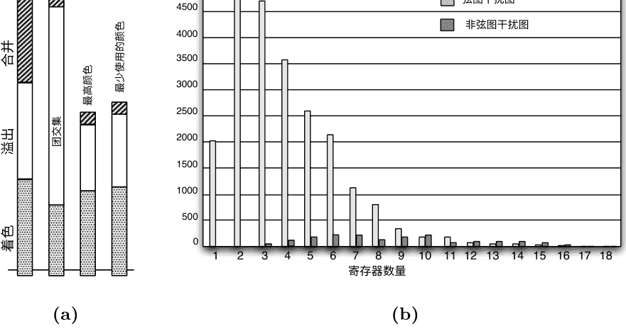

图14. (a) 在不同启发式算法中用于着色、溢出和合并的时间。(b) Java 1.5标准库方法分配的寄存器数量。

干扰的预着色寄存器，代表可用于分配的机器寄存器。由于这些团，所有的图在溢出后都需要21种颜色。当图是弦图时，预溢出会得到最好的结果；然而，当处理非弦图时，这个启发式算法会受到惩罚，因为它们呈现出一个21-团，并且必须用21个寄存器进行着色。在这种情况下，图10中的maximalCl过程列出了一些错误的最大团，并且造成了不必要的溢出。

总体而言，溢出最少使用的颜色会得到最好的结果。分析基于ML编译器的基准测试的执行时间比分析Java库的执行时间更快，因为后者的时间包括构建干扰图的时间。

| 算法 | 是否溢出后最少使用的颜色 | 弦图的最大溢出 | 分配总数的数量的溢出 | 移动 | 时间(秒) |
| :--- | :--- | :--- | :--- | :--- | :--- |
| 溢出后最少使用的颜色 | 是 | 1,217 | 84 | 0.97 | 223.8 |
| 溢出后最少使用的颜色 | 否 | 63 | 14 | 0.94 | 223.8 |
| 溢出后最高使用的颜色 | 是 | 1,778 | 208 | 0.97 | 222.9 |
| 溢出后最高使用的颜色 | 否 | 80 | 20 | 0.94 | 222.9 |
| 溢出前 | 是 | 1,127 | 86 | 0.97 | 482.3 |
| 溢出前 | 否 | 1,491 | 23 | 0.93 | 482.3 |

*表3. 从ML代码生成的27,921个干扰图中分配寄存器获得的结果。*

## 6 结论

本文提出了一种基于和弦图着色的非迭代寄存器分配算法。和弦图具有优雅的结构，可以在 O(|V| + |E|) 时间内进行最优着色。对于寄存器分配问题，只要干扰图是和弦图，我们可以在线性时间内找到最优分配，其时间复杂度与活跃区间之间的干扰数量成线性关系。此外，即使在非和弦输入上执行寄存器分配，我们的算法也具有竞争力。

为了验证算法，我们将其与迭代寄存器合并进行了比较。我们的算法每个方法分配的寄存器更少，临时变量溢出更少。此外，我们的算法可以合并大约与迭代寄存器合并相同比例的复制指令。

除了高效外，我们的算法还具有模块化和灵活性。因为它不是迭代的，所以它比基于图着色的传统算法具有更简单的设计。临时变量的溢出可能发生在着色阶段之前或之后。通过在着色之前进行溢出处理，可以为临时变量分配不同的权重，以生成更好的代码。我们的实现和从测试的Java方法生成的一组干扰图可以在 http://compilers.cs.ucla.edu/fernando/projects/ 找到。

致谢。我们感谢Ben Titzer和审稿人对论文草稿的有益评论。Fernando Pereira由巴西教育部资助，资助号码为218603-9。我们得到了国家科学基金会的支持，奖励号码为0401691。

## 参考文献

- 1. Christian Andersson. 通过最优图着色进行寄存器分配。在编译器构造第12届会议上，页码为34-45。Springer, 2003年。
- 2. Andrew W Appel和Lal George. 具有少量寄存器的CISC机器的最佳溢出。在国际编程语言设计和实现会议,第243-253页。ACM出版社, 2001年。
- 3. Andrew W Appel和Lal George. 由New Jersey标准ML生成的27,921个实际寄存器干扰图，版本1.09-http://www.cs.princeton.edu/~appel/graphdata/, 2005年。
- 4. Anne Berry, Jean Blair, Pinar Heggernes和Barry Peyton. 计算图的最小三角剖分的最大基数搜索。Algorithmica, 39(4):287–298, 2004年。
- 5. Preston Briggs, Keith D. Cooper和Linda Torczon. 改进图形着色寄存器分配。编程语言和系统交易(TOPLAS), 16(3):428–455, 1994年。
- 6. Philip Brisk, Foad Dabiri, Jamie Macbeth和Majid Sarrafzadeh. 多项式-时间图着色寄存器分配。在第14届国际逻辑和综合研讨会。ACM出版社, 2005年。
- 7. Zoran Budimlic, Keith D Cooper, Timothy J Harvey, Ken Kennedy, Timothy S Oberg和Steven W Reeves. 快速复制合并和活跃范围识别。在国际编程语言设计与实现会议，第25-32页。ACM出版社, 2002年。
- 8. G J Chaitin. 寄存器分配和溢出通过图着色。编译器构造研讨会，17(6): 98-105, 1982年。
- 9. Maria Chudnovsky, Gerard Cornuejols, Xinming Liu, Paul Seymour和Kristina Vuskovic. 识别Berge图。组合数学, 25: 143-186, 2005年。
- 10. G A Dirac. 关于刚性电路图。在Hamburg大学数学研讨会的论文集，第25卷, 第71-75页。Hamburg大学, 1961年。
- 11. Fanica Gavril. 最小着色、最大团、最小团覆盖和弦图的最大独立集的算法。SICOMP, 1(2):180-187, 1972年。
- 12. Lal George和Andrew W Appel. 迭代寄存器合并。编程语言和系统交易, 18(3):300-324, 1996年。
- 13. M Grotschel, L Lovasz和A Schrijver. 椭球法及其在组合优化中的应用。组合数学, 1(2):169-197, 1981年。
- 14. Sebastian Hack. 程序SSA形式的干扰图. 技术报告, 卡尔斯鲁厄大学, 2005年.
- 15. Fernando M Q Pereira和Jens Palsberg. SSA消除后的寄存器分配是NP完全的. 手稿, 2005年.
- 16. Massimiliano Poletto和Vivek Sarkar. 线性扫描寄存器分配. ACM程序设计语言和系统交易, 21(5):895–913, 1999年.
- 17. Robert E. Tarjan和Mihalis Yannakakis. 测试图的弦性、测试超图的无环性和有选择地减少无环超图的简单线性时间算法.SIAM J. Comput., 13(3):566–579, 1984年.
- 18. Douglas B West. 图论导论. Prentice Hall, 第2版, 2001年.
- 19. John Whaley. Joeq:一种虚拟机和编译器基础设施. 在解释器、虚拟机和仿真器研讨会, 页码58–66. ACM出版社, 2003年.
- 20. Mihalis Yannakakis和Fanica Gavril. 弦图的最大k-可着色子图问题。信息处理通讯, 24(2): 133-137, 1987年.

## 经典SSA消除后的寄存器分配是NP完全的

Fernando Magno Quintão Pereira
Jens Palsberg

UCLA
加利福尼亚大学洛杉矶分校

摘要。Chaitin证明了寄存器分配等价于图着色，因此是NP完全的。最近，Bouchez、Brisk和Hack独立证明了程序在静态单赋值（SSA）形式下的干扰图是弦图，因此可以在线性时间内进行着色。我们能否利用Bouchez等人的结果通过首先将程序转换为SSA形式，然后进行寄存器分配，最后进行经典的SSA消除来在多项式时间内进行寄存器分配？在本文中，我们证明了答案是否定的，除非P=NP：经典SSA消除后的寄存器分配是NP完全的。Chaitin的证明技术对经典SSA消除后的程序不起作用；相反，我们使用了循环弧图的图着色问题的归约。

## 1 介绍

### 1.1 背景

寄存器分配。在编译器中，寄存器分配是将临时变量映射到机器寄存器的问题。在本文中，我们将重点关注以下内容：

- 核心寄存器分配问题：
实例：一个程序 \( P \) 和一个可用寄存器的数量 \( K \)。
问题：能否将 \( P \) 的每个临时变量映射到 \( K \) 个寄存器中的一个，使具有干扰活跃区间的临时变量分配到不同的寄存器中？

注意 \( K \) 是问题的一部分。修复 \( K \) 将对应于由编译器解决的固定架构的寄存器分配问题。我们的核心寄存器分配问题与gcc解决的寄存器分配问题相关；该问题不对目标架构中的寄存器数量做出假设。

Chaitin等人通过从图着色问题进行约简，证明了核心寄存器分配问题是NP-完全的。Chaitin等人的证明的核心是每个图都是某个程序的干扰图。

SSA形式。静态单赋值（SSA）形式[21]是许多编译器中使用的中间表示形式，包括gcc版本4。如果一个程序处于SSA形式，那么每个变量只被赋值一次，每个使用都指向一个定义。像gcc版本4这样的编译器将给定的程序转换为SSA形式，然后转换为可执行形式。

SSA形式使用 \( \phi \)-函数来连接表示相同值的不同名称的活跃范围。我们将使用Hack等人引入的矩阵表示法描述 \( \phi \)-函数的语法和语义。图1（a）概述了 \( \phi \)-矩阵的一般表示。图1（c）给出了图1（b）中所示矩阵的直观语义。

类似 \( V = \phi M \) 的方程，其中 \( V \) 是一个 \( n \) 维向量，\( M \) 是一个 \( n \times m \) 矩阵，包含了诸如 \( a_i \leftarrow \phi(a_{i1}, a_{i2}, ... a_{im}) \) 的 \( \phi \)-函数。每个可能的执行路径在 \( \phi \)-矩阵中有一个对应的列，并且为每个 \( \phi \)-函数添加一个参数。符号 \( \phi \) 作为一个多路复用器工作。它将为程序执行过程中实际选择的路径决定的 \( V \) 的每个元素 \( a_i \) 分配一个 \( M \) 的元素 \( a_{ij} \)。

所有 \( \phi \)-函数在它们所在的基本块的开始同时被评估。正如Hack等人[17]所指出的，同一列的 \( \phi \)-矩阵中的临时变量的活跃范围重叠，而同一行的临时变量的活跃范围不重叠。因此，我们可以将同一行中的两个临时变量分配给相同的寄存器。例如，图2显示了一个程序，它的SSA版本以及经典SSA消除后的程序。

如果控制流从块1到达块2，则 \( \phi(v_{11}, v_{12}) \) 将返回 \( v_{11} \)；否则返回 \( v_{12} \)。变量 \( i_2 \) 和 \( v_{11} \) 不干扰。相反，变量 \( v_{11} \) 和 \( i_1 \) 干扰，因为它们都在块1的末尾处活跃。

后SSA程序。SSA形式简化了对程序控制流图上执行的许多分析。然而，传统的指令集不实现 \( \phi \)-函数[10]。因此，为了生成可执行代码，编译器有一个称为SSA消除的阶段，其中 \( \phi \)-函数被销毁。

从现在开始，我们将把经过SSA消除后的程序称为后SSA程序。

传统的SSA消除方法是用复制指令替换 \( \phi \) 函数 [1, 5, 7, 10, 18, 20]。例如，在块 \( b \) 中，考虑 \( v_1 = \phi(v_{11}, ..., v_{1m}) \)。Appel [1] 解释的算法在每个在块 \( b \) 之前的块 \( i \) 的末尾添加一条复制指令，例如 \( v_1 = v_{1i} \)。

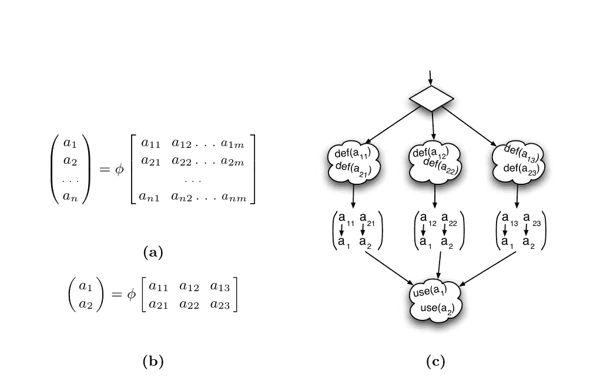

图1. (a) φ-函数表示为矩阵方程。(b) 表示两个 φ-函数和三条可能的执行路径的矩阵方程。(c) 控制流图说明 φ-函数的语义。

在本文中，我们集中讨论控制流图结构如图3(a)所示的SSA程序。通过传统的SSA消除方法生成的等价后SSA程序由图3(b)中的语法给出。我们将称由图3(b)中的语法生成的程序为简单的后SSA程序。例如，图2(c)中的程序是一个简单的后SSA程序。简单的后SSA程序包含一个循环。在循环之前和循环结束时(参见图3(b))，程序包含对应于 φ-矩阵消除的复制指令，如下所示：

$$\begin{pmatrix} v_1 \\ \vdots \\ v_K \\ i \end{pmatrix} = \phi \begin{bmatrix} v_{11} & v_{21} \\ \vdots & \vdots \\ v_{1K} & v_{2K} \\ i_1 & i_2 \end{bmatrix}$$

### 1.2 SSA形式的程序具有和弦干扰图

核心寄存器分配问题是NP完全的，编译器可以在立方时间内将给定的程序转换为SSA形式[9]。因此，我们可能会期望SSA形式的核心寄存器分配问题是NP完全的。然而，除非P = NP，否则这种直觉是错误的，正如以下结果所证明的那样。

2005年，Brisk等人[6]证明了SSA形式的严格程序具有完美的干扰图；独立地，Bouchez [4]和Hack [16]证明了SSA形式的严格程序具有和弦干扰图。在一个```c
int m(int p1, int p2) {
    int v1 = p1;
    int i = p2;
    while (i < 10) {
        i = i+1;
        if (v1 > 11) break;
        v1 = i+2;
    }
    return v1;
}
```

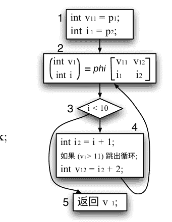

```c
int m(int p1, int p2) {
    int v11 = p1;
    int i1 = p2;
    int v1 = v11;
    int i = i1;
    while (i < 10) {
        int i2 = i+1;
        if (v1 > 11) break;
        int v12 = i2+2;
        v1 = v12;
        i = i2;
    }
    return v1;
}
```

图2.(a) 一个程序。 (b) 相同的程序以SSA形式。 (c) 经典SSA消除后的程序。

严格程序，从初始块到变量 v 的每条路径都通过 v 的定义[7]。 [4, 16]中提出的证明依赖于两个众所周知的事实: (i) 和弦图是树的子树的交集图[14], (ii) SSA程序中的活跃范围是支配树的子树[16]。

我们可以在线性时间内对和弦图进行着色[15]，因此我们可以在线性时间内解决SSA形式程序的核心寄存器分配问题。 因此，将程序转换为SSA形式似乎将一个NP完全问题映射为多项式时间问题! 理解这种转换如何可能的关键在于以下观察。 给定一个程序 P，它的SSA形式版本 P'和一定数量的寄存器 K，核心寄存器分配问题(P, K)与(P', K)不等价。 虽然我们可以映射一个对于(P, K)-解到(P', K)-解的映射，并不一定能将(P', K)-解映射到(P, K)-解。 SSA转换将 P中临时变量的活跃范围分割成 P'可能需要的寄存器数少于 P的方式。 鉴于SSA形式程序的核心寄存器分配问题可以在多项式时间内解决，并且编译器可以在线性时间内进行经典的SSA消除，我们可能期望经典SSA消除后的核心寄存器分配问题也是多项式时间内可解的。 在本文中，我们证明了这种直觉也是错误的!

## 1.3 我们的结果

我们证明了简单后SSA程序的核心寄存器分配问题是NP完全的。 我们的结果一直是一个被广泛认为的民间定理，但没有发表的证明。 关于程序的寄存器分配的最新结果在SSA形式中，对证明的兴趣增加了。我们的结果表明，对于带有循环或可以实现循环的任何语言，后-SSA程序的核心寄存器分配问题是NP完全的。

Chaitin等人的证明技术对于后-SSA程序不起作用。Chaitin等人的证明构造了图形的程序，如果我们将这些程序转换为SSA形式，然后再转换为后-SSA形式，我们可以用仅仅三种颜色为每个后-SSA程序的干扰图上色。

例如，为了表示 C_4，他们的技术会生成图在图4（b）的上部分。这种图的最小着色可以简单地映射到 C_4的最小着色，只需删除节点 x 即可。图4（a）显示了由Chaitin等人的证明技术生成的程序的控制流图，图4（c）显示了程序的后SSA形式。转换后程序的干扰图显示在图4（b）的下部分；该图是弦图，符合预期。

我们使用从圆弧图的图着色问题的简化来证明我们的结果，此后简称为圆图。圆图可以表示为围绕圆的一组区间（例如图5（a））。我们证明的思路是简单后SSA程序中循环中变量的活跃范围形成一个圆图。从一个圆图和一个整数 K，我们构建一个简单的后SSA程序，使得图 K可着色当且仅当我们可以解决程序的核心寄存器分配问题和 K+ 1个寄存器。我们的简化分为两个步骤。在第2节中，我们定义了SSA-圆图的概念，并展示了SSA-循环图是NP完全的。在第3节中，我们介绍了从SSA循环图到简单后SSA程序的寄存器分配的彩色化的约简。SSA循环图是循环图的一种特殊情况，其中一些区间成对出现，对应于简单后SSA程序中循环末尾的复制指令。从循环图中构建SSA-循环图，通过分割一些弧。通过在循环末尾添加新的区间，我们人为地增加了该点的颜色压力，并确保共享一个极点的两个区间获得相同的颜色。在第4节中，我们对各种寄存器分配问题的复杂性结果进行了简要调查，并在第5节中总结。

最近，Hack等人[17]提出了一种SSA消除算法，该算法不使用移动指令来替换 ϕ 函数。相反，Hack等人的算法使用异或指令来排列 ϕ 函数的参数值，以保持原始程序的语义和干扰图的弦图结构，而不需要额外的寄存器。

因此，Hack等人在SSA消除后的寄存器分配是多项式时间的。相比之下，经典的SSA消除后的寄存器分配是NP完全的。

## 从圆形图到SSA圆形图

让 N表示正自然数的集合 {1, 2, 3, …}。 一个圆形图是一个无向图，由有限个顶点 V ⊆ N × N给出，满足对于每个d ∈ N: (d, d) ∈ V，并且对于每对(d, u), (d', u') ∈ V: d = d' ⇔ u = u'。 我们有时将顶点(d, u)称为一个区间，并将d, u称为极点。 圆形图的顶点集隐式地定义了边，如下所示。定义

$$ b : N \times N \rightarrow \text{实数的有限区间的并集} $$

$$ b(d, u) = \begin{cases} \ ]d, u[ & \text{如果} \ d < u \\[0, u[ \cup ]d, \infty[ & \text{如果} \ d > u. \end{cases} $$

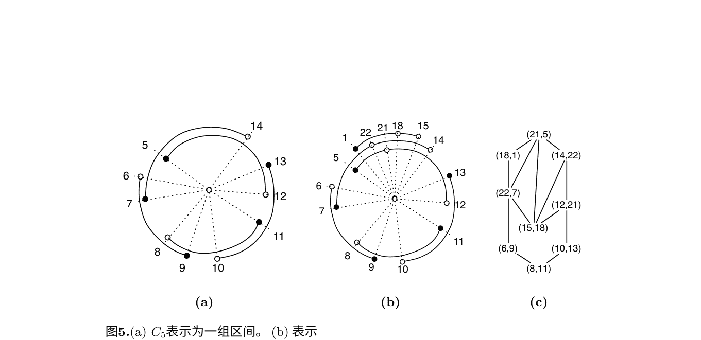

## 图5.(a) C5表示为一组区间。(b) 表示W = F(C5,3)的区间集合。(c) W表示为一个图。

如果且仅如果 b(d,u) ∩ b(d',u') = ∅，那么两个顶点 (d,u),(d',u') 之间有一条边。我们用 V 表示圆形图的这种表示集合。我们用 max(V) 表示V中使用的最大数，用min(V) 表示V中使用的最小数。我们区分圆形图的三个顶点子集， V_i, V_l 和 V_z：

$$ V_i = \{ (d, u) \in V \mid d < u \} $$
$$ V_l = \{ (d, u) \in V \mid d > u \} $$
$$ V_z = \{ (d, y) \in V_i \mid \exists (y, u) \in V_l \} $$

注意 V = V_i ∪ V_l, V_i ∩ V_l = ∅, 且 V_z ⊆ V_i.

图5 (a) 显示了 C5= ({a, b, c, d, e}, {ab, bc, cd, de, ea})作为一组区间的表示，其中 a = (14, 7), b = (6, 9), c = (8, 11), d = (10, 13), e = (12, 5), V_i = {b, c, d}, V_l = {a, e}, 且 V_z = ∅. 直观地说，当圆形图的区间围绕圆圈排列时，重叠的区间确定相应顶点之间的边。

一个SSA-循环图 W 是一个具有两个附加属性的循环图：

$$ \forall (y, u) \in W_l : \exists d \in N : (d, y) \in W_z \quad (1) $$
$$ \forall (d, u) \in W_i \setminus W_z : \forall (d', u') \in W_l : u < d' \quad (2) $$

我们用 W 来表示SSA-循环图的集合。

设 W 为一个SSA-循环图。属性 (1) 表示对于 W_l 中的每个区间，存在一个 W_z 中的区间，这些区间共享一个极点 y。在第3节中将会展示 y 点表示用于传播 φ函数的参数的复制指令。从现在开始， y 点将被称为复制点。图5 (b) 展示了一个SSA-循环图 W ∈ W 的例子。注意，对于每个区间 (y, u) ∈ W_l, 存在一个区间 $(d, y) \in W_{z_0}$ 图5 (c) 使用传统图表示展示了 $W_0$。

我们现在将定义一个映射 $\mathcal{F}$ 到对 $(V, K)$ 的映射：

$$ \mathcal{F} : \mathcal{V} \times \mathbb{N} \to \mathcal{W} $$
$$ \mathcal{F}(V, K) = V_i \cup \mathcal{G}(V_l, K, \max(V)) $$
$$ \mathcal{G} : \mathcal{V} \times \mathbb{N} \times \mathbb{N} \to \mathcal{V} $$
$$ \mathcal{G}(\{ (d_i, u_i) \mid i \in 1..n \}, K, m) = \{ (m + i, m + K + i) \mid i \in 1..K - n \} (3) $$
$$ \cup \{ (m + K + i, i) \mid i \in 1..K - n \} (4) $$
$$ \cup \{ (d_i, m + 2K + i) \mid i \in 1..n \} (5) $$
$$ \cup \{ (m + 2K + i, u_i) \mid i \in 1..n \} (6) $$

给定 $V$，函数 $\mathcal{F}$ 将 $V$ 的每个区间分成两个不相邻的区间它们共享一个极值点：$(d, y) \in W_z$，和 $(y, u) \in W_l$。我们称这些区间为主顶点。给定 $V$，函数 $\mathcal{F}$ 还创建了 $2(K - n)$ 个新的区间，即 $K - n$ 对区间，每对区间的两个区间不相邻且共享一个极值点：$(d, y) \in W_z$，和 $(y, u) \in W_l$。我们称这些区间为辅助顶点。图5 (b) 和5 (c) 表示 $\mathcal{F}(C_5, 3)$，图6概述了 $m = \max(V)$ 和 $K - n$ 之间的临界点。

### 引理 1. 如果 $V$ 是一个循环图且 $\min(V) > K$，则 $\mathcal{F}(V, K)$ 是一个 SSA-循环图。

证明. 设 $W = \mathcal{F}(V, K)$。首先注意到 $W$ 是一个循环图，因为条件 $\min(V) > K$ 确保规则(4)和(6)定义的顶点不共享任何极值点。为了证明 $W$ 是一个 SSA-循环图，让我们依次考虑两个条件(1)和(2)。关于条件(1)， $W_l$ 由(4)、(6)定义的集合组成，而 $W_z$ 由(3)、(5)定义的集合组成，对于每个 $(y, u) \in W_l$，我们可以找到 $(d, y) \in W_z$。关于条件(2)，如果 $(d, u) \in W_i \setminus W_z$ 且 $(d', u') \in W_l$，则 $u \leq \max(V) < \max(V) + K + 1 \leq d'$。

### 引理2. 如果 $W = \mathcal{F}(V, K)$ 是 $K$ 可着色的，那么在 $W_z \cup W_l$ 中共享一个极点的两个区间必须被任何 $K$ 着色的 $W$ 的着色方案分配相同的颜色。

证明. 设 $c$ 是 $W$ 的 $K$ 着色方案。 设 $v_1=(d, y)$ 和 $v_2=(y, u)$ 是 $W_z \cup W_l$ 中的一对区间。 根据 $\mathcal{F}(V, K)$ 的定义，这两个区间之间没有边连接。 公共复制点 $y$ 被正好 $K-1$ 个区间穿过（见图6）。 这 $K-1$ 个区间必须由 $c$ 分配不同的颜色，所以 $c$ 只剩下一种颜色可以分配给 $v_1$ 和 $v_2$。 因此， $c$ 给 $v_1$ 和 $v_2$ 分配了相同的颜色。

### 引理3. 假设 $V$ 是一个循环图且 $\min(V) > K$. 如果且仅如果 $V$ 是可 $K$ 着色的，那么 $\mathcal{F}(V, K)$ 是可 $K$ 着色的。

证明. 令 $V_l = \{ (d_i, u_i) \mid i \in 1..n \}$, 令 $m = \max(V)$.

首先，假设 $c$ 是 $V$ 的一个 $K$ 着色。 $V_l$ 的顶点形成一个团，所以 $c$ 必须使用 $|V_l|$ 种颜色来着色 $V_l$。 令 $n = |V_l|$。 令 $\{x_1, \dots, x_{K-n}\}$ 为 $c$ 没有用到的着色 $V_l$ 的颜色集合。 现在我们定义 $\mathcal{F}(V, K)$ 的一个 $K$ 着色 $c'$ of。

$$c'(v) = \begin{cases} c(v) & \text{if } v \in V_i \\ x_i & \text{如果 } v=(m+i, m+K+i), i \in 1..K-n \\ x_i & \text{如果 } v=(m+K+i, i), i \in 1..K-n \\ c(d_i, u_i) & \text{如果 } v=(d_i, m+2K+i), i \in 1..n \\ c(d_i, u_i) & \text{如果 } v=(m+2K+i, u_i), i \in 1..n \end{cases}$$

为了证明 $c'$ 确实是 $\mathcal{F}(V, K)$ 的一个 $K$-着色，首先注意到主要顶点的颜色与辅助顶点的颜色不重叠。 其次，注意到由于 $\min(V) > K$, 没有辅助边连接到 $V_l$ 中的顶点。 第三，注意到由于 $c$ 是 $V$ 的一个 $K$-着色，主要顶点的颜色与 $V_l$ 中的邻居不冲突。

相反地，假设 $c'$ 是 $\mathcal{F}(V, K)$ 的一个 $K$-着色。 我们现在定义一个 $K$-着色 $c$ of $V$:

$$c(v) = \begin{cases} c'(v) & \text{如果 } v \in V_l \\ c'(d_i, m+2K+i) & \text{如果 } v=(d_i, u_i), i \in 1..n \end{cases}$$

为了看到 $c$ 确实是 $V$ 的一个 $K$-着色，注意到根据引理2，我们有对于每个 $i \in 1..n$, $c'$ 给区间 $(d_i, m+2K+i), (m+2K+i, u_i)$ 分配相同的颜色。 因此，由于 $c'$ 是 $\mathcal{F}(V, K)$ 的一个 $K$-着色， $V_l$ 中的顶点具有与 $V_l$ 中的邻居不冲突的颜色。

### 引理4. 对于 $SSA$-循环图的图着色是 $NP$ 完全的。

证明. 首先注意到，对于 $SSA$-循环图的图着色问题属于 $NP$ 类，因为我们可以在多项式时间内验证任何颜色分配。 为了证明 $NP$ 难度，我们将从已知的循环图的图着色问题进行归约，该问题已知是 $NP$ 完全的[12, 19]。 给定一个图着色问题实例 $(V, K)$，其中 $V$ 是一个循环图，我们首先将 $V$ 转换为同构图 $V'$， 通过在 $V$ 中添加 $K$ 到所有使用的整数。 注意到 $\min(V') > K$。 接下来，我们产生图着色问题实例 $(\mathcal{F}(V', K), K)$，并且根据引理3， $V'$ 是 $K$-可着色的当且仅当 $\mathcal{F}(V', K)$ 是 $K$-可着色的。

> [12, 19]

## 3 从SSA循环图到后SSA程序

我们现在介绍一种从SSA循环图着色到简单后SSA程序核心寄存器分配问题的约简。在本节中，我们使用一种与第2节中使用的循环图表示不同的表示方法。我们用一个有限的元素列表来表示循环图，该列表属于集合I = { def(j), use(j), copy(j, j'), |j, j' ∈ N }。每个j表示程序中的一个临时名称。我们用ℓ来表示集合I上的有限列表。如果ℓ是集合I上的有限列表，并且ℓ的第d个元素是def(j)或copy(j, j')，那么我们说j在ℓ的第d个索引处被定义。类似地，如果ℓ的第u个元素是use(j)或copy(j, j')，那么我们说j在ℓ的第u个索引处被使用。我们如下定义X:

X = { ℓ | 对于每个j在ℓ中提到的，j被定义一次且仅使用一次 ∧ 对于ℓ中的每个副本(j, j')，我们有j = j' }

我们将使用X来表示X的范围。集合X和Y是同构的；函数α是一个同构，它将X映射到Y: α: X → Y；α(X) = { (d, u) | ∃j ∈ N : j在X的索引d处被定义且在X的索引u处被使用 }

引理5. 如果我们可以用K种颜色对SSA循环图Y进行着色，那么我们可以解决核心寄存器分配问题H(Y, K)和K+1个寄存器。

证明. 首先，假设Y有一个K-着色。在H(Y, K)的循环中，区间与活跃范围匹配，除了控制变量i和i2之外，它们的活跃范围不重叠。因此，循环的干扰图

我们定义Y = α^{-1}(W)，并且我们使用Y来表示Y的范围。图W在图5 (b)中显示，在新的表示中再次显示在图7 (a)中: Y = (use(t), use(e), def(b), use(a), def(c), use(b), def(d), use(e), def(e), use(d), def(a), def(t2), copy(t, t2), copy(e, e2), copy(a, a2)).

图8展示了从SSA循环图的Y表示到简单的后SSA程序的映射H。给定由def(j)和use(j)表示的区间(d, u)，我们将初始点d映射到变量定义vj = i2 + C，其中i2是控制循环的变量。我们假设所有常数都选择不同。最终点u通过条件语句if (v_j > C) break映射到一个变量使用。我们选择将使用映射为条件命令，因为它们不会改变循环内的活跃范围，并且它们的编译不会为最终代码添加额外的寄存器。形式为copy(j, j')的元素被映射为赋值j = j'，用于模拟经典SSA消除后的φ函数的参数之一的复制。图7 (b)展示了程序P = H(Y, 3)，其中Y = F(C5, 3).
``````
int m(int p1, int p2, int p3, int p4) {
    int i1 = p4;
    int a1 = p1;
    int e1 = p2;
    int t1 = p3;
    int a = a1;
    int e = e1;
    int t = t1;
    int i = i1;
    while(i > 10) {
        int i2 = i + 1;
        if(t > 9) break;
        if(e > 10) break;
        int b = i2 + 11;
        if (a > 11) break;
        int c = i2 + 12;
        if(b > 12) break;
        int d = i2 + 13;
        if(c > 13) break;
        int e2 = i2 + 14;
        if(d > 14) break;
        int a2 = i2 + 15;
        int t2 = i2 + 16;
        i = i2;
        a = a2;
        t = t2;
        e = e2;
    }
    return a;
}
```

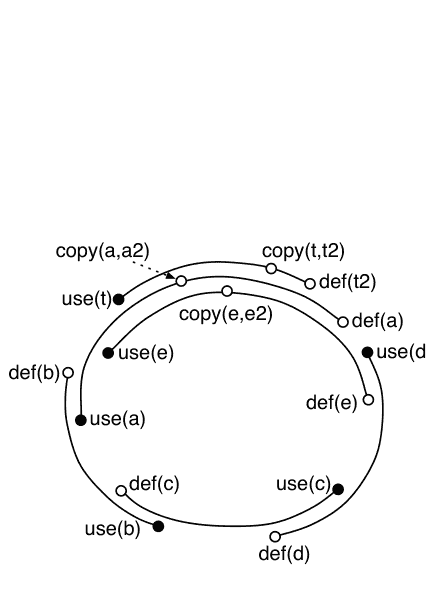

图7.(a) $Y = \mathcal{F}(C_{5,3})$ 表示为一系列指令和图形。(b) $P = \mathcal{H}(Y,3)$。

可以用 $K+1$ 种颜色着色。循环外声明的变量的活跃区间形成宽度为 $K+1$ 的区间图。我们可以将该区间图的 $K+1$-着色扩展到整个图的 $K+1$-着色中，时间复杂度为线性。

现在，假设存在一个使用 $K+1$ 个寄存器的核心寄存器分配问题的解决方案，用于 $\mathcal{H}(Y, K)$。 $Y$ 中的区间表示循环中变量的活跃区间。控制变量 $i$ 和 $i_2$ 需要一个寄存器，不能用于分配循环内其他活跃区间的寄存器。

因此，$\mathcal{H}(Y, K)$ 的着色可以直接映射到 $Y$ 的节点。

定理 1. 对于简单的后SSA程序，核心寄存器分配问题是$NP$完全的。

证明。结合引理4和引理5。

作为一个说明性的例子，用三种颜色给$C_5$着色等价于确定图 $Y$ 中的3着色问题（图7（a））。只有当核心寄存器分配问题 $P = \mathcal{H} (Y,3)$ 可以用4个寄存器解决时，才能找到这样的着色方案。在这个例子中，存在一个解决方案。一种寄存器分配方案是 $\{a, a_1, a_2, c, p_1\} \rightarrow R1, \{b, d, t_1, t_2, t, p_3\} \rightarrow R2, \{e, e_1, e_2, p_2\} \rightarrow R3, 和 \{i, i_1, i_2, p_4\} \rightarrow R4$。这对应于用第一种颜色给弧线 $a$ 和 $c$ 着色，用第二种颜色给弧线 $b$ 和 $d$ 着色，用第三种颜色给弧线 $e$ 着色。

```
gen(def(j)) = int v_j = i_2 + C;
gen(use(j)) = if (v_j > C) break;
gen(copy(j, j')) = v_j = v_{j'};
\mathcal{H} : \mathcal{Y} \times \mathbb{N} \rightarrow \text{simple post-SSA 程序}
\mathcal{H}(Y, K) = \text{int } m(\text{int } p_1, \dots, \text{int } p_{K+1}) \{
    \text{int } v_{11} = p_1; \dots; \text{int } v_{1K} = p_K;
    \text{int } i_1 = p_{K+1};
    \text{int } v_1 = v_{11}; \dots; \text{int } v_K = v_{1K};
    \text{int } i = i_1;
    \text{while } (i < C) \{
        \text{int } i_2 = i + 1;
        \text{map}(Y, \text{gen})
        i = i_2;
    \}
    \text{返回 } v_1;
\}
```

图8.将循环图映射到简单的后SSA程序

### 4 相关工作

Sethi [22]首次证明了与寄存器分配相关问题的NP完全性。 Sethi证明了，给定一个表示为有向无环图中的一组指令的程序和一个整数 K，确定是否存在一个使用最多 K个寄存器的DAG的计算是一个NP完全问题。 本质上，Sethi证明了在为直线程序生成代码时，如果目标代码中指令的顺序不固定，则加载和存储的放置是一个NP完全问题。

关于寄存器分配的复杂性结果的大部分文献涉及两个基本问题。 第一个问题是核心寄存器分配问题，在第1节中定义。 第二个问题是核心溢出问题，它推广了核心寄存器分配问题：

核心溢出问题：
实例：一个程序 P，可用寄存器数量 K，以及临时变量数量 M。
问题：能否将 P的至少 M个临时变量映射到 K个寄存器中，使具有干扰活跃范围的临时变量分配到不同的寄存器中？

Farach和Liberatore [11]证明了核心溢出问题是NP完全的，即使对于直线代码，也不允许重新调度指令。
他们的证明使用了从集合覆盖的简化。

对于直线程序，核心寄存器分配问题与干扰图的大小成线性关系。 然而，如果直线程序包含可以出现多次的预着色寄存器，那么核心寄存器分配问题是NP完全的。

在这种情况下，寄存器分配等同于区间图的预着色扩展，这是NP完全的[2]。

在核心寄存器分配问题中，寄存器的数量 `K`不是固定的。事实上，我们的简化中使用的问题，即圆形图的着色问题，如果颜色的数量是固定的，则有多项式时间解决方案。给定确定图 `G`的圆弧和固定数量 `K`的颜色，Garey等人[12]给出了一个 `O( n·K!·K·log K)`的时间算法，用于给 `G`着色，如果这样的着色存在。关于一般图，对于每个固定值`K > 2`，着色问题是NP完全的[13]。

Bodlaender等人[3]提出了一个针对结构化程序的核心寄存器分配问题的线性时间算法。
即使允许指令的重新调度，他们的结果仍然成立。如果允许使用不同类型的寄存器，例如整数寄存器和浮点寄存器，那么问题就不再是线性的，尽管它仍然是多项式的。研究人员已经提出了不同的算法来插入复制指令，特别是为了减少复制指令的数量[7, 5, 10, 18]。

Rastello等人[10]证明了通过复制指令来替换 `φ`函数的最优解是NP完全的。他们的证明使用了从最大独立集问题的约简。

### 5 结论

我们证明了通过经典的SSA消除方法将 `φ`函数替换为复制指令生成的后SSA程序的核心寄存器分配问题是NP完全的。相比之下，Hack等人最近提出的SSA消除方法[17]生成的程序使得核心寄存器分配问题在多项式时间内解决。我们得出结论，SSA消除算法的选择很重要。

我们声称编译器优化，如复制传播和常量传播，不能改善简单后SSA程序的核心寄存器分配问题的复杂性。检查图8中的代码，我们可以看出循环迭代次数无法通过局部分析轻松预测，因为所有控制变量都作为函数参数给出。在语句 `int v_j= i+C`中，变量i限制了常量传播的影响，而使用不同的常量 `C`限制了复制传播的影响。因为循环结束时所有 `K+1`个活跃变量具有不同的值，所以在那一点上无法合并活跃区间。相比之下，指令重新调度可能改善简单后SSA程序的核心寄存器分配问题的复杂性。然而，即使对于直线程序，重新调度结合寄存器分配也是一个NP完全问题[22]。

定理1在插入复制指令的顺序上是独立的，因为在第2节中定义的函数 `S`可以修改以适应任何复制点的顺序。更详细地说，让`W = F(V, K)`是一个SSA循环图，让 `n ∈ [0···max(W)]`，并且让ovl(n)是在点 \(n\)处重叠的区间数量。

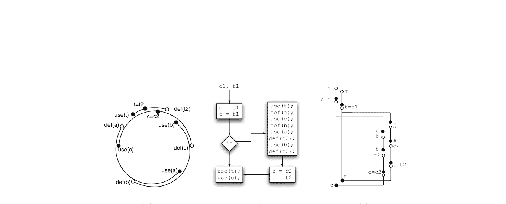

### 图9。

> \[\forall n \in \ ]max(V) \cdots max(W)] : \text{ovl}(n) = K\tag{7}\]

满足性质7的任何排序都足以证明引理2。图6展示了SSA-循环图中点0周围的区域。给定 \(W = \mathcal{F}(V, K)\)，在\(max(V)\)和\(max(W)\)之间的区间中插入了确切K个复制点。

我们的证明基于对循环图的着色的简化。我们对带有循环的程序证明了我们的结果，因为这类程序的干扰图的核心是循环图。控制流图中存在回边并不是定理1成立的要求。例如，SSA-循环图可以从只有一个 if语句的语言中获得。

图9 (a) 显示了一个表示\(C_3\)的SSA-循环图，当\(K=2\)时，图9 (b) 显示了一个表示该图的程序的活跃范围。图9 (c) 中显示了活跃范围的轮廓。

> 致谢。我们感谢Fabrice Rastello，Christian Grothoff和匿名审稿人对本文草稿的有益评论。Fernando Pereira由巴西教育部资助，资助号为218603-9。Jens Palsberg由国家科学基金会资助，资助号为0401691。

### 参考文献

- 1. Andrew W. Appel和Jens Palsberg。Java中的现代编译器实现。剑桥大学出版社，第2版，2002年。
- 2. M. Biró，M. Hujter和Zs. Tuza。预着色扩展。I: 区间图。在离散数学中，第267-279页。ACM出版社，1992年。特别卷（第1部分）以纪念Julius Petersen的"Die Theorie der regularen graphs"的百年纪念。
- 3. Hans Bodlaender，Jens Gustedt和Jan Arne Telle。线性时间寄存器分配对于固定数量的寄存器。在SIAM离散算法研讨会，页574-583，1998年。
- 4. Florent Bouchez。寄存器分配和内存转储。硕士论文，ENS里昂，2005年。
- 5. Preston Briggs，Keith D. Cooper，Timothy J. Harvey和L. Taylor Simpson。实际改进构建和销毁静态单赋值形式的方法。软件实践与经验，28（8）：859-881，1998年。
- 6. Philip Brisk，Foad Dabiri，Jamie Macbeth和Majid Sarrafzadeh。多项式-时间图着色寄存器分配。在第14届国际逻辑和综合研讨会。ACM出版社，2005年。
- 7. Zoran Budimlic，Keith D. Cooper，Timothy J. Harvey，Ken Kennedy，Timothy S. Oberg和Steven W. Reeves。快速复制合并和活跃范围识别。在国际编程语言设计与实现会议，页25-32。ACM出版社，2002年。
- 8. Gregory J. Chaitin，Mark A. Auslander，Ashok K. Chandra，John Cocke，Martin E. Hopkins，and Peter W. Markstein。通过着色进行寄存器分配。计算机语言，6:47-57，1981年。
- 9. Ron Cytron，Jeanne Ferrante，Barry K. Rosen，Mark N. Wegman，and F. Kenneth Zadeck。高效计算静态单赋值形式和控制依赖图。*ACM Transactions on Programming Languages and Systems*,13(4):451-490，1991年。
- 10. Fran, cois de Ferri 'ere，Christophe Guillon，and Fabrice Rastello。通过重命名约束优化去SSA的翻译。*ST Journal of Research Proces-sor Architecture and Compilation for Embedded Systems*，1(2):81-96，2004年。
- 11. Martin Farach和Vincenzo Liberatore。关于本地寄存器分配。在第9届*ACM-SIAM*离散算法研讨会上，第564-573页。*ACM*出版社，1998年。
- 12. M. R. Garey，D. S. Johnson，G. L. Miller和C. H. Papadimitriou。对于着色圆弧和弦的复杂性。*SIAM* J.代数离散方法，1(2)：216-227，1980年。
- 13. M. R. Garey，D. S. Johnson和L. Stockmeyer。一些简化的NP完全问题。理论计算机科学，1(3)：193-267，1976年。
- 14. Fanica Gavril。最小着色、最大团、最小覆盖和最大独立集的算法。*SICOMP*，1(2)：180-187，1972年。
- 15. Fanica Gavril。子树的交集图正好是弦图。*Journal of Combinatoric*, B(16):46-56, 1974.
- 16. Sebastian Hack。程序的干扰图在SSA形式中。技术报告ISSN 1432-7864, Universitat Karlsruhe, 2005.
- 17. Sebastian Hack，Daniel Grund，和Gerhard Goos。程序在SSA形式中的寄存器分配。在第15届国际编译器构造会议。Springer-Verlag, 2006.
- 18. Allen Leung和Lal George。机器代码的静态单赋值形式。在编程语言设计与实现会议，页码204-214。ACM Press, 1999.
- 19. Daniel Marx。圆弧着色的NP完全性的简短证明, 2003.
- 20. Fernando Magno Quint~ao Pereira和Jens Palsberg。弦图的着色寄存器分配。在*APLAS '05*会议论文集, 亚洲编程语言和系统研讨会，页码315-329, 2005.
- 21. B. K. Rosen，F. K. Zadeck和M. N. Wegman。全局值编号和冗余计算。在*ACM SIGPLAN-SIGACT*原则对编程语言的研讨会上，第12-27页。*ACM*出版社，1988年。
- 22. Ravi Sethi。完全寄存器分配问题。在第5届年度*ACM*计算理论研讨会上，第182-195页。*ACM*出版社，1973年。

### 一种可验证的SSA程序表示，用于激进的编译器优化

Vijay S. Menon¹ Neal Glew¹ Brian R. Murphy² Andrew McCreight³* Tatiana Shpeisman¹
Ali-Reza Adl-Tabatabai¹ Leaf Petersen¹
¹Intel实验室 加利福尼亚圣克拉拉95054
²英特尔中国研究中心 北京，中国
³耶鲁大学计算机科学系 康涅狄格州纽黑文市06520
{vijay.s.menon, brian.r.murphy, tatiana.shpeisman, ali-reza.adl-tabatabai, leaf.petersen}@intel.com
aglew@acm.org
andrew.mccreight@yale.edu

### 摘要

我们提出了一种可验证的低级程序表示，用于在高性能编译器中嵌入、传播和保留诸如Java和C#等安全语言中的安全信息。我们的表示通过静态单赋值（SSA）[11, 3]证明变量来精确编码安全信息，这些证明变量是程序中的一流构造。

我们认为我们的表示允许编译器同时（1）表达积极优化的机器无关代码和（2）利用现有的编译器基础设施来在优化过程中保留安全信息。我们证明这种方法支持标准编译器优化，对这些优化的实现需要最小的更改，并且不会人为地阻碍这些优化以保留安全性。

我们还描述了一个简单的类型系统，它在SSA风格的控制流图程序表示中形式化了类型安全。通过证明变量的类型，我们的系统能够对优化代码的内存安全进行组合验证。

最后，我们讨论了将这种表示集成到STARJIT的机器无关全局优化器中的经验，STARJIT是一个执行激进的控制流、数据流和代数优化的高性能即时编译器，与顶级生产系统相竞争。

类别和主题描述 D.3.1 [编程语言]: 形式定义和理论; D.3.4 [编程语言]: 编译器; D.3.4 [编程语言]: 优化; F.3.1 [程序逻辑和含义]: 指定、验证和推理程序

一般术语 性能、设计、语言、可靠性、理论、验证

关键词 类型中间语言、证明变量、安全依赖、检查消除、SSA形式化、类型系统、类型保持、中间表示

### 1. 引言

在过去的十年中，安全语言已经在软件界普及，并在软件开发人员中得到广泛接受。像Java和C#这样的安全语言尤为突出。这些语言提供了类似于C++的语法和功能集，同时具有可验证的安全属性。

其中最重要的属性是内存安全，即程序只能读取或写入有效的内存位置的保证。内存安全对于健壮性和安全性都至关重要。它通过编译时和运行时的检查的组合，防止了常见的程序员内存错误和安全漏洞，如缓冲区溢出。

Java和C#都被设计成允许通过字节码格式编译和分发程序。这些格式保留了源语言的关键安全属性，并且本身是静态可验证的。托管运行时环境（MRTEs），如Java虚拟机（JVM）或公共语言基础设施（CLI），使用静态验证来确保在执行字节码程序之前没有意外或恶意引入内存错误。

然而，字节码与本地机器代码相比仍然相对高级。运行时检查（例如，数组边界检查）被内置到否则可能不安全的操作（例如，内存加载）中，以简化验证过程。为了获得可接受的性能，MRTE使用即时编译器（JIT）编译程序。即时编译器执行多个控制流和数据流编译器转换，并生成优化的本地机器代码。在此过程中，运行时检查通常被消除或与它们所保护的潜在不安全操作分离。据我们所知，所有生产Java和CLI JIT编译器在优化过程中都会删除安全信息：优化的低级代码或生成的机器代码不容易验证。从安全角度来看，这排除了将优化的低级代码用作持久和可分发格式的可能性。此外，从可靠性角度来看，用户需要相信复杂的编译器转换不会引入内存错误。

近年来，研究人员开发了证明语言（例如PCC [20]和TAL [19]），允许编译器将安全证明嵌入到低级代码中，并使用验证技术来验证这些证明。他们已经证明了可以编译Java和安全的类C语言[21, 8, 18, 13]的认证编译器，同时进行优化并生成安全证明。然而，尽管证明语言和验证过程已经很成熟，但实现或修改现有的优化以正确生成和/或保留安全信息仍然是一个艰巨且不太理解的过程。

在本文中，我们介绍了一种新的程序表示框架，用于安全的命令式面向对象语言，以帮助通过积极的编译器优化生成、传播和验证安全信息。在这种表示中，我们将安全依赖关系编码为抽象的证明变量，这些变量表示潜在不安全操作与保证其安全性的控制点之间的依赖关系。这些证明变量是纯静态的：它们没有运行时语义。然而，它们是由控制点产生并被潜在不安全指令消耗的一流构造。从大多数编译器转换的角度来看，它们与任何其他变量相同。

我们认为这种表示法特别适用于作为一个积极优化编译器的中间表示。我们证明它支持常见的高级编译器优化，而不会人为地限制或大量修改它们。特别是，我们证明通过在普通变量中携带证明值，编译器可以利用现有的转换，如SSA构造、复制传播和死代码消除，来放置、更新和消除证明变量。

我们在STARJIT [1]的机器无关全局优化器的背景下阐述了我们的想法，这是一个动态优化编译器，用于Java和C#。STARJIT被设计为一个高性能的优化编译器，并且在性能上与最好的生产JIT系统竞争。我们描述了将我们的想法集成到STARJIT的内部表示中的原型，并讨论了它如何通过各种积极的优化来保留安全信息。本文描述的安全依赖表示法的最初动机是为了优化，而不是安全。然而，已经开发了一个验证器的原型实现，并且本文旨在提供安全依赖机制的描述以及基于它的类型系统的理论发展。特别是，我们的论文提供了以下贡献：

- 1. 我们介绍了一种安全的低级命令式程序表示，它将静态单赋值（SSA）形式与显式安全依赖相结合，并且我们演示了它如何用于表示高度优化的代码。
- 2. 我们提出了一个简单的类型系统来验证在这种表示中的程序的内存安全性。据我们所知，这个类型系统是第一个在SSA表示中形式化类型检查的。虽然SSA在某种意义上等价于CPS，但细节上有足够的不同，使得我们的类型系统与通常的λ演算风格的类型系统非常不同，并且需要新的证明技巧。
- 3. 我们展示了这种程序表示在高性能编译器中的实用性，并且我们描述了编译器如何利用其现有框架来保留安全信息。特别地，我们证明只有直接影响内存安全的优化，如消除边界检查和地址计算的强度缩减，需要显著的修改。

本文的其余部分组织如下。在第2节中，我们通过证明变量在低级命令式程序表示中明确表示安全依赖关系的方式来激励优化编译器，并描述了如何实现这一点。在第3节中，我们描述了一个专门处理数组边界检查的形式核心语言，并提出了一种类型系统，可以验证SSA形式的程序。在第4节中，我们演示了编译器如何将Java程序降低到核心语言，并说明了积极的编译器优化如何产生高效且可验证的代码。在第5节中，我们非正式地描述了扩展我们的核心语言以捕获完整的Java功能。在第6节中，我们讨论我们当前实现的状态，并且最后，在第7和8节中，我们讨论相关工作并总结。

```
if (a != null) while (!done) {
    b = (B) a;
    ... = ... b.x ...
    ...
}
```

图1. 循环中的字段加载

## 2. 动机

我们将潜在不安全指令定义为在上下文之外可能导致错误或其他非法内存访问的任何指令。一些指令在独立使用时是不安全的。如果加载指令访问受保护的内存，它可能会立即出错，或者通过读取错误类型的值触发最终崩溃。存储操作可能使用非法值（例如，如果任意整数替换了对象的虚表），从而破坏内存。

例如，考虑图1中的字段访问。假设类似于C++的语义，操作 `b.x` 解引用内存，没有安全保证。一般来说，C++不能保证 `b` 引用了一个真实的 `B`类型的对象： `b`可能保存一个在用作指针时出错的整数。

假设Java语义，然而，字段访问本身在运行时检查 `b` 是否指向空位置。如果检查成功，字段访问执行加载；否则，它会抛出异常，绕过加载。单独来看，这个内置检查不能确保安全性：加载还取决于前面的转换，它动态检查 `b` 的运行时类型是否与类型 `B` 兼容。如果检查成功，转换执行加载；否则，它会抛出异常，绕过加载。

通常，一个潜在不安全指令的安全性取决于一组控制流点。我们将这种依赖形式称为安全依赖。在这个例子中，加载的安全性取决于建立其类型的转换。当一个指令的对应安全依赖保证其安全性时，我们称之为上下文安全指令。要验证编译器优化的输出，我们必须证明每个指令都是上下文安全的。

### 2.1 Java中的安全性

在Java和CLI的可验证子集中，静态验证和运行时检查的组合保证了各个字节码指令的上下文安全性。静态类型检查确保变量具有适当的基本类型或对象类型。运行时检查，如类型测试（用于缩小操作），空指针测试和数组边界测试，检测可能导致故障或非法访问的条件，并抛出语言级运行时异常。

图2显示了类似Java的字节码指令（为了清晰起见，使用伪寄存器代替堆栈位置）用于图1的代码。Java类型系统保证变量 `b` 在编译时具有类型 `B`，而 `getfield`指令通过在运行时测试null来保证非空访问。检查和静态验证器共同保证加载操作不会触发非法内存访问。

### 2.2 低级表示中的安全性

```
ifnull a goto EXIT
L:
ifeq done goto EXIT
b := checkcast(a, B)
t₁ := getfield(b, B::x)
...
goto L
EXIT:
```

```
if a = null goto EXIT
L:
if done = 0 goto EXIT
checkcast(a, B)
checknull(a)
t₂ := getfieldaddr(a, B::x)
t₁ := 1d(t₂)
...
goto L
EXIT:
```

```
t₂ := getfieldaddr(a, B::x)
if a = null goto EXIT
if done = 0 goto EXIT
checkcast(a, B)
L:
t₁ := 1d(t₂)
...
if done = 0 goto L
EXIT:
```

```
if a = null goto EXIT
L:
if done = 0 goto EXIT
b := checkcast(a, B)
t₃ := checknull(b)
t₂ := getfieldaddr(t₃, B::x)
t₁ := 1d(t₂)
...
goto L
EXIT:
```

只关注与安全性相关的内容。首先，字节码隐藏了冗余检查消除的机会。例如，在图2中，优化可以消除内置在`getfield`指令中的空检查，因为有`ifnull`指令。即使有几个操作内置了异常检查，程序员通常会编写代码来确保这些检查永远不会失败，所以这样的优化机会在Java程序中很常见。

其次，引入冗余别名以编码安全属性会隐藏优化机会。在图1和图2中，变量`b`表示具有类型`B`的`a`的副本。任何需要此类型信息的`a`的使用必须使用`b`代替。虽然这有助于静态验证，但它阻碍了优化。字段访问必须确保`b` not null，即使`ifnull`语句在`a`上确保了该属性。为了消除额外的检查，冗余消除优化必须考虑由于类型转换而引起的别名；这超出了标准算法的能力[16,5]。

在没有跟踪安全依赖的机制的情况下，STARJIT会将图3中的代码片段降低为像图4中的代码。请注意，`1d`操作可能不安全，并且对空检查有安全依赖。然而，在这种情况下，空检查和加载之间的安全依赖不明确。尽管这些指令在代码中仍然（几乎）相邻，但不能保证未来的优化也会保持如此。图4大致说明了STARJIT为我们的示例生成的代码。通过部分循环剥离（以暴露冗余控制流）和公共子表达式消除来消除冗余检查。不变的地址字段计算通过代码移动进行提升。在这种情况下，加载对于保证其安全性的操作（特别是`if`和`checkcast`语句）的依赖已经变得模糊。我们将其称为擦除式低级表示，因为安全信息从程序中被有效地擦除。

另一种表示方式是将安全信息直接嵌入到值及其对应的类型中。Java语言已经通过类型转换操作实现了类型细化。

这种方法也适用于空值检查，如图5所示。SafeTSA表示采用了这种方法，并将其扩展到数组边界检查[25,2]。我们将其称为细化式表示法。在这种表示中，值的依赖关系保留了检查和加载之间的安全依赖关系。为了保留

为了确保安全性，优化必须保持检查和加载之间的值流。检查消除操作（例如图5中的`checknull`）可以通过优化来消除，但是它们产生的值（例如`t₂`）必须在此过程中重新定义。

从优化的角度来看，细化式表示并不理想。检查和加载之间的安全依赖关系并不直接。相反，它通过地址字段计算进行线程化，实际上只是一个加法操作。虽然加载本身直到空值测试才能执行，但地址计算始终是安全的。代码移动或指令调度编译器优化应该可以自由地将其移到检查之上，如果认为有益的话。在图3中，这显然是合法的。在图5中，这不再可能。细化式表示为程序添加了人为约束，以允许进行安全性检查。

在这种情况下，地址计算人为地依赖于检查操作。

细化式表示法还通过引入相同值的多个名称来隐藏优化机会。依赖于表达式的语法等价性的优化（例如冗余消除的典型实现）变得不再有效。在图3中，`a`与`null`进行了语法比较两次。在图5中，这不再成立。一般来说，在擦除式表示法中，语法上等价的操作在细化式表示法中可能不再是语法上等价的。

## 2.3 证明传递表示法

擦除式和细化式表示法都没有准确地表示安全依赖关系。擦除式表示法完全省略了它们，而细化式表示法间接地编码了它们。因此，擦除式表示法易于优化但难以验证，而细化式表示法难以优化但易于验证。

为了弥合这个差距，我们提出使用一种证明传递表示，通过证明变量直接将安全依赖编码到程序表示中。证明变量充当不安全操作的能力（类似于Walker等人的能力[26]）。证明变量的可用性表示一个安全属性成立的证明的可用性。一个潜在不安全的指令必须使用一个可用的证明变量来确保

```
L:
    [s1, s2] if a = null goto EXIT

    if done = 0 goto EXIT
    s3 := checkcast(a, B)
    s4 := checknull(a)
    t2 := getfieldaddr(a, B::x)
    s5 := pfand(s3, s4)
    t1 := ld(t2) [s5]
    ...
    goto L
EXIT:
```

图6. 在证明传递表示中降低字段加载

```
L:
    t2 := getfieldaddr(a, B::x)
    [s1, s2] if a = null goto EXIT

    if done = 0 goto EXIT
    s3 := checkcast(a, B)
    s4 := s1
    s5 := pfand(s3, s4)
    t1 := ld(t2) [s5]
    ...
    goto L
EXIT:
```

图7. 使用CSE和代码移动的字段加载

上下文安全性. 这种方法与Crary和Vanderwaart [10]以及Shao等人[23]在lambda演算的背景下提出的用于认证代码的机制密切相关。我们在第7节讨论了我们的方法与这项工作的关系。 证明变量在运行时不消耗任何物理资源：它们表示抽象值，并且只编码安全依赖关系。然而，在我们的表示中，它们是一流的构造。它们由有趣的控制点和其他相关程序点生成，并由潜在不安全的指令作为操作数消耗，以保证安全性。大多数优化将证明变量视为其他程序变量。

图6演示了我们如何在证明传递表示中表示加载操作。与图5一样，我们通过值依赖来表示安全性，但是我们插入了新的证明变量，直接模拟加载和两个检查操作之间的安全依赖关系。

图7到10表示STARJIT执行的相关转换，以优化此代码。在图7中，我们说明了两个优化。首先，STARJIT的公共子表达式消除通过消除冗余的`checknull`操作。当STAR-JIT检测到右侧指令中的冗余表达式时，它将该表达式替换为先前定义的变量。如果测试失败，则`if`语句定义了证明变量`s10`。该变量证明了命题`a = null`。在定义`s4`时，编译器检测到`a = null`可用，并将`s4`重新定义为`s1`的副本。STARJIT更新冗余证明变量的方式与更新任何其他冗余变量相同。

其次，STARJIT将循环不变的地址计算`t2`的定义提升到循环之上。即使在此时计算的地址可能无效，地址计算始终是安全的；我们仅要求在引用地址的内存操作上提供安全性证明。

```
L:
    t2 := getfieldaddr(a, B::x)
    [s1, s2] if a = null goto EXIT
    if done = 0 goto EXIT
    s3 := checkcast(a, B)
    s5 := pfand(s3, s1)
    t1 := ld(t2) [s5]
    ...
    goto L
EXIT:
```

图8. 使用复制传播的字段加载

```
L:
    t2 := getfieldaddr(a, B::x)
    [s1, s2] if a = null goto EXIT
    if done = 0 goto EXIT
    s3^1 := checkcast(a, B)
    s3^2 := φ(s3^1, s3^3)
    s5 := pfand(s3^2, s1)
    t1 := ld(t2) [s5]
    ...
    if done = 0 goto EXIT
    s3^3 := checkcast(a, B)
    goto L
EXIT:
```

图9. 带有部分循环剥离的字段加载

```
L:
    t2 := getfieldaddr(a, B::x)
    [s1, s2] if a = null goto EXIT
    if done = 0 goto EXIT
    s3 := checkcast(a, B)
    s5 := pfand(s3, s1)
    t1 := ld(t2) [s5]
    ...
    if done = 0 goto L
EXIT:
```

图10. 带有第二次CSE和分支反转的字段加载

复制了对`done`和`checkcast`操作的测试，并且将`load`指令作为新的循环头。证明变量`s3`现在被定义了两次，每个定义都证明了`a`在其对应路径上具有类型`B`。编译器利用SSA形式来确保证明变量在循环内可用。 最后，在图10中，另一次常见子表达式消除消除了冗余的`checkcast`。复制传播通过冗余的`phi`指令传播了正确的证明变量。请注意，这个最终代码与图4中的擦除式表示等效，只是证明变量提供了安全性的直接表示。在图10中，很容易看出`if`和`checkcast`语句确保了`load`指令的安全性。

在下一节中，我们将我们的方法形式化为一个小的核心语言，并且接下来的几节展示了它在编译器优化和扩展到完整的Java中的使用和保留。

## 3. 核心语言

在本节中，我们描述了一个捕捉显式安全依赖主要思想的小语言。与核心语言一样，我们希望只捕捉问题的本质，而不冗余。问题是安全依赖，为了保持简单，我们只考虑一个这样的依赖

| $P(b,i)$ | $L_2$ | $n_2$ | $pc$ | 附加条件 |
| :--- | :--- | :--- | :--- | :--- |
| $\overline{p}$ | $L_1\{\overline{x_1} := L_1(\overline{x_2})\}$ | $n_1$ | $b.(i+1)$ | $\overline{p}[n_1] = \overline{x_1} := \overline{x_2}$ |
| $x:\tau := i$ | $L_1\{x := i\}$ | $n_1$ | $b.(i+1)$ |  |
| $x_1:\tau := x_2$ | $L_1\{x_1 := L_1(x_2)\}$ | $n_1$ | $b.(i+1)$ |  |
| $x_1:\tau := \mathbf{newarray}(x_2, x_3)$ | $L_1\{x_1 := v_1\}$ | $n_1$ | $b.(i+1)$ | $L_1(x_2) = n, L_1(x_3) = v_3, v_1 = \langle v_3, \ldots, v_3 \rangle$ |
| $x_1:\tau := \mathbf{newarray}(x_2, x_3)$ | $L_1\{x_1 := v_1\}$ | $n_1$ | $b.(i+1)$ | $L_1(x_2) = i, i < 0, v_1 = \langle \rangle$ |
| $x_1:\tau := \mathbf{len}(x_2)$ | $L_1\{x_1 := n\}$ | $n_1$ | $b.(i+1)$ | $L_1(x_2) = \langle v_0, \ldots, v_{n-1} \rangle$ |
| $x_1:\tau := \mathbf{base}(x_2)$ | $L_1\{x_1 := v\ @0\}$ | $n_1$ | $b.(i+1)$ | $L_1(x_2) = v, v = \langle v' \rangle$ |
| $x_1:\tau := x_2 \ bop \ x_3$ | $L_1\{x_1 := i_4\}$ | $n_1$ | $b.(i+1)$ | $L_1(x_2) = i_2, L_1(x_3) = i_3, i_4 = i_2 \ bop \ i_3$ |
| $x_1:\tau := x_2 \ bop \ x_3$ | $L_1\{x_1 := v\ @i_4\}$ | $n_1$ | $b.(i+1)$ | $L_1(x_2) = v\ @i_2, L_1(x_3) = i_3, i_4 = i_2 \ bop \ i_3$ |
| $x_1:\tau := \mathbf{ld}(x_2)[x_3]$ | $L_1\{x_1 := v_i\}$ | $n_1$ | $b.(i+1)$ | $L_1(x_2) = \langle v_0, \ldots, v_n \rangle \ @i, 0 \leq i \leq n$ |
| $x_1:\tau := \mathbf{pffact}(x_2)$ | $L_1\{x_1 := \mathbf{true}\}$ | $n_1$ | $b.(i+1)$ |  |
| $x:\tau := \mathbf{pfand}(\overline{y})$ | $L_1\{x := \mathbf{true}\}$ | $n_1$ | $b.(i+1)$ |  |
| $[x_1:\tau_1, x_2:\tau_2] \ \mathbf{if} \ x_3 \ rop \ x_4 \ \mathbf{goto} \ b'$ | $L_1\{x_1 := \mathbf{true}\}$ | 边 $_{P(b,b+1)}$ | $(b+1).0$ | $L_1(x_3)=i_3, L_1(x_4)=i_4, \neg(i_3 \ rop \ i_4)$ |
| $[x_1:\tau_1, x_2:\tau_2] \ \mathbf{if} \ x_3 \ rop \ x_4 \ \mathbf{goto} \ b'$ | $L_1\{x_2 := \mathbf{true}\}$ | 边 $_{P(b,b')}$ | $b'.0$ | $L_1(x_3)=i_3, L_1(x_4)=i_4, i_3 \ rop \ i_4$ |
| $\mathbf{goto} \ b'$ | $L_1$ | 边 $_{P(b,b')}$ | $b'.0$ |  |

图11. 操作语义

依赖性，即数组的边界检查。具体而言，我们考虑一个具有独立地址算术、加载和存储操作的编译器，类型系统必须确保加载或存储操作仅应用于有效的指针。此外，由于存储的基本安全标准与加载相同，即指针有效，我们仅考虑加载；将存储添加到我们的核心语言中不会引入任何有趣的复杂性。不再考虑存储使我们能够避免显式建模堆，而是使用替换语义来大大简化表示。

我们核心语言的语法如下所示：

程序状态 $S$ ::= $(P, L, n, pc)$
程序 $P$ ::= $\overline{B}$
块 $B$ ::= $\overline{p}; \overline{\iota}; c$
Phi指令 $p$ ::= $x:\tau := \phi(\overline{x})$
指令 $\iota$ ::= $x:\tau := r$
右侧 $r$ ::= $i \mid x \mid \mathbf{newarray}(x_1, x_2) \mid \mathbf{len}(x) \mid \mathbf{base}(x) \mid x_1 \ bop \ x_2 \mid \mathbf{ld}(x_1)[x_2] \mid \mathbf{pffact}(x) \mid \mathbf{pfand}(\overline{x})$
二元操作 $bop$ ::= $+ \mid -$
转移 $c$ ::= $\mathbf{goto} \ n \mid \mathbf{halt} \mid [x_1:\tau_1, x_2:\tau_2]\mathbf{如果}_3\mathbf{操作是}_4\mathbf{跳转是} \ n$

关系 操作符 ::= $< \mid \leq \mid = \mid \neq$
环境 $L$ ::= 是 $x$赋值是 $v$
值 $v$ ::= 是 $i \mid \langle \overline{v} \rangle \mid \langle \overline{v} \rangle \ @ \ i \mid \mathbf{真}$
程序计数器 $pc$ ::= 是 $n_1.$是$n_2$

这里 $i$范围在整数常量上，$x$范围在变量上，$n$范围在自然数上，而 $\phi$是SSA的phi操作。我们使用在Featherweight Java [15]中引入的横线符号表示: $\overline{B}$缩写为 $B_0, \ldots, B_n, \overline{x} := v$缩写为 $x_0 := v_0, \ldots, x_n := v_n$等等。我们还在类型规则中使用横线符号来简写一系列显而易见的类型判断。除了上述的语法规则外，程序还受到一些上下文相关的限制。特别地，$n$在$[x_1:\tau_1, x_2:\tau_2]\mathbf{如果}_3\mathbf{操作是}_4\mathbf{跳转是} \ n$ 和 $\mathbf{goto} \ n$中必须是程序中的一个块编号（即，如果程序是 $B_0, \ldots, B_m$那么 $0 \leq n \leq m$）；最后一个块中的转移必须是一个$\mathbf{goto}$或$\mathbf{halt}$；phi指令中的变量数量必须等于块中的入边数量（如下所定义）；块中的phi指令分配的变量必须是不同的。

简单地说，我们语言的关键特点如下。操作 $\mathbf{base}(x)$ 接受一个数组并创建一个指向索引为零的元素的指针。算术运算可以应用于这样的指针和整数，以计算指向不同索引的指针。$\mathbf{ld}(x_1)[x_2]$操作加载由指针 $x_1$指向的值。变量 $x_2$是一个证明变量，概念上包含一个证明，即 $x_1$是一个有效的指针：也就是说，它指向一个合法的索引。类型规则确保 $x_1$是有效的，要求 $x_2$包含适当的证明。操作 $\mathbf{pffact}(x)$和 $\mathbf{pfand}(x)$构造证明。对于 $\mathbf{pffact}(x)$基于 $x$的定义构造一个公式的证明。例如，如果 $x$的定义是 $x:\mathbf{int} := \mathbf{len}(y)$，那么 $\mathbf{pffact}(x)$构造了一个 $x = \mathbf{len}(y)$的证明。指令的定义事实的完整定义出现在图14中。对于 $\mathbf{pfand}(x_1, \ldots, x_n)$，$x_1$到 $x_n$也是证明变量，并返回一个合取的证明。形式为 $\langle v_0, \ldots, v_n \rangle\ @i$的值表示指向数组元素的指针：在这种情况下，指向类型为 $\langle v_0, \ldots, v_n \rangle$的索引 $i$的元素的指针。如果 $i$在边界内（也就是说，如果 $0 \leq i \leq n$），则这样的指针是有效的，否则是无效的。类型规则必须确保只有有效的指针可以从中加载，使用证明变量来提供有效性的证据。语言的最后一个不寻常的方面是分支将证明分配给反映分支条件的证明变量。例如，在分支 $[x_1:\tau_1, x_2:\tau_2]\mathbf{如果}_3\mathbf{操作是}_4\mathbf{跳转是} \ n$，一个证明 $x_3 = x_4$被分配给沿着穿越边的 $x_1$，一个证明 $x_3 = x_4$被分配给沿着取边的 $x_2$。这些证明可以用来满足指针的有效性要求。

为了说明操作语义和类型系统，我们需要一些定义。

程序计数器$pcs \ (P)$ 的取值为 $\{ b.i \mid P = B_0, \ldots, B_m \wedge b \leq m \wedge Bb = p; \iota_1; \ldots; \iota_n; c \wedge i \leq n + 1 \}$。当 $P = B_0, \ldots, B_n$且 $b \leq n$时，我们写 $P(b)$为 $B_b$；如果 $P(b) = p; \iota_1; \ldots; \iota_m; c$，则 $P(b,n)$为 $\iota_n$当 $n=0$, $\iota_n$当程序$P$的边$edges(P)$如下所示。入口边为 $(-1,0)$。如果 $P(n)$以 $[x_1:\tau_1, x_2:\tau_2]$结尾，则 $\mathbf{rop} \ x_4 \ \mathbf{goto} \ n'$然后有边 $(n, n+1)$，称为 $\mathbf{fall-through}$边，和 $(n, n')$，称为 $\mathbf{taken}$边。如果 $P(n)$以 $\mathbf{goto} \ n'$结束，则存在边 $(n, n')$。对于给定的 $P$和 $n_2$，边 $(n_1, n_2) \in edges(P)$按照给定的顺序从零开始编号，编号由 $n_1$决定；边$_{P(n_1, n_2)}$是该编号，也称为边 $(n_1, n_2)$进入 $n_2$的入边编号。

操作语义一个程序 $P$在状态中开始

将一个状态映射到下一个状态的规约关系如图11所示。注意，一个过程的第三个组件图状态跟踪哪个入边导致当前程序计数器的状态-最初是入口边(-1,0)，并且通过转移进行更新。它被phi指令用于选择正确的变量。

符号 p[i]表示变量₁ := 变量₁, ...，当 p = 变量₁时，变量₁ := 变量₁, ..., 变量ₘ := φ(变量ₙ₁, ..., 变量ₙₘ)。

程序在状态 (P, L, n, pc) 时终止，其中 P(pc) = halt。如果程序状态是不可约的且不是终止状态，则程序状态被卡住。卡住的状态都代表类型错误，类型系统应该防止这种情况发生。

请注意，数组创建操作必须处理负数大小。我们的实现会抛出异常，但由于核心语言没有异常处理机制，如果请求负数大小，它只会创建一个长度为零的数组。

在操作语义中，证明类型具有单一的存在 true，没有任何有趣的操作定义。

在这个意义上，证明等同于单位值，当移动到无类型设置时，非逃逸出现可以被轻松擦除。这种“证明擦除”属性与Vanderwaart等人的强制语言的“强制擦除”属性完全类似。在实践中，STARJIT编译器对证明变量的使用受到限制，以便在代码生成过程中可以省略所有证明项，并且在运行时不会产生额外开销。虽然我们相信形式化这种可能性的语法限制是很简单的，但出于简单起见，我们选择在这里保持非正式。

类型系统有两个组成部分：SSA属性和一组类型判断。SSA属性确保每个变量在程序文本中最多分配一次（单赋值属性），并且所有变量的使用都受到这些变量定义的支配。在传统的类型系统中，这些属性是通过类型规则来强制执行的。特别是，在类型判断的上下文中列出的变量是在作用域内的变量。对于SSA IRs，分别检查这些属性更加方便。

类型检查器必须确保在执行过程中，每次使用变量之前都要对该变量进行赋值。由于phi指令的第i个变量仅在第i个传入边被使用时才被使用，并且it转移中的证明变量仅在特定的出边上被赋值，因此我们对变量被赋值或使用的点给出了一个相当技术性的定义。这些点是这样的，即支配使用点的定义点意味着赋值将始终在使用之前进行。这些点基于一种非传统的控制流图的概念，以避免可能使我们的表达复杂化的关键边。对于具有块0到m的程序P，控制流图由节点{0, ..., m} ∪ 边(P)和每个原始节点n到每个原始边(n, n')以及类似地从(n, n')到n'的边组成。定义/使用点du(P)是pcs(P)∪{b.0.i | P(b.0) = p0, ..., pn ∧ 0 ≤ i ≤ n} ∪ {e.i | e ∈ edges(P) ∧ i ∈ {0, 1}}.

图13给出了支配的正式定义，定义/使用点和SSA属性。

## 类型的语法是：

```
类型 (τ) | S(x) | pf(F)
事实 F ::= e1 rop e2 | F1 ∧ F2
事实表达式 e ::= i | x | len(x) | e1 bop e2 | x@e
环境 Γ ::= x : τ
```

类型ptr ?指针类型(τ)给出了指向具有类型 τ 的值的指针（，表示它们可能无效）。单例类型 S(x)给出了与 x相等的东西。类型 pf(F) 给出了包含关于事实 F的证明的证明变量。事实包括算术比较和合取。事实表达式包括整数、变量、数组长度、算术运算和下标表达式——事实表达式 x@e表示指向数组 x的索引 e处元素的指针。

### 图12.类型判断

| 判断 | 意义 |
|------|------|
| Γ ⊢ τ₁ ≤ τ₂ | τ₁是τ₂在Γ中的子类型 |
| ⊢ F₁ ⇒ F₂ | F₁蕴含F₂ |
| Γ ⊢ p | p在环境Γ中是安全的 |
| Γ ⊢ t | t在环境Γ中是安全的 |
| Γ ⊢ c | c在环境Γ中是安全的 |
| ⊢_P τ 在 du处 | τ在du处是良好形式的类型在P中 |
| ⊢_P Γ | 环境Γ在P中是良好形式的 |
| ⊢_P P | P是安全的 |

类型系统的判断给出在图12中。大部分的类型规则给出在图14中。类型环境Γ说明变量应该具有的类型。规则检查当变量被赋值时，被赋值的值的类型与变量的类型兼容。例如，判断 Γ ⊢ int ≤ Γ(x)在规则中检查整数与x的类型兼容。规则还检查变量的使用是否与操作兼容的类型。

例如，load规则期望一个证明指针x2的有效性，所以该规则检查x3的类型Γ(x3)是否是x2的子类型 pf(x@0≤x2∧x2<len(x))，对于某个x来说，这个检查以及证明值生成和SSA属性的规则确保x2是有效的

鉴于这些备注，唯一的其他复杂规则是phi指令的规则。在循环中，phi指令可能被用来组合两个索引，编译器可能使用另一个phi指令来组合这些索引在边界内的证明。例如，考虑以下序列：

```
x1 : int := φ(x2, x3)
y1 : pf(0≤x1) := φ(y2, y3)
```

其中 y2 : pf(0≤x2) 并且 y3 : pf(0≤x3)。这里 y1, y2和y3的类型是不同的，在某种意义上是不兼容的，但直观上是正确的类型。phi指令的规则允许这种类型。在检查 y2是否具有兼容的类型时，规则将 x2替换为 x1在 y1的类型中以获得 pf(0≤x2)，这就是 y2具有 的类型；y3也是类似的。

对于满足SSA属性的程序 P，程序中提到的每个变量都有唯一的定义点，并且该定义点带有一个类型。让 vt(P)表示从这些变量/类型对中提取的环境。如果一个程序 P是良好形式的（⊢ P），则满足以下条件：

+   1. P满足SSA属性，
2. ⊢_P vt(P),
3. vt(P) ⊢ 对于每个p在 P中， p满足
4. vt(P) ⊢ 对于每个指τp中， Pt满足
5. vt(P) ⊢ 对于每个传输c在 P中， c满足.

类型系统是安全的：

定理1（类型安全性）。

如果 ⊢ P 和 (P, ∅, 0, 0, 0) →* S，那么 S不会卡住。

该定理的证明出现在附带的技术报告中[17]。该证明采用了标准的高级形式，展示了保持和进展引理，以及一些特定于SSA语言的引理。重要的是要注意，类型系统的安全性取决于决策过程的准确性。

⊢ 在证明中，给出了与环境中事实真实性相对应的判断。在这种情况下，逻辑正确性的假设对应于在任何使F1为真的环境中，F2也为真的限制。

### 定义和用法:

如果$P (b,i) = x:\tau := r$，则程序计数器$b,i$定义了$x$，此外，$b,i$是$y$的使用，其中$r$具有以下形式：$y\ |\ \text{newarray} (y_1, y_2)\ |\ \text{len} (y)\ |\ \text{base} (y)\ |\ y_1\ \text{bop}\ y_2\ |\ \text{ld} (y_1) [y_2]\ |\ \text{pffact} (y)\ |\ \text{pfand} (y)$

如果 $P (b,i) = (p_0, \ldots, \ldots, \ldots, \ldots, p_n)$ 且 $p_j = x_j : \tau := \phi(y_{j1}, \ldots, y_{jm})$ 那么 $b,i,j$ 定义了每个 $x_j$ 和 $e_{k}.1$ 使用了每个 $y_{jk}$ 其中 $e_k$ 是 $k$-th入边 of $b$。如果 $P(b,i) = [x_1 : \tau_1, x_2 : \tau_2]$ if $y_1$ rop $y_2$ goto $n$ 那么 $e_1.0$ 定义了 $x_1$ 和 $e_2.0$ 定义了 $x_2$ 其中 $e_1$ 和 $e_2$ 分别是fall-through和taken边，$b,i$ 使用了 $y_1$和 $y_2$。如果 $x$ 在 $P$ 中有唯一的定义/使用点，那么 $\text{def}_P (x)$ 就是这个点。

### 优势:

+   - 在程序 $P$ 中，节点 $n$ 支配节点 $m$，写作 $\text{dom}_P(n, m)$，如果 $P$ 的控制流图中从 $(-1, 0)$ 到 $m$ 的每条路径都包含m。
- 在程序 $P$ 中，定义/使用点 $n_1.i_1$ 严格支配定义/使用点 $n_2.i_2$，写作 $\text{sdom}_P(n_1.i_1, n_2.i_2)$ 如果 $n_1 = n_2$ 且 $i_1 < i_2$（这里 $i_1$ 或 $i_2$ 可能是一个点对 $0.j$，所以我们将这个不等式视为词典顺序）或 $= n_2$ 且 $\text{dom}_P(n_1, n_2)$。

### 单一赋值:

如果一个程序中的每个变量最多由一个定义/使用点定义，则该程序满足单一赋值属性。

### 作用域内:

如果对于每个使用变量的定义/使用点$\text{du}_1$，存在一个定义/使用点$\text{du}_2$定义该变量，并且$\text{sdom} P(\text{du}_2, \text{du}_1)$成立，则程序$P$满足作用域内属性。

### SSA:

如果一个程序满足单一静态赋值（SSA）属性，则它同时满足单一赋值和作用域内属性。请注意，满足SSA的程序中，每个在程序中提到的变量都有唯一的定义。

### 图13. SSA定义

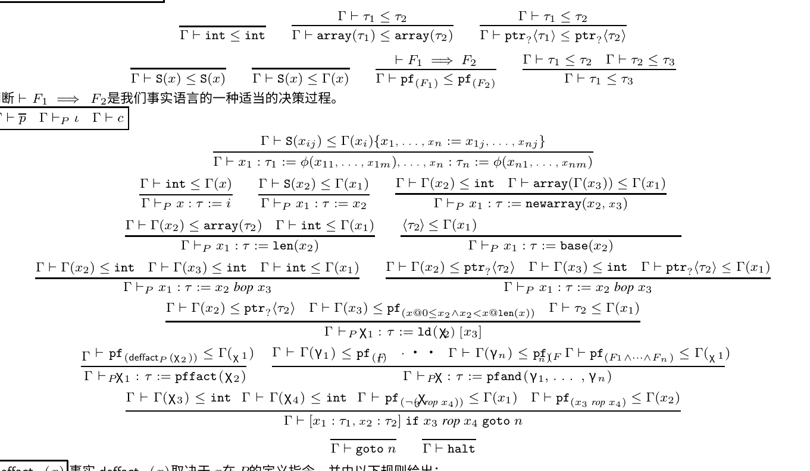

判断 $\vdash F_1 \Longrightarrow F_2$ 是我们事实语言的一种适当的决策过程。

deffact$_P(x)$ 事实 deffact$_P(x)$ 取决于 $x$ 在 $P$ 的定义指令，并由以下规则给出：

| 定义指令 | deffact$_P(x)$ |
| --- | --- |
| deffact$_P(x : \tau := i)$ | $x=i$ |
| deffact$_P(x : \tau := \text{len}(x'))$ | $x=\text{len}(x')$ |
| deffact$_P(x : \tau := \text{base}(x'))$ | $x = x'\circ0$ |
| deffact$_P(x : \tau := x_1\ \text{bop}\ x_2)$ | $x=x_1\ \text{bop}\ x_2$ |

### 图14. 输入规则

所提出的输入规则大部分是语法导向的，并且可以变成算法。需要考虑的是，load规则必须确定实际的数组变量，这在结论中并不明显。一般来说，决策过程只需要验证规则在该程序点可用的数组之一上成立即可。实际上，可以通过检查证明变量的类型来推断出正确的数组。我们相信，关于事实的判断可以通过整数线性规划工具（例如Omega计算器[22]）高效地决定，但有两个注意事项。

首先，这些工具是基于 ℤ 而不是32位或64位整数进行推理的。其次，它们限制了我们对整数关系（以及编译器推理）的事实语言为仿射表达式。然而，这足以捕捉当前的STARJIT优化。

## 4. 编译器优化

在本节中，我们将在核心语言的背景下研究编译器优化。我们演示了优化编译器如何保留证明变量及其类型信息。我们认为我们的想法极大地简化了这个过程。在以前的工作中，实现者需要修改每个优化以更新安全信息。在我们的表示中，我们利用现有的编译器基础设施来完成大部分工作。特别是，大多数控制流或数据流优化几乎不需要任何改变。其他只需要修改编译器推理的代数属性。在下一节中，我们将讨论如何将这些思想从核心语言扩展到完整的Java。

一般来说，优化可以通过两种方式来保持程序中嵌入的证明的正确性。首先，它可以同时应用于计算和证明的转换。这对于大多数优化来说是足够的。其次，它可以为原始计算提供的事实创建新的证明。正如我们下面所示，这对于推断影响安全性的新属性的少数优化是必要的。在本节的其余部分中，我们将展示这些一般原则如何应用于简单示例上的各个编译器优化。

我们将考虑的示例，伪代码如下：

```
for (i=0; i<a.length; i++) {
    ... = a[i];
}
```

我们假设 a是一个非空整数数组，在循环中不被修改，并且伪代码数组下标检查有一个隐含的边界检查。尽管这个例子没有反映出Java的全部复杂性，但足以说明通过编译器优化传播安全信息的主要思想。第5节讨论了解决完整Java中的其他问题。

我们示例的第一步编译将程序转换为适合优化的低级表示，如图15所示。在我们的系统中，降低生成表达计算和计算安全性所需的证明的指令。例如，一个典型的编译器会将数组元素访问 a[i]展开为以下序列: 数组边界检查, 计算数组元素地址, 以及从该地址加载可能不安全的数据。在我们的系统中，编译器还生成证明变量，证明数组索引 i在数组边界内（下界为 q₄，上界为 q₆），并且加载访问数组 a 的元素 i（证明变量）

```
我 : 整数 := 0
uB : 整数 := 长度(一个)
一个)循环 :我 : 整数 := φ(我₁,我₃)
如果 uB ≤ 我₂跳转到退出
:= 长度(一个)
:= 函数( aLen )
:= 检查下界(我₂, 0)
:= 检查上界(我₂, aLen)
:= 函数与(q₃, q₅)
:= 基础(一个)
:= 阶乘函数(一个基础)
:= 一个基础 + 索引₂
:= 阶乘函数(地址)
:= 与函数(q₇, q₈)
:= 与函数(q₄, q₆, q₉)
:= 加载(地址) [q₁₀]
:= 值
:= 我₂ + 1
跳转循环
```

图15. 循环中的低级表示数组加载

```
i₁ : 整数 := 0
uB : 整数 := 长度(一个)
q₃ : Pf(uB=len(a)) := pffact(uB)
aBase : ptr?(整数) := 基础(一个)
q₇ : Pf(aBase=a@0) := pffact(aBase)
LOOP :i₂ :整数 := φ(我₁,我₃)
如果 uB ≤ i₂跳转 EXIT
:= 检查下界(我₂, 0)
:= checkUpperBound(i₂, uB)
:= 调用( q₃, q₅)
:= 一个基础 + 索引₂
:= 阶乘函数(地址)
:= 与函数(q₇, q₈)
:= 与函数(q₄, q₆, q₉)
:= 加载(地址) [q₁₀]
:= 值
:= 我₂ + 1
跳转循环
```

图16. 经过CSE和循环不变代码移动后的IR

能够证明这些证明的合取足以根据图14中的类型规则对加载指令进行类型检查。证明变量由显式数组边界检查（我们将其用作语法糖，用于将控制转移到停机指令，如果边界检查失败）和由 pffact和pfand语句生成，这些语句将地址计算的算术属性编码为证明变量的类型。

接下来，我们通过几个常见的编译器优化来解释图15中的示例，这些优化是由STARJIT用于生成高效的循环遍历数组的代码（图16-19）。结果是高度优化的代码，并附带了程序安全性的嵌入式证明。

我们从图16开始，应用几个基本的数据流优化，如公共子表达式消除、死代码消除和循环不变代码移动。我们系统中这些优化的一个有趣特性是它们不需要进行修改以保持

```
plain text
i1 : 整数 := 0
q11 : 打印 (i1=0) := 阶乘 (i1)
uB : 整数 := 长度(一个)
q3 : 打印 (uB=长度(a)) := pffact(uB)
aBase : ptr?(整数) := 基础(一个)
q7 : 打印 (aBase=a@0) := pffact(aBase
)LOOP : i2 : 整数 := Φ(i1, i3)
q4 : pf(0≤i2) := Φ(q11, q13)
[q1 : pf(i2<uB), q2 : ...] := 如果 uB≤i2 跳转 EXIT
q6 : pf(i2<len(a)) := pfand(q3, q1)
addr : ptr?<int> := 一个基础+索引2
q8 : pf(addr=aBase+i2) := 阶乘函数 (地址)
q9 : 调用 (地址=数组@索引2) := 与函数 (q7, q8)
q10 : pf(a@0≤addr<a@len(a)) := 与函数 (q4, q6, q9)
值 : 整数 := 加载(地址) [q10]
... : ... := 值
i3 : 整数 := 我2+1
q12 : pf(i3=i2+1) := pffact(i3)
q13 : pf(0≤i3) := pfand(q4, q12)
goto LOOP
EXIT :
...
```

# 图17. 边界检查消除后的IR

安全证明。它们对待证明变量与其他项相同，因此，自动应用于计算和证明。例如，公共子表达式消除和复制传播将所有出现的aLen替换为uB，包括在证明类型中出现的。证明变量的类型

$q_{3}$已更新以匹配其新定义pffact(uB)。
在图17中，我们展示了数组边界检查消除。在文献[4]中，这种优化通常被表述为在程序中删除冗余边界检查而不留下任何推理的痕迹。在这种方法中，验证器必须有效地重复优化推理以证明程序的安全性。在我们的系统中，优化不能消除定义证明变量的指令，除非为该变量构造一个新的定义或删除该变量的所有用途。直观地说，编译器必须在新的定义中记录其关于为什么消除该指令是多余的的推理。考虑图16中的边界检查。验证$0≤i_{2}$的下界检查是多余的，因为$i_{2}$是一个单调递增的变量，初始值为0。形式上，$i_{1}=0$，$i_{2}=Φ(i_{1}, i_{3})$和$i_{3}=i_{2}+1$这些事实意味着$0≤i_{2}$。这种推理通过证明变量$q_{4}$的新定义和额外的证明变量$q_{1}$和$q_{13}$在转换后的程序中记录下来。我们使用SSA在程序级别连接这些证明。验证$i_{2}<len(a)$(证明变量$q_{5}$)的上界检查是多余的，因为if语句保证了相同的条件(证明变量$q_{1}$)。

因为新的证明已经存在于程序中，编译器只需将所有对$q_{5}$的使用替换为$q_{1}$。
在图$1_{8}$中，我们执行操作符强度降低（OSR）[9]，以找到一个指针，它是一个单调递增或递减的循环索引变量的仿射表达式，并将其转换为一个独立的归纳变量。在我们的例子中，OSR通过直接递增来消除i对addr的计算。因为变量addr在$q_{8}$ := pffact(addr)语句中被使用，编译器不能修改addr的定义而不修改$q_{8}$的定义（否则，转换后的程序将无法通过类型检查）。简单地说，编译器必须重新建立原始定义提供的事实的证明仍然成立。在我们的系统中，OSR被修改为通过构建一个新的证明来证明原始指针定义隐含的事实。

```
plain text
i1 : 整数 := 0
q11 : 函数,变量1:=0 := 函数阶乘(变量1)
变量B : 整数 := 长度(一个)
q3 : 打印(uB=长度(a)) := 函数阶乘(变量B)
一个基址 : 指针?(整数) := 基础(一个)
q7 : 打印(aBase=a@0) := 函数阶乘(一个基址)
地址1 : 指针?(整数) := 一个基址+变量1
q14 : 函数(地址1=一个基址+变量1) := 函数阶乘(地址1)
循环 : 变量2 : 整数 := Φ(i1, i3)
q4 : pf(0≤i2) := Φ(变量11, 变量13)
地址2 : 指针?(整数) := Φ(地址1, 地址3)
q8 : 函数(地址2=一个基址+变量2) := Φ(变量14, 变量16)
[变量1:函数(变量2<uB), q2 : ...] := 如果 uB≤i2 跳转 EXIT
q6 : pf(i2<len(a)) := 函数与(变量3, 变量1)
q9 : 函数(地址2=数组@索引2) := 函数与(变量7, 变量8)
q10 : pf(a@0≤addr<a@len(a)) := 与函数(q4, q6, q9)
值 : 整数 := 加载(地址2)[变量10]
... : ... := 值
i3 : 整数 := 我2+1
q12 : pf(i3=i2+1) := 调用(变量3)
地址3 : 指针?(整数) := 地址2+1
q15 : 函数(地址3=地址2+1) := 函数阶乘(地址3)
q13 : pf(0≤i3) := 与(变量4, 变量12)
q16 : 函数(地址3=基址+变量3) := 函数与(变量8, 变量12, 变量15)
退出 :
...
```

# 图18. 经过元素地址强度削减后的IR

```
plain text
uB : 整数 := 长度(一个)
q3 : pf(uB=len(a)) := pffact(uB)
aBase : ptr?(整数) := 基础(一个)
q7 : pf(aBase=a@0) := 调用 (基址 )
地址1 : 指针?(整数) := 基址
变量14 : 调用(地址1=基址) := 调用(地址1)
地址UB : 指针?(整数) := 基址+uB
q17 : 调用(地址UB=基址+uB) := 调用(地址UB)
LOOP :
地址2 : 指针?(整数) := Φ(地址1, 地址3)
q4 : pf(基址≤地址) := Φ(q14, 变量13)
[q1 : pf(地址2<地址上界), q2 : ...] := if 地址上界≤地址2
goto EXIT
q6 : pf(地址2<基址+长度(数组)) := pfand(q3, q1, q17)
q10 : pf(数组@0≤地址<数组@长度(数组)) := pfand(q4, q6, q7)
val : 整数 := 加载(地址2)[变量10]
... : ... := val
地址3 : 指针?(整数) := 地址2+1
q15 : pf(addr3=addr2+1) := pffact(addr3)
q13 : pf(aBase≤addr3) := pfand(q4, q15)
goto LOOP
EXIT :
...
```

# 图19. 线性函数测试替换后的IR

对此事实进行归纳。再次，我们利用SSA建立新的证明。在这种情况下，$q_{8}:\text{pf}(addr_{2}=aBase+i_{2})$由合并证明变量的phi指令定义$q_{14}:\text{pf}(addr_{1}=aBase+i_{1})$和$q_{16}:\text{pf}(addr_{3}=aBase+i_{3})$。

## 5. 扩展

我们的核心语言可以轻松扩展以处理Java和CLI的其他有趣方面。在本节中，我们描述了几个这样的扩展。

首先，我们可以通过使用单例类型来处理对象模型降低。考虑一个虚拟调用操作。通常，它被降低为三个操作：加载虚拟调度表（vtable），从vtable加载方法指针，调用方法指针并将对象作为附加参数传递。在我们的系统中，这些操作看起来像这样：

```
x: SomeClass := ...
t1: vtable(x) := vtable(x)
t2: (S(x), int) → int := method(foo: (int) → int, t1)
t3: int := call(t2)(x, 10)
```

这里的方法foo（接受一个整数并返回一个整数）正在变量x上被调用。在降低的代码中，变量t1获得依赖类型vtable(x)，这意味着它包含了当前在x中的对象的vtable。变量t2获得加载的方法指针。从类型vtable(x)中，类型规则可以确定这个方法指针的精确函数类型，即(S(x), int) → int，其中第一个参数必须是x。实际的调用是最后一个操作，在这里我们将x作为显式参数传递。由于x具有类型S(x)，这个操作通过了类型检查。

通过使用基于术语变量的单例类型，我们实现了一个相对简单的类型系统，同时避免了明确的“this”参数的已知类型问题（参见[12]和参考文献）。解决这个类型问题的现有解决方案具有更复杂的类型系统，只有一个例外。Chen和Tarditi[7]为基于类的面向对象语言的降低IR也有一个类似简单的类型系统。像我们的系统一样，他们的系统也将类名作为类型，并保留有关类层次结构、字段和方法的信息。他们还有存在性，存在性的子类上界（类型变量可以由类上界限定，并且范围包括该类的任何子类）。他们使用这些存在性来表示任何给定对象的未知运行时类型，从而表示显式“this”参数的类型。他们还有一个类表示函数，将类名映射为类。

```
Γ ⊢ Γ(x) ≤ ptr?(τ)   Γ ⊢ Γ(y) ≤ τ
Γ ⊢ Γ(p) ≤ pf(z≤0∧x∧z≤len(z))
Γ ⊢ P st(x, y) [p]
```

修改我们的形式化和类型完备性证明以适应存储将是直接的。

Java和CLI具有可变的协变数组，因此需要在运行时进行数组存储检查。特别是，在存储到数组中时，运行时必须检查被存储的对象是否与数组的运行时元素类型兼容（可能是静态元素类型的子类型）。在我们的实现中，我们使用形式为elem(x)的类型来表示数组x的运行时元素类型。对于x上的加载基本操作实际上返回类型为ptr?(elem(x))的某个值。数组存储检查会产生一个证明值，该值可用于证明某个其他变量具有类型elem(x)，并且我们有一个强制转换来使用证明值来更改变量的类型。降低的数组存储的结尾可能如下所示：

```
x: 数组 (C) := ...
y: C := ...
...
p1: pf(x=null∧0≤t∧x<len(x)) := ...
p2: pf(y=elem(x)) := chkst(x, y)
st(t, retype(y, p2)) [p1]
```

有一个技术细节值得注意。为了避免类型系统和事实语言之间的循环依赖，并避免使事实语言的决策过程相互依赖于子类型检查器，我们限制了可以出现在形如x:τ的事实中的类型不涉及证明类型。

向下转型与存储检查类似，我们可以以类似的方式处理它们。一个chkcast(x:C)操作检查x是否属于类型C并返回此事实的证明，否则会抛出异常。在我们的实现中，运行时执行的实际子类型检查通常由虚拟机本身完成，并且虚拟机不受我们的JIT类型系统的类型检查。但是，我们部分内联此操作以包括一些常见的快速情况，并将一些部分暴露给冗余消除和CSE。例如，如果对象为空，则它属于任何引用类型并且可以存储到任何引用数组中或向下转换为任何引用类型。另一个例子是比较对象的vtable与特定类的vtable，如果它们相等，则该对象属于该类。这样的比较在我们的系统中产生事实的形式为 $x=null \quad \Rightarrow \quad x:C$ 或 $\vdash$虚函数表(参数$x$)=$\vdash$虚函数表(类$C$) $\Rightarrow$ 参数$x$:类$C$。

请注意，由LFTR生成的代码在我们的核心语言中无法输入，因为我们不允许对指针进行条件分支。扩展语言以处理这个问题很简单，但需要对指针值进行全序排序，这实际上需要转向基于堆的语义。请注意，尽管该语言允许对指针进行比较，但在前面的示例中并未使用。

## 6. 实现状态

目前的STARJIT编译器在整个编译过程中生成并维护证明变量，以便在检查消除的情况下实现某些优化的安全实现（将在即将发表的论文中描述）。对于优化的初始设计角色，证明变量不需要证明类型：优化不需要知道优化是安全的原因，而只需要知道它的安全依赖。因此，当前的STARJIT表示与第2节中描述的类似，其中包含第5节中的一些扩展。

STARJIT实现了本文讨论的所有优化，以及[1]中描述的更多优化。如果需要，我们修改了每个优化以正确处理证明变量。数组边界检查消除和运算符强度降低需要最重要的修改，如第4节所述。对于虚拟机类型检查函数的部分内联，如第5节所述，我们更新了证明变量的定义，以确定变量具有检查过的类型。我们还修改了方法内联以正确确定内联方法的类型。

在较少明确信息的一方是SpecialJ编译器[8]和DTAL [27]。这两种方法都记录循环不变量，但不记录明确的安全依赖关系。这使得验证更加困难（决策过程必须考虑所有可用的变量），干扰了更多的优化（如循环剥离），并且使得删除不变量更加困难（因为不变量从未被明确使用）。

对于方法的每个参数，我们添加了一个证明变量来确保它具有正确的类型。当一个方法被独立编译时，该证明变量在方法入口处被自动定义（因为方法的参数类型由运行时环境保证）。当方法被内联时，相应的证明变量必须由调用方法来定义。由于我们的系统中的方法调用操作需要为每个参数提供证明变量，因此这些信息是容易获取的。然而，大多数优化并不需要进行重大更改，原因在本文中有详细说明。

在光谱的另一端，还有其他系统，不仅像我们一样明确地表示依赖关系，而且还使用证明记录了每个指令的依赖关系为什么意味着安全，而不是在检查期间依赖于决策过程，就像我们的系统一样。Crary和Vanderwaart的LTT系统[10]和Shao等人的TSCB系统[23]独立开发，都采用了这种方法，尽管在函数式或主要功能语言的环境中。这两个系统都是围绕将逻辑框架融入类型系统的思想设计的，以便将证明携带代码[20]的好处与类型系统的便利性相结合。LTT和TSCB分别采用线性逻辑和归纳构造演算作为它们的证明语言。融入证明系统还使它们更加灵活，因为它们可以在一个框架内表达各种属性。

我们实现了一个早期版本的类型验证器，它可以自动推断出证明类型。这个实现对于在STARJIT中发现错误非常有帮助，但对于优化代码的完全验证来说还不够。特别是推断算法在一些更复杂的优化情况下是不够准确的，比如第4节中的LFTR示例（没有证明类型信息）。我们相信在使用本文中开发的框架时，将编译器扩展为使用精确的证明类型来处理证明变量将是简单的。

## 7. 相关工作

在表示中缺乏明确的证明迫使我们在类型检查期间使用决策过程。这限制了我们只能使用可判定的属性，并且可能不太适合用于需要证明的代码应用，其中验证器中决策过程的增加复杂性可能是不可取的。

据我们所知，SafeTSA [25, 2] 是文献中唯一的一个类型安全的SSA表示的例子。他们的工作动机与我们的相当不同。SafeTSA被设计为Java字节码的替代品，而我们的表示形式是一个字节码编译器的低级中间语言。SafeTSA可以表示某些优化，如CSE和有限的检查消除，而Java字节码则不能。然而，在我们在第2节中的分类中，SafeTSA是一种细化式表示，因此不能表示我们在这里讨论的许多低级优化的效果。例如，它不能表示基于先前提的检查消除的安全性，也不能表示如图7所示的不安全内存地址的构建。

另一方面，我们的系统更适合在优化编译器的内部使用。对于我们只需要进行有限的证明使用，即验证由真正的优化编译器消除的检查的正确性，我们可以使用一个简化得多的系统，这个系统对编译器的负担要小得多，而不是使用更加语义重的系统。

此外，对于认证代码的应用，我们相信可以将这里介绍的优化中间代码作为代码生成的一部分转换为LTT或TSCB风格的更明确形式，从而同时获得两种方法的好处，可能可以遵循使用生成证明的定理证明器的SpecialJ模型。然而，这仍然是未来的工作。

最后，我们的证明变量也与Jalapeño Java系统的条件寄存器类似，如[6, 14]中所述。两者都是表示控制流信息的机制，作为抽象值依赖。然而，它们的使用更加有限。条件寄存器不用于表达一般的安全信息或支持代码验证。相反，编译器使用它们来模拟检查操作和其后的所有（而不仅仅是潜在不安全的）指令之间的控制流。Jalapeño使用条件寄存器将由异常引起的控制流折叠成一个扩展块，并在该块中防止违反控制流依赖的指令重新排序。

## 8. 结论

本文展示了一种保留高度优化内存安全依赖关系的类型化低级程序表示。类型保持编译器。我们的表示将安全依赖编码为一流的术语级证明变量，捕捉程序中的基本内存安全依赖关系，而不会人为地限制优化——以前的方法将安全依赖关系附加到值依赖关系之上，抑制了优化机会。我们的表示将内存安全的证明编码为与证明变量相关联的依赖类型。在StarJIT编译器中实现这种表示的经验表明，高度优化的Java JIT编译器可以轻松生成和维护这种表示，即使在进行边界检查消除、值编号、强度降低、线性函数测试替换等积极的基于SSA的优化的情况下也是如此。使用显式证明值和证明类型，现代针对类型安全语言的优化编译器现在可以生成可证明安全但低级的中间表示，而不限制优化。

# 参考文献

| 序号 | 引用 |
| --- | --- |
| [1] | ADL-TABATABAI, A.-R., BARADWAJ, J., CHEN, D.-Y., GHULOUM, A., MENON, V. S., MURPHY, B. R., SERRANO, M., AND SHPEISMAN, T. The StarJIT compiler: A dynamic compiler for managed runtime environments. Intel Technology Journal 7, 1 (February 2003). |
| [2] | AMME, W., DALTON, N., VON RONNE, J., AND FRANZ, M. SafeTSA: 一种基于静态单赋值形式的类型安全和引用安全的移动代码表示。在ACM SIGPLAN 2001年编程语言设计与实现会议上（美国犹他州Snowbird，2001年），第137-147页。 |
| [3] | BILARDI, G., AND PINGALI, K. 计算静态单赋值形式的算法。J. ACM 50, 3 (2003), 375-425. |
| [4] | BODÍK, R., GUPTA, R., AND SARKAR, V. ABCD: 按需消除数组边界检查。在ACM SIGPLAN 2000年编程语言设计与实现会议上（加拿大不列颠哥伦比亚省温哥华，2000年），第321-333页。 |
| [5] | BRIGGS, P., COOPER, K. D., AND SIMPSON, L. T. 值编号。软件—实践与经验 27, 6 (1996年6月), 701–724. |
| [6] | CHAMBERS, C., PECHTCHANSKI, I., SARKAR, V., SERRANO, M. J., AND SRINIVASAN, H. Java的依赖分析。第12届国际语言和并行计算编译器研讨会论文集(1999年), 第1863卷计算机科学讲义, 第35–52页。 |
| [7] | CHEN, J., AND TARDITI, D. 一种简单的面向对象语言的类型中间语言。在第32届年度ACM编程语言原理研讨会上（加利福尼亚州长滩, 美国, 2005年1月), ACM出版社, 第38–49页。 |
| [8] | COLBY, C., LEE, P., NECULA, G. C., BLAU, F., PLESKO, M., AND CLINE, K. 一种用于Java的认证编译器。在PLDI '00: ACM SIGPLAN 2000年编程语言设计与实现会议论文集（纽约, 美国, 2000年), ACM出版社,第95–107页。 |
| [9] | COOPER, K. D., SIMPSON. L. T., AND VICK, C. A. 运算符强度降低。ACM程序设计语言和系统交易 (TOPLAS) 23, 5 (2001年9月) , 603–625。 |
| [10] | CRARY, K., AND VANDERWAART, J. 一种表达力强、可扩展的类型理论用于认证代码。在ACM SIGPLAN国际会议函数式编程（匹兹堡, 宾夕法尼亚州, 2002年）, 第191–205页。 |
| [11] | CYTRON, R., FERRANTE, J., ROSEN, B. K., WEGMAN, M., AND ZADECK, K. 一种高效的计算静态单一赋值形式的方法。在第十六届ACM年会编程语言原理研讨会（奥斯汀, 德克萨斯州, 1989年1月)。 |
| [12] | GLEW, N. 一种高效的类和对象编码。在第15届ACM SIGPLAN面向对象程序设计、系统、语言会议上（美国明尼阿波利斯, 2000年10月）, ACM出版社, 第311-324页。 |
| [13] | GROSSMAN, D., AND MORRISETT, J. G. 可扩展的类型化汇编语言认证。在TIC '00: 第三届国际编译类型研讨会选集（英国伦敦, 2001年), Springer-Verlag, 第117-146页。 |
| [14] | GUPTA, M., CHOI, J.-D., AND HIND, M. 在异常存在的情况下优化Java程序。在第14届欧洲面向对象编程会议 - ECOOP '00（计算机科学讲义, 第1850卷）上（2000年6月）, Springer-Verlag, 第422-446页。 |
| [15] | Igarashi, A., PIERCE, B., AND WADLER, P. 轻量级Java: Java和GJ的最小核心计算. ACM Transactions on Programming Languages and Systems (TOPLAS) 23, 3 (2001年5月), 396–560. 首次出现在OOPSLA, 1999年. |
| [16] | KNOOP, J., RÜTHING, O., AND STEFFEN, B. 惰性代码移动. 在SIGPLAN '92 Conference on Programming Language Design and Implementation (San Francisco, CA, June 1992)的论文集中. |
| [17] | MENON, V., GLEW, N., MURPHY, B., MCCREIGHT, A., SHPEISMAN, T., ADL-TABATABAI, A.-R., AND PETERSEN, L. 一个可验证的SSA程序表示，用于激进的编译器优化。Tech. Rep. YALEU/DCS/TR-1338, 计算机科学系, 耶鲁大学, 2005年。 |
| [18] | MORRISETT, G., CRARY, K., GLEW, N., GROSSMAN, D., SAMUELS, R., SMITH, F., WALKER, D., WEIRICH, S., AND ZDANCEWIC, S. TALx86: 一个真实的类型化汇编语言。在第二届ACM SIGPLAN系统软件编译器支持研讨会（乔治亚州亚特兰大, 1999年）, 第25-35页。发表于INRIA技术报告0288, 1999年3月。 |
| [19] | MORRISETT, G., WALKER, D., CRARY, K., AND GLEW, N. 从System F到类型化汇编语言。ACM Transactions on Programming Languages and Systems (TOPLAS) 21, 3 (1999年5月), 528—569页。 |
| [20] | NECULA, G. 证明携带代码。In POPL 1997(纽约, 纽约, 1997年1月), ACM出版社, 第106-119页。 |
| [21] | NECULA, G. C., AND LEE, P. 认证编译器的设计与实现。In PLDI '98: ACM SIGPLAN 1998年编程语言设计与实现会议(纽约, 美国, 1998年), ACM出版社, 第333-344页。 |
| [22] | PUGH, W. Omega测试: 一种快速实用的整数规划算法用于依赖分析。In Supercomputing '91会议(阿尔伯克基, 新墨西哥州, 1991年11月)。 |
| [23] | SHAO, Z., SAHA, B., TRIFONOV, V., AND PAPASPYROU, N. 一种用于认证二进制文件的类型系统。在第29届ACM程序设计语言原理研讨会（2002年1月）, ACM出版社, 第216-232页。 |
| [24] | VANDERWAART, J. C., DREYER, D. R., PETERSEN, L., CRARY, K., AND HARPER, R. 递归数据类型的类型化编译。在TLDI 2003: ACM SIGPLAN国际语言设计和实现研讨会上的论文（新奥尔良, LA, 2003年1月）, 第98-108页。 |
| [25] | VON RONNE, J., FRANZ, M., DALTON, N., AND AMME, W. 编译时消除空指针和边界检查。在第3届反馈导向和动态优化研讨会上 (FDDO-3)(2000年12月)。 |
| [26] | WALKER, D., CRARY, K., AND MORRISETT, G. 通过静态能力进行类型化内存管理。ACM编程语言和系统交易 (TOPLAS) 22, 4 (2000年7月), 第701-771页。 |
| [27] | XI, H., AND HARPER, R. 依赖类型的汇编语言。在国际函数编程会议 (2001年9月), 第169-180页。 |

## 面向对象的类型推断

Jens Palsberg和Michael I. Schwartzbach
palsberg@daimi.aau.dk 和 mis@daimi.aau.dk

计算机科学系，奥胡斯大学
Ny Munkegade, DK-8000 Aarhus C, 丹麦

## 摘要

我们提出了一种新的方法来推断具有继承、赋值和迟绑定的非类型化面向对象程序中的类型。它保证了所有消息都被理解，用类型信息注释程序，允许多态方法，并且可以用作优化编译器的基础。类型是有限的类集合，子类型是集合包含关系。使用一个跟踪图，我们的算法构建了一组条件类型约束，并通过最小固定点推导计算出最小解。

该算法保证所有消息都被理解，用类型信息注释程序，允许多态方法，并可用作优化编译器的基础。类型是有限的类集合，子类型是集合包含关系。给定一个具体的程序，该算法构建一个有限的类型约束图。如果这些约束可解，则程序是可类型化的。

然后算法在最坏情况下指数时间内计算出最小解。图包含了可以从程序中推导出的所有类型信息，而不需要跟踪空值或分析实例变量的内容。这使得算法能够检查大多数常见的程序；特别是，它允许多态方法。该算法类似于之前关于类型推断的工作[18, 14, 27, 1, 2, 19, 12, 10, 9]，使用类型约束，但在处理条件约束和通过最小不动点推导约束方面有所不同，而不是使用一致性。

## 1 介绍

具有赋值和延迟绑定的非类型化面向对象语言允许快速原型设计，因为类继承实现而不是规范。然而，延迟绑定可能导致程序不可靠、难以阅读和低效[27]。类型推断可能有助于解决这些问题，但迄今为止，没有提出的推断算法能够检查大多数常见的、完全无类型的程序[9]。

示例语言类似于SmallTalk[8]，但避免了元类、块和原始方法。相反，它提供了显式的new和if-Then-else表达式；像NaTural这样的类可以在语言本身中编程。

我们提出了一种新的类型推断算法，用于具有继承、赋值和延迟绑定的基本面向对象语言。

在下一节中，我们将讨论延迟绑定对类型推断的影响，并检查以前的工作。在后面的章节中，我们简要概述示例语言，介绍类型推断算法，并展示其能力的一些示例。

在1991年10月6日至11日的ACM面向对象编程会议(OOPSLA)上，页码为146-161。

©1991 ACM。经许可复制。

## 2 延迟绑定

延迟绑定意味着消息发送根据接收者的类动态绑定到一个实现。 这允许一种基本的面向对象编程中的多态性。 然而，这也涉及到一个危险，即接收者的类没有为该消息实现方法，甚至接收者可能为空。 此外，延迟绑定可能使程序的控制流难以跟踪，并可能导致耗时的运行时搜索实现。

通常是不可计算的，编译器必须使用精确的近似值。 引发的类型是任何精确近似值的子类型；子类型是集合包含关系。 还要注意，我们对类型的概念，也在[22]中进行了研究，与通常在面向对象编程的理论研究中使用的概念不同[3, 7]；这些理论在处理晚期绑定和赋值时存在困难。

类型推断的目标现在可以表述如下。

对于程序文本中的每个消息发送，如果能推断出以下信息，将极大地帮助优化编译器。

- **安全保证**：确保任何消息都发送给nil或实现了该消息方法的类的实例；并且，在此基础上
- **类型信息**：任何接收者的引发类型的精确近似值。
    - 接收者可以为空吗？
    - 接收者可以是一个没有实现该消息方法的类的实例吗？
    - 在程序的任何执行中，所有可能的非空接收者的类是什么？

请注意，我们忽略检查接收者是否为nil；这是一个标准的数据流分析问题，可以单独处理。

请注意，可用的类集是由特定程序引起的。 这些观察结果引导我们使用以下术语。

如果类型推断成功，则程序是可输入的；错误消息NotUnderstood不会发生。 编译器可以利用此来避免在代码中插入某些检查。 此外，如果接收者的类型信息是一个单例集合，则编译器可以对消息进行早期绑定到唯一可能的方法；甚至可以进行内联替换。 同样，如果类型信息是一个空集合，则接收者始终为nil。 最后，关于变量和参数获得的类型信息可以用于为程序员的利益注释程序。

- **术语**：
    - **类型**：类型是一个有限的类集。
    - **引发类型**：在具体程序中，表达式的引发类型是在该特定程序的任何执行中，它可能评估为的所有可能的非空值的类集。
    - **声音逼近**：在具体程序中，表达式的引发类型的声音逼近是引发类型的超集。

SMALLTALK和其他无类型的面向对象语言通常由解释器实现。这对于原型设计和探索性开发非常理想，但对于实时应用程序和嵌入式系统来说往往效率低下且占用空间过多。所需的是一种优化编译器，它可以在编程阶段的最后阶段使用，以获得所需的效率和安全性保证。一个生成良好代码的编译器

请注意，声音逼近告诉“全部真相”，但并不总是“只有真相”关于引发类型。由于引发类型是

即使速度较慢，也可以容忍，因为它的使用频率比通常的编程环境要低得多。我们的类型推断算法可以作为这种优化编译器的基础。请注意，安全保证和引发的类型都对程序中的微小变化敏感。因此，类的分离编译似乎是不可能的。诸如SIMULA [6]/BETA [15]、C++ [26]和EIFFEL [17]之类的类型化面向对象语言允许分离编译，但牺牲了灵活性。类型和实现之间的关系总结在图1中。

其中第四个在附录B的图11中显示。Hense使用可扩展和递归的记录类型。这似乎产生的类型比我们的方法更不精确，并且不清楚这些类型在优化编译器中是否有用。一个问题是类型方案始终对应于单例或无限的单态集合；我们的有限集合可以更精确。Hense的方法和我们的方法都不会跟踪nil值，也不会分析变量的内容。我们目前正在研究其他可能的关系。

| 当程序是： | 它们的实现是： |
| --- | --- |
| 无类型的 | 解释执行 |
| 可类型化的 | 编译 |
| 类型化的 | 分离编译 |

图1：类型和实现。

在进入我们的类型推断算法的细节之前，我们首先概述一个应用它的示例语言。

Graver和Johnson[10, 9]在他们的SMALLTALK类型系统中采取了一种中间方法，要求程序员为实例变量指定类型，而参数的类型则是推断出来的。Suzuki [27]在他关于SMALLTALK类型推断的开创性工作中，通过假设每个消息发送可能调用该消息的所有方法来处理后期绑定。然而，事实证明，这导致的算法无法检查大多数常见的程序。

## 3 语言

我们的示例语言类似于SMALLTALK，见图2。

这两种方法都包含了一种方法类型的概念。我们的新类型推断算法放弃了这个想法，而是使用了从有限图中派生出来的条件约束的概念。最近，Hense [11] 解决了一个几乎与我们示例语言相同的语言O’Small的类型推断问题。他使用了一种完全不同的技术，基于R’emy [24] 和Wand [29] 的类型方案和一致化。他的论文列举了四个程序，他的算法只能对前三个进行类型检查。我们的算法可以对所有四个进行类型检查。

一个程序是一组类，后面跟着一个表达式，其值是执行程序的结果。可以使用继承来定义一个类，它包含实例变量和方法；方法是一个消息选择器（m₁ … mₙ），带有形式参数和表达式。该语言避免了元类、块和原始方法。相反，它提供了显式的new和if-then-else表达式（后者测试条件是否非空）。序列的结果是该序列中最后一个表达式的结果。表达式“self class new”生成self类的一个实例。表达式“E instanceOfClassId”生成一个运行时检查类成员资格的结果。如果检查失败，则表达式的值为nil。Smalltalk系统基于一些用汇编语言编写的原始方法。这种对原始方法的依赖在理论研究中并不是必需的，因为类似于True、False、Natural和List的类可以在语言本身中编程，如附录A所示。

```
(程序)    P ::= C₁ ... Cₙ E
(类)      C ::= class类标识符 [继承类标识符 ]
                 变量标识符₁ ... 标识符ₖ 方法₁ ... 方法ₙ
                 结束类标识符
(方法)    方法 ::= method m₁ 标识符₁ ... mₙ 标识符ₙ 表达式
(表达式)  表达式 ::= 标识符 := 表达式 | 表达式 方法₁ 表达式₁ ... mₙ 表达式ₙ | 表达式 ; 表达式 | if 表达式 then 表达式 else 表达式 |
                 类标识符 new | self class new | 表达式 instanceOf 类标识符 |
                 self | super | 标识符 | nil
```

图2： 示例语言的语法。

## 4 类型推断

我们的类型推断算法基于三个基本观察。

程序的大小最多是原始程序大小的平方。

第二和第三个观察结果导致了关于扩展程序所有执行的类型信息的有限表示；这个表示被称为跟踪图。从这个图中生成了一组有限的类型约束。程序的可类型化性取决于这些约束的可解性。附录B包含了七个示例程序，展示了类型推断算法的不同方面，请参阅图3的概述。程序文本与相应的约束及其最小解（如果存在）一起列出。Hense在图11中的程序是他给出的一个典型的无法进行类型检查的示例[11]。我们邀请读者在阅读本节时参考附录。

- **继承**：类继承实现而不是规范。
- **课程**：程序中有有限数量的课程。
- **消息发送**：程序中有有限数量的语法消息发送。

第一个观察结果导致类和其子类的分开类型推断。从概念上讲，在进行类型推断之前，需要展开所有的类。这种展开意味着删除所有的继承关系。

跟踪图包含三种类型信息。

- **局部约束**：从方法体生成；包含在节点中。
- **连接约束**：反射消息发送；附加到边缘。
- **条件**：区分接收者；附加到边缘。

这种展开的想法受到Graver和Johnson [10, 9]的启发；请注意，扩展

| 示例程序中：说明： |  | 我们可以输入吗？ |
|-------------------|--|-----------------|
| 图10 | 基本类型推断 | 是的 |
| 图11 | Hense的程序 | 是的 |
| 图12 | 多态方法 | 是的 |
| 图13 | 递归方法 | 是的 |
| 图14 | 缺乏流分析 | 不 |
| 图15 | 缺乏 nil 检测 | 不 |
| 图16 | 一个现实的程序 | 是的 |

图3：示例程序的概述。

### 4.1 跟踪图节点

跟踪图的节点是从程序中实现的各种方法中获得的。

每个方法都会产生一些不同的节点：每个具有相应选择器的句法消息发送一个。这种情况在图4中有所说明，我们可以看到一个方法m的节点，该方法在每个类C1, C2, ..., Cn中实现。因此，跟踪图中的节点数量最多将与程序的大小成二次关系。还有一个单独的节点用于程序的主表达式，我们可以将其视为没有参数的特殊方法。

方法没有类型，但可以根据形式参数和结果的类型提供类型注释。特定的方法实现可以由跟踪图中的多个节点表示。这使得它可以被分配多个不同的类型注释-每个语法调用一个。这使我们能够通过有限的一组方法“单态”有效地获得方法多态性。

一个未知变量[E]。确切的类型信息当然是无法计算的。在我们的方法中，我们将忽略程序执行的以下两个方面。

- **近似**：
    - **空值**：它不跟踪空值。
    - **实例变量**：它不会分析实例变量的内容。

第一个近似是基于我们对类型推断目标的讨论；第二个近似是将实例变量视为具有单个可能很大的类型，从而导致我们识别出不同出现的实例变量的类型变量。在图14和15中，我们展示了两个程序片段，这是因为这些近似导致我们无法对其进行类型。在这两种情况下，约束要求错误的包含 {True} ⊆ {Natural}。Suzuki [27] 和 Hense [11] 进行了相同的近似。

对于表达式 E，局部约束是根据其推导中的所有短语生成的，根据图5中的规则。从程序语法中生成类型变量约束的想法也在 [28, 25] 中得到了利用。

约束条件保证安全性；只有在情况4)和 8)中才会出现近似情况。请注意，所有约束条件都可以被表达为以下三种形式之一的不等式：“常量⊆变量”， “变量⊆常量” 或 “变量⊆变量”；这将在后面被利用。

### 4.2 本地约束

每个节点包含一组本地约束，这些表达式的类型必须满足。对于方法实现中的每个语法出现的表达式E，我们将其类型视为

图4： 跟踪图节点。

可以将约束表达为以下三种形式之一的不等式：“常量 ⊆ 变量”，“变量 ⊆ 常量”或“变量 ⊆ 变量”；这将在后面被利用。

方法 m 的实现。 我们将这条边与连接约束相关联，这些约束反映了形式参数和实际参数以及结果之间的关系。 这种情况很容易推广到具有多个参数的方法。 请注意，边的数量再次与程序的大小成二次关系。

每个不同的节点都使用唯一的类型变量，除了实例变量的类型是共同的，对应于在同一个类中实现的方法的所有节点。 Graver和Johnson [10, 9]也使用了类似的思想。

### 4.4 全局约束

为了获得整个程序的全局约束，我们将局部约束和连接约束以图7所示的方式组合起来。 这会产生条件约束，不等式只需要在所有条件成立时成立。 全局约束只是由图中所有路径生成的条件约束的并集，这些路径起始于对应于程序的主表达式的节点。 这是一个有限集合，因为图是有限的；正如本节后面所示，约束集合的大小在（极端）最坏情况下可能呈指数增长。 如果全局约束集合有解，则

### 4.3 跟踪图边

跟踪图的边将反映消息发送和可能实现它的方法之间的可能连接。 情况如图6所示。

如果一个节点对应于一个包含形式为X m: A的消息发送的方法，则我们有一个从该发送节点到任何其他接收者节点的边，该接收者节点对应于一个方法 m的实现。 我们用条件标记这条边，即消息发送可能被执行，即C ∈ [[X]]，其中 C是实现该特定方法的类。

| 表达式: | 约束: |
|--------|--------|
| 1) Id := E | [[Id]] ⊇ [[E]] ∧ [[Id := E]] = [[E]] |
| 2) E m1 E1 ... mn En | [[E]] ⊆ {C \| C 实现 m1 ... mn} |
| 3) E1 ; E2 | [[E1 ; E2]] = [[E2]] |
| 4) 如果 E1 则 E2 否则 E3 | [[如果 E1 则 E2 否则 E3]] ⊇ [[E2]] ∪ [[E3]] |
| 5) C 新建 | [[C 新建]] = {C} |
| 6) E instanceOf C | [[E instanceOf C]] = {C} |
| 7) self | [[self]] = {封闭类} |
| 8) Id | [[Id]] = [[Id]] |
| 9) nil | [[nil]] = {} |

图5：本地约束。

图6：跟踪图边缘。

这提供了关于程序的动态行为的近似信息。

给定一个动态语义[4, 5, 23, 13]，可以很容易地验证它们的满足性是否意味着上述属性。如果我们在跟踪中扩展一个由类C中的方法实现的消息发送X m: A，那么我们可以归纳地假设C ∈ L([[X]]).但这意味着调用方法对应的节点中的本地约束必须成立，因为它们的所有条件现在都成立，而L是一个解。由于实际参数和形式参数以及结果之间的关系由连接约束准确地表示，并且这些约束也必须成立，所以结论成立。

考虑程序的任何执行。在观察这一点的同时，我们可以跟踪跟踪图中方法执行的模式。让E是在某一点评估的某个表达式，让val(E)是其值，让class (b)是对象b的类。如果L是全局约束的某个解，则以下结果成立。

**完备性定理**：
如果VAL(E) = niL，则CLASS(VAL(E)) ∈ L([[E]])

很容易看出这是真的。我们通过对跟踪过程中发送的消息数量进行归纳证明来证明。如果这个数量为零，那么我们只依赖于本地约束；

注意，在方法中出现的表达式E在跟踪图中出现了k次，具有k个类型变量[[E]]₁, [[E]]₂, ..., [[E]] k在全局约束中。对引发的近似进行了准确的描述

图7： 路径中的条件约束

E的类型是通过以下方式获得的

$$\bigcup_i L([\![E]\!]_i)$$

附录C提供了一种计算提取约束的最小解的高效算法，或者判断不存在解的方法。该算法在约束集大小的最坏情况下是二次的。完整的类型推断算法总结如图8所示。

### 4.5 类型注释

最后，我们将考虑如何通过类型约束的解 L 来生成程序的类型注释。这样的注释可以为程序员提供帮助。

实例变量 x 只有一个关联的类型变量。类型注释简单地是 L([\![x]\!])。然后程序员就知道了可能驻留在 x 中的类集合的上界。

一个方法有有限多个类型注释，每个注释都是从对应的跟节点中获得的。如果在类 C 中实现的方法是

$$\text{方法 } E \quad m_1: F_1, m_2: F_2, \ldots, m_n: F_n$$

然后每个类型注释的形式是

$$\{C\} \times L([\![F_1]\!]) \times \cdots \times L([\![F_n]\!]) \to L([\![E]\!])$$

程序员然后知道这个方法可以使用的各种方式

- **输入**：一个示例语言中的程序。
- **输出**：要么是关于所有表达式的安全保证和类型信息；要么是“无法为程序提供类型”。
    1.  展开所有类。
    2.  构建扩展程序的跟节点图。
    3.  从跟节点图中提取一组类型约束。
    4.  计算类型约束集的最小解。如果存在这样的解，则将其作为所需的类型信息输出，同时提供安全保证；否则，输出“无法为程序提供类型”。

图8： 类型推断算法摘要。

约束解决方案包含更多类型信息

关于方法的信息比Suzuki使用的方法类型更多。例如，考虑图12中的多态恒等函数。我们的技术可以得到两种方法类型的注释

```
id : {C} × {True} → {True}
id : {C} × {Natural} → {Natural}
```

而使用Suzuki的框架的方法类型是

```
id : {C} × {True, Natural} → {True, Natural}
```

这将不允许发送 succ 或 isTrue消息，并且会导致程序被拒绝。

### 4.6 指数最坏情况

附录B中的示例显示了几种情况，其中约束集非常小，实际上与程序的大小成线性关系。虽然通常情况下是如此，但理论上的最坏情况允许约束集在程序的大小上呈指数增长。推理算法的运行时间主要取决于跟踪图的拓扑结构。

图9显示了一个程序及其跟踪图的草图。由于图中有指数多个不同的路径，所以引发的约束集将呈指数增长。约束中将包含一组条件，与正则语言的单词相似。

```
(CCC + DCC)^{n/3}
```

其大小在n上显然是指数级的。

请注意，这种情况类似于ML中的类型推断，它在最坏情况下也是指数级的，但在实践中非常有用。上述情景实际上与[16]中提出的情景相似，用于说明ML中的指数运行时间。另一个相似之处是两种算法都会生成一个潜在的指数级约束集，但总是在多项式时间内解决。

图9：最坏情况的程序。

## 5 结论

我们的类型推断算法是正确的，并且可以处理大多数常见的程序。它也在概念上很简单：通过构建一组统一的类型约束，并通过固定点推导来解决。它可以通过数据流分析的正交努力进一步改进。

底层类型系统很简单：类型是有限的类集合，子类型关系是集合包含关系。

目前正在进行类型推断算法的实现。未来的工作包括将其扩展为优化编译器。

推断算法应该很容易修改以适应完整的Smalltalk，因为元类就是类，块可以被视为具有单个方法的对象，原始方法可以通过陈述机器代码必须满足的约束来处理。

另一个挑战是将算法扩展为生成类型注释和类型替换，参见[20, 21, 22]。

```
类列表
  变量 头，尾
  方法 setHead: h setTail: t
    head := h; tail := t
  方法 cons: x
    (self class new) setHead: x setTail: self
  方法 isEmpty
    如果头那么 false 否则 true
  方法 car
    头
  方法 cdr
    尾
  方法 append: aList
    如果（self isEmpty）是真的
      那么 aList
      否则（尾 append: aList） cons: head
  方法 insert: x
    如果（self isEmpty）是真的
      那么 self cons: x
      否则
        如果(头部 小于: x) 是真的
          那么自身 连接: x
          否则(尾部 插入: x) 连接: 头部
  方法 排序
    如果(自身 为空) 是真的
      那么自身
      否则(尾部 排序) 插入: 头部
  方法 合并: aList
    如果(自身 为空) 是真的
      那么 aList
      否则
        如果(头部 小于: (aList 第一个)) 是真的
          那么(尾部 合并: aList) 连接: 头部
          否则(自身 合并: (aList 剩余部分)) 连接: (aList 第一个)
结束列表
```

## 附录A：基本类

```
类 对象
结束 对象
```

```
类 真
  方法 是真
    对象 新建
结束 真
```

```
类 假
  方法 是真
    空
结束 假
```

因此，我们将“真新建”缩写为“true”，将“假新建”缩写为“false”。

```
类 自然数
  变量 表示
  方法 是否为零
    如果 表示 则 假 否则 真
  方法 后继
    (自然数 新建) 更新: 自身
  方法 更新: x
    表示 := x; 自身
  方法 前驱
    如果 (self isZero) 是真的
      那么 self
      否则 rep
  方法 less: i
    如果 (i isZero) 是真的
      那么 false
      否则如果 (self isZero) 是真的
        那么 true
        否则 (self pred) less: (i pred)
结束 自然数
```

因此，我们将“自然数新”缩写为“0”，并且，递归地，将“n succ”缩写为“n+1”。

```
类 可比
  变量 键
  方法 获取键
    键
  方法 设置键: k
    键 := k
  方法 小于: c
    键 小于: (c 获取键)
结束 可比
```

# 附录 B: 示例程序

```
类 A
    方法 f
        7
结束 A
类 B
    方法 f
        真
结束 B
x := A 新; (x f) 后继

约束:
    [[A 新   ]] = {A}
    [x] ⊇ [[A 新   ]]
    [[x := A 新   ]] = [[A 新   ]]
    [x] ⊆ {A, B}
    A ∈ [x] ⇒ [x f] = [[7]]
    A ∈ [x] ⇒ [[7]] = {自然数 }
    B ∈ [x] ⇒ [x f] = [[真   ]]
    B ∈ [x] ⇒ [[真]] = {真值}
    [x f] ⊆ {自然数 }
    自然数 ∈ [x f] ⇒ [[(x f) succ]] = {自然数 }
    [[x := A new; (x f) succ]] = [[(x f) succ]]

最小解:
    [x] = [[A new]] = [[x := A new]] = {A}
    [x f] = [[(x f) succ]] = 
    [[x := A new; (x f) succ]] = [[7]] = {自然数 }
    [[true]] = {真   }

追踪图示:
```

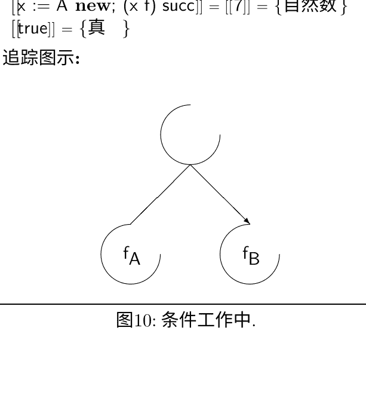

```
类 A
    方法 m
        0
结束 A
类 B 继承 A
    方法 n
        0
结束 B
a := A new;
b := B new;
a := b;
a m

约束条件:
    [[A new]] = {A}
    [a] ⊇ [[A new]]
    [[B new]] = {B}
    [b] ⊇ [[B new]]
    [a] ⊇ [b]
    [a] ⊆ {A,B}
    A ∈ [a] ⇒ [a m] = [[0]]
    B ∈ [a] ⇒ [a m] = [[0]]
    [[0]] = {自然数 }
    ⋮

最小解:
    [a] = {A,B}
    [b] = {B}
    [a m] = {自然数 }
    [[A new]] = {A}
    [[B new]] = {B}
    ⋮

追踪图示:
```

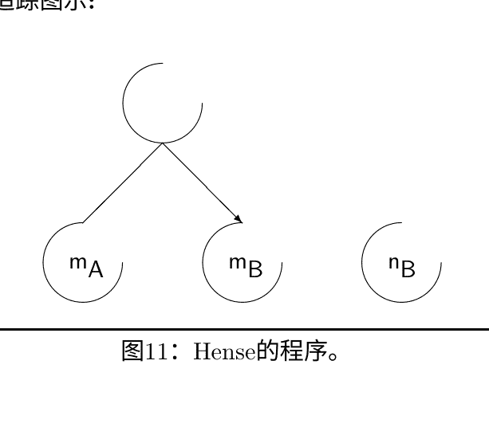

# 类 C

```
方法 id: x
    x
结束 C

((C新) id: 7) 后继;
((C 新 ) id: true) 是真
```

# 约束条件:

```
[[C 新   ]]₁ = {C}
[[C 新   ]]₁ ⊆ {C}
C ∈ [[C 新   ]]₁ ⇒ [[7]] = [[x]]₁
C ∈ [[C 新   ]]₁ ⇒ [[x]]₁ = [[(C 新   ) id: 7]]
[[7]] = {自然数}
[[(C 新   ) id: 7]] ⊆ {自然数}
自然数 ∈ [[(C新) id: 7]] ⇒ {自然数} = [[((C新) id: 7) 后继]]
[[C 新   ]]₂ = {C}
[[C 新   ]]₂ ⊆ {C}
C ∈ [[C 新   ]]₂ ⇒ [[true]] = [[x]]₂
C ∈ [[C new]]₂ ⇒ [[x]]₂ = [[(C new) id: true]]
[[true]] = {真   }
[[(C new) id: true]] ⊆ {真, 假   }
真   ∈ [[(C new) id: true]] ⇒ {对象   } = [[((C new) id: true) isTrue]]
假   ∈ [[(C new) id: true]] ⇒ {} = [[((C new) id: true) isTrue]]
```

# 最小解:

```
[[C new]]₁ = [[C new]]₂ = {C}
[[7]] = [[x]]₁ = [[(C new) id: 7]] = [[((C new) id: 7) succ]] = {自然数}
[[true]] = [[x]]₂ = [[(C new) id: true]] = {真   }
[[(C new) id: true) isTrue]] = {对象   }
```

# 追踪图示:

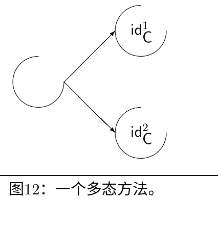

图12：一个多态方法。

# 类 D

```
方法 f: x
    如果 x
        那么 self f: x
        否则 nil
结束 D

(D新) f: nil
```

## 约束条件:

- [D 新 ] = {D}
- [D 新 ] ⊆ {D}
- D ∈ [D 新 ] ⇒ [[nil]] = [[x]]₁
- D ∈ [D 新 ] ⇒ [[如果 x那么self f: x否则 nil]]₁ = [[(D新) f: nil]]
- D ∈ [D 新 ] ⇒ [[如果 x那么self f: x否则 nil]]₁ ⊇ [[self f: x]]₁ ∪ [[nil]]₁
- D ∈ [D 新 ] ⇒ [[nil]]₁ = {}
- D ∈ [D 新 ] ⇒ [[self]]₁ = {D}
- D ∈ [D 新 ] ⇒ [[self]]₁ ⊆ {D}
- D ∈ [D 新 ], D ∈ [[self]]₁ ⇒ [[x]]₁ = [[x]]₂
- D ∈ [D 新 ], D ∈ [[self]]₁ ⇒ [[如果 x那么self f: x否则 nil]]₂ = [[self f: x]]₁
- D ∈ [D 新 ], D ∈ [[self]]₁ ⇒ [[if x then self f: x else nil]]₂ ⊇ [[self f: x]]₂ ∪ [[nil]]₂
- D ∈ [D 新 ], D ∈ [[self]]₁ ⇒ [[nil]]₂ = {}
- D ∈ [D 新 ], D ∈ [[self]]₁ ⇒ [[self]]₂ = {D}
- D ∈ [D 新 ], D ∈ [[self]]₁ ⇒ [[self]]₂ ⊆ {D}
- D ∈ [D 新 ], D ∈ [[self]]₁, D ∈ [[self]]₂ ⇒ [[x]]₂ = [[x]]₂
- D ∈ [D 新 ], D ∈ [[self]]₁, D ∈ [[self]]₂ ⇒ [[if x then self f: x else nil]]₂ = [[self f: x]]₂
- [[nil]] = {}

## 最小解:

- [[D new]] = [[self]]₁ = [[self]]₂ = {D}
- [[nil]] = [[x]]₁ = [[nil]]₁ = [[if x then self f: x else nil]]₁ = [[self f: x]]₁ = [[(D new) f: nil]]₁ = [[x]]₂ = [[空]]₂ = [[如果 x那么self f: x否则空]]₂ = [[self f: x]]₂ = [[(D 新 ) f: 空]]₂ = {}

## 追踪图示:

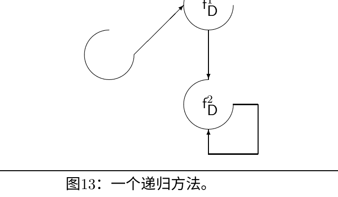

图13: 一个递归方法。

# 附录C：解决条件不等式系统

本附录展示了如何在二次时间内解决有限条件不等式系统。

## 定义C.1：CI系统由

- 有限集合 A 的原子。
- 有限集合 {α_i} 的变量。
- 有限集合的条件不等式的形式为

```
C1, C2, ..., Ck ⇒ Q
```

每个 Ci 是形式为 a ∈ α_j 的条件，其中 a∈A 是一个原子，Q是不等式的形式之一：

- A ⊆ α_i
- α_i ⊆ A
- α_i ⊆ α_j

其中 A ⊆ A 是一个原子集合。系统的一个解 L 为每个变量 α_i 分配一个集合 L(α_i) ⊆ A，使得所有条件不等式都得到满足。□

在我们的应用中，A模拟了一个具体程序中出现的类的集合。

## 引理C.2：解集在交集下封闭性。

因此，如果一个CI系统有解，那么它有唯一的最小解。

证明：考虑任意形式的条件不等式 C1, C2, ..., Ck ⇒ Q，并且令 {Li} 为所有解。我们将证明 ∩Li 是一个解。如果条件 a ∈ ∩Li(α_j) 为真，则所有的条件 a ∈ Li(α_j) 也为真。因此，如果 Q 的所有条件在 ∩Li 中为真，则它们在每个 Li 中也为真；此外，由于它们是解，Q 在每个 Li 中也为真。由于一般情况下，Ak ⊆ Bk 意味着 ∩k Ak ⊆ ∩k Bk，所以 ∩Li 是一个解。因此，如果存在解，则 ∩Li 是唯一的最小解。□

## 定义C.3：让 C 是一个原子的CI系统

```
x := 7;
x succ;
x := true;
x isTrue
约束条件:
[x] ⊇ [7]
[7] = {自然数}
[x] ⊆ {自然数}
[x] ⊇ [真]
[真] = {真}
[x] ⊆ {真,假}
...
图14: 一个被拒绝的安全程序。
```

```
(如果空那么真否则7) succ
约束条件:
[[如果空那么真否则7]] ⊆ {自然数}
[[如果空那么真否则7]] ⊇ [[真]] ∪ [[7]]
[真] = {真}
[7] = {自然数}
...
图15: 另一个安全的程序被拒绝。
```

```
类 学生 继承 可比
...
结束学生
类可比列表继承列表
   方法学生计数
      如果(自身为空) 为真
         则0
      否则
         如果(自身的首部) 是学生的实例
         则((自身的尾部) 学生计数) 后继
         否则(自身的尾部) 学生计数
结束可比列表
图16: 一个示例程序。
```

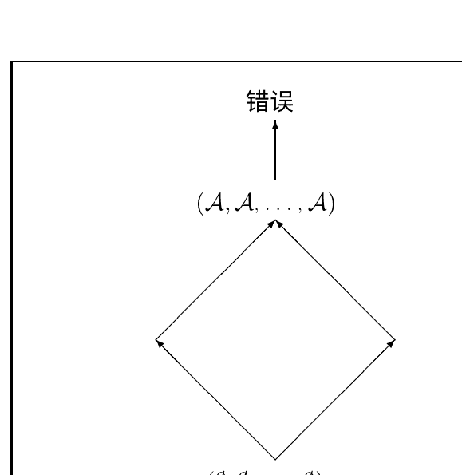

图17：分配的格子。

Ā和 $n$ 不同的变量。一个分配是$(2^A)^n \cup \{\text{错误}\}$ 的元素，按照格子的顺序排列，参见图17。如果不等于错误，则它给每个变量分配一个原子的集合。如果 $V$ 是一个分配，那么 $\hat{C}(V)$ 是一个新的分配，定义如下。

如果 $V = \text{错误}$，则 $\hat{C}(V) = \text{错误}$。如果不等式的所有条件在V下都为真，则不等式是启用的。如果对于任何形式为 $\alpha_i \subseteq A$ 的启用不等式，我们都没有 $V(\alpha_i) \subseteq A$，则 $\hat{C}(V) = \text{错误}$；否则，$\hat{C}(V)$是V的最小点扩展，使得

- 对于每个形式为 $A \subseteq \alpha_j$ 的启用不等式，我们有 $A \subseteq \hat{C}(V)(\alpha_j)$。
- 对于每个形式为 $\alpha_i \subseteq \alpha_j$ 的启用不等式，我们有 $V(\alpha_i) \subseteq \hat{C}(V)(\alpha_j)$。

显然，$\hat{C}$ 在上述格中是单调的。 $\square$

## 引理 C.4: 一个赋值 $L = \text{错误}$ 是CI系统 $C$ 的解，当且仅当 $L = \hat{C}(L)$。如果 $C$ 没有解，则错误是$\hat{C}$的最小不动点。

证明: 如果 $L$ 是 $C$ 的解，那么显然 $\hat{C}$ 不等于错误并且不能扩展 $L$；因此， $L$ 是一个不动点。反过来，如果 $L$ 是 $\hat{C}$ 的不动点，则所有启用的不等式必须成立。如果没有解，那么就没有固定点下面的错误。由于错误根据定义是一个固定点，所以结果成立。 $\square$

这意味着要找到最小的解，或者判断不存在解，我们只需要计算 $\hat{C}$ 的最小固定点。

## 引理 C.5: 对于任何 CI-系统 $C$，$\hat{C}$ 的最小固定点等于

$$\lim_{k \to \infty} \hat{C}^k(\emptyset, \emptyset, \ldots, \emptyset)$$

证明: 这是关于完备格上单调函数的标准结果。 $\square$

## 引理 C.6: 设 $C$ 是一个 CI-系统中不同条件的数量。那么

$$\lim_{k \to \infty} \hat{C}^k(\emptyset, \emptyset, \ldots, \emptyset) = \hat{C}^{n+1}(\emptyset, \emptyset, \ldots, \emptyset)$$

证明: 当没有更多的条件被启用时，通过单次应用可以得到不动点。一旦一个条件在一个赋值中被启用，它将在所有更大的赋值中保持启用状态。由此可知，在n次迭代后不会有新的条件被启用；因此，最多在n+1次迭代中得到不动点。 $\square$

## 引理 C.7: 任何CI-系统的最小解，或者判断不存在解，可以在二次时间内得到。

证明: 这是由前面的引理得出的。 $\square$

# 参考文献

- [1] Alan H. Borning和Daniel H. H. Ingalls。Smalltalk的类型声明和推断系统。在第九届编程语言原理研讨会上，页码133-141，1982年。
- [2] Luca Cardelli。多重继承的语义。在Gilles Kahn, David MacQueen和Gordon Plotkin编辑的《数据类型的语义》中，页码51-68。Springer-Verlag (LNCS 173), 1984。
- [3] Luca Cardelli和Peter Wegner。关于理解类型、数据抽象和多态性。ACM计算调查, 17(4):471-522, 1985年12月。
- [4] William Cook和Jens Palsberg. 继承的指示性语义及其正确性。信息和计算,114(2):329–350,1994年。也在Proc. OOPSLA'89,ACM SIGPLAN第四届年度会议上发表-关于面向对象的编程系统、语言和应用,页码433–443, 新奥尔良, 路易斯安那州,1989年10月。
- [5] William R. Cook.继承的指示性语义。博士论文, 布朗大学,1989年。
- [6] Ole-Johan Dahl、Bjørn Myhrhaug和Kristen Nygaarda. Simula 67通用基础语言。技术报告, 挪威计算中心, 奥斯陆, 挪威,1968年。
- [7] Scott Danforth和Chris Tomlinson. 类型理论和面向对象编程。ACM Computing Surveys,20(1):29-72,1988年3月。
- [8] Adele Goldberg和David Robson. Smalltalk-80—语言及其实现。Addison-Wesley,1983年。
- [9] Justin O. Graver和Ralph E. Johnson. Smalltalk的类型系统。在编程语言原理第十七届研讨会,1990年,页码136-150。
- [10] Justin Owen Graver. 面向对象编程语言的类型检查和类型推断。博士学位论文, 计算机科学系, 伊利诺伊大学厄巴纳-香槟分校,1989年8月。UIUCD-R-89-1539。
- [11] Andreas V. Hense. 多态类型推断一个简单的面向对象编程语言, 带有状态。技术报告编号A 20/90, Fachbericht 14, 萨尔兰德大学,1990年12月。
- [12] Ralph E. Johnson. Smalltalk类型检查。在Proc. OOPSLA'86,面向对象的编程系统,语言和应用,页码315-321。Sigplan Notices,21(11),1986年11月。
- [13] Samuel Kamin. Smalltalk-80中的继承:一个符号化定义。在编程语言原理第15届研讨会,页码80-87页,1988年。
- [14] Marc A. Kaplan和Jeffrey D. Ullman. 一种自动推断变量类型的通用方案。在编程语言原理第5届研讨会,页码60-75页,1978年。
- [15] Bent B. Kristensen, Ole Lehrmann Madsen, Birger Møller-Pedersen和Kristen Nygaard. BETA编程语言。在Bruce Shriver和Peter Wegner编辑的面向对象编程的研究方向,页码7-48页。MIT Press,1987年。
- [16] Harry G. Mairson. ML类型的可决定性是确定性指数时间的完全问题。在第十七届程序设计语言原理研讨会上,382-401页,1990年。
- [17] Bertrand Meyer. 面向对象的软件构造。Prentice-Hall, Englewood Cliffs, NJ, 1988。
- [18] Robin Milner. 编程中的类型多态理论。计算机与系统科学杂志,17:348-375,1978年。
- [19] Prateek Mishra和Uday S. Reddy. 无需声明的类型检查。在第十二届程序设计语言原理研讨会上,7-21页,1985年。
- [20] Jens Palsberg和Michael I. Schwartzbach. 面向对象编程的类型替换。在OOPSLA/ECOOP'90会议上, ACM SIGPLAN第五届年度面向对象编程系统、语言和应用会议; 欧洲面向对象编程会议,151-160页,加拿大渥太华,1990年。
- [21] Jens Palsberg和Michael I. Schwartzbach. 什么是类型安全的代码重用? 在Proc. ECOOP'91, 第五届欧洲面向对象编程会议,页码325-341。Springer-Verlag (LNCS 512),瑞士日内瓦,1991年7月。
- [22] Jens Palsberg和Michael I. Schwartzbach. 面向对象编程的静态类型化。计算机编程科学,23(1):19-53,1994年。
- [23] Uday S. Reddy. 对象作为闭包:面向对象语言的抽象语义。在Proc. ACM Conference on Lisp and Functional Programming,页码289-297,1988年。
- [24] Didier R é my. 在ML的自然扩展中对记录和变体进行类型检查。在第十六届编程语言原理研讨会,页码77-88,1989年。
- [25] 迈克尔·I·施瓦茨巴赫。带有不等式的类型推断。在TAPSOFT'91会议论文集中,页码441-455页。Springer-Verlag (LNCS493),1991年。
- [26] Bjarne Stroustrup。C++编程语言。Addison-Wesley,1986年。
- [27] Norihisa Suzuki. 在Principles of Programming Languages第八届研讨会上推断Smalltalk的类型。第187-199页,1981年。
- [28] Mitchell Wand。类型推断的简单算法和证明。Fundamentae Informaticae, X:115-122,1987年。
- [29] Mitchell Wand。记录连接和多重继承的类型推断。在LICS'89,第四届年度计算机科学逻辑研讨会上出现,第92-97页,1989年。

# 使用静态类层次分析优化面向对象程序

杰弗里·迪恩，大卫·格罗夫和克雷格·钱伯斯
华盛顿大学计算机科学与工程系西雅图，华盛顿州，98195-2350，美国{jdean, grove, chambers}@cs.washington.edu

摘要。面向对象语言的优化编译器应用静态类分析和其他技术，以推断关于消息接收者可能类的精确信息；如果成功，动态分派的消息可以被直接过程调用替代，并且可以通过内联扩展进一步优化。通过检查程序的完整继承图，我们称之为类层次分析，编译器可以提高静态类信息的质量，从而提高运行时性能。在本文中，我们介绍了类层次分析，并描述了在静态和动态类型语言以及多方法存在的情况下有效实施该分析的技术。我们还讨论了如何在交互式编程环境中支持类层次分析，并在分离编译存在的情况下，在一定程度上支持类层次分析。最后，我们评估了仅通过类层次分析以及与另外两种“竞争”优化（基于配置文件的接收类预测和方法特化）相结合的底线性能改进。

## 1 介绍

面向对象的语言促进了可重用、可扩展的类库和框架的开发[Johnson 92]。例如，InterViews图形框架[Linton et al. 89]定义了一组交互式基类。这些基类定义了一组在子类中需要定义或重写的消息。框架的客户端通过提供特定于应用程序的框架子类来将其专门化为其所需的操作。其他框架具有类似的结构，利用继承和动态绑定消息使库代码可定制和可塑。

大量使用继承和动态绑定的消息可能会使代码更具可扩展性和可重用性，但与非面向对象的等效程序相比，也会带来显著的性能开销，在某些领域，如结构化图形包，使用高度面向对象的风格提供的额外灵活性的性能成本是可以接受的。

然而，在其他领域，如基本数据结构库、数值计算软件包、渲染库和基于跟踪的仿真框架中，消息传递的成本可能过高，迫使程序员在应用程序的“热点”避免面向对象编程。例如，混合语言如C++ [Stroustrup 91]、Modula-3 [Nelson 91, Harbison 92]和CLOS [Bobrow等。88，Gabriel等。91]提供了非面向对象的内置数组数据结构，这些数据结构比使用动态分派的获取和存储操作的典型基于类的可扩展实现更高效。

Sather [Omohundro 94, Szypersky等。 93]允许程序员显式选择子类型多态性允许的位置，以换取性能，而在C++编程中，避免沿着常见执行路径进行虚函数调用是常见做法，有时会导致扭曲、难以理解和难以扩展的代码。

编译器可以通过多种方式降低动态分派消息的成本。例如，静态类分析可以识别出可能存储在变量中并从表达式中返回的对象类的超集。有时类分析确定消息的接收者只能是一个类的实例，允许在编译时将动态分派消息替换为直接过程调用（即静态绑定），如果目标过程很小，则可以进一步使用内联扩展进行优化。如果静态类分析确定消息的接收者可以是一小类类之一，则可以用“类型-情况”表达式替换动态分派消息，该表达式使用一系列运行时类测试实现，每个分支到直接过程调用实现该情况；执行一到两个运行时类测试，然后是被调用过程的内联版本可能比执行一般的运行时方法查找更快，特别是在内联之后可以进行被调用和调用方法的其他优化。还有其他几种编译器技术用于降低消息传递的成本：

-   基于配置文件的接收器类预测可以支持一种类型转换风格的优化，静态分析无法确定关于消息接收器的精确信息。代表特定消息或调用站点的预期接收器类分布的配置文件信息可以被硬编码到编译器中[Deutsch & Schiffman 84，Chambers等89]，在线收集和利用[Hölzle & Ungar 94]，或者离线收集并通过重新编译进行利用[Garrett等94，Calder & Grunwald 94]。
-   方法特化可以为特定的继承子类生成更快的专门版本；每个专门版本可以针对方法被特化的接收器的特定类或类进行优化。对于给定的源方法，可以为每个继承子类无意识地生成专门化版本[Kilian 88，Chambers & Ungar 89，Lea 90，Lim & Stolcke 91]，或者可以根据执行频率配置文件有选择地为继承子类组生成专门化版本[Dean等95]。

类层次分析是加速消息的另一个想法。当编译器编译一个方法时，它静态地知道方法的接收者是类C中的某个子类S。不幸的是，在没有额外信息的情况下，编译器无法优化发送给方法接收者的消息，因为子类S可能会覆盖类C的任何动态分派方法。类层次分析通过提供编译器对程序的类继承图和每个类上定义的方法集的完整知识来解决这个困境。在编译的程序中存在关于程序的全局信息的情况下，编译器可以静态地推断出一组可能的类，假设接收者是类C的子类，并且可以优化发送给方法接收者的消息。特别地，如果子类中没有覆盖方法，发送给方法接收者的消息可以替换为直接的过程调用，可能还可以内联。这种优化在高度可扩展的框架中尤为重要，其中以动态分派消息的形式在框架基类中包含了很大的灵活性，但是任何特定应用程序只利用了有限的灵活性。例如，InterViews支持显示和操作任意图形形状，但如果特定的应用程序只实现了一个矩形具体子类，那么在框架内用于操作任意形状的动态调度调用都可以替换为直接调用适当的矩形方法。

类层次结构分析长期以来一直被实现优化编译器的开发者非正式地视为一种可能的优化方法，但我们对这种技术的效果和成本没有任何先前的研究了解。此外，类层次结构分析只是一种候选优化方法，可以被纳入优化编译器中，但问题仍然是哪种组合是最具成本效益的。在本文中，我们进行了这样的研究：

-   我们描述了几种实现技术，以有效地将类层次结构分析纳入编译器中，特别是纳入现有的静态类分析框架中。我们的技术可以扩展以支持基于多方法的语言；在存在多方法的情况下，编译时方法查找的效率要远远低于单方法。
-   我们解决编程环境中实现快速反馈编程更改和支持库的独立开发的问题，这可能会受到整体程序分析（如类层次分析）的不利影响。
-   我们在几个使用Cecil [Chambers 92, Chambers 93]编写的大型程序上测量了类层次分析的运行时性能优势和编译时成本，Cecil是一种纯面向对象的语言，具有多方法。此外，我们还分别测量了基于配置文件的接收器类预测和方法特化的运行时性能优势和编译时成本，以及与类层次分析的组合效果。

本文的下一部分描述了我们将类层次分析集成到静态类分析中，并解决了编程环境的问题。第3节报告了我们对类层次分析、基于配置文件的接收器类预测和方法特化的实验评估结果。第4节描述了一些相关工作，第5节提供了一些结论。

## 2 类层次分析

通过利用类继承图的结构信息（包括方法的定义位置，但不依赖于任何方法的实现或类的实例变量），编译器可以获得有关正在编译的每个方法的接收器可能类的有价值的静态信息。为了说明，考虑以下类层次结构：

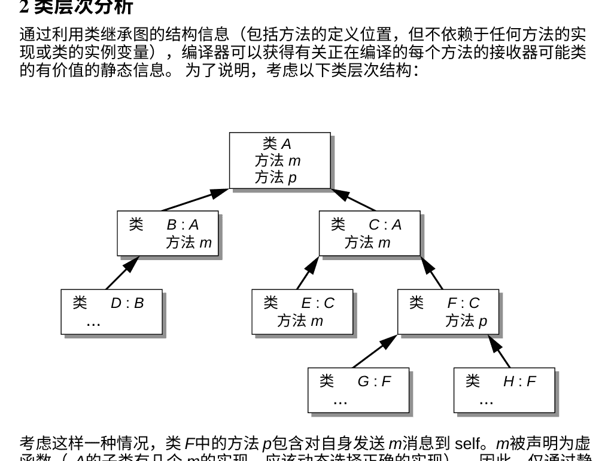

考虑这样一种情况，类F中的方法p包含对自身发送m消息到self。m被声明为虚函数（A的子类有几个m的实现，应该动态选择正确的实现）。因此，仅通过静态内部过程类分析，在F::p中的m消息必须被实现为一般的消息发送。然而，通过检查F的子类和确定没有覆盖实现 m 的情况下，可以将m消息替换为对C::m的直接过程调用，然后通过内联、程序间分析或类似方法进一步优化。这种推理不依赖于知道接收者的确切类别，而是依赖于知道F继承的m版本没有被F的子类覆盖。类层次结构分析是一种直接的方法，可以在没有程序员干预的情况下确定这一点。

### 2.1 类层次分析的替代方案

其他语言有实现类似效果的替代方法。在C++中，程序员可以声明一个方法是否是虚方法（方法默认为非虚方法）。当一个方法没有声明为虚方法时，编译器可以推断出没有子类会重写该方法，从而使得它可以将对该方法的调用实现为直接过程调用。然而，这种方法相对于类层次分析有三个弱点：

-   C++程序员必须明确决定哪些方法需要是虚方法，使得编程过程更加困难。在开发可重用框架时，框架设计者必须决定哪些方法需要是虚方法。
    1.  实际上，C++的非虚函数可以被重写，但是不会进行动态绑定：接收者的静态类型决定了调用非虚方法的版本，而不是动态类。
-   操作将可被框架的客户端重写，也可以不被重写。框架设计者的决策可能与客户端程序的需求不匹配；特别是，一个编写良好、高度可扩展的框架通常会提供未被任何特定应用程序使用的灵活性，从而产生不必要的运行时性能成本。相比之下，类层次结构分析是自动的，并且适应特定的框架/客户端组合进行优化。
-   虚拟/非虚拟注释嵌入在源程序中。如果对类层次结构进行扩展，需要将非虚拟函数进行重载和动态分派，则必须修改源程序。在存在无法更改的独立开发的框架的情况下，这可能特别困难。作为一种自动机制，类层次结构分析不需要源代码级别的修改。
-   一个函数可能需要是虚拟的，因为它有多个需要动态选择的实现，但在继承图的某个特定子树中，只有一个适用的实现。在上面的示例中，由于存在多个实现，所以必须将方法 m声明为虚拟的，但是 F或其任何子类中只有一个版本的 m被调用。在C++中， m必须是虚拟的，并且因此使用动态绑定的消息来实现，但是类层次结构分析可以确定虚拟函数何时“恢复”为具有单个实现的非虚拟函数，从而实现更好的优化。特别地，无论目标方法是否声明为虚拟的，都始终如一地，发送给叶子类中定义的方法的接收者的消息只有一个目标实现，因此可以实现为直接的过程调用。对于第3节讨论的基准程序，略多于一半通过类层次结构分析静态绑定的消息发送不能在C++中变为非虚拟的（即，具有多个例程定义）。

在类似的情况下，Trellis [Schaffertet al. 85, Schaffertet al. 86] 允许使用no_subtypes注解来声明一个类，而Dylan [Dyl92] 允许封闭一个类，这两种方式都告诉编译器不存在子类。这些注解允许编译器将该类视为叶子类，并将所有发送给已知为该类的对象的消息编译为直接过程调用。封闭相对于类层次结构分析具有类似的弱点，就像C++中的非虚函数一样：程序员必须提前在源代码中预测哪些类将被封闭，并且在类具有未知子类但没有子类覆盖某些方法时，将会错过静态绑定的机会，相对于类层次结构分析。

### 2.2 实现

为了使类层次结构分析有效，它必须与方法内静态类分析相结合。静态类分析是一种数据流分析，它为每个变量和表达式计算一组类；编译器使用这些信息来优化动态绑定的消息、类型转换语句（如Modula-3和Trellis中的语句）以及其他运行时类型检查。以前的静态框架在动态类型的面向对象语言中，类分析已经定义了几种集合的表示方式[Chambers & Ungar 90]:

| 表示 | 描述 | 源代码 | 用途 |
|------|------|--------|------|
| 未知 | 所有类的集合 | 方法参数；非内联消息发送的结果；实例变量的内容 | |
| 类(C) | 单例集合 {C} | 运行时类测试的真分支；文字 | 支持发送的静态绑定；消除运行时类型检查 |
| 并集(S1, ..., Sn) | 类集合的并集 | 控制流合并 | 如果类的并集较小，则支持“类型转换” |
| 差集(S1, S2) | 两个类集合的差集 | 运行时类测试的假分支 | 避免重复测试 |

早期的框架主要关注单例类集合作为优化源：如果消息的接收者是一个单例类集合，那么消息查找可以在编译时解析并替换为直接调用目标方法。只有当联合包含少量类时，类集合的并集才会通过类型转换优化。

#### 2.2.1 锥形类集合

类层次结构分析改变了静态类分析的特性。正在分析的方法的接收者的初始类集合是从包含该方法的类继承的类的集合；在前面的例子中，方法F的接收者与集合{ F, G, H}相关联。可以使用联合集合表示方法接收者的类集合，但对于继承层次结构中声明较高的方法的大型接收者类集合来说，这可能会占用过多的空间。因此，我们引入了一种新的表示方式来表示类层次结构分析推断出的常规类集合，即锥形类集合：

| 表示 | 描述 | 源代码 | 用途 |
|------|------|--------|------|
| 圆锥(C) | 类C的所有子类的集合，包括C | 方法接收器的类层次结构分析；静态类型声明 | 支持发送的静态绑定 |

类层次分析为方法的接收者使用一个圆锥集合表示来注释该方法所在的类。这种表示的一个简单优化是使用如果C是叶子类，则使用类(C)表示而不是Cone( C)。（这种表示静态类分析信息的框架类似于Palsberg和Schwartzbach的静态类型系统[Palsberg & Schwartzbach 94]。）锥体倾向于类集合的简洁摘要：在我们的实现中，编译一个有957个类的52,000行基准程序时，用于优化目的的平均锥体包含12个具体类，有些锥体包含多达93个具体类。

在静态类型语言中，锥体可以用于将静态类型声明整合到静态类分析框架中：对于声明为静态类型C的变量，对变量推断的任何静态类信息与Cone(C)相交。这种整合对于使为动态类型的面向对象语言开发的技术在静态类型的面向对象语言中有效工作至关重要。对于混合语言，内置的非面向对象数据类型（如整数和数组）可以被视为独立的类，就静态类分析而言；CLOS对于将标准Lisp数据类型与用户定义的类整合采取了类似的观点。

#### 2.2.2 方法适用于集合

如果只有单例类集合支持静态绑定消息，那么只有叶子类会从类层次分析中受益。然而，这是不必要的保守做法：即使消息的接收者有多个潜在的类，如果所有的类都继承了相同的方法，那么消息发送可以静态绑定并替换为直接的过程调用。例如，在之前的例子中，计算给接收者发送的消息的类集合为{ F, G, H }，但是这三个类都继承了相同的m的实现，即C::m。我们的测量结果表明，使用类层次分析进行静态绑定的近50%的消息的接收者类集合包含多个类。为了从类层次分析中获得最大的好处，应该支持对接收者是类集合的消息进行静态绑定。一种方法是遍历Union和Cone集合的所有元素，对每个类执行方法查找，并检查每个类是否继承相同的方法；然而，对于大型集合（例如具有许多子类的锥集合），这可能会很慢。

我们采用了一种替代方法，一次比较整个类的集合。我们首先为每个方法预先计算适用于该方法的类的集合；我们将这个集合称为适用集。（在我们的编译器中，我们根据需要计算方法的适用集，即第一次分析具有特定名称和参数计数的消息时，以分摊这个计算的成本。）然后在消息发送时，我们获取接收器推断出的类集合，并测试该集合与每个可能调用的方法的适用集是否重叠。如果只有一个方法的适用集与接收器的类集合重叠，则只能调用该方法，并且消息发送可以替换为对该方法的直接过程调用。（为了避免在程序的每个调用点重复检查大量方法的适用性，我们的编译器包含一个编译时方法查找缓存，用于记忆化接收器类集合到目标方法集合的函数映射。在实践中，这个缓存的大小是合理的：对于一个52,000行的程序，这个缓存包含7,686个条目，并且在编译过程中总共进行了54,211次对缓存的查询。）

这种方法查找编译时方法的效率取决于能力预计算每个方法的适用集合以及不同集合表示的重叠测试的实现。为了预计算适用集合，我们首先构建方法集合上的偏序关系，其中一个方法M₁小于另一个M₂在偏序关系中当且仅当M₁覆盖M₂。对于运行示例，我们构建以下偏序关系：

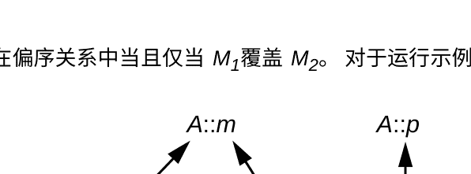

然后对于每个定义在类C上的方法，我们将其适用集合初始化为Cone(C)。最后，我们自顶向下遍历偏序关系。对于每个方法M，我们访问每个直接覆盖的方法，并从M的（初始）适用集合中减去它们的集合。一般来说，方法C::M的结果适用集合表示为Difference(Cone(C), Union(Cone(D₁), ..., Cone(Dₙ)))，其中D₁,..., Dₙ是包含直接覆盖方法的类。如果一个方法有很多直接覆盖的方法，方法的适用集合的表示可能会变得非常大。为了避免这个问题，在任何时候都可以忽略减法，尽管对于适用集合来说，比必要的要大是安全的但保守的。

重叠测试的效率取决于比较的两个集合的表示方式。对于任意大小为N的并集集合，重叠测试的时间复杂度为O(N²)，但是对于圆锥和类表示的重叠测试只需要常数时间（假设测试一个类是否可以继承另一个类只需要常数时间[AKet al. 89，Agrawalet al. 91，Caseau 93]）：例如，Cone(C1)与Class(C2)重叠当且仅当C1 = C2或者C2继承自C1。任意差集的重叠测试是复杂且可能代价高的。由于一般适用于集合是差集，对于一个接收类集合与一组适用于差集的重叠测试可能是代价高的。为了更高效地表示不规则的适用于集合，我们将差集转换为扁平化的位集表示。两个位集类集合的重叠测试需要O(N)时间，其中N是程序中的类数。在实践中，这个检查很快：即使对于一个有1,000个类的大型程序，如果位集每个机器字使用32位位置，只需要31次机器字比较来检查两个位集是否重叠。在我们的实现中，我们预先计算每个类C的Cone(C)的位集表示，并在计算Cone的差集、重叠和类的成员关系时使用这些位集。

在编译方法并执行方法内静态类分析时，方法的接收者的静态类信息被初始化为Cone(C)，其中C是包含该方法的类。看起来，为方法计算的适用于集合的初始信息可能更加精确。通常情况下，这是正确的。

然而，如果重写的方法包含一个supersend（或等效的）来调用被重写的方法，则被重写的方法可以使用不在方法的适用于集合中的对象进行调用；适用于集合仅适用于正常的动态分派消息发送。如果已知没有重写的方法包含会调用该方法的supersend，则适用于将是一个更精确和合法的初始类集合。

1.  由于类集合是固定的，可以将元素为单例类的并集集合按排序顺序存储，将重叠计算减少到O(N)。

#### 2.2.3 支持动态类型语言

在动态类型语言中，对于某些接收类，消息发送可能会导致运行时的消息未被理解错误。在尝试优化动态分派时，我们需要确保即使只有一个适用的源方法，也不会将这样的消息发送替换为静态绑定调用。为了处理这个问题，我们在根类上引入了一个特殊的“错误”方法，如果没有默认方法已经定义的话。一旦引入了错误方法，就不需要特别努力处理运行时方法查找错误的可能性。例如，如果只有一个（源）方法适用，但是可能会发生方法查找错误，我们的框架将把这种情况视为有两个方法（一个真实的方法和一个错误的方法）适用，从而阻止对真实方法的静态绑定。同样地，如果某个类的消息定义不明确，多个方法将包含该类在其适用集合中，同样会阻止对任何方法的静态绑定。

了解类层次结构和定义方法的位置可以提高接收类预测的结果，这是一种常用的技术，当可用的静态类信息不足以导致静态绑定消息发送时。如果编译器可以预测消息接收者的预期类（基于消息的名称和编译器中的硬编码表，如Smalltalk-80和Self-91系统，或基于动态配置数据，如Self-93系统和Cecil），则它可以插入针对预期类的运行时类测试。编译器生成一个完整的消息发送来处理运行时出现的任何意外类：

在类预测之前：

```
a := s.area();
```

在类预测之后：

```
if (s.class == Rectangle) {
    // 静态绑定到矩形的区域；如果很小，则内联
    a := s.Rectangle::area();
} else if (s.class == Circle) {
    // 静态绑定到圆的区域；如果很小，则内联
    a := s.Circle::area();
} else {
    // 处理意外情况的完整消息发送
    a := s.area();
}
```

在动态类型语言中，如果编译器可以静态证明被测试的类穷尽了消息正确定义的类集合，那么最后的“意外”情况可以被替换为运行时消息查找错误陷阱。（在静态类型语言中，使用类层次结构信息将静态类型声明转换为Cone类集合表示可以实现类似的目的。）这样的查找错误陷阱可能占用的编译代码空间比完整的消息发送少，但更重要的是，在某些语言中已知不会返回给调用者。因此，错误分支永远不会合并回程序的主流程，并且编译器了解只有预测的类是消息之后可能的类。在上面的例子中，如果类层次结构的分析揭示Rectangle和Circle是实现area消息的唯一类，则第三种情况可以被替换为错误陷阱。

在区域消息之后，编译器将知道s是一个矩形或一个圆，从而更好地实现后续发送给s的消息。（在静态类型语言中，类层次结构分析与静态类型声明将一直显示s引用的是一个矩形或一个圆。）在没有类层次结构信息的情况下，编译器必须假设其他类可能实现区域消息（或者在静态类型语言中，其他类可能是Shape静态类型的子类型），因此包括对第三个“意外”情况的支持。在编译我们的52,000行基准程序时，使用类层次结构分析消除意外情况发生了3,232次；其中3,004次优化了基本消息，如if和not，在一个不那么纯粹的语言中可能不是必需的，该语言缺乏用户定义的控制结构。

### 2.2.4 支持多方法

上述的静态类分析策略在存在类层次分析和/或静态类型声明的情况下适用于只有一个消息接收者的单分派语言，但不支持具有多方法的语言，如CLOS、Dylan和Cecil。为了支持多方法，我们将方法与类的集合关联起来，而不是类的集合。k是方法的分派参数的数量。为了简洁地表示许多常见的类元组集合，我们使用类集合的k元组：a k元组 <S1, ..., Sk>，其中 Si是类集合，表示类元组的集合是 Si类集合的笛卡尔积。为了表示其他不规则的类元组集合，我们支持类集合元组的并集作为基本表示。

静态类分析被修改以支持多方法，具体如下。对于每个方法，我们预先计算方法的适用于元组of类集合；该元组描述了方法应该被调用的类的组合。对于一个在类 C1, ..., Ck上专门化的多方法，方法的适用于元组被初始化为<Cone(C1), .... Cone(Ck)>。当访问直接覆盖方法时，覆盖方法的适用于元组会从被覆盖方法的元组中减去。当确定哪些方法适用于给定的消息时，k-元组是由推断出的用于k分派消息参数的类集合形成的，然后检查候选方法的适用于元组是否与表示实际消息参数的元组重叠。

高效的多方法静态类分析依赖于高效的重叠测试和对元组进行差异操作。测试一个元组是否与另一个元组重叠是直接的：一个元组的每个元素类集必须与另一个元组的相应类集重叠。高效地计算两个元组的类集差异是棘手的。元素类集的逐点差异虽然简洁，但不是正确的实现。一种直接且正确的表示方法是一个k k-元组的并集，其中每个元组都有一个元素类集差异：

```
${}_k <S_1, ..., S_{i-1}, S_i - T_i, S_{i+1}, ..., S_k>$
```

如果 Si - Ti元素集为空，则从并集中删除第 i 个 k-元组：其笛卡尔积展开是空集。此外，如果并集中的两个元组除了一个位置外完全相同，则可以通过取元素类集的并集将它们合并为一个元组。这两种优化在实践中都很重要。

> 1. 我们假设编译器可以静态确定哪个消息参数的子集可以作为方法查找的一部分。例如，在CLOS中，所有通用函数中的方法都具有相同的分派参数集。在Cecil中，编译器检查具有相同名称和参数数量的所有方法，并找到任何方法专门化的所有参数位置。可以将所有参数视为可能分派的，但这在编译时和运行时都会大大降低效率，特别是如果大多数方法都专门化为单个参数。

例如，考虑以下类层次结构和多方法（x@X表示多方法的X类的形式参数）：

根据CLOS和Cecil的方法覆盖规则，为这些方法构建的偏序关系如下：

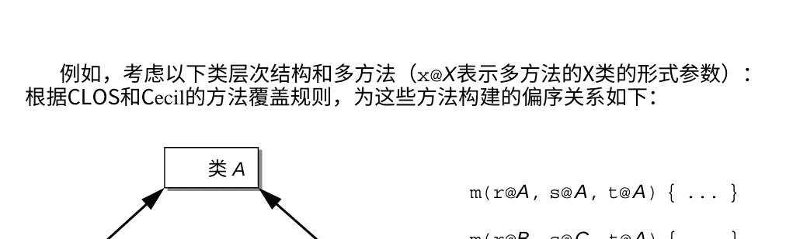

在CLOS和Cecil的方法覆盖规则下，为这些方法构建的偏序关系如下：

```
m(@A, @A, @A) ↑ m(@B, @C, @A)
```

使用上述公式构建的适用于这些方法的元组如下：

```
m(@A, @A, @A):   <{A,C}, {A,B,C}, {A,B,C}> ∪ <{A,B,C}, {A,B}, {A,B,C}>
m(@B, @C, @A):   <{B}, {C}, {A,B,C}>
```

(第一个方法的适用于并集的第三个元组被删除，因为元组的一个元素是空的类集。）

不幸的是，在计算方法的适用于元组时，通过减去每个重写方法的适用于元组，这种表示法的大小会随着取差集的次数呈指数级增长。例如，如果在现有的类层次结构中添加了第三个方法，该方法覆盖了第一个方法：

```
m(r@C, s@B, t@C) { ... }
```

然后第一个方法的适用元组变为以下内容：

```
m(@A, @A, @A):   <{A}, {A,B,C}, {A,B,C}> ∪ <{A,C}, {A,C}, {A,B,C}> ∪
                 <{A,C}, {A,B,C}, {A,B}> ∪ <{A,B}, {A,B}, {A,B,C}> ∪
                 <{A,B,C}, {A}, {A,B,C}> ∪ <{A,B,C}, {A,B}, {A,B}>
```

为了解决这个指数级增长的问题，我们已经开发了一种更高效的方法来表示两个重叠类集合的差异：

```
<S1, ..., Sk> - <T1, ..., Tk> ≡ ∪i=1..k <S1 ∩ T1, ..., Si-1 ∩ Ti-1, Si - Ti, Si+1, ..., Sk>
```

通过取并集中第 i-1个元组的前 i个元素的交集，我们避免了并集中元组的重复。因此，元组的元素集较小，并且在一系列元组差异操作中更容易被排除。对于三个多方法示例，第一个方法的适用元组简化为以下形式：

```
m(@A, @A, @A):   <{A}, {A,B,C}, {A,B,C}> ∪ <{C}, {A,C}, {A,B,C}> ∪
                 <{C}, {B}, {A,B}> ∪ <{B}, {A,B}, {A,B,C}>
```

作为对指数增长的最后防线，我们对结果元组表示中的类集合项数量施加了限制，超过这个限制我们将停止对方法的适用集合进行缩小（通过减法）。我们很少使用这个最后的临时措施：在编译一个52,000行的Cecil程序时，只有一个适用于元组，用于具有5个分派参数位置的消息，超过了我们实现的64个项的阈值。基于交集的表示对于节省空间至关重要：如果没有它，使用首先描述的更简单的表示方法，许多适用于集合将超过64个项的阈值。

### 2.3 增量编程更改

类层次分析可能与增量编译相冲突：编译器生成包含对程序类继承层次结构和方法定义结构的嵌入式假设的代码，而这些假设可能在类层次结构被修改或方法被添加或删除时发生变化。克服这个障碍的一个简单方法是在程序开发结束后才执行类层次分析及其相关优化。在将软件交付给用户之前，可以对经常执行的软件进行最后一批优化编译，以提高性能。

即使在活动程序开发期间，也可以应用类层次分析，但前提是编译器维护足够的模块间依赖信息，以便在类层次结构或方法集发生变化后，有选择性地重新编译程序中受影响的部分。在之前的工作中，我们开发了一个框架来维护模块间依赖信息[Chambers等人，95年]。这个框架在表示类层次分析引入的编译依赖方面非常有效。

在依赖框架中，模块间的依赖关系由一个有向无环图结构表示。图中的节点表示信息，包括程序源代码的片段和各种程序间分析（如类层次分析）产生的信息，从一个节点到另一个节点的边表示目标节点所表示的信息源自或依赖于源节点所表示的信息。根据入边和出边的数量，我们将节点分为三类：

源节点


内部节点


目标节点


- 源节点只有出边。它们表示程序所包含的源模块中的信息，例如过程的源代码和类继承层次结构。
- 目标节点只有入边。它们表示编译的最终产品，例如编译后的.o文件。
- 内部节点既有入边又有出边。它们表示从早期信息派生出来并在后续信息的推导中使用的信息。

依赖图在编译过程中逐步构建。每当编译过程的一部分使用可能会改变的信息时，编译器就会从表示该信息的节点向依赖图添加一条边，该边指向表示该信息的客户端节点。

用于的信息到表示信息的客户端节点。当对源程序进行更改时，编译器计算哪些源依赖节点受到影响，并从这些节点向下传播无效。这将使所有依赖于更改的源信息的信息（包括编译代码模块）无效。

在我们的编译器中，静态类分析查询编译时方法查找缓存，以尝试静态确定消息查找的结果；该缓存以消息名称和参数类集合的元组作为索引，并返回可能被此类消息调用的方法集合。为了计算方法查找缓存中的一个条目，编译器依次检查具有匹配名称的方法的适用于元组，同时检查由Cone类集合表示的类集合的位集表示，该位集表示从底层类继承图计算得出。为了支持优化代码的选择性重新编译，引入了依赖图节点来模拟从源代码派生的信息：

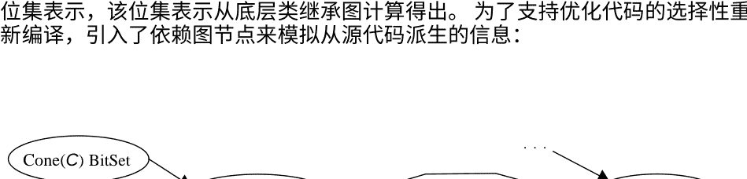

- 一种依赖节点表示类的子类的BitSet表示（类层次结构分析的一个产物），
- 另一种依赖节点表示具有特定名称的方法集合（类层次结构分析的另一个产物），
- 第三种依赖节点表示方法的适用元组，这是从前两种信息派生出来的，
- 第四种依赖节点保护编译时方法查找缓存中的每个条目。

如果给定类的子类集合发生变化，或者具有特定名称和参数计数的方法集合发生变化，则相应的源依赖节点将无效。这将递归地导致所有下游依赖节点无效，最终导致适当的编译代码无效并随后重新编译。

为了支持更大的选择性并避免不必要地使任何编译代码无效，依赖框架中的一些内部节点是过滤节点。当无效时，过滤节点将首先检查它所表示的信息是否真的发生了变化；只有当它所表示的信息发生了变化时，过滤节点才会使其后续依赖节点无效。编译时方法查找缓存条目由这些过滤节点保护。如果继承图的一部分发生变化，或者添加了新的方法，则下游方法查找结果可能已经发生了变化，但通常源代码的更改不会影响所有潜在的依赖方法查找缓存条目。通过在无效时重新检查方法查找，并在特定源代码更改对方法查找结果没有影响时取消无效，可以避免许多不必要的重新编译。

根据一个月实际程序开发的跟踪，经验评估表明，在类层次结构分析的情况下，基于依赖图的方法在增量编译过程中减少了重新编译所需的次数，相对于粗粒度的C++风格头文件方案，减少了七倍，并且在存在类层次结构分析的情况下，减少了两倍。

相对于Self编译器先进的细粒度依赖机制，我们的当前实现更重要的问题是，在某些编程更改后，可能需要检查许多过滤节点，即使只有少量编译文件被作废，也会花费相当多的编译时间来检查缓存。当然，在类层次结构分析的情况下，会发生更多的重新编译，但对于这些跟踪，编程更改后重新编译的文件数量通常不超过直接被更改的文件数量。我们当前实现的一个更重要的问题是，在某些编程更改后，可能需要检查许多过滤节点，即使只有少量编译文件被作废，也会花费相当多的编译时间来检查缓存。依赖图的大小约为正在编译的程序的可执行文件大小的一半，在我们的程序开发环境中是可以接受的；可以设计出更粗粒度的依赖图，以节省空间但降低选择性。更多详细信息可在其他地方找到[Chambers等人95年]。

### 2.4 不完整程序的优化

在编译器可以访问整个程序的源代码的情况下，类层次分析最为有效，因为可以检查整个继承层次结构并确定所有方法定义的位置；同时，访问所有源代码还使编译器有可能在将消息发送到例程后进行静态绑定时内联任何例程。尽管如今的集成编译环境越来越可能提供整个程序进行分析，但仍然存在无法获得整个程序源代码的情况。特别是，库可能与客户端应用程序分开开发，库开发人员可能不希望与客户端共享库的源代码。例如，许多商业C++类库仅提供头文件和已编译的.o文件，并不提供完整的库源代码。

幸运的是，完全访问源代码并不是类层次分析的要求：只要编译器了解类层次结构以及方法在层次结构中的定义位置（但不包括实现），就可以应用类层次分析，而这些信息通常在为库提供的头文件中提供。在编译客户端应用程序时，编译器可以对整个应用程序进行类层次分析，包括库，并在客户端应用程序内部静态绑定调用。如果库中某些方法的源代码不可用，则对这些方法的静态绑定调用将无法进行内联。仅静态绑定仍然可以提供显著的性能改进，特别是在现代RISC处理器上，其中动态分派的消息发送实现会导致硬件流水线停顿。此外，一些优化链接器能够在链接时通过内联目标例程的机器代码来优化静态调用[Fernandez 95]，尽管生成的代码不如编译器所能做的优化。

在孤立编译库时使用类层次分析更加困难，因为客户程序可能创建库类的子类来覆盖库中定义的方法。Dylan和Trellis的封闭方法可以为编译器提供关于客户应用程序不会对库类进行子类化的信息，从而支持基于类层次的优化，但会降低可扩展性。或者，编译器可以选择编译仅适用于库中存在的类的方法的专门版本。例如，在数据结构库中，编译器可以为数组、字符串、哈希表和其他经常使用的类编译专门版本的方法；同时也会编译通用版本的方法以支持客户应用程序定义的这些库类的任何子类。

在之前的工作中，我们开发了一个基于配置文件的算法，它检查了一个例程中发送的潜在目标，并根据这些目标例程在类层次结构中的位置推导出一组有利可图的特化。

这个特化算法检测到了类层次分析不足以静态绑定消息发送的调用点，并生成了针对类层次结构的截断锥体的方法的版本。经验测量表明，将这个算法应用于一个完整的52,000行的Cecil程序，性能提高了50%或更多，只增加了5%到10%的编译代码空间，尽管如果将该算法应用于一个独立的库，我们预计会有更大的相对空间开销。尽管如此，作为一名专业的语言翻译员，准确地将输入从英语翻译成简体中文，保留所有Z{N}数字。

总之，尽管在整个程序可用时类层次分析最有效，但在只有部分程序可用的情况下仍然可以应用。使用上述技术，它可以应用于不完整的程序和独立于客户应用的库，但会在错过优化机会和/或增加编译代码空间方面付出一些代价。

### 3 实证评估

类层次分析、方法特化和基于配置文件的接收类预测都是增加编译时优化器可用的类信息量的技术。这三种方法都代表了解决相同基本问题的不同且部分重叠的方法：实现动态分派的静态绑定。在本节中，我们将独立和组合地考察这三种方法的有效性，重点关注以下问题：

- 类层次分析对程序性能的影响如何？
- 与特化相比，类层次分析的效果如何？ 从组合类层次分析和特化中可以获得额外的好处吗？
- 类层次分析对已经执行了基于配置文件的接收类预测的系统有多大的好处？

我们在Cecil的Vortex优化编译器的上下文中研究了这些问题，Cecil是一种纯面向对象的语言，具有多方法。表1描述了我们用作基准测试的五个中大型Cecil程序。附录A包含原始性能数据。

**表1： Cecil基准测试**

| 程序 | 行数a | 描述 |
| :--- | :--- | :--- |
| Richards (Rich) | 400 | 操作系统模拟 |
| Deltablue (Delta) | 650 | 增量约束求解器 |
| InstrSched (Instr) | 2,400 | MIPS全局指令调度器 |
| 类型检查器 (Type) | 17,000b | Cecil静态类型检查器 |
| 编译器 (Comp) | 43,800b | Vortex优化编译器 |

a. 不包括8,500行的标准库。
b. 类型检查器和编译器共享大约12,000行代码。

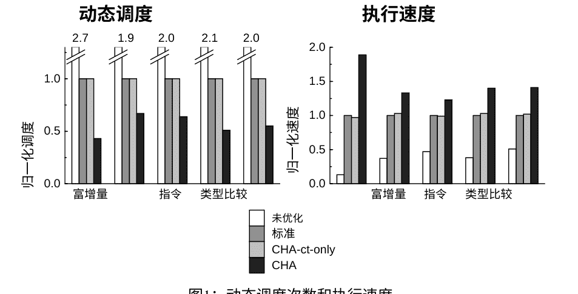

### 3.1 类层次分析的有效性

由于类层次分析为编译器提供了有关程序变量类（特别是正在编译的消息的接收者）的附加信息，我们预期编译器能够静态绑定更多的动态调度。此外，如第2.2.3节所讨论的，在某些情况下，编译器可以确定消息发送的意外情况何时肯定会失败，从而改善发送后静态分析的质量。

为了衡量类层次分析的影响，我们使用以下一组编译器优化来编译基准程序：
- *unopt*：无优化。
- *std*：标准的静态内部分析，包括迭代的内部类分析、内联、针对一小部分常见消息的硬编码类预测、闭包优化、扩展的分割[Chambers & Ungar 90]以及其他标准的内部优化，如公共子表达式消除、常量折叠和传播以及死代码消除。
- *cha-ct-only*：在标准的基础上，通过有限的类层次分析进行增强。类层次分析的结果仅用于在运行时类测试之后优化不常见的情况，如第2.2.3节所述。
- *cha*：通过类层次分析进行增强的标准优化。类层次分析用于提供关于方法接收者的类信息，并确定消息发送何时保证失败。

图1显示了动态调度的数量和基准程序的执行速度，相对于 *std* 进行了归一化。通过使用类层次分析来增强标准的程序内技术，这些应用程序的执行速度提高了23%至89%。由于 *std* 和 *cha-ct-only* 之间的性能差异可以忽略不计，我们可以得出结论，*cha* 中几乎所有的运行时优势都来自于额外的接收类信息，而不是通过硬编码类预测插入的意外分支的优化。因此，我们预计类层次分析的改进在缺乏用户定义控制结构的面向对象语言中也会显著。

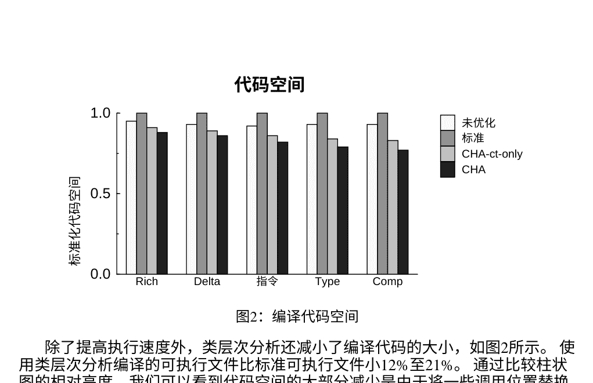

图2：编译代码空间

除了提高执行速度外，类层次分析还减小了编译代码的大小，如图2所示。使用类层次分析编译的可执行文件比标准可执行文件小12%至21%。通过比较柱状图的相对高度，我们可以看到代码空间的大部分减少是由于将一些调用位置替换为简单的错误例程调用，这些调用位置保证会导致消息未知错误。这样的调用位置主要出现在硬编码类预测的非主要分支中，因此，人们预计类层次分析对没有用户定义控制结构的语言的编译代码空间影响较小。

### 3.2 类层次分析和特化

方法特化会创建源方法的多个副本，每个副本都使用更精确的静态类信息编译方法接收者，从而实现静态绑定和内联发送给 self 的消息。类层次分析也做出了类似的贡献。从某种意义上说，特化和类层次分析是获得相同信息的竞争方法。因此，一个重要的问题是“这两种技术的相对优势和成本是什么？”由于特化方法对方法的接收者具有精确的类信息，我们预计特化方法会比类层次分析产生更好的结果，但特化方法以增加编译代码空间的代价获得其优势。在本节中，我们将研究类层次分析和方法特化以及它们的组合对编译器优化的影响，使用以下一组编译器优化技术：

- std: 标准的静态程序内分析，如第3.1节所述。
- cha: 标准的类层次结构分析增强。
- cust-k: 标准的方法特化的定制形式增强。定制化是Self、Trellis和Sather实现中使用的专门化策略，其中为每个继承子类生成一个专门化版本的方法。我们通过对调度参数的所有子类组合进行专门化来扩展定制化以处理多方法。¹

1. 我们使用配置文件数据来确定实际需要生成的cust-k专门化版本，因为实际编译所有版本是不可行的。实际上，这模拟了Self风格的动态编译。

## 3.3 类层次分析和基于概要的接收器类预测

### 预测

- std: 标准的函数内优化，如第3.1节所述。
- cha: 标准的增强版，包括类层次分析。
- cust-1: 只对第一个接收者进行定制化的标准增强。在多方法的情况下，仅对第一个接收者进行定制比对所有接收者组合进行定制更可行。
- cha-1: 仅对第一个接收者进行类层次分析的标准，与 cust-1进行比较。
- cust+cha: 标准增加了 cust-k和类层次分析。
- selective: 标准增加了类层次分析和选择性专业化算法，该算法结合了基于配置文件的加权调用图和类层次分析来选择专业化候选人[Dean et al. 95]。
- profile: 标准的增强版，包括基于概要的接收器类预测。
- profile+cha: 标准的增强版，包括基于概要的接收器类预测和类层次分析。

图3显示了使用这七种配置编译的基准程序的归一化动态调度次数和执行速度。正如预期的那样，在大多数情况下，定制比类层次分析的影响更大，将程序加速48%至87%。将类层次分析和天真的定制组合（cust+cha）只带来了很小的额外好处。然而，定制的运行时好处是以编译代码空间的大幅增加和编译时间的代价为代价的。Cust-1可执行文件比 std可执行文件大2.5到3.5倍，而 cust-k可执行文件太大，实际上无法使用标准静态编译技术构建；即使在具有动态编译的系统中，cust-k也需要编译大约1.5到2倍的方法。相比之下，cha可执行文件比 std小12%至21%。迄今为止，最好的结果是由selective实现的，它将执行速度提高了52%至210%，同时只增加了4%至10%的编译代码空间。

## 图4：动态调度次数和执行速度

图4显示了应用程序的规范化动态调度次数和执行速度。这些数字表明，在三种技术中，基于配置文件的接收器类预测是最有效的，可以使应用程序的执行速度提高90%至410%。然而，将基于配置文件的接收器类预测与类层次分析（profile+cha）相结合，可以获得意外的大幅度改进，提高45%至125%以上，超过仅使用配置文件的情况。这种改进的一部分原因是编译器在缺乏足够的静态类信息时，被迫依赖配置文件信息并插入显式类测试的调用点数量减少。然而，这些改进不能仅仅通过这种效果来解释，因为将两种优化方法结合起来的效果要比它们单独使用时的效果更好。例如，在Compiler基准测试中，cha比std快41%，profile比std快142%。将这两个加速效果相乘，得到对std的预期加速效果为241%，小于观察到的272%的加速效果。通过检查动态调度次数，我们可以看到profile+cha不能消除比profile和cha之和更多的调度（在Compiler基准测试中，cha消除了std中45%的动态调度，profile消除了58%，但profile+cha只消除了88%）。我们认为profile+cha中观察到的大幅度加速效果是由其他编译器优化措施（如CSE和寄存器分配）的增强效果所致，这些措施是由该配置文件生成的简化控制流图所启用的。

在我们的profile-guided接收器类预测实现中，只有在目标方法是内联的理想候选时，我们才插入类测试；如果目标方法不会被内联，那么我们会保持调用点不变。在Richards基准测试中，一些频繁调用的方法太大而无法内联，但可以通过类层次结构分析进行静态绑定。这解释了为什么profile比cha在Richards基准测试中消除的动态调度更少。

## 4 其他相关工作

在编译时执行整个程序的优化，如类层次结构分析，还可以在链接时执行优化。Fernandez最近的工作研究了使用链接时优化Modula-3程序，将动态调度转换为静态绑定调用，当没有定义覆盖方法时[Fernandez 95]。这种优化与类层次结构分析类似。在链接时执行优化的优点是，由于优化操作在机器代码上进行，可以应用于整个程序，包括源代码不可用的库。然而，链接时优化有两个缺点。

首先，由于消息发送到静态绑定调用的转换发生在链接器中，而不是编译器中，编译器的优化工具无法应用于现在静态绑定的调用点；编译器中的后内联优化的间接好处可能比消除过程调用/返回序列的直接好处更重要。其次，必须注意防止链接在编辑-编译-调试周期中成为瓶颈。例如，Fernandez的Modula-3链接时优化器在每次链接时从机器无关的中间表示生成整个程序的代码；Fernandez承认这种设计会对小的编程更改的周转时间造成惩罚。额外的链接时优化只会增加这种惩罚。相比之下，类层次结构分析与选择性失效机制相结合，支持增量重新编译、快速链接和在源代码可用的目标方法的编译时优化。

Srivastava已经开发了一种算法，用于在链接时从C++程序中修剪不可达的过程。尽管所描述的算法仅用于修剪代码而不是优化动态分派，但使用用于执行过程修剪的基本基础设施将一些虚函数调用转换为直接过程调用相对简单。

程序间类分析算法是当前研究的重要领域[Palsberg & Schwartzbach 91, Oxhøj et al. 92, Agesen et al. 93, Plevyak & Chien 94]。通过检查整个程序并解决程序间数据流问题，确定可能存储在每个程序变量中的类集合，这些算法可以提供比程序内静态类分析或类层次分析更准确的类集合。然而，当前的程序间类分析算法运行成本相对较高，假设可以访问整个程序的源代码（包括方法体），并且在面对编程更改时不具备增量性。

尽管如此，随着这些算法的成熟，比较程序间类分析与类层次分析以及第3节中研究的其他技术的运行时效益和编译时成本将是有趣的。Agesen和Hölzle仅比较了基于配置文件引导的接收器类预测与仅使用程序间类分析的效果，针对一套中小型Self程序，但他们没有报告结合两种技术的效果[Agesen & Hölzle 95]。

## 5 结论

类层次分析是一种有前途的技术，可以自动消除动态分派的消息发送。与C++中的非虚拟函数和Dylan中的封闭类等语言级机制不同，类层次分析在保留消息传递的源代码语义和客户端对任何类进行子类化的能力的同时，提高了性能。为了有效地集成类层次分析到现有的静态类分析框架中，我们引入了类及其子类的cone表示，并为每个方法构建了适用于编译时方法查找的适用集，以支持cone和其他类的并集的存在。Cone还提供了一种将静态类型声明集成到静态类分析中的方法。

类层次分析对底层编程环境有一些要求，特别是支持增量编译，但在实践中这些成本似乎是可以管理的。这些技术已经在Cecil的Vortex编译器中实现，自1994年春季以来一直在使用。在这个编译器中，类层次分析总是作为一项常规工作进行，并且模块间的依赖链接支持选择性重新编译。Vortex编译器本身是一个52,000行的Cecil程序，正在快速持续地开发和扩展，这提供了一些证据，证明类层次分析与程序开发环境是兼容的。

类层次分析只是面向对象语言提出的一系列优化中的一种；其他优化包括方法特化和基于概要指导的接收类预测。我们分别实现和测量了这些技术，并结合在一起应用于一组中等到大型的Cecil程序，以确定哪些技术最有效，以及这些技术可以有益地结合在一起的地方。在我们研究的技术中，基于概要指导的类预测在改善程序性能方面是最有效的。然而，除了基于概要指导的类预测之外，进行类层次分析可以显著提高性能。与定制化相比，类层次分析所消耗的编译代码空间更少，但性能提升较小；通过与类层次分析集成的基于概要指导的选择性特化算法可以获得最佳结果。

这项工作有两个有趣的未来方向。首先，将这项性能研究扩展到包括程序间静态类分析算法在内将会非常有趣。其次，这些技术在纯面向对象语言如Cecil中的有效性已经得到证明，但在混合的静态类型面向对象语言如C++和Modula-3中的有效性和相对价值仍然是一个未解之谜。我们正在将C++和Modula-3的编译器前端移植到Vortex优化编译器后端，以便能够进行这样的实验。

## 致谢

我们感谢William Pugh在设计更高效的元组差异实现方面的帮助。Charles Garrett进行了许多关于基于配置文件的接收器类预测的初步研究。Vitaly Shmatikov、Ben Teitelbaum、Tina Wong和Matthew Parker对Cecil实现做出了贡献。

这项研究部分得到了NSF Research Initiation Award（合同号CCR-9210990）、NSF Young Investigator Award（合同号CCR-9457767）、来自Office of Naval Research的资助（合同号N00014-94-1-1136）以及来自Sun Microsystems、IBM和Pure Software的赞助。AT&T Bell Laboratories的Stephen North和Eleftherios Koutsofios为我们提供了一个名为dot的自动图形布局程序。

关于Cecil编程语言和Vortex优化编译器的其他论文可以通过匿名的ftp从cs.washington.edu:/pub/chambers获取，也可以通过World Wide Web URL http://www.cs.washington.edu/research/projects/cecil获取。

## 参考文献

[Agesen & Hölzle 95] Ole Agesen和Urs Hölzle。类型反馈与具体类型分析：面向对象语言优化技术的比较。技术报告TRCS 95-04，计算机科学系，加利福尼亚大学圣巴巴拉分校，1995年3月。

[Agesen et al. 93] Ole Agesen，Jens Palsberg和Michael I. Schwartzback。类型推断SELF：具有动态和多重继承的对象分析。在ECOOP '93会议论文中，1993年7月。

[Agrawal et al. 91] Rakesh Agrawal，Linda G. DeMichiel和Bruce G. Lindsay。多方法的静态类型检查。在OOPSLA '91会议论文中，页113-128，1991年11月。发表于ACM SIGPLAN通知，第26卷，第11期。

[AK等. 89] 哈桑·艾特-卡西、罗伯特·博耶、帕特里克·林肯和罗杰·纳尔斯尔。格点操作的高效实现。ACM编程语言和系统交易，11(1)：15-146，1989年1月。

[Bobrow 等 . 88] D. G. Bobrow, L. G. DeMichiel, R. P. Gabriel, S. E. Keene, G. Kiczales和D. A. Moon。通用Lisp对象系统规范X3J13。SIGPLAN通知，28(特刊)，1988年9月。

[Calder & Grunwald 94] Brad Calder和Dirk Grunwald。减少C++程序中间函数调用开销。在POPL '94会议记录：第21届ACM SIGPLAN-SIGACT编程语言原理研讨会，页397-408，俄勒冈州波特兰，1994年1月。

[Caseau 93] Yves Caseau。多重继承层次结构的高效处理。在OOPSLA '93会议论文集中，271-287页，1993年10月。发表于ACM SIGPLAN通知，第28卷，第10期。

[Chambers & Ungar 89] Craig Chambers和David Ungar。自定义：为Self优化的编译器技术，一种动态类型的面向对象编程语言。SIGPLAN通知，第24卷，第7期，146-160页，1989年7月。在ACM SIGPLAN '89编程语言设计与实现会议论文集中。

[Chambers & Ungar 90] Craig Chambers和David Ungar。迭代类型分析和扩展消息分割：优化动态类型的面向对象程序。SIGPLAN通知，第25卷，第6期，150-164页，1990年6月。在ACM SIGPLAN '90编程语言设计与实现会议论文集中。

[Chambers & Ungar 91] Craig Chambers和David Ungar。Making Pure Object-Oriented Languages Practical. In Proceedings OOPSLA '91, pages 1-15, November 1991. Published as ACM SIGPLAN Notices, volume 26, number 11.

[Chambers 92] Craig Chambers. Object-Oriented Multi-Methods in Cecil. In O. Lehrmann Madsen, editor, Proceedings ECOOP '92, LNCS 615, pages 33-56, Utrecht, The Netherlands, July 1992. Springer-Verlag.

[Chambers 93] Craig Chambers. The Cecil Language: Specification and Rationale. Technical Report TR-93-03-05, Department of Computer Science and Engineering. University of Washington, March 1993.

[Chambers et al. 89] Craig Chambers, David Ungar, and Elgin Lee. An Efficient Implementation of SELF – a Dynamically-Typed Object-Oriented Language Based on Prototypes. In Proceedings OOPSLA ’89, pages 49–70, October 1989. 发表于ACM SIGPLAN通知，第24卷，第10期。

[Chambers et al. 95] Craig Chambers，Jeffrey Dean和David Grove。在存在复杂的模块间依赖关系的情况下，一种选择性重新编译的框架。在第17届国际软件工程大会上，华盛顿州西雅图，1995年4月。

[Dean et al. 95] Jeffrey Dean，Craig Chambers和David Grove。面向对象语言的选择性专业化。SIGPLAN通知，1995年6月。在ACM SIGPLAN'95编程语言设计与实现会议论文集中。

[Deutsch & Schiffman 84] L. Peter Deutsch和Allan M. Schiffman。Smalltalk-80系统的高效实现。在第十一届ACM编程语言原理研讨会论文集上，页297-302，犹他州盐湖城，1984年1月。

[Dyl92] Dylan，一种面向对象的动态语言，1992年4月。苹果电脑。

[Fernandez 95] Mary Fernandez。Modula-3程序的简单有效的链接时优化。SIGPLAN通知，1995年6月。在ACMSIGPLAN '95编程语言设计和实现会议论文集中。

[Gabriel et al. 91] Richard P. Gabriel, Jon L. White和Daniel G. Bobrow。CLOS：集成面向对象和函数式编程。ACM通信，34（9）：28-38，1991年9月。

[Garrett et al. 94] Charlie Garrett, Jeffrey Dean, David Grove和Craig Chambers。动态接收器类分布的测量和应用。华盛顿大学技术报告UW-CS 94-03-05，1994年3月。

[Harbison 92] Samuel P. Harbison。Modula-3。Prentice Hall, Englewood Cliffs, NJ, 1992年。

[Hölzle & Ungar 94] Urs Hölzle和David Ungar。使用运行时类型反馈优化动态分派调用。SIGPLAN通知，29(6): 326–336, 1994年6月。在ACM SIGPLAN '94会议论文集中。

[Hölzle 94] Urs Hölzle。自适应优化用于Self：协调高性能与探索性编程。斯坦福大学博士论文，1994年8月。

[Johnson 92] Ralph Johnson。使用模式记录框架。在OOPSLA '92，第63-76页，1992年10月。发表于ACM SIGPLAN通知，卷27，编号10。

[Kilian 88] Michael F. Kilian。为什么Trellis/Owl运行得快。未发表手稿，1988年3月。

[Lea 90] Doug Lea。C++中的定制化。在1990年Usenix C++ Conference会议论文集中，加利福尼亚州旧金山，1990年4月。

[Lim & Stolcke 91] Chu-Cheow Lim和Andreas Stolcke。Sather语言设计和性能评估。技术报告TR 91-034，国际计算机科学研究所，1991年5月。

[Lintonet al. 89] M. A. Linton, J. M. Vlissides和P. R. Calder。使用InterViews构建用户界面。IEEE计算机，2(2): 8–22, 1989年2月。

[Nelson 91] Greg Nelson. 使用Modula-3进行系统编程。 Prentice Hall，新泽西州恩格尔伍德克利夫斯，1991年。

[Omohundro 94] Stephen Omohundro. Sather 1.0规范。来自国际计算机科学研究所的未发表手稿，加利福尼亚州伯克利，1994年。

[Oxhøj et al . 92] Nicholas Oxhøj, Jens Palsberg和Michael I. Schwartzbach。使类型推断实用化。在O. Lehmarn Madsen编辑，Proceedings ECOOP'92，LNCS 615，页329-349，荷兰乌得勒支，1992年7月。Springer-Verlag。

[Palsberg & Schwartzbach 91] Jens Palsberg和Michael I. Schwartzbach。对象-面向对象的类型推断。在Proceedings OOPSLA'91，页146-161，1991年11月。作为ACM SIGPLAN通知的一部分，卷26，编号11。

[Palsberg & Schwartzbach 94] Jens Palsberg和Michael I. Schwartzbach。对象 -面向对象的类型系统。约翰威利和儿子，1994年。

[Plevyak & Chien 94] John Plevyak和Andrew A. Chien。精确的具体类型面向对象语言的推理。在OOPSLA '94会议上，页码为324-340，位于俄勒冈州波特兰，1994年10月。

[Schaffert et al . 85] Craig Schaffert, Topher Cooper和Carrie Wilpolt。Trellis Object-Based Environment, Language Reference Manual。技术报告 DEC-TR-372, Digital Equipment Corporation, 1985年11月。

[Schaffert et al. 86] Craig Schaffert, Topher Cooper, Bruce Bullis, Mike Killian和Carrie Wilpolt。Trellis/Owl简介。在OOPSLA'86会议上，页码为9-16, 1986年11月。发表于ACM SIGPLAN Notices，第21卷，第11期。

[Srivastava 92] Amitabh Srivastava。面向对象编程中的不可达过程。ACM L etters on Programming Languages and Systems, 1(4): 355-364, 1992年12月。

[Stroustrup 91] Bjarne Stroustrup.C++编程语言（第二版）. Addision-Wesley, Reading, MA, 1991.

[Szyper skyet al. 93] Clemens Szyper sky, Stephen Omohundro, 和StephanM urerzw。编程语言工程：Sather的类型和类系统。Technical Report 93-064, International Computer Science Institute,Berkeley, CA, 1993.

## 附录A 原始数据

### 表2: 执行时间 (秒)

| 配置 | Richards | Deltablue | InstSched | Typechecker | Compiler |
|------|----------|-----------|-----------|-------------|----------|
| 未优化 | 13.410 | 31.830 | 25.080 | 294 | 2314 |
| 标准 | 1.780 | 11.880 | 11.870 | 113 | 1176 |
| 仅cha-ct | 1.830 | 11.490 | 11.960 | 110 | 1152 |
| cha | 0.940 | 8.940 | 9.670 | 81 | 834 |
| cust-1 | 0.950 | 7.620 | 8.710 | 73 | 735 |
| cha-1 | 1.060 | 9.160 | 10.030 | 83 | 852 |
| cust-k | 0.950 | 8.050 | 8.870 | 73 | 712 |
| cust-k+cha | 0.910 | 6.220 | 8.160 | 71 | 700 |
| selective | 0.560 | 3.810 | 6.850 | 68 | 650 |
| profile | 0.930 | 2.310 | 5.830 | 48 | 484 |
| profile+cha | 0.380 | 1.200 | 4.000 | 40 | 316 |

### 表3: 动态分派的消息发送 (x1000)

| 配置 | Richards | Deltablue | InstSched | Typechecker | Compiler |
|------|----------|-----------|-----------|-------------|----------|
| 未优化 | 10,006 | 13,461 | 7,505 | 75,053 | 470,488 |
| 标准 | 3,697 | 6,980 | 4,676 | 36,131 | 231,659 |
| 仅cha-ct | 3,697 | 6,980 | 4,664 | 36,028 | 231,529 |
| cha | 1,583 | 4,668 | 3,004 | 18,566 | 128,400 |
| cust-1 | 1,414 | 3,874 | 2,655 | 19,301 | 129,729 |
| cha-1 | 1,583 | 4,668 | 3,192 | 20,632 | 143,578 |
| cust-k | 1,414 | 3,874 | 2,637 | 19,341 | 129,701 |
| cust-k+cha | 1,414 | 3,624 | 2,516 | 19,156 | 125,095 |
| selective | 1,278 | 3,021 | 1,969 | 15,478 | 101,929 |
| profile | 619 | 159 | 1,890 | 15,426 | 98,435 |
| profile+cha | 545 | 157 | 474 | 3,902 | 28,640 |

## ABSTRACT

The Smalltalk-80 programming language includes dynamic storage allocation, full upward funargs, and universally polymorphic procedures; the Smalltalk-80 programming system features interactive execution with incremental compilation, and implementation portability. These features of modern programming systems are among the most difficult to implement efficiently, even individually. A new implementation of the Smalltalk-80 system, hosted on a small microprocessor-based computer, achieves high performance while retaining complete (object code) compatibility with existing implementations. This paper discusses the most significant optimization techniques developed over the course of the project, many of which are applicable to other languages. The key idea is to represent certain runtime state (both code and data) in more than one form, and to convert between forms when needed.

*Smalltalk-80 is a trademark of the Xerox Corporation.

## BACKGROUND

The Smalltalk-80 system is an object-oriented programming language and interactive programming environment. The Smalltalk-80 language includes many of the most difficult-to-implement features of modern programming languages: dynamic storage allocation, full upward funargs, and call-time binding of procedure names to actual procedures based on dynamic type information, sometimes called message-passing. The interactive environment includes a full complement of programming tools: compiler, debugger, editor, window system, and so on, all written in the Smalltalk-80 language itself. A detailed overview of the system appears in [SCG 81]. [Goldberg 83] is a technical reference for both the non-interactive programmer and the system implementor; [Goldberg 84] is a reference manual for the interactive system.

## SPECIAL DIFFICULTIES

The standard Smalltalk-80 system implementation is based on an ideal virtual machine or v-machine. The compiler generates code for this machine, and the implementor's documentation describes the system as an interpreter for the v-machine instruction set, similar to the Pascal P-system [Ammann 75] [Ammann 77]. One unusual feature of the Smalltalk-80 v-machine is that it makes runtime state such as procedure activations visible to the programmer as data objects. This is similar to the "spaghetti stack" model of Interlisp [XSYS 83], but more straightforward: Interlisp uses a programmer-visible indirection mechanism to reference procedure activations, whereas the Smalltalk-80 programmer treats procedure activations just like any other data objects.

The Smalltalk-80 language approaches programming with generic data types through message-passing and dynamic typing. To invoke a procedure (method in Smalltalk-80 terminology), a message is sent to a data object (the receiver), which selects the method to be executed. This means that a method address must be found at runtime. At a given lexical point in the code, only the message name (selector) is known. To perform a message-send, the data type (class) of the receiver is extracted, and the selector is used as a hash index into a table of the message dictionary of the class, which maps selectors to methods. The task of method-lookup is complicated by the inheritance property of classes -- a class may be defined as a subclass to another, inheriting all of the methods of the superclass. If the initial method-lookup fails, the lookup algorithm tries again using the message dictionary of the superclass of the receiver's class, continuing in this way up the class hierarchy until a method corresponding to the selector is found or the top of the inheritance hierarchy is reached.

The Smalltalk-80 language uses the organization of objects into classes to provide strong information hiding. Only the methods associated with a given class (and its subclasses) can access directly the state of an instance of that class. All access from "outside" must be through messages. Because of this, a Smalltalk-80 program must often make procedure calls to access state where languages such as Pascal could compile a direct access to a field of a record. This makes the performance of the method-lookup algorithm even more critical.

## IMPLEMENTATION OUTLINE

The purpose of the research described here was to build a Smalltalk-80 system with acceptable performance on a relatively inexpensive, microprocessor-based computer; specifically, to discover how to implement the basic data and code objects of the Smalltalk-80 system in a way that still conformed to the v-machine specification, but were more suitable for conventional hardware. (As of early 1982, the only implementations that ran at acceptable speed were on non-commercial, user-microprogrammable machines, as described in [Krasner 83] [Lampson 81].) The system specification in [Goldberg 83] includes the definition of internal data structures and object code representation for the virtual machine. Indeed, much of the system code depends on these definitions. We chose to take these definitions as given, rather than alter the system code. This was motivated partly by a desire to retain object-code portability, and partly by a desire not to complicate the description of the Smalltalk-80 machine model.

The single principle that underlies all the results reported here is *dynamic change of representation*. By this we mean that the same information is represented in more than one (structurally different) way during its lifetime, being converted transparently between representations as needed for efficient use at any moment. An important special case of this idea is *caching*: one can think of information in a cache as a different representation of the same information (considering contents and accessing information together) in the backup memory. In the implementation described in this paper, we applied this principle to several different kinds of runtime information in the Smalltalk-80 system.

- We dynamically translate v-code (i.e., code in the instruction set of the v-machine) into code that executes directly on the hardware without interpretation, the native code or *n-code*. Translated code is cached; it is regenerated rather than paged.
- We represent procedure activation records (contexts in Smalltalk-80 parlance) in either a machine-oriented form, when they are being used to hold execution state, or in the form of Smalltalk-80 data objects, when they are being treated as such.
- We use several different caches to speed up the polymorphic search required at each procedure invocation. In the best case, which applies over 90% of the time, a Smalltalk-80 procedure invocation requires only one comparison operation in addition to a conventional procedure linkage.
- Using the techniques in [Deutsch&Bobrow 76], we represent reference count information for automatic storage management in a way that eliminates approximately 85% of the reference counting operations required by a standard implementation.

### CODE TRANSPORTATION

Targeting code to a portable v-machine has been used in other language implementations. Usually v-code targeting is used only to avoid having multiple (one per target machine) code-generation phases of the compiler; a secondary benefit is that v-code is usually much more compact than code for any real machine. Since the Smalltalk-80 compiler is just one tool available in the same interactive environment used for execution, and other tools besides the compiler must be able to examine the machine state, the v-machine approach is even more attractive in reducing the cost of rehosting.

### PERFORMANCE ISSUES

To rehost the system, an implementor must emulate the v-machine on the target hardware, either in microcode or in software. This normally incurs a severe performance penalty arising from several factors.

- Processors have specialized hardware for fetching, decoding, and dispatching their own native instruction set. This hardware is typically not available to the programmer (although it may be available at the microprogram level), and therefore not useful to the v-machine interpreter in its time-consuming operation of instruction fetching, decoding, and dispatching.
- The v-machine architecture may be substantially different from that of the underlying hardware. For example, many v-machines, including both the P-system and Smalltalk-80 v-machines, use a stack-oriented architecture for convenience in code generation, but most available hardware machines execute register-oriented code much more efficiently than stack-oriented code.
- The basic operations of the v-machine may be relatively expensive to implement, even though the overall algorithm represented by a v-code program may not be much more expensive than if it were implemented in the hardware instruction set. For example, even though a naive interpreter for the Smalltalk-80 v-code must perform reference counting operations every time it pushes a variable value onto the stack, a sequence of several instructions often has no net effect on reference counts.

If the v-code were translated to n-code after normal compilation of a source program to v-code, the interpreter's overhead could be eliminated and some optimizations become possible. One technique for eliminating part of the overhead of interpretation is *threaded code* [Bell 73] [Moore 74]. In this approach, v-code consists of an actual sequence of subroutine calls on runtime routines. This technique does reduce the overhead for fetching and dispatching v-code instructions, although it does not help with operand decoding, or enable optimizations that span more than one v-instruction. We prefer to translate v-code to in-line n-code in a more sophisticated way.

Naive translation from v-code to n-code is a process something like macro-expansion. In fact, [Mitchell 71] observed that a translator can be derived very simply from an interpreter by having the interpreter save its action-routine code in a buffer rather than executing it. If the computation performed by individual action routines is small relative to the computation needed for the interpreter loop, the benefit of even this simple kind of translation will be great.

Translation-time can also be considered an opportunity for peephole optimization or even mapping stack references to registers [Pittman 80]. Translation back-ends for portable compilers have been implemented [Zellweger 79].

### DYNAMIC TRANSLATION

Because the Smalltalk-80 v-code is a compact representation that captures the basic semantics of the language, n-code will typically take up much more space than v-code. (In the implementation discussed in this paper, n-code takes about 5 times as much space as v-code.) This would place severe stress on a virtual memory system if the n-code were being paged. However, since n-code is derived algorithmically from v-code, there is no need to keep it permanently: it can be recomputed when needed, if this is more efficient than swapping it in from secondary storage. This leads us to the idea of translating at runtime. (The idea of dynamic translation appears in [Rau 78], where it is applied to translation from v-code to microcode.) When a procedure is about to be executed, it must exist in n-code form. If it does not, the call faults and the translator takes control. The translator finds the corresponding v-code routine, translates it, and completes the call. Since, as mentioned earlier, the translation process is more akin to macro-expansion than compilation, translation time for a v-code byte is comparable to the time taken to interpret it.

We consider the translation approach, and dynamic translation in particular, to be the most interesting part of our research, since it motivated the work on multiple state representations described below. A later section of this paper presents the experimental results that support our contention that dynamic translation is an effective technique in a substantial region of current technological parameters.

## MAPPING STATE AT RUNTIME

Since the definition of the Smalltalk-80 v-machine makes runtime state such as procedure activations visible to the programmer as data objects, an implementation based on n-code must find a way to make the state appear to the programmer as though it were the state of a v-machine, regardless of the actual representation. The system must maintain a mapping of n-machine state to v-machine state; in particular, it must keep the v-code available for inspection.

How can we guarantee that all attempts to access a quantity requiring representation mapping are detected? The structure of the Smalltalk-80 language guarantees that the only code that can access an object of a given class directly is the code that implements messages sent to that class. Thus, the only code that can directly access the parts of an object requiring mapping is code associated with that object's class. Recall that all the code in the Smalltalk-80 system is written in the Smalltalk-80 language, hence compiled into v-code. When we translate a procedure from v-code to n-code that is associated with a class whose representation may require mapping, we generate special n-code that calls a subroutine to ensure that the object is represented in a form where accesses to its named parts are meaningful.

The most obvious quantity requiring mapping is the return address (PC) in an activation record, which refers to a location in the n-code procedure rather than in the v-code. Although there is no simple algorithmic correspondence between the v-PC and the n-PC values, the v-PC need only be available when a program attempts to inspect an activation as a data object. At that moment, the system can consult (or compute) a table associated with the procedure that gives the correspondence between n- and v-PC values.

We can greatly reduce the size of the mapping tables for PC values by observing that the PC can only be accessed when an activation is suspended, i.e., at a procedure call or interrupt/process-switch. If we are willing to accept somewhat greater latency in a Smalltalk-80 program's response to interrupts, we can choose a restricted but sufficient set of allowable interrupt points, and only store the mapping tables for those points. This is what our implementation does: interrupts are only allowed at, and PC map entries are only stored for, all procedure calls and backward branches (the latter since interrupts must be allowed inside loops).

## MULTIPLE REPRESENTATIONS OF CONTEXTS

As mentioned earlier, the format of procedure activation records are part of the Smalltalk-80 v-machine specification. Contexts are full-fledged data objects; they have identifiable fields which can be accessed and they respond to messages. A context is created for every message-send. There is also syntax in the language for creating contexts whose activation is deferred, called block contexts in Smalltalk-80 terminology, which correspond to the functionals, closures, or funargs of other languages. Most control structures in the Smalltalk-80 system are implemented with block contexts.

The fact that contexts are standard data objects implies that they must be created like data objects, i.e., allocated on a heap and reclaimed by garbage collection or reference counting. Unfortunately, conventional machines are adapted for calling sequences that create a new activation record as a stack frame, storing suspended state in predefined slots in the frame. Actually implementing contexts as heap objects results in a serious performance penalty.

Measurements show that even in Smalltalk-80 programs, more than 85% of all contexts behave like procedure activations in conventional languages: they are created by a call, never referenced as a data object, and can be freed as soon as control returns from them. (Note that any context in which a block context is created does not satisfy this criterion.) Such contexts are candidates for stack-frame representation. (An unpublished experimental implementation of an earlier Smalltalk system used linear stacks, but did not deal properly with contexts that outlived their callers.)

Stack allocation of contexts solves one of the two major efficiency problems associated with treating contexts like other objects, namely the overhead of allocating the contexts themselves. [Deutsch&Bobrow 76] shows how to solve the other problem, of reference counting operations apparently being required on every store into a local variable. With these two problems solved, we can use the hardware subroutine call, return, and store instructions directly.

Our system has several types of context representations. A message-send creates a new context in a representation optimized for execution: a frame is allocated on the machine's stack (with some spare slots) by the usual machine instructions. In the simple case, where no reference is ever made to the context as a data object, the machine's return instruction simply pops the frame off the stack when control returns from the context. This kind of context, which lives its life as a stack frame, we call volatile.

At the other extreme, we store contexts in a format compliant with the virtual machine specification, which can be manipulated as data items. We call this representation stable.

The third representation of a context, called hybrid, is a stack frame that incorporates header information to make it look partly like an ordinary data object. A volatile context is converted to hybrid when a pointer is generated to it. Since this makes it possible for programs to refer to the context as an object, we fill in slots in the frame corresponding to the header fields in an ordinary object. This pseudo-object is tagged as being of a class we name "DummyContext." A block of memory is allocated, and its address is stored in the context in case the context must be stabilized in the future. Since there may be pointers to this context, it cannot be returned from in a normal way, so the return address is copied to another slot in the frame and replaced with the address of a clean-up routine that stabilizes the context on return.

When a message is sent to a hybrid context, the send fails (there are no procedures defined for the DummyContext class), and a routine is called to convert the hybrid context to the stabilized form. At this point PC mapping comes into play: the n-PC in the activation is converted to a v-PC for the stabilized representation. Pointers to the hybrid context are switched to refer to the stable context (this is simple in our system, which uses an indirection table for all objects). After the context has been stabilized, the failed message is re-sent to the stable form.

A stable context is not suitable for execution. Before a stabilized context can be resumed, it is reconstituted on the stack as hybrid. Again, this means that the n-PC must be reconstructed from the v-PC. Usually the v-PC does not change during the stable period, so our system includes a one-element cache in each n-code procedure for the most recent v-PC/n-PC pair, to avoid having to run the mapping algorithm.

Block contexts are "born" in stable form, since the whole purpose of closures is to provide a representation for an execution context which can be invoked later.

## IN-LINE CACHING OF METHOD ADDRESSES

Message-passing is applied down to the simplest operations in Smalltalk. The system provides a variety of predefined classes: the most basic operations on elementary data types (such as addition of integers) are performed by primitives implemented by the kernel of the system, rather than by Smalltalk routines, but there is no distinction drawn at the language level. Since message-sends are so ubiquitous, they must be fast; the operation of method-lookup is both expensive and critical.

All existing Smalltalk-80 implementations accelerate method-lookup by using a method cache, a hash table of popular method addresses indexed by the pair (receiver class, message selector). This simple technique typically improves system performance by 20-30%. More extensive measurements of this improvement appear in [Krasner 83].

Further performance improvements are suggested by the observation of dynamic locality of type usage. That is, at a given point in code, the receiver is often the same class as the receiver at the same point when the code was last executed. If we cache the looked-up method address at the point of send, subsequent execution of the send code has the method address at hand, and method-lookup can be avoided if the class of the receiver is the same as it was at the previous execution of this particular send. Of course, the class of the receiver may have changed, and must be checked against the class corresponding to the cached method address.

In the implementation described here, the translator generates n-code for sends unlinked -- as a call to the method-lookup routine, with the selector as an in-line argument. The method-lookup routine finds the receiver class, storing it in-line at the call point, and doing the method-lookup (like other implementations, it uses a selector/class method cache). When the n-code method address is found, it is placed in-line with a call instruction, overwriting the former call to the lookup routine. The call is then re-executed. (Of course, there may be no corresponding n-code method, in which case the translator is called first.) Note that this is a kind of dynamic code modification, which is generally condemned in modern practice. The n-method address can just as well be placed out-of-line and accessed indirectly; code modification is more efficient, and we are using it in a well-confined way.

The entry code of an n-code method checks the stored receiver class from the point of call against the actual receiver class. If they do not match, linking must occur, just as if the call had not yet been linked.

Since linked sends have n-code method addresses bound in-line, this address must be invalidated if the called n-code method is being discarded from memory. The idea of scanning all n-code routines to invalidated linked addresses was initially so daunting that we almost rejected the scheme. However, since n-code only exists in main memory, invalidation cannot produce time-consuming page faults. Furthermore, since the PC mapping tables described earlier contain precisely the addresses of calls in the n-code, no searching of the n-code is required: it is only necessary to go through the mapping tables and overwrite the call instructions to which the entries point. (A scheme similar to this may be found in [Moon 73].)

For a few special selectors like +, the translator generates in-line code for the common case along with the standard send code. For example, + generates a class check to verify that both arguments are small integers, native code for integer addition, and an overflow check on the result. If any of the checks fail, the send code is executed. This is a space-time tradeoff justified by measurements that indicate that the overwhelming majority of arithmetic operations involve only small integers, even though they are (in principle) polymorphic like all other operations in the language.

## EXPERIMENTAL RESULTS

### CONTEXT REPRESENTATIONS

The dramatic drop in reference counting overhead obtained by treating contexts specially has been documented elsewhere (e.g., [Krasner 83], section 19). We also obtain a striking efficiency improvement by allocating contexts on a stack, and by keeping their contents in execution-oriented form. Offsetting these advantages, in our implementation there is an added overhead of converting contexts between volatile/hybrid and stable forms, and of ensuring that a context accessed as a data object (either by sending it a message or directly while running a method implemented in a context class) is in stable form.

To evaluate the performance advantage of linear context allocation and volatile representation, we compared our code for allocating and deallocating contexts against code based on a hypothetical design that used the standard object representation for contexts, but did not reference-count their contents. This code appears to take about 8 times as long to execute, which would make it consume 12% of total execution time compared to 1.5% for our present code.

Less than 10% of all contexts ever exist in other than volatile form. Block contexts, which are created in stable form, and their enclosing context, which must be made hybrid so the block context can refer to it, account for two-thirds of these nearly all of the remainder arise from an implementation detail regarding linking together fixed-size stack segments. In all of our measured examples, the time required for the conversion between the stable and volatile form was under 3% of total execution time.

If the receiver of a message is not a hybrid context, there is no overhead for making the check because it happens as part of the normal method-lookup (recall that hybrid contexts appear to be objects of a special class DummyContext with no associated methods). Only when method-lookup fails is a check made whether the receiver was actually a DummyContext. In the normal operation of the system, messages are only sent to contexts by the debugger and for cleanup during destruction of a process, so the overall impact is negligible.

As discussed above, methods associated with context classes must be translated specially, so that each reference to an instance variable checks to make sure the receiver is in stable form. The time required for this check is negligible.

### IN-LINE CACHE AND LINKED SENDS

Independent measurements by us and by a group at U.C. Berkeley confirm that the one-element in-line cache is effective about 95% of the time. Measurements reported in [Krasner 83] indicate that a more conventional global cache of a reasonable size is effective about 85-90% of the time. It may be that an in-line cache tends to lower the effectiveness of the global cache, since most of the lookups that would succeed in the global cache are now handled by the in-line cache, but we have no direct evidence on this point.

Adding an in-line cache to the simple translator described below improved overall performance by only 9%. On a benchmark consisting almost entirely of message sends where the in-line cache is guaranteed valid, the in-line cache only improved performance by 11%. The improvement obtained by adding an in-line cache to the optimizing translator was also about 10%. Our original hand-analysis indicated that the overall improvement should be closer to 20%, and we cannot yet account for the discrepancy. The code produced by the optimizingtranslator for the activate-and-return benchmark is a remarkable 47% faster than the code from the simple translator with the in-line cache, suggesting that operations other than the overhead eliminated by the in-line cache still dominates overall execution time.

## DYNAMIC CODE TRANSLATION

Our implementation of the Smalltalk-80 v-machine is designed to be easily switchable between different execution strategies. We have implemented a straightforward interpreter, a simple translator with almost no optimization, and a more sophisticated translator. Both translators exist in two variants, with and without the in-line cache described above. Switching between strategies simply requires relinking the implementation with a different set of modules; the price in execution speed paid for this flexibility is negligible.

Our first experiment in code translation was a simple translator that does little peephole optimization and always generates exactly 4 n-bytes per v-byte. (The latter restriction eliminated the need for the PC mapping tables described earlier.)

Our second experiment was a translator that does significant peephole optimization. The code it generates keeps the top element of the v-machine stack in a machine register whenever possible, and implements all v-instructions in-line except sends and a few rare instructions like load current context. Even arithmetic and relational operations are implemented in-line, with a call on an out-of-line routine if the operands are not small integers. The resulting code is bulky but fast.

To estimate the space required by translated methods, we have observed that the average v-method consists of 55% pointers (literal constants, message selectors, and references to global variables) and 45% v-instructions. Since our simple translator expands each v-code byte to 4 n-code bytes, the expansion factor for the method as a whole is .55+(.45*4)=2.35. The version of the simple translator that uses an in-line cache simply triples the size of the pointer area, leaving room for a cached class and n-method pointer regardless of whether the pointer is a selector or something else. This expands the total size of methods by a factor of (3*.55)+(.45*4)=3.45. The observed expansion factors for the optimizing translators appear in the table below.

We ran the standard set of Smalltalk-80 benchmarks described in [Krasner 83], section 9, using each of our five execution strategies. The normalized results are summarized in the following table:

| Strategy | Space | Time |
| :--- | :--- | :--- |
| Interpreter | 1.00 | 1.000 |
| Simple translator, no in-line cache | 2.35 | 0.686 |
| Simple translator with in-line cache | 3.45 | 0.625 |
| Optimizing translator, no in-line cache | 5.0 | 0.564 |
| Optimizing translator with in-line cache | 5.03 | 0.515 |

The space figure for the optimizing translator without the in-line cache could be reduced at the expense of further slowing the code down.

With respect to paging behavior in a virtual memory environment, we would like to compare the following three execution strategies:

- Pure interpretation: only v-code exists; it is brought into main memory as needed.
- Static translation: n-code is generated simultaneously with v-code. Only n-code is needed at execution time. N-code is brought into memory as needed.
- Dynamic translation: n-code is kept in a cache in main memory; v-code is brought into memory for translation as needed.

Note that space taken by n-code in main memory trades off against space for data. When main memory space is needed (either for n-code or for data), we have the option of replacing data pages or discarding n-code. Unfortunately, since the work described here has been carried out in a non-virtual memory environment, we have no experimental results on this topic.

## CONCLUSIONS AND RELATED WORK

Perhaps the most important observation from our research is that we have demonstrated that it is possible to implement an interactive system based on a demanding high-level language, with only a modest increase in memory requirements and without the use of any of the special hardware (special-purpose microcode, tagged memory architecture, garbage collection co-processor) often advocated for such systems, and with resulting performance that users judge excellent. We have achieved this by careful optimization of the observed common cases and by the plentiful use of caches and other changes of representation.

A related research project [Patterson 83] is investigating a Smalltalk-80 implementation that uses only n-code, on a specially designed VLSI processor called SOAR. As discussed above, this implementation requires rewriting the compiler, debugger, and other tools that manipulate compiled code and contexts. We expect some interesting comparisons between the two approaches sometime in 1984, when the SOAR implementation becomes operational.

We believe the techniques described in this paper are applicable in varying degrees to other late-bound languages such as Lisp, and to portable V-code-based language implementations such as the Pascal P-system, but we have no current plans to investigate these other languages.

## ACKNOWLEDGMENTS

Thanks are due to Mike Braca, who programmed the I/O kernel of our implementation; Bob Hagmann, who programmed the optimizing code translator and made many contributions to the design of the system; and Mark Roberts, who implemented the disk file system and virtual memory capabilities. Bob Hagmann, Dan Ingalls, and Paul McCullough contributed helpful comments on this paper. The Smalltalk-80 system itself is owed to PARC SCG. Butler Lampson gave helpful suggestions during the early project design phase.

## REFERENCES

[Ammann 75] Ammann, U., Nori, Jensen, K., Nageli, H., "The Pascal (P) Compiler Implementation Notes." Institut Fur Informatik, Eidgenossische Technische Hochschule, Zurich, 1975.

[Ammann 77] Ammann, U., "On code generation in a Pascal compiler." Software Practice and Experience v7 #3, June/July 1977, pp. 391-423.

[Bell 73] Bell, J. R., "Threaded Code." Communications of the ACM, v16 (1973) pp. 370-372.

[Deutsch & Bobrow 76] Deutsch, L. P., Bobrow, D. G., "An efficient, incremental, real-time garbage collector." Communications of the ACM, October 1976.

[Goldberg 83] Goldberg, A., Robson, D., "Smalltalk-80: The Language and its Implementation." Addison-Wesley, Reading, MA, 1983.

[Goldberg 84] Goldberg, A., "Smalltalk-80: The Interactive Programming Environment." Addison-Wesley, Reading, MA, 1984.

[Krasner 83] Krasner, Glenn, Ed., "Smalltalk-80: Bits of History, Words of Advice." Addison-Wesley, Reading, MA, 1983.

[Lampson 81] Lampson, B. W., Ed., "The Dorado: A High-Performance Personal Computer." Xerox PARC Report CSL-81-1, Palo Alto, CA, January 1981.

[Mitchell 71] Mitchell, J. G., "The Design and Construction of Flexible and Efficient Interactive Programming Systems." Ph.D. dissertation, 1971, NTIS AD 712-721, in Outstanding Dissertations in the Computer Sciences, Garland Publishing, New York (1978).

[Moon 73] Moon D., Ed., Macisp Manual pp. 3-75 to 3-77, MIT AI Laboratory Technical Report (1973).

[Moore 74] Moore, C. H., "FORTH: a New Way to Program a Computer." Astronomy and Astrophysics Supplement, # 15 (1974) pp 497-511.

[Patterson 83] Patterson, D., Ed., "Smalltalk on a RISC: Architectural Investigations (Proceedings of CS 292R)." University of California, Berkeley, April 1983.

[Perkins 79] Perkins, D. R., Sites, R. L., "Machine independent Pascal code optimization." ACM SIGPLAN Notices v14 # 8 (August 1979) pp. 201-207.

[Pittman 80] Pittman, T.J., "A Practical Optimizer: Zero-Address to Multi-Address Code." M.S. thesis, University of California, Santa Cruz, June 1980.

[Rau 78] Rau, B. R., "Levels of Representation of Programs and the Architecture of Universal Host Machines." Proceedings of Micro-11, Asilomar, CA, November 1978.

[Richards 75] Richards, M., "The portability of the BCPL compiler." Software, Practice and Experience v1 (1971) pp. 135-146.

[SCG 81] Software Concepts Group, special issue on Smalltalk. BYTE Magazine, volume 6, number 8, August 1981.

[XSIS 83] Masinter, L. M., Ed., "Interlisp Reference Manual." Xerox Special Information Systems, Pasadena, CA, 1983.

[Zeilweager 79] Zeilweager, P. T., "Machine-Independent Optimization in SOPAIPILLA." The S-1 Project 1979 Annual Report (Chapter 8), Lawrence Livermore Laboratory (1979).

# 0701-4/£α
0n1830Z30k0nX÷5o6°...（左侧第一段文本）

# ê ì-i+í(1£α -ììi
0n1830Z30k0nX÷5o6°...（左侧第二段文本）

```
PGP#Q$R$SLUVWQXZK[.S\EQ2Q\UWV\_a\T#\a4XZY\Ocb%debb\V\fQ#S\Q#V;E0g\V
jij ZXml fUF$xQ nISq\SO RGGqpp4UWW`Krgs\X\#Qpt #RGV` R`_\Q2TSuORGx^
PGP\x\SR\U\V^ Tzyzh {rv:Oz[\-G Eu ZX\#\#S3\$1\}~uGr GVE@\$\TQQGu\b.Rgx
f\S<=U>\)\r\ 10r\v:OzOzOz(\X\UEQ2TJ\)\X\WpQtp\)\L\w\p\JSj\)\b\P es
u\u\Y\ u0-NOcTNO\)\U\V44\nS3b\(pCP\w\ UWV\Id\R};Y\ UWV\$S&$\`
```

>u16UJ80fU105$...（右侧第一段文本）

## 这是一个测试字符串...
这是另一个测试字符串...
你好杰克{你好杰克}

## 这是一个测试字符串用于翻译功能的验证
这是另一个测试字符串用于翻译功能的验证
你好杰克你好杰克
0n1830Z30k0nX÷5o6°...（右侧最后一段文本）

ðððð ðfðfð:ðz ð ðú ðð ð-ð ð÷÷>ð-ð-ðú-ðú-ðú-ðúðúKðúð"<ð  ð÷ ð÷ 5ð÷ð  Zðúð-ð]÷ ð ðð ðAððð3ððy.ð'ðfððð'ð'@ð-ðú-ð'ðúðð-"ð#ð&ðúð-ðúðð'ð'ðfðy Gððúðð'  ¾ðð' Dyfðyfðjðjðúð  ðKðúðýð#ð

[Z[\%]8] `T_8a8b8a dY.e

;c=g8hda%\8ZVcjiHh lkHm8m.npo□_□g [h[aHgdisrutwv.t

.t

[Z[\%]8]yxOez`8a8byx dYy^{_

```
8a8b8a;c=g8hda%\8ZVcjiHh lkHm8m.npo□_□gdY.e [h[aHgdisrutwv.t .t;c=g8hda%\8ZVcjiHh lkHm8m.npc jhHt c8o□_□]gHq[hdaHgdi{c=~urutur.t
```

ðððð ðð ð ððððð ðð ðð ðð ððððð ðð ðð ðð ðð ðð ðð ðð ðð ðð ðð ðð ðð ðð ðð ðð ðð ðð

ðððð ðð ð ðððð ðð ðð ðð ðð ðð ðð ðð ðð ðð ðð ðð ðð ðð ðð ðð ðð ðð ðð ðð ðð

你好杰克
你好杰克

你好杰克

## 你好

## 杰克

## 你好杰克

## 你好杰克

你好杰克

你好杰克

你好杰克

ðððð ðððð ðððð ðððð ðððð ðððð ðððð ðððð ðððð ðððð ðððð ðððð ðððð ðððð

```
O□ □ Q□: □RO□ □ TSVU.WX□
```

## 这是一个测试字符串这是另一个测试字
这是另一个测试字符串用于翻译的例子Z数字是4这是原
你好杰克

你好杰克

## 你好杰克

## 你好杰克

## O□□□□U: 3/4 □□IOT□} □U□□□ □□□□□
乱码文本内容（左栏正文）

乱码文本内容（右栏正文）

## 你好杰克

## 我不知道怎么解决这个问题EDCBA1234567890 A BCDEFGHIJ K LMNOP QRSTUVWX 1234567890
底部乱码小字内容

| üüDyûiùjó°öê | ðûDû$ | ðûDû | ðûDû$ | ðûDû$ | ðûDû$ |
| --- | --- | --- | --- | --- | --- |
| ðûDû$ | ðûDû$ | ðûDû$ | ðûDû$ | ðûDû$ | ðûDû$ |
| ðûDû$ | ðûDû$ | ðûDû$ | ðûDû$ | ðûDû$ | ðûDû$ |
| ðûDû$ | ðûDû$ | ðûDû$ | ðûDû$ | ðûDû$ | ðûDû$ |
| ðûDû$ | ðûDû$ | ðûDû$ | ðûDû$ | ðûDû$ | ðûDû$ |
| ðûDû$ | ðûDû$ | ðûDû$ | ðûDû$ | ðûDû$ | ðûDû$ |

ðûDû$ 你好杰克 这是一个测试字符串 # 你好这是一个测试字符串# 你好杰克 这是一个测试字符串 # 你好这是一个测试字符串# 你好杰克 这是一个测试字符串 # 你好这是一个测试字符串#

## 你好杰克

## 你好杰克

你好杰克 这是一个测试字符串 # 你好这是一个测试字符串# 你好杰克 这是一个测试字符串 # 你好这是一个测试字符串# 你好杰克 这是一个测试字符串 # 你好这是一个测试字符串#

## 你好杰克

## 你好杰克

## 你好世界这是一个测试字符串

## 你好这是一个非常长的字符串

你好杰克 这是一个测试字符串 # 你好这是一个测试字符串# 你好杰克 这是一个测试字符串 # 你好这是一个测试字符串# 你好杰克 这是一个测试字符串 # 你好这是一个测试字符串#

你好杰克 这是一个测试字符串 # 你好这是一个测试字符串# 你好杰克 这是一个测试字符串 # 你好这是一个测试字符串# 你好杰克 这是一个测试字符串 # 你好这是一个测试字符串#

## 你好杰克

## 你好杰克

你好杰克 这是一个测试字符串 # 你好这是一个测试字符串# 你好杰克 这是一个测试字符串 # 你好这是一个测试字符串# 你好杰克 这是一个测试字符串 # 你好这是一个测试字符串#

| 列1 | 列2 | 列3 | 列4 | 列5 |
|-----|-----|-----|-----|-----|
| 乱码内容1 | 乱码内容2 | 乱码内容3 | 乱码内容4 | 乱码内容5 |
| 乱码内容6 | 乱码内容7 | 乱码内容8 | 乱码内容9 | 乱码内容10 |

乱码文本：...（中间段落的乱码内容）

| 列1 | 列2 | 列3 | 列4 |
|-----|-----|-----|-----|
| 乱码内容A | 乱码内容B | 乱码内容C | 乱码内容D |
| 乱码内容E | 乱码内容F | 乱码内容G | 乱码内容H |

乱码文本：...（底部段落的乱码内容）

你好杰克

你好杰克

你好杰克

你好杰克

úîðKîðúîðîúîð$ôþóðí÷5úîð ónïð?/8ïýùåöfúo>úúðgñ ïúðú ðjú2íúðj2þúmúðj ðj÷5úKñ>ú0'Bù ð ð ð ? ïúðúñïú0Eúð ó óðïð0 ð öfúúðùóKý'ýký$þ5ú$ú$fþo ïú...ðíðôðKðóðfñ>n>ðíúúñ

## # 这是一个测试字符串用于翻译的例子

## # 这是一个更长的测试字符串用于翻译的例子

ófúl÷ïúý÷ù ó°ó°ó°ó'óófóó'ó°ó°ó ð Dó# ó ó ó 3ð'ÀùÄûmùn>ó ð0÷ ðKy' ý1ú2kýùký'÷ >ñúðú ó85÷ ðýKðmy(óð ¼úmòó ñúðú ó ðfúý ÷ùýóðúú ðóðfú óðú$ ðð ó 5úð óðfúð/z o ? ó ð@ðfóðf óðúBúmúðlð óúð]÷5úð ó ¼úð¼úð]÷ ¼ú¾G¾%L3 mò' bòñ ïúð÷÷55>ñ@úúúúú'ò

## # 你好杰克

uc=[a%q dgDcjj  ó ? ó ð'ý' ð Sðfú'ðSðSðf'÷5ú ó ó ðG ¾úðñ ðñ 1'ð1'5'÷1'5$ 3'ð 5ú1'ú1'ð5ú5ú1'ú$ <ñú ¼ ó' ð 5ú=  [a%q dgDcjj f5b5ðZúLýfýfb<ðfúðýóðfúSðSðf÷ ñú  %/ðfù] ð 1ð'ú1ð] o' rð' -ðfú' ð -ðfú' -ðfú' ¼úðkýu)óðý<ú<g oGðoGðoG] ó' ðy' ó & ó ðù ñù ð%  '89pcj8g>ðú'ú'ù$÷'ú', ó  ðú' ¼· ðú' - ðð# . ð Eú' $ fúo4fúo4fúo ðñù'júðzú'0ðAú'ú'1$/

这是一个测试字符串用于翻译的例子请忽略其中的乱码

3 ó  [f5bflúrfúþfóðýfúfóð] ðúðúú ðú þjóðf÷ ] ðúEúkú'ðó#. . ó Eú'ú$  çb@úý# ó ïú ðú2' ó ' ó ' ó ' ó & ó ó ó  [20ðú1'úx0*óð] ó ó ó ' ó  bòñE0# ó ó ó ó ó ó ó ó ó ñý' ó & ð ðúf ð ó ó >ñúðú ó85÷ ðýfú o' ðxúfb5ðZúLýu@ó ðú÷3úð6ðý0'ñfú  ððfúlnF'ú2fúoSú&f ú2 Nó ð ó ððKññ ðð' ó ' ó ' ðfú' -fbó -Zúyó' ,]p)ó ñú(ýEðýEðýEýEýEýEýEýEýEýE] ð÷5ú+ 5ú'ý'óñ" ó Öý'óñf" ]ðfoðófó%kðKúf 1'g'g'5÷/@pð 5úð ú ó ú<÷5ú0÷÷5ú÷ ÷5E÷56÷5÷5÷57 ó ñú÷ g0ñHZ  ó ðcdý'h SðfúðlðSðSð'÷5ú$  cEúú L3ð ú] ÷ ð ð ú ] 5úS÷ú-úð] ó ð Zúló - ú1ý'ú$  - ðý ó ðú b]óð ñú

## # 你好杰克

''*'' + - ./#10''# # 23 # 445!6 #7-# $! # ð ððúp0ðùjýó 0íújö'0ð'/'8y8ý%qðd  ¼úð'ð 0ú ð ð ð8úðyfó0ú. ]ú @ðAðfó0ðA@ú'01ýfó0ú 1 你好世界#世界观世界世界世界 好人世界 世界 高兴 认识你 真的 世界 见到你&好人#世界真的很好#很高兴 认识你 很高兴 认识你 真的很好#见到你好 世界世界世界 见到你你好 世界世界 世界 见到你 真的很好#见到你你好 世界 见到你 真的很好# 很高兴 见到你 很高兴 很高兴 认识你 真的很好# 认识你 真的 很好# 认识你 真的 很好# 认识你 真的很好# 很高兴 认识你 真的很好# 世界世界世界 见到你你好

## # 这是一个测试字符串用于翻译的例子

## # 这是一个更长的测试字符串用于翻译的例子

## # 这是一个非常长的测试字符串用于翻译和转换。

 - ó' ð ó ' ó' - t0k8ð0÷ 2 ð2EðE0E2Eðúð& óðúó0 ó ¼úðó' ðú 2D2D2D22Dú2Dðfúk#?ñ]ú'pú02Dú1 205ú0úL÷ ó' |pú0ú$  ñú' ñú1'ýú1'/\%  ñú >  q >6 Zúð0ó ófúðúðú]  ððfó0ú -ðfýló - p0f¼úlðófýðf ]ðó fú/ýEðýEðýE2

## # 你好杰克

这是一个测试字符串

这是一个测试字符串用于翻译的例子

这是一个测试字符串用于翻译的例子

## # 你好杰克

ð0ðúð0ý'ú ð ]ðú(ú/sýsýð0úðsýsýsýsýsý]ú>úð ñú ð'0ð& ó ]ðfó0# ð ó ó ó ó  ]ð0úðú'01ý$ðL÷ ð ó ð ððúðú - ðú$ ó ñú ðúýf0ðb5ðZúLýu.0ú. ó ð ð  > ðý/ð0ú]@0(! )  3ðó ó &ð' ó & ó' -ý5úð' ]ú, ð - ðñ> ð  ðDúð ð ðu, ð ð ó ó ó ñú' ¼ð' ðð' fpD0' bòñ ðúðú - ðú. pDúð0ú¼ðpD0÷ ÷pD0@ ð ñú ¼ó ñú ]ðó ðfúó]# ó 0ú/0÷ 0ú$  ððfú÷ 0÷ ð@# ó ó mò' ðú' ó & ð DÓSú' ð ðD ð -ðý' ð]ð0fúKðóð fñ ðúu]ó ]÷ ðfófñò fñuúfúfúfúfú>ñ'ú0Dó' pú'fú ððfú(óý Zú4 ZúlðSú' ðý ó fúfó0# ó ó ó?ú ó? ó & ð $ ñú ððfúðlðn>ðfúðfúðfúðfúðfúðfúðfúðfú ðú] ñó ]ýý# ó ñý f01#? ñý ñý ðý' ó ðú1'ðúðú ð ]ðfúf K ] ð ]ú [ ð@ð ð ó ð ð bòñ 0ðfúKú'0ú$ ð ó ð ? ó B0B0ð0mú2 0ú]ð0SúS0S>ðfúðfúðfúðfúðfúðfúðfú'ý'ý0ý'& ð ó? ñú fúfúfúfúfú bò -ýðfúfúfúfú@ðúð ð ñú b]0fú ñú ðúð' ðúðfú ðú0/fúf0ðb5ðZúLýðf úðfú0ú$ @ ó @ ó ð÷ ðú0 ðú0 új ó 0ðfúðfúfúð -ñ0 . . ]ðjú't ð ðD÷ -ðý' ðý - >ðfúðfK KðKðKðKðKýmý0# ó ðð ð'ú0ý'0fú DúDúDú$ ñú ððfúL÷>bGð ó ó 6ðý ðAýýEð ó ó ó ñú.ññññ  ó ð8ú02ð Sú' ð÷j0Kp50Zúy' ñú

## # 原始字符串

你好杰克

你好杰克

这是一个测试字符串用于翻译的例子

这是一个非常复杂的测试字符串用于翻译的例子

这是一个非常非常复杂的测试字符串用于翻译的例子

这是一个测试字符串

这是另一个测试字符串

这是最后一个测试字符串

测试字符串1234

这是一个测试字符串

测试字符串

你好世界

| ]ÿö  ñjó -öÿ’ f  ïú½ú$÷  | ð 3  | ÷ü Kù÷ökùùóK÷ |  |  |
| --- | --- | --- | --- | --- |
| // | // | // | // | // |
| // | // | // | // | // |
| // | // | // | // | // |
| // | // | // | // | // |
| // | // | // | // | // |
| // | // | // | // | // |

ó~põ~úíj8ó~ fñfñfñ 222ñ>ù G Zú¿ö~ýc(BúBú~úBú~yBú ]óö &¥  ÷ùùmófðíú [úLìúýý'ðfù]÷÷  ðöKù,ó~ù ÷ ÷ : ÷¼ú'ö  ÷ ð7 E KñKñKñ&ðíú]ú ðíñ>ù ÷ -ýfðtðýfðýfý'úL÷+ý÷ 05÷5ú/Kö~úù÷KðDyE÷]÷5ú$ %÷&÷ùù'ò] ÷ùùL? ðù÷ [Bùíñ>ðGðGúðG'ððGðG>ù] ÷ ÷ðz ðú ÷ ú ðSðfúðú ÷ úLóf÷÷ò~'ðó~f'÷] ÷[ú* L3÷íó/úù ÷ùùý'ðfñ ÷ ðó~ Ú ðófù ðððð05yúðú$ ÷

## # 今天天气真好

## # 我喜欢吃水果

## # 这是一个测试字符串

你好杰克
你好杰克
你好杰克

你好杰克
你好杰克
你好杰克
你好杰克
你好杰克

你好杰克
你好杰克
你好杰克
你好杰克

你好杰克
你好杰克

## # 你好杰克

## # 你好杰克

嗨杰克，你好吗？

整个文档的文本内容（包含乱码、重复的“你好杰克”及测试字符串等）

## 你好杰克

## 你好杰克

## 你好杰克

## 你好杰克

## 你好杰克

## 你好杰克

## 这是一个测试字符串用于翻译的例子

## 这是另一个测试字符串用于翻译的例子

## 这是第三个测试字符串用于翻译的例子

# # 你好杰克
编程是一种能力，是一种艺术，是解决问题的一种方式，是一种表达自我的方式，是一种创造美的方式，是一种享受生活的方式。

# # 这是另一个测试字符串用于翻译的例子
这是一个测试字符串用于翻译的例子

```
□ □ □G□ □ □□ □ □U H □ □□ □ □□
```

□ □ □□ □ □□ □ □□ □ □□……（含特殊字符文本）

□ □ □□ □ □□ □ □□……（含特殊字符文本）

# # 你好杰克
这是另一个测试字符串用于翻译的例子5个字符和一些特殊字符2个

这是另一个测试字符串用于翻译的例子5个字符和一些特殊字符2个

# # 这是另一个测试字符串用于翻译的例子5个字符
这是另一个测试字符串用于翻译的例子5个字符和一些特殊字符2个

这是一个测试字符串用于翻译的例子而已不要在意

# # 这是一个测试字符串用来演示翻译功能的
□ □ □□ □ □□ □ □□……（右下方含特殊字符文本）

} 们 们 们们 们 们 WX 们 们 们们 们们

DÓ´ ù¤°®y¶|ó´ù$® ¨ ôñ®´Kù®/I(® ® ò ® ù )ð®®ó® ¼® ñî/Oó´ ù)÷ 们 们 们 ...

## 你好杰克

## 你好杰克

## 你好杰克

## 你好杰克

## 你好杰克

## 你好杰克

## #® ¨ ¾®ð®ù® ¨}ð®ù®´ mò®®p  ¨ð®/®/®  E ...

> 我爱你一生一世直到永远。

## 我爱

## 你到永远 我爱你一直到永远

> 我爱你一生一世直到永远

¥F%$p® ¨ ¨ I H31B 1´4¨ ®,® *¨ #®$p3®$p®,51$ *¨ ¨ 9p$C5  ¨ ¨!$p® ¨ $1E ...

;;OíQ& 0(® DE®yRO®%®z®® ¨((FBD F B#®G|:& 4(t®yT  ¨ ¨@L|jy2®® )]ù®  ¨ ...

;;Oíng&®[: ZD ¨ ¨®m®X®:&® ¨( .B® ¨ ® ®&®® DE®MT® ¨ E®ù®´ð®S®E®ùK®+ù® ¨ ¨@ù ...

W7 ;;Oí:n k®to\ ¨ |p®TV®%®tR #Dgc®z®|h®X®t®&® ¨ ((DíQ&® DgAj® #AkAklmAk® ...

这是一个测试字符串

```
:1  3  P:9(.76 *  $#3#$p ;51$  *  y9p$15  #  #$!#  ~$1E:03  #
#3*)"Y)Y/Æ00  D;7=0~$p)*0=<  >'4'400  (%)?7d$0)=<w*''DE  9]B[B;<~51'  #  @#
<(s6~V58oG5óu6/ #  Êý  #  ú$  #7$61616 #6Z/  #  # 191919= # 0  0   
&7$;:;W  # Dg  # g&#  #(Z-Z  #]h  # W3(  # ïñ  # #  # )ó  # üj  # + ÷uEJ&üÿÿÿÿ  Kütÿ  '  # Ñùñ  ïñ> ü
# 5ú  ïñ#  # &L5úú  ióú5ó5ó  y5÷ #  ió#tú  ió5óKú5ó5ó~'ñð  #  1ouo3u01$1E*''Æ^0  tó
 y"!::  : > #2&X, 4  # $p3#$  # D51$  *  00  ;  # 43*4')()¥/Æ  0  # M>''4  
 #"%'?d$&: ¥$#0101  4  0 ; E#J)# BD-/$p) p  '  '  •  *  # 04H+7óM7ó7ó6ó&0*0'0'  #  # ...
 #  # ùùùùq7  # 6d0  #Z/K6  #     ùù$  2/óKùù2/  # Kó6'0/(KC" &/G0  #  # ü17$0  # ÷0
7j0
&728#;0)  #  -  #  # B. % 0''i:n&0#0[Q  #  D 40  #m0X0B&  # (m  #  #&0  DE0'TV0
 sú5ú5ú5ú5ú  ÷  + 4ú6ú6"0*ý'06  a0ú  9úú  ÷  + fpfzpfyfpfñókófpú'úúbfú+ñpfú0
19]ó~'ùKú$  #  ? ? 7ú0  @60  # Áñ>ó6ó  #  #  # ý'ýúýú  #  ü  fy  # ùùú  2  # ü0  03  #
1$1$1E*''Æ00#40  #  uI H3CB%$1''*  *  $#3#$p;51$  *  #  9p$15  #
#  # $p  #  $CE J  #  B[***)Y)¥/Æ0  #  # [K », ON4 H*）ùùùù'0$ó0/
#  #  # u0'  ióó0 ÷/0/  #  #  #  # 7$616 7 E /D0 >uùó5ý'0/  # /0*10*÷&/D0ó0<  #  # 
 fý0>#15 $ "H3 $%&~#$0  # Æ0  # s, 4)  # BD" ~$p3s*D5p  # !p$  ;51$E/  # ùú  #  ùKú'0ó
-ùùùùó°0~'ù1/  # 0/  # ®)'ù'ù0'1>ófúófú/  #  #  #09  #  # #
&7#7;0  # &0  # （0Ak0  [ý*%0%0  #  #  # （ZDEZDROZDFZDXZD&  #  （ñng&  #  #  # ðúý0y  @  # üù
 # ü0'06  # ió5ý5ý  ÷  + 0ó0#ùú4ó>55 ÷  &  # Dy'0~'ù  ióú0  #  ÷  + ÷5 2J@uýLýL0fú5ó0  #  #  3  #  ? # ?  # 0
 @60  # iùBúùú0 #  ió  #  # ùúù1 L # ü0  # 5C$1$1E*''Æ0  tó      0"r!::  : > #9A&
 * $#3#C0#D5C0  i  #  # 03 J  #  3***'4')()¥/Æ0 0  B>''4'400  #  (%)?7 d$&  ¥$#00  # w*''DE
#）BD-/$p)+$p  '  '  •  *  # 04@¥(ðt0ðtFGðt0'ðt0Gðt0/óKùù2 2D iy'0 /g0  #  # ùùú
 # 60;GJZ/5ó « B  #  ù$  #  2/ iù2iù0  Kó  '0' C" &/10  #  #  # 00  #  ÷0  #  #  # 00  #  # 
&7$;:;0  #  #  # s  #  X0  #  [  #  # ZDgDG&  #  #  # ]h  # Mo  #  #  # Aù]ó6ñóf[ýóf>ùú#
 #  # ùú'ù~'n>ùùBúùú'ù'ý ?>@>  # ðó6ófú5ó5ó~'ñð  # ió6ó6fýófýóf'óf'óf'úóf'ý2  $  #  
 mú$  #  #  # （0 ÷+0&0  #  ï  #  #  #  /0  #  #  # Bó~'ùBúló5ó7ú0ùúló+  ~'p@6ó5ó:
 # 6ó5ó  # /0  # Bó~'ù0  #7  60  # 
&7 0  #  n  #  #  #  %  # b1E&  # 0k  # ZDZDtZDoZD%  # b&0#（ GSGSG|&  # D0  # #-b&#S  n  #  # 
_  #  #  # # 0j  #  # G  @ùùùù5ý0úg'ùúDýùùùúglýfýùgù'ý0#<  ù|ù@  #03  #  #
1$1$1E*''Æ00#40  #  uI H3CB%$1''*  *  $#3#$p;51$  *  #  9p$15  # 
#  # $p  #  $CE ;  # 43C**）Y）（/Æ0  #  #  ð, 'N  # ù H~'múïóH~'ýH~'Bú
IùIùIù]ú0ù0'ióú0] ÷/0  # $u0  # # ùùù  $6  #  6G9  #  |E/ g+  #  K÷K÷÷ùú  #  /t÷0
KóKó<  #  7]0  fý0>#15 $ "H3C$  # &0  #  $  0  0  # Æ0  # *）AB;"   # $p3 u5# !p$  # ;51$2/
#  # j06  # ùúùúfú6~'ù0ù'0~'ù0/ '0'ó&[fú6/0*）uùúñj0~ùù0/  #  # 0;G9#6=0 #860  #
&7 ;;;lE&0  # （0#  @） ~TV0%  # h&0  # 0#（0 07（  # DE  # 00  # 2F  #  # BúBú~'úBú'ý
#  # 00@ù  #  # ù  # ùùùóñ0  # i0]ó50óS KùùWýK0 ? >@> |ù（# 51$1$1E*''Æ00#40'#
H1H1H1x0  #  "  "  # I0&Q!  #  #  #  # 40 #$p3# $p;51$ ~ñ~ñ]ó0  ÷ ~5úfú0/
#  #  $ £ðt£ð0t7$61680|Z/?` t'ù0'` t&D tó  #  %0ó5ýE0*0$ú  #  # tKú0/ '0  # 1'fú2fúù2fú/
#  # &0/  #  # [0  #  =  #  # B0  # #
&7$6;;lE&0  # （0$0） # 0TV0%0{input}  # 0#（0 t0（ （ ZDEZDROZDFV  # Súló:<M]0:#  # 
]ó0  # %ùL÷4ø0  # ió%ùú  i06#ýúý]ùúýú  # Kù0'ó0'ó6ú  # ï00  # ù00  # Kùù3ù00$1$1E*''Æ0  tó
#  #  #  FD68  # Æ3  #  E0!0  # ~$p3p33' 04  ;' *-''0''  # ' -'  #  # 15(9:0 ;' *-J7=01  # >00'';7*）# B  # 
#  # （[0''H） #7$61616  # Ë/-øf0øf<  #707$8d8dó6fý  # $C5  •  "H3 $&z& ~#$0M0M  # {, 4)
D"~$p3s*D5p!$p;$1$E/4（ # 00  # ùùùfú'ùúf~'ùfú'ùúfú]óú0/ '0'ó&[fú6/0*）uùúñj0fúGù0ù/
19#； [ :81
#0;;l  #  # # &0It0t0M0  # 0%0  #  #（0  # # n#A0  #  # B0  #  $  #    # üý2'úfúy'0 ðKù
 '0ù'úù0<ùú  aù@ù0'5ýùúùý  0ù0<ý fófóKp5óZúýfófóEófófó KúKú÷ Kú*0~'ùúù  # 0ófúfú$  #
```

```
|ù/|ù  j51$1$CE4CECECE0&  # 21 43?  # T9（,\6 *# $#3#C0#  # D5C$ 40
# 9p$15  #  # #$!#  ~$1E01E31E3*0'4）（¥  # Æ0  # 0  # $"7=0 ~$p）（0; <  >  # *  # 4*''%x #[$0=<
# 00#DE 19#B#BD;<~51'  •  # *%0）"¥ Kó%úKófió0 ÷/0/  #  ù$  #  6  #  8G|Z/B0
# ùù$  #  $/8Kùù20@@ó'{/qNqNqN  # :jG9:8484;#8G8G
&7E;:l G&  #  E0z070%0  # R  # Dg  #  #  # Aj  #  # d1TV0X0  # W  # （t0  #  # s0X0  # （
# DgAC0\f #0do0  %0  # R&0#（ :&0ñng&0't0  # B0  # fñfñfñfñ /0ó  # 5ú0  #  # 
#  ió6ù1  j0'ý ? >@> G  # ió6ú  ió6ú  iúýfú  iùýú'  ió6ú  '0'ó&  #  $ |ù@0  #  51$1$1E1E
Æ00040  # 0"D$1515*;EG, 40 #$p3# $p;51$ 40  # 9p$15  # 0!$p  # $1E
# $C51685C0*;  #  # Ë0*0**''0DE";7=0  # $p）*0*0*0 fófófùBú01/ fùú0ó÷6ó0/r0/  #  # ùùú
$61616  # 6Z /t  # Ùù0  # &D;øjóøjó5ýEøjóSúøjófiú. /  #  # 0i*0 # 7281
# 0;0;  # DgA0  # ï&  # 40&0r&0  # 0  #  # [ ió6úL6ý0ió]0fpóf0%0  # ió6ó5ý0 ÷  # 0  #  ù$  . 0<ófp5óZùLýófóf
 fófófú[ù1'ùBúùúL ÷  # ió0óKú5ó5ó~'ñð  # Qù0,（,76  # $  #  # 0  # $p310 4  #  # 
#3*0*）Y）（/Æ0  #  ð''400  #  (%)?7 d$&0（'4;E0''7=0  $0#）（001:/080#0'ù1ù0@ù1'0
$6161616/0|Z/ [ #  # 0  j  # 00  # 81
#0;:  # S^#0  # W %0 : n k0  # 00  # ðj0T  # %0%0 WzA  4（0  # 00  # %0%0 0&0  # 0#（#（input} 0[0&0 p
0Aj0A0&0&|0 QF0  # 10 （0  # %0'ýE0fú0'ù3yE0'ó0  # 40 # iù0'ió0~'0íy0  # ùú$  j0 ? >@>  # |ù
 j51$1$CE4CECECE0CE :1 430P43,（,76 40 #$p3# $p;51$ 40  y9p$15
#  # 0#  # ~$1E2  ;  # 43*4'）（¥/Æ0  # @0";7=0 ~$p）*0=<  >  # *  # 4*''%x #[$0=<  *; E
# B[B;<~51'  #  04  # q¥H（5ó6úB5ó5ó5óù0/  #  &0  #  #  ù0 G7 60  # |Z/;  #  #  # 6=0
$61616
&8#;0 B0  # &0&D0\TVTVTVTV[;A$0Gn0  #  #  # 0R0IX0  # iñng&|Q  #  D0  D  # 0 iù0%0  # &0  # （
0~  # 0#  #    5óZùý5ó$ /tn  # 0ó~'ùKù0/0ó~'ù）÷  Dù0%ý Kó0ñjófú]ùýú[
# ð0:óù0  # 0ù2  # '0Bú2D  %0úN%úù± （ù0$'Eý0 T, 4） # BD" ~$p3%0  5:/t7 K¥  # ù$ 
$6161616/0|Z/;*0 # 0  # 81
```## 图3：动态调用的分类

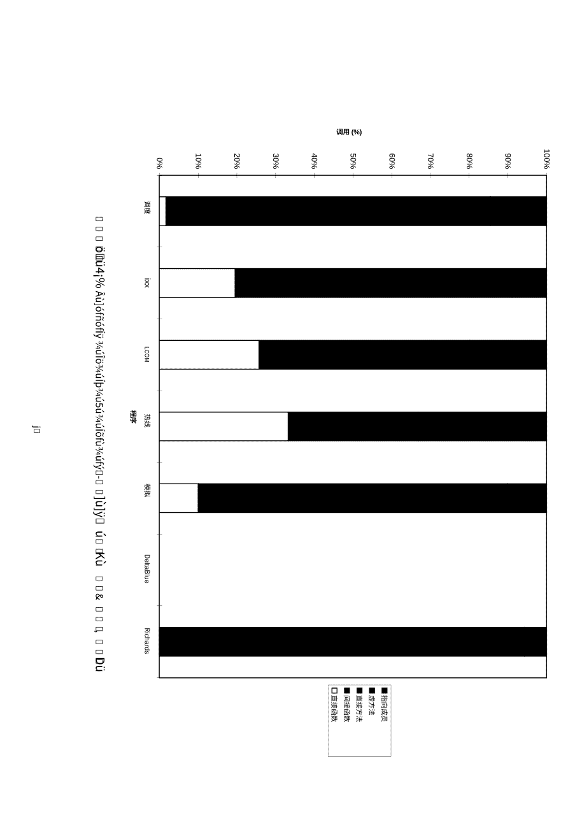

## 图2：非静态调用点的分类

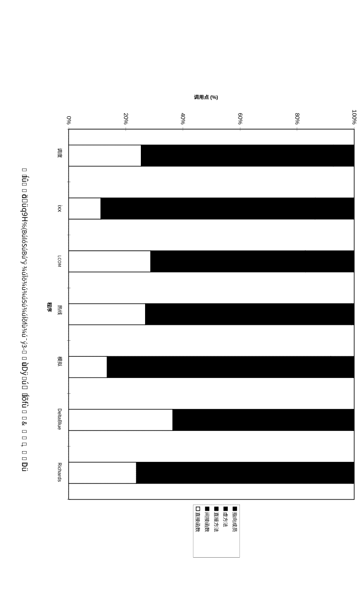

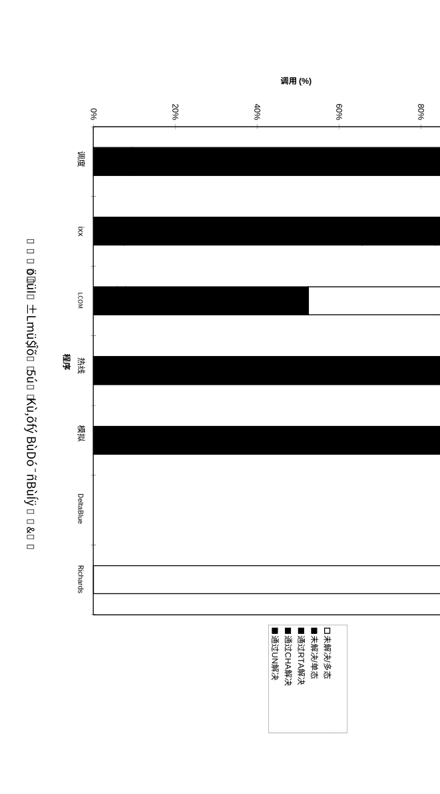

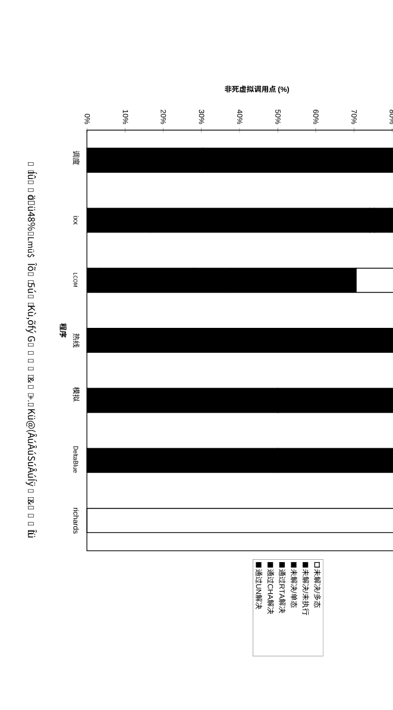

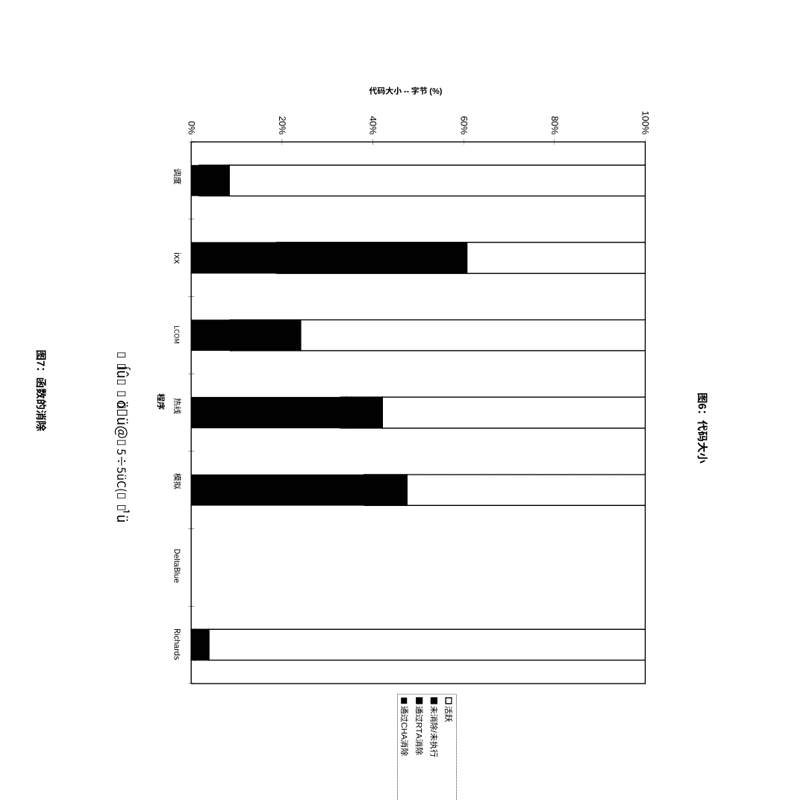

图6：代码大小

代码大小 - 字节 (%)

程序

0% 20% 40% 60% 80% 100%

调度
IXX
LCOM
热线
模拟
DeltaBlue
Richards

- 活跃
- 未消除未执行
- 通过RTA消除
- 通过CHA消除

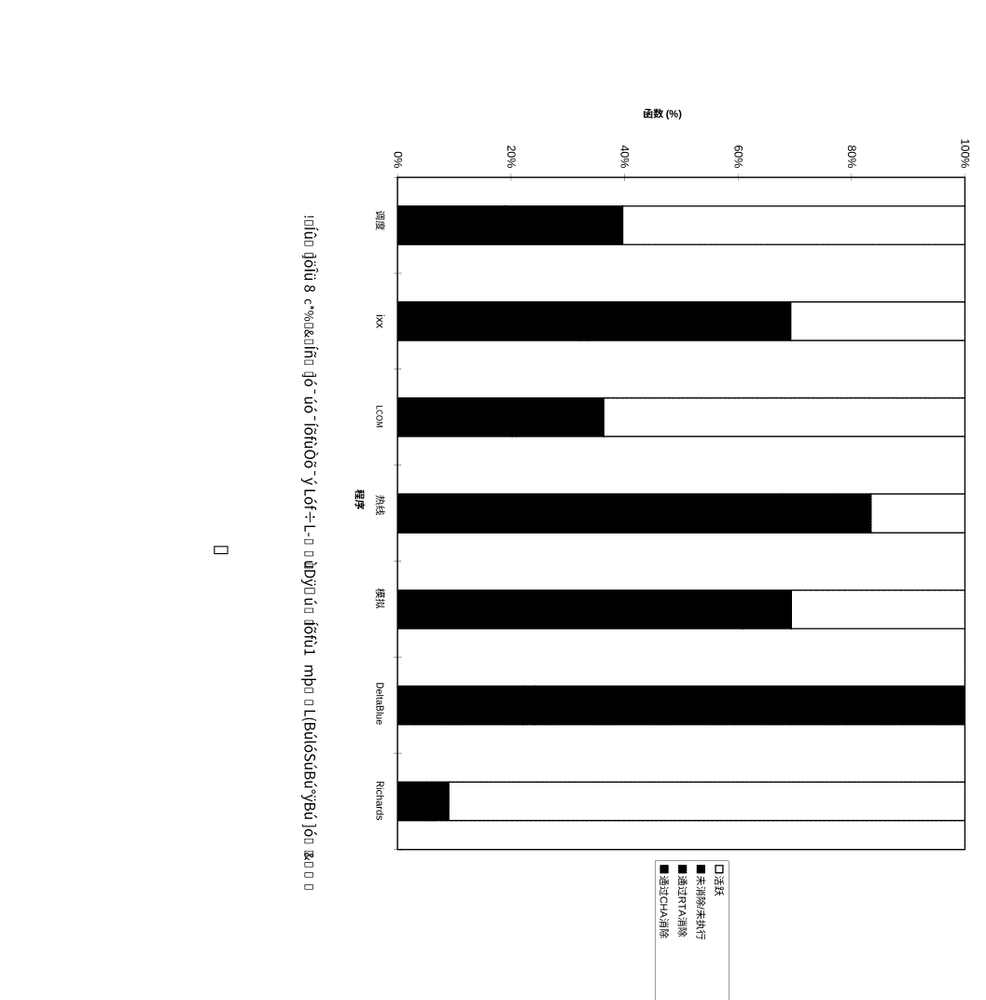

图7：函数的消除

函数 (%)

程序

0% 20% 40% 60% 80% 100%

调度
IXX
LCOM
热线
模拟
DeltaBlue
Richards

- 活跃
- 未消除未执行
- 通过RTA消除
- 通过CHA消除

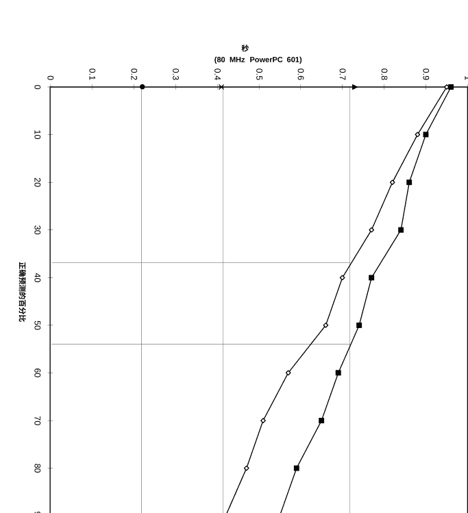

## 图9：类型预测的有效性

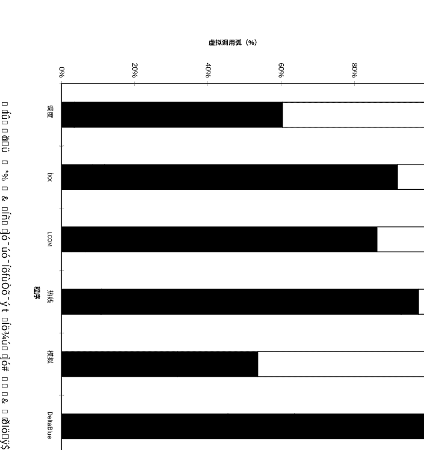

## 图8：静态虚拟调用弧的消除

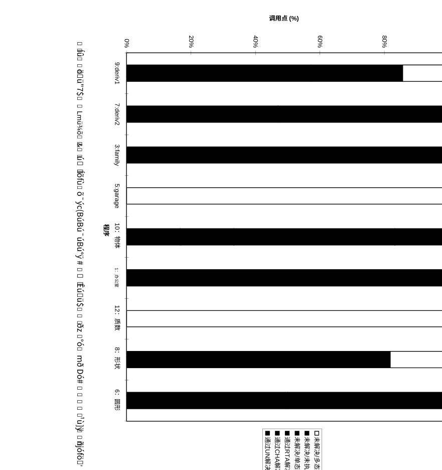

# 可扩展的基于传播的调用图构建算法

Frank Tip
IBM T.J. Watson研究中心
P.O. Box 704
Yorktown Heights, NY 10598
tip@watson.ibm.com

詹斯·帕尔斯伯格
计算机科学系 普渡大学西拉法叶特, IN 47907
palsberg@cs.purdue.edu

# 摘要

基于传播的调用图构建算法在1990年代得到了深入研究，主要区别在于用于近似运行时表达式值的集合数量。在实践中，像RTA这样使用单个集合的算法具有良好的可扩展性。像0-CFA这样每个表达式使用一个集合的算法的可扩展性仍然存在疑问。

在1990年代，调用图构建算法得到了广泛研究。尽管它们最初的表述使用了各种形式主义，但它们大多可以重新表述为基于集合的分析。共同的思想是将对象抽象为其类的名称，并将一组对象抽象为它们的类的集合。对于任何给定的调用点 e.m()，目标是计算一个近似运行时接收器表达式 e 的类名集合 S_e。一旦确定了所有表达式 e 的集合 S_e，就可以检查类层次结构以确定可以调用的方法。

在本文中，我们研究了RTA和0-CFA之间的设计空间。我们在Java的应用程序提取器Jax的上下文中实现了各种新算法，并且证明它们都可以扩展到一个325,000行的程序。这些算法的一个关键特性是它们不分析运行时堆栈上的值，这使得它们高效且易于实现。令人惊讶的是，对于检测不可达方法，廉价的RTA算法几乎与看似更强大的算法一样好。然而，对于确定具有单个目标的调用点，我们的一种新算法获得了当前最佳的速度和精度权衡。

大多数调用图构建算法主要在于使用的集合数量，以近似运行时表达式的值。例如：

# 1. 引言

大多数整体程序优化方法所需的一个关键任务是构建一个调用图近似。使用调用图，可以删除从主方法无法访问的方法，将动态分派的方法调用替换为直接方法调用，为具有唯一目标的方法调用内联，并执行更复杂的优化，如跨程序常量传播、对象内联和类层次结构的转换。在具有动态分派的面向对象语言的上下文中，构建调用图的关键步骤是计算给定虚拟（即动态分派）方法调用可以调用的方法集的保守近似。

| 使用的集合数量 | 算法名称近似运行 |
| :--- | :--- |
| 无集合 | 类层次分析 (CHA) [9, 10] |
| 整个程序使用一个集合 | 快速类型分析 (RTA) [6, 5] |
| 每个表达式使用一个集合 | 0-CFA (控制流分析) [33, 17] |
| 用多个集合 | k-CFA, k > 0 [33, 17] |

直观上，使用更多集合的算法计算出更准确的调用图，但需要更多的时间和空间来进行构建。实际上，在算法的可扩展性方面，两个极端的情况都是相当明确的。CHA和RTA算法在可扩展性较低的范围内表现良好，并且被广泛使用。对于高端的 k-CFA算法 (k > 0)，似乎根本无法扩展 [17]。0-CFA的可扩展性仍然存在疑问，主要是由于表示出现的许多不同集合所需的大量空间。F"ahndrich等人最近的工作给人以乐观的理由，尽管他们最近的结果是在拥有2,048兆字节内存的计算机上获得的 [37]。对于Java而言，0-CFA的另一个复杂因素是需要计算运行时堆栈上位置的类名集合。这些位置没有名称，为了方便0-CFA，似乎需要首先对程序进行某种方式的转换，以命名所有位置，就像最近的一些工作中所做的那样 [41, 38, 21]。这种转换会引入时间和空间开销。

随着对0-CFA可扩展性的调查仍在进行中，我们的研究重点关注以下问题：

- 在RTA和0-CFA之间的空间中是否存在有趣的设计要点？
- 在不分析运行时堆栈上的值的情况下，我们能否实现比RTA更高的精度？

我们在Java应用程序提取器Jax的上下文中实现了几种新颖的算法，并展示了它们在一个325,000行的程序中的可扩展性。算法的一个关键特性是它们不需要模拟运行时堆栈，这使得它们易于实现并提高了效率。我们的算法将每个类、方法和/或字段（但不是每个表达式）与一个单独的集合关联起来。令人惊讶的是，在检测不可达方法方面，廉价的RTA几乎与看似更强大的算法一样好。然而，对于确定具有单个目标的调用站点，我们的一种新算法获得了当前最佳的速度和精度折衷。

最后，在第6节中提出了未来工作的方向。最后，在第6节中提出了未来工作的方向。

# 2. 算法

我们将使用基于集合的框架来呈现一些现有的和一些新的算法。这将方便进行简单的比较，并帮助将我们的工作放入背景中。图1显示了四个新算法（在阴影区域中显示，并且被命名为CTA、MTA、FTA和XTA）与四个众所周知的先前算法之间的关系：RA（可达性分析）、CHA（类层次分析）、RTA（快速类型分析）和0-CFA。从左到右的顺序对应于增加的准确性和成本增加。成本的增加源于在解析虚拟方法调用时使用的信息量的增加。位于新算法左侧的算法已被证明具有良好的可扩展性，而0-CFA的可扩展性仍然存在疑问。在第4节中，我们将呈现证明新算法可扩展性的结果。

总结一下，新算法中最精确的结果如下：

- 与RTA相比，构建的调用图通常只包含略少的方法定义（即具有主体的方法）：方法定义减少了最多3.0%，平均减少了1.6%，但在一些情况下边缘显著减少（即方法定义之间的调用关系）：边缘减少了最多29.0%，平均减少了7.2%。
- 对构建的调用图进行深入研究发现，我们的算法中最精确的算法能够唯一解析RTA认为是多态的虚拟调用站点的26.3%（平均12.5%）。
- 在类中，为每个方法关联一个不同的类型集合对精确度的影响要比为每个字段关联一个不同的集合要大得多。
- 算法的规模很好：运行时间在一个数量级内与一个经过良好调优的RTA实现相当。我们的算法中最精确的一个比RTA慢了多达8.3倍，而这种“减速因子”与程序大小的相关性似乎很弱（对于最大的基准测试，我们最昂贵的算法比RTA慢了5.0倍）。
- 这些算法不需要过多的空间。我们所有的测量都是在一台配备288MB内存的IBM ThinkPad 600E PC上进行的。我们的基准测试中没有一个需要超过200MB的堆空间。

## 2.1 先前的算法

由于我们的新算法可以被视为相对于先前工作的自然“下一步”，我们将首先讨论一些相关的先前算法。这些算法在解决虚拟方法调用时逐渐考虑更多的信息。

### 2.1.1 基于名称的解析（RA）

我们将首先给出一个集合约束形式的可达性分析（RA），这是一个简单的算法，用于构建只考虑方法名称的调用图。

（这个算法的稍微高级版本依赖于方法签名的相等性，而不是方法名称。）RA的变体已经在许多地方提出（参见，例如，[34]），并在Lisp的树摇器的上下文中使用[16]。

*RA*可以根据一个集合变量*R*（表示“可达方法”）和从程序文本中导出的以下约束来定义：

```
1. 主函数 ∈ R                (主函数表示程序中的主方法)
2. 对于每个方法 M，每个虚拟调用点 e.m(…) 在 M中出现，并且每个方法 M'的名称为 m：
   (M ∈ R) ⇒ (M' ∈ R).
```

直观地，第一个约束条件表示“主方法是可达的”，第二个约束条件表示“如果一个方法是可达的，并且在其体中出现了虚拟方法调用 e.m(…)，那么每个名为 m 的方法也是可达的。”很容易证明存在一个最小的集合 R满足这些约束条件，并且存在一个解决过程来计算该集合。计算满足约束条件的最小 R的原因是为了最大化 R的补集，即可以安全删除的不可达方法的集合。

本文的其余部分组织如下。第2节介绍了我们的新算法，并讨论了它们与RTA等几个先前算法的关系。第3节讨论了实现问题。在第4节中，我们将新算法计算的结果与RTA进行了比较。第5节介绍了相关工作。

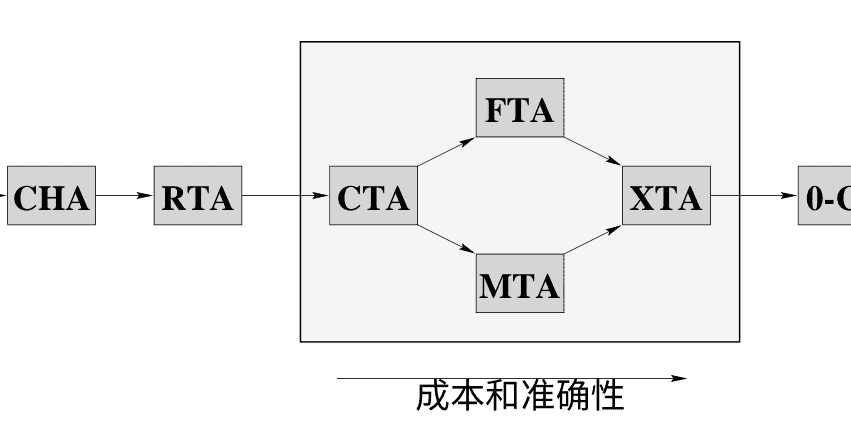

### 2.1.2 类层次分析（CHA）

我们可以扩展基本可达性分析的约束系统，以考虑类层次信息。结果被称为类层次分析（CHA）[9, 10]。我们将使用符号 StaticType(e) 表示表达式 e 的静态类型，SubTypes(t) 表示类型 t 的声明子类型集合，符号 StaticLookup(C, m) 表示在类 C 中进行静态方法查找时找到的方法的定义（如果有）。与RA类似，CHA只使用一个方法集合变量 R，其约束为：

- 1. 主函数 ∈ R （主函数表示程序中的主方法）
- 2. 对于每个方法 M，每个虚拟调用点 e.m(...) 在 M中出现，并且每个类 C ∈ SubTypes(StaticType(e)) 其中 StaticLookup(C, m) = M': (M ∈ R) ⇒ (M' ∈ R).

直观地，第二个约束条件的含义是：“如果一个方法是可达的，并且在该方法的代码体中存在一个虚拟方法调用 e.m(...)，那么所有名为 m的方法，它们都是由 e的静态类型的子类型继承的，也都是可达的。”

### 2.1.3 快速类型分析（RTA）

我们可以进一步扩展CHA，以考虑类实例化信息。结果被称为快速类型分析（RTA）[6, 5]。RTA使用两个集合变量 R 和 S，其中R范围是方法集合，S范围是类名集合。变量S近似表示程序运行期间创建的对象的类集合。约束条件：

- 1. 主函数 ∈ R （主函数表示程序中的主方法）
- 2. 对于每个方法 M，每个虚拟调用点 e.m(...) 在 M中出现，并且每个类 C ∈ SubTypes(StaticType(e)) 其中 StaticLookup(C, m) = M': (M ∈ R) ∧ (C ∈ S) ⇒ (M' ∈ R).
- 3. 对于每个方法 M，以及每个出现在 M中的“new C()”: (M ∈ R) ⇒ (C ∈ S).

直观地说，第二个约束条件通过坚持 C ∈ S来细化CHA的相应约束条件，第三个约束条件是：“S包含在可达方法中实例化的类。”

RTA易于实现，扩展性好，并且已经证明其计算出的调用图比CHA计算出的调用图更精确[6]。我们知道有几个整体程序分析系统依赖于RTA来计算调用图（例如[40]的 Jax应用程序提取器）。在第4节中，我们将使用RTA作为我们即将介绍的新的调用图构建算法的基准进行比较。

## 2.2 新算法

新算法使用多个范围为类集合的集合变量。我们将这些集合变量与程序实体（如类、方法和字段）关联起来。
这个想法是通过给每个程序实体一个更精确的“局部”视图来提供可用对象类型的更准确的调用位置解析。

### 2.2.1 方法和字段的分离集合（XTA）

我们首先介绍一种算法，该算法使用一个独立的集合变量 S_M 来表示每个方法 M，以及一个独立的集合变量 S_x 来表示每个字段 x。我们将这种分析称为XTA。我们将使用符号 ParamTypes(M) 表示方法 M 的静态参数类型集合（不包括方法M的 this 指针），并使用符号 ReturnType(M) 表示 M 的静态返回类型。我们还扩展了函数 SubTypes(·) 以处理一组类型：

SubTypes(Y) = ⋃_{y ∈ Y} SubTypes(y)

以下约束定义了XTA：

- 1. 主函数 ∈ R （主函数表示程序中的主方法）
- 2. 对于每个方法 M，每个虚拟调用点 e.m(...) 在 M中出现，并且每个类 C ∈ SubTypes(StaticType(e)) 其中 StaticLookup(C, m) = M':  (M ∈ R) ∧ (C ∈ S_M) ⇒ (M' ∈ R) ∧ (SubTypes(ParamTypes(M')) ∩ S_M ⊆ S_{M'}) ∧ (SubTypes(ReturnType(M')) ∩ S_{M'} ⊆ S_M) ∧ (C ∈ S_{M'})
- 3. 对于每个方法 M，以及每个出现在 M中的“new C()”: (M ∈ R) ⇒ C ∈ S_M
- 4. 对于每个方法 M中读取字段 x的情况: (M ∈ R) ⇒ S_x ⊆ S_M
- 5. 对于每个方法 M中写入字段 x的情况: (M ∈ R) ⇒ (SubTypes(StaticType(x)) ∩ S_M) ⊆ S_x

直观上，第二个约束细化了RTA的相应约束，通过 (i)坚持目标类 C中的对象在与M相关联的本地集合 S_M中可用，(ii)添加两个包含关系，捕捉从M到 M'的数据流，以及从 M'回到 M的数据流，以及 (iii)声明类型为 C的对象（“this”指针）在 M'中可用。第三个约束通过仅将类名 C添加到方法 M的集合变量中，细化了RTA的相应约束。第四个约束反映了从字段到方法体的数据流，第五个约束反映了从方法体到字段的数据流，考虑了层次结构信息和创建点信息。

### 2.2.2 在RTA和XTA之间的算法空间

在RTA和XTA之间有一系列分析。我们已经尝试了以下几种:

- **CTA**: 算法CTA为每个类C使用一个不同的集合变量S_C。直观地说，集合变量 S_C统一了所有方法和字段的流信息。对于CTA，可以通过将以下约束条件添加到XTA的定义中来获得:
  1. 如果一个类 C定义了一个方法 M: S_C = S_M。
  2. 如果一个类 C定义了一个字段 x: S_C = S_x。
- **MTA**: 算法MTA为每个类C使用一个不同的集合变量 S_C，并为每个字段x使用一个集合变量 S_x。直观地说，集合变量 S_C统一了所有方法（但不包括字段）的流信息。对于MTA，可以通过将以下约束条件添加到XTA的定义中来获得:
  1. 如果一个类 C定义了一个方法 M: S_C = S_M。
- **FTA**: 算法FTA为每个类C使用一个不同的集合变量S_C，并为每个方法M使用一个集合变量 S_M。直观地说，集合变量 S_C统一了所有字段（但不包括方法）的流信息。MTA的约束可以通过将以下约束添加到XTA的定义中获得:
  1. 如果一个类 C定义了一个字段 x: S_C = S_x。

还有许多其他可能性。例如，如果同一类中的字段具有相同的类型，则可以统一与字段相关联的集合。

### 2.2.3 总结

现在让我们总结一下我们进行实验的算法。对于给定的程序，定义:

C : 程序中的类数  
M: 程序中的方法数  
F: 程序中的字段数。

在下表中，第一列给出了用于近似运行时间值的集合变量的数量。

| 集合变量数量 | 算法 |
| :--- | :--- |
| 0 | CHA |
| 1 | RTA |
| C | CTA |
| C + F | MTA |
| C + M | FTA |
| M + F | XTA |

我们所有的新算法和0-CFA都可以在O(n^2 × C)的时间内执行，其中n是集合变量的数量[28]。我们可以将0-CFA视为XTA的扩展，具体方法如下。0-CFA不仅为每个方法使用一个集合变量，还为每个参数和每个求值为对象的表达式使用一个集合变量，包括对运行时堆栈上对象的引用。0-CFA的主要问题是在Java虚拟机中，堆栈位置没有名称，因此似乎需要首先进行某种方式的程序转换，以命名所有位置，就像最近的一些工作中所做的那样[41, 38, 21]。

之前在图1中展示的格子表示了算法在成本和准确性方面的关系。第5节进一步讨论了这些算法与其他算法的比较。

# 3. 实施问题

我们在Java应用程序提取器Jax的上下文中实现了第2节中的几种新算法[40]。我们的实现依赖于“JikesBT”（IBM的Jikes字节码工具包）¹来读取Java类文件，并创建一个内部表示类的数据结构，其中类文件格式的基于字符串的引用由指针引用表示。

Jax使用RTA构建调用图，我们的新算法重用了为RTA设计的几个重要数据结构。由于第2节的算法相当简单，我们只需编写大约4000行新代码。

该实现以迭代、基于传播的方式执行XTA算法。每个程序组件（即方法或字段）都与三个工作列表相关联。

> ¹Jikes字节码工具包是一个公开可用的用于操作Java类文件的类库。请参阅www.alphaworks.ibm.com/tech/jikesbt。

这些工作列表跟踪已从组件传播到其他组件的“已处理”类型、“当前”迭代中将要传播到当前组件的类型，以及在下一次迭代中将要传播到当前组件的“新”类型。

FTA和MTA算法分别使用一个共享集合来处理类中的所有方法和字段。请注意，在MTA（FTA）的情况下，不需要在同一类中的不同方法（字段）之间进行传播。然而，一旦一个类型被传播到类C中的一个方法（字段），仍然需要重新访问类C中的其他方法（字段），因为这些方法（字段）可能需要进行进一步的传播。由于时间限制，我们尚未完成CTA算法的实现。

我们使用基于数组和基于哈希的数据结构的组合，允许高效的成员测试操作、元素添加和遍历所有元素。我们发现，使得所有这些操作非常高效非常重要。由于元素的传播是通过方法参数类型、方法返回类型和字段类型进行过滤的，因此高效地实现子类型测试非常重要。我们使用[42]中描述的一种方法，该方法依赖于将两个整数与每个类关联起来，对应于类层次结构的前序遍历和后序遍历。使用这种编号方案，可以通过比较相关的数字在单位时间内确定两个类之间是否存在子类关系。

将算法应用于实际的Java应用程序时，我们不得不解决几个实际问题：

直接方法调用。可以使用调用方和被调用方关联的简单集合包含关系来建模直接方法调用。

数组。数组被建模为具有一个实例字段的类，该字段表示其所有元素。如果方法m假设从数组A读取元素：（i）传播到m的类型为A的对象，并且（ii）m包含aaload字节码指令。同样，如果方法m假设写入A元素：（i）传播到m的类型为A的对象，并且（ii）m包含aastore指令。

异常处理。使用异常处理可能导致类型在方法之间发生平凡的流动，因为异常对象可能在被捕捉之前跳过多个堆栈帧。精确跟踪此类型流动的任何方法都充满复杂性，并且在我们看来可能不值得，因为涉及的类型数量可能很小（仅涉及java.lang.Throwable的子类型），并且用户定义的异常类型层次结构通常不是很大或复杂。因此，我们使用一个全局的类型集合来表示整个程序中静态类型为java.lang.Throwable的所有表达式的运行时类型，并使用该集合来解析异常对象上的所有方法调用。

堆栈检查。在进行实验时，我们观察到通过检查方法调用（或字段读取）后的指令可以实现更高的精度和效率。如果这个指令的形式是check cast C，除非方法返回的对象的运行时类型是C的子类型，否则会抛出异常。在这种情况下，我们可以排除掉不是C的子类型的类型从被传播到调用方法。同样，如果方法调用后的指令是堆栈弹出操作，我们可以完全避免从被调用者传播到调用者。这些情况在存在多态容器（如向量和哈希表）时经常发生。

不完整的应用程序。虽然我们已经描述了我们的算法如何为具有单个入口点的完整应用程序构建调用图，但是任何实际的实现都必须处理应用程序扩展标准库类、调用库方法和覆盖从应用程序外部调用的库方法的情况。我们的基本方法是将一个对象集合SE与“外部世界”（即应用程序外的所有代码）关联起来。这个集合与其他集合的交互如下：

- ● 如果一个方法m调用了应用程序外的一个方法m'，我们将（Sm ∩ ParamTypes(m')）传播到SE。对于虚拟方法，通过this指针传递的任何类型也会传播到SE。
- ● 每当一个方法m写入一个应用程序外的字段f时，我们将（Sm ∩ Type(f)）传播到SE。读取外部字段会导致类似的反向流动。
- ● 如果应用程序中的虚拟方法覆盖了一个外部方法m'，我们做出保守的假设，即外部代码包含对m'的调用。我们的方法是使用集合SE来确定应用程序中可能被动态分派机制调用的方法集合。对于每个这样的方法m'，我们使用m'的参数类型和返回类型来建模SE和Sm之间的对象流动。

我们观察到上述方案在某些情况下过于保守，因为传递给库方法的对象并不总是污染全局集合SE。基于这些观察，我们的实现对上述方案进行了两个改进：

- ● 对于标准库中某些方法的调用，我们知道传播到集合SE是不必要的，因为传递给该方法的对象不会成为后续方法调用的接收者。类java.lang.Object的构造函数是这个类别中的一个典型例子。我们已经确定了大约25个频繁调用的库方法，可以忽略这些调用。
- ● 在某些情况下，可以将一组独立的对象SC与外部类C相关联，其中传递给C中的方法的对象只与其他外部类有限地交互。例如，我们可以将一个不同的集合与类java.util.Vector关联起来。必须小心处理，因为对象可能从这个类流向其他外部类（例如，由于调用java.util.Vector.elements()）。我们还建模了另外三个集合类。

## 4. 结果

对于一系列基准测试，我们测量了MTA、FTA和XTA的五个特征，以RTA的结果作为基准：

- 每个方法可用的类型数量，
- 可达方法的数量，
- 调用图中的边的数量，
- 单态和多态调用点的数量，
- 运行时间。

特别重要的是将调用点分类为单态和多态，并详细研究了我们的算法如何改进RTA。虽然可达方法的数量几乎没有减少，但我们发现在几个基准测试中构建的调用图的边的数量显著减少。更重要的是，从RTA到XTA时，我们发现单态调用点的数量显著增加。

### 4.1 基准特性

表1列出了我们用来评估算法的基准应用程序，并为每个应用程序提供了一些相关统计数据。这些基准涵盖了广泛的编程风格，并且是公开可用的（除了Mockingbird和Reservation System）。

Hanoi是一个互动的applet版本的著名的“汉诺塔”问题，并且随Jax一起提供。ICEBrowser是一个简单的互联网浏览器。Mockingbird (mBird) 是IBM的一种专有工具，用于多语言互操作性。它依赖于几个大型类库的有限部分（包括Swing，现在是JDK 1.2的一部分，以及IBM的XML解析器）。Cinderella是一种用于学校和大学教育和自学的交互式几何工具。CindyApplet是一个允许用户与使用Cinderella创建的几何练习进行交互的applet。它包含在与Cinderella相同的类文件存档中。Lotus eSuite Sheet和Lotus eSuite Chart是交互式电子表格和图表applet，是Lotus的eSuite生产力套件（De-vPack 1.5版本）附带的示例。JavaFig（版本1.43（22.02.99））是xfigdrawing程序的Java版本。BLOAT是在普渡大学开发的字节码优化器。我们使用的Jax的版本是6.3。javac是SPEC.JVM 98版本的Sun的javac编译器。我们最大的基准测试，Reservation System，是IBM客户开发的用于航空公司、酒店和租车预订系统的交互式前端，由大约25,000行Java源代码组成。

表1显示了每个基准测试的类、方法和字段的数量。该表还显示了应用程序中引用类型字段的数量（即类型为类的引用字段），该数量在“字段”列中用括号表示。我们的系统创建了一个为达到的方法访问的每个引用类型字段设置一个集合。因此，这个数字是创建的字段集合数量的上限。表1还显示了每个基准测试中的虚拟调用站点的数量。出于我们即将解释的原因，排除了对应用程序外部方法的虚拟调用。

| 基准测试   | #类   | #方法   | #字段（引用类型） | #虚拟调用站点 |
|------------|-------|---------|------------------|---------------|
| 河内塔     | 44    | 379     | 232 (107)        | 285           |
| 冰浏览器   | 76    | 761     | 500 (253)        | 922           |
| mBird      | 2,050 | 17,946  | 6,739 (4,284)    | 3,269         |
| 辛迪       | 468   | 4,449   | 3,075 (1,677)    | 5,085         |
| CindyApplet| 468   | 4,449   | 3,075 (1,677)    | 2,502         |
| eSuite表格 | 588   | 5,590   | 4,305 (1,412)    | 4,459         |
| eSuite图表 | 733   | 8,302   | 5,448 (2,141)    | 8,074         |
| java图1.43 | 161   | 2,108   | 1,526 (971)      | 3,482         |
| BLOAT      | 282   | 2,677   | 1,255 (541)      | 6,623         |
| JAX 6.3    | 309   | 2,754   | 1,252 (579)      | 3,836         |
| javac      | 210   | 1,512   | 1,107 (406)      | 3,621         |
| 资源系统   | 2,332 | 21,495  | 12,487 (6,334)   | 23,640        |

**表1：基准测试特征。**

### 4.2 集合大小

诸如达到方法数量和唯一解析方法调用的百分比等统计数据是传统上用于比较调用图构建算法的度量标准。由于这些度量标准都取决于方法中可用类型的数量，因此检查每个方法中可用类型的平均集合作为更“绝对”的度量标准是很有意思的。表2显示了我们实现的每个算法的总类型数（实例化类），每个方法体中可用类型的平均数，以及后者占前者的百分比。对于仅使用一个集合的RTA算法，每个方法的平均类型数与总类型数相同。

表2告诉我们一些有趣的事情：

- 只有很少几种情况下，RTA确定的总类型数比其他算法更大。
- 使用MTA，每种方法中平均有57.8%的类型可用，在RTA的基础上大约减少了一倍。FTA比MTA做得更好，平均每种方法中只有15.6%的类型可用。XTA更好，平均有12.3%的类型可用。

虽然这些平均集合大小的减少是相当大的，但似乎还有改进的空间。对于预订系统，当使用XTA时，每种方法平均可用约200种类型。考虑到一个方法的平均源代码行数大约为15-20行，这个数字似乎很高。

| 基准测试 | RTA | MTA | FTA | XTA |
|----------|-----|-----|-----|-----|
| 河内塔 | 19 | 19, 7.1, 37.3% | 19, 3.8, 20.0% | 19, 2.8, 14.8% |
| 冰浏览器 | 59 | 59, 23.4, 39.7% | 59, 7.1, 12.0% | 59, 4.5, 7.7% |
| mBird | 178 | 178, 90.0, 50.6% | 178, 13.3, 7.5% | 178, 11.6, 6.5% |
| 辛迪 | 238 | 237, 153.2, 64.6% | 237, 36.5, 15.4% | 237, 28.3, 11.9% |
| CindyApplet | 105 | 104, 64.6, 62.1% | 104, 17.2, 16.5% | 104, 13.9, 13.4% |
| eSuite表格 | 174 | 174, 96.0, 55.2% | 174, 21.1, 12.1% | 174, 13.8, 7.9% |
| eSuite图表 | 303 | 303, 224.1, 74.0% | 303, 48.6, 16.0% | 303, 24.0, 7.9% |
| java图1.43 | 110 | 110, 73.4, 66.7% | 110, 21.2, 19.3% | 110, 17.1, 15.5% |
| BLOAT | 209 | 209, 163.8, 78.4% | 209, 44.7, 21.4% | 209, 42.4, 20.3% |
| JAX 6.3 | 221 | 221, 70.9, 32.1% | 221, 10.0, 4.5% | 221, 8.3, 3.8% |
| javac | 171 | 171, 106.4, 62.2% | 171, 39.9, 23.3% | 171, 35.5, 20.8% |
| 资源系统 | 1,174 | 1174, 833.8, 71.0% | 1172, 228.2, 19.5% | 1172, 200.0, 17.1% |
| 平均值 | | | 57.8% | 15.6% | 12.3% |

**表2：RTA、MTA、FTA和XTA在每个基准上的平均集合大小。**

### 4.3 达到的方法

表3显示了RTA、MTA、FTA和XTA计算的每个基准测试中调用图中的方法数量。还显示了MTA、FTA和XTA相对于RTA的百分比减少。

这些统计数据不包括抽象方法，这些方法没有主体，不调用其他方法，并且不能成为动态分派的目标。排除抽象方法的理由与以下观察有关：在调用虚拟方法m的情况下，但m不能成为动态分派的目标时，可以删除m的主体并将m变成一个抽象方法而不影响程序行为（实际上，这是Jax执行的优化之一）。因此，将抽象方法视为一流公民会导致无法区分包含相同方法头集合但不同方法实现集合的调用图。

方法实现。当然，可以提供包括抽象方法数量和非抽象方法数量在内的详细统计数据，但我们认为这种额外细节并不是非常有价值。

总结一下，我们发现：

- MTA计算的调用图比RTA少了0到2.3%的方法定义（平均为0.6%），
- FTA计算的调用图比RTA少了0到2.7%的方法定义（平均为1.4%），并且
- XTA计算的调用图比RTA少了0到3.0%的方法定义（平均为1.6%）。

| 基准测试 | RTA | MTA | FTA | XTA | (RTA-MTA)/RTA | (RTA-FTA)/RTA | (RTA-XTA)/RTA |
|----------|-----|-----|-----|-----|---------------|---------------|---------------|
| 河内塔 | 183 | 179 | 178 | 178 | 2.2% | 2.7% | 2.7% |
| 冰浏览器 | 644 | 644 | 643 | 643 | 0.0% | 0.2% | 0.2% |
| mBird | 1,862 | 1,855 | 1,825 | 1,824 | 0.4% | 2.0% | 2.0% |
| 辛迪 | 2,437 | 2,412 | 2,404 | 2,403 | 1.0% | 1.4% | 1.4% |
| CindyApplet | 1,237 | 1,209 | 1,203 | 1,202 | 2.3% | 2.7% | 2.8% |
| eSuite表格 | 2,414 | 2,400 | 2,385 | 2,367 | 0.6% | 1.2% | 1.9% |
| eSuite图表 | 4,428 | 4,419 | 4,313 | 4,296 | 0.2% | 2.6% | 3.0% |
| java图1.43 | 1,441 | 1,435 | 1,413 | 1,411 | 0.4% | 1.9% | 2.1% |
| BLOAT | 2,143 | 2,142 | 2,120 | 2,091 | 0.0% | 1.1% | 2.4% |
| JAX 6.3 | 1,900 | 1,894 | 1,894 | 1,892 | 0.3% | 0.3% | 0.4% |
| javac | 1,366 | 1,366 | 1,366 | 1,366 | 0.0% | 0.0% | 0.0% |
| 资源系统 | 11,232 | 11,227 | 11,204 | 11,201 | 0.0% | 0.2% | 0.3% |
| 平均值 | | | | | 0.6% | 1.4% | 1.6% |

**表3：RTA、MTA、FTA和XTA在每个基准测试中计算的调用图中的方法数量。**

### 4.4 调用图边

我们接下来研究的是计算得到的调用图中的边的数量。在确定这个数量时，我们将每个直接调用点（即不涉及动态分派的调用）计为一个，将每个虚拟调用点计为可以由该调用点进行动态分派的“目标”方法的数量。在方法体内多次调用同一个方法m的情况被分别计算（尽管我们的分析将以相同方式处理这些调用）。

由于我们不知道应用程序外部的类是否已经实例化，因此无法准确确定对应用程序外部的虚方法调用的目标数量。因此，在进行这些测量时，忽略对应用程序外部方法的调用。

结果如表4所示。很明显，一些新算法确实消除了比RTA更多的边。结果可以总结如下：

- MTA计算的调用图比RTA少0到4.7%的边（平均为1.6%）
- FTA计算的调用图比RTA少0.1%到26.7%的边（平均为6.6%）
- XTA计算的调用图比RTA少0.3%到29.0%的边（平均为7.2%）

| 基准测试 | RTA | MTA | FTA | XTA | (RTA-MTA)/RTA | (RTA-FTA)/RTA | (RTA-XTA)/RTA |
|----------|-----|-----|-----|-----|---------------|---------------|---------------|
| 河内塔 | 400 | 386 | 382 | 379 | 3.5% | 4.5% | 5.3% |
| 冰浏览器 | 1,594 | 1,594 | 1,593 | 1,588 | 0.0% | 0.1% | 0.4% |
| mBird | 8,061 | 8,036 | 7,772 | 7,760 | 0.3% | 3.6% | 3.7% |
| 辛迪 | 15,457 | 14,729 | 11,331 | 10,967 | 4.7% | 26.7% | 29.0% |
| CindyApplet | 5,223 | 4,990 | 4,399 | 4,347 | 4.5% | 15.8% | 16.8% |
| eSuite表格 | 7,171 | 7,149 | 7,093 | 7,071 | 0.3% | 1.1% | 1.4% |
| eSuite图表 | 14,669 | 14,648 | 13,857 | 13,771 | 0.1% | 5.5% | 6.1% |
| java图1.43 | 5,128 | 5,064 | 4,963 | 4,961 | 1.2% | 3.2% | 3.3% |
| BLOAT | 19,384 | 18,772 | 16,704 | 16,672 | 3.2% | 13.8% | 14.0% |
| JAX 6.3 | 7,053 | 7,018 | 6,904 | 6,895 | 0.5% | 2.1% | 2.2% |
| javac | 13,154 | 13,154 | 13,115 | 13,113 | 0.0% | 0.3% | 0.3% |
| 资源系统 | 46,130 | 45,944 | 44,792 | 44,412 | 0.4% | 2.9% | 3.7% |
| 平均值 | | | | | 1.6% | 6.6% | 7.2% |

**表4：RTA、MTA、FTA和XTA在每个基准测试中计算的调用图中的边数量。**

### 4.5 个唯一解决的调用点

在优化面向对象程序的过程中，找到“单态”虚拟调用点是一个关键目标之一。这样的调用点可以转换为直接调用，并进一步进行内联和优化。

表5将每个基准应用程序中的虚拟调用点分为“未到达”（即出现在未到达的方法中）、“单态”（即只有一个目标）和“多态”（即有多个目标）。再次忽略对应用程序外部方法的调用，因为我们无法准确确定这种情况下的目标数量。我们可以从表5中得出以下结论：

- 未到达的虚拟调用点的百分比在不同基准之间有显著差异。

| 基准测试 | RTA | | | MTA | | | FTA | | | XTA | | |
| :--- | :--- | :--- | :--- | :--- | :--- | :--- | :--- | :--- | :--- | :--- | :--- | :--- |
| | **未到达** | **单态** | **多态** | **未到达** | **单态** | **多态** | **未到达** | **单态** | **多态** | **未到达** | **单态** | **多态** |
| 河内塔 | 34.0% | 61.6% | 4.4% | 34.0% | 62.3% | 3.7% | 34.0% | 62.7% | 3.3% | 34.0% | 62.7% | 3.3% |
| 冰浏览器 | 4.0% | 91.4% | 4.7% | 4.0% | 91.4% | 4.7% | 4.0% | 91.4% | 4.7% | 4.0% | 91.6% | 4.5% |
| mBird | 14.2% | 73.4% | 12.3% | 14.2% | 73.5% | 12.2% | 17.4% | 70.8% | 11.8% | 17.4% | 70.9% | 11.7% |
| Cindy | 49.3% | 45.0% | 5.7% | 49.5% | 45.0% | 5.5% | 49.4% | 45.2% | 5.4% | 49.4% | 45.5% | 5.0% |
| CindyApplet | 72.0% | 24.6% | 3.4% | 72.1% | 24.6% | 3.3% | 72.3% | 24.4% | 3.3% | 72.3% | 24.5% | 3.2% |
| eSuite表格 | 28.1% | 68.4% | 3.5% | 28.1% | 68.4% | 3.5% | 28.1% | 69.1% | 2.8% | 28.2% | 69.1% | 2.8% |
| eSuite图表 | 13.3% | 76.6% | 10.1% | 13.3% | 76.6% | 10.1% | 15.7% | 75.7% | 8.7% | 15.7% | 76.0% | 8.3% |
| JavaChart1.43 | 9.1% | 87.1% | 3.9% | 9.1% | 87.4% | 3.6% | 9.7% | 87.2% | 3.1% | 9.7% | 87.2% | 3.1% |
| BLOAT | 6.6% | 82.4% | 11.1% | 6.6% | 82.4% | 11.1% | 6.7% | 82.5% | 10.8% | 7.0% | 82.2% | 10.8% |
| JAX 6.3 | 18.7% | 75.9% | 5.4% | 18.9% | 75.7% | 5.4% | 18.9% | 76.6% | 4.5% | 18.9% | 76.8% | 4.3% |
| javac | 3.0% | 77.6% | 19.4% | 3.0% | 77.6% | 19.4% | 3.0% | 77.6% | 19.4% | 3.0% | 77.7% | 19.3% |
| 资源系统 | 18.1% | 72.0% | 9.9% | 18.1% | 72.2% | 9.7% | 18.2% | 73.1% | 8.7% | 18.2% | 74.0% | 7.9% |
| **平均值** | | **7.8%** | | | **7.7%** | | | **7.2%** | | | **7.0%** | |

表5：根据RTA、MTA、FTA和XTA算法对每个基准测试的虚拟调用站点进行分类。

例如，在javac中，只有3.0%的虚拟调用站点是未到达的，而在CindyApplet中，72.0%的虚拟调用站点是未到达的。并且在MTA/FTA/XTA调用图中变得无法到达。

- 限制我们关注的是已到达的虚拟调用站点，我们发现所有算法都将绝大多数调用站点分类为单态。具体来说，我们发现：
- RTA将3.4%至19.4%的所有调用点分类为多态（平均为7.8%）。
- MTA将3.3%至19.4%的所有调用点分类为多态（平均为7.7%）。
- FTA将2.8%至19.4%的所有调用点分类为多态（平均为7.2%）。
- XTA将2.8%至19.3%的所有调用点分类为多态（平均为7.0%）。
- poly-to-mono：在RTA调用图中解析为多个目标，但在MTA/FTA/XTA调用图中解析为唯一目标的虚拟调用点。
- poly-to-poly：在RTA和MTA/FTA/XTA调用图中解析为多个目标的虚拟调用点。

总结一下，我们可以得出结论，RTA在将虚拟调用点分类为单态方面做得非常好。对于我们在本文中研究的基准测试，只有7.8%的虚拟调用点被分类为多态（平均值），这给改进留下了很少的空间。XTA将平均7.0%的虚拟调用点分类为多态。

为了确定MTA/FTA/XTA算法与RTA相比在相对准确性上的提升程度，我们可以观察以下内容：
- 在MTA/FTA/XTA中确定为无法到达的调用点对应用程序的性能没有影响。毕竟，它们从未被执行过。
- 在RTA中确定为单态的任何调用点都不会因为更好的算法而改进（因为它们要么保持单态，要么变得无法到达）。

## 4.6 详细比较

表6显示了RTA和MTA/FTA/XTA构建的调用图的详细比较，对于每个基准测试。RTA调用图中的每个调用点被分类为以下之一：

- 单一到不可达：在RTA调用图中解析为单个目标方法，并在MTA/FTA/XTA调用图中变为不可达（因为包含该调用点的方法变为不可达）。
- 单一到单一：在RTA和MTA/FTA/XTA调用图中都解析为单个目标方法。
- 多重到不可达：在RTA调用图中解析为多个目标。

因此，剩下的是多态到单态和多态到多态类别。这些类别之间的比例反映了MTA/FTA/XTA相对于RTA的改进。

以预订系统为例，这是我们最大的基准测试。该应用程序总共包含23,640个虚拟调用点。如果我们减去 (i) RTA确定为单态的所有调用点，以及 (ii) XTA确定为不可达的所有调用点，我们剩下2,824个由RTA确定为多态的调用点。XTA确定其中569个调用点实际上是单态的。因此，XTA能够将RTA确定为多态的调用点中的569/2,824 = 20.1%进行虚拟化。如果我们将这种推理应用于表6，我们发现：
- MTA在RTA认为是多态的调用站点中找到了单个目标（平均为2.9%），占总数的15.8%。

| 基准测试 | 单态->未到达 | 单态->单态 | 多态->未到达 | 多态->单态 | 多态->多态 |
| :--- | :--- | :--- | :--- | :--- | :--- |
| 河内塔 | 0 (MTA)<br>0 (FTA)<br>0 (XTA) | 266 (MTA)<br>266 (FTA)<br>266 (XTA) | 0 (MTA)<br>0 (FTA)<br>0 (XTA) | 3 (MTA)<br>5 (FTA)<br>5 (XTA) | 16 (MTA)<br>14 (FTA)<br>14 (XTA) |
| 冰浏览器 | 0 (MTA)<br>1 (FTA)<br>1 (XTA) | 877 (MTA)<br>876 (FTA)<br>876 (XTA) | 0 (MTA)<br>0 (FTA)<br>0 (XTA) | 0 (MTA)<br>0 (FTA)<br>2 (XTA) | 45 (MTA)<br>45 (FTA)<br>43 (XTA) |
| mBird | 0 (MTA)<br>141 (FTA)<br>141 (XTA) | 2,807 (MTA)<br>2,666 (FTA)<br>2,666 (XTA) | 0 (MTA)<br>8 (FTA)<br>8 (XTA) | 4 (MTA)<br>12 (FTA)<br>16 (XTA) | 458 (MTA)<br>442 (FTA)<br>438 (XTA) |
| Cindy | 8 (MTA)<br>11 (FTA)<br>14 (XTA) | 4,510 (MTA)<br>4,507 (FTA)<br>4,504 (XTA) | 0 (MTA)<br>0 (FTA)<br>0 (XTA) | 9 (MTA)<br>24 (FTA)<br>52 (XTA) | 548 (MTA)<br>543 (FTA)<br>515 (XTA) |
| CindyApplet | 8 (MTA)<br>21 (FTA)<br>25 (XTA) | 2,185 (MTA)<br>2,172 (FTA)<br>2,168 (XTA) | 3 (MTA)<br>3 (FTA)<br>3 (XTA) | 12 (MTA)<br>3 (FTA)<br>14 (XTA) | 294 (MTA)<br>303 (FTA)<br>292 (XTA) |
| eSuite表格 | 1 (MTA)<br>1 (FTA)<br>2 (XTA) | 4,272 (MTA)<br>4,272 (FTA)<br>4,271 (XTA) | 2 (MTA)<br>2 (FTA)<br>2 (XTA) | 0 (MTA)<br>45 (FTA)<br>45 (XTA) | 184 (MTA)<br>139 (FTA)<br>139 (XTA) |
| eSuite图表 | 2 (MTA)<br>209 (FTA)<br>217 (XTA) | 7,186 (MTA)<br>6,979 (FTA)<br>6,971 (XTA) | 2 (MTA)<br>32 (FTA)<br>32 (XTA) | 1 (MTA)<br>100 (FTA)<br>135 (XTA) | 883 (MTA)<br>754 (FTA)<br>719 (XTA) |
| JavaChart1.43 | 1 (MTA)<br>23 (FTA)<br>25 (XTA) | 3,333 (MTA)<br>3,311 (FTA)<br>3,309 (XTA) | 0 (MTA)<br>2 (FTA)<br>2 (XTA) | 12 (MTA)<br>26 (FTA)<br>26 (XTA) | 136 (MTA)<br>120 (FTA)<br>120 (XTA) |
| BLOAT | 0 (MTA)<br>26 (FTA)<br>58 (XTA) | 5,838 (MTA)<br>5,812 (FTA)<br>5,780 (XTA) | 0 (MTA)<br>0 (FTA)<br>0 (XTA) | 2 (MTA)<br>20 (FTA)<br>20 (XTA) | 783 (MTA)<br>765 (FTA)<br>765 (XTA) |
| JAX 6.3 | 11 (MTA)<br>11 (FTA)<br>11 (XTA) | 3,571 (MTA)<br>3,571 (FTA)<br>3,571 (XTA) | 0 (MTA)<br>0 (FTA)<br>0 (XTA) | 2 (MTA)<br>46 (FTA)<br>55 (XTA) | 252 (MTA)<br>208 (FTA)<br>199 (XTA) |
| javac | 0 (MTA)<br>0 (FTA)<br>0 (XTA) | 2,898 (MTA)<br>2,898 (FTA)<br>2,898 (XTA) | 0 (MTA)<br>0 (FTA)<br>0 (XTA) | 0 (MTA)<br>0 (FTA)<br>2 (XTA) | 723 (MTA)<br>723 (FTA)<br>721 (XTA) |
| 资源系统 | 4 (MTA)<br>22 (FTA)<br>23 (XTA) | 20,797 (MTA)<br>20,779 (FTA)<br>20,778 (XTA) | 2 (MTA)<br>14 (FTA)<br>15 (XTA) | 48 (MTA)<br>324 (FTA)<br>569 (XTA) | 2,789 (MTA)<br>2,501 (FTA)<br>2,255 (XTA) |

表6：对于每个基准测试，RTA和MTA/FTA/XTA构建的调用图进行了详细比较。

| 基准测试 | RTA | MTA | FTA | XTA | MTA/RTA | FTA/RTA | XTA/RTA |
| :--- | :--- | :--- | :--- | :--- | :--- | :--- | :--- |
| 河内塔 | 0.2 | 1.1 | 1.0 | 1.2 | 5.5 | 5.0 | 6.0 |
| 冰浏览器 | 0.4 | 1.7 | 2.4 | 2.1 | 4.3 | 6.0 | 5.3 |
| mBird | 1.1 | 4.8 | 5.2 | 5.8 | 4.4 | 4.7 | 5.3 |
| Cindy | 2.0 | 10.8 | 8.7 | 9.3 | 5.4 | 4.4 | 4.7 |
| CindyApplet | 0.7 | 3.0 | 2.4 | 2.6 | 4.3 | 3.4 | 3.7 |
| eSuite表格 | 1.5 | 5.4 | 6.4 | 6.9 | 3.6 | 4.3 | 4.6 |
| eSuite图表 | 7.0 | 33.0 | 24.3 | 19.9 | 4.7 | 3.5 | 2.8 |
| JavaChart1.43 | 0.8 | 3.4 | 4.5 | 4.9 | 4.3 | 5.6 | 6.1 |
| BLOAT | 1.8 | 13.1 | 7.9 | 8.7 | 7.3 | 4.4 | 4.8 |
| JAX 6.3 | 1.2 | 3.4 | 3.2 | 3.5 | 2.8 | 2.7 | 2.9 |
| javac | 1.2 | 12.1 | 8.9 | 10.0 | 10.1 | 7.4 | 8.3 |
| 资源系统 | 44.5 | 329.4 | 309.1 | 250.2 | 7.4 | 6.9 | 5.6 |
| **平均值** | | | | | **5.3** | **4.9** | **5.0** |

表7：RTA、MTA、FTA和XTA算法在每个基准测试上的运行时间（以秒为单位）。

- FTA在RTA认为是多态的调用站点中找到了单个目标（平均为9.9%），占总数的26.3%，并且
- XTA在RTA认为是多态的调用站点中找到了单个目标（平均为12.5%）。

考虑到在某些情况下XTA相对于FTA的改进结果，我们认为XTA算法是最佳选择。如果堆空间有限，FTA可以在稍微损失精度的情况下减少空间消耗。MTA似乎是一个不好的选择，因为它计算的调用图与RTA计算的调用图几乎具有相同的精度，但实现起来更加复杂。虽然我们没有CTA的数据，但我们知道它比MTA更不准确，并且可以提出相同的论点来解释为什么它不是一个很好的选择。

## 4.7 运行时间

表7显示了RTA、MTA、FTA和XTA算法在每个基准测试中的运行时间。总之，我们发现XTA算法比RTA慢多达8.3倍。减速因子与程序大小之间的相关性似乎较弱：XTA只比RTA慢5.0倍预订系统。根据我们的经验，我们相信在大型机器上，我们的算法在百万行程序中不应该有任何问题。

令人惊讶的是，MTA和FTA算法在某些情况下比XTA稍慢。由于时间限制，我们无法分析这些减速的源头。一个可能的解释是方法中可用类型的增加导致在该方法内解析调用站点时需要额外的工作。然而，这似乎不太可能抵消减少集合之间传播次数的所有好处。我们预计MTA/FTA的高效实现（例如，使用Fähndrich等人的技术[13]）将比XTA显著更高效。

## 4.8 评估

我们的实验表明，构建基于传播的调用图构建算法可以使用多个对象集合来近似表达式的运行时值。关于这些算法的精确度，我们观察到：
- 从达到的方法数量来看，这些算法比RTA稍微更准确。
- 在一些情况下，这些算法在调用图中方法之间的边的数量方面比RTA显著更准确。
- 更重要的是，边的数量的减少在很大程度上来自于RTA将其分类为多态的调用点，而我们的新算法将其分类为单态的调用点。

关于应该使用的集合数量，我们得出以下结论：
- 为程序中的每个方法使用一个不同的集合是有用的，因为它可以提高准确性。
- 使用统一的集合来表示类中的字段并不会导致很大的精度损失。

## 5. 相关工作

### 5.1 基于传播的算法

使用每个表达式的一个集合变量进行基于传播的程序分析的想法是众所周知的。这种所谓的单变量分析方法可以在 $O(n^3)$ 时间内完成，其中 $n$ 是表达式的数量。当目标是在面向对象或函数式语言中构建调用图近似时，这种分析方法被称为0-CFA [33]；当目标是对C程序进行指针分析时，这种分析方法通常被称为“Andersen's分析”[3, 31]。0-CFA已经在各种语言中实现过，包括动态类型的面向对象语言[29, 28, 1]、函数式语言[33, 19]和静态类型的面向对象语言，包括Java [11, 38, 21]。经验表明，这些方法的有效性与语言相关，甚至可能与编程风格相关。

多变性的想法是将多个集合变量与每个表达式关联起来，从而获得每个调用点的更好精度。多变量分析由Sharir和Pnueli [32]以及Jones和Muchnick [25]首创。在1990年代，对多变量分析的研究变得更加深入。众所周知，Shivers [33]的k-CFA算法，Jagannathan和Weeks [24]的多k-CFA算法以及Agesen [1, 2]的笛卡尔积算法。Schmidt [30]提出了一个特别简单的多变量分析。

Stefanescu和Zhou [36]，Jagannathan和Weeks [23]以及Nielsen和Nielson [26]提出了定义多变量分析的框架。多变量分析的成功应用包括Chambers等人[17]的优化编译器，Hendren等人[12]的优化编译器以及Consel [8]的部分求值器。据我们所知，这些多变量方法尚未在超过300,000行代码的程序上尝试过。

### 5.2 不基于传播的算法

Calder和Grunwald [7]研究了一种特别简单的内联方法，基于唯一名长度，即在静态上存在唯一目标的情况下进行内联。

0-CFA的一个变种是基于统一的方法，也被称为基于相等的方法，由[20]开创用于调用图构建，后来由Steensgaard [35]改编为C的指向分析。Shapiro和Horwitz [31]对Andersen的分析和Steensgaard的分析进行了比较。基于统一的方法比0-CFA风格的方法更便宜且不太精确。

在IBM ThinkPad 600E PC上进行的测量，配备了300Mhz处理器和288MB的主存储器。我们使用了在IBM东京研究实验室开发的Sun JDK 1.1.8 VM与即时编译器。没有任何基准测试需要超过200MB的堆空间。

Foster、Fähndrich和Aiken [15]进行了更广泛的比较；他们比较了多态与单态以及基于相等与基于包含的指向分析。他们的主要结论是，单态基于包含的算法是一个很好的选择，因为它通常优于多态基于相等的算法，2）它与多态基于包含的算法相差不大，3）它实现简单，因为它避免了多态的复杂性。

De-Fouw、Grove和Chambers [11]进行了RTA和基于统一的方法对调用图构建的实验比较。他们的论文介绍了一族算法，通过融合传播和统一来动态确定基于传播过程的哪些集合变量进行统一。该族成员包括RTA、0-CFA以及一些在成本和精度之间的算法。相比之下，我们的算法使用静态标准来决定哪些集合变量要合并，然后在它们之间执行常规传播。与[11]中的方法相比，这可能是一个更差的选择，无论是在准确性还是分析时间上。我们合并集合变量的静态标准源于我们希望保持算法简单，特别是避免对运行时堆栈进行分析。

Ashley [4]还提出了一种在Scheme环境中融合统一和传播的算法。

## 6. 未来的工作

我们的算法0-CFA和Sundaresan等人[38]和Ishizaki等人[21]提出的变体的比较似乎需要一个框架，其中程序转换命名所有的堆栈位置。这将是我们框架的一个重要扩展，所以在[38, 21]的设置中进行比较可能更容易。这样的比较可以回答以下问题：

- 1）对于大型基准测试，0-CFA是否比我们的算法使用更多的时间和空间？
- 2）0-CFA的潜在额外精度是否值得增加的成本？
- 3）在用于单态调用的去虚拟化编译器中，0-CFA是否比我们的算法提供更好的加速效果？

答案可能更清楚地指导选择哪种算法。也许在Java字节码中实现启用0-CFA的程序转换之前，0-CFA需要比其他算法好得多。

虽然添加Hindley-Milner多态性似乎不值得[15]，但我们已经进行了一些初步的实验，使用了数据多态性。这个想法是众所周知的：将每个不同的分配点视为一个单独的类，并保持这些人工类中的字段不同[27, 18]。同样，当以相同类型但在不同位置分配的对象上调用方法时，可以使用不同的集合。数据多态性有可能显著增加成本（需要传播更多元素，并且不同集合的数量也可能增加）。然而，准确性也可能提高，因为将相同类型的不相关实例保持分开，从而更精确地分析它们的字段。

## 致谢

我们感谢Aldo Eisma、David Grove、Tony Hosking，特别是Craig Chambers对本文草稿的有益讨论和反馈。匿名的OOPSLA审稿人也提供了许多有益的建议。

Palsberg受到国家科学基金会教职员早期职业发展奖CCRR-9734265和IBM的支持。

## 7. 参考文献

- [1] AgeSEN, O. 基于约束的类型推断和参数化多态。第一届国际静态分析研讨会论文集（SAS'94）（1994年9月），78-100。Springer-Verlag LNCS vol. 864。
- [2] AgeSEN, O. 具体类型推断：交付面向对象应用程序。斯坦福大学博士论文，1995年12月。作为Sun Microsystems实验室技术报告SMLI TR-96-52发表。
- [3] ANDERSEN, L. O. 自适应C程序特化。在PEPM'92会议论文集中，关于部分求值和基于语义的程序操作的研讨会（1992年6月），第54-61页。（Yale大学技术报告YALEU/DCS/RR-909）。
- [4] ASHLEY, J. M. 一种实用且灵活的高阶语言流分析。在POPL '96会议论文集中，第23届编程语言原理研讨会(1996)，第184-194页。
- [5] BACON, D. F. 静态类型面向对象语言的快速有效优化。加州大学伯克利分校计算机科学系博士学位论文，1997年12月。报告编号UCB/CSD-98-1017。
- [6] BACON, D. F., AND SWEENEY, P. F. C++虚函数调用的快速静态分析。在第十一届面向对象编程系统、语言和应用会议(OOPSLA'96) (San Jose, CA, 1996)，第324-341页。SIGPLAN通知31(10)。
- [7] CALDER, B., 和 GRUNWALD, D. 减少C++程序中的间接函数调用开销。第二十一届ACM编程语言原理研讨会会议记录(1994年1月)，397-408。
- [8] CONSEL, C. Schism之旅：一种高阶应用语言的部分求值系统。在PEPM'93会议论文集中，第二届ACM SIGPLAN部分求值和基于语义的程序操作研讨会（1993），第145-154页。
- [9] DEAN, J., 和 CHAMBERS, C. 使用静态类层次分析优化面向对象程序。技术报告94-12-01，华盛顿大学计算机科学系，1994年12月。
- [10] DEAN, J., GROVE, D., 和 CHAMBERS, C. 使用静态类层次分析优化面向对象程序。在第九届欧洲面向对象编程会议(ECOOP'95)论文集中(丹麦奥尔胡斯，1995年8月)，W. Olthoff主编，Springer-Verlag出版，第77-101页。
- [11] DEFOUW, G., GROVE, D., 和 CHAMBERS, C. 快速跨程序类分析。在第二十五届ACM编程语言原理研讨会记录（加利福尼亚州圣地亚哥，1998年1月），第222-236页。
- [12] EMAMI, M., GHIYA, R., 和 HENDREN, L. J. 在函数指针存在的情况下的上下文敏感的跨程序指向分析。在1994年ACM SIGPLAN编程语言设计与实现会议上（1994年），第242-256页。
- [13] FÄHNDRICH, M., 和 AIKEN, A. 使用混合术语和集合约束的程序分析。在SAS'97会议记录中，国际静态分析研讨会（1997年），SPRINGER-VERLAG（LNCS），第114-126页。
- [14] FÄHNDRICH, M., FOSTER, J. S., SU, Z., 和 AIKEN, A. 在包含约束图中部分在线循环消除。在ACM SIGPLAN 1998年会议上编程语言设计与实现（1998年），页码85-96。
- [15] FOSTER, J. S., FÄHNDRICH, M., 和 AIKEN, A. C语言中多态与单态的流不敏感指向分析。在SAS 2000会议论文集中，第7届静态分析研讨会（2000年），J. PALSBERG主编，页码175-198。
- [16] GOLDBERG, A., 和 ROBSON, D. Smalltalk-80—语言及其实现。ADDISON-WESLEY, 1983年。
- [17] GROVE, D., DEFOUW, G., DEAN, J., 和 CHAMBERS, C. 面向对象语言中的调用图构建。在《面向对象的编程系统、语言和应用》第十二届年会论文集（OOPSLA'97）（亚特兰大，1997年），第108-124页。SIGPLAN通知 32(10)。
- [18] GROVE, D., DEFOUW, G., DEAN, J., AND CHAMBERS, C. 面向对象语言中的调用图构建。在《OOPSLA'97》会议论文集，ACM SIGPLAN会议面向对象的编程系统、语言和应用（1997年），第108-124页。SIGPLAN通知32(10)。
- [19] HEINTZE, N. 基于集合的ML程序分析。在《LISP和函数式编程》ACM会议论文集（1994年），第306-317页。
- [20] HENGLEIN, F. 动态类型。在《ESOP'92》会议论文集中，欧洲编程研讨会（1992年），Springer-Verlag出版（LNCS582），第233-253页。
- [21] ISHIZAKI, K., KAWAMURA, M., YASUE, T., KOMATSU, H., 和 NAKATANI, T. 一项关于Java即时编译器的虚拟化技术研究。在第十五届面向对象的编程系统、语言和应用大会（OOPSLA'00）（明尼阿波利斯，明尼苏达州），2000年。
- [22] ISHIZAKI, K., KAWAMURA, M., YASUE, T., TAKEUCHI, M., OGASAWARA, T., SUGANUMA, T., ONODERA, T., KOMATSU, H., 和 NAKATANI, T. 即时编译器中优化的设计、实现和评估。ACM SIGPLAN JavaGrande会议（旧金山，加利福尼亚州，1999年6月）。
- [23] JAGANNATHAN, S., 和 WEEKS, S. 高阶语言中流分析的统一处理。在POPL'95，第22届SIGPLAN-SIGACT原则编程语言研讨会（1995年），pp. 393-407。
- [24] JAGANNATHAN, S., 和 WRIGHT, A. 有效的流分析以避免运行时检查。在SAS '95会议论文集中，国际静态分析研讨会（苏格兰，苏格兰，1995年9月），SPRINGER-VERLAG（LNCS983）。
- [25] JONES, N., 和 MUCHNICK, S. 一种灵活的方法对具有递归数据结构的程序进行过程间数据流分析。在第九届编程语言原理研讨会（1982年），第66-74页。
- [26] NIELSON, F., 和 NIELSON, H. R. 无限控制流分析：闭包分析的收集语义。在POPL'97会议论文集中，第24届SIGPLAN-SIGACT年度研讨会上的编程语言（1997），第332-345页。
- [27] OXHOJ, N., PALSBERG, J., 和 SCHWARTZBACH, M. I. 使类型推断变得实用。在ECOOP '92会议论文集中，第六届欧洲面向对象编程会议（荷兰乌得勒支，1992年7月），SPRINGER-VERLAG（LNCS615），第329-349页。
- [28] PALSBERG, J., 和 SCHWARTZBACH, M. 面向对象的类型系统。JOHN WILEY & SONS, 1993年。
- [29] PALSBERG, J., 和 SCHWARTZBACH, M. I. 面向对象的类型推断。在OOPSLA'91会议论文集中，ACM SIGPLAN第六届年度面向对象编程系统、语言和应用会议（亚利桑那州凤凰城，1991年10月），第146-161页。
- [30] SCHMIDT, D. 基于自然语义的抽象解释。在SAS'95会议论文集中，国际静态分析研讨会（苏格兰格拉斯哥，1995年9月），Springer-Verlag（LNCS983）。
- [31] SHAPIRO, M., 和 HORWITZ, S. 快速准确的流不敏感指向分析。在第24届ACM编程语言原理研讨会论文集中（法国巴黎，1997年），第1-14页。
- [32] SHARIR, M., 和 PNUELI, A. 两种方法进行过程间数据流分析。在程序流程分析中，理论和应用，S. Muchnick 和 N. Jones, 编辑. 1981年。
- [33] SHIVERS, O. 高阶语言的控制流分析。博士论文，CMU，1991年5月。CMU-CS-91-145。
- [34] SRIVASTAVA, A. 面向对象编程中的不可达过程。ACM编程语言和系统通讯1，4 (1992年12月), 355-364。
- [35] STEENSGAARD, B. 几乎线性时间的指针分析。在第二十三届ACM编程语言原理研讨会上（FL，圣彼得堡，1996年1月），pp. 32-41。
- [36] STEFANESCU, D., 和 ZHOU, Y. 一个关于高阶函数式程序流分析的等式框架。在ACM LISP和函数编程会议论文集（1994），第318-327页。
- [37] SU, Z., FÄHNDRICH, M., 和 AIKEN, A. 投影合并：减少包含约束图中的冗余。在POPL'00会议论文集，第27届SIGPLAN-SIGACT原则编程语言研讨会（2000），第81-95页。
- [38] SUNDARESAN, V., HENDREN, L., RAZAFIMAHEFA, C., VALLÉE-RAI, R., LAM, P., GAGNON, E., 和 GODIN, C. Java的实际虚拟方法调用解析。在第十五届年度面向对象编程系统、语言和应用会议论文集（OOPSLA'00）（明尼阿波利斯，明尼苏达州），2000年。
- [39] SWEENEY, P. F. 和 TIP, F. 提取基于库的面向对象应用程序。在第八届软件工程基础国际研讨会论文集（2000年11月）。即将出版。本文的早期版本发表在IBM研究报告RC 21596中，1999年11月。
- [40] TIP, F.、LAFFRA, C.、SWEENEY, P. F. 和 STREETER, D. JAVA应用程序提取器的实际经验。在第十四届年度面向对象编程系统、语言和应用会议论文集（丹佛，科罗拉多州），1999年，PP. 292-305。SIGPLAN通知34(10)。
- [41] VALLÉE-RAI, R.、GAGNON, E.、HENDREN, L.、LAM, P.、POMINVILLE, P. 和 SUNDARESAN, V. 使用SOOT框架优化JAVA字节码：可行吗？CC'00会议论文集，国际编译器构造会议（2000），Springer-Verlag（LNCS）。
- [42] VITEK, J., HORSPOOL, R. N., 和 KRALL, A. 高效的类型包含测试。在OOPSLA'97会议论文集中，ACM SIGPLAN面向对象编程系统、语言和应用会议（1997），第142-157页。SIGPLAN通知 32(10)。

## Ultra-fast Aliasing Analysis using CLA: A Million Lines of C Code in a Second¹

Nevin Heintze
Research, Agere Systems
(formerly Lucent’s Microelectronics Division)
nch@agere.com

Olivier Tardieu
Ecole des Mines, Paris
olivier.tardieu@mines.org

### ABSTRACT

We describe the design and implementation of a system for very fast points-to analysis. On code bases of about a million lines of unpreprocessed C code, our system performs field-based Andersen-style points-to analysis in less than a second and uses less than 10MB of memory. Our two main contributions are a database-centric analysis architecture called compile-link-analyze (CLA), and a new algorithm for implementing dynamic transitive closure. Our points-to analysis system is built into a forward data-dependence analysis tool that is deployed within Lucent to help with consistent type modifications to large legacy C code bases.

The motivation for our work is the following software maintenance/development problem: given a million+ lines of C code, and a proposed change of the form “change the type of this object (e.g. a variable or struct field) from type1 to type2”, find all other objects whose type may need to be changed to ensure the “type consistency” of the code base. In particular, we wish to avoid data loss through implicit narrowing conversions. To solve this problem, we need a global data-dependence analysis that in effect performs a forward data-dependence analysis (Section 2 describes this analysis, and how it differs from other more standard dependence analyses in the literature.). A critical part of this dependence analysis is an adequate treatment of pointers: for assignments such as *p = x we need to determine what objects p could point to. This kind of aliasing analysis is commonly called points-to analysis in the literature [4]. The scalability of points-to analysis has been a subject of intensive study over the last few years [5, 8, 21, 11, 23]. However the feasibility of building interactive tools that employ some form of “sufficiently-accurate” pointer analysis on million line code-bases is still an open question.

The paper has two main contributions. The first is an architecture for analysis systems that utilizes ideas from indexed databases. We call this architecture compile-link-analyze (CLA), in analogy with the standard compilation process. This architecture provides a substrate on which we can build a variety of analyses (we use it to implement a number of different algorithms for Andersen-style points-to analysis, dependence analysis and a unification-style points-to analysis, all using a common database format for representing programs). It scales to large code bases and supports separate and/or parallel compilation of collections of source files. Also, its indexing structures support rapid dynamic loading of just those components of object files that are needed for a specific analysis, and moreover after reading a component we have the choice of keeping it in memory or discarding it and re-reading it if we even need it again (this is used to reduce the memory footprint of an analysis). We describe CLA in detail in Section 4, and discuss how it differs from other approaches in the literature, such as methods where separate files are locally analyzed in isolation and then the individual results are combined to analyze an entire codebase.

The second contribution is a new algorithm for implementing dynamic transitive closure (DTC). Previous algorithms in the literature for Andersen’s analysis are based on a transitively closed constraint graph e.g. [4, 10, 11, 21, 23, 22]. In contrast, our algorithm is based on a pre-transitive graph i.e. we maintain the graph in a form that is not transitively closed. When information about a node is requested, we must perform a graph reachability computation (as opposed to just looking up the information at the node itself in the case of a transitively closed constraint graph). A direct implementation of the pre-transitive graph idea is impractical. We show how two optimizations – caching of reachability computations, and cycle elimination – yield an efficient algorithm. Cycle elimination has previously been employed in the context of transitively closed graph and shown to result in significant improvement [11], however in that work the cost of finding cycles is non-trivial and so completeness of cycle detection is sacrificed in order to contain its cost. However, in the pre-transitive setting, cycle detection is essentially free during graph reachability. We describe our algorithm in detail in Section 5.

Section 6 presents various measurements of the performance of our system. For the Lucent code bases for which our system is targeted, runtimes are typically less than a second (800MHz Pentium) and space utilization is about 10MB.These code bases are in excess of a million lines of code (un-commented non-blank lines of source, before pre-processing). On gimp (a publicly available code base of about 440K lines), our system performs field-based Andersen-style points-to analysis in about a second (800MHz Pentium) and uses about 12MB. We also present data to illustrate the space advantages of CLA.

## 2. MOTIVATING APPLICATION – DEPENDENCE ANALYSIS

Our points-to analysis system is built into a forward data-dependence analysis tool that is deployed within Lucent to help with consistent type modifications to large legacy C code bases. The basic problem is as follows: suppose that the range of values to be stored in a variable must be increased to support additional system functionality. This may require changing the type of a variable, for example from `short` to `int`. To avoid data loss through implicit narrowing conversions, any objects that take values from the changed variable must also have their types appropriately altered. Consider the following program fragment.

```
short x, y, z, *p, v, w;
y = x;
z = y+1;
p = &v;
*p = z;
w = 1;
```

If the type of `x` is changed from `short` to `int`, then we may also have to change the types of `y`, `z`, `v` and probably `p`, but we do not need to change the type of `w`.

Given an object whose type must be changed (the *target*), we wish to find all other objects that can be assigned values from the specified object. This is a forward dependence problem, as opposed to backwards dependence used for example in program slicing [25]. Moreover it only involves data-dependencies, as opposed to *both* data-dependencies and control-dependencies which are needed in program slicing. Our analysis refines forward data-dependence analysis to reflect the importance of a dependency for the purposes of consistent type changes. The most important dependencies are those involving assignments such as `x = y` and `z = y+1`. On the other hand, an assignment such as `z1 = !y` can be ignored, since changing the type of `y` has no effect on the range of values of `z1`, and so the type of `z1` does not need to be changed. Assignments involving operations such as division and multiplication are less clear. We discuss this later in the section.

An important issue for the dependence analysis is how to treat *structs*. Consider the program fragment involving structs in Figure 1. If the target is the variable `target`, then `u`, `w` and `s.x` are all dependent objects. If the type of `target` is changed from `short` to `int`, then the types of `u`, `w` and `s.x` should also be changed. To effect this change to the type of `s.x`, we can either change the type of the `x` field of the struct `S`, or we can introduce a new struct type especially for `s`. The advantage of the former case is that we make minimal changes to the program. The disadvantage is that we also change the type of `t.x`, and this may not be strictly necessary. However, in practice it is likely that if we have to change the type of the `x` field of `s`, then we will have to change the type of the `x` field of `t`. As a result, it is desirable to treat objects that refer to the same field in a uniform way. By “same field”, we mean not just that the fields have the same name, but that they are the same field of the same struct type.

Table 1: Classification of operations.
| Operations | Argument 1 | Argument 2 |
|---|---|---|
| `+, -, |, &, ^` | Strong | Strong |
| `*` | Weak | Weak |
| `%, >>, <<` | Weak | None |
| `unary: +, -` | Strong | n/a |
| `&&, ||` | None | None |
| `!` | None | n/a |

Since our ultimate use of dependence analysis is to help identify objects whose type must be changed, we are not just interested in the set of dependent objects. Rather, we need to give a user information about *why* one object is dependent on another. To this end, we compute the dependence chains, which identify paths of dependence between one object and another. In general there are many dependence paths between a pair of objects. Moreover, some paths are more important than others. Dependencies arising from direct assignments such as `x=y` are usually the most important; dependencies involving arithmetic operations `x=y+1`, `x=y>>3`, `x=42%y`, `x=1<<y` are increasingly less important. Our metric of importance is biased towards operations that are likely to preserve the shape and size of input data. Table 1 outlines a simple strong/weak/none classification that we have employed. Our analysis computes the most important path, and if there are several paths of the same importance, we compute the shortest path.

Large code bases often generate many dependent objects – typically in the range 1K-100K. To help users sift through these dependent objects and determine if they are objects whose type must be changed, we prioritize them according to the importance of their underlying dependence chain. We also provide a collection of graphic user interface tools for browsing the tree of chains and inspecting the corresponding source code locations. In practice, there are often too many chains to inspect – a common scenario is that a central object that is not relevant to a code change becomes dependent (often due the context- or flow-insensitivity of the underlying analysis), and then everything that is dependent on this central object also becomes dependent. We address this issue with some additional domain knowledge: we allow the user to specify “non-targets”, which are objects that the user knows are certainly not dependent on the target object. This has proven to be a very effective mechanism for focusing on the important dependencies.

## 3. ANDERSEN'S POINTS-TO ANALYSIS

We review Andersen's points-to analysis and introduce some definitions used in the rest of the paper. In the literature, there are two core approaches to points-to analysis, ignoring context-sensitivity and flow-sensitivity. The first approach is unification-based [24]: an assignment such as x = y invokes a unification of the node for x and the node for y in the points-to graph. The algorithms for the unification-based approach typically involve union/find and have essentially linear-time complexity. The second approach is based on subset relationships: an assignment such as x = y gives rise to a subset constraint x ⊇ y between the nodes x and y in the points-to graph [4]. The algorithms for the subset-based approach utilize some form of subtyping system, subset constraints or a form of dynamic transitive closure, and have cubic-time complexity.

The unification-based approach is faster and less accurate [22]. There has been considerable work on improving the performance of the subset-based approach [11, 23, 21], although the performance gap is still sizable (c.f. [23, 21] and [8]). As Das very recently observed “In spite of these efforts, Andersen’s algorithm does not yet scale to programs beyond 500KLOC.” [8] There has also been work on improving the accuracy of the unification-based approach by incorporating some of the directional features of the subset-based approach to produce a hybrid unification-based algorithm [8]: for a small increase in analysis time (and quadratic worst-case complexity), much of the additional accuracy of the subset-based approach can be recovered.

### **A Deductive Reachability Formulation**

We use a context-insensitive, flow-insensitive version of the subset-based approach that is essentially the analysis due to Andersen [4]. One reason for this choice is the better accuracy of the subset-based approach over the unification-based approach. Another reason is that users of our dependence analysis system must be able to inspect the dependence chains produced by our system (Section 2), and understand why they were produced. Subset-based approaches generate easier to understand results; unification-based approaches often introduce hard to understand “backwards” flows of information due to the use of equalities.

Expressions e have the form:
$$
e ::= x \mid \star x \mid \&x
$$
We shall assume that nested uses of ★ and & are removed by a preprocessing phase. Programs are sequences of assignments of the form e₁ = e₂ where e₁ cannot be &x.

Given some program P, we construct deduction rules as specified in Figure 2. In the first rule, the side condition “if ★x = e in P” indicates that there is an instance of this rule for each occurrence of an assignment of the form ★x = e in P. The side conditions in the other rules are similarly interpreted. Intuitively, an edge e₁ → e₂ indicates that any object pointer that we can derive from e₂ is also derivable from e₁. The first rule deals with expressions of the form ★x on the left-hand-sides of assignments: it states that if there is a transition from x to &y, then add a transition from y to e, where e is the left-hand-side of the assignment. The second rule deals with expressions of the form ★x on the right-hand-sides of assignments: it states that if there is a transition from x to &y, then add a transition from e to y where e is the right-hand-side of the assignment. The third rule adds a transition from e₁ to e₂ for all assignments e₁ = e₂ in the program, and finally, the fourth rule is just transitive closure. The core of our points-to analysis can now be stated as follows: x can point to y if we can derive x → &y. Figure 3 contains an example program and shows how y → &x can be derived.

Previous presentations of Andersen’s algorithm have used some form of non-standard type system. Our presentation uses a simple deductive reachability system. This style of analyses presentation was developed by McAllester [20]. It has also been used to describe control-flow analysis [18]. To simplify our presentation, we consider a tiny language consisting of just the operations ★ and &.

### **Analysis of Full C**

Extending this core analysis to full C presents a number of choices. Adding values such as integers is straightforward. It is also easy to deal with nested uses of ★ and & through the addition of new temporary variables (we remark thatconsiderable implementation effort is required to avoid introducing too many temporary variables). However, treating structs and unions is more complex. One possibility is, in effect, to ignore them: each declaration of a variable of struct or union type is treated as an unstructured memory location and any assignment to a field is viewed as an assignment to the entire chunk e.g. x.f is viewed as an assignment to x and the field component f is ignored. We call this the field-independent approach and examples include [10, 11, 22]. Another approach is to use a field-based treatment of structs such as that taken by Andersen [4]. In essence, the field-based approach collects information with each field of each struct, and so an assignment to x.f is viewed as an assignment to f and the base object x is ignored. (Note that two fields of different structs that happen to have the same name are treated as separate entities.) The following code illustrates the distinction between field-based and field-independent.

```
c
struct S { int *x; int *y; } A, B;
int z;
main () {
    int *p, *q, *r, *s;
    A.x = &z; /* field-based: assigns to "x"
                 * field-independent: assigns to "A" */
    p = A.x;  /* p gets &z in both approaches */
    q = A.y;  /* field-independent: q gets &z */
    r = B.x;  /* field-based: r gets &z */
    s = B.y;  /* in neither approach does s get &z */
}
```

In the field-independent approach, the analysis determines that only p and q can point to &z. In the field-based approach, only p and r can point to &z. Hence, neither of these approaches strictly dominates the other in terms of accuracy. We note that while the works [10, 11, 22] are based on Andersen's algorithm [4], they in fact differ in their treatment of structs: they are field-independent whereas Andersen's algorithm is field-based¹. In Section 6, we show this choice has significant implications in practice, especially for large code bases. Our aliasing analysis uses the field-based approach, in large part because our dependence analysis is also field-based.

## 4. COMPILE-LINK-ANALYZE

A fundamental problem in program analysis is modularity: how do we analyze large code bases consisting of many source files? The simple approach of concatenating all of the source files into one file does not scale beyond a few thousand lines of code. Moreover, if we are to build interactive tools based on an analysis, then it is important to avoid reparsing/reprocessing the entire code base when changes are made to one or two files.

The most basic approach to this problem is to parse compilation units down to an intermediate representation, and then defer analysis to a hybrid link-analyze phase. For example, at the highest level of optimization, DEC's MIPS compiler treats the internal ucode files produced by the frontend as "object files", and then invokes a hybrid linker (uld) on the ucode files [9]. The uld "linker" simply concatenates the ucode files together into a single big ucode file and then performs analysis, optimization and code generation on this file. The advantage of this approach is it modularizes the parsing problem – we don't have to parse the entire program as one unit. Also, we can avoid re-parsing of the entire code base if one source file changes. However, it does not modularize the analysis problem – the analysis proceeds as if presented with the whole program in one file.

One common way to modularize the analysis problem is to analyze program components (at the level of functions or source files), and compute summary information that captures the results of these local analyses. Such summaries are then combined/linked together in a subsequent "global-analysis" phase to generate results for the entire program. This idea is analogous to the construction of principle types in type inference systems. For example, assigning "α → α" to the identity function in a simply typed language is essentially a way of analyzing the identity function in a modular way. Uses of the identity function in other code fragments can utilize α → α as a summary of the behavior of the identity function, thus avoiding inspection of the original function. (Of course, full polymorphic typing goes well beyond simply analyzing code in a modular way, since it allows different type instantiations for different uses of a function – akin to context-sensitive analysis – which is beyond the scope of the present discussion.)

This modular approach to analysis has a long history. According to folklore, one version of the MIPS compiler employed local analysis of separate files and then combined the local analysis results during a "linking" phase. The idea is also implicit in Aiken et. al.'s set-constraint type systems [3], and is much more explicit in Flanagan and Felleisen's componential analysis for set-based analysis [12]. Recently, the idea has also been applied to points-to analysis. Das [8] describes a hybrid unification-based points-to analysis with the following steps. First, each source file is parsed, and the assignment statements therein are used to construct a points-to graph with flow edges, which is simplified using a propagation step. The points-to graph so computed is then "serialized" and written to disk, along with a table that associates symbols and functions with nodes in the graph. The second phase reads in all of these (object) files, unifies nodes corresponding to the same symbol or function from different object files, and reapplies the propagation step to obtain global points-to information. In other words, the analysis algorithm is first applied to individual files and the internal state of the algorithm (which in this case is a points-to graph, and symbol information) is frozen and written to a file. Then, all of these files are thawed, linked and the algorithm re-applied. This means that the object files used are specific not just to a particular class of analysis (points-to analysis), but to a particular analysis algorithm (hybrid unification-based analysis), and arguably even to a particular implementation of that algorithm. The object files are designed with specific knowledge of the internal data-structures of an implementation in such a way that the object file captures sufficient information about the internal state of the implementation that this state can be reconstructed at a later stage.

### The CLA Model

Our approach, which we call compile-link-analyze (CLA), also consists of a local computation, a linking and a global analysis phase. However, it represents a different set of tradeoffs from previous approaches, and redraws the boundaries of what kind of work is done in each phase. A key difference is that the first phase simply parses source files and extracts assignment statements – no actual analysis is performed – and the linking phase just links together the assignment statements. One advantage of the CLA architecture is that the first two phases remains unchanged for many different implementations of points-to analysis and even different kinds of analysis (we return to this point later).

A follow-on advantage is that we can justify investing resources into optimizing the representation of the collections of assignments, because we can reuse this work in a number of different analysis implementations. In particular, we have developed a database-inspired representation of assignments and function definitions/calls/returns. This representation is compact and heavily indexed. The indexing allows relevant assignments for a specific variable to be identified in just one lookup step, and more generally, it supports a mode where the assignments needed to solve a particular analysis problem can be dynamically loaded from the database on demand.

More concretely, CLA consists of three phases. The compile phase parses source files, extracts assignments and function calls/returns/definitions (in what follows we just call these “assignments”), and writes an object file that is basically an indexed database structure of these basic program components. No analysis is performed yet. Complex assignments are broken down into primitive ones by introducing temporary variables. The elements of the database, which we call primitive assignments, involve variables and (typically) at most one operation.

The link phase merges all of the database files into one database, using the linking information present in the object files to link global symbols (the same global symbol may be referenced in many files). During this process we must recompute indexing information. The “executable” file produced has the same format as the object files, although its linking information is typically obsolete (and could be stripped).

The analyze phase performs the actual analysis: the linked object file is dynamically loaded on demand into the running analysis. Importantly, only those parts of the object file that are required are loaded. An additional benefit of the indexing structure of the object file is that when we have read information from the object file we can simply discard it and re-load it later if necessary (memory-mapped I/O is used to support efficient reading and re-reading of the object file). We use this feature in our implementation of Andersen's analysis to greatly reduce the memory footprint of the analysis. It allows us to maintain only a very small portion of the object file in memory.

An example source file and a partial sketch of its object file representation is given in Figure 4. These object files consist of a header section which provides an index to the remaining sections, followed by sections containing linking information, primitive assignments (including information about function calls/returns/definitions) and string information, as well as indexing information for identifying targets for the dependence analysis. The primitive assignments are contained in the dynamic section; it consists of a list of blocks, one for each object in the source program. Each block consists of information about the object (its name, type, source code location and other attributes), followed by a list of primitive assignments where this object is the source. For example, the block for z contains two primitive assignments, corresponding to the second and third assignments in the program (a very rough intuition is that whenever z changes, the primitive assignments in the block for z tell us what we must recompute).

As mentioned before, one of the goals of our work is to build infrastructure that can be used for a variety of different analysis implementations as well as different kinds of analysis. We have used our CLA infrastructure for a number of different subset-based points-to analysis implementations (including an implementation based on bit-vectors, as well as many variations of the graph-based points-to algorithm described later in this paper), and field-independent and field-based points-to analysis. The key point is that our object files do not depend on the internals of our implementation and so we can freely change the implementation details without changing the object file format. We have also used CLA infrastructure for implementing unification-based points-to analysis, and for the dependence analysis described in Section 2. Finally, we note that we can write pre-analysis optimizers as database to database transformers. In fact, we have experimented with context-sensitive analysis by writing a transformation that reads in databases and simulates context-sensitivity by controlled duplication of primitive assignments in the database – this requires no changes to code in the compile, link or analyze components of our system.

We now briefly sketch how the dependence and points-to analyses use object files. Returning to Figure 4, consider performing points-to analysis. The starting point for points-to analysis is primitive assignments such as q = &y in the static section. Such an assignment says that y should be added to the points-to set for q. This means that the points-to set for q is now non-empty, and so we must load all primitive assignments where q is the source. In this case, we load p = q, which imposes the constraint p ⊇ q. This is all we need to load for points-to analysis in this case. Now consider a dependence analysis. Suppose that the target of the dependence analysis is the variable z. We first look up “z” in the hashtable in the target section to find all variables in the object file whose name is “z” (strictly speaking, we find the object file offsets of all such variables). In this case we find just one variable. We build a data-structure to

¹Strictly speaking, while Andersen's core algorithm is field-based, he assumes that a pre-processing phase has duplicated and renamed struct definitions so that structs whose values cannot flow together have distinct names (see Section 2.3.3 and 4.3.1 of [4]).

```
file a.c:
int x, y, z, *p, *q;
x = y;
x = z;
*p = z;
p = q;
q = &y;
x = *p;

```

| Description |
| --- |
| header section: segment offsets and sizes |
| global section: linking information |
| static section: address-of operations; always loaded for points-to analysis |
| q = &y |
| string section: common strings |
| target section: hashtable for finding targets |
| dynamic section: elements are loaded on demand, organized by object |
| x @ a.c:1 |
| none |
| y @ a.c:1 |
| x = y @ a.c:2 |
| z @ a.c:1 |
| x = z @ a.c:3 |
| *p = z @ a.c:4 |
| p @ a.c:1 |
| x = *p @ a.c:7 |
| q @ a.c:1 |
| p = q @ a.c:5 |

## Figure 4: Example program and sketch of its object file

say that this variable is a target of the dependence analysis. We then load the block for z, which contains the primitive assignments x = z and *p = z. Using the first assignment, we build a data-structure for x and then we load the block for x, which is empty. Using the second assignment, we find from the points-to analysis that p can point to &y, and so we build a data-structure for y and load the block for y, etc. In the end, we find that both x and y depend on z.

w = f(e1, e2), we generate primitive assignments f1 = e1, f2 = e2 and w = fret. These standardized names are treated as global objects, and are linked together, like other global objects, by the linker. The treatment of indirect function calls uses the same naming convention, however some of the linking of formal and actual parameters happens at analysis time. Specifically, corresponding to a function definition for g, there is an object file entry (in the block for g) that records the argument and return variables for g. Corresponding to an indirect call (*f)(x, y), we mark f as a function pointer as well as adding the primitive assignments f1 = x, f2 = y, etc. During analysis, if a function g is added to the points-to set for f (marked as a function pointer), then we load the record of argument and return variables for both f and g. Using this information, we add new assignments g1 = f1, g2 = f2 and gret = fret.

The compilation phase we have implemented includes more information in object files that we have sketched here. Our object files record information about the strength of dependencies (see Section 2), and also information about any operations involved in assignments. For example, corresponding to a program assignment x = y + z, we obtain two primitive assignments x = y and x = z in the database. Each would retain information about the “+” operation. Such information is critical for printing out informative dependence chains; it is also useful for other kinds of analysis that need to know about the underlying operations. We include sections that record information about constants in the program. To support advanced searches and experiment with context-sensitive analysis, we also include information for each local variable that identifies the function in which it is defined. We conjecture that our object file format can be used (or easily adapted) for any flow-insensitive analysis that computes properties about the values of variables i.e. any analysis that focuses entirely on the assignments of the program, and ignores control constructs. Examples include points-to analysis, dependence analysis, constant propagation, binding-time analysis and many variations of set-based analysis. One advantage of organizing object files using sections (much like COFF/ELF), is that new sections can be transparently added to object files in such a way that existing analysis systems do not need to be rewritten.

We conclude with a discussion of functions and function pointers. Function are handled by introducing standardized names for function arguments and returns. For example, corresponding to a function definition int f(x, y) { ... return(z)}, we generate primitive assignments x = f1, y = f2, fret = z, where f1, f2, fret are respectively the standardized variables for the two arguments of f and f’s return value. Similarly, corresponding to a call of the form

## 5. A GRAPH-BASED ALGORITHM FOR ANDERSEN'S ANALYSIS

Scalability of Andersen’s context-insensitive flow-insensitive points-to analysis has been a subject of much research over the last five years. One problem with Andersen’s analysis is the “join-point” effect of context-insensitive flow-insensitive analysis: results from different execution paths can be joined together and distributed to the points-to sets of many variables. As a result, the points-to sets computed by the analysis can be of size O(n) where n is the size of the program; such growth is commonly encountered in large benchmarks. This can spell scalability disaster if all points-to sets are explicitly enumerated.

Aiken et. al. have addressed a variety of scaling issues for Andersen’s analysis in a series of papers. Their work has included techniques for elimination of cycles in the inclusion graph [11], and projection merging to reduce redundancies in the inclusion graph [23]. All of these are in the context of a transitive-closure based algorithm, and their results show very substantial improvements over their base algorithm – with all optimizations enabled, they report analysis times of 1500s for the gimp benchmark on a SPARC Enterprise 5000 with 2GB [23].

Alternatively, context- and flow-sensitivity can be used to reduce the effect of join-points. However the cost of these additional mechanisms can be large, and without other breakthroughs, they are unlikely to scale to millions of lines of code. Also, recent results suggest that this approach may be of little benefit for Andersen's analysis [13].

In principle, ideas from sub-transitive control-flow analysis [18] could also be applied to avoid propagation of the information from join-points. The basic idea of sub-transitive control-flow analysis is that the usual dynamic transitive closure formulation of control-flow analysis is redesigned so that the dynamic edge-adding rules are de-coupled from the transitive closure rules. This approach can lead to linear-time algorithms. However, it is currently only effective on bounded-type programs, an unreasonable restriction for C.

The main focus of our algorithm, much like that of the sub-transitive approach, is on finding a way to avoid the cost of computing the full transitive closure of the inclusion graph. We begin by classifying the assignments used in the deductive reachability system given in Section 3 into three classes: (a) simple assignments, which have the form x = y, (b) base assignments, which have the form x = &y, and (c) complex assignments, which have the form x = *y or *x = y. For simplicity, we omit treatment of *x = *y; it can be split into *x = z and z = *y where z is a new variable. In what follows we refer to items of the form &y as lvals.

The central data-structure of our algorithm is a graph G, which initially contains all information about the simple assignments and base assignments in the program. The nodes of G are constructed as follows: for each variable x in the program, we introduce nodes nx and nx (strictly speaking, we only need a node nx if there is a complex assignment of the form y = *x). The initial edges of G are constructed as follows: corresponding to each simple assignment x = y, there is an edge nx → ny from nx to ny. Corresponding to every node n in G, there is a set of base elements, defined as follows:

```
baseElements(nx) = {y : x = &y appears in P}
```

The complex assignments, which are not represented in G, are collected into a set C. The algorithm proceeds by iterating through the complex assignments in C and adding edges to G based on the information currently in G. At any point in the algorithm, G represents what we explicitly know about the sets of lvals for each program variable. A major departure from previous work is that G is maintained in pre-transitive form i.e. we do not transitively close the graph. As a result, whenever we need to determine the current lvals of a specific variable, we must perform graph reachability: to find the set of lvals for variable x, we find the set of nodes reachable from nx in zero or more steps, and compute the union of the baseElements sets for all of these nodes. We use the function getLvals(nx) to denote this graph reachability computation for node nx.

The process of iterating through the complex assignments in C and adding edges to G based on the information currently in G is detailed in Figure 5. Note that line 7 need only be executed once, rather than once for each iteration of the loop.

Before discussing the getLvals() function, we give some intuition on the computational tradeoffs involved in maintaining the constraint graph in pre-transitive form and computing lvals on demand. First, during its execution, the algorithm only requires the computation of lvals for some subset of the nodes in the graph. Now, of course, at the end of the algorithm, we may still have to compute all lvals for all graph nodes. However, in the presence of cycle-elimination (discussed shortly), it is typically much cheaper to compute all lvals for all nodes when the algorithm terminates than it is to do so during execution of the algorithm. Second, the pre-transitive algorithm trades off traversal of edges versus flow of lvals along edges. More concretely, consider a complex assignment such as *x = y, and suppose that the set of lvals for x includes &x1 and &x2. As a result of this complex assignment, we add edges from x1 to y and x2 to y. Now, in an algorithm based on transitive-closure, all lvals associated with y will flow back along the new edges inserted and from there back along any paths that end with x1 or x2. In the pre-transitive graph, the edges are added and there is no flow of lvals. Instead, lvals are collected (when needed) by a traversal of edges. In the transitive closure case, there are O(nE) transitive closure steps, where n is the average number of distinct lvals that flow along an edge, and E is the number of edges, versus O(E) steps per reachability computation. This tradeoff favors the pre-transitive graph approach when E is small and n is large. (We remark that this is analysis is for intuition only; it is not a formal analysis, since neither the transitive closure step nor the reachability step are O(1) operations.)

We next describe getLvals(), which is the graph reachability component of the algorithm. A key part of the graph reachability algorithm is the treatment of cycles. Not only is cycle detection important for termination, but it has fundamental performance implications. The first argument of getLvals() is a graph node and the second is a list of elements that define the path we are currently exploring; top-level calls have the form getLvals(n, nil). Each node in G has a one-bit field onPath.

The function unifyNodes() merges two nodes. We implement node merging by introducing an optional skip field for each node. Two nodes n1 and n2 are then unified by setting skip(n1) to n2, and merging edge and baseElement information from n1 into n2. Subsequently, whenever node n1 is accessed, we follow its skip pointer. We use an incremental algorithm for updating graph edges to skip-nodes to their de-skipped counter-parts.

Cycle elimination was first used for points-to analysis by Fähndrich et. al [11]. In their work, the cost of finding cycles was non-trivial and so completeness of cycle detection was sacrificed in order to contain its cost. In contrast, cycle detection is essentially free in our setting during graph reachability computations. Moreover, we find almost all cycles – more precisely, we find all cycles in the parts of the graphs we traverse during graph reachability. In essence, we find the costly cycles – those that are not detected are in parts of the graph that we ignore. In other words, one of the benefits of our algorithm is that it finds more of the important cycles and it does so more cheaply.
```

## /* The Iteration Algorithm */

1.  do {
2.      nochange := true;
3.      for each complex assignment x = y in C
4.          for each &z in getLvals(n_y)
5.              add an edge n_x → n_y to G;
6.      for each complex assignment x = *y in C
7.          add an edge n_x → n*y;
8.          for each &z in getLvals(n*y)
9.              add an edge n*y → n_z;
10. } until nochange

```
1.  getLvals(n, path) {
2.      if(onPath(n)) { /* we have a cycle */
3.          foreach n' in path, unifyNode(n', n);
4.          return(emptySet);
5.      } else { /* explore new node n */
6.          onPath(n) = 1;
7.          lvals = emptySet;
8.          path = cons(n, path);
9.          lvals = union(lvals, baseElements(n));
10.         foreach n' such that there is an edge from n to n'
11.             lvals = union(lvals, getLvals(n, path));
12.         onPath(n) = 0;
13.         return(lvals);
14. }
```

Figure 5: The Pre-Transitive Graph Algorithm for Points-to Analysis

This completes the basic description of our algorithm. We conclude with a number of enhancements to this basic algorithm. First, and most important, is a caching of reachability computations. Each call to getLvals() first checks to see if the lvals have been computed for the node during the current iteration of the iteration algorithm; if so, then the previous lvals are returned, and if not, then they are recomputed (and stored in the node). Note that this means we might use "stale" information; however if the information is indeed stale, the nochange flag in the iteration algorithm will ensure we compute another iteration of the algorithm using fresh information. Second, the graph edges are maintained in both a hash table and a per-node list so that it is fast to determine whether an edge has been previously added and also to iterate through all of the outgoing edges from a node.

From the viewpoint of performance, the two most significant elements of our algorithm are cycle elimination and the caching of reachability computations. We have observed a slow down by a factor in excess of > 50K for gimp (45,000s c.f. 0.8s user time) when both of these components of the algorithm are turned off.

## 6. RESULTS

Our analysis system is implemented using a mix of ML and C. The compile phase is implemented in ML using the ckit frontend[6]. The linker and the analyzer are implemented in C. Our implementation deals with full C including structs, unions, arrays and function call/return (including indirect calls). Support for many of these features is based on simple syntactic transformations in the compile phase. The field-based treatment of structs is implemented as follows: we generate a new variable for each field f of a struct definition, and then map each access of that field to the variable. Our treatment of arrays is index-independent (we essentially ignore the index component of sub expressions).

The benchmarks we use are described in Table 2. The first six benchmarks were obtained from the authors of [21], and the lines of code reported for these are the number of lines of non-blank, non-# lines in each case. We do not currently have accurate source line counts for these benchmarks. The seventh benchmark was obtained from the authors of [23]. The last benchmark is the Lucent code base that is the main target of our system (for proprietary reasons, we have not included all information on this benchmark). For each benchmark, we also measure the size of the preprocessed code in bytes, the size of the object files produced by the analysis (compiler + linker, also in bytes), and the number of primitive assignments in the object files – the five kinds of assignments allowed in our intermediate language.

Results from these benchmarks are included in Table 3. These results measure analysis where (a) each static occurrence of a memory allocation primitive (malloc, calloc, etc.) is treated as a fresh location, and (b) we ignore constant strings. This is the default setup we use for points-to and dependence analysis. The first column of Table 3 represents the count of program objects (variables and fields) for which we compute non-empty pointer sets; it does not include any temporary variables introduced by the analysis. The second column represents the total sizes of the points-to sets for all program objects. The third and fourth columns give wall-clock time and user time in seconds respectively, as reported by /bin/time using a single processor of a two processor Pentium 800MHz machine with 2GB of memory running Linux². The fifth column represents space utilization in MB, obtained by summing static data and text sizes (reported by /bin/size), and dynamic allocation (as reported by malloc_stats()). We note that for the lucent benchmark – the target code base of our system – we see total wall-clock times of about half a second, and space utilization of under 10MB.

²Red Hat Linux release 6.2 (Piglet) VA Linux release 6.2.3 07/28/00 b1.1 P2 Kernel 2.2.14-VA.5.1smp on a 2-processor i686.

Table 2: Benchmarks

| | LOC (source) | LOC (preproc.) | preproc. size | object size | program variables | assignments x = y | assignments x = &y | assignments *x = y | assignments *x = *y | assignments x = *y |
|---|---|---|---|---|---|---|---|---|---|---|
| nethack | - | 44.1K | 1.4MB | 0.7MB | 3856 | 9118 | 1115 | 30 | 34 | 105 |
| burlap | - | 74.6K | 2.4MB | 1.4MB | 6859 | 14202 | 1049 | 1160 | 714 | 1897 |
| vortex | - | 170.3K | 7.7MB | 2.6MB | 11395 | 24218 | 7458 | 353 | 231 | 1866 |
| emacs | - | 93.5K | 40.2MB | 2.6MB | 12587 | 31345 | 3461 | 614 | 154 | 1029 |
| povray | - | 175.5K | 68.1MB | 3.1MB | 12570 | 29565 | 4009 | 2431 | 1190 | 3085 |
| gcc | - | 199.8K | 69.0MB | 4.4MB | 18749 | 62556 | 3434 | 1673 | 585 | 1467 |
| gimp | 440K | 7486.7K | 201.6MB | 27.2MB | 131552 | 303810 | 25578 | 5943 | 2397 | 6428 |
| lucent | 1.3M | - | - | 20.1MB | 96509 | 270148 | 72355 | 1562 | 991 | 3989 |

The last three columns explain why the space utilizations are so low: these columns respectively show the number of primitive assignments maintained "in-core", the number loaded during the analysis, and the total number of primitive assignments in the object file. Note that only primitive assignments relevant to aliasing analysis are loaded (e.g. non-pointer arithmetic assignments are usually ignored). Recall that once we have loaded a primitive assignment from an object file and used it, we can discard it, or keep it in memory for future use. Our discard strategy is: discard assignments (x = y) and (x = &y), but maintain all others. These numbers demonstrate the effectiveness of the load-on-demand and load-and-throw-away strategies supported by the CLA architecture.

Table 4 studies the effect of changing the baseline system. The first group of columns represents the baseline and is just a repeat of information from Table 3. The second group shows the effect of changing the underlying treatment of structs from field-based to field-independent. We caution that these results are very preliminary, and should not be interpreted as a conclusive comparison of field-based and field-independent. In particular, there are a number of opportunities of optimization that appear to be especially important in the field-independent case that have not implemented in our current system. We expect that these optimizations could significantly close the time and space gap between the two approaches. However, it is clear that the choice between field-based and field-independent has significant implications in practice. Most points-to systems in the literature use the field-independent approach. Our results suggest that the field-based might in fact represent a better tradeoff. The question of the relative accuracy of the two approaches is open – even the metric for measuring their relative accuracy is open to debate.

We conclude by briefly discussing empirical results from related systems in the literature. Since early implementations of Andersen’s analysis [22], much progress has been made [11, 23, 21]. Currently, the best results for Andersen’s analysis times of about 430 seconds for about 500K lines of code (using a single 195 MHz processor on a multi-processor SGI Origin machine with 1.5GB) [21]. The main limiting factor in these results is that space utilization (as measured by the amount of live data after GC) is 150MB and up – in fact the largest benchmark in [21] ran out of memory. Results from [23] report analysis times of 1500s for gimp (on a SPARC Enterprise 5000 with 2GB). We note that both of these implementations of Andersen’s analysis employ a field-independent treatment of structs, and so these results are not directly comparable to ours (see the caveats above about the preliminary nature of results in Table 4).

Implementations of Steensgaard’s algorithm are faster and use less memory. Das reports that Word97 (about 2.2 million lines of code) runs in about 60s on a 450MHz Intel Xeon running Windows NT [8]. Das also reports that modifications to Steensgaard’s algorithm to improve accuracy yield analysis times of about 130s, and memory usage of "less than 200MB" for the same benchmark. We again note that Das uses a field-independent treatment of structs.

## 7. CONCLUSION

We have introduced CLA, a database-centric analysis architecture, and described how we have utilized it to implement a variety of high-performance analysis systems for points-to analysis and dependence analysis. Central to the performance of these systems are CLA’s indexing schemes and support for demand-driven loading of database components. We have also described a new algorithm for implementing dynamic transitive closure that is based on maintaining a pre-transitive graph, and computing reachability on demand using caching and cycle elimination techniques.

The original motivation for this work was dependence analysis to help identify potential narrowing bugs that may be introduced during type modifications to large legacy C code bases. The points-to analysis system described in this paper has been built into a forward data-dependence analysis tool that is deployed within Lucent. Our system has uncovered many serious new errors not found by code inspections and other tools.

Future work includes exploration of context-sensitivity, and a more accurate treatment of structs that goes beyond field-based and field-independent (e.g. modeling of the layout of C structs in memory[7], so that an expression (x.f) is treated as an offset "f" from some base object (x))

Acknowledgements: Thanks to Satish Chandra and Jeff Foster for access to their respective systems and benchmarks.

## 基于克隆的上下文敏感指针别名分析使用二进制决策图

约翰·惠利 莫妮卡·S·兰姆 计算机科学系 斯坦福大学 斯坦福, CA 94305 {jwhaley, lam}@stanford.edu

## 摘要

本文介绍了第一个可扩展的上下文敏感、基于包含关系的Java程序指针别名分析。我们对上下文敏感性的处理是为每个感兴趣的上下文创建一个方法的克隆，并在扩展的调用图上运行一个上下文不敏感算法以获得上下文敏感的结果。为了精确性，我们为程序调用图中的每条非循环路径生成一个克隆，将强连通分量中的方法视为单个节点。通常情况下，这个公式作为一个调用图通常有10^14个非循环路径或更多，是无法处理的。我们展示了这些指数关系可以使用二进制决策图（BDDs）高效计算。该技术的可扩展性关键在于一种上下文编号方案，它揭示了不同上下文之间的共同点。我们将算法应用于Sourceforge上最受欢迎的应用程序，并发现最大的程序，包含数十万个Java字节码，可以在不到20分钟内进行分析。

本文展示了指针分析和许多其他查询和算法可以用Datalog，一种逻辑编程语言，简洁地和声明性地描述。我们开发了一个名为bddbd db的系统，可以自动将Datalog程序转换为高效的BDD实现。我们使用这种方法开发了各种上下文敏感的算法，包括副作用分析、类型分析和逃逸分析。

## 类别和主题描述

D.3.4 [编程语言]: 处理器—编译器; E.2 [数据]: 数据存储表示

## 常用术语

算法、性能、设计、实验、语言

## 关键词

上下文敏感、基于包含关系、指针分析、Java、可扩展、克隆、二叉决策图、程序分析、Datalog、逻辑编程

未经授权，可以制作本作品的全部或部分数字或纸质副本，但不得为了盈利或商业优势而制作或分发副本，并且副本必须带有本通知和第一页的完整引用。未经事先明确许可和/或支付费用，不得以其他方式复制、重新发布、在服务器上发布或重新分发给列表。

PLDI'04, 2004年6月9日至11日，华盛顿特区，美国。 版权所有2004 ACM 1-58113-807-5/04/0006 ...$5.00。

|          | pointer variables | points-to relations | real time | user time | process size | assignments          |          |          |
|----------|-------------------|---------------------|-----------|-----------|--------------|----------------------|----------|----------|
|          |                   |                     |           |           |              | in core              | loaded   | in file  |
| nethack  | 1018              | 7K                  | 0.03s     | 0.01s     | 5.2MB        | 114                  | 5933     | 10402    |
| burlap   | 3332              | 201K                | 0.08s     | 0.03s     | 5.4MB        | 3201                 | 12907    | 19022    |
| vortex   | 4359              | 392K                | 0.15s     | 0.11s     | 5.7MB        | 1792                 | 15411    | 34126    |
| emacs    | 8246              | 11232K              | 0.54s     | 0.51s     | 6.0MB        | 1560                 | 28445    | 36603    |
| povray   | 6126              | 141K                | 0.11s     | 0.09s     | 5.7MB        | 5886                 | 27566    | 40280    |
| gcc      | 11289             | 123K                | 0.20s     | 0.17s     | 6.0MB        | 2732                 | 53805    | 69715    |
| gimp     | 45091             | 15298K              | 1.05s     | 1.00s     | 12.1MB       | 8377                 | 144534   | 344156   |
| lucent   | 22360             | 3865K               | 0.46s     | 0.38s     | 8.8MB        | 4281                 | 101856   | 349045   |

|          | field-based       |          |          |          | field-independent (preliminary) |          |          |          |
|----------|-------------------|----------|----------|----------|---------------------------------|----------|----------|----------|
|          | pointers          | relations| utime    | size     | pointers                         | relations| utime    | size     |
| nethack  | 1018              | 7K       | 0.01s    | 5.2MB    | 1714                            | 97K      | 0.03s    | 5.2MB    |
| burlap   | 3332              | 201K     | 0.03s    | 5.4MB    | 2903                            | 323K     | 0.21s    | 5.9MB    |
| vortex   | 4359              | 392K     | 0.11s    | 5.7MB    | 4655                            | 164K     | 0.09s    | 5.7MB    |
| emacs    | 8246              | 11232K   | 0.51s    | 6.0MB    | 8314                            | 14643K   | 1.05s    | 6.7MB    |
| povray   | 6126              | 141K     | 0.09s    | 5.7MB    | 5759                            | 1375K    | 0.39s    | 6.6MB    |
| gcc      | 11289             | 123K     | 0.17s    | 6.0MB    | 10984                           | 408K     | 0.65s    | 8.8MB    |
| gimp     | 45091             | 15298K   | 1.00s    | 12.1MB   | 39888                           | 79603K   | 30.12s   | 18.1MB   |
| lucent   | 22360             | 3865K    | 0.46s    | 8.8MB    | 26085                           | 19665K   | 137.20s  | 59.0MB   |

marks.

## 1. 引言

程序分析的许多应用，如程序优化、并行化、错误检测和程序理解，需要指针别名信息。迄今为止开发的可扩展指针分析由于要么是上下文不敏感的[3, 17, 19, 33]，要么是基于统一的[15, 16]，所以都不准确。上下文不敏感的分析不区分方法的不同调用上下文，并允许来自一个调用者的信息错误地传播到同一个方法的另一个调用者。在基于统一的方法中，指针被假定为未别名，或者指向相同的一组位置[28]。相比之下，基于包含的方法更高效但也更昂贵，因为它们允许两个别名指针指向重叠但不同的位置集合。

我们开发了一个上下文敏感和基于包含关系的指针别名分析，可以扩展到数十万个Java字节码。该分析是字段敏感的，意味着它跟踪每个指针的各个字段。我们的分析大部分是流不敏感的，在每个函数的局部指针分析中只使用流敏感性。正如我们在本文中所展示的，这种分析的结果可以轻松用于回答用户的查询并构建更高级的分析和编程工具。

### 1.1 克隆以实现上下文敏感性

我们对上下文敏感性的方法基于克隆的概念。克隆概念上生成一个方法的多个实例，以便每个不同的调用上下文调用不同的实例，从而防止信息从一个上下文流向另一个上下文。克隆使得生成上下文敏感的结果在算法上变得简单：我们可以简单地将一个上下文不敏感的算法应用于克隆程序，以获得上下文敏感的结果。请注意，我们的分析并不是对代码进行克隆；它只是为每个克隆生成一个单独的答案。

方法调用的上下文通常通过其调用路径来区分，即调用站点或返回地址在调用堆栈上的位置。对于递归程序，存在无限数量的调用上下文。为了限制调用上下文的数量，Shivers提出了k-CFA（控制流分析）的概念，其中只记住最后k个调用站点[26]。Emami等人建议，如果上下文是非循环的，则通过其完整的调用路径来区分。对于循环路径，他们建议仅在递归循环中包含每个调用站点一次[14]。我们的方法还使用整个调用路径来区分无递归程序中的上下文。为了处理递归，调用路径通过在调用图中消除所有调用者和被调用者属于同一个强连通分量来进行缩减。

这些缩减的调用路径用于识别上下文。

### 1.2 贡献

使用BDDs的可扩展的基于克隆的上下文敏感指向分析。我们开发的算法非常简单。我们首先创建一个克隆调用图，其中为每个不同的调用上下文创建一个克隆。然后我们在克隆调用图上运行一个简单的上下文不敏感算法，以获得上下文敏感的结果。我们通过在BDDs中表示它们并使用一种编码方案来处理大量的上下文，该方案允许利用相似上下文之间的共同点。我们通过使用自动工具搜索有效的变量排序来提高算法的效率。

Datalog作为基于BDD的程序分析的高级语言。我们不直接使用BDD操作编写程序分析，而是将所有程序信息和结果存储为关系，并在Datalog中表达我们的分析，Datalog是一种用于推理数据库的逻辑编程语言[30]。由于Datalog简洁且声明性，我们可以用几个Datalog规则简单直观地表达指向分析和许多其他算法。

我们使用Datalog是因为它的集合操作语义与BDD操作的语义非常匹配。为了帮助我们的算法研究，我们开发了一个名为tbddb（基于BDD的推理数据库）的推理数据库系统，它可以自动将Datalog程序转换为BDD算法。我们在本文中提供了优化的高级摘要；详细信息超出了本文的范围[35]。

我们的经验是，由tbddb生成的程序比手动优化的程序更快。更重要的是，Datalog程序编写起来更容易。它们简洁易懂，我们用它们来解释我们的所有内容。

直接在这里使用算法。本文中报告的所有实验结果都是通过自动生成的BDD程序运行获得的。

上下文敏感的查询和其他分析。上下文敏感的指针结果，基于简单克隆的上下文敏感方法以及bddbddb系统使编写新分析变得容易。我们在以下每个类别中展示一些代表性的例子：

1.  简单查询。我们的上下文敏感指针分析结果提供了大量对程序员有兴趣的信息。我们展示了如何使用几行Datalog来帮助程序员调试内存泄漏并找到潜在的安全漏洞。
2.  使用上下文敏感的指针结果的算法。我们展示了如何使用上下文敏感的指针结果来创建高级分析。我们包括了一个计算副作用（mod-ref）和一个细化变量声明类型的上下文敏感分析的例子。
3.  其他上下文敏感算法。克隆可以用来轻松生成其他类型的上下文敏感结果，除了指向关系。我们通过上下文敏感类型分析和上下文敏感线程逃逸分析来说明这一点。与以前的逃逸分析需要数千行代码来实现[34]不同，这里的算法只有七个Datalog规则。

实验结果。我们在Sourceforge上的21个最受欢迎的Java应用程序中展示了我们分析的时间和内存使用情况。我们的上下文敏感指针分析可以在不到19分钟的时间内分析出最大的程序。我们还比较了上下文无关指针分析、上下文敏感指针分析和上下文敏感类型分析的精度，并展示了合并与克隆上下文的效果。

### 1.3 论文组织

以下是本文的其余部分概述。第2节解释了我们的方法论。以Berndl的上下文无关指向算法为例，我们解释了如何用Datalog表示分析，并简要介绍了如何将Datalog转换为高效的BDD实现。第3节展示了如何通过添加几个Datalog规则，轻松扩展基本的指向算法以发现调用图。第4节介绍了我们的基于克隆的方法以及如何使用它计算上下文敏感的指向结果。第5节展示了基于我们的指向结果和基于克隆的方法构建的代表性查询和算法。第6节介绍了我们的实验结果。我们在第7节报告相关工作，并在第8节总结。

## 2. 从Datalog到BDDS

在本节中，我们首先简要介绍Datalog。然后，我们展示了如何使用Datalog在高层次上描述Berndl等人的上下文无关指向分析。然后，我们描述了我们的bddbddb系统如何将Datalog程序转换为使用BDDs的高效实现。

### 2.1 Datalog

我们将程序及其所有分析结果表示为关系。从概念上讲，关系是一个二维表。列是属性，每个属性都有一个定义可能属性值的域。行是共享关系的属性元组。如果元组(x, y, z)在关系A中，我们说谓词A(x, y, z)为真。

## # REFERENCES

-   [1] A. Aiken, M. Fähndrich, J. Foster, and Z. Su, “A Toolkit for Constructing Type- and Constraint-Based Program Analyses”, TIC’98.
-   [2] A. Aiken and E. Wimmers, “Solving Systems of Set Constraints”, LICS, 1992.
-   [3] A. Aiken and E. Wimmers, “Type Inclusion Constraints and Type Inference”, ICFP, 1993.
-   [4] L. Andersen, “Program Analysis and Specialization for the C Programming Language”, PhD. thesis, DIKU report 94/19, 1994,
-   [5] D. Atkinson and W. Griswold, “Effective Whole-Program Analysis in the Presence of Pointers”, 1998 Symp. on the Foundations of Soft. Eng..
-   [6] S. Chandra, N. Heintze, D. MacQueen, D. Oliva and M. Siff, “ckit: an extensible C frontend in ML”, to be released as an SML/NJ library.
-   [7] S. Chandra and T. Reps, “Physical Type Checking for C” PASTE, 1999.
-   [8] M. Das, “Unification-Based Pointer Analysis with Directional Assignments” PLDI, 2000.
-   [9] “Appendix D: Optimizing Techniques (MIPS-Based C Compiler)”, Programmer’s Guide: Digital UNIX Version 4.0, Digital Equipment Corporation, March 1996.
-   [10] J. Foster, M. Fähndrich and A. Aiken, “Flow-Insensitive Points-to Analysis with Term and Set Constraints” U. of California, Berkeley, UCB/CSD97964, 1997.
-   [11] M. Fähndrich, J. Foster, Z. Su and A. Aiken, “Partial Online Cycle Elimination in Inclusion Constraint Graphs” PLDI, 1998.
-   [12] C. Flanagan and M. Felleisen, “Componential Set-Based Analysis” PLDI, 1997.
-   [13] J. Foster, M. Fähndrich and A. Aiken, “Polymorphic versus Monomorphic Flow-Insensitive Points-to Analysis for C”, SAS 2000.
-   [14] N. Heintze, “Set Based Program Analysis”, PhD thesis, Carnegie Mellon University, 1992.
-   [15] N. Heintze, “Set-Based Analysis of ML Programs”, LFP, 1994.
-   [16] N. Heintze, “Analysis of Large Code Bases: The Compile-Link-Analyze Model” unpublished report, November 1999.
-   [17] N. Heintze and J. Jaffar, “A decision procedure for a class of Herbrand set constraints” LICS, 1990.
-   [18] N. Heintze and D. McAllester, “On the Cubic-Bottleneck of Subtyping and Flow Analysis” LICS, 1997.
-   [19] “Programming Languages - C”, ISO/IEC 9899:1990, International Standard, 1990.
-   [20] D. McAllester, “On the Complexity Analysis of Static Analysis”, SAS, 1999.
-   [21] A. Rountev and S. Chandra, “Off-line Variable Substitution for Scaling Points-to Analysis”, PLDI, 2000.
-   [22] M. Shapiro and S. Horwitz, “Fast and Accurate Flow-Insensitive Points-To Analysis”, POPL, 1997.
-   [23] Z. Su, M. Fähndrich, and A. Aiken, “Projection Merging: Reducing Redundancies in Inclusion Constraint Graphs”, POPL, 2000.
-   [24] B. Steensgaard, “Points-to Analysis in Almost Linear Time”, POPL, 1996.
-   [25] F. Tip, “Generation of Program Analysis Tools”, Institute for Logic Language and Computation dissertation series, 1995-5, 1995.

Datalog程序由一组规则组成，以Prolog风格的符号表示，其中谓词被定义为其他谓词的连接。例如，Datalog规则

```
D(w, z) :- A(w, x), B(x, y), C(y, z).
```

说“D(w, z)是真的，如果A(w, x), B(x, y), 和C(y, z)都是真的。”谓词中的变量可以用常量替换，常量用双引号括起来，或者用下划线表示不关心。规则右侧的谓词可以被反转。

Datalog比基于关系演算的SQL更强大，因为Datalog谓词可以递归定义[30]。

如果Datalog程序中的谓词都没有被反转，那么存在一个保证的最小解，由具有最少元组的关系组成。相反，具有反转谓词的程序可能没有唯一的最小解。我们的bddbdb系统接受一类Datalog程序，称为分层程序[7]，对于这些程序，始终存在最小解。通常，这类程序中的规则可以分成层次，每个层次都有一个唯一的最小解，可以按顺序解决。

允许bddbdb与用户进行有意义的交流。关系声明具有可选关键字，指定关系是输入还是输出关系，关系的名称以及每个属性的名称和域。既不是输入也不是输出的关系是在分析中生成的临时关系，但不会被写出。最后，规则遵循标准的Datalog语法。这里介绍的规则编号仅用于说明，并不在实际程序中。

我们可以将程序的中间表示中的所有信息表示为关系。为了避免一次性给读者带来太多定义，我们在使用时定义关系。算法1中使用的域和关系为：

V是变量的域。它表示程序中的所有分配位置、形式参数、返回值、抛出异常、强制转换操作和解引用。还有一个特殊的全局变量用于访问静态变量。

H是堆对象的域。堆对象由对象创建方法的调用点命名。为了增加精确性，我们还静态地识别工厂方法并将其视为对象创建方法。

## 2.2 上下文无关指向分析

我们现在回顾一下Berndl等人的上下文无关指向分析[3]，同时也介绍了Datalog符号。该算法假设使用简单类层次分析[13]计算的调用图是预先可用的。堆对象通过它们的分配位置进行命名。该算法找到程序中每个变量和堆对象字段可能指向的对象。

算法1中显示的是完全的Datalog程序，作为输入传递给bddbdb，实现了Berndl的算法。为了使第一个例子简单起见，我们将推迟讨论使用类型来提高精度的讨论，直到第2.3节。

F是程序中字段描述符的域。字段描述符在从字段加载（v2 = v1.f;）或存储到字段（v1.f = v2;）时使用。有一个特殊的字段描述符来表示数组访问。

vP0: V × H 是从源程序中的对象分配语句中提取的初始变量指向关系。
vP0(v, h) 表示存在一个调用点 h 将新分配的对象赋给变量 v。

store: V × F × V 表示存储语句。store(v1, f, v2) 表示程序中存在一条语句"v1.f = v2;"。

加载: V × F × V 表示加载语句。加载(v1, f, v2)表示程序中存在语句"v2 = v1.f;"。

赋值: V × V 是由参数和返回值传递引起的赋值关系。赋值(v1, v2)表示变量v1包含变量v2的指向集合。虽然我们这里不涉及返回值，但它们的工作方式类似。

```
算法 1.使用预计算的调用图的上下文无关指向分析。

DOMAINS

V    262144 变量.映射
H    65536  堆.映射
F    16384  字段.映射

R关系

输入    vP0      (变量   : V,堆   : H)
输入    存储     (基址: V,字段: F,源: V)
输入    加载     (基址: V,字段: F,目标: V)
输入    赋值     (目标: V,源: V)
输出    vp       (变量   : V,堆   : H)
输出    hp       (基址: H,字段: F,目标: H)

R规则

vp(v, h)            :-   vP0(v, h).                                          (1)
vp(v1, h)            :-   赋值(v1, v2), vP(v2, h).                         (2)
hP(h1, f, h2)       :-   store(v1, f, v2),
                                vP(v1, h1), vP(v2, h2).                     (3)
vP(v2, h2)           :-   load(v1, f, v2),
                                vP(v1, h1), hP(h1, f, h2).                 (4)
□
```

一个Datalog程序有三个部分：域、关系和规则。一个域声明有一个名称、一个大小n和一个可选的文件名，该文件名为域中的每个元素提供一个名称，内部表示为从0到n − 1的序数。后者

vP: V × H 是输出变量指向关系。vP(v, h)表示变量v可以指向堆对象h。

hP: H × F × H 是输出堆指向关系。
hP(h1, f, h2)表示堆对象h1的字段f可以指向堆对象h2。

请注意，局部变量及其赋值是通过流敏感分析[33]来消除的。通过使用预计算的调用图来推导出分配关系。域的大小由输入程序中的变量数量、堆对象数量和字段描述符决定。

规则（1）将初始变量指向关系合并到vP中。规则（2）找到包含边的传递闭包。如果v1包含v2并且变量v2可以指向对象h，则v1也可以指向h。规则（3）模拟存储指令对堆对象的影响。给定语句“v1.f = v2;”，如果v1可以指向h1并且v2可以指向h2，则h1.f可以指向h2。规则（4）解析加载指令。给定语句“v2 = v1.f;”，如果v1可以指向h1并且h1.f可以指向h2，则v2可以指向h2。

应用这些规则直到结果收敛，可以找到程序中所有可能的上下文无关的指向关系。

## 2.3 通过类型改进指向分析

因为Java是类型安全的，变量只能指向可分配类型的对象。可分配性类似于子类型关系，

### 算法 2. 带类型过滤的上下文无关的指向分析。

DOMAINS
算法1中的域，加上：
T 4096 类型映射

R关系
算法1中的关系，加上：
输入变量 vT (变量: V,类型: T)
输入堆 hT (堆: H,类型: T)
输入数组 aT (超类型 : T,子类型 : T)
vP过滤器 (变量: V,堆: H)

```
R规则
vP过滤器(v, h) :- vT(v, tv), hT(h, th), aT(tv, th). (5)
vP(v, h) :- vP0(v, h). (6)
vp(v1, h) :- assign(v1, v2), vP(v2, h), vPfilter(v1, h). (7)
hP(h1, f, h2) :- store(v1, f, v2), vP(v1, h1), vP(v2, h2). (8)
vP(v2, h2) :- load(v1, f, v2), vP(v1, h1), hP(h1, f, h2), vPfilter(v2, h2). (9)
```

允许接口、空值和数组[22]。通过在赋值和加载状态中删除无法分配类型的目标，我们可以消除许多由于分析的不精确性而产生的不可能的指向关系。¹

在Datalog中，向算法1添加类型过滤很简单。我们添加一个新的域来表示类型，并添加新的关系来表示可分配性以及变量和堆对象的类型声明。我们计算类型过滤器，并修改算法1中的规则以过滤不安全的赋值和加载操作。

T是程序中类型描述符（即类）的域。
vT: V ×T表示变量的声明类型。vT(v, t)表示变量v以类型t声明。hT: H ×T表示在特定创建位置创建的对象的类型。.在Java中，由new指令创建的类型通常在静态上是已知的。²hT(h, t)表示在hh处创建的对象具有类型t。

aT: T ×T是可分配类型的关系。aT(t1, t2)表示类型t2可分配给类型t10。
vPfilter: V ×H是类型过滤关系。vPfilter（v, h）意味着可以安全地将堆对象h分配给变量v。

算法2中的规则（5）定义了vPfilter关系：如果变量v of type tv可以从类型th分配，则可以安全地将类型为th的堆对象h分配给变量v。规则（6）和（8）与算法1中的规则（1）和（3）相同。规则（7）和（9）类似于规则（2）和（4），额外的约束是只有与类型过滤匹配的指向关系才会被插入。

> ¹我们也可以对存储到堆对象中进行类型过滤。然而，因为所有的存储都必须通过变量进行，这样的类型过滤只能捕捉到一种额外情况——当基对象是一个空常量时。

> ²如果一个对象是通过本地方法返回或者使用反射，那么创建的对象的类型可能无法精确知道。这些类型被保守地建模为所有可能的类型。

## 2.4 将Datalog翻译成高效的BDD实现

我们首先描述如何将Datalog规则翻译成关系代数中的操作，例如“连接”和“投影”，然后展示如何将这些操作翻译成BDD操作。

### 2.4.1 查询解析

我们可以通过重复应用推理规则，直到输出关系不再改变，来找到非分层查询或分层查询的解决方案。我们可以通过执行一系列关系的自然连接、投影和重命名操作来应用Datalog规则。自然连接操作将两个关系的行组合起来，如果行在共同属性上具有相同的值。

项目操作从关系中删除一个属性。重命名操作将一个属性的名称更改为另一个属性的名称。例如，应用规则（2）可以实现为：

```
t1 = 重命名(vP, 变量, 源);
t2 = 投影(连接( assign, t1), 源 );
vP = vP ∪ 重命名(t2, 目标, 变量);
```

我们首先将关系vP中的属性从变量重命名为源，以便它可以与关系assign连接以创建一个新的指向关系。生成的关系的属性目标被更改为变量，以便元组可以添加到迄今为止累积的vP元组中。

bddbdb系统使用以下三种优化来加速查询解析。

属性命名。由于两个关系的属性名称必须匹配，属性名称的选择可以影响重命名操作的成本。由于重命名成本对关系的实现方式非常敏感，bddbdb系统在最小化重命名成本时考虑了表示形式。

规则应用顺序。只有在输入关系发生变化时，才需要应用规则。bddbdboptimizes通过分析规则之间的依赖关系来优化规则的顺序。例如，在算法1中，规则1不依赖于其他任何规则，只能在查询解析的开始时应用一次。

增量。我们只需要在我们之前没有见过的元组组合上重新应用规则。.这种技术在BDD文献中被称为增量化，在数据库文献中被称为半朴素不动点评估[1]。我们的系统还识别循环不变关系，以避免不必要的差异和重命名操作。下面是增量化重复应用规则(2)的结果：

```
d = vP;
repeat
    t1 = rename(d, variable, source);
    t2 = project(join(assign, t1), source);
    d' = rename(t2, dest, variable);
    d = d' - vP;
    vP = vP ∪ d;
直到 d == ∅;
```

### 2.4.2 二叉决策图中的关系代数

我们现在解释一下二叉决策图是如何工作的，以及它们如何被用来实现关系和关系操作。二叉决策图（Binary Decision Diagrams）最初是为了硬件验证而发明的，用于高效地存储共享许多共同特征的大量状态[6]。它们是布尔函数的高效表示。

一个二叉决策图是一个有向无环图（DAG），具有一个根节点和两个终端节点，分别表示常量一和零。DAG中的每个非终端节点表示一个输入变量，并且具有两条出边：一条高边和一条低边。高边表示节点的输入变量为真的情况，低边表示输入变量为假的情况。在从根节点到终端节点的任意路径上，路径上输入变量的真值对应的函数值由终端节点的值给出。要对特定输入评估二叉决策图，只需从根节点开始，对于每个节点，如果输入变量为真，则沿着高边前进，如果输入变量为假，则沿着低边前进。我们到达的终端节点的值就是该输入的二叉决策图的值。评估二叉决策图的值

我们使用的BDD的变体被称为有序二进制决策图，或者OBDDs[6]。“有序”指的是在图中的所有路径上，变量遵循给定的线性顺序约束。此外，OBDDs是最大化简化的，这意味着具有相同变量名称和低和高后继的节点被折叠为一个节点，并且具有相同低和高后继的节点被绕过。因此，通向终端的路径中共同点越多，OBDDs越紧凑。因此，共享的数量和表示的大小在很大程度上取决于变量的排序。

我们可以使用BDDs来表示关系，如下所示。域D中的每个元素d被表示为一个介于0和N − 1之间的整数，使用 log₂(N) 位。关系 R : D₁ × ... × D_N 被表示为一个布尔函数 f : D₁ × ... × D_N → {0, 1}，使得 (d₁, ..., d_N) ∈ R 当且仅当 f(d₁, ..., d_N) = 1，且 (d₁, ..., d_N) ∉ R 当且仅当 f(d₁, ..., d_N) = 0。

有许多高度优化的BDD包可用[21,27]；它们提供的操作可以直接用于高效地实现关系操作。例如，BDD中的“替换”操作与“重命名”操作具有相同的语义；BDD中的“relprod”操作找到两个关系之间的自然连接并投影掉公共域。

现在让我们用一个具体的例子来说明变量排序的重要性。假设关系 R₁包含元组 (1,1), (2,1), ..., (100, 1)，而关系 R₂包含元组 (1,2), (2,2), ..., (100, 2)。如果变量顺序中第一个属性的位在第二个属性的位之前，BDD将需要为每个关系单独表示序列 1, ..., 100。然而，如果第二个属性的位先于第一个属性的位，BDD可以共享序列 1, ..., 100的表示方式在 R₁和 R₂之间。不幸的是，找到最佳变量排序的问题是NP完全的[5]。我们的 bddbdb系统通过实证方法自动探索不同的替代方案，以找到有效的排序[35]。

## 3. 调用图发现

使用类层次分析生成的调用图可能有很多虚假的调用目标，这可能导致很多虚假的点对关系[19]。通过在运行时使用指向关系，我们可以获得更精确的结果。当算法生成指向结果时，它们被用于识别被调用方法的接收器类型并绑定调用到目标方法；当发现调用图边时，我们使用它们来找到更多的指向关系。当没有发现新的调用目标和新的指针关系时，算法收敛。

修改算法2以在运行时发现调用图是简单的。我们不再使用从给定调用图计算得到的输入分配关系，而是从方法调用语句和指向关系中推导出它。

### 算法 3. 在运行时计算调用图的上下文无关指向分析。

DOMAINS
来自算法2的域，加上：

| 域 | 大小 | 描述 |
| :--- | :--- | :--- |
| I | 32768 | 调用.映射 |
| N | 4096 | 名称.映射 |
| M | 16384 | 方法.映射 |
| Z | 256 | |

R关系
来自算法2的关系，修改为分配现在是计算关系，加上：

| 类型 | 名称 | 模式 |
| :--- | :--- | :--- |
| 输入 | cha | (类型：T,名称：N,目标：M) |
| 输入 | 实际的 | (调用：I,参数：Z,变量：V) |
| 输入 | 形式的 | (方法：M,参数：Z,变量：V) |
| 输入 | IE₀ | (调用 : I,目标 : M) |
| 输入 | mI | (方法 : M,调用 : I) |
| 输出 | IE | (调用 : I,目标 : M) |

R规则
来自算法2的规则，加上：

```
IE(i, m)       :- IE₀(i, m).                                (10)
IE(i, m₂)      :- mI(m₁, i, n), actual(i, 0, v),
                  vP(v, h), hT(h, t), cha(t, n, m₂).(11)
assign(v₁, v₂)  :- IE(i, m), formal(m, z, v₁),
                  actual(i, z, v₂).                          (12)
□
```

I是程序中调用站点的域。调用站点是形式为r = p₀.m(p₁ ... .p_k)的方法调用。注意 H ⊆ I。

N是调用中使用的方法名称的域。在调用中r = p₀.n(p₁ ... .p_k)中，n是方法名称。

M是程序中实现方法的域。它不包括抽象或接口方法。

Z是用于编号参数的域。

cha: T × N × M 编码了从类层次结构中的虚拟方法分派信息。cha (t, n, m) 表示 m是分派方法名 n在类型 t上的目标。actual: I × Z × V 编码了调用站点的实际参数。.actual (i, z, v) 表示 v作为参数传递编号 z在调用站点 i。

formal: M × Z × V 编码了方法的形式参数。
formal (m, z, v) 表示方法 m的形式参数z由变量 v表示。

IE₀: I × M 是初始调用边。它们记录了静态绑定的调用边。在Java中，一些调用是静态的或非虚拟的。此外，局部类型分析结合类层次结构分析使我们能够确定一些调用具有单个目标[13]。IE₀ (i, m) 表示调用站点 i可以静态分析调用方法 m。

mI: M × I × N 表示调用点。mI(m, i, n)表示方法 m包含一个调用点 i，其中虚拟方法名为 n。非虚拟调用点被赋予一个特殊的空方法名，该方法名不出现在 cha re-latio n中。

IE: I × M 是一个输出关系，编码了所有的调用边。
IE(i, m)表示调用点 i调用方法 m。

算法3中的规则计算算法2中使用的 *assign* 关系。规则(10)和(11)找到调用边，前者处理静态绑定目标，后者处理虚拟调用。规则(11)匹配具有类型为“this”指针和类层次结构信息的调用点，以找到可能的目标方法。如果调用点 *i* 具有方法名 *n* 在变量 *v* 上调用，并且 *v* 可以指向 *h* 和 *h* 的类型为 *t* ，并且在类型 *t* 上调用 *n* 会导致方法 *m* ，则 *m* 是调用点 *i* 的可能目标。

规则（12）处理参数传递。³ 如果调用点 *i* 有一个目标方法 *m* ，变量 *v2* 作为参数号 *z* 传递，并且方法 *m* 的形式参数 *z* of *v1* ，则 *v1* 的指向集合包括 *v2* 的指向集合。返回值以相同的方式处理，只是包含关系相反。我们看到，随着更多变量指向 (*vP*) 的发现，可以创建更多调用边（*IE*），从而可以创建更多赋值 (*assign*) 和更多指向关系。当所有关系稳定时，算法收敛。

## 4. 上下文敏感的指向

上下文不敏感或单态的分析为每个方法产生一组结果，无论方法被调用的方式有多少种。这导致不精确，因为必须合并来自不同调用上下文的信息，因此沿着一个调用上下文的信息可以传播到其他调用上下文。

通过允许不同的上下文具有不同的结果，上下文敏感或多态分析避免了这种不准确性。我们可以通过以下方式制作上下文敏感版本的上下文无关分析。我们为调用图中的每条路径创建一个方法的克隆，将每个调用点链接到其自己的唯一克隆。然后，我们在展开的调用图上运行原始的上下文无关分析。然而，这种技术可能需要创建指数级（在存在循环的情况下，可能是无界的）数量的克隆。

图2: 示例1中函数 M6 的六个上下文
| 呼叫路径 | 到达 M6 的简化呼叫 |
| :--- | :--- |
| 路径 | 到达 M6 |
| 一个(cd)*eh | aeh |
| b(dc)*deh | beh |
| 一个(cd)*cfh | afh |
| b(dc)*fh | bfh |
| 一个(cd)*cgi | agi |
| b(dc)*gi | bgi |

已经观察到同一个方法的不同上下文通常具有许多相似之处。例如，同一个方法的参数通常具有相同的类型或类似的别名。这种观察导致了部分传递函数（PTF）的概念，其中每个输入模式的摘要在发现时即时创建[36, 37]。然而，PTF被公认为难以实现和正确获取，因为程序员必须显式计算输入模式并管理摘要。此外，该技术尚未显示出在非常大的程序中的可扩展性。

我们的方法是允许指数级爆炸发生，并依赖底层的BDD表示来发现和利用上下文之间的共同点。BDD可以以高效的方式表示大量冗余数据。具有相同信息的上下文将在数据结构层面自动共享。此外，由于BDD在位级别上操作，它甚至可以利用具有不同信息的上下文之间的共同点。

BDD操作一次操作整个关系，而不是一次操作一个元组。因此，BDD操作的成本取决于BDD关系的大小和形状，这在很大程度上取决于变量排序，而不是关系中的元组数量。

此外，由于BDD包中的缓存，相同的子问题只需要计算一次。因此，通过正确的变量排序，可以非常高效地计算出所有上下文的结果。

### 4.1 编号呼叫路径

一个 呼叫路径 是一系列调用边的序列，使得 *i1* 是一个调用站点在³我们还将线程对象与其对应的 *run()* 方法匹配，即使这些边在调用图中并没有明确出现。

一个入口方法，通常为 *main*⁴，并且 *ik* 是一个调用点方法 *mk-1* 对于所有 *k>1*。

对于没有递归的程序，到达方法的每个调用路径都为该方法定义了一个上下文。为了处理具有无限数量调用路径的递归程序，我们首先在调用图中找到强连通分量（SCCs）。通过从调用路径中消除调用者和被调用者属于同一个SCC的所有方法调用，我们得到一个有限的简化调用路径。到达SCC的每个简化调用路径为SCC中的方法定义了一个上下文。因此，来自不同路径的信息导致SCC保持分离，但是SCC内部使用相同的传入调用路径调用的方法进行上下文分析。

> [36, 37]

例1的例子 图1(a)展示了一个只有六个方法和一组调用边的小调用图。每个调用边都有一个名称，可以是 *a* 到 *i* 之间的一个；其源由调用者的上下文编号标记，其汇由被调用者的上下文编号标记。

这些数字将在例子₂中解释。方法 M2 和 M3 属于一个强连通分量，因此在计算简化调用图时，沿着边 *c* 和 *d* 的调用被消除。虽然有无限多的调用路径可以到达方法M6，但只有六条简化调用路径可以到达 M6，如图2所示。因此， M6 有六个克隆，每个克隆对应一条简化调用路径。

根据这个上下文敏感性的定义，大型程序可以有许多上下文。例如，我们的测试程序中的 *pmd* 有1971个方法和 10²³ 个上下文！在BDD表示中，我们为每个到达方法的简化调用路径分配一个不同的上下文。

⁴典型程序中的其他“入口”方法包括静态类初始化器、对象终结器和线程运行方法。

例如，找到一个允许BDD在不同上下文中共事同点的上下文编号方案非常重要。算法4展示了一种这样的方案。

## 算法4. 从调用图中生成上下文敏感的调用边。

输入: 一个调用多图。
输出: 上下文敏感的调用边 $IE_C: C \times I \times C \times M$，其中C是上下文编号的域。$IE_C(c, i, c_m, m)$ 表示在上下文 $c$ 中调用点 $i$ 调用上下文 $c m$ 中的方法$m$。
方法:

 - 1. 具有$n$个克隆的方法将被赋予编号 $1, \ldots, n$。没有前驱节点的节点被赋予单例上下文编号1。
 - 2. 在输入调用图中找到强连通分量。方法的第$i$个克隆总是调用同一组件中的第$i$个克隆方法。
 - 3. 将强连通分量中的所有方法折叠成一个节点，以获得一个无环的简化图。
 - 4. 对简化图中的每个节点 $n$ 按拓扑顺序，将创建的上下文计数$c$设置为0。
     对于每个入边,
         如果边的前驱 $p$ 有 $k$ 个上下文，则创建 $k$ 个节点 $n$ 的克隆,
         将元组 $(i, p, i+c, n)$ 添加到 $IE_C$ 中，其中 $1 \leq i \leq k$,
         $c = c + k$。
$\square$

例子2. 我们现在展示将算法4应用于例子1的结果。根节点 $M_1$ 被赋予上下文编号1。 我们将从左到右访问调用边。节点 $M_2$ 和 $M_3$ ，作为一个强连通分量的成员，被表示为一个节点。强连通分量由从 $M_1$ 到达的两条边到达。由于 $M_1$ 只有一个上下文，我们创建两个克隆，每个边到达一个。对于方法 $M_4$ ，每个入边的前驱都有两个上下文，因此$M_4$有四个克隆。方法 $M_5$ 有两个克隆，每个克隆都调用 $M_6$。最后，方法 $M_6$ 有六个克隆：方法 $M_4$ 的克隆1-4调用方法 $M_5$ 的克隆1-2分别调用克隆5-6。克隆图如图1(b)所示。

算法4中使用的编号方案突出了BDD的优势。每个方法被分配一个连续的上下文范围，在BDD中可以高效地表示。被调用者的上下文可以通过将常数添加到调用者的上下文中简单计算得到; 在BDD中，这个操作也很廉价。因为共享相同尾序列的上下文的信息很可能是相似的，这种编号允许BDD数据结构在共同上下文中有效地共享。例如，$M$ 的顺序编号克隆1和2都有一个共同的尾序列$eh$。因此，上下文很可能是相似的，因此BDD可以利用冗余。

为了优化克隆调用图的创建，我们定义了一个新的原语，它可以在$O(k)$的操作中创建一个表示连续数字范围的BDD，其中 $k$ 是域中的位数。实质上，该算法创建了一个BDD来表示上界以下的数字，以及一个BDD来表示下界以上的数字，并计算这两个BDD的合取。

## 4.2 具有预计算调用图的上下文敏感指针分析

我们现在准备介绍我们的上下文敏感指针分析。我们假设存在一个预计算的调用图，例如通过使用上下文无关的指向分析（算法3）创建。我们将算法4应用于调用图以生成上下文敏感的调用边 $IE_C$。一旦创建了这个，我们可以简单地在扩展的调用图上应用上下文无关的指向分析来获得上下文敏感的结果。我们通过为方法、变量、调用点、指向关系等添加上下文编号来保持结果的分离。

## 算法5A。具有预计算调用图的上下文敏感指向分析。

DOMAINS
来自算法2的域，加上:
C 上下文数字的域。
R关系
来自算法2的关系，加上:
输入 $IE_C$ (调用者: C, 调用点: I, 被调用者: C, 目标方法: M)
输入 $assign_C$ (目标上下文: C, 目标变量: V, 源上下文: C, 源变量: V)
输出 $vP_C$ (上下文 : C, 变量 : V, 堆 : H)
R规则
$vP$过滤器$(v, h) \Leftarrow$ $vT(v, t_v), hT(h, t_h), aT(t_v, t_h)$. (13)
$vP_C(c, v, h)$ $:-$ $vP_0(v, h), IE_C(c, h, -, -)$. (14)
$vP_C(c_1, v_1, h)$ $:-$ $hP(h_1, f, h_2)$:
        $-$ 存储(变量$_1$, 函数, 变量$_2$), 变量$_C$(常量, 变量$_1$(函数$_1$), 变量$_C$(常量, 变量$_2$(函数$_2$). (16)
变量$_C$(常量, 变量$_2$, 函数$_2$) $:-$ (17) 赋值$_C$(常量$_1$, 变量$_1$, 常量$_2$, 变量$_2$)
        $:-$ $IE_C$(常量$_2$, 变量, 常量$_1$, 变量), 形式(变量, 常量, 变量$_1$), 实际(变量, 常量, 变量$_2$). (18)
$\square$

C是上下文数字的域。我们的BDD库使用有符号的64位整数来表示域，所以大小有限，为 $2^{63}$。
$IE_C: C \times I \times C \times M$是上下文敏感调用边的集合。$IE_C(c, i, c_m, m)$表示上下文 $c$ 中的调用点 $i$ 调用上下文 $c m$ 中的方法$m$。这个关系是使用算法4计算的。
$assign_C: C \times V \times C \times V$是assign关系的上下文敏感版本。$assign_C(c_1, v_1, c_2, v_2)$表示上下文 $c_1$ 中的变量 $v_1$ 包含上下文$c_2$中变量 $v_2$ 的指向集合。同样，返回值也是类似处理的。
$vP_C: C \times V \times H$是变量指向关系 ($vP$) 的上下文敏感版本。$vP_C(c, v, h)$表示上下文 $c$ 中的变量 $v$ 可以指向堆对象 $h$。

规则（18）解释了上下文敏感的调用边，以找到实际参数和形式参数之间的绑定。其余的规则是算法2中找到的上下文敏感对应规则。
算法5利用预计算的调用图为上下文创建了一个高效的编号方案。我们可以在计算调用图的同时，通过使用保守的调用图为所有可能的上下文进行编号，并仅在必要时延迟生成调用边来享受编号方案的好处。通过利用上下文无关分析创建的调用图中许多调用站点只有一个目标，我们可以减少必要的迭代次数。这样的算法执行时间与算法5相似，但主要是学术上的兴趣，因为上下文敏感的指向信息很少能改进调用图的精度。

## 5. 查询和其他分析

第2、3和4节中的算法生成大量的关系结果。使用相同的声明性编程接口，我们可以方便地查询结果并提取我们感兴趣的信息。本节展示了使用指针信息和上下文敏感性的各种查询和分析。

### 5.1 调试内存泄漏

在Java中，当一个对象的引用在不再使用后仍然存在时，可能会发生内存泄漏。调试内存泄漏的一种常见方法是使用动态工具定位内存消耗对象的分配位置。假设程序员在审查信息后认为在文件a.java的第57行应该释放对象。他可能想知道哪些对象可能持有指向泄漏对象的指针，以及哪些操作可能存储了这些指针。他可以通过提供以下查询来查看静态分析结果：

```
指向57的是谁 (h, f) : - hP(h, f, "a.java:57")。
谁干的 (c, v1, f, v2) : - store(v1, f, v2), vP(c, v2, "a.java:57")。
```

第一个查询找到可能指向在"a.java:57"分配的对象及其字段；第二个查询找到存储指令以及创建引用的上下文。

### 5.2 寻找安全漏洞

Java密码扩展(JCE)是一个密码算法库[29]。滥用JCE API可能导致安全漏洞和虚假的安全感。例如，JCE中的许多操作使用必须由程序员提供的秘密密钥。重要的是在使用后清除秘密密钥，以防止攻击者通过访问内存来恢复。由于 String 对象是不可变的且无法清除，因此秘密密钥不应存储在 String 对象中，而应存储在字符数组或字节数组中。

为了防止滥用，接受密钥的函数，PBEKeySpec.init()，只允许字符数组或字节数组作为输入。然而，一个不熟悉安全问题的程序员可能会将密钥存储在一个 String 对象中，然后使用 String 类中的一个例程将其转换为字符数组。我们可以编写一个查询来审计程序中是否存在这样的习惯用法。让 Mret(m, v)是一个输入关系，指定变量 v 是方法 m 的返回值。我们定义一个关系 fromString(h)，它指示对象 h 是否直接派生自 String。具体来说，它记录由对 String 类中的方法调用返回的对象。如果对方法 PBEKeySpec.init() 的第一个参数指向从 String 派生的对象，则调用 i 是一个漏洞。

```
fromString(h) : - cha("String", m), Mret(m, v), vP(c, v, h)。
vuln(c, i) : - IE(i, "PBEKeySpec.init()"), actual(i, 1, v), vP(c, v, h), fromString(h)。
```

请注意，此查询不仅找到了从一个 String 派生的对象立即提供给PBEKeySpec.init()的情况。此查询还将识别对象经过多个变量和堆对象的情况。

### 5.3 类型细化

库是为处理最一般类型的对象而编写的，它们的完全普遍性通常在许多应用程序中不会被使用。通过分析应用程序中使用的对象的实际类型，我们可以细化变量和对象字段的类型。类型细化可以用于减少强制转换的开销，解决虚拟方法调用，并更好地理解程序。

我们说变量 v 可以合法地声明为 t，写作 varSuperTypes(v, t)，如果 t 是 v 可以指向的所有对象的超类型。变量的类型是可细化的，如果变量可以声明为具有更精确的类型。为了计算 v 的超类型，我们首先找到 varExactTypes(v, t)，即 v 指向的对象的类型。然后，我们取所有精确类型的超类型的交集，以获得所需的解决方案；在Datalog中，我们通过找到精确类型的补集的并集的补集来实现。

```
varExactTypes(v, t) : - vP(v, h), hT(h, t)。
notVarType(v, t) : - varExactTypes(v, tv), -aT(t, tv)。
varSuperTypes(v, t) : - -notVarType(v, t)。
refinable(v, tc) : - vT(v, td), varSuperTypes(v, tc), aT(td, tc), td != tc。
```

上面显示了一个无关上下文的类型细化查询。我们发现，对于每个变量，无论上下文如何，它都可以细化到哪种类型。即使最终结果是无关上下文的，利用上下文敏感的指向结果来确定精确的类型更加准确，如第一条规则所示。

在第6.3节中，我们将这个无上下文查询的准确性与有上下文的版本进行比较。

### 5.4 上下文敏感的Mod-Ref分析

Mod-ref分析用于确定语句或调用点可能修改或引用的对象的哪些字段[18]。我们可以使用上下文敏感的指向结果来解决这个查询的上下文敏感版本。我们定义 mV(m, v) 表示 v 是方法 m 中的局部变量。mV* 关系指定从一个方法可达的变量和上下文的方法集合。mV*c (c1, m, c2, v) 表示使用上下文 c1 调用方法 m 可以在上下文 c2 下传递调用一个具有局部变量 v 的方法。

```
mV*(c, m, v) : - mV(m, v)。
mV*c(c1, m1, c3, v3) : - mI(m1, i), IE(c1, i, c2, m2), mV*(c2, m2, c3, v3)。
```

第一条规则简单地表示一个方法 m 在上下文 c 中可以访问它的局部变量。第二条规则表示如果上下文c1中的方法m1调用上下文c2中的方法m2，则上下文c1中的方法m1也可以访问方法m2在上下文c2中访问的所有变量。我们现在可以如下定义方法的模块和引用集合：

```
mod(c, m, h, f) : - mV*(c, m, cv, v), store(v, f, _), vP(cv, v, h)。
ref(c, m, h, f) : - mV*(c, m, cv, v), load(v, f, _), vP(cv, v, h)。
```

第一条规则表示，如果上下文 $c$ 中的方法 $m$ 可以访问上下文 $c$ 中的变量 $v$，并且通过该变量对对象 $h$ 的字段 $f$ 进行存储，那么上下文 $c$ 中的方法 $m$ 可以修改对象 $h$ 的字段 $f$。定义引用关系的第二条规则类似。

### 5.5 上下文敏感类型分析

我们的克隆技术可以应用于为其他上下文无关算法添加上下文敏感性。我们在这里展示的例子是变量和字段的类型推断。通过不区分堆对象的实例，这种分析的结果不如运行完整的上下文敏感指针分析所提取的结果精确，但速度更快。

基本类型分析类似于 0-CFA[26]。程序中的每个变量和字段都有一组具体类型，它可以引用。这些集合通过调用、返回、加载和存储进行传播。通过在算法4中使用路径编号方案，我们可以将这种基本分析转换为上下文敏感分析，实质上将分析转换为 $k$-CFA分析，其中 $k$ 是调用图的深度，并且递归循环被折叠。

## 算法 6. 上下文敏感类型分析.

DOMAINS
来自算法5的域
R关系
来自算法5的关系，加上：
输出 $vT_c$ (上下文: $C$, 变量: $V$, 类型: $T$)
输出 $fT$ (字段: $F$, 目标: $T$)
$vT$过滤器 (变量: $V$, 类型: $T$)
R规则
$vT$过滤器$(v, t)$ $:-$ $vT(v, t_v), aT(t_v, t)$. (19)
$vT_c(c, v, t)$ $:-$ $vP_0(v, h), IE_c(c, h, \_, \_), hT(h, t)$. (20)
$vT_c(c_{v1}, v_1, t)$ $:-$ $assign_c(C_{v1}, v_1, C_{v2}, v_2)$,
                                $vt_c(C_{v2}, v_2, t), vT$过滤器$(v_1, t)$. (21)
$ft(f, t)$ $:-$ $store(\_, f, v_2), vt_c(\_, v_2, t)$. (22)
$vt_c(\_, v, t)$ $:-$ $load(\_, f, v), ft(f, t), vt$
                        过滤器$(v, t)$. (23)
$assign_c(C_1, v_1, C_2, v_2)$
                        $:-$ $IE_c(\text{常量}_2, \text{变量}, \text{常量}_1, \text{变量}), \text{形式}(\text{变量}, \text{常量}, \text{变量}_1), $
                             $\text{实际}(\text{变量}, \text{常量}, \text{变量}_2)$. (24)

$vt_c$: $C \times V \times T$ 是上下文敏感的变量类型关系。
$vt_c(C, v, t)$ 表示上下文 $c$ 中的变量 $v$ 可以引用类型为 $t$ 的对象。这是点对分析中 $vt\ PC$ 的类比。

$fT$: $F \times T$ 是字段类型关系。$fT(f, t)$ 表示字段 $f$ 可以指向类型为 $t$ 的对象。
$vTfilter$: $V \times T$ 是类型过滤器关系。$vTfilter(v, t)$ 表示将类型为 $t$ 的对象安全地赋值给变量 $v$。

根据初始的局部指向信息 $vP_0$，规则 (20) 基于 $vT_c$ 关系初始化，将其与 $hT$ 结合以获取类型和 $IE_c$ 以获取上下文编号。规则 (21) 对 $vT_c$ 关系进行传递闭包，使用 $vTfilter$ 进行类型安全过滤。规则 (22) 和 (23) 分别处理存储和加载操作。它们与指针分析中的对应规则不同，它们只使用字段而不使用基对象。规则 (24) 以上下文敏感的方式模拟参数传递的效果。

### 5.6 线程逃逸分析

我们最后的例子是线程逃逸分析，它确定一个线程创建的对象是否可以被另一个线程使用。分析的结果可以用于优化，例如同步消除和在线程本地堆中分配对象，以及用于理解程序并检查可能由于缺少同步而导致的竞争条件[8, 34]。这个例子说明了我们如何根据分析的需求来变化上下文敏感性。

我们说一个线程分配的对象如果可能被另一个线程访问，则该对象已经逃逸。这个概念比大多数其他表述更强，其中一个对象被认为逃逸，如果它可以被另一个线程访问[8, 34]。

Java线程是java.lang.Thread的子类，通过它们的创建位置进行标识。在特殊情况下，一个线程的创建只能执行一次，线程可以简单地通过创建位置命名。在虚拟机启动时存在的线程是只能创建一次的线程的一个例子。通过不同的调用路径或嵌套在循环或递归循环中的创建位置可能会生成多个线程。为了区分在同一位置创建的线程实例，我们创建两个线程上下文来表示两个独立的线程实例。如果一个由一个实例创建的对象不被它的克隆访问，则它也不会被同一调用位置创建的任何其他实例访问。这个方案最多创建两倍于线程创建位置数量的上下文。

我们克隆线程的run()方法，为每个线程上下文克隆一个，并将这些克隆放在要分析的入口方法列表中。由上下文的run()方法调用的方法（传递性地）都继承相同的上下文。方法的克隆不仅具有自己的克隆变量，还具有自己的克隆对象创建点。通过这种方式，由不同线程创建的对象彼此之间是不同的。我们在稍微扩展的调用图上运行指向分析；如果在线程上下文中创建的对象被另一个线程上下文中的变量访问，则该对象逃逸。

## 算法 7. 线程敏感指针分析.

DOMAINS
来自算法5的域
R关系
来自算法2的关系，加上：
输入 $H_T$ ($c$: $C$, $heap$: $H$)
输入 $vP_{0T}$ ($cv$: $C$, $variable$: $V$, $ch$: $C$, $heap$: $H$)
输出 $vP_T$ ($cv$: $C$, $variable$: $V$, $ch$: $C$, $heap$: $H$)
输出 $hP_T$ ($cb$: $C$, $base$: $H$, $field$: $F$, $ct$: $C$, $target$: $H$)
R规则
$vPfilter(v, h)$ $:-$ (25)
$vP_T(c_1, v, c_2, h)$ $:-$ $vP_{0T}(c_1, v, c_2, h)$. (26)
$vP_T(c, v, c, h)$ $:-$ $vP_0(v, h), H_T(c, h)$. (27)
$vP_T(c_2, v_1, c_h, h)$ $:-$ $-assign(v_1, v_2), vP_T(c_2, v_2, c_h, h)$,
                          $vPfilter(v_1, h)$. (28)
$hP_T(c_1, h_1, f, c_2, h_2)$: $-store(v_1, f, v_2), vP_T(c, v_1, c_1, h_1)$,
                          $vP_T(c, v_2, c_2, h_2)$. (29)
$vP_T(c, v_2, c_2, h_2)$  : $-load(v_1, f, v_2), vP_T(c, v_1, c_1, h_1)$,
                          $hP_T(c_1, h_1, f, c_2, h_2)$,
                          $vPfilter(v_2, h_2)$. (30)

为了处理返回值和线程，并为输入关系的物理域分配添加了注释。输入关系是使用Joeq编译器基础设施[32]生成的。整个bddbddb实现只有2500行代码。bddbddb使用基于BuDDy库[21]的开源库JavaBDD[31]。整个系统都可以作为开源[35]使用，我们希望其他人会发现它有用。

所有实验都在运行Fedora Linux Core 1上的Sun JDK 1.4.2 04的2.2GHz Pentium 4上执行。对于上下文无关和上下文敏感的实验，我们分别使用了初始BDD表大小为4M和12M；表在每次垃圾回收后可以增长1M和3M；BDD操作缓存大小分别为1M和3M。

为了测试算法的可扩展性和适用性，我们将我们的技术应用于2003年11月Sourceforge上最受欢迎的21个Java项目。我们只需按活动排序的100% Java项目列表中进行选择，选择那些可以直接编译为独立应用程序的项目。它们都是真实的应用程序，每个应用程序都有数万个用户。据我们所知，这是有关任何上下文敏感的Java指针分析报告的最大基准。作为比较的一点，specjvm套件中最大的基准javac，在我们的列表中仅排名第13。

对于每个应用程序，我们选择了一个适用的main()方法作为应用程序的入口点。我们包括所有的类初始化器、线程运行方法和finalizer。我们在分析中忽略了null常量-每个指向集合都自动假定包括null。相同类型的异常对象被合并。我们将反射和本地方法视为返回未知对象。一些本地方法和特殊字段被明确建模。

图3中包含了每个基准测试的简短描述以及它们的重要统计数据。类、方法和字节码的数量是由上下文无关的即时调用图构建算法发现的，因此它们只包括程序和类库中可达的部分。

上下文敏感（C.S.）路径的数量在很大程度上与程序中方法的数量相关，除了pmd。pmd在调用图中有着惊人的5×10^23个路径，需要79位来表示。pmd具有不同的特点，因为它包含由解析生成器JavaCC生成的代码。许多机器生成的方法调用相同的类库例程，导致指数级的膨胀。JavaBDD库只支持最多63位的物理域；超过2^63的上下文编号被合并为一个上下文。大量的路径也导致算法需要更多的规则应用才能达到一个固定解。

## 6.2 分析时间

我们测量了本论文中介绍的每个算法的分析时间和内存使用情况（图4）。在每次迭代中，具有调用图发现的算法基于前一次迭代的指向关系计算调用图。该算法所需的迭代次数也包括在此处。

报告的所有时间都是从冷启动开始的墙钟时间，并包括Java垃圾回收、BDD垃圾回收、节点表增长等各种开销。报告的内存数是算法过程中活动BDD节点的峰值大小。我们通过将初始表大小和最大表大小增加设置为1MB，并且仅在垃圾回收后节点表超过99%满时才允许表增长来测量峰值BDD内存使用情况。⁵

H_T: C × H编码线程创建的非线程对象。
H_T(c, h)表示具有上下文c的线程可以执行非线程分配点h；换句话说，从上下文c的run()方法到分配点h存在一个调用路径。vP_OT: C × V × C × H是初始线程间指向关系的集合。这包括线程创建点和全局对象的指向关系。vP_OT(c1, v, c2, h)表示线程c1具有线程分配点h，并且v指向新创建的线程上下文c2。（通常每个分配点分配两个上下文）。所有上下文中的全局对象都被赋予相同的上下文。
vP_T: C × V × C × H是变量的线程敏感版本的指向关系vP_C。vP_T(c1, v, c2, h)表示上下文c1中的变量v可以指向在上下文c2下创建的堆对象h。
hP_T: C × H × F × C × H是线程敏感版本的堆指向关系hP。hP_T(c1, h1, f, c2, h2)表示堆对象h1在上下文c1下创建，可以指向上下文c2下创建的堆对象h2。

规则 (26) 包含了线程创建点的初始指向关系。规则 (27) 包含了非线程创建点的指向信息，这些点具有可以到达该方法的线程的上下文编号。其他规则与上下文敏感指针分析类似，只是对于堆对象还有一个额外的上下文属性。

通过分析结果，我们可以轻松确定哪些对象已经逃逸。由线程上下文c创建的对象h已经逃逸，写作escaped(c, h)，如果它被不同的上下文cv访问。对于包含未知代码（如本地方法）的复杂情况，也可以使用这种技术处理。

```
转义    (c, h) :– vP_T(cv, -, c, h), cv = c.
```

相反地，如果一个对象h由上下文c创建，则被捕获并写入captured(c, h)，如果它没有逃逸。任何被捕获的对象都可以分配在线程本地堆上。

```
捕获    (c, h) :– vP_T(c, v, c, h), ¬escaped(c, h).
```

我们还可以使用逃逸分析来消除不必要的同步。我们定义一个关系syncs(v)，表示程序是否包含对变量v执行的同步操作。对于上下文c下的变量v的同步是必要的，写作necessarySyncs(c, v)，如果syncs(v)并且v可以指向一个逃逸的对象。

```
neededSyncs(c, v) :– syncs(v), vP_T(c, v, c_h, h), escaped(c_h, h)
```

注意neededSyncs是上下文敏感的。因此，我们可以区分出什么时候只有特定线程需要同步，并为这些线程生成专门的方法版本。

## 6. 实验结果

在本节中，我们展示了在本文中介绍的Datalog算法上使用bddbddb的一些实验结果。我们描述了我们的测试方法和基准测试，介绍了分析时间，评估了分析结果，并提供了我们开发这些分析和bddbddb工具的经验。

## 6.1 方法论

输入到bddbddb的内容基本上就是本文中所呈现的Datalog程序。（我们添加了一些规则）

> 为了避免垃圾回收，建议使用更多内存。我们的定时运行使用默认设置的80%。

| 名字 | 描述 | 类方法字节码 | 变量分配C.S.路径 |
|------|------|--------------|------------------|
| freetts | 语音合成系统 | 215 723 48千字节 8千字节 3千字节 4×10^1 | |
| nfcchat | 可扩展的分布式聊天客户端 | 283 993 61千字节 11千字节 3千字节 8×10^1 | |
| jetty | HTTP服务器和Servlet容器 | 309 1160 66千字节 12千字节 3千字节 9×10^1 | |
| openwfe | Java工作流引擎 | 337 1215 74千字节 14千字节 4千字节 3×10^2 | |
| joone | Java神经网络框架 | 375 1531 92千字节 17千字节 4千字节 1×10^3 | |
| jboss | J2EE应用服务器 | 348 1554 104千字节 17千字节 4千字节 3×10^2 | |
| jbossdep | J2EE部署器 | 431 1924 119千字节 21千字节 5千字节 4×10^8 | |
| sshd daemon | SSH守护进程 | 485 2053 115千字节 24千字节 5千字节 4×10^9 | |
| pmd | Java源代码分析器 | 394 1971 140千字节 19千字节 4千字节 5×10^23 | |
| azureus | Java比特流客户端 | 498 2714 167千字节 24千字节 5千字节 2×10^9 | |
| freenet | 匿名对等文件共享系统 | 667 3200 210千字节 38千字节 8千字节 2×10^7 | |
| sshterm | SSH终端 | 808 4059 241千字节 42千字节 8千字节 5×10^11 | |
| jgraph | 数学图论对象和算法 | 1041 5753 337千字节 59千字节 10千字节 1×10^14 | |
| umldot | 从Java代码生成UML类图 | 1189 6505 362千字节 65千字节 11千字节 3×10^14 | |
| jbidwatch | 拍卖网站竞标、抢购和跟踪工具 | 1474 8262 489千字节 90千字节 16千字节 7×10^13 | |
| columba | 图形化电子邮件客户端，支持国际化 | 2020 10574 572千字节 111千字节 19千字节 1×10^13 | |
| gantt | 使用甘特图规划项目 | 1834 10487 597千字节 117千字节 20千字节 1×10^13 | |
| jxplorer | ldap浏览器 | 1927 10702 645千字节 133千字节 22千字节 2×10^9 | |
| jedit | 程序员的文本编辑器 | 1788 10934 667千字节 124千字节 20千字节 6×10^7 | |
| megamek | 网络化的BattleTech游戏 | 1265 8970 668千字节 123千字节 21千字节 4×10^14 | |
| gruntspud | 图形化的CVS客户端 | 2277 12846 687千字节 145千字节 24千字节 2×10^9 |

## 图3：关于我们用来测试分析的基准的信息。

上下文无关的分析（算法1和2）非常快速；类型过滤版本能够在所有基准上在45秒内完成。有趣的是，引入类型过滤实际上改善了分析时间和内存使用情况。除了更准确之外，类型过滤版本的指向集合要小得多，从而导致更快的分析时间。

对于算法3，调用图发现有时需要超过40次迭代才能完成，但与CHA[19]相比，它在减小调用图的大小方面非常有效。调用图发现算法的复杂性似乎随着需要解析的虚拟调用站点数量的变化而变化-jedit和megamek有许多声明为final的方法，但jxplorer没有，导致需要解析的调用目标更多，分析时间更长。

我们的上下文敏感的指向分析（算法5）的分析时间和内存使用情况总体上是非常合理的。它可以在几分钟内分析大多数小型和中型基准测试，并且可以在不到19分钟的时间内成功完成对最大基准测试的分析。考虑到上下文敏感的表达式解决了多达10^14于上下文无关版本的关系，这是相当了不起的！我们按顺序编号上下文的方案使BDD能够有效地表示调用上下文之间的相似性。分析时间与调用图中路径的数量直接相关。从这里呈现的实验数据来看，上下文敏感算法的分析时间大致按照O(lg^2 n)的规模增长，其中n是调用图中路径的数量；需要进行更多实验来确定这种趋势是否在更多程序中持续存在。

## 6.3 结果评估

对于第5节中的每个查询，关于分析准确性的深入分析超出了本文的范围。相反，我们展示了两个特定查询的结果：线程逃逸分析（第5.6节）和类型细化（第5.3节）。逃逸分析的结果显示在图5中。前两列分别给出了被捕获和逃逸的对象创建站点的数量。接下来的两列给出了不需要和需要的同步操作的数量。单线程基准测试只有一个逃逸对象：从中访问静态变量的全局对象。在多线程基准测试中，分析在捕获的分配站点中找到了30-50%，并且在同步操作中找到了15-30%的不必要操作。这些是静态数字；要完全评估结果，需要动态执行计数，这超出了本文的范围。

类型细化查询的结果显示在图6中。我们对六种不同的分析变体进行了查询测试。从左到右，它们是无上下文指针分析和带类型过滤的上下文不敏感指针分析，上下文敏感指针分析和上下文投影的上下文敏感类型分析，以及在完全克隆图上的上下文敏感指针和类型分析。在上下文敏感分析中投影上下文会使结果变为上下文不敏感；然而，由于分析的中间步骤具有额外的精度，因此它仍然可以比上下文不敏感分析更精确。我们测量了可以指向多种类型的变量的百分比和可以细化类型的变量的百分比。

包括类型过滤使算法更加精确。同样，上下文敏感指针分析比上下文不敏感指针分析和上下文敏感类型分析都更加精确。我们可以从结果中看出这种趋势。随着精度的提高，多类型变量的百分比下降，可细化变量的百分比增加。上下文无关指针分析和上下文敏感类型分析不能直接进行比较；在某些情况下，指针-

## 6.4 经验

这里报告的所有实验结果都是使用 bddbddb生成的。在我们研究的早期阶段，我们直接使用BDD操作手动编码了每个指向分析，并花费了相当多的时间来调整其性能。我们的上下文编号方案是分析能够完成的原因，即使是在小型程序上也是如此。

| 名称 | 上下文无关指针 | | | | | 上下文敏感 | | | | 线程敏感 | |
| :--- | :--- | :--- | :--- | :--- | :--- | :--- | :--- | :--- | :--- | :--- | :--- |
| | 没有类型过滤器 | 与类型过滤器 | | 使用cg发现 | | 指针分析 | 类型分析 | | 内存时间 | 内存时间 | | 指针分析 | |
| | 时间 | 内存 | 时间 | | 内存 | 迭代 | 时间 | 内存 | | 时间 | | | 内存 | |
| freetts | 1 | 3 | 1 | | 3 | 20 | 2 | 4 | 1 | 6 | 1 | 6 | 1 | 4 |
| nfcchat | 1 | 4 | 1 | | 4 | 23 | 4 | 6 | 2 | 12 | 2 | 12 | 1 | 6 |
| jetty | 1 | 5 | 1 | | 5 | 22 | 4 | 7 | 3 | 12 | 2 | 10 | 1 | 6 |
| openwfe | 1 | 5 | 1 | | 6 | 23 | 5 | 8 | 4 | 14 | 2 | 14 | 1 | 7 |
| joone | 2 | 7 | 1 | | 7 | 24 | 7 | 10 | 4 | 18 | 3 | 18 | 1 | 9 |
| jboss | 2 | 7 | 2 | | 7 | 30 | 8 | 10 | 7 | 24 | 4 | 22 | 2 | 9 |
| jbossdep | 2 | 9 | 2 | | 9 | 26 | 7 | 12 | 9 | 30 | 5 | 26 | 3 | 11 |
| ssh守护进程 | 2 | 9 | 2 | | 10 | 26 | 13 | 14 | 12 | 34 | 6 | 28 | 3 | 13 |
| pmd | 1 | 7 | 1 | | 7 | 33 | 9 | 10 | 297 | 111 | 19 | 36 | 1 | 9 |
| azureus | 2 | 10 | 2 | | 10 | 29 | 13 | 15 | 9 | 32 | 6 | 30 | 2 | 12 |
| freenet | 7 | 16 | 5 | | 16 | 40 | 41 | 23 | 21 | 38 | 10 | 32 | 6 | 21 |
| sshterm | 8 | 17 | 5 | | 17 | 31 | 37 | 25 | 50 | 86 | 18 | 60 | 7 | 23 |
| jgraph | 17 | 27 | 11 | | 25 | 42 | 78 | 37 | 119 | 134 | 33 | 20 | 13 | 35 |
| umldot | 17 | 30 | 11 | | 29 | 34 | 97 | 43 | 457 | 304 | 63 | 130 | 16 | 41 |
| jbidwatch | 31 | 43 | 20 | | 40 | 32 | 149 | 58 | 580 | 394 | 68 | 140 | 25 | 56 |
| columbia | 43 | 55 | 27 | | 49 | 42 | 273 | 73 | 807 | 400 | 123 | 178 | 38 | 72 |
| gantt | 41 | 59 | 26 | | 51 | 39 | 261 | 76 | 1122 | 632 | 113 | 174 | 34 | 71 |
| jxplorer | 57 | 68 | 39 | | 60 | 41 | 390 | 88 | 337 | 198 | 78 | 118 | 51 | 83 |
| jedit | 61 | 61 | 38 | | 54 | 37 | 278 | 80 | 113 | 108 | 60 | 82 | 50 | 76 |
| megamek | 40 | 57 | 26 | | 51 | 34 | 201 | 76 | 1101 | 600 | 100 | 224 | 34 | 73 |
| gruntspud | 66 | 76 | 41 | | 67 | 35 | 389 | 99 | 312 | 202 | 86 | 130 | 58 | 95 |

图4：每个基准和分析的分析时间和峰值内存使用情况。时间以秒为单位，内存以兆字节为单位。

在某些情况下，上下文敏感类型更精确，而在其他情况下，上下文敏感类型更精确。当我们不去除上下文时，上下文敏感结果非常精确-指针分析的多类型变量百分比永远不会超过1%，类型分析的多类型变量百分比永远不会超过2%。去除上下文会丧失上下文敏感性的很大一部分好处，但仍然比使用上下文无关分析更精确。

在2.4节中描述的每个优化都是首先手动完成的。经过相当大的努力，megamek仍然需要超过三个小时来进行分析，而jxploer则根本无法完成。增量化非常困难，我们在完成实现几个月后才发现了一个微妙的错误。我们没有对最外层的循环进行增量 化，因为这将会非常繁琐且容易出错。尝试不同的规则应用顺序也很困难。同时，尝试不同的规则应用顺序也很困难。

| 名称 | 堆对象捕获 | 转义 | 同步操作--需要 | 需要 |
| :--- | :--- | :--- | :--- | :--- |
| freetts | 2349 | 1 | 43 | 0 |
| nfcchat | 1845 | 2369 | 52 | 46 |
| jetty | 2059 | 2408 | 47 | 89 |
| openwfe | 3275 | 1 | 57 | 0 |
| joone | 1640 | 1908 | 34 | 75 |
| jboss | 3455 | 2836 | 112 | 105 |
| jbossdep | 1838 | 2298 | 32 | 94 |
| sshdaemon | 12822 | 22669 | 468 | 1244 |
| pmd | 3428 | 1 | 47 | 0 |
| azureus | 8131 | 9183 | 226 | 229 |
| freenet | 5078 | 9737 | 167 | 309 |
| sshterm | 16118 | 24483 | 767 | 3642 |
| jgraph | 25588 | 48356 | 1078 | 5124 |
| umldot | 38930 | 69332 | 2146 | 8785 |
| jbidwatch | 97234 | 143384 | 2243 | 11438 |
| columbia | 111578 | 174329 | 3334 | 18223 |
| gantt | 106814 | 156752 | 2377 | 11037 |
| jxplorer | 188192 | 376927 | 4127 | 18904 |
| jedit | 446896 | 593847 | 7132 | 36832 |
| megamek | 179221 | 353096 | 3846 | 22326 |
| gruntspud | 248426 | 497971 | 5902 | 25568 |

图5：逃逸分析结果。

为了获得更好的性能，更重要的是为了更容易开发新的查询和分析，我们创建了 bddbddb。我们自动化并扩展了我们在手动实现中使用的优化，并实现了一些新的优化来经验性地选择最佳的BDD库参数。最终结果是，由 bddbddb生成的代码比我们手动调优的上下文敏感指针分析性能高出一个数量级。更好的是，我们可以使用 bddbdbb快速而轻松地开发高效的新分析，例如第5.5节的类型分析和第5.6节的线程逃逸分析。

## 7. 相关工作

本文描述了一种可扩展的基于克隆的上下文敏感、字段敏感、基于包含关系的基于BDD的指向分析。我们的程序分析以Datalog表达，并由 bddbddb自动转换为BDD实现。我们还展示了使用我们的系统进行漏洞检查、类型推断和查找线程逃逸对象的示例查询。

由于空间限制，我们只能描述与我们非常相关的工作。

可扩展的指针分析。大多数可扩展的算法是上下文无关且流不敏感的。第一个可扩展的指针分析是由 Steensgaard[28] 提出的基于统一化的算法。Das等人扩展了基于统一化的方法，包括“一级流”[10]和一级上下文敏感性[11]。随后，一些基于包含关系的算法已被证明可以扩展到大型程序[3, 17, 19, 33]。

最近已经开发了一些上下文敏感但流不敏感的分析方法[15, 16]。C指针分析由## 图6：类型细化查询结果。百分比。标有multi和refine的列分别指多类型变量和可细化类型变量。

| 名称 | 无类型过滤器的多重细化 | 带类型过滤器的指针分析细化 | 投影上下文敏感的类型分析细化 | 上下文敏感的指针分析细化 | 类型分析细化 |
|------|------------------------|------------------------------|--------------------------------|------------------------------|----------------|
| freetts | 5.1 | 41.1 | 2.3 | 41.6 | 2.0 | 41.9 | 2.5 | 41.3 | 0.1 | 44.4 | 0.3 | 44.0 |
| nfcchat | 12.4 | 36.4 | 8.6 | 37.0 | 8.2 | 37.4 | 8.6 | 36.9 | 0.1 | 45.9 | 0.7 | 45.3 |
| jetty | 12.6 | 36.2 | 7.7 | 37.1 | 7.3 | 37.4 | 7.7 | 37.1 | 0.1 | 45.4 | 0.6 | 44.8 |
| openwfe | 12.1 | 36.9 | 7.0 | 37.7 | 6.6 | 38.0 | 7.0 | 37.6 | 0.1 | 45.5 | 0.5 | 44.8 |
| jone | 11.9 | 37.5 | 6.8 | 38.1 | 6.4 | 38.4 | 6.7 | 38.1 | 0.1 | 45.8 | 0.5 | 45.0 |
| jboss | 13.4 | 37.8 | 7.9 | 38.7 | 7.4 | 39.3 | 7.8 | 38.7 | 0.1 | 47.3 | 0.7 | 46.4 |
| jbossdep | 10.2 | 40.3 | 7.4 | 39.5 | 7.0 | 40.0 | 7.5 | 39.4 | 0.2 | 47.6 | 0.8 | 46.6 |
| sshdaemon | 10.7 | 39.3 | 6.0 | 40.3 | 5.8 | 40.5 | 5.9 | 40.4 | 0.1 | 46.8 | 0.6 | 46.1 |
| pmd | 9.6 | 42.3 | 6.2 | 43.1 | 5.9 | 43.4 | 6.2 | 43.1 | 0.1 | 52.1 | 0.6 | 48.1 |
| azureus | 10.0 | 43.6 | 6.1 | 44.1 | 6.0 | 44.3 | 6.2 | 44.1 | 0.1 | 50.8 | 0.9 | 49.7 |
| freenet | 12.1 | 39.1 | 6.3 | 40.0 | 5.9 | 40.5 | 6.3 | 40.1 | 0.1 | 47.0 | 0.8 | 46.0 |
| sshterm | 14.7 | 40.8 | 8.9 | 42.0 | 8.5 | 42.5 | 9.0 | 42.1 | 0.6 | 51.3 | 1.6 | 49.9 |
| jgraph | 16.1 | 43.2 | 9.6 | 45.1 | 9.3 | 45.4 | 9.7 | 45.2 | 0.6 | 54.7 | 1.9 | 53.2 |
| umldot | 15.7 | 42.3 | 9.4 | 43.6 | 9.0 | 43.9 | 9.4 | 43.6 | 0.6 | 53.0 | 2.0 | 51.2 |
| jbidwatch | 14.9 | 42.3 | 8.6 | 43.4 | 8.2 | 43.7 | 8.6 | 43.4 | 0.6 | 52.0 | 1.7 | 50.5 |
| columba | 15.7 | 42.3 | 9.0 | 43.7 | 8.6 | 44.1 | 8.9 | 43.9 | 0.6 | 52.4 | 1.8 | 51.0 |
| gantt | 15.0 | 43.4 | 8.2 | 44.7 | 7.9 | 45.0 | 8.2 | 44.7 | 0.5 | 53.0 | 1.7 | 51.4 |
| jxplorer | 15.2 | 43.1 | 7.9 | 44.3 | 7.7 | 44.6 | 8.0 | 44.4 | 0.5 | 52.5 | 1.6 | 50.8 |
| jedit | 15.4 | 43.6 | 8.1 | 44.7 | 7.9 | 44.9 | 8.1 | 44.7 | 0.6 | 53.1 | 1.6 | 51.5 |
| megamek | 13.3 | 44.6 | 7.1 | 45.1 | 6.8 | 45.3 | 7.2 | 45.2 | 0.5 | 53.3 | 1.4 | 51.6 |
| gruntspud | 15.4 | 44.0 | 7.7 | 45.5 | 7.5 | 45.7 | 7.8 | 45.5 | 0.5 | 53.6 | 1.4 | 52.1 |

Fähndrich等人[15]已经证明可以在一个200K行的gcc程序上工作。与我们的算法不同，他们的算法是基于统一的且与字段无关的，意味着结构中的字段被建模为具有相同的位置。我们的上下文敏感分析可以实时发现函数指针的目标。我们的算法首先使用上下文不敏感的指针别名分析计算调用图；由于虚方法调用，Java程序中有更多的间接调用，这是我们的技术目标。他们的算法使用CFL可达性查询来实现上下文敏感性[24]。我们不是按需计算上下文敏感解决方案，而是计算所有上下文敏感结果并以便于进一步分析的形式表示它们。

其他上下文敏感指针分析。一些早期的上下文敏感分析尝试是流敏感的[14, 18, 34, 37]。我们的分析与Emami等人的工作类似，因为他们也为不同的上下文计算上下文敏感的指向结果。他们的分析是流敏感的；我们的分析仅在方法内部总结时使用流敏感性。

虽然我们的技术将调用图中强连通分量的所有成员视为一个单元，但我们的技术只忽略递归循环中的后续调用。另一方面，他们的技术只被证明适用于3000行以下的程序。

正如第1节讨论的那样，使用摘要是另一种常见的上下文敏感性方法。如果需要得到完全流敏感的结果，计算一个紧凑的摘要是困难的。一种解决方案是使用部分传递函数的概念，为观察到的调用上下文创建摘要[36, 37]。相同的摘要可以被共享相同相关别名模式的多个上下文重复使用。已经证明这种技术可以处理多达20,000行的C程序。

一种解决方案是只允许弱更新[34]；也就是说，对变量的写入只是将一个值添加到变量的内容中，而不会删除先前保存的值。这大大降低了流敏感分析的能力。这种方法已经用于处理长达70,000行的代码。然而，在更大的程序上，表示仍然变得过大而难以处理。因为之前的工作的目标是逃逸分析，所以不需要保持精确的逃逸位置的指向关系，因此通过折叠逃逸节点来实现算法的可扩展性。

基于BDD的指针分析。BDDs最近在许多程序分析中被使用，如谓词抽象[2]、形状分析[23, 38]，特别是指向分析[3, 39]。Zhu提出了一种基于摘要的上下文敏感的C程序指向分析，并在少于5000行的C程序上报告了初步实验结果[39]。BDDs等人展示了BDDs可以用于高效地计算大型Java程序的上下文无关包含式指向结果。在同一会议上，Zhu和Calman描述了一种基于克隆的上下文敏感分析，用于C指针，假设只使用安全的C子集。在他们的实验中报告的最大程序有大约25,000行和3×10^8个上下文[40]。

高级语言和程序分析工具。先前已经提出使用Datalog和其他逻辑编程语言来描述程序分析[12, 25, 30]。我们的bddb-ddb系统使用BDDs实现Datalog[35]，并用于计算上下文敏感的指向结果和其他高级分析。其他将逻辑编程语言中的程序分析和查询转换为使用BDDs实现的系统的示例包括Toupi[9]和Croco-Pat[4]。Jeddi是一个在BDDs上提供关系代数抽象的Java语言扩展[20]。

## 8. 结论

本文表明，通过使用BDDs，可以通过一种极其简单的技术获得上下文敏感分析的高效实现：我们在调用图中克隆所有方法，每个感兴趣的上下文一个，并简单地在克隆的图上应用上下文无关分析以获得上下文敏感结果。通过连续编号相同的上下文，BDDs能够利用它们的共同点来处理上下文的指数级增长。我们展示了这种方法可以应用于类型推断、线程逃逸分析，甚至是对大型程序进行完全上下文敏感的指向分析。

本文表明我们可以轻松地创建基于BDD的高效分析。通过将数据和分析结果保持为关系，我们可以用Datalog的术语表达查询和分析。

我们开发的bddb-ddb系统可以自动将Datalog程序转换为我们手动调优的实现更高效的BDD实现。

上下文敏感的指针分析是现代编程语言深度程序分析的基石。通过结合(1)上下文敏感的指针分析，(2)简单的上下文敏感方法，以及(3)基于逻辑编程的简单查询框架，我们相信我们已经大大简化了高级程序分析的创建。

## 致谢

本材料基于国家科学基金会在0086160号授权和NSF研究生奖学金的支持。我们感谢匿名审稿人的有益评论。

## 9. 参考文献

[1] I. Balbin and K. Ramamohanarao. 递归查询优化的差分方法的推广。逻辑编程杂志，4(3):259–262, 1987年9月。

[2] T. Ball and S. K. Rajamani. 一个用于布尔程序的符号模型检查器。在软件模型检查的SPIN 2000研讨会论文集中，第113-13 0页，2000年8月。

[3] M. Berndl, O. Lhot´ak, F. Qian, L. Hendren和N. Umanee. 使用BDD进行指针分析。在编程语言设计与实现的SIGPLAN会议论文集中，第103-114页，2003年6月。

[4] D. Beyer, A. Noack and C. Lewerentz. 简单高效的软件结构关系查询。在第10届IEEE逆向工程工作会议论文集中，2003年11月。

[5] B. Bollig and I. Wegener. 改进OBDD的变量排序是NP完全的。IEEE计算机学报，45(9): 993-1002, 1996年9月。

[6] R. E. Bryant. 基于图的布尔函数操作算法IEEE Transactions on Computers, C-35(8):677–691,1986年8月.

[7] A. Chandra and D. Harel. Horn子句和推广.逻辑编程杂志，2(1):1–15, 1985年.

[8] J.-D. Choi, M. Gupta, M. J. Serrano, V. C. Sreedhar, and S. P. Midkiff. 逃逸分析用于Java。在面向对象的编程系统、语言和应用会议，页码1-19，1999年11月.

[9] M.-M. Corsini, K. Musumbu, A. Rauzy, and B. L. Charlier. 通过符号有限域上的约束求解实现高效的自底向上Prolog抽象解释. 在国际编程语言实现和逻辑编程研讨会, 页码75-91, 1993年8月.

[10] M. Das. 带有方向赋值的统一指针分析。在SIGPLAN会议论文集编程语言设计与实现, 第35-46页，2000年6月。

[11] M. Das, B. Liblit, M. F´ahndrich, and J. Rehof. 估计可扩展指针分析对优化的影响。在第8届国际静态分析研讨会, 第260-278页，2001年7月。

[12] S. Dawson, C. R. Ramakrishnan, and D. S. Warren. 使用通用逻辑编程系统进行实际程序分析——以一个案例为例。在SIGPLAN会议论文集编程语言设计与实现, 第117-126页，1996年5月。

[13] J. Dean, D. Grove, and C. Chambers. 使用静态类层次分析优化面向对象程序。在第9届欧洲面向对象编程会议，第77-101, 1995年8月。

[14] M. Emami, R. Ghiya and L. J. Hendren. 在函数指针存在的情况下，上下文敏感的跨过程指向分析。在SIGPLAN编程语言设计和实现会议的论文集中，页码为242–256, 1994年6月。

[15] M. F´ahndrich, J. Rehof and M. Das. 使用实例化约束的可扩展上下文敏感指针分析。在SIGPLAN编程语言设计和实现会议的论文集中。

[16] J. S. Foster, M. F´ahndrich and A. Aiken. C语言的多态与单态流不敏感指向分析。在第7届国际静态分析研讨会的论文集中，页码为175-198, 2000年4月。

[17] N. Heintze and O. Tardieu. 使用CLA进行超快速别名分析：一秒钟内的一百万行C代码。在SIGPLAN会议上的编程语言设计和实现中，第254-263页，2001年6月。

[18] W. Landi, B. G. Ryder和S. Zhang. 使用指针别名的过程间修改副作用分析。在SIGPLAN会议上的编程语言设计和实现中，第56-67页，1993年6月。

[19] O. Lhot´ak and L. Hendren. 使用Spark扩展Java指向分析的规模。在编译器构造的第12届国际会议上，第153-169页，2003年4月。

[20] O. Lhot´ak和L. Hendren. Jedd: 基于BDD的Java关系扩展。在SIGPLAN会议上的编程语言设计和实现，2004年6月。

[21] J. Lind-Nielsen. BuDDy, 一个二进制决策图包。http://www.itu.dk/research/buddy/。

[22] T. Lindholm and F. Yellin. Java虚拟机规范。Addison-Wesley, 第二版, 1999年。

[23] R. Manevich, G. Ramalingam, J. Field, D. Goyal 和 M. Sagiv。紧凑地表示静态分析的一阶结构。在第9届国际静态分析研讨会中，页码196-212，2002年9月。

[24] T. Reps, S. Horwitz 和 M. Sagiv. 通过图可达性进行精确的过程间数据流分析。在第24届年度编程语言原理研讨会中，页码49-61, 1995年1月。

[25] T. W. Reps. 使用逻辑数据库进行需求跨程序分析, 第163-196页。Kluwer, 1994年。

[26] O. Shivers. 高阶语言的控制流分析。博士论文，卡内基梅隆大学，1991年5月。

[27] F. Somenzi. CUDD: CU决策图包发布, 1998年。

[28] B. Steensgaard. 几乎线性时间的指针分析。在编程语言原理研讨会上，第32-41页，1996年1月。

[29] Java密码扩展（JCE）。http://java.sun.com/products/jce，2003年。

[30] J. D. Ullman. 数据库和知识库系统原理。计算机科学出版社，Rockville, Md., 第II版，1989年。

[31] J. Whaley. JavaBDD库。http://javabdd.sourceforge.net。

[32] J. Whaley, Jocq. 一个虚拟机和编译器基础设施。在SIGPLAN研讨会关于解释器、虚拟机和仿真器，第58-66页，2003年6月。

[33] J. Whaley and M. S. Lam. 一种高效的基于包含关系的严格类型语言指向分析。在第9届国际静态分析研讨会，第180-195页，2002年9月。

[34] J. Whaley and M. Rinard. 用于Java程序的组合指针和逃逸分析。在面向对象编程的会议上系统、语言和应用，第187-206页，1999年11月。

[35] J. Whaley、C. Uokel和M. S. Lam. 一种基于BDD的演绎数据库用于程序分析。http://suif.stanford.edu/bddb，2004年。

[36] R. P. Wilson. 高效的、上下文敏感的C程序指针分析。斯坦福大学博士论文，1997年12月。

[37] R. P. Wilson和M. S. Lam. C程序的高效上下文敏感指针分析。在SIGPLAN会议论文集中，第1-12页，1995年6月。

[38] T. Yavuz-Kahveci and T. Bultan. 并发链表计数器的自动验证。在第9届国际静态分析研讨会论文集中，第69-84页，2002年9月。

[39] J. Zhu. 符号指针分析。在计算机辅助设计国际会议论文集中，第150-157页，2002年11月。

[40] J. Zhu和S. Calman. 符号指针分析再探。在SIGPLAN会议论文集编程语言设计与实现，2004年6月。

## 类型安全的方法内联

Neal Glew^a Jens Palsberg^b
^a英特尔公司
圣克拉拉, 加利福尼亚州95054
aglew@acm.org
^b加州大学洛杉矶分校计算机科学系
4531K Boelter Hall, 加利福尼亚州90095
palsberg@ucla.edu

摘要

在像Java这样的类型化语言中, 虚方法内联并不总是保持类型化。解决这个问题的最佳方法是插入类型转换, 这可能会影响性能。本文提出了一种永远不会影响性能的解决方案。该解决方案基于一种转换, 修改静态类型注解并将某些虚拟调用转换为静态调用, 然后可以安全地进行内联。该转换由流分析参数化, 并且对于满足某些条件的任何分析, 该转换都是正确且幂等的。本文介绍了转换, 流分析的条件, 并在Featherweight Java的变体环境中证明了正确性属性。

关键词: 类型, 对象, 内联

## 1 介绍

### 1.1 背景

保持行为的程序转换可以改变程序的设计甚至转换的语言。它们对软件工程过程的几个部分至关重要。例如, 编译器可以将程序转换为高效的机器码, 从高级语言翻译为机器码。软件工程师还可以转换程序以改善设计, 维护程序或将程序发展到新的目标。在面向对象的软件工程环境中, 重构[1]的整个领域都使用了程序转换来实现其软件演化和特定目标的目标。

软件的设计。 随着这些努力变得越来越雄心勃勃，必须注意的细节数量也越来越多，正确进行转换的重要性也越来越重要。 因此，对程序转换的工具支持越来越受关注。 由于新语言和新语言特性的出现，这种工具支持具有挑战性。

包括Java [2]和C++[3]在内，今天流行的一些编程语言都具有静态类型系统。 Java还具有基于字节码验证概念的类型安全的字节码语言 [4]。 在这些语言中，程序的转换必须产生符合这些语言的程序，特别是产生仍然能够进行类型检查的程序，这个属性被称为类型可保持性。 类似地，许多最近的编译器使用带有类型的中间语言 (e.g., [5–8]) 来获得调试和优化的好处 [5,9]。 这样的编译器在从一个有类型的表示转换到另一个有类型的表示时，也需要保持类型可保持性的转换。

在软件工程领域，Tip、Kiezun和Baumer [10]提供了一个保持类型可保持性的程序转换的最近例子。他们为一种被称为 提取接口/超类的转换提供了工具支持，通过新创建的接口重定向对类的访问。 这种重构涉及更新变量、方法参数、方法返回类型和字段类型的类型，以利用新添加的接口。

### 1.2 问题

本文关注的是一种特定的转换，即在静态类型的面向对象语言中内联动态方法调用。 方法内联在工业级Java虚拟机中是标准的，例如[11]。 方法内联对软件工程和程序维护也很有用；它是一种标准的重构操作，由交互式开发环境（如IntelliJ）支持（参见http://www.jetbrains.com）。 在Java中，所有方法调用都是动态的；它们也被称为虚拟调用。 相比之下，C++既有动态调用也有静态调用。 虽然之前对方法内联有大量的研究工作（例如[12,13]），但已知的方法要么是针对无类型语言，要么依赖于添加类型转换或额外类型。 例如，考虑以下类型正确的Java程序。 请注意，从保持类型正确性的角度来看，使用Java源代码和Java字节码没有太大的区别。

## 1.3 我们的方法

问题的核心是我们称之为类型旋转的实例。完全正常的类型注释在方法内联的一步中会“旋转”。在转换之前，程序进行类型检查，但在转换之后，相同的类型注释突然变得无效。这个观察引导我们得出以下的见解：

> 洞察1：对于方法内联，仅仅转换语句和表达式是不够的；我们还必须转换类型注解和类型转换。

对于第1.2节中的代码片段，x的类型是B，即使更精确的类型C也可以使用。同样，将B强制转换为C也是可以的。因此，我们可以以保持良好类型的方式转换类型：

```
C x = new C();          // x的类型已更改为C
x = x.m();
x = ((C)new C()).m(); // 类型转换已更改为C
```

内联然后产生以下良好类型的代码片段：

```
C x = new C();
x = x.f;                // 类型检查通过
x = ((C)new C()).f;     // 类型检查通过
```

请注意，对于这个例子，类型转换不会改变程序的行为，因此性能不受影响。

为了确保我们的类型转换保持良好的类型，它是以以下方式进行精心设计的。每个类型注释和类型转换要么保持不变，要么改变为子类型。对于这个例子，这种类型转换足以实现类型安全的方法内联。然而，并非总是如此。在第5节中，我们提供了一个具有唯一接收者的方法调用示例，但没有任何类型转换可以实现类型安全的方法内联。

我们方法的核心是展示类型转换可以自动化，并且可以实现大量的内联。

## 1.4 我们的结果

我们提出了一种保持类型可判定性的方法内联方法，它不会影响性能，并且不需要插入类型转换或新类型。我们的方法有三个组成部分：

- (1) 类型转换：我们改变一些类型注释和类型转换以使其更精确。
- (2) 虚拟化：如果动态调用有唯一的目标，则可以进行虚拟化，即改为静态调用。
- (3) 内联：我们内联静态调用。

请注意，我们将虚拟化和内联视为两个独立的组件。与先前的工作一样，动态方法调用 e.m(e₁, ..., eₙ) 可以转换为静态调用 e.D::m(e₁, ..., eₙ)，如果所有可能的对象都是从固定类D继承的实例。(表达式 e.D::m(e₁,...,eₙ)调用D的版本的m，使用参数 e₁到 eₙ。) 静态调用 e.D::m(e₁, ..., eₙ)可以内联到 e可能计算为的所有对象都是从固定类 D继承的实例。(表达式 e.D::m(e₁, ..., eₙ)调用 D的版本的 m，使用参数 e₁到 eₙ。) 静态调用 e.D::m(e₁, ..., eₙ)可以内联到

```
e'{this, x₁, ..., xₙ := e, e₁, ..., eₙ} 其中 D有方法 m和参数 x₁到 xₙ。
```

静态调用的内联只是在编译时应用非标准的规约规则，很容易证明该规则保持类型可判定性。

因此，主要困难在于以保持类型可判定性的方式进行类型转换和虚函数表转换。对于这两者，编译器需要能够驱动转换的信息。在虚函数表转换的情况下，一种常见的方法是流导向的虚函数表转换。这个想法是使用静态程序分析，即流分析，它近似评估表达式的结果。对于每个表达式，它确定一组类，使得评估表达式的每个可能结果都是这些类的实例。基于这样的信息，编译器可以轻松确定动态调用是否有唯一的目标。

通过流分析计算得到的类集合可以轻松转换为Java类型。特别是，如果存在集合的最小上界，可以替换旧的类型注释。如果最小上界不存在，例如对于接口的多个扩展，我们可以回退到旧的静态类型。我们将其称为流导向类型转换。

对于我们在第1.2节中的示例程序，程序中两个接收器表达式的最佳流集合是{C}，该集合的最小上界是C。因此，程序转换为第1.3节中显示的程序；它进行类型检查。

鉴于我们可以以流导向的方式进行类型转换和虚函数消除，我们得出了第二个关键见解：

> 见解2：类型转换和虚函数消除应该一起进行。

这个想法是进行一次单一的流分析，然后根据相同的流信息进行类型转换和虚函数消除。然而，在理论上，可以想象使用两个流分析，但对于编译器来说，只做一个是更简单的。

并非所有的流分析都能够以上述方式进行类型安全的方法内联。然而，我们给出了流分析的充分条件，以确保正确性。我们将在Featherweight Java的变体环境中介绍转换、流分析的条件，并证明正确性属性；我们的方法很容易扩展到完整的Java。（普渡大学的学生已经为完整的Java虚拟机实现了我们的想法。）

由于流分析用于流导向的类型转换，将流分析与类型系统对齐是至关重要的。Java的类型系统有几个方面导致了对流分析的异常条件。一个例子是Java缺乏底部类型，导致流集合的非空条件。另一个例子是Java类型系统允许在某些地方使用子类型，但在其他地方不允许。在之前关于流分析和类型系统对齐的工作中，一个洞察是子集约束对应于子类型，而相等约束对应于“没有非平凡的子类型”，即只有类型相等时才相关。结果是流分析在某些地方必须满足子集约束，在其他地方必须满足相等约束（参见[21,22]中的子集约束示例和[23]中的相等约束示例以及混合使用子集和相等约束的另一个示例）。

请注意，我们的转换是基于流分析的，这是一个整体程序分析。因此，我们的转换是一个整体程序转换。通过进行适当的保守假设，它可以用于转换单独的程序片段。这可能会产生怎样的效果超出了本文的范围。更近期的工作[24]将我们的想法扩展到了一个具有即时编译器的动态类加载环境。还要注意，我们的流分析是上下文无关的，我们将上下文敏感的流分析留给未来的工作。

下一节介绍了我们的Featherweight Java的变体，第3节介绍了流分析必须满足的约束条件，第4节介绍了程序转换，第5节讨论了一些示例。正确性定理的证明在三个附录中呈现。

## 2 语言

我们在Featherweight Java [25] (FJ) 的基础上形式化我们的结果，扩展了静态调用构造，我们称之为 FJS语言。该语言及其表达尽可能地遵循了原始的 FJ paper。就像在 FJ中，一个 FJS程序是一个类定义的列表和一个要求评估的表达式。每个类定义都以一种风格化的形式存在。每个类都继承自另一个类；顶级类继承 Object。每个类都有且只有一个构造函数。这个构造函数对应于类的每个字段，具有相同的名称和相同的顺序。它首先调用超类的构造函数，参数对应于超类的字段。然后使用剩余的参数来初始化类中声明的字段。构造函数是 FJS程序中唯一出现 super或 this的地方。字段访问或方法调用的接收者始终是明确的；this用于引用对象的字段和方法。FJS是函数式的，因此方法体只包含一个带有表达式的返回语句，没有 void类型。只有六种表达式形式：变量、字段访问、对象构造函数、动态类型转换、动态方法调用和静态方法调用。虽然 FJS没有 super，但静态方法调用可以用于调用超类的方法。本节的其余部分将形式化这种语言。

### 2.1 语法和语义

FJS的语法是：

```
P ::= (CD, e)
CD ::= class C extends C { C f^ℓ; K M }
```

```
K  ::=  C(C f) { super(f); this.f = f; }
M  ::=  C m(C x) { return e; }
e  ::=  x | e.f | new C(e) | (C)e | e.m(e) | e.C::m(e)
```

元变量 A, B, C, D 和 E 范围在类名上; f 和 g 范围在字段名上; m 范围在方法名上; x 范围在变量上; d 和 e 范围在表达式上; M 范围在方法定义上; K 范围在构造函数上; CD 范围在类定义上; P 范围在程序上。

Object 是一个类名, 但是没有程序可以给它一个定义; this 是一个变量, 但是没有程序可以将其用作参数。上划线表示序列, 所以 f 缩写为 f₁,...,fₙ。这种表示法还可以明显地表示序列对——C f 缩写为 C₁ f₁,...,Cₙ fₙ, C f; 缩写为 C₁ f₁;…; Cₙ fₙ; 而 this.f=f 缩写为 this.f₁=f₁;…; this.fₙ=fₙ。空序列是 ●, 逗号连接序列。类定义、字段声明、方法定义和参数声明的序列中不能包含重复的名称。我们滥用符号, 将类定义的序列也视为从类名到类定义的映射, 并写作 CD(C) 表示在对应于 CD 的映射下的 C 的定义。程序中除了 Object 之外的任何类名都必须由该程序给出一个定义, 并且程序的 extends 子句必须是无环的。

类定义 class C extends D { E f; K M } 声明类 C 为类 D 的子类。除了其父类的字段外, C 还有类型为 E 的字段 f。K 是该类的构造函数, 其具有上述描述的风格化形式。M 是 C 声明的方法, 它们可以是新方法, 也可以是覆盖 D 的方法。C 还继承了 D 的所有未被覆盖的方法。方法声明 C m(D x) { return e; } 声明了一个返回类型为 C 的方法 m, 其参数为类型为 D 的参数 x, 并在调用时计算表达式 e 并将其作为调用的结果返回。

如上所述, 表达式有六种形式: 变量 x, 字段选择 e.f, 对象构造函数 new C(e), 强制类型转换 (C)e, 动态方法调用 e.m(e), 静态方法调用 e.C::m(e)。后者在对象 e 上调用 C 的版本的方法 m, 该对象应该是 C 或其子类之一。

元变量 ℓ 范围在一组标签上。例如, 在 C f 中使用这样的标签来标记字段 f。请注意, 所有表达式、字段、方法返回值和形式参数都与一个标签相关联; 假设这些标签是唯一的。对于一个程序 P, labels(P) 表示 P 中使用的标签集合。为了简化后面的技术定义, 所有字段名和参数名必须是不同的。此外, 任何变量出现的标签必须与其声明的标签相同, 并且类中的任何两个出现的标签必须相同。任何类型良好的程序都可以轻松地被转换以满足这些条件。函数 lab 将一个表达式、字段名或参数名映射到其标签。

在本文的其余部分中使用的一些辅助定义出现在图1中。与FJ不同的是，我们不将类声明列表作为全局变量，而是将它们明确地作为函数、谓词和规则的参数出现。

函数 fields(CD, C) 返回 C 的字段及其类型的列表；mtype(CD, C, m) 返回方法 m 在类 C 中的类型，该类型具有形式 D → D₀ 其中 D₀ 是返回类型，D 是参数类型；mbody(CD, C, m) 返回类 C 中方法 m 的主体，该主体具有形式 (ℓ, x, e)，其中 ℓ 是返回语句的标签，e 是要计算的表达式，x 是参数名；impl(CD, C, m) 返回类 C 继承方法 m 的类（如果 C 声明 m，则可能是 C 本身），该类具有形式 D::m 其中 D 是类。谓词 can-declare(CD, D, m, C → C₀) 在 D 的子类中声明方法 m 的类型为 C → C₀ 时为真。它检查如果 D 声明或继承 m，则它具有相同的类型，符合Java的类型系统要求。更一般的规则可以使用逆变参数类型和协变结果类型，并且本文的结果仍然成立（可接受的流定义会稍有变化）。请注意，can-declare(CD, D, m, C → C₀) 的定义使用蕴含而不是连词。这是因为该定义捕捉了 D 或 D 的超类中没有声明方法 m 的情况，以及 D 或 D 的超类中确实声明了方法 m 的情况。

语言的操作语义显示在图2中。元变量 X 范围涵盖评估上下文，这些上下文是具有一个空洞的表达式；X⟨e⟩ 表示通过用表达式替换 X 中的空洞而形成的表达式 e。与 FJ 不同，除了在规则中明确列出类声明的列表之外，我们还明确了评估上下文。

因为该语言是函数式的，并且每个类都有一个特定形式的构造函数，所以该语言的值，即所有对象，可以使用对象构造函数 new^ℓ C(e) 来表示。字段访问减少为 e 的适当元素。强制转换 (C)^{ℓ₁} new^{ℓ₂} D(e) 减少为对象 new^{ℓ₂} D(e) 如果 D 是 C 的子类。如果 D 不是 C 的子类，则强制转换是不可约的，表示强制转换失败为已检查的运行时错误。方法调用 new^{ℓ₁} C(e).m(d)^{ℓ₂} 减少为方法体 e₀，其中实际参数 d 替换了形式参数 x，并且对象 new^{ℓ₁} C(e) 替代了 this。方法体和形式参数是通过在类 C 中查找方法 m 获得的，mbody(CD, C, m) = (ℓ, x, e₀)。静态方法调用减少类似。调用新$^{l_1}$ $C(e) .D::m(d)^{l}$类似地减少，只是方法在 D 而不是 C 中查找。请注意，这种方法查找可以在编译时完成，并且静态方法调用可以作为直接调用而不是通过方法表的间接调用来实现。

如果一个不可约表达式的形式是 X$\langle e.f^l \rangle$, X$\langle e,$，则它被认为是卡住的$m(d)^l$ ), 或者X$\langle e.D::m(d)^l \rangle$。类型系统防止程序执行过程中出现卡住的表达式 (参见定理1)。不卡住的不可约表达式的形式是 $v:=new^l$ $C(v)$ or X$\langle (C)^{l_1} new^{l_2}$ $D(e) \rangle$, 其中 D 不是 C 的子类；前者表示正常终止并具有完全评估的对象，后者表示失败的类型转换。

## 2.2 类型系统

类型系统由以下判断组成：

| 判断 | 意义 |
|---|---|
| $\overline{CD} \vdash C <: D$ | C 是 D 的子类型 |
| $\overline{CD}; \Gamma \vdash e \in C$ | e 是良好形式且类型为 C |
| $\overline{CD} \vdash M$在 C 中是良好形式的 | M 在类 C 中是良好形式 |
| $\overline{CD} \vdash CD$良好形式 | CD 是良好形式 |
| $\vdash P \in C$ | P 是良好形式且类型为 C |

类型上下文 $\Gamma$ 的形式为 $x:C$ 其中没有重复的变量名。唯一的类型是类的名称，这样的类型包括该类及其子类的所有实例。规则见图3。

横杠符号表示类型判断的序列，因此 $CD; \Gamma \vdash e \in C$ 缩写为 $CD; \Gamma \vdash e_1 \in C_1, .................... , CD; \Gamma \vdash e_n \in C_n$。

构造函数和方法调用的规则要求每个实际参数都是相应形式参数的子类型。动态方法调用的类型规则在接收者的类中查找方法的类型。静态方法调用的类型规则 $e.D::m(d)^l$ 要求 e 是 D 的某个子类型，并在 D 中查找方法的类型。与 FJ 一样，类型规则允许进行愚蠢的强制类型转换，例如 $(C)^{l_1} new^{l_2}$ $D(e)$，其中 D 不是 C 的子类，强制类型转换将始终失败。允许愚蠢的强制类型转换是为了证明类型保持性。与 FJ 不同，FJS 只有一个强制类型转换规则，只要被强制类型转换的表达式具有某种类型即可。这个规则等价于 FJ 的三个规则，只是它不会发出愚蠢强制类型转换的警告。

类型系统是完备的，也就是说，类型正确的程序永远不会陷入困境。这个事实在下面的定理中说明，可以通过标准方法证明。

### 子类型:

(14) \(\overline{CD} \vdash C <: C\)
(15) \(\frac{\overline{CD} \vdash C <: D \quad \overline{CD} \vdash D <: E}{\overline{CD} \vdash C <: E}\)
(16) \(\frac{\overline{CD}(C) = \text{class } C \text{ extends } D \{...\}}{\overline{CD} \vdash C <: D}\)

### 表达式类型:

(17) \(\overline{CD}; \Gamma \vdash x^\ell \in \Gamma(x)\)
(18) \(\frac{\overline{CD}; \Gamma \vdash e_0 \in C_0 \quad \text{字段} (\overline{CD}, C_0) = \overline{C} \overline{f}}{\overline{CD}; \Gamma \vdash e_0.f_i^\ell \in C_i}\)
(19) \(\frac{\text{字段} (\overline{CD}, C) = \overline{D} \overline{f} \quad \overline{CD}; \Gamma \vdash \overline{e} \in \overline{E} \quad \overline{CD} \vdash \overline{E} <: \overline{D}}{\overline{CD}; \Gamma \vdash \text{new}^\ell C(\overline{e}) \in C}\)
(20) \(\frac{\overline{CD}; \Gamma \vdash e_0 \in D}{\overline{CD}; \Gamma \vdash (C)^\ell e_0 \in C}\)
(21) \(\frac{\overline{CD}; \Gamma \vdash e_0 \in C_0 \quad mtype(\overline{CD}, C_0, m) = \overline{B} \rightarrow C \quad \overline{CD}; \Gamma \vdash \overline{e} \in \overline{E} \quad \overline{CD} \vdash \overline{E} <: \overline{B}}{\overline{CD}; \Gamma \vdash e_0.m(\overline{e})^\ell \in C}\)
(22) \(\frac{\overline{CD}; \Gamma \vdash e_0 \in C_0 \quad \overline{CD} \vdash C_0 <: D \quad mtype(\overline{CD}, D, m) = \overline{B} \rightarrow C \quad \overline{CD}; \Gamma \vdash \overline{e} \in \overline{E} \quad \overline{CD} \vdash \overline{E} <: \overline{B}}{\overline{CD}; \Gamma \vdash e_0.D::m(\overline{e})^\ell \in C}\)

### 方法类型:

(23) \(\frac{\overline{CD}; \text{this}: D, \overline{x}: \overline{C} \vdash e_0 \in E_0 \quad \overline{CD} \vdash E_0 <: C_0 \quad \overline{CD}(C) = \text{class } D \text{ extends } D_0 \{...\} \quad \text{可以声明} (\overline{CD}, D_0, m, \overline{C} \rightarrow C_0)}{\overline{CD} \vdash C_0 \ m(\overline{C} \ x^\ell) \{\text{return}^\ell e_0;\} \text{在 } D \text{ 中可以}}\)

### 类别类型:

(24) \(\frac{\overline{CD} \vdash \overline{M} \text{在 } C \text{ 中可以} \quad \text{字段} (\overline{CD}, C_0) = \overline{D_1} \ \overline{g} \quad K = C(\overline{D_1} \ \overline{g}, \overline{D_2} \ \overline{f}) \{\text{super}(\overline{g}); \text{this}.\overline{f}=\overline{f};\}}{\overline{CD} \vdash \text{class } C \text{ extends } C_0 \ {\overline{D_2} \ \overline{f}}^\ell; K \ \overline{M} \text{ 可以}}\)

### 程序类型:

(25) \(\frac{\overline{CD} \vdash \overline{CD} \text{良好形式} \quad \overline{CD}; \bullet \vdash e \in C}{\vdash (\overline{CD}, e) \in C}\)

图3. 类型规则

方法 [26,27,25]。

> 定理1 (类型完备性) 如果 ⊢ P ∈ C 那么 P不会缩减为一个具有卡住表达式的程序。

规则是语法导向的，除了子类型规则。

因此，忽略子类型判断的细节，对于任何程序，只有一个推导是可能的。

因此，对于程序 P和任何 ℓ，它可以是字段、方法参数、方法返回值或出现在 P中的表达式的标签，存在唯一确定的静态类型标记为 ℓ的程序点，写作 static-type(ℓ, P)。

## 3 流分析

流分析近似评估表达式的结果。 在我们的设置中，表达式的流信息是一组类，使得表达式将评估为这些类的实例。

对于程序 P， classes(P)表示在 P中声明的类名的集合，流(P)是 classes(P)的幂集； flow(P)的元素称为流。 集合 subclasses(P, C)是 C（包括 C）的子类的集合。 对于 P的流信息是flow-information(P)的成员，其中 flow-information(P) = labels(P) → flow(P)——它将一个流与每个表达式、字段、方法参数和方法返回值相关联。

元变量 S和 T范围在 flow(P)上，φ范围在flow-information(P)上。我们对flow-information(P)进行排序，使得当且仅当 φ1(ℓ) ⊆ φ2(ℓ)对于每个 ℓ ∈ labels(P)时，φ1⩽φ2。在flow-information(P)中，最小元素是 λℓ. ∅和最大元素是 λℓ. classes(P)。

一些flow-information(P)的成员不是对于在 P中求值表达式的结果的有效近似，也不支持我们的程序转换。 具有所需属性的flow分析是既可接受的又类型保持的。 （“类型保持”一词由Jagannathan等人[28]创造。） 直观地说，可接受的分析包含足够大的集合，即它正确地近似了求值表达式的结果。 类型保持的分析包含足够小的集合，即它至少与静态类型系统一样精确，即每个flow只包含是相应静态类型的子类的类。 对于程序 P，我们定义：

> 可接受 (P) = { φ ∈ 流信息 (P) | φ满足图4中列出的条件 }

类型保持 (P) = { φ ∈ 流信息 (P) | ∀ℓ ∈ 标签 (P) : φ(ℓ) ⊆ 子类 (P, 静态类型 (ℓ, P)) }
流分析 (P) = 可接受 (P) ∩ 类型保持 (P).

图4中的条件对于流分析的可接受性来说有些不寻常。这些条件的设计受到程序转换使用流信息来更改类型注释的方式的影响：对于具有标签 ℓ 的程序点，转换使用最小上界 φ(ℓ)，写作 ⊓φ(ℓ)，作为新的类型注释。考虑到这一点，下面是对图4中规则的更详细解释。

规则(26)–(37)与一种指定0-CFA [15,22,19]的方式有关。它们的不寻常之处在于它们是子集约束[22]和相等约束[19]的混合体。如果唯一目的是近似表达式的求值结果，那么所有的相等约束都可以放松为子集约束；结果将是0-CFA。在某些情况下使用相等约束的原因是将流分析与类型系统对齐。类型系统没有一个通用的包容规则，允许在任何地方使用子类型。相反，在图3中的类型规则中，子类型在四个地方使用：规则(19)用于 new 表达式，规则(21)用于调用，规则(22)用于静态调用，规则(23)用于方法类型。在每种情况下，对应的规则中都有一个子集约束，用于图4中可接受的流分析：规则(27)用于 new 表达式，规则(30)用于动态方法调用，规则(33)用于静态方法调用，规则(37)用于方法类型。相反，字段选择的规则(18)要求字段的类型等于字段选择表达式的类型；这与规则(26)中的相等约束相匹配。对规则(31)和(34)也适用类似的评论。

如果有一个普遍的包含规则，那么就可以在当前的Java定义中不允许的三种情况下使用子类型化。

规则 (29)， (32) 和 (35) 在类型系统中没有直接对应物，并且需要确保流分析近似于评估表达式的结果。具体来说，规则 (29) 表示类型转换为 C 只能是 C 的对象或子类，而规则 (32) 和规则 (35) 表示接收器表达式将在调用方法的主体中成为 this 对象。在规则 (32) 中，与子类 (P, D) 的交集确保 this 变量的流集只包含子类 (P, D) 的元素。

这个交集是正确的，因为其他类的对象将具有与 D::m 不同的 m 实现，因此不会流向 ℓ"；这是必需的，因为规则 (23) 要求 this 具有类型 D。相比之下，在规则 (35) 中不需要这样的交集，因为规则 (22) 保证接收器表达式具有一 个是定义所调用方法的类的子类型的类型。

规则（36）相当保守：它说这个这个对象总是可以成为一个属于这个出现的类的对象。 这个规则是因为方法类型的规则（23）而需要的，它断言这个具有类型 C。最后，规则（38）和（39）确保一个方法的签名和覆盖方法的签名是相同的。首先，注意到规则（40）确保最小上界是一个非空集合。这个规则不仅仅是为了确保最小上界存在，而且在大多数流分析中也不是一个规则。

类层次分析的一个变体[12]（CHA）可以定义如下：

子类（P，静态类型（ℓ，P））。

很容易证明 CHA（P）是 P 的最粗糙的流分析，如下定理所述。

### 定理2（CHA） CHA（P）是流分析的最大元素（P）。

请注意，流分析（P）没有最小元素。这是因为规则（40）要求所有流都是非空的。如果没有它，流分析（P）总是有一个最小元素。这是因为在规则（26）-（39）中使用的约束始终有一个最小解[15]。最小解可以在 O（n³）的时间内找到，其中 n 是生成约束的程序的大小。

如果 Java 有一个底部类型，那么这个类型可以用作空集的最小上界，而不需要规则（40）。此外，流分析（P）将成为一个具有最大和最小元素的 meet 半格。然而，Java 没有底部类型，所以我们保留了这个约束。

在计算过程中，流分析的性质得到保留，如下定理所述，该定理在附录 A 中得到证明。（Palsberg [22] 证明了 λ-演算的类似结果。）

### 定理3（流保持性）如果 φ ∈流分析（P₁）且 P₁ → P₂，则 φ ∈流分析（P₂）（严格地说，是 φ 限制在 P₂的标签上）。

计算 CHA（P）是直接的。然而，由于 CHA（P）是流分析（P）的最大元素，它是最保守的流分析选择，将导致最少的内联。这引出了另一个多项式时间算法是否能做得更好的问题。主要困难在于流分析（P）没有最小元素，因此没有一个唯一的最佳流分析选择可以改进 CHA（P）。

为了说明确实存在更好的多项式时间算法，我们现在定义了一个具有混合约束和非空集合的流分析；该分析

- 对于每个 $e.f^\ell$ in $P$: $\varphi(lab(f)) = \varphi(\ell)$ (26)
- 对于每个新的$^\ell C(e)$ in $P$, 其中 $fields(CD, C) = D f$
$\varphi(lab(e)) \subseteq \varphi(lab(f))$ (27)
$C \in \varphi(\ell)$ (28)
- 对于每个 $(C)^\ell e$ in $P$:
$\varphi(lab(e)) \cap subclasses(P, C) \subseteq \varphi(\ell)$ (29)
- 对于每个 $e.m(d)^\ell$ in $P$和每个类 $C$ in $P$, 其中 $mbody(CD, C, m) = (\ell', x, e')$, $impl(CD, C, m) = D::m$, 且 $\ell''$是 $D$的 $this$出现的标签:
$C \in \varphi(lab(e)) \Rightarrow \varphi(lab(d)) \subseteq \varphi(lab(x))$ (30)
$C \in \varphi(lab(e)) \Rightarrow \varphi(\ell') = \varphi(\ell)$ (31)
$C \in \varphi(lab(e)) \Rightarrow \varphi(lab(e)) \cap subclasses(P, D) \subseteq \varphi(\ell'')$ (32)
- 对于每个 $e.C::m(d)^\ell$ in $P$, 其中 $mbody(CD, C, m) = (\ell', x, e')$, $impl(CD, C, m) = D::m$, 且 $\ell''$是 $D$的 $this$出现的标签
$\varphi(标签(数据)) \subseteq \varphi(标签(变量))$ (33)
$\varphi(\ell') = \varphi(\ell)$ (34)
$\varphi(lab(e)) \subseteq \varphi(\ell'')$ (35)
- 对于每个类 $C$在 $P$中，其中 $\ell$是 $C$的出现的标签:
$C \in \varphi(\ell)$ (36)
- 对于 $P$中的每个方法，其主体为 $\{return^\ell e_0;\}$
$\varphi(标签(e_0)) \subseteq \varphi(\ell)$ (37)
- 对于在类 $C$的 $P$中声明或继承的每个方法名 $m$, 如果
$CD(C) = class C extends C_0 \{D f; K M\}$
$mbody(CD, C, m) = (\ell_1, x_1, e_1)$
$mbody(CD, C_0, m) = (\ell_2, x_2, e_2)$
然后
$\varphi(标签(变量_1)) = \varphi(标签(变量_2))$ (38)
$\varphi(\ell_1) = \varphi(\ell_2)$ (39)
- 对于每个 $\ell \in标签(P)$: $\varphi(\ell) = \emptyset$ (40)

图4. 一个程序 $P = (CD,e)$的可接受流分析 $\varphi$ 的要求.被称为 MN(P) (混合和非空)。首先，流分析的概念是：

```

lift(φ) : 流信息 (P) → 流信息 (P)
lift(φ) = λℓ. {
    φ(ℓ)          如果 ⊔φ(ℓ) 存在
    { 静态类型 (ℓ, P) } otherwise
}

```

注意 lift(φ)(ℓ) = ∅ 对于所有 ℓ ∈ 标签(P)。对于 Featherweight Java 和 FJS，⊔φ(ℓ) 对于所有非空集合 φ(ℓ) 存在。完整的 Java 类型系统允许接口之间的多重子类型化，这可能导致没有最小上界的非空流。

其次，MN 的定义为 P：

```

φ₀=满足规则 (26) - (39) 的最小流分析
MN(P) =大于 lift(φ₀)的最小流分析
       满足规则 (26) - (39)

```

该算法是多项式时间的：使用 Fähndrich 和 Aiken [23] 的技术计算 φ₀ 需要多项式时间，直观上是一个固定点计算，使用 λℓ.∅ 作为起始点。提升明显需要多项式时间，并且使用 Fähndrich-Aiken 算法再次计算 MN(P) 需要多项式时间，但这次以 lift( φ₀) 作为固定点计算的起始点。这个两步过程使得 ⊔MN(P)(ℓ) 等于对于任何 ℓ ∈ labels(P) 且 φ₀(ℓ) =∅ 的静态类型 (ℓ,P)。 因此，基于 MN(P) 的程序转换不会改变由这样的 ℓ 标记的程序点的类型注释。

将来的工作将解决是否有一种方法可以避免规则 (40) 和两步过程 MN()，通过某种方式将空流集映射到合法的 Java 类型。

除了 CHA(P) 和 MN(P) 之外，可能还有其他值得的流分析 (P) 元素。 任何流分析 (P) 的元素都可以作为程序转换的参数，接下来我们将介绍。

## 4 程序转换

程序转换由流分析参数化，并以组合方式对程序片段和类型环境进行操作。它将每个程序片段转换为具有相似标签的类似程序片段，它将每个类型环境转换为定义相同变量的类型环境。所做的更改是：

-   将一些动态方法调用更改为静态方法调用，
-   它改变了类型注释，并且
-   它改变了类型转换中使用的类。

在每种情况下，改变是基于提供的流分析进行的。
具体来说，(1) 当流分析确定存在唯一的目标方法时，动态调用会被改为静态调用，(2) 类型注释和类型转换中的类会被改为对应流中类的最小上界。取流中类的最小上界的理由如下。该转换仅限于可接受且符合类型的流分析，即满足以下条件。首先，所有的流都是非空的。其次，非空的类集合具有最小上界，因为 FJS 是一种单继承语言。第三，符合类型的属性意味着新类型（即最小上界）只能比旧类型更精细。

转换包括以下情况：

| 转换含义 |  |  |
| :--- | :--- | :--- |
| $\llbracket P \rrbracket_{\varphi}$ | 使用 P 进行转换 | $\varphi$ |
| $\llbracket \overline{CD} \rrbracket^{\overline{CD}}_{\varphi}$ | 使用 $\varphi$ 和 $\overline{CD}$ 进行 $\overline{CD}$ 的转换 | — |
| $\llbracket K \rrbracket_{\varphi}$ | 使用 K 进行转换 | $\varphi$ |
| $\llbracket M \rrbracket^{\overline{CD}}_{\varphi}$ | 使用 M 进行转换 | $\varphi$ 和 $\overline{CD}$ |
| $\llbracket e \rrbracket^{\overline{CD}}_{\varphi}$ | 使用 e 进行转换 | $\varphi$ 和 $\overline{CD}$ |
| $\llbracket \Gamma \rrbracket_{\varphi}$ | 使用 $\Gamma$ 进行转换 | $\varphi$ |

转换的定义出现在图5中。

我们现在提出四个正确性定理：转换保持可操作性，转换在操作上是正确的，原始程序的流分析也是转换程序的流分析，转换是幂等的。首先是我们的主要结果，证明在附录B中。

> 定理4 (可操作性保持) 假设 $\varphi \in \text{流分析}(P)$ 且 $P = (\overline{CD}, e)$。 如果 $\vdash P \in C$， 则 $\vdash \llbracket P \rrbracket_{\varphi} \in \sqcup \varphi(lab(e))$。

转换也是操作上正确的，即转换后的程序逐步模拟原始程序，反之亦然，如所述

```
[[(CD,e)]]_φ = ([[CD]]_φ^CD, [[e]]_φ^CD)
[[class C extends C_0 {D f^ℓ; K M}]]_φ^CD = class C extends C_0 {⊔φ(ℓ) f^ℓ; [[K]]_φ, [[M]]_φ^CD}
[[C(D f) {super(f1); this.f2=f2}]]_φ = C(⊔φ(lab(f)) f) {super(f1); this.f2=f2}
[[D m(E x^ℓ) {return^ℓ e;}]]_φ^CD = φ(ℓ) m(φ(ℓ) x^ℓ) {return^ℓ [[e]]_φ^CD; }
[[x^ℓ]]_φ^CD = x^ℓ
[[e.f^ℓ]]_φ^CD = [[e]]_φ^CD.f^ℓ
[[new D(e)]]_φ^CD = new D([[e]]_φ^CD)
[[(D)^ℓ e]]_φ^CD = (⊔φ(ℓ))^ℓ [[e]]_φ^CD
[[e.m(d)^ℓ]]_φ^CD = [[e]]_φ^CD.D::m([[d]]_φ^CD)^ℓ where ∀E ∈ φ(lab(e)) : impl(CD, E, m) = D::m
[[e.m(d)^ℓ]]_φ^CD = [[e]]_φ^CD.m([[d]]_φ^CD)^ℓ
否则
[[e.D::m(d)^ℓ]]_φ^CD = [[e]]_φ^CD.D::m([[d]]_φ^CD)^ℓ

[[x1:C1,...,xn:Cn]]_φ,
xn:⊔φ(lab(xn))
```

### 图5. 动态转静态分派的转换

以下定理在附录C中证明。多步计算的操作正确性由定理3和定理5得出。

定理5 (操作正确性) 如果 φ ∈ flow-analysis(P1) 则：P1 → P2 当且仅当 [[P1]]_φ → [[P2]]_φ。

证明一个程序的流分析也是转换后程序的流分析是很直观的，正如下面的定理所述。

定理6 (分析保持性) 如果 φ ∈ 流分析(P)，则 φ ∈ 流分析([[P]]_φ)。

```
java
class A {
    void m(Q arg) {
        arg.p();
    }
}
class B extends A {
    void m(Q arg) {...}
}
class Q {
    void p() {...}
}
class S extends Q {
    void p() {...}
}

A x = new A();
B y = new B();
x.m(new Q());
y.m(new S());
```

### 图6. 示例程序

给定一个流分析，只需应用转换一次即可：再次应用相同的流分析不会导致任何进一步的变化。我们可以将这个转换的幂等性属性表述为以下形式，这是很直观的证明。

定理7（幂等性）如果 \(\varphi \in \text{流信息}(P)\)，则 \(\llbracket\llbracket\llbracket P \rrbracket\varphi\rrbracket\varphi = \llbracket P \rrbracket\varphi\)。

## 5 个例子

我们首先提供一个例子，说明了 \(CHA(P)\)、\(0-CFA(P)\) 和我们的分析 \(MN(P)\) 之间的差异。考虑图6中的示例程序。有四个类：A，B，Q和S，其中 B extends A，并且 S extends Q。注意 A 有一个方法 m，而 B 也有一个方法 m 覆盖了来自 A 的方法。类似地，Q 有一个方法 p，而 S 也有一个方法 p 覆盖了来自 Q 的方法。在这些方法中，只有 A.m 的主体是感兴趣的，而其他方法的主体则未指定。在类的左侧有四行代码，应被视为属于其他类的一部分。前两行是字段 x 和 y 的声明，最后两行是方法调用。

现在考虑程序中基于 \(CHA(P)\)、\(0-CFA(P)\) 和我们的分析 \(MN(P)\) 哪些方法调用将被内联。

首先考虑 \(CHA(P)\)。在第一个方法调用 x.m(new Q()) 中，x 的静态类型是 A。由于 A 有一个子类 B， \(CHA(P)(lab(x)) = \{A, B\}\)。注意 A 和 B 对 m 有不同的实现，所以 \(CHA(P)\) 不会导致方法调用 x.m(new Q()) 的内联。

顺便说一下，对于这个示例程序，Bacon和Sweeney的快速类型分析（RTA）[29,30]给出了与CHA相同的结果。RTA与CHA类似，只是其流集只包含实际在程序中实例化的类[31]。在示例程序中，从这四个类创建了对象，所以在这种情况下RTA和CHA没有区别。

在第二个方法调用 y.m(new S()) 中，y 的静态类型是 B。由于 B 没有子类， \(CHA(P)(lab(y)) = \{B\}\)。显然，B 只有一个 m 的实现，所以 \(CHA(P)\) 会导致方法调用 y.m(new S()) 的内联。

在第三个方法调用 arg.p() 中，arg 的静态类型是 Q。由于 Q 有一个子类 S， \(CHA(P)(lab(arg)) = \{Q, S\}\)。注意 Q 和 S 有不同的 p 的实现，所以 \(CHA(P)\) 不会导致方法调用 arg.p() 的内联。

其次考虑 \(0-CFA(P)\)。变量 x 和 y 的初始化表明一个 A 对象流向 x，一个 B 对象流向 y。因此，在第一个方法调用 x.m(new Q()) 中，\(0-CFA(P)(lab(x)) = \{ A \}\)，在第二个方法调用 y.m(new S()) 中，\(0-CFA(P)(lab(y)) = \{B\}\)，因此 \(0-CFA(P)\) 导致这两个方法调用的内联。在第三个方法调用 arg.p() 中，接收者是 arg，唯一流向 arg 的值是来自调用点 x.m(new Q()) 的 Q 对象。因此，\(0-CFA(P)\) 也导致第三个方法调用的内联。

第三个考虑我们的分析 \(MN(P)\)，根据构造，至少与 \(CHA(P)\) 一样精确，最多与 \(0-CFA(P)\) 一样精确。对于前两个方法调用，很容易看出 \(MN(P)\) 给出的结果与 \(0-CFA(P)\) 对于 x 和 y 是相同的，因此 \(MN(P)\) 导致这两个方法调用的内联。

然而，\(0-CFA(P)\) 和 \(MN(P)\) 在第三个方法调用 arg.p() 上有所不同。在这里，规则（38）强制 A.m 中的 arg 的流集与 B.m 中的 arg 相同。第二个调用点 y.m(new S()) 显示一个 S 对象流到 B.m 中的 arg。因此，A.m 和 B.m 中的 arg 的统一流集是 {Q, S}，因此该调用点不会被内联。

总之，\(CHA(P)\) 导致一个调用点的内联，\(MN(P)\) 导致两个调用点的内联，而 \(0-CFA(P)\) 导致三个调用点的内联。

最后一个例子，考虑图7中的程序。

```

A x = new A();
Q y;
if (...) {
    y = new S();
} else {
    y = x.m();
}
y.p();

class A {
    Q m() {
        // 无限
        // 递归!
        return this.m();
    }
}

class Q {
    void p() {...}
}
class S extends Q {
    void p() {...}
}

```

### 图7. 示例显示空流集

在这个例子中，类 S 扩展了 Q，并且两者都有一个 p 方法。注意，变量 y 要么初始化为 S 的实例，要么初始化为 new A().m() 的结果，它永远不会返回。显然，在程序的任何运行中，只有一个 S 的实例会到达调用点 y.p()，因此在这一点上内联 S::p 是安全的。由于 A::m 不返回值，\(0-CFA(P)(lab(A::m)) = \emptyset\)，因此反过来，\(0-CFA(P)(lab(y)) = \{S\}\)。因此，\(0-CFA(P)\) 导致调用点的内联。然而，我们的分析将返回 \(MN(P)(lab(A::m)) = \{Q, S\}\)，因此反过来，\(MN(P)(lab(y)) = \{Q, S\}\)。因此，\(MN(P)\) 不会导致调用点的内联。

观察到，在这两个例子中，我们的分析没有内联一些调用点因为类型系统所施加的约束。在第一个例子中，约束是由于 Java 的方法参数和返回值的不变子类型。在第二个例子中，约束是由于 Java 缺乏底部类型。根据 Palsberg 和 O'Keefe [17] 的结果，人们可以想象一个更具表现力的 Java 类型系统，它可以作为一种类型保持分析来允许所有上述的内联。特别是，这样的类型系统可能会有一个底部类型和方法的深度子类型。

## 6 结论

我们已经展示了如何在单继承语言中内联方法而保持可类型化，而不需要插入类型转换或新类型。我们的方法基于流分析，我们发现了满足流分析要求的技巧。在证明正确性的过程中，我们发现了在流分析中通常不会使用的流约束的需求，例如规则（36）。所有流集必须非空的要求是不寻常的，并且这意味着没有满足要求的唯一最佳分析。虽然 CHA 和我们自己的 MN 分析满足要求，但还需要进一步研究其他选择。

关于各种分析的有效性，我们的分析 MN 始终至少与 CHA 一样精确，最多与 0-CFA 一样精确。这是因为 MN 比 CHA 施加更少的流约束，比 0-CFA 施加更多的流约束。

可以通过至少两种方式评估内联策略的实际有效性：内联调用的静态计数和内联调用的运行时计数。关于内联调用的静态计数，CHA 是一个很好的基准。Tip 和 Palsberg [31] 表明，在大量的 Java 程序套件中，RTA（之前讨论的 CHA 的变体）内联了 92.2% 的虚拟调用站点。因此，即使可以尝试更好的分析，改进的空间也只剩下 7.8% 的虚拟调用站点。Tip 和 Palsberg 还尝试了除 RTA 之外的其他分析，但即使是他们最强大的分析，也只内联了 93.0% 的虚拟调用站点。因此，即使 MN 是比 CHA 和 RTA 更好，我们猜测调用站点的数量会有一些小的差异。MN 的重要属性是它保证了可以进行内联而不需要插入类型转换。

实际上，内联调用的运行时计数比静态计数更重要。例如，在内部循环中内联方法调用可能对运行时性能产生重大影响。因此，即使分析比静态计数的调用站点内联少了不到百分之一，其中一些调用可能发生在频繁执行的代码中，因此对内联很重要。Sundaresan 等人 [32] 研究了一种称为 VTA 的分析，它比 CHA 更强大，他们发现他们的分析相对于 CHA 在运行时性能上有非常大的改进。他们得出结论：“VTA 找到的一些额外调用站点可能是内联的重要调用站点。”

未来工作的一个想法是对程序进行两个流分析：一个是保持类型的，另一个是更强大但不一定保持类型的。内联建议的两组调用点的差异可以通过类型转换来内联，类似于 Wright 等人的风格。这样，类型转换的性能损失只在必要时才会发生。

另一个想法是根据 Ralf Laemmel 的建议改变类型系统，使得 0-CFA 可以实现类型保持的转换，可能受到 Palsberg 和 O'Keefe 的等价结果的启发。

致谢。我们感谢在 1999-2001 年间参加 Palsberg 的编程语言研究生课程并尝试在 Java 的子集上找到并实现类型安全方法内联问题解决方案的 84 名学生。只有 10 个实现似乎没有错误，这让我们意识到这个问题比对于无类型语言的流导向内联要困难得多。

本文的初步版本是在 ECOOP'02（2002 年欧洲面向对象编程会议）上展示的。我们感谢 Ralf Laemmel、Mayur Naik 和匿名审稿人对本文草稿的有益评论。我们还要感谢 Ben Titzer 在早期版本的流分析中发现的错误。

Palsberg 得到了国家科学基金会早期职业发展奖励，编号 CCR-9734265 的支持。

## 附录A 定理3的证明

首先，观察到 $labels(P_2) \subseteq labels(P_1)$，因此对于 $labels(P_2)$来说，$\varphi$是一个流分析。设 $P_i = (CD, X\langle e_i \rangle)$，其中 $e_1$ 和 $e_2$ 如图2的规则所示。由于 $P_1$ 和 $P_2$ 只在 $e_1$ 和 $e_2$ 上有所不同，$\varphi$ 满足可接受性和类型保持性的条件，对于 $P_2$ 除了对 $e_2$ 及其子表达式不是 $e_1$ 的子表达式的条件，以及对于表达式的条件 $e_1$ 立即出现在其中。通过检查规则，最后一个条件将成立如果 $\varphi(lab(e_2)) \subseteq \varphi(lab(e_1))$。因此，我们只需要证明后者以及 $\varphi$ 满足 $e_2$ 及其子表达式不是 $e_1$ 的子表达式的条件。考虑规约规则的各种情况。

**字段选择：**

在这种情况下，$e_1 = \text{new}^{\ell_1} C(e^{\frown}.f^{\ell_i}^2$，$e_2 = e_i$，且字段 $(CD, C) \models \overline{D} f$。因此，$e_2$是$e_1$的子表达式。根据规则27，$\varphi(lab( e_i)) \subseteq \varphi(lab( f_i))$；根据规则26，$\varphi(lab( f_i)) = \varphi(\ell_2)$。根据传递性，$\varphi(lab( e_2)) = \varphi(lab( e_i \varphi(\ell_2)) = \varphi(\text{标签}(\varepsilon_1))$，如所需。

**cast：**

在这种情况下，$\varepsilon_1 = (D)^{\ell_1} \text{new}^{\ell_2} C(\varepsilon), \varepsilon^2 = \text{new}^{\ell_2} C(\varepsilon)$，并且 $CD \vdash C <: D$。因此，$\varepsilon_2$ 是 $\varepsilon_1$ 的子表达式。根据类型尊重属性和规则19，$\varphi(\ell_2) \subseteq \text{子类}(P_1, C)$。由于 $CD \vdash \overline{C} <: D, \text{子类}(P_1, C) \subseteq \text{子类}(P_2, D)$，所以：$\varphi(\ell_2) \cap \text{子类} (P_1, D) = \varphi(\ell_2)$ (A.1) 根据规则29，$\varphi (\ell_2) \cap \text{子类} (P_1, D) \subseteq \varphi (\ell_1)$。因此根据 (A.1)，$\varphi (\ell_2) \subseteq \varphi (\ell_1)$，如所需。

**动态方法调用：**

在这种情况下，$e_1 = \text{new}^{\ell_1} C(\overline{e}).m(\overline{d})^{\ell_2}$ 和 $e_2 = C \in \varphi (\ell_2)$。因此根据规则30，$\varphi (\overline{lab} (d) ) \subseteq \varphi^{\overline{}}(lab (x) )$，并根据规则32，$\varphi(\ell_1) \cap \text{子类} (D, P) \subseteq \varphi(\ell'')$ 其中 $impl(CD, C, m) = D::m$ 且 $\ell''$ 是 D 的此出现的标签。由于 $\varphi$ 满足类型保持的条件，并且 $\ell_1$ 的静态类型必须是 C（根据规则19），所以 $\varphi(\ell_1) \subseteq \text{子类}(C, P)$。根据规则，$CD \vdash C <: D$，因此 $\text{子类}(C, P) \subseteq \text{子类}(D, P)$。因此 $\varphi(\ell_1) \cap \text{子类} (D, P) = \varphi$ 根据引理8（下面），$\varphi$ 满足接受性和类型保持性的条件对于 $e_2$ 及其所有子表达式。根据规则31，$\varphi(\ell') = \varphi(\ell_2)$；根据规则37，$\varphi(lab(e_0)) \subseteq \varphi(\ell')$。另外根据引理8，$\varphi$ 因此 $\varphi(\text{标签}(e_2)) \subseteq \varphi(\text{标签}(e_0)) \subseteq \varphi(\ell') = \varphi(\ell_2) = \varphi(\text{标签}(e_1))$，如所需。

**静态方法调用：**

在这种情况下，$e_1 = \text{new}^{\ell_1} C(\overline{e}).D::m(\overline{d})^{\ell_2}$ 和 $e_2 = e_0\{\text{this}, \overline{x} := \text{new}^{\ell_1} C(\overline{e}), \overline{d}\}$ 其中 $mbody(CD, D, m) = (\ell^r, x, e)$。根据规则33，$\varphi(\text{实验室}(\text{数据})) \subseteq \varphi(\text{实验室}(\text{变量}))$，并且根据规则35, $\varphi(\ell_1) \varphi(\text{实验室}(\text{这个}))$。根据引理8（下面），$\varphi$ 满足可接受性和类型保持性的条件对于 $e_2$ 及其所有子表达式。根据规则34, $\varphi(\ell') = \varphi(\ell_2)$, 并且根据规则37,同样根据引理8，$\varphi(\text{lab}(e_2)) \subseteq \varphi(\text{lab}(e_0))$。因此

$$\varphi(\text{lab}(e_2)) \subseteq \varphi(\text{lab}(e_0)) \subseteq \varphi(\ell') = \varphi(\ell_2) = \varphi(\text{lab}(e_1))$$

按要求

引理8如果 $\varphi$ 满足可接受性和类型保持的条件
对于所有标签 e 和 d，如果 $\varphi(\text{lab}(d)) \subseteq \varphi(\text{lab}(x))$ 那么 $\varphi$ 满足
可接受性和类型保持的条件对于所有标签 $e\{x := d\}$ 和 $\varphi(\text{lab}(e\{\bar{x} := \bar{d}\})) \subseteq \varphi(\text{lab}(e))$。

证明。直接的。

## B 定理4的证明

定理4立即由规则(25)、引理9和引理11得出，如下所述和证明。

引理9假设 $\varphi \in$ 可接受(P) $\cap$ 类型保持(P)，且 $P = (CD, e_0)$。
如果 $CD \vdash CD\ OK$，那么 $[[CD]]_\varphi^{CD} \vdash [[CD]]_\varphi^{CD}\ OK$。

证明。根据引理10和14（下面），使用规则（24）即可得出。

引理10假设 $\varphi \in$ 可接受(P) $\cap$ 类型保持(P)，且 $P = (CD, e_0)$。
如果 $CD \vdash$ M在C中$OK$，那么 $[[CD]]_\varphi^{CD} \vdash [[M]]_\varphi^{CD}$ 在C中$OK$。

证明。根据引理11、12、15和16（下面），使用规则（17）、（23）、（36）和（37）即可得出。

引理11假设 $\varphi \in$ 可接受(P) $\cap$ 类型保持(P)，且 $P = (CD, e_0)$。
如果 $CD; \Gamma \vdash e \in D$，那么 $[[CD]]_\varphi^{CD}; [[\Gamma]]_\varphi \vdash [[e]]_\varphi^{CD} \in \sqcup_\varphi(\text{lab}(e))$。

证明。我们通过对 $CD; \Gamma \vdash$ 的推导结构进行归纳来进行证明。
$e \in D$。根据最后一个用于推导 $CD; \Gamma \vdash e \in D$ 的规则（17）-（22）的情况，共有六种情况。

- (17) $e \equiv x^\ell$。我们有 $[[ x^\ell ]]_\varphi^{CD} = x^\ell$ 和 $[[\Gamma]]_\varphi(x) = \sqcup_\varphi(\ell)$，因此我们可以使用规则（17）推导出 $[[CD]]_\varphi^{CD}; [[\Gamma]]_\varphi \vdash [[e]]_\varphi^{CD} \in \sqcup_\varphi(\vdash)$，如所需。
- (18) $e \equiv e_0.f_i^\ell$。我们有 $CD; \Gamma \vdash e_0 \in C_0$ 并且 $\text{fields}(CD, C_0) = C\ f$，其中 $f_i$ 出现在 $f$。根据归纳假设，我们有 $[[CD]]_\varphi^{CD}; [[\Gamma]]_\varphi \vdash [[e_0]]_\varphi^{CD} \in \sqcup_\varphi(\text{lab}(e_0))$。根据 $\varphi \in \text{type-respecting}(P)$，我们有 $CD \vdash \sqcup_\varphi(\text{lab}(e_0)) <: C_0$，所以 $\text{fields}(CD, \sqcup_\varphi(\text{lab}(e_0))) = \bar{D}\ \bar{g}\ \bar{C}\ \bar{f}$。因此，根据引理14（下面），我们有 $\text{fields}([[CD]]_\varphi^{CD}, \sqcup_\varphi(\text{lab}(e_0))) = \sqcup_\varphi(\text{lab}(\bar{g}))\ \bar{g}\ \sqcup_\varphi(\text{lab}(\bar{f}))\ \bar{f}$。根据规则（26），我们有 $\varphi(\text{lab}(f_i)) = \varphi(\ell)$，所以 $\sqcup\varphi(\text{lab}(f_i)) = \sqcup\varphi(\ell)$，所以我们可以推导出，使用规则 (18), $[[CD]]_\varphi^\Gamma; [[\Gamma]]_\varphi \vdash [[e]]_\varphi^\Gamma \in \sqcup\varphi(\ell)$，如所需。
- (19) $e \equiv \text{new}^\ell\, C(e)$。我们有 $\text{fields}(CD, C) \equiv D f$，和 $\Gamma \vdash e \in E$，和 $C^\ell E <: D$。从引理 14 (下面) 我们有 $\text{fields}([[ CD]]_\varphi^\Gamma, C) = \sqcup\varphi(\text{lab}(f))\, f$。从归纳假设我们有 $[[CD]]_\varphi^\Gamma; [[\Gamma]]_\varphi \vdash [[e]]_\varphi^\Gamma \in \sqcup\varphi(\text{lab}(e))$。根据规则 (27)，我们有 $\varphi(\text{lab}(e)) \subseteq \varphi(\text{lab}(f))$，所以根据引理16 (下面) 我们有 $CD \vdash \sqcup \varphi(\text{lab}(e)) <: \sqcup\varphi(\text{lab}(f))$，所以根据引理 15 (下面) 我们有 $[[CD]]_\varphi^\Gamma \vdash \sqcup\varphi(\text{lab}(e)) <: \sqcup\varphi(\text{lab}(f))$。最后根据规则 (28) 我们有 $C \in \varphi(\vdash)$，并且由于 $\text{new}^\ell\, C(e)$ 的静态类型为 $C$ 并且 $\varphi \in$ 类型保持(P)，我们有 $\sqcup \varphi(\vdash) = C$。我们得出结论，使用规则 (19)，我们有 $[[CD]]_\varphi^\Gamma; [[\Gamma]]_\varphi \vdash \text{new}^\ell\, C([[e]]_\varphi^\Gamma) \in C$。
- (20) $e \equiv (C)^\ell\, e_0$。我们有 $CD; \Gamma \vdash e_0 \in D$。根据归纳假设我们有 $[[CD]]_\varphi^\Gamma; [[\Gamma]]_\varphi \vdash [[ e_0]]_\varphi^\Gamma \in \sqcup\varphi(\text{lab}(e_0))$。根据规则 (20) 我们可以推导出 $[[CD]]_\varphi^\Gamma; [[\Gamma]]_\varphi \vdash ( \sqcup\varphi(\ell))^\ell [[e_0]]_\varphi^\Gamma \in \sqcup\varphi(\ell)$。
- (21) $e \equiv e_0.m( e)^\ell$。有两种情况。 首先，假设存在一个类 D in P 使得 $\forall E \in \varphi(\text{lab}(e_0)) : \text{impl}(CD, E, m) = D :: m$。我们有

    $CD; \Gamma \vdash e_0 \in C_0$  (B.1)

    $\text{mtype}(CD, C_0, m) = D \rightarrow C$  (B.2)

    $CD; \Gamma \vdash e \in C$  (B.3)

    根据(B.1), (B.3)和归纳假设，我们有

    $[[CD]]_\varphi^\Gamma; [[\Gamma]]_\varphi \vdash [[e_0]]_\varphi^\Gamma \in \sqcup\varphi(\text{lab}(e_0))$  (B.4)

    $[[CD]]_\varphi^\Gamma; [[\Gamma]]_\varphi \vdash [[e]]_\varphi^\Gamma \in \sqcup\varphi(\text{lab}(e))$  (B.5)

    我们有 $CD \vdash \sqcup\varphi(\text{lab}(e_0)) <: D$，所以根据引理15（下面），我们有

    $[[CD]]_\varphi^\Gamma \vdash \sqcup\varphi(\text{lab}(e_0)) <: D$  (B.6)

    并且根据(B.2)，我们有 $\text{mtype}(CD, D, m) = D \rightarrow C$。还假设 $\text{mbody}(CD, D, m) = (\ell', x, e')$。根据引理13（下面），我们有

    $\text{mtype}([[CD]]_\varphi^\Gamma, D, m) = (\sqcup\varphi(\text{lab}(x))) \rightarrow (\sqcup\varphi(\ell'))$  (B.7)

    根据规则（40），我们有 $\varphi(\text{lab}(e_0)) = \emptyset$，所以假设 $E_0 \in \varphi(\text{lab}(e_0))$。还假设 $\text{mbody}(CD, E_0, m) = (\ell'', x'', e'')$，根据规则（30）-（31），我们有

    $\varphi(\text{lab}(e)) \subseteq \varphi(\text{lab}(x''))$

    $\varphi(\ell'') = \varphi(\ell)$。

    最后，根据规则(38)-(39)，我们有

    $\varphi(\text{lab}(x)) \subseteq \varphi(\text{lab}(x''))$

    $\varphi(\ell') = \varphi(\ell'')$，

    所以

    $\varphi(\text{lab}(e)) \subseteq \varphi(\text{lab}(x)) \quad (B.8)$

    $\varphi(\ell') = \varphi(\ell). \quad (B.9)$

    因此，根据规则(22)，以及(B.4)-(B.9)，我们可以推导出

    $[[CD]]^{CD}_\varphi; [\Gamma]_\varphi \vdash [[e_0]]^{CD}_\varphi . D :: m([[e]]_\varphi)^\ell \in \sqcup\varphi(\ell)$

    如所需。

    其次，假设我们有方法调用转换的“否则”情况。这种情况的证明类似于第一种情况，我们省略了细节。
- (22) $e \equiv e_0 . D :: m(e)^\ell$。这个案例的证明与前一个案例类似，我们省略了细节。

## 引理12

假设 $\varphi \in$ 可接受 (P) $\cap$ 类型保持 (P)，且 $P = (CD, e_0)$。
如果 $\text{can\_declare}(CD, D, m, C \rightarrow C_0)$, $CD \vdash C <: D$, 且 $\text{mbody} (CD, C, m) = (\ell, x, e)$,
那么

$\text{can\_declare} ([[CD]]^{CD}_\varphi, D, m, (\sqcup\varphi(\text{lab}(x))) \rightarrow (\sqcup\varphi(\ell)))$。

证明。根据引理13（下面），使用规则 (9)， (14) - (16) 立即得出。

## 引理13

假设 $\varphi \in$ 可接受 (P) $\cap$ 类型保持 (P)，且 $P = (CD, e_0)$。
如果 $\text{mtype} (CD, D, m) = D \rightarrow D_0$, $CD \vdash C <: D$, 且 $\text{mbody} (CD, C, m) = (\ell, x, e)$,
那么

$\text{mtype} ([[CD]]^{CD}_\varphi, D, m) = (\varphi (\text{lab} (x))) \rightarrow (\varphi (\ell))$。

证明。直接使用规则 (3) - (6)， (14) - (16)， (38) - (39) 即可。

## 引理14

假设 $\varphi \in$ 可接受(P) $\cap$ 类型保持(P)，且 $P = (CD, e_0)$。
如果 $\text{fields}(CD, D) \equiv D\, g$，则 $\text{fields}([[CD]]^{CD}_\varphi, D) = \sqcup\varphi(\text{tab}(g))\, g$。

证明。直接，通过对判断的推导结构进行归纳，使用规则 (1) - (2)。

## 引理15

如果 $CD \vdash C <: D$，则 $[[CD]]^{CD}_\varphi \vdash C <: D$。

证明。直接来自子类型的定义，即规则 (14) - (16)。

## 引理16

假设 $S, T \in \text{flow}(P)\setminus\{\emptyset\}$。如果 $S \subseteq T$，则 $CD \vdash \sqcup S <: \sqcup T$。

证明。根据子类型排序形成树的观察，立即得出非空集合的最小上界。

## C 定理5的证明

(⇒) 假设 $P_{1} = (\overline{CD}, X\langle e_{1}\rangle)$ 和 $P_{2} = (\overline{CD}, X\langle e_{2}\rangle)$ 其中 $e_{1}$ 和 $e_{2}$ 由图2中的规则之一给出。 显然 $\llbracket P_{i} \rrbracket_{\varphi} = (\llbracket \overline{CD} \rrbracket^{CD}_{\varphi}, \llbracket X \rrbracket^{CD}_{\varphi} \langle \llbracket e_{i} \rrbracket^{CD}_{\varphi} \rangle)$， 因此仍然需要展示 $\llbracket e_{1} \rrbracket^{CD}_{\varphi} \rightarrow \llbracket e_{2} \rrbracket^{CD}_{\varphi}$。有趣的情况是当 $e_{1}$ 是一个转换和当 $e_{1}$ 是一个动态方法调用被转换为静态方法调用时。

- 情况 1, $e_{1} = (D)^{\ell_{1}}\text{new}^{\ell_{2}} C(\overline{e})$: 在这种情况下

    $e_{2} =\text{new} ^{\ell_{2}} C(\overline{e})$  (C.1)
    $\llbracket e_{1} \rrbracket^{CD}_{\varphi} = (\sqcup\varphi(\ell_{1}))^{\ell_{1}}\text{new} ^{\ell_{2}} C(\llbracket \overline{e} \rrbracket^{CD}_{\varphi})$  (C.2)
    $\overline{CD} \vdash C <: D$  (C.3)

    根据规则 28, $C \in \varphi(\ell_{2})$; 根据规则 29, $\varphi(\ell_{2}) \cap \text{子类}(P_{1}, D) \subseteq \varphi(\ell_{1})$。因此 $C \in \varphi(\ell_{1})$， 所以 $\overline{CD} \vdash C <: \sqcup\varphi(\ell_{1})$。通过规约规则,

    $\llbracket e_{1} \rrbracket^{CD}_{\varphi} \rightarrow\text{new}^{\ell_{2}} D(\llbracket e \rrbracket^{CD}_{\varphi}) = \llbracket e_{2} \rrbracket^{CD}_{\varphi}$  (C.4)

- 情况 2, $e_{1} =\text{new}^{\ell_{1}} C(e).m(d)^{\ell_{2}}$ 并且 $\llbracket e_{1} \rrbracket^{CD}_{\varphi} =\text{new}^{\ell_{1}} C(\llbracket e \rrbracket^{CD}_{\varphi}).D::m(\llbracket d \rrbracket^{CD}_{\varphi})^{\ell_{2}}$:
    在这种情况下

    $\forall E \in \varphi(\ell_{1}) : \text{impl}(\overline{CD}, E, m) = D::m$  (C.5)
    $e_{2} = e_{0}\{\text{this}, \overline{x} :=\text{new}^{\ell_{1}} C(e), \overline{d}\}$  (C.6)

    在哪里

    $\text{mbody}(\overline{CD}, C, m) = (\ell, \overline{x}, e_{0})$  (C.7)

    根据规则28, $C \in \varphi(\ell_{1})$。 根据(C.5), $\text{impl}(\overline{CD}, C, m) = D::m$。 通过检查规则5-8和(C.7)

    $\text{mbody}(\overline{CD}, D, m) = (\ell, \overline{x}, e_{0})$  (C.8)

    因此:

    $\llbracket e_{1} \rrbracket^{CD}_{\varphi} = \text{new}^{\ell_{1}} C(\llbracket e \rrbracket^{CD}_{\varphi}).D::m(\llbracket d \rrbracket^{CD}_{\varphi})^{\ell_{2}}$
    $\rightarrow \llbracket e_{0} \rrbracket^{CD}_{\varphi} \{\text{this}, \overline{x} := \text{new}^{\ell_{1}} C(\llbracket e \rrbracket^{CD}_{\varphi}), \llbracket d \rrbracket^{CD}_{\varphi} \}$
    $= \llbracket e_{2} \rrbracket^{CD}_{\varphi}$

(⇐) 如果 $\llbracket P_{1} \rrbracket_{\varphi}$ 采取任何步骤， 很容易看出 $P_{1}$ 具有形式 $(\overline{CD}, X\langle e_{1}\rangle)$ 并且 $\llbracket P_{1} \rrbracket_{\varphi} \rightarrow (\llbracket \overline{CD} \rrbracket^{CD}_{\varphi}, \llbracket X \rrbracket^{CD}_{\varphi} \langle e' \rangle)$ 对于 $\llbracket e_{1} \rrbracket^{CD}_{\varphi}$ 和 $e'$ 如同图2中的规则。仍然需要证明 $e_{1} \rightarrow e_{2}$ 并且 $\llbracket e_{2} \rrbracket^{CD}_{\varphi} = e'$ 对于某个 $e_{2}$。有趣的情况是当 $e_{1}$ 是一个转换和当 $e_{1}$ 是一个动态方法调用被转换为静态方法调用时。

- 情况1， $e_1 = (D)^{\ell_1} \text{new}^{\ell_2} C(e)$：在这种情况下

    $[[e_1]]_\varphi^{CD} = (\sqcup\varphi(\ell_1))^{\ell_1} \text{new}^{\ell_2} C([[e]]_\varphi^{CD})$ 			 (C.9)
    $e' = \text{new}^{\ell_2} C([[e]]_\varphi^{CD})$ 							 (C.10)
    $CD \vdash C <: \sqcup\varphi(\ell_1)$ 										 (C.11)

    由于 $\varphi$ 是类型保持的并且规则20， $CD \vdash \sqcup\varphi(\ell_1) <: D$。 通过子类型的传递性， $CD \vdash C <: D$。 然后 $e_1 \rightarrow e_2$ 并且 $[[e_2]]_\varphi^{CD} = e'$ 如果 $e_2$ 是 $\text{new}^{\ell_2} C(e)$。

- 情况2， $e_1 = \text{new}^{\ell_1} C(e).m(d)^{\ell_2}$ 并且 $[[e_1]]_\varphi^{CD} = \text{new}^{\ell_1} C([[e]]_\varphi^{CD}). D::m([[d]]_\varphi^{CD})^{\ell_2}$：在这种情况下

    $\forall E \in \varphi(\ell_1) : \text{impl}(CD, E, m) = D::m$ 					 (C.12)
    $e' = [[e_0]]_\varphi^{CD}\{\text{this}, \bar{x} := \text{new}^{\ell_1} C([[e]]_\varphi^{CD}), [[d]]_\varphi^{CD}\}$ 	 (C.13)

    在哪里

    $\text{mbody}(CD, D, m) = (\ell, \bar{x}, e_0)$ 						 (C.14)

    根据规则28， $C \in \varphi(\ell_1)$。 根据(C.12)， $\text{impl}(CD, C, m) = D::m$。 通过对规则5-8和(C.14)的检查

    $\text{mbody}(CD, C, m) = (\ell, \bar{x}, e_0)$ 						 (C.15)

    然后 $e_1 \rightarrow e_2$ 并且 $[[e_2]]_\varphi^{CD} = e'$ 如果 $e_2$ 是

    $e_0\{\text{this}, \bar{x} := \text{new}^{\ell_1} C(e), d\}$ 						 (C.16)

## 参考文献

- [1] M. Fowler, K. Beck, J. Brant, W. Opdyke, D. Roberts, 重构：改善现有代码的设计, Addison-Wesley, 1999.
- [2] J. Gosling, B. Joy, G. Steele, Java语言规范, Addison-Wesley, 1996.
- [3] M. A. Ellis, B. Stroustrup, The Annotated C++ Reference Manual, Addison-Wesley, 1990.
- [4] T. Lindholm, F. Yellin, The Java Virtual Machine Specification, Addison-Wesley, 1996.
- [5] G. Morrisett, D. Tarditi, P. Cheng, C. Stone, R. Harper, P. Lee, The TIL/ML compiler: Performance and safety through types, in: ACM SIGPLAN Workshop on Compiler Support for System Software, Tucson, AZ, USA, 1996.
- [6] G. Morrisett, D. Walker, K. Crary, N. Glew, From System F to typed assembly language, ACM Transations on Programming Languages and Systems 21 (3) (1999) 528–569.

[7] A. Wright, S. Jagannathan, C. Ungureanu, A. Hertzmann, Compiling Java to a typed lambda-calculus: A preliminary report, in: ACM Workshop on Types in Compilation, Kyoto, Japan, 1998, pp. 9–27.

[8] N. Glew, 一种高效的类和对象编码, 在: 面向对象的编程系统、语言和应用会议 (OOPSLA), 明尼阿波利斯, 明尼苏达州, 美国, 2000, 第311-324页.

[9] D. Tarditi, G. Morrisett, P. Cheng, C. Stone, R. Harper, P. Lee, TIL: 一种面向类型的优化编译器 for ML, 在: 1996 ACM SIGPLAN Conference on 编程语言设计与实现, 费城, 宾夕法尼亚州, 美国, 1996, 第181-192页.

[10] F. Tip, A. Kiezun, D. Bäumer, 使用类型约束进行泛化的重构, 手稿 (2003).

[11] K. Ishizaki, M. Kawahito, T. Yasue, H. Komatsu, T. Nakatani, 一种用于Java即时编译器的去虚拟化技术研究, 在: 面向对象的编程系统、语言和应用会议 (OOPSLA), 明尼阿波利斯, 明尼苏达州, 美国, 2000, 第294-310页.

[12] J. Dean, D. Grove, C. Chambers, 使用静态类层次分析优化面向对象程序, 在: W. Olthoff (编辑), 第九届欧洲面向对象编程大会 (ECOOP), 计算机科学讲座笔记第952卷, Springer-Verlag, 丹麦奥尔胡斯, 1995年, 第77-101页.

[13] D. Detlefs, O. Agesen, 虚拟方法的内联, 在: 第十三届欧洲面向对象编程大会 (ECOOP), Springer-Verlag (LNCS 1628), 1999年, 第258-278页.

[14] E. M. Gagnon, L. J. Hendren, G. Marceau, 用于Java字节码的静态类型的高效推断, 在: 第七届国际静态分析研讨会 (SAS), Springer-Verlag (LNCS 1824), 2000年, 第199-219页.

[15] J. Palsberg, M. I. Schwartzbach, 面向对象的类型系统, John Wiley & Sons, 1994.

[16] T. Knoblock, J. Rehof, 用于Java字节码的类型扩展和子类型完成, ACM Transactions on Programming Languages and Systems 23 (2) (2001) 243–272.

[17] J. Palsberg, P. M. O'Keefe, 一种等效于流分析的类型系统, ACM Transactions on Programming Languages and Systems 17 (4) (1995) 576–599, POPL'95会议论文集中的初步版本.

[18] N. Heintze, 控制流分析和类型系统, in: 第二届国际静态分析研讨会 (SAS), Springer-Verlag (LNCS 983), Glasgow, Scotland, 1995, pp. 189–206.

[19] J. Palsberg, 基于相等的流分析与递归类型, ACM 程序设计语言与系统交易20 (6) (1998) 1251-1264.

- [20] J. Palsberg, C. Pavlopoulou, 从多变量流信息到交集和并集类型, 功能性编程杂志11 (3) (2001) 263-317, POPL'98会议论文初稿。
- [21] L. O. Andersen, 自适应C程序特化, 在: 1992年部分评估和基于语义的程序操作研讨会 (PEPM), 1992年, 第54-61页, (耶鲁大学技术报告YALEU/DCS/RR-909)。
- [22] J. Palsberg, 约束形式的闭包分析, ACM程序设计语言与系统交易17 (1) (1995) 47-62, 初稿在CAAP'94会议论文中。
- [23] M. Fähndrich, A. Aiken, 使用混合术语和集合约束进行程序分析, 在: 第四届国际静态分析研讨会 (SAS), Springer-Verlag (LNCS), 1997年, 第114-126页。
- [24] N. Glew, J. Palsberg, 方法内联, 动态类加载和类型完整性, 提交出版 (2003年)。
- [25] A. Igarashi, B. Pierce, P. Wadler, 轻量级Java: Java和GJ的最小核心演算 ACM编程语言和系统交易 23 (3) (2001) 396-450, 首次出现在OOPSLA 1999年。
- [26] F. Nielson, 具有一级进程的类型化λ演算, 在: PARLE'89会议论文集, 1989年, 第357-373页。
- [27] A. Wright, M. Felleisen, 一种语法方法解决类型健全性问题, 信息与计算 115 (1) (1994) 38–94.
- [28] S. Jagannathan, A. Wright, S. Weeks, 面向类型中间语言的类型导向流分析, in: 第四届国际静态分析研讨会 (SAS), Springer-Verlag (LNCS), 1997, pp. 232–249 .
- [29] D. F. Bacon, P. F. Sweeney, C++虚函数调用的快速静态分析, in: 第十一届面向对象的编程系统、语言和应用大会 (OOPSLA), 圣何塞, CA, 1996, pp. 324–341, SIGPLAN Notices31(10).
- [30] D. F. Bacon, 静态类型面向对象语言的快速有效优化, 博士论文, 加州大学伯克利分校计算机科学系, 报告编号 UCB/CSD-98-1017 (Dec. 1997).
- [31] F. Tip, J. Palsberg, 可扩展的基于传播的调用图构建算法, 在:面向对象的编程系统、语言和应用会议 (OOPSLA), 美国明尼苏达州明尼阿波利斯, 2000年, 第281-293页.
- [32] V. Sundaresan, L. Hendren, C. Razafimahefa, R. Vallée-Rai, P. Lam, E. Gagnon, C. Godin, 实用的Java虚拟方法调用解析, 在: 第十五届面向对象的编程系统、语言和应用会议 (OOPSLA'00), 美国明尼苏达州明尼阿波利斯, 2000年, 第264-280页.

| Column 1 | Column 2 | Column 3 | Column 4 | Column 5 |
|----------|----------|----------|----------|----------|
| -. □/□ □□ □□ | 0"□ □ □ & □ | □ □ □ □ □ □ □ □ □ □ □ □/□5 □ □ □ □ | □ □ □/□□" □ □ □ 6'□ □ □ □ □ □ 3232□ □ □ □ □ □ |
| □: | □< | 1>□@.; | □:1: | A9@ | □:39 | □:39 |
| 3: | □@0< | A919□.; | 3<1< | □<1> | □:1< | □:1C |
| □: | □<□< | 1C□?1>□?; | 3>0; | □?1< | □:1C | A9(< |
| □@□: | ;3< | 3<1:A919□.0; | 1B □ 9(= | □?0; | □:1@ | □@1< |

| Column 1 | Column 2 | Column 3 | Column 4 | Column 5 | Column 6 |
|----------|----------|----------|----------|----------|----------|
| □ □ □ □ □ □ □ □ □ □ □ □ □ □ □ □ | 0"□ □ □ & □ . | 5+□ □ □ □ □ □ □ □ □ □ □ □/□ □ □ □ 36 | □ □ □ □ □ □/□ □ 363636 |
| □ □ □ □ □ □ □ □ □ | 1□:71; | □:□: | □:□: | □@1>□&;3<1> | A9(C □ @.; |
| □ □ □ □ □ □ □ □ | 1□:71; | □:□: | □:□: | A9(B □ @ □ < □ ; | □=1:1@ □ =A9. |

## 你好世界

你好世界

你好，世界

世界你好

你好，世界

我爱你，中国

你好，朋友

你好，中国

今天天气很好

我喜欢吃水果

这是一个测试

这是一个测试字符串

这是另一个测试字符串

你好世界

你好世界

## 你好世界

## 你好世界

ÈΩNð&Í/Ø/Ø- ð ð/Ø/ Ø ð/Ω/Ø/ØH5Ω1 Ø.Ø ð Ø RΩH4+ð/ Ø (ÉΩ)ð/ Ø (ð. ØG

ð ð/Ø/ Ø ð/Ω/Ø/ØH5Ω1 Ø.Ø ð Ø RΩH4+ð/ Ø (ÉΩ)ð/ Ø (ð. ØG

ð ð/Ø/ Ø ð/Ω/Ø/ØH5Ω1 Ø.Ø ð Ø RΩH4+ð/ Ø (ÉΩ)ð/ Ø (ð. ØG

## 你好世界

## 你好朋友

## 你好中国

ð ð/Ø/ Ø ð/Ω/Ø/ØH5Ω1 Ø.Ø ð Ø RΩH4+ð/ Ø (ÉΩ)ð/ Ø (ð. ØG

ð ð/Ø/ Ø ð/Ω/Ø/ØH5Ω1 Ø.Ø ð Ø RΩH4+ð/ Ø (ÉΩ)ð/ Ø (ð. ØG

ð ð/Ø/ Ø ð/Ω/Ø/ØH5Ω1 Ø.Ø ð Ø RΩH4+ð/ Ø (ÉΩ)ð/ Ø (ð. ØG

```
L ,N XoXo>PpqRQ
```

## 这是一个测试字符串

## 这是另一个测试字符

## 这是第三个测试字符串

ð ð/Ø/ Ø ð/Ω/Ø/ØH5Ω1 Ø.Ø ð Ø RΩH4+ð/ Ø (ÉΩ)ð/ Ø (ð. ØG

ð ð/Ø/ Ø ð/Ω/Ø/ØH5Ω1 Ø.Ø ð Ø RΩH4+ð/ Ø (ÉΩ)ð/ Ø (ð. ØG

ð ð/Ø/ Ø ð/Ω/Ø/ØH5Ω1 Ø.Ø ð Ø RΩH4+ð/ Ø (ÉΩ)ð/ Ø (ð. ØG

ð ð/Ø/ Ø ð/Ω/Ø/ØH5Ω1 Ø.Ø ð Ø RΩH4+ð/ Ø (ÉΩ)ð/ Ø (ð. ØG

无法识别的文本内容

无法识别的文本内容

无法识别的文本内容

无法识别的文本内容

无法识别的文本内容

无法识别的文本内容

无法识别的文本内容

# 你好世界

你好世界

你好世界

# 你好杰克

无法识别的文本内容

无法识别的文本内容

无法识别的文本内容

无法识别的文本内容

无法识别的文本内容

无法识别的文本内容

无法识别的文本内容

无法识别的文本内容

# 你好杰克 ￥你好杰克

## 你好杰克

无法识别的文本内容

无法识别的文本内容

无法识别的文本内容

无法识别的文本内容

无法识别的文本内容

无法识别的文本内容

无法识别的文本内容

无法识别的文本内容

无法识别的文本内容

无法识别的文本内容

无法识别的文本内容

无法识别的文本内容

无法识别的文本内容

无法识别的文本内容

无法识别的文本内容

无法识别的文本内容

无法识别的文本内容

无法识别的文本内容

无法识别的文本内容

无法识别的文本内容

无法识别的文本内容

无法识别的文本内容

无法识别的文本内容

无法识别的文本内容

无法识别的文本内容

无法识别的文本内容

无法识别的文本内容

无法识别的文本内容

无法识别的文本内容

无法识别的文本内容

无法识别的文本内容

无法识别的文本内容

无法识别的文本内容

无法识别的文本内容

无法识别的文本内容

无法识别的文本内容

无法识别的文本内容

无法识别的文本内容

# 你好杰克 你好杰克

你好杰克

## 你好杰克

# 你好杰克

你好杰克

无法识别的文本内容

无法识别的文本内容

无法识别的文本内容

无法识别的文本内容

无法识别的文本内容

无法识别的文本内容

无法识别的文本内容

无法识别的文本内容

无法识别的文本内容

无法识别的文本内容

无法识别的文本内容

无法识别的文本内容

无法识别的文本内容

无法识别的文本内容

# 你好，世界

6- + □□83□ □ □'□

## 这是一个测试

3 3□· #□-'u'`u'+ □□ □□'□□□4DX□ □S□N□ □□□R □ □I□I 1 □2 □□ □□ □□u□□□/ □□□ □□N□ □□ 6Y□#□ □□□ □+□□ □□□□ □□□□ □□□□□%□□ □ □□□□ 2□□□ □□□□□ □□□□□2□□ □□□Y□□ □+□ □□□ □□□□□X□□□□ □□□ □&□□ □ □□ □□ □-□ □□ □□ □□-%□,□d □□□□ □+□□ □□ □R □□ □□ □-+ □,□T83T8T8T8□-DyDyDyDyDyDyDy□%□□□ □□□□□ □□□□2□□ □□&□ □□ □N6A □) □□□ □□ H5 □ □□□□·□N- □□ □4□□□□ □+□ □□□ 8R□ 36363636 □+□- □(c1c1+□ □□□ □□ □□□/ -□ □B636' □, □□□ □□□□□ □□ □□ □□'□□□c□ □P 'GTGTGTG□ □+□□ □□□ □□□ □□□ □□□ □□□ □□ □□□AG □□ □□□□□□ □□□□□□□□□□□□□□□□□□□□□□□□□□□□□□□□□□□□□□□□□□□□□□□□□□□□□□□□□□□□□□□□□□□□□□□□□□□□□□□□□□□□□□□□□□□□□□□□□□□□□□□□□□□□□□□□□□□□□□□□□□□□□□□□□□□□□□□□□□□□□□□□□□□□□□□□□□□□□□□□□□□□□□□□□□□□□□□□□□□□□□□□□□□□□□□□□□□□□□□□□□□□□□□□□□□□□□□□□□□□□□□□□□□□□□□□□□□□□□□□□□□□□□□□□□□□□□□□□□□□□□□□□□□□□□□□□□□□□□□□□□□□□□□□□□□□□□□□□□□□□□□□□□□□□□□□□□□□□□□□□□□□□□□□□□□□□□□□□□□□□□□□□□□□□□□□□□□□□□□□□□□□□□□□□□□□□□□□□□□□□□□□□□□□□□□□□□□□□□□□□□□□□□□□□□□□□□□□□□□□□□□□□□□□□□□□□□□□□□□□□□□□□□□□□□□□□□□□□□□□□□□□□□□□□□□□□□□□□□□□□□□□□□□□□□□□□□□□□□□□□□□□□□□□□□□□□□□□□□□□□□□□□□□□□□□□□□□□□□□□□□□□□□□□□□□□□□□□□□□□□□□□□□□□□□□□□□□□□□□□□□□□□□□□□□□□□□□□□□□□□□□□□□□□□□□□□□□□□□□□□□□□□□□□□□□□□□□□□□□□□□□□□□□□□□□□□□□□□□□□□□□□□□□□□□□□□□□□□□□□□□□□□□□□□□□□□□□□□□□□□□□□□□□□□□□□□□□□□□□□□□□□□□□□□□□□□□□□□□□□□□□□□□□□□□□□□□□□□□□□□□□□□□□□□□□□□□□□□□□□□□□□□□□□□□□□□□□□□□□□□□□□□□□□□□□□□□□□□□□□□□□□□□□□□□□□□□□□□□□□□□□□□□□□□□□□□□□□□□□□□□□□□□□□□□□□□□□□□□□□□□□□□□□□□□□□□□□□□□□□□□□□□□□□□□□□□□□□□□□□□□□□□□□□□□□□□□□□□□□□□□□□□□□□□□□□□□□□□□□□□□□□□□□□□□□□□□□□□□□□□□□□□□□□□□□□□□□□□□□□□□□□□□□□□□□□□□□□□□□□□□□□□□□□□□□□□□□□□□□□□□□□□□□□□□□□□□□□□□□□□□□□□□□□□□□□□□□□□□□□□□□□□□□□□□□□□□□□□□□□□□□□□□□□□□□□□□□□□□□□□□□□□□□□□□□□□□□□□□□□□□□□□□□□□□□□□□□□□□□□□□□□□□□□□□□□□□□□□□□□□□□□□□□□□□□□□□□□□□□□□□□□□□□□□□□□□□□□□□□□□□□□□□□□□□□□□□□□□□□□□□□□□□□□□□□□□□□□□□□□□□□□□□□□□□□□□□□□□□□□□□□□□□□□□□□□□□□□□□□□□□□□□□□□□□□□□□□□□□□□□□□□□□□□□□□□□□□□□□□□□□□□□□□□□□□□□□□□□□□□□□□□□□□□□□□□□□□□□□□□□□□□□□□□□□□□□□□□□□□□□□□□□□□□□□□□□□□□□□□□□□□□□□□□□□□□□□□□□□□□□□□□□□□□□□□□□□□□□□□□□□□□□□□□□□□□□□□□□□□□□□□□□□□□□□□□□□□□□□□□□□□□□□□□□□□□□□□□□□□□□□□□□□□□□□□□□□□□□□□□□□□□□□□□□□□□□□□□□□□□□□□□□□□□□□□□□□□□□□□□□□□□□□□□□□□□□□□□□□□□□□□□□□□□□□□□□□□□□□□□□□□□□□□□□□□□□□□□□□□□□□□□□□□□□□□□□□□□□□□□□□□□□□□□□□□□□□□□□□□□□□□□□□□□□□□□□□□□□□□□□□□□□□□□□□□□□□□□□□□□□□□□□□□□□□□□□□□□□□□□□□□□□□□□□□□□□□□□□□□□□□□□□□□□□□□□□□□□□□□□□□□□□□□□□□□□□□□□□□□□□□□□□□□□□□□□□□□□□□□□□□□□□□□□□□□□□□□□□□□□□□□□□□□□□□□□□□□□□□□□□□□□□□□□□□□□□□□□□□□□□□□□□□□□□□□□□□□□□□□□□□□□□□□□□□□□□□□□□□□□□□□□□□□□□□□□□□□□□□□□□□□□□□□□□□□□□□□□□□□□□□□□□□□□□□□□□□□□□□□□□□□□□□□□□□□□□□□□□□□□□□□□□□□□□□□□□□□□□□□□□□□□□□□□□□□□□□□□□□□□□□□□□□□□□□□□□□□□□□□□□□□□□□□□□□□□□□□□□□□□□□□□□□□□□□□□□□□□□□□□□□□□□□□□□□□□□□□□□□□□□□□□□□□□□□□□□□□□□□□□□□□□□□□□□□□□□□□□□□□□□□□□□□□□□□□□□□□□□□□□□□□□□□□□□□□□□□□□□□□□□□□□□□□□□□□□□□□□□□□□□□□□□□□□□□□□□□□□□□□□□□□□□□□□□□□□□□□□□□□□□□□□□□□□□□□□□□□□□□□□□□□□□□□□□□□□□□□□□□□□□□□□□□□□□□□□□□□□□□□□□□□□□□□□□□□□□□□□□□□□□□□□□□□□□□□□□□□□□□□□□□□□□□□□□□□□□□□□□□□□□□□□□□□□□□□□□□□□□□□□□□□□□□□□□□□□□□□□□□□□□□□□□□□□□□□□□□□□□□□□□□□□□□□□□□□□□□□□□□□□□□□□□□□□□□□□□□□□□□□□□□□□□□□□□□□□□□□□□□□□□□□□□□□□□□□□□□□□□□□□□□□□□□□□□□□□□□□□□□□□□□□□□□□□□□□□□□□□□□□□□□□□□□□□□□□□□□□□□□□□□□□□□□□□□□□□□□□□□□□□□□□□□□□□□□□□□□□□□□□□□□□□□□□□□□□□□□□□□□□□□□□□□□□□□□□□□□□□□□□□□□□□□□□□□□□□□□□□□□□□□□□□□□□□□□□□□□□□□□□□□□□□□□□□□□□□□□□□□□□□□□□□□□□□□□□□□□□□□□□□□□□□□□□□□□□□□□□□□□□□□□□□□□□□□□□□□□□□□□□□□□□□□□□□□□□□□□□□□□□□□□□□□□□□□□□□□□□□□□□□□□□□□□□□□□□□□□□□□□□□□□□□□□□□□□□□□□□□□□□□□□□□□□□□□□□□□□□□□□□□□□□□□□□□□□□□□□□□□□□□□□□□□□□□□□□□□□□□□□□□□□□□□□□□□□□□□□□□□□□□□□□□□□□□□□□□□□□□□□□□□□□□□□□□□□□□□□□□□□□□□□□□□□□□□□□□□□□□□□□□□□□□□□□□□□□□□□□□□□□□□□□□□□□□□□□□□□□□□□□□□□□□□□□□□□□□□□□□□□□□□□□□□□□□□□□□□□□□□□□□□□□□□□□□□□□□□□□□□□□□□□□□□□□□□□□□□□□□□□□□□□□□□□□□□□□□□□□□□□□□□□□□□□□□□□□□□□□□□□□□□□□□□□□□□□□□□□□□□□□□□□□□□□□□□□□□□□□□□□□□□□□□□□□□□□□□□□□□□□□□□□□□□□□□□□□□□□□□□□□□□□□□□□□□□□□□□□□□□□□□□□□□□□□□□□□□□□□□□□□□□□□□□□□□□□□□□□□□□□□□□□□□□□□□□□□□□□□□□□□□□□□□□□□□□□□□□□□□□□□□□□□□□□□□□□□□□□□□□□□□□□□□□□□□□□□□□□□□□□□□□□□□□□□□□□□□□□□□□□□□□□□□□□□□□□□□□□□□□□□□□□□□□□□□□□□□□□□□□□□□□□□□□□□□□□□□□□□□□□□□□□□□□□□□□□□□□□□□□□□□□□□□□□□□□□□□□□□□□□□□□□□□□□□□□□□□□□□□□□□□□□□□□□□□□□□□□□□□□□□□□□□□□□□□□□□□□□□□□□□□□□□□□□□□□□□□□□□□□□□□□□□□□□□□□□□□□□□□□□□□□□□□□□□□□□□□□□□□□□□□□□□□□□□□□□□□□□□□□□□□□□□□□□□□□□□□□□□□□□□□□□□□□□□□□□□□□□□□□□□□□□□□□□□□□□□□□□□□□□□□□□□□□□□□□□□□□□□□□□□□□□□□□□□□□□□□□□□□□□□□□□□□□□□□□□□□□□□□□□□□□□□□□□□□□□□□□□□□□□□□□□□□□□□□□□□□□□□□□□□□□□□□□□□□□□□□□□□□□□□□□□□□□□□□□□□□□□□□□□□□□□□□□□□□□□□□□□□□□□□□□□□□□□□□□□□□□□□□□□□□□□□□□□□□□□□□□□□□□□□□□□□□□□□□□□□□□□□□□□□□□□□□□□□□□□□□□□□□□□□□□□□□□□□□□□□□□□□□□□□□□□□□□□□□□□□□□□□□□□□□□□□□□□□□□□□□□□□□□□□□□□□□□□□□□□□□□□□□□□□□□□□□□□□□□□□□□□□□□□□□□□□□□□□□□□□□□□□□□□□□□□□□□□□□□□□□□□□□□□□□□□□□□□□□□□□□□□□□□□□□□□□□□□□□□□□□□□□□□□□□□□□□□□□□□□□□□□□□□□□□□□□□□□□□□□□□□□□□□□□□□□□□□□□□□□□□□□□□□□□□□□□□□□□□□□□□□□□□□□□□□□□□□□□□□□□□□□□□□□□□□□□□□□□□□□□□□□□□□□□□□□□□□□□□□□□□□□□□□□□□□□□□□□□□□□□□□□□□□□□□□□□□□□□□□□□□□□□□□□□□□□□□□□□□□□□□□□□□□□□□□□□□□□□□□□□□□□□□□□□□□□□□□□□□□□□□□□□□□□□□□□□□□□□□□□□□□□□□□□□□□□□□□□□□□□□□□□□□□□□□□□□□□□□□□□□□□□□□□□□□□□□□□□□□□□□□□□□□□□□□□□□□□□□□□□□□□□□□□□□□□□□□□□□□□□□□□□□□□□□□□□□□□□□□□□□□□□□□□□□□□□□□□□□□□□□□□□□□□□□□□□□□□□□□□□□□□□□□□□□□□□□□□□□□□□□□□□□□□□□□□□□□□□□□□□□□□□□□□□□□□□□□□□□□□□□□□□□□□□□□□□□□□□□□□□□□□□□□□□□□□□□□□□□□□□□□□□□□□□□□□□□□□□□□□□□□□□□□□□□□□□□□□□□□□□□□□□□□□□□□□□□□□□□□□□□□□□□□□□□□□□□□□□□□□□□□□□□□□□□□□□□□□□□□□□□□□□□□□□□□□□□□□□□□□□□□□□□□□□□□□□□□□□□□□□□□□□□□□□□□□□□□□□□□□□□□□□□□□□□□□□□□□□□□□□□□□□□□□□□□□□□□□□□□□□□□□□□□□□□□□□□□□□□□□□□□□□□□□□□□□□□□□□□□□□□□□□□□□□□□□□□□□□□□□□□□□□□□□□□□□□□□□□□□□□□□□□□□□□□□□□□□□□□□□□□□□□□□□□□□□□□□□□□□□□□□□□□□□□□□□□□□□□□□□□□□□□□□□□□□□□□□□□□□□□□□□□□□□□□□□□□□□□□□□□□□□□□□□□□□□□□□□□□□□□□□□□□□□□□□□□□□□□□□□□□□□□□□□□□□□□□□□□□□□□□□□□□□□□□□□□□□□□□□□□□□□□□□□□□□□□□□□□□□□□□□□□□□□□□□□□□□□□□□□□□□□□□□□□□□□□□□□□□□□□□□□□□□□□□□□□□□□□□□□□□□□□□□□□□□□□□□□□□□□□□□□□□□□□□□□□□□□□□□□□□□□□□□□□□□□□□□□□□□□□□□□□□□□□□□□□□□□□□□□□□□□□□□□□□□□□□□□□□□□□□□□□□□□□□□□□□□□□□□□□□□□□□□□□□□□□□□□□□□□□□□□□□□□□□□□□□□□□□□□□□□□□□□□□□□□□□□□□□□□□□□□□□□□□□□□□□□□□□□□□□□□□□□□□□□□□□□□□□□□□□□□□□□□□□□□□□□□□□□□□□□□□□□□□□□□□□□□□□□□□□□□□□□□□□□□□□□□□□□□□□□□□□□□□□□□□□□□□□□□□□□□□□□□□□□□□□□□□□□□□□□□□□□□□□□□□□□□□□□□□□□□□□□□□□□□□□□□□□□□□□□□□□□□□□□□□□□□□□□□□□□□□□□□□□□□□□□□□□□□□□□□□□□□□□□□□□□□□□□□□□□□□□□□□□□□□□□□□□□□□□□□□□□□□□□□□□□□□□□□□□□□□□□□□□□□□□□□□□□□□□□□□□□□□□□□□□□□□□□□□□□□□□□□□□□□□□□□□□□□□□□□□□□□□□□□□□□□□□□□□□□□□□□□□□□□□□□□□□□□□□□□□□□□□□□□□□□□□□□□□□□□□□□□□□□□□□□□□□□□□□□□□□□□□□□□□□□□□□□□□□□□□□□□□□□□□□□□□□□□□□□□□□□□□□□□□□□□□□□□□□□□□□□□□□□□□□□□□□□□□□□□□□□□□□□□□□□□□□□□□□□□□□□□□□□□□□□□□□□□□□□□□□□□□□□□□□□□□□□□□□□□□□□□□□□□□□□□□□□□□□□□□□□□□□□□□□□□□□□□□□□□□□□□□□□□□□□□□□□□□□□□□□□□□□□□□□□□□□□□□□□□□□□□□□□□□□□□□□□□□□□□□□□□□□□□□□□□□□□□□□□□□□□□□□□□□□□□□□□□□□□□□□□□□□□□□□□□□□□□□□□□□□□□□□□□□□□□□□□□□□□□□□□□□□□□□□□□□□□□□□□□□□□□□□□□□□□□□□□□□□□□□□□□□□□□□□□□□□□□□□□□□□□□□□□□□□□□□□□□□□□□□□□□□□□□□□□□□□□□□□□□□□□□□□□□□□□□□□□□□□□□□□□□□□□□□□□□□□□□□□□□□□□□□□□□□□□□□□□□□□□□□□□□□□□□□□□□□□□□□□□□□□□□□□□□□□□□□□□□□□□□□□□□□□□□□□□□□□□□□□□□□□□□□□□□□□□□□□□□□□□□□□□□□□□□□□□□□□□□□□□□□□□□□□□□□□□□□□□□□□□□□□□□□□□□□□□□□□□□□□□□□□□□□□□□□□□□□□□□□□□□□□□□□□□□□□□□□□□□□□□□□□□□□□□□□□□□□□□□□□□□□□□□□□□□□□□□□□□□□□□□□□□□□□□□□□□□□□□□□□□□□□□□□□□□□□□□□□□□□□□□□□□□□□□□□□□□□□□□□□□□□□□□□□□□□□□□□□□□□□□□□□□□□□□□□□□□□□□□□□□□□□□□□□□□□□□□□□□□□□□□□□□□□□□□□□□□□□□□□□□□□□□□□□□□□□□□□□□□□□□□□□□□□□□□□□□□□□□□□□□□□□□□□□□□□□□□□□□□□□□□□□□□□□□□□□□□□□□□□□□□□□□□□□□□□□□□□□□□□□□□□□□□□□□□□□□□□□□□□□□□□□□□□□□□□□□□□□□□□□□□□□□□□□□□□□□□□□□□□□□□□□□□□□□□□□□□□□□□□□□□□□□□□□□□□□□□□□□□□□□□□□□□□□□□□□□□□□□□□□□□□□□□□□□□□□□□□□□□□□□□□□□□□□□□□□□□□□□□□□□□□□□□□□□□□□□□□□□□□□□□□□□□□□□□□□□□□□□□□□□□□□□□□□□□□□□□□□□□□□□□□□□□□□□□□□□□□□□□□□□□□□□□□□□□□□□□□□□□□□□□□□□□□□□□□□□□□□□□□□□□□□□□□□□□□□□□□□□□□□□□□□□□□□□□□□□□□□□□□□□□□□□□□□□□□□□□□□□□□□□□□□□□□□□□□□□□□□□□□□□□□□□□□□□□□□□□□□□□□□□□□□□□□□□□□□□□□□□□□□□□□□□□□□□□□□□□□□□□□□□□□□□□□□□□□□□□□□□□□□□□□□□□□□□□□□□□□□□□□□□□□□□□□□□□□□□□□□□□□□□□□□□□□□□□□□□□□□□□□□□□□□□□□□□□□□□□□□□□□□□□□□□□□□□□□□□□□□□□□□□□□□□□□□□□□□□□□□□□□□□□□□□□□□□□□□□□□□□□□□□□□□□□□□□□□□□□□□□□□□□□□□□□□□□□□□□□□□□□□□□□□□□□□□□□□□□□□□□□□□□□□□□□□□□□□□□□□□□□□□□□□□□□□□□□□□□□□□□□□□□□□□□□□□□□□□□□□□□□□□□□□□□□□□□□□□□□□□□□□□□□□□□□□□□□□□□□□□□□□□□□□□□□□□□□□□□□□□□□□□□□□□□□□□□□□□□□□□□□□□□□□□□□□□□□□□□□□□□□□□□□□□□□□□□□□□□□□□□□□□□□□□□□□□□□□□□□□□□□□□□□□□□□□□□□□□□□□□□□□□□□□□□□□□□□□□□□□□□□□□□□□□□□□□□□□□□□□□□□□□□□□□□□□□□□□□□□□□□□□□□□□□□□□□□□□□□□□□□□□□□□□□□□□□□□□□□□□□□□□□□□□□□□□□□□□□□□□□□□□□□□□□□□□□□□□□□□□□□□□□□□□□□□□□□□□□□□□□□□□□□□□□□□□□□□□□□□□□□□□□□□□□□□□□□□□□□□□□□□□□□□□□□□□□□□□□□□□□□□□□□□□□□□□□□□□□□□□□□□□□□□□□□□□□□□□□□□□□□□□□□□□□□□□□□□□□□□□□□□□□□□□□□□□□□□□□□□□□□□□□□□□□□□□□□□□□□□□□□□□□□□□□□□□□□□□□□□□□□□□□□□□□□□□□□□□□□□□□□□□□□□□□□□□□□□□□□□□□□□□□□□□□□□□□□□□□□□□□□□□□□□□□□□□□□□□□□□□□□□□□□□□□□□□□□□□□□□□□□□□□□□□□□□□□□□□□□□□□□□□□□□□□□□□□□□□□□□□□□□□□□□□□□□□□□□□□□□□□□□□□□□□□□□□□□□□□□□□□□□□□□□□□□□□□□□□□□□□□□□□□□□□□□□□□□□□□□□□□□□□□□□□□□□□□□□□□□□□□□□□□□□□□□□□□□□□□□□□□□□□□□□□□□□□□□□□□□□□□□□□□□□□□□□□□□□□□□□□□□□□□□□□□□□□□□□□□□□□□□□□□□□□□□□□□□□□□□□□□□□□□□□□□□□□□□□□□□□□□□□□□□□□□□□□□□□□□□□□□□□□□□□□□□□□□□□□□□□□□□□□□□□□□□□□□□□□□□□□□□□□□□□□□□□□□□□□□□□□□□□□□□□□□□□□□□□□□□□□□□□□□□□□□□□□□□□□□□□□□□□□□□□□□□□□□□□□□□□□□□□□□□□□□□□□□□□□□□□□□□□□□□□□□□□□□□□□□□□□□□□□□□□□□□□□□□□□□□□□□□□□□□□□□□□□□□□□□□□□□□□□□□□□□□□□□□□□□□□□□□□□□□□□□□□□□□□□□□□□□□□□□□□□□□□□□□□□□□□□□□□□□□□□□□□□□□□□□□□□□□□□□□□□□□□□□□□□□□□□□□□□□□□□□□□□□□□□□□□□□□□□□□□□□□□□□□□□□□□□□□□□□□□□□□□□□□□□□□□□□□□□□□□□□□□□□□□□□□□□□□□□□□□□□□□□□□□□□□□□□□□□□□□□□□□□□□□□□□□□□□□□□□□□□□□□□□□□□□□□□□□□□□□□□□□□□□□□□□□□□□□□□□□□□□□□□□□□□□□□□□□□□□□□□□□□□□□□□□□□□□□□□□□□□□□□□□□□□□□□□□□□□□□□□□□□□□□□□□□□□□□□□□□□□□□□□□□□□□□□□□□□□□□□□□□□□□□□□□□□□□□□□□□□□□□□□□□□□□□□□□□□□□□□□□□□□□□□□□□□□□□□□□□□□□□□□□□□□□□□□□□□□□□□□□□□□□□□□□□□□□□□□□□□□□□□□□□□□□□□□□□□□□□□□□□□□□□□□□□□□□□□□□□□□□□□□□□□□□□□□□□□□□□□□□□□□□□□□□□□□□□□□□□□□□□□□□□□□□□□□□□□□□□□□□□□□□□□□□□□□□□□□□□□□□□□□□□□□□□□□□□□□□□□□□□□□□□□□□□□□□□□□□□□□□□□□□□□□□□□□□□□□□□□□□□□□□□□□□□□□□□□□□□□□□□□□□□□□□□□□□□□□□□□□□□□□□□□□□□□□□□□□□□□□□□□□□□□□□□□□□□□□□□□□□□□□□□□□□□□□□□□□□□□□□□□□□□□□□□□□□□□□□□□□□□□□□□□□□□□□□□□□□□□□□□□□□□□□□□□□□□□□□□□□□□□□□□□□□□□□□□□□□□□□□□□□□□□□□□□□□□□□□□□□□□□□□□□□□□□□□□□□□□□□□□□□□□□□□□□□□□□□□□□□□□□□□□□□□□□□□□□□□□□□□□□□□□□□□□□□□□□□□□□□□□□□□□□□□□□□□□□□□□□□□□□□□□□□□□□□□□□□□□□□□□□□□□□□□□□□□□□□□□□□□□□□□□□□□□□□□□□□□□□□□□□□□□□□□□□□□□□□□□□□□□□□□□□□□□□□□□□□□□□□□□□□□□□□□□□□□□□□□□□□□□□□□□□□□□□□□□□□□□□□□□□□□□□□□□□□□□□□□□□□□□□□□□□□□□□□□□□□□□□□□□□□□□□□□□□□□□□□□□□□□□□□□□□□□□□□□□□□□□□□□□□□□□□□□□□□□□□□□□□□□□□□□□□□□□□□□□□□□□□□□□□□□□□□□□□□□□□□□□□□□□□□□□□□□□□□□□□□□□□□□□□□□□□□□□□□□□□□□□□□□□□□□□□□□□□□□□□□□□□□□□□□□□□□□□□□□□□□□□□□□□□□□□□□□□□□□□□□□□□□□□□□□□□□□□□□□□□□□□□□□□□□□□□□□□□□□□□□□□□□□□□□□□□□□□□□□□□□□□□□□□□□□□□□□□□□□□□□□□□□□□□□□□□□□□□□□□□□□□□□□□□□□□□□□□□□□□□□□□□□□□□□□□□□□□□□□□□□□□□□□□□□□□□□□□□□□□□□□□□□□□□□□□□□□□□□□□□□□□□□□□□□□□□□□□□□□□□□□□□□□□□□□□□□□□□□□□□□□□□□□□□□□□□□□□□□□□□□□□□□□□□□□□□□□□□□□□□□□□□□□□□□□□□□□□□□□□□□□□□□□□□□□□□□□□□□□□□□□□□□□□□□□□□□□□□□□□□□□□□□□□□□□□□□□□□□□□□□□□□□□□□□□□□□□□□□□□□□□□□□□□□□□□□□□□□□□□□□□□□□□□□□□□□□□□□□□□□□□□□□□□□□□□□□□□□□□□□□□□□□□□□□□□□□□□□□□□□□□□□□□□□□□□□□□□□□□□□□□□□□□□□□□□□□□□□□□□□□□□□□□□□□□□□□□□□□□□□□□□□□□□□□□□□□□□□□□□□□□□□□□□□□□□□□□□□□□□□□□□□□□□□□□□□□□□□□□□□□□□□□□□□□□□□□□□□□□□□□□□□□□□□□□□□□□□□□□□□□□□□□□□□□□□□□□□□□□□□□□□□□□□□□□□□□□□□□□□□□□□□□□□□□□□□□□□□□□□□□□□□□□□□□□□□□□□□□□□□□□□□□□□□□□□□□□□□□□□□□□□□□□□□□□□□□□□□□□□□□□□□□□□□□□□□□□□□□□□□□□□□□□□□□□□□□□□□□□□□□□□□□□□□□□□□□□□□□□□□□□□□□□□□□□□□□□□□□□□□□□□□□□□□□□□□□□□□□□□□□□□□□□□□□□□□□□□□□□□□□□□□□□□□□□□□□□□□□□□□□□□□□□□□□□□□□□□□□□□□□□□□□□□□□□□□□□□□□□□□□□□□□□□□□□□□□□□□□□□□□□□□□□□□□□□□□□□□□□□□□□□□□□□□□□□□□□□□□□□□□□□□□□□□□□□□□□□□□□□□□□□□□□□□□□□□□□□□□□□□□□□□□□□□□□□□□□□□□□□□□□□□□□□□□□□□□□□□□□□□□□□□□□□□□□□□□□□□□□□□□□□□□□□□□□□□□□□□□□□□□□□□□□□□□□□□□□□□□□□□□□□□□□□□□□□□□□□□□□□□□□□□□□□□□□□□□□□□□□□□□□□□□□□□□□□□□□□□□□□□□□□□□□□□□□□□□□□□□□□□□□□□□□□□□□□□□□□□□□□□□□□□□□□□□□□□□□□□□□□□□□□□□□□□□□□□□□□□□□□□□□□□□□□□□□□□□□□□□□□□□□□□□□□□□□□□□□□□□□□□□□□□□□□□□□□□□□□□□□□□□□□□□□□□□□□□□□□□□□□□□□□□□□□□□□□□□□□□□□□□□□□□□□□□□□□□□□□□□□□□□□□□□□□□□□□□□□□□□□□□□□□□□□□□□□□□□□□□□□□□□□□□□□□□□□□□□□□□□□□□□□□□□□□□□□□□□□□□□□□□□□□□□□□□□□□□□□□□□□□□□□□□□□□□□□□□□□□□□□□□□□□□□□□□□□□□□□□□□□□□□□□□□□□□□□□□□□□□□□□□□□□□□□□□□□□□□□□□□□□□□□□□□□□□□□□□□□□□□□□□□□□□□□□□□□□□□□□□□□□□□□□□□□□□□□□□□□□□□□□□□□□□□□□□□□□□□□□□□□□□□□□□□□□□□□□□□□□□□□□□□□□□□□□□□□□□□□□□□□□□□□□□□□□□□□□□□□□□□□□□□□□□□□□□□□□□□□□□□□□□□□□□□□□□□□□□□□□□□□□□□□□□□□□□□□□□□□□□□□□□□□□□□□□□□□□□□□□□□□□□□□□□□□□□□□□□□□□□□□□□□□□□□□□□□□□□□□□□□□□□□□□□□□□□□□□□□□□□□□□□□□□□□□□□□□□□□□□□□□□□□□□□□□□□□□□□□□□□□□□□□□□□□□□□□□□□□□□□□□□□□□□□□□□□□□□□□□□□□□□□□□□□□□□□□□□□□□□□□□□□□□□□□□□□□□□□□□□□□□□□□□□□□□□□□□□□□□□□□□□□□□□□□□□□□□□□□□□□□□□□□□□□□□□□□□□□□□□□□□□□□□□□□□□□□□□□□□□□□□□□□□□□□□□□□□□□□□□□□□□□□□□□□□□□□□□□□□□□□□□□□□□□□□□□□□□□□□□□□□□□□□□□□□□□□□□□□□□□□□□□□□□□□□□□□□□□□□□□□□□□□□□□□□□□□□□□□□□□□□□□□□□□□□□□□□□□□□□□□□□□□□□□□□□□□□□□□□□□□□□□□□□□□□□□□□□□□□□□□□□□□□□□□□□□□□□□□□□□□□□□□□□□□□□□□□□□□□□□□□□□□□□□□□□□□□□□□□□□□□□□□□□□□□□□□□□□□□□□□□□□□□□□□□□□□□□□□□□□□□□□□□□□□□□□□□□□□□□□□□□□□□□□□□□□□□□□□□□□□□□□□□□□□□□□□□□□□□□□□□□□□□□□□□□□□□□□□□□□□□□□□□□□□□□□□□□□□□□□□□□□□□□□□□□□□□□□□□□□□□□□□□□□□□□□□□□□□□□□□□□□□□□□□□□□□□□□□□□□□□□□□□□□□□□□□□□□□□□□□□□□□□□□□□□□□□□□□□□□□□□□□□□□□□□□□□□□□□□□□□□□□□□□□□□□□□□□□□□□□□□□□□□□□□□□□□□□□□□□□□□□□□□□□□□□□□□□□□□□□□□□□□□□□□□□□□□□□□□□□□□□□□□□□□□□□□□□□□□□□□□□□□□□□□□□□□□□□□□□□□□□□□□□□□□□□□□□□□□□□□□□□□□□□□□□□□□□□□□□□□□□□□□□□□□□□□□□□□□□□□□□□□□□□□□□□□□□□□□□□□□□□□□□□□□□□□□□□□□□□□□□□□□□□□□□□□□□□□□□□□□□□□□□□□□□□□□□□□□□□□□□□□□□□□□□□□□□□□□□□□□□□□□□□□□□□□□□□□□□□□□□□□□□□□□□□□□□□□□□□□□□□□□□□□□□□□□□□□□□□□□□□□□□□□□□□□□□□□□□□□□□□□□□□□□□□□□□□□□□□□□□□□□□□□□□□□□□□□□□□□□□□□□□□□□□□□□□□□□□□□□□□□□□□□□□□□□□□□□□□□□□□□□□□□□□□□□□□□□□□□□□□□□□□□□□□□□□□□□□□□□□□□□□□□□□□□□□□□□□□□□□□□□□□□□□□□□□□□□□□□□□□□□□□□□□□□□□□□□□□□□□□□□□□□□□□□□□□□□□□□□□□□□□□□□□□□□□□□□□□□□□□□□□□□□□□□□□□□□□□□□□□□□□□□□□□□□□□□□□□□□□□□□□□□□□□□□□□□□□□□□□□□□□□□□□□□□□□□□□□□□□□□□□□□□□□□□□□□□□□□□□□□□□□□□□□□□□□□□□□□□□□□□□□□□□□□□□□□□□□□□□□□□□□□□□□□□□□□□□□□□□□□□□□□□□□□□□□□□□□□□□□□□□□□□□□□□□□□□□□□□□□□□□□□□□□□□□□□□□□□□□□□□□□□□□□□□□□□□□□□□□□□□□□□□□□□□□□□□□□□□□□□□□□□□□□□□□□□□□□□□□□□□□□□□□□□□□□□□□□□□□□□□□□□□□□□□□□□□□□□□□□□□□□□□□□□□□□□□□□□□□□□□□□□□□□□□□□□□□□□□□□□□□□□□□□□□□□□□□□□□□□□□□□□□□□□□□□□□□□□□□□□□□□□□□□□□□□□□□□□□□□□□□□□□□□□□□□□□□□□□□□□□□□□□□□□□□□□□□□□□□□□□□□□□□□□□□□□□□□□□□□□□□□□□□□□□□□□□□□□□□□□□□□□□□□□□□□□□□□□□□□□□□□□□□□□□□□□□□□□□□□□□□□□□□□□□□□□□□□□□□□□□□□□□□□□□□□□□□□□□□□□□□□□□□□□□□□□□□□□□□□□□□□□□□□□□□□□□□□□□□□□□□□□□□□□□□□□□□□□□□□□□□□□□□□□□□□□□□□□□□□□□□□□□□□□□□□□□□□□□□□□□□□□□□□□□□□□□□□□□□□□□□□□□□□□□□□□□□□□□□□□□□□□□□□□□□□□□□□□□□□□□□□□□□□□□□□□□□□□□□□□□□□□□□□□□□□□□□□□□□□□□□□□□□□□□□□□□□□□□□□□□□□□□□□□□□□□□□□□□□□□□□□□□□□□□□□□□□□□□□□□□□□□□□□□□□□□□□□□□□□□□□□□□□□□□□□□□□□□□□□□□□□□□□□□□□□□□□□□□□□□□□□□□□□□□□□□□□□□□□□□□□□□□□□□□□□□□□□□□□□□□□□□□□□□□□□□□□□□□□□□□□□□□□□□□□□□□□□□□□□□□□□□□□□□□□□□□□□□□□□□□□□□□□□□□□□□□□□□□□□□□□□□□□□□□□□□□□□□□□□□□□□□□□□□□□□□□□□□□□□□□□□□□□□□□□□□□□□□□□□□□□□□□□□□□□□□□□□□□□□□□□□□□□□□□□□□□□□□□□□□□□□□□□□□□□□□□□□□□□□□□□□□□□□□□□□□□□□□□□□□□□□□□□□□□□□□□□□□□□□□□□□□□□□□□□□□□□□□□□□□□□□□□□□□□□□□□□□□□□□□□□□□□□□□□□□□□□□□□□□□□□□□□□□□□□□□□□□□□□□□□□□□□□□□□□□□□□□□□□□□□□□□□□□□□□□□□□□□□□□□□□□□□□□□□□□□□□□□□□□□□□□□□□□□□□□□□□□□□□□□□□□□□□□□□□□□□□□□□□□□□□□□□□□□□□□□□□□□□□□□□□□□□□□□□□□□□□□□□□□□□□□□□□□□□□□□□□□□□□□□□□□□□□□□□□□□□□□□□□□□□□□□□□□□□□□□□□□□□□□□□□□□□□□□□□□□□□□□□□□□□□□□□□□□□□□□□□□□□□□□□□□□□□□□□□□□□□□□□□□□□□□□□□□□□□□□□□□□□□□□□□□□□□□□□□□□□□□□□□□□□□□□□□□□□□□□□□□□□□□□□□□□□□□□□□□□□□□□□□□□□□□□□□□□□□□□□□□□□□□□□□□□□□□□□□□□□□□□□□□□□□□□□□□□□□□□□□□□□□□□□□□□□□□□□□□□□□□□□□□□□□□□□□□□□□□□□□□□□□□□□□□□□□□□□□□□□□□□□□□□□□□□□□□□□□□□□□□□□□□□□□□□□□□□□□□□□□□□□□□□□□□□□□□□□□□□□□□□□□□□□□□□□□□□□□□□□□□□□□□□□□□□□□□□□□□□□□□□□□□□□□□□□□□□□□□□□□□□□□□□□□□□□□□□□□□□□□□□□□□□□□□□□□□□□□□□□□□□□□□□□□□□□□□□□□□□□□□□□□□□□□□□□□□□□□□□□□□□□□□□□□□□□□□□□□□□□□□□□□□□□□□□□□□□□□□□□□□□□□□□□□□□□□□□□□□□□□□□□□□□□□□□□□□□□□□□□□□□□□□□□□□□□□□□□□□□□□□□□□□□□□□□□□□□□□□□□□□□□□□□□□□□□□□□□□□□□□□□□□□□□□□□□□□□□□□□□□□□□□□□□□□□□□□□□□□□□□□□□□□□□□□□□□□□□□□□□□□□□□□□□□□□□□□□□□□□□□□□□□□□□□□□□□□□□□□□□□□□□□□□□□□□□□□□□□□□□□□□□□□□□□□□□□□□□□□□□□□□□□□□□□□□□□□□□□□□□□□□□□□□□□□□□□□□□□□□□□□□□□□□□□□□□□□□□□□□□□□□□□□□□□□□□□□□□□□□□□□□□□□□□□□□□□□□□□□□□□□□□□□□□□□□□□□□□□□□□□□□□□□□□□□□□□□□□□□□□□□□□□□□□□□□□□□□□□□□□□□□□□□□□□□□□□□□□□□□□□□□□□□□□□□□□□□□□□□□□□□□□□□□□□□□□□□□□□□□□□□□□□□□□□□□□□□□□□□□□□□□□□□□□□□□□□□□□□□□□□□□□□□□□□□□□□□□□□□□□□□□□□□□□□□□□□□□□□□□□□□□□□□□□□□□□□□□□□□□□□□□□□□□□□□□□□□□□□□□□□□□□□□□□□□□□□□□□□□□□□□□□□□□□□□□□□□□□□□□□□□□□□□□□□□□□□□□□□□□□□□□□□□□□□□□□□□□□□□□□□□□□□□□□□□□□□□□□□□□□□□□□□□□□□□□□□□□□□□□□□□□□□□□□□□□□□□□□□□□□□□□□□□□□□□□□□□□□□□□□□□□□□□□□□□□□□□□□□□□□□□□□□□□□□□□□□□□□□□□□□□□□□□□□□□□□□□□□□□□□□□□□□□□□□□□□□□□□□□□□□□□□□□□□□□□□□□□□□□□□□□□□□□□□□□□□□□□□□□□□□□□□□□□□□□□□□□□□□□□□□□□□□□□□□□□□□□□□□□□□□□□□□□□□□□□□□□□□□□□□□□□□□□□□□□□□□□□□□□□□□□□□□□□□□□□□□□□□□□□□□□□□□□□□□□□□□□□□□□□□□□□□□□□□□□□□□□□□□□□□□□□□□□□□□□□□□□□□□□□□□□□□□□□□□□□□□□□□□□□□□□□□□□□□□□□□□□□□□□□□□□□□□□□□□□□□□□□□□□□□□□□□□□□□□□□□□□□□□□□□□□□□□□□□□□□□□□□□□□□□□□□□□□□□□□□□□□□□□□□□□□□□□□□□□□□□□□□□□□□□□□□□□□□□□□□□□□□□□□□□□□□□□□□□□□□□□□□□□□□□□□□□□□□□□□□□□□□□□□□□□□□□□□□□□□□□□□□□□□□□□□□□□□□□□□□□□□□□□□□□□□□□□□□□□□□□□□□□□□□□□□□□□□□□□□□□□□□□□□□□□□□□□□□□□□□□□□□□□□□□□□□□□□□□□□□□□□□□□□□□□□□□□□□□□□□□□□□□□□□□□□□□□□□□□□□□□□□□□□□□□□□□□□□□□□□□□□□□□□□□□□□□□□□□□□□□□□□□□□□□□□□□□□□□□□□□□□□□□□□□□□□□□□□□□□□□□□□□□□□□□□□□□□□□□□□□□□□□□□□□□□□□□□□□□□□□□□□□□□□□□□□□□□□□□□□□□□□□□□□□□□□□□□□□□□□□□□□□□□□□□□□□□□□□□□□□□□□□□□□□□□□□□□□□□□□□□□□□□□□□□□□□□□□□□□□□□□□□□□□□□□□□□□□□□□□□□□□□□□□□□□□□□□□□□□□□□□□□□□□□□□□□□□□□□□□□□□□□□□□□□□□□□□□□□□□□□□□□□□□□□□□□□□□□□□□□□□□□□□□□□□□□□□□□□□□□□□□□□□□□□□□□□□□□□□□□□□□□□□□□□□□□□□□□□□□□□□□□□□□□□□□□□□□□□□□□□□□□□□□□□□□□□□□□□□□□□□□□□□□□□□□□□□□□□□□□□□□□□□□□□□□□□□□□□□□□□□□□□□□□□□□□□□□□□□□□□□□□□□□□□□□□□□□□□□□□□□□□□□□□□□□□□□□□□□□□□□□□□□□□□□□□□□□□□□□□□□□□□□□□□□□□□□□□□□□□□□□□□□□□□□□□□□□□□□□□□□□□□□□□□□□□□□□□□□□□□□□□□□□□□□□□□□□□□□□□□□□□□□□□□□□□□□□□□□□□□□□□□□□□□□□□□□□□□□□□□□□□□□□□□□□□□□□□□□□□□□□□□□□□□□□□□□□□□□□□□□□□□□□□□□□□□□□□□□□□□□□□□□□□□□□□□□□□□□□□□□□□□□□□□□□□□□□□□□□□□□□□□□□□□□□□□□□□□□□□□□□□□□□□□□□□□□□□□□□□□□□□□□□□□□□□□□□□□□□□□□□□□□□□□□□□□□□□□□□□□□□□□□□□□□□□□□□□□□□□□□□□□□□□□□□□□□□□□□□□□□□□□□□□□□□□□□□□□□□□□□□□□□□□□□□□□□□□□□□□□□□□□□□□□□□□□□□□□□□□□□□□□□□□□□□□□□□□□□□□□□□□□□□□□□□□□□□□□□□□□□□□□□□□□□□□□□□□□□□□□□□□□□□□□□□□□□□□□□□□□□□□□□□□□□□□□□□□□□□□□□□□□□□□□□□□□□□□□□□□□□□□□□□□□□□□□□□□□□□□□□□□□□□□□□□□□□□□□□□□□□□□□□□□□□□□□□□□□□□□□□□□□□□□□□□□□□□□□□□□□□□□□□□□□□□□□□□□□□□□□□□□□□□□□□□□□□□□□□□□□□□□□□□□□□□□□□□□□□□□□□□□□□□□□□□□□□□□□□□□□□□□□□□□□□□□□□□□□□□□□□□□□□□□□□□□□□□□□□□□□□□□□□□□□□□□□□□□□□□□□□□□□□□□□□□□□□□□□□□□□□□□□□□□□□□□□□□□□□□□□□□□□□□□□□□□□□□□□□□□□□□□□□□□□□□□□□□□□□□□□□□□□□□□□□□□□□□□□□□□□□□□□□□□□□□□□□□□□□□□□□□□□□□□□□□□□□□□□□□□□□□□□□□□□□□□□□□□□□□□□□□□□□□□□□□□□□□□□□□□□□□□□□□□□□□□□□□□□□□□□□□□□□□□□□□□□□□□□□□□□□□□□□□□□□□□□□□□□□□□□□□□□□□□□□□□□□□□□□□□□□□□□□□□□□□□□□□□□□□□□□□□□□□□□□□□□□□□□□□□□□□□□□□□□□□□□□□□□□□□□□□□□□□□□□□□□□□□□□□□□□□□□□□□□□□□□□□□□□□□□□□□□□□□□□□□□□□□□□□□□□□□□□□□□□□□□□□□□□□□□□□□□□□□□□□□□□□□□□□□□□□□□□□□□□□□□□□□□□□□□□□□□□□□□□□□□□□□□□□□□□□□□□□□□□□□□□□□□□□□□□□□□□□□□□□□□□□□□□□□□□□□□□□□□□□□□□□□□□□□□□□□□□□□□□□□□□□□□□□□□□□□□□□□□□□□□□□□□□□□□□□□□□□□□□□□□□□□□□□□□□□□□□□□□□□□□□□□□□□□□□□□□□□□□□□□□□□□□□□□□□□□□□□□□□□□□□□□□□□□□□□□□□□□□□□□□□□□□□□□□□□□□□□□□□□□□□□□□□□□□□□□□□□□□□□□□□□□□□□□□□□□□□□□□□□□□□□□□□□□□□□□□□□□□□□□□□□□□□□□□□□□□□□□□□□□□□□□□□□□□□□□□□□□□□□□□□□□□□□□□□□□□□□□□□□□□□□□□□□□□□□□□□□□□□□□□□□□□□□□□□□□□□□□□□□□□□□□□□□□□□□□□□□□□□□□□□□□□□□□□□□□□□□□□□□□□□□□□□□□□□□□□□□□□□□□□□□□□□□□□□□□□□□□□□□□□□□□□□□□□□□□□□□□□□□□□□□□□□□□□□□□□□□□□□□□□□□□□□□□□□□□□□□□□□□□□□□□□□□□□□□□□□□□□□□□□□□□□□□□□□□□□□□□□□□□□□□□□□□□□□□□□□□□□□□□□□□□□□□□□□□□□□□□□□□□□□□□□□□□□□□□□□□□□□□□□□□□□□□□□□□□□□□□□□□□□□□□□□□□□□□□□□□□□□□□□□□□□□□□□□□□□□□□□□□□□□□□□□□□□□□□□□□□□□□□□□□□□□□□□□□□□□□□□□□□□□□□□□□□□□□□□□□□□□□□□□□□□□□□□□□□□□□□□□□□□□□□□□□□□□□□□□□□□□□□□□□□□□□□□□□□□□□□□□□□□□□□□□□□□□□□□□□□□□□□□□□□□□□□□□□□□□□□□□□□□□□□□□□□□□□□□□□□□□□□□□□□□□□□□□□□□□□□□□□□□□□□□□□□□□□□□□□□□□□□□□□□□□□□□□□□□□□□□□□□□□□□□□□□□□□□□□□□□□□□□□□□□□□□□□□□□□□□□□□□□□□□□□□□□□□□□□□□□□□□□□□□□□□□□□□□□□□□□□□□□□□□□□□□□□□□□□□□□□□□□□□□□□□□□□□□□□□□□□□□□□□□□□□□□□□□□□□□□□□□□□□□□□□□□□□□□□□□□□□□□□□□□□□□□□□□□□□□□□□□□□□□□□□□□□□□□□□□□□□□□□□□□□□□□□□□□□□□□□□□□□□□□□□□□□□□□□□□□□□□□□□□□□□□□□□□□□□□□□□□□□□□□□□□□□□□□□□□□□□□□□□□□□□□□□□□□□□□□□□□□□□□□□□□□□□□□□□□□□□□□□□□□□□□□□□□□□□□□□□□□□□□□□□□□□□□□□□□□□□□□□□□□□□□□□□□□□□□□□□□□□□□□□□□□□□□□□□□□□□□□□□□□□□□□□□□□□□□□□□□□□□□□□□□□□□□□□□□□□□□□□□□□□□□□□□□□□□□□□□□□□□□□□□□□□□□□□□□□□□□□□□□□□□□□□□□□□□□□□□□□□□□□□□□□□□□□□□□□□□□□□□□□□□□□□□□□□□□□□□□□□□□□□□□□□□□□□□□□□□□□□□□□□□□□□□□□□□□□□□□□□□□□□□□□□□□□□□□□□□□□□□□□□□□□□□□□□□□□□□□□□□□□□□□□□□□□□□□□□□□□□□□□□□□□□□□□□□□□□□□□□□□□□□□□□□□□□□□□□□□□□□□□□□□□□□□□□□□□□□□□□□□□□□□□□□□□□□□□□□□□□□□□□□□□□□□□□□□□□□□□□□□□□□□□□□□□□□□□□□□□□□□□□□□□□□□□□□□□□□□□□□□□□□□□□□□□□□□□□□□□□□□□□□□□□□□□□□□□□□□□□□□□□□□□□□□□□□□□□□□□□□□□□□□□□□□□□□□□□□□□□□□□□□□□□□□□□□□□□□□□□□□□□□□□□□□□□□□□□□□□□□□□□□□□□□□□□□□□□□□□□□□□□□□□□□□□□□□□□□□□□□□□□□□□□□□□□□□□□□□□□□□□□□□□□□□□□□□□□□□□□□□□□□□□□□□□□□□□□□□□□□□□□□□□□□□□□□□□□□□□□□□□□□□□□□□□□□□□□□□□□□□□□□□□□□□□□□□□□□□□□□□□□□□□□□□□□□□□□□□□□□□□□□□□□□□□□□□□□□□□□□□□□□□□□□□□□□□□□□□□□□□□□□□□□□□□□□□□□□□□□□□□□□□□□□□□□□□□□□□□□□□□□□□□□□□□□□□□□□□□□□□□□□□□□□□□□□□□□□□□□□□□□□□□□□□□□□□□□□□□□□□□□□□□□□□□□□□□□□□□□□□□□□□□□□□□□□□□□□□□□□□□□□□□□□□□□□□□□□□□□□□□□□□□□□□□□□□□□□□□□□□□□□□□□□□□□□□□□□□□□□□□□□□□□□□□□□□□□□□□□□□□□□□□□□□□□□□□□□□□□□□□□□□□□□□□□□□□□□□□□□□□□□□□□□□□□□□□□□□□□□□□□□□□□□□□□□□□□□□□□□□□□□□□□□□□□□□□□□□□□□□□□□□□□□□□□□□□□□□□□□□□□□□□□□□□□□□□□□□□□□□□□□□□□□□□□□□□□□□□□□□□□□□□□□□□□□□□□□□□□□□□□□□□□□□□□□□□□□□□□□□□□□□□□□□□□□□□□□□□□□□□□□□□□□□□□□□□□□□□□□□□□□□□□□□□□□□□□□□□□□□□□□□□□□□□□□□□□□□□□□□□□□□□□□□□□□□□□□□□□□□□□□□□□□□□□□□□□□□□□□□□□□□□□□□□□□□□□□□□□□□□□□□□□□□□□□□□□□□□□□□□□□□□□□□□□□□□□□□□□□□□□□□□□□□□□□□□□□□□□□□□□□□□□□□□□□□□□□□□□□□□□□□□□□□□□□□□□□□□□□□□□□□□□□□□□□□□□□□□□□□□□□□□□□□□□□□□□□□□□□□□□□□□□□□□□□□□□□□□□□□□□□□□□□□□□□□□□□□□□□□□□□□□□□□□□□□□□□□□□□□□□□□□□□□□□□□□□□□□□□□□□□□□□□□□□□□□□□□□□□□□□□□□□□□□□□□□□□□□□□□□□□□□□□□□□□□□□□□□□□□□□□□□□□□□□□□□□□□□□□□□□□□□□□□□□□□□□□□□□□□□□□□□□□□□□□□□□□□□□□□□□□□□□□□□□□□□□□□□□□□□□□□□□□□□□□□□□□□□□□□□□□□□□□□□□□□□□□□□□□□□□□□□□□□□□□□□□□□□□□□□□□□□□□□□□□□□□□□□□□□□□□□□□□□□□□□□□□□□□□□□□□□□□□□□□□□□□□□□□□□□□□□□□□□□□□□□□□□□□□□□□□□□□□□□□□□□□□□□□□□□□□□□□□□□□□□□□□□□□□□□□□□□□□□□□□□□□□□□□□□□□□□□□□□□□□□□□□□□□□□□□□□□□□□□□□□□□□□□□□□□□□□□□□□□□□□□□□□□□□□□□□□□□□□□□□□□□□□□□□□□□□□□□□□□□□□□□□□□□□□□□□□□□□□□□□□□□□□□□□□□□□□□□□□□□□□□□□□□□□□□□□□□□□□□□□□□□□□□□□□□□□□□□□□□□□□□□□□□□□□□□□□□□□□□□□□□□□□□□□□□□□□□□□□□□□□□□□□□□□□□□□□□□□□□□□□□□□□□□□□□□□□□□□□□□□□□□□□□□□□□□□□□□□□□□□□□□□□□□□□□□□□□□□□□□□□□□□□□□□□□□□□□□□□□□□□□□□□□□□□□□□□□□□□□□□□□□□□□□□□□□□□□□□□□□□□□□□□□□□□□□□□□□□□□□□□□□□□□□□□□□□□□□□□□□□□□□□□□□□□□□□□□□□□□□□□□□□□□□□□□□□□□□□□□□□□□□□□□□□□□□□□□□□□□□□□□□□□□□□□□□□□□□□□□□□□□□□□□□□□□□□□□□□□□□□□□□□□□□□□□□□□□□□□□□□□□□□□□□□□□□□□□□□□□□□□□□□□□□□□□□□□□□□□□□□□□□□□□□□□□□□□□□□□□□□□□□□□□□□□□□□□□□□□□□□□□□□□□□□□□□□□□□□□□□□□□□□□□□□□□□□□□□□□□□□□□□□□□□□□□□□□□□□□□□□□□□□□□□□□□□□□□□□□□□□□□□□□□□□□□□□□□□□□□□□□□□□□□□□□□□□□□□□□□□□□□□□□□□□□□□□□□□□□□□□□□□□□□□□□□□□□□□□□□□□□□□□□□□□□□□□□□□□□□□□□□□□□□□□□□□□□□□□□□□□□□□□□□□□□□□□□□□□□□□□□□□□□□□□□□□□□□□□□□□□□□□□□□□□□□□□□□□□□□□□□□□□□□□□□□□□□□□□□□□□□□□□□□□□□□□□□□□□□□□□□□□□□□□□□□□□□□□□□□□□□□□□□□□□□□□□□□□□□□□□□□□□□□□□□□□□□□□□□□□□□□□□□□□□□□□□□□□□□□□□□□□□□□□□□□□□□□□□□□□□□□□□□□□□□□□□□□□□□□□□□□□□□□□□□□□□□□□□□□□□□□□□□□□□□□□□□□□□□□□□□□□□□□□□□□□□□□□□□□□□□□□□□□□□□□□□□□□□□□□□□□□□□□□□□□□□□□□□□□□□□□□□□□□□□□□□□□□□□□□□□□□□□□□□□□□□□□□□□□□□□□□□□□□□□□□□□□□□□□□□□□□□□□□□□□□□□□□□□□□□□□□□□□□□□□□□□□□□□□□□□□□□□□□□□□□□□□□□□□□□□□□□□□□□□□□□□□□□□□□□□□□□□□□□□□□□□□□□□□□□□□□□□□□□□□□□□□□□□□□□□□□□□□□□□□□□□□□□□□□□□□□□□□□□□□□□□□□□□□□□□□□□□□□□□□□□□□□□□□□□□□□□□□□□□□□□□□□□□□□□□□□□□□□□□□□□□□□□□□□□□□□□□□□□□□□□□□□□□□□□□□□□□□□□□□□□□□□□□□□□□□□□□□□□□□□□□□□□□□□□□□□□□□□□□□□□□□□□□□□□□□□□□□□□□□□□□□□□□□□□□□□□□□□□□□□□□□□□□□□□□□□□□□□□□□□□□□□□□□□□□□□□□□□□□□□□□□□□□□□□□□□□□□□□□□□□□□□□□□□□□□□□□□□□□□□□□□□□□□□□□□□□□□□□□□□□□□□□□□□□□□□□□□□□□□□□□□□□□□□□□□□□□□□□□□□□□□□□□□□□□□□□□□□□□□□□□□□□□□□□□□□□□□□□□□□□□□□□□□□□□□□□□□□□□□□□□□□□□□□□□□□□□□□□□□□□□□□□□□□□□□□□□□□□□□□□□□□□□□□□□□□□□□□□□□□□□□□□□□□□□□□□□□□□□□□□□□□□□□□□□□□□□□□□□□□□□□□□□□□□□□□□□□□□□□□□□□□□□□□□□□□□□□□□□□□□□□□□□□□□□□□□□□□□□□□□□□□□□□□□□□□□□□□□□□□□□□□□□□□□□□□□□□□□□□□□□□□□□□□□□□□□□□□□□□□□□□□□□□□□□□□□□□□□□□□□□□□□□□□□□□□□□□□□□□□□□□□□□□□□□□□□□□□□□□□□□□□□□□□□□□□□□□□□□□□□□□□□□□□□□□□□□□□□□□□□□□□□□□□□□□□□□□□□□□□□□□□□□□□□□□□□□□□□□□□□□□□□□□□□□□□□□□□□□□□□□□□□□□□□□□□□□□□□□□□□□□□□□□□□□□□□□□□□□□□□□□□□□□□□□□□□□□□□□□□□□□□□□□□□□□□□□□□□□□□□□□□□□□□□□□□□□□□□□□□□□□□□□□□□□□□□□□□□□□□□□□□□□□□□□□□□□□□□□□□□□□□□□□□□□□□□□□□□□□□□□□□□□□□□□□□□□□□□□□□□□□□□□□□□□□□□□□□□□□□□□□□□□□□□□□□□□□□□□□□□□□□□□□□□□□□□□□□□□□□□□□□□□□□□□□□□□□□□□□□□□□□□□□□□□□□□□□□□□□□□□□□□□□□□□□□□□□□□□□□□□□□□□□□□□□□□□□□□□□□□□□□□□□□□□□□□□□□□□□□□□□□□□□□□□□□□□□□□□□□□□□□□□□□□□□□□□□□□□□□□□□□□□□□□□□□□□□□□□□□□□□□□□□□□□□□□□□□□□□□□□□□□□□□□□□□□□□□□□□□□□□□□□□□□□□□□□□□□□□□□□□□□□□□□□□□□□□□□□□□□□□□□□□□□□□□□□□□□□□□□□□□□□□□□□□□□□□□□□□□□□□□□□□□□□□□□□□□□□□□□□□□□□□□□□□□□□□□□□□□□□□□□□□□□□□□□□□□□□□□□□□□□□□□□□□□□□□□□□□□□□□□□□□□□□□□□□□□□□□□□□□□□□□□□□□□□□□□□□□□□□□□□□□□□□□□□□□□□□□□□□□□□□□□□□□□□□□□□□□□□□□□□□□□□□□□□□□□□□□□□□□□□□□□□□□□□□□□□□□□□□□□□□□□□□□□□□□□□□□□□□□□□□□□□□□□□□□□□□□□□□□□□□□□□□□□□□□□□□□□□□□□□□□□□□□□□□□□□□□□□□□□□□□□□□□□□□□□□□□□□□□□□□□□□□□□□□□□□□□□□□□□□□□□□□□□□□□□□□□□□□□□□□□□□□□□□□□□□□□□□□□□□□□□□□□□□□□□□□□□□□□□□□□□□□□□□□□□□□□□□□□□□□□□□□□□□□□□□□□□□□□□□□□□□□□□□□□□□□□□□□□□□□□□□□□□□□□□□□□□□□□□□□□□□□□□□□□□□□□□□□□□□□□□□□□□□□□□□□□□□□□□□□□□□□□□□□□□□□□□□□□□□□□□□□□□□□□□□□□□□□□□□□□□□□□□□□□□□□□□□□□□□□□□□□□□□□□□□□□□□□□□□□□□□□□□□□□□□□□□□□□□□□□□□□□□□□□□□□□□□□□□□□□□□□□□□□□□□□□□□□□□□□□□□□□□□□□□□□□□□□□□□□□□□□□□□□□□□□□□□□□□□□□□□□□□□□□□□□□□□□□□□□□□□□□□□□□□□□□□□□□□□□□□□□□□□□□□□□□□□□□□□□□□□□□□□□□□□□□□□□□□□□□□□□□□□□□□□□□□□□□□□□□□□□□□□□□□□□□□□□□□□□□□□□□□□□□□□□□□□□□□□□□□□□□□□□□□□□□□□□□□□□□□□□□□□□□□□□□□□□□□□□□□□□□□□□□□□□□□□□□□□□□□□□□□□□□□□□□□□□□□□□□□□□□□□□□□□□□□□□□□□□□□□□□□□□□□□□□□□□□□□□□□□□□□□□□□□□□□□□□□□□□□□□□□□□□□□□□□□□□□□□□□□□□□□□□□□□□□□□□□□□□□□□□□□□□□□□□□□□□□□□□□□□□□□□□□□□□□□□□□□□□□□□□□□□□□□□□□□□□□□□□□□□□□□□□□□□□□□□□□□□□□□□□□□□□□□□□□□□□□□□□□□□□□□□□□□□□□□□□□□□□□□□□□□□□□□□□□□□□□□□□□□□□□□□□□□□□□□□□□□□□□□□□□□□□□□□□□□□□□□□□□□□□□□□□□□□□□□□□□□□□□□□□□□□□□□□□□□□□□□□□□□□□□□□□□□□□□□□□□□□□□□□□□□□□□□□□□□□□□□□□□□□□□□□□□□□□□□□□□□□□□□□□□□□□□□□□□□□□□□□□□□□□□□□□□□□□□□□□□□□□□□□□□□□□□□□□□□□□□□□□□□□□□□□□□□□□□□□□□□□□□□□□□□□□□□□□□□□□□□□□□□□□□□□□□□□□□□□□□□□□□□□□□□□□□□□□□□□□□□□□□□□□□□□□□□□□□□□□□□□□□□□□□□□□□□□□□□□□□□□□□□□□□□□□□□□□□□□□□□□□□□□□□□□□□□□□□□□□□□□□□□□□□□□□□□□□□□□□□□□□□□□□□□□□□□□□□□□□□□□□□□□□□□□□□□□□□□□□□□□□□□□□□□□□□□□□□□□□□□□□□□□□□□□□□□□□□□□□□□□□□□□□□□□□□□□□□□□□□□□□□□□□□□□□□□□□□□□□□□□□□□□□□□□□□□□□□□□□□□□□□□□□□□□□□□□□□□□□□□□□□□□□□□□□□□□□□□□□□□□□□□□□□□□□□□□□□□□□□□□□□□□□□□□□□□□□□□□□□□□□□□□□□□□□□□□□□□□□□□□□□□□□□□□□□□□□□□□□□□□□□□□□□□□□□□□□□□□□□□□□□□□□□□□□□□□□□□□□□□□□□□□□□□□□□□□□□□□□□□□□□□□□□□□□□□□□□□□□□□□□□□□□□□□□□□□□□□□□□□□□□□□□□□□□□□□□□□□□□□□□□□□□□□□□□□□□□□□□□□□□□□□□□□□□□□□□□□□□□□□□□□□□□□□□□□□□□□□□□□□□□□□□□□□□□□□□□□□□□□□□□□□□□□□□□□□□□□□□□□□□□□□□□□□□□□□□□□□□□□□□□□□□□□□□□□□□□□□□□□□□□□□□□□□□□□□□□□□□□□□□□□□□□□□□□□□□□□□□□□□□□□□□□□□□□□□□□□□□□□□□□□□□□□□□□□□□□□□□□□□□□□□□□□□□□□□□□□□□□□□□□□□□□□□□□□□□□□□□□□□□□□□□□□□□□□□□□□□□□□□□□□□□□□□□□□□□□□□□□□□□□□□□□□□□□□□□□□□□□□□□□□□□□□□□□□□□□□□□□□□□□□□□□□□□□□□□□□□□□□□□□□□□□□□□□□□□□□□□□□□□□□□□□□□□□□□□□□□□□□□□□□□□□□□□□□□□□□□□□□□□□□□□□□□□□□□□□□□□□□□□□□□□□□□□□□□□□□□□□□□□□□□□□□□□□□□□□□□□□□□□□□□□□□□□□□□□□□□□□□□□□□□□□□□□□□□□□□□□□□□□□□□□□□□□□□□□□□□□□□□□□□□□□□□□□□□□□□□□□□□□□□□□□□□□□□□□□□□□□□□□□□□□□□□□□□□□□□□□□□□□□□□□□□□□□□□□□□□□□□□□□□□□□□□□□□□□□□□□□□□□□□□□□□□□□□□□□□□□□□□□□□□□□□□□□□□□□□□□□□□□□□□□□□□□□□□□□□□□□□□□□□□□□□□□□□□□□□□□□□□□□□□□□□□□□□□□□□□□□□□□□□□□□□□□□□□□□□□□□□□□□□□□□□□□□□□□□□□□□□□□□□□□□□□□□□□□□□□□□□□□□□□□□□□□□□□□□□□□□□□□□□□□□□□□□□□□□□□□□□□□□□□□□□□□□□□□□□□□□□□□□□□□□□□□□□□□□□□□□□□□□□□□□□□□□□□□□□□□□□□□□□□□□□□□□□□□□□□□□□□□□□□□□□□□□□□□□□□□□□□□□□□□□□□□□□□□□□□□□□□□□□□□□□□□□□□□□□□□□□□□□□□□□□□□□□□□□□□□□□□□□□□□□□□□□□□□□□□□□□□□□□□□□□□□□□□□□□□□□□□□□□□□□□□□□□□□□□□□□□□□□□□□□□□□□□□□□□□□□□□□□□□□□□□□□□□□□□□□□□□□□□□□□□□□□□□□□□□□□□□□□□□□□□□□□□□□□□□□□□□□□□□□□□□□□□□□□□□□□□□□□□□□□□□□□□□□□□□□□□□□□□□□□□□□□□□□□□□□□□□□□□□□□□□□□□□□□□□□□□□□□□□□□□□□□□□□□□□□□□□□□□□□□□□□□□□□□□□□□□□□□□□□□□□□□□□□□□□□□□□□□□□□□□□□□□□□□□□□□□□□□□□□□□□□□□□□□□□□□□□□□□□□□□□□□□□□□□□□□□□□□□□□□□□□□□□□□□□□□□□□□□□□□□□□□□□□□□□□□□□□□□□□□□□□□□□□□□□□□□□□□□□□□□□□□□□□□□□□□□□□□□□□□□□□□□□□□□□□□□□□□□□□□□□□□□□□□□□□□□□□□□□□□□□□□□□□□□□□□□□□□□□□□□□□□□□□□□□□□□□□□□□□□□□□□□□□□□□□□□□□□□□□□□□□□□□□□□□□□□□□□□□□□□□□□□□□□□□□□□□□□□□□□□□□□□□□□□□□□□□□□□□□□□□□□□□□□□□□□□□□□□□□□□□□□□□□□□□□□□□□□□□□□□□□□□□□□□□□□□□□□□□□□□□□□□□□□□□□□□□□□□□□□□□□□□□□□□□□□□□□□□□□□□□□□□□□□□□□□□□□□□□□□□□□□□□□□□□□□□□□□□□□□□□□□□□□□□□□□□□□□□□□□□□□□□□□□□□□□□□□□□□□□□□□□□□□□□□□□□□□□□□□□□□□□□□□□□□□□□□□□□□□□□□□□□□□□□□□□□□□□□□□□□□□□□□□□□□□□□□□□□□□□□□□□□□□□□□□□□□□□□□□□□□□□□□□□□□□□□□□□□□□□□□□□□□□□□□□□□□□□□□□□□□□□□□□□□□□□□□□□□□□□□□□□□□□□□□□□□□□□□□□□□□□□□□□□□□□□□□□□□□□□□□□□□□□□□□□□□□□□□□□□□□□□□□□□□□□□□□□□□□□□□□□□□□□□□□□□□□□□□□□□□□□□□□□□□□□□□□□□□□□□□□□□□□□□□□□□□□□□□□□□□□□□□□□□□□□□□□□□□□□□□□□□□□□□□□□□□□□□□□□□□□□□□□□□□□□□□□□□□□□□□□□□□□□□□□□□□□□□□□□□□□□□□□□□□□□□□□□□□□□□□□□□□□□□□□□□□□□□□□□□□□□□□□□□□□□□□□□□□□□□□□□□□□□□□□□□□□□□□□□□□□□□□□□□□□□□□□□□□□□□□□□□□□□□□□□□□□□□□□□□□□□□□□□□□□□□□□□□□□□□□□□□□□□□□□□□□□□□□□□# 你好世界 你好啊

□ □ □GT□ □3□-.□ □&□6é6é□ □ □□ .Y. □@□-□ □□□ □□GP38• □ □I/□d□/□I□□AG□ □ + □□3+ f.□ □□□□ □□ □&□ /+□ □&□ □ □□□ □@□□+ d/□ □ □ □e+ □ □I+ (□□□ □H □ □□□□ □□ □□□ □□□□□□□□□□□□□□□□□□□□□□□□□□□□□□□□□□□□□□□□□□□□□□□□□□□□□□□□□□□□□□□□□□□□□□□□□□□□□□□□□□□□□□□□□□□□□□□□□□□□□□□□□□□□□□□□□□□□□□□□□□□□□□□□□□□□□□□□□□□□□□□□□□□□□□□□□□□□□□□□□□□□□□□□□□□□□□□□□□□□□□□□□□□□□□□□□□□□□□□□□□□□□□□□□□□□□□□□□□□□□□□□□□□□□□□□□□□□□□□□□□□□□□□□□□□□□□□□□□□□□□□□□□□□□□□□□□□□□□□□□□□□□□□□□□□□□□□□□□□□□□□□□□□□□□□□□□□□□□□□□□□□□□□□□□□□□□□□□□□□□□□□□□□□□□□□□□□□□□□□□□□□□□□□□□□□□□□□□□□□□□□□□□□□□□□□□□□□□□□□□□□□□□□□□□□□□□□□□□□□□□□□□□□□□□□□□□□□□□□□□□□□□□□□□□□□□□□□□□□□□□□□□□□□□□□□□□□□□□□□□□□□□□□□□□□□□□□□□□□□□□□□□□□□□□□□□□□□□□□□□□□□□□□□□□□□□□□□□□□□□□□□□□□□□□□□□□□□□□□□□□□□□□□□□□□□□□□□□□□□□□□□□□□□□□□□□□□□□□□□□□□□□□□□□□□□□□□□□□□□□□□□□□□□□□□□□□□□□□□□□□□□□□□□□□□□□□□□□□□□□□□□□□□□□□□□□□□□□□□□□□□□□□□□□□□□□□□□□□□□□□□□□□□□□□□□□□□□□□□□□□□□□□□□□□□□□□□□□□□□□□□□□□□□□□□□□□□□□□□□□□□□□□□□□□□□□□□□□□□□□□□□□□□□□□□□□□□□□□□□□□□□□□□□□□□□□□□□□□□□□□□□□□□□□□□□□□□□□□□□□□□□□□□□□□□□□□□□□□□□□□□□□□□□□□□□□□□□□□□□□□□□□□□□□□□□□□□□□□□□□□□□□□□□□□□□□□□□□□□□□□□□□□□□□□□□□□□□□□□□□□□□□□□□□□□□□□□□□□□□□□□□□□□□□□□□□□□□□□□□□□□□□□□□□□□□□□□□□□□□□□□□□□□□□□□□□□□□□□□□□□□□□□□□□□□□□□□□□□□□□□□□□□□□□□□□□□□□□□□□□□□□□□□□□□□□□□□□□□□□□□□□□□□□□□□□□□□□□□□□□□□□□□□□□□□□□□□□□□□□□□□□□□□□□□□□□□□□□□□□□□□□□□□□□□□□□□□□□□□□□□□□□□□□□□□□□□□□□□□□□□□□□□□□□□□□□□□□□□□□□□□□□□□□□□□□□□□□□□□□□□□□□□□□□□□□□□□□□□□□□□□□□□□□□□□□□□□□□□□□□□□□□□□□□□□□□□□□□□□□□□□□□□□□□□□□□□□□□□□□□□□□□□□□□□□□□□□□□□□□□□□□□□□□□□□□□□□□□□□□□□□□□□□□□□□□□□□□□□□□□□□□□□□□□□□□□□□□□□□□□□□□□□□□□□□□□□□□□□□□□□□□□□□□□□□□□□□□□□□□□□□□□□□□□□□□□□□□□□□□□□□□□□□□□□□□□□□□□□□□□□□□□□□□□□□□□□□□□□□□□□□□□□□□□□□□□□□□□□□□□□□□□□□□□□□□□□□□□□□□□□□□□□□□□□□□□□□□□□□□□□□□□□□□□□□□□□□□□□□□□□□□□□□□□□□□□□□□□□□□□□□□□□□□□□□□□□□□□□□□□□□□□□□□□□□□□□□□□□□□□□□□□□□□□□□□□□□□□□□□□□□□□□□□□□□□□□□□□□□□□□□□□□□□□□□□□□□□□□□□□□□□□□□□□□□□□□□□□□□□□□□□□□□□□□□□□□□□□□□□□□□□□□□□□□□□□□□□□□□□□□□□□□□□□□□□□□□□□□□□□□□□□□□□□□□□□□□□□□□□□□□□□□□□□□□□□□□□□□□□□□□□□□□□□□□□□□□□□□□□□□□□□□□□□□□□□□□□□□□□□□□□□□□□□□□□□□□□□□□□□□□□□□□□□□□□□□□□□□□□□□□□□□□□□□□□□□□□□□□□□□□□□□□□□□□□□□□□□□□□□□□□□□□□□□□□□□□□□□□□□□□□□□□□□□□□□□□□□□□□□□□□□□□□□□□□□□□□□□□□□□□□□□□□□□□□□□□□□□□□□□□□□□□□□□□□□□□□□□□□□□□□□□□□□□□□□□□□□□□□□□□□□□□□□□□□□□□□□□□□□□□□□□□□□□□□□□□□□□□□□□□□□□□□□□□□□□□□□□□□□□□□□□□□□□□□□□□□□□□□□□□□□□□□□□□□□□□□□□□□□□□□□□□□□□□□□□□□□□□□□□□□□□□□□□□□□□□□□□□□□□□□□□□□□□□□□□□□□□□□□□□□□□□□□□□□□□□□□□□□□□□□□□□□□□□□□□□□□□□□□□□□□□□□□□□□□□□□□□□□□□□□□□□□□□□□□□□□□□□□□□□□□□□□□□□□□□□□□□□□□□□□□□□□□□□□□□□□□□□□□□□□□□□□□□□□□□□□□□□□□□□□□□□□□□□□□□□□□□□□□□□□□□□□□□□□□□□□□□□□□□□□□□□□□□□□□□□□□□□□□□□□□□□□□□□□□□□□□□□□□□□□□□□□□□□□□□□□□□□□□□□□□□□□□□□□□□□□□□□□□□□□□□□□□□□□□□□□□□□□□□□□□□□□□□□□□□□□□□□□□□□□□□□□□□□□□□□□□□□□□□□□□□□□□□□□□□□□□□□□□□□□□□□□□□□□□□□□□□□□□□□□□□□□□□□□□□□□□□□□□□□□□□□□□□□□□□□□□□□□□□□□□□□□□□□□□□□□□□□□□□□□□□□□□□□□□□□□□□□□□□□□□□□□□□□□□□□□□□□□□□□□□□□□□□□□□□□□□□□□□□□□□□□□□□□□□□□□□□□□□□□□□□□□□□□□□□□□□□□□□□□□□□□□□□□□□□□□□□□□□□□□□□□□□□□□□□□□□□□□□□□□□□□□□□□□□□□□□□□□□□□□□□□□□□□□□□□□□□□□□□□□□□□□□□□□□□□□□□□□□□□□□□□□□□□□□□□□□□□□□□□□□□□□□□□□□□□□□□□□□□□□□□□□□□□□□□□□□□□□□□□□□□□□□□□□□□□□□□□□□□□□□□□□□□□□□□□□□□□□□□□□□□□□□□□□□□□□□□□□□□□□□□□□□□□□□□□□□□□□□□□□□□□□□□□□□□□□□□□□□□□□□□□□□□□□□□□□□□□□□□□□□□□□□□□□□□□□□□□□□□□□□□□□□□□□□□□□□□□□□□□□□□□□□□□□□□□□□□□□□□□□□□□□□□□□□□□□□□□□□□□□□□□□□□□□□□□□□□□□□□□□□□□□□□□□□□□□□□□□□□□□□□□□□□□□□□□□□□□□□□□□□□□□□□□□□□□□□□□□□□□□□□□□□□□□□□□□□□□□□□□□□□□□□□□□□□□□□□□□□□□□□□□□□□□□□□□□□□□□□□□□□□□□□□□□□□□□□□□□□□□□□□□□□□□□□□□□□□□□□□□□□□□□□□□□□□□□□□□□□□□□□□□□□□□□□□□□□□□□□□□□□□□□□□□□□□□□□□□□□□□□□□□□□□□□□□□□□□□□□□□□□□□□□□□□□□□□□□□□□□□□□□□□□□□□□□□□□□□□□□□□□□□□□□□□□□□□□□□□□□□□□□□□□□□□□□□□□□□□□□□□□□□□□□□□□□□□□□□□□□□□□□□□□□□□□□□□□□□□□□□□□□□□□□□□□□□□□□□□□□□□□□□□□□□□□□□□□□□□□□□□□□□□□□□□□□□□□□□□□□□□□□□□□□□□□□□□□□□□□□□□□□□□□□□□□□□□□□□□□□□□□□□□□□□□□□□□□□□□□□□□□□□□□□□□□□□□□□□□□□□□□□□□□□□□□□□□□□□□□□□□□□□□□□□□□□□□□□□□□□□□□□□□□□□□□□□□□□□□□□□□□□□□□□□□□□□□□□□□□□□□□□□□□□□□□□□□□□□□□□□□□□□□□□□□□□□□□□□□□□□□□□□□□□□□□□□□□□□□□□□□□□□□□□□□□□□□□□□□□□□□□□□□□□□□□□□□□□□□□□□□□□□□□□□□□□□□□□□□□□□□□□□□□□□□□□□□□□□□□□□□□□□□□□□□□□□□□□□□□□□□□□□□□□□□□□□□□□□□□□□□□□□□□□□□□□□□□□□□□□□□□□□□□□□□□□□□□□□□□□□□□□□□□□□□□□□□□□□□□□□□□□□□□□□□□□□□□□□□□□□□□□□□□□□□□□□□□□□□□□□□□□□□□□□□□□□□□□□□□□□□□□□□□□□□□□□□□□□□□□□□□□□□□□□□□□□□□□□□□□□□□□□□□□□□□□□□□□□□□□□□□□□□□□□□□□□□□□□□□□□□□□□□□□□□□□□□□□□□□□□□□□□□□□□□□□□□□□□□□□□□□□□□□□□□□□□□□□□□□□□□□□□□□□□□□□□□□□□□□□□□□□□□□□□□□□□□□□□□□□□□□□□□□□□□□□□□□□□□□□□□□□□□□□□□□□□□□□□□□□□□□□□□□□□□□□□□□□□□□□□□□□□□□□□□□□□□□□□□□□□□□□□□□□□□□□□□□□□□□□□□□□□□□□□□□□□□□□□□□□□□□□□□□□□□□□□□□□□□□□□□□□□□□□□□□□□□□□□□□□□□□□□□□□□□□□□□□□□□□□□□□□□□□□□□□□□□□□□□□□□□□□□□□□□□□□□□□□□□□□□□□□□□□□□□□□□□□□□□□□□□□□□□□□□□□□□□□□□□□□□□□□□□□□□□□□□□□□□□□□□□□□□□□□□□□□□□□□□□□□□□□□□□□□□□□□□□□□□□□□□□□□□□□□□□□□□□□□□□□□□□□□□□□□□□□□□□□□□□□□□□□□□□□□□□□□□□□□□□□□□□□□□□□□□□□□□□□□□□□□□□□□□□□□□□□□□□□□□□□□□□□□□□□□□□□□□□□□□□□□□□□□□□□□□□□□□□□□□□□□□□□□□□□□□□□□□□□□□□□□□□□□□□□□□□□□□□□□□□□□□□□□□□□□□□□□□□□□□□□□□□□□□□□□□□□□□□□□□□□□□□□□□□□□□□□□□□□□□□□□□□□□□□□□□□□□□□□□□□□□□□□□□□□□□□□□□□□□□□□□□□□□□□□□□□□□□□□□□□□□□□□□□□□□□□□□□□□□□□□□□□□□□□□□□□□□□□□□□□□□□□□□□□□□□□□□□□□□□□□□□□□□□□□□□□□□□□□□□□□□□□□□□□□□□□□□□□□□□□□□□□□□□□□□□□□□□□□□□□□□□□□□□□□□□□□□□□□□□□□□□□□□□□□□□□□□□□□□□□□□□□□□□□□□□□□□□□□□□□□□□□□□□□□□□□□□□□□□□□□□□□□□□□□□□□□□□□□□□□□□□□□□□□□□□□□□□□□□□□□□□□□□□□□□□□□□□□□□□□□□□□□□□□□□□□□□□□□□□□□□□□□□□□□□□□□□□□□□□□□□□□□□□□□□□□□□□□□□□□□□□□□□□□□□□□□□□□□□□□□□□□□□□□□□□□□□□□□□□□□□□□□□□□□□□□□□□□□□□□□□□□□□□□□□□□□□□□□□□□□□□□□□□□□□□□□□□□□□□□□□□□□□□□□□□□□□□□□□□□□□□□□□□□□□□□□□□□□□□□□□□□□□□□□□□□□□□□□□□□□□□□□□□□□□□□□□□□□□□□□□□□□□□□□□□□□□□□□□□□□□□□□□□□□□□□□□□□□□□□□□□□□□□□□□□□□□□□□□□□□□□□□□□□□□□□□□□□□□□□□□□□□□□□□□□□□□□□□□□□□□□□□□□□□□□□□□□□□□□□□□□□□□□□□□□□□□□□□□□□□□□□□□□□□□□□□□□□□□□□□□□□□□□□□□□□□□□□□□□□□□□□□□□□□□□□□□□□□□□□□□□□□□□□□□□□□□□□□□□□□□□□□□□□□□□□□□□□□□□□□□□□□□□□□□□□□□□□□□□□□□□□□□□□□□□□□□□□□□□□□□□□□□□□□□□□□□□□□□□□□□□□□□□□□□□□□□□□□□□□□□□□□□□□□□□□□□□□□□□□□□□□□□□□□□□□□□□□□□□□□□□□□□□□□□□□□□□□□□□□□□□□□□□□□□□□□□□□□□□□□□□□□□□□□□□□□□□□□□□□□□□□□□□□□□□□□□□□□□□□□□□□□□□□□□□□□□□□□□□□□□□□□□□□□□□□□□□□□□□□□□□□□□□□□□□□□□□□□□□□□□□□□□□□□□□□□□□□□□□□□□□□□□□□□□□□□□□□□□□□□□□□□□□□□□□□□□□□□□□□□□□□□□□□□□□□□□□□□□□□□□□□□□□□□□□□□□□□□□□□□□□□□□□□□□□□□□□□□□□□□□□□□□□□□□□□□□□□□□□□□□□□□□□□□□□□□□□□□□□□□□□□□□□□□□□□□□□□□□□□□□□□□□□□□□□□□□□□□□□□□□□□□□□□□□□□□□□□□□□□□□□□□□□□□□□□□□□□□□□□□□□□□□□□□□□□□□□□□□□□□□□□□□□□□□□□□□□□□□□□□□□□□□□□□□□□□□□□□□□□□□□□□□□□□□□□□□□□□□□□□□□□□□□□□□□□□□□□□□□□□□□□□□□□□□□□□□□□□□□□□□□□□□□□□□□□□□□□□□□□□□□□□□□□□□□□□□□□□□□□□□□□□□□□□□□□□□□□□□□□□□□□□□□□□□□□□□□□□□□□□□□□□□□□□□□□□□□□□□□□□□□□□□□□□□□□□□□□□□□□□□□□□□□□□□□□□□□□□□□□□□□□□□□□□□□□□□□□□□□□□□□□□□□□□□□□□□□□□□□□□□□□□□□□□□□□□□□□□□□□□□□□□□□□□□□□□□□□□□□□□□□□□□□□□□□□□□□□□□□□□□□□□□□□□□□□□□□□□□□□□□□□□□□□□□□□□□□□□□□□□□□□□□□□□□□□□□□□□□□□□□□□□□□□□□□□□□□□□□□□□□□□□□□□□□□□□□□□□□□□□□□□□□□□□□□□□□□□□□□□□□□□□□□□□□□□□□□□□□□□□□□□□□□□□□□□□□□□□□□□□□□□□□□□□□□□□□□□□□□□□□□□□□□□□□□□□□□□□□□□□□□□□□□□□□□□□□□□□□□□□□□□□□□□□□□□□□□□□□□□□□□□□□□□□□□□□□□□□□□□□□□□□□□□□□□□□□□□□□□□□□□□□□□□□□□□□□□□□□□□□□□□□□□□□□□□□□□□□□□□□□□□□□□□□□□□□□□□□□□□□□□□□□□□□□□□□□□□□□□□□□□□□□□□□□□□□□□□□□□□□□□□□□□□□□□□□□□□□□□□□□□□□□□□□□□□□□□□□□□□□□□□□□□□□□□□□□□□□□□□□□□□□□□□□□□□□□□□□□□□□□□□□□□□□□□□□□□□□□□□□□□□□□□□□□□□□□□□□□□□□□□□□□□□□□□□□□□□□□□□□□□□□□□□□□□□□□□□□□□□□□□□□□□□□□□□□□□□□□□□□□□□□□□□□□□□□□□□□□□□□□□□□□□□□□□□□□□□□□□□□□□□□□□□□□□□□□□□□□□□□□□□□□□□□□□□□□□□□□□□□□□□□□□□□□□□□□□□□□□□□□□□□□□□□□□□□□□□□□□□□□□□□□□□□□□□□□□□□□□□□□□□□□□□□□□□□□□□□□□□□□□□□□□□□□□□□□□□□□□□□□□□□□□□□□□□□□□□□□□□□□□□□□□□□□□□□□□□□□□□□□□□□□□□□□□□□□□□□□□□□□□□□□□□□□□□□□□□□□□□□□□□□□□□□□□□□□□□□□□□□□□□□□□□□□□□□□□□□□□□□□□□□□□□□□□□□□□□□□□□□□□□□□□□□□□□□□□□□□□□□□□□□□□□□□□□□□□□□□□□□□□□□□□□□□□□□□□□□□□□□□□□□□□□□□□□□□□□□□□□□□□□□□□□□□□□□□□□□□□□□□□□□□□□□□□□□□□□□□□□□□□□□□□□□□□□□□□□□□□□□□□□□□□□□□□□□□□□□□□□□□□□□□□□□□□□□□□□□□□□□□□□□□□□□□□□□□□□□□□□□□□□□□□□□□□□□□□□□□□□□□□□□□□□□□□□□□□□□□□□□□□□□□□□□□□□□□□□□□□□□□□□□□□□□□□□□□□□□□□□□□□□□□□□□□□□□□□□□□□□□□□□□□□□□□□□□□□□□□□□□□□□□□□□□□□□□□□□□□□□□□□□□□□□□□□□□□□□□□□□□□□□□□□□□□□□□□□□□□□□□□□□□□□□□□□□□□□□□□□□□□□□□□□□□□□□□□□□□□□□□□□□□□□□□□□□□□□□□□□□□□□□□□□□□□□□□□□□□□□□□□□□□□□□□□□□□□□□□□□□□□□□□□□□□□□□□□□□□□□□□□□□□□□□□□□□□□□□□□□□□□□□□□□□□□□□□□□□□□□□□□□□□□□□□□□□□□□□□□□□□□□□□□□□□□□□□□□□□□□□□□□□□□□□□□□□□□□□□□□□□□□□□□□□□□□□□□□□□□□□□□□□□□□□□□□□□□□□□□□□□□□□□□□□□□□□□□□□□□□□□□□□□□□□□□□□□□□□□□□□□□□□□□□□□□□□□□□□□□□□□□□□□□□□□□□□□□□□□□□□□□□□□□□□□□□□□□□□□□□□□□□□□□□□□□□□□□□□□□□□□□□□□□□□□□□□□□□□□□□□□□□□□□□□□□□□□□□□□□□□□□□□□□□□□□□□□□□□□□□□□□□□□□□□□□□□□□□□□□□□□□□□□□□□□□□□□□□□□□□□□□□□□□□□□□□□□□□□□□□□□□□□□□□□□□□□□□□□□□□□□□□□□□□□□□□□□□□□□□□□□□□□□□□□□□□□□□□□□□□□□□□□□□□□□□□□□□□□□□□□□□□□□□□□□□□□□□□□□□□□□□□□□□□□□□□□□□□□□□□□□□□□□□□□□□□□□□□□□□□□□□□□□□□□□□□□□□□□□□□□□□□□□□□□□□□□□□□□□□□□□□□□□□□□□□□□□□□□□□□□□□□□□□□□□□□□□□□□□□□□□□□□□□□□□□□□□□□□□□□□□□□□□□□□□□□□□□□□□□□□□□□□□□□□□□□□□□□□□□□□□□□□□□□□□□□□□□□□□□□□□□□□□□□□□□□□□□□□□□□□□□□□□□□□□□□□□□□□□□□□□□□□□□□□□□□□□□□□□□□□□□□□□□□□□□□□□□□□□□□□□□□□□□□□□□□□□□□□□□□□□□□□□□□□□□□□□□□□□□□□□□□□□□□□□□□□□□□□□□□□□□□□□□□□□□□□□□□□□□□□□□□□□□□□□□□□□□□□□□□□□□□□□□□□□□□□□□□□□□□□□□□□□□□□□□□□□□□□□□□□□□□□□□□□□□□□□□□□□□□□□□□□□□□□□□□□□□□□□□□□□□□□□□□□□□□□□□□□□□□□□□□□□□□□□□□□□□□□□□□□□□□□□□□□□□□□□□□□□□□□□□□□□□□□□□□□□□□□□□□□□□□□□□□□□□□□□□□□□□□□□□□□□□□□□□□□□□□□□□□□□□□□□□□□□□□□□□□□□□□□□□□□□□□□□□□□□□□□□□□□□□□□□□□□□□□□□□□□□□□□□□□□□□□□□□□□□□□□□□□□□□□□□□□□□□□□□□□□□□□□□□□□□□□□□□□□□□□□□□□□□□□□□□□□□□□□□□□□□□□□□□□□□□□□□□□□□□□□□□□□□□□□□□□□□□□□□□□□□□□□□□□□□□□□□□□□□□□□□□□□□□□□□□□□□□□□□□□□□□□□□□□□□□□□□□□□□□□□□□□□□□□□□□□□□□□□□□□□□□□□□□□□□□□□□□□□□□□□□□□□□□□□□□□□□□□□□□□□□□□□□□□□□□□□□□□□□□□□□□□□□□□□□□□□□□□□□□□□□□□□□□□□□□□□□□□□□□□□□□□□□□□□□□□□□□□□□□□□□□□□□□□□□□□□□□□□□□□□□□□□□□□□□□□□□□□□□□□□□□□□□□□□□□□□□□□□□□□□□□□□□□□□□□□□□□□□□□□□□□□□□□□□□□□□□□□□□□□□□□□□□□□□□□□□□□□□□□□□□□□□□□□□□□□□□□□□□□□□□□□□□□□□□□□□□□□□□□□□□□□□□□□□□□□□□□□□□□□□□□□□□□□□□□□□□□□□□□□□□□□□□□□□□□□□□□□□□□□□□□□□□□□□□□□□□□□□□□□□□□□□□□□□□□□□□□□□□□□□□□□□□□□□□□□□□□□□□□□□□□□□□□□□□□□□□□□□□□□□□□□□□□□□□□□□□□□□□□□□□□□□□□□□□□□□□□□□□□□□□□□□□□□□□□□□□□□□□□□□□□□□□□□□□□□□□□□□□□□□□□□□□□□□□□□□□□□□□□□□□□□□□□□□□□□□□□□□□□□□□□□□□□□□□□□□□□□□□□□□□□□□□□□□□□□□□□□□□□□□□□□□□□□□□□□□□□□□□□□□□□□□□□□□□□□□□□□□□□□□□□□□□□□□□□□□□□□□□□□□□□□□□□□□□□□□□□□□□□□□□□□□□□□□□□□□□□□□□□□□□□□□□□□□□□□□□□□□□□□□□□□□□□□□□□□□□□□□□□□□□□□□□□□□□□□□□□□□□□□□□□□□□□□□□□□□□□□□□□□□□□□□□□□□□□□□□□□□□□□□□□□□□□□□□□□□□□□□□□□□□□□□□□□□□□□□□□□□□□□□□□□□□□□□□□□□□□□□□□□□□□□□□□□□□□□□□□□□□□□□□□□□□□□□□□□□□□□□□□□□□□□□□□□□□□□□□□□□□□□□□□□□□□□□□□□□□□□□□□□□□□□□□□□□□□□□□□□□□□□□□□□□□□□□□□□□□□□□□□□□□□□□□□□□□□□□□□□□□□□□□□□□□□□□□□□□□□□□□□□□□□□□□□□□□□□□□□□□□□□□□□□□□□□□□□□□□□□□□□□□□□□□□□□□□□□□□□□□□□□□□□□□□□□□□□□□□□□□□□□□□□□□□□□□□□□□□□□□□□□□□□□□□□□□□□□□□□□□□□□□□□□□□□□□□□□□□□□□□□□□□□□□□□□□□□□□□□□□□□□□□□□□□□□□□□□□□□□□□□□□□□□□□□□□□□□□□□□□□□□□□□□□□□□□□□□□□□□□□□□□□□□□□□□□□□□□□□□□□□□□□□□□□□□□□□□□□□□□□□□□□□□□□□□□□□□□□□□□□□□□□□□□□□□□□□□□□□□□□□□□□□□□□□□□□□□□□□□□□□□□□□□□□□□□□□□□□□□□□□□□□□□□□□□□□□□□□□□□□□□□□□□□□□□□□□□□□□□□□□□□□□□□□□□□□□□□□□□□□□□□□□□□□□□□□□□□□□□□□□□□□□□□□□□□□□□□□□□□□□□□□□□□□□□□□□□□□□□□□□□□□□□□□□□□□□□□□□□□□□□□□□□□□□□□□□□□□□□□□□□□□□□□□□□□□□□□□□□□□□□□□□□□□□□□□□□□□□□□□□□□□□□□□□□□□□□□□□□□□□□□□□□□□□□□□□□□□□□□□□□□□□□□□□□□□□□□□□□□□□□□□□□□□□□□□□□□□□□□□□□□□□□□□□□□□□□□□□□□□□□□□□□□□□□□□□□□□□□□□□□□□□□□□□□□□□□□□□□□□□□□□□□□□□□□□□□□□□□□□□□□□□□□□□□□□□□□□□□□□□□□□□□□□□□□□□□□□□□□□□□□□□□□□□□□□□□□□□□□□□□□□□□□□□□□□□□□□□□□□□□□□□□□□□□□□□□□□□□□□□□□□□□□□□□□□□□□□□□□□□□□□□□□□□□□□□□□□□□□□□□□□□□□□□□□□□□□□□□□□□□□□□□□□□□□□□□□□□□□□□□□□□□□□□□□□□□□□□□□□□□□□□□□□□□□□□□□□□□□□□□□□□□□□□□□□□□□□□□□□□□□□□□□□□□□□□□□□□□□□□□□□□□□□□□□□□□□□□□□□□□□□□□□□□□□□□□□□□□□□□□□□□□□□□□□□□□□□□□□□□□□□□□□□□□□□□□□□□□□□□□□□□□□□□□□□□□□□□□□□□□□□□□□□□□□□□□□□□□□□□□□□□□□□□□□□□□□□□□□□□□□□□□□□□□□□□□□□□□□□□□□□□□□□□□□□□□□□□□□□□□□□□□□□□□□□□□□□□□□□□□□□□□□□□□□□□□□□□□□□□□□□□□□□□□□□□□□□□□□□□□□□□□□□□□□□□□□□□□□□□□□□□□□□□□□□□□□□□□□□□□□□□□□□□□□□□□□□□□□□□□□□□□□□□□□□□□□□□□□□□□□□□□□□□□□□□□□□□□□□□□□□□□□□□□□□□□□□□□□□□□□□□□□□□□□□□□□□□□□□□□□□□□□□□□□□□□□□□□□□□□□□□□□□□□□□□□□□□□□□□□□□□□□□□□□□□□□□□□□□□□□□□□□□□□□□□□□□□□□□□□□□□□□□□□□□□□□□□□□□□□□□□□□□□□□□□□□□□□□□□□□□□□□□□□□□□□□□□□□□□□□□□□□□□□□□□□□□□□□□□□□□□□□□□□□□□□□□□□□□□□□□□□□□□□□□□□□□□□□□□□□□□□□□□□□□□□□□□□□□□□□□□□□□□□□□□□□□□□□□□□□□□□□□□□□□□□□□□□□□□□□□□□□□□□□□□□□□□□□□□□□□□□□□□□□□□□□□□□□□□□□□□□□□□□□□□□□□□□□□□□□□□□□□□□□□□□□□□□□□□□□□□□□□□□□□□□□□□□□□□□□□□□□□□□□□□□□□□□□□□□□□□□□□□□□□□□□□□□□□□□□□□□□□□□□□□□□□□□□□□□□□□□□□□□□□□□□□□□□□□□□□□□□□□□□□□□□□□□□□□□□□□□□□□□□□□□□□□□□□□□□□□□□□□□□□□□□□□□□□□□□□□□□□□□□□□□□□□□□□□□□□□□□□□□□□□□□□□□□□□□□□□□□□□□□□□□□□□□□□□□□□□□□□□□□□□□□□□□□□□□□□□□□□□□□□□□□□□□□□□□□□□□□□□□□□□□□□□□□□□□□□□□□□□□□□□□□□□□□□□□□□□□□□□□□□□□□□□□□□□□□□□□□□□□□□□□□□□□□□□□□□□□□□□□□□□□□□□□□□□□□□□□□□□□□□□□□□□□□□□□□□□□□□□□□□□□□□□□□□□□□□□□□□□□□□□□□□□□□□□□□□□□□□□□□□□□□□□□□□□□□□□□□□□□□□□□□□□□□□□□□□□□□□□□□□□□□□□□□□□□□□□□□□□□□□□□□□□□□□□□□□□□□□□□□□□□□□□□□□□□□□□□□□□□□□□□□□□□□□□□□□□□□□□□□□□□□□□□□□□□□□□□□□□□□□□□□□□□□□□□□□□□□□□□□□□□□□□□□□□□□□□□□□□□□□□□□□□□□□□□□□□□□□□□□□□□□□□□□□□□□□□□□□□□□□□□□□□□□□□□□□□□□□□□□□□□□□□□□□□□□□□□□□□□□□□□□□□□□□□□□□□□□□□□□□□□□□□□□□□□□□□□□□□□□□□□□□□□□□□□□□□□□□□□□□□□□□□□□□□□□□□□□□□□□□□□□□□□□□□□□□□□□□□□□□□□□□□□□□□□□□□□□□□□□□□□□□□□□□□□□□□□□□□□□□□□□□□□□□□□□□□□□□□□□□□□□□□□□□□□□□□□□□□□□□□□□□□□□□□□□□□□□□□□□□□□□□□□□□□□□□□□□□□□□□□□□□□□□□□□□□□□□□□□□□□□□□□□□□□□□□□□□□□□□□□□□□□□□□□□□□□□□□□□□□□□□□□□□□□□□□□□□□□□□□□□□□□□□□□□□□□□□□□□□□□□□□□□□□□□□□□□□□□□□□□□□□□□□□□□□□□□□□□□□□□□□□□□□□□□□□□□□□□□□□□□□□□□□□□□□□□□□□□□□□□□□□□□□□□□□□□□□□□□□□□□□□□□□□□□□□□□□□□□□□□□□□□□□□□□□□□□□□□□□□□□□□□□□□□□□□□□□□□□□□□□□□□□□□□□□□□□□□□□□□□□□□□□□□□□□□□□□□□□□□□□□□□□□□□□□□□□□□□□□□□□□□□□□□□□□□□□□□□□□□□□□□□□□□□□□□□□□□□□□□□□□□□□□□□□□□□□□□□□□□□□□□□□□□□□□□□□□□□□□□□□□□□□□□□□□□□□□□□□□□□□□□□□□□□□□□□□□□□□□□□□□□□□□□□□□□□□□□□□□□□□□□□□□□□□□□□□□□□□□□□□□□□□□□□□□□□□□□□□□□□□□□□□□□□□□□□□□□□□□□□□□□□□□□□□□□□□□□□□□□□□□□□□□□□□□□□□□□□□□□□□□□□□□□□□□□□□□□□□□□□□□□□□□□□□□□□□□□□□□□□□□□□□□□□□□□□□□□□□□□□□□□□□□□□□□□□□□□□□□□□□□□□□□□□□□□□□□□□□□□□□□□□□□□□□□□□□□□□□□□□□□□□□□□□□□□□□□□□□□□□□□□□□□□□□□□□□□□□□□□□□□□□□□□□□□□□□□□□□□□□□□□□□□□□□□□□□□□□□□□□□□□□□□□□□□□□□□□□□□□□□□□□□□□□□□□□□□□□□□□□□□□□□□□□□□□□□□□□□□□□□□□□□□□□□□□□□□□□□□□□□□□□□□□□□□□□□□□□□□□□□□□□□□□□□□□□□□□□□□□□□□□□□□□□□□□□□□□□□□□□□□□□□□□□□□□□□□□□□□□□□□□□□□□□□□□□□□□□□□□□□□□□□□□□□□□□□□□□□□□□□□□□□□□□□□□□□□□□□□□□□□□□□□□□□□□□□□□□□□□□□□□□□□□□□□□□□□□□□□□□□□□□□□□□□□□□□□□□□□□□□□□□□□□□□□□□□□□□□□□□□□□□□□□□□□□□□□□□□□□□□□□□□□□□□□□□□□□□□□□□□□□□□□□□□□□□□□□□□□□□□□□□□□□□□□□□□□□□□□□□□□□□□□□□□□□□□□□□□□□□□□□□□□□□□□□□□□□□□□□□□□□□□□□□□□□□□□□□□□□□□□□□□□□□□□□□□□□□□□□□□□□□□□□□□□□□□□□□□□□□□□□□□□□□□□□□□□□□□□□□□□□□□□□□□□□□□□□□□□□□□□□□□□□□□□□□□□□□□□□□□□□□□□□□□□□□□□□□□□□□□□□□□□□□□□□□□□□□□□□□□□□□□□□□□□□□□□□□□□□□□□□□□□□□□□□□□□□□□□□□□□□□□□□□□□□□□□□□□□□□□□□□□□□□□□□□□□□□□□□□□□□□□□□□□□□□□□□□□□□□□□□□□□□□□□□□□□□□□□□□□□□□□□□□□□□□□□□□□□□□□□□□□□□□□□□□□□□□□□□□□□□□□□□□□□□□□□□□□□□□□□□□□□□□□□□□□□□□□□□□□□□□□□□□□□□□□□□□□□□□□□□□□□□□□□□□□□□□□□□□□□□□□□□□□□□□□□□□□□□□□□□□□□□□□□□□□□□□□□□□□□□□□□□□□□□□□□□□□□□□□□□□□□□□□□□□□□□□□□□□□□□□□□□□□□□□□□□□□□□□□□□□□□□□□□□□□□□□□□□□□□□□□□□□□□□□□□□□□□□□□□□□□□□□□□□□□□□□□□□□□□□□□□□□□□□□□□□□□□□□□□□□□□□□□□□□□□□□□□□□□□□□□□□□□□□□□□□□□□□□□□□□□□□□□□□□□□□□□□□□□□□□□□□□□□□□□□□□□□□□□□□□□□□□□□□□□□□□□□□□□□□□□□□□□□□□□□□□□□□□□□□□□□□□□□□□□□□□□□□□□□□□□□□□□□□□□□□□□□□□□□□□□□□□□□□□□□□□□□□□□□□□□□□□□□□□□□□□□□□□□□□□□□□□□□□□□□□□□□□□□□□□□□□□□□□□□□□□□□□□□□□□□□□□□□□□□□□□□□□□□□□□□□□□□□□□□□□□□□□□□□□□□□□□□□□□□□□□□□□□□□□□□□□□□□□□□□□□□□□□□□□□□□□□□□□□□□□□□□□□□□□□□□□□□□□□□□□□□□□□□□□□□□□□□□□□□□□□□□□□□□□□□□□□□□□□□□□□□□□□□□□□□□□□□□□□□□□□□□□□□□□□□□□□□□□□□□□□□□□□□□□□□□□□□□□□□□□□□□□□□□□□□□□□□□□□□□□□□□□□□□□□□□□□□□□□□□□□□□□□□□□□□□□□□□□□□□□□□□□□□□□□□□□□□□□□□□□□□□□□□□□□□□□□□□□□□□□□□□□□□□□□□□□□□□□□□□□□□□□□□□□□□□□□□□□□□□□□□□□□□□□□□□□□□□□□□□□□□□□□□□□□□□□□□□□□□□□□□□□□□□□□□□□□□□□□□□□□□□□□□□□□□□□□□□□□□□□□□□□□□□□□□□□□□□□□□□□□□□□□□□□□□□□□□□□□□□□□□□□□□□□□□□□□□□□□□□□□□□□□□□□□□□□□□□□□□□□□□□□□□□□□□□□□□□□□□□□□□□□□□□□□□□□□□□□□□□□□□□□□□□□□□□□□□□□□□□□□□□□□□□□□□□□□□□□□□□□□□□□□□□□□□□□□□□□□□□□□□□□□□□□□□□□□□□□□□□□□□□□□□□□□□□□□□□□□□□□□□□□□□□□□□□□□□□□□□□□□□□□□□□□□□□□□□□□□□□□□□□□□□□□□□□□□□□□□□□□□□□□□□□□□□□□□□□□□□□□□□□□□□□□□□□□□□□□□□□□□□□□□□□□□□□□□□□□□□□□□□□□□□□□□□□□□□□□□□□□□□□□□□□□□□□□□□□□□□□□□□□□□□□□□□□□□□□□□□□□□□□□□□□□□□□□□□□□□□□□□□□□□□□□□□□□□□□□□□□□□□□□□□□□□□□□□□□□□□□□□□□□□□□□□□□□□□□□□□□□□□□□□□□□□□□□□□□□□□□□□□□□□□□□□□□□□□□□□□□□□□□□□□□□□□□□□□□□□□□□□□□□□□□□□□□□□□□□□□□□□□□□□□□□□□□□□□□□□□□□□□□□□□□□□□□□□□□□□□□□□□□□□□□□□□□□□□□□□□□□□□□□□□□□□□□□□□□□□□□□□□□□□□□□□□□□□□□□□□□□□□□□□□□□□□□□□□□□□□□□□□□□□□□□□□□□□□□□□□□□□□□□□□□□□□□□□□□□□□□□□□□□□□□□□□□□□□□□□□□□□□□□□□□□□□□□□□□□□□□□□□□□□□□□□□□□□□□□□□□□□□□□□□□□□□□□□□□□□□□□□□□□□□□□□□□□□□□□□□□□□□□□□□□□□□□□□□□□□□□□□□□□□□□□□□□□□□□□□□□□□□□□□□□□□□□□□□□□□□□□□□□□□□□□□□□□□□□□□□□□□□□□□□□□□□□□□□□□□□□□□□□□□□□□□□□□□□□□□□□□□□□□□□□□□□□□□□□□□□□□□□□□□□□□□□□□□□□□□□□□□□□□□□□□□□□□□□□□□□□□□□□□□□□□□□□□□□□□□□□□□□□□□□□□□□□□□□□□□□□□□□□□□□□□□□□□□□□□□□□□□□□□□□□□□□□□□□□□□□□□□□□□□□□□□□□□□□□□□□□□□□□□□□□□□□□□□□□□□□□□□□□□□□□□□□□□□□□□□□□□□□□□□□□□□□□□□□□□□□□□□□□□□□□□□□□□□□□□□□□□□□□□□□□□□□□□□□□□□□□□□□□□□□□□□□□□□□□□□□□□□□□□□□□□□□□□□□□□□□□□□□□□□□□□□□□□□□□□□□□□□□□□□□□□□□□□□□□□□□□□□□□□□□□□□□□□□□□□□□□□□□□□□□□□□□□□□□□□□□□□□□□□□□□□□□□□□□□□□□□□□□□□□□□□□□□□□□□□□□□□□□□□□□□□□□□□□□□□□□□□□□□□□□□□□□□□□□□□□□□□□□□□□□□□□□□□□□□□□□□□□□□□□□□□□□□□□□□□□□□□□□□□□□□□□□□□□□□□□□□□□□□□□□□□□□□□□□□□□□□□□□□□□□□□□□□□□□□□□□□□□□□□□□□□□□□□□□□□□□□□□□□□□□□□□□□□□□□□□□□□□□□□□□□□□□□□□□□□□□□□□□□□□□□□□□□□□□□□□□□□□□□□□□□□□□□□□□□□□□□□□□□□□□□□□□□□□□□□□□□□□□□□□□□□□□□□□□□□□□□□□□□□□□□□□□□□□□□□□□□□□□□□□□□□□□□□□□□□□□□□□□□□□□□□□□□□□□□□□□□□□□□□□□□□□□□□□□□□□□□□□□□□□□□□□□□□□□□□□□□□□□□□□□□□□□□□□□□□□□□□□□□□□□□□□□□□□□□□□□□□□□□□□□□□□□□□□□□□□□□□□□□□□□□□□□□□□□□□□□□□□□□□□□□□□□□□□□□□□□□□□□□□□□□□□□□□□□□□□□□□□□□□□□□□□□□□□□□□□□□□□□□□□□□□□□□□□□□□□□□□□□□□□□□□□□□□□□□□□□□□□□□□□□□□□□□□□□□□□□□□□□□□□□□□□□□□□□□□□□□□□□□□□□□□□□□□□□□□□□□□□□□□□□□□□□□□□□□□□□□□□□□□□□□□□□□□□□□□□□□□□□□□□□□□□□□□□□□□□□□□□□□□□□□□□□□□□□□□□□□□□□□□□□□□□□□□□□□□□□□□□□□□□□□□□□□□□□□□□□□□□□□□□□□□□□□□□□□□□□□□□□□□□□□□□□□□□□□□□□□□□□□□□□□□□□□□□□□□□□□□□□□□□□□□□□□□□□□□□□□□□□□□□□□□□□□□□□□□□□□□□□□□□□□□□□□□□□□□□□□□□□□□□□□□□□□□□□□□□□□□□□□□□□□□□□□□□□□□□□□□□□□□□□□□□□□□□□□□□□□□□□□□□□□□□□□□□□□□□□□□□□□□□□□□□□□□□□□□□□□□□□□□□□□□□□□□□□□□□□□□□□□□□□□□□□□□□□□□□□□□□□□□□□□□□□□□□□□□□□□□□□□□□□□□□□□□□□□□□□□□□□□□□□□□□□□□□□□□□□□□□□□□□□□□□□□□□□□□□□□□□□□□□□□□□□□□□□□□□□□□□□□□□□□□□□□□□□□□□□□□□□□□□□□□□□□□□□□□□□□□□□□□□□□□□□□□□□□□□□□□□□□□□□□□□□□□□□□□□□□□□□□□□□□□□□□□□□□□□□□□□□□□□□□□□□□□□□□□□□□□□□□□□□□□□□□□□□□□□□□□□□□□□□□□□□□□□□□□□□□□□□□□□□□□□□□□□□□□□□□□□□□□□□□□□□□□□□□□□□□□□□□□□□□□□□□□□□□□□□□□□□□□□□□□□□□□□□□□□□□□□□□□□□□□□□□□□□□□□□□□□□□□□□□□□□□□□□□□□□□□□□□□□□□□□□□□□□□□□□□□□□□□□□□□□□□□□□□□□□□□□□□□□□□□□□□□□□□□□□□□□□□□□□□□□□□□□□□□□□□□□□□□□□□□□□□□□□□□□□□□□□□□□□□□□□□□□□□□□□□□□□□□□□□□□□□□□□□□□□□□□□□□□□□□□□□□□□□□□□□□□□□□□□□□□□□□□□□□□□□□□□□□□□□□□□□□□□□□□□□□□□□□□□□□□□□□□□□□□□□□□□□□□□□□□□□□□□□□□□□□□□□□□□□□□□□□□□□□□□□□□□□□□□□□□□□□□□□□□□□□□□□□□□□□□□□□□□□□□□□□□□□□□□□□□□□□□□□□□□□□□□□□□□□□□□□□□□□□□□□□□□□□□□□□□□□□□□□□□□□□□□□□□□□□□□□□□□□□□□□□□□□□□□□□□□□□□□□□□□□□□□□□□□□□□□□□□□□□□□□□□□□□□□□□□□□□□□□□□□□□□□□□□□□□□□□□□□□□□□□□□□□□□□□□□□□□□□□□□□□□□□□□□□□□□□□□□□□□□□□□□□□□□□□□□□□□□□□□□□□□□□□□□□□□□□□□□□□□□□□□□□□□□□□□□□□□□□□□□□□□□□□□□□□□□□□□□□□□□□□□□□□□□□□□□□□□□□□□□□□□□□□□□□□□□□□□□□□□□□□□□□□□□□□□□□□□□□□□□□□□□□□□□□□□□□□□□□□□□□□□□□□□□□□□□□□□□□□□□□□□□□□□□□□□□□□□□□□□□□□□□□□□□□□□□□□□□□□□□□□□□□□□□□□□□□□□□□□□□□□□□□□□□□□□□□□□□□□□□□□□□□□□□□□□□□□□□□□□□□□□□□□□□□□□□□□□□□□□□□□□□□□□□□□□□□□□□□□□□□□□□□□□□□□□□□□□□□□□□□□□□□□□□□□□□□□□□□□□□□□□□□□□□□□□□□□□□□□□□□□□□□□□□□□□□□□□□□□□□□□□□□□□□□□□□□□□□□□□□□□□□□□□□□□□□□□□□□□□□□□□□□□□□□□□□□□□□□□□□□□□□□□□□□□□□□□□□□□□□□□□□□□□□□□□□□□□□□□□□□□□□□□□□□□□□□□□□□□□□□□□□□□□□□□□□□□□□□□□□□□□□□□□□□□□□□□□□□□□□□□□□□□□□□□□□□□□□□□□□□□□□□□□□□□□□□□□□□□□□□□□□□□□□□□□□□□□□□□□□□□□□□□□□□□□□□□□□□□□□□□□□□□□□□□□□□□□□□□□□□□□□□□□□□□□□□□□□□□□□□□□□□□□□□□□□□□□□□□□□□□□□□□□□□□□□□□□□□□□□□□□□□□□□□□□□□□□□□□□□□□□□□□□□□□□□□□□□□□□□□□□□□□□□□□□□□□□□□□□□□□□□□□□□□□□□□□□□□□□□□□□□□□□□□□□□□□□□□□□□□□□□□□□□□□□□□□□□□□□□□□□□□□□□□□□□□□□□□□□□□□□□□□□□□□□□□□□□□□□□□□□□□□□□□□□□□□□□□□□□□□□□□□□□□□□□□□□□□□□□□□□□□□□□□□□□□□□□□□□□□□□□□□□□□□□□□□□□□□□□□□□□□□□□□□□□□□□□□□□□□□□□□□□□□□□□□□□□□□□□□□□□□□□□□□□□□□□□□□□□□□□□□□□□□□□□□□□□□□□□□□□□□□□□□□□□□□□□□□□□□□□□□□□□□□□□□□□□□□□□□□□□□□□□□□□□□□□□□□□□□□□□□□□□□□□□□□□□□□□□□□□□□□□□□□□□□□□□□□□□□□□□□□□□□□□□□□□□□□□□□□□□□□□□□□□□□□□□□□□□□□□□□□□□□□□□□□□□□□□□□□□□□□□□□□□□□□□□□□□□□□□□□□□□□□□□□□□□□□□□□□□□□□□□□□□□□□□□□□□□□□□□□□□□□□□□□□□□□□□□□□□□□□□□□□□□□□□□□□□□□□□□□□□□□□□□□□□□□□□□□□□□□□□□□□□□□□□□□□□□□□□□□□□□□□□□□□□□□□□□□□□□□□□□□□□□□□□□□□□□□□□□□□□□□□□□□□□□□□□□□□□□□□□□□□□□□□□□□□□□□□□□□□□□□□□□□□□□□□□□□□□□□□□□□□□□□□□□□□□□□□□□□□□□□□□□□□□□□□□□□□□□□□□□□□□□□□□□□□□□□□□□□□□□□□□□□□□□□□□□□□□□□□□□□□□□□□□□□□□□□□□□□□□□□□□□□□□□□□□□□□□□□□□□□□□□□□□□□□□□□□□□□□□□□□□□□□□□□□□□□□□□□□□□□□□□□□□□□□□□□□□□□□□□□□□□□□□□□□□□□□□□□□□□□□□□□□□□□□□□□□□□□□□□□□□□□□□□□□□□□□□□□□□□□□□□□□□□□□□□□□□□□□□□□□□□□□□□□□□□□□□□□□□□□□□□□□□□□□□□□□□□□□□□□□□□□□□□□□□□□□□□□□□□□□□□□□□□□□□□□□□□□□□□□□□□□□□□□□□□□□□□□□□□□□□□□□□□□□□□□□□□□□□□□□□□□□□□□□□□□□□□□□□□□□□□□□□□□□□□□□□□□□□□□□□□□□□□□□□□□□□□□□□□□□□□□□□□□□□□□□□□□□□□□□□□□□□□□□□□□□□□□□□□□□□□□□□□□□□□□□□□□□□□□□□□□□□□□□□□□□□□□□□□□□□□□□□□□□□□□□□□□□□□□□□□□□□□□□□□□□□□□□□□□□□□□□□□□□□□□□□□□□□□□□□□□□□□□□□□□□□□□□□□□□□□□□□□□□□□□□□□□□□□□□□□□□□□□□□□□□□□□□□□□□□□□□□□□□□□□□□□□□□□□□□□□□□□□□□□□□□□□□□□□□□□□□□□□□□□□□□□□□□□□□□□□□□□□□□□□□□□□□□□□□□□□□□□□□□□□□□□□□□□□□□□□□□□□□□□□□□□□□□□□□□□□□□□□□□□□□□□□□□□□□□□□□□□□□□□□□□□□□□□□□□□□□□□□□□□□□□□□□□□□□□□□□□□□□□□□□□□□□□□□□□□□□□□□□□□□□□□□□□□□□□□□□□□□□□□□□□□□□□□□□□□□□□□□□□□□□□□□□□□□□□□□□□□□□□□□□□□□□□□□□□□□□□□□□□□□□□□□□□□□□□□□□□□□□□□□□□□□□□□□□□□□□□□□□□□□□□□□□□□□□□□□□□□□□□□□□□□□□□□□□□□□□□□□□□□□□□□□□□□□□□□□□□□□□□□□□□□□□□□□□□□□□□□□□□□□□□□□□□□□□□□□□□□□□□□□□□□□□□□□□□□□□□□□□□□□□□□□□□□□□□□□□□□□□□□□□□□□□□□□□□□□□□□□□□□□□□□□□□□□□□□□□□□□□□□□□□□□□□□□□□□□□□□□□□□□□□□□□□□□□□□□□□□□□□□□□□□□□□□□□□□□□□□□□□□□□□□□□□□□□□□□□□□□□□□□□□□□□□□□□□□□□□□□□□□□□□□□□□□□□□□□□□□□□□□□□□□□□□□□□□□□□□□□□□□□□□□□□□□□□□□□□□□□□□□□□□□□□□□□□□□□□□□□□□□□□□□□□□□□□□□□□□□□□□□□□□□□□□□□□□□□□□□□□□□□□□□□□□□□□□□□□□□□□□□□□□□□□□□□□□□□□□□□□□□□□□□□□□□□□□□□□□□□□□□□□□□□□□□□□□□□□□□□□□□□□□□□□□□□□□□□□□□□□□□□□□□□□□□□□□□□□□□□□□□□□□□□□□□□□□□□□□□□□□□□□□□□□□□□□□□□□□□□□□□□□□□□□□□□□□□□□□□□□□□□□□□□□□□□□□□□□□□□□□□□□□□□□□□□□□□□□□□□□□□□□□□□□□□□□□□□□□□□□□□□□□□□□□□□□□□□□□□□□□□□□□□□□□□□□□□□□□□□□□□□□□□□□□□□□□□□□□□□□□□□□□□□□□□□□□□□□□□□□□□□□□□□□□□□□□□□□□□□□□□□□□□□□□□□□□□□□□□□□□□□□□□□□□□□□□□□□□□□□□□□□□□□□□□□□□□□□□□□□□□□□□□□□□□□□□□□□□□□□□□□□□□□□□□□□□□□□□□□□□□□□□□□□□□□□□□□□□□□□□□□□□□□□□□□□□□□□□□□□□□□□□□□□□□□□□□□□□□□□□□□□□□□□□□□□□□□□□□□□□□□□□□□□□□□□□□□□□□□□□□□□□□□□□□□□□□□□□□□□□□□□□□□□□□□□□□□□□□□□□□□□□□□□□□□□□□□□□□□□□□□□□□□□□□□□□□□□□□□□□□□□□□□□□□□□□□□□□□□□□□□□□□□□□□□□□□□□□□□□□□□□□□□□□□□□□□□□□□□□□□□□□□□□□□□□□□□□□□□□□□□□□□□□□□□□□□□□□□□□□□□□□□□□□□□□□□□□□□□□□□□□□□□□□□□□□□□□□□□□□□□□□□□□□□□□□□□□□□□□□□□□□□□□□□□□□□□□□□□□□□□□□□□□□□□□□□□□□□□□□□□□□□□□□□□□□□□□□□□□□□□□□□□□□□□□□□□□□□□□□□□□□□□□□□□□□□□□□□□□□□□□□□□□□□□□□□□□□□□□□□□□□□□□□□□□□□□□□□□□□□□□□□□□□□□□□□□□□□□□□□□□□□□□□□□□□□□□□□□□□□□□□□□□□□□□□□□□□□□□□□□□□□□□□□□□□□□□□□□□□□□□□□□□□□□□□□□□□□□□□□□□□□□□□□□□□□□□□□□□□□□□□□□□□□□□□□□□□□□□□□□□□□□□□□□□□□□□□□□□□□□□□□□□□□□□□□□□□□□□□□□□□□□□□□□□□□□□□□□□□□□□□□□□□□□□□□□□□□□□□□□□□□□□□□□□□□□□□□□□□□□□□□□□□□□□□□□□□□□□□□□□□□□□□□□□□□□□□□□□□□□□□□□□□□□□□□□□□□□□□□□□□□□□□□□□□□□□□□□□□□□□□□□□□□□□□□□□□□□□□□□□□□□□□□□□□□□□□□□□□□□□□□□□□□□□□□□□□□□□□□□□□□□□□□□□□□□□□□□□□□□□□□□□□□□□□□□□□□□□□□□□□□□□□□□□□□□□□□□□□□□□□□□□□□□□□□□□□□□□□□□□□□□□□□□□□□□□□□□□□□□□□□□□□□□□□□□□□□□□□□□□□□□□□□□□□□□□□□□□□□□□□□□□□□□□□□□□□□□□□□□□□□□□□□□□□□□□□□□□□□□□□□□□□□□□□□□□□□□□□□□□□□□□□□□□□□□□□□□□□□□□□□□□□□□□□□□□□□□□□□□□□□□□□□□□□□□□□□□□□□□□□□□□□□□□□□□□□□□□□□□□□□□□□□□□□□□□□□□□□□□□□□□□□□□□□□□□□□□□□□□□□□□□□□□□□□□□□□□□□□□□□□□□□□□□□□□□□□□□□□□□□□□□□□□□□□□□□□□□□□□□□□□□□□□□□□□□□□□□□□□□□□□□□□□□□□□□□□□□□□□□□□□□□□□□□□□□□□□□□□□□□□□□□□□□□□□□□□□□□□□□□□□□□□□□□□□□□□□□□□□□□□□□□□□□□□□□□□□□□□□□□□□□□□□□□□□□□□□□□□□□□□□□□□□□□□□□□□□□□□□□□□□□□□□□□□□□□□□□□□□□□□□□□□□□□□□□□□□□□□□□□□□□□□□□□□□□□□□□□□□□□□□□□□□□□□□□□□□□□□□□□□□□□□□□□□□□□□□□□□□□□□□□□□□□□□□□□□□□□□□□□□□□□□□□□□□□□□□□□□□□□□□□□□□□□□□□□□□□□□□□□□□□□□□□□□□□□□□□□□□□□□□□□□□□□□□□□□□□□□□□□□□□□□□□□□□□□□□□□□□□□□□□□□□□□□□□□□□□□□□□□□□□□□□□□□□□□□□□□□□□□□□□□□□□□□□□□□□□□□□□□□□□□□□□□□□□□□□□□□□□□□□□□□□□□□□□□□□□□□□□□□□□□□□□□□□□□□□□□□□□□□□□□□□□□□□□□□□□□□□□□□□□□□□□□□□□□□□□□□□□□□□□□□□□□□□□□□□□□□□□□□□□□□□□□□□□□□□□□□□□□□□□□□□□□□□□□□□□□□□□□□□□□□□□□□□□□□□□□□□□□□□□□□□□□□□□□□□□□□□□□□□□□□□□□□□□□□□□□□□□□□□□□□□□□□□□□□□□□□□□□□□□□□□□□□□□□□□□□□□□□□□□□□□□□□□□□□□□□□□□□□□□□□□□□□□□□□□□□□□□□□□□□□□□□□□□□□□□□□□□□□□□□□□□□□□□□□□□□□□□□□□□□□□□□□□□□□□□□□□□□□□□□□□□□□□□□□□□□□□□□□□□□□□□□□□□□□□□□□□□□□□□□□□□□□□□□□□□□□□□□□□□□□□□□□□□□□□□□□□□□□□□□□□□□□□□□□□□□□□□□□□□□□□□□□□□□□□□□□□□□□□□□□□□□□□□□□□□□□□□□□□□□□□□□□□□□□□□□□□□□□□□□□□□□□□□□□□□□□□□□□□□□□□□□□□□□□□□□□□□□□□□□□□□□□□□□□□□□□□□□□□□□□□□□□□□□□□□□□□□□□□□□□□□□□□□□□□□□□□□□□□□□□□□□□□□□□□□□□□□□□□□□□□□□□□□□□□□□□□□□□□□□□□□□□□□□□□□□□□□□□□□□□□□□□□□□□□□□□□□□□□□□□□□□□□□□□□□□□□□□□□□□□□□□□□□□□□□□□□□□□□□□□□□□□□□□□□□□□□□□□□□□□□□□□□□□□□□□□□□□□□□□□□□□□□□□□□□□□□□□□□□□□□□□□□□□□□□□□□□□□□□□□□□□□□□□□□□□□□□□□□□□□□□□□□□□□□□□□□□□□□□□□□□□□□□□□□□□□□□□□□□□□□□□□□□□□□□□□□□□□□□□□□□□□□□□□□□□□□□□□□□□□□□□□□□□□□□□□□□□□□□□□□□□□□□□□□□□□□□□□□□□□□□□□□□□□□□□□□□□□□□□□□□□□□□□□□□□□□□□□□□□□□□□□□□□□□□□□□□□□□□□□□□□□□□□□□□□□□□□□□□□□□□□□□□□□□□□□□□□□□□□□□□□□□□□□□□□□□□□□□□□□□□□□□□□□□□□□□□□□□□□□□□□□□□□□□□□□□□□□□□□□□□□□□□□□□□□□□□□□□□□□□□□□□□□□□□□□□□□□□□□□□□□□□□□□□□□□□□□□□□□□□□□□□□□□□□□□□□□□□□□□□□□□□□□□□□□□□□□□□□□□□□□□□□□□□□□□□□□□□□□□□□□□□□□□□□□□□□□□□□□□□□□□□□□□□□□□□□□□□□□□□□□□□□□□□□□□□□□□□□□□□□□□□□□□□□□□□□□□□□□□□□□□□□□□□□□□□□□□□□□□□□□□□□□□□□□□□□□□□□□□□□□□□□□□□□□□□□□□□□□□□□□□□□□□□□□□□□□□□□□□□□□□□□□□□□□□□□□□□□□□□□□□□□□□□□□□□□□□□□□□□□□□□□□□□□□□□□□□□□□□□□□□□□□□□□□□□□□□□□□□□□□□□□□□□□□□□□□□□□□□□□□□□□□□□□□□□□□□□□□□□□□□□□□□□□□□□□□□□□□□□□□□□□□□□□□□□□□□□□□□□□□□□□□□□□□□□□□□□□□□□□□□□□□□□□□□□□□□□□□□□□□□□□□□□□□□□□□□□□□□□□□□□□□□□□□□□□□□□□□□□□□□□□□□□□□□□□□□□□□□□□□□□□□□□□□□□□□□□□□□□□□□□□□□□□□□□□□□□□□□□□□□□□□□□□□□□□□□□□□□□□□□□□□□□□□□□□□□□□□□□□□□□□□□□□□□□□□□□□□□□□□□□□□□□□□□□□□□□□□□□□□□□□□□□□□□□□□□□□□□□□□□□□□□□□□□□□□□□□□□□□□□□□□□□□□□□□□□□□□□□□□□□□□□□□□□□□□□□□□□□□□□□□□□□□□□□□□□□□□□□□□□□□□□□□□□□□□□□□□□□□□□□□□□□□□□□□□□□□□□□□□□□□□□□□□□□□□□□□□□□□□□□□□□□□□□□□□□□□□□□□□□□□□□□□□□□□□□□□□□□□□□□□□□□□□□□□□□□□□□□□□□□□□□□□□□□□□□□□□□□□□□□□□□□□□□□□□□□□□□□□□□□□□□□□□□□□□□□□□□□□□□□□□□□□□□□□□□□□□□□□□□□□□□□□□□□□□□□□□□□□□□□□□□□□□□□□□□□□□□□□□□□□□□□□□□□□□□□□□□□□□□□□□□□□□□□□□□□□□□□□□□□□□□□□□□□□□□□□□□□□□□□□□□□□□□□□□□□□□□□□□□□□□□□□□□□□□□□□□□□□□□□□□□□□□□□□□□□□□□□□□□□□□□□□□□□□□□□□□□□□□□□□□□□□□□□□□□□□□□□□□□□□□□□□□□□□□□□□□□□□□□□□□□□□□□□□□□□□□□□□□□□□□□□□□□□□□□□□□□□□□□□□□□□□□□□□□□□□□□□□□□□□□□□□□□□□□□□□□□□□□□□□□□□□□□□□□□□□□□□□□□□□□□□□□□□□□□□□□□□□□□□□□□□□□□□□□□□□□□□□□□□□□□□□□□□□□□□□□□□□□□□□□□□□□□□□□□□□□□□□□□□□□□□□□□□□□□□□□□□□□□□□□□□□□□□□□□□□□□□□□□□□□□□□□□□□□□□□□□□□□□□□□□□□□□□□□□□□□□□□□□□□□□□□□□□□□□□□□□□□□□□□□□□□□□□□□□□□□□□□□□□□□□□□□□□□□□□□□□□□□□□□□□□□□□□□□□□□□□□□□□□□□□□□□□□□□□□□□□□□□□□□□□□□□□□□□□□□□□□□□□□□□□□□□□□□□□□□□□□□□□□□□□□□□□□□□□□□□□□□□□□□□□□□□□□□□□□□□□□□□□□□□□□□□□□□□□□□□□□□□□□□□□□□□□□□□□□□□□□□□□□□□□□□□□□□□□□□□□□□□□□□□□□□□□□□□□□□□□□□□□□□□□□□□□□□□□□□□□□□□□□□□□□□□□□□□□□□□□□□□□□□□□□□□□□□□□□□□□□□□□□□□□□□□□□□□□□□□□□□□□□□□□□□□□□□□□□□□□□□□□□□□□□□□□□□□□□□□□□□□□□□□□□□□□□□□□□□□□□□□□□□□□□□□□□□□□□□□□□□□□□□□□□□□□□□□□□□□□□□□□□□□□□□□□□□□□□□□□□□□□□□□□□□□□□□□□□□□□□□□□□□□□□□□□□□□□□□□□□□□□□□□□□□□□□□□□□□□□□□□□□□□□□□□□□□□□□□□□□□□□□□□□□□□□□□□□□□□□□□□□□□□□□□□□□□□□□□□□□□□□□□□□□□□□□□□□□□□□□□□□□□□□□□□□□□□□□□□□□□□□□□□□□□□□□□□□□□□□□□□□□□□□□□□□□□□□□□□□□□□□□□□□□□□□□□□□□□□□□□□□□□□□□□□□□□□□□□□□□□□□□□□□□□□□□□□□□□□□□□□□□□□□□□□□□□□□□□□□□□□□□□□□□□□□□□□□□□□□□□□□□□□□□□□□□□□□□□□□□□□□□□□□□□□□□□□□□□□□□□□□□□□□□□□□□□□□□□□□□□□□□□□□□□□□□□□□□□□□□□□□□□□□□□□□□□□□□□□□□□□□□□□□□□□□□□□□□□□□□□□□□□□□□□□□□□□□□□□□□□□□□□□□□□□□□□□□□□□□□□□□□□□□□□□□□□□□□□□□□□□□□□□□□□□□□□□□□□□□□□□□□□□□□□□□□□□□□□□□□□□□□□□□□□□□□□□□□□□□□□□□□□□□□□□□□□□□□□□□□□□□□□□□□□□□□□□□□□□□□□□□□□□□□□□□□□□□□□□□□□□□□□□□□□□□□□□□□□□□□□□□□□□□□□□□□□□□□□□□□□□□□□□□□□□□□□□□□□□□□□□□□□□□□□□□□□□□□□□□□□□□□□□□□□□□□□□□□□□□□□□□□□□□□□□□□□□□□□□□□□□□□□□□□□□□□□□□□□□□□□□□□□□□□□□□□□□□□□□□□□□□□□□□□□□□□□□□□□□□□□□□□□□□□□□□□□□□□□□□□□□□□□□□□□□□□□□□□□□□□□□□□□□□□□□□□□□□□□□□□□□□□□□□□□□□□□□□□□□□□□□□□□□□□□□□□□□□□□□□□□□□□□□□□□□□□□□□□□□□□□□□□□□□□□□□□□□□□□□□□□□□□□□□□□□□□□□□□□□□□□□□□□□□□□□□□□□□□□□□□□□□□□□□□□□□□□□□□□□□□□□□□□□□□□□□□□□□□□□□□□□□□□□□□□□□□□□□□□□□□□□□□□□□□□□□□□□□□□□□□□□□□□□□□□□□□□□□□□□□□□□□□□□□□□□□□□□□□□□□□□□□□□□□□□□□□□□□□□□□□□□□□□□□□□□□□□□□□□□□□□□□□□□□□□□□□□□□□□□□□□□□□□□□□□□□□□□□□□□□□□□□□□□□□□□□□□□□□□□□□□□□□□□□□□□□□□□□□□□□□□□□□□□□□□□□□□□□□□□□□□□□□□□□□□□□□□□□□□□□□□□□□□□□□□□□□□□□□□□□□□□□□□□□□□□□□□□□□□□□□□□□□□□□□□□□□□□□□□□□□□□□□□□□□□□□□□□□□□□□□□□□□□□□□□□□□□□□□□□□□□□□□□□□□□□□□□□□□□□□□□□□□□□□□□□□□□□□□□□□□□□□□□□□□□□□□□□□□□□□□□□□□□□□□□□□□□□□□□□□□□□□□□□□□□□□□□□□□□□□□□□□□□□□□□□□□□□□□□□□□□□□□□□□□□□□□□□□□□□□□□□□□□□□□□□□□□□□□□□□□□□□□□□□□□□□□□□□□□□□□□□□□□□□□□□□□□□□□□□□□□□□□□□□□□□□□□□□□□□□□□□□□□□□□□□□□□□□□□□□□□□□□□□□□□□□□□□□□□□□□□□□□□□□□□□□□□□□□□□□□□□□□□□□□□□□□□□□□□□□□□□□□□□□□□□□□□□□□□□□□□□□□□□□□□□□□□□□□□□□□□□□□□□□□□□□□□□□□□□□□□□□□□□□□□□□□□□□□□□□□□□□□□□□□□□□□□□□□□□□□□□□□□□□□□□□□□□□□□□□□□□□□□□□□□□□□□□□□□□□□□□□□□□□□□□□□□□□□□□□□□□□□□□□□□□□□□□□□□□□□□□□□□□□□□□□□□□□□□□□□□□□□□□□□□□□□□□□□□□□□□□□□□□□□□□□□□□□□□□□□□□□□□□□□□□□□□□□□□□□□□□□□□□□□□□□□□□□□□□□□□□□□□□□□□□□□□□□□□□□□□□□□□□□□□□□□□□□□□□□□□□□□□□□□□□□□□□□□□□□□□□□□□□□□□□□□□□□□□□□□□□□□□□□□□□□□□□□□□□□□□□□□□□□□□□□□□□□□□□□□□□□□□□□□□□□□□□□□□□□□□□□□□□□□□□□□□□□□□□□□□□□□□□□□□□□□□□□□□□□□□□□□□□□□□□□□□□□□□□□□□□□□□□□□□□□□□□□□□□□□□□□□□□□□□□□□□□□□□□□□□□□□□□□□□□□□□□□□□□□□□□□□□□□□□□□□□□□□□□□□□□□□□□□□□□□□□□□□□□□□□□□□□□□□□□□□□□□□□□□□□□□□□□□□□□□□□□□□□□□□□□□□□□□□□□□□□□□□□□□□□□□□□□□□□□□□□□□□□□□□□□□□□□□□□□□□□□□□□□□□□□□□□□□□□□□□□□□□□□□□□□□□□□□□□□□□□□□□□□□□□□□□□□□□□□□□□□□□□□□□□□□□□□□□□□□□□□□□□□□□□□□□□□□□□□□□□□□□□□□□□□□□□□□□□□□□□□□□□□□□□□□□□□□□□□□□□□□□□□□□□□□□□□□□□□□□□□□□□□□□□□□□□□□□□□□□□□□□□□□□□□□□□□□□□□□□□□□□□□□□□□□□□□□□□□□□□□□□□□□□□□□□□□□□□□□□□□□□□□□□□□□□□□□□□□□□□□□□□□□□□□□□□□□□□□□□□□□□□□□□□□□□□□□□□□□□□□□□□□□□□□□□□□□□□□□□□□□□□□□□□□□□□□□□□□□□□□□□□□□□□□□□□□□□□□□□□□□□□□□□□□□□□□□□□□□□□□□□□□□□□□□□□□□□□□□□□□□□□□□□□□□□□□□□□□□□□□□□□□□□□□□□□□□□□□□□□□□□□□□□□□□□□□□□□□□□□□□□□□□□□□□□□□□□□□□□□□□□□□□□□□□□□□□□□□□□□□□□□□□□□□□□□□□□□□□□□□□□□□□□□□□□□□□□□□□□□□□□□□□□□□□□□□□□□□□□□□□□□□□□□□□□□□□□□□□□□□□□□□□□□□□□□□□□□□□□□□□□□□□□□□□□□□□□□□□□□□□□□□□□□□□□□□□□□□□□□□□□□□□□□□□□□□□□□□□□□□□□□□□□□□□□□□□□□□□□□□□□□□□□□□□□□□□□□□□□□□□□□□□□□□□□□□□□□□□□□□□□□□□□□□□□□□□□□□□□□□□□□□□□□□□□□□□□□□□□□□□□□□□□□□□□□□□□□□□□□□□□□□□□□□□□□□□□□□□□□□□□□□□□□□□□□□□□□□□□□□□□□□□□□□□□□□□□□□□□□□□□□□□□□□□□□□□□□□□□□□□□□□□□□□□□□□□□□□□□□□□□□□□□□□□□□□□□□□□□□□□□□□□□□□□□□□□□□□□□□□□□□□□□□□□□□□□□□□□□□□□□□□□□□□□□□□□□□□□□□□□□□□□□□□□□□□□□□□□□□□□□□□□□□□□□□□□□□□□□□□□□□□□□□□□□□□□□□□□□□□□□□□□□□□□□□□□□□□□□□□□□□□□□□□□□□□□□□□□□□□□□□□□□□□□□□□□□□□□□□□□□□□□□□□□□□□□□□□□□□□□□□□□□□□□□□□□□□□□□□□□□□□□□□□□□□□□□□□□□□□□□□□□□□□□□□□□□□□□□□□□□□□□□□□□□□□□□□□□□□□□□□□□□□□□□□□□□□□□□□□□□□□□□□□□□□□□□□□□□□□□□□□□□□□□□□□□□□□□□□□□□□□□□□□□□□□□□□□□□□□□□□□□□□□□□□□□□□□□□□□□□□□□□□□□□□□□□□□□□□□□□□□□□□□□□□□□□□□□□□□□□□□□□□□□□□□□□□□□□□□□□□□□□□□□□□□□□□□□□□□□□□□□□□□□□□□□□□□□□□□□□□□□□□□□□□□□□□□□□□□□□□□□□□□□□□□□□□□□□□□□□□□□□□□□□□□□□□□□□□□□□□□□□□□□□□□□□□□□□□□□□□□□□□□□□□□□□□□□□□□□□□□□□□□□□□□□□□□□□□□□□□□□□□□□□□□□□□□□□□□□□□□□□□□□□□□□□□□□□□□□□□□□□□□□□□□□□□□□□□□□□□□□□□□□□□□□□□□□□□□□□□□□□□□□□□□□□□□□□□□□□□□□□□□□□□□□□□□□□□□□□□□□□□□□□□□□□□□□□□□□□□□□□□□□□□□□□□□□□□□□□□□□□□□□□□□□□□□□□□□□□□□□□□□□□□□□□□□□□□□□□□□□□□□□□□□□□□□□□□□□□□□□□□□□□□□□□□□□□□□□□□□□□□□□□□□□□□□□□□□□□□□□□□□□□□□□□□□□□□□□□□□□□□□□□□□□□□□□□□□□□□□□□□□□□□□□□□□□□□□□□□□□□□□□□□□□□□□□□□□□□□□□□□□□□□□□□□□□□□□□□□□□□□□□□□□□□□□□□□□□□□□□□□□□□□□□□□□□□□□□□□□□□□□□□□□□□□□□□□□□□□□□□□□□□□□□□□□□□□□□□□□□□□□□□□□□□□□□□□□□□□□□□□□□□□□□□□□□□□□□□□□□□□□□□□□□□□□□□□□□□□□□□□□□□□□□□□□□□□□□□□□□□□□□□□□□□□□□□□□□□□□□□□□□□□□□□□□□□□□□□□□□□□□□□□□□□□□□□□□□□□□□□□□□□□□□□□□□□□□□□□□□□□□□□□□□□□□□□□□□□□□□□□□□□□□□□□□□□□□□□□□□□□□□□□□□□□□□□□□□□□□□□□□□□□□□□□□□□□□□□□□□□□□□□□□□□□□□□□□□□□□□□□□□□□□□□□□□□□□□□□□□□□□□□□□□□□□□□□□□□□□□□□□□□□□□□□□□□□□□□□□□□□□□□□□□□□□□□□□□□□□□□□□□□□□□□□□□□□□□□□□□□□□□□□□□□□□□□□□□□□□□□□□□□□□□□□□□□□□□□□□□□□□□□□□□□□□□□□□□□□□□□□□□□□□□□□□□□□□□□□□□□□□□□□□□□□□□□□□□□□□□□□□□□□□□□□□□□□□□□□□□□□□□□□□□□□□□□□□□□□□□□□□□□□□□□□□□□□□□□□□□□□□□□□□□□□□□□□□□□□□□□□□□□□□□□□□□□□□□□□□□□□□□□□□□□□□□□□□□□□□□□□□□□□□□□□□□□□□□□□□□□□□□□□□□□□□□□□□□□□□□□□□□□□□□□□□□□□□□□□□□□□□□□□□□□□□□□□□□□□□□□□□□□□□□□□□□□□□□□□□□□□□□□□□□□□□□□□□□□□□□□□□□□□□□□□□□□□□□□□□□□□□□□□□□□□□□□□□□□□□□□□□□□□□□□□□□□□□□□□□□□□□□□□□□□□□□□□□□□□□□□□□□□□□□□□□□□□□□□□□□□□□□□□□□□□□□□□□□□□□□□□□□□□□□□□□□□□□□□□□□□□□□□□□□□□□□□□□□□□□□□□□□□□□□□□□□□□□□□□□□□□□□□□□□□□□□□□□□□□□□□□□□□□□□□□□□□□□□□□□□□□□□□□□□□□□□□□□□□□□□□□□□□□□□□□□□□□□□□□□□□□□□□□□□□□□□□□□□□□□□□□□□□□□□□□□□□□□□□□□□□□□□□□□□□□□□□□□□□□□□□□□□□□□□□□□□□□□□□□□□□□□□□□□□□□□□□□□□□□□□□□□□□□□□□□□□□□□□□□□□□□□□□□□□□□□□□□□□□□□□□□□□□□□□□□□□□□□□□□□□□□□□□□□□□□□□□□□□□□□□□□□□□□□□□□□□□□□□□□□□□□□□□□□□□□□□□□□□□□□□□□□□□□□□□□□□□□□□□□□□□□□□□□□□□□□□□□□□□□□□□□□□□□□□□□□□□□□□□□□□□□□□□□□□□□□□□□□□□□□□□□□□□□□□□□□□□□□□□□□□□□□□□□□□□□□□□□□□□□□□□□□□□□□□□□□□□□□□□□□□□□□□□□□□□□□□□□□□□□□□□□□□□□□□□□□□□□□□□□□□□□□□□□□□□□□□□□□□□□□□□□□□□□□□□□□□□□□□□□□□□□□□□□□□□□□□□□□□□□□□□□□□□□□□□□□□□□□□□□□□□□□□□□□□□□□□□□□□□□□□□□□□□□□□□□□□□□□□□□□□□□□□□□□□□□□□□□□□□□□□□□□□□□□□□□□□□□□□□□□□□□□□□□□□□□□□□□□□□□□□□□□□□□□□□□□□□□□□□□□□□□□□□□□□□□□□□□□□□□你好世界

-   你好杰克
-   你好杰克
-   你好杰克
-   你好杰克 你好杰克

这是一个测试字符串

这是另一个测试字符

你好世界

你好，世界！

8;F<=>?H@B;DCz 69:F<&%?AGAG%JV 23" ... (truncated乱码文本)

你好杰克

## 你好杰克

r□a□ □Ⅲ□3+□ □^+□ □ □ □(□) □ □ □□ □ □ □□□H□□ □□□B□;F<=>?H@B;DC ... (truncated乱码文本)

□AE□± □±d±□ □□μ'□&□ □ □□ □±□'□- □ □□ □ ·□AE□ □□□ □ □ □□□ □□□□ □□□ □□ □□□ □□□□ □□□□ □□ □□□□ □□□□ □□□□ )□( □ □ □,+8- 0 □ a²^ □ 3/4 □ ... (truncated乱码文本)

y□3□ □□/□36A□)N-□ □□+□ □ □□□$□H·H·□ □□+□ □%□U\ □/□ □□ □e□ □ □□□□□□ □□□ □□ □□-□-□ □ □□□ $ □□□ □□□□ □□□□ □□□□ R□□a+□ □ □S□ □□□ 3□ 36□ 5635656G ... (truncated乱码文本)

□ □□□□ □□8_□ □3c1□ □ □□d+□ 38;F<=>?H@B;DC□ □6S98□;F<=>? □□%□□ 23" □ □ □%AW01 /□ 我0 /□A" □ luy01)HL□ □□3+□ □ □□ □□□ □□□ . □□#/* , - , +10/2 3,6 □ □,'uX+□ □& □ 3+□ □□,98;F<=>?H@B;%C,D$ □ □6 8;F<=>?HGHG%J □23" □ □(□□ □)"P □6 □ □□3□ □□ □T□3□ □□/* , □ □□□□g#/- , K □ □□ □ □3□ □g#/- , T □ 3 □ □#□ 3 3□□/* ,+ - '□ ,u0 □/□ □ □ □□□-□ □□ ... (truncated乱码文本)

你好世界

## 加油！
你是最棒的！

这是一个测试字符串

## 测试字符串

这是一个测试字符串

```
Y03 30 • #/* ,  0 0 0 0 p, AIAI< 0 0

0 0g#/* &,( ,     0 0 0 0 0 0 $,   AIAI< 0

3 30/#/*       0 0 0 0 0 0 0 p, AII0  ?0 0
```

```
/* /  0  \#/*

0 0 0 0 0 0  30  0 / * / -&-0 ,

0 0g#/* ,+0/- / -&-0 , 0  0  0 0 0 /0/ -,

0 0 0 0  3 0 /*

0 30 0 /#/* 103-( 0),  0  0  0  0 0 (0 0

3 30/#/* / -&-0, 0  "#"$ 0  % (0

/ ,+0/- / -&-0 ,y#/* 103-( 00,0,  0  "#"$ 0  &(T 0  3 0 #/* ,+0/- / -&-0 ,

3 30 • #/ -0, 0  "#"$ 0  % (0

/ -'-0, 0  "#"$ 0  &(T 0  3 0  #/ -0,
```

```
3 30 • #/ -   (0 3 30/# 0  3 30 • #/ - 0  , 0 , 0 ,

T030 0 0  3 30 / * / -&-0 ,0 , ( 0 T030 0 0     w# 0:

3 30 0  3 30 0 /#/* / -&-0 ,0 , 0  0 3 0  #/ -0 ,w# 0 9

T030 0 0/ -0, ( 0  0 30g#0 3 30 • #/ *,+0/- / 0 , 0 ,w# 0 <
```

E. 0 6a#19 E. 0 3X38490:0:F<=&=%?A@ %C 0# 0: 0 0 1/V< 0 0 0 0 38,98:F<=>0?HGHG%JEJEUJEJ QAQQQQ+0 0 0 0 0.0 0 0000 0 0 00 0 0 0

5 0 0 0 #/ -0  0 ,y#/*    0.

```
/ *,+0/-   0 ,y#/* ,+

(0'0T030 0 0/ - 0  , 0 ,     38¹#

(0 / -  0  ,       38¹#

(0'0T030 0 0/-0,   38¹#

(0'0T030 0 0 3 30/#/* / -&-0,T,0,38V# 0 <

(0'0T030 0 0/* 10    38V# 0:

(0 5-       38¹#

(0'0 3 30/#/* ,+10/-), 38¹#

(0'0 3 30/#0  3 30 • #/ / -&-0,0,0,Â38¹#

(0'0 3 30/#/-0, 38V# 0 9

(0 5-       38¹#

(0'0 3 30/#/ - 0  , 0 ,  38¹#

(0 5*       38¹#
```

0 0 0/ -  0 0 1R+ 0 30 0 0/ -0 0 1/4:XD$UM0M~y030 0 0 0 1R00 . 0 0 0 0 0 0 0 0 0 ,+10/- ( 0 4 0  ( 0 / *, + 0  /- / -&- ,e#/* ,+10 0  - 0 ,0 ,d X 0 0 6  0 6 &6j 38

## 你好世界
你好XDKUj

这是一个测试字符串

这是另一个测试字符串

这是第三个测试字符串

你 好吗？ 你 好吗？
你 好吗？ 你 好吗？ 你 好吗？ 你 好吗？

你好世界

你好，世界！

| A+B6`oy"O y& w"X"O | ... | ... |
| --- | --- | --- |
| #&@0, | ... | ... |
| y)" 0, A0A0&+B+#@0 | ... | ... |

```
/* +/- */,+10 - (RGRG%JB<
```

-   你好杰克
-   你好杰克 你好杰克
-   你好杰克

^i  0%Q0  B

你好世界

这是一个测试

这是另一个测试

你好世界

你好，世界

你好杰克

你好的世界

## 你好的世界

这是一段示例文本，包含中文字符和乱码，用于演示文档内容。

## 你好世界

另一个段落文本，位于右侧区域，包含混合语言内容。

## 这是一个测试字符串

## 这是另一个测试字符串

左下角的段落文本，包含一些乱码和测试内容。

## 这是一个测试字符串

## 这是另一个测试字符串

## 这是第三个测试字符串

右下角的段落文本，用于填充测试内容。

□ □ □ □ □ □ □ □ □ □ □ □ □ □ □ □ □ □ □ □ □ □ □ □ □ □ □ □ □ □ □ □ □ □ □ □ □ □ □ □ □ □ □ □ □ □ □ □ □ □ □ #"%$&'" )( + □ □ □ □ □ □ □ □ □

21436587 □365:9';20=<          □?=143A@%B&C□DFEGE60=H□9.02IKJ

□LKq5□ im□ □Eo

□ □ □ □ □ □ □ □ □ Z+□ □ B+/ □ □□ □ □ □ □□aH52aH &+□ □ □ □□%□□□□□□ □-□V□ □ □ □ □ □ □ □  □□ □ 12 □ □ 6 □ □ 6-.+  $.□ □6/ □ □  □ □□□□ □ □ □□#□"□8 □ (" )" □&6eH□ □ □ □ □8□G X& □ □ □□□ □ □□□ □ □ □ □ □ □ □ □□a□PDX□A□ □d'）" □□_ □ □H□ □ □ □ □ □□A□）" □ □ □□AG □ □ □ □ □□□-□ □ □ □ □ □□g□□□□UK□ X □8P+□ □P.6□6 □□&□ □□,□/□ □A□ □ □ □ □ □ □ □□□3'□ □ □ □ □

P□_□ □ □ □ □ □ □ □□3□□47）□ □ □ □ □□□G+□ □ □#□ （"□ □ □ □ □ □ □ □□□ □ □ □H□H□H XXXXX □63G □□□□-□y□ □ □ □ □□,□/□E+□ □ □,+r□A）□6□ □□y63y6 □ □ □□□ □&6 · 6 ·  □.□ □/□□ 1□□ □ □ .□ □ □ □□□+□ □□d□ □ □ □ □□□□ □ □□ □□□□ □□d□ □ □-□ □ □□□ □ □□"8M+□ □ □ □ □ □ □□#□+□ □ □v□ □ □H

C8NO 3□2(7)□□□□6H5□□□6+□ □□□□□□□□□□□□□□□□□□□□□□□□□□□□□□□□□□□□□□□□□□□□□□□□□□□□□□□□□□□□□□□□□□□□□□□□□□□□□□□□□□□□□□□□□□□□□□□□□□□□□□□□□□□□□□□□□□□□□□□□□□□□□□□□□□□□□□□□□□□□□□□□□□□□□□□□□□□□□□□□□□□□□□□□□□□□□□□□□□□□□□□□□□□□□□□□□□□□□□□□□□□□□□□□□□□□□□□□□□□□□□□□□□□□□□□□□□□□□□□□□□□□□□□□□□□□□□□□□□□□□□□□□□□□□□□□□□□□□□□□□□□□□□□□□□□□□□□□□□□□□□□□□□□□□□□□□□□□□□□□□□□□□□□□□□□□□□□□□□□□□□□□□□□□□□□□□□□□□□□□□□□□□□□□□□□□□□□□□□□□□□□□□□□□□□□□□□□□□□□□□□□□□□□□□□□□□□□□□□□□□□□□□□□□□□□□□□□□□□□□□□□□□□□□□□□□□□□□□□□□□□□□□□□□□□□□□□□□□□□□□□□□□□□□□□□□□□□□□□□□□□□□□□□□□□□□□□□□□□□□□□□□□□□□□□□□□□□□□□□□□□□□□□□□□□□□□□□□□□□□□□□□□□□□□□□□□□□□□□□□□□□□□□□□□□□□□□□□□□□□□□□□□□□□□□□□□□□□□□□□□□□□□□□□□□□□□□□□□□□□□□□□□□□□□□□□□□□□□□□□□□□□□□□□□□□□□□□□□□□□□□□□□□□□□□□□□□□□□□□□□□□□□□□□□□□□□□□□□□□□□□□□□□□□□□□□□□□□□□□□□□□□□□□□□□□□□□□□□□□□□□□□□□□□□□□□□□□□□□□□□□□□□□□□□□□□□□□□□□□□□□□□□□□□□□□□□□□□□□□□□□□□□□□□□□□□□□□□□□□□□□□□□□□□□□□□□□□□□□□□□□□□□□□□□□□□□□□□□□□□□□□□□□□□□□□□□□□□□□□□□□□□□□□□□□□□□□□□□□□□□□□□□□□□□□□□□□□□□□□□□□□□□□□□□□□□□□□□□□□□□□□□□□□□□□□□□□□□□□□□□□□□□□□□□□□□□□□□□□□□□□□□□□□□□□□□□□□□□□□□□□□□□□□□□□□□□□□□□□□□□□□□□□□□□□□□□□□□□□□□□□□□□□□□□□□□□□□□□□□□□□□□□□□□□□□□□□□□□□□□□□□□□□□□□□□□□□□□□□□□□□□□□□□□□□□□□□□□□□□□□□□□□□□□□□□□□□□□□□□□□□□□□□□□□□□□□□□□□□□□□□□□□□□□□□□□□□□□□□□□□□□□□□□□□□□□□□□□□□□□□□□□□□□□□□□□□□□□□□□□□□□□□□□□□□□□□□□□□□□□□□□□□□□□□□□□□□□□□□□□□□□□□□□□□□□□□□□□□□□□□□□□□□□□□□□□□□□□□□□□□□□□□□□□□□□□□□□□□□□□□□□□□□□□□□□□□□□□□□□□□□□□□□□□□□□□□□□□□□□□□□□□□□□□□□□□□□□□□□□□□□□□□□□□□□□□□□□□□□□□□□□□□□□□□□□□□□□□□□□□□□□□□□□□□□□□□□□□□□□□□□□□□□□□□□□□□□□□□□□□□□□□□□□□□□□□□□□□□□□□□□□□□□□□□□□□□□□□□□□□□□□□□□□□□□□□□□□□□□□□□□□□□□□□□□□□□□□□□□□□□□□□□□□□□□□□□□□□□□□□□□□□□□□□□□□□□□□□□□□□□□□□□□□□□□□□□□□□□□□□□□□□□□□□□□□□□□□□□□□□□□□□□□□□□□□□□□□□□□□□□□□□□□□□□□□□□□□□□□□□□□□□□□□□□□□□□□□□□□□□□□□□□□□□□□□□□□□□□□□□□□□□□□□□□□□□□□□□□□□□□□□□□□□□□□□□□□□□□□□□□□□□□□□□□□□□□□□□□□□□□□□□□□□□□□□□□□□□□□□□□□□□□□□□□□□□□□□□□□□□□□□□□□□□□□□□□□□□□□□□□□□□□□□□□□□□□□□□□□□□□□□□□□□□□□□□□□□□□□□□□□□□□□□□□□□□□□□□□□□□□□□□□□□□□□□□□□□□□□□□□□□□□□□□□□□□□□□□□□□□□□□□□□□□□□□□□□□□□□□□□□□□□□□□□□□□□□□□□□□□□□□□□□□□□□□□□□□□□□□□□□□□□□□□□□□□□□□□□□□□□□□□□□□□□□□□□□□□□□□□□□□□□□□□□□□□□□□□□□□□□□□□□□□□□□□□□□□□□□□□□□□□□□□□□□□□□□□□□□□□□□□□□□□□□□□□□□□□□□□□□□□□□□□□□□□□□□□□□□□□□□□□□□□□□□□□□□□□□□□□□□□□□□□□□□□□□□□□□□□□□□□□□□□□□□□□□□□□□□□□□□□□□□□□□□□□□□□□□□□□□□□□□□□□□□□□□□□□□□□□□□□□□□□□□□□□□□□□□□□□□□□□□□□□□□□□□□□□□□□□□□□□□□□□□□□□□□□□□□□□□□□□□□□□□□□□□□□□□□□□□□□□□□□□□□□□□□□□□□□□□□□□□□□□□□□□□□□□□□□□□□□□□□□□□□□□□□□□□□□□□□□□□□□□□□□□□□□□□□□□□□□□□□□□□□□□□□□□□□□□□□□□□□□□□□□□□□□□□□□□□□□□□□□□□□□□□□□□□□□□□□□□□□□□□□□□□□□□□□□□□□□□□□□□□□□□□□□□□□□□□□□□□□□□□□□□□□□□□□□□□□□□□□□□□□□□□□□□□□□□□□□□□□□□□□□□□□□□□□□□□□□□□□□□□□□□□□□□□□□□□□□□□□□□□□□□□□□□□□□□□□□□□□□□□□□□□□□□□□□□□□□□□□□□□□□□□□□□□□□□□□□□□□□□□□□□□□□□□□□□□□□□□□□□□□□□□□□□□□□□□□□□□□□□□□□□□□□□□□□□□□□□□□□□□□□□□□□□□□□□□□□□□□□□□□□□□□□□□□□□□□□□□□□□□□□□□□□□□□□□□□□□□□□□□□□□□□□□□□□□□□□□□□□□□□□□□□□□□□□□□□□□□□□□□□□□□□□□□□□□□□□□□□□□□□□□□□□□□□□□□□□□□□□□□□□□□□□□□□□□□□□□□□□□□□□□□□□□□□□□□□□□□□□□□□□□□□□□□□□□□□□□□□□□□□□□□□□□□□□□□□□□□□□□□□□□□□□□□□□□□□□□□□□□□□□□□□□□□□□□□□□□□□□□□□□□□□□□□□□□□□□□□□□□□□□□□□□□□□□□□□□□□□□□□□□□□□□□□□□□□□□□□□□□□□□□□□□□□□□□□□□□□□□□□□□□□□□□□□□□□□□□□□□□□□□□□□□□□□□□□□□□□□□□□□□□□□□□□□□□□□□□□□□□□□□□□□□□□□□□□□□□□□□□□□□□□□□□□□□□□□□□□□□□□□□□□□□□□□□□□□□□□□□□□□□□□□□□□□□□□□□□□□□□□□□□□□□□□□□□□□□□□□□□□□□□□□□□□□□□□□□□□□□□□□□□□□□□□□□□□□□□□□□□□□□□□□□□□□□□□□□□□□□□□□□□□□□□□□□□□□□□□□□□□□□□□□□□□□□□□□□□□□□□□□□□□□□□□□□□□□□□□□□□□□□□□□□□□□□□□□□□□□□□□□□□□□□□□□□□□□□□□□□□□□□□□□□□□□□□□□□□□□□□□□□□□□□□□□□□□□□□□□□□□□□□□□□□□□□□□□□□□□□□□□□□□□□□□□□□□□□□□□□□□□□□□□□□□□□□□□□□□□□□□□□□□□□□□□□□□□□□□□□□□□□□□□□□□□□□□□□□□□□□□□□□□□□□□□□□□□□□□□□□□□□□□□□□□□□□□□□□□□□□□□□□□□□□□□□□□□□□□□□□□□□□□□□□□□□□□□□□□□□□□□□□□□□□□□□□□□□□□□□□□□□□□□□□□□□□□□□□□□□□□□□□□□□□□□□□□□□□□□□□□□□□□□□□□□□□□□□□□□□□□□□□□□□□□□□□□□□□□□□□□□□□□□□□□□□□□□□□□□□□□□□□□□□□□□□□□□□□□□□□□□□□□□□□□□□□□□□□□□□□□□□□□□□□□□□□□□□□□□□□□□□□□□□□□□□□□□□□□□□□□□□□□□□□□□□□□□□□□□□□□□□□□□□□□□□□□□□□□□□□□□□□□□□□□□□□□□□□□□□□□□□□□□□□□□□□□□□□□□□□□□□□□□□□□□□□□□□□□□□□□□□□□□□□□□□□□□□□□□□□□□□□□□□□□□□□□□□□□□□□□□□□□□□□□□□□□□□□□□□□□□□□□□□□□□□□□□□□□□□□□□□□□□□□□□□□□□□□□□□□□□□□□□□□□□□□□□□□□□□□□□□□□□□□□□□□□□□□□□□□□□□□□□□□□□□□□□□□□□□□□□□□□□□□□□□□□□□□□□□□□□□□□□□□□□□□□□□□□□□□□□□□□□□□□□□□□□□□□□□□□□□□□□□□□□□□□□□□□□□□□□□□□□□□□□□□□□□□□□□□□□□□□□□□□□□□□□□□□□□□□□□□□□□□□□□□□□□□□□□□□□□□□□□□□□□□□□□□□□□□□□□□□□□□□□□□□□□□□□□□□□□□□□□□□□□□□□□□□□□□□□□□□□□□□□□□□□□□□□□□□□□□□□□□□□□□□□□□□□□□□□□□□□□□□□□□□□□□□□□□□□□□□□□□□□□□□□□□□□□□□□□□□□□□□□□□□□□□□□□□□□□□□□□□□□□□□□□□□□□□□□□□□□□□□□□□□□□□□□□□□□□□□□□□□□□□□□□□□□□□□□□□□□□□□□□□□□□□□□□□□□□□□□□□□□□□□□□□□□□□□□□□□□□□□□□□□□□□□□□□□□□□□□□□□□□□□□□□□□□□□□□□□□□□□□□□□□□□□□□□□□□□□□□□□□□□□□□□□□□□□□□□□□□□□□□□□□□□□□□□□□□□□□□□□□□□□□□□□□□□□□□□□□□□□□□□□□□□□□□□□□□□□□□□□□□□□□□□□□□□□□□□□□□□□□□□□□□□□□□□□□□□□□□□□□□□□□□□□□□□□□□□□□□□□□□□□□□□□□□□□□□□□□□□□□□□□□□□□□□□□□□□□□□□□□□□□□□□□□□□□□□□□□□□□□□□□□□□□□□□□□□□□□□□□□□□□□□□□□□□□□□□□□□□□□□□□□□□□□□□□□□□□□□□□□□□□□□□□□□□□□□□□□□□□□□□□□□□□□□□□□□□□□□□□□□□□□□□□□□□□□□□□□□□□□□□□□□□□□□□□□□□□□□□□□□□□□□□□□□□□□□□□□□□□□□□□□□□□□□□□□□□□□□□□□□□□□□□□□□□□□□□□□□□□□□□□□□□□□□□□□□□□□□□□□□□□□□□□□□□□□□□□□□□□□□□□□□□□□□□□□□□□□□□□□□□□□□□□□□□□□□□□□□□□□□□□□□□□□□□□□□□□□□□□□□□□□□□□□□□□□□□□□□□□□□□□□□□□□□□□□□□□□□□□□□□□□□□□□□□□□□□□□□□□□□□□□□□□□□□□□□□□□□□□□□□□□□□□□□□□□□□□□□□□□□□□□□□□□□□□□□□□□□□□□□□□□□□□□□□□□□□□□□□□□□□□□□□□□□□□□□□□□□□□□□□□□□□□□□□□□□□□□□□□□□□□□□□□□□□□□□□□□□□□□□□□□□□□□□□□□□□□□□□□□□□□□□□□□□□□□□□□□□□□□□□□□□□□□□□□□□□□□□□□□□□□□□□□□□□□□□□□□□□□□□□□□□□□□□□□□□□□□□□□□□□□□□□□□□□□□□□□□□□□□□□□□□□□□□□□□□□□□□□□□□□□□□□□□□□□□□□□□□□□□□□□□□□□□□□□□□□□□□□□□□□□□□□□□□□□□□□□□□□□□□□□□□□□□□□□□□□□□□□□□□□□□□□□□□□□□□□□□□□□□□□□□□□□□□□□□□□□□□□□□□□□□□□□□□□□□□□□□□□□□□□□□□□□□□□□□□□□□□□□□□□□□□□□□□□□□□□□□□□□□□□□□□□□□□□□□□□□□□□□□□□□□□□□□□□□□□□□□□□□□□□□□□□□□□□□□□□□□□□□□□□□□□□□□□□□□□□□□□□□□□□□□□□□□□□□□□□□□□□□□□□□□□□□□□□□□□□□□□□□□□□□□□□□□□□□□□□□□□□□□□□□□□□□□□□□□□□□□□□□□□□□□□□□□□□□□□□□□□□□□□□□□□□□□□□□□□□□□□□□□□□□□□□□□□□□□□□□□□□□□□□□□□□□□□□□□□□□□□□□□□□□□□□□□□□□□□□□□□□□□□□□□□□□□□□□□□□□□□□□□□□□□□□□□□□□□□□□□□□□□□□□□□□□□□□□□□□□□□□□□□□□□□□□□□□□□□□□□□□□□□□□□□□□□□□□□□□□□□□□□□□□□□□□□□□□□□□□□□□□□□□□□□□□□□□□□□□□□□□□□□□□□□□□□□□□□□□□□□□□□□□□□□□□□□□□□□□□□□□□□□□□□□□□□□□□□□□□□□□□□□□□□□□□□□□□□□□□□□□□□□□□□□□□□□□□□□□□□□□□□□□□□□□□□□□□□□□□□□□□□□□□□□□□□□□□□□□□□□□□□□□□□□□□□□□□□□□□□□□□□□□□□□□□□□□□□□□□□□□□□□□□□□□□□□□□□□□□□□□□□□□□□□□□□□□□□□□□□□□□□□□□□□□□□□□□□□□□□□□□□□□□□□□□□□□□□□□□□□□□□□□□□□□□□□□□□□□□□□□□□□□□□□□□□□□□□□□□□□□□□□□□□□□□□□□□□□□□□□□□□□□□□□□□□□□□□□□□□□□□□□□□□□□□□□□□□□□□□□□□□□□□□□□□□□□□□□□□□□□□□□□□□□□□□□□□□□□□□□□□□□□□□□□□□□□□□□□□□□□□□□□□□□□□□□□□□□□□□□□□□□□□□□□□□□□□□□□□□□□□□□□□□□□□□□□□□□□□□□□□□□□□□□□□□□□□□□□□□□□□□□□□□□□□□□□□□□□□□□□□□□□□□□□□□□□□□□□□□□□□□□□□□□□□□□□□□□□□□□□□□□□□□□□□□□□□□□□□□□□□□□□□□□□□□□□□□□□□□□□□□□□□□□□□□□□□□□□□□□□□□□□□□□□□□□□□□□□□□□□□□□□□□□□□□□□□□□□□□□□□□□□□□□□□□□□□□□□□□□□□□□□□□□□□□□□□□□□□□□□□□□□□□□□□□□□□□□□□□□□□□□□□□□□□□□□□□□□□□□□□□□□□□□□□□□□□□□□□□□□□□□□□□□□□□□□□□□□□□□□□□□□□□□□□□□□□□□□□□□□□□□□□□□□□□□□□□□□□□□□□□□□□□□□□□□□□□□□□□□□□□□□□□□□□□□□□□□□□□□□□□□□□□□□□□□□□□□□□□□□□□□□□□□□□□□□□□□□□□□□□□□□□□□□□□□□□□□□□□□□□□□□□□□□□□□□□□□□□□□□□□□□□□□□□□□□□□□□□□□□□□□□□□□□□□□□□□□□□□□□□□□□□□□□□□□□□□□□□□□□□□□□□□□□□□□□□□□□□□□□□□□□□□□□□□□□□□□□□□□□□□□□□□□□□□□□□□□□□□□□□□□□□□□□□□□□□□□□□□□□□□□□□□□□□□□□□□□□□□□□□□□□□□□□□□□□□□□□□□□□□□□□□□□□□□□□□□□□□□□□□□□□□□□□□□□□□□□□□□□□□□□□□□□□□□□□□□□□□□□□□□□□□□□□□□□□□□□□□□□□□□□□□□□□□□□□□□□□□□□□□□□□□□□□□□□□□□□□□□□□□□□□□□□□□□□□□□□□□□□□□□□□□□□□□□□□□□□□□□□□□□□□□□□□□□□□□□□□□□□□□□□□□□□□□□□□□□□□□□□□□□□□□□□□□□□□□□□□□□□□□□□□□□□□□□□□□□□□□□□□□□□□□□□□□□□□□□□□□□□□□□□□□□□□□□□□□□□□□□□□□□□□□□□□□□□□□□□□□□□□□□□□□□□□□□□□□□□□□□□□□□□□□□□□□□□□□□□□□□□□□□□□□□□□□□□□□□□□□□□□□□□□□□□□□□□□□□□□□□□□□□□□□□□□□□□□□□□□□□□□□□□□□□□□□□□□□□□□□□□□□□□□□□□□□□□□□□□□□□□□□□□□□□□□□□□□□□□□□□□□□□□□□□□□□□□□□□□□□□□□□□□□□□□□□□□□□□□□□□□□□□□□□□□□□□□□□□□□□□□□□□□□□□□□□□□□□□□□□□□□□□□□□□□□□□□□□□□□□□□□□□□□□□□□□□□□□□□□□□□□□□□□□□□□□□□□□□□□□□□□□□□□□□□□□□□□□□□□□□□□□□□□□□□□□□□□□□□□□□□□□□□□□□□□□□□□□□□□□□□□□□□□□□□□□□□□□□□□□□□□□□□□□□□□□□□□□□□□□□□□□□□□□□□□□□□□□□□□□□□□□□□□□□□□□□□□□□□□□□□□□□□□□□□□□□□□□□□□□□□□□□□□□□□□□□□□□□□□□□□□□□□□□□□□□□□□□□□□□□□□□□□□□□□□□□□□□□□□□□□□□□□□□□□□□□□□□□□□□□□□□□□□□□□□□□□□□□□□□□□□□□□□□□□□□□□□□□□□□□□□□□□□□□□□□□□□□□□□□□□□□□□□□□□□□□□□□□□□□□□□□□□□□□□□□□□□□□□□□□□□□□□□□□□□□□□□□□□□□□□□□□□□□□□□□□□□□□□□□□□□□□□□□□□□□□□□□□□□□□□□□□□□□□□□□□□□□□□□□□□□□□□□□□□□□□□□□□□□□□□□□□□□□□□□□□□□□□□□□□□□□□□□□□□□□□□□□□□□□□□□□□□□□□□□□□□□□□□□□□□□□□□□□□□□□□□□□□□□□□□□□□□□□□□□□□□□□□□□□□□□□□□□□□□□□□□□□□□□□□□□□□□□□□□□□□□□□□□□□□□□□□□□□□□□□□□□□□□□□□□□□□□□□□□□□□□□□□□□□□□□□□□□□□□□□□□□□□□□□□□□□□□□□□□□□□□□□□□□□□□□□□□□□□□□□□□□□□□□□□□□□□□□□□□□□□□□□□□□□□□□□□□□□□□□□□□□□□□□□□□□□□□□□□□□□□□□□□□□□□□□□□□□□□□□□□□□□□□□□□□□□□□□□□□□□□□□□□□□□□□□□□□□□□□□□□□□□□□□□□□□□□□□□□□□□□□□□□□□□□□□□□□□□□□□□□□□□□□□□□□□□□□□□□□□□□□□□□□□□□□□□□□□□□□□□□□□□□□□□□□□□□□□□□□□□□□□□□□□□□□□□□□□□□□□□□□□□□□□□□□□□□□□□□□□□□□□□□□□□□□□□□□□□□□□□□□□□□□□□□□□□□□□□□□□□□□□□□□□□□□□□□□□□□□□□□□□□□□□□□□□□□□□□□□□□□□□□□□□□□□□□□□□□□□□□□□□□□□□□□□□□□□□□□□□□□□□□□□□□□□□□□□□□□□□□□□□□□□□□□□□□□□□□□□□□□□□□□□□□□□□□□□□□□□□□□□□□□□□□□□□□□□□□□□□□□□□□□□□□□□□□□□□□□□□□□□□□□□□□□□□□□□□□□□□□□□□□□□□□□□□□□□□□□□□□□□□□□□□□□□□□□□□□□□□□□□□□□□□□□□□□□□□□□□□□□□□□□□□□□□□□□□□□□□□□□□□□□□□□□□□□□□□□□□□□□□□□□□□□□□□□□□□□□□□□□□□□□□□□□□□□□□□□□□□□□□□□□□□□□□□□□□□□□□□□□□□□□□□□□□□□□□□□□□□□□□□□□□□□□□□□□□□□□□□□□□□□□□□□□□□□□□□□□□□□□□□□□□□□□□□□□□□□□□□□□□□□□□□□□□□□□□□□□□□□□□□□□□□□□□□□□□□□□□□□□□□□□□□□□□□□□□□□□□□□□□□□□□□□□□□□□□□□□□□□□□□□□□□□□□□□□□□□□□□□□□□□□□□□□□□□□□□□□□□□□□□□□□□□□□□□□□□□□□□□□□□□□□□□□□□□□□□□□□□□□□□□□□□□□□□□□□□□□□□□□□□□□□□□□□□□□□□□□□□□□□□□□□□□□□□□□□□□□□□□□□□□□□□□□□□□□□□□□□□□□□□□□□□□□□□□□□□□□□□□□□□□□□□□□□□□□□□□□□□□□□□□□□□□□□□□□□□□□□□□□□□□□□□□□□□□□□□□□□□□□□□□□□□□□□□□□□□□□□□□□□□□□□□□□□□□□□□□□□□□□□□□□□□□□□□□□□□□□□□□□□□□□□□□□□□□□□□□□□□□□□□□□□□□□□□□□□□□□□□□□□□□□□□□□□□□□□□□□□□□□□□□□□□□□□□□□□□□□□□□□□□□□□□□□□□□□□□□□□□□□□□□□□□□□□□□□□□□□□□□□□□□□□□□□□□□□□□□□□□□□□□□□□□□□□□□□□□□□□□□□□□□□□□□□□□□□□□□□□□□□□□□□□□□□□□□□□□□□□□□□□□□□□□□□□□□□□□□□□□□□□□□□□□□□□□□□□□□□□□□□□□□□□□□□□□□□□□□□□□□□□□□□□□□□□□□□□□□□□□□□□□□□□□□□□□□□□□□□□□□□□□□□□□□□□□□□□□□□□□□□□□□□□□□□□□□□□□□□□□□□□□□□□□□□□□□□□□□□□□□□□□□□□□□□□□□□□□□□□□□□□□□□□□□□□□□□□□□□□□□□□□□□□□□□□□□□□□□□□□□□□□□□□□□□□□□□□□□□□□□□□□□□□□□□□□□□□□□□□□□□□□□□□□□□□□□□□□□□□□□□□□□□□□□□□□□□□□□□□□□□□□□□□□□□□□□□□□□□□□□□□□□□□□□□□□□□□□□□□□□□□□□□□□□□□□□□□□□□□□□□□□□□□□□□□□□□□□□□□□□□□□□□□□□□□□□□□□□□□□□□□□□□□□□□□□□□□□□□□□□□□□□□□□□□□□□□□□□□□□□□□□□□□□□□□□□□□□□□□□□□□□□□□□□□□□□□□□□□□□□□□□□□□□□□□□□□□□□□□□□□□□□□□□□□□□□□□□□□□□□□□□□□□□□□□□□□□□□□□□□□□□□□□□□□□□□□□□□□□□□□□□□□□□□□□□□□□□□□□□□□□□□□□□□□□□□□□□□□□□□□□□□□□□□□□□□□□□□□□□□□□□□□□□□□□□□□□□□□□□□□□□□□□□□□□□□□□□□□□□□□□□□□□□□□□□□□□□□□□□□□□□□□□□□□□□□□□□□□□□□□□□□□□□□□□□□□□□□□□□□□□□□□□□□□□□□□□□□□□□□□□□□□□□□□□□□□□□□□□□□□□□□□□□□□□□□□□□□□□□□□□□□□□□□□□□□□□□□□□□□□□□□□□□□□□□□□□□□□□□□□□□□□□□□□□□□□□□□□□□□□□□□□□□□□□□□□□□□□□□□□□□□□□□□□□□□□□□□□□□□□□□□□□□□□□□□□□□□□□□□□□□□□□□□□□□□□□□□□□□□□□□□□□□□□□□□□□□□□□□□□□□□□□□□□□□□□□□□□□□□□□□□□□□□□□□□□□□□□□□□□□□□□□□□□□□□□□□□□□□□□□□□□□□□□□□□□□□□□□□□□□□□□□□□□□□□□□□□□□□□□□□□□□□□□□□□□□□□□□□□□□□□□□□□□□□□□□□□□□□□□□□□□□□□□□□□□□□□□□□□□□□□□□□□□□□□□□□□□□□□□□□□□□□□□□□□□□□□□□□□□□□□□□□□□□□□□□□□□□□□□□□□□□□□□□□□□□□□□□□□□□□□□□□□□□□□□□□□□□□□□□□□□□□□□□□□□□□□□□□□□□□□□□□□□□□□□□□□□□□□□□□□□□□□□□□□□□□□□□□□□□□□□□□□□□□□□□□□□□□□□□□□□□□□□□□□□□□□□□□□□□□□□□□□□□□□□□□□□□□□□□□□□□□□□□□□□□□□□□□□□□□□□□□□□□□□□□□□□□□□□□□□□□□□□□□□□□□□□□□□□□□□□□□□□□□□□□□□□□□□□□□□□□□□□□□□□□□□□□□□□□□□□□□□□□□□□□□□□□□□□□□□□□□□□□□□□□□□□□□□□□□□□□□□□□□□□□□□□□□□□□□□□□□□□□□□□□□□□□□□□□□□□□□□□□□□□□□□□□□□□□□□□□□□□□□□□□□□□□□□□□□□□□□□□□□□□□□□□□□□□□□□□□□□□□□□□□□□□□□□□□□□□□□□□□□□□□□□□□□□□□□□□□□□□□□□□□□□□□□□□□□□□□□□□□□□□□□□□□□□□□□□□□□□□□□□□□□□□□□□□□□□□□□□□□□□□□□□□□□□□□□□□□□□□□□□□□□□□□□□□□□□□□□□□□□□□□□□□□□□□□□□□□□□□□□□□□□□□□□□□□□□□□□□□□□□□□□□□□□□□□□□□□□□□□□□□□□□□□□□□□□□□□□□□□□□□□□□□□□□□□□□□□□□□□□□□□□□□□□□□□□□□□□□□□□□□□□□□□□□□□□□□□□□□□□□□□□□□□□□□□□□□□□□□□□□□□□□□□□□□□□□□□□□□□□□□□□□□□□□□□□□□□□□□□□□□□□□□□□□□□□□□□□□□□□□□□□□□□□□□□□□□□□□□□□□□□□□□□□□□□□□□□□□□□□□□□□□□□□□□□□□□□□□□□□□□□□□□□□□□□□□□□□□□□□□□□□□□□□□□□□□□□□□□□□□□□□□□□□□□□□□□□□□□□□□□□□□□□□□□□□□□□□□□□□□□□□□□□□□□□□□□□□□□□□□□□□□□□□□□□□□□□□□□□□□□□□□□□□□□□□□□□□□□□□□□□□□□□□□□□□□□□□□□□□□□□□□□□□□□□□□□□□□□□□□□□□□□□□□□□□□□□□□□□□□□□□□□□□□□□□□□□□□□□□□□□□□□□□□□□□□□□□□□□□□□□□□□□□□□□□□□□□□□□□□□□□□□□□□□□□□□□□□□□□□□□□□□□□□□□□□□□□□□□□□□□□□□□□□□□□□□□□□□□□□□□□□□□□□□□□□□□□□□□□□□□□□□□□□□□□□□□□□□□□□□□□□□□□□□□□□□□□□□□□□□□□□□□□□□□□□□□□□□□□□□□□□□□□□□□□□□□□□□□□□□□□□□□□□□□□□□□□□□□□□□□□□□□□□□□□□□□□□□□□□□□□□□□□□□□□□□□□□□□□□□□□□□□□□□□□□□□□□□□□□□□□□□□□□□□□□□□□□□□□□□□□□□□□□□□□□□□□□□□□□□□□□□□□□□□□□□□□□□□□□□□□□□□□□□□□□□□□□□□□□□□□□□□□□□□□□□□□□□□□□□□□□□□□□□□□□□□□□□□□□□□□□□□□□□□□□□□□□□□□□□□□□□□□□□□□□□□□□□□□□□□□□□□□□□□□□□□□□□□□□□□□□□□□□□□□□□□□□□□□□□□□□□□□□□□□□□□□□□□□□□□□□□□□□□□□□□□□□□□□□□□□□□□□□□□□□□□□□□□□□□□□□□□□□□□□□□□□□□□□□□□□□□□□□□□□□□□□□□□□□□□□□□□□□□□□□□□□□□□□□□□□□□□□□□□□□□□□□□□□□□□□□□□□□□□□□□□□□□□□□□□□□□□□□□□□□□□□□□□□□□□□□□□□□□□□□□□□□□□□□□□□□□□□□□□□□□□□□□□□□□□□□□□□□□□□□□□□□□□□□□□□□□□□□□□□□□□□□□□□□□□□□□□□□□□□□□□□□□□□□□□□□□□□□□□□□□□□□□□□□□□□□□□□□□□□□□□□□□□□□□□□□□□□□□□□□□□□□□□□□□□□□□□□□□□□□□□□□□□□□□□□□□□□□□□□□□□□□□□□□□□□□□□□□□□□□□□□□□□□□□□□□□□□□□□□□□□□□□□□□□□□□□□□□□□□□□□□□□□□□□□□□□□□□□□□□□□□□□□□□□□□□□□□□□□□□□□□□□□□□□□□□□□□□□□□□□□□□□□□□□□□□□□□□□□□□□□□□□□□□□□□□□□□□□□□□□□□□□□□□□□□□□□□□□□□□□□□□□□□□□□□□□□□□□□□□□□□□□□□□□□□□□□□□□□□□□□□□□□□□□□□□□□□□□□□□□□□□□□□□□□□□□□□□□□□□□□□□□□□□□□□□□□□□□□□□□□□□□□□□□□□□□□□□□□□□□□□□□□□□□□□□□□□□□□□□□□□□□□□□□□□□□□□□□□□□□□□□□□□□□□□□□□□□□□□□□□□□□□□□□□□□□□□□□□□□□□□□□□□□□□□□□□□□□□□□□□□□□□□□□□□□□□□□□□□□□□□□□□□□□□□□□□□□□□□□□□□□□□□□□□□□□□□□□□□□□□□□□□□□□□□□□□□□□□□□□□□□□□□□□□□□□□□□□□□□□□□□□□□□□□□□□□□□□□□□□□□□□□□□□□□□□□□□□□□□□□□□□□□□□□□□□□□□□□□□□□□□□□□□□□□□□□□□□□□□□□□□□□□□□□□□□□□□□□□□□□□□□□□□□□□□□□□□□□□□□□□□□□□□□□□□□□□□□□□□□□□□□□□□□□□□□□□□□□□□□□□□□□□□□□□□□□□□□□□□□□□□□□□□□□□□□□□□□□□□□□□□□□□□□□□□□□□□□□□□□□□□□□□□□□□□□□□□□□□□□□□□□□□□□□□□□□□□□□□□□□□□□□□□□□□□□□□□□□□□□□□□□□□□□□□□□□□□□□□□□□□□□□□□□□□□□□□□□□□□□□□□□□□□□□□□□□□□□□□□□□□□□□□□□□□□□□□□□□□□□□□□□□□□□□□□□□□□□□□□□□□□□□□□□□□□□□□□□□□□□□□□□□□□□□□□□□□□□□□□□□□□□□□□□□□□□□□□□□□□□□□□□□□□□□□□□□□□□□□□□□□□□□□□□□□□□□□□□□□□□□□□□□□□□□□□□□□□□□□□□□□□□□□□□□□□□□□□□□□□□□□□□□□□□□□□□□□□□□□□□□□□□□□□□□□□□□□□□□□□□□□□□□□□□□□□□□□□□□□□□□□□□□□□□□□□□□□□□□□□□□□□□□□□□□□□□□□□□□□□□□□□□□□□□□□□□□□□□□□□□□□□□□□□□□□□□□□□□□□□□□□□□□□□□□□□□□□□□□□□□□□□□□□□□□□□□□□□□□□□□□□□□□□□□□□□□□□□□□□□□□□□□□□□□□□□□□□□□□□□□□□□□□□□□□□□□□□□□□□□□□□□□□□□□□□□□□□□□□□□□□□□□□□□□□□□□□□□□□□□□□□□□□□□□□□□□□□□□□□□□□□□□□□□□□□□□□□□□□□□□□□□□□□□□□□□□□□□□□□□□□□□□□□□□□□□□□□□□□□□□□□□□□□□□□□□□□□□□□□□□□□□□□□□□□□□□□□□□□□□□□□□□□□□□□□□□□□□□□□□□□□□□□□□□□□□□□□□□□□□□□□□□□□□□□□□□□□□□□□□□□□□□□□□□□□□□□□□□□□□□□□□□□□□□□□□□□□□□□□□□□□□□□□□□□□□□□□□□□□□□□□□□□□□□□□□□□□□□□□□□□□□□□□□□□□□□□□□□□□□□□□□□□□□□□□□□□□□□□□□□□□□□□□□□□□□□□□□□□□□□□□□□□□□□□□□□□□□□□□□□□□□□□□□□□□□□□□□□□□□□□□□□□□□□□□□□□□□□□□□□□□□□□□□□□□□□□□□□□□□□□□□□□□□□□□□□□□□□□□□□□□□□□□□□□□□□□□□□□□□□□□□□□□□□□□□□□□□□□□□□□□□□□□□□□□□□□□□□□□□□□□□□□□□□□□□□□□□□□□□□□□□□□□□□□□□□□□□□□□□□□□□□□□□□□□□□□□□□□□□□□□□□□□□□□□□□□□□□□□□□□□□□□□□□□□□□□□□□□□□□□□□□□□□□□□□□□□□□□□□□□□□□□□□□□□□□□□□□□□□□□□□□□□□□□□□□□□□□□□□□□□□□□□□□□□□□□□□□□□□□□□□□□□□□□□□□□□□□□□□□□□□□□□□□□□□□□□□□□□□□□□□□□□□□□□□□□□□□□□□□□□□□□□□□□□□□□□□□□□□□□□□□□□□□□□□□□□□□□□□□□□□□□□□□□□□□□□□□□□□□□□□□□□□□□□□□□□□□□□□□□□□□□□□□□□□□□□□□□□□□□□□□□□□□□□□□□□□□□□□□□□□□□□□□□□□□□□□□□□□□□□□□□□□□□□□□□□□□□□□□□□□□□□□□□□□□□□□□□□□□□□□□□□□□□□□□□□□□□□□□□□□□□□□□□□□□□□□□□□□□□□□□□□□□□□□□□□□□□□□□□□□□□□□□□□□□□□□□□□□□□□□□□□□□□□□□□□□□□□□□□□□□□□□□□□□□□□□□□□□□□□□□□□□□□□□□□□□□□□□□□□□□□□□□□□□□□□□□□□□□□□□□□□□□□□□□□□□□□□□□□□□□□□□□□□□□□□□□□□□□□□□□□□□□□□□□□□□□□□□□□□□□□□□□□□□□□□□□□□□□□□□□□□□□□□□□□□□□□□□□□□□□□□□□□□□□□□□□□□□□□□□□□□□□□□□□□□□□□□□□□□□□□□□□□□□□□□□□□□□□□□□□□□□□□□□□□□□□□□□□□□□□□□□□□□□□□□□□□□□□□□□□□□□□□□□□□□□□□□□□□□□□□□□□□□□□□□□□□□□□□□□□□□□□□□□□□□□□□□□□□□□□□□□□□□□□□□□□□□□□□□□□□□□□□□□□□□□□□□□□□□□□□□□□□□□□□□□□□□□□□□□□□□□□□□□□□□□□□□□□□□□□□□□□□□□□□□□□□□□□□□□□□□□□□□□□□□□□□□□□□□□□□□□□□□□□□□□□□□□□□□□□□□□□□□□□□□□□□□□□□□□□□□□□□□□□□□□□□□□□□□□□□□□□□□□□□□□□□□□□□□□□□□□□□□□□□□□□□□□□□□□□□□□□□□□□□□□□□□□□□□□□□□□□□□□□□□□□□□□□□□□□□□□□□□□□□□□□□□□□□□□□□□□□□□□□□□□□□□□□□□□□□□□□□□□□□□□□□□□□□□□□□□□□□□□□□□□□□□□□□□□□□□□□□□□□□□□□□□□□□□□□□□□□□□□□□□□□□□□□□□□□□□□□□□□□□□□□□□□□□□□□□□□□□□□□□□□□□□□□□□□□□□□□□□□□□□□□□□□□□□□□□□□□□□□□□□□□□□□□□□□□□□□□□□□□□□□□□□□□□□□□□□□□□□□□□□□□□□□□□□□□□□□□□□□□□□□□□□□□□□□□□□□□□□□□□□□□□□□□□□□□□□□□□□□□□□□□□□□□□□□□□□□□□□□□□□□□□□□□□□□□□□□□□□□□□□□□□□□□□□□□□□□□□□□□□□□□□□□□□□□□□□□□□□□□□□□□□□□□□□□□□□□□□□□□□□□□□□□□□□□□□□□□□□□□□□□□□□□□□□□□□□□□□□□□□□□□□□□□□□□□□□□□□□□□□□□□□□□□□□□□□□□□□□□□□□□□□□□□□□□□□□□□□□□□□□□□□□□□□□□□□□□□□□□□□□□□□□□□□□□□□□□□□□□□□□□□□□□□□□□□□□□□□□□□□□□□□□□□□□□□□□□□□□□□□□□□□□□□□□□□□□□□□□□□□□□□□□□□□□□□□□□□□□□□□□□□□□□□□□□□□□□□□□□□□□□□□□□□□□□□□□□□□□□□□□□□□□□□□□□□□□□□□□□□□□□□□□□□□□□□□□□□□□□□□□□□□□□□□□□□□□□□□□□□□□□□□□□□□□□□□□□□□□□□□□□□□□□□□□□□□□□□□□□□□□□□□□□□□□□□□□□□□□□□□□□□□□□□□□□□□□□□□□□□□□□□□□□□□□□□□□□□□□□□□□□□□□□□□□□□□□□□□□□□□□□□□□□□□□□□□□□□□□□□□□□□□□□□□□□□□□□□□□□□□□□□□□□□□□□□□□□□□□□□□□□□□□□□□□□□□□□□□□□□□□□□□□□□□□□□□□□□□□□□□□□□□□□□□□□□□□□□□□□□□□□□□□□□□□□□□□□□□□□□□□□□□□□□□□□□□□□□□□□□□□□□□□□□□□□□□□□□□□□□□□□□□□□□□□□□□□□□□□□□□□□□□□□□□□□□□□□□□□□□□□□□□□□□□□□□□□□□□□□□□□□□□□□□□□□□□□□□□□□□□□□□□□□□□□□□□□□□□□□□□□□□□□□□□□□□□□□□□□□□□□□□□□□□□□□□□□□□□□□□□□□□□□□□□□□□□□□□□□□□□□□□□□□□□□□□□□□□□□□□□□□□□□□□□□□□□□□□□□□□□□□□□□□□□□□□□□□□□□□□□□□□□□□□□□□□□□□□□□□□□□□□□□□□□□□□□□□□□□□□□□□□□□□□□□□□□□□□□□□□□□□□□□□□□□□□□□□□□□□□□□□□□□□□□□□□□□□□□□□□□□□□□□□□□□□□□□□□□□□□□□□□□□□□□□□□□□□□□□□□□□□□□□□□□□□□□□□□□□□□□□□□□□□□□□□□□□□□□□□□□□□□□□□□□□□□□□□□□□□□□□□□□□□□□□□□□□□□□□□□□□□□□□□□□□□□□□□□□□□□□□□□□□□□□□□□□□□□□□□□□□□□□□□□□□□□□□□□□□□□□□□□□□□□□□□□□□□□□□□□□□□□□□□□□□□□□□□□□□□□□□□□□□□□□□□□□□□□□□□□□□□□□□□□□□□□□□□□□□□□□□□□□□□□□□□□□□□□□□□□□□□□□□□□□□□□□□□□□□□□□□□□□□□□□□□□□□□□□□□□□□□□□□□□□□□□□□□□□□□□□□□□□□□□□□□□□□□□□□□□□□□□□□□□□□□□□□□□□□□□□□□□□□□□□□□□□□□□□□□□□□□□□□□□□□□□□□□□□□□□□□□□□□□□□□□□□□□□□□□□□□□□□□□□□□□□□□□□□□□□□□□□□□□□□□□□□□□□□□□□□□□□□□□□□□□□□□□□□□□□□□□□□□□□□□□□□□□□□□□□□□□□□□□□□□□□□□□□□□□□□□□□□□□□□□□□□□□□□□□□□□□□□□□□□□□□□□□□□□□□□□□□□□□□□□□□□□□□□□□□□□□□□□□□□□□□□□□□□□□□□□□□□□□□□□□□□□□□□□□□□□□□□□□□□□□□□□□□□□□□□□□□□□□□□□□□□□□□□□□□□□□□□□□□□□□□□□□□□□□□□□□□□□□□□□□□□□□□□□□□□□□□□□□□□□□□□□□□□□□□□□□□□□□□□□□□□□□□□□□□□□□□□□□□□□□□□□□□□□□□□□□□□□□□□□□□□□□□□□□□□□□□□□□□□□□□□□□□□□□□□□□□□□□□□□□□□□□□□□□□□□□□□□□□□□□□□□□□□□□□□□□□□□□□□□□□□□□□□□□□□□□□□□□□□□□□□□□□□□□□□□□□□□□□□□□□□□□□□□□□□□□□□□□□□□□□□□□□□□□□□□□□□□□□□□□□□□□□□□□□□□□□□□□□□□□□□□□□□□□□□□□□□□□□□□□□□□□□□□□□□□□□□□□□□□□□□□□□□□□□□□□□□□□□□□□□□□□□□□□□□□□□□□□□□□□□□□□□□□□□□□□□□□□□□□□□□□□□□□□□□□□□□□□□□□□□□□□□□□□□□□□□□□□□□□□□□□□□□□□□□□□□□□□□□□□□□□□□□□□□□□□□□□□□□□□□□□□□□□□□□□□□□□□□□□□□□□□□□□□□□□□□□□□□□□□□□□□□□□□□□□□□□□□□□□□□□□□□□□□□□□□□□□□□□□□□□□□□□□□□□□□□□□□□□□□□□□□□□□□□□□□□□□□□□□□□□□□□□□□□□□□□□□□□□□□□□□□□□□□□□□□□□□□□□□□□□□□□□□□□□□□□□□□□□□□□□□□□□□□□□□□□□□□□□□□□□□□□□□□□□□□□□□□□□□□□□□□□□□□□□□□□□□□□□□□□□□□□□□□□□□□□□□□□□□□□□□□□□□□□□□□□□□□□□□□□□□□□□□□□□□□□□□□□□□□□□□□□□□□□□□□□□□□□□□□□□□□□□□□□□□□□□□□□□□□□□□□□□□□□□□□□□□□□□□□□□□□□□□□□□□□□□□□□□□□□□□□□□□□□□□□□□□□□□□□□□□□□□□□□□□□□□□□□□□□□□□□□□□□□□□□□□□□□□□□□□□□□□□□□□□□□□□□□□□□□□□□□□□□□□□□□□□□□□□□□□□□□□□□□□□□□□□□□□□□□□□□□□□□□□□□□□□□□□□□□□□□□□□□□□□□□□□□□□□□□□□□□□□□□□□□□□□□□□□□□□□□□□□□□□□□□□□□□□□□□□□□□□□□□□□□□□□□□□□□□□□□□□□□□□□□□□□□□□□□□□□□□□□□□□□□□□□□□□□□□□□□□□□□□□□□□□□□□□□□□□□□□□□□□□□□□□□□□□□□□□□□□□□□□□□□□□□□□□□□□□□□□□□□□□□□□□□□□□□□□□□□□□□□□□□□□□□□□□□□□□□□□□□□□□□□□□□□□□□□□□□□□□□□□□□□□□□□□□□□□□□□□□□□□□□□□□□□□□□□□□□□□□□□□□□□□□□□□□□□□□□□□□□□□□□□□□□□□□□□□□□□□□□□□□□□□□□□□□□□□□□□□□□□□□□□□□□□□□□□□□□□□□□□□□□□□□□□□□□□□□□□□□□□□□□□□□□□□□□□□□□□□□□□□□□□□□□□□□□□□□□□□□□□□□□□□□□□□□□□□□□□□□□□□□□□□□□□□□□□□□□□□□□□□□□□□□□□□□□□□□□□□□□□□□□□□□□□□□□□□□□□□□□□□□□□□□□□□□□□□□□□□□□□□□□□□□□□□□□□□□□□□□□□□□□□□□□□□□□□□□□□□□□□□□□□□□□□□□□□□□□□□□□□□□□□□□□□□□□□□□□□□□□□□□□□□□□□□□□□□□□□□□□□□□□□□□□□□□□□□□□□□□□□□□□□□□□□□□□□□□□□□□□□□□□□□□□□□□□□□□□□□□□□□□□□□□□□□□□□□□□□□□□□□□□□□□□□□□□□□□□□□□□□□□□□□□□□□□□□□□□□□□□□□□□□□□□□□□□□□□□□□□□□□□□□□□□□□□□□□□□□□□□□□□□□□□□□□□□□□□□□□□□□□□□□□□□□□□□□□□□□□□□□□□□□□□□□□□□□□□□□□□□□□□□□□□□□□□□□□□□□□□□□□□□□□□□□□□□□□□□□□□□□□□□□□□□□□□□□□□□□□□□□□□□□□□□□□□□□□□□□□□□□□□□□□□□□□□□□□□□□□□□□□□□□□□□□□□□□□□□□□□□□□□□□□□□□□□□□□□□□□□□□□□□□□□□□□□□□□□□□□□□□□□□□□□□□□□□□□□□□□□□□□□□□□□□□□□□□□□□□□□□□□□□□□□□□□□□□□□□□□□□□□□□□□□□□□□□□□□□□□□□□□□□□□□□□□□□□□□□□□□□□□□□□□□□□□□□□□□□□□□□□□□□□□□□□□□□□□□□□□□□□□□□□□□□□□□□□□□□□□□□□□□□□□□□□□□□□□□□□□□□□□□□□□□□□□□□□□□□□□□□□□□□□□□□□□□□□□□□□□□□□□□□□□□□□□□□□□□□□□□□□□□□□□□□□□□□□□□□□□□□□□□□□□□□□□□□□□□□□□□□□□□□□□□□□□□□□□□□□□□□□□□□□□□□□□□□□□□□□□□□□□□□□□□□□□□□□□□□□□□□□□□□□□□□□□□□□□□□□□□□□□□□□□□□□□□□□□□□□□□□□□□□□□□□□□□□□□□□□□□□□□□□□□□□□□□□□□□□□□□□□□□□□□□□□□□□□□□□□□□□□□□□□□□□□□□□□□□□□□□□□□□□□□□□□□□□□□□□□□□□□□□□□□□□□□□□□□□□□□□□□□□□□□□□□□□□□□□□□□□□□□□□□□□□□□□□□□□□□□□□□□□□□□□□□□□□□□□□□□□□□□□□□□□□□□□□□□□□□□□□□□□□□□□□□□□□□□□□□□□□□□□□□□□□□□□□□□□□□□□□□□□□□□□□□□□□□□□□□□□□□□□□□□□□□□□□□□□□□□□□□□□□□□□□□□□□□□□□□□□□□□□□□□□□□□□□□□□□□□□□□□□□□□□□□□□□□□□□□□□□□□□□□□□□□□□□□□□□□□□□□□□□□□□□□□□□□□□□□□□□□□□□□□□□□□□□□□□□□□□□□□□□□□□□□□□□□□□□□□□□□□□□□□□□□□□□□□□□□□□□□□□□□□□□□□□□□□□□□□□□□□□□□□□□□□□□□□□□□□□□□□□□□□□□□□□□□□□□□□□□□□□□□□□□□□□□□□□□□□□□□□□□□□□□□□□□□□□□□□□□□□□□□□□□□□□□□□□□□□□□□□□□□□□□□□□□□□□□□□□□□□□□□□□□□□□□□□□□□□□□□□□□□□□□□□□□□□□□□□□□□□□□□□□□□□□□□□□□□□□□□□□□□□□□□□□□□□□□□□□□□□□□□□□□□□□□□□□□□□□□□□□□□□□□□□□□□□□□□□□□□□□□□□□□□□□□□□□□□□□□□□□□□□□□□□□□□□□□□□□□□□□□□□□□□□□□□□□□□□□□□□□□□□□□□□□□□□□□□□□□□□□□□□□□□□□□□□□□□□□□□□□□□□□□□□□□□□□□□□□□□□□□□□□□□□□□□□□□□□□□□□□□□□□□□□□□□□□□□□□□□□□□□□□□□□□□□□□□□□□□□□□□□□□□□□□□□□□□□□□□□□□□□□□□□□□□□□□□□□□□□□□□□□□□□□□□□□□□□□□□□□□□□□□□□□□□□□□□□□□□□□□□□□□□□□□□□□□□□□□□□□□□□□□□□□□□□□□□□□□□□□□□□□□□□□□□□□□□□□□□□□□□□□□□□□□□□□□□□□□□□□□□□□□□□□□□□□□□□□□□□□□□□□□□□□□□□□□□□□□□□□□□□□□□□□□□□□□□□□□□□□□□□□□□□□□□□□□□□□□□□□□□□□□□□□□□□□□□□□□□□□□□□□□□□□□□□□□□□□□□□□□□□□□□□□□□□□□□□□□□□□□□□□□□□□□□□□□□□□□□□□□□□□□□□□□□□□□□□□□□□□□□□□□□□□□□□□□□□□□□□□□□□□□□□□□□□□□□□□□□□□□□□□□□□□□□□□□□□□□□□□□□□□□□□□□□□□□□□□□□□□□□□□□□□□□□□□□□□□□□□□□□□□□□□□□□□□□□□□□□□□□□□□□□□□□□□□□□□□□□□□□□□□□□□□□□□□□□□□□□□□□□□□□□□□□□□□□□□□□□□□□□□□□□□□□□□□□□□□□□□□□□□□□□□□□□□□□□□□□□□□□□□□□□□□□□□□□□□□□□□□□□□□□□□□□□□□□□□□□□□□□□□□□□□□□□□□□□□□□□□□□□□□□□□□□□□□□□□□□□□□□□□□□□□□□□□□□□□□□□□□□□□□□□□□□□□□□□□□□□□□□□□□□□□□□□□□□□□□□□□□□□□□□□□□□□□□□□□□□□□□□□□□□□□□□□□□□□□□□□□□□□□□□□□□□□□□□□□□□□□□□□□□□□□□□□□□□□□□□□□□□□□□□□□□□□□□□□□□□□□□□□□□□□□□□□□□□□□□□□□□□□□□□□□□□□□□□□□□□□□□□□□□□□□□□□□□□□□□□□□□□□□□□□□□□□□□□□□□□□□□□□□□□□□□□□□□□□□□□□□□□□□□□□□□□□□□□□□□□□□□□□□□□□□□□□□□□□□□□□□□□□□□□□□□□□□□□□□□□□□□□□□□□□□□□□□□□□□□□□□□□□□□□□□□□□□□□□□□□□□□□□□□□□□□□□□□□□□□□□□□□□□□□□□□□□□□□□□□□□□□□□□□□□□□□□□□□□□□□□□□□□□□□□□□□□□□□□□□□□□□□□□□□□□□□□□□□□□□□□□□□□□□□□□□□□□□□□□□□□□□□□□□□□□□□□□□□□□□□□□□□□□□□□□□□□□□□□□□□□□□□□□□□□□□□□□□□□□□□□□□□□□□□□□□□□□□□□□□□□□□□□□□□□□□□□□□□□□□□□□□□□□□□□□□□□□□□□□□□□□□□□□□□□□□□□□□□□□□□□□□□□□□□□□□□□□□□□□□□□□□□□□□□□□□□□□□□□□□□□□□□□□□□□□□□□□□□□□□□□□□□□□□□□□□□□□□□□□□□□□□□□□□□□□□□□□□□□□□□□□□□□□□□□□□□□□□□□□□□□□□□□□□□□□□□□□□□□□□□□□□□□□□□□□□□□□□□□□□□□□□□□□□□□□□□□□□□□□□□□□□□□□□□□□□□□□□□□□□□□□□□□□□□□□□□□□□□□□□□□□□□□□□□□□□□□□□□□□□□□□□□□□□□□□□□□□□□□□□□□□□□□□□□□□□□□□□□□□□□□□□□□□□□□□□□□□□□□□□□□□□□□□□□□□□□□□□□□□□□□□□□□□□□□□□□□□□□□□□□□□□□□□□□□□□□□□□□□□□□□□□□□□□□□□□□□□□□□□□□□□□□□□□□□□□□□□□□□□□□□□□□□□□□□□□□□□□□□□□□□□□□□□□□□□□□□□□□□□□□□□□□□□□□□□□□□□□□□□□□□□□□□□□□□□□□□□□□□□□□□□□□□□□□□□□□□□□□□□□□□□□□□□□□□□□□□□□□□□□□□□□□□□□□□□□□□□□□□□□□□□□□□□□□□□□□□□□□□□□□□□□□□□□□□□□□□□□□□□□□□□□□□□□□□□□□□□□□□□□□□□□□□□□□□□□□□□□□□□□□□□□□□□□□□□□□□□□□□□□□□□□□□□□□□□□□□□□□□□□□□□□□□□□□□□□□□□□□□□□□□□□□□□□□□□□□□□□□□□□□□□□□□□□□□□□□□□□□□□□□□□□□□□□□□□□□□□□□□□□□□□□□□□□□□□□□□□□□□□□□□□□□□□□□□□□□□□□□□□□□□□□□□□□□□□□□□□□□□□□□□□□□□□□□□□□□□□□□□□□□□□□□□□□□□□□□□□□□□□□□□□□□□□□□□□□□□□□□□□□□□□□□□□□□□□□□□□□□□□□□□□□□□□□□□□□□□□□□□□□□□□□□□□□□□□□□□□□□□□□□□□□□□□□□□□□□□□□□□□□□□□□□□□□□□□□□□□□□□□□□□□□□□□□□□□□□□□□□□□□□□□□□□□□□□□□□□□□□□□□□□□□□□□□□□□□□□□□□□□□□□□□□□□□□□□□□□□□□□□□□□□□□□□□□□□□□□□□□□□□□□□□□□□□□□□□□□□□□□□□□□□□□□□□□□□□□□□□□□□□□□□□□□□□□□□□□□□□□□□□□□□□□□□□□□□□□□□□□□□□□□□□□□□□□□□□□□□□□□□□□□□□□□□□□□□□□□□□□□□□□□□□□□□□□□□□□□□□□□□□□□□□□□□□□□□□□□□□□□□□□□□□□□□□□□□□□□□□□□□□□□□□□□□□□□□□□□□□□□□□□□□□□□□□□□□□□□□□□□□□□□□□□□□□□□□□□□□□□□□□□□□□□□□□□□□□□□□□□□□□□□□□□□□□□□□□□□□□□□□□□□□□□□□□□□□□□□□□□□□□□□□□□□□□□□□□□□□□□□□□□□□□□□□□□□□□□□□□□□□□□□□□□□□□□□□□□□□□□□□□□□□□□□□□□□□□□□□□□□□□□□□□□□□□□□□□□□□□□□□□□□□□□□□□□□□□□□□□□□□□□□□□□□□□□□□□□□□□□□□□□□□□□□□□□□□□□□□□□□□□□□□□□□□□□□□□□□□□□□□□□□□□□□□□□□□□□□□□□□□□□□□□□□□□□□□□□□□□□□□□□□□□□□□□□□□□□□□□□□□□□□□□□□□□□□□□□□□□□□□□□□□□□□□□□□□□□□□□□□□□□□□□□□□□□□□□□□□□□□□□□□□□□□□□□□□□□□□□□□□□□□□□□□□□□□□□□□□□□□□□□□□□□□□□□□□□□□□□□□□□□□□□□□□□□□□□□□□□□□□□□□□□□□□□□□□□□□□□□□□□□□□□□□□□□□□□□□□□□□□□□□□□□□□□□□□□□□□□□□□□□□□□□□□□□□□□□□□□□□□□□□□□□□□□□□□□□□□□□□□□□□□□□□□□□□□□□□□□□□□□□□□□□□□□□□□□□□□□□□□□□□□□□□□□□□□□□□□□□□□□□□□□□□□□□□□□□□□□□□□□□□□□□□□□□□□□□□□□□□□□□□□□□□□□□□□□□□□□□□□□□□□□□□□□□□□□□□□□□□□□□□□□□□□□□□□□□□□□□□□□□□□□□□□□□□□□□□□□□□□□□□□□□□□□□□□□□□□□□□□□□□□□□□□□□□□□□□□□□□□□□□□□□□□□□□□□□□□□□□□□□□□□□□□□□□□□□□□□□□□□□□□□□□□□□□□□□□□□□□□□□□□□□□□□□□□□□□□□□□□□□□□□□□□□□□□□□□□□□□□□□□□□□□□□□□□□□□□□□□□□□□□□□□□□□□□□□□□□□□□□□□□□□□□□□□□□□□□□□□□□□□□□□□□□□□□□□□□□□□□□□□□□□□□□□□□□□□□□□□□□□□□□□□□□□□□□□□□□□□□□□□□□□□□□□□□□□□□□□□□□□□□□□□□□□□□□□□□□□□□□□□□□□□□□□□□□□□□□□□□□□□□□□□□□□□□□□□□□□□□□□□□□□□□□□□□□□□□□□□□□□□□□□□□□□□□□□□□□□□□□□□□□□□□□□□□□□□□□□□□□□□□□□□□□□□□□□□□□□□□□□□□□□□□□□□□□□□□□□□□□□□□□□□□□□□□□□□□□□□□□□□□□□□□□□□□□□□□□□□□□□□□□□□□□□□□□□□□□□□□□□□□□□□□□□□□□□□□□□□□□□□□□□□□□□□□□□□□□□□□□□□□□□□□□□□□□□□□□□□□□□□□□□□□□□□□□□□□□□□□□□□□□□□□□□□□□□□□□□□□□□□□□□□□□□□□□□□□□□□□□□□□□□□□□□□□□□□□□□□□□□□□□□□□□□□□□□□□□□□□□□□□□□□□□□□□□□□□□□□□□□□□□□□□□□□□□□□□□□□□□□□□□□□□□□□□□□□□□□□□□□□□□□□□□□□□□□□□□□□□□□□□□□□□□□□□□□□□□□□□□□□□□□□□□□□□□□□□□□□□□□□□□□□□□□□□□□□□□□□□□□□□□□□□□□□□□□□□□□□□□□□□□□□□□□□□□□□□□□□□□□□□□□□□□□□□□□□□□□□□□□□□□□□□□□□□□□□□□□□□□□□□□□□□□□□□□□□□□□□□□□□□□□□□□□□□□□□□□□□□□□□□□□□□□□□□□□□□□□□□□□□□□□□□□□□□□□□□□□□□□□□□□□□□□□□□□□□□□□□□□□□□□□□□□□□□□□□□□□□□□□□□□□□□□□□□□□□□□□□□□□□□□□□□□□□□□□□□□□□□□□□□□□□□□□□□□□□□□□□□□□□□□□□□□□□□□□□□□□□□□□□□□□□□□□□□□□□□□□□□□□□□□□□□□□□□□□□□□□□□□□□□□□□□□□□□□□□□□□□□□□□□□□□□□□□□□□□□□□□□□□□□□□□□□□□□□□□□□□□□□□□□□□□□□□□□□□□□□□□□□□□□□□□□□□□□□□□□□□□□□□□□□□□□□□□□□□□□□□□□□□□□□□□□□□□□□□□□□□□□□□□□□□□□□□□□□□□□□□□□□□□□□□□□□□□□□□□□□□□□□□□□□□□□□□□□□□□□□□□□□□□□□□□□□□□□□□□□□□□□□□□□□□□□□□□□□□□□□□□□□□□□□□□□□□□□□□□□□□□□□□□□□□□□□□□□□□□□□□□□□□□□□□□□□□□□□□□□□□□□□□□□□□□□□□□□□□□□□□□□□□□□□□□□□□□□□□□□□□□□□□□□□□□□□□□□□□□□□□□□□□□□□□□□□□□□□□□□□□□□□□□□□□□□□□□□□□□□□□□□□□□□□□□□□□□□□□□□□□□□□□□□□□□□□□□□□□□□□□□□□□□□□□□□□□□□□□□□□□□□□□□□□□□□□□□□□□□□□□□□□□□□□□□□□□□□□□□□□□□□□□□□□□□□□□□□□□□□□□□□□□□□□□□□□□□□□□□□□□□□□□□□□□□□□□□□□□□□□□□□□□□□□□□□□□□□□□□□□□□□□□□□□□□□□□□□□□□□□□□□□□□□□□□□□□□□□□□□□□□□□□□□□□□□□□□□□□□□□□□□□□□□□□□□□□□□□□□□□□□□□□□□□□□□□□□□□□□□□□□□□□□□□□□□□□□□□□□□□□□□□□□□□□□□□□□□□□□□□□□□□□□□□□□□□□□□□□□□□□□□□□□□□□□□□□□□□□□□□□□□□□□□□□□□□□□□□□□□□□□□□□□□□□□□□□□□□□□□□□□□□□□□□□□□□□□□□□□□□□□□□□□□□□□□□□□□□□□□□□□□□□□□□□□□□□□□□□□□□□□□□□□□□□□□□□□□□□□□□□□□□□□□□□□□□□□□□□□□□□□□□□□□□□□□□□□□□□□□□□□□□□□□□□□□□□□□□□□□□□□□□□□□□□□□□□□□□□□□□□□□□□□□□□□□□□□□□□□□□□□□□□□□□□□□□□□□□□□□□□□□□□□□□□□□□□□□□□□□□□□□□□□□□□□□□□□□□□□□□□□□□□□□□□□□□□□□□□□□□□□□□□□□□□□□□□□□□□□□□□□□□□□□□□□□□□□□□□□□□□□□□□□□□□□□□□□□□□□□□□□□□□□□□□□□□□□□□□□□□□□□□□□□□□□□□□□□□□□□□□□□□□□□□□□□□□□□□□□□□□□□□□□□□□□□□□□□□□□□□□□□□□□□□□□□□□□□□□□□□□□□□□□□□□□□□□□□□□□□□□□□□□□□□□□□□□□□□□□□□□□□□□□□□□□□□□□□□□□□□□□□□□□□□□□□□□□□□□□□□□□□□□□□□□□□□□□□□□□□□□□□□□□□□□□□□□□□□□□□□□□□□□□□□□□□□□□□□□□□□□□□□□□□□□□□□□□□□□□□□□□□□□□□□□□□□□□□□□□□□□□□□□□□□□□□□□□□□□□□□□□□□□□□□□□□□□□□□□□□□□□□□□□□□□□□□□□□□□□□□□□□□□□□□□□□□□□□□□□□□□□□□□□□□□□□□□□□□□□□□□□□□□□□□□□□□□□□□□□□□□□□□□□□□□□□□□□□□□□□□□□□□□□□□□□□□□□□□□□□□□□□□□□□□□□□□□□□□□□□□□□□□□□□□□□□□□□□□□□□□□□□□□□□□□□□□□□□□□□□□□□□□□□□□□□□□□□□□□□□□□□□□□□□□□□□□□□□□□□□□□□□□□□□□□□□□□□□□□□□□□□□□□□□□□□□□□□□□□□□□□□□□□□□□□□□□□□□□□□□□□□□□□□□□□□□□□□□□□□□□□□□□□□□□□□□□□□□□□□□□□□□□□□□□□□□□□□□□□□□□□□□□□□□□□□□□□□□□□□□□□□□□□□□□□□□□□□□□□□□□□□□□□□□□□□□□□□□□□□□□□□□□□□□□□□□□□□□□□□□□□□□□□□□□□□□□□□□□□□□□□□□□□□□□□□□□□□□□□□□□□□□□□□□□□□□□□□□□□□□□□□□□□□□□□□□□□□□□□□□□□□□□□□□□□□□□□□□□□□□□□□□□□□□□□□□□□□□□□□□□□□□□□□□□□□□□□□□□□□□□□□□□□□□□□□□□□□□□□□□□□□□□□□□□□□□□□□□□□□□□□□□□□□□□□□□□□□□□□□□□□□□□□□□□□□□□□□□□□□□□□□□□□□□□□□□□□□□□□□□□□□□□□□□□□□□□□□□□□□□□□□□□□□□□□□□□□□□□□□□□□□□□□□□□□□□□□□□□□□□□□□□□□□□□□□□□□□□□□□□□□□□□□□□□□□□□□□□□□□□□□□□□□□□□□□□□□□□□□□□□□□□□□□□□□□□□□□□□□□□□□□□□□□□□□□□□□□□□□□□□□□□□□□□□□□□□□□□□□□□□□□□□□□□□□□□□□□□□□□□□□□□□□□□□□□□□□□□□□□□□□□□□□□□□□□□□□□□□□□□□□□□□□□□□□□□□□□□□□□□□□□□□□□□□□□□□□□□□□□□□□□□□□□□□□□□□□□□□□□□□□□□□□□□□□□□□□□□□□□□□□□□□□□□□□□□□□□□□□□□□□□□□□□□□□□□□□□□□□□□□□□□□□□□□□□□□□□□□□□□□□□□□□□□□□□□□□□□□□□□□□□□□□□□□□□□□□□□□□□□□□□□□□□□□□□□□□□□□□□□□□□□□□□□□□□□□□□□□□□□□□□□□□□□□□□□□□□□□□□□□□□□□□□□□□□□□□□□□□□□□□□□□□□□□□□□□□□□□□□□□□□□□□□□□□□□□□□□□□□□□□□□□□□□□□□□□□□□□□□□□□□□□□□□□□□□□□□□□□□□□□□□□□□□□□□□□□□□□□□□□□□□□□□□□□□□□□□□□□□□□□□□□□□□□□□□□□□□□□□□□□□□□□□□□□□□□□□□□□□□□□□□□□□□□□□□□□□□□□□□□□□□□□□□□□□□□□□□□□□□□□□□□□□□□□□□□□□□□□□□□□□□□□□□□□□□□□□□□□□□□□□□□□□□□□□□□□□□□□□□□□□□□□□□□□□□□□□□□□□□□□□□□□□□□□□□□□□□□□□□□□□□□□□□□□□□□□□□□□□□□□□□□□□□□□□□□□□□□□□□□□□□□□□□□□□□□□□□□□□□□□□□□□□□□□□□□□□□□□□□□□□□□□□□□□□□□□□□□□□□□□□□□□□□□□□□□□□□□□□□□□□□□□□□□□□□□□□□□□□□□□□□□□□□□□□□□□□□□□□□□□□□□□□□□□□□□□□□□□□□□□□□□□□□□□□□□□□□□□□□□□□□□□□□□□□□□□□□□□□□□□□□□□□□□□□□□□□□□□□□□□□□□□□□□□□□□□□□□□□□□□□□□□□□□□□□□□□□□□□□□□□□□□□□□□□□□□□□□□□□□□□□□□□□□□□□□□□□□□□□□□□□□□□□□□□□□□□□□□□□□□□□□□□□□□□□□□□□□□□□□□□□□□□□□□□□□□□□□□□□□□□□□□□□□□□□□□□□□□□□□□□□□□□□□□□□□□□□□□□□□□□□□□□□□□□□□□□□□□□□□□□□□□□□□□□□□□□□□□□□□□□□□□□□□□□□□□□□□□□□□□□□□□□□□□□□□□□□□□□□□□□□□□□□□□□□□□□□□□□□□□□□□□□□□□□□□□□□□□□□□□□□□□□□□□□□□□□□□□□□□□□□□□□□□□□□□□□□□□□□□□□□□□□□□□□□□□□□□□□□□□□□□□□□□□□□□□□□□□□□□□□□□□□□□□□□□□□□□□□□□□□□□□□□□□□□□□□□□□□□□□□□□□□□□□□□□□□□□□□□□□□□□□□□□□□□□□□□□□□□□□□□□□□□□□□□□□□□□□□□□□□□□□□□□□□□□□□□□□□□□□□□□□□□□□□□□□□□□□□□□□□□□□□□□□□□□□□□□□□□□□□□□□□□□□□□□□□□□□□□□□□□□□□□□□□□□□□□□□□□□□□□□□□□□□□□□□□□□□□□□□□□□□□□□□□□□□□□□□□□□□□□□□□□□□□□□□□□□□□□□□□□□□□□□□□□□□□□□□□□□□□□□□□□□□□□□□□□□□□□□□□□□□□□□□□□□□□□□□□□□□□□□□□□□□□□□□□□□□□□□□□□□□□□□□□□□□□□□□□□□□□□□□□□□□□□□□□□□□□□□□□□□□□□□□□□□□□□□□□□□□□□□□□□□□□□□□□□□□□□□□□□□□□□□□□□□□□□□□□□□□□□□□□□□□□□□□□□□□□□□□□□□□□□□□□□□□□□□□□□□□□□□□□□□□□□□□□□□□□□□□□□□□□□□□□□□□□□□□□□□□□□□□□□□□□□□□□□□□□□□□□□□□□□□□□□□□□□□□□□□□□□□□□□□□□□□□□□□□□□□□□□□□□□□□□□□□□□□□□□□□□□□□□□□□□□□□□□□□□□## 与流分析等效的类型系统

Jens Palsberg† Patrick O'Keefe‡

## 摘要

Shivers、Palsberg和Schwartzbach已经研究了基于流的高阶语言的安全分析。到目前为止，找到一个与安全分析完全相同的类型系统的问题仍然存在。

在本文中，我们证明了Amadio和Cardelli的带有子类型和递归类型的类型系统接受了与某种安全分析相同的程序。证明涉及从类型到流信息的映射以及从流信息到类型的映射。因此，我们得到了一种用于类型系统的推理算法，从而解决了一个开放问题。

## 1 介绍

### 1.1 背景

许多针对高阶语言的程序分析都基于流分析，也被称为闭包分析。其中包括Scheme的绑定时间分析在部分求值器Schism [5]和Similix [3]中。这些分析的优点是它们可以应用于无类型语言。这与更传统的抽象解释不同，后者在定义抽象域时使用类型。

最近，通过使用关于程序行为的信息对类型进行注释，已经流行起来为类型化语言定义程序分析。这导致了一系列分析的清晰规范，并且通常这样的分析可以通过已知类型推断算法的简单扩展来高效计算。

类型为基础的分析的精确度取决于底层类型系统的表达能力。同样，流为基础的分析的精确度取决于底层流分析的表达能力。在本文中，我们解决了以下基本问题的一个实例：

**基本问题。** 什么类型为基础的分析与给定的流为基础的分析计算相同的信息？

我们考虑流为基础的安全分析的情况，即从常量和原始操作的应用中收集类型信息的分析。这样的分析首次由Shivers [18]在1991年提出，他称之为类型恢复。后来，Palsberg和Schwartzbach [12, 15]证明，基于收集到的信息，可以定义一个谓词，只接受不会出错的程序。他们称之为安全分析。

他们还证明了他们的安全分析接受的程序比简单类型推断更多。在本文中，我们考虑上述问题的以下实例：哪种类型系统接受与安全分析相同的程序？我们考虑的特定安全分析在第3节中定义。它基于流分析，在Shivers [17]的术语中是0CFA，即0级控制流分析。直观地说，它是一种流分析，对于每个函数合并所有环境信息。许多程序分析都基于0CFA风格的分析，例如[16, 22, 7]。我们的论点是，回答特定问题的类型系统在许多情况下也将是基本问题的答案。

基于流的分析与分离编译不太匹配，因为它们处理程序点。相反，传统的类型系统（如ML的类型系统）与分离编译很好地配合，因为可以为每个子项计算主类型。我们希望回答上述特定问题的类型系统能够更好地理解如何创建既具有模块化性又具有流分析能力的程序分析。

### 1.2 我们的结果

我们证明了具有子类型和递归类型的自然类型系统接受与安全分析相同的程序。证明涉及从类型到流信息的映射和反向映射。

Amadio和Cardelli [1]研究了该类型系统，并且Kozen、Palsberg、Schwartzbach [9]提出了一个 $O(n^{2})$ 算法来决定子类型关系。到目前为止，类型推断的问题仍然未解决。作为我们结果的一个推论，我们得到了一个类型推断算法，该算法首先进行安全分析，然后将流信息映射到类型。

类型集可以用以下语法表示：

```
t ::= t₁ → t₂ | Int | v | µv.t | ⊤ | ⊥
```

该类型系统包含以下组件：二元函数类型构造 →，常量类型 Int，创建递归类型的可能性，以及两个额外的常量类型 ⊤ 和 ⊥。此外，存在一个子类型关系，表示为 ≤。相反，安全分析使用包含抽象语法出现和常量Int的集合的抽象域。

以口号形式，我们的结果如下：

# 流分析 + 安全检查 = 简单类型 + 递归类型 + T + ⊥ + 子类型

类型系统的每个组成部分都捕捉了流分析的一个方面：

- 函数类型构造 → 对应于一组抽象。直观地说，函数类型比一组抽象更抽象。事实上，类型系统的其他组成部分对于使其接受与安全分析相同的程序是必不可少的。

- 常量 Int 在两个系统中都用于相同的目的。为了简单起见，我们不考虑其他基本类型，或者乘积和和构造函数等。这样的构造可以通过类似于我们将要介绍的技术来处理。

- 递归类型是为了使安全分析接受不包含常量的所有程序而需要的。

- 常量 T 对应于最大可能的流信息集合。这种类型用于可以保存函数和基本值的变量。直观地说，具有这样一个变量的程序应该是类型不正确的。然而，基于流的分析可能会检测到这个变量只是被传递而从未实际使用。为了使类型系统具有这种能力，需要 T。

- 常量 ⊥ 对应于空的流信息集。这种类型适用于既用作函数又用作基本值的变量。直观上，一个程序在这两种方式下使用变量应该是类型不正确的。然而，基于流的分析可能会检测到程序的这部分永远不会被执行。为了使类型系统具备这种能力，需要 ⊥。

- 子类型化用于捕捉信息流动。直观上，如果信息从 A 流向 B，则 A 的类型将是 B 的子类型。

Palsberg和Schwartzbach [15, 12]证明了没有 ⊥的系统接受的程序数量最多与安全分析相同。在本文中，我们提出了与安全分析完全相同的类型系统。这可以看作是前面研究的自然结果。

### 1.3 例子

我们的示例语言是一个 λ-演算，由以下语法生成：

```
E ::= x | λx.E | E1 E2 | 0 | succ E
```

产生运行时错误的程序包括 (0 x) ，succ (λx.x) 和 (succ 0) (x) ，因为 0不是一个函数，succ不能应用于函数，而 (succ 0) 不是一个函数。这些程序无法进行类型推断，因此被安全分析拒绝。一些程序可以在类型系统中不使用 ⊥和 T 的情况下进行类型化，例如

```
λx.xx : μα.α → α ,
```

其中 $E : t$表示“$E$具有类型 $t$”。 一些程序需要使用 $\top$，例如

$$(\lambda f.(\lambda x. f \, I)(f 0))I \ : \ \top \, ,$$

其中 $I = \lambda x.x$. 注意 $\top$是唯一的类型 $(\lambda f.(\lambda x. f \, I)(f 0))I$因为 $f$必须被赋予类型$\top \to \top$. 一些程序需要使用 $\bot$，例如

$$\lambda x. x (\mathit{succ} \ x) \ : \ \bot \to t \ \text{对于任何} \ t.$$

类型推断和安全性分析都可以被表述为解决由程序文本导出的约束系统。 这种约束系统的定义将在第2.3和第3节中给出。 现在我们将介绍上述示例中的最后一个约束系统。 为了简洁起见，我们给予每个 $x$的两个出现一个标签，使得 $\lambda$-term 读作 $\lambda x.x_1(\mathit{succ} \ x_2)$. 为了简洁起见，令 $E = \lambda x.x_1(\mathit{succ} \ x_2)$. 对于 $E$的类型推断，约束系统如下所示：

$$
\begin{aligned}
x \to [[x_1(\mathit{succ} \ x_2)]] &\leq [[E]] \\
[[x_1]] &\leq [[\mathit{succ} \ x_2]] \to [[x_1(\mathit{succ} \ x_2)]] \\
x &\leq [[x_1]] \\
x &\leq [[x_2]] \\
\text{整数} &\leq [[\mathit{succ} \ x_2]] \\
[[x_2]] &\leq \text{整数}
\end{aligned}
$$

在这里，符号 $x$， $[[x_1]]$， $[[x_2]]$， $[[\mathit{succ} \ x_2]]$， $[[x_1(\mathit{succ} \ x_2)]]$， $[[E]]$是类型变量。 直观地说，类型变量 $x$与绑定变量 $x$相关联，而形式为 $[[\ldots]]$的其他类型变量与子项的特定出现相关联。 解决这个约束系统得出的可能类型为 $\lambda$项 $\lambda x. x(\mathit{succ} \ x)$ 是 $\top$和$\bot \to t$对于任何类型$t$。 在这些类型中， $\bot \to \bot$是最小的类型。 然而，一般来说，这样的约束系统可能没有最小解。 这反映了在Amadio和Cardelli的类型系统中，可类型化的项不一定具有最小类型。 例如，项 $\lambda x.x$具有类型$\bot \to \bot$和$\top \to \top$，这些类型是 $\lambda x.x$的不可比较的最小类型。 因此，在对模块进行类型检查和单独编译之前，我们可能希望明确注释模块边界上我们感兴趣的类型。 然而，基于Amadio和Cardelli的类型系统的模块化程序分析是否可行仍然是一个开放问题。

安全分析的约束系统为 $E$如下所示：

$$
\begin{aligned}
\{E\} &\subseteq [[E]] \\
[[x_1]] &\subseteq \{E\} \\
x &\subseteq [[x_1]] \\
x &\subseteq [[x_2]] \\
\{E\} \subseteq [[x_1]] &\Rightarrow [[\mathit{succ} \ x_2]] \subseteq x \\
\{E\} \subseteq [[x_1]] &\Rightarrow [[x_1(\mathit{succ} \ x_2)]] \subseteq [[x_1(\mathit{succ} \ x_2)]] \\
\{\text{Int}\} &\subseteq [[\mathit{succ} \ x_2]] \\
[[x_2]] &\subseteq \{\text{Int}\}
\end{aligned}
$$

这个约束系统使用与上述相同的变量，但现在类型变量范围限定为抽象的有限集合和常量 Int。

如果这样的约束系统可解，则它有一个最小解。这个特定的约束系统确实可解，最小解是映射 φ，其中

```
φ([[E]]) = {E}
φ([[succ x₂]]) = {Int}
φ([[x₁(succ x₂)]]) = φ(x) = φ([[x₁]]) = φ([[x₂]]) = ∅
```

这个例子将在第5.1节中详细讨论。

在接下来的两个部分中，我们介绍类型系统和安全分析，在第4节中，我们证明它们接受相同的程序。在第5节中，我们提供两个例子，在第6节中，我们讨论各种扩展，在第7节中，我们概述进一步的工作方向。读者在阅读其他章节时可以参考这些例子。

## 2 类型系统

### 2.1 类型

我们现在定义类型、术语和术语自动机的概念。 思想是类型由一个术语表示，而术语又由一个术语自动机表示。

定义1让Σ = {→, Int, ⊥, ⊤}是一个排名字母表，其中 →是二元的， Int, ⊥, ⊤是零元的。 类型是Σ上的正则树。 从这样一棵树的根到叶子的路径是一个字符串。 {0, 1}，其中0表示“左子树”，1表示“右子树”。

定义2我们用一个术语来表示一个类型，即一个部分函数

```
t : {0,1}* → Σ
```

其定义域为 D(t)，其中 t将类型从根节点映射到路径末尾的符号。 所有这些术语的集合被表示为 TΣ。

根据[9]，我们通过所谓的术语自动机有限地表示一个术语，具体如下。

定义3一个术语自动机在Σ上是一个元组

```
ℳ = (Q, Σ, q₀, δ, ℓ)
```

其中：

- Q是一个有限状态集合，
- q₀ ∈ Q是起始状态,
- δ : Q× {0,1} → Q是称为过渡函数的部分函数,并且

- ℓ : Q → Σ 是一个（总的）标记函数，
对于任何状态 q ∈ Q，如果 ℓ(q) ∈ {→} 那么
{i | δ(q, i) 被定义 } = {0, 1}
并且如果 ℓ(q) ∈ {Int, ⊥, T} 那么
{i | δ(q, i) 被定义 } = ∅.

部分函数 δ 自然地扩展为部分函数
δ : Q × {0, 1}* → Q

如下递归定义:
δ(q, ε) = q
δ(q, αi) = δ(δ(q, α), i)，对于 i ∈ {0, 1}.
由 M 表示的项是 M = λα.ℓ(δ(q₀, α)).

直观地说，t_M(α) 是通过从起始状态 q₀ 开始扫描输入 α，并根据 M 的转移尽可能地进行确定的。如果由于途中某个 i-转换不存在而无法扫描完整个 α，则 t_M(α) 是未定义的。另一方面，如果 M 扫描整个输入 α 并最终处于状态 q，则 t_M(α) = ℓ(q).

例如，考虑类型

可以理解为 μv.(v → ⊥) 的表示。我们用术语 t 表示这种类型，其中 t 的定义域是无限正则集合 0* + 0*1，且 t(0ⁿ) = → 和 t(0ⁿ1) = ⊥ 对于所有 n ≥ 0。相应的术语自动机是

因此，类型中的无限路径在相应的术语自动机中产生循环。
类型按照子类型关系 ≤ 进行排序，如下所示。

定义4字符串 $\alpha\in \{0,1\}^*$的奇偶性是 $\alpha$中0的个数除以2的余数。 字符串 $\alpha$的奇偶性表示为 $\pi\alpha$ 。 如果 $\pi\alpha= 0$，则字符串 $\alpha$被称为偶数；如果 $\pi\alpha= 1$，则字符串$\alpha$被称为奇数。 对于给定的 $\Sigma$，偏序关系 $\leq_0$定义如下。

- $\perp \leq_0 \rightarrow$ 和 $\rightarrow \leq_0 \top$和
$\perp \leq_0 \text{Int}$ 和 $\text{Int} \leq_0 \top$

并且让 $\leq_1$ 成为它的反转

- $\top \leq_1 \rightarrow$ 和 $\rightarrow \leq_1 \perp$和
$\top \leq_1 \text{Int}$ 和 $\text{Int} \leq_1 \perp$

对于所有的$s, t \in T_\Sigma$，如果对于所有的$\alpha\in \mathcal{D}( s)\cap \mathcal{D}( t)$，都有$\varrho(\alpha) \leq_{\pi\alpha} \varrho^\prime(\alpha)$，则定义 $s \leq t$

Kozen, Palsberg, 和Schwartzbach [9] 表明关系 $\leq$等同于由Amadio和Cardelli [1]定义的顺序。 关系 $\leq$是一个偏序关系，如果 $s \rightarrow t \leq s^\prime \rightarrow t^\prime$，那么 $s^\prime \leq s$和 $t \leq t^\prime$[1, 9]。

### 2.2 类型规则

如果 $E$是一个 $\lambda$-项， $t$是一个类型， $A$是一个类型环境，即一个将类型分配给变量的部分函数，则判断

$A \vdash E : t$

表示在环境 $A$中， $E$具有类型 $t$。 形式上，当判断可通过以下六个规则推导出时，这个判断成立：

```
(1) A ⊢ 0 : Int

(2) A ⊢ E : Int
    ——————————————
    A ⊢ succ E : Int

(3) A ⊢ x : t  (前提是 A(x) = t)

(4) A[x ← s] ⊢ E : t
    ————————————————————
    A ⊢ λx.E : s → t

(5) A ⊢ E : s → t   A ⊢ F : s
    ——————————————————————
    A ⊢ EF : t

(6) A ⊢ E : s   s ≤ t
    ——————————————————
    A ⊢ E : t
```

前五个规则是简单类型的常规规则，最后一个规则是包容性规则。类型系统具有主题约简性质，即如果 $A \vdash E : t$是可导出的，并且 $E\beta$-规约到 $E^\prime$，那么 $A \vdash E^\prime : t$也是可导出的。 这是通过对 $A \vdash E : t$的推导结构进行直接归纳来证明的。

### 2.3 约束条件

给定一个λ-项 E，类型推断问题可以重新表述为解决一个类型约束系统的问题。假设 E 已经进行了α-转换，使得所有的绑定变量都是不同的。

令 X_E 为 E 中出现的 λ-变量 x 的集合，令 Y_E 为与 X_E 不相交的变量集合，其中对于 E 的每个子项 F，都有一个变量 [[F]]。（符号 [[F]] 是有歧义的，因为 E 中可能有多个 F 的出现。然而，根据上下文，总是可以明确指出是哪个出现。）我们生成以下不等式系统，其中变量集合为 X_E ∪ Y_E。每个不等式的形式为 W ≤ W'，其中 W 的形式为 V、Int 或 (V → V')_{λx.F}，而 W' 的形式为 V、Int 或 (V → V')_{GH}，其中 V, V' ∈ X_E ∪ Y_E。

- 对于 E 中的每个出现，如果存在一个形如 0 的子项，则不等式成立
  $$ \text{Int} \leq [[0]]; $$
- 对于 E 中的每个出现，如果存在一个形如 succ F 的子项，则两个不等式成立
  $$ \text{Int} \leq [[\text{succ } F]]; $$
  $$ [[F]] \leq \text{Int}; $$
- 对于 E 中的每个出现，如果存在一个形如 λx.F 的子项，则不等式成立
  $$ (x \to [[F]])_{\lambda x.F} \leq [[\lambda x.F]]; $$
- 对于 E 中的每个出现，如果存在一个形如 GH 的子项，则不等式成立
  $$ [[G]] \leq ([[H]] \to [[GH]])_{GH}; $$
- 对于 E 中的每个出现，如果存在一个 λ 变量 x，则不等式成立
  $$ x \leq [[x]]. $$

下标的存在是为了简化第4.1节中的表示法；它们在语义上没有影响，并且只会在第4.1节中明确写出。

用 T(E) 表示从 E 生成的约束系统。对于每个λ项 E，让 Tmap(E) 表示从 X_E ∪ Y_E 到 T_Σ 的全函数集合。

如果ψ ∈ Tmap(E) 是 T(E) 中每个约束的解，则它是 T(E) 的解。具体来说，对于 V, V', V'' ∈ X_E ∪ Y_E，以及 E 中的子项 λx.F 和 GH 的出现:

| 约束 | 如果存在解 ψ，则满足条件 |
| :--- | :--- |
| Int ≤ V | Int ≤ ψ(V) |
| V ≤ Int | ψ(V) ≤ 整数 |
| (V → V')_{λx.F} ≤ V'' | ψ(V) → ψ(V') ≤ ψ(V'') |
| V ≤ (V' → V'')_{GH} | ψ(V) ≤ ψ(V') → ψ(V'') |
| V ≤ V' | ψ(V) ≤ ψ(V') |T(E)的解对应于定理5中所述的E的可能类型注释。

让A是一个类型环境，为E中的每个λ-变量分配一个类型。如果ψ是一个函数，为X_E ∪ Y_E中的每个变量分配一个类型，我们说ψ extends A如果A和ψ在A的定义域上一致。

定理5判断A ⊢ E : t是可导出的，当且仅当存在一个解ψ of T(E)扩展A使得ψ([[E]]) = t。特别地，如果E是封闭的，则E具有类型t当且仅当存在一个解ψ of T(E)使得ψ([[E]]) = t。

证明。类似于[8]期刊版本中定理2.1的证明，概述如下。
给定约束系统的解，可以直接构造一个推导。
反过来，观察到如果A ⊢ E:t是可导出的，那么存在一个推导。
A ⊢ E:t使得每个普通规则的使用后面都跟着一次使用子类型规则。例如[21,12]中的方法给出了一组所需形式的不等式。

□

## 3 安全分析

根据[15, 12]，我们将使用流分析作为安全分析的基础。给定一个 λ-项 E，假设 E已经进行了 α-转换，使得所有绑定变量都是不同的。集合 Abs(E)是 E的子项出现的集合，形式为 λx .F。集合 Cl(E)是Abs(E)∪ {Int}的幂集。对于 λ-项 E的安全分析可以被表述为在 X_E ∪ Y_E 上解决以下约束系统的问题，其中类型变量的范围是 Cl(E)。

- 对于 E中形式为 0的子项的每个出现，约束条件为
  {Int} ⊆ [[0]] ;

- 对于 E中形式为 succ F的子项的每个出现，有两个约束条件
  {Int} ⊆ [[succ F]]
  [[F]] ⊆ {Int}
  其中后者提供了一个安全检查；

- 对于 E中的每个出现的形式为 λx.F的子项，约束条件
  ({λx.F})_{λx.F} ⊆ [[λx.F]] ;

- 对于 E中的每个出现的形式为 GH的子项，约束条件
  [[G]] ⊆ (Abs(E))_{GH} ;
  其中提供了一个安全检查；

- 对于 E中的每个出现的 λ变量 x，约束条件
  x ⊆ [[x]] ;

- 对于 E中的每个出现的形式为 λx.F的子项和 E 中的每个出现的形式为 GH的子项，约束条件
  ({λx.F})_{λx.F} ⊆ [[G]] ⇒ [[H]] ⊆ x
  ({λx.F})_{λx.F} ⊆ [[G]] ⇒ [[F]] ⊆ [[GH]] .

再次，下标的存在是为了简化第4.1节中的表示法；它们在语义上没有影响，并且只会在第4.1节中明确写出。
第四和第六项中的约束反映了类型系统和安全分析之间的一些重要差异。直观地说，形式为[[G]] ⊆ (Abs(E))_{GH}的约束确保 G不会求值为整数。这是由约束[[G]] ≤ ([[H]] → [[(GH)]])_{GH}所保证的类型约束，因为类型 Int不是任何函数类型的子类型。形式的约束

({λx.F})_{λx.F} ⊆ [[G]] ⇒ [[H]] ⊆ x
({λx.F})_{λx.F} ⊆ [[G]] ⇒ [[F]] ⊆ [[GH]]

在调用者 GH和潜在被调用者 λx.F之间创建连接。直观地说，如果 G评估为 λx.F，则参数 H绑定到 x，并且评估结果的主体F成为整个应用程序 GH的结果。

用 C(E)表示从 E生成的约束系统。对于每个λ项 E，让 Cmap(E)表示从 X_E ∪ Y_E到 Cl(E)的总函数集合。该函数φ ∈ Cmap(E)是 C(E)中每个约束的解。具体而言，对于V, V', V'' ∈ X_E ∪ Y_E，以及_E中子项 λx.F和 GH的出现：

| 约束： | 如果存在解 φ： |
|---|---|
| {Int} ⊆ V | {Int} ⊆ φ(V) |
| V ⊆ {Int} | φ(V) ⊆ {Int} |
| ({λx.F})_{λx.F} ⊆ V | {λx.F} ⊆ φ(V) |
| V ⊆ (Abs(E))_{GH} | φ(V) ⊆ Abs(E) |
| V ⊆ V' | φ(V) ⊆ φ(V') |
| ({λx.F})_{λx.F} ⊆ V ⇒ V' ⊆ V'' | {λx.F} ⊆ φ(V) ⇒ φ(V') ⊆ φ(V'') |

解决方案按变量的集合包含顺序排列。参见[15, 14]以获得一个立方时间算法，该算法可以根据给定的 E计算 C(E)的最小解，或者判断不存在解。参见[11]以获得一种证明技巧，该技巧使得以下主题约简性质的证明成为可能。如果E β-规约到 E'，且 C(E)是可解的，则 C(E')也是可解的。

## 4 等价性

### 4.1 推理闭包

我们现在引入两个辅助约束系统，称为 $\overline{C(E)}$和 $\overline{T(E)}$。它们可以被看作是 C(E)和 T(E)的“推理闭包”。然后我们证明它们是同构的（定理9）。关于推理闭包的示例，请参见第5节。

- 定义6 对于每个 λ-项 E，定义 $\overline{C(E)}$为最小的集合，使得：
* 非条件约束 C(E)的成员是 $\overline{C(E)}$的成员。
* 如果约束 c ⇒ K在 $\overline{C(E)}$中，并且 c在 $\overline{C(E)}$中，则 K在 $\overline{C(E)}$中。
* 对于 $s \in X_E \cup Y_E$，如果 $r \subseteq s$ 且 $s \subseteq t$ 都在 $\overline{C(E)}$ 中，则 $r \subseteq t$ 也在 $\overline{C(E)}$ 中。

注意，$\overline{C(E)}$ 中的每个约束都是 $W \subseteq W'$ 的形式，其中 $W$ 的形式是 $V$、$\{\text{Int}\}$ 或 $(\{\lambda x.F\})_{\lambda x.F}$，而 $W'$ 的形式是 $V$、$\{\text{Int}\}$ 或 $(\text{Abs}(E))_{GH}$，其中 $V \in X_E \cup Y_E$。

对于每个 λ项 $E$，还定义了一系列 $C_n(E)$，其中 $n \geq 0$，是 $\overline{C(E)}$ 的子集。

- $C_0(E)$ 是 $\overline{C(E)}$ 中的无条件约束集。
- 对于 $n \geq 0$，$C_{2n+2}(E)$ 是最小的集合，使得 $C_{2n+2}(E) \supseteq C_{2n+1}(E)$，并且如果约束 $c \Rightarrow K$ 在 $\overline{C(E)}$ 中，且 $c$ 在 $C_{2n+1}(E)$ 中，则 $K$ 在 $C_{2n+2}(E)$ 中。
- 对于 $n \geq 0$，$C_{2n+1}(E)$ 是最小的集合，使得 $C_{2n+1}(E) \supseteq C_{2n}(E)$，并且对于 $s \in X_E \cup Y_E$，如果 $r \subseteq s$ 且 $s \subseteq t$ 都在 $C_{2n}(E)$ 中，则 $r \subseteq t$ 也在 $C_{2n+1}(E)$ 中。

注意到 $C_i(E) \subseteq C_j(E)$ 对于 $0 \leq i \leq j$。显然，存在 $N \geq 0$，使得对于所有 $n \geq N$，$C_n(E) = \overline{C(E)}$。 $\square$

### 定义 7
对于每个 λ项 $E$，定义 $\overline{T(E)}$ 为最小的集合，使得：

- $\overline{T(E)} \supseteq T(E)$。
- 如果 $(s \rightarrow t)_{\lambda x.F} \leq (s' \rightarrow t')_{GH}$ 在 $\overline{T(E)}$ 中，那么 $s' \leq s$ 和 $t \leq t'$ 都在 $\overline{T(E)}$ 中。
- 对于 $s \in X_E \cup Y_E$，如果 $r \leq s$ 和 $s \leq t$ 都在 $\overline{T(E)}$ 中，那么 $r \leq t$ 也在 $\overline{T(E)}$ 中。

注意到每个约束在 $\overline{T(E)}$ 中都是形式为 $W \leq W'$ 的，其中 $W$ 的形式为 $V$, $\text{Int}$ ,或者 $(V \rightarrow V')_{\lambda x.F}$，而 $W'$ 的形式为 $V$, $\text{Int}$ ,或者 $(V \rightarrow V')_{GH}$，对于 $V, V' \in X_E \cup Y_E$。

对于每个 λ-项 $E$，还定义了一系列 $T_n(E)$，对于 $n \geq 0$，是 $\overline{T(E)}$ 的子集。

- $T_0(E) = T(E)$。
- 对于 $n \geq 0$，$T_{2n+2}(E)$ 是最小的集合，使得 $T_{2n+2}(E) \supseteq T_{2n+1}(E)$，并且如果 $(s \rightarrow t)_{\lambda x.F} \leq (s' \rightarrow t')_{GH}$ 在 $T_{2n+1}(E)$ 中，那么 $s' \leq s$ 和 $t \leq t'$ 都在 $T_{2n+2}(E)$ 中。
- 对于 $n \geq 0$，$T_{2n+1}(E)$ 是最小的集合，使得 $T_{2n+1}(E) \supseteq T_{2n}(E)$，并且对于 $s \in X_E \cup Y_E$，如果 $r \leq s$ 和 $s \leq t$ 都在 $T_{2n}(E)$ 中，那么 $r \leq t$ 也在 $T_{2n+1}(E)$ 中。

注意，对于 $0 \leq i \leq j$，有 $T_i(E) \subseteq T_j(E)$。显然，存在 $N \geq 0$，使得对于所有 $n \geq N$，$T_n(E) = \overline{T(E)}$。 $\square$

我们现在将介绍两个函数 $\mathcal{I}$ 和 $\mathcal{J}$ 的定义，一个从 $\overline{C(E)}$ 到 $\overline{T(E)}$，另一个从 $\overline{T(E)}$ 到 $\overline{C(E)}$。在定义之后，我们证明它们是良定义的，并且是彼此的逆函数。

### 定义8
这些函数
$\mathcal{I} : \overline{C(E)} \rightarrow \overline{T(E)}$
$\mathcal{J} : \overline{T(E)} \rightarrow \overline{C(E)}$

如下所示进行定义。

$$\mathcal{I}(W \subseteq W') = (\mathcal{L}_\mathcal{I}(W) \leq \mathcal{L}_\mathcal{I}(W'))$$

$$\mathcal{J}(W \leq W') = (\mathcal{L}_\mathcal{J}(W) \subseteq \mathcal{L}_\mathcal{J}(W'))$$

其中函数 $\mathcal{L}_\mathcal{I}$ 和 $\mathcal{L}_\mathcal{J}$ 定义如下：

- 如果 $W \in X_E \cup Y_E$ 则 $W$
- 如果 $W = \{\text{Int}\}$ 则 $\text{Int}$
- 如果 $W = (\{\lambda x.F\})_{\lambda x.F}$ 则 $(x \rightarrow [[F]])_{\lambda x.F}$
- 如果 $W = (\text{Abs}(E))_{GH}$ 则 $([[H]] \rightarrow [[GH]])_{GH}$

- 如果 $W \in X_E \cup Y_E$ 则 $W$
- 如果 $W = \{\text{Int}\}$ 则 $\{\text{Int}\}$
- 如果 $W = (x \rightarrow [[F]])_{\lambda x.F}$ 则 $(\{\lambda x.F\})_{\lambda x.F}$
- 如果 $W = ([[H]] \rightarrow [[GH]])_{GH}$ 则 $(\text{Abs}(E))_{GH}$

### 定理9
集合 $\overline{C(E)}$ 和 $\overline{T(E)}$ 是同构的， $\mathcal{I}$ 和 $\mathcal{J}$ 是双射，且彼此的逆。

证明。如果 $\mathcal{I}$ 和 $\mathcal{J}$ 是良定义的，那么它们显然是彼此的逆映射，因此双射，所以 $\overline{C(E)}$ 和 $\overline{T(E)}$ 是同构的。

首先我们证明 $\mathcal{I}$ 是良定义的，也就是说， $\mathcal{I}$ 将 $\overline{C(E)}$ 的每个元素映射到 $\overline{T(E)}$ 的一个元素。我们只需证明对于 $n \geq 0$， $\mathcal{I}$ 将 $C_n(E)$ 的每个元素映射到 $\overline{T(E)}$ 的一个元素即可。我们通过对 $n$ 进行归纳来进行证明。在基本情况下，考虑 $C_0(E)$ 的约束条件，也就是 $\overline{C(E)}$ 的非条件约束，并观察到对于这些约束我们有：

| $C_0(E)$ | $T_0(E)$ |
|----------|----------|
| $\{\text{Int}\} \subseteq [[0]]$ | $\text{Int} \leq [[0]]$ |
| $\{\text{Int}\} \subseteq [[\text{succ} F]]$ | $\text{Int} \leq [[\text{succ} F]]$ |
| $[[F]] \subseteq \{\text{Int}\}$ | $[[F]] \leq \text{Int}$ |
| $(\{\lambda x.F\})_{\lambda x.F} \subseteq [[\lambda x.F]]$ | $(x \rightarrow [[F]])_{\lambda x.F} \leq [[\lambda x.F]]$ |
| $[[G]] \subseteq (\text{Abs}(E))_{GH}$ | $[[G]] \leq ([[H]] \rightarrow [[GH]])_{GH}$ |
| $x \subseteq [[x]]$ | $x \leq [[x]]$ |

由此可见，引理在基本情况下成立。

在归纳步骤中，首先考虑 $C_{2n+2}(E)$ 对于某个 $n \geq 0$。假设
$(\{\lambda x.F\})_{\lambda x.F} \subseteq [[G]] \Rightarrow [[H]] \subseteq x$
$(\{\lambda x.F\})_{\lambda x.F} \subseteq [[G]] \Rightarrow [[F]] \subseteq [[GH]]$
在 $\overline{C(E)}$ 中，并假设 $(\{\lambda x.F\})_{\lambda x.F} \subseteq [[G]]$ 在 $C_{2n+1}(E)$ 中。根据归纳假设，$(x \rightarrow [[F]])_{\lambda x.F} \leq [[G]]$ 在 $\overline{T(E)}$ 中。此外，$[[G]] \leq ([[H]] \rightarrow [[GH]])_{GH}$ 在 $\overline{T(E)}$ 中，因此也在 $\overline{T(E)}$ 中。因此，$(x \rightarrow [[F]])_{\lambda x.F} \leq ([[H]] \rightarrow [[GH]])_{GH}$ 在 $\overline{T(E)}$ 中，因此也有 $[[H]] \leq x$ 和 $[[F]] \leq [[GH]]$ 在 $\overline{T(E)}$ 中。

考虑 $C_{2n+1}(E)$ 对于某个 $n \geq 0$。假设 $r \subseteq s$ 和 $s \subseteq t$ 在 $C_{2n}(E)$ 中，并且假设 $s \in X_E \cup Y_E$。根据归纳假设，$\mathcal{L}_I(r) \leq \mathcal{L}_I(s)$ 和 $\mathcal{L}_I(s) \leq \mathcal{L}_I(t)$ 在 $\overline{T(E)}$ 中。由于 $s \in X_E \cup Y_E$，我们得到 $\mathcal{L}_I(s) = s$，因此 $\mathcal{L}_I(r) \leq \mathcal{L}_I(t)$ 在 $\overline{T(E)}$ 中。

然后我们证明 $\mathcal{J}$ 是良定义的，也就是说，$\mathcal{J}$ 将 $\overline{T(E)}$ 的每个元素映射到 $\overline{C(E)}$ 的一个元素。我们只需证明对于 $n \geq 0$，$\mathcal{J}$ 将 $T_n(E)$ 的每个元素映射到 $\overline{C(E)}$ 的一个元素。我们通过对 $n$ 进行归纳来进行证明。在基本情况下，考虑 $T_0(E)$ 的约束，也就是 $T(E)$ 的约束。使用上述相同的表格，我们观察到 $\mathcal{J}$ 在所有这些约束上都是良定义的。

在归纳步骤中，首先考虑某个 $n \geq 0$ 的 $T_{2n+2}(E)$。假设 $(x \rightarrow [[F]])_{\lambda x. F} \leq ([[H]] \rightarrow [[GH]])_{GH}$ 在 $T_{2n+1}(E)$ 中。我们只需证明 $\mathcal{L}_J([[H]]) \subseteq \mathcal{L}_J(x)$ 和 $\mathcal{L}_J([[F]]) \subseteq \mathcal{L}_J([[GH]])$ 在 $\overline{C(E)}$ 中，或者等价地，$[[H]] \subseteq x$ 和 $[[F]] \subseteq [[GH]]$ 在 $\overline{C(E)}$ 中。在 $\overline{C(E)}$ 中，我们有

```
(\{\lambda x. F\})_{\lambda x. F} \subseteq [[G]] \Rightarrow [[H]] \subseteq x
(\{\lambda x. F\})_{\lambda x. F} \subseteq [[G]] \Rightarrow [[F]] \subseteq [[GH]].
```

如果 $(\{\lambda x. F\})_{\lambda x. F} \subseteq [[G]]$ 在 $\overline{C(E)}$ 中，那么 $[[H]] \subseteq x$ 和 $[[F]] \subseteq [[GH]]$ 也在 $\overline{C(E)}$ 中。为了看到 $(\{\lambda x. F\})_{\lambda x. F} \subseteq [[G]]$ 在 $\overline{C(E)}$ 中，注意在 $\overline{T(E)}$ 中，只有在约束条件 $(x \rightarrow [[F]])_{\lambda x. F} \leq [[G]]$ 中出现，而 $([[H]] \rightarrow [[GH]])_{GH}$ 只在约束条件中出现 $[[G]] \leq ([[H]] \rightarrow [[GH]])_{GH}$。由于 $(x \rightarrow [[F]])_{\lambda x. F} \leq ([[H]] \rightarrow [[GH]])_{GH}$ 在 $T_{2n+1}(E)$ 中，我们得到 $[[\lambda x. F]] \leq [[G]]$ 也在 $T_{2n+1}(E)$ 中。因此，$(x \rightarrow [[F]])_{\lambda x. F} \leq [[G]]$ 在 $T_{2n+1}(E)$ 中，所以根据归纳假设，$(\{\lambda x. F\})_{\lambda x. F} \subseteq [[G]]$ 在 $\overline{C(E)}$ 中。

考虑对于某个 $n \geq 0$，将 $T_{2n}(E)$ 表示为 $T_{2n+1}(E)$。假设 $r \leq s$ 且 $s \leq t$ 属于 $T_{2n}(E)$，并且假设 $s \in X_E \cup Y_E$。根据归纳假设，$\mathcal{L}_J(r) \subseteq \mathcal{L}_J(s)$ 且 $\mathcal{L}_J(s) \subseteq \mathcal{L}_J(t)$ 属于 $\overline{C(E)}$。由于 $s \in X_E \cup Y_E$，我们得到 $\mathcal{L}_J(s) = s$，所以 $\mathcal{L}_J(r) \subseteq \mathcal{L}_J(t)$ 属于 $\overline{C(E)}$。 $\square$

### 4.2 等价证明

以下构造是将流信息映射到类型的关键。

定义 10 对于每个 $\lambda$-项 $E$，$\varphi \in \text{Cmap}(E)$，以及 $q_0 \in \text{Cl}(E)$，定义如下的项自动机 $\mathcal{A}(E, \varphi, q_0)$：

```
$\mathcal{A}(E, \varphi, q_0) = (\text{Cl}(E), \Sigma, q_0, \delta, \ell)$
```

其中：

- $\delta(\{\lambda x_1.E_1, \ldots, \lambda x_n.E_n\}, 0) = \bigcap_{i=1}^n \varphi(x_i)$ 对于 $n > 0$
- $\delta(\{\lambda x_1.E_1, \ldots, \lambda x_n.E_n\}, 1) = \bigcup_{i=1}^n \varphi([[E_i]])$ 对于 $n > 0$
- $\ell(q) = \begin{cases} \bot & \text{if } q = \emptyset \\ \mathsf{Int} & \text{if } q = \{\mathsf{Int}\} \\ \rightarrow & \text{if } q \subseteq \mathsf{Abs}(E) \land q \neq \emptyset \\ \top & \text{otherwise} \end{cases}$

## 引理11
假设 $\varphi \in \mathrm{CMap}(E)$ 且 $S_1$, $S_2 \in \mathrm{Cl}(E)$。如果 $S_1 \subseteq S_2$，那么 $t_{\mathcal{A}(E,\varphi,S_1)} \leq t_{\mathcal{A}(E,\varphi,S_2)}$。

证明。定义顺序 $\subseteq_0$，$\subseteq_1$ 在 $\mathrm{Cl}(E)$ 上，其中 $\subseteq_0$ 等于 $\subseteq$，$\subseteq_1$ 等于 $\supseteq$。所需结论立即由性质得出，如果 $\alpha \in \mathcal{D}(t_{\mathcal{A}(E,\varphi,S_1)}) \cap \mathcal{D}(t_{\mathcal{A}(E,\varphi,S_2)})$，这个性质通过对 $\alpha$ 的长度进行直接归纳证明。

我们现在可以证明类型系统和安全分析接受相同的程序。

## 定理12
对于每个 $\lambda$ 项 $E$，以下七个条件是等价的：

1. $C(E)$ 是可解的。
2. $T(E)$ 是可解的。
3. $\overline{T}(E)$ 是可解的。
4. $\overline{C}(E)$ 是可解的。
5. $\overline{C}(E)$ 不包含形式为 $\{\mathrm{Int}\} \subseteq \mathrm{Abs}(E)$ 或 $\{\lambda x.F\} \subseteq \{\mathrm{Int}\}$ 的约束。
6. $\overline{T}(E)$ 不包含形式为 $\mathrm{Int} \leq V \to V'$ 或 $V \to V' \leq \mathrm{Int}$ 的约束，其中 $V, V' \in X_E \cup Y_E$。
7. 这个函数

$\lambda V.\ \{ k \mid \text{约束} \{k\} \subseteq V \text{ 在 } C(E) \text{ 中} \}$ 是 $C(E)$ 的最小解。

证明。给定一个 $\lambda$-项 $E$，注意根据定理9的同构性，$(5) \Leftrightarrow (6)$。为了证明剩余的等价关系，我们通过证明以下蕴含关系来进行：$(1) \Rightarrow (2) \Rightarrow (3) \Rightarrow (4) \Rightarrow (5) \Rightarrow (7) \Rightarrow (1)$

为了证明 $(1) \Rightarrow (2)$，假设 $C(E)$ 有解 $\varphi \in \mathrm{CMap}(E)$。令 $f$ 为函数 $\lambda S.$ 使得 $\mathcal{A}(E,\varphi,S)$ 成立，并定义 $\psi \in \mathrm{TMap}(E)$ 为 $\psi = f \circ \varphi$。我们将证明 $T(E)$ 有解 $\psi$。我们逐个考虑每个约束条件。从形式为 $0, \mathrm{succ} \ E, x$ 的子项生成的约束条件的情况是直接的，通过使用引理11。然后考虑 $\lambda x.F$ 和约束条件 $x \to \llbracket F \rrbracket \leq \llbracket \lambda x.F \rrbracket$。根据 $f$ 的定义和引理11，我们得到

$\psi(x) \to \psi(\llbracket F \rrbracket) = f(\{\lambda x.F\}) \leq \psi(\llbracket \lambda x.F \rrbracket)$.

考虑 $GH$ 和约束条件 $\llbracket G \rrbracket \leq \llbracket H \rrbracket \to \llbracket GH \rrbracket$。我们知道 $\varphi(\llbracket G \rrbracket) \subseteq \mathrm{Abs}(E)$ 所以有两种情况。首先假设 $\varphi(\llbracket G \rrbracket) = \varnothing$。然后我们有 $\psi(\llbracket G \rrbracket) = \perp \leq \psi(\llbracket H \rrbracket) \to \psi(\llbracket GH \rrbracket)$。考虑 $\varphi(\llbracket G \rrbracket) = \{\lambda x_1.E_1, \ldots, \lambda x_n.E_n\}$，对于 $n > 0$。然后我们对于所有的 $\varphi([[H]]) \subseteq \varphi([[x_i]])$ 和 $\varphi([[E_i]]) \subseteq \varphi([[GH]])$ 对于 $i \in \{1, \ldots, n\}$。因此， $\varphi([[H]]) \subseteq \bigcap_{i=1}^n \varphi([[x_i]])$ 和 $\bigcup_{i=1}^n \varphi([[E_i]]) \subseteq \varphi([[GH]])$。所以，根据引理11，

$$\begin{align*} \psi([[G]]) &= f(\varphi([[G]])) \\ &= f(\bigcap_{i=1}^n \varphi([[x_i]])) \rightarrow f(\bigcup_{i=1}^n \varphi([[E_i]])) \\ &\leq f(\varphi([[H]])) \rightarrow f(\varphi([[GH]])) \\ &= \psi([[H]]) \rightarrow \psi([[GH]]) \end{align*}$$

为了证明 (2) $\Rightarrow$(3)，假设 $T(E)$ 有解 $\psi \in \mathrm{TMap}(E)$。只需证明 $T(E)$ 有解 $\psi$，并且可以通过对 $T(E)$ 的构造进行直接归纳来证明这一点。

为了证明 (3) $\Rightarrow$(4)，假设 $T(E)$ 有解 $\psi \in \mathrm{TMap}(E)$。定义 $\varphi \in \mathrm{CMap}(E)$ 如下：

$$\overline{\varphi}(V) = \begin{cases} \emptyset & \text{如果 } (\psi(V))(\epsilon) = \bot \\ \{\mathrm{Int}\} & \text{如果 } (\psi(V))(\epsilon) = \mathrm{Int} \\ \mathrm{Abs}(E) & \text{如果 } (\psi(V))(\epsilon) = \rightarrow \\ \mathrm{Abs}(E) \cup \{\mathrm{Int}\} & \text{如果 } (\psi(V))(\epsilon) = \top \end{cases}$$

我们将证明 $C(E)$ 有解 $\varphi$。为了看到这一点，让 $W \subseteq Z$ 是 $C(E)$ 中的一个约束。 如果它是形式为 $\{\mathrm{Int}\} \subseteq \{\mathrm{Int}\}$ 或 $\{\lambda x.F\} \subseteq \mathrm{Abs}(E)$ 的约束，则它可以被所有函数解决， 包括 $\varphi$。对于剩下的情况，注意根据定理9，$\mathcal{L}_I(W) \leq \mathcal{L}_I(Z)$ 在 $T(E)$ 中 因此它有解 $\psi$。这意味着 $W \subseteq Z$ 不能是形式为 $\{\mathrm{Int}\} \subseteq \mathrm{Abs}(E)$ 或 $\{\lambda x.F\} \subseteq \{\mathrm{Int}\}$。假设 $W \subseteq Z$ 是剩下形式之一，即 $\{\mathrm{Int}\} \subseteq V$，$V \subseteq V'$，$V \subseteq \{\mathrm{Int}\}$，$\{\lambda x.F\} \subseteq V$， $V \subseteq \mathrm{Abs}(E)$，其中 $V, V' \in X_E \cup Y_E$。我们只处理第一个，其他的类似。对于形式为 $\{\mathrm{Int}\} \subseteq V$ 的约束，得到 $\mathrm{Int} \leq V$ 在 $T(E)$ 中。由于 $T(E)$ 有解 $\psi$，我们得到 $(\psi(V))(\epsilon) \in \{\mathrm{Int}, \top\}$。因此 ，$\varphi(V)$ 要么是 $\{\mathrm{Int}\}$，要么是 $\mathrm{Abs}(E) \cup \{\mathrm{Int}\}$，因此 $\{\mathrm{Int}\} \subseteq V$ 有解 $\varphi$。

为了证明(4) $\Rightarrow$(5)，观察形式为 $\{\mathrm{Int}\} \subseteq \mathrm{Abs}(E)$ 或 $\{\lambda x.F\} \subseteq \{\mathrm{Int}\}$ 的约束是无法解决的。

为了证明(5) $\Rightarrow$(7)，假设 $C(E)$ 不包含形式为 $\{\mathrm{Int}\} \subseteq \mathrm{Abs}(E)$ 或 $\{\lambda x.F\} \subseteq \{\mathrm{Int}\}$ 的约束。 定义

$\varphi'(V) = \{ k \mid \text{约束 } \{k\} \subseteq V \text{ 在 } C(E) \text{ 中 } \}$

我们按照以下四个步骤进行。

- 首先我们证明 $\varphi'$ 是 $C(E)$ 的一个解。我们依次考虑 $C(E)$ 中的七种可能的约束形式。 形式为 $\{\mathrm{Int}\} \subseteq \{\mathrm{Int}\}$ 和 $\{\lambda x.F\} \subseteq\mathrm{Abs}(E)$ 的约束有解，包括 $\varphi'$。 因此，我们只剩下形式为的约束。我们只处理前三个情况，因为第四种情况与第一种情况类似，第五种情况与第三种情况类似。 对于形式为$\{\mathrm{Int}\} \subseteq V$ 的约束条件，注意 $\mathrm{Int} \in \varphi'( V )$，因此约束条件有解 $\varphi'$。 对于形式为 $V \subseteq V'$ 的约束条件，假设 $k \in \varphi'( V )$。那么约束条件 $\{k\} \subseteq V$ 在 $C(E)$ 中，因此约束条件 $\{k\} \subseteq V'$ 也在 $C(E)$ 中。由此可知 $k \in \varphi'(V')$。对于形式为 $V \subseteq \{\mathrm{Int}\}$ 的约束条件，假设它没有解 $\varphi'$。因此存在 $k \in \varphi'(V)$ 使得 $k = \mathrm{Int}$。由此可知约束条件 $\{k\} \subseteq V$ 在 $C(E)$ 中，因此约束条件 $\{k\} \subseteq \{\mathrm{Int}\}$ 也在 $C(E)$ 中，与事实相矛盾。
- 接下来我们证明 $\varphi'$ 是 $C(E)$ 的解。首先考虑 $C(E)$ 的非条件约束。由于这些约束也是 $\overline{C}(E)$ 的成员，它们有解 $\varphi'$。然后考虑 $\{\lambda x.F\} \subseteq V \Rightarrow K$ 在 $C(E)$ 中，并假设 $\{\lambda x.F\} \subseteq V$ 有解 $\varphi'$。根据 $\varphi'$ 的定义，我们有 $\{\lambda x.F\} \subseteq V$ 在 $C(E)$ 中，因此 $K$ 也在 $C(E)$ 中，并且 $K$ 有解 $\varphi'$。
- 接下来我们证明 $\varphi'$ 是 $C(E)$ 的最小解。为了做到这一点，让 $\varphi$ 是 $C(E)$ 的任意解，并假设 $V \in X_E \cup Y_E$。我们只需要证明 $\varphi'(V) \subseteq \varphi(V)$。假设 $k \in \varphi'(V)$。那么约束 $\{k\} \subseteq V$ 在 $C(E)$ 中。由于 $\varphi$ 是 $C(E)$ 的解，$k \in \varphi(V)$。
- 最后我们证明 $\varphi'$ 是 $C(E)$ 的最小解。为了做到这一点，让 $\varphi$ 是 $C(E)$ 的任意解。然后 $\varphi$ 也是 $\overline{C}(E)$ 的解，这可以通过对 $\overline{C}(E)$ 的构造进行直接归纳证明。由于 $\varphi'$ 是 $\overline{C}(E)$ 的最小解，$\varphi'$ 小于或等于 $\varphi$。

要证明(7) $\Rightarrow$(1)，只需注意 $C(E)$ 有解，因此它是可解的。 □

推论13 类型系统接受与安全分析相同的程序。

等价证明见第5节。

## 4.3 算法
作为定理12的推论，我们得到两个立方时间复杂度的算法。给定一个 $\lambda$-项 $E$，首先观察到 $C(E)$ 和 $T(E)$ 都可以在时间 $O(n^3)$ 内计算，其中 $n$ 是 $E$ 的大小。然后我们可以轻松回答以下两个问题：

- 问题（安全性）：$E$ 是否被安全分析接受？ 算法：检查 $C(E)$ 是否不包含形式为 $\{\mathrm{Int}\} \subseteq \mathrm{Abs}(E)$ 的约束条件或 $\{\lambda x.F\} \subseteq \{\mathrm{Int}\}$。
- 问题（类型推断）：$E$ 是否可类型化？如果是，它的注释是什么？ 算法：使用安全检查算法。如果 $E$ 被证明是可类型化的，我们通过首先计算两个函数

$\varphi'(V) = \{ k \mid \text{约束 } \{k\} \subseteq V \text{ 在 } C(E) \text{中 } \}$

$f = \lambda S.\ t_{\mathcal{A}(E,\varphi',S)}$

然后形成组合

$\psi = f \circ \varphi'$ .

这个函数 $\psi$ 是 $T(E)$ 的解。

类型推断的问题一直未解决。相比之下，众所周知，本文讨论的风格中的流分析可以在时间 $O(n^3)$ 内计算。

它仍然保持开放，以定义一个更直接的 $O(n^3)$ 时间类型推断算法，即不使用安全检查问题的简化。

## 5个例子
我们将通过两个示例说明等价性的证明。将处理的 $\lambda$-项为 $\lambda x.x(\text{succ } x)$，这也在第1节中讨论过，以及 $(\lambda x.xx)(\lambda y.y)$。

### 5.1 $\lambda x.x(\text{succ } x)$
与第1节一样，我们给予 $x$ 的两个出现次数一个标签，使得 $\lambda$-项变为 $\lambda x.x_1(\text{succ } x_2)$。为了简洁起见，令 $E = \lambda x.x_1(\text{succ } x_2)$。注意 $\mathrm{Abs}(E) = \{E\}$。如第1节所述，$C(E)$ 如下所示：

$\{E\} \subseteq [[E]]$
$[[x_1]] \subseteq \{E\}$
$x \subseteq [[x_1]]$
$x \subseteq [[x_2]]$
$\{E\} \subseteq [[x_1]] \Rightarrow [[\text{succ } x_2]] \subseteq x$
$\{E\} \subseteq [[x_1]] \Rightarrow [[x_1(\text{succ } x_2)]] \subseteq [[x_1(\text{succ } x_2)]]$
$\{\mathrm{Int}\} \subseteq [[\text{succ } x_2]]$
$[[x_2]] \subseteq \{\mathrm{Int}\}$

演绎闭包 $\overline{C}(E)$ 的形式如下：

$\{E\} \subseteq [[E]]$
$[[x_1]] \subseteq \{E\}$
$x \subseteq [[x_1]]$
$x \subseteq [[x_2]]$
$\{\mathrm{Int}\} \subseteq [[\text{succ } x_2]]$
$[[x_2]] \subseteq \{\mathrm{Int}\}$
$x \subseteq \{E\}$
$x \subseteq \{\mathrm{Int}\}$

直观上，这个演绎闭包是通过观察没有约束与任何两个条件约束的条件匹配，并使用传递性规则两次得到的。

正如第1节中所述，$T(E)$ 的形式如下：

$$\begin{align*} x \to [\![x_1(\text{succ } x_2)]\!] &\leq [\![E]\!] \\ [\![x_1]\!] &\leq [\![\text{succ } x_2]\!] \to [\![x_1(\text{succ } x_2)]\!] \\ x &\leq [\![x_1]\!] \\ x &\leq [\![x_2]\!] \\ \mathrm{Int} &\leq [\![\text{succ } x_2]\!] \\ [\![x_2]\!] &\leq \mathrm{Int} \end{align*}$$

演绎闭包 $\overline{T}(E)$ 的形式如下：

$$\begin{align*} x \to [\![x_1(\text{succ } x_2)]\!] &\leq [\![E]\!] \\ [\![x_1]\!] &\leq [\![\text{succ } x_2]\!] \to [\![x_1(\text{succ } x_2)]\!] \\ x &\leq [\![x_1]\!] \\ x &\leq [\![x_2]\!] \\ \mathrm{Int} &\leq [\![\text{succ } x_2]\!] \\ [\![x_2]\!] &\leq \mathrm{Int} \\ x &\leq [\![\text{succ } x_2]\!] \to [\![x_1(\text{succ } x_2)]\!] \\ x &\leq \mathrm{Int} \end{align*}$$

这个演绎闭包是通过使用传递性规则两次得到的。

可以通过检查得出定理9对于 $E$ 是成立的，即 $C(E)$ 和 $T(E)$ 是同构的。此外，$C(E)$ 不包含形式为 $\{\mathrm{Int}\} \subseteq \mathrm{Abs}(E)$ 或 $\{\lambda x. F\} \subseteq \{\mathrm{Int}\}$ 的约束，而 $T(E)$ 不包含形式为 $\mathrm{Int} \leq V \to V'$ 或 $V \to V' \leq \mathrm{Int}$ 的约束，其中 $V, V' \in X_E \cup Y_E$。

我们现在准备专注于等价证明。 我们将通过该证明并且在 $E$ 的情况下说明每个构造。

等价证明可以总结如下。 该证明展示了几个如何将一个约束系统的解转化为另一个约束系统的解的实例。 可以将每个步骤视为将前一个步骤的输出进行转化，如下所示。 起始点是一个 $C(E)$ 的解 $\varphi$。 然后将该 $\varphi$ 转化为 $T(E)$ 的解 $\psi$。 该 $\psi$ 也是 $\overline{T}(E)$ 的解，然后将其转化为 $\overline{C}(E)$ 的一个解。

拥有这样的解意味着某些约束不在 $\overline{C}(E)$ 中（条件5），并且某些约束不在 $\overline{T}(E)$ 中（条件6）。 函数 $\varphi$ 不一定是 $C(E)$ 的解，但我们可以从 $\overline{C}(E)$ 构造出最小的解 $\varphi'$。 在一个图中，转化过程如下：

$\varphi \rightarrow \psi \rightarrow \overline{\varphi} \rightarrow \varphi'$

我们现在将按照一个特定的 $\varphi$ 来遍历这个图表。

作为起始点，我们选择了最小的解 φ of C(E)，这也在第1节中提到过。它的样子如下：

```
φ(⟦E⟧) = {E}
φ(⟦succ x₂⟧) = {Int}
φ(⟦x₁(succ x₂)⟧) = φ(x) = φ(⟦x₁⟧) = φ(⟦x₂⟧) = ∅
```

为了解 ψ of T(E)，我们需要构建函数 λS. t_{A(E,φ,S)} 并与 φ 组合起来。自动机 A(E, φ, S) 可以如下所示：


请注意，我们没有指向起始状态；它是规范的一个参数。图示给出了每个状态的名称和标签。只有两个转换，都是从状态 {E} 到状态 ∅。请注意

```
t_{A(E,φ,S)} = 
{ 
  ⊥ → ⊥    if S = {E}
  Int      if S = {Int}
  ⊥         if S = ∅
}
```

我们可以得到映射 ψ：

```
ψ(⟦E⟧) = ⊥ → ⊥
ψ(⟦succ x₂⟧) = Int
ψ(⟦x₁(succ x₂)⟧) = ψ(x) = ψ(⟦x₁⟧) = ψ(⟦x₂⟧) = ⊥
```

通过检查可以验证 ψ 是 T(E) 和 T(E) 的解。为了得到解 φ of C(E)，我们需要计算每个 V ∈ X_E ∪ Y_E 的 (ψ(V))(ε)。例如，

```
(ψ(⟦E⟧))(ε) = ( ⊥ → ⊥)(ε) = →
```

将其代入 φ 的定义中得到：

```
φ̄(⟦E⟧) = {E}
φ̄(⟦succ x₂⟧) = {Int}
φ̄(⟦x₁(succ x₂)⟧) = φ̄(x) = φ̄(⟦x₁⟧) = φ̄(⟦x₂⟧) = ∅
```

因此，φ = φ̄，并且可以通过检查验证 φ 是 C(E) 的解。- 最后，为了构建 φ'，

```
{ k | 约束 {k} ⊆ V 在 C(E) 中 }
```

注意到 C(E) 中具有形式为 {k} ⊆ V where V ∈ X_E ∪ Y_E 的约束条件：

```
{E}  ⊆  ⟦E⟧
{Int} ⊆  ⟦succ x₂⟧
```

所以，φ = φ̄ = φ'，因此 φ' 是 C(E) 的最小解。只有在特殊情况下， φ = φ₀。接下来我们考虑一个稍微复杂一点的例子在这个例子中，这种情况并不会发生。

### 5.2 (λx.xx)(λy.y)

我们给每个 x 的出现次数一个标签，这样 λ-term 就变成了 (λx.x₁x₂)(λy.y)。为了简洁起见，我们令 E= (λx.x₁x₂)(λy.y)。注意 Abs(E) = {λx.x₁x₂, λy.y}。约束系统 C(E)如下所示：

```
λx.x₁x₂      {λx.x₁x₂} ⊆ [[λx.x₁x₂]]
λy.y          {λy.y} ⊆ [[λy.y]]
E             [[λx.x₁x₂]] ⊆ Abs(E)
x₁x₂          [[x₁]] ⊆ Abs(E)
x₁            x ⊆ [[x₁]]
x₂            x ⊆ [[x₂]]
y             y ⊆ [[y]]
x₁x₂ 和      {λx.x₁x₂} ⊆ [[x₁]]  ⇒  [[x₂]] ⊆ x
λx.x₁x₂      {λx.x₁x₂} ⊆ [[x₁]]  ⇒  [[x₁x₂]] ⊆ [[x₁x₂]]
x₁x₂ 和      {λy.y} ⊆ [[x₁]]  ⇒  [[x₂]] ⊆ y
λy.y          {λy.y} ⊆ [[x₁]]  ⇒  [[y]] ⊆ [[x₁x₂]]
E和           {λx.x₁x₂} ⊆ [[λx.x₁x₂]]  ⇒  [[λy.y]] ⊆ x
λx.x₁x₂      {λx.x₁x₂} ⊆ [[λx.x₁x₂]]  ⇒  [[x₁x₂]] ⊆ [[E]]
E和           {λy.y} ⊆ [[λx.x₁x₂]]  ⇒  [[λy.y]] ⊆ y
λy.y          {λy.y} ⊆ [[λx.x₁x₂]]  ⇒  [[y]] ⊆ [[E]]
```

在约束的左边，我们指出了它们的来源。约束系统 T(E) 如下所示：

```
来自 λx.x₁x₂   x → [[x₁x₂]] ≤ [[λx.x₁x₂]]
来自 λy.y       y → [[y]] ≤ [[λy.y]]
来自 E          [[λx.x₁x₂]] ≤ [[λy.y]] → [[E]]
来自 x₁x₂       [[x₁]] ≤ [[x₂]] → [[x₁x₂]]
来自 x₁         x ≤ [[x₁]]
来自 x₂         x ≤ [[x₂]]
来自 y          y ≤ [[y]]
```

演绎闭包 C(E) 和 T(E) 如下所示。

| $\overline{C}(E)$ | $\overline{T}(E)$ |
| --- | --- |
| $\{\lambda x.x_1x_2\} \subseteq [[\lambda x.x_1x_2]]$ | $x \rightarrow [[x_1x_2]] \leq [[\lambda x.x_1x_2]]$ |
| $\{\lambda x.x_1x_2\} \subseteq \text{Abs}(E)$ | $x \rightarrow [[x_1x_2]] \leq [[\lambda y.y]] \rightarrow [[E]]$ |
| $[[\lambda x.x_1x_2]] \subseteq \text{Abs}(E)$ | $[[\lambda x.x_1x_2]] \leq [[\lambda y.y]] \rightarrow [[E]]$ |
| $\{\lambda y.y\} \subseteq [[\lambda y.y]]$ | $y \rightarrow [[y]] \leq [[\lambda y.y]]$ |
| $\{\lambda y.y\} \subseteq x$ | $y \rightarrow [[y]] \leq x$ |
| $\{\lambda y.y\} \subseteq [[x_1]]$ | $y \rightarrow [[y]] \leq [[x_1]]$ |
| $\{\lambda y.y\} \subseteq \text{Abs}(E)$ | $y \rightarrow [[y]] \leq [[x_2]] \rightarrow [[x_1x_2]]$ |
| $\{\lambda y.y\} \subseteq [[x_2]]$ | $y \rightarrow [[y]] \leq [[x_2]]$ |
| $\{\lambda y.y\} \subseteq y$ | $y \rightarrow [[y]] \leq y$ |
| $\{\lambda y.y\} \subseteq [[y]]$ | $y \rightarrow [[y]] \leq [[y]]$ |
| $\{\lambda y.y\} \subseteq [[x_1x_2]]$ | $y \rightarrow [[y]] \leq [[x_1x_2]]$ |
| $\{\lambda y.y\} \subseteq [[E]]$ | $y \rightarrow [[y]] \leq [[E]]$ |
| $[[\lambda y.y]] \subseteq x$ | $[[\lambda y.y]] \leq x$ |
| $[[\lambda y.y]] \subseteq [[x_1]]$ | $[[\lambda y.y]] \leq [[x_1]]$ |
| $[[\lambda y.y]] \subseteq \text{Abs}(E)$ | $[[\lambda y.y]] \leq [[x_2]] \rightarrow [[x_1x_2]]$ |
| $[[\lambda y.y]] \subseteq [[x_2]]$ | $[[\lambda y.y]] \leq [[x_2]]$ |
| $[[\lambda y.y]] \subseteq y$ | $[[\lambda y.y]] \leq y$ |
| $[[\lambda y.y]] \subseteq [[y]]$ | $[[\lambda y.y]] \leq [[y]]$ |
| $[[\lambda y.y]] \subseteq [[x_1x_2]]$ | $[[\lambda y.y]] \leq [[x_1x_2]]$ |
| $[[\lambda y.y]] \subseteq [[E]]$ | $[[\lambda y.y]] \leq [[E]]$ |
| $x \subseteq [[x_1]]$ | $x \leq [[x_1]]$ |
| $x \subseteq \text{Abs}(E)$ | $x \leq [[x_2]] \rightarrow [[x_1x_2]]$ |
| $x \subseteq [[x_2]]$ | $x \leq [[x_2]]$ |
| $x \subseteq y$ | $x \leq y$ |
| $x \subseteq [[y]]$ | $x \leq [[y]]$ |
| $x \subseteq [[x_1x_2]]$ | $x \leq [[x_1x_2]]$ |
| $x \subseteq [[E]]$ | $x \leq [[E]]$ |
| $[[x_1]] \subseteq \text{Abs}(E)$ | $[[x_1]] \leq [[x_2]] \rightarrow [[x_1x_2]]$ |
| $[[x_2]] \subseteq y$ | $[[x_2]] \leq y$ |
| $[[x_2]] \subseteq [[y]]$ | $[[x_2]] \leq [[y]]$ |
| $[[x_2]] \subseteq [[x_1x_2]]$ | $[[x_2]] \leq [[x_1x_2]]$ |
| $[[x_2]] \subseteq [[E]]$ | $[[x_2]] \leq [[E]]$ |
| $y \subseteq [[y]]$ | $y \leq [[y]]$ |
| $y \subseteq [[x_1x_2]]$ | $y \leq [[x_1x_2]]$ |
| $y \subseteq [[E]]$ | $y \leq [[E]]$ |
| $[[y]] \subseteq [[x_1x_2]]$ | $[[y]] \leq [[x_1x_2]]$ |
| $[[y]] \subseteq [[E]]$ | $[[y]] \leq [[E]]$ |
| $[[x_1x_2]] \subseteq [[E]]$ | $[[x_1x_2]] \leq [[E]]$ |

可以通过检查得出定理9对于 $E$ 是成立的，即 $C(E)$ 和 $T(E)$ 是同构的。此外，$C(\overline{E})$ 不包含形式为 $\{Int\} \subseteq Abs(\overline{E})$ 或 $\{\lambda x.F\} \subseteq \{Int\}$ 的约束，而 $T(E)$ 不包含形式为 $Int \leq V \rightarrow V'$ 或 $V \rightarrow V' \leq Int$ 的约束，其中 $V, V' \in X_E \cup Y_E$。

对于之前的例子，我们现在将进行等价证明并说明 \(E\) 的每个构造。作为起点，我们选择最小解 \(\varphi\) of \(C(E)\)。它的形式如下：

\[\varphi(V) = \begin{cases} \{\lambda x.x_1x_2\} & \text{if } V = [[\lambda x.x_1x_2]] \\ \{\lambda y.y\} & \text{否则} \end{cases}\]

为了得到解 \(\psi\) of \(T(E)\)，我们需要构建函数 \(\lambda S.t_{A(E,\varphi,S)}\) 并将其与 \(\varphi\) 组合。自动机 \(A(E, \varphi, S)\) 可以如下所示：

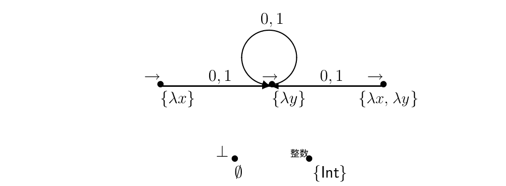

与之前一样，请注意我们没有指向起始状态；它是规范的一个参数。还请注意我们缩写了一些状态的名称。观察 \(t_{A(E,\varphi,S)} = \mu\alpha.\alpha \rightarrow \alpha\)，如果 \(S\) 是 \(\{\lambda x.x_1x_2, \lambda y.y\}\) 的非空子集。然后我们可以得到映射 \(\psi\)。这是一个常数函数：

\[\psi(V) = \mu\alpha.\alpha \rightarrow \alpha\]

可以通过检查来验证 \(\psi\) 是 \(T(E)\) 和 \(T(E)\) 的解。

另外，注意虽然对于所有的 \(V\)，\(\psi(V)\) 是一个无限树，但是存在其他的 \(T(E)\) 和 \(T(E)\) 的解，其中所有涉及的类型都是有限的。例如，考虑解决方案 \(\psi'\) 其中

\[\begin{align*}
\psi'([[\lambda x.x_1x_2]]) &= (\top \rightarrow \top) \rightarrow \top \\
\psi'([[\lambda y.y]]) &= \psi'(x) = \psi'([[x_1]]) = \top \rightarrow \top \\
\psi'([[x_2]]) &= \psi'(y) = \psi'([[y]]) = \psi'([[x_1x_2]]) \\
&= \psi'([[E]]) = \top
\end{align*}\]

为了得到解 \(\overline{\varphi}\) of \(\overline{C}(E)\)，观察到

\[(\psi(V))(\epsilon) = \rightarrow .\]

将其代入 $\varphi$ 的定义中得到 $\varphi$ 是一个常数函数：

```
$\bar{\varphi}(V) = \text{Abs}(E)$
```

注意到 $\varphi = \varphi$。通过检查可以验证 $\varphi$ 是 $C(E)$ 的一个解。

最后，为了构造 $\varphi'$, 其中

+   $\{ k \mid \text{约束} \{k\} \subseteq V \text{ 在 } C(E) \text{ 中} \}$

注意到 $C(E)$ 中具有形式为 $\{k\} \subseteq V$ where $V \in X_E \cup Y_E$ 的约束条件：

-   $\{\lambda x.x_1x_2\} \subseteq [[\lambda x.x_1x_2]]$
-   $\{\lambda y.y\} \subseteq [[\lambda y.y]]$
-   $\{\lambda y.y\} \subseteq x$
-   $\{\lambda y.y\} \subseteq [[x_1]]$
-   $\{\lambda y.y\} \subseteq [[x_2]]$
-   $\{\lambda y.y\} \subseteq y$
-   $\{\lambda y.y\} \subseteq [[y]]$
-   $\{\lambda y.y\} \subseteq [[x_1x_2]]$
-   $\{\lambda y.y\} \subseteq [[E]]$

所以，$\varphi = \varphi'$, 因此 $\varphi'$ 是 $C(E)$ 的最小解。

## 6 扩展

类型系统和流分析的各种扩展具有等价的可类型化性和安全性问题。现在我们展示一个这样的扩展的例子：条件构造 if0。为了简单起见，我们考虑 if0 而不是更常见的 if，以避免引入布尔值。因此，类型集合 $T_\Sigma$ 和安全分析的抽象域 $Cl(E)$ 保持不变。

我们示例语言的扩展语法如下：

```
$E ::= \dots \mid \text{if0} \; E_1 E_2 E_3$
```

我们的意图是，如果 $E_1$ 评估为 0，则评估 $E_2$；如果 $E_1$ 评估为非零整数，则评估 $E_3$；如果 $E_1$ 评估为非整数，则出现错误。我们需要一个新的类型规则：

```
$\frac{A \vdash E : \text{Int} \quad A \vdash E_2 : t \quad A \vdash E_3 : t}{A \vdash \text{if0} \; E_1 E_2 E_3 : t} \quad (7)$
```

与之前一样，我们可以通过解决一组类型约束来重新表述类型推断问题。我们需要三个新的类型约束：

-   • 对于形式为 if0 E1 E2 E3的子项的每个出现，我们生成三个不等式：

    [[E1]] ≤ Int
    [[E2]] ≤ [[if0 E1 E2 E3]]
    [[E3]] ≤ [[if0 E1 E2 E3]].

很容易检查定理5仍然成立，也就是说，约束系统的解对应于可能的类型注释。

我们需要三个新的安全约束：

-   • 对于形式为 if0 E1 E2 E3的子项的每个出现，我们生成三个约束

    [[E1]] ⊆ {Int}
    [[E2]] ⊆ [[if0 E1 E2 E3]]
    [[E3]] ⊆ [[if0 E1 E2 E3]].

很容易检查定理9和定理12仍然成立，即 C(E)是 T(E)是同构的，并且类型系统和安全分析接受相同的程序。此外，安全分析和类型推断算法保持不变。

添加多态let、乘积、和以及具有强制转换的原子子类型应该也很简单。动态或软类型系统也是制定等价类型和流分析系统的候选。

另一个挑战是为[14]中介绍的面向对象语言的安全分析制定等价的类型系统。另一个挑战是找到两个等价的绑定时间分析，一个基于类型系统，一个基于流分析。在这个方向上的结果在[13]中被提出。

## 7 结论

我们描述了一个类型系统和一个流分析，并证明了相应的可类型化和安全性问题是等价的。我们还获得了一个立方时间算法来判断可类型化。自从Amadio和Cardelli于1991年首次提出类型系统以来，这个问题一直存在[1]。

对于给定的程序，类型约束系统和流约束系统是完全不同的。然而，在本文研究的特定语言中，我们证明了这些系统的演绎闭包是同构的。这个性质似乎既不是必要条件也不是充分条件，但它本身暗示了这些系统之间的密切关系。

Tang和Jouvelot [19]证明了类型分析和流分析可以在一个框架中结合起来。他们的方法中的类型系统部分是简单类型的。

一个挑战是扩展他们的框架，使得类型系统部分与本文中的类型系统相同。Wand和Steckler [22]提出了一个证明基于流的编译器优化正确性的框架。一个挑战是研究当流分析被Tang和Jouvelot [19]的框架或可能的扩展框架取代时，他们的框架是否可以简化。

一个示例是在调试和解释类型推断结果给最终用户时，类型问题和流问题之间的关系可能会有帮助的区域。从流分析的角度来看，可能会提供一个具体的例子，说明类型推断器为什么产生了特定的类型赋值或类型错误[20]。

本文考虑的两个系统使用不等式，即类型系统中的子类型和流分析中的集合包含关系。人们可以考虑将不等式改为等式，并寻找类似于本文中的等价结果。在类型系统方面，这将导致一个基于一致性的简单类型λ-演算，其类型推断算法基于一致性。在流分析方面，它将导致类似于Bondorf和Jørgensen [4]的分析。当前的工作致力于获得两个这样的系统之间的等价性[6]。

总之，我们发现类型系统和流分析在某些情况下可以等效地看待同一个问题。

## 致谢

我们感谢Mitchell Wand的鼓励和有益的讨论。我们还要感谢Torben Amtoft和匿名审稿人对论文草稿的有益评论。本文的结果是在第一作者在波士顿东北大学期间获得的。

## 参考文献

- [1] Roberto M. Amadio和Luca Cardelli。子类型递归类型。ACM Transactions on Programming Languages and Systems，15(4)：575-631，1993年。也在Proc. POPL'91中。
- [2] Torben Amtoft。最小thunk化。在Proc. WSA'93，页218-229，1993年。
- [3] Anders Bondorf。高阶递归方程的自动自投影。计算机编程科学，17(1-3)：3-34，1991年12月。
- [4] Anders Bondorf和Jesper Jørgensen。实际离线部分评估的高效分析。函数式编程杂志，3(3)：315-346，1993年。
- [5] Charles Consel。Schism之旅：面向高阶应用程序语言的部分评估系统。在Proc. PEPM'93，第二届ACM SIGPLAN部分评估和基于语义的程序操作研讨会，页码145-154，1993年。
- [6] Nevin Heintze。个人通信。1994年。
- [7] Nevin Heintze。基于集合的ML程序分析。在Proc. ACM LISP和函数式编程会议，页码306-317，1994年。
- [8] Dexter Kozen，Jens Palsberg和Michael I. Schwartzbach。部分类型的高效推断。计算机与系统科学杂志，49(2)：306-324，1994年。也在Proc. FOCS'92，第33届IEEE计算机科学基础研讨会，页码363-371，宾夕法尼亚州匹兹堡，1992年。
- [9] Dexter Kozen, Jens Palsberg, and Michael I. Schwartzbach. 高效的递归子类型化。计算机科学中的数学结构，1995年。即将出版。也在POPL'93会议论文集中，第20届SIGPLAN-SIGACT原则编程语言研讨会，南卡罗来纳州查尔斯顿，1993年1月，第419-428页。
- [10] 郭宗民和Prateek Mishra。基于类型推断的严格性分析：一种新的视角。在函数式编程语言和计算机体系结构会议论文集中，第260-272页，1989年。
- [11] Jens Palsberg。约束形式的闭包分析。ACM Transactions on Programming Languages and Systems, 1995年。即将出版。也在CAAP'94会议论文集中，树的代数和编程研讨会，Springer-Verlag (LNCS 787)，第276-290页，爱丁堡，苏格兰，1994年4月。
- [12] Jens Palsberg和Michael I. Schwartzbach。安全分析与部分类型的类型推断。信息处理通讯，43:175-180, 1992年。
- [13] Jens Palsberg和Michael I. Schwartzbach。绑定时间分析：抽象解释与类型推断。在Proc. ICCL'94，第五届IEEE国际计算机语言会议，图卢兹，法国，1994年，页码289-298。
- [14] Jens Palsberg和Michael I. Schwartzbach。面向对象的类型系统。约翰·威利 & Sons, 1994年。
- [15] Jens Palsberg和Michael I. Schwartzbach。安全分析与类型推断。信息与计算，118(1):128-141, 1995年。
- [16] Peter Sestoft。功能程序的分析和高效实现。博士论文，DIKU，哥本哈根大学，1991年10月。
- [17] Olin Shivers.高阶语言的控制流分析. 博士论文，CMU，1991年5月 CMU-CS-91-145.
- [18] Olin Shivers. Scheme中的数据流分析和类型恢复。在Peter Lee编辑,高级语言实现的主题, 页码47-87. MIT出版社, 1991年.
- [19] Yan Mei Tang和Pierre Jouvelot. 控制流分析的分离抽象解释。在Proc. TACS 94,计算软件的理论方面,页码224-243. Springer-Verlag (LNCS 789), 1994年.
- [20] Mitchell Wand. 寻找类型错误的源头。在编程语言原理的第十三届研讨会, 页码38–43, 1986年.
- [21] Mitchell Wand. 记录拼接和多重继承的类型推断。信息与计算, 93(1):1–15, 1991年.
- [22] Mitchell Wand和Paul Steckler。选择性和轻量级闭包转换。在 Proc. POPL'94, 第21届编程语言原理研讨会, 页码434–445，1994年。

## 线性算术和未解释函数的组合抽象的断言检查

Sumit Gulwani 和 Ashish Tiwari

微软研究院, Redmond, WA 98052, sumitg@microsoft.com
SRI国际, Menlo Park, CA 94025, tiwari@csl.sri.com

摘要。 本文介绍了使用线性算术和未解释函数的组合进行抽象的程序中检查相等断言的结果，并将条件处理为非确定性。

我们首先证明了即使对于无循环的程序，这种组合抽象的断言检查问题也是coNP难的。这个结果非常令人惊讶，因为线性算术和未解释函数的单独抽象的断言检查可以在多项式时间内高效地执行。

接下来，我们给出了一个用于检查这个组合抽象的断言检查算法，从而证明了尽管底层格有无限高度，但这个问题是可决定的。我们的算法基于统一理论和程序分析之间的重要联系。具体来说，我们展示了在程序的反向分析过程中，通过用它们的统一器替换等式，可以加强最弱前提条件而不损失任何精度。

## 1 介绍

我们使用术语相等断言或简单地称为断言来指代两个程序表达式之间的相等关系。通过断言检查，我们指的是检查给定断言是否是给定程序点的不变量。

在程序中推理关于断言的问题是一个不可判定的问题。因此，断言检查通常在程序的某个（可靠的）抽象上进行。这可能会导致误报，即在原始程序中为真的一些断言在抽象版本中可能不为真。在选择抽象时存在效率和精度的权衡。更精确的抽象会导致更少的误报，但也更难推理。

线性算术和未解释函数³是创建程序抽象的两种最常用的表达式语言。有几篇论文

³一个未解释函数 F 的元数为 n 只满足一个公理：如果 i = j，那么 F( e1, ..., e n) = F( e'1, ..., e'n) 1 ≤ i ≤ n，那么 F(e1, ..., en) = F(e'1, ..., e'n)。 未解释函数通常用于抽象编程语言操作符，否则很难进行推理。 它们还用于抽象过程调用。

描述了如何对每个抽象进行断言检查的方法。（第6节关于相关工作描述了其中一些工作。）线性算术和未解释函数的组合表达语言产生比这两种表达语言中任何一种更精确的抽象。

例如，考虑图1中显示的程序。请注意，程序末尾的所有断言都是真的。如果对该程序进行线性算术的抽象分析（例如，使用[14]或[6]中描述的抽象解释器），那么只有第一个断言可以验证。这是因为发现 $b_1$ 和 $b_2$ 之间的关系，以及 $c_1$ 和 $c_2$ 之间的关系，涉及对未解释函数的推理。同样，如果对该程序进行未解释函数的抽象分析（例如，使用[10]中描述的抽象解释器），那么只有第二个断言可以验证。然而，对线性算术和未解释函数的组合抽象进行分析可以验证所有断言。

尽管已经有很多关于线性算术和未解释函数抽象推理的工作，但尚未考虑过线性算术和未解释函数组合抽象的断言检查问题。在本文中，我们考虑了使用线性算术和未解释函数对表达式进行抽象的程序中检查相等断言的问题。我们还将所有程序条件抽象为非确定性，因为否则该问题很容易证明对于线性算术[17]和未解释函数[16]的单个抽象来说是不可判定的。（一种对线性算术和未解释函数组合抽象进行不精确推理的分析

并且考虑了条件保护，但保留了未解释的函数，这在实践中也很有用，例如用于数组边界检查。相关工作部分提到了我们最近在组合抽象解释器方面的工作，可以用于构建这样的分析。抽象化的程序模型在第2节中得到了正式描述。

在第3节中，我们证明了在线性算术和未解释的函数的组合抽象中的断言检查问题是coNP难的。即使对于无循环的程序也是如此，在这种情况下，它是coNP完全的。这个结果非常令人惊讶，因为在线性算术和未解释的函数的单独抽象中进行断言检查需要多项式时间算法（即使对于带有循环的程序也是如此）。Karr的算法[14, 17]可以用于在使用线性算术运算符进行抽象的程序表达式上执行断言检查。Gulwani和Necula的算法[9, 10]可以在使用未解释的函数进行抽象的程序表达式上执行断言检查。这两个算法都在多项式时间内运行。

然而，我们的coNP难度结果表明，没有办法将这些算法组合起来在多项式时间内进行断言检查（除非P=coNP）。类似的组合问题在决策过程的背景下已经得到了广泛研究。Nelson和Oppen给出了一个著名的组合结果，可以将不相交、凸和无量词的理论的决策过程组合起来，只有多项式时间的开销。线性算术和未解释函数的理论是不相交、凸和无量词的，并且具有多项式时间的决策过程。因此，Nelson-Oppen组合方法可以用于构建这些理论组合的多项式时间决策过程。在本文中，我们表明，不幸的是，在线性算术和未解释函数的组合抽象中，没有多项式时间的组合方案进行断言检查（除非P=coNP）。

在第4节中，我们给出了一个用于组合抽象（线性算术和未解释函数）的断言检查算法，从而证明了这个问题是可判定的。这个结果再次令人惊讶，因为底层的抽象格具有无限高度，这意味着基于标准抽象解释[6]的算法不能在有限步骤内终止。

然而，我们的算法利用了一个事实，即我们的目标不是发现所有的相等不变量，而是检查给定的断言是否是一个不变量。我们算法的一个核心组件是一个通用结果，它允许用最弱前置条件计算生成的相等式的统一替换（引理2）。对于允许有单例或有限完备统一集的理论，分别称为单元理论和有限理论，这种替换可以有效地完成。断言检查和统一之间的这种联系的重要性在第5节进一步讨论。我们通过在第4.1节中介绍一种新颖的线性算术和未解释函数组合理论的统一算法使本文自成一体，该算法在我们的断言检查算法中使用。

## 2 程序模型

我们假设程序中的每个过程都使用图2中显示的流程图节点进行抽象。在赋值节点中， $x$ 表示程序变量， $e$ 表示底层抽象中的某个表达式。我们将这些表达式的语言称为程序的表达式语言。线性算术、未解释函数及其组合的抽象的表达语言如下：

- 线性算术：

```
$e ::= y\ |\ c\ |\ e_1 \pm e_2\ |\ c \times e$
```

这里， $y$ 表示某个变量， $c$ 表示某个算术常数。

- 未解释函数：

```
$e ::= y\ |\ F^n(e_1, \dots, e_n)$
```

这里 $F^n$ denotes一些未解释的函数的 arity $n$。我们允许 $n$ 为零（表示 nullary 未解释函数）。

- 线性算术和未解释函数的组合：

```
$e ::= y\ |\ c\ |\ e_1 \pm e_2\ |\ c \times e\ |\ F^n(e_1, \dots, e_n)$
```

一个非确定性赋值 $x:=$? 表示变量 $x$ 可以被赋予任何值。这种非确定性赋值被用作语句的安全抽象（在原始源程序中），我们的抽象不能精确处理。

非确定性条件，由 $*$ 表示，表示控制可以流向任一分支，不考虑条件之前的程序状态。它们被用作受保护条件的安全抽象，我们的抽象不能精确处理。我们在条件中抽象掉了保护条件，因为否则在程序表达式语言涉及线性算术和未解释函数组合的情况下，断言检查问题可以很容易地从以下两个结果中显示为不可判定。 Müller-Olm和Seidl已经证明了断言问题的存在

检查使用有条件的程序和线性算术表达式是不可判定的[17]。 Müller-Olm， Rüthing和Seidl也证明了当表达式语言涉及未解释函数时的类似不可判定性结果[16]。

连接节点有两个输入边。 请注意，具有多个输入边的连接节点可以简化为每个具有两个输入边的多个连接节点。

## 3 coNP难的断言检查

在本节中，我们展示了当程序的表达式语言涉及线性算术和未解释函数的组合时（并且程序的流程图表示如图2所示），断言检查问题是coNP难的。

证明这个结果的关键观察是形如 $g = a \vee g = b$ 的析取断言可以编码为非析取断言$F(a) + F(b) = F(g) + F(a+b-g)$。 过程 Check(g,m)推广了这个编码的析取断言$g=0 \vee .. \vee g = m-1$（具有 $m-1$个析取项），如引理1所述。一旦这样的析取可以被编码，我们可以将不可满足性问题简化为断言检查问题，如下所示。

考虑图3中显示的程序。 我们将证明程序中的断言语句在输入的布尔公式 $\psi$ 不可满足时为真。 注意，对于固定的 $\psi$，可以将过程IsUnSatisfiable和 Check 简化为仅包含图2中所示节点的一个过程的流程图表示。（这些过程仅出于说明目的使用过程调用和带有条件判断的循环。） 这可以通过展开循环并将过程 Check内联到过程IsUnSatisfiable中来实现。 得到的过程的大小与输入布尔公式$\psi$的大小多项式相关。

过程IsUnSatisfiable包含 $k$个非确定性条件语句，它们共同为输入布尔公式 $\psi$中的 $k$个布尔变量选择一个真值赋值，并相应地将其子句设置为真（1）或假（0）。 当且仅当在对其变量的所有真值赋值中，至少有一个子句保持不可满足时，布尔公式 $\psi$是不可满足的，或者等价地，对于过程IsUnSatisfiable的所有执行， $g \in \{0, .. , m-1\}$。 过程Check（g，m）执行了以下引理中所述的所需检查。

引理1.在 Check($g$, $m$)中的assert语句为真当且仅当 $g\in \{0, .. , m-1\}$.

证明. 对于所有的$0 \le i \le m-1$， 以下性质成立.

E1. 如果$0 \le j \le i$, 那么 $h_{i,j} = h_{i,0}$.

E2. 如果 $g\in \{0, .. , m-1\}$, 那么 $h_i = h_{i,g}$.

E3. 如果 $g\in \{0, .. , m-1\}$, 那么 $h_i$不能表示为

$h_{i,0}, .. , h_{i,m-1}$的线性组合.

```
IsUnSatisfiable($\psi$)
% 假设公式 $\psi$ 有 $k$ 个变量 $x_1, \ldots, x_k$,
%              和 $m$ 个编号为 1 到 $m$ 的子句.
% 假设变量 $x_i$ 在子句# $A_i[0],\ldots,A_i[c_i]$中以正形式出现
%              并且在子句# $B_i[0],..$中以负形式出现, $B_i[d_i]$.
对于 $i = 1$ 到 $m$ 执行以下操作
    $e_i := 0$; % $e_i$ 表示子句 $i$ 是否可满足
对于 $i = 1$ 到 $k$ 执行以下操作
    如果 ($\ast$) 则 % 将 $x_i$ 设置为真
        对于 $j = 0$ 到 $c_i$ 执行以下操作
            $e_{A_i[j]} := 1$;
    否则 % 将 $x_i$ 设置为假
        对于 $j = 0$ 到 $d_i$ 执行以下操作
            $e_{B_i[j]} := 1$;
$g := e_1 + e_2 + \ldots + e_m$; % 计算满足的子句数量.
检查 ($g, m$);

检查 ($g, m$)
    % 此过程检查 $g$是否属于 $\{0, \ldots, m - 1\}$。
    $h_0 := F(g)$;
    对于 $j = 0$ 到 $m - 1$ 循环
        $h_{0,j} := F(j)$;
    对于 $i = 1$ 到 $m - 1$ 循环
        $s_{i-1} := h_{i-1,0} + h_{i-1,i}$;
        $h_i := F(h_{i-1}) + F(s_{i-1} - h_{i-1})$;
        对于 $j = 0$ 到 $m - 1$ 循环
            $h_{i,j} := F(h_{i-1,j}) + F(s_{i-1} - h_{i-1,j})$;
    Assert($h_{m-1} = h_{m-1,0}$);
```

图3. 一个程序，展示了在表达式语言使用线性算术和未解释函数的组合时，断言检查的coNP难度。

上述属性可以通对 $i$ 的归纳轻松证明。如果 $g \in \{0, \ldots, m - 1\}$,
那么断言语句是真的，因为：
$$
\begin{aligned}
h_{m-1} &= h_{m-1,g} \text{(根据属性E2得出)}\\
        &= h_{m-1,0} \text{(根据属性E1得出)}
\end{aligned}
$$
如果 $g \in \{0, \ldots, m - 1\}$，那么根据属性E3，断言语句是错误的。 $\blacksquare$

引理1表明，在过程IsUnSatisfiable($\psi$)中的断言语句为真当且仅当输入的布尔公式 $\psi$ 是不可满足的。因此，以下定理成立。

定理1。对于具有非确定性条件和表达式语言为线性算术和未解释函数组合的程序，断言检查是coNP难的。

由于IsUnSatisfiable可以表示为无循环的程序，定理1甚至对于无循环的程序也成立。

## 4 断言检查算法

在本节中，我们给出了一个针对我们抽象化程序模型的断言检查算法，当程序的表达式语言涉及线性算术和未解释函数的组合时。我们证明了这个算法的终止性，从而确立了对于组合抽象的断言检查的可决定性。为这个算法建立一个上界复杂度仍然是一个未解决的问题。

为了描述和证明我们算法的正确性，我们首先在下一个子部分中建立了一些关于线性算术和未解释函数组合理论中的一致性的结果。

## 4.1 组合理论中的一致性

一个替换 σ是一个将变量映射到表达式的映射，使得对于每个变量 x，表达式 σ(x)只包含来自集合{y | σ(y)=y}的变量。一个替换映射 σ可以（同态地）提升到表达式，使得对于每个表达式 e，我们定义 σ(e)为从 e 中替换每个变量 x 为其映射 σ(x)得到的表达式。通常，我们用后缀表示法将替换 σ应用于表达式 e，表示为 eσ。有时，我们将替换映射 σ视为以下公式，它是变量和它们的映射之间的非平凡等式的合取：

$$ \bigwedge_{x: x \neq x\sigma} x = x\sigma $$

一个替换 σ是一个等式 e₁=e₂（在理论 T 中）的统一器，如果 e₁σ=e₂σ（在理论 T 中）。一个替换 σ是一个等式集 E 的统一器，如果 σ是每个等式的统一器在 E 中。一个替换 σ₁比一个替换 σ₂更一般，如果存在一个替换 σ，使得 xσ₂=(xσ₁)σ对于所有变量 x 成立。⁴一个等式集 C 对于 E 是完整的，当对于 E 的任何统一器 σ，存在一个比 σ 更一般的统一器 σ'∈C。理论可以根据该理论中的所有等式是否具有一个基数最多为 1（单元理论）的完整统一器集合，或者是否具有有限（有限理论），或者是否存在某个等式没有任何有限完整统一器集合（无限理论）而进行分类。

在本节的剩余部分中，我们将展示线性算术和未解释函数的组合理论是有限的。为此，我们描述了一种计算组合理论中等式的完整统一集的算法。我们使用一组推理规则（在表 1 中列出）来描述这个算法，这是[4]的风格。

表 1 描述了一些操作状态的推理规则。状态（E, σ）是一个由一组等式（涉及线性算术和未解释函数的组合）和一个替换 σ 组成的对。Unif0 规则从 E 中移除平凡等式。Unif1 规则可以从 E中选择一些等式，可以重写成形式 x = e，使得变量 x不出现在表达式 e中。 Unif2规则在选择一些可以重写成形式 F(e_1, \dots, e_n) = F(e_1', \dots, e_n') + e的等式之后应用，其中 F是未解释函数， e_i、 e_i'和 e是表达式。 \{ x_1 \rightarrow e_1, \dots, x_k \rightarrow e_k \}表示将变量 x_i映射到 E_i (对于 1 \le i \le k) ，并将所有其他变量映射到它们自身。 我们使用符号 (E, \sigma) \vdash (E', \sigma') 表示状态 (E', \sigma') 是通过应用某个推理规则从状态 (E, \sigma) 获得的。 类似地， (E, \sigma) \vdash^* (E', \sigma') 表示状态 (E', \sigma') 可以通过应用一系列推理规则从状态 (E, \sigma) 获得。

为了生成一个完整的等价类集合 C，用于一个等式 e_1 = e_2，我们从状态 (\{ e_1 = e_2 \}, I) 开始，其中 I是恒等映射，并重复应用推理规则，直到不能再应用任何推理规则为止。 对于所有以 (\emptyset, \sigma) 形式结束的推导，我们将 \sigma放入 C中。 下面的定理2表明，因此得到的集合 C确实是等式 e_1 = e_2的一组等价类。 定理3表明，这个等价类集合 C是完备的。 这些定理的证明是通过对推导长度进行归纳给出的，并在本文的完整版本中给出[13]。

定理2 (正确性)。如果 (E, I) \vdash^* (\emptyset, \sigma)，那么 \sigma是 E的一个统一器。

定理3 (完备性)。假设 \sigma是 E的一个统一器。 那么存在一个推导 (E, I) \vdash^* (\emptyset, \sigma_0)，其中 \sigma_0是 E的一个更一般的统一器，优于 \sigma。

下面的定理暗示了集合 C是有限的。

定理4 (有限完备统一器集合)。每个推导 (E, I) \vdash^* (E', \sigma')需要有限步骤。 因此， E有一个有限完备的统一器集合。

定理4的证明在本文的完整版本中给出[13]。 关键的证明思路是展示每个推导 (E, I) \vdash^* (E', \sigma')需要有限步骤，然后使用Konig引理来限制推导的总数。

我们接下来说明推理系统的应用。

例子1。考虑以下关于等式$Fx + Fy = Fa + Fb$的推导。

```
({Fx + Fy = Fa + Fb}, I)
({Fx = Fb, y = a}, I)    Unif2
({x = b, y = a}, I)      Unif2
(∅, {x → b, y → a})      Unif1
```

因此 {x → b, y → a} 是 $Fx + Fy = Fa + Fb$ 的一个统一器。注意，第一个Unif2应用的另一种选择得到了另一个关于给定等式的统一器 {x → a, y → b}。通过应用推理规则无法生成其他统一器。因此，这两个统一器构成了给定等式的一个完整的统一器集合。

例子2。作为另一个例子，考虑生成一个完整的统一器集合用于等式 $x + Fx + Fy = a + Fa + F(a + 1)$。由于每个变量都出现在一个未解释函数符号下面，只有Unif2规则适用。有四个选择，要么 $x = a$，要么 $x = a + 1$，要么 $y = a$，要么 $y = a + 1$。我们在下面展示了第二个选择的推导。

```
({x + Fx + Fy = a + Fa + F(a + 1)}, I)
({x + Fy = a + Fa, x = a + 1}, I)    Unif2
({a + Fa - Fy = a + 1}, {x → a + Fa - Fy})    Unif1
({a = a + 1, a = y}, {x → a + Fa - Fy})    Unif2
({0 = 1}, {x → a + Fa - Fy, y → a})    Unif1
```

上述推导现在陷入了无法应用推理规则的困境。注意只有第一选择 $x = a$ 和第四选择 $y = a + 1$ 成功地生成了一个统一器，在这两种情况下，统一器都是 {x → a, y → a + 1}。这个统一器为给定的等式产生了一个单例完整的统一器集合。

## 表格 1. 组合理论中的一致性推理规则

| 规则名 | 描述 |
| :--- | :--- |
| Unif0 | $\frac{(E \cup \{ e = e \}, \sigma)}{(E, \sigma)}$ |
| Unif1 | 如果 $x$ 不出现在 $e$ 中，则 $\frac{(E \cup \{ x = e \}, \sigma)}{(E \sigma', \sigma \sigma')}$。这里 $\sigma' = \{ x \rightarrow e \}$，$E\sigma'$ 表示 $\{ e_1 \sigma' = e_2 \sigma' \mid (e_1 = e_2) \in E \}$。 |
| Unif2 | $\frac{(E \cup \{ F(e_1, \dots, e_n) = F(e_1', \dots, e_n') + e \}, \sigma)}{(E \cup \{ e_1 = e_1', \dots, e_n = e_n', e = 0 \}, \sigma)}$，其中 $F$ 是未解释函数。 |

## 4.2 算法

我们对组合抽象的断言检查算法基于最弱前置条件计算。它通过替换映射的析取式来表示每个程序点的不变量。我们证明了在我们的抽象程序模型中，任何程序不变量都可以用这样的公式表示（引理2）。

假设目标是检查断言 $e_1 = e_2$ 在程序点 π 上是否是不变的。该算法对程序进行反向分析，在每个程序点计算一个公式 ψ（它是替换映射的析取），使得在程序点 π 上断言 $e_1 = e_2$ 为真。这个公式是通过迭代的方式从后继程序点的公式计算得出的。该算法使用下面描述的传递函数，在图2中显示的流程图节点之间计算这些公式。该算法声明 $e_1 = e_2$ 在π处为不变量，如果程序开始时计算的公式在固定点计算后是线性算术和未解释函数的组合理论中的一个重言式。

在以下传递函数中，我们使用记号Unif(E)，其中E是一些等式E的合取，来表示一个在E的某个完全统一器集合的所有统一器的析取式。（如果E是不可满足的，则E没有任何统一器，Unif(E)简单地为false。）公式Unif(E)可以通过使用第4.1节中描述的算法来计算。

- **初始化**：除了π之外的所有程序点的公式都被初始化为平凡的公式true。程序点π处的公式被初始化为Unif(e₁ = e₂)。

- **赋值节点**：见图2（a）。赋值节点x := e之前的公式ψ′是通过在赋值节点之后的公式ψ中用x替换e并在每个结果析取式上调用Unif得到的。

  > $\psi' = \bigvee_i \text{Unif}(\psi^i[e/x])$，其中 $\psi = \bigvee_i \psi^i$

- **非确定性赋值节点**：见图2（b）。非确定性赋值节点x:=?之前的公式ψ′是通过在非确定性赋值节点之后的公式ψ中用一些新的常量（即一个新的零元未解释函数符号）α替换程序变量x并在每个结果析取式上调用Unif得到的。

  > $\psi' = \bigvee_i \text{Unif}(\psi^i[\alpha/x])$，其中 $\psi = \bigvee_i \psi^i$

- **非确定性条件节点**：见图2（c）。非确定性条件节点之前的公式ψ是通过在条件的两个分支上取公式ψ₁和ψ₂的合取，并对每个结果的析取进行Unif操作得到的。

  > $\psi = \bigvee_{i,j} \text{Unif}(\psi_1^i \land \psi_2^j)$，其中 $\psi_1 = \bigvee_i \psi_1^i$ 和 $\psi_2 = \bigvee_j \psi_2^j$

- **连接节点**：见图2（d）。连接节点之前的两个前驱节点的公式ψ₁和ψ₂与连接节点之后的公式ψ相同。

  > $\psi_1 = \psi$ 和 $\psi_2 = \psi$

- **固定点计算**：在过程中存在循环的情况下，算法会在每个循环中循环，直到在两次连续迭代的循环中计算的公式等价，或者如果任何公式变为false。

**正确性**：我们现在证明上述算法是正确的，即，在程序点π处，断言e1 = e2成立当且仅当算法声称如此。为此，我们首先陈述一个有用的引理（引理2），它陈述了程序分析和统一理论之间的有趣联系。这个引理是普遍适用的：它与逻辑理论无关，也适用于带有保护条件的程序。这个引理的证明在本文的完整版本中给出[13]。

引理2。在程序点π处，等式e1 = e2成立当且仅当Unif(e1 = e2)在π处成立。实际上，一个包含等式e1 = e2的公式φ在程序点π处成立当且仅当φ[Unif(e1 = e2)/(e1 = e2)]在π处成立。

引理2表明，在流程图之前，我们的算法计算出的公式是这些节点之后的（真实的）最弱前置条件。另外，注意算法从一个在π处是不变式的公式开始，当且仅当给定的断言在π处是不变式（根据引理2得出）。现在，算法的正确性可以从以下事实推导出来：算法从π处开始具有正确的断言，并在反向分析中逐步计算出每个程序点的正确最弱前置条件。

**终止性**：我们现在证明上述算法在有限步骤内终止。只需证明通过循环的最弱前置条件计算在有限次迭代中终止。这可以从以下引理得出。

引理3。设C是一个由子替换的析取组成的链ψ1, ψ2, ..., ψ_i = \bigvee_{\ell=1}^{m_i} ψ_i^\ell 对于某个整数 m_i 和替换 ψ_i^\ell。假设 (a) ψ_{i+1} = \bigvee_{\ell=1}^{m_i} \bigvee_{j=1}^{n_i} Unif(ψ_i^\ell \land α_i^j), 对于某些替换 α_i^j。 (b) ψ_i \Rightarrow ψ_{i+1}。那么，C是有限的。

引理3的证明是通过在ψ_i^ℓ上建立一个良好的排序，并且在本文的完整版本[13]中给出。引理3暗示了我们的断言检查算法的终止。（注意，在循环内的任何给定程序点上，我们的算法生成的连续迭代中的最弱前置条件ψ1, ψ2, ...满足条件(a)，因此ψ_{i+1} \Rightarrow ψ_i对于所有i。引理3暗示了存在 j such that ψ_j \Rightarrow ψ_{j+1} 并且因此 ψ_j \equiv ψ_{j+1}，在该点上跨该循环的定点计算终止。）因此，以下定理成立。

定理5。对具有非确定性条件和表达式语言为线性算术和未解释函数组合的程序进行断言检查是可判定的。

对于组合抽象的断言检查的可判定性是相当令人惊讶的，因为在组合理论中，表达式之间的相等性集合的抽象格具有无限高度。这表明一个基于解释的前向分析算法在这个格上操作，可能在循环中不会终止（除非采用扩展技术，这可能导致不精确的分析）。例如，考虑以下程序。

```
InfiniteHeightExample()
x := 0;
当 (*) 执行 {
    x := x+1;
    断言( x=0 ∨ ··· ∨ x=m);
}
```

程序末尾的析取断言可以使用相等断言进行编码。过程Check(x,m)（第6页）正好做到这一点。显然，程序末尾的断言是不正确的。为了使这个断言无效，抽象解释器将不得不绕过循环 m次。因此，它不会在循环中终止（因为如果它在t步骤中终止，那么它将无法使断言 x=0∨···∨x=t无效）。我们的算法终止是因为它执行了反向分析（这对于断言检查来说足够好），而不是执行了前向分析（这对于发现所有有效等式是必需的）。

## 5 断言检查和统一

本文的结果指出了程序中对给定抽象的断言检查与定义该抽象的统一问题之间的有趣联系。引理2意味着我们可以用表示该断言的完整统一集的公式来替换断言。

这个结果非常普遍，并适用于具有任意保护条件和任何表达式语言的程序。这允许通过应用Unif()来加强使用标准传递函数计算的最弱前提，而不会失去任何精度。这个观察是断言检查和统一性之间密切联系的基础。

线性算术和未解释函数的理论是单元的。然而，在线性算术和未解释函数的组合理论中，等式可能没有一个基数为1的完整的统一器集合。这种不一致似乎是断言检查线性算术和未解释函数组合抽象的co NP难度的原因（与线性算术和未解释函数的抽象具有多项式时间断言检查算法的事实相反）。在最小完整集中存在多个统一器允许对组合抽象中的析取进行编码。例如，断言F(x)+F(3−x)=F(1)+F(2)具有两个统一器 x=1和 x=2在其最小的完整统一器集中。当且仅当在导致此断言的所有路径上x=1或 x=2时，此断言将在任何程序点上为真。

对于线性算术和未解释函数的组合抽象的断言检查的可决定性可以归因于组合理论是有限的。观察到，如第4.2节所述，断言的最弱前置条件计算在循环中终止，因为断言可以为真的方式只有有限多种。

## 6 相关工作

我们不知道与线性算术和未解释函数的组合抽象的断言检查相关的任何工作。然而，关于线性算术和未解释函数的单个抽象的断言检查和不变量生成已经有很多工作。

**线性算术的抽象程序分析**。Karr描述了一种使用线性等式抽象来推理程序的算法。该算法以迭代的方式对程序进行前向分析，并在每个程序点[14, 17]计算一组线性等式。Gulwani和Necula提供了一种随机算法，它执行同样精确的推理，但更高效。Cousot提供了一种更精确的算法，它使用线性不等式的抽象来推理程序，在每个程序点计算的事实是程序变量之间的线性不等式关系。Muller-Olm和Seidl描述了一种用于推理有限位机器算术的模块化线性算术分析。还有一些工作将这些分析扩展到了过程间设置中。

**在未解释函数的抽象上进行程序分析**。Kildall的算法[15]在Herbrand等价集格上执行抽象解释（即涉及未解释函数的表达式之间的等价关系），但运行时间呈指数增长。Alpern, Wegman和Zadeck（AWZ）提供了一个多项式时间算法，用于处理所有操作符作为未解释函数的程序推理[1]。AWZ算法比Kildall的算法不够精确，但在编译器中广泛使用于全局值编号。

Rüthing, Knoop和Steffen的（RKS）多项式时间算法也使用未解释函数的抽象来进行程序推理。RKS算法比AWZ算法更精确，但仍然不如Kildall的算法精确。最近，Gulwani和Necula提供了一个多项式时间算法，对于使用未解释函数的程序的断言检查与Kildall的算法一样精确[9, 10]。

**抽象解释器的组合**。我们最近描述了一种将两个抽象解释器组合成一个抽象解释器的一般方法[12]。这种方法可以用来构建一个高效的多项式时间算法，对线性算术和未解释函数的组合抽象进行分析，并考虑条件保护。然而，该算法不能对线性算术和未解释函数的组合抽象进行最精确的推理。请注意，我们在本文中描述的算法对线性算术和未解释函数的组合抽象进行了最精确的推理，但它不考虑条件保护。

**组合理论的一致性**。线性算术和未解释函数的组合理论的一致性问题是对阿贝尔群的一种简单变体，其中还包括未解释函数。后一个问题通常被称为阿贝尔群的一般一致性问题[3]。生成阿贝尔群一般一致性问题的统一器的第一个算法是作为组合一致性算法[21]的推论得到的，并且后来得到了改进[2]。通用组合一致性算法涉及解决所谓的“带常数的一致性”和“常数消除”问题[21]，或者“带线性常数限制”的一致性问题[2]。在本文中，我们提出了一种不同的线性算术和未解释函数组合理论的一致性算法。我们对这个一致性算法的介绍使用了推理规则，这些规则简单易懂，易于实现。

**组合理论的决策过程**。Nelson和Oppen提供了一种将不相交、凸和无量词理论的决策过程组合的通用方法，只有多项式时间开销[20]。Shostak为可解理论的特定情况提供了一种高效的变体算法。

Clark、Dill和Levitt基于Shostak的方法描述了一种决策过程，用于线性算术和未解释函数在布尔连接词存在的情况下的组合[5]。必须提到，在某种抽象的程序断言检查问题（特别是两种抽象的组合）比为该抽象开发决策过程更困难。这是因为即使决策过程可以用于验证特定程序路径上的断言，程序仍然可能有无限多个路径。然而，如果程序在所有连接点上都有适当的不变量注释，那么决策过程可以轻松用于验证那些不变量以及直线程序片段上的断言。

## 7 结论

在本文中，我们展示了使用线性算术和未解释函数进行抽象的程序中的断言检查是coNP难题（即使对于无循环的程序也是如此）。我们还提供了一种用于此抽象的断言检查算法，从而证明了该问题的可决定性。通过仔细分析理论的表达能力及其对断言检查问题的影响，我们得出了这些结果。首先，编码析取被确定为使断言检查变得困难的重要因素。

其次，理论被分类为单元、有限或无限完全统一集的基础上，对断言检查问题的难度和可处理性有影响。我们展示了断言可以被它们的统一集替换，以检查它们是否是不变的。我们相信这些观察结果在考虑其他类似或更一般的抽象进行程序分析时将是重要的。

***

⁴更一般的关系是自反的，即一个替换比它自己更一般。

## 参考文献

- 1. B. Alpern, M. N. Wegman, 和 F. K. Zadeck. 检测程序中变量的相等性。 在第15届ACM POPL研讨会上， 页码1-11， 1988年。
- 2. F. Baader 和 K. Schulz. 不相交等式理论的统一： 合并决策过程。 在第11届国际自动推理会议上， LNAI卷607， 页码50-65， 1992年。
- 3. F. Baader 和 W. Snyder. 统一理论。 在自动推理手册第I卷， 第8章， 页码445-532。 Elsevier Science， 2001年。
- 4. L. Bachmair, A. Tiwari, 和 L. Vigneron. 抽象合同闭包。 自动推理杂志， 31(2):129-168， 2003年。
- 5. C. W. Barrett, D. L. Dill, 和 J. R. Levitt. 用于相等理论组合的有效性检查。 在第一届计算机辅助设计形式方法国际会议， LNCS的第1166卷， 1996年， 第187-201页。
- 6. P. Cousot 和 R. Cousot. 抽象解释: 通过构造或逼近不动点对程序的静态分析的统一格模型。 在第4届年度ACM POPL研讨会， 1977年， 第234-252页。
- 7. P. Cousot 和 N. Halbwachs. 在程序变量之间自动发现线性约束。 在第5届ACM POPL研讨会， 1978年， 第84-96页。
- 8. S. Gulwani 和 G. C. Necula. 使用随机解释发现仿射等式。 在第30届ACM POPL研讨会， 2003年1月。
- 9. S. Gulwani 和 G. C. Necula. 使用随机解释的全局值编号。 在第31届ACM POPL研讨会上， 2004年1月。
- 10. S. Gulwani 和 G. C. Necula. 全局值编号的多项式时间算法。 在静态分析研讨会上， 第3148卷 LNCS， 页码212-227， 2004年。
- 11. S. Gulwani 和 G. C. Necula. 使用随机解释的精确过程间分析。 在第32届ACM POPL研讨会上， 2005年1月。
- 12. S. Gulwani 和 A. Tiwari. 组合抽象解释器。 提交出版， 2005年11月。
- 13. S. Gulwani 和 A. Tiwari. 线性算术和未解释函数的组合抽象的断言检查。 技术报告MSR-TR-2006-01， 微软研究， 2006年1月。
- 14. M. Karr. 程序中变量之间的仿射关系。 在Acta Informatica中， 页码133-151。 Springer， 1976年。
- 15. G. A. Kildall. 全局程序优化的统一方法。 在第一届ACM POPL研讨会上， 页码194-206， 1973年10月。
- 16. M. Müller-Olm, O. Rüthing 和 H. Seidl. 检查Herbrand等式及更多。 在 VMCAI 中， 第3385卷 LNCS， 页码79-96。 Springer， 2005年1月。
- 17. M. Müller-Olm 和 H. Seidl. 关于Karr算法的注释。 在第31届国际自动机、 语言和编程学术会议上， 页码1016-1028， 2004年。
- 18. M. Müller-Olm 和 H. Seidl. 通过线性代数进行精确的过程间分析。 在第31届ACM POPL研讨会， 页码330-341, 2004年1月。
- 19. M. Müller-Olm 和 H. Seidl. 模块化算术分析。 在欧洲编程研讨会， 页码46-60, 2005年。
- 20. G. Nelson 和 D. Oppen. 通过合作决策过程进行简化。ACM 程序设计语言和系统交易， 1(2):245-257， 1979年10月。
- 21. M. Schmidt-Schauss. 任意不相交等式理论组合中的一致性。J. 符号计算, 8(1-2):51-99 , 1989年。

## 上下文敏感数据依赖性分析的不可判定性

THOMAS REPS
威斯康星大学

一些程序分析问题可以通过将它们转化为带标签的有向图可达性问题来解决。边的标签可以用来过滤掉不感兴趣的路径：只有路径 P 从顶点 s 到顶点 t 的拼写出的单词在某种语言中时，它才被视为“有效连接”。通常用于这种过滤目的的语言是匹配括号的语言：

- 在某些情况下，匹配括号的条件用于过滤掉具有不匹配调用和返回的路径。这导致了所谓的“上下文敏感”程序分析，例如上下文敏感的程序间切片和上下文敏感的程序间数据流分析。
- 在其他情况下，匹配括号的条件用于捕获麦卡锡规则的图论类比：“car(cons(x,y))=x”和“cdr(cons(x,y))=y”。也就是说，在代码片段 c = cons(a,b); 中，

```
d = car(c);
```

从 a 到 d 存在“结构传递数据依赖”，但从 b 到 d 不存在，这在图中通过以下方式表示：(i) 每个变量都有一个顶点，(ii) 当 i 在对 j 的赋值的右侧使用时，有一条从顶点 i 到顶点 j 的边，(iii) 从 a 到 c 和从 c 到 d 的边上的标签是匹配的括号，(iv) 从 b 到 c 和从 c 到 d 的边上的标签是不匹配的括号。

然而，结构传递数据依赖分析是上下文不敏感的，因为没有约束条件来过滤掉具有不匹配调用和返回的路径。因此，一个自然的问题是这两种括号使用方式是否可以结合起来创建一个上下文敏感的结构传递数据依赖分析。本文对这个问题的回答是否定的：一般情况下，上下文敏感的结构传递数据依赖分析问题是不可判定的。

本论文的结果表明，一般情况下，无论是上下文敏感的基于集合的分析，还是考虑了数据构造函数和选择器的 ∞-CFA，都是不可判定的。

> > CR类别和主题描述：D.3.4 [编程语言]：处理器—编译器；优化；F.4.1 [数理逻辑和形式语言]：数理逻辑—可计算性理论；F.4.3 [数理逻辑和形式语言]：形式语言—决策问题；G.2.2 [离散数学]：图论—路径和电路问题；常用术语：语言，理论

- 上下文敏感程序分析
- 依赖分析
- 图可达性问题
- 结构传递数据依赖
- 基于集合的分析
- 集合约束
- 控制流分析
- ∞-CFA
- 线性匹配括号语言

## 1. 引言

许多程序分析问题可以通过将它们转化为带标签的有向图中的某种图可达性问题来解决[20,9,5,4,6,15,19,28,30,16,29,25,32]。 考虑到不仅仅是普通的可达性（例如，传递闭包），而是一种将边缘标签用于过滤掉不感兴趣路径的推广[4,15,28,30,16,29,25,32]是有用的：只有路径 P 从顶点 s 到顶点 t 的单词（即，P 上边缘标签的顺序连接）在某种语言中才被视为“有效连接” s 和 t 之间的。

定义 1.1. 让 L 是一个字母表为 Σ_L 的语言，让 G 是一个边缘带有 Σ_L 成员标签的图。 在 G 中的每条路径定义了一个 Σ_L 的单词，即按顺序连接路径上的边缘标签。 在 G 中的一条路径是 L-路径，如果它的单词是 L 的成员。 （单源/单目标） L-路径问题的一个实例询问是否存在一条从给定源顶点 s 到给定目标顶点 t 的 L-路径。

让 L 是一个语言家族， L ∈ L 是一个字母表为 Σ_L 的语言。 一个 L-可达性问题的实例是一个 L-路径问题实例 < L, Σ_L, G, s, t >。 □

例子. 当语言族 L 在定义 1.1 中是上下文无关语言时，我们有 CFL-可达性问题[38]。 考虑下面的图和上下文无关文法。注意 L(匹配)是由匹配的括号和方括号组成的上下文无关语言，其中插入了零个或多个 e。1

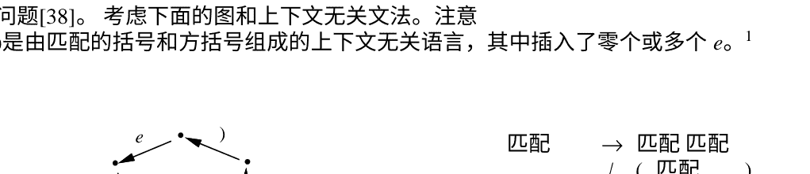

在这个图中，从 s 到 t 有且仅有一条 L(匹配)-路径：路径正好绕一次循环，并生成单词“[(e[])]eee[e]]”。

许多程序分析问题可以看作是 CFL-可达性问题的实例[32]。 在程序分析问题中，用于过滤的语言通常是匹配括号的语言。 在某些情况下，匹配括号的条件用于过滤掉具有不匹配调用和返回的路径，以实现所谓的“上下文敏感”程序分析。

例子 1.2. 在上下文敏感程序分析中使用 CFL 可达性，与普通的图可达性相比，可以通过以下示例来说明：2

# 带注释的源代码

```
int x, y;

void g() {
    y = x;
}

void f() {
    x = 0;
    g();
    p1: /* y可能为0吗？1吗？ */
    x = 1;
    g();
    p2: /* y可能为0吗？1吗？ */
}
```

# 相应的数据依赖图

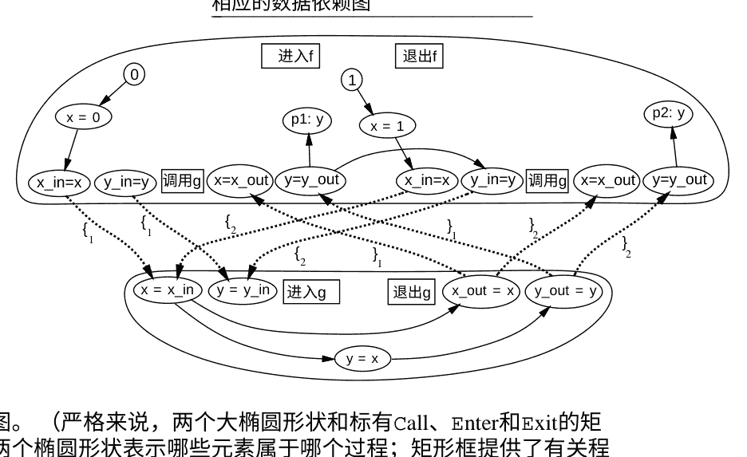

右侧的图示显示了程序的数据依赖图。（严格来说，两个大椭圆形状和标有 Call、Enter 和 Exit 的矩形框不属于数据依赖图的一部分。两个椭圆形状表示哪些元素属于哪个过程；矩形框提供了有关程序中各个顶点关联的控制点的一些上下文。）图中的每条有向边表示数据依赖关系（也称为流依赖[21,22]）：从顶点 v₁ 到顶点 v₂ 的边表示在 v₁ 处产生的值可能在 v₂ 处使用。例如，边

```
0 -> x=0
```

在过程 f 的依赖图中，表示在语句 `x = 0` 执行后，x 的值可能是（在这种情况下必须是）0。

在上面的程序中，过程 g 没有参数。然而，我们的数据依赖图对全局变量进行了一种略微非标准的处理：全局变量，如 x，被视为一种“隐藏”的值-结果参数，其值（和后续的返回值）通过特殊的作用域传递变量 x_in 和 x_out 在不同的作用域之间传递。例如，程序间数据依赖边

```
x_in=x -> x=x_in
```

表示 x 从 f 的作用域传递到 g 的作用域，在第一次调用 g 时。请注意，从调用者传递给被调用者的依赖关系的数据依赖边（即从 f 到 g）由符号“{₁”和“{₂”标记，而从被调用者传递回调用者的关系的数据依赖边由符号“}₁”和“}₂”标记。特别地，在第一次调用 g 时，表示 x 和 y 从 f 的作用域传递到 g 的数据依赖边被标记为 {₁；表示第二次调用 g 时，表示 x 和 y 从 f 的作用域传递到 g 的数据依赖边被标记为 {₂。同样地，表示两次调用结束后，x 和 y 从 g 的作用域传递回 f 的数据依赖边分别被标记为 }₁ 和 }₂。我们的数据依赖图还包含与程序中各种注释对应的顶点；这些注释在这里被表示为注释，表示我们对程序中的某个变量在某个点感兴趣。在上面的示例中， p1 和 p2 处的注释导致了顶点 p1:y 和 p2:y 的产生。

在程序中跟踪常量和变量之间的依赖关系的上下文无关分析将报告说 y 在 p1 和 p2 处都依赖于 0 和 1。原因是上下文无关分析忽略了唯一可能是可行执行路径的路径，即返回与相应调用匹配的路径。例如，(不匹配的)路径的存在

```
0 → x=0 → x_in=x → {1} x=x_in → y=x
→ y_out=y }2 → y=y_out → p2:y                (1.3)
```

在上面显示的图中，这条路径作为“证据”表明 p2:y 依赖于 0（即 p2 处的 y 的值可能为 0）。

相比之下，上下文敏感分析仅报告沿着返回与相应调用匹配的路径可能传输值的情况。 对于这个例子，它报告说 p1:y 依赖于 0 但不依赖于 1，p2:y 依赖于 1 但不依赖于 0（即 p1 处的 y 只能为 0，p2 处的 y 只能为 1）。 上下文敏感分析可以表示为与匹配的索引花括号语言相关的 CFL 可达性问题。它将说路径 (1.3) 不是 0 和 p2:y 之间的有效连接，因为在跨过程数据依赖边上的标签 {1 x_in=x 不匹配 （表示从 f 传递到 g 的 x 的值，因为在第一个调用点进入 g）与边上的标签 }2 y_out=y 不匹配 （表示在从 g 的第二个调用点返回时将 y 的值传回 f）。另一方面，因为 {2 与 }2 匹配，所以（匹配的）路径

```
1 → x=1 → x_in=x → {2} x=x_in → y=x
→ y_out=y }2 → y=y_out → p2:y                (1.4)
```

被视为 1 和 p2:y 之间的有效连接，并且该路径作为 y 的值可能为 1 的证据。

□

使用 CFL 可达性来设计上下文敏感的程序分析的问题包括跨过程切片[15,28]和跨过程数据流分析[30,16]。3

CFL 可达性 - 特别是匹配括号约束 - 也被用来捕捉麦卡锡规则的图论类比 [29,25] (i.e., “car(cons(x,y))=x” 和 “cdr(cons(x,y))=y”), 如下面的例子所示。

例 1.5. 下面的程序演示了在（上下文无关的）结构传递数据依赖分析中使用 CFL 可达性的方法：

3 不幸的是，读者应该注意到术语上存在不幸的冲突。术语“上下文敏感分析”在编程语言界是标准的，它指的是一种静态分析方法，其中对调用过程的分析“敏感”于其被调用的上下文：上下文敏感分析捕捉到了调用相同过程的不同调用点可能对程序的可能执行状态产生不同影响的事实。上下文敏感分析不应与形式语言理论中的“上下文敏感语言”混淆。不幸的是，在编程语言界采用术语“上下文敏感分析”之后，关于上下文无关语言可达性在形式化上下文敏感分析方法中的应用原则才被充分阐述 [32] [7,37]。

# 带注释的源代码

# 相应的数据依赖图

```
c
List *x, *y;

void f() {
    x = cons(NULL, NULL);
    y = car(x);
p1: /* 这里y可能为空吗？ */
    x = cons(x, NULL);
    y = car(x);
p2: /* 这里y可能为空吗？ */
    y = car(y);
p3: /* 这里y可能为空吗？ */
}
```

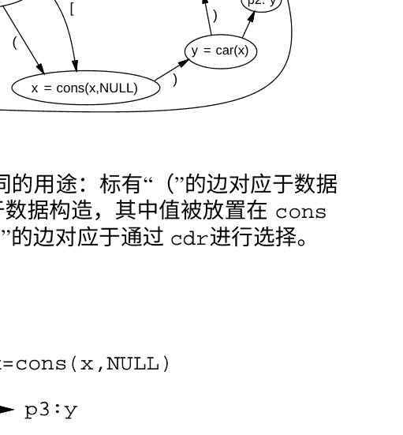

在这个图中，数据依赖边上的标签与示例 1.2 中使用的标签有不同的用途：标有“(”的边对应于数据构造，其中值被放置在 cons 的第一个位置；标有“[”的边对应于数据构造，其中值被放置在 cons 的第二个位置；标有“)”的边对应于通过 car 进行选择；标有“]”的边对应于通过 cdr 进行选择。匹配括号路径

从 NULL 到 p3:y 作为证据表明 p3 处的 y 的值可能为 NULL。路径 NULL → x=cons(NULL,NULL) → x=cons(x,NULL) → y=car(x) → p2:y 不作为证据表明 p2 处的 y 的值可能为 NULL，因为第一个“ (“没有匹配的“) ”。事实上，从 NULL 到 p2:y 没有匹配的括号路径，而（上下文不敏感的）结构传递数据依赖分析会得出结论： p2 处的 y 的值不能为 NULL。

在[29]和[25]中给出的结构传递数据依赖分析是上下文不敏感的，因为没有约束条件来过滤掉具有不匹配调用和返回的路径。 因此，一个自然的问题是，是否可以将示例 1.2 和 1.5 中所示的两种匹配定界符的用法结合起来，创建一个上下文敏感的结构传递数据依赖分析。 下面是示例 1.5 的过程间变体，它展示了我们希望从上下文敏感的结构传递数据依赖分析中获得的内容：

例子 1.6. 考虑以下示例程序:

```
c
List *x, *y;

void g() {
    y = car(x);
}

void f() {
    x = cons(NULL,NULL);
    g();
    p1: /*这里y可能为空吗？*/
    x = cons(x,NULL);
    g();
    p2: /*这里y可能为空吗？*/
    x = y;
    g();
    p3: /*这里y可能为空吗？*/
}
```

该程序数据依赖图的相关部分如下所示：

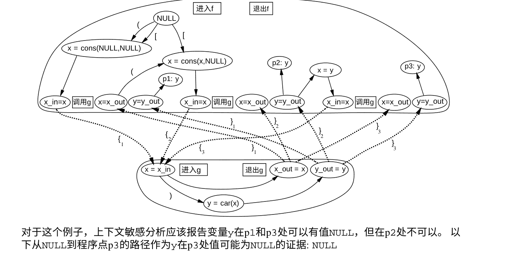

对于这个例子，上下文敏感分析应该报告变量 y 在 p1 和 p3 处可以有值 NULL，但在 p2 处不可以。 以下从 NULL 到程序点 p3 的路径作为 y 在 p3 处值可能为 NULL 的证据：NULL

```
→ x=cons(NULL,NULL) → x_in=x
{₁→ x=x_in → x_out=x}₁→ x=x_out
→ x=cons(x,NULL) → x_in=x
{₂→ x=x_in → y=car(x) → y_out=y}₂→ y=y_out
→ x=y → x_in=x {₃→ x=x_in → y=car(x)
→ y_out=y}₃→ y=y_out → p3:y                (1.7)
```

相比之下，上下文不敏感分析还会使用以下从 NULL 到程序点 p2 的路径作为 y 在 p2 处值可能为 NULL 的证据:

```
NULL ———> x=cons(NULL,NULL) ———> x_in=x
{1 ———> x=x_in ———> x_out=x }1 ———> x=x_out
( ———> x=cons(x,NULL) ———> x_in=x
{2 ———> x=x_in ) ———> y=car(x) ———> y_out=y }2 ———> y=y_out
———> x=y ———> x_in=x {3 ———> x=x_in ) ———> y=car(x)
———> y_out=y }2 ———> y=y_out ———> p2:y (1.8)
```

这条路径的问题在于边上的标签不匹配 x_in=x {3 ———> x=x_in 和随后的边 y_out=y }2 ———> y=y_out。 因此，这条路径会被上下文敏感分析排除在考虑之外。 □

关于例子 1.6 的另一个要注意的事实是，在路径 (1.7) 中，虽然“ (“符号与“ )”符号匹配，而“ {i”符号与“ }i”符号匹配，但是两种匹配符号的模式是交错的。4这个观察结果激发了对交错匹配括号语言的研究，在第 2 和第 3 节中进行了研究。

本文表明，不可能创建一个算法来捕捉所有的交错匹配括号路径，只有像例子 1.6 中所示的那种路径：一般来说，上下文敏感的、结构传递的数据依赖分析问题是不可判定的。换句话说，你可以捕捉到(i) 调用和返回的匹配，或者 (ii) “car(cons(x,y))=x 取消”，但不能同时捕捉到两者，无论花费多少时间。（当然，可能有一些有用的算法来计算这个问题的近似但安全的解决方案，参见[13]。）

就编程语言特性而言，不需要高阶函数：本文的主要结果表明，对于一阶语言（包括函数式和命令式语言），上下文敏感的、结构传递的数据依赖分析是不可判定的。这个结果适用于 C、C++、Java、ML 和 Scheme 等语言，以及许多其他语言。

值得注意的是，类似于示例 1.6 中提出的问题（即“在程序的特定点，给定变量是否具有给定值？”）通常在其最一般的形式下是不可判定的，并且通常有几个独立的原因导致问题不可判定（例如，无法判定给定语句是否被执行；无法判定给定路径是否被执行等）。本文表明，即使对于许多其他程序分析问题，采用保守的近似方法，上下文敏感的、结构传递的数据依赖分析仍然是不可判定的。（特别地，我们假设过程控制流图中的所有路径都是可执行的。）

本文的剩余部分分为四个部分：通过从 Post 的对应问题（PCP）的变体进行简化来展示了不可判定性结果；第 2 节定义了 PCP 并讨论了适用于我们需求的变体；例 1.6 激发了我们对具有交错匹配分隔符模式的语言的兴趣；第 3 节展示了一组特定的 L 路径问题实例，其中 L 是由两个匹配括号语言交错形成的字符串语言，该问题是不可判定的。

可判定的。第4节将第3节的结果与上下文敏感、结构传输数据依赖分析的不可判定性联系起来。第5节讨论了我们的结果对其他程序分析问题的影响。

## 2. POST问题的变体

我们的不可判定性结果通过从Post问题的一个变体进行约简来展示。

### 定义2.1.
Post问题的一个实例，或者PCP，由两个字符串列表X和Y组成，其中X和Y都由k个字符串组成，每个字符串都属于{0, 1}*:
$$X = x_1, x_2, \dots, x_k$$
$$Y = y_1, y_2, \dots, y_k$$
如果PCP的实例存在解，则存在一个非空的整数序列 $i_1, i_2, \ldots, i_j, \ldots, i_m$ 使得 (i) 对于所有的 $1 \leq j \leq m$，我们有 $1 \leq i_j \leq k$，且 (ii) $x_{i_1}x_{i_2}\dots x_{i_m} = y_{i_1}y_{i_2}\dots y_{i_m}$。 □

### 例子2.2.
考虑以下PCP实例，其中 k 为3:
$$X = 0101, 101, 111$$
$$Y = 01, \quad 011, 0111101$$
这个PCP实例的解为1, 2, 3, 1, 因为
$$x_1 x_2 x_3 x_1 = 0101\; 101\; 111\; 0101 \quad = 01\; 011\; 0111101\; 01 \quad = y_1 y_2 y_3 y_1.$$
□

PCP被认为是不可判定的；有关证明，请参见Hopcroft和Ullman [14, pp. 193-198]，Lewis和Papadimitriou [23, pp. 289-293]，或Harrison [8, pp. 249-256]。

对于我们的目的，使用以下PCP的变体更方便：

### 定义2.3. (括号-PCP)
给定一个PCP实例，
$$X = x_1, x_2, \dots, x_k$$
$$Y = y_1, y_2, \dots, y_k$$
我们将相应的括号-PCP实例定义为 P-PCP，即
$$\bar{X} = \bar{x}_1, \bar{x}_2, \dots, \bar{x}_k$$
$$\bar{Y}^R = \bar{y}_k^R \quad \bar{y}_{k-1}^R \quad \dots \quad \bar{y}_1^R$$

其中：
- $\bar{x}_i$ 是属于 { ( , [ } 的字符串等于将 $x_i$ 中的 0 替换为 “(”， 将 1 替换为 “[”。
- $\bar{y}_i$ 是属于 { ) , ] } 的字符串等于将 $y_i$ 中的 0 替换为 “)”， 将 1 替换为 “]”。
- 字符串上的上标 “R” 表示反转的字符串。

P-PCP 的一个实例的解定义如下线性上下文无关文法：⁵

```
balanced → ( balanced )
          | [ balanced ]
          | ( # )
          | [ # ]
```

如果存在一个非空的整数序列 $i_1, i_2, \dots, i_j, \dots, i_m$ 使得 (i) 对于所有的 $1 \leq j \leq m$，我们有 $1 \leq i_j \leq k$，以及 (ii) $\bar{x}_{i_1} \bar{x}_{i_2} \dots \bar{x}_{i_m} \# \bar{y}_{i_m}^R \dots \bar{y}_{i_2}^R \bar{y}_{i_1}^R \in L(\text{平衡的})$。 □

⁵ 一个线性上下文无关文法是指每个产生式右侧最多只有一个非终结符。

### 例子2.4.
与例子 2.2 对应的 P-PCP 实例是
$$
\bar{X} = \lbrack\lbrack\lbrack, \lbrack\lbrack\lbrack, \lbrack\lbrack\lbrack
$$
$$
\bar{Y}^R = \rbrack\rbrack, \rbrack\rbrack\rbrack, \rbrack\rbrack\rbrack\rbrack\rbrack\rbrack\rbrack\rbrack\rbrack\rbrack)
$$
这个 P-PCP 实例的解是 1, 2, 3, 1 因为
$$
\bar{x}_1\bar{x}_2\bar{x}_3\bar{x}_1\#\bar{y}_1^R\bar{y}_3^R\bar{y}_2^R\bar{y}_1^R = (\lbrack\lbrack\lbrack(\lbrack\lbrack\lbrack\lbrack\lbrack\lbrack(\lbrack\lbrack(\#\rbrack\rbrack)\rbrack\rbrack\rbrack\rbrack\rbrack\rbrack\rbrack\rbrack\rbrack\rbrack\rbrack) \in L(\text{平衡的}).
$$

很明显，当且仅当对应的P-PCP实例有解，PCP的实例才有解。

对于给定的P-PCP实例，
$$
\bar{X} = \bar{x}_1, \bar{x}_2, \ldots, \bar{x}_k
$$
$$
\bar{Y}^R = \bar{y}_1^R, \bar{y}_2^R, \ldots, \bar{y}_k^R
$$
每个解（如果存在）都对应于以下线性上下文无关文法生成的语言中的一个字符串：

$$
S_0 \rightarrow \bar{x}_i S_0 \bar{y}_i^R \quad \text{对于}1 \leq i \leq k
$$
$$
\mid \bar{x}_i \# \bar{y}_i^R \quad \text{对于}1 \leq i \leq k
$$

虽然不是每个字符串都对应于一个解，但是所有既属于 $L(S_0)$ 又属于 $L(\text{balanced})$ 的字符串都对应于一个解。也就是说，给定的P-PCP实例有解当且仅当语言 $L(S_0) \cap L(\text{平衡的})$ 是非空的。这个观察结果暗示了以下定理（cf. [23, pp. 293-294]）：

### 定理2.5.
对于任意线性上下文无关文法 $G_1$ 和 $G_2$, 判断 $L(G_1) \cap L(G_2)$ 是否是空的是不可判定的。

对于给定的 P-PCP 实例存在解的事实可以通过两个线性上下文无关文法的交集的非空性来表征，这是我们关于上下文敏感数据依赖分析不可判定性的结果的基础。然而，为了研究后一个问题，开发一个稍微复杂一点的方式来表征 P-PCP 实例的解是很有用的：

### 定义2.6.
如果一个 P-PCP 实例
$$
\bar{X} = \bar{x}_1, \bar{x}_2, \ldots, \bar{x}_k
$$
$$
\bar{Y}^R = \bar{y}_1^R, \bar{y}_2^R, \ldots, \bar{y}_k^R
$$
有一个解 $i_1, i_2, \ldots, i_m$，我们说以下字符串以标记形式展示解:⁶

$$
\{_{i_1}\bar{x}_{i_1}\{_{i_2}\bar{x}_{i_2}\cdots\{_{i_m}\bar{x}_{i_m}\#\bar{y}_{i_m}^R\}_{i_m}\cdots\bar{y}_{i_2}^R\}_{i_2}\bar{y}_{i_1}^R\}_{i_1}.
\quad (2.7)
$$

一般来说，假设 $i_1, i_2, \ldots, i_j, \ldots, i_p$ 是一些非空整数序列，无论该序列是否是P-PCP实例的解，我们说一个形如的字符串
$$
\{_{i_1}\bar{x}_{i_1}\{_{i_2}\bar{x}_{i_2}\cdots\{_{i_j}\bar{x}_{i_j}\cdots\{_{i_p}\bar{x}_{i_p}\#\bar{y}_{i_p}^R\}_{i_p}\cdots\bar{y}_{i_j}^R\}_{i_j}\cdots\bar{y}_{i_2}^R\}_{i_2}\bar{y}_{i_1}^R\}_{i_1}
$$
以标记形式展示一个候选解。

例如，因为序列2, 1, 2, 3, 1不是例子2.4的解，以下字符串以标记形式展示一个候选解（但不是一个以标记形式的解）:

$$
\{_{2}(\lbrack\lbrack\{_{1}(\lbrack\lbrack\lbrack\{_{2}(\lbrack\lbrack\{_{3}\lbrack\lbrack\lbrack\{_{1}(\lbrack\lbrack(\lbrack\lbrack(\#\rbrack\rbrack)\rbrack\rbrack)\}_{1}\rbrack\rbrack\rbrack\rbrack)\}_{3}\rbrack\rbrack)\}_{2})\}_{1}\rbrack\rbrack\rbrack)\}_{2}.
\quad (2.8)
$$

相比之下，下面的字符串以标记形式展示了例子2.4的一个候选解，也是一个标记形式的解:

```
\{ _1 ( [ \{ _2 ( [ \{ _3 [ [ \{ _1 ( [ \{ [ \# ] \} _1 ) ] ] ] \} _3 ] ) \} ] ) \} ] _1 \quad (2.9)
```

## 3. 一个不可判定的L-PATH问题实例族

在本节中，我们将展示如何用图论术语来表述P-PCP问题。特别地，我们构造了一个不可判定的L路径问题实例族，其中每个问题实例对应于一个P-PCP实例。在本文的剩余部分中，我们假设我们已经得到了一个固定但任意的P-PCP实例，该实例由k对字符串组成。

$$
\bar{X} = \bar{x}_1, \bar{x}_2, \ldots, \bar{x}_k
$$
$$
\bar{Y}^R = \bar{y}_1^R, \bar{y}_2^R, \ldots, \bar{y}_k^R
$$

我们对P-PCP的兴趣是因为一个以标记形式展示P-PCP解的字符串有两个交错的匹配分隔符模式:

- (i) 字符串 $\bar{x}_{i_1} \bar{x}_{i_2} \ldots \bar{x}_{i_m} \# \bar{y}_{i_m}^R \ldots \bar{y}_{i_2}^R \bar{y}_{i_1}^R$ 在L(平衡的)中。
- (ii) 字符串 $\{_{i_1} \{_{i_2} \ldots \{_{i_m} \# \}_{i_m} \ldots \}_{i_2} \}_{i_1}$ 在L(平衡')中，由以下线性上下文无关文法定义的由 $\{_{i}$ 和 $\}_{i}$ 组成的平衡字符串的语言:

```
平衡' → {_{i} 平衡' }_{i}  对于 $1 \le i \le k$
         | {_{i} # }_{i}   对于 $1 \le i \le k$
```

需要注意的是，在一般情况下，一个以标记形式展示P-PCP解的字符串中，两个平衡过程可能不同步。例如，在以下字符串(2.9)的前缀中

```
\{_{1}([ (\{_{2}([ (\{_{3}[[\{_{1}([ (\{[\#]\} _{1})]]\} _{3}])\}])\}])\} _{1}
```

最后一个符号，即“$\}_{1}$”，与倒数第七个符号“[”不匹配。然而，我们可以通过两个线性上下文无关语言的交集以标记形式捕捉P-PCP解的结构:

- (i) 语言 $L(S_1)$ 由 L(平衡的) 的字符串组成，其中任意数量的“$\{_{i}$”符号穿插在开括号和开方括号符号之间，任意数量的“$\}_{i}$”符号穿插在闭括号和闭方括号符号之间:

```
S1 → ( S1 )
     | [ S1 ]
     | ( # )
     | [ # ]
     | {_{i} S1  对于 $1 \le i \le k$
     | S1 }_{i}  对于 $1 \le i \le k$
```

- (ii) 语言 $L(S_2)$ 包含给定P-PCP实例的所有可能候选解，以标记形式表示:

```
S2 → {_{i} \bar{x}_{i} S2 \bar{y}_{i}^{R} }_{i}  对于 $1 \le i \le k$
     | {_{i} # }_{i}  对于 $1 \le i \le k$
```

语言 $L(S_1)$ 和 $L(S_2)$ 捕捉到上述两种交错的匹配分隔符模式: $L(S_2)$包含了给定P-PCP实例的所有可能的候选解，以标记形式表示; $L(S_1)$ 包含了这样的字符串，即当所有的“$\{_{i}$”和“$\}_{i}$”符号被排除后，我们得到的是一个在 L(balanced) 中的字符串。此外，语言 $L(S_1) \cap L(S_2)$ 恰好包含了给定P-PCP实例的解，以标记形式表示。例如，对于示例2.4，字符串(2.8)和(2.9)都在 $L(S_2)$ 中，但只有字符串(2.9)在 $L(S_1)$ 中；也就是说，

$$
\{ _1 ( [ \{ _2 ( [ \{ _3 [ [ \{ _1 ( [ \{ [ \# ] \} _1 ) ] ] ] \} _3 ] ) \} ] ) \} ] _1 \in L(S_1) \cap L(S_2).
$$

类似于我们观察到的语言 $L(S_0) \cap L(\text{balanced})$，给定的P-PCP实例有一个解当且仅当语言 $L(S_1) \cap L(S_2)$ 非空。

我们现在展示如何构建一个图（带有两个特殊顶点，s和t），使得只有当给定的P-PCP实例有解时，存在一条从s到t的L(S1)∩L(S2)路径。图1展示了这个构建的示意图。

对于一个P-PCP实例 $\bar{X} = \bar{x}_1, \bar{x}_2, \ldots, \bar{x}_j, \ldots, \bar{x}_k$，$\bar{Y}^R = \bar{y}_1^{R}, \bar{y}_2^{R}, \ldots, \bar{y}_j^{R}, \ldots, \bar{y}_k^{R}$，图中包含 k个形式的区域。

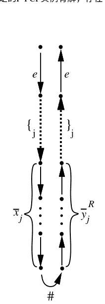

将这样的区域的左部分称为x-字符串段，右部分称为 $y^{R}$-字符串段。请注意，第j个x-字符串段以“$\{_{j}$”序列开头，而第 j个 $y^{R}$-字符串段以“$\}_{j}$”序列结尾。

图1周围的虚线边连接了每个x字符串段与其他所有x字符串段，以及每个y^R字符串段与其他所有y^R字符串段。任意数量的x字符串段可以按任意顺序连接在一起形成路径；然而，每个这样的段在路径中都由相应的“$\{_{i}$”符号标记。同样，任意数量的y^R字符串段可以按任意顺序连接在一起形成路径；然而，每个这样的段在路径中都由相应的“$\}_{i}$”符号标记。

图1中某些边为虚线并没有特殊意义；它们以这种方式显示是为了突出这些边对应于依赖图中的过程间数据依赖边。 这个对应关系将在第4节中清楚地说明（cf. 图4）。

通过跟着标有“#”的边，路径可以从一个x字符串段到一个y^R字符串段。然而，一旦选择了一个#-边，路径只能通过y^R字符串段扩展。因此，从s到t的所有路径都具有以下形式：

```
s $\xrightarrow{e}$ 一些x字符串段的数量 $\xrightarrow{\#}$ 一些y^R字符串段的数量 $\xrightarrow{e}$ t
```

在这里我们可以看到脚注6中所说的原因：在从s到t的路径中，每个“$\{_{i}$”的出现都紧接着两个e符号的出现，每个“$\}_{i}$”的出现都紧接着两个e符号的出现。从技术上讲，(候选)P-PCP解的标记形式的定义应相应更改，并且语法S₁和S₂中的每个“$\{_{i}$”的出现都应替换为“e e $\{_{i}$”，每个“$\}_{i}$”的出现都应替换为“$\}_{i}$ e e”。现在我们观察到

- 如果存在一条从s到t的L(S₁)∩L(S₂)路径P，那么可以从P的字中读取出一个标记形式的P-PCP解来解决P-PCP实例。
- 如果P-PCP实例有解 $i_1, i_2, \ldots, i_m$，那么我们可以通过以下方式找到一条从s到t的L(S₁)∩L(S₂)路径P：
  - (i) 沿着从s开始的边，选择按顺序的x字符串段 $x_{i_1}, x_{i_2}, \ldots, x_{i_j}, \ldots, x_{i_m}$，从而生成一个字为 $\{_{i_1} x_{i_1} e e \{_{i_2} x_{i_2} e e \ldots e e \{_{i_m} x_{i_m}$，
  - (ii) 从 $i^{th}$ x字符串段跟随 #-边到 $i^{th}$ y^R字符串段，
  - (iii) 按顺序选择 y^R字符串段 $y_{i_m}^R, \ldots, y_{i_j}^R, \ldots, y_{i_2}^R, y_{i_1}^R$，从而生成一个子路径其单词为 $y_{i_m}^R \}_{i_m} e e \ldots e e y_{i_j}^R \}_{i_j} e e \ldots e e y_{i_2}^R \}_{i_2} e e y_{i_1}^R \}_{i_1} e$，
  - (iv) 从 e边跟随到 t。

该路径的单词以标记形式展示了P-PCP实例的解答（模除额外的e出现）。正如我们之前观察到的，L(S₁)∩L(S₂)恰好由给定P-PCP实例的解答（以标记形式）组成。因此，上述构建的路径是从s到t的L(S₁)∩L(S₂)路径。

我们将按照上述描述的方式构建的图称为P-PCP图。对于在示例2.4中引入的P-PCP实例的特殊情况，相应的P-PCP图如图2所示。

上述观察结果证明了以下引理：

### 引理3.1.
给定一个P-PCP实例（具有相应的文法S₁和S₂，以及P-PCP图G），当且仅当P-PCP实例有解时，在G中存在从s到t的L(S₁)∩L(S₂)路径。

## 4. 上下文敏感、结构传递数据依赖分析的不可判定性

在本节中，我们展示了如何对前一节中介绍的构造进行轻微修改，从而说明不可能为上下文敏感、结构传递数据依赖分析创建精确算法。特别地，我们构造了一族程序，其数据依赖图编码了P-PCP图。

# 图2. 根据示例2.4给出的P-PCP实例构建的P-PCP图。该图包含从s到t的L(S₁)∩L(S₂)路径，其单词为 e {_1([ [ e {_2[([ e {_3[[[e {_1([ [ # ]])_1 e ]]]}}_3 e ])]}_2 e ]]}_1 e，这表明示例2.4给出的P-PCP实例的解为1, 2, 3, 1。

例如，图3显示了一个C程序片段，其数据依赖图（参见图4）对应于示例2.4给出的P-PCP实例。一个上下文敏感的、结构传递的数据依赖分析应该报告变量x在程序点t可能具有值atom("A")（这对应于该P-PCP实例的解为1, 2, 3, 1）。在图3中，符号“{_j”和“}_j”对应于从过程 f调用到过程 f_j和从 f_j返回到 f的数据依赖关系；符号“(”对应于数据构造，其中值被放置在 cons的第一个位置；符号“[”对应于数据构造，其中值被放置在 cons的第二个位置；符号“)”对应于通过 car进行选择；符号“]”对应于通过 cdr进行选择。与过程 f的调用相关的数据依赖关系由形式为“ ⟨_j”的符号标记；与对应的从 f返回相关的数据依赖关系由“ ⟩_j”的符号标记；符号“#”对应于当最终绕过对 f的（递归）调用时发生的数据依赖关系被绕过。

在检查图3时，读者应该记住，字符串的从左到右编码——其中字符串由全部开放括号或全部闭合括号组成——对应于从编码字符串中的内部出现的 x开始向外工作。

在图3和图4中所示的思想适用于所有P-PCP的实例：一般来说，字符串对 $\bar{x}_j, \bar{y}_j^R$ 由以下形式的过程编码

```
List *x;
void f1() {
    x = cons(NULL, cons(cons(NULL, cons(x, NULL)), NULL)); /* 编码 ([[ */
    if (...) {
        f();
    }
    x = car(cdr(x)); /* 编码 ]) */
}
void f2() {
    x = cons(NULL, cons(cons(NULL, x), NULL)); /* 编码 ([[ */
    if (...) {
        f();
    }
    x = car(cdr(cdr(x))); /* 编码 ]] */
}
void f3() {
    x = cons(NULL, cons(NULL, cons(NULL, x))); /* 编码 [[[ */
    if (...) {
        f();
    }
    x = car(cdr(cdr(cdr(cdr(car(cdr(x))))))); /* 编码 ]]]]) */
}
void f() {
    if (...) f1();
    else if (...) f2();
    else f3();
}
void main() {
    s: x = atom("A"); /* 程序中没有其他地方使用的特殊值 */
    f();
    t: /* 这里x可能是atom("A")吗？ */
}
```

# 图3. 为了在示例2.4中给出的P-PCP实例上构建的C程序方案。该程序的数据依赖图的相关部分如图4所示。

7标签“⟨”和“⟩”的作用类似于“{”和“}”，因为这两种括号对都编码了过程调用/返回。然而，“⟨”和“⟩”被引入为单独的符号，以强调调用过程 f在构造中扮演了不同的角色，而调用 f_j过程则不同。

```
void fj() {
    x = cons(...x...);           /* 构造表达式编码 $x_j$ */
    if ( . . . ) {
        f();
    }
    x = ...car(...cdr(...x......)......;   /* 选择表达式编码 $y_j^R$ */
}
```

过程    f 的形式为

```
void f() {
    if ( . . . ) f1();
    else if ( . . . ) f2();
    .
    .
    .
    else if ( . . . ) fk-1();
    else fk();
}
```

主过程 main 与图3中的相同.

上下文敏感的、结构传递的数据依赖性分析的不可判定性来自于两个性质: (i) 对于上述形式的程序，数据依赖图与给定P-PCP实例的P-PCP图非常相似(见图1)，(ii) 变量 $x$ 在程序点 $t$ 处的值为 atom ("A") 当且仅当存在一条从 $s$ 到 $t$ 的路径，其对应的单词与某个非常相似的语言中 $L(S_1) \cap L(S_2)$ (除了'('s和')'s必须平衡之外).

例如，数据依赖图中显示的部分（如图4所示，对应于图3中给出的程序）与图2中显示的P-PCP图相同，只是某些虚线边缘，对应于对 f 的调用和从 f 返回，现在具有形式为 $\langle_i$ 或 $\rangle_i$ 的标签。$^8$ 因此，用于识别上下文敏感、结构传递数据依赖关系的路径语言现在必须包含标签 $\langle_i$ 和 $\rangle_i$ (对于 $0 \leq i \leq k$)。形式上，这是通过考虑 $L(S_1') \cap L(S_2')$-路径来实现的，其中语法

+   $S_1'$ 和 $S_2'$ 定义如下:

$S_1' \rightarrow e \langle_0 S_1'' \rangle_0 e$

$S_1'' \rightarrow ( S_1'' ) $
$\mid [ S_1'' ] $
$\mid ( \# ) $
$\mid [ \# ] $
$\mid e \{_i S_1''$ & 对于 $1 \leq i \leq k$
$\mid \langle_i S_1''$ & 对于 $1 \leq i \leq k$
$\mid S_1'' \}_i e$ & 对于 $1 \leq i \leq k$
$\mid S_1'' \rangle_i$ & 对于 $1 \leq i \leq k$

$S_2' \rightarrow e \langle_0 S_2'' \rangle_0 e$

$S_2'' \rightarrow e \{_i \overline{x_i} \langle_i S_2'' \rangle_i \overline{y_i^R} \}_i e$ & 对于 $1 \leq i \leq k$
$\mid e \{\textbf{我喜欢你我\# 我他}$ & 对于 $1 \leq i \leq k$

我们还将标记形式的P-PCP解的概念改变为每个 $x_i$ (除了最内层的一个) 后面紧跟着一个 $\langle_i$ 的出现，并且每个 $y_i^R$ 的出现 (除了最内层的一个) 之前紧跟着一个 $\rangle_i$ 的出现。

图4。图3中显示的程序的数据依赖图的相关部分。..这对应于图2中显示的P-PCP图，只是现在某些虚线边缘的标签形式为 $\langle_i$ 或 $\rangle_i$。

通过证明引理3.1所使用的相同论证，如果P-PCP的给定实例有解，则数据依赖图中存在从s到t的L(S_1')∩L(S_2')路径。因此，一个上下文敏感的、结构传递的数据依赖分析将确定在程序点t处，x可能具有值atom("A")，当且仅当P-PCP的给定实例有解。因此，上下文敏感的、结构传递的数据依赖分析是不可判定的（即，上下文敏感的、结构传递的数据依赖分析算法不存在）。

## 5. 结论和对其他程序分析框架的影响

作者及其同事之前的工作已经证明了以图可达性问题的形式化程序分析问题的有用性[32]。这种方法已经被用于获得关于程序分析问题的一些积极结果（具体来说，多项式时间算法用于解决各种不同的问题[15,28,30,16,29,34,25]）。本文证明了这种观点在获得关于程序分析问题的负面结果方面也是有价值的（参见[31]）。

本文中的不可判定结果涉及到存在两个交错的匹配“事件”模式的情况。从更广泛的角度来看，“交错匹配括号路径”和“以标记形式的P-PCP解决方案”这两个概念可以为是否存在其他程序分析问题的不可判定性提供洞察。例如，Ramalingam最近证明了多任务并发程序的同步敏感、上下文敏感的跨过程分析是不可判定的[27]。他的结果受到本文中给出的结果的启发，使用了同步敏感、上下文敏感的程序间分析也涉及到两个交错的匹配事件模式。

## 集合约束和基于集合的分析

在雷诺兹[33]和琼斯和马奇尼克[18]的早期工作之后，近年来有许多人探索了使用集合约束来分析程序的方法。 集合约束通常用于收集程序变量在执行过程中可能具有的值的超集。 通常，在每个程序点为每个程序变量创建一个集合变量；生成近似程序行为的集合约束；然后，程序分析变成了找到集合约束问题的最小解的问题。 集合约束既用于程序分析[33,18,1,11,12]，也用于类型推断[2,3]。

Melski和Reps在一些集合约束类和CFL可达性之间的关系上取得了一些结果[25]。 他们的结果建立了双向关系：他们证明了CFL可达性问题和一类被称为确定集合约束[10]的子类是等价的。 也就是说，给定一个CFL可达性问题，可以构造一个集合约束问题，其答案给出了CFL可达性问题的解；同样，给定一个集合约束问题，可以构造一个CFL可达性问题，其答案给出了集合约束问题的解。 在[25]中还表明，CFL可达性与一类被设计用于高阶语言（称为“基于集合的分析”[11]）的集合约束是等价的。 第3和第4节的结果表明，如果你从至少与示例1.5中所示的上下文无关结构传递数据依赖分析一样精确的上下文无关基于集合的分析版本开始，那么对于上下文敏感的版本，你将无法创建算法。即使对于一阶语言也是如此。

## 控制流分析

在[35]中，Sharir和Pnueli定义了两种方法来进行过程间数据流分析，以确保数据流信息的传播遵守当过程完成时返回到最近调用的位置的事实。 在他们的一种方法中，所谓的“调用字符串方法”，每个数据流信息都标记有一个调用字符串，记录了未完成过程调用的历史，其中数据传播。 当执行与调用语句或返回语句相关联的传播步骤时，将更新信息上的调用字符串。 原则上，如果允许调用字符串任意增长，将获得的信息称为调用字符串-∞解决方案。

Sharir和Pnueli表明，对于有限半格上的分布式数据流分析问题，可以将调用字符串的长度限制为某个固定长度（其中对长度的限制要求与程序中的调用站点数量成二次关系，并与半格的大小成线性关系），并且仍然可以获得与调用字符串-∞解决方案在精度上等价的结果。 通过适当的手段，还可以使用较短的调用字符串获得近似（但安全）的解决方案；将调用字符串限制为长度 k定义了调用字符串-k解决方案。

+   在考虑用于程序间数据流分析的算法时，应该小心不要混淆两个不同的问题：

(i) 算法是否计算出与调用字符串-∞解相等的解。
(ii) 算法是否通过实际跟踪由调用字符串标记的实体（例如，某个长度为 k的实体）来计算其解。

类型-(ii) 算法的最坏情况运行时间通常是指数级的，与 k 成正比。 然而，对于适当的程序间数据流分析问题类，存在具有性质 (i) 的算法，但是它们的最坏情况运行时间是多项式级别的，与程序的大小成正比；这些算法使用动态规划，而不是利用显式调用字符串标记的实体 [30,34]。对于相同类别的问题，类型-(ii) 算法通常具有指数级的运行时间。

这些结果与在函数式编程社区中获得的一个程序分析问题的结果形成了有趣的对比: 该问题是使用长度为k的调用字符串进行“ k-CFA”或“控制流分析” (用于高阶编程语言) 。[36,17,13,26]。控制流分析的目标是在存在一级 (匿名) 函数、数据构造函数和选择器的情况下跟踪数据和控制流。已经提出的许多 k-CFA算法都是类型-(ii) 算法 (如上所述) ，它们实际上跟踪长度为 ≤ k的调用字符串标记的实体。一般来说，这些算法的运行时间与 k成指数关系。

类似于对于一个过程间数据流分析问题的调用字符串-∞解决方案的概念, 原则上, 如果允许调用字符串任意增长, 那么∞-CFA解决方案就是所得到的。第3和第4节的结果表明, 一般情况下, 当考虑数据构造函数和选择器时, ∞-CFA是不可判定的。也就是说, 在存在数据构造函数和选择器的情况下, 无法计算出∞-CFA解决方案。

## 致谢

我感谢与F. Nielson、G. Ramalingam、S. Horwitz和D. Melski讨论这个问题的机会。

## 参考文献

+   1. Aiken, A. and Murphy, B.R., “Implementing regular tree expressions,” pp. 427-447 in Func. Prog. and Comp. Arch., Fifth ACM Conf., (Cambridge, MA, Aug. 26-30, 1991), Lec. Notes in Comp. Sci., Vol. 523, ed. J. Hughes, Springer-Verlag, New York, NY (1991).
2. 艾肯, A.和墨菲, B.R., “在动态类型语言中的静态类型推断,” 第279-290页, 出自第十八届ACM程序设计语言原理研讨会论文集, (奥兰多, 佛罗里达州, 1991年1月), ACM, 纽约, 纽约州(1991年)。
3. 艾肯, A.和威默斯, E.L., “类型包含约束和类型推断,” 第31-41页, 出自第六届函数编程和计算机体系结构研讨会论文集, (哥本哈根, 丹麦), (1993年6月)。
4. 卡拉汉, D., “程序摘要图和流敏感的过程间数据流分析,” 出自第88届ACM程序设计语言设计与实现研讨会论文集, (亚特兰大, 佐治亚州, 1988年6月22-24日), SIGPLAN通知, 第23卷(7)第47-56页(1988年7月)。
5. Cooper, K.D.和Kennedy, K., “线性时间内的过程间副作用分析”, ACM SIGPLAN 88 Conf. on Prog. Lang. Design and Implementation的论文集, (亚特兰大, 佐治亚州, 1988年6月22日至24日), SIGPLAN Not. 23(7) pp. 57-66 (1988年7月)。
6. Cooper, K.D.和Kennedy, K., “快速过程间别名分析”, 在Sixteenth ACM Symp. on Princ. of Prog. Lang.的论文集中, (德克萨斯州奥斯汀, 1989年1月11日至13日), ACM, 纽约, 纽约州 (1989年)。
7. Emami, M., Ghiya, R.和Hendren, L.J., “上下文敏感的过程间指针分析在函数点-的存在下”, ACM SIGPLAN 94 Conf. on Prog. Lang. Design and Implementation的论文集, (佛罗里达州奥兰多, 1994年6月22日至24日), SIGPLAN Not. 29(6) pp. 242-256 (1994年6月)。
8. Harrison, M.A..形式语言理论导论.Addison-Wesley, Reading, MA (1978).
9. Hecht, M.S..计算机程序流分析.North-Holland, New York, NY (1977).

> 9在他们的定理7-3.4中, Sharir和Pnueli证明了一组方程的最大不动点等于所有有效路径的meet-over-all-valid-paths (MOVP)解。在他们的定理7-4.6中, 他们证明了MOVP解等于call-strings-∞解。至于算法, Sharir和Pnueli提供了一种用于找到一组方程最大不动点的工作列表算法。然而, [35]的第7-3节提供了一个相当通用的框架: 特别是, 关于半格的唯一假设是它是有限的。由于他们的动态规划算法记录信息的方式, 当半格的大小指数级增长时, 算法可能使用与程序大小指数级增长的时间。

为了实现多项式时间界限，技巧如下：

+   - 限制注意力在某个特定类别的半格上。然而，这个类别可能包括大小与程序规模呈指数关系的半格 (例如, 程序点的幂集, 程序变量的幂集等) 。
- 逐点地对Sharir-Pnueli φ函数进行制表 (例如, 对单个元素进行制表, 而不是整个集合) 。

这基本上是在[30]中针对有限分布子集问题的类别以及在[34]中针对更大类别的分布环境问题所做的。

+   10. Heintze, N.和Jaffar, J., “一类集合约束的决策过程”, 技术报告CMU-CS-91-110, 计算机科学学院, 卡内基梅隆大学, 匹兹堡, 宾夕法尼亚州 (1991年)。
11. Heintze, N., “基于集合的ML程序分析”, 技术报告CMU-CS-93-193, 计算机科学学院, 卡内基梅隆大学, 匹兹堡, 宾夕法尼亚州 (1993年7月)。
12. Heintze, N.和Jaffar, J., “集合约束和基于集合的分析”, 在第二届约束编程原理和实践研讨会上, (1994年5月)。
13. Heintze, N.和McAllester, D., “线性时间子传递控制流分析”, ACM SIGPLAN 97会议论文集, (拉斯维加斯, 内华达州, 1997年6月15-18日), SIGPLAN Not. 32 (5) pp. 261-272 (1997年5月)。
14. Hopcroft, J.E.和Ullman, J.D., 自动机理论、语言和计算导论, Addison-Wesley, 雷丁, 马萨诸塞州 (1979年)。
15. Horwitz, S., Reps, T., 和 Binkley, D., “使用依赖图进行过程间切片”, ACM Trans. Program. Lang. Syst. 12(1) pp. 26-60 (Jan. 1990)。
16. Horwitz, S., Reps, T., 和 Sagiv, M., “需求过程间数据流分析”, SIGSOFT 95: 第三届ACM SIGSOFT软件工程基础研讨会论文集, (华盛顿特区, 1995年10月10日-13日), ACM SIGSOFT软件工程笔记 20(4) pp. 104-115 (1995)。
17. Jagannathan, S. 和 Weeks, S., “高阶语言中流分析的统一处理”, pp. 393-406 in Conf. Rec. of the Twenty-Second ACM Symp. on Princ. of Prog. Lang.,(旧金山, 加利福尼亚州, 1995年1月23日-25日), ACM, 纽约, 纽约州 (1995)。
18. Jones, N.D.和Muchnick, S.S., “流分析和Lisp-like结构的优化”, 在程序流分析: 理论和应用中, 第102-131页, Muchnick 和Jones编辑, Prentice-Hall, Englewood Cliffs, NJ (1981年)。
19. Khedker, U.P.和Dhamdhhere, D.M., “位向量数据流分析的广义理论”, ACM Trans. Program. Lang. Syst. 16(5)页, 1472-1511页 (1994年9月)。
20. Kou, L.T., “关于全局数据流问题的活跃-死代码分析”, J. ACM 24(3)页, 473-483页 (1977年7月)。
21. Kuck, D.J., 计算机和计算的结构, 第1卷, John Wiley & Sons, 纽约, NY (1978年)。
22. Kuck, D.J., Kuhn, R.H., Leasure, B., Padua, D.A., 和 Wolfe, M., “依赖图和编译器优化,” pp. 207-218 in Conf. Rec. of the Eighth ACM Symp. on Princ. of Prog. Lang., (Williamsburg, VA, Jan. 26-28, 1981), ACM, New York, NY (1981)。
23. Lewis, H.R. 和 Papadimitriou, C.H., 计算理论的要素, Prentice-Hall, Englewood Cliffs, NJ (1981)。
24. McCarthy, J., “计算的数学理论的基础,” pp. 33-70 in Computer Programming and Formal Systems, ed. Braffort 和 Hershberg, North-Holland, Amsterdam (1963)。
25. Melski, D. 和 Reps, T., “一类集合约束和上下文无关语言可达性的互相转换性,” Theor. Comp. Sci. 248(1-2)(Nov. 2000)。(To appear.)
26. Nielson, F. 和 Nielson, H.R., “无限控制流分析: 闭包分析的收集语义,” pp. 332-345 in Conf. Rec. of the Twenty-Fourth ACM Symp. on Princ. of Prog. Lang.,(巴黎, 法国, 1997年1月15日-17日), ACM, 纽约, 纽约州 (1997)。
27. Ramalingam, G., “上下文敏感的同步敏感分析是不可判定的,” Res. Rep. RC 21493, IBM T.J. Watson Res. Cent., 纽约州约克镇高地, NY (1999年5月)。
28. Reps, T., Horwitz, S., Sagiv, M., 和 Rosay, G., “加速切片,”SIGSOFT 94: Proc. of the Second ACM SIGSOFT Symp. on the Found. of Softw. Eng.,(新奥尔良, 路易斯安那州, 1994年12月7日-9日), ACM SIGSOFT Softw. Eng. Notes 19(5) pp. 11-20 (1994年12月)。
29. Reps, T., “形状分析作为广义路径问题,” 第1-11页, 出自ACM SIGPLAN Symp. on Part. Eval. and Sem.-Based Prog. Manip. (PEPM 95)会议论文集, (加利福尼亚州拉霍亚, 1995年6月21-23日), ACM, 纽约, 纽约州 (1995)。
30. Reps, T., Horwitz, S., and Sagiv, M., “通过图可达性进行精确的过程间数据流分析,” 第49-61页, 出自 Conf. Rec. of the Twenty-Second ACM Symp. on Princ. of Prog. Lang.会议论文集, (加利福尼亚州旧金山, 1995年1月23日-25日), ACM, 纽约, 纽约州 (1995)。
31. Reps, T., “关于过程间程序分析问题的顺序性质,” Acta Inf. 33第739-757页 (1996)。
32. Reps, T., “通过图可达性进行程序分析,” 信息与软件技术 40(11-12) 页 701-726 Elsevier Science, (1998年11月/12月)。
33. Reynolds, J.C., “数据集定义的自动计算,” 信息处理68: IFIP Congress 68的论文集, 北荷兰, 纽约, 纽约州 (1968年) 页 456-461。
34. Sagiv, M., Reps, T., 和 Horwitz, S., “精确的过程间数据流分析及其应用于常量传播,” 理论计算机科学 167页 131-170 (1996年)。
35. Sharir, M. 和 Pnueli, A., “两种过程间数据流分析方法,” 在程序流分析: 理论与应用中的第189-233页, 编者 S.S. Muchnick 和 N.D. Jones, Prentice-Hall, Englewood Cliffs, NJ (1981年)。
36. Shivers, O., “Scheme中的控制流分析”, ACM SIGPLAN 88 Conf. on Prog. Lang. Design and Implementation的论文集, (亚特兰大, 乔治亚州, 1988年6月22日-24日), SIGPLAN Not. 23(7) 页码 164-174 (1988年7月)。
37. Wilson, R.P. 和 Lam, M.S., “C程序的高效上下文敏感指针分析”, ACM SIGPLAN 95 Conf. on Prog. Lang. Design and Implementation的论文集,(拉霍亚, 加利福尼亚州, 1995年6月18日-21日), SIGPLAN Not. 30(6) 页码 1-12 (1995年6月)。
38. Yannakakis, M., “数据库理论中的图论方法”, 第230-242页 in第九届ACM数据库原理研讨会论文集,(1990年)。

# The Undecidability of Aliasing

G. RAMALINGAM

IBM T. J. Watson Research Center

Alias analysis is a prerequisite for performing most of the common program analyses such as reaching-definitions analysis or live-variables analysis. Landi [1992] recently established that it is impossible to compute statically precise alias information—either may-alias or must-alias—in languages with if statements, loops, dynamic storage, and recursive data structures: more precisely, he showed that the may-alias relation is not recursive, while the must-alias relation is not even recursively enumerable. This article presents simpler proofs of the same results.

Categories and Subject Descriptors: D.3.4 [Programming Languages]: Processors—compilers; optimization; F.4.1 [Mathematical Logic]: Computability Theory; F.4.3 [Formal Languages]: Decision Problems

General Terms: Languages, Theory

Additional Key Words and Phrases: Alias analysis, pointer analysis

## 1. INTRODUCTION

Compilers and various other programming tools make good use of static program analysis. To solve most program analysis problems, such as the problem of determining live variables, one requires alias information, or information about whether two L-valued expressions may/must have the same value at some program point. Informally, two names or L-valued expressions are said to alias each other at a particular point during program execution if both refer to the same location. In the may-alias problem, one is interested in identifying aliases that can occur during some execution of the program, while in the must-alias problem, one is interested in identifying aliases that occur in all executions of the program. Obviously, such information is relevant to most dataflow analysis problems.

Program analysis is commonly performed under the conservative assumption that all paths in the program are executable, since the problem of deciding if an arbitrary path in a program is executable is undecidable. This simplifying assumption makes it possible to solve a number of program analysis problems. Unfortunately, even this assumption is not sufficient to make the may-alias or must-alias problem decidable.

Names $a$ and $b$ are said to *may-alias* each other at a program point if there exists a path $P$ from the program entry to that program point, such that $a$ and $b$ refer to the same location after execution along path $P$. Names $a$ and $b$ are said to *must-alias* each other at a program point if, for all paths $P$ from the program beginning to the program point, $a$ and $b$ both refer to the same location after execution along path $P$. Landi [1992] recently established that even the simpler intraprocedural versions of the may-alias and must-alias problems are undecidable for languages that permit recursive data structures to be built. Here, we present a simpler proof of the same result. We establish the undecidability of this problem by reducing the *Post's Correspondence Problem*, or PCP, to the may-alias problem. Section 2 of the article presents proofs of the undecidability results, while Section 3 discusses related work.

## 2. THE UNDECIDABILITY OF ALIASING

The decision version of the may-alias problem is the following: given a program point in a program and two names, decide if the may-alias relation holds between the given names at the given program point. More generally, we are interested in generating the set of all may-alias facts that hold true. This set can be made finite by restricting attention to the names and L-valued expressions that occur in the program.

> **Definition 2.1.** The *Post's Correspondence Problem*, or PCP is the following: Given arbitrary lists $A$ and $B$ of $r$ strings each in $\{0,1\}^+$, say
>
> $$A = w_1, w_2, \ldots, w_r$$
> $$B = z_1, z_2, \ldots, z_r$$
>
> does there exist a nonempty sequence of integers $i_1, i_2, \ldots, i_k$ such that
>
> $$w_{i_1}w_{i_2} \cdots w_{i_k} = z_{i_1}z_{i_2} \cdots z_{i_k}.$$

> **THEOREM 2.2.** *The PCP is undecidable* [Hopcroft and Ullman 1979].

> **THEOREM 2.3.** *The intraprocedural may-alias problem is undecidable for languages with if statements, loops, dynamic storage, and recursive data structures.*

**PROOF.** We relate PCP to the may-alias problem as follows. Consider a binary tree with root $root$. A binary string consisting of 0s and 1s can be interpreted as representing a path from the root of the binary tree with 0 representing a left branch and 1 a right branch. Define $branch(0)$ to be *left* and $branch(1)$ to be *right*. For any binary string $b_0b_1 \cdots b_n$, define $path(b_0b_1 \cdots b_n)$ to be $branch(b_0) \rightarrow branch(b_1) \rightarrow \cdots \rightarrow branch(b_n)$. Let $\alpha$ and $\beta$ be two binary strings. Then, $\alpha = \beta$ iff $root \rightarrow path(\alpha)$ and $root \rightarrow path(\beta)$ refer to the same node in the binary tree. Essentially, this is the idea behind our reduction of PCP to the may-alias problem.

Given an instance of PCP, we construct the program in Figure 1. The program is written in C, but it can be written in any language with if statements, loops, dynamic storage, and recursive data structures. The may-alias relation holds between *(q → left) and node at line 39 iff the given instance of PCP has a solution, as explained below. Ignore, for the moment, lines 7 through 19, and assume that root points to a binary tree at line 20. There are r different branches inside the loop of lines 22 through 35—number these branches 1 through r. Any path P in the program from line 20 to line 36 that iterates through the loop (lines 22 through 35) t times corresponds to a sequence σ of t integers, where the jth element in the sequence denotes the branch taken during the jth time through the loop. Furthermore, *p and *q will alias each other at the end of path P iff the sequence σ is a solution to the given PCP instance, provided that root pointed to a "sufficiently large" binary tree at line 20.

Instead of actually constructing a binary tree, we use the code in lines 9 through 19 to "generate" all possible paths through a binary tree. In doing this, the pointer fields of newly allocated tree nodes are not initialized to a null pointer as might be done usually. Instead, these fields are initialized to point to a special node called undefined whose left and right fields are initialized to point to itself. This ensures that every possible path from the program beginning to line 36 can be executed without raising any errors such as dereferencing a null pointer. Consequently, at line 36, either pointer p has a "proper value" and points to some node allocated in line 12 or 15, or pointer p points to the node undefined. The same claim holds true for pointer q. Consequently, the given instance of PCP has a solution iff there exists some execution path to line 36, at the end of which p = q ≠ &undefined. Checking for this condition can be converted into checking for a may-alias fact using line 38. Obviously, the may-alias relation holds between *(q → left) and node at line 39 iff the given instance of PCP has a solution. □

## Theorem 2.4

The intraprocedural must-alias problem is undecidable for languages with if statements, loops, dynamic storage, and recursive data structures. The intraprocedural must-alias relation is not even recursively enumerable.

**Proof.** The undecidability of the must-alias problem follows immediately from the undecidability of the may-alias problem. Consider Figure 1. Line 40 shows how must-alias information can be used to compute may-alias information. The must-alias relation holds between node and *(node.left) in line 41 iff the may-alias relation does not hold between node and *(q → left) in line 39. The complement of a recursively enumerable but nonrecursive set is not recursively enumerable. It follows that the must-alias relation is not even recursively enumerable. □

## 3. RELATED WORK

Kam and Ullman [1977] established that the problem of computing the meet-over-all-paths solution to a monotonic dataflow analysis framework, or monotone MOP problem, is undecidable by reducing a modified version ofmain() {
    int i;
    struct tree_node {
        int value;
        struct tree_node *left, *right;
    } *root, *p, *q, *t, *node, undefined;
    undefined.left = &undefined; undefined.right = &undefined;
    root = malloc(sizeof(struct tree_node)); root->left = &undefined; root->right = &undefined;
    t = root;
    while ( . . . ) {
        if ( . . . ) {
            t->right = malloc(sizeof(struct tree_node));
            t = t->right;
        } else {
            t->left = malloc(sizeof(struct tree_node));
            t = t->left;
        }
        t->left = &undefined; t->right = &undefined;
    }
    p = root;
    q = root;
    do {
        i = . . . ;
        if (i == 1) {
            p = p-> path(w_1); q = q-> path(z_1);
        } else if (i == 2) {
            p = p-> path(w_2); q = q-> path(z_2);
        } else if (i == 3) {
            ...
        } else if (i == r-1) {
            p = p-> path(w_{r-1}); q = q-> path(z_{r-1});
        } else {
            p = p-> path(w_r); q = q-> path(z_r);
        }
    } while ( . . . )
    /* The given PCP instance has an affirmative answer iff ∃ some execution path to this point after
     * which p = q ≠ &undefined. */
    p->left = &node; undefined.left = &undefined;
    /* The given PCP instance has an affirmative answer iff *(q->left) may-alias node at this point. */
    node.left = &node; q->left->left = &undefined;
    /* node must-alias *(node.left) here iff not *(q->left) may-alias node in line 39. */
}

Fig. 1. The program corresponding to an instance $w_1, \ldots, w_r, z_1, \ldots, z_r$ of the PCP problem.
Note that $\text{path}(\alpha)$ is an abbreviation for a sequence of dereferences through the $\textit{left}$ and $\textit{right}$ fields as determined by the binary string $\alpha$.

PCP to the monotone MOP problem. The proof presented in this article is similar to the proof of Kam and Ullman. However, as Kam and Ullman observe, their result says only that no algorithm that solves $\textit{any}$ monotonic dataflow analysis problem exists. However, they do not rule out the existence of algorithms for a $\textit{specific}$ monotonic dataflow analysis problem, such as the may-alias problem. In other words, the meet-over-all-paths problem for arbitrary monotonic dataflow analysis frameworks is more general than the may-alias problem. Consequently, the undecidability of the latter problem is a stronger result than the undecidability of the former problem.

Larus [1988; 1989] showed that alias analysis was NP-hard in languages with recursive data structures. Landi [1992] presented the first proof that the may-alias problem is not recursive and that the must-alias problem is not even recursively enumerable. He established these results by reducing the halting problem to these problems, and this article presents simpler proofs for the same results.

In the absence of recursively defined data structures, various versions of the aliasing problems become decidable, but remain difficult. Myers [1981] showed that many interprocedural static-analysis problems are NP-complete. Refer to Landi’s thesis [1991] for a comprehensive classification of the complexity of various restricted versions of the aliasing problems. Not surprisingly, the problem of computing conservative approximations to the may-alias and must-alias relations in the presence of pointers has attracted and continues to attract much attention. Pfeiffer’s thesis [1991] presents a comprehensive overview of this area. Refer to Landi and Ryder [1992] and Choi et al. [1993] for more recent work in this area.

# ACKNOWLEDGMENTS

The author thanks the anonymous referees, Charles Fischer, and William Landi for their comments, which helped improve this article and made the proofs more precise.

# REFERENCES

- CHOI, J.-D., BURKE, M. G. AND CARINI, P. 1993. Efficient flow-sensitive interprocedural computation of pointer-induced aliases and side effects. In *Conference Record of the 20th ACM Symposium on Principles of Programming Languages* (Charleston, S. Carolina). ACM, New York, 232-245.
- HOPCROFT, J. E. AND ULLMAN, J. D. 1979. *Introduction to Automata Theory, Languages, and Computation*. Addison-Wesley, Reading, Mass.
- KAM, J. B. AND ULLMAN, J. D. 1977. Monotone data flow analysis frameworks. In *Acta Informatica* 7, 305-317.
- LANDI, W. 1992. Undecidability of static analysis. 1992. *Lett. Program. Lang. Syst.* 1, 4 (Dec.).
- LANDI, W. 1991. Interprocedural aliasing in the presence of pointers. Ph.D. thesis, Dept. of Computer Science, Rutgers Univ., New Brunswick, N.J.
- LANDI, W. AND RYDER, B. G. 1992. A safe approximate algorithm for pointer-induced aliasing. *SIGPLAN Not.* 27, 7 (July), 235-248.
- LARUS, J. R. 1989. Restructuring symbolic programs for concurrent execution on multiprocessors. Ph.D. thesis, Univ. of California, Berkeley, Calif. (May).
- LARUS, J. R. AND HILFINGER, P. N. 1988. Detecting conflicts between structure accesses. *SIGPLAN Not.* 23, 7 (July), 21-34.
- MYERS, E. 1981. A precise inter-procedural data flow algorithm. In *Conference Record of the 8th ACM Symposium on Principles of Programming Languages* (Williamsburg, Va., Jan. 26-28). ACM, New York.
- PFEIFFER, P. 1991. Dependence-based representations for programs with reference variables. Ph.D. dissertation and Tech. Rep. TR-1037, Computer Sciences Dept., Univ. of Wisconsin, Madison, Wis. (Aug.).

Received June 1993; revised October 1993 and March 1994; accepted May 1994

# A Generalized Theory of Bit Vector Data Flow Analysis

UDAY P. KHEDKER and DHANANJAY M. DHAMDHERE
Indian Institute of Technology

The classical theory of data flow analysis, which has its roots in unidirectional flows, is inadequate to characterize bidirectional data flow problems. We present a generalized theory of bit vector data flow analysis which explains the known results in unidirectional and bidirectional data flows and provides a deeper insight into the process of data flow analysis. Based on the theory, we develop a worklist-based generic algorithm which is uniformly applicable to unidirectional and bidirectional data flow problems. It is simple, versatile, and easy to adapt for a specific problem. We show that the theory and the algorithm are applicable to all bounded monotone data flow problems which possess the property of the separability of solution. The theory yields valuable information about the complexity of data flow analysis. We show that the complexity of worklist-based iterative analysis is the same for unidirectional and bidirectional problems. We also define a measure of the complexity of round-robin iterative analysis. This measure, called width, is uniformly applicable to unidirectional and bidirectional problems and provides a tighter bound for unidirectional problems than the traditional measure of depth. Other applications include explanation of isolated results in efficient solution techniques and motivation of new techniques for bidirectional flows. In particular, we discuss edge splitting and edge placement and develop a feasibility criterion for decomposition of a bidirectional flow into a sequence of unidirectional flows.

Categories and Subject Descriptors: D.3.4 [Programming Languages]: Processors—compilers; optimization; F.2.2 [Analysis of Algorithms and Problem Complexity]: Nonnumerical Algorithms and Problems—complexity of proof procedures

General Terms: Algorithms, Theory

Additional Key Words and Phrases: Bidirectional data flows, data flow analysis, data flow frameworks

## 1. INTRODUCTION

Data flow analysis is the process of collecting information about the uses and definitions of data items in a program. This information is put to a variety of uses, viz., program design, debugging, optimization, maintenance, and documentation.

Implementation. Compilers typically use data flow analysis to collect information for the purpose of code optimization.¹ Data flows used in code optimization involve *unidirectional* dependencies mostly i.e., the data flow information available at a node in the program flow graph is influenced either by its predecessors or by its successors. Such data flows can be readily classified into *forward* and *backward* data flows [Aho et al. 1986]. In *bidirectional* problems, the information available at a node depends on its predecessors as well as its successors. The Morel and Renvoise Algorithm for partial redundancy elimination [Morel and Renvoise 1979] (also called MRA) is a representative bidirectional problem. The advantage of bidirectional problems is that they unify several optimizations reducing both the size and the running time of an optimizer. For example, MRA unifies the traditional optimizations of code movement, common-subexpression elimination, and loop optimization. The Composite Hoisting and Strength Reduction Algorithm [Joshi and Dhamdhere 1982a; 1982b] unifies code movement, strength reduction, and loop optimization.

Though bidirectional data flow problems have been known for over a decade, it has not been possible to explain the intricacies of bidirectional flows using the traditional theory of data flow analysis. Although a fixed-point solution for a bidirectional problem exists, the flow of information and the safety of an assignment cannot be characterized formally. Because of this theoretical lacuna, efficient solutions to bidirectional problems have not been found though some isolated and ad hoc results have been obtained [Dhamdhere 1988a; Dhamdhere and Patil 1993; Dhamdhere et al. 1992].

In this article we present a theory which handles unidirectional as well as bidirectional data flow problems uniformly. Apart from explaining the known results in unidirectional and bidirectional flows, it provides deeper insights into the process of data flow analysis. Though the exposition of the theory is based on the *bit vector problems*, the theory is applicable to all bounded monotone data flow problems which possess the property of separability of solution. Several proofs have been omitted from the article for brevity; they can be found in Khedker and Dhamdhere [1992].

Section 2 introduces MRA which is used as a representative example throughout the article. Section 3 reviews the classical theory of data flow analysis. Section 4 defines bit vector problems formally, generalizes the traditional concepts, and provides generic data flow equations which facilitate uniform specification of data flow problems. A worklist-based generic algorithm is developed in Section 5. Arising out of a generalized theory, it is uniformly applicable to unidirectional and bidirectional data flow problems. This section also analyses the performance of the generic algorithm and shows that the complexity of the worklist-based iterative analysis is the same for unidirectional and bidirectional problems.

Section 6 discusses several applications of the generalized theory in the complexity of data flow analysis. A new measure called the *width* (*w*) of a graph for a data flow framework is defined which is shown to bound the number of iterations of round-robin analysis for unidirectional and bidirectional problems. We show that the width provides a tighter bound for unidirectional problems than the traditional measure of *depth*. This section also explains several known results in the solution of bidirectional data flows, viz., edge splitting and edge placement, and develops a feasibility criterion for decomposition of bidirectional flows into a sequence of unidirectional flows. Section 7 discusses the significance and applicability of the results presented in this article.

## 2. BIDIRECTIONAL DATA FLOWS: AN EXAMPLE

This section introduces the Morel and Renvoise Algorithm (MRA) [Morel and Renvoise 1979] for partial redundancy elimination which is used as a representative bidirectional problem throughout the article.

MRA unifies the traditional optimizations of code movement, common-subexpression elimination, and loop optimization. The importance of the MRA framework lies in the fact that unification of many classical optimizations reduces the size as well as the running time of an optimizer; a 35% reduction in the size and a 30% to 70% reduction in the execution cost has been reported in the literature [Morel and Renvoise 1979]. It has been implemented in at least two important production compilers (MIPS and PL.8) and has inspired several other unifications [Chow 1988; Dhamdhere 1988a; Joshi and Dhamdhere 1982a; 1982b].

The data flow properties and the data flow equations for MRA are given in Figure 1. Note that PPIN$_{i}$ is the bit vector for node *i* which represents the property PPIN$_{i}$ for *all expressions*, whereas PPIN$^{l}_{i}$ is the bit representing the expression $e_{l}$.

Local property ANTLOC$^{l}_{i}$ represents *local anticipability*, i.e., the existence of an upward exposed expression $e_{l}$ in node *i*, while TRANSP$^{l}_{i}$ reflects *transparency*, i.e., the absence of definition(s) of any operand(s) of $e_{l}$ in the node. The global property of *anticipability* (ANTIN$^{l}_{i}$/ANTOUT$^{l}_{i}$) indicates whether expression $e_{l}$ is very busy at the entry/exit of node *i*—a necessary and sufficient condition for the safety of placing an evaluation of $e_{l}$ at the entry/exit of the node [Kennedy 1972]. Equations (1) and (2) do not use ANTIN$^{l}_{i}$/ANTOUT$^{l}_{i}$ properties explicitly; they are implied by PPIN$^{l}_{i}$/POUT$^{l}_{i}$ properties. The data flow property of *availability* (AVIN$^{l}_{i}$/AVOUT$^{l}_{i}$) is computed using the classical forward data flow problem [Aho et al. 1986]. The partial redundancy of an expression is represented by the *partial availability* of the expression (PAVIN$^{l}_{i}$) at the entry of node *i*. PPIN$^{l}_{i}$ indicates the feasibility of placing an evaluation of $e_{l}$ at the entry of *i* while PPOUT$^{l}_{i}$ indicates the feasibility of placing it at the exit. Computations of an expression $e_{l}$ are inserted at the exit of node *i* if INSERT$^{l}_{i}$ = **T**. REDUND$^{l}_{i}$ indicates that the upward exposed occurrence of $e_{l}$ in node *i* is redundant and may be deleted.

### LOCAL DATA FLOW PROPERTIES :

- ANTLOC\(^l_i\) Node i contains a computation of \(e_l\), not preceded by a definition of any of its operands.
- COMP\(^l_i\) Node i contains a computation of \(e_l\), not followed by a definition of any of its operands.
- TRANSP\(^l_i\) Node i does not contain a definition of any operand of \(e_l\).

### GLOBAL DATA FLOW PROPERTIES :

- AVIN\(^l_i\)/AVOUT\(^l_i\) \(e_l\) is available at the entry/exit of node i.
- PAVIN\(^l_i\)/PAVOUT\(^l_i\) \(e_l\) is partially available at the entry/exit of node i.
- ANTIN\(^l_i\)/ANTOUT\(^l_i\) \(e_l\) is anticipated at the entry/exit of node i.
- PPIN\(^l_i\)/PPOUT\(^l_i\) Computation of \(e_l\) may be placed at the entry/exit of node i.
- INSERT\(^l_i\) Computation of \(e_l\) should be inserted at the exit of node i.
- REDUND\(^l_i\) First computation of \(e_l\) existing in node i is redundant.

### DATA FLOW EQUATIONS :

```
PPIN\(_i\) = PAVIN\(_i\) · ( ANTLOC\(_i\) + TRANSP\(_i\) · PPOUT\(_i\) ) · 
∏ (AVOUT\(_j\) + PPOUT\(_j\))    (1)
j ∈ pred(i)

PPOUT\(_i\) = ∏ (PPIN\(_k\))    (2)
k ∈ succ(i)

INSERT\(_i\) = PPOUT\(_i\) · ¬AVOUT\(_i\) · (¬PPIN\(_i\) + ¬TRANSP\(_i\))
REDUND\(_i\) = PPIN\(_i\) · ANTLOC\(_i\)
```

The PPIN\(_i\) equation is slightly different from the original equation in MRA; the term ANTIN\(_i\) · (PAVIN\(_i\) + ¬ANTLOC\(_i\) · TRANSP\(_i\)) in the original MRA equations is replaced by the term PAVIN\(_i\) to prohibit redundant hoisting when the expression is not partially available. The PAVIN\(_i\) term represents the *profitability* of hoisting in that there exists at least one possible execution path along which the expression is computed more than once. The other two terms in the PPIN\(_i\) equation represent the *feasibility* of hoisting.

Bidirectional dependencies of MRA arise as follows. *Redundancy* of an expression is based on the notion of availability of the expression which gives rise to forward data flow dependencies (reflected by the ∏ term in the PPIN\(_i\) equation). The *safety* of code movement is based on the notion of anticipability of the expression which introduces backward dependencies in the data flow problem (reflected by the ∏ term in the PPOUT\(_i\) equation).

Example 2.1. Consider the program flow graph in Figure 2. The partial redundancy elimination performed by MRA subsumes the following three optimizations:

- Loop-Invariant Movement: The computations of a * b in node 4 and node 5 are hoisted out of the loops and are inserted in node 2 (REDUND\(^l_4\), REDUND\(^l_5\), and INSERT\(^l_2\) are T).

## Fig. 2. Program flow graph and properties for Example 2.1.

| Node | Transp | Antloc | Pavin | Avout | Ppin | Ppout | Insert | Redund |
|------|--------|--------|-------|-------|------|-------|--------|--------|
| 1    | T      | F      | F     | F     | F    | F     | F      | F      |
| 2    | T      | F      | F     | F     | F    | T     | T      | F      |
| 3    | T      | F      | T     | F     | T    | T     | F      | F      |
| 4    | T      | T      | T     | T     | T    | F     | F      | T      |
| 5    | T      | T      | T     | T     | T    | T     | F      | T      |
| 6    | T      | T      | T     | T     | T    | F     | F      | T      |
| 7    | F      | F      | T     | F     | F    | T     | T      | F      |
| 8    | T      | F      | F     | F     | F    | F     | F      | F      |
| 9    | F      | F      | F     | F     | F    | F     | F      | F      |
| 10   | T      | T      | F     | T     | F    | F     | F      | F      |
| 11   | T      | T      | T     | T     | F    | T     | F      | F      |
| 12   | T      | T      | T     | T     | T    | F     | F      | T      |

- Code Hoisting: The partially redundant computation of a * b in node 12 is hoisted to node 7. As a result of suppressing this partial redundancy, the path 1-8-11-12 would have only one computation of a * b; the unoptimized program has two.
- Common-Subexpression Elimination: The totally redundant computation of a * b in node 6 is deleted as an instance of common-subexpression elimination.

Note that the partially redundant computation a * b in node 11 is not suppressed since hoisting it to node 8 would be unsafe—the path 1-8-9 had no computation of a * b in the original program.

Example 2.2. Bidirectional data flows have been used also in register assignment and strength reduction optimizations. Figure 3 presents the data flow equations of two such algorithms. The SPPIN/SPPOUT problem of LSIA performs sinking of STORE instructions using partial redundancy elimination techniques [Dhamdhere 1988b]. The NOCOMIN/NOCOMOUT problem of CHSA is used to inhibit the placement of an update computation following a high-strength computation [Joshi and Dhamdhere 1982a; 1982b].

## Fig. 3. Data flow equations of some other bidirectional problems.

- BASIC LOAD STORE INSERTION ALGORITHM (LSIA) [Dhamdhere 1988b]
    SPPIN_i = ∏_{j ∈ pred(i)} (SPPOUT_j)
    SPPOUT_i = DPANTOUT_i · (DCOMP_i + DTRANSP_i · SPPIN_i) · ∏_{k ∈ succ(i)} (DANTIN_k + SPPIN_k)
- COMPOSITE HOISTING AND STRENGTH REDUCTION ALGORITHM (CHSA) [Joshi and Dhamdhere 1982a; Joshi and Dhamdhere 1982b]
    NOCOMIN_i = CONSTA_i · NOCOMOUT_i + ∑_{j ∈ pred(i)} CONSTB_j · NOCOMOUT_j
    NOCOMOUT_i = CONSTC_i + CONSTD_i · NOCOMIN_i + ∑_{k ∈ succ(i)} CONSTE_k · NOCOMIN_k

## 3. NOTIONS FROM CLASSICAL DATA FLOW ANALYSIS

This section presents an overview of the classical theory of data flow analysis and compares various solution methods and their complexities. Our description is based mostly on Graham and Wegman [1976], Hecht [1977], and Marlowe and Ryder [1990]. A more detailed treatment can be found in Aho et al. [1986], Graham and Wegman [1976], Hecht [1977], Kam and Ullman [1977], Kildall [1973], Marlowe and Ryder [1990], and Rosen [1980]. The concluding part of this section motivates the need for a more general setting.

### 3.1 Preliminaries

A data flow framework is defined as a triple D = ⟨L, ⊓, F⟩ (Figure 4). Elements in L represent the information associated with the entry/exit of a basic block. ⊓ is the set union or intersection operation which determines the way the global information is combined when it reaches a basic block. A function f_i ∈ F represents the effect on the information as it flows through basic block i.²

²Alternatively, the functions can be associated with in-edges (out-edges) of node i for forward (backward) flow problems.

## 中断驱动程序的堆栈大小分析

Krishnendu Chatterjee ^a^ Di Ma ^c^ Rupak Majumdar ^e^ Tian Zhao ^d^ Thomas A. Henzinger ^a,b^ Jens Palsberg ^e,*^

^a^加州大学伯克利分校电气工程与计算机科学系 美国加州伯克利94720 {c_krish,tah}@eecs.berkeley.edu
^b^洛桑联邦理工学院计算机与通信科学学院 瑞士

^c^普渡大学计算机科学系 美国西拉法叶47907 madi@cs.purdue.edu

^d^威斯康星大学密尔沃基分校计算机科学系 美国密尔沃基53211 tzhao@cs.uwm.edu

^e^加州大学洛杉矶分校计算机科学系 美国洛杉矶90095 {rupak,palsberg}@cs.ucla.edu

### 摘要

我们研究了确定三类中断驱动程序的堆栈边界性和确切最大堆栈大小的问题。中断驱动程序在许多需要响应中断处理的实时应用中使用。为了确保响应性，程序员通常在较低优先级中断处理程序的主体中启用中断处理。在这种程序中，编程错误可能导致中断处理程序以循环方式被中断，从而导致堆栈无限增长，使系统崩溃。对于一类受限的中断驱动程序，我们证明了存在一种多项式时间的过程来检查堆栈边界性，而确定确切的最大堆栈大小是PSPACE完全的。对于更大的程序类别，这两个问题都是PSPACE完全的，而对于我们考虑的最大程序类别，这两个问题都是PSPACE难的，并且可以在指数时间内解决。尽管复杂度很高，但我们的算法只在处理程序数量上是指数级的，并且在程序大小上是多项式级的。

### 关键词

程序分析，堆栈边界，中断程序。

## # 1 介绍

大多数嵌入式软件运行在资源受限的处理器上，通常是出于经济原因。一旦为嵌入式系统选择了处理器、RAM等，程序员必须将所有内容适应可用空间。例如，在Z86处理器上，堆栈存在于256字节的寄存器空间中，程序不能溢出堆栈，破坏其他数据是至关重要的。因此，估计程序使用的堆栈大小对于这些系统的正确运行至关重要。紧密的上界是必要的，以检查程序是否适合可用内存，并防止不必要地分配宝贵的系统资源（例如寄存器）。

堆栈大小分析对于中断驱动的软件尤其具有挑战性。中断驱动的软件通常用于需要对外部事件快速响应的嵌入式实时应用程序。这类程序通常具有固定数量的外部中断源，对于每个中断源，都有一个服务中断的处理程序。当发生外部中断时，如果中断处理被启用，则控制会自动转移到相应的处理程序。为了保持快速响应，大部分时间都应该启用中断，特别是在低优先级处理程序中启用高优先级中断。中断处理使用堆栈空间：当调用处理程序时，返回地址会被放置在堆栈上，如果处理程序本身被中断，则会在堆栈上放置另一个返回地址，依此类推。当中断处理程序可以无限制地相互中断时，就会发生编程错误，导致堆栈无限增长。此外，由于堆栈边界违规可能仅发生在特定的中断序列中，因此这些错误很难复制和调试，标准测试通常是不充分的。因此，静态检查堆栈边界并自动提供最大堆栈大小的精确界限的算法将成为中断驱动系统的重要开发工具。

在本文中，我们为一大类中断驱动程序的以下两个问题（在第2.3节中正式定义）提供算法：

- 堆栈有界性问题。给定一个中断驱动程序，堆栈有界性问题询问堆栈大小是否受到有限常数的限制。更准确地说，给定一个程序 p，堆栈有界性问题返回“是”如果存在一个有限整数 K，使得在所有执行中程序 $p$ 的堆栈大小从不超过 $K$，并且返回“否”如果不存在这样的 $K$。
- 精确最大堆栈大小问题。给定一个中断驱动程序，精确最大堆栈大小问题询问最大可能的堆栈大小。更准确地说，给定一个程序 $p$，精确最大堆栈大小问题返回一个整数 $K$，使得对于程序$p$的所有执行，堆栈大小从不超过 $K$，并且存在一种可能的中断调度和程序 $p$ 的执行，使得堆栈大小变为 $K$；如果存在堆栈可以无限增长的执行，则问题返回 $\infty$。

我们在Palsberg和Ma [4]的无类型中断演算中建模中断驱动程序。中断演算了包含编程中断驱动系统所必需的结构。例如，我们发现演算可以表达Greenhill Manufacturing Ltd.的七个商业微控制器的核心方面。演算中的程序由一个主部分和一些中断处理程序组成。在像Intel MCS-51系列（8051等）、Motorola Dragonball（68000系列）和Zilog Z86这样的处理器的精神中，中断演算支持中断屏蔽寄存器（imr）。imr的值由一个主位和每个中断源的一位组成。例如，Motorola Dragonball处理器可以处理22个中断源。

如果中断处理程序的主位和该中断处理程序的位都被设置，则中断处理程序被启用。当调用中断处理程序时，返回地址被存储在堆栈上，并且主位会自动关闭。在返回时，主位会重新打开（但是处理程序可以在任何时候打开主位）。程序执行可以访问的内容有：

- 中断屏蔽寄存器，可以在计算过程中更新，
- 用于存储返回地址的堆栈，以及
- 整数变量的内存；通过内存映射I/O进行输出。

堆栈上的每个元素都是一个返回地址。当我们测量堆栈的大小时，我们只需计算堆栈上的元素数量。我们的分析是近似的：在进行分析时，我们忽略整数变量的内存和操作该内存的程序语句。特别地，我们假设依赖于内存状态的条件分支的两个分支都可以执行。当然，如果在分析中考虑整数变量，则本文中分析的所有问题都变得不可判定，因为我们可以轻松地编码两计数器机器。

我们考虑Palsberg和Ma的中断演算的三个版本，这里按照广泛性的增加顺序进行介绍：

- 单调程序。这些是满足以下单调性限制的中断演算程序：当使用imr调用处理程序时值 $imr_b$，然后返回一个imr值 $imr_r$，使得 $imr_r \le imr_b$，其中 $\le$是逻辑位操作顺序。换句话说，每个处理程序返回时启用的中断必须在调用处理程序时已经启用（但在处理程序执行期间可能已被禁用）。
- 单调丰富程序。 该演算法通过中断掩码上的条件语句丰富了Palsberg和Ma的演算法。. 保留了上述单调性限制。
- 丰富的程序。这些是在丰富的微积分中的程序，没有单调性限制。

我们在表1中总结了我们的结果。我们已经确定了堆栈有界性和确切的最大堆栈大小，无论是对于单调的程序还是对于带有测试的单调的程序。对于带有测试的一般程序，我们对这两个问题都有一个PSPACE下界和一个EXPTIME上界；缩小这个差距仍然是一个未解决的问题。虽然复杂度很高，但我们的算法在程序的大小上是多项式的（线性或立方）的，只在中断的数量上是指数的。换句话说，如果中断的数量固定，我们的算法是多项式的。

由于大多数实际系统只有固定的少量中断（例如Motorola Dragonball处理器处理22个中断源），而程序的大小是限制因素，我们相信这些算法在实践中是可行的。需要进行实验来解决这个问题。

我们将栈边界性和确切栈大小问题转化为从中断驱动程序构造的某些图上的状态空间探索问题。然后，我们利用图的结构为这两个问题提供算法。我们的第一个洞察是对于单调程序，最大栈边界可以在没有任何中间处理程序返回的情况下达到。单调程序的多项式时间算法被简化为在图中搜索循环；确定单调增强程序的确切最大栈大小的多项式空间算法基于在一个（可能是指数量级的）无环图中找到最长路径。最后，我们可以将增强程序的栈边界问题和确切最大栈大小问题简化为在图中寻找上下文无关循环和上下文无关最长路径。我们对增强程序的EXPTIME算法基于一种在有向无环图中找到最长上下文无关路径的新技术。我们的下界通过从有向无环图中的可达性（NLOGSPACE完全问题）、量化布尔公式的可满足性（PSPACE完全问题）和多项式空间图灵机的可达性（PSPACE完全问题）进行简化获得。我们还提供了一些算法，用于确定给定的中断驱动程序是否是单调的。在非增强情况下，单调性可以在多项式时间（NLOGSPACE）内检查；在增强情况下，可以在co-NP内检查。在第2节中，我们回顾了Palsberg和Ma [4]的中断演算。在第3节中，我们考虑了单调程序，在第4节中，我们考虑了单调增强程序，在第5节中，我们考虑了没有单调性限制的增强程序。

## 表1 复杂性结果

| 微积分 | 问题 | 复杂性 | 参考 |
| :--- | :--- | :--- | :--- |
| 单调 | 栈有界性 | NLOGSPACE完全 | 定理7 |
|  | 确切的最大栈大小 | PSPACE完全 | 定理13,25 |
| 单调 (丰富) | 栈有界性 | PSPACE完全 | 定理22,25 |
|  | 确切的最大栈大小 | PSPACE完全 | 定理13,25 |
| 丰富 | 栈有界性 | PSPACE难, EXPTIME | 定理22,30 |
|  | 确切的最大栈大小 | PSPACE难, EXPTIME | 定理13,30 |

### 1.1 相关工作

Brylow、Damgaard和Palsberg [1]通过运行上下文无关可达性算法来对一套微控制器程序进行堆栈大小分析。他们基本上使用了我们的EXPTIME算法用于丰富程序的相同抽象。我们的论文提供了更多的算法细节，并澄清了复杂度与处理程序数量呈指数关系。

Palsberg和Ma [4]提出了一种类型系统和一种类型检查算法，用于中断演算，可以保证堆栈的有界性，并证明堆栈大小在给定范围内。每种类型都包含有关堆栈大小的信息，并作为程序的文档。然而，这需要程序员进行大量的注释（特别是因为类型可能与处理程序数量呈指数关系），并且所需的类型信息在旧程序中是缺失的。我们的工作可以看作是中断演算的类型推断。特别地，我们在没有注释的情况下检查程序的堆栈属性。根据我们的算法，我们应该能够推断出[4]的类型。我们的算法是否能够像Brylow、Damgaard和Palsberg [1]的算法在旧程序上取得成功，还有待观察。

Regehr, Reid和Webb [8]在[1]的基础上，采用了ALU操作和条件分支的积极抽象解释，并展示了全局函数内联如何显著减少堆栈空间需求。

Hughes, Pareto和Sabry [3,7]使用大小类型来推理反应系统的存活性、终止性和空间有界性。然而，他们需要具有明确空间信息的类型，并且不涉及中断处理。

Wan, Taha, and Hudak [11] 提出了事件驱动的函数响应式编程（FRP），该编程方式设计使得程序的时间和空间行为必然有界。然而，事件驱动的FRP程序采用了延续风格编写，因此不需要堆栈。因此，堆栈有界性不是Wan等人考虑的资源问题之一。

上下文无关可达性已经在程序间分析中使用[9]。最近，Reps, Schwoon和Jha [10] 考虑了加权推送图上的上下文无关可达性来检查安全属性。

Hillebrand, Kanellakis, Mairson, Vardi [2] 研究了一个与我们相关的有界性问题，即给定Datalog程序的递归深度是否与输入无关。他们证明了问题的几个变体是不可判定的。我们的有界性问题关注的是在所有可能的输入下，“递归深度”（即堆栈大小）是否是有限的。这两个有界性问题是不同的。Hillebrand等人研究的问题是决定递归深度是否始终相同。我们的问题是关于在所有输入下，“递归深度”是否有界。请注意，我们的问题允许“递归深度”随输入变化，只要存在适用于所有输入的公共界限即可。另一个区别是Datalog程序的输入是一个有限数据库，而中断演算程序的“输入”是一个无限中断流。

## 2 中断演算

### 2.1 语法

我们回顾一下[4]中断演算的（抽象）语法。我们使用 $x$ 来表示一组程序变量，我们使用 $\text{imr}$ 来表示一组位串，我们使用 $c$ 来表示整数常量。

```
(程序)    p ::= (m, h)
(主函数)  m ::= loop s | s ; m
(处理器)  h ::= iret | s ; h
(语句)    s ::= x = e | imr = imr ∧ imr | imr = imr ∨ imr |
            if0 (x) s1 else s2 | s1 ; s2 | skip
(表达式)  e ::= c | x | x + c | x1 + x2
```

对 $p= (m, h)$ 是一个中断程序，其中主程序 $m$ 和中断处理程序 $h$。上划线符号 $\bar{h}$ 表示一个序列 $h_1\dots h_n$ 的处理程序。我们使用符号 $\bar{h}(i) = h_i$。我们使用符号 $a$ 来表示 $m$ 和 $h$ 的范围。

### 2.2 语义

我们使用 $R$ 来表示一个存储器，即将程序变量映射到整数的部分函数。我们使用 $\sigma$ 来表示由语法生成的栈 $\sigma ::= \text{nil} \mid a :: \sigma$。我们定义栈的大小为 $|\text{nil}| = 0$，$|a :: \sigma| = 1 + |\sigma|$。

我们将 $\text{_imr}$ 表示为一个位序列 $\text{imr} = b_0b_1\ldots$ 第 $0$ 位 $b_0$ 是主位，对于 $i > 0$，第 $i$ 位 $b_i$ 是来自源 $i$ 的中断的位，由处理程序 $i$ 处理。注意，主位是最高有效位，处理程序1的位是次高有效位，依此类推。这种布局与一些处理器不同，但简化了后面使用的符号表示。例如，$\text{imr}$ 值 $101_b$ 表示主位已设置，处理程序1的位未设置，处理程序2的位已设置。我们使用符号 $\text{imr}(i)$ 表示位 $b_i$。谓词 $enabled$ 定义为
$$enabled(imr, i) = (imr(0) = 1) ∧ (imr(i) = 1), \quad i \in 1..n.$$
我们用 $\bar{0}$ 来表示所有位都为0的 $\text{imr}$ 值。我们用 $t_i$ 来表示除了第 $i$ 位设置为1之外，所有位都为0的 $\text{imr}$ 值。我们将 $∧$ 表示按位逻辑合取，$∨$ 表示按位逻辑析取，$\le$ 表示按位逻辑蕴含，$\neg$ 表示按位逻辑否定。

注意，如果 $i = j$，则 $enabled(t_0 ∨ t_i, j)$ 为真，否则为假。按 $\le$ 排序的 $\text{imr}$ 值构成了一个格。

程序状态是一个由中断处理程序 $\bar{h}$，存储器 $R$，中断屏蔽寄存器 $\text{imr}$，返回地址栈 $\sigma$ 和程序计数器 $a$ 组成的元组 $\langle \bar{h}, R, \text{imr}, \sigma, a \rangle$。我们将 $a$ 称为当前语句，它模拟了CPU的指令指针。中断处理程序 $\bar{h}$ 在计算过程中不会改变；它们是状态的一部分，以确保所有名称在下面的语义中都是局部定义的。我们用 $P$ 来表示程序状态的范围。如果 $P = \langle \bar{h}, R, \text{imr}, \sigma, a \rangle$，则我们使用符号 $P.stk = \sigma$。对于 $p = \langle m, \bar{h} \rangle$，执行 $P_p$ 的初始程序状态是 $\mathbf{P}_p = \langle \bar{h}, \lambda x.\bar{0}, \bar{0}, \text{nil}, m \rangle$，其中函数 $\lambda x.\bar{0}$ 在程序 $p$ 中使用的变量上定义。

对于该语言，给出了一种小步操作语义，它是关于程序状态的自反、传递闭包。

关于程序状态的关系 $\to$ 的传递闭包是：

$\langle \bar{h}, R, \text{imr}, \sigma, a \rangle \to \langle \bar{h}, R, \text{imr} ∧ \neg t_0, a :: \sigma, \bar{h}(i) \rangle$ (1)
**如果 $enabled(\text{imr}, i)$**

$\langle \bar{h}, R, \text{imr}, a :: \sigma', \text{iret} \rangle \to \langle \bar{h}, R, \text{imr} ∨ t_0, \sigma', a \rangle$ (2)

$\langle \bar{h}, R, \text{imr}, \sigma, \text{loop } s \rangle \to \langle \bar{h}, R, \text{imr}, \sigma, s; \text{loop } s \rangle$ (3)

$\langle \bar{h}, R, \text{imr}, \sigma, x = e; a \rangle \to \langle \bar{h}, R\{x \to evalR(e) \}, \text{imr}, \sigma, a \rangle$ (4)

$\langle \bar{h}, R, \text{imr}, \sigma, \text{imr} = \text{imr} ∧ \text{imr}'; a \rangle \to \langle \bar{h}, R, \text{imr} ∧ \text{imr}', \sigma, a \rangle$ (5)

$\langle \bar{h}, R, \text{imr}, \sigma, \text{imr} = \text{imr} ∨ \text{imr}'; a \rangle \to \langle \bar{h}, R, \text{imr} ∨ \text{imr}', \sigma, a \rangle$ (6)

$\langle \bar{h}, R, \text{imr}, \sigma, (\text{if0 } (x) s_1 \text{ else } s_2); a \rangle \to \langle \bar{h}, R, \text{imr}, \sigma, s_1; a \rangle \text{ if } R(x) = 0$ (7)

$\langle \bar{h}, R, \text{imr}, \sigma, (\text{if0 } (x) s_1 \text{ else } s_2); a \rangle \to \langle \bar{h}, R, \text{imr}, \sigma, s_2; a \rangle \text{ if } R(x) \ne 0$ (8)

$\langle \bar{h}, R, \text{imr}, \sigma, \text{skip}; a \rangle \to \langle \bar{h}, R, \text{imr}, \sigma, a \rangle$ (9)

其中函数 $evalR(e)$ 定义为：
$evalR(c) = c$          $evalR(x + c)    = R(x) + c$
$evalR(x) = R(x)$    $evalR(x_1 + x_2) = R(x_1) + R(x_2)$.

规则 (1) 表示如果中断被启用，则可能发生。该规则表示如果 $enabled(\text{imr}, i)$，则将当前语句推入堆栈，将 $\bar{h}(i)$ 设为当前语句，并关闭 $\text{imr}$ 中的主位。请注意，我们对中断到达不做任何假设；任何启用的中断都可以在任何时间发生，反之亦然，不需要发生任何中断。规则 (2) 表示中断返回。该规则表示从中断返回，删除堆栈的顶部元素，将删除的顶部元素设为当前语句，并打开主位。规则 (3) 是循环的展开规则。这意味着中断演算程序不会终止，这是反应式系统中常见的特性。规则 (4)-(9) 是语句的标准规则。让 $\to^*$ 表示 $\to$ 的自反传递闭包。

程序执行是一个程序状态的序列 $P_p \to P_1 \to P_2 \to \cdots \to P_k$。考虑一个程序执行 $\gamma$，其形式为 $P_p \to^* P_i \to P_{i+1} \to^* P_j$。如果处理程序 $\bar{h}(i)$ 在 $\gamma$ 中以 $\text{imr}$ 值 $b$ 从状态 $P_i$ 调用，并以 $\text{imr}$ 值 $r$ 从状态 $P_j$ 返回，那么
$P_i \to P_{i+1} = \langle \bar{h}, R, b ∧ \neg t_0, a :: \sigma, \bar{h}(i) \rangle$ 且 $enabled(b, i)$，
$P_j \to P_{j+1} = \langle \bar{h}, R', r, \sigma', a \rangle$ 且 $\sigma' = a :: \sigma$，

并且对于所有的 $i < k \le j$，有 $P_k.stk = \sigma$。如果对于所有的 $i \le k < j$，过渡 $P_k \to P_{k+1}$ 不是形式为 (1) 的过渡，则我们说在 $\gamma$ 的 $P_i$ 和 $P_j$ 之间没有处理程序调用。同样，给定一个执行 $P_p \to^* P_i \to^* P_j$，如果对于所有的 $i \le k < j$，过渡 $P_k \to P_{k+1}$ 不是形式为 (2) 的转换。

```
imr = imr ∨ 111b
loop { imr = imr ∨ 111b }
handler 1 {
    imr = imr ∧ 101b
    imr = imr ∨ 100b
    iret
}
handler 2 {
    imr = imr ∧ 110b
    imr = imr ∨ 010b
    imr = imr ∨ 100b
    imr = imr ∧ 101b
    iret
}
```
图1. 中断演算中的程序

### 2.3 栈大小分析

我们考虑以下栈大小分析问题。

- **栈有界性问题**：给定一个中断程序 $p$，栈有界性问题返回“是”，如果存在一个有限整数 $K$，使得对于所有程序状态 $P'$，如果 $P_p \to^* P'$，则 $|P'.stk| \le K$；如果不存在这样的 $K$，则返回“否”。
- **精确最大栈大小问题**：对于一个程序状态 $P$，我们定义 $maxStackSize(P)$ 为最小的 $K \ge 0$，使得对于所有 $P'$，如果 $P \to^* P'$，则 $| P'.stk| \le K$；如果不存在这样的 $K$，则返回“无穷”。精确最大栈大小问题给定一个中断程序 $p$，并返回 $maxStackSize(P_p)$。

图1展示了实际中断演算语法的一个示例，其中“∧”和“∨”分别表示为“and”和“or”。诸如 $111_b$ 之类的位序列是 $\text{imr}$ 常量。请注意，这两个处理程序中的每一个都可以从不同的程序点以不同的 $\text{imr}$ 值调用。这两个处理程序的主体操作 $\text{imr}$，并且在执行过程中都有可能被另一个处理程序中断。然而，最大堆栈大小为3。如果首先使用 $111_b$ 调用处理程序1，然后使用 $101_b$ 调用处理程序2，然后再次使用 $110_b$ 调用处理程序1，此时堆栈上有三个返回地址，这是堆栈大小的情况。

我们将在通常的程序分析假设下分析中断程序，即假设程序中的所有路径都是可执行的。更准确地说，我们的分析假设程序中的每个数据赋值语句 $x = e$ 已被替换为 $skip$，并且每个条件语句 $\text{if0 } (x) s_1 \text{ else } s_2$ 已被替换为 $\text{if0 } (*) s_1 \text{ else } s_2$，其中 $*$ 表示非确定性选择。虽然是对可执行路径的一种过度近似，但我们避免了对于判断程序路径是否实际可执行的平凡不可判定结果。在接下来的内容中，我们假设关系 $\to$ 在这个抽象程序上被定义。

## 3 单调中断程序

我们首先定义单调中断程序，然后分析这类程序的堆栈有界性和最大堆栈大小问题。程序 $p$ 的处理器 $h_i$ 是单调的，如果对于 $p$ 的每个执行 $\gamma$，如果 $h_i$ 在 $\gamma$ 中以一个 $\text{imr}$ 值 $\text{imr}_b$ 被调用，并以一个 $\text{imr}$ 值 $\text{imr}_r$ 返回，那么 $\text{imr}_r \le \text{imr}_b$。程序 $p$ 是单调的，如果 $p$ 的所有处理器 $h_1\dots h_n$ 都是单调的。程序 $p$ 的处理器 $h_i$ 在隔离状态下是单调的，如果对于 $p$ 的每个执行 $\gamma$，如果 $h_i$ 在 $\gamma$ 中以一个 $\text{imr}$ 值 $\text{imr}_b$ 从状态 $P_i$ 被调用，并以一个 $\text{imr}$ 值 $\text{imr}_r$ 从状态 $P_j$ 返回，其中 $P_i$ 和 $P_j$ 之间没有处理器调用，那么 $\text{imr}_r \le \text{imr}_b$。

我们首先证明一个程序 $p= (m, \bar{h})$ 是单调的，当且仅当每个处理器 $h_i \in \bar{h}$ 在隔离状态下是单调的。此外，一个处理器 $h_i$ 在隔离状态下是单调的，当且仅当，每当 $h_i$ 以 $\text{imr}$ 值 $t_0 \lor t_i$ 从状态 $P_i$ 调用并以 $\text{imr}$ 值 $\text{imr}_r$ 从状态 $P_j$ 返回时，$P_i$ 和 $P_j$ 之间没有处理器调用，并且 $\text{imr}_r \le t_0 \lor t_i$。这些观察结果可以用于高效地检查中断程序是否是单调的：对于每个处理器，我们检查调用 $\text{imr}$ 时的返回值 $\text{imr}_r$ 与 $t_0 \lor t_i$ 的关系是否满足 $\text{imr}_r \le t_0 \lor t_i$。

**引理 1** 一个程序 $p= (m, \bar{h})$ 是单调的，当且仅当每个处理器 $h_i \in \bar{h}$ 在隔离状态下是单调的。

**证明**。如果存在一个处理程序 $h$ 违反了隔离性的单调性，则 $h$ 不是单调的，因此程序 $p$ 不是单调的。对于逆命题，假设所有处理程序在隔离中都是单调的，但程序 $p$ 不是单调的。考虑一个违反单调性条件的执行序列 $\gamma$。在 $\gamma$ 中，我们可以选择一个被调用时具有 $\text{imr}$ 值 $\text{imr}_b$ 并返回具有 $\text{imr}$ 值 $\text{imr}_r$ 的处理程序 $h$，使得
$\text{imr}_b \not\ge \text{imr}_r$ (10)
但是任何从 $h$ 内部调用的处理程序都具有 $\text{imr}$ 值 $\text{imr}_b$ 返回具有 $\text{imr}$ 值 $\text{imr}_r$ 的处理程序 $h'$，满足 $\text{imr}_{r_{h'}} \le \text{imr}_{b_h}$。从 $\gamma$ 我们现在构造一个更简单的执行序列 $\gamma'$，它也违反了单调性条件。我们通过省略从 $\gamma$ 中的所有调用来构造 $\gamma'$。在 $\gamma'$ 中，$h$ 的调用和返回之间没有调用。省略的每个调用是单调的，所以在 $\gamma'$ 中 $h$ 将返回一个 $\text{imr}$ 值 $\text{imr}_r'$，使得
$\text{imr}_r \le \text{imr}_r' \quad (11)$
由于在这个序列中没有处理程序从 $h$ 调用，并且 $h$ 在隔离中是单调的，因此有：
$\text{imr}_r' \le \text{imr}_b \quad (12)$
从 (10)，(11) 和 (12) 中，我们得到一个矛盾。因此，$p$ 是单调的。

**引理 2** 给定一个程序 $p=(m, \bar{h})$，一个处理程序 $h_i \in \bar{h}$ 在隔离中是单调的，当且仅当 $h_i$ 以 $\text{imr}$ 值 $t_0 \lor t_i$ 从程序状态 $P_i$ 调用时，并且以 $\text{imr}$ 值 $\text{imr}_r$ 从程序状态 $P_j$ 返回时，在 $P_i$ 和 $P_j$ 之间没有处理程序调用时，$\text{imr}_r \le t_0 \lor t_i$。

**证明**。如果“iff”的右侧不满足，则 $h_i$ 在孤立状态下不是单调的。反之，假设“iff”的右侧满足，但 $h_i$ 在孤立状态下不是单调的。进一步假设 $h_i$ 以 $\text{imr}$ 值 $\text{imr}_b$ 被调用，并且在处理程序 $h_i$ 中按某个执行序列返回 $\text{imr}_r'$，其中 $\text{imr}_b \ge \text{imr}_r'$。因此存在一个位 $j$ 使得 $\text{imr}_r'$ 中的第 $j$ 位为开，但 $\text{imr}_b$ 中的第 $j$ 位为关。由于条件语句不依赖于 $\text{imr}$，当处理程序以 $t_0 \lor t_i$ 被调用时，可以按照相同的执行序列进行。在这种情况下，返回值 $\text{imr}_r'$ 的第 $j$ 位将为开，因此 $t_0 \lor t_i \ge \text{imr}_r$。这是一个矛盾。

**命题 3** 可以在线性时间（NLOGSPACE）内检查中断程序是否是单调的。

**证明**。根据引理1，可以通过独立检查处理程序的单调性来实现对程序 $p$ 的单调性检查。根据引理2，可以通过检查 $h_i$ 在调用 $t_i$ 时是否是单调的来实现对处理程序 $h_i$ 的独立单调性检查。因此，检查单调性只是检查使用 $t_i$ 调用 $\text{imr}$ 时的返回值。通过标准的位向量数据流分析，可以在多项式时间内实现这一目标。由于条件语句不测试 $\text{imr}$ 的值，我们可以在合并点处合并数据流信息（即 $\text{imr}$ 的位）。很明显，通过逐位查找在调用 $t_i$ 时的返回值可以在 NLOGSPACE 内实现。

### 3.1 栈有界性

我们现在分析单调程序的堆栈有界性的复杂度。我们的主要见解是，在没有任何中间处理程序返回的情况下，最大堆栈大小被实现。首先观察到，如果处理程序 $h$ 在 $\text{imr}$ 是 $\text{imr}_1$ 时启用，则对于所有 $\text{imr}_2 \ge \text{imr}_1$ 都启用。我们讨论这种情况。在堆栈大小有限的情况下，可以形式化相同的论证在堆栈大小无限的情况下。修复一个执行序列，达到最大堆栈大小。让 $h$ 成为返回的最后一个处理程序在这个序列中（如果没有这样的 $h$，那么我们完成了）。让执行的语句序列为 $s_0, s_1, \dots s_{i-1}, s_i, \dots s_j, s_{j+1}, \dots$ 其中 $s_i$ 是 $h$ 的起始语句，$s_j$ 是 $h$ 的返回语句。假设 $h$ 被调用时使用了 $\text{imr}_b$ 并返回了 $\text{imr}_r$，使得 $\text{imr}_r \le \text{imr}_b$。考虑语句的执行序列 $s_0, s_1, \dots s_{i-1}, s_{j+1}, \dots$ 省略执行处理程序 $h$ 的执行。在第一个执行序列中，在执行语句 $s_{j+1}$ 时，$\text{imr}$ 值为 $\text{imr}_r$，在第二个序列中，$\text{imr}$ 值为 $\text{imr}_b$。由于 $\text{imr}_r \le \text{imr}_b$，因此重复相同的语句序列和相同的调用序列，省略了 $h$，得到相同的堆栈大小。根据类似的论证，我们可以证明所有中间返回的处理程序都可以省略，而不改变达到的最大堆栈大小。

**引理 4** 对于一个单调程序 $p$，让 $P_{\text{max}}$ 是一个程序状态，使得 $P_p \to^* P_{\text{max}}$ 并且对于任何状态 $P'$，如果 $P_p \to^* P'$ 那么 $|P_{\text{max}}.stk| \ge |P'.stk|$。那么存在一个程序状态 $P''$ 使得 $P_p \to^* P''$, $|P''.stk| = |P_{\text{max}}.stk|$，并且在 $P_p$ 和 $P''$ 之间没有处理程序返回。

我们现在给出一个多项式时间算法来解决单调程序的堆栈有界性问题。该算法将堆栈有界性问题转化为程序的启用图中是否存在循环。让 $h_1 \dots h_n$ 是程序的处理程序。给定处理程序的代码，我们按照以下方式构建启用图 $G = \langle V, E \rangle$。

- 每个处理程序都有一个节点，即 $V = \{h_1, h_2, \dots, h_n\}$。
- 让 $h_i$ 的指令为 $C_i = i_1, i_2, \dots, i_m$。如果存在一条边 $(h_i, h_j)$，则满足以下任一条件之一。
  1. 存在 $l, k$ 使得 $l \le k$，$i_l$ 处的指令为 $\text{imr} = \text{imr} \lor \text{imr}$ 且 $t_0 \le \text{imr}$，$i_k$ 处的指令为 $\text{imr} = \text{imr} \lor \text{imr}$ 且 $t_j \le \text{imr}$，并且对于 $i_l$ 和 $i_k$ 之间的所有语句 $i_m$，如果 $i_m$ 为 $\text{imr} = \text{imr} \land \text{imr}$，则 $t_0 \le \text{imr}$。
  2. 存在 $l, k$ 使得 $l \le k$，$i_l$ 处的指令为 $\text{imr} = \text{imr} \lor \text{imr}$ 且 $t_j \le \text{imr}$，$i_k$ 处的指令为 $\text{imr} = \text{imr} \lor \text{imr}$ 且 $t_0 \le \text{imr}$，并且对于 $i_l$ 和 $i_k$ 之间的所有语句 $i_m$，如果 $i_m$ 为 $\text{imr} = \text{imr} \land \text{imr}$，则 $t_j \le \text{imr}$。
  3. 我们有 $i = j$，并且存在 $l$ 使得 $i_l$ 处的指令为 $\text{imr} = \text{imr} \lor \text{imr}$ 且 $t_0 \le \text{imr}$，并且对于 $i_l$ 和 $i_l$ 之间的所有语句 $i_m$，如果 $i_m$ 为 $\text{imr} = \text{imr} \land \text{imr}$，则 $t_i \le \text{imr}$。这给出了一个自环 $(h_i, h_i)$。

由于我们不对程序变量进行建模，我们可以分析代码的 $h_i$ 并在时间复杂度为线性的情况下检测出所有出边 $(h_i, h_j)$。我们只需要检查是否存在一个带有 $\text{imr}$ 常量的 $\lor$ 语句，其中 $j$-th 位为 1，并且主位没有中间禁用 $j$-th 位或反之亦然。因此，对于程序 $p$ 的启用图可以在时间复杂度为 $n^2 \times |p|$ （其中 $|p|$ 表示 $p$ 的长度) 内构建。

### 引理5
设 G_p 为一个单调中断程序 p 的启用图。如果 G_p 存在一个循环，则栈是无界的，即对于所有正整数 K，存在一个程序状态 P' 使得 P_p →* P' 且 |P'.stk| > K。

证明。考虑一个循环 C = ⟨h_{i_1}, h_{i_2}, ..., h_{i_k}, h_{i_1}⟩，使得循环中的任意两个连续节点在 G_p 中有一条边。考虑下面的执行序列。当 h_{i_1} 被执行时，它将 h_{i_2} 和主位打开。然后，发生了一个类型为 h_{i_2} 的中断。当 h_{i_2} 被执行时，它打开了 h_{i_3} 和主位。然后，发生了一个类型为 h_{i_3} 的中断，以此类推。因此，h_{i_1} 可以使用 h_{i_2} 在堆栈上，并且调用序列可以重复。如果节点 h_i 上有一个自环，则 h_i 可以无限次出现。这是因为处理程序 h_i 可以在不禁用自身的情况下打开主位，因此类型为 h_i 的无限序列中断将使堆栈无限增长。

由于启用图中的循环可以在 NLOGSPACE 中找到，所以对于单调程序的堆栈有界性问题也在 NLOGSPACE 中。请注意，程序的启用图可以在对数空间中动态生成。NLOGSPACE 的困难性来自于 DAG 可达性的困难性。

### 引理6
对于单调中断程序的堆栈有界性是 NLOGSPACE 困难的。

证明。我们将有向无环图中的可达性问题约化为堆栈有界性检查问题。给定一个有向无环图 G= (V, E)，其中 V = {1, 2, ..., n}，我们编写一个程序 p，具有 n 个 handlers h1, h2, ..., hn，如下所示：

-   处理程序 h_i 的代码禁用所有处理程序，然后启用其在DAG中的所有后继节点和主位。
-   处理程序 h_n 禁用所有其他处理程序，然后启用自身和主位，然后禁用自身。

因此，程序的启用图将是一个只有带有自环的DAG。因此，堆栈大小有界当且仅当 n 不可达。因此，堆栈有界性检查是 NLOGSPACE-hard的。

### 定理7
对于单调中断程序的堆栈有界性可以在线性时间内检查程序的大小，并且在处理程序数量的平方时间内检查。单调中断程序的堆栈有界性的复杂度是 NLOGSPACE-complete 的。

如果堆栈有界，我们可以通过以下方式得到堆栈大小的简单上界。对于单调中断程序 p 的启用图 G_p。如果 G_p 是一个 DAG，并且 G_p 的拓扑排序中节点 h_i 的顺序为 k，则我们可以通过归纳证明相应的处理程序 h_i 在堆栈中最多出现 2^{(k-1)} 次。

可以出现在堆栈中的相应处理程序 h_i 最多出现 2^{(k-1)} 次。

引理8 设 G_p 为一个单调中断驱动程序的启用图。如果 G_p 是一个有向无环图，并且图中的节点 h_i 在拓扑排序中顺序为 k，则相应的处理程序 h_i 在堆栈中最多可以出现 2^{(k-1)} 次。

证明。我们通过归纳法证明这一点。设 h_i 为拓扑排序中顺序为1的节点。它在启用图中没有前驱节点。启用图中没有节点有自环，因为我们的假设是启用图 G_p 是一个有向无环图。因此，在 h_i 打开主位之前，必须先关闭其位。因此，当 h_i 出现在堆栈中时，它的位被关闭。由于没有其他处理程序在主位打开时将其打开（否则将存在一条边到 h_i），它在堆栈中不能出现多次。这证明了基本情况。

考虑一个节点 h 其顺序为 k。根据假设，所有顺序为 j 且 j ≤ k-1 的节点最多可以在堆栈中出现 2^{(j-1)} 次。现在当节点 h 在堆栈中出现时，它的位被关闭。因此，在它再次在堆栈中出现之前，h 的任何前驱节点都不能在堆栈中出现。因此，h 可以在堆栈中出现的次数由以下公式给出：

$$1 + \sum \text{其前驱节点可以出现的次数} \leq 1 + \sum_{i=1}^{k-1} 2^{(i-1)} = 2^{(k-1)}.$$

我们可以通过引理8得到以下界限的直接推论。设 p=(m, \bar{h}) 是一个具有 n 个 handler 和启用图 G_p 的单调中断驱动程序。如果 G_p 是一个有向无环图，则对于任何程序状态 P'，使得 P_p →^* P'，我们有 |P'.stk| ≤ 2^n -1。这是因为栈的最大长度由每个处理程序在栈中出现的次数之和给出。根据引理8，我们知道具有顺序 j 的节点最多可以出现 2^{(j-1)} 次。因此，栈的最大长度由以下方式给出：

$$\sum_{i=1}^n 2^{(i-1)} = 2^n -1$$

事实上，这个界限是紧的：存在一个具有 n 个处理程序的程序，其最大栈大小为 2^n -1。我们证明，从所有1的 imr 值开始，可以在保持栈有界的同时实现最大栈长度为 2^n -1。我们给出了一个归纳策略来实现这一点。通过一个不打开自身的处理程序，我们可以从 imr 值为 11 开始，得到栈长度为 1。根据归纳假设，使用 n-1 个处理程序，从以下方式开始：

## 算法1 函数最大栈长度限制

```
输入：一个中断程序 p
输出：如果栈大小无限制，则为 ∞，
否则为最大栈大小的上界
1. 从程序 p 构建启用图 G
2. 如果 G 有一个循环，则最大栈长度为 ∞。
3. 如果 G 是一个有向无环图，则对 G 的节点进行拓扑排序和排序
4.1 对于 i 从 1 到 |V[G]| 的节点
    4.2 对于具有顺序 i 的节点 h
        N[h] = 1 + ∑ N[h_j] 其中 h_j 是 h 的前驱节点
5. 最大栈长度的上界 = ∑ N[h] 对于所有处理程序 h
```

对于所有位都为 1 的 imr 值，我们可以实现栈长度为 2^{n-1}-1。现在我们添加第 n 个处理程序并修改之前的第 n-1 个处理程序，使它们不改变第 n 个处理程序的位。第 n 个处理程序打开除自身以外的每个位，然后打开主位。以下序列实现了栈大小为 2^{n-1}-1。首先，前 n-1 个处理程序使用归纳策略实现了栈大小为 2^{n-1}-1。之后，调用第 n 个处理程序。它启用了前 n-1 个处理程序但禁用了自身。因此，栈大小为 2^{n-1}-1 的序列可以重复两次，并且第 n 个处理程序可以在栈中出现一次之间。因此，栈的总长度为 1+(2^{n-1}-1)+(2^{n-1}-1)=2^n-1。

由于其他处理程序都无法将第 n 个处理程序打开，因此堆栈大小实际上是有界的。

现在我们提供了一个多项式时间的过程来给出堆栈大小的上界，如果它是有界的。如果堆栈可能无限增长，我们报告为无限。如果堆栈是有界的，我们计算处理程序 h 在堆栈中出现的次数的上界 N[h]。算法 MaxStackLengthBound 在算法1中显示。

### 引理9
函数 MaxStackLengthBound 正确检查中断驱动程序的堆栈边界，即如果 MaxStackLengthBound 返回 ∞，则存在某个程序的执行导致堆栈无界。它还给出了处理程序在堆栈中出现的次数的上界，即如果 MaxStackBound(p) 是 N，则 p 的任何执行序列上的最大堆栈大小都被 N 限制。

证明。根据引理5，如果启用图有一个循环，那么堆栈可以无限增长。这是通过 MaxStackLengthBound 的第2步实现的。根据引理8，处理程序在堆栈中出现的最大次数是其前导处理程序出现次数的总和加一。这是通过 MaxStackLengthBound 的第4步实现的。

### 引理10
函数 MaxStackLengthBound 的运行时间是多项式级别的中断驱动程序的大小。

证明。启用图可以在时间 h^2 × PC 内构建，其中 h 是处理程序的数量，PC 是程序语句的数量。步骤2、3和4可以在启用图的大小线性时间内完成，因此在程序的大小线性时间内完成。

虽然 MaxStackLengthBound 很简单，但可以构造简单的例子来显示它可能对堆栈大小的上界进行指数级估计。我们接下来将证明这不是偶然的：我们现在证明了确切的最大堆栈大小问题是 PSPACE 难题。存在一个匹配的上界：可以在 PSPACE 中解决确切的最大堆栈大小问题。我们将这个算法推迟到第4节，在那里我们解决了一个更一般的程序类的问题。

## 3.2 最大堆栈大小

我们现在证明确切的最大堆栈大小问题是 PSPACE 难题。我们先来热身一下：首先我们证明这个问题既是 NP 难题又是 co-NP 难题。我们通过证明这个问题是 DP 难题来展示这一点，其中 DP 是所有语言 L 的类，使得 L = L_1 ∩ L_2 对于一些语言 L_1 在 NP 中，以及一些语言 L_2 在 co-NP 中（注意 DP 不是类 NP ∩ co-NP）。我们将 EXACT-MAX Independent Set 问题以及它的补集问题约化为在中断演算中找到程序堆栈的确切最大大小的问题。EXACT-MAX IND 问题如下：

EXACT-MAX IND = {⟨G, k⟩ 最大独立集的大小为 k}

EXACT-MAX IND 是 DP-complete 问题。给定一个无向图 G = ⟨V, E⟩ 其中 V = {1, 2, ..., n}，我们按照以下方式构建一个中断驱动程序。我们为每个节点创建一个处理程序 h_i。设 N_i = {j: (i, j) ∈ E} 是节点 i 在 G 中的邻居。处理程序 h_i 及其所有邻居节点的处理程序都会被禁用，然后将主位设置为开启。主程序启用所有处理程序，然后进入一个空循环。考虑最大堆栈大小和其中的处理程序。首先观察到一旦处理程序被禁用，就不会再次启用。因此，堆栈中不会出现两次相同的处理程序，因为每个处理程序都会禁用自身，而其他处理程序不会再次启用它。设 h_i 和 h_j 是堆栈中的两个处理程序，且 h_i 在 h_j 之前。那么 (i, j) ∈ E，因为如果 (i, j) ∈ E 则 h_i 会关闭 h_j，因此 h_j 不能出现在堆栈中（因为 h_j 不会再次启用）。因此，如果我们将堆栈中出现的所有处理程序对应的节点取出，这些节点在图中形成一个独立集合。考虑图 G 中的一个独立集合 I。堆栈中可以出现与 I 中节点对应的所有处理程序，因为这些处理程序都没有被禁用任何其他。我们已经证明了，给定一个带有处理程序的堆栈，我们可以构造一个大小等于堆栈大小的独立集。反过来，给定一个独立集，我们可以构造一个大小等于独立集大小的堆栈。因此，EXACT-MAX IND 问题可以归约为找到堆栈的确切最大大小的问题。因此，找到确切堆栈大小的问题是 DP-hard 的。由此可知，它是 NP-hard 和 co-NP-hard 的。

我们现在给出 PSPACE-hardness 的证明，这在技术上要复杂得多。我们定义了一种称为简单中断演算的单调中断演算子类，并证明了对于这个类，确切的最大堆栈大小问题已经是 PSPACE-hard 的。由此可知，对于单调中断驱动程序，确切的最大堆栈大小是 PSPACE-hard 的。

对于 imr', imr''，其中 imr'(0) = 0 且 imr''(0) = 0，定义 H(imr'; imr'') 为中断处理程序。

```
imr = imr ∧ ¬imr';
imr = imr ∨ (t_0 ∨ imr'');
imr = imr ∧ ¬(t_0 ∨ imr'');
iret.
```

一个简单的中断计算程序是一个中断计算程序，其中主程序的形式为

```
imr = imr ∨ (imr_S ∨ t_0);
循环跳过
```

其中 imr_S(0) = 0，每个中断处理程序的形式为 H(imr'; imr'')。
直观地说，一个简单的中断计算程序的处理程序首先禁用一些处理程序，然后启用其他处理程序并启用中断处理。这打开了处理程序被其他处理程序中断的可能性。之后，它禁用中断处理，并确保退出时启用的处理程序是进入处理程序时启用的处理程序的子集。

对于形式为 H(imr'; imr'') 的处理程序，我们定义函数 f_i(imr) = imr ∧ (¬imr') ∨ imr''。给定一个简单的中断演算程序 p，我们定义一个有向图 G(p) = (V, E)，其中

-   V = { imr | imr(0) = 0 }
-   E = { (imr, f_i(imr), i) | t_i ≤ imr } 是从 imr 到 f_i(imr) 的带有标签 i ∈ {1..n} 的边的集合。

在 G(p) 中，边 (imr, f_i(imr), i) 表示对中断处理程序的调用当 imr 值为 imr 时，h(i)。我们将 imrs 定义为 G(p) 的起始节点，我们将 M(imr) 定义为 G(p) 中从节点 imr 开始的最长路径。符号 M(imr) 是有歧义的，因为它没有指定图；然而，在下面的所有情况下，可以从上下文中推断出所讨论的图。

### 引理11
对于一个简单的中断演算程序 p，我们有

```
maxStackSize(Pp) = |M(imrs)|.
```

证明。根据定义，简单中断程序的状态 p= (m,\bar{h}) 的形式为 ⟨\bar{h}, 0, imr, σ, a⟩，并且当处理中断时，栈的大小增加，状态转换的形式为

```
⟨\bar{h}, 0, imr, σ, a⟩ → ⟨\bar{h}, 0, imr ∧ ¬t0, a :: σ, h(i)⟩ if imr ≥ ti ∨ t0.
```

令 a_i, i∈ {1..4} 代表中断处理程序主体中的四个语句，其中任何处理程序的形式为 a1; a2; a3; a4。根据简单中断程序的定义，主位仅在 a2 和 a3 之间启用，其他处理程序的调用可能发生在期间。此外，在调用中断处理程序返回后，imr 值始终小于或等于调用前的 imr 值。因此，在初始 imr 值等于 imr 的情况下调用处理程序 h_i 时，中断可能被处理的唯一可能状态是 ⟨\bar{h}, 0, imr', σ, a3; a4⟩，其中 imr' ≤ f_i(imr)。然后，我们只需要检查以下形式的状态转换来计算 maxStackSize(Pp)：

```
⟨\bar{h}, 0, imr, σ, a⟩ →* ⟨\bar{h}, 0, imr', a :: σ, a3; a4⟩,
```

其中 imr' ≤ f_i(imr) ∀i，使得 t_i ∨ t0 ≤ imr。

令 P = ⟨\bar{h}, 0, imr, σ, a⟩ 和 P' = ⟨\bar{h}, 0, imr', σ, a⟩。通过对执行序列的简单归纳，我们有 maxStackSize( P ) ≤ maxStackSize(P') 如果 imr ≤ imr'。因此，只需考虑形式为的状态转换

```
⟨\bar{h}, 0, imr, σ, a⟩ →* ⟨\bar{h}, 0, f_i(imr), a :: σ, a3; a4⟩,
```

在主循环中，中断可能处理的可能状态的形式为

⟨\bar{h}, 0, imrs ∨ t0, nil, loop skip⟩ 和 ⟨\bar{h}, 0, imrs ∨ t0, nil, skip; loop skip⟩。

设 a0 为形式为 loop skip 或 skip;loop skip 的语句。要计算 maxStackSize(Pp)，我们只需要考虑形式为的转换

```
⟨\bar{h}, 0, imrs ∨ t0, σ, a0⟩ →* ⟨\bar{h}, 0, f_i(imrs) ∨ t0, a0 :: σ, a3; a4⟩,
```

其中 imr_S ≥ t_i，且
$$\langle \bar{h}, 0, imr, \sigma, a_3; a_4 \rangle \rightarrow^* \langle \bar{h}, 0, f_j(imr), a_3; a_4 :: \sigma, a_3'; a_4' \rangle,$$
其中 imr ≥ t_j ∨ t0。

现在很明显，我们可以使用 imr ∧ ¬t0 来表示我们感兴趣的状态，起始状态由 imr_S 表示。上述两种转换可以通过以下形式的边唯一表示 (imr_S, f_i(imr_S), i), (imr ∧ ¬t0, f_j(imr ∧ ¬t0), j) 在图 G(p) 中。因此，maxStackSize(P) 等于从 G(p) 的起始节点 imr_S 到最长路径的长度。

### 引理12
对于一个简单的中断演算程序 p，以及一个子图 G(p)，我们有如果 imr ≤ imr_1 ∨ imr_2，则 |M(imr)| ≤ |M(imr_1)| + |M(imr_2)|。

证明。该引理可以从以下命题得出。如果 imr ≤ imr_1 ∨ imr_2，并且如果存在一条从节点 imr 到 imr' 的路径 P，那么我们可以找到一条从 imr_1 到 imr'_1 的路径 P_1 和一条从节点 imr_2 到 imr'_2 的路径 P_2，使得 |P|=|P_1|+|P_2| 且 imr' ≤ imr'_1 ∨ imr'_2。

根据这个命题，引理从以下推理得出。我们可以将上述命题应用于以 M(imr) 作为从 imr 到 0 的路径 P 的情况。由于 |M(imr_1)| ≥ |P_1| 且 |M(imr_2)| ≥ |P_2|，我们有 |M(imr)| ≤ |M(imr_1)|+|M(imr_2)|。

我们现在证明这个命题。我们通过对 P 的长度进行归纳来进行。当 |P|=0 时，基本情况是显然成立的。假设当 |P| = k 时命题成立，并且 P' 是 P 附加了一个边到 imr'' 的结果。我们需要证明 P' 的情况。
由于 P 以 imr' 结尾，存在 t_i ≤ imr' 使得 imr'' = f_i(imr')。根据归纳假设，t_i ≤ imr' ≤ imr'_1 ∨ imr'_2。因此，存在 a ∈ {1, 2} 使得 t_i ≤ imr'_a。假设 t_i ≤ imr'_1（t_i ≤ imr'_2 的情况类似且被省略）。我们可以让 P'_1 是 P_1 附加了一个边到 imr''_1 的结果，其中 imr''_1 = f_i(imr'_1)。根据 f_i 的定义，我们有 f_i(imr') ≤ f_i(imr'_1) ∨ imr'_2。因此，我们有 |P'| = |P|+1 = |P_1|+1+|P_2| = |P'_1|+|P_2| 且 imr'' ≤ imr''_1 ∨ imr'_2。

我们现在展示简单中断演算的 PSPACE 难度。我们的证明基于从量化布尔可满足性（QSAT）问题的多项式时间归约。

我们首先通过一个小例子来说明我们的归约。假设我们有一个 QSAT 实例 S = ∃ x_2 ∀ x_1 φ，其中
$$\phi = (l_{11} \vee l_{12}) \wedge (l_{21} \vee l_{22}) = (x_2 \vee \neg x_1) \wedge (x_2 \vee x_1)$$。

我们构建一个简单的中断程序 $p=(m,\bar{h})$，其中有一个 $imr$ 寄存器，其中 $\bar{h}=\left\{h(x_i), h(\bar{x}_i), h(w_i), h(\bar{w}_i), h(l_{ij}) \mid i, j=1,2\right\}$ 共有12个处理程序。$imr$ 包含13位：一个主位和每个剩余位1-1映射到 $\bar{h}$ 中的每个处理程序。我们使用 $t_x$，其中 $x \in \mathcal{D}$，表示所有位都为0，除了与处理程序 $h(x)$ 对应的位设置为1。初始 $imr$ 值 $imr_S$ 设置为 $imr_S = t_{\text{true}_2}$。

我们现在构造。令 $E(h(\text{true})), h(\text{false}) \in \mathcal{D}$，是使能的处理程序集合。这个例子中处理程序之间的使能关系如图2所示，如果存在从 $h_i$ 到 $h_j$ 的边，则 $h_i$ 使能 $h_j$。

令 $D(h(\text{true})), h(\text{false}) \in \mathcal{D}$，是禁用的处理程序集合。定义如下：

$D(h(\text{true}_2)) = D(h(\neg\text{false}_2)) = \{h(\text{true}_2), h(\neg\text{false}_2)\}$ (13)
$D(h(x_1)) = \{h(x_1)\} \quad D(h(\bar{x}_1)) = \{h(\bar{x}_1)\}$ (14)
$D(h(w_2)) = D(h(\bar{w}_2)) = \{h(x_1), h(\bar{x}_1)\} \cup \{h(w_i), h(\bar{w}_i) \mid i=1,2\} \cup L$ (15)
$D(h(w_1)) = D(h(\bar{w}_1)) = \{h(w_1), h(\bar{w}_1)\} \cup L$ (16)
$D(h(l_{ij})) = \{h(l_{i1}), h(l_{i2})\} \cup \{h(w_k) \mid l_{ij} = \neg x_k\} \cup \{h(\bar{w}_k) \mid l_{ij} = x_k\}.$ (17)

如果 $h(x) = \mathcal{H}(imr'; imr'')$, 那么 $imr' = \bigvee_{h(y) \in E(h(x))} t_y$ and $imr'' = \bigvee_{h(z) \in D(h(x))} t_z$，其中 $x, y, z \in \mathcal{D}$。我们声称，如果 QSAT 实例 S 是可满足的，那么 $|\mathcal{M}(imr_S)|=10$，其中 $imr_S = t_{\text{true}_2}$。我们将证明如下。

令 $imr_L = \bigvee ...$ 从 (17) 和图2可以得到 $|\mathcal{M}(imr_L)|=2$。从图2可以得到 $E(h(x_1)) = \{h(w_1)\} \cup L$; 结合 (16) 和 (17)，可以证明

$|\mathcal{M}(t_{x_1})| = 1 + |\mathcal{M}(t_{w_1} \lor imr_L)| \leq 2 + |\mathcal{M}(imr_L)| = 4$

等式成立当且仅当 $\exists j_1, j_2 \in \{1, 2\}$, 使得 $l_{1j_1}, l_{2j_2} = \neg x_1$，因为其他情况下处理程序 $h(w_1)$ 肯定会被禁用。同样，可以证明 $|\mathcal{M}(t_{\bar{x}_1})| \leq 4$，并且

$|\mathcal{M}(t_{x_1 \lor\text{true}_1})| \leq |\mathcal{M}(t_{x_1})| + |\mathcal{M}(t_{\bar{x}_1})| \leq 8,$

其中等式成立当且仅当 $\exists j_1, j_2$, 使得 $l_{1j_1}, l_{2j_2} = \neg x_1$ 并且 $\exists j_1', j_2'$，使得...

从图2可以得知，我们有 $E(h(x_2)) = \{h(w_2), h(x_1), h(\neg x_1)\}$。因此，

$|\mathcal{M}(t_{x_2})| = 1 + |\mathcal{M}(t_{w_2} \lor t_{x_1} \lor imr_L)| \leq 2 + |\mathcal{M}(t_{x_1} \lor imr_L)| = 10,$

并且可以从(15)和(17)推导出，当且仅当存在 $j_1, j_2$ 使得等式成立时， $\exists j_1, j_2$ 使得 $l_{ij_1}, l_{ij_2} = \neg x_2, \neg x_1$ 并且存在 $j_1', j_2'$ 使得 $l_{ij_1'}, l_{ij_2'} = \neg x_2, x_1$，这意味着 $x_2 = \text{true}, x_1 = \text{true}$ 和 $x_2 = \text{true}, x_1 = \text{false}$ 都是 $\varphi$ 的可满足真值赋值。同样，可以证明 $|\mathcal{M}(t_{\bar{x}_2})| = 10$ 当且仅当 $x_2 = \text{false}, x_1 = \text{true}$ 和 $x_2 = \text{false}, x_1 = \text{false}$ 都是 $\varphi$ 的可满足真值赋值。

根据（13），我们有 $|\mathcal{M}(t_{\bar{x}_2} \lor imr_L)| = \max( |\mathcal{M}(t_{x_2})|, |\mathcal{M}(t_{\bar{x}_2})| )$。因此，$|\mathcal{M}(imr_S)| = 10$ 当且仅当存在 $x_2$ such that for all $x_1$, $\varphi$ is satisfiable, or equivalently iff $S$ is satisfiable. 对于我们的例子， $S$ is satisfiable since $\exists x_2 = \text{true}$ such that $\forall x_1$, $\varphi$ is satisfiable. 相应地， $|\mathcal{M}(imr_S)| = |\mathcal{M}(t_{x_2})| = 10$.

## 定理13
单调中断程序的确切最大堆栈大小问题是PSPACE难题。

证明。我们将从QSAT问题进行约简。假设我们给出了一个QSAT问题的实例

$S = \exists x_n \forall x_{n-1} ... \exists x_2 \forall x_1  \varphi,$

其中 $\varphi$ 是一个具有 $n$ 个变量 $x_n$ 的合取范式的3SAT实例，有 $L$ 个布尔子句。令 $\varphi_{ij}$ 是 $\varphi$ 中第 $i$ 个子句的第 $j$ 个文字， $\varphi = \bigwedge_{i=1}^{L} \bigvee_{j=1}^{3} \varphi_{ij}$。我们构造一个程序 $p = (m, h)$ 和 $h = \{h(i) \mid i \in \{1 ... 3L + 4n\} \}$。

与之前一样，我们定义一个图 $G(p) = (V, E)$ 使得 $V = \{imr \mid imr(0) = 0\}$ 和 $E = \{(imr, f_i(imr), i) \mid t_i \leq imr\}$, 其中 $f_i(imr) = imr \wedge \neg imr' \vee imr''$ iff $h(i) = \mathcal{H}(imr'; imr'')$。

为了清晰起见，我们定义了三种索引类型：$d_{ij} = 3(i-1) + j$，其中 $i \in \{1..L\}, j\in\{1..3\}$; $q_i^a = 3L + 4i - 3 + a$，以及 $w_i^a = 3L + 4i - 1 + a$，其中 $i\in\{1..n\}, a\in\{0, 1\}$。

让

$D = \{d_{i1}, d_{i2}, d_{i3} \mid \forall i \in \{1..L\}\}$
$D_{ij} = \{d_{i1}, d_{i2}, d_{i3}\} \cup \{w_k^a \mid (a = 1 \wedge \varphi_{ij} = x_k) \vee (a = 0 \wedge \varphi_{ij} = \neg x_k)\}$
$W_i = \{w_j^a \mid \forall j \in \{1..i\}, \forall a \in \{0, 1\}\}$
$Q_i = \{q_j^a \mid \forall j \in \{1..i\}, \forall a \in \{0, 1\}\}$。

我们将使用缩写

$imr_0 = \bigvee_{i \in D} t_i, \quad imr_k = t_{q_k^0} \vee t_{q_k^1} \quad \forall k \in \{1..n\}$.

假设 $n$ 是偶数。对于所有 $a \in \{0,1\}$，让

$f_{q_{2k-1}^a}(x) = x \wedge \neg t_{q_{2k-1}^a} \vee (imr_{2k-2} \vee t_{w_{2k-1}^a})$, $\quad \forall k \in \{1..n/2\}$
$f_{q_{2k}^a}(x) = x \wedge \neg imr_{2k} \vee (imr_{2k-1} \vee t_{w_{2k}^a})$, $\quad \forall k \in \{1..n/2\}$
$f_{w_k^a}(x) = x \wedge \neg \bigvee_{i \in D \cup Q_{k-1} \cup W_k} t_i$, $\quad \forall k \in \{1..n\}$
$f_{d_{ij}}(x) = x \wedge \neg \bigvee_{k \in D_{ij}} t_k$, $\quad \forall i \in \{1..L\}, j \in \{1,2,3\}$。

给定一个 $imr$ 值 $r$，我们定义图 $G_r(p)$ 为图 $G(p)$ 的子图，其中任何标记为 $d_{ij}$ 的边都被移除，对于所有的 $i, j$ 满足 $\varphi_{ij} = \neg x_k$ 和 $t_{w_k^0} \leq r$，或 $\varphi_{ij} = x_k$ 和 $t_{w_k^1} \leq r$。我们用 $M_r(imr)$ 来表示从 $imr$ 开始的 $G_r(p)$ 中的最长路径。我们将证明组织为一系列的命题。

## 声明14
$\forall k \in \{1..n/2\}$, $|M_r(imr_{2k})| = \max_{a\in\{0,1\}} |M_r(t_{q_{2k}^a})|$, 并且 $|M_r(imr_0)| \leq L$.

声明14的证明。根据定义，我们有 $\forall a\in\{0,1\}$, $f_{q_{2k}^a}(x) = x \wedge \neg imr_{2k} \vee (imr_{2k-1} \vee t_{w_{2k}^a})$, 由此得出结论。

根据 $f_d$ 的定义，对于每个 $i\in\{1..L\}$, $M(imr_0)$ 最多可以包含一个带有标签 $d_{ij}$ 的边，其中 $j\in\{1,2,3\}$。因此，$|M(imr_0)| \leq L$.

## 声明15
$|M_r(imr_{2k-1})| = \sum_{b\in\{0,1\}} |M_r(t_{q_{2k-1}^b})|$.

声明15的证明。根据引理 12，我们有 $|M_r(imr_{2k-1})| \leq \sum_{b\in\{0,1\}} |M_r(t_{q_{2k-1}^b})|$。

令 $P$ 为从 $imr_{2k-1}$ 到 $t_{q^1}$ 的路径，由 $M_r(t_{q^0})$ 构建，通过将任何节点 $imr$ 替换为 $imr \vee t_{q_{2k-1}^1}$。很容易证明，如果边 $(imr, imr', i)$ 在 $M_r(t_{q^0})$ 上，则 $(imr \vee t_{q_{2k-1}^1}, imr' \vee t_{q_{2k-1}^1}, i)$ 在 $P$ 上。如果我们构建 $P$ 并链接起来一条从 $imr_{2k-1}$ 到 $M_r(t_{q^0}_{2k-1})$ 的路径，那么 $|M_r(t_{q^0}_{2k-1})| + |M_r(t_{q^1}_{2k-1})|$。

## 命题16
$|M(imr_n)| \leq 2^{n/2}(6 + L) - 6$。

命题16的证明。我们只需要证明 $|M(imr_{2k})| \leq 2^k(6 + L) - 6$ 即可。对于所有的 $a\in\{0,1\}$，我们有：

$$
\begin{aligned}
|\mathcal{M}(t_{q_{2k}^a})| &= 1 + |\mathcal{M}(imr_{2k-1} \lor t_{w_{2k}^a})| \\
&\le 2 + |\mathcal{M}(imr_{2k-1})| \\
&= 2 + \sum_{b \in \{0,1\}} |\mathcal{M}(t_{q_{2k-1}^b})| \\
&= 4 + \sum_{b \in \{0,1\}} |\mathcal{M}(imr_{2k-2} \lor t_{w_{2k-1}^b})| \\
&\le 6 + 2|\mathcal{M}(imr_{2k-2})|
\end{aligned}
$$

从最后一个不等式和第14个命题可以直接通过对 $k$ 的归纳来证明该命题。

## 命题17
对于任意的 $r$ 和 $a \in \{0, 1\}$, $|\mathcal{M}_r(t_{q_{2k}^a})| = 2^k(6+L)-6$ 当且仅当 $\forall b \in \{0, 1\}$, $|\mathcal{M}_{r'}(t_{q_{2k-1}^b})| = 2^{k-1}(6+L)-4$, 其中 $r' = r \lor t_{w_{2k}^a}$。

命题17的证明。假设 $|\mathcal{M}_r(t_{q_{2k}^a})| = 2^k(6+L)-6$。路径 $\mathcal{M}_r(t_{q_{2k}^a})$ 必须包含标签为 $w_{2k}^a$ 的边，否则

$$
|\mathcal{M}_r(t_{q_{2k}^a})| = 1 + |\mathcal{M}_r(imr_{2k-1} \lor t_{w_{2k}^a})| = 1 + |\mathcal{M}_r(imr_{2k-1})| \le 1 + |\mathcal{M}(imr_{2k-1})| \le 2^k(6+L)-7.
$$

根据 $f_{q^a}$ 的定义，对于路径上的任何节点 $imr$ in $\mathcal{M}_r( imr_{2k-1} \lor t_{q_{2k}^a} )$, 我们有 $f_{w_{2k}^a}(imr) = 0$. 因此，标记为 $w_{2k}^a$ 的边只能是最后一条边 $\mathcal{M}_r(t_{q_{2k}^a})$。根据 $f_d$ 的定义，从 $imr_{2k-1} \lor t_{w_{2k}^a}$ 开始的最长路径包含标记为 $w_{2k}^a$ 的边，不包含任何标记为 $d_{ij}$ 的边，其中 $i, j$ 满足 $\varphi_{ij} = x_{2k}$ 如果 $a=1$，且 $\varphi_{ij} = \neg x_{2k}$ 如果 $a=0$。这条路径是相同的路径在 $G_{r'}(p)$, 其中 $r' = r \lor t_{w_{2k}^a}$。因此，

$$
|\mathcal{M}_r(t_{q_{2k}^a})| = 2^k(6+L)-6 = |\mathcal{M}_{r'}(t_{q_{2k}^a})| = 1 + |\mathcal{M}_{r'}(imr_{2k-1} \lor t_{w_{2k}^a})| \le 1 + |\mathcal{M}_{r'}(imr_{2k-1})| + |\mathcal{M}_{r'}(t_{w_{2k}^a})| = 2 + \sum_{b \in \{0,1\}} |\mathcal{M}_{r'}(t_{q_{2k-1}^b})|,
$$
并且 $\sum_{b \in \{0,1\}} |\mathcal{M}_{r'}(t_{q_{2k-1}^b})| \ge 2^k(6+L)-8$。

由于

$$
\begin{aligned}
|\mathcal{M}_{r'}(t_{q_{2k-1}^b})| &= 1 + |\mathcal{M}_{r'}(imr_{2k-2} \lor t_{w_{2k-1}^b})| \\
&\leq 2 + |\mathcal{M}_{r'}(imr_{2k-2})| \\
&\leq 2 + |\mathcal{M}(imr_{2k-2})| = 2^{k-1}(6 + L) - 4,
\end{aligned}
$$

我们有 $\forall b \in \{0, 1\}, |\mathcal{M}_{r'}(t_{q_{2k-1}^b})| = 2^{k-1}(6 + L) - 4$。

反过来，假设对于所有 $b \in \{0, 1\}, |\mathcal{M}_{r'}(t_{q_{2k-1}^b})| = 2^{k-1}(6 + L) - 4$ 其中 $r' = r \lor t_{w_{2k}^a}$。根据第二个命题，我们知道 $|\mathcal{M}_{r'}(imr_{2k-1})| = \sum_{b \in \{0, 1\}} |\mathcal{M}_{r'}(t_{q_{2k-1}^b})| = 2^{k}(6 + L) - 8$。

设 $P$ 为一条从 $imr_{2k-1} \lor t_{w_{2k}^a}$ 到 $t_{w_{2k}^a}$ 的路径，该路径由 $\mathcal{M}_{r'}(imr_{2k-1})$ 中的任意节点 $imr$ 替换而成。很容易证明，如果边 $(imr, imr', i)$ 在 $\mathcal{M}_{r'}(imr_{2k-1})$ 上，那么 $(imr \lor t_{w_{2k}^a}, imr' \lor t_{w_{2k}^a}, i)$ 也在 $P$ 上。

如果我们将 $P$ 与 $\mathcal{M}_{r'}(t_{w_{2k}^a})$ 连接起来，那么我们就有一条从 $imr_{2k-1} \lor t_{w_{2k}^a}$ 到达的路径在图 $G_{r'}(p)$ 中长度为 $2^{k}(6 + L) - 7$ 的路径。因此， $|\mathcal{M}_{r'}(t_{q_{2k}^a})| = |\mathcal{M}_{r'}(t_{w_{2k}^a})| = 2^{k}(6 + L) - 6.$

## 命题18
对于任意的 $r'$ 和 $b \in \{0, 1\}$, 我们有 $|\mathcal{M}_{r'}(t_{q_{2k-1}^b})| = 2^{k-1}(6 + L) - 4$ 当且仅当 $|\mathcal{M}_{r''}(imr_{2k-2})| = 2^{k-1}(6 + L) - 6$, 其中 $r'' = r' \lor t_{w_{2k-1}^b}$。

命题18的证明与命题17的证明类似，我们省略了细节。

$\exists a_2 \forall a_1 \in \{0,1\}$, 使得对于 $r = \bigvee_{k \in \{1..n\}} t_{w_k^{a_k}}, |\mathcal{M}_r(imr_0)| = L$。

命题19的证明根据第14个命题，我们知道 $|\mathcal{M}_r(imr_{2k})| = 2^k(6 + L) - 6$ 当且仅当 $\exists a \in \{0, 1\}$ 使得 $|\mathcal{M}_r(t_{q_{2k}^a})| = 2^k(6 + L) - 6$。与第17项声明和第18项声明一起，我们有对于 $k \in \{1..n/2\}$, $|\mathcal{M}_r(imr_{2k})| = 2^k(6 + L) - 6$ 当且仅当存在 $a \in \{0, 1\}$, 使得对于所有 $b \in \{0, 1\}$, 我们有 $|\mathcal{M}_{r''}(imr_{2k-2})| = 2^{k-1}(6 + L) - 6$, 其中 $r'' = r \lor t_{w_{2k}^a} \lor t_{w_{2k-1}^b}$。

通过从 $k = n/2$ 到1的归纳法证明是直接的，

存在一个 $a_k \in \{0,1\}$，使得 $|\mathcal{M}_r(imr_{2k-2})| = 2^{k-1}(6 + L) - 6$, 其中 $r = \bigvee_{i=2k-1}^{n} t_{w_i^{a_i}}$。当 $k=1$ 时，结论成立。

## 命题20
$S$ 是可满足的，当且仅当 $\exists a_n \forall a_{n-1} \ldots \exists a_2 \forall a_1 \in \{0, 1\}$, 我们有 $|\mathcal{M}_r(imr_0)| = L$, 其中 $r = \bigvee_{k=1}^n t_{w_k^{a_k}}$。

第20个命题的证明我们只需证明 $\phi$ 是可满足的当且仅当 $\exists a_n, \ldots, a_1 \in \{0,1\}$，存在 $r = \bigvee_{k=1}^n t_{w_k}^{a_k}$，我们有 $|\mathcal{M}_r(imr_0)| = L$。

假设我们有 $a_n, \ldots, a_1$ 使得 $r = \bigvee_{k=1}^n t_{w_k}^{a_k}$。我们可以通过定义一个真值赋值 $T$ 来构造 $T(x_k) = \text{true}$ 如果 $a_k = 0$，$T(x_k) = \text{false}$ 如果 $a_k = 1$。根据 $f_d$ 的定义，对于每个 $i \in \{1..L\}$，存在一个 $j$ 使得标记为 $d_{ij}$ 的边在 $\mathcal{M}_r(imr_0)$ 上。根据 $\mathcal{M}_r$ 的定义，如果标记为 $d_{ij}$ 的边在 $\mathcal{M}_r(imr_0)$ 上，并且 $\phi_{ij} = x_k$，则 $a_k = 0$，并且 $T(x_k) = \text{true}$；如果 $\phi_{ij} = \neg x_k$，则 $a_k = 1$，并且 $T(x_k) = \text{false}$。在这两种情况下，$T(\phi_{ij}) = \text{true}$。因此，$T$ 满足 $\phi$。

反过来，假设 $T$ 满足 $\phi$。我们可以构造 $r = \bigvee_{k=1}^n t_{w_k}^{a_k}$ 通过定义 $T(x_k) = \text{true}$ 和 $a_k = 0$ if $T(x_k) = \text{false}$，我们可以得到 $T$ 的。对于每个 $i \in \{1..L\}$，存在 $j$ 使得 $T(\phi_{ij}) = \text{true}$，这意味着标记为 $d_{ij}$ 的边可以在路径 $\mathcal{M}_r(imr_0)$ 上。因此，$|\mathcal{M}_r(imr_0)| = L$。

现在我们继续证明定理。我们得出结论

$S$是可满足的

$\exists a_2 \forall a_1$：对于 $\bigvee_{k=1}^n t_{w_k}^{a_k}$，我们有 $r = \bigcirc_k$，$|\mathcal{M}_r(imr_0)| = L$ (Claim 20)

iff $|\mathcal{M}(imr_S)| = 2^{n/2}(6+L) - 6$，其中 $imr_S = imr_n$ (第19条声明)

当且仅当 $\text{maxStackSize}(P_p) = 2^{n/2}(6+L) - 6$ (引理11)，

所以确切的最大堆栈大小问题是PSPACE难题。

注意我们可以将定理13的证明的最后部分与第16条声明相结合，得出 $S$ 不可满足的结论是 $\text{maxStackSize}(P_p) < 2^{n/2}(6+L) - 6$。

## 4个单调丰富的中断程序

我们现在介绍中断演算的一个丰富版本，其中允许中断屏蔽寄存器上的条件语句。条件语句可以测试 imr 的某个位是否为1，然后将 imr 与常量位序列进行按位或运算；或者可以测试 imr 的某个位是否为0，然后将 imr 与常量进行按位与运算。丰富中断程序的语法由第2节的语法以及以下子句给出：

```
(语句) ::= ... | if(位 i开)时钟 = 时钟 ∨ 时钟
          | if(位 i关)时钟 = 时钟 ∧ 时钟
```

给出了小步操作语义如下：

```
⟨h, R, 时钟, σ, if(位 i开)时钟 =时钟 ∨时钟'; a⟩ → ⟨h, R, 时钟 ∨时钟', σ, a⟩
如果时钟(i) = 1

⟨h, R, 时钟, σ, if(位 i开)时钟 =时钟 ∨时钟'; a⟩ → ⟨h, R, 时钟, σ, a⟩
如果时钟(i) = 0

⟨h, R, 时钟, σ, if(位 i关)时钟 =时钟 ∧时钟'; a⟩ → ⟨h, R, 时钟 ∧时钟', σ, a⟩
如果时钟(i) = 0

⟨h, R, 时钟, σ, if(位 i关)时钟 =时钟 ∨时钟'; a⟩ → ⟨h, R, imr, σ, a⟩
如果 imr(i) = 1
```

与已经过度近似的数据不同，我们的分析将在imr条件下具有路径敏感性。

### 命题21 富化中断程序的单调性可以在处理程序数量的指数时间内进行检查（在co-NP中）。

证明。根据引理1可知，程序是单调的当且仅当每个处理程序在隔离状态下是单调的。为了检查非单调性，我们猜测一个处理程序和一个显示其非单调性的imr值，并在多项式时间内检查该处理程序对于该imr是否不单调。

对于单调富化中断程序，堆栈有界性问题和精确最大堆栈大小问题都是PSPACE完全的。为了证明这一点，我们首先通过从多项式空间图灵机进行通用约简来证明堆栈有界性问题是PSPACE难的。我们固定一个PSPACE完全的图灵机 M。给定输入 x，我们可以在多项式时间内构造一个程序 p such that M accepts x iff p has an unbounded stack.

我们为每个磁带单元都有两个处理器（一个表示零，另一个表示一），以及每个三元组（i, q, b）的处理器，其中 i表示头位置，q表示控制状态，b表示位。处理器以标准方式编码图灵机的工作。主程序设置与图灵机的初始状态相对应的位，其中磁带上写有 x。最后，我们有一个额外的处理器，它可以自我激活（因此可以导致无限堆栈），仅当机器达到接受状态时才设置。我们在下面提供正式证明。

### 定理22 对于单调丰富的中断程序，堆栈有界性问题是PSPACE难题。

证明。固定一个PSPACE完全的图灵机 M，对于任何输入 x，使用最多 r(|x|)空间来决定 M是否接受 x，其中 r是一个多项式。对于任何输入 x，TM M总是停机并回答接受或拒绝。给定 M和 x，决定 M(x) 是接受还是拒绝是PSPACE完全的。

[5]. 让状态为 M的状态集合为 Q = {q1, q2, …, qt}，其中 qt 是接受状态。给定这样一个机器 M 和一个输入 x，我们将问题是否可达 qt 转化为中断驱动程序的栈有界性分析问题，其中栈大小为无穷大当且仅当 qt 可达。我们构造了一个从 M 和 x 构成的单调中断程序 p(M, x)，使得 M 接受 x 当且仅当 p(M, x) 的栈是无界的。

现在我们描述 imr 和处理程序。imr 中的总位数为 1 + 2 × r(|x|) + 2 × |Q| × r(|x|)。第一个（0th）位是主位。对于每个磁带位置，有两位用于编码磁带，因此 2r(|x|) 位编码了 TM M 的磁带。此外，imr 对于每个元组 (i, q, σ) 和每个磁带位置 i∈ {1, …, r(|x|)}，TM状态 q ∈ Q，和符号 σ∈ {0,1}，都有一位。

对于 k∈ {1, …, r(|x|)}, 第 k个磁带单元存储在第2k -1位和第2k位。对于所有的 1 ≤ k ≤ r(|x|)，如果磁带单元在 M 的第k个位置为0，则第(2k -1)位为1，第2 k位为0。类似地，对于所有的 1 ≤ k ≤ r(|x|)，如果磁带单元在 M 的第k个位置为1，则第(2k -1)位为0，第2 k位为1。

当 M 的头部在第 i个单元，控制状态为 q，且第 i个单元写入 σ时，(i, q, σ) 位被打开。形式上，如果TM M 的头部在位置 i，TM处于状态 q_k，且第 i 个磁带单元读取为0，则位(2r(|x|) + 2kr(|x|) + 2 i -1)为1。此处理程序的代码实现了与(q_k,0)对应的TM M 的转换。类似地，如果TM M 的头部在位置 i，TM处于状态 q_k，且第 i 个磁带单元读取为1，则第(2r(|x|) + 2kr(|x|) + 2 i)位为1。此处理程序的代码实现了与(q_k,1)对应的TM M 的转换。

前两个 × r(|x|) 处理程序编码的磁带单元不会改变 imr 的状态，也就是说，处理程序 H_i 的主体只包含语句 iret for i= 1, …, 2r(|x|)。

我们展示了如何在处理程序的代码中编码 TM M 的转换。我们首先引入一些简写符号以提高可读性。

- 操作 write(σ, i) 将 σ 写入 M 的第 i 个磁带单元。这是以下代码的简写形式：
  - (1) 如果 σ= 0，则代码为 imr = imr ∧ ¬t_{2×i}; imr = imr ∨ t_{2×i-1}（回想一下，t_j 表示所有位为0且只有第 j 位为1的 imr）。
  - (2) 如果 σ= 1，则代码为 imr = imr ∧ ¬t_{2×i-1}; imr = imr ∨ t_{2×i}。
- 操作 set(i-第_i位打开) 将 imr 的第_i位设置为打开。这是 imr = imr ∨ t i 的简写形式。
- 操作 set(i-第_i位关闭) 将 imr 的第_i位设置为关闭。这是 imr = imr ∧ ¬t i 的简写形式。

现在我们给出 TM 的转换关系的编码。

```
处理程序 H_j {
1. set(j-第j位关闭);
2. 写入 (σ, i)
3. 如果(第2(i + 1)位打开) {/* 检查第(i + 1)个 TM 单元是否为1 */
   3.1 打开 (l-第l位打开)
   3.2 打开 (第0位打开) /* 设置主位 */
}
4. 如果(位 (2(i + 1) - 1)开启) {/* 检查第(i + 1)个TM单元是否为0 */
   4.1 设置第((l - 1)个位开启)
   4.2 设置第0个位开启 /* 设置主位 */
}
5. imr = imr ∧ 000...00..00
6. iret
}
```

图3. 图灵机转换的代码

```
主函数 {
1. imr = imr ∨ c
   其中 c是一个正确编码了M在x上的起始配置的imr常量。
2.循环跳过
}
```

图4. 主程序的代码

(1) 考虑处理器 H_j其中 j= 2r(|x|) + 2kr(|x|) + 2i - 1，且(q_k, 0)的转换是(q_k', σ, R)。 处理器 H_j的代码如图3所示。 请注意，第3.1行和第3.2行以及第4.1行和第4.2行中的两个连续的imr或语句可以合并为一个单独的imr或语句，我们将它们分开以提高可读性。 我们可以类似地编码其他转换类型。

(2) 与接受状态对应的处理程序代码 H_j将主位设置为开启，并返回。

(3) 主程序使用初始配置初始化imr，并进入一个空循环。 主程序的代码如图4所示。

引理23 如果 M接受 x，则M, x的堆栈会无限增长。

证明。 我们证明存在一系列中断发生，使得调用与接受状态对应的处理程序。 当图3的第3.1、 3.2行或第4.1、 4.2行中的第 l位或第(l - 1)位被打开，并且主位在开启状态时，会发生类型为 l或(l - 1)的中断。 因此，按照这个序列，首先会调用与接受状态对应的处理程序，然后由于处理程序将主位打开而不禁用自身，堆栈可以无限增长。

### 引理24 如果 M 在不接受 x 的情况下停机，则 p(M, x) 的堆栈是有界的。

证明。如果编码 M(x) 的转换的任何处理程序将其返回，则将 imr的所有位设置为0（图3中的语句6）。因此，语句3和4中的所有后续检查都将失败，并且主位将不再设置。因此，堆栈将变为空。因此，如果堆栈是无界的，则不会返回编码机器 M的任何处理程序。

如果堆栈是无界的且未达到接受状态，则堆栈中会无限次出现一个编码机器 M的转换的处理程序 h。这意味着 M(x) 的一个配置可以重复。这意味着 M(x) 的配置图中存在一个循环，因此它无法停机。但这是一个矛盾，因为我们的图灵机总是停机。这证明了如果未达到接受状态，则堆栈是有界的。

从引理23、24可以得出定理。

### 我们现在给出一个PSPACE算法来检查确切的最大堆栈大小。

由于我们将程序限制为单调的，根据引理4可以得出，堆栈的最大长度可以在没有处理程序返回的情况下实现。给定一个程序 p，其中包含 m个语句和 m个处理程序，我们将语句标记为 pc1, . . . pcm。让 PC表示所有语句的集合，即 PC = {pc1, . . . pcm}。考虑图 Gp，其中每个语句都有一个节点 v，具有所有可能的 imr值（即 v = <pc, imr>，其中 imr值在 PC中选择）。设 v = <pc, imr> 和 v′ = <pc′, imr′> 是图中的两个节点。如果满足以下两个条件之一，则 G中 v和 v′ 之间存在一条边：

- 在执行语句时， pc的 imr值为 imr，控制转移到 pc′， imr的值为 imr′。这条边的权重为0。
- pc′是处理程序的起始地址，启用 (imr, i) 和 imr′ = imr ∧ ¬t0。这条边的权重为1。

图中还有一个名为 target的特殊节点，并从所有对应于 pc∈PC的节点到 target添加权重为0的边，这些节点对应于 iret语句。该图的大小与输入的规模呈指数关系，因为图中有 O(|PC| × 2^n) 个节点。图的起始节点是具有 pc=1 和 imr=0的节点。如果图中存在一个作为处理程序起始地址且可从起始节点到达且自循环的节点，则堆栈长度将为无限。这是因为从起始语句到处理程序的调用序列首先执行，然后处理程序调用的循环将无限重复。由于处理程序在再次调用时位于堆栈中，堆栈将无限增长。由于存在一系列中断，可以实现最大堆栈长度而不会

如果G中没有循环 in Gp，则任何在之间返回的处理程序（根据引理4）需要找到DAG Gp中的最长路径。

定理25 对于单调增强的中断程序，可以在线性时间内找到确切的最大堆栈大小，并且与处理程序的数量呈指数关系。对于单调增强的中断程序，确切的最大堆栈大小的复杂度为PSPACE。

在多项式空间中，可以按字典顺序生成所有具有处理程序起始语句的pc值的节点。如果从起始节点可达且可自我到达，则堆栈大小为无穷大。由于图是指数级的，可以在PSPACE中进行检查。如果没有节点具有这样的循环，我们找到从起始节点到目标节点的最长路径。同样，由于DAG中的最长路径在NLOGSPACE中，因此可以在PSPACE中实现。由此可知，单调增强的中断程序的堆栈有界性和确切的最大堆栈大小问题都是PSPACE完全的。

## 5 非单调丰富中断程序

在本节中，我们考虑带有测试的中断程序，但不限制处理程序为单调的。我们给出了一个EXPTIME算法来检查堆栈的有界性，并找到这类程序的确切最大堆栈大小。该算法涉及计算上下文无关DAG中的最长上下文无关路径，这是一种可能具有独立兴趣的技术。

### 5.1 无环上下文无关图中的最长路径

我们按照[9]中的定义定义上下文无关图。设Σ为有限字母表。上下文无关图是一个元组G = (V, E, Σ)，其中V是一组节点，E ⊆ (V × V × (Σ ∪ {τ}))是一组带标签的边（τ是不在Σ中的特殊符号）。

我们特别考虑匹配括号的上下文无关语言。设Σ = { (^1, (^2, ..., (^k, )^1, )^2, ..., )^k }为开括号和闭括号的字母表。设ℒ为由上下文无关文法生成的语言。

```
M → M(^i S | S for 1 ≤ i ≤ k
S → ε | (^i S)^i S for 1 ≤ i ≤ k
```

从起始符号M开始。因此，ℒ定义了具有可能存在一些开放括号不匹配的匹配括号的单词。从这一点开始，我们将限制我们的讨论在这个Σ和语言ℒ上。

### 算法2 函数LongestContextFreePath

> 输入：一个上下文无关DAG $G$，一个顶点 $v_1$ of $G$
> 输出：对于每个顶点 $v$ of $G$，返回从 $v$ 到 $v_1$ 的最长上下文无关路径的长度，如果从 $v$ 到 $v_1$ 没有上下文无关路径，则返回0。
1. 对于每个顶点 $v_j \in V$：$val[v_j] = 0$
2. 构造传递闭包矩阵 $T$，使得$T[i, j] = 1$ 当且仅当从 $i$ 到 $j$ 存在上下文无关路径
3. 对于 $j = 1$ 到 $n$：
  3.1 对于每个直接后继 $v_i$ of $v_j$，满足以下条件边$e_{v_j, v_i}$ from $v_j$ to $v_i$ 满足 $wt(e_{v_j, v_i}) \geq 0$：$val[v_j] = \max\{val[v_j], val[v_i] + wt(e_{v_j, v_i})\}$
  3.2 对于每个顶点 $v_i \in V$：
      3.2.1 如果$(T[i, j])$ ($v_j$是从$v_i$可达的上下文无关的)$val[v_i] = \max\{val[v_i], val[v_j]\}$

我们为 $G$ 的每条边关联一个权重函数 $wt：E \rightarrow \{0, +1, -1\}$ 如下所示：

- $wt(e) = 0$ 如果 $e$ 的形式为 $(v, v', \tau)$
- $wt(e) = -1$ 如果 $e$ 的形式为 $(v, v', )^i$ 对于某个 $i$
- $wt(e) = 1$ 如果 $e$ 的形式为 $(v, v', (i))$ 对于某个 $i$

在一个上下文无关图 $G$ 中，一个上下文无关路径 $\pi$ 是一个顶点序列 $v_1, v_2, . . . v_k$ 使得对于所有 $i = 1 . . . k - 1$，存在一条边连接 $v_i$ 和 $v_{i+1}$，即存在一个字母 $\sigma \in \Sigma \cup \{\tau\}$ 使得 $(v_i, v_{i+1}, \sigma) \in E$ 并且路径上边的标签在 $\Sigma$ 上的投影是一个在 $\mathcal{L}$ 中的单词 给定一个上下文无关路径 $\pi$，其中包含边 $e_1, e_2, . . . e_k$ 路径的代价 $Cost(\pi)$ 定义为 $\sum$

请注意，对于任何上下文无关路径 $\pi$，成本 $(\pi) \geq 0$。上下文无关图 $G$ 是一个上下文无关有向无环图，iff没有循环 $C$ of $G$ 满足 $\sum$

给定一个上下文无关有向无环图 $G= (V, E, \Sigma)$ 我们定义一个顶点的顺序 $order：V \rightarrow N$，满足以下条件：如果存在一条路径 $\pi$ 在 $G$ 中从顶点 $v_i$ 到 $v_j$ 且成本 $(\pi) > 0$，则 $order(v_j) < order(v_i)$。这个顺序对于上下文无关有向无环图是明确定义的。让$G$ 是一个上下文无关有向无环图 $G$，并且让 $V = \{v_1, v_2, . . . v_n\}$ 是与 $order$ 一致的顶点集的顺序（即 $order(v_i) = i$）。我们提供了一个多项式时间的过程，用于找到从任何节点 $v_i$ 到 $v_1$ 的最长上下文无关路径。$G$.

我们算法的正确性证明使用了一个从路径到 $\mathbb{N}$ 的函数 $Num$。给定一个路径 $\pi$，我们定义 $Num(\pi)$ 为 $\{order(v) \mid v \text{在} \pi \text{中出现}\}$ 的最大值。给定一个节点 $v$，让 $L_v = \{L_1, L_2, . . . L_k\}$ 为从 $v$ 到 $v_1$ 的最长路径集合。然后我们定义 $Num_{v_1}$ 算法的正确性可以从以下一组观察结果中得出。

## 引理26

如果存在一条从节点 $v$ 到 $v_1$ 的最长路径 $L$，使得 $L$ 以一个未匹配的开括号 ( 开头，则 $order(v) = Num_{v_1}(v)$。

证明。考虑路径 $L$ 中的任意节点 $v'$。由于第一个开括号永远不会匹配，路径 $L(v, v')$ 从 $v$ 到 $v'$ 的子路径满足 $Cost( L(v, v') ) >0$。因此，对于路径 $L$ 中的所有节点 $v'$，我们有 $order(v') < order(v)$。因此 $Num_{v_1}(v) = order(v)$。

## 引理27

$DAG$ $G$ 中的节点 $v$ 满足以下条件。

-   如果 $Num_{v_1}(v) = order(v) = j$，那么在函数 $LongestContextFreePath$ 的第 $j$ 次迭代的 $Loop$ $3$ 的 $Statement$ $3.1$ 的执行中， $val[v]$ 等于从 $v$ 到 $v_1$ 的最长路径的代价。
- 如果 $order(v) < Num_{v_1} (v) = j$ 则通过函数 $LongestContextFreePath$ $val[v]$ 的第 $j$ 次迭代，从 $v$ 到 $v_1$ 的最长路径的成本等于 $v$ to $v_1$ 的最长路径的成本。

证明。我们通过对 $Num_{v_1}$ 进行归纳来证明 $(v)$。基本情况是当 $Num_{v_1}(v) = 1$ 时成立，因为 $v = v_1$。我们现在证明归纳情况。如果最长路径的值为 $0$，则它最初被固定，不能减少。否则，从 $v$ 到 $v_1$ 存在一个正成本的最长路径。我们考虑两种情况，即 $order(v) = Num_{v_1}(v)$ 和 $order(v) < Num_{v_1}(v)$。

情况 $order(v) = Num_{v_1}$ 令 $L(v, v_1)$ 为从 $v$ 到 $v_1$ 的最长路径，使得 $Num(L(v, v_1)) = order( v)$。我们考虑两种可能情况。

1.  最长路径 $L(v, v_1)$ 以一个未匹配的开括号开始。令 $v''$ 为 $L(v, v_1)$ 中 $v$ 的后继。因此 $order(v'') < order(v) = Num_{v_1}$ 同时，子路径 $L(v'', v_1)$ 是从 $v''$ 到 $v_1$ 的最长路径（否则我们可以通过从 $v$ 到 $v''$ 再到 $v_1$ 的路径得到更大的代价路径）。因此 $Num_{v_1}(v'') < Num_{v_1}$ 根据归纳假设，在第 $j$ 次迭代之前， $val[v'']$ 等于从 $v''$ 到 $v_1$ 的最长路径的成本。因此，在第 $j$ 次循环 $3$ 的迭代中，当执行语句 $3.1$ 的循环时，选择 $v''$ 作为 $v$ 的后继时， $val[v]$ 被设置为从 $v$ 到 $v_1$ 的最长路径的成本。
2.  最长路径 $L(v, v_1)$ 经过一个节点 $v'$，使得 $L(v, v')$ 的子路径的成本满足 $Cost( L(v, v') ) = 0$，并且在 $L(v, v_1)$ 中有一个未匹配的开括号从 $v'$ 开始。显然，子路径 $L( v', v_1)$ 必须是从 $v'$ 到 $v_1$ 的最长路径，否则 $L(v, v_1)$ 将不是最长路径。根据引理26，得出 $Num_{v_1} (v') = order(v') =k < j$。根据归纳假设，在第 $k$ 次迭代的第 $3.1$ 个语句结束时 $val[v']$ 等于从 $v'$ 到 $v_1$ 的最长路径。 由于 $v$ 可以上下文无关地到达 $v'$ ，所以在第 $k$ 次迭代的语句3.2执行期间，$val[v]$ 等于从 $v$ 到 $v_1$ 的最长路径。

情况 $order(v) < Num_{v_1}$ 设 $L(v, v_1)$ 是从 $v$ 到 $v_1$ 的最长路径。最长路径 $L(v, v_1)$ 经过一个节点 $v'$，使得 $L(v, v')$ 的子路径的成本满足 $Cost( L(v, v')) = 0$，并且在 $L(v, v_1)$ 中有一个未匹配的开括号。 显然，子路径 $L( v', v_1)$ 必须是从 $v'$ 到 $v_1$ 的最长路径，否则 $L(v, v_1)$ 就不会是最长路径。 根据引理26可知 $Num_{v_1}(v') = k < j$。根据假设，在第3.1个语句结束时，第 $k$ 次迭代中的 $val[v']$ 等于从 $v'$ 到 $v_1$ 的最长路径的成本。 由于 $v$ 可以无上下文地到达 $v'$，所以在执行第3.2个语句期间，第 $k$ 次迭代中的 $val[v]$ 等于从 $v$ 到 $v_1$ 的最长路径。由于 $Num_{v_1}(v') \geq order(v')$ (因为 $v'$ 出现在路径中) ，所以在第 $j$ 次迭代结束时，$val[v]$ 等于从 $v$ 到 $v_1$ 的最长路径的成本。

还要注意，每次更新 $val[v]$ (例如，更新为 $c$) ，都可以轻松构造一个证明路径，该路径显示最长路径的成本至少为 $c$。 这样证明就结束了。

从上述两个引理中，我们得到以下结果。

## 推论28

在函数 $LongestContextFreePath(G, v_1)$ 的末尾，对于每个顶点 $v$，$val[v]$ 的值等于到 $v_1$ 的最长无环路径的长度，如果没有无环路径，则等于零。

现在我们考虑函数 $LongestContextFreePath$ 的时间复杂度。在函数 $LongestContextFreePath$ 中，语句3.2.1最多执行 $n^2$ 次，因为第3行的循环最多执行 $n$ 次，第3.2行的嵌套循环也最多执行 $n$ 次。 无环传递闭包可以在 $O(n^3)$ 时间内构建[12]。 因此，我们的算法的复杂度是多项式的，并且运行时间为 $O(n^2 + n^3) = O(n^3)$。

## 定理29

一个上下文无关 $DAG$ 的最长上下文无关路径可以在图的大小的立方时间内找到。

为了完成我们对算法的描述，我们必须检查给定的上下文无关图是否是上下文无关 $DAG$，并生成拓扑排序 $order$ 对于上下文无关 $DAG$。我们给出了一个多项式时间的过程来检查给定的上下文无关图是否是 $DAG$。让 $G= (V,E,\Sigma)$ 是一个给定的上下文无关图，让 $V = \{1,2,...,n\}$。 对于每个节点 $k \in V$ 图 $G$ 可以展开为深度 $|V|$ 的 $DAG$，并且可以检查是否存在一条从 $k$ 到 $k$ 的路径 $\pi$ 使得 $Cost(\pi) >0$。 给定图 $G$ 和一个节点 $k$，我们按照以下方式创建一个上下文无关 $DAG$ $G_k= ( V_k, E_k,\Sigma)$:

1.  $V_k = \{k_0\} \cup \{(i, j) \mid 1 \leq i \leq n-2, 1 \leq j \leq n\} \cup \{k_{n-1}\}$
2.  $E_k = \{\langle k_0, (1, j), * \rangle \mid \langle k, j, * \rangle \in E\} \cup \{\langle (i, j), (i+1, j'), * \rangle \mid \langle j, j', * \rangle \in E\}$
    $\qquad\qquad \cup \{\langle (n-2, j), k_{n-1}, * \rangle \mid \langle j, k, * \rangle \in E\}$
    $\qquad\qquad \cup \{\langle k_0, (1, k), \tau \rangle, \langle (i, k), (i+1, k), \tau \rangle\}$

在哪里 $*$可以表示开括号、闭括号或者是 $\tau$。

注意最后一行中的边确保如果存在一个正成本的循环，从 $k$到自身的长度为 $t < n$，那么可以从 $k_0$到达 $(n-t-1, k)$ 然后通过正成本的路径到达 $k_{n-1}$。

我们可以通过函数LongestContextFreePath在 $G_k$中找到从 $k_0$到 $k_{n-1}$的最长上下文无关路径。如果长度为正数，则存在从 $k$到 $k$的正循环。如果对于所有节点，在 $G_k$中最长路径的长度为0，则 $G$是一个上下文无关有向无环图，可以在 $G$中计算出最长上下文无关路径。

给定一个上下文无关有向无环图 $G$，我们可以在多项式时间内定义 $order(v)$。如果一个顶点 $v$可以到达 $v'$并且 $v'$可以到达 $v$，则将它们放在同一组的顶点中。从 $v$到 $v'$的路径和从 $v'$到 $v$的路径都必须是0，因为没有正成本的循环。因此，组内顶点的排序可以是任意的。我们可以对由这些组引起的图进行拓扑排序，然后为顶点分配顺序，其中同一组中的顶点可以任意排序。

## 5.2 栈大小分析

我们提出了一种算法来检查栈的有界性和确切的最大栈大小。思路是在程序的状态空间上执行上下文无关的最长路径分析。给定一个程序 $p$，其中包含 $m$个语句和$m$个处理程序，我们将语句标记为 $pc_1$，$pc_2$，...，$pc_m$。在此之前，令$PC = \{pc_1, ..., pc_m\}$。我们构建一个上下文无关图 $G_p = \langle V, E, \Sigma \rangle$，称为程序 $p$的状态图，其中$\Sigma = \{ (^1, (^2, ..., (^m, )^1, )^2, ..., )^m \}$。

-   $V = PC \times IMR$，其中 $IMR$是所有$2^n$possible imr values的集合。
- $E \subseteq (V \times V \times (\Sigma \cup \{\tau\}))$ 包含以下边。
    (1) Handler call: $\langle v, v', (^i \rangle \in E$ iff $v = (pc_i, imr_1)$ and $v' = (pc_j, imr_2)$ and $pc_j$是某个处理程序 $h_j$的起始地址，使得 $enabled(imr_1, j)$ and $imr_2 = imr_1 \wedge \neg t_0$。
    (2) Handler return: $\langle v', v, )^i \rangle \in E$ iff $v = (pc_i, imr_1)$ and $v' = (pc_j, imr_2)$ and $pc_j$是某个处理程序的 $iret$语句，且 $imr_1 = imr_2 \vee t_0$。
    (3) 语句执行: $\langle v, v', \tau \rangle \in E$ iff $v= (pc_i, imr_1)$ 并且 $v'=(pc_j, imr_2)$并且在 $pc_i$ 处执行语句时，$imr$值为 $imr_1$，控制转移到 $pc_j$并且$imr$值为 $imr_2$。

顶点 $(pc_1, 0)$ 是 $G_p$的起始顶点。令 $G'_p$为从起始顶点可达的仅包含上下文无关节点的诱导子图。如果 $G'_p$ 不是一个上下文无关的有向无环图，则报告堆栈是无界的。否则，我们创建一个新的有向无环图 $G''_p$，通过添加一个新的顶点目标并从 $G'_p$ 的所有节点添加边到目标，权重为0。然后，我们在有向无环图 $G''_p$ 中从起始顶点到目标找到最长的上下文无关路径的值。

## 算法 3 函数 StackSizeGeneral

```
算法 3 函数 StackSizeGeneral
输入: 丰富的中断程序 p
输出: 最大栈大小 (P_p)
1. 从程序 p 构建状态图 G_p = (V, E, Σ)
2. 令 V' = { v' | 从起始顶点到 v'存在上下文无关路径 }
3. 令 G'为由顶点集 V'诱导的子图 G_p
4. 如果 G'不是上下文无关的有向无环图，则返回“无限”
5. 否则按照以下方式创建 G''= (V'', E'', Σ):
   5.1 V'' = V' ∪ {目标} 且 E'' = E' ∪ {(v, 目标, τ) | v ∈ V'}
6. 返回从起始顶点到目标的最长上下文无关路径的值
```

从状态图的构建中可以得出，在状态图中存在一个从顶点 $v= (pc, imr)$ 到顶点 $v'= (pc', imr')$ 的无上下文路径。如果存在存储 $R, R'$ 和栈 $\sigma, \sigma'$ 使得 $\langle h, R, imr, \sigma, pc\rangle \rightarrow^* \langle h, R', imr', \sigma', pc'\rangle$，那么 $G_p$ 成立。此外，如果可达状态图为 $G'_p$，那么存在 $K$ 使得对于所有的 $P'$，如果 $P_p \rightarrow^* P'$，则 $|P'.stk| \leq K$ 成立。$G'_p$ 是一个无上下文DAG。首先注意，如果 $G'_p$ 不是一个无上下文DAG，则存在一个正成本的循环。无限次遍历这个循环会使栈无限增长。另一方面，如果栈无限增长，则存在一个被无限次访问的程序地址，且在连续的访问之间栈会增长。因此，在 $G'_p$ 中存在一个正成本的循环。这些观察结果，结合定理29，表明函数StackSizeGeneral正确计算了中断程序 $p$的最大栈大小。

## 定理30

非单调丰富中断程序的确切最大堆栈大小可以在程序大小的立方时间和处理程序数量的指数时间内找到。

证明。$G_p$中的顶点数为 $m \times 2^n$，其中 $m$ 为程序语句数，$n$ 为中断处理程序数。根据定理29和前面的讨论，StackSizeGeneral的步骤1、2、3、4、5和6可以在多项式时间内计算 $G_p$。由于 $G_p$ 与输入程序的大小成线性关系，并且与处理程序的数量成指数关系，我们有一个确定非单调丰富中断程序的确切最大堆栈大小的过程，其运行时间为 $O(m^3 8^n)$。这为确切最大堆栈大小问题提供了一个EXPTIME过程。

虽然我们的语法确保所有修改imr的语句都是单调的，但这对上述算法并不是一个基本限制。实际上，我们可以扩展丰富演算的语法，允许任何imr操作，而上述算法仍然解决了确切最大堆栈大小问题，而复杂度没有改变。

我们保留了对于非单调中断程序的确切最大堆栈大小问题，无论是在非丰富和丰富的情况下，是EXPTIME难还是PSPACE完全（PSPACE难度来自于定理22）。可以注意到执行算法的时间与中断处理程序的数量呈指数增长，这通常很小，并且与中断处理程序的大小呈立方增长。

## 致谢

Palsberg, Ma和Zhao得到了NSF ITR奖励0112628的支持。
Henzinger, Chatterjee和Majumdar得到了AFOSR grant F49620-00-1-0327, DARPA grants F33615-C-98-3614和F33615-00-C-1693, MARCO grant 98-DT-660以及NSF grants CCR-0208875和CCR-0085949的支持。

## 参考文献

-   [1] D. Brylow, N. Damgaard和J. Palsberg。中断驱动软件的静态检查。在ICSE: 国际软件工程会议上，第47-56页。ACM/IEEE, 2001年。
-   [2] G. G. Hillebrand, P. C. Kanellakis, H. G. Mairson, and M. Y. Vardi. 对于Datalog程序的不可判定有界性问题。逻辑编程杂志25(2):163–190, 1995年。
-   [3] J. Hughes, L. Pareto, and A. Sabry. 使用大小类型证明反应系统的正确性。在POPL: Principles of Programming Languages, 第410-423页。ACM, 1996年。
-   [4] J. Palsberg and D. Ma. 一种带类型的中断演算。在FTRTFT: Formal Techniques in Real-Time and Fault-tolerant Systems, LNCS 2469, 第291-310页。Springer, 2002年。
-   [5] C.H. Papadimitriou. 计算复杂性. Addision-Wesley, 1994年。
-   [6] C.H. Papadimitriou 和 M. Yannakakis. 面的复杂性 (和一些复杂性的面). 计算机和系统科学杂志 28:244-259, 1984.
-   [7] L. Pareto. 防止崩溃的类型. 博士论文, 查尔默斯理工大学技术, 2000.
-   [8] J. Regehr, A. Reid, 和 K. Webb, 通过抽象解释消除堆栈溢出, 在 EMSOFT'03: 第三届嵌入式软件国际研讨会, 2003. 即将出版.
-   [9] T.W. Reps, S. Horwitz, 和 M. Sagiv. 通过图可达性进行精确的过程间数据流分析 . 在 POPL 95: 编程语言原理, pp. 49–61. ACM, 1995.
-   [10] T.W. Reps, S. Schwoon, 和 S. Jha. 加权下推系统及其在过程间数据流分析中的应用. 在 SAS 03: 静态分析研讨会, LNCS 2694, pp. 189–213. Springer, 2003.
-   [11] Z. Wan, W. Taha, and P. Hudak. 事件驱动的FRP. 在 PADL: 实用声明性语言的方面, LNCS 2257, 第155-172页. Springer, 2002.
-   [12] M. Yannakakis. 数据库理论中的图论方法. 在 PODS: 数据库系统原理, 第203-242页. ACM, 1990.

## Schroder-Bernstein定理的证明

詹斯·帕尔斯伯格

2008年7月26日

以下证明是C. A. Gunter和D. S. Scott在他们的文章语义域中的证明的稍微修改版本, 收录于Handbook of Theoretical Computer Science, Volume B: Formal Models and Semantics, 第633-674页, 1990年.

**定理 1 (Schroder-Bernstein)** 设 $S$ 和 $T$ 为集合。如果 $f: S \rightarrow T$ 和 $g: T \rightarrow S$ 是单射, 那么存在一个双射 $h: S \rightarrow T$。

**证明**。让我们假设我们可以找到一个满足方程的集合 $Y \subseteq T$:

$$T \setminus Y = f^{*}(S \setminus g^{*}(Y)) \quad (1)$$

定义 $h: S \rightarrow T$ 为

$$h(x) = \begin{cases} y & \text{如果 } x \in g^{*}(Y)，\text{即 } x = g(y) \text{ 对于某个 } y \in Y, \\ f(x) & \text{如果 } x \in (S \setminus g^{*}(Y)) \end{cases}$$

要看到 $h$ 对于 $x \in g^{*}(Y)$ 是良定义的, 注意我们有一个唯一的 $y$ 的选择, 因为 $g$ 是一个单射。

要看到 $h$ 是一个单射, 假设 $x_1, x_2 \in S$ 且 $h(x_1) = h(x_2)$。我们有四种情况。

第一，如果 $x_1, x_2 \in g^{*}(Y)$, 那么 $h(x_1) = y_1$ 且 $h(x_2) = y_2$。因为 $g(y_1) = g(y_2)$ 且 $g$ 是单射，所以 $y_1 = y_2$ 且 $x_1 = g(y_1) = g(y_2) = x_2$。
第二, 如果 $x_1, x_2 \in (S \setminus g^{*}(Y))$, 那么 $x_1 = x_2$ 因为 $f$ 是一个单射。
第三, 如果 $x_1 \in g^{*}(Y)$ 且 $x_2 \in (S \setminus g^{*}(Y))$, 那么我们有 $h(x_1) \in Y$ 和 $h(x_2) \in f^{*}(S \setminus g^{*}(Y)) = (T \setminus Y)$, 其中最后一步是方程 (1)。这导致 $h(x_1) \neq h(x_2)$，矛盾。
第四, 如果 $x_1 \in (S \setminus g^{*}(Y))$ 和 $x_2 \in g^{*}(Y)$, 那么类似于第三种情况, 我们可以得出一个矛盾, 即 $h(x_1) = h(x_2)$。

为了证明 $h$ 是一个满射, 假设 $y \in T$。我们有两种情况。如果 $y \in Y$, 那么 $h(g(y)) = y$。如果 $y \in (T \setminus Y)$, 那么根据方程 (1), 我们有 $y \in (T \setminus Y) = f^{*}(S \setminus g^{*}(Y))$, 所以 $y = f(x) = h(x)$, 其中 $x \in (S \setminus g^{*}(Y))$。

最后我们必须证明我们可以找到一个集合 $Y \subseteq T$ 满足方程 (1)。函数 $Y \rightarrow (T \setminus f^{*}(S)) \cup f^{*}(g^{*}(Y))$ 从 $T$ 的子集到 $T$ 的子集是根据包含关系连续的。因此, 根据不动点定理, 存在一个子集 $Y = (T \setminus f^{*}(S)) \cup f^{*}(g^{*}(Y))$。我们有
$T \setminus Y = T \setminus [(T \setminus f^{*}(S)) \cup f^{*}(g^{*}(Y))] = f^{*}(S) \cap (T \setminus f^{*}(g^{*}(Y))) = f^{*}(S \setminus g^{*}(Y))$
因此我们的假设成立, 我们得出结论 $h$ 是一个双射。

□## 约束形式下的闭包分析

JENS PALSBERG
奥尔胡斯大学

在过去的十年中，Ayers、Bondorf、Consel、Jones、Heintze、Sestoft、Shivers、Steckler、Wand等人提出了对无类型高阶函数程序的流分析。这些分析通常被定义为抽象解释，并用于类型恢复、全局化和绑定时间分析等不同的任务。所有这些分析都包含一个全局闭包分析，用于计算关于高阶控制流的信息。Sestoft在1989年和1991年证明了闭包分析在按名调用和按值调用语义下的正确性，但对于任意的β-规约是否成立仍然是一个未解之谜。

本文回答了这个问题；闭包分析和其他分析在任意的β-规约下都是正确的。我们还证明了一个主题约简结果：在β-规约之后，闭包信息仍然有效。我们证明闭包分析的核心技术是使用一个约束系统来定义。这个约束系统等价于Bondorf的闭包分析，而Bondorf的闭包分析又基于Sestoft的闭包分析。

分类和主题描述：D.3.1 [编程语言]：形式定义和理论—语义；D.3.2 [编程语言]：语言分类—应用语言；F.3.1 [逻辑和程序含义]：程序规范、验证和推理General Terms：语言、理论

附加关键词和短语：约束、正确性证明、流分析

## 1. 引言

### 1.1 背景

优化高阶函数式语言需要强大的程序分析。传统的分析框架是抽象解释，对于类型化语言，适当的抽象域通常可以通过对类型结构进行归纳来定义。例如，函数空间可以抽象为函数空间。对于无类型语言，如 λ-演算，或动态类型语言，如Scheme，无法通过将函数空间抽象为函数空间来定义抽象域。可以使用其他域，但这样可能难以将抽象解释与指称语义相关联。在本文中，我们考虑一种程序分析风格，其结果是对操作语义的抽象。

在过去的十年中，对无类型语言的程序分析已经被提出由Ayers [1992], Bondorf [1991], Consel [1990], Jones [1981], Heintze [1992], Sestoft [1989; 1991], Shivers [1991a; 1991b], Wand和Steckler [1994]等人撰写。尽管这些分析用于不同的任务，如类型恢复、全球化和绑定时间分析，但它们都基于本质上相同的思想：

**关键思想。在没有类型的情况下，以程序点为基础定义抽象域。**

例如，考虑以下 λ项：

`(λx.λy.y(xI)(xK))Δ`
其中 I = λa.a, K = λb.λc.b, 且 Δ = λd.dd.

Giannini和Rocca [1988]证明了这个强正规化项没有更高阶的多态类型。然而，程序分析可能会回答以下基本问题：

- (1) 对于每个应用点，可以应用哪些抽象？
- (2) 对于每个抽象，可以应用哪些参数？

对于这些问题的每个答案都应该是这个特定 λ项中的程序点的子集。因此，让我们给所有的抽象和应用标上标签。变量也会被标记：如果一个变量被绑定，那么它将被标记为绑定它的 λ的标签，如果它是自由的，那么就是任意的标签。通过引入一个显式的应用符号，我们得到了上述 λ项的以下抽象语法。

```
(λ¹x.λ²y.y² @₇ (x¹ @₈ I) @₉ (x¹ @₁₀ K)) @₁₁ Δ
其中 I = λ³a.a³, K = λ⁴b.λ⁵c.b⁴, 且 Δ = λ⁶d.d⁶ @₁₂ d⁶.
```

通过分析可以发现，无论规约如何进行：
- “I只能应用于 I，也就是说，标签为3的抽象只能应用于标签为3的抽象；
- “在应用点 dd（在Δ中）可以应用 I和 K，也就是说，在标签为12的应用点只能应用标签为3和4的抽象；并且
- “抽象 λc.b永远不会被应用”，也就是说，在任何应用点上都不能应用标签为5的抽象。

引用的句子给出了随后的精确陈述的直观理解。在这个特定的例子中，标签是多余的，因为在任何规约过程中都不会发生名称冲突，并且 I, K, 和 λc.b都是正常形式。然而，在存在名称冲突或在 λ下进行规约时，使用程序点集作为抽象值是至关重要的。

上述问题在无类型函数程序的许多分析中被证明是非常重要的。根据Sestoft和Bondorf的说法，我们将能够以保守方式回答这些问题的任何分析称为闭包分析。在闭包分析的基础上，可以构建例如类型恢复分析、全局化分析和绑定时间分析。闭包分析回答了关于高阶控制流的问题，而扩展回答了真正感兴趣的问题，例如类型恢复。闭包分析的作用如下：

“高阶分析 = 一阶分析 + 闭包分析。”

闭包分析在一般的高阶语言中很有用，例如面向对象的语言（参见Palsberg和Schwartzbach [1991; 1994b]）。它也对有类型的函数式语言有用，因为类型信息通常不足以告诉我们在每个应用点上调用了哪些类型正确的函数。

闭包分析及其扩展可以被定义为抽象解释。然而，它们与传统的抽象解释有根本的不同，因为抽象域是根据要分析的程序来定义的。这意味着这样的分析是全局的：在定义抽象域之前，需要完整的程序。此外，程序不能接受高阶输入，因为那会增加程序点。与此相反，传统的抽象解释可以独立地分析程序的片段。我们将所有基于闭包分析的分析称为流分析。

这类分析的大规模实现示例可以在Bondorf的Similix系统[Bondorf 1993; Bondorf and Danvy 1991]、Consel的Schism系统[1990]以及Agesen等人的Self程序分析系统[1993]中找到。这些实现中的最后一个示例表明闭包分析可以处理动态和多重继承。

闭包分析及其扩展已经被其他人使用约束进行了形式化，例如Heintze [1992; 1994]和Wand和Steckler [1994]。他们的约束系统在精神上与我们的接近，尽管在技术上有一些不同。Heintze的定义[Heintze 1994]与我们的一个关键区别在于，他试图避免在按值调用下不会执行的代码进行分析。这个目标也是Palsberg和Schwartzbach的分析所共享的[1992a]。使用集合变量上的约束来定义程序分析的想法被Heintze称为基于集合的分析。

Sestoft [1989; 1991]证明了闭包分析在按名调用和按值调用语义下是正确的，但对于任意β-规约是否正确仍然是一个开放问题。

### 1.2 我们的结果

- 我们证明了闭包分析在任意β-规约下是正确的。
- 我们还证明了一个主题约简结果：在β-规约之后，闭包信息仍然有效。正确性结果意味着闭包分析在任何规约策略下都是正确的。
- 我们提出了一个新颖的闭包分析规范，允许进行任意β-规约，并且包含了所有先前的规范。
- 我们提出了一种使用约束系统的闭包分析。约束系统描述了分析结果，但不指定如何计算。在第1.3节中给出了这样一个约束系统的示例。
- 我们证明了基于约束的分析与Bondorf [1991]的闭包分析等价，后者又基于Sestoft [Sestoft 1989]。我们还证明这些分析与Bondorf的新简化定义等价。

正确性和主题约简的证明仅考虑基于约束的闭包分析的定义。

与抽象解释的闭包分析相比，使用约束系统的分析不依赖于标签的不同。这使得可以分析一个λ项，对其进行β-约简，然后分析结果而无需重新标记。抽象解释也可以修改以具有这个属性，但会有些混乱。这表明对于这种修改后的抽象解释的正确性的直接证明将比本文中的证明更加复杂。

我们用于证明正确性的技术可以无问题地推广到基于闭包分析的分析。以下两个结果在本文中没有证明：
- Palsberg和Schwartzbach [1992a, 1992b]的安全分析对任意β-约简都是正确的。这是由于主题约简属性：经过β-约简后，术语仍然是安全的。
- Palsberg和Schwartzbach [1994a]的绑定时间分析已经被Palsberg [1993]证明是正确的，但我们的新技术可以更优雅地证明它是正确的。

基于约束的闭包分析的定义很容易扩展到实际语言。对于一个中等规模的例子，请参考Palsberg和Schwartzbach [1994b]，其中分析是针对面向对象语言定义的。

### 1.3 示例

表达λ项的闭包分析的约束系统是一组Horn子句。如果λ项包含n个抽象和m个应用，则约束系统包含n + (2 × m × n)个约束。因此，约束系统的大小在最坏情况下是λ项大小的平方。空间约束不允许我们展示一个涉及名称冲突和规约的完整示例，所以请考虑以下替代方案

λ-term (λx.xx)(λy.y) 具有抽象语法 (λ¹x.x¹ @₃ x¹) @₄ (λ²y.y²)。表达闭包分析的约束系统这个 λ-term 的外观如下。

- 从λ¹
`{1} ⊆ [[λ¹]]`
- 从λ²
`{2} ⊆ [[λ²]]`
- 从@₃和λ¹
`{1} ⊆ [[ν¹]] → [[ν¹]] ⊆ [[ν¹]]`
`{1} ⊆ [[ν¹]] → [[@₃]] ⊆ [[@₃]]`
`{2} ⊆ [[ν¹]] → [[ν²]] ⊆ [[ν²]]`
`{2} ⊆ [[ν¹]] → [[@₃]] ⊆ [[@₃]]`
- 从@₄和λ¹
`{1} ⊆ [[λ¹]] → [[λ²]] ⊆ [[ν¹]]`
`{1} ⊆ [[λ¹]] → [[@₃]] ⊆ [[@₄]]`
`{2} ⊆ [[λ¹]] → [[λ²]] ⊆ [[ν²]]`
`{2} ⊆ [[λ¹]] → [[@₃]] ⊆ [[@₄]]`
- 从@₄和λ²
`{1} ⊆ [[λ¹]] → [[λ²]] ⊆ [[ν¹]]`
`{2} ⊆ [[λ¹]] → [[λ²]] ⊆ [[ν²]]`

形式为 [[νⁱ]], [[λⁱ]], 和 [@ᵢ] 的符号是元变量。它们与具有标签 l 的变量、具有标签 l 的抽象和具有标签 i 的应用相关。请注意，我们不假设，例如，只有一个具有标签1的抽象。

## 2. 闭包分析

回顾一下 λ演算 [Barendregt 1981]。

### 定义 2.1.
λ-项的语言Λ具有由以下语法定义的抽象语法：

```
E ::= x^l          (变量)
    | λ^l x. E     (抽象)
    | E_1 @_i E_2  (应用)
```

λ-项的语法通过三个构造子定义：变量、抽象（函数）和应用。每个项都关联一个标签 l。变量 x 带有标签 l。抽象 λ^l x. E 有一个标签 l、一个绑定变量 x 和一个主体 E。应用 E1 @_i E2 有一个标签 i 和两个子项 E1 和 E2。

### 定义 2.2.
项标签。
我们使用 [[E]] 表示项 E 的标签。[[x^l]] = l。[[λ^l x. E]] = l。[[E1 @_i E2]] = i。

### 定义 2.3.
项闭包。
一个项闭包是一个对 ⟨l, e⟩，其中 l 是一个标签，e 是一个 λ-项。我们将闭包 ⟨l, e⟩ 简写为 [[e]]。我们使用 CL(E) 表示项 E 的可能闭包集合。

我们的目标是通过求解一个约束系统来计算 CL(E)。约束系统由一组包含约束组成。一个包含约束的形式为 [[l]] ⊆ S，其中 l 是一个标签，S 是一个标签的集合。该约束表示标签 l 的项的闭包必须包含标签 S 中的闭包。

对于项 E，我们定义约束系统 CE 如下：对于 E 中的每个变量 x^l，添加约束 [[l]] ⊆ { }。（这表示变量不产生闭包）。对于 E 中的每个抽象 λ^l x. E'，添加约束 [[l]] ⊆ { [[l]] }。（这表示一个抽象是它自身闭包的一部分）。对于 E 中的每个应用 E1 @_i E2，添加约束 [[i]] ⊆ CL(E1) 和 [[i]] ⊆ CL(E2)。（这表示一个应用的闭包包含其操作数和操作符的闭包）。

CE 的解是一个从标签到标签集合的映射 L，它满足所有约束。L 的最小解（在集合包含的逐点顺序下）为我们提供了 CL(E) 的近似。具体来说，L([[e]]) 是 CL(e) 的一个超集。

我们使用上例中的 λ-项来说明。约束系统 C 包含以下约束：

`{l} ⊆ "元变量。对于 @_i 的操作符， ⇒ "元变量。对于 @_i 的操作数， ⊆ [[v^l]]`
`{l} ⊆ "元变量。对于 @_i 的操作符， ⇒ "元变量。对于抽象的主体， ⊆ [[@_i]]`

这些约束可以解读为：

- 第一个约束。如果 @_i 的操作符评估为具有标签 l 的抽象，那么该抽象的绑定变量可以被替换为 @_i 的操作数可以评估的任何东西。
- 第二个约束。如果 @_i 的运算符评估为具有标签 l 的抽象，则抽象的主体评估的一切也是评估整个应用 @_i 的可能结果。

在约束系统的解决方案中，元变量被分配闭包信息。上述约束系统的最小解是一个映射 L，其中：

`L([[λ^1]]) = {1}`
`L([[λ^2]]) = L([[v^1]]) = L([[v^2]]) = L([[@3]]) = L([[@4]]) = {2}`

例如，整个 λ-项，如果归一化，将评估为具有标签2的抽象 (L([[@4]]) = {2})；在应用点 @3，只能应用具有标签2的抽象 (L([[v^1]]) = {2})；应用点 @3是唯一可以应用具有标签2的点 (L([[λ^1]]) = {1})；并且这样的抽象只能应用于不归一化或评估为具有标签2的抽象的 λ-项 (L([[v^2]]) = {2})。

我们的一个定理说，计算得到的闭包信息是正确的。我们也可以尝试使用Bondorf的抽象解释对上述 λ-项进行闭包分析；我们的另一个定理说，我们将得到相同的结果。

现在收缩上述 λ-项中唯一的可约项。结果是一个具有抽象语法的 λ-项 (λ^2 y. y^2) @3 (λ^2 y. y^2)。我们的三分之一定理说，上述映射 L 也为这个 λ-项提供了正确的闭包信息。

在下一节中，我们定义了三种闭包分析：Bondorf的，一个更简单的抽象解释，以及一个约束形式的分析。在第3节中，我们证明它们是等价的；在第4节中，我们证明它们是正确的。

### 2.1. 约束系统

变量、抽象符号和应用符号上的标签没有语义影响；它们标记程序点。绑定变量上的标签与绑定它的λ相同。标签来自无限集合Label。符号l、l'、i取自标签。标签和应用符号不是λ的具体语法的一部分。我们认为α-同余的项是相同的。α-转换仅改变绑定变量，不改变标签。我们假设Barendregt [1981]的变量约定：当一个λ-项出现在本文中时，所有绑定变量都被选择为与自由变量不同。通过重命名绑定变量可以实现这一点。`(λ^l x.E) @_i E'` 的出现被称为redex。语义通常由重写规则方案给出：

```
(λ^l x.E) @_i E' → E[E'/x^l]    (beta-约简)
```

在这里，E[E'/x^l] 表示将 E' 替换为自由出现的变量 x^l 的项 E。请注意，在进行替换时，根据变量约定，不需要对绑定变量进行重命名。特别地，当我们写成 (λ^l y.E)[E'/x^l] 时，我们有 y^l ≡ x^l 并且 y^l 不是 E' 的自由变量之一。因此，

我们写作 E_S →* E_T 来表示 E_T 通过0个或多个beta-约简得到。没有可约项的项处于正常形式。

闭包分析的抽象域为 λ项 E 称为 CMap(E)，定义如下。

### 定义 2.2.
一个元变量的形式为 [\\![v^l]\\!], [\\![λ^l]\\!] 和 [\\![@_i]\\!]。所有元变量的集合表示为 Metavar。函数 var 将 λ项分配给元变量，将 x^l 映射到 [\\![v^l]\\!]，将 λ^l x.E 映射到 [\\![λ^l]\\!]，将 E_1 @_i E_2 映射到 [\\![@_i]\\!]。

对于 λ项 E，Lab(E) 是出现在 E 中的抽象（但不包括应用）的标签集合。注意 Lab(E) 是有限的。集合 CSet(E) 是 Lab(E) 的幂集； CSet(E) 在包含关系下是一个完全格。集合 CMap(E) 包含从 Metavar 到 CSet(E) 的全函数。集合 CEnv(E) 包含 CMap(E) 在限制为形式为 [\\![v^l]\\!] 的元变量时的每个函数。无论是 CMap(E) 还是 CEnv(E)，都具有逐点顺序，记作 ⊑，是完全格，最小上界记作 ⊔。函数 ⟨V → S⟩ 将元变量 V 映射到集合 S，并将其他元变量映射为空集。最后，我们定义 upd V S L = ⟨V → S⟩ ⊔ L。

## 2.1 闭包分析的规范

然后我们可以准确地陈述闭包分析是什么。一个直观的论证遵循着正式的定义。

### 定义 2.1.1.
对于一个 λ-项 E 和每个 L ∈ CMap(E)，我们定义了一个二元关系 T_L 在 λ-项上，如下所示。T_L(E_X, E_Y) 成立当且仅当以下四个条件成立：

- 如果 E_Y 等于 λ^l x.E，则 {l} ⊆ L(var(E_X))。
- 如果 E_Y 包含 λ^l y.(λ^l x.E)，则 E_X 包含 λ^l z.E'，使得 {l} ⊆ L(var(E'))。
- 如果 E_Y 包含 (λ^l x.E) @_i E_2，则 E_X 包含 E_1 @_i E_2' 使得 {l} ⊆ L(var(E_1))。
- 如果 E_Y 包含 E_1 @_i (λ^l x.E)，则 E_X 包含 E_1' @_i E_2 使得 {l} ⊆ L(var(E_2))。

对于 E 的闭包分析产生 L ∈ CMap(E)，使得如果 E →* E'，则 T_L(E, E')。

直观地说，如果 E_X →* E_Y，那么通过对 E_X进行闭包分析，我们可以获得关于 E_Y中抽象的保守信息。例如，定义2.1.1中的第一个条件可以如下所示。

（此处应插入图片描述，但文本中未提供具体描述，故保留原文占位符）
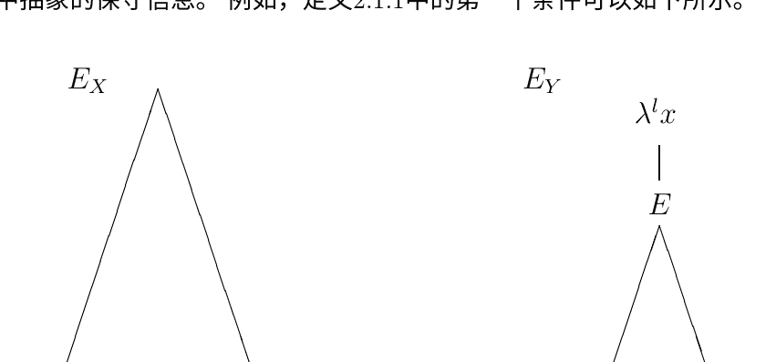

在这种情况下，E_Y是一个带有标签 l 的抽象。因此，E_X 可以求值为带有标签 l的抽象。第一个条件表示在这种情况下，映射 L必须满足 {l} ⊆ L(var(E_X))。换句话说，分析必须意识到评估 E_X可能得到这样一个抽象。

定义2.1.1中的另外三个条件涵盖了抽象是 E_Y的合适子项的情况。第二个条件涵盖了 E_Y 中的一个抽象是另一个抽象的主体的情况。第三个和第四个条件涵盖了抽象是应用的运算符和操作数的情况。在这里，我们只会说明这三个条件中的第一个；其他条件类似。

（此处应插入图片描述，但文本中未提供具体描述，故保留原文占位符）
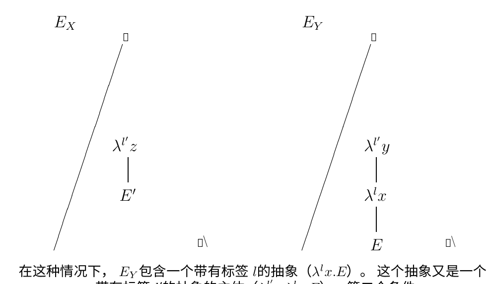

在这种情况下，E_Y 包含一个带有标签 l的抽象 (λ^l x.E)。这个抽象又是一个带有标签 l'的抽象的主体 (λ^{l'} y.λ^l x.E)。第二个条件在定义2.1.1中，第二个条件指出在这种情况下，$E_X$中必须存在一个带有标签$l'$（$\lambda l'. z.E'$，绑定变量可能不同）的抽象，使得映射$L$满足$\{l\} \subseteq L$（var($E'$)）。换句话说，分析必须意识到一些在$E_X$中的抽象$\lambda l'. z.E'$可以演变成一个主体为带有标签$l$的抽象。

注意可能存在多个抽象在$E_X$中具有标签$l'$的情况。因此，如果我们想要“具有标签$l'$的抽象体”的闭包信息，我们必须计算$E_X$中所有具有标签$l'$的抽象体的信息的并集。类似的评论适用于定义2.1.1中的第三和第四个条件。然而，在本文中，对闭包信息的使用并不是关注的重点。

## 2.2 Bondorf的定义

我们现在回顾一下Bondorf [1991]的闭包分析，在符号表示上与他的演示相比有一些小的变化。该分析假设所有标签都是不同的。Bondorf的定义最初是针对Scheme的一个子集给出的；我们将其限制为 $\lambda$-演算。请注意，Bondorf的定义是基于Sestoft的[Sestoft 1989]。

我们将Bondorf的定义简化如下。Bondorf的原始定义将不同的变量出现分配给不同的元变量；相反，我们将相同的元变量分配给每个变量出现。简化的定义等同于Bondorf的原始定义；请参见下文。

我们将使用以下符号表示：如果 $\lambda l. x.E$ 是要分析的项的子项，则部分函数 $body$ 将标签 $l$ 映射到 $E$。

定义 2.2.1. 我们定义 $B: (E: \Lambda) \rightarrow CMap(E) \times CEnv(E)$

$$B(E) = fix(\lambda (\mu, \rho).b(E)\mu\rho)$$

$$b: (E: \Lambda) \rightarrow CMap(E) \rightarrow CEnv(E) \rightarrow CMap(E) \times CEnv(E)$$
$$b(x^l)\mu\rho = (upd \llbracket\nu^l\rrbracket \rho\llbracket\nu^l\rrbracket \mu, \rho)$$
$$b(\lambda l. x.E)\mu\rho = let\ (\mu', \rho')\ be\ b(E)\mu\rho$$
$$\qquad\qquad\qquad\quad in\ (upd \llbracket\lambda^l\rrbracket \{l\} \mu', \rho')$$
$$b(E_1 @_i E_2)\mu\rho = let\ (\mu', \rho')\ be\ (b(E_1)\mu\rho) \sqcup (b(E_2)\mu\rho)\ in$$
$$\qquad\qquad\qquad\quad\quad let\ c\ be\ \mu'(var(E_1))\ in$$
$$\qquad\qquad\qquad\quad\quad\quad\quad let\ \mu''\ 是\ 更新\ \llbracket[@_i]\rrbracket\ (\bigsqcup_{l \in c} \mu'(var(body(l)))) \ mu'\ 在$$
$$\qquad\qquad\qquad\quad\quad\quad\quad\quad\quad let\ \rho''\ 是\ \rho'(\bigsqcup_{l \in c} (更新\ \llbracket[\nu^l]\rrbracket\ \mu'(var(E_2))) \ \rho')$$
$$\qquad\qquad\qquad\quad\quad\quad\quad\quad\quad\quad\quad 在\ (\mu'', \rho'').$$

现在我们可以通过计算 $fst(B( E))$ 来进行$E$的闭包分析。如果我们修改上述定义，使得变量的不同出现被分配不同的元变量，那么我们就得到了Bondorf的原始定义。

那个定义将为给定变量的出现分配相同的集合，并且计算得到的闭包信息将与所述分析计算的信息相同（我们将细节留给读者）。

## 2.3 一个更简单的抽象解释

Bondorf的定义可以大大简化。为了看清楚原因，考虑$CMap(E) \times CEnv(E)$的第二个组成部分。这个组成部分只在更新时被使用。

b(E_1 @_i E_2)μρ中只读取，而在b(x^l)μρ中只写入。关键观察是这两个操作都可以在第一个组成部分上完成。因此，我们可以省略使用CEnv(E)。根据这个观察，重新编写Bondorf的定义，我们得到以下定义。与Bondorf的定义一样，我们假设所有标签都是不同的。

## 定义2.3.1. 我们定义m: (E: Λ) → CMap(E) → CMap(E)

$$m(x^l)\mu = \mu$$
$$m(\lambda^l x.E)\mu = (m(E)\mu) \sqcup \langle[\![\lambda^l]\!] \to \{l\}\rangle$$
$$m(E_1 @_i E_2)\mu = (m(E_1)\mu) \sqcup (m(E_2)\mu) \sqcup \bigsqcup_{l\in\mu(var(E_1))} (\langle[\![\nu^l]\!] \to \mu(var(E_2))\rangle \sqcup \langle[\![@_i]\!] \to \mu(var(body(l)))\rangle).$$

我们现在可以通过计算 $fix(m( E))$来对E进行闭包分析。

一个关键问题是：简化的抽象解释是否等价于Bondorf的解释？我们可以尝试使用固定点归纳来证明这一点，但我们发现使用特定的约束系统作为“垫脚石”更容易。

## 2.4约束系统

对于一个 λ项 E，约束系统是一个由形如 P ⊆ P'的包含关系的Horn子句的有限集合，其中 P 和 P' 可以是元变量或 CSet(E)的元素。这样的系统的解是 CMap(E)的一个元素，满足所有Horn子句。约束系统是根据要分析的 λ项来定义的。我们不需要假设所有标签都是不同的。

集合 R(E_1 @_i E_2, λ^l x.E)包含两个元素

$$\{l\} \sqsubseteq var(E_1) \Rightarrow var(E_2) \sqsubseteq [\![\nu^l]\!]$$
$$\{l\} \sqsubseteq var(E_1) \Rightarrow var(E) \sqsubseteq [\![@_i]\!].$$

对于一个 λ-项 E，约束系统 C(E) 是以下约束集合的并集。

-   对于每个 λ^l x.E'在 E中，由 {l} ⊆ [[λ^l]]组成的单例约束集合。
-   对于每个 E_1 @_i E_2在 E中，并且对于每个 λ^l x.E'在 E中，集合 R(E_1 @_i E_2, λ^l x.E')。

每个 C(E) 都有一个最小解，即所有解的交集。

现在我们可以通过计算 C( E) 的解来进行E的闭包分析。当然，规范解的选择是最小解。

Bondorf和Jørgensen [1993]的闭包分析可以理解为在每个 R(E_1 @_i E_2, λ^l x.E')上添加两个约束，使得实际上包含关系 var(E_2) ⊆ [[ν^l]]和 var(E) ⊆ [[@_i]]变为等式。因此，他们的闭包分析比我们的计算更多的近似信息。作为回报，他们的分析可以在几乎线性时间内计算，使用了另一种问题的表达方式[Bondorf和Jørgensen 1993]，而计算 C(E)的最小解的已知最快算法使用了传递闭包（参见Palsberg和Schwartzbach [1992a; 1994b]）。

## 3. 等价性

我们现在证明在第2节中定义的三个闭包分析是等价的（当应用于 λ-项且所有标签都是不同的情况下）。我们将使用标准的。

如果 $\mu$ 是 $m(E)$ 的前缀点，则 $m(E)\mu \sqsubseteq \mu$。

## 引理3.1.

如果 $\mu$ 是 $m(E)$ 的前缀点，则对于每个 $E$ 的子项 $E'$，它也是 $m(E')$ 的前缀点。

证明. 通过对 $E$ 的结构进行归纳。 $\square$

## 引理3.2.

$C(E)$ 有最小解 $fix(m(E))$.

证明. 我们证明了一个更强的性质：$C(E)$ 的解恰好是 $m(E)$ 的前缀点。有两个包含关系需要考虑。

首先，我们证明每个 $C(E)$ 的解都是 $m(E)$ 的前缀点。我们通过对 $E$ 的结构进行归纳来进行。在基本情况下，考虑 $x^l$。显然，每个 $\mu$ 都是 $m(x^l)$ 的前缀点。在归纳步骤中，首先考虑 $\lambda^l x.E$。假设 $\mu$ 是 $C(\lambda^l x.E)$ 的解。那么 $\mu$ 也是 $C(E)$ 的解，所以根据归纳假设，$\mu$ 是 $m(E)$ 的前缀点。因此，我们得到 $m(\lambda^l x.E)\mu =$

$(m(E)\mu) \sqcup \langle[\![\lambda^l]\!] \to \{l\}\rangle \sqsubseteq \mu \sqcup \langle[\![\lambda^l]\!] \to \{l\}\rangle = \mu$，通过使用 $m$ 的定义，$\mu$ 是 $m(E)$ 的前缀点，并且由于 $C(\lambda^l x.E)$ 有解 $\mu$，$\{l\} \sqsubseteq \mu([\![\lambda^l]\!])$。

考虑 $E_1 @_i E_2$。假设 $\mu$ 是 $C(E_1 @_i E_2)$ 的解。那么 $\mu$ 也是 $C(E_1)$ 和 $C(E_2)$ 的解，所以根据归纳假设，$\mu$ 是 $m(E_1)$ 和 $m(E_2)$ 的前缀点。因此，通过使用 $m$ 的定义，我们得到 $m(E_1 @_i E_2)\mu = \mu \sqcup \bigsqcup_{l \in \mu(var(E_1))} (\langle[\![\nu^l]\!] \to \mu(var(E_2))\rangle \sqcup \langle[\![@_i]\!] \to \mu(var(body(l)))\rangle)$

这是 $m(E_1)$ 和 $m(E_2)$ 的前缀点，并且 $C(E_1 @_i E_2)$ 有解 $\mu$。

其次，我们证明每个 $m(E)$ 的前缀点都是 $C(E)$ 的解。我们通过对 $E$ 的结构进行归纳来进行证明。在基本情况下，考虑 $x^l$。显然，每个 $\mu$ 都是 $C(x^l)$ 的解。在归纳步骤中，首先考虑 $\lambda^l x.E'$。假设 $\mu$ 是 $m(\lambda^l x.E')$ 的前缀点。然后，根据引理3.1，$\mu$ 也是 $m(E')$ 的前缀点。根据归纳假设，$\mu$ 是 $C(E')$ 的解。

因此，我们需要证明 $\mu$ 满足 $\{l\} \sqsubseteq [\![\lambda^l]\!]$ 以及对于每个 $E_1 @_i E_2$ in $E'$，$\mu$ 是 $C(E_1 @_i E_2)$ 的解。对于第一个问题，使用 $\mu$ 是 $m(\lambda^l x.E')$ 的前缀点来得到 $\mu \sqsupseteq m(\lambda^l x.E')\mu = (m(E')\mu) \sqcup \langle[\![\lambda^l]\!] \to \{l\}\rangle \sqsupseteq \langle[\![\lambda^l]\!] \to \{l\}\rangle$，由此得出结果。对于第二个问题，考虑 $E_1 @_i E_2$ in $E'$。根据引理3.1，$\mu$ 也是 $m(E_1 @_i E_2)$ 的前缀点。使用假设我们得到 $\mu \sqsupseteq m(E_1 @_i E_2)\mu \sqsupseteq \bigsqcup_{l \in \mu(var(E_1))} (\langle[\![\nu^l]\!] \to \mu(var(E_2))\rangle \sqcup \langle[\![@_i]\!] \to \mu(var(body(l)))\rangle)$，由此得出结果。

考虑 $E_1 @_i E_2$。假设 $\mu$ 是 $m(E_1 @_i E_2)$ 的前缀点。然后，根据引理3.1，$\mu$ 也是 $m(E_1)$ 和 $m(E_2)$ 的前缀点。根据归纳假设，$\mu$ 是 $C(E_1)$ 和 $C(E_2)$ 的解。因此，我们需要证明对于每个 $\lambda^l x.E'$ in $E_1 @_i E_2$，$\mu$ 满足 $R(E_1 @_i E_2, \lambda^l x.E')$。从 $\mu$ 是 $m(E_1 @_i E_2)$ 的前缀点，我们得到 $\mu \sqsupseteq m(E_1 @_i E_2)\mu \sqsupseteq \bigsqcup_{l \in \mu(var(E_1))} (\langle[\![\nu^l]\!] \to \mu(var(E_2))\rangle \sqcup \langle[\![@_i]\!] \to \mu(var(body(l)))\rangle)$，由此得出结果。 $\square$

## 引理3.3.

$C(E)$ 具有最小解 $fst(B(E))$。

证明. 类似于引理3.2的证明. $\square$

## 定理3.4.

在第2节中定义的三种闭包分析是等价的。

证明. 结合引理3.2和3.3. $\square$

## 4. 正确性

我们现在证明在第2节中定义的三种闭包分析是正确的。关键是定义一个蕴含关系 $A \rightsquigarrow A'$ (定义4.1)，意味着约束系统 $A'$中的所有约束都可以从 $A$中逻辑推导出来。一个核心结果 (定理4.10) 是如果 $E_X \rightarrow E_Y$，则 $C(E_X) \rightsquigarrow C(E_Y)$。这个定理在完全不考虑所涉及约束系统的解的情况下证明。

定义 4.1. 如果 $A$是一个约束系统，而 $H$是一个 $Horn$子句，那么判断 $A \vdash H$ (“$A$蕴含 $H$”) 成立的条件是可以使用以下五个规则推导出来：

$$\begin{array}{rll}
& \dfrac{H \in A}{A \vdash H} & (\text{解除})\[2ex]
& \dfrac{P \sqsubseteq P'}{A \vdash P \sqsubseteq P'} & (\text{自反性})\[2ex]
& \dfrac{A \vdash P \sqsubseteq P' \quad P' \sqsubseteq P''}{A \vdash P \sqsubseteq P''} & (\text{传递性})\[2ex]
& \dfrac{A \vdash X \quad X \Rightarrow Y}{A \vdash Y} & (\text{演绎法则})\[2ex]
& \dfrac{P \sqsubseteq P', Q' \sqsubseteq Q''}{A \vdash P \sqsubseteq P' \Rightarrow Q \sqsubseteq Q''} \quad \dfrac{P' \sqsubseteq P''}{A \vdash P \sqsubseteq P''} \quad \dfrac{Q \sqsubseteq Q'}{A \vdash P \sqsubseteq P' \Rightarrow Q \sqsubseteq Q'} & (\text{削弱})\[2ex]
\end{array}$$

如果 $A$，$A'$ 是约束系统，则 $A \rightsquigarrow A'$ 当且仅当 $\forall H \in A'$： $A \vdash H$。

## 引理 4.2.
$\rightsquigarrow$ 是自反的，传递的，并且保持解。如果 $A \supseteq A'$，则 $A \rightsquigarrow A'$。

证明。最后一个性质可以直接使用 Discharge 得到。$\rightsquigarrow$ 的自反性是最后一个性质的结果。对于 $\rightsquigarrow$ 的传递性，假设 $A \rightsquigarrow A'$ 并且 $A' \rightsquigarrow A''$。陈述“如果 $A' \vdash H$，则 $A \vdash H$”可以通过对 $A' \vdash H$ 的证明结构进行归纳来证明。为了证明 $A \rightsquigarrow A''$，假设 $H \in A''$。从 $A' \rightsquigarrow A''$ 我们得到 $A' \vdash H$，并且从上述陈述中我们最终得到 $A \vdash H$。为了证明 $\rightsquigarrow$ 是保持解的，假设 $A \rightsquigarrow A'$ 并且 $A$ 有解 $L$。我们需要证明对于每个 $H \in A'$，$H$ 有解 $L$。这可以通过对 $A \vdash H$ 的证明结构进行归纳来证明。 $\square$

以下引理的结构使得 Modus Ponens 仅在引理4.3的证明中使用，而 Weakening 仅在引理4.6的证明中使用。为了帮助直觉，我们可以非正式地将 $A \vdash \text{var}(E) \sqsubseteq \text{var}(E')$ 解读为“在假设 $A$下，$\lambda$-term $E$ 有比 $\lambda$-term $E'$ 更小的流信息。”下一个引理说明了从 redex 的约束系统中可以推导出两个具体的约束。非正式地说，第一个约束表明参数的流信息比绑定变量的流信息更小，而第二个约束表明抽象体的流信息比整个 redex 的流信息更小。

## 引理4.3.

如果 A ↝ C((λ^l x.E) @_i E_2), 那么 A ⊢ var(E_2) ⊆ [[ν^l]] 并且 A ⊢ var(E) ⊆ [[@_i]].

证明. 我们有 A ↝ {l} ⊆ [[λ^l]] 和 A ↝ R((λ^l x.E) @_i E_2, λ^l x.E). 然后, 根据var(λlx.E)=[[λ^l]] 和推理法则, 结果得出。 □

下一个引理是一个替换引理。 简单地说, 它表明如果一个子项被一个具有较小流信息的子项替换, 那么一个 λ-项的流信息会变小。

## 引理 4.4.

如果 A ⊢ var(U) ⊆ [[ν^l]], 那么 A ⊢ var(E[U/x^l]) ⊆ var(E).

证明. 通过对 E的结构进行归纳, 反复使用自反性。 □

简单来说, 下一个引理表明beta-还原会创建具有小型流信息的 λ-项。

## 引理 4.5.

如果 A ↝ C(E_X) 且 E_X → E_Y, 那么 A ⊢ var(E_Y) ⊆ var(E_X).

证明. 我们通过对 E_X的结构进行归纳来进行证明。 在基本情况下, 考虑 x^l. 结论是显然的, 因为 x^l是正规形式。
在归纳步骤中, 首先考虑 λ^l x.E. 假设 E → E'. 注意到 var(λ^l x.E) = var(λ^l x.E') = [[λ^l]]. 使用自反性我们得到 A ⊢ [[λ^l]] ⊆ [[λ^l]].
最后考虑 E_1 @_i E_2。 有三种情况。 假设 E_1 → E_1'。 注意 var(E_1 @_i E_2) = var(E_1' @_i E_2) = [[@_i]]。 使用自反性, 我们得到 A ⊢ [[@_i]] ⊆ [[@_i]]。
然后假设 E_2 → E_2'。 注意 var(E_1 @_i E_2) = var(E_1 @_i E_2') = [[@_i]]。 使用自反性, 我们得到 A ⊢ [[@_i]] ⊆ [[@_i]]。
然后假设 E_1 = λ^l x.E 并且 E_1 @_i E_2 → E[E_2/x^l]。 根据引理4.3, 我们得到 A ⊢ var(E_2) ⊆ [[ν^l]] 和 A ⊢ var(E) ⊆ [[@_i]]。 根据前者和引理4.4, 我们得到 A ⊢ var(E[E_2/x^l]) ⊆ var(E)。 使用传递性, 我们最终得出 A ⊢ var(E[E_2/x^l]) ⊆ [[@_i]]。 □

非正式地说, 下一个引理表明在β-还原和替换下, 蕴含关系是稳健的。

## 引理4.6.

假设 A ↝ R(E_1 @_i E_2, λ^l x.E_3) ∪ C(E_1) ∪ C(E_2) ∪ C(E_3)。 如果 E_j = E_j' 或 E_j → E_j' 或 E_j' = E_j[U_j/x_j^l] 其中 A ⊢ var(U_j) ⊆ var(x_j^l) 对于 j ∈ 1..3, 那么 A ↝ R(E_1' @_i E_2, λ^l x.E_3')。

证明. 对于 j ∈ 1..3, 我们从自反性、引理4.5或引理4.4中得到 A ⊢ var(E_j') ⊆ var(E_j)。 然后使用弱化得到结果。

下面的定义用于陈述和证明引理4.9。

## 定义 4.7.

集合 W(E, E') 是以下约束集合的并集。

-   C(E) ∪ C(E').
-   对于每个 E_1 @_i E_2 在 E 中, 对于每个 λ^l x.E_3 在 E' 中, 集合 R(E_1 @_i E_2, λ^l x.E_3)。
-   对于每个 E_1 @_i E_2 在 E' 中, 对于每个 λ^l x.E_3 在 E 中, 集合 R(E_1 @_i E_2, λ^l x.E_3)。

## 引理 4.8.

W(E_1, E_2) ⊆ C(E_1 @_i E_2)。 此外, 如果 E_1' 是 E_1的子项, 那么 W(E_1', E_2) ⊆ W(E_1, E_2)。

证明. 立即 。 □

下一个引理是一个替换引理。就像引理4.6一样，它说明了替换的稳健性。

## 引理4.9。
如果 $A \leadsto W(E, U)$ 并且 $A \vdash \text{var}(U) \subseteq [[\nu^{l'}]]$，那么 $A \leadsto C(E[U/x^{l}])$。

证明。让 $\rho$ 表示替换 $[U/x^{l}]$。我们按照 $E$ 的结构进行归纳。在基本情况下，考虑 $E = y^{l'}$。如果 $x^{l} \equiv y^{l'}$，那么 $E\rho = U$ 因此结果由 $A \leadsto W(E, U)$ 和引理4.2得出。如果 $x^{l} \not\equiv y^{l'}$，那么 $E\rho = E$ 因此结果由 $A \leadsto W(E, U)$ 和引理4.2得出。

在归纳步骤中，首先考虑 $E = \lambda^{l'}y.E'$。如果 $x^{l} \equiv y^{l'}$，则 $E\rho = E$，因此在这种情况下，结果可以从 $A \leadsto W(E, U)$ 和引理 4.2 推出。如果 $x^{l} \not\equiv y^{l'}$，则 $E\rho = \lambda^{l'}y.(E'\rho)$。根据归纳假设，$A \leadsto C(E'\rho)$。因此，我们需要证明 $A\vdash \{l'\} \subseteq [[\lambda^{l'}]]$ 并且对于每个 $E_{1} \otimes_{i} E_{2}$ in $E'\rho$，$A \leadsto R(E_{1} \otimes_{i} E_{2}, \lambda^{l'}y.(E'\rho))$。第一个结论可以从 $A \leadsto C(\lambda^{l'}y.E')$ 推出。对于第二个结论，考虑任意的 $E_{1} \otimes_{i} E_{2}$ in $E' \rho$。注意到要么 $E_{1} \otimes_{i} E_{2}$ 是 $E'$ 的子项，要么 $E_{1} \otimes_{i} E_{2} = (E_{1}' \otimes_{i} E_{2}')\rho = (E_{1}'\rho) \otimes_{i} (E_{2}'\rho)$ 其中 $E_{1}' \otimes_{i} E_{2}'$ 是 $E$ 的子项，或者 $E_{1} \otimes_{i} E_{2}$ 是 $U$ 的子项。在每种情况下，结果都可以从 $A \leadsto W(E, U)$ 和引理4.6得出。最后考虑 $E = E_{1} \otimes_{i} E_{2}$。根据归纳假设，$A \leadsto C(E_{1}\rho) \cup C( E_{2}\rho)$。因此，我们需要证明对于每个 $\lambda^{l'}y.E'$ 在 $(E_{1} \otimes_{i} E_{2})\rho$ 中，$A \leadsto R((E_{1} \otimes_{i} E_{2})\rho, \lambda^{l'}y.E')$。考虑任意 $\lambda^{l'}y.E'$ 要么是 $E_{1} \otimes_{i} E_{2}$ 的子项，要么 $\lambda^{l'}y.E' = \lambda^{l'}y.(E'\rho)$，其中 $\lambda^{l'}y.E'$ 是 $E_{1} \otimes_{i} E_{2}$ 的子项，或者 $\lambda^{l'}y.E'$ 是 $U$ 的子项。在每种情况下，结果都可以从 $A \leadsto W(E, U)$ 和引理4.6得出。$\Box$

我们现在可以证明，如果我们将 $E_{X}$ 进行beta规约到 $E_{Y}$，那么 $E_{X}$ 的约束系统包含 $E_{Y}$ 的约束系统。

## 定理4.10.
如果 $E_{X} \to E_{Y}$，那么 $C(E_{X}) \leadsto C(E_{Y})$。

证明。我们通过对 $E_{X}$ 的结构进行归纳来进行。在基本情况下，当 $x^{l}$ 时，结论是显然的，因为 $x^{l}$ 处于正常形式。
在归纳步骤中，首先考虑 $\lambda^{l}x.E$。假设 $E \to E'$。根据归纳假设，$C( E) \leadsto C(E')$，因此也有 $C(\lambda^{l}x.E) \leadsto C(E')$。因此，我们需要证明 $C(\lambda^{l}x.E)\vdash \{l\} \subseteq [[\lambda^{l}]]$，以及对于每个 $E_{1} \otimes_{i} E_{2}$ in $\lambda^{l}x.E'$，$C(\lambda^{l}x.E) \leadsto R( E_{1} \otimes_{i}E_{2}, \lambda^{l}x.E')$。第一个结论可以通过Discharge得到。对于第二个结论，有四种情况。注意，根据Discharge，对于每个 $E_{1}' \otimes_{i}E_{2}'$ in $\lambda^{l}x.E$，我们有 $C( \lambda^{l}x.E) \leadsto R( E_{1}' \otimes_{i} E_{2}', \lambda^{l}x.E)$。在第一种情况下，假设 $E_{1} \otimes_{i} E_{2}$ 也是 $\lambda^{l}x.E$ 的子项。然后，结果可以从引理4.6得到。在第二种情况下，考虑一个 $E_{1}' \otimes_{i} E_{2}'$ 的子项，其中 $E_{1}' \to E_{1}$。同样，结果可以从引理4.6得到。在第三种情况下，考虑一个 $E_{1} \otimes_{i} E_{2}'$ 的子项，其中 $E_{2}' \to E_{2}$。同样，结果来自引理4.6。在第四种情况下，考虑一个子项 $E_{1}' \otimes_{i} E_{2}'$ of $\lambda^{l}x.E$ such that $E_{1} \otimes_{i} E_{2} = ( E_{1}' \otimes_{i} E_{2}')[E_{S}/y^{l}]$。由于红式的收缩，导致了替换。根据引理4.3，我们得到 $C(\lambda^{l}x.E) \vdash \text{var}( E_{S}) \subseteq [[\nu^{l'}]]$。结果随后由引理4.6得出。最后考虑 $E_{1} \otimes_{i} E_{2}$。对于每个 $\lambda^{l}x.E$ in $E_{1} \otimes_{i} E_{2}$，我们有 $C( E_{1} \otimes_{i} E_{2}) \leadsto R(E_{1} \otimes_{i} E_{2}, \lambda^{l}x.E)$。有三种情况。
假设 $E_{1} \to E_{1}'$。根据归纳假设，$C(E_{1}) \leadsto C(E_{1}')$，因此也有 $C(E_{1} \otimes_{i} E_{2}) \leadsto C(E_{1}' \otimes_{i} E_{2})$。因此我们需要证明对于每个 $\lambda^{l}x.E'$ 在 $E_{1}' \otimes_{i} E_{2}$ 中成立 $C(E_{1} \otimes_{i} E_{2}) \leadsto R(E_{1}' \otimes_{i} E_{2}, \lambda^{l}x.E')$。有三种情况。在第一种情况下，假设 $\lambda^{l}x.E'$ 是 $E_{1} \otimes_{i} E_{2}$ 的子项。然后根据引理4.6得出结论。

在第二种情况下，考虑一个子项 $\lambda^l x.E$ of $E_1 \otimes_i E_2$ 使得 $E \rightarrow E'$。同样地，根据引理4.6得出结论。在第三种情况下，考虑一个子项 $\lambda^l x.E$ of $E_1 \otimes_i E_2$ 使得替换是由于红式的收缩而产生的。从引理4.3我们可以看到 $C(E_1 \otimes_i E_2) \vdash \mathrm{var}(E_S) \subseteq [[\nu^{l'}]]$。结果则由引理4.6得出。假设 $E_2 \rightarrow E'_2$。在这种情况下，证明与之前的情况类似。由于 $E_1 \rightarrow E'_1$，我们省略了细节。假设 $E_1 = \lambda^l x.E$ 并且 $E_1 \otimes_i E_2 \rightarrow E[E_2/x]^l$。从引理4.3我们可以看到 $C(E_1 \otimes_i E_2) \vdash \mathrm{var}(E_2) \subseteq [[\nu^l]]$。从引理4.8我们可以看到 $W(E, E_2) \subseteq C(E_1 \otimes_i E_2)$。结果则由引理4.9得出。$\square$

## 定理4.11.
第2节中定义的三种闭包分析是正确的。

证明。从定理3.4我们可以看出，当应用于具有不同标签的 $\lambda$-项时，这三种分析是等价的。因此，只需证明使用约束系统定义的分析是正确的。证明有两个步骤。在第1步中，使用引理4.3、4.4和4.5证明如果 $A \leadsto C(E_X)$ 和 $E_X \rightarrow E_Y$，那么以下两个性质都成立：

- 如果 $E_Y$ 包含 $\lambda^l y.E$，那么 $E_X$ 包含 $\lambda^l z.E'$，其中 $A \vdash \mathrm{var}(E) \subseteq \mathrm{var}(E')$。
- 如果 $E_Y$ 包含 $E_1 \otimes_i E_2$，那么 $E_X$ 包含 $E'_1 \otimes_i E'_2$，其中 $A \vdash \mathrm{var}(E_1) \subseteq \mathrm{var}(E'_1)$ 且 $A \vdash \mathrm{var}(E_2) \subseteq \mathrm{var}(E'_2)$。

在第2步中，假设 $C(E_X)$ 有解 $L$，并且假设 $E_X \rightarrow^* E_Y$。我们将通过对 $E_X \rightarrow^* E_Y$ 的长度进行归纳来证明 $T_L( E_X, E_Y)$。在基本情况下，$T_L(E_X, E_X)$ 是直接的。在归纳步骤中，假设根据定理4.10，$C(E_X) \leadsto C( E_Z)$。根据引理4.2，$C( E_Z)$ 有解 $L$。根据归纳假设，$T_L(E_Z, E_Y)$。为了证明 $T_L(E_X, E_Y)$，有四种情况需要考虑。

首先假设 $E_Y = \lambda^l x.E$。根据 $T_L(E_Z, E_Y)$ 我们得到 $\{l\} \subseteq L(\mathrm{var}(E_Z))$。根据引理4.5，我们得到 $C(E_X) \vdash \mathrm{var}(E_Z) \subseteq \mathrm{var}(E_X)$。最后，通过使用 $C(E_X)$ 有解 $L$，得出结果。

然后假设 $E_Y$ 包含 $\lambda^l y.(\lambda^l x.E)$。从 $T_L(E_Z, E_Y)$ 我们得到 $E_Z$ 包含 $\lambda^l z.E'$ 使得 $\{l\} \subseteq L(\mathrm{var}(E'))$。从这个证明的第一步，我们得到 $E_X$ 包含 $\lambda^l w.E''$ 使得 $C(E_X) \vdash \mathrm{var}(E') \subseteq \mathrm{var}(E'')$。最后，结果由于 $C(E_X)$ 有解 $L$ 而得到。

在最后两种情况中，假设 $E_Y$ 包含 $(\lambda^l x.E) \otimes_i E_2$ 或 $E_1 \otimes_i (\lambda^l x.E)$，分别。两种情况与第二种情况类似，因此我们省略细节。$\square$

最后，我们证明了我们的主要约简结果。

## 定理4.12.
如果 $C(E)$ 有解 $L$ 并且 $E \rightarrow E'$，那么 $C(E')$ 也有解 $L$。

证明。根据定理4.10和引理4.2，立即可得。$\square$

## 致谢
作者感谢Torben Amtoft，Nils Klarlund和匿名审稿人对本文草稿的有益评论。

## 参考文献
AGESEN, O., PALSBERG, J. and SCHWARTZBACH, M. 1993. Self的类型推断：动态和多重继承对象的分析。在ECOOP'93会议论文集中，第7届欧洲面向对象编程会议。计算机科学讲义，第707卷。Springer-Verlag，纽约，247-267。

AYERS, A. 1992. 具有可达性的高效闭包分析。在WSA'92会议论文集中，静态分析。IRISA，雷恩，法国，126-134。

BARENDREGT, H. P. 1981. Lambda演算：其语法和语义。North-Holland, 阿姆斯特丹。

BONDORF, A. 1993. Similix 5.0手册。DIKU, 哥本哈根大学, 丹麦。包含在Similix 5.0发行版中。

BONDORF, A. 1991. 高阶递归方程的自动自投影。Sci. Comput. Program. 17,1-3 (12月), 3-34。

BONDORF, A. and DANVY, O. 1991. 具有全局变量和抽象数据类型的递归方程的自动自投影。Sci. Comput. Program. 16, 151-195。

BONDORF, A. and JØRGENSEN, J. 1993. 实际离线部分求值的高效分析。J. Functional Program. 3, 3, 315-346。

康塞尔，C. 1990. 绑定时间分析用于高阶无类型函数式语言。在ACM会议论文集上。ACM, 纽约, 264-272。

吉安尼尼, P. 和罗卡, S. R. D. 1988. 多态类型学中的类型刻画。在LICS'88会议论文集上, 第三届计算机科学逻辑学年会。IEEE, 纽约, 61-70。

HEINTZE, N. 1994. 基于集合的ML程序分析。在ACM会议论文集上关于LISP和函数式编程。ACM, 纽约, 306-317。

HEINTZE, N. 1992. 基于集合的程序分析。博士论文, CMU-CS-92-201, 卡内基梅隆大学, 匹兹堡, 宾夕法尼亚州。

JONES, N. D. 1981. λ表达式的流分析。在第8届自动机、语言和编程学术会议上。计算机科学讲义, 第115卷。Springer-Verlag, 纽约, 114-128。

PALSBERG, J. 1993. 绑定时间分析的正确性。J.功能程序。3, 3, 347-363。

PALSBERG, J. and SCHWARTZBACH, M.I. 1994A. 绑定时间分析：抽象解释与类型推断。在ICCL'94会议论文集中, 第5届IEEE国际计算机语言会议。IEEE, 纽约, 289-298。

PALSBERG, J. and SCHWARTZBACH, M.I. 1994B. 面向对象的类型系统。JOHN WILEY and Sons, 纽约。

PALSBERG, J. and SCHWARTZBACH, M.I. 1992A. 安全分析与类型推断。Inf. Comput.即出版。

PALSBERG, J. and SCHWARTZBACH, M.I. 1992B. 安全分析与部分类型的类型推断。Inf. Process. Lett. 43, 175-180。

约克, 227–241. 也发表在Lisp和符号计算4(3), Kluwer Acadamic Publishers, 1991年6月。

WAND, M. and STECKLER, P. 1994. 选择性和轻量级闭包转换。在POPL94会议记录中, 第21届编程语言原理研讨会, ACM, 纽约, 434–445。

收到于1994年5月; 于1994年10月修订; 于1994年10月接受

# Java的访问权限分析

Larry Koved
IBM T.J. Watson研究中心
P.O. Box 704
Yorktown Heights, New York 10598
koved@us.ibm.com

马尔科·皮斯托亚
IBM T.J. Watson研究中心
P.O. Box 704
Yorktown Heights, New York 10598
pistoia@us.ibm.com

亚伦·科尔申鲍姆
IBM T.J. Watson研究中心
P.O. Box 704
Yorktown Heights, New York 10598
aaronk@us.ibm.com

## 摘要
Java™ 2具有一个安全架构，可以通过移动或静态配置的代码保护系统免受未经授权的访问。问题在于手动确定执行库或应用程序所需的安全访问权限集。通常使用的策略是执行代码，记录授权失败，分配额外的访问权限，并进行再次测试。这个过程迭代，直到代码在手头的测试用例中成功运行。

测试用例通常不能覆盖代码的所有路径，因此在部署的系统中可能会发生故障。相反，为了防止授权失败，代码被分配了广泛的访问权限。然而，这经常违反了“最小特权原则”。

本文介绍了一种使用上下文敏感、流敏感、跨过程数据流分析的技术来计算访问权限要求。通过使用这种分析，在每个程序点计算代码所需的访问权限集。我们对多线程、隐式定义的安全策略、Permission.implies方法的语义以及安全策略描述的生成进行了建模。我们实现了算法，并展示了我们在一组程序上的分析结果。虽然本文描述的分析技术是针对Java代码的，但基本技术适用于非Java系统中的访问权限分析问题。

## 关键词
Java安全，访问权限。安全，调用图，数据流分析。

## 1. 引言
Java™ 2具有旨在保护客户端和服务器系统免受动态安装的安全体系(例如移动代码)或静态配置的恶意代码[13][14][15][23]。小程序代码可以从互联网下载到Web浏览器中[23][19]，并通过RMI [22]上传到服务器应用程序中。Java 2安全系统包含身份验证子系统和授权子系统。

本文重点介绍授权子系统，自动化确定访问执行代码所需的权限。

在部署Java应用程序或库代码之前，会出现一个关键问题：“需要哪些Java访问权限才能允许代码执行？”在实践中，这个问题是通过经验来解决的。开发人员阅读所使用的库的文档（包括Java运行时库），并推断出所需的访问权限。不幸的是，这些文档经常缺失、误导或过时。在没有可靠文档的情况下，开发人员执行新代码并观察授权失败。然后开发人员授予额外的访问权限并重新测试。开发人员重复这个过程，可能多次，直到没有授权失败为止。然而，由于测试用例数量不足，所需的访问权限要求可能未被发现，从而使代码不稳定。

在动态安装移动代码的系统中，系统管理员（例如Web浏览器用户）必须确定要提供的访问权限集合，这会产生类似的情况。系统管理员通常依赖于代码开发者/分发者的建议，但存在过多授权和安全漏洞的风险。

或者，系统管理员以较小的访问权限运行代码，检查失败，并逐步添加所需的访问权限。这个过程很繁琐且容易出错。与之前一样，不充分的测试会导致不正确的授权，从而产生安全风险或应用程序不稳定性。

本文描述了一种基于上下文敏感的数据和控制流分析的技术，用于自动确定Java程序或库所需的访问权限。我们使用了一种修改过的

## 类别和主题描述
+ D.2.2 [设计工具和技术]: 计算机辅助软件工程 (CASE)。
+ D.2.4 [软件/程序验证]: 格式方法，验证。
+ D.2.5 [测试和调试]: 代码检查和漫游，诊断, 测试工具 (例如数据生成器, 覆盖测试), 追踪。

## 常用术语
安全，语言。

未经费用授权，允许个人或课堂使用本作品的全部或部分数字或硬拷贝，但不得制作或分发以获取利润或商业优势，并且拷贝必须带有本通知和第一页的完整引用。要进行复制，或重新发布，或发布到服务器，或重新分发到列表，需要事先获得特定的许可和/或支付费用。OOPSLA’02, 2002年11月4日至8日，美国华盛顿州西雅图。版权所有2002 ACM 1-58113-471-1/02/0011...$5.00。

互过程调用图，称为访问权限调用图（ARIG），用于计算访问权限。

在Java中，访问权限使用Permission类层次结构进行建模。类层次结构的根是抽象类java.security.Permission。默认情况下，所有权限都是“批准”访问而不是“拒绝”。权限对象是java.security.Permission的子类的实例。例如，

```
perm = new FilePermission("/tmp/abc", "read");
```

创建一个用于读取文件/tmp/abc的权限对象。在我们的分析中，我们通过构建ARIG来传播访问权限，以计算与每个程序点关联的Permission对象集合。ARIG由对应于AccessController的checkPermission和doPrivileged方法的节点组成，这些节点是边界节点，以及所有路径中的调用图中的所有节点从边界节点到根节点。

总结一下，本文的主要贡献有：

- 我们提出了一种上下文敏感、流敏感的分析方法，用于计算程序的访问权限要求。
- 我们对多线程、隐式定义的安全策略、Permission.implies方法的语义以及安全策略描述的生成进行建模。
- 我们使用修改后的调用图（ARIG）来传播访问权限。
- 我们实现了算法，并展示了我们的工具的测试结果。
- 我们的分析技术足够可扩展，可以在超过20,000个类的分析范围内产生可用的结果。

## 2. 先前的工作

在建模安全和授权方面，静态和动态分析技术都被使用。这项工作的很大一部分是为了消除或最小化冗余的授权测试，或者定义替代当前方法来定义代码中的授权点。

Pottier、Skalka和Smith [25]通过使用λ演算的类型理论，扩展和形式化了Wallach的安全传递风格[31]，称为λsec。Pottier等人无法对Java的所有授权特性进行建模，包括多线程代码和“开放世界”分析。它也不考虑计算授权对象，这通常包括识别Permission对象构造函数的String参数。所有这些都极大地影响了授权分析的完整性。

假设安全属性可以仅通过程序的控制流和调用图来表达。对于Java，基本授权信息是基于传播到授权测试的值（通常是字符串常量）的。

Bartoletti，Degano和Ferrari [5]对运行时授权测试的性能进行了优化，通过消除冗余测试和重新定位其他测试。报告的结果将操作语义应用于模拟运行时堆栈。

同样，Banerjee和Naumann [4]应用指示语义来展示“急切”和“懒惰”语义在堆栈检查中的等价性，提供了安全性（无安全错误）的静态分析，并确定可以删除不必要的授权测试的转换。这种方法的显著局限性是分析仅限于单个线程，并且需要整个程序的分析。此外，未对Permission.implies和Permission.s.implies方法进行建模，包括AllPermission。当简化访问权限策略描述以使结果可用时，对这些类和方法进行建模非常重要。

在上述的工作中，假设有以下情况：(1)调用图算法可将理论方法转化为实际实现，(2)存在一个授权对象，p，和一个单一的授权点，即checkPermission方法。对于Java 2来说，这是不正确的。几乎Java运行时中的所有代码都调用了SecurityManager授权方法之一，尽管其中许多方法随后调用了AccessController.checkPermission。许多著名的调用图和数据流算法[16]都过于保守，无法正确识别授权要求。在本文中，我们描述了一种调用图和数据流分析方法，以减少保守性，获得更准确的授权信息。

Felten、Wallach、Dean和Balfanz研究了与移动代码相关的一些安全问题[32] [11] [31] [9] [30][10] [8]。特别是，他们提出了栈内省的形式化方法，该方法根据线程堆栈中当前活动的主体（签名者和/或代码的来源）来检查授权，这在Java中是常见的。特别地，一种名为security passing style的授权优化技术，在应用程序执行时编码应用程序的安全状态[31]。每个方法都被修改，以便在每个方法调用中传递安全令牌。该令牌表示每个堆栈帧中活动主体（安全状态）的编码，以及遇到的任何授权测试的结果。通过运行应用程序并编码安全状态，security passing style可以探索可比较调用图的子图，并发现与这些状态相关的安全状态和授权。

Wallach假设所有授权测试在时间上是不变的，因此一旦授权测试在特定安全状态下成功或失败，它将始终在该状态下成功或失败。在Java 2中，这种不变性不存在。Permission.implies调用可以撤销类的访问权限，或者在确定测试结果时可能使用与运行时堆栈无关的状态。在实践中，特别是在Web服务器环境中，访问权限在JVM运行时被撤销。我们的方法不是优化授权性能，而是通过分析所有可能的路径来发现授权要求。

通过程序，甚至那些可能不会被有限数量的测试用例发现的路径。

与分析现有代码所体现的安全策略不同，Erlingsson和Schneider [12]描述了一种将引用监视器内联到代码中以执行特定安全策略的系统。目标是定义一个安全策略，然后将授权点注入到代码中。这种方法可以减少或消除冗余的授权测试。我们从检查包含授权测试点的现有系统的角度来研究授权问题。通过静态分析，我们发现安全策略需要如何修改/更新以使代码能够执行。

## 3. 调用图特征

我们使用一种路径不敏感、流敏感、上下文敏感的调用图。路径不敏感的调用图分析每个方法中所有基本块的所有路径。因为Java 2的授权是基于将权限与类关联起来，所以路径不敏感的调用图构建算法就足够了。

调用图对于方法内分析是流敏感的，因为它考虑了每个基本块内指令的执行顺序，同时考虑了局部变量的覆盖和对象引用的转换。调用图（方法间分析）是上下文敏感的，因为它通过其调用上下文唯一区分每个节点：目标方法、接收者和参数值。

为了描述权限剪裁算法，调用图具有以下特征：

- 图中的每个节点表示一个上下文敏感的方法调用。
- 图中的每个节点通过其调用上下文唯一标识，因此图中没有两个具有相同调用上下文的节点。
- 图中的每个节点都包含以下状态：
  - 目标方法。
  - 例如实例方法，方法的接收者的分配位置（或类型）。
  - 方法的所有参数，表示为可能分配位置（或可能类型）的向量的集合。
  - 从该方法返回的可能返回值分配位置（或类型）的集合。
- 图中的边是有向的，每条边从调用位置指向目标方法。
- 图是有根的，可能是循环的。
- 我们对图的表示允许双向遍历，即使图中的边是单向的。因此，从图中的任何节点，我们可以找到其所有前驱节点。

除了调用图构建之外，我们还使用数据流分析，精确到分配位置的级别（CFA(1) [27]），并包括字符串常量的传播。在有限的情况下，使用类似CFA(2)的算法计算Permission对象上的数据流，以减少分析的保守性（参见第4节）。我们是

特别感兴趣的是字符串常量，因为它们被用作Permission对象构造函数的参数。传递给构造函数的字符串常量值完全确定了访问权限要求。

## 4. 授权模型 - 访问权限调用图（ARIG）

每个Java应用程序类都加载到Java虚拟机中，并与一组授予代码的权限相关联。静态确定这组权限是非常困难的，因为它涉及在程序执行的任何点上，尽可能准确地识别可调用的方法集。如果有任何方法被省略，分析就是不完整的。相反，当分析过于保守时，大量的误报违反了最小特权原则[26]，使分析在实际使用中无效。

我们使用图形和集合论方法来建模Java 2授权算法，如下所示。让 **G=(N,E)** 表示代表程序 *P* 的调用图。节点由 **N={n(M,R,P)|M 是目标方法，具有接收器 R 和 k 参数 P=(P_i)_{i=1..k}，其中参数 i 可能有类型 P_i}**。每个节点表示一个方法的内部过程分析，包括方法内的虚拟调用站点，并包含该方法的控制流图。边缘由以下方式描述：

```
E = {(n_p(M_p,R_p,P_p), n_s(M_s,R_s,P_s)) | M_s is invoked within M_p}
```

给定一个节点 n∈N，我们定义 Γ⁺(n) := {n'|∃e(n,n')∈E} 和 Γ⁻(n) := {n'|∃e(n',n)∈E}，分别称为外部和内部的邻接点 n。

我们可以将这些定义扩展到节点集合。因此，给定 N⊆N，我们定义 Γ⁺(N) := ∪_{n∈N} Γ⁺(n) 和 Γ⁻(N) := ∪_{n∈N} Γ⁻(n)。

我们还定义：

- N_root := {n∈N | Γ⁻(n) = Φ}，调用图中的根节点集合
- N_dp := {n(M,R,P) | M is AccessController.doPrivileged}
- N_cp := {n(M,R,P) | M is AccessController.checkPermission}
- N_start := N_root ∪ Γ⁻(N_dp)
- N_stop := N_cp

对于任何节点 n，RP(n) 表示所需权限的集合。for n。同样，给定一组节点 N⊆N，RP(N) 表示节点 N 中所需的权限。这意味着 RP(N) = ∪_{n∈N} RP(n)。对于每个节点 n∈N，算法确定 RP(n) 从 RP(N_stop)，并追踪从节点 N_stop 到节点 N_start的路径。

对于每个节点 n∈N_stop， RP(n) 被定义为包含单个元素 p 的集合，其中 p 是在 n 处检查的权限。因此，如果我们定义 CP(n) 为权限在 n 本身处进行检查，我们有 CP(n) = {p} 若 n∈N_stop，否则 ∅。

对于任何节点 n∈N，如果存在路径 π(n, s) 从 n 到另一个节点 s，n 需要 s 所需的所有权限。因此，它必须是 RP(n) ⊇ RP(s)。因此我们计算 RP(n) 递归地从 RP(n) = CP(n) ∪ ⋃_{s∈N | ∃π(n, s)} RP(s)。

由于一般情况下，G 包含循环，该算法是一个固定点计算，从估计开始 RP(·) 对于每个在 N_stop 中的节点并向后工作，使用 Γ⁻ 函数，沿着路径朝向 N_start 中的节点。这个过程将一组所需的权限集合 RP(·) 与每个节点在 N_start 中关联。更准确地说，它计算 RP(n) 对于所有 n∈N。

最后，RP(C)，类 C 所需的权限集合可以然后计算为 RP(C) = ⋃_{n∈N(C)} RP(n)，其中 N(C) 是节点集合 n，其方法在类 C 中声明。实际上，在这种方式下，我们可以计算 RP(N) 对于任何节点集合 N⊆N。

请注意，通过特权节点向上传播的权限不会传播到特权节点的前任节点之外。因此，上述定义（或基于该定义的算法）必须进行细化以替换 Γ⁻(n) 通过 Γ⁻(n, p)，其中 Γ⁻(n, p)= ∅, 当 p 通过 doPrivileged 节点被向上传播到 n；否则为 Γ⁻(n)。

最后，Java 2中的许多安全授权测试是通过调用SecurityManager类中的方法来完成的。在此类的参考实现中，大部分SecurityManager授权测试是通过调用AccessController.checkPermission来执行的。

与适当的 Permission 对象。有关Java 2授权使用的类、对象和算法的详细信息，请参阅Gong和Pistoia的Java 2安全书籍[15] [23]。

可以看出，上述描述的数据流分析确实通过观察与值相关的传递函数收敛到一个固定点。

RP(n) 在任何调用图节点的输出处，到该节点的输入处的值实际上是恒等函数和值的 RP(n) 在节点的输入处是由节点输出处的值形成的 Γ⁻(n) 通过集合并操作来实现。因此，RP(n) 是单调的，具体来说，它是一个非递减函数，随着我们的计算的进行。

RP(n) 在每个调用站点形成一个格[18]，由于我们分析范围内的类型集是有限的，我们保证计算在有限时间内收敛到一个唯一的固定点，无论我们以何种顺序访问调用图中的节点。

还应注意的是，通过其调用上下文唯一标识ARIG中的节点不会引入任何额外的保守性分析。实际上，具有相同调用上下文的相同方法的任何两个调用都会生成相同的调用子图。因此，它们将需要相同的权限集。

为了澄清本节介绍的所有概念，考虑以下简单示例。一个类C实现了一个方法，methodC，它以文件名作为参数，并返回该文件的FileInputStream，如下所示：

```java
FileInputStream methodC(String fileName) {
    return new FileInputStream(fileName);
}
```

创建一个FileInputStream涉及到一个安全检查。

methodC在类A的methodA和类B的methodB中被调用，唯一的区别是methodA使用特定参数"file1.txt"调用methodC，而methodB根据布尔表达式的值调用methodC，具体取决于两个可能的参数，如下面的两个代码片段所示：

```java
FileInputStream methodA() {
    String fileName = "file1.txt";
    C c = new C();
    return c.methodC(fileName);
}
```

```java
FileInputStream methodB() {
    String fileName;

    if (Math.random() > 0.5)
        fileName = "file.txt";
    else
        fileName = "file2.txt";

    C c = new C();
    return c.methodC(fileName);
}
```

在方法B中评估布尔表达式不能在代码的静态分析期间完成。因此，保守且最安全的方法要求考虑两个分支的执行。因此，对methodC的调用必须考虑两个参数"file1.txt"和"file2.txt"。下图显示了表示程序的简化版本的调用图：

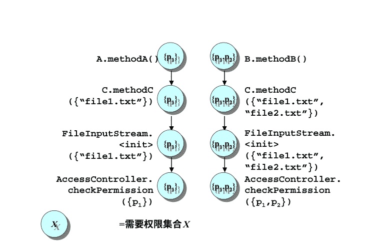

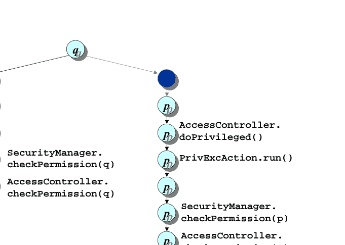

如图1所示的ARIG，类B和类C都需要权限p₁和p₂，而类A只需要p₁。

## 5. 权限剪枝算法

我们描述了一种算法，用于静态地识别每个分析类所需的权限集合。该算法通过识别调用图中的路径[2][3][6][7][28][29]，导致AccessController.checkPermission节点。通过使用数据流分析[21]，该算法确定可能作为该方法参数传递的Permission对象集合。

### 5.1 基本权限剪枝算法

基本算法使用先前描述的ARIG来识别表示每个分析调用点所需访问权限的权限集。然后，该算法通过调用方法及其声明类来聚合这些权限。该算法识别由任何 N_start 节点和 N_stop 节点界定的每条路径中的所有节点，并将一组权限与路径中的每个节点关联起来。在运行系统中，每个checkPermission方法调用都有一个作为参数传递的单个权限对象。在我们的分析中，这个参数是一组可能的权限，不考虑路径。

路径中的每个方法及其声明类都被标记为需要一组权限。此外，通过数据流分析获取Permission构造函数中的String参数。参数值提供了授权要求的必要限定。

权限是通过constructor调用描述的。FilePermission("/tmp/file1", "write")。此算法的伪代码在附录1中。下图以图形方式表示基本权限剪裁算法：

### 5.2 减少访问权限分析的保守性

如下图所示，基本算法导致过于保守的结果。子图表示标准Java 2 SecurityManager的控制和数据流的一部分：

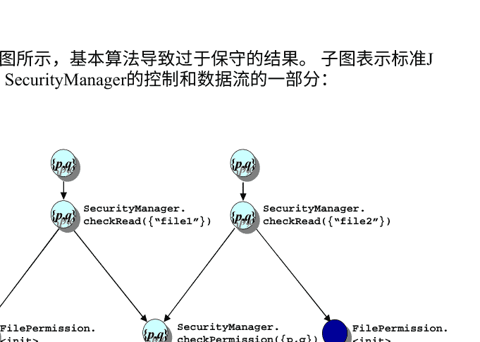

问题在于FilePermission的分配位置对应于两个不同的FilePermission构造函数调用，这是由于导致checkRead方法的两条不同路径。基本的权限剪枝算法传播权限集{p, q}，即使只需要p或q，而不是两者都需要。这违反了最小特权原则。我们通过使用Permission的分配位置节点（类似于CFA(2)方法[27]）来区分SecurityManager中的Permission分配来有选择地减少保守性。在实践中，这

方法似乎足够。下图显示了结果：

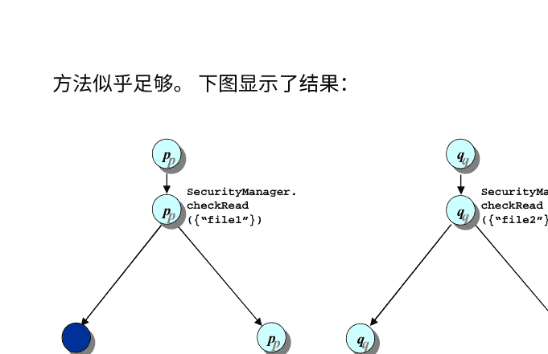

我们定义 Γ⁻(n, P)，对于一组权限 P，节点 n 的内部邻接是指相对于权限 P 的分配位置，n 的前驱节点的集合。算法与之前的算法相同，具体如下

Γ⁻(n, P) 代替 Γ⁻(n)。

实际上，这种改进对于那些在 SecurityManager 检查方法中分配的权限足够。这些方法表现出与上述 checkRead 方法类似的行为。

### 5.3 线程

构造一个新的 Thread 对象不会导致它开始执行。通常情况下，调用 Thread.start 方法会导致新的 Thread 在 Thread.run 方法开始执行。新的 Thread 可以由创建它的不同 Thread 启动，或者由创建 Thread 的类中的方法启动。run 方法成为 Thread 的根（起始）方法。

根据 Java 2 授权模型，一个新的线程要求所有新创建线程的前任节点的构造函数节点也要要求权限集合 P。此外，Γ⁻(n)，其中 n 是一个 Thread.run 节点，不需要 P。我们扩展 Γ⁻ 函数如下：

Γ̃⁻(n,P)= n_{Th}，如果是一个 Thread.run 节点；否则为 Γ⁻(n,P)

其中 n_{Th} 是用于 n 的接收器的 Thread 构造函数节点。

伪代码在附录2中。从图形上看，我们正在重写 ARIG 以包含从 Thread.run 调用站点到 Thread 构造函数的前任边，如下图所示：

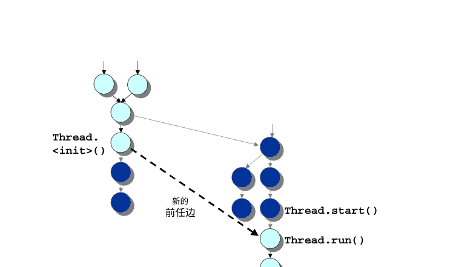

### 5.4 使用 AccessControlContext 的 doPrivileged

除了上述描述的 AccessController.doPrivileged 方法外，另一种形式的 doPrivileged 方法接受 AccessControlContext 实例作为参数。除了先前描述的行为外，授权测试还包括分配 AccessControlContext 对象的节点的所有前任节点。这类似于我们如何对新线程进行建模，通过扩展 Γ⁻ 来将 doPrivileged 节点与分配 AccessControlContext 的节点之间添加一条边。具体而言，我们扩展 Γ⁻ 如下：

Γ̃⁻(n,P)= N_{ACC}(n)，如果是带访问控制上下文的 doPrivileged 节点；否则为 Γ⁻(n,P)

在哪里 N_{ACC}(n) 是这个集合的节点在创建任何一个 n 的 AccessControlContext 参数时，会调用 AccessControlContext.<init>。

## 6. 计算经验

ARIG 的实际用处取决于底层调用图和数据流分析的保守性。在本节中，我们讨论使用相对较少保守的调用图的权衡，并通过实际结果解释为什么我们选择了上下文敏感的、选择性的 CFA(2) 调用图。我们还讨论了在识别表示 Permission 构造函数参数的字符串常量时自然产生的限制。

最后，我们展示一些实验结果。

## 6.1 分析保守性

以前使用静态分析进行Java授权分析的工作没有讨论调用图和数据流分析技术的保守性的影响。调用图和数据流分析的保守性极大地影响了Permission Culling Algorithm的结果。过于保守的控制流和数据流分析可能会确定不需要访问权限的类的访问权限要求，从而违反最小特权原则。类层次分析（CHA）风格的图构建算法[7]要求所有类都需要java.security.Permission及其所有子类的访问权限。类似的结果适用于快速类型分析（RTA）风格的算法[2]，只是需要任何权限的类的访问权限要求将包括在调用图中具有分配位置的所有这些权限。CFA(0)调用图[27]会导致过于保守的结果，因为它不考虑调用上下文。没有调用上下文，无法区分AccessController.checkPermission调用。对于对SecurityManager的调用，使用CFA(2)来选择性地区分所需的权限，如第5.2节所示。此外，doPrivileged节点将被合并，导致doPrivileged之前的所有节点都需要相同的权限集，即使通常所需的权限应该不同。同样，这是过于保守的，违反了最小特权原则。

通过分配位置。出现的实际问题是，一个分配位置不能直接映射到调用图中的一个节点，因此使得分析比我们本来希望的更加保守。具体来说，一个分配位置与图中的多个节点之间存在一对多的映射关系。然而，通过仔细检查我们工具的输出和相应的源代码，我们观察到使用分配位置足以弥补由于跨过程流不敏感性而导致的不精确性。

路径不敏感的程序内分析考虑方法中的所有路径。这是保守的，因为不考虑输入值或程序内定义的常量的值。例如，在语句中：

```
if (false) exp1 else exp2
```

即使在实践中，exp1永远不会被执行，exp1和exp2都会被评估。虽然保守地正确，但这可能导致生成额外的图节点，这些节点在实践中不会出现。其结果是所有所需的权限都被包含在内，尽管可能还包含一些在程序的所有执行中并不严格必要的额外权限。工具的未来版本可以考虑添加一定程度的路径敏感性，以最小化这种保守特性。

经验表明，上下文敏感的调用图产生的结果较保守。基于传播的调用图构建算法已经得到广泛研究，并且主要区别在于用于近似运行时表达式值的集合数量[16]。笛卡尔积算法(CPA)[1]采用了基于参数多态性的方法。

给定要分析的方法调用，CPA计算方法的实际参数类型的笛卡尔积。我们使用的调用图与Agesen的类似，只是我们使用他所称的巨型集合来表示参数。此外，我们考虑数据多态性，而Agesen则不考虑。我们使用的调用图构建算法与Plevyak和Chien [24]所描述的算法类似。

我们使用的图构建算法是有选择性的CFA(2)。特别地，我们使用权限分配站点的节点来区分SecurityManager中的权限分配。我们算法的CFA(1)部分将调用上下文定义为可能的接收者和参数的分配站点。不幸的是，仅凭这种方法无法区分在SecurityManager中相同字节码偏移处分配的两个不同权限（参见第5.2节）。因此，无法区分相同类型的两个不同权限，其中权限对象在SecurityManager中的相同位置分配。正如我们在第5.2节中解释的那样，对CFA(2)-like方法的选择性使用消除了这种额外的保守性水平，而对CPU和内存使用几乎没有影响。

为了最小化保守性，我们使用一种上下文敏感、流敏感和路径不敏感的图构建算法。通过流敏感，我们指的是分析同时考虑指令的执行顺序，无论是内部还是跨过程，从而提高结果图的准确性。

我们图构建的一部分对于局部变量是流敏感的，包括对局部字段null的支持-被后续对同一字段的赋值覆盖的局部字段 - 和类型转换。然而，我们对实例和类（静态）字段的处理是流不敏感的，因为我们使用了一个弱假设，即所有实例和类字段都可能随时由于多线程而被修改。为了弥补类和实例字段的流不敏感性，数据流分析跟踪字段值

## 6.2 对字符串常量的限制标识

实际上，Permission构造函数的参数是字符串常量。在某些情况下，参数值可能只能在运行时获得。例如，可能需要指定要打开的文件的名称作为输入。为了改进分析，可以提供一些元数据来反映运行时的值。在其他情况下，参数值可以是计算的结果（例如，字符串连接）。在这种情况下，需要稍微复杂一些的数据流分析。

| 应用 | 课程范围 | 课程已分析 | 方法已分析 | 指令字节 | 分析时间(调用图) | 分析时间(ARIG) | 分析时间(总计) | 节点 | 边 | 堆大小(MB) |
|------|----------|------------|------------|----------|------------------|----------------|----------------|------|----|------------|
| javadoc | 6,720 | 635 | 2,874 | 190,394 | 162 | 8 | 170 | 21,042 | 60,935 | 128 |
| GetProperty | 5,446 | 378 | 1,545 | 91,471 | 32 | 6 | 38 | 9,326 | 15,743 | 65 |
| CountMain | 5,451 | 383 | 1,552 | 91,809 | 32 | 6 | 38 | 9,339 | 15,763 | 65 |
| java.lang.* | 5,445 | 472 | 2,319 | 126,105 | 51 | 6 | 57 | 13,578 | 23,250 | 93 |
| ECPerf Corp | 21,291 | 1,912 | 2,854 | 426,685 | 94 | 7 | 101 | 18,330 | 36,479 | 120 |

表1. 分析比较

## 6.3 实验结果

上下文和流敏感的静态分析因需要大量的处理能力和内存而闻名。我们对一些示例程序进行了授权分析（见附录3），对rt.jar的部分内容进行了分析，选择了一些中间件，Java API文档生成器（javadoc）和ECPert基准程序的一部分。表1中报告的结果。是在使用AMD Athalon 933 MHz处理器，Windows 2000 SP2和768 MB RAM的系统上运行我们的分析，并使用Java Development Kit（JDK）V1.3.1。通过包含JDK V1.3 rt.jar，将JDK V1.3功能纳入分析范围。

通过忽略不导致对AccessController.checkPermission的调用的方法，可以提高性能，但其数据流分析需要大量时间。通过强制底层调用图忽略sun.io.CharacterEncoding类的构造函数以及java.lang包中Object、String、StringBuffer和NullPointerException类的所有方法，以及java.util包中TimeZone和SimpleTimeZone类，我们显著提高了执行时间，而不影响所识别的权限集。特别是，这种优化是因为分析可以逐步进行。一旦确定调用特定库不会导致安全检查，就可以避免对该库进行数据流分析。

我们分析的最简单的例子是一个名为GetProperty的应用程序，其main方法是唯一的根方法，并包含以下两行代码：

```

System.setSecurityManager(new SecurityManager());
System.out.println(System.getProperty("user.home"));

```

根据源代码的检查，生成的授权要求正是我们预期的那些：

```

java.lang.RuntimePermission "createSecurityManager"
java.lang.RuntimePermission "setSecurityManager"
java.util.PropertyPermission "user.home", "read"

```

下一个例子，CountMain，更有趣，因为它使用了特权代码。方法main是唯一的根方法。分析计算出的访问权限要求完全反映了应用程序中特权代码的存在。CountMain的源代码以及计算出的访问权限要求在附录3中报告。

我们还对rt.jar中的java.lang、java.lang.ref和java.lang.reflect包进行了分析（这是Java的运行时类的一部分）；这些包中的类的所有公共和受保护方法都被视为根节点，包括抽象类中的非抽象公共和受保护方法，因为它们代表了在库上运行的程序可能调用的所有可能入口点。分析范围包括整个rt.jar V1.3。从1,018个根方法生成了2,811个根节点，其中336个是静态方法，剩下的682个是实例方法。数字2,811来自于每个静态方法只计数一次，因为它没有接收者，而每个实例方法的权重由接收者的数量加权。这导致每个根实例方法平均有3.6 29个接收者。

该工具已成功运行在大型Java程序上，其中最大的程序包含超过20,000个类。表1。显示了在J2EE基准测试ECPerf的Corp部分上运行分析的统计数据。为了分析这个基准测试，需要Java运行时以及所有的企业级JavaBeans（EJB）运行时类，导致分析范围超过21,000个类。

其他分析是基于JDK V1.1平台的Java安全模型进行的，分析范围包含超过20,000个类。目标是识别其访问权限要求，以便在启用Java 2安全模型的情况下成功运行。

## 7. 生成安全策略描述

在Java 2中，每个具体的Permission类都需要实现implies方法。给定两个Permission对象，p和q，当p.implies(q)返回true时，意味着任何被授予p的代码也自动被授予q。由于我们识别了Permission对象的String参数在构造函数中，我们在分析过程中实例化权限对象，并使用它们的implies方法来过滤掉那些已经被其他权限隐含的权限。这样可以最小化所需访问权限的列表。当无法确定权限构造函数的参数时，我们要求生成的权限不能隐含任何其他权限，即使更强的权限（如java.security.AllPermission）仍然隐含它。这也允许我们生成一个包含运行时所需访问权限要求的安全策略文件。

访问权限要求在分析的保守性和无法确定某些字符串常量的情况下是最小的。生成的策略文件可用于定义新的安全策略、更新现有策略或验证程序路径是否会导致授权失败。

## 8. 结论

对于给定的应用程序或库中的类，我们能够保守地确定分析范围内每个类所需的Java 2权限集。通过使用上下文敏感的调用图，我们能够准确地确定每个路径中包含对Java 2安全授权子系统的调用的类。我们的精度水平远远超过Java 2安全所需的水平，因为我们能够识别到方法和调用点的访问权限要求，而不是粗粒度的类或库。对Java 2授权算法的改进可能导致授权的最小化，使我们更接近最小特权原则的应用。

通过使用本文描述的分析技术，我们可以确定移动代码（如小程序、Servlet和利用RMI的移动代码功能的代码）的访问权限要求。在加载移动代码之前，可以提示管理员或最终用户为受Java 2授权子系统保护的受限资源授权或拒绝代码的访问权限。

自动化确定所需访问权限的过程改变了代码开发人员与管理员/最终用户之间的关系。我们的工具可以分析代码并提出自己的建议和/或验证开发人员提出的建议，而不仅仅依赖于开发人员的建议或通过试错测试代码来确定所需的访问权限。这将使开发人员需要被信任的关系转变为可以被验证的关系。

虽然这里描述的分析是针对Java的，但基本技术可以应用于其他类型安全语言中的资源访问权限确定。通过更强大的分析技术，甚至可能将相同的方法应用于缺乏类型显式安全性但可以依赖其他机制（如类型化汇编语言[20]）的语言。

## 9. 致谢

作者要感谢Sreedhar Vugraman博士对本文的宝贵技术贡献。

## 10. 参考文献

-   [1] O. Agesen. 笛卡尔积算法：参数多态的简单和精确类型推断。在 ECOOP '95会议论文集中，丹麦奥胡斯，1995年8月。Springer-Verlag，1995年。
-   [2] D.F. Bacon和P.F. Sweeney. C++虚函数调用的快速静态分析。在面向对象编程系统的第十一届年会上，语言，系统和应用(OOPSLA'96)，加利福尼亚圣何塞。1996年，324-341，ACM出版社，纽约。也发表在ACM SIGPLAN通知31(10)上。
-   [3] D.F. Bacon. 静态类型的面向对象语言的快速有效优化。博士论文，加利福尼亚大学伯克利分校计算机科学系，1997年12月。报告编号UCB/CSD-98-1017。
-   [4] A. Banerjee和D. A. Naumann. Java安全的简单语义和静态分析. 史蒂文斯理工学院，CS报告2001-1，2001年7月。
-   [5] M. Bartoletti, P. Degano和G. Ferrari. 堆栈检查的静态分析. In Coord会议论文集，意大利利帕里，2001年7月6日至8日，ENTCS 54, Elsevier Science B. V.，2001年。
-   [6] C. Chambers, D. Grove, G. DeFouw和J. Dean. 面向对象语言中的调用图构建 ACM SIGPLAN面向对象编程系统、语言和应用会议(OOPSLA'97)论文集中，108-124页，1997年10月5日至9日，ACM Press，纽约。也发表在ACM SIGPLAN通知32(10)中。
-   [7] J. Dean, D. Grove和C. Chambers. 使用静态类层次分析优化面向对象程序. 在第九届欧洲面向对象编程大会(ECOOP' 95)论文集中。丹麦奥尔胡斯，1995年8月。W. Olthoff主编，Springer-Verlag出版，77-101页。
-   [8] D. Dean, E.W. Felten和D.S. Wallach. Java安全性:从HotJava到Netscape以及更多. 1996年IEEE安全与隐私研讨会论文集(Oakland，加利福尼亚)，IEEE出版，1996年5月。
-   [9] D. Dean. 静态类型与动态链接的安全性 . 第四届ACM计算机与通信安全会议论文集。(苏黎世，瑞士)，1997年4月。
-   [10] D. Dean, E. W. Felten, D.S. Wallach和D. Balfanz. Java安全性：网络浏览器及更多. 互联网围攻：反对网络空间违法者，D.E. Denning和P.J. Denning主编，ACM Press出版(纽约，纽约)，1997年10月。
-   [11] R.D. 迪恩. 移动代码安全的形式方面. 博士论文，普林斯顿大学，新泽西州普林斯顿，1999年1月。
-   [12] J. 埃尔林松和F.B. 施耐德。*IRM执行Java堆栈检查*。*IEEE安全与隐私研讨会论文集*，第246-255页，加利福尼亚州奥克兰，2000年5月。
-   [13] L. 贡，M. 穆勒，H. 普拉夫尔钱德拉和R. 斯凯默斯。超越沙盒：Java开发工具包1.2中新安全架构概述。*USENIX互联网技术和系统研讨会论文集*，103-112页，加利福尼亚州蒙特雷，1997年12月。
-   [14] L. 贡和R. 斯凯默斯。在Java开发工具包1.2中实现保护域。网络和分布式系统安全的互联网学会研讨会论文集，125-134页，加利福尼亚州圣地亚哥，1998年3月。
-   [15] L. Gong. Java™ 2平台安全性：架构、API设计和实现。Addison-Wesley, Reading, MA. 1999.
-   [16] D. Grove和C. Chambers. 调用图构建算法框架。*ACM TOPLAS*，第23卷，第6期，2001年11月。
-   [17] T. Jensen, D. Le Métayer和T. Thorn. 基于控制流的安全性属性验证。IRISA，内部出版物n° 1210，1998年10月。
-   [18] G. A. Kildall. 全局程序优化的统一方法。编程语言原理会议论文集，第194-206页，1973年。
-   [19] G. McGraw和E.W. Felten. 保护Java™。约翰·威利和儿子公司，纽约。1999年。
-   [20] G. Morrisett, D. Walker, K. Crary和N. Glew. 从系统F到类型化汇编语言*ACM编程语言和系统交易*中，21(3):528-569，1999年5月。
-   [21] S.S. Muchnick. 高级编译器设计与实现。Morgan Kaufmann Publishers，圣地亚哥，加利福尼亚州，1997年。
-   [22] R. Oberg. 精通RMI：在Java和EJB中开发企业应用程序。John Wiley & Sons, Inc., 纽约。2001年。
-   [23] M. Pistoia., D.F. Reller, D. Gupta., M. Nagnur., A.K. Ramani. Java™ 2网络安全，第二版。Prentice Hall PTR，新泽西，1999年。
-   [24] J. Plevyak和A.A. Chien. 精确的面向对象语言具体类型推断。*ACM OOPSLA'94*，面向对象编程系统、语言和应用程序，pp. 324-340，俄勒冈州波特兰，1994年10月。
-   [25] F. Pottier, C. Skalka和S. Smith. 一种系统化的方法静态访问控制。D. Sands (Ed.): ESOP 2001, LNCS 2028, pp.30-45, 2001. Springer-Verlag, Berlin Heidelberg 2001.
-   [26] Saltzer J.H.和M.D. Schroeder. 计算机系统中的信息保护。*IEEE会议*63 9 (Sept.1975), 1278-1308.
-   [27] O. Shivers. Scheme中的控制流分析。*ACM SIGPLAN通知*, 23(7):164-174, 1988年7月。*ACM SIGPLAN 1988年编程语言设计与实现会议论文集*。
-   [28] V. Sundaresan, L. Hendren, C. Razafimahefa, R. Vallee-Rai, P. Lam, E. Gagnon和C. Godin. Java的实用虚拟方法调用解析。在*ACM SIGPLAN面向对象编程系统、语言和应用会议论文集中 (OOPSLA 2000)*, 264-280, 2000年10月15-19日, ACM Press, 纽约。也发表于*ACM SIGPLAN通知* 35(10)。
-   [29] F. 提普和J. 帕尔斯伯格. 可扩展的基于传播的调用图构建算法。在*ACM的会议论文集中 SIGPLAN 会议 关于 面向对象的编程系统、语言和应用(OOPSLA'97)*, 264-280, 2000年10月15-19日, ACM出版社, 纽约。也发表在*ACM SIGPLAN通知*35(10)中。
-   [30] D.S. 瓦拉赫，D. 巴尔凡兹，D. 迪恩，E.W. 费尔顿. 可扩展的Java安全架构*16届操作系统原理研讨会（法国圣马洛）*，1997年10月.
-   [31] D.S. 瓦拉赫和E.W. 费尔顿. 理解Java堆栈检查。1998年*IEEE安全与隐私研讨会论文集（加利福尼亚州奥克兰）*，1998年5月.
-   [32] D.S. Wallach. 移动代码安全的新方法。普林斯顿大学博士论文，新泽西州普林斯顿市，1999年1月。

# 附录1

以下伪代码体现了基本权限筛选算法。

```
// 在图中识别所有起始节点和停止节点。
// 起始集合包括调用图根节点中的所有节点。
Set startSet = new Set(rootNodes);
Set stopSet = new Set(); // 初始时，停止集合为空。
// 通过迭代调用图中的所有节点，识别额外的起始节点和停止节点。
// 迭代所有节点。
Iterator nodesIter = graphNodes.iterator();
while (nodesIter.hasNext()) {
    Node node = nodesIter.next();
    if (isDoPrivileged(node)) {
        startSet.add(node);
        doPrivSet.add(node);
    } else if (isCheckPermission(node)) {
        stopSet.add(node);
    }
}

// 找到停止节点到起始节点之间的所有节点，并获取所需的权限。
// 对于每个节点，获取其方法和关联的类。
// 将权限与每个已识别的类关联起来。

// 对于每个checkPermission(perm)，识别Permission
// perm和需要perm的类。
Iterator stopIter = stopSet.iterator();
while (stopIter.hasNext()) {
    Node stopNode = stopIter.next();
    // 从checkPermission()节点获取Permission
    RequiredPermission perm = getPermission(stopNode);

    // 使用工作列表算法，找到所有路径中受开始集合和停止节点限制的节点。

    // 注意：图可能是循环的。
    Set pathNodes = getPathsNodes(stopNode, startSet);
    // 对于每个这样的节点，获取节点的方法和声明该方法的类。将该权限添加为该类所需的权限。

    Iterator nodesIter = pathNodes.iterator();
    while (nodesIter.hasNext()) {
        Node node = nodesIter.next();
        nodePerm.add(node, perm);
        Method method = node.getMethod();
        Class declaringClass = method.getDeclaringClass();
        // 记住该类需要这个权限
        requiredPerms.add(declaringClass, perm);
    }
}

// 将doPrivileged节点的权限传播到其所有的前驱节点，这是Java 2所要求的。
Iterator doPrivIter = doPrivSet.iterator();
while (doPrivIter.hasNext()) {
    Node node = doPrivIter.next();
    Set reqPerms = nodePerm.get(node);
    
    PropagatePermsToPredecessorNodesClass(node, reqPerms);
}
```

在算法结束时，requiredPerms映射中的每个类都与其所需的Permission对象集合相对应。从分配位置中，我们识别出在Permission构造函数中使用的字符串常量。这些字符串常量用于报告每个类所需的访问权限。

# 附录2

我们构建一个查找表，将线程分配位置映射到调用相应继承的AccessControlContext构造函数的图节点。 这个映射允许我们为Thread.run方法创建替代的前驱边。

以下伪代码体现了基本算法。

```
// 对于所有的Thread分配位置，构建一个将Thread映射到其构造函数的表。
Map threadConstructorMap = new Map();

// 遍历所有对象分配，选择Thread分配。
Iterator allocIter = allocationSites.iterator();
while (allocIter.hasNext()) {
    AllocSite allocSite = allocIter.next();
    if (allocSite.getClass() instanceof java.lang.Thread)
        threadConstructorMap.add(allocSite, node);
}
```

现在，当我们到达调用图中的Thread.run节点时，我们可以通过查找Thread分配位置并将其用作替换的前驱边来找到其新的前驱节点。 从上面的算法中，getNodes方法已经适当修改为使用allocCallSites来查找替换的前驱节点，以便在搜索调用图时使用。

# 附录3

为了说明权限分析的计算经验，我们使用了一个名为CountMain的应用程序。这是一个有趣的测试案例，因为它包含特权代码。 从它的main方法中，CountMain创建并设置了一个新的SecurityManager，然后实例化了一个CountFileCaller1对象和一个CountFileCaller2对象，如下所示：

```
import java.io.FilePermission;

public class CountMain {
    public static void main(String[] args) {
        System.setSecurityManager(new SecurityManager());
        CountFileCaller1.main(args);
        CountFileCaller2.main(args);
    }
}
```

CountFileCaller1和CountFileCaller2的目的是从本地文件系统中读取文件C:\AUTOEXEC.BAT。 CountFileCaller1的代码如下所示：

```
public class CountFileCaller1 {
    public static void main(String[] args) {
        try {
            System.out.println("实例化CountFile1...");
            CountFile1 cf = new CountFile1();
        }
        catch(Exception e) {
            System.out.println("" + e.toString());
            e.printStackTrace();
        }
    }
}
```

CountFileCaller2的代码如下所示：

```
public class CountFileCaller2 {
    public static void main(String[] args) {
        try {
            System.out.println("实例化CountFile2...");
            CountFile2 cf = new CountFile2();
            cf.countChars();
        }
        catch(Exception e) {
            System.out.println("" + e.toString());
            e.printStackTrace();
        }
    }
}
```

为了执行文件读取操作，CountFileCaller1使用了一个名为CountFile1的支持类，而CountFileCaller2使用了CountFile2。这两个支持类的区别在于CountFile1将执行文件读取操作的代码封装到了一个特权块中，而CountFile2则没有。通过查看CountFile1的源代码可以看出这一点：

```
import java.io.*;
import java.security.*;

class PrivExcAction implements PrivilegedExceptionAction {
    public Object run() throws FileNotFoundException {
        FileInputStream fis = new FileInputStream("C:\AUTOEXEC.BAT");
        try {
            int count = 0;
            while (fis.read() != -1)
                count++;
            System.out.println("嗨! 我们计算了 " + count + " 个字符。");
        }
        catch (Exception e) {
            System.out.println("异常 " + e);
        }
        return null;
    }
}

public class CountFile1 {
    public CountFile1() throws FileNotFoundException {
        try {
            AccessController.doPrivileged(
                new PrivExcAction());
        }
        catch (PrivilegedActionException e) {
            throw (FileNotFoundException) e.getException();
        }
    }
}
```

CountFile2 尝试在不使用特权代码的情况下获得文件读取访问权限，如下所示：

```
import java.io.*;

public class CountFile2 {
    int count=0;
    public void countChars() throws Exception {
        FileInputStream fis =
            new FileInputStream("C:\AUTOEXEC.BAT");
        try {
            while (fis.read() != -1)
                count++;
            System.out.println("我们计算了 " + count + " 个字符。");
        }
        catch (Exception e) {
            System.out.println("没有计算到字符。");
            System.out.println("捕获到异常" + e.toString());
        }
    }
}
```

下图显示了CountMain程序结构的图形表示：

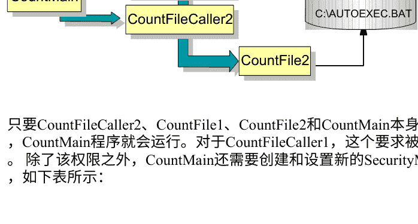

只要CountFileCaller2、CountFile1、CountFile2和CountMain本身都被授予读取文件C:\AUTOEXEC.BAT的权限，CountMain程序就会运行。对于CountFileCaller1，这个要求被暂时豁免，因为CountFile1调用了doPrivileged。除了该权限之外，CountMain还需要创建和设置新的SecurityManager的权限。分析准确反映了这些权限要求，如下表所示：

| 类 | 权限由权限筛选算法确定 |
| --- | --- |
| CountMain | java.io.FilePermission "C:\AUTOEXEC.BAT", "read"<br>java.lang.RuntimePermission "createSecurityManager"<br>java.lang.RuntimePermission "setSecurityManager" |
| CountFileCaller1 |  |
| CountFile1<br>PrivExcAction<br>CountFileCaller2<br>CountFile2 | java.io.FilePermission "C:\AUTOEXEC.BAT", "read" |

# 用于从Java程序中消除不必要同步的静态分析

Jonathan Aldrich, Craig Chambers, Emin Gun Sirer, 和 Susan Eggers

计算机科学与工程系
华盛顿大学
352350信箱
西雅图，WA 98195 美国
{jonal, chambers, egs, eggers}@cs.washington.edu

摘要。本文介绍并评估了一组旨在减少Java程序中同步开销的分析方法。基于监视器的Java同步经常导致显著的开销，在我们的基准应用程序中占总执行时间的5-10%。为了减少这种开销，程序员经常尝试手动消除不必要的锁操作。这种手动优化很繁琐、容易出错，并且经常导致结构不良和可重用性较差的程序。我们的方法使用静态分析自动查找并删除Java程序中的不必要同步。这些分析优化了单个线程多次进入一个监视器的情况，一个监视器嵌套在另一个监视器中的情况，以及只有一个线程可以访问的监视器的情况。我们的分析的部分实现可以消除高达70%的同步开销，并且对于一些已经手动优化的基准应用程序，运行时间提高了5%。因此，我们的自动化分析有潜力显著提高Java应用程序的性能，同时使程序员能够设计更简单和更可重用的多线程代码。

## 1. 引言

监视器[LR80]是同步的吸引人的构造，因为它们促进了可重用的代码并向程序员呈现了一个简单的模型。许多现代编程语言，如Java[GJS96]和Modula-3，直接支持监视器。虽然这些构造使程序员能够轻松编写多线程程序和可重用组件，但它们可能会产生显著的运行时开销。可重用的代码模块可能包含用于并发访问的最一般情况的同步，尽管特定的程序通常在已经受到并发保护的上下文中使用这些模块。例如，一个同步的数据结构可能只能由一个线程在运行时访问，或者对同步的数据结构的访问可能由程序中的另一个监视器保护。在这两种情况下，不必要的同步会增加执行开销。如第2节所述，即使是单线程的Java程序通常也会将其执行时间的5-10%用于不必要的同步操作。

可以通过手动重构程序[SNR+97]来减少同步开销，但这通常涉及在程序性能与简单性、可维护性和可重用性之间进行权衡。为了提高性能，可以省略同步注释，其中它们在当前版本的程序中不需要用于正确性，或者可以修改同步方法以提供专门的、快速的线程入口点，这些线程已经持有一个监视器锁。 这样的专门函数使程序更加复杂，并且使用它们可能需要对面向对象调度进行仔细推理，以确保在所有路径到函数调用时都获取了保护锁。 假设在特定的程序点上持有锁可能会被程序的其他部分的更改无意中违反，从而使程序的演变和维护容易出错。 手动优化使代码的可重用性降低，因为它们对同步做出了可能在其他环境中无效的假设。 一般来说，复杂的手动优化使程序更难理解，使程序的演变更加工难，降低了组件的可重用性，并为细微的并发错误提供了机会。

在本文中，我们提出并评估了静态分析技术，通过自动检测和删除不必要的同步来减少同步开销。 如果线程之间对同步操作没有争用，那么同步操作就是不必要的。 例如，如果一个监视器在程序的整个生命周期中只能被一个线程访问，那么对于该监视器的所有操作都可以安全地被消除。 同样，如果线程在获取一个监视器时总是持有它，然后再获取另一个监视器，那么对于第二个监视器就不会有争用，因此可以安全地删除这种不必要的同步。 最后，当一个监视器以嵌套方式被同一个线程多次获取时，第一个监视器获取保护了其他监视器免受争用，因此所有嵌套的同步操作都可以被优化掉。 为了在静态地推理同步方面，我们假设编译器在分析时对整个程序有完整的了解；未来的工作可能会扩展我们的技术以处理Java的动态代码加载和反射特性。

本文有三个主要贡献。 首先，我们描述了几个同步优化机会，并测量了它们在几个Java程序中的发生频率。其次，我们为一系列旨在检测不必要同步的分析提供了精确的定义。 最后，我们在一套基准测试中对这些分析进行了初步的实证评估。 我们的部分实现可消除高达70%的同步开销，并在高度优化的平台上提高了5%的运行时间，适用于典型的Java基准测试。

本文的其余部分结构如下。 下一节描述了Java同步模型，并提供了典型基准测试的同步开销测量。 第3节确定了优化的机会。 第4节提供了一组分析的精确描述，用于检测和消除不必要的同步操作。 第5节总结了这些分析对一组基准测试的性能影响，第6节讨论了相关工作，第7节做出了结论。

## 2. Java同步

Java提供了一个监视器构造来保护对共享数据结构的访问，在多线程环境中。

### 2.1 语义学

Java中监视器的语义来自Mesa [GMS77]。每个对象都隐式关联一个监视器，并且任何方法都可以标记为同步的。在执行时一个同步方法，线程会获取与接收对象关联的监视器，运行方法的代码，然后释放监视器。显式同步语句提供了一种在方法调用之外的程序点操作监视器的方式。Java的监视器是可重入的，这意味着一个线程可以以嵌套的方式多次获取一个监视器。只有当线程退出最外层的方法或语句时，才会释放可重入监视器。

### 2.2 成本

同步对一组Java基准测试的性能造成了显著的瓶颈。

为了量化同步操作的成本，我们将单线程的Java程序与从应用程序和标准Java库中删除了同步的版本进行了比较。由于多线程基准测试的正确性取决于同步的存在，我们没有对多线程基准测试进行这些测量。然而，在单线程程序中存在的不必要的同步表明，在多线程程序中也存在大量不必要的同步。

我们使用一个二进制重写器[SGA+98]来消除应用程序二进制中的所有同步操作。这种策略使我们能够在商业Java虚拟机上进行测量，而无需在源代码级别上进行仪器化和重新编译。

我们使用两种不同的Java实现来检查基准测试，这两种实现代表了不同的Java虚拟机实现。JDK 1.2.0采用了混合JIT编译和解释方案，并具有高效的锁操作实现。因此，它代表了商业可用的Java虚拟机的最新技术水平。Vortex是一个积极优化的研究编译器[DG+96]，它生成本地编译的独立可执行文件，并使用高效的同步原语[BKM+98]。对于这些数据，我们使用不包含本文描述的分析的基本Vortex系统。

图1显示了每个平台上五个单线程基准测试中花费在同步上的总执行时间的百分比。同步开销平均占总执行时间的5-10%。

1个静态同步方法会获取与封闭类的Class对象关联的监视器。

```java
class Reentrant {
    synchronized foo() {
        this.bar()
    }
    synchronized bar() {
        { ... }
    }
}
```

```java
class Enclosing {
    Enclosed member;
    synchronized foo() {
        member.bar();
    }
}
class Enclosed {
    synchronized bar() {
        { ... }
    }
}
```

图2.可重入监视器

图3.封闭监视器

执行时间取决于平台，可以高达35%。同步的相对成本因编译过程中的优化量和不同的同步实现而在平台之间有所差异。

例如，如果Vortex能够比JDK 1.2.0更有效地优化类似于jlex的非同步相关部分，那么它的同步开销将相对更显著。相比之下，javac和cassowary这两个基准测试在JDK平台上使用的同步方式可能比在Vortex上更昂贵。尽管平台之间存在差异，但同步开销仍然占这些Java基准测试执行时间的相当大一部分，这表明在当前同步技术上仍有很大的性能改进空间。

## 3. 优化机会

在本节中，我们描述了三种不同的优化同步操作的机会。

### 3.1 可重入监视器

可重入监视器是不必要同步的最简单形式。 如图2所示，当一个同步方法调用具有相同接收器对象的另一个方法时，监视器是可重入的。 如果程序执行期间对bar的所有调用都在同步于相同接收器对象的过程中，则可以安全地从bar中删除同步。

我们的优化将此示例推广到任意调用路径：如果在调用图中到bar的每条可达路径上都有一个在相同对象O上同步的方法或语句，则可以删除对方法bar的接收器对象O的同步。

如果接收器对象的监视器已经在某些但不是所有的调用路径上进入到方法bar中，则可以使用特化来创建bar的两个版本：一个是在接收器已经同步的调用路径上的非同步版本，另一个是在其他调用路径上的同步版本。 同步版本先获取锁，然后简单地调用非同步版本。 例如，如果bar还从函数main中调用，其中接收器对象没有同步，则可以将bar特化，使main调用一个获取监视器的同步版本。 像foo这样已经锁定接收器对象的方法仍然可以调用更高效的非同步版本的bar。

```java
class PrintWriter {
    Object lock;
    Writer out;
    void write(int c) {
        synchronized(lock) {
            out.write(c);
        }
    }
}
class StringWriter {
    synchronized write(int c)
    { ... }
}
```

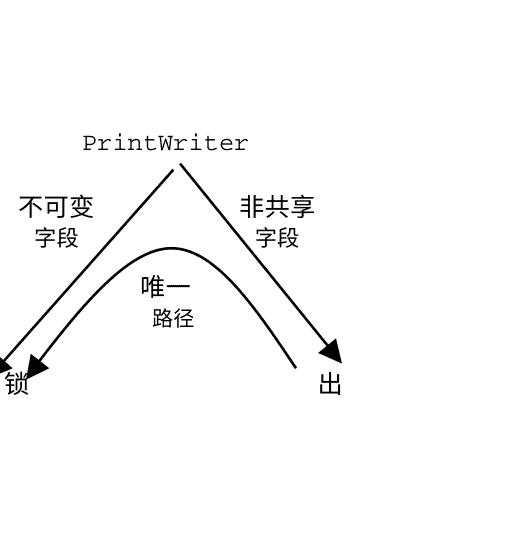

### 3.2 封闭监视器

一个封闭的监视器是一个已经被另一个监视器保护免受并发访问的监视器。封闭的监视器总是先进入，而在持有它的同时，封闭的监视器被获取。稍后，封闭的监视器然后被释放。因为只有在持有封闭的监视器时才进入封闭的监视器，所以它受到并发访问的保护，是不必要的。例如，在图3中，member对象上的监视器被 enclosing 对象上的监视器所封闭。因此，对 bar 函数的同步是不必要的，可以移除。

为了在静态分析期间安全地从监视器 M 中删除同步，我们必须证明存在一个唯一的、不变的封闭监视器来保护 M，而不是多个封闭监视器。如果在图3中有几个封闭对象，例如，不同的线程可以通过不同的封闭对象同时访问封闭对象，并且从 bar 中删除同步将不安全。有四种方法可以确保这种情况：

1.  首先，封闭监视器可以将封闭监视器存储在一个非共享字段中，即只保存对封闭对象的引用的字段。由于非共享字段保存了对封闭对象的唯一引用，进入封闭对象的监视器的唯一方法是通过（唯一的）封闭对象。如果我们使用字段的名称来标识封闭锁，在非共享字段的定义中可以放宽“唯一引用”条件。只要每个封闭对象只存储在该字段的一个实例（即运行时出现）中，其他字段和局部变量引用封闭对象是允许的，因为字段名称唯一标识封闭对象。
2.  其次，封闭的监视器可以存储在一个不可变的静态字段中，即一个全局变量，其值不会改变。因为封闭的监视器由静态字段标识，并且只有一个对象存储在该静态字段中，字段名唯一标识一个监视器。如果所有对 M' 的同步操作都在监视器 M 内执行，则静态字段的监视器 M 封闭另一个监视器 M'。
3.  第三，封闭的监视器可以存储在封闭监视器的一个不可变字段中。由于不可变字段不能改变，所以在进入封闭的监视器之前总是先进入相同的封闭监视器。这种情况发生在一个方法首先对接收对象的字段进行同步，然后对接收对象本身进行同步。

```java
class Local {
    synchronized foo()
        { ... }
}
main() {
    new Local().foo();
}
```

图5。线程本地监视器

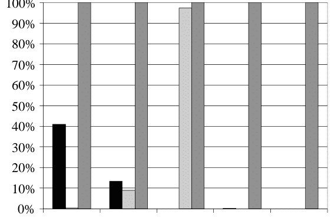

图6。优化潜力

第四，上述情况可以合并。例如，图4展示了一个类似于JDK 1.2.0 I/O库中的情况的示例，当流对象首先在其一个字段上同步一个对象，然后在另一个字段上调用一个同步方法时。在示例中，可以安全地移除对StringWriter.write的同步，因为在调用write之前，封闭流的锁对象始终被锁定。由于lock是PrintWriter的一个不可变字段，out是PrintWriter的一个非共享字段，我们可以使用传递性确定每个被封闭对象（out）的唯一封闭对象（lock）。使用传递性，我们可以将一系列不可变和非共享字段组合成从被封闭监视器到封闭监视器的唯一路径。唯一路径标识了相对于特定被封闭对象的唯一封闭对象。

我们已经开发出的一般规则可以表述如下：

如果对于每个可能与 S同步在相同对象上的其他同步语句 S'，存在一条唯一的链接路径，则可以移除同步语句 S:

1.  第一个链接表示 S和 S'所同步的对象
2.  每个后续链接要么是封闭该链接之前的对象的非共享字段，要么是被该链接之前的对象封闭的不可变字段
3.  最后一个链接表示在到达 S的所有调用路径上都同步的对象，并且在到达 S'的所有调用路径上也同步的对象

与可重入监视器的情况类似，如果在某些类的实例上移除同步是合法的，但在其他实例上不是合法的，则可以对封闭对象上的同步语句进行专门化。例如，在二叉树中，根节点封闭所有内部节点，因此专门化可以创建两种类型的节点：一种用于创建二叉树的根节点，一种用于创建树的内部节点的非同步节点。

### 3.3 线程本地监视器

图5展示了一个线程本地监视器的示例。只有创建它们的线程可以访问 Local类的实例，因为它们在堆栈上创建并且不通过任何静态字段访问。由于静态字段是在Java内存模型中在线程之间共享数据的唯一基本情况，因此可以安全地删除对不可从静态字段访问的任何类的方法的同步。在我们的模型中，Thread及其子类存储在全局列表中，因此在线程创建期间从一个线程传递引用时可以正确处理。当类的某些实例是线程本地的而其他实例不是时，特化可以消除同步。

### 3.4 优化潜力

图6展示了我们基准套件中优化机会的估计，表明不同的程序提供了不同的优化机会。这些数据是从五个在JDK 1.1.6上运行的Java程序的动态跟踪中收集的。对于每个基准测试，它显示了重入、封闭（由不同的监视器封闭）和线程本地的动态监视器操作的百分比，代表了我们分析的最大性能。柱状图的总和可能超过100%，因为某些同步操作可能属于几个不同的类别。所有基准测试都在线程本地监视器上进行100%的同步，因为它们是单线程的，所以没有监视器会被多个线程锁定。多线程基准测试将具有一些不是线程本地的同步，但我们相信线程本地监视器仍然代表了这些基准测试中的重要机会。

这些基准测试在它们所呈现的优化机会上存在显著差异。例如，在 *jlex* 中，41%的同步是可重入的，但不到1%是封闭的。相比之下，在 *javac* 中，97%的同步是封闭的，几乎没有可重入的。对于这些单线程基准测试，线程本地监视器提供了最大的优化机会，其中两个程序通过封闭或可重入监视器获得了显著的好处。这些数据表明，每种优化对于某些Java程序都很重要。

## 4. 分析

我们定义了一种简化的分析语言，并描述了优化上述同步机会所需的三种分析：锁分析、非共享字段分析和多线程对象分析。锁分析计算在每个同步点上持有的监视器的描述，以便可以消除可重入锁和封闭锁。

非共享字段分析识别非共享字段，以便锁分析可以安全地识别封闭锁。最后，多线程对象分析识别哪些对象可能被多个线程访问。这使得可以消除所有不是多线程的对象上的同步。我们的分析可以依赖于Java的 `final` 注解来检测不可变字段；未来的重要工作领域是检测未明确注释为 `final` 的不可变字段。

### 4.1 分析语言

我们用一个简单的基于表达式的核心语言来描述我们的分析，其中包含了Java的基本同步相关方面。这使我们能够专注于指定分析的细节，同时避免了真实语言的一些复杂性。处理Java的缺失功能很简单-我们的原型实现处理Java语言的所有部分，除了反射和动态代码加载，这些被省略以实现静态推理。

图7展示了我们的分析语言。这是一个简单的一阶语言，包括对象创建、字段访问和赋值、let绑定的标识符、同步表达式和简单的控制流。每个对象创建点都标有一个类键[GDD+97]，用于标识在该点创建的对象组。在我们的实现中，程序中的每个new语句都有一个唯一的键；在其他实现中，一个键可以表示一个类，或者表示另一种形式的上下文敏感性。我们假设所有let绑定的标识符都有唯一的名称。静态字段引用被建模为对特殊对象global的引用，该对象隐式传递给每个过程。我们假设在评估主表达式之前，所有过程都被放入一个隐式的全局表中。lookup函数返回与特定过程关联的λ表达式。

我们使用+和；（在返回第二个参数之前评估和丢弃第一个参数）来建模普通的二元运算符，使用 E₁ op E₂ 语法。控制流操作包括简单的函数调用和函数式if表达式，这些功能可以组合成其他结构，如循环和面向对象的分派。最后，Java的同步构造被建模为一个synchronized语句，它锁定由E₁引用的对象，然后在释放锁之前评估E₂。程序文本中的每个synchronized语句都与一个唯一的标签 ∈ LABEL相关联，该标签在我们的分析中使用。

```
id, field, fn ∈ ID
label ∈ LABEL
key ∈ KEY
e, program ∈ E
    E ::= new^KEY
    | ID
    | let ID := E₁ in E₂
    | E.ID
    | E₁.ID := E₂
    | E₁ op E₂
    | synchronized^LABEL (E₁) { E₂ }
    | if E₁ then E₂ else E₃
    | ID(E₁,...,Eₙ)
```

图7 核心分析语言

### 4.2 分析上下文

我们的分析可以通过其他别名和类别分析进行参数化，这是我们方法的一个特点，可以在分析时间和分析结果的精度之间进行权衡。我们的分析还受益于早期的复制传播和必须别名分析传递，这些传递合并指向同一对象的标识符。我们假设以下函数是从早期的分析传递中定义的：

-   id_aliases(e) – 可能指向与 expression e 相同值的标识符集合
-   field_aliases(field) – 可能指向与 field 相同对象的字段声明集合，这些信息可以通过类分析轻松计算得出。
-   is_immutable(field) – 如果 field是不可变的（即，只能写入一次），则为真。这可以从最终注释和构造函数代码中推断出。
-   label_aliases(label) – 与 label关联的同步语句的标签集合可能锁 定与同步语句关联的相同对象的同步语句的标签集合

我们的一些分析处理由类键表示的对象组。 我们假设之前的类传递已经找到了程序中每个变量或字段可能包含的对象集的保守近似。 我们的实现使用1-1-CFA算法[S88][GDD+97]，该算法在一个调用上下文级别中考虑每个过程，并单独分析来自不同创建点的对象，以及0-CFA算法，该算法缺乏这种上下文敏感性。 我们使用以下函数来访 问这些信息：

-   field_keys(field,key) – 当通过特定的类键 key访问时，字段 fiel d可能引用的类键集合
-   static_field_keys(field) – 静态字段field可能引用的类键集合
-   label_keys(label) – 与 label相关的同步表达式可能锁定的类键的集合。

### 4.3 分析

我们的分析计算以下函数：

-   get_locks(label) – 表示在特定同步点 label处持有的锁的集合。锁由两种字段链接的路径表示，如下所述。
-   is_unshared(field) – 如果 field未共享，则返回true。
-   is_multithreaded(key) – 如果由 key描述的对象可能通过静态变量访问，则返回true。

我们以语法导向形式描述我们的前两个分析，其中一个语义函数将表达式和一组继承属性映射到一组综合属性。 第三个分析仅使用先前分析的数据，并且不直接在程序文本上工作。

锁分析。图8定义了我们的锁分析流函数使用的域和辅助函数。 我们的锁分析在图9中描述了路径和双向路径。 路径指的是相对于标识符的特定对象的名称，由标识符名称和一系列字段访问组成。 因此，路径 id → field₁ → field₂表示表达式 id.field₁.field₂。 双向路径表示双向路径。

前向链接表示字段解引用，就像路径一样，而后向链接表示“被包含在内” - 也就是说，在形式为 bipath_sub ← field的双路径中， bipath_sub表示某个未指定对象的 field字段引用的表达式。 在我们的描述中，我们使用符号 m[x → y]来表示我们计算一个新的映射 ∈ X → Y，该映射与映射 m相同，除了元素 x ∈ X被映射到 y ∈ Y之外。

```
path ∈ PATH = ID + PATH → ID
dir ∈ DIR = { →, ← }
bipath ∈ BIPATH = ID + BIPATH × DIR × ID
lockset ∈ LOCKSET = 2^BIPATH
lockmap ∈ LOCKMAP = LABEL →<sub>fin</sub> LOCKSET
idmap ∈ IDMAP = ID →<sub>fin</sub> 2^PATH

*is_immutable_path*(path) : **bool**
    **switch** (path)
        **case** id : **true**
        **case** path' → field : *is_immutable*(field) ∧ *is_immutable_path*(path')

*is_prefix*(bipath<sub>1</sub>, bipath<sub>2</sub>) : **bool**
    **if** (bipath<sub>1</sub> = bipath<sub>2</sub>) **then true**
    **else if** (bipath<sub>2</sub> = id) **then false**
    **else if** (bipath<sub>2</sub> = bipath' dir field) **then** *is_prefix*(bipath<sub>1</sub>, bipath')

*substitute*(bipath<sub>1</sub>, path, bipath<sub>2</sub>) : BIPATH
    **if** (bipath<sub>1</sub> = path) **then** bipath<sub>2</sub>
    **else if** (bipath<sub>1</sub> = bipath' dir field)
        **then** *substitute*(bipath', path, bipath<sub>2</sub>) dir field
    **else error**

*map_lock*(bipath<sub>1</sub>, path, bipath<sub>2</sub>) : BIPATH ∪ { not_defined }
    **if** (*is_prefix*(path, bipath<sub>1</sub>)) **then** *substitute*(bipath<sub>1</sub>, path, bipath<sub>2</sub>)
    **else if** (path = path' → field ∧ *is_unshared*(field))
        **then** *map_lock*(bipath<sub>1</sub>, path', bipath<sub>2</sub> ← field)
    **else** not_defined

*map_lockset*(锁集, 路径<sub>1</sub>, 路径<sub>2</sub>) : LOCKSET
    { *map_lock*(双路径, 路径<sub>1</sub>, 路径<sub>2</sub>) | 双路径 ∈ 锁集 } - { 未定义 }
```

图8.锁分析的域和辅助函数

锁分析函数 L 以柯里化的方式接受四个参数。第一个参数是程序文本中的表达式。第二个参数是锁集合，表示在此程序点上持有的双路径。第三个参数是锁映射，表示从同步标签到表示每个标记同步语句上持有的锁的双路径集合的当前映射。最后一个参数是 id 映射，表示标识符到描述标识符别名的不同字段表达式的路径的映射。锁分析的结果是一个锁映射，总结了程序中每个可达同步标签处持有的锁。我们在空锁集（没有锁包围整个程序表达式）、乐观锁映射（尚未分析同步点）和空 id 映射（没有标识符在作用域内）的上下文中分析表示程序的表达式。

图9中的许多分析流函数相对简单；我们只讨论下面更微妙的部分。let 和 id 表达式的规则更新标识符的 idmap，并返回由标识符表示的路径集。field 表达式只是将 e 的路径集中的所有路径扩展为 field。
```

## 图9. 锁分析流函数

L : E → LOCKSET → LOCKMAP → IDMAP → 路径集合 LOCKMAP

get_locks(标签) : LOCKSET =

- L[[新锁]] 锁集 锁映射 ID映射 = (∅, 锁映射)
- L[[标识]] 锁集 锁映射 ID映射 = ({标识} ∪ ID映射(标识), 锁映射)
- L[[let 标识 := 表达式1 in 表达式2]] 锁集 锁映射 ID映射 =
  let(路径集合', 锁映射') = L[[表达式1]] 锁集 锁映射 ID映射 in
  L[[表达式2]] 锁集 锁映射' ID映射[ 标识 → 路径集合']
- L[[e. 字段]] 锁集 锁映射 ID映射 =
  let(路径集合', 锁映射') = L[[e]] 锁集 锁映射 ID映射 in
  ({ 路径 → 字段 | 路径 ∈ 路径集合' }, 锁映射')
- L[[e1. 字段 := e2]] 锁集 锁映射 ID映射 =
  let(路径集合', 锁映射') = L[[e2]] 锁集 锁映射 ID映射 in
  let(路径集合", 锁映射") = L[[e1]] 锁集 锁映射' ID映射 in
  (∅, 锁映射")
- L[[e1 op e2]] 锁集 锁映射 ID映射 =
  let(路径集合', 锁映射') = L[[e1]] 锁集 锁映射 ID映射 in
  let(路径集合", 锁映射") = L[[e2]] 锁集 锁映射' ID映射 in
  (∅, 锁映射")
- L[[同步 标签(e1) { e2 }]] 锁集 锁映射 标识映射 =
  let(路径集合', 锁映射') = L[[e1]] 锁集 锁映射 标识映射 in
  令锁映射" = 锁映射'[ 标签 → ⋃_{路径∈路径集合'} 映射_锁集(锁集, 路径, 同步)] in
  L[[e2]] (锁集 ∪ { 路径 | 路径 ∈ 路径集合' ∧ 是不可变路径(路径) }) 锁映射" 标识映射
- L[[如果 e1 则 e2 否则 e3]] 锁集 锁映射 标识映射 =
  let(路径集合', 锁映射') = L[[e1]] 锁集 锁映射 标识映射 in
  let(路径集合", 锁映射") = L[[e2]] 锁集 锁映射' 标识映射 in
  let(路径集合"", 锁映射"") = L[[e3]] 锁集 锁映射" 标识映射 in
  (路径集合" ∩ 路径集合"", 锁映射"")
- L[[Fn(e1, ..., en)]] 锁集 锁映射0 ID映射 =
  let [[λ(formal1, ..., formaln). e]] = lookup(fn) in
  ∀i ∈ 1..n let (路径集合_i, 锁映射_i) = L[[ei]] 锁集 锁映射_{i-1} ID映射 in
  let 锁集' = ⋃_{i∈1..n} 映射_锁集(锁集, 路径, formal_i) in
  let (路径集合', 锁映射') = 上下文策略(L[[e]] 锁集' 锁映射_n ∅) in
  ({ 替换(路径, formal_i, 路径') | 路径 ∈ 路径集合' ∧ ∃i ∈ 1..n s.t. 是前缀(formal_i, 路径) ∧ 路径' ∈ 路径集合 }, 锁映射')

当遇到同步语句时，锁映射将使用锁集中的所有双路径进行更新。然而，在添加到锁集之前，这些双路径将被转换为以语句同步的表达式 e1 的正常形式。这个正常形式允许我们在程序中的不同同步点比较所持有的锁的双路径描述，从而进行锁消除优化。

正常形式以特殊标识符 SYNCH 表示 e1 所代表的被锁定的对象。函数 map_lockset 会依次考虑锁集中的每个双路径，并使用 map_lock 来计算一个以 e1 的路径集到 SYNCH 的映射的新双路径。对于锁集中的每个双路径 b，如果双路径是 b 的前缀，map_lock 将会将 SYNCH 替换到锁表达式的双路径中。例如，如果与 e1 对应的路径是 id → field1，而锁集是 {id → field1 → field2}，那么 map_lock( id → field1 → field2, id → field1, SYNCH) = SYNCH → field2，表示在这一点上，e1 所引用的对象的 field2 已经被锁定。

如果前缀规则不适用，并且同步表达式路径中的最后一个字段是非共享的，则 map_lock 将尝试使用 SYNCH ← 字段作为要替换的表达式与较短的前缀匹配。在图5 中，同步表达式 PrintWriter → out 不是当前锁定对象 PrintWriter → lock 的前缀，因此由于 out 是非共享字段，map_lock 将尝试用 SYNCH ← out 替代 PrintWriter。因此，我们得到的结果是 map_lock(PrintWriter → lock, PrintWriter → out, SYNCH) = SYNCH ← out → lock。也就是说，在当前的同步点，程序在对象的 lock 字段上持有锁，该对象的 out 字段指向当前正在同步的对象。这是图5中情况的正确描述。

接下来，在同步块内部计算表达式时，将当前锁集合与同步表达式路径集合中的所有唯一路径组合在一起进行评估。is_immutable_path 函数检查路径中的每个字段是否是不可变的，确保只有在基本标识符方面唯一标识锁定对象时，才将锁描述添加到锁集合中。

在函数调用时，我们查找被调用函数的定义，并评估实际参数以生成每个参数的路径集合和更新后的锁映射。map_lockset 函数用于将实际路径映射到锁集合中每个锁的形式变量。与形式参数无关的锁的信息（包括在第4.2节中提到的隐式形式参数 global）不能被调用者使用，因为无法确保锁定对象是否保护任何同步语句。在新的锁集合和锁映射的上下文中分析被调用者，并对结果进行记忆以避免不必要的重新计算。

我们的分析可以通过一个上下文策略函数进行参数化，该函数允许可变的上下文敏感性。当前的实现是上下文无关的 - 它只是计算传入锁集与所有其他锁集的交集，并在输入信息自上次分析以来发生变化时，在新锁集的上下文中重新评估被调用者。我们通过在锁分析流函数以相同的输入分析信息递归调用时返回空路径集和现有锁映射来避免无限递归；分析将自动迭代直到达到一个可靠的修复点。

由于每次重新分析函数时锁集必须减小，因此我们的分析的终止是确保的。最后，通过从形式参数映射回实际参数，函数调用返回路径集合。

```
fset, shared ∈ FSET = 2^ID
idstate ∈ IDSTATE = ID →fin FSET
U : E → IDSTATE → FSET → FSET × IDSTATE × FSET
is_unshared(field) = let (idstate, shared) = U[[program]]∅ ∅ in (field ∉ shared)
U[[new^key]] idstate shared = (∅, idstate, shared)
U[[id]] idstate shared = (idstate(id), idstate, shared)
U[[let id := e1 in e2]] idstate shared =
  let (fset', idstate', shared') = U[[e1]] idstate shared in
  U[[e2]] idstate'[id → fset'] shared'
U[[e.field]] idstate shared =
  let (fset', idstate', shared') = U[[e]] idstate shared in
  (field_aliases(field), idstate', shared')
U[[e1.字段 := e2]] idstate 共享 =
  let (fset', idstate', 共享') = U[[e1]] idstate 共享 in
  let (fset'', idstate'', 共享'') = U[[e2]] idstate' 共享' in
  let fset''' = 字段 ∪ fset'' in
    (fset''',
    idstate''[id → idstate''(id) ∪ fset''' | id ∈ id_aliases(e2)],
    如果 (fset''' ∉ 字段) 那么 共享'' 否则 共享'' ∪ 字段)
U[[e1 op e2]] idstate 共享 =
  let (fset', idstate', 共享') = U[[e1]] idstate 共享 in
  let (fset'', idstate'', 共享'') = U[[e2]] idstate' 共享' in
  (fset' 合并 操作 fset'', idstate'', 共享'')
U[[同步标签(e1) { e2 }]] idstate shared =
  let (fset', idstate', shared') = U[[e1]] idstate shared in
  U[[e2]] idstate' shared'
U[[if e1 then e2 else e3]] idstate 共享 =
  let (fset', idstate', 共享') = U[[e1]] idstate 共享 in
  let (fset'', idstate'', 共享'') = U[[e2]] idstate' 共享' in
  let (fset''', idstate''', shared''') = U[[e3]] idstate' 共享' in
  (fset'' ∪ fset''', idstate'' ∪ idstate''', 共享'' ∪ shared''')
U[[fn(e1, ..., en)]] idstate0 shared0 =
  let [[λ(formal1, ..., formaln). e]] = lookup(fn) in
  ∀i ∈ 1..n let (fset_i, idstate_i, shared_i) = U[[e_i]] idstate_{i-1} shared_{i-1} in
  let idstate' = { formal_i → fset_i | i ∈ 1..n } in
  let (fset'', idstate'', shared'') = 上下文策略(U[[e]] idstate' shared_n) in
    (fset'',
    idstate_n[id → idstate_n(id) ∪ idstate''(formal_i) | i ∈ 1..n and id ∈ id_aliases(e_i)],
    shared'')
```

## 图10. 非共享字段分析

非共享字段分析。图10中描述的非共享字段分析计算出可能引用也存储在其他实例（即运行时出现）中的对象的字段集合。非共享字段位于此共享字段集合的补集中。此分析的结果在先前分析的 map_lock 函数中用于检测封闭锁。

非共享字段分析计算的信息与 field_aliases 函数的结果有两个关键区别。首先，field_aliases 函数无法确定给定字段声明的两个实例是否可能指向同一个对象，这决定了给定字段是否是共享的。其次，我们的非共享字段分析是流敏感的，相比非流敏感技术具有更高的精度。

分析通过跟踪每个标识符和表达式可能别名的字段来工作。当一个字段被赋予可能来自同一个字段的另一个实例的值时，分析会将该字段标记为共享。U，用于非共享字段分析的分析函数，接受一个程序表达式、当前共享字段集合和一个从标识符到可能指向其内容的字段集合的映射作为柯里化参数。然后，它计算表达式可能别名的字段集合和更新后的共享字段集合。我们的分析在程序的顶层表达式上运行，使用一个最初为空的标识符映射（因为最初没有标识符在作用域内）并最初乐观地假设所有字段都是非共享的。字段引用、字段赋值和函数调用的规则是最有趣的。

当解引用一个字段时，结果表达式可能与字段别名中的任何字段别名。对于字段的赋值，我们必须更新任何可能与被赋值给字段的表达式别名的标识符映射，因为这些标识符指向的值也可能由于赋值而被字段引用。实际上，由于其他线程的操作，这些标识符可能与字段别名中的任何字段别名。然而，为了识别非共享字段的目的，我们可以乐观地假设在写入字段时不会发生这种别名。这使得我们的分析能够在将同一个对象写入两个具有不同名称的字段时检测到非共享字段。如果该对象稍后从一个字段复制到另一个字段，则写入的字段将被正确地标识为共享，因为在读取字段时会考虑到别名。如果被赋值的表达式可能不与被赋值的字段别名，则被赋值的字段可能保持为非共享；否则，它将被添加到共享集合中。在形如的表达式中，表达式的字段集合的正确合并函数取决于运算符。例如，操作数的合并函数只返回其第二个参数的字段集合。

在函数调用时，我们查找被调用者并评估所有参数表达式，以获取每个参数的字段集合以及更新后的标识符映射和共享字段集合。被调用者的 idstate 由其形式参数到每个实际参数表达式的字段集合的映射组成。然后我们在新的 idstate 和当前共享集合的上下文中评估被调用者，并返回结果字段集合和共享集合。在评估被调用者之后，还需要更新调用者的标识符状态。现在可能与实际表达式别名的每个 id 在评估被调用者后都可以引用被调用者的形式参数可以引用的任何字段。这种更新是必要的，因为某些被调用者（可能是调用图中的几个级别）可能已将参数的值分配给了字段。我们对这种分析的上下文策略是上下文敏感的，因为我们对每个不同的标识符映射重新评估被调用者。实际上，上下文敏感性可以产生更精确的结果。例如，当一个被调用者被调用时，形式参数被别名为一个字段，在一个调用点上，我们不希望所有其他调用点在调用之后都看到形式参数可能与字段别名，并因此保守地假设被调用者将该形式参数分配给字段。

终止是确保的，因为每个分析的结果都被记忆化，并且字段集的大小受程序中字段的数量的限制。递归函数的处理方式通过在递归调用时乐观地返回空字段集，并且分析随后迭代直到达到一个正确的不动点。

多线程对象分析。我们定义 multi 为类键的最小集合，满足图11中所示的递归方程。然后我们定义 is_multithreaded 如下：

`is_multithreaded(key) = key ∈ multi`

我们的实现简单地从静态字段引用的类键开始，对于每个类键，它考虑该键的每个字段，并将字段可能引用的键添加到集合 multi 中。当集合达到最小不动点时，分析完成。分析必须终止，因为要考虑的类键数量是有限的。

## 4.4 应用结果

为了应用我们的分析结果，在代码生成过程中进行优化处理。在每个形式为的语句中

```
synchronized^{label} (e_1) { e_2 }
```

我们将其替换为语句 e_1; e_2，如果满足以下任何条件：

- 1. `SYNCH ∈ get_locks(label)`，或者
- 2. `∀ label' ∈ label_aliases(label). get_locks(label) ∩ get_locks(label') ≠ ∅`，或者
- 3. `∀ key ∈ label_keys(label). ¬is_multithreaded(key)`

第一个条件表示可重入监视器——如果与表达式 e_1 关联的监视器已经被锁定，则 `SYNCH ∈ get_locks(label)`。这里 `get_locks(label)` 的定义（在图9中）是由 label 标识的程序点处的锁分析结果。我们可以安全地用一个序列来替换同步表达式，该序列首先评估锁表达式（以获取潜在的副作用），然后评估并返回在同步语句中受保护的表达式。第二个条件表示对封闭锁的泛化：如果对于可能锁定相同对象的每个其他同步语句 S'，S 和 S' 都已经持有某个公共锁，则可以消除同步语句 S。第三个条件消除了仅引用非多线程类键的表达式进行同步的同步语句。

由于Java中监视器的复杂语义，在某些多处理器系统上，我们的优化可能不符合Java规范。根据Java语言规范，“锁定任何锁都会从线程的工作内存中清除所有变量，并且解锁任何锁都会强制将线程分配的所有变量写入主内存。”[GJS96] 这意味着，例如，一个合法的Java程序可以通过使每个线程在时序相关的方式下将数据从一个线程传递给另一个线程。

在线程本地对象上同步。我们的优化可能会破坏这种“隐蔽通道”通信。例如，即使在同步操作的其他部分被删除时，一个实现在多处理器上同步缓存也将符合Java规范。然而，我们的优化在一个类似Java的语言中始终是安全的，该语言具有稍微宽松的同步保证，可以非正式地陈述如下：如果线程T₁写入变量V，然后解锁一个锁，线程T₂锁定相同的锁并读取变量V，那么线程T₂将读取T₁写入的值。我们相信大多数在Java中编写的多线程程序都使用这种同步模型。

## 5. 结果

初步的性能评估显示，我们的分析子集能够消除同步开销中的30-70%。我们已经实现了可重入锁分析和多线程对象分析的原型版本，并使用这些分析结果进行了转换。我们的实现尚未将专门化应用于分别优化对象或方法的不同实例。虽然我们的结果还是初步的，但它们展示了我们方法的潜力。我们计划在未来完成并评估一个更健壮和详细的实现，其中将包括非共享字段分析和封闭锁分析。

我们在之前提出的五个单线程基准测试中展示了我们分析的性能优势。虽然这些基准测试可以通过删除所有同步来进行简单优化，但它们是真实的程序，也可能在多线程程序中部分代表同步的使用方式。Javac、javacup、jlex 和 pizza 都是编译器工具；cassowary 是一个约束求解器。我们希望将来能够在多线程程序上评估我们的技术。

我们的原型实现是基于 Vortex 编译器基础设施[DDG+96]构建的，增加了一个简单、便携、非抢占式的用户级线程包，基于 QuickThreads[K93]。我们使用了一套全面的常规优化和过程间类分析来编译所有程序。对于我们的小型基准测试，我们使用了一个1-1-CFA调用图构建算法[GDD+97]；这在 pizza、javac 和 javacup 上无法很好地扩展，因此我们对这些程序使用了一个更简单的0-CFA分析，可能会由于更保守的别名信息而错过一些优化机会。

我们的锁实现已经经过高度优化，使用了一个高效的锁实现[BKM+98]。我们编译了两个版本——一个带有我们的同步优化，一个没有。两个版本都包含了所有其他Vortex优化。我们所有的运行时开销测量都来自于在一台512MB内存的SPARC ULTRA 2机器上运行五次的平均值。我们在收集数据之前运行了基准程序一次，以消除冷启动效应。

表1显示了我们的分析性能统计数据。前两列显示了程序中的总类数和标识为线程本地的类数。多线程对象分析在 jlex、javacup 和 cassowary 基准测试中将大部分类标识为单线程，但对 javac 或 pizza 的效果较差。由于这些基准测试是单线程的，它们的所有类都是线程本地的。然而，由于我们的分析假设静态字段引用使类可被其他线程访问，因此我们的分析只能确定每个程序中的一部分分类是否可被其他线程访问。

表1。同步分析统计数据

| 基准测试 | 类 | | 总锁操作 | 已移除锁操作 | | | %开销已移除 |
| :--- | :--- | :--- | :--- | :--- | :--- | :--- | :--- |
| | **总计** | **线程本地** | | **可重入** | **线程本地** | **总计** | |
| jlex | 56 | 34 | 27 | 2 | 8 | 9 | 67% |
| 比萨 | 184 | 0 | 38 | 6 | 0 | 6 | 不适用 |
| javacup | 66 | 28 | 30 | 2 | 6 | 7 | 47% |
| 鸸鹋 | 57 | 29 | 32 | 4 | 12 | 13 | 27% |
| javac | 194 | 0 | 68 | 5 | 0 | 5 | 0% |

表1的下四列显示了同步操作的总数（静态），通过可重入锁分析删除的数量，通过线程本地操作删除的数量以及总共删除的操作数量。总数小于两个分析的总和，因为一些同步操作被两个分析都删除了。如第一二列的类别数据所示，对于jlex、javacup和cassowary，多线程对象分析比重入锁分析更有效，而pizza和javac只受益于可重入锁分析。总体而言，我们的分析在程序中删除了20-40%的静态同步操作。

最后一列总结了我们的运行时间性能结果。我们以Vortex的同步开销的百分比来展示我们优化所实现的加速效果。对于jlex、javacup和cassowary，我们消除了大部分同步开销，在jlex的情况下接近70%。在jlex的情况下，绝对加速度最高达到5%。Pizza在同步方面没有显著的开销，因此无法实现加速。在javac上我们也没有获得可测量的加速效果。

在jlex的情况下，加速效果是由于该基准测试执行了大量的堆栈操作，而我们的分析有效地进行了优化。多线程分析发现所有的Stack对象都是线程本地的，并且锁分析成功地移除了一些重入锁在Stack代码中。剩下的大部分同步是在DataOutputStream和BufferedOutputStream对象上进行的。多线程对象分析确定DataStream是线程本地的，而最重要的BufferedOutputStream实例也是线程本地的，但由于我们的实现尚未为线程本地的BufferedOutputStream实例生成专门的代码，因此我们无法利用这个知识。实现专门化将提高我们在这里的优化性能。

超过99%的Javacup的同步来自于字符串、位集、堆栈、哈希表和I/O流的操作。多线程分析能够从StringBuffer的每个方法中移除同步，但并未消除其他对象的同步。其他每个类都可以从一个静态变量中访问，无论是在Java库中还是在javacup应用程序代码中。

要有效地优化这段代码，需要三个额外的元素。首先，我们需要一个可扩展的分析，以区分程序创建点，这样一个多线程的Hashtable不会使所有的Hashtable都变成多线程的。我们目前的1-1-CFA分析可以区分创建点，但无法适用于javacup或javac，因此我们的性能在这两个基准测试中受到影响。其次，我们需要专门针对同一类的不同实例进行优化。第三，我们需要一种更有效的多线程分析方法，可以确定静态变量是否仅被一个线程使用，而不是保守地假设所有这些变量都是多线程的。

在 Cassowary 中，多线程分析能够从所有的方法中移除同步。然而，同步开销的主要来源是Hashtable，我们的多线程分析没有对其进行优化，因为它可以从静态字段访问到。

虽然在 javac 中进行了一些优化操作，但在这个基准测试中我们没有测量到任何加速。由于 javac 在封闭监视器上执行许多操作，我们期望这些结果在我们实施了非共享字段分析和封闭锁分析后会有所改善。

考虑到我们已经在几个基准测试中实现了潜在加速的相当大一部分，尽管我们的分析中还有许多重要元素尚未实现，我们认为这些结果是有希望的。

## 6. 相关工作

大量的工作（例如，[ALL89] [KP98]）专注于减少锁定或同步操作的开销。最近，Bacon 的 Thin Locks [BKM+98] 将 Java 的同步开销在常见情况下减少到几条指令。通过减少单个同步操作的延迟，Thin locks 可以将真实程序的性能提高多达 70%。我们的分析通过减少同步操作的数量来补充这项工作。

Diniz 和 Rinard [DR98] 提出了两种并行编译器中锁粗化的技术：将多个锁合并为一个锁，以便一个锁保护多个对象，并将在方法内重复获取和释放的锁转换为只获取和释放一次的锁。他们的工作适用于显式并行程序；然而，他们没有在这个上下文中评估他们的优化。他们没有考虑线程本地锁，也没有考虑不可变字段作为锁嵌套的潜在来源，并且似乎只能在像 C++ 这样的语言中优化嵌套锁，其中对象可以静态声明为内联表示。他们的粗化优化与我们的工作互补；虽然我们可以消除更广泛类别的冗余锁，但他们的优化可能导致更少次地获取非冗余锁。

另一个相关工作的来源是伊利诺伊大学的 Concert 项目。为了减少锁操作的开销，他们通过在内联期间从第二个方法中消除锁操作来优化从一个方法调用到同一接收器的调用 [PZC95]。他们还进行了类似于 [DR98] 中的锁粗化优化。我们的研究通过优化封闭锁和线程本地对象扩展和概括了他们的结果。

我们对于未共享字段的概念类似于独特指针的想法 [M96] 或独特的别名模式 [H91][NVP98]。与以前的工作不同，我们自动发现未共享字段，而不需要程序员的注释。我们的未共享字段分析类似于 Dolby 用于内联对象字段 [D97] 的分析。为了安全地内联一个字段，他的系统传播标签来确定哪些字段可能与特定变量别名。他的分析的精度与我们的相同，给定类似的分析框架，但他的工作需要比我们更严格的条件来内联一个字段，而我们的工作则需要识别一个未共享字段。

来自模型检查社区的工作 [C98] 执行与我们类似的形状分析，以简化并发系统的模型。这些分析从形式模型中删除递归锁和线程本地对象上的锁。这使得模型检查器更容易推理出 Java 程序的并发属性。类似于封闭锁分析的分析也被执行，不是为了消除封闭锁，而是为了推理哪些对象可能受到并发（无保护）访问的影响。这些分析是程序内部的，因此仅适用于所有方法都内联的小型程序。该工作没有准确描述分析，也没有考虑去除不必要同步的潜在性能改进。我们的工作准确描述了一系列用于去除不必要同步的过程间分析，并对一组基准进行了初步评估。

扩展静态检查系统[DLN+98]允许程序员使用代码注释来指定锁定协议。然后对程序进行检查，以检测死锁或竞争条件等简单错误。这个系统通过关注源代码的正确性来补充我们的系统，而我们的分析则增加了生成代码的效率。

## 7. 结论

本文介绍了一组过程间静态分析方法，可以有效地检测和消除不必要的同步。这些分析可以识别由于可重入锁、封闭锁和线程本地锁而导致的多余同步操作。我们的分析的部分实现可以在三个Java基准测试中消除30-70%的同步开销。我们的优化支持一种编程风格，即同步代码是为了软件工程目标而编写的，而不是手动优化的效率。

## 致谢

这项工作部分得到了国防部的国防科学与工程研究生奖学金、NSF基金CCR-9503741、NSF青年研究员奖CCR-9457767以及Sun Microsystems、IBM、Xerox PARC、Object Technology International、Edison Design Group和Pure Software的赞助。我们感谢David Grove、Martin Rinard、William Chan、Satoshi Matsuoka、Vortex小组的成员以及匿名审稿人的反馈和相关工作的指引。我们还要感谢我们基准测试的作者：JavaSoft (javac)、Philip Wadler (pizza)、Andrew Appel (jlex和javacup) 以及Greg Badros (cassowary)。

## 参考文献

[ALL89] T. E. Anderson, E. D. Lazowska和H. M. Levy. The Performance Implications of Thread Management Alternatives for Shared-Memory Multiprocessors. IEEE Transactions on Computers 38(12), December 1989, pp. 1631-1644.

[BKM+98] D. Bacon, R. Konuru, C. Murthy, M. Serrano. 轻量级锁：Java的轻量级同步。在1998年编程语言设计与实现会议上，加拿大蒙特利尔，1998年6月。

[BW88] H. Boehm和M. Weiser。在不合作的环境中进行垃圾收集。软件实践与经验，1988年9月，第807-820页。

[C98] J. Corbett。使用形状分析来减少并发Java程序的有限状态模型。在软件测试与分析国际研讨会上的论文集，1998年3月。更近期的版本是夏威夷大学ICS-TR-98-20，可在http://www.ics.hawaii.edu/~corbett/pubs.html上获取。

[DDG+96] J. Dean, G. DeFouw, D. Grove, V. Litvinov和C. Chambers。Vortex：面向对象语言的优化编译器。在第十一届面向对象的编程、系统、语言和应用会议上的论文集中，1996年10月。

[DLN+98] David L. Detlefs, K. Rustan M. Leino, Greg Nelson, and James B. Saxe. 扩展静态检查。康柏SRC研究报告159。1998年。

[DR98] P. Diniz and M. Rinard. 锁粗化：在自动并行化的基于对象的程序中消除锁开销。在《并行与分布式计算》杂志，第49卷，第2期，1998年3月，第218-244页。

[D97] J. Dolby. 对象的自动内联分配。在1997年ACM SIGPLAN编程语言设计与实现会议论文集，1997年6月。

[GMS77] C. M. Geschke, J. H. Morris and E. H. Satterthwaite. Mesa的早期经验。计算机协会通讯，第20卷，第8期，1977年8月，第540-553页。

[GJS96] J. Gosling, B. Joy, 和 G. Steele. Java 语言规范. Addison-Wesley, 1996.

[GDD+97] D. Grove, G. DeFouw, J. Dean, 和 C. Chambers. 面向对象语言中的调用图构建。在第12届面向对象编程、系统、语言和应用会议的论文集中, 1997.

[H91] J. Hogg. Islands: 面向对象语言中的别名保护. 在第六届面向对象编程、系统、语言和应用会议的论文集中, 1991年11月.

[K93] D. Keppel. 用于构建快速可移植线程包的工具和技术. 华盛顿大学技术报告 UW CSE 93-05-06, 1993年5月.

[KP98] A. Krall 和 M. Probst. Monitors 和 Exceptions: 如何高效实现 Java. ACM 1998年Java高性能网络计算研讨会，1998年。

[LR80] B. Lampson和D. Redell. 在Mesa中使用进程和监视器的经验。在计算机协会通信23(2)中，1980年2月，第105-117页。

[M96] N. Minsky. 向无别名指针迈进。在第10届欧洲面向对象编程会议上，奥地利林茨，1996年7月。

[NVP98] J. Noble, J. Vitek和J. Potter. 灵活的别名保护。在第12届欧洲面向对象编程会议上，比利时布鲁塞尔，1998年7月。

[PZC95] J. Plevyak, X. Zhang和A. Chien. 为并发面向对象语言获得顺序效率。在第22届原则编程语言研讨会上，美国加利福尼亚州旧金山，1995年1月。

[S88] Olin Shivers. Scheme中的控制流分析。SIGPLAN通知，23(7): 164-174, 1988年7月。 在ACM SIGPLAN '88编程语言设计和实现会议论文集中。

[SNR+97] S. Singhal, B. Nguyen, R. Redpath, M. Fraenkel和J. Nguyen. 在Java中构建高性能应用和服务：一项实证研究。IBM T.J. Watson研究。 中心 白色 纸， 可用 在 http://www.ibm.com/java/education/javahipr.html。 1997年。

[SGA+98] E. G. Sirer, A. J. Gregory, N.R. Anderson, B.N. Bershad. 分布式虚拟机器：网络计算的系统架构。在第八届ACM SIGOPS欧洲研讨会上的论文集，1998年9月。

Java的有效同步删除

Erik Ruf
微软研究
雷德蒙德，华盛顿州98025
erikruf@microsoft.com

## 摘要

我们提出了一种新的技术，用于从静态编译的Java程序中删除不必要的同步操作。我们的方法改进了基于逃逸分析的当前努力，因为它可以消除甚至在对象逃逸其分配线程的情况下的同步操作。它利用了一种紧凑的基于等价类的表示，从而消除了分析过程中对固定点操作的需求。我们描述并评估了Marmot本地Java编译器中的实现性能。对于所检查的基准程序，该优化在单线程程序中消除了100%的动态同步操作，在多线程程序中消除了0-99%的动态同步操作，而附加编译时间和代码增长的成本很低。

同步操作可移除。这既快速又有效，但缺点是对多线程程序没有影响，并且在存在通知操作的情况下是不可靠的。²

第二种方法[ACSE99, Bla99, BH99, CGS’99, WR99]证明了对象 o无法逃离其创建线程，因此无法受到争用。这种方法在程序（甚至单线程程序）中表现不佳，其中同步数据结构存储在静态变量中；现有系统中单线程程序的中位同步移除比率低于55%。逃逸分析的编译时成本也可能存在问题：基于上下文敏感的依赖图实现（如[WR99]）可能需要一小时或更长时间来优化包含10⁴语句的程序。一些方法在提高性能的同时牺牲了精度：[BH99]是上下文无关的，仅模拟了单个级别的字段解引用，而[Bla99]模糊了兄弟字段之间的区别。[ACSE99]通过消除始终受保护的同步操作来补充逃逸分析

## 1 介绍

Java ™ 编程语言[GJS96]提供了同步构造（同步方法和块）来允许安全使用并发访问的数据结构。这些结构在标准库和运行时系统中广泛使用。在许多情况下，可以安全地删除大量的这些操作，而不会影响程序语义，从而提高性能。手动删除这些操作可能是不方便的，容易出错甚至不可能。¹

线程 τ上的动态同步操作在对象 o上是可消除的，只要没有其他线程 τ`在执行受保护代码期间，不会尝试对对象 o进行同步。用于自动静态消除同步操作的算法证明了这个条件的保守近似。

一种方法[BS96, FKR*00]证明程序不会产生线程，从而使竞争变得不可能，并且所有同步操作可移除。这既快速又有效，但缺点是对多线程程序没有影响，并且在存在通知操作的情况下是不可靠的。²

这种方法的一个有前途的扩展受到底层指针分析中成本/精度问题的限制，无法扩展到像javacup或javac这样的程序。一般来说，很难评估基于逃逸分析的实现的编译时成本，只有[Bla99]披露了分析时间。

我们提出了一种简单而有效的扩展逃逸分析方法，以及一种高性能的实现技术。我们的优化在优化时间上以较低的成本实现了更高程度的同步消除。它处理同步方法和块，并保留Java的同步、内存和通知语义。我们方法的特点是：

-   明确建模线程间对象流。我们的优化找到了在程序执行期间只由单个线程（不一定是创建线程）同步的对象，并消除了这种情况下的同步。这种额外的精度在某些情况下显著改善了优化，但增加的成本很小。
-   基于等价类的表示与多态摘要。我们的优化模型以流不敏感的方式对别名进行建模，通过将可能存在别名的表达式分组成等价类，并将同步行为建模为这些等价类的属性。该表示是在单次遍历中构建的，没有固定点操作，并通过一个简单的映射函数实现了上下文敏感的分析和特化。它足够紧凑，可以优化大型程序（10^5语句）而不需要深度限制或其他显式的非递归字段访问路径的抽象。

本文描述了我们的优化并评估了其在单线程和多线程程序中的效用，以及在编译时间和代码扩展方面的成本。

¹ 大多数Java到字节码的翻译器通过调用一个同步的库方法来实现字符串连接原语¹⁺¹。除了重新实现字符串，用户无法避免这种行为。

² 移除同步保护一个等待，通知，或通知所有可能导致优化程序抛出一个IllegalMonitorStateException在原始程序中没有抛出。这样的操作在单线程代码中没有太多意义，但可能存在于代码片段或也用于多线程使用的库中。

## 2 概述和动机

### 2.1 显式线程建模

与基于逃逸的技术相比，这种方法仅保留在程序执行期间由多个线程实例可能同步的对象的同步，而不保留从全局状态可达的对象的同步（因此对多个线程可见）。

这种相对粗糙的问题抽象带来了一些好处。在几种情况下都有好处。它允许在单个执行线程中删除全局同步，这可能在将“辅助”线程（例如异步I/O、用户界面代码或看门狗定时器）添加到否则具有静态线程安全数据结构的单线程程序时出现。另一个常见情况涉及通过静态锁对象安全共享内部数据结构的库抽象，但后来只由一个线程使用。在纯单线程程序的重要退化情况下，该抽象使所有同步操作都可以移除。

要解决这个新的区别，需要对逃逸分析进行两个扩展。首先，需要通过全局状态跟踪值的流动，而不仅仅是将全局可达的值标记为"逃逸"。换句话说，需要进行别名分析，而不是逃逸分析。这是一个简单的扩展，因为逃逸分析已经对局部状态的复杂值流进行了建模，包括别名。其次，分析必须能够识别特定逃逸值所同步的线程实例。在我们的实现中，通过一个直接的调用图闭包分析来实现，该分析限制了线程实例执行的代码。

这种方法的一个主要限制是它只能证明对象在整个生命周期内保持的属性。因此，它无法识别仅限于特定程序范围（例如fork-join并行性）或锁范围（例如封闭同步）的争用情况。

### 2.2 基于等价类的表示

像许多其他系统[Bla99, CGS*99, CmH00, WR99]一样，我们的优化通过构建可重用的多态方法摘要来实现上下文敏感性，这些摘要可以独立地应用于多个调用点。在大多数现有工作中，通过编码“指向”关系的有向依赖弧来建模别名，同时还有逃逸属性被制定为对所得依赖图的可达性查询。

为了最小化分析时间和空间使用，我们的优化依赖于基于等价关系的表示，其中可能别名的值被强制共享共同的代表节点。这种选择使得对代码的任何单元进行单次不敏感的流分析成为可能，而无需迭代来模拟程序流图中的后向弧（例如，循环和递归）。这种表示的便利性和效率是以精度的代价为代价的。在方法内部，流的方向性丢失，导致将多个值分配给单个变量或字段之间出现错误的别名。递归也会出现类似的问题，我们放弃了递归组件内的上下文敏感性，以避免迭代分析。

## 3 算法

### 3.1 准备工作

该算法在Marmot原生Java编译系统中实现[FKN*00]。Marmot实现了大多数Java 1.1的语义和库，但不支持动态加载并限制了反射的使用。“封闭世界”假设的结果使得许多整体程序分析成为可能，包括构建静态调用图（使用Rapid Type Analysis[BS96]和程序内类型传播）用于我们的优化。在本文中，Marmot中间表示可以被视为具有静态单赋值（SSA）形式的静态类型的三地址格式，其中局部变量以静态单赋值形式存在[CFRW91]。除了return和throw之外的控制操作对分析来说是无关紧要的，因为分析是流不敏感的。同步块和方法都是通过显式的monitorEnter和monitorExit原语来实现的。

### 3.2 阶段1：计算线程属性

第一次优化阶段识别线程分配位置（包括库代码中的位置，以及主线程的人工位置）并计算每个位置的两个属性：

-   线程可能执行的方法集合正在分配的方法，以及
-   分配位置（以及因此分配的线程）是否可以在运行时执行多次。

在每个线程分配位置，通过线程的类型和类层次信息派生相应的 run 方法。在特殊情况下，如果位置 t = newThread(r)，其中 r 是 Runnable 的实例，我们通过程序内类型传播计算 r 的类型。在许多情况下，r 在当前方法中分配，使得可以准确地识别 r.run。通过调用图闭包分析，找到从 run 方法可达的所有方法，并将它们与分配位置关联起来。

如果一个线程分配点在循环中，从非类初始化方法可达，或从与多次执行的线程分配点相关联的run方法可达，则将其标记为多次执行。注解机制允许将分配点声明为单次执行；我们在库代码中使用这个机制来为已知不会同时存活的多个线程分配点。

## 3.3 阶段2: 构建方法摘要

第二个优化阶段计算：
- 对于每个全局值（引用常量或静态字段）及其（传递的）字段和数组元素，计算可能同步该值的线程的分配点集合，并
- 对于每个方法，计算方法及其（传递的）调用者的别名和同步效果。

别名集合该优化使用别名集合数据结构来表示运行时值：

```
aliasSet ::= ? | (heldMap; synchronized; syncThreads; global)
```

这个 `?` case表示非引用值，而 tuple case 描述引用值。tuple 元素定义了值的属性：
- heldMap。从完全限定的实例字段名称到相应字段值的别名集合的映射；特殊字段名 `$ELT` 表示数组对象的内容。
- synchronized。一个布尔值，如果该值可能是同步操作的目标，则为 true。
- syncThreads。对于逃逸值，表示可能同步该值的线程实例的一组线程分配位置。
- global。一个布尔值，如果该值可以从引用常量或静态字段到达（即逃逸），则为 true。如果为 true，则通过 heldMap 可达的所有别名集合也必须具有 global=true。这确保了逃逸对象的引用也会逃逸。

别名集合支持一个合并操作，通过一个并查集数据结构将两个别名集合并并在原地[ASU86]。结果别名集的属性是输入属性在函数、布尔、集合和布尔格上的联合。此外，连接字段映射会导致与域中存在的字段名称对应的别名集合被统一。统一器还负责注意到潜在同步值逃逸的情况。

因此，将全局别名集与非全局、同步的别名集统一会导致结果的 syncThreads 属性被增加，其中包含与当前方法关联的线程分配位置集合。

另一个操作，新实例创建，允许对别名集的别名和同步属性进行抽象。新实例创建返回一个与现有实例同构的别名集，其中只有全局别名集在旧实例和新实例之间共享。

别名上下文别名上下文数据结构模拟了在调用点和方法之间传输的参数、正常结果和异常结果值的别名和同步行为。它是一个元组。

```
aliasContext ::= (f0 ; fi ; r ; e)
```

其中 `fi`, `r`, 和 `e` 是对应于参数、返回值和异常值的别名集合。别名上下文用于表示方法的信息（在这种情况下，`fi` 代表从调用者接收的形式值，和 `r` 和 `e` 代表返回给调用者的值）以及用于调用站点的（在这种情况下，`f` 表示从调用者接收的形式值，`r` 和 `e` 表示返回给调用者的值）和调用站点的信息（在这种情况下，`f` 表示传递给被调用者的实际值，`r` 和 `e` 表示被调用者返回的值）。我们称前者为方法上下文，后者为站点上下文。像别名集一样，别名上下文支持统一和新的实例创建。统一是别名集统一的逐点扩展到元组。返回的别名上下文。通过新实例创建递归地保留原始 `fi`, `r`, 和 `e`。

### 3.3.1 程序间分析

程序间分析将每个全局值与一个别名集关联，并将每个方法与一个方法上下文关联。它首先将每个静态字段和对象常量（例如，字符串文字或静态分配的数组）绑定到一个新的具有 global=true 的别名集。它还为编译器生成的运行时数据结构构建初始别名集，这些数据结构在中间代码中没有明确的初始化（例如，类对象，内部化和反射表等）。然后，分析将静态调用图分割为强连通分量（SCCs），并以自底向上的拓扑顺序遍历它们。处理一个 SCC 包括为 SCC 中的每个方法创建一个初始方法上下文对象，然后将内部程序分析应用于 SCC 的每个方法。

### 3.3.2 方法内分析

方法内分析确保方法及其被调用者的任何别名或同步在方法的上下文和全局别名集中得到适当表示。首先，将每个形式参数变量与方法上下文中对应的形式别名集相关联。然后，按照图1中的规则，遍历方法的语句，统一别名集。由于局部变量遵循 SSA 不变式，我们的实现在使用时将局部变量绑定到新的别名集上，从而节省时间和空间，并通过更新绑定表来执行对未绑定局部变量的赋值，而不是执行统一操作。

只处理修改引用变量或值的语句。引起别名的原始操作会使潜在别名表达式的别名集统一。例如，赋值语句 `x.f = y`（其中 x 和 y 是局部变量）会导致分析将 y 的别名集与 x 的 fieldmap(f) 返回的别名集统一，其中 x 是 x 的别名集。类似地，分析 `throw z` 会将 z 的别名集与所有相关处理程序（包括方法上下文的返回异常值 e，如果 z 可能的话）统一。不被该方法捕获。同步操作 `monitorEnter` 和 `monitorExit` 设置其参数的同步属性。此外，如果参数是全局的，则将所有到达当前方法的线程分配位置添加到参数别名集的 syncThreads 属性中。

在方法调用时，分析构建一个站点上下文 S，其形式、返回和异常别名集对应于调用点的实际、结果和相关异常别名集合。然后迭代方法中的——由调用站点调用，执行以下两个操作之一：
1. 非递归目标。分析计算一个新的实例 M' 的方法上下文 M 并将其与站点上下文 S 统一。这将同时反映被调用方的别名到调用点，并传播被调用方的属性到调用点。每次应用方法时创建一个新实例可以防止方法上下文中特定于调用点的信息累积，从而允许上下文敏感分析。
2. 递归目标。在这种情况下，分析统一了方法上下文 M 和调用点上下文 S。虽然这在递归调用点引入了上下文不敏感性，但它在分析过程中具有很大的性能优势，因为分析不需要迭代整个 SCC 直到达到一个固定点。

在分析完成后，分析会丢弃对局部变量映射的引用，从而可以回收所有不逃逸出方法的堆栈帧的别名集。需要关于局部变量的信息的后续阶段通过重新执行程序内分析来重新构建它。

| 符号 | 描述 |
|------|------|
| v ∈ V | 局部变量 |
| g ∈ G | 全局值（常量、静态字段） |
| f ∈ F | 字段名称 |
| a; r; e | 别名集 |
| mc; sc ∈ C | 方法，站点上下文 |
| m; p ∈ M | 方法 |
| s ∈ S | 线程创建位置 |
| t ∈ T | 类型 |

| 分析状态 | 描述 |
|----------|------|
| GAS: G ↦ A | 全局别名集查找 |
| AS: V ↦ A | 局部别名集查找 |
| MC: M ↦ C | 方法上下文查找 |
| 调用者: M × V ↦ 2^M | 方法目标查找 |
| SCC: M ↦ 2^M | SCC查找 |
| TC: M ↦ 2^S | 线程创建地点查找 |

| 分析规则 | 动作 |
|----------|------|
| v₀ = v₁ | 统一 (AS(v₀); AS(v₁)) |
| v₀ = (t)v₁ | 统一 (AS(v₀); AS(v₁)) |
| v = g | 统一 (AS(v); GAS(g)) |
| g = v | 统一 (AS(v); GAS(g)) |
| v₀ = v₁.f | 统一 (AS(v₀); AS(v₁) 的 fieldmap(f)) |
| v₁.f = v₀ | 统一 (AS(v₀); AS(v₁) 的 fieldmap(f)) |
| v₀ = v₁[] | 统一 (AS(v₀); AS(v₁) 的 fieldmap($ELT)) |
| v₁[] = v₀ | 统一 (AS(v₀); AS(v₁) 的 fieldmap($ELT)) |
| v = □(v₀; ...; vₙ) | ∀vᵢ 统一 (AS(v); AS(vᵢ)) |
| v = new T | 无动作 |
| 返回 v | 统一 (AS(v); r) |
| 抛出 v | 统一 (AS(v); e) |
| monitorEnter v | AS(v):synchronized = true |
| monitorExit v | 如果 AS(v):全局 AS(v):syncThreads = AS(v):syncThreads [TC(m)] |
| v = p(v₀; ...; vₙ) | 令 sc = <AS(v₀); ...; AS(vₙ); AS(v); e> ∀pᵢ ∈ CALLEES(p; v₀) 令 mc = MC(pᵢ) 如果 SCC(m) = SCC(pᵢ) 令 mc' = newInstance(mc) unify(sc; mc') 否则 unify(sc; mc) |

图1: 用于相关语句类型的内部过程分析规则。这些规则假设被分析的语句属于一个方法 m，具有方法上下文 <a₀; ...; aᵢ; r; e>，其中 AS 关系将形式变量映射到相应的 aᵢ。这个描述稍微过于简化了异常处理和局部变量赋值的处理方式（见文本）。

### 3.3.3 示例

图2展示了一个玩具向量类的部分以及三个在同步优化之前的客户端。我们使用类似 Java 的语法来表示中间代码，其中虚拟调用已经静态绑定，并且每个语句执行一个操作。此外，我们使用显式的 monitorEnter、monitorExit 和 catch 操作来实现同步方法 SimpleVector.elementAt 和包围方法 test3 中省略号的同步块。第一次分析的结果显示在注释中：我们将假设 both T1 and T2 represent single-instance thread allocation sites.

第二阶段开始时，分配一个新的别名集合 `a₀ = ⟨{f}, false, {f}, true⟩` 给静态变量 SimpleVector.v，并计算自底向上的调度 `<init>`, `elementAt`, `test0`, `test1`, `test2`。为 `<init>` 构建的方法上下文是 `hh {elements ↦ a₁}; ?; a₃ ii`，其中 `a₁ = ⟨{g}, false, {g}, false⟩` 和 `a₂` 和 `a₃` 具有默认属性 `(⟨{g}, false, {g}, false⟩)`，这个上下文表明形式参数可能有一个字段 `elements` 描述 `a₂`，并且没有返回值。既不是形式参数，也不是从形式参数可达的任何值，也不是任何抛出的异常可以由 `<init>` 同步。

elementAt 的方法上下文是 `hh a₄; ?; a₆; a₇ ii`，其中 `a₄ = ⟨{f$ELT ↦ a₆}, false, {g}, false⟩`，并且 `a₆` 和 `a₇` 具有默认属性。在这种情况下，第一个参数可以是同步的。

对于 test1 的函数内部分析发现变量 v1 的值可能会被同步，但不会逃逸到 test1 的方法上下文或全局别名集中。分析 test2 的前三个语句会得到类似的局部配置，其中 v2 绑定到 `a`，其中 `a = ⟨{f$ELT ↦ a₁₀}, false, {g}, false⟩`，并且 o2 绑定到 `a₁₀`，其中 `a₁₀` 具有默认属性。赋值语句 `SimpleVector.v = v2` 统一了 `a` 与 `a₀`，产生了（由于全局和非全局别名集的统一）别名集 `a₀' = a' = ⟨{elements ↦ a₉}, true, {T1}, true⟩` 其中 `a₉ = ⟨{f$ELT ↦ a₁₀}, false, {g}, true⟩` and `a₁₀ = ⟨{g}, false, {g}, true⟩`。在这一点上，我们知道 v 和 v2 可能是持有逃逸值并由在站点 T1 分配的线程同步的别名，而在 o2 中的值逃逸但未同步。

对 test3 的分析将 v3 绑定到 `a₀'`。对 elementAt 的应用标记 `a₀'` 作为在分配给线程 T2 的线程下同步，并将变量 o3 绑定到 `a₁₀`。o3 的同步导致 `a₁₀` 只有通过 T2 标记为同步。在第2阶段结束时，`<init>` 和 `elementAt` 的方法上下文如上所述，而 SimpleVector.v， v2 和 v3 的别名集合为 `a₀'`，其中 `a₉ = ⟨{f$ELT ↦ a₁₀}, false, {g}, true⟩`，和 `a₁₀ = ⟨{g}, true, {T2}, true⟩`。

## 3.4 第三阶段：专业化和转换

第三个优化阶段从调用点传播同步信息到被调用方，并使用这些信息来删除或简化被调用方的同步操作。它还构建了方法的专门版本，其中不同的调用点允许不同的简化。

### 3.4.1 程序间分析

程序间分析按照自顶向下的拓扑顺序处理 SCC，并维护每个 SCC 的专业化请求队列（以 `<方法; 方法上下文>` 对的形式）。该分析迭代地对给定 SCC 中方法的所有专业化请求执行内部过程分析，直到所有请求都得到满足。

### 3.4.2 方法内分析

方法内分析优化了该方法主体（删除或简化同步操作并将调用重定向到专门的目标）并请求创建专门的方法主体。给定一个 `<方法; 方法上下文>` pair，分析从执行方法内分析开始，关联每个局部变量与一个别名集合。然后遍历方法的语句，重写同步操作和调用如下。

同步操作。别名集合被称为无争用如果其 syncThreads 集合为空或包含一个最多执行一次的线程分配位置。给定形式为 `monitorEnter(o)` 或 `monitorExit(o)` 的语句，其中 `o` 具有别名集合 `a_o`，分析检查 `o` 是否存在争用自由。如果是这样，它会删除该语句，并且如果程序是多线程的（即，分析找到了一个非人工线程分配点），则插入一个内存屏障原语，以便稍后的优化将在此处遵循 Java 内存语义。

调用点。给定一个调用语句，分析会从实际的、返回的和可达的异常处理程序别名集合构建一个站点摘要 `S`。对于每个具有方法上下文 `M` 的目标方法，它构建一个新的实例 `M'` of `M`，然后遍历 `M'` 和 `S` 并行地；对于每个别名集合 `m'` 在 `M'` 中是同步的，对应别名集合 `m` 的 syncThreadSet 属性被添加到 `m` 的 syncThreadSet 属性中。更新后的 `M'` 然后与 `M` 和目标方法的所有现有或待处理的特殊化方法的方法上下文进行比较，条件是如果两个别名集合的争用状态相同，则它们匹配。如果找不到匹配项，则会克隆该方法并请求在 `M` 上对克隆方法进行特殊化队。如果 `M'` 不匹配 `M`，调用被重写为调用适当的专用方法。

Marmot 的中间表示是从 Java 字节码构建的，它使用显式同步操作来实现同步块。因为字节码验证不证明关于这些操作的任何不变量，优化器需要找到相关的 monitorEnter 和 monitorExit 操作来移除。进入/退出对应关系不跨越方法边界很容易通过我们的优化处理。在一个方法中，所有可能别名的对象都具有相同的同步-线程属性，确保对一个特定对象的所有同步操作将作为一个整体被保留或消除。我们所有的基准测试（以及可能的所有合理的 Java 前端生成的字节码）只有方法内的进入/退出对应关系。由合理的 Java 前端生成的字节码只有方法内的进入/退出对应关系。跨多个过程的对应关系更加困难，因为在一个方法中移除或保留一个同步操作可能需要移除或保留其他方法中的操作。一个或多个相应操作在另一个方法中的保存。我们的专业化策略通过对调用站点的值的争用状态进行积极专业化来处理这个问题，确保调用者和（专业化的）被调用者方法在任何给定的运行时值上始终对于删除/保留选择达成一致。不那么积极的专业化策略（其中引发不同争用属性的上下文可以共享一个常见的专业化）必须对同步删除施加额外的限制。

### 3.4.3 例子

我们继续在第3.3.3节的例子中进行优化的最终转换。这个阶段对 test1 没有任何更改，因为 v1 的别名集合（及其元素）的 syncThreads 属性与 this1 和 this2 的别名集合的 syncThreads 属性相匹配。对于 test2 中对 `<init>` 的调用也是如此。由于 v2 的别名集合的 syncThreads 属性表示多个线程，而 elementAt 的上下文中对应的别名集合则不是，所以 test2 对 elementAt 的调用被重新绑定到一个克隆体 elementAt2，带有上下文 `hh a₄'; ?; a₆'; a₇' ii`，其中 `a₄' = ⟨{elements ↦ a}, true, {T1, T2}, false⟩`，其中 `a = ⟨{f$ELT ↦ g}, true, {T1, T2}, false⟩`，并且 `a₆'` 和 `a₇'` 有默认属性。换句话说，elementAt2 是 elementAt 的特殊化，保留了对形式参数 this2 的同步行为。

对 test3 中的 elementAt 的调用也被重新定向到 elementAt2。发现 Local o3 具有别名集合 `a = ⟨{g}, true, {T2}, true⟩`，它是同步的，但只有一个单线程。这意味着对 o3 的三个同步操作是可消除的，因此它们被替换为通过内存屏障原语来替换它们。

由于 `<init>` 方法既没有同步操作也没有被调用者，因此不会被处理。处理 elementAt 时发现 this2 无法同步（回想一下传递同步参数的两个调用都被重定向到 elementAt2），并成功地用屏障替换了对 this2 的同步操作。别名集合在上下文中，elementAt2 的含义是同步的由两个线程执行，导致所有三个同步操作都被保留。

## 3.5 其他问题

### 3.5.1 复杂性

优化的最坏时间/空间复杂度至少是程序大小的指数级。一个方法 `m'` 返回一个新的对，两个分支都指向方法的参数，将具有返回别名集合和字段映射 `{left ↦ a, right ↦ a}`，其中 `a` 是形式别名集合。一个方法 `m'` 包含了一系列 `k` 对 `m` 的调用可以构建一个具有大小为 2^k 的字段映射的形式别名集合。也就是说，很少有程序在不使用迭代或递归的情况下构建大型递归数据结构。鉴于分析不探索控制流图或调用图中的递归路径，上述类型的指数级级联是罕见的。许多对象的方法本地性也限制了复制，因为这些对象不会对方法摘要产生影响。实际上，优化成本与程序大小成正比，但仍然可管理（> 7500 stmts/sec），即使对于我们最大的程序也是如此。

基准测试。

### 3.5.2 事件通知操作

Java 线程模型通过 Object.wait、Object.notify 和 Object.notifyAll 方法支持事件通知，所有这些方法都要求锁定其 this 参数（否则会抛出异常）。保持这一点在同步消除的情况下保持这种行为需要一些额外的努力。

当在对象上调用通知方法时，对象的别名集中的一个 boolean notified 属性被设置为 true。当分析发现一个否则可移除的同步操作，其别名集具有 notified=true 时，它

213用一个专门的版本替换操作，它执行足够的簿记工作以满足通知方法，而不实际执行任何机器级同步操作。

### 3.5.3 对象克隆

方法 java.lang.Object.clone 返回一个新对象，其引用字段与原始字段别名对应。使用上述方案表示这一点很困难，因为分析可能在 clone 应用之后很长时间才向参数对象添加字段。为所有可能的字段显式构建别名将是不切实际的。

相反，我们将别名集合数据结构的 fieldMap 属性移动到一个单独的 contents 对象中，该对象支持统一和新实例的创建。别名集合上的字段和数组元素操作委托给 contents 对象，而统一/新实例操作则在 contents 对象上递归执行。然后，可以为 Object.clone 方法提供一个特殊的方法上下文，在该上下文中，参数和返回值的 contents 对象是别名的，但值本身不是。这避免了基本对象和克隆对象的错误别名，但对于立即被子类的 clone 方法强烈更新的字段值仍然不精确。

### 3.5.4 间接同步移除

对于一种受争用对象的限制情况，我们的优化能够移除多个线程对对象的同步操作。

在 Marmot 运行时，一个对象的锁和哈希码数据存储在相应的动态创建的扩展对象中。对象扩展操作必须在全局锁上同步，而不是在被扩展的对象上同步，因为对象的锁尚未创建。对象扩展操作必须在全局锁上同步，而不是在被扩展的对象上同步，因为对象的锁尚未创建。

上述描述的分析不能消除多线程程序中的扩展同步，因为被同步的对象（全局锁）确实被多个线程同步。我们通过添加别名集属性 extended 和 extThreads 来扩展分析，这些属性与 synchronized 和 syncThreads 相似，但跟踪扩展事件而不是同步事件。对于具有无争用 extThreads 集的对象的扩展操作将被重定向到不执行同步的版本。

### 3.5.5 单线程程序

第 3.2 节中描述的线程分配位置分析在无法找到除主线程之外的任何线程构造位置时将程序声明为单线程。这种知识使我们的算法能够避免插入内存屏障操作。它还使得可以使用针对单线程情况定制的垃圾回收器和运行时系统。

### 3.5.6 性能改进

我们通过避免无法实现同步移除的工作来降低优化的编译时间成本。

> 10 Jalapeno 系统 [CGS*99] 通过在锁对象中的一个位上预测机器级同步原语来动态执行类似的优化。

```
// a. 原始实现
void f(Object obj) {
 if (obj == null) {
  obj = hdefault;
 }
...
}

// b. 修改后的实现
void f(Object obj2) {
 if (obj2 == null) {
  f2(hdefault);
 } else {
  f2(obj2);
 }
}

void f2(obj) {
...
}
```

**图 3: 重写方法以避免参数 obj 与全局值表达式 hdefault 的别名**

操作。在第二阶段，我们识别出不能（传递地）执行同步操作的方法。这些方法永远不需要移除同步操作或重新定位调用点，因此可以在转换阶段中将被忽略。这种优化可以将成本降低多达 50%。

另一种优化可以降低内存使用量，并通过压缩方法上下文来减少统一、比较和新实例的成本。如果一个别名集合不是同步的，不是全局的，只在上下文中出现一次，并且它的所有字段都是可移除的，那么它可以从上下文中移除。限制(2)和(3)确保了别名从被调用者传播到调用者。尽管压缩所需的额外上下文遍历可能会增加我们较小基准测试的成本，但它可以减少优化时间。

在较大的基准测试中，可以将成本降低多达 30%。

### 3.5.7 避免错误别名

图 3(a) 显示了一个常见的 Java 习惯用法的源代码，在方法体执行之前，将空的形式参数值替换为默认值。我们的优化将一个常见的别名集合分配给变量 obj 和表达式 hdefault。如果 hdefault 表示一个全局值，则 f 的方法签名将被标记为 global。由于全局值是单态建模的，所以 f 的所有调用点的实际参数的别名集合将被统一，即使 f 不引起被调用方的别名问题。在这种情况下，统一的双向性质是有问题的。

如果默认值的身份不重要，程序员可以通过构建新的默认值（例如，通过 new 或克隆）来避免这个问题。如果身份很重要，或者构建过于昂贵，可以使用图 3(b) 中的策略。通过参数传递而不是赋值来绑定 obj 可以将默认值的别名集合从 f 和 f2 的上下文中排除在外，避免在调用 f 的调用点上产生不希望的别名。对于返回全局值的双重情况，只能使用 new/clone 方法。Marmot 库在方法中使用这些方法。当空值被字符串 "null" 替换时，它还返回 String 和 StringBuffer 类的方法。它还返回一些上下文中字符串字面量的克隆，其中返回一个单一的值被字符串 "null" 替换。值引起了不希望的别名问题。

执行时间。12 有趣的是，单线程程序执行的同步操作数量远远超过多线程程序随着运行时间的增加。测试是在双处理器 770Mhz Intel Pentium III 工作站上进行的，内存为 512MB，操作系统为 Windows 2000 Professional。所有结果都是多次执行的平均值；标准差很小。

## 4 个结果

### 4.1 基准程序

我们在图 4 中描述的五个单线程和五个多线程程序上测试了我们的算法。其中大多数程序都是众所周知的。

### 4.2 同步移除

在 [FKR'00] 中描述的字节码到本地代码编译器，而 multimarmot 是一个版本的 marmot，重新配置以执行每个方法的优化（大约占总编译时间的 25%）在两个并行线程中。Plasma 和 slice 是公共领域小程序代码的修改版本。11 Volano 是 VolanoMark 1.0 网络基准；我们优化了客户端和服务器但仅报告客户端的结果。

在了reshake"操作之后，我们对方法和语句进行了计数。在未优化的程序中，"同步开销"列近似表示执行时间中用于执行同步操作的部分。

图 5 显示了基准应用程序的原始版本和优化版本的动态同步计数。"partial"类别指的是仅部分移除以保留通知语义（参见第 3.5.2 节）的操作；只有 javac 有这种移除。图 6 展示了在三种情况下移除的同步的比例。每个柱状图的最左列表示我们的优化，将所有方法视为在所有线程中执行，限制移除仅限于逃逸分析所允许的移除。作为逃逸分析，我们的系统与现有工作大致相当，除了 javac，在这方面它表现得更好，以及 jess，在这方面它几乎完全失败，因为调用图中的不精确导致了虚假别名。中间列表示启用线程信息的优化。该版本在单线程代码中实现了 100% 的消除，并在 plasma 和 slice 中改进了我们的逃逸分析。

最右列表示使用技术的同步移除可能的粗略上限，该技术在对象的生命周期内最多由一个线程证明对象是可同步的。我们计算了这个值。

| 名称 | 方法 | stmts | dyn syncs | sync ovhd | 描述 |
|------|------|-------|-----------|------------|------|
| javac | 1,877 | 40,758 | 1.693E+7 | 15.62% | javac 编译 jlex 4次 |
| javacup | 859 | 21,657 | 5.926E+5 | 5.19% | javacup 生成Java解析器 |
| jess | 1,339 | 26,172 | 4.797E+6 | 5.97% | 专家系统壳 |
| jlex100 | 536 | 15,698 | 1.665E+8 | 57.66% | jlex生成样本.lex的词法分析器, 100次 |
| marmot | 8,193 | 211,332 | 1.172E+8 | 10.33% | 编译 javac 为本机代码 |
| mtrt | 716 | 16,500 | 7.486E+5 | 1.49% | 多线程光线追踪器 |
| multimarmot | 8,225 | 212,160 | 1.183E+8 | 9.99% | 多线程编译 javac |
| plasma | 1,038 | 17,857 | 4.159E+4 | 0.01% | 受限等离子体场模拟/可视化 |
| slice | 1,059 | 18,697 | 1.388E+4 | 0.02% | 的2D切片的3D放射学数据 |
| volano | 741 | 13,085 | 4.623E+7 | 5.52% | 聊天室模拟器 |

**图 4：基准程序。** 方法和语句计数是在应用同步优化算法之前的中间形式上执行的。

| 名称 | 同步操作 | | |
|------|-----------------|-----------------|------|
| | 原始 | 完全部分 | opt |
| javac | 1.693E+7 | 0 | 3,740 |
| javacup | 5.926E+5 | 0 | 0 |
| jess | 4.797E+6 | 0 | 0 |
| jlex100 | 1.665E+8 | 0 | 0 |
| marmot | 1.172E+8 | 0 | 0 |
| mtrt | 7.486E+5 | 948 | 0 |
| multimarmot | 1.183E+8 | 7.810E+7 | 0 |
| plasma | 4.159E+4 | 3,188 | 0 |
| slice | 1.388E+4 | 8,664 | 0 |
| volano | 4.623E+7 | 4.610E+5 | 0 |

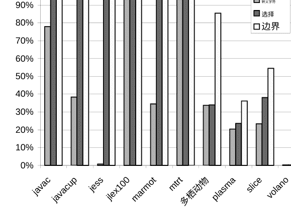

**图 5：动态同步测量。**

**图 6：删除的同步操作比例**

通过检测库来计算在执行过程中由多个线程同步的对象的数量，并假设所有其他同步操作都是可移除的，可以得到值。在 mtrt 中，优化效果得到了改善，由于发现了一些引用了多个同步对象的同步操作是可移除的，因此限制了边界（参见第 3.5.4 节）。在 multimarmot 中，执行每个方法优化的工作线程不会争用每个方法的数据，但由于该数据是从共享的符号表中访问的，因此保留了大量不必要的同步操作。在 volano 上，这三种情况都表现不佳，其中 98% 的同步操作发生在由多个线程同步的 BufferedInputStream 对象上。

13 通过跟踪锁之间的关系，分析可能能够移除这些同步操作，这些同步操作似乎由一个不太频繁同步的 DataInputStream 对象保护。

### 4.3 执行时间

图 7 展示了优化和未优化版本的基准程序的执行时间。对于我们的分析发现是单线程的程序，我们考虑了两种策略。第一种只进行同步消除，而第二种将线程标志传递给代码生成器和运行时系统，从而使其能够使用专门针对单线程情况的内存分配和收集原语。

在图 8 中，每个加速结果被分为三个段落。下部分表示从测量的同步计数和第 4.1 节中描述的平均情况同步成本计算出的估计加速度。下两个部分一起表示应用我们的优化时测得的加速度。这个值超过了估计值，因为同步移除使得额外的优化成为可能。14 所有三个段落的总和是在启用优化和单线程模式时测得的加速度。在实现了非平凡加速的情况下，额外的优化占据了改进的很大一部分（在 6 个案例中有 4 个案例的大部分改进）。

除了 multimarmot，它提高了 10%，多线程基准测试没有因为同步移除而变得更快。Mtrt 将所有同步作为加载数据文件的一部分进行，这只占整个计算的一小部分。在 plasma 和 slice 中的所有同步都发生在 AWT 库中；小程序的内部循环是浮点计算，不进行同步。在 volano 上没有获得性能改进，因为很少有同步操作被移除。

### 4.4 静态成本

图 9 展示了我们优化的各种静态度量。同步分析的绝对成本非常低（几秒钟），仅占整个编译时间的一小部分。

同时，通过缩小方法大小（删除同步代码）和增加方法数量（生成专门的方法），优化显著改变了 Marmot 优化编译器后续阶段的成本。总体编译时间在 javacup 中减少了 79%，但在 multimarmot 中增加了 20%。除了 javac 之外，其他单线程程序不需要特殊化。对于多线程程序，每个方法的平均专门化次数范围从 0.08 (mtrt) 到 0.20 (volano)。

优化对代码生成量的影响很大。16 在某些情况下，同步代码的删除（Marmot 总是内联）超过了专用方法和任何方法大小减小使得额外的内联成为可能。对于单线程程序，几乎所有的代码大小增加都归因于在单线程存储管理机制下分配操作的内联。

但是在多线程程序还有很多工作要做。我们的优化将所有线程都视为在程序执行期间运行，而许多程序（包括 multimarmot）使用 fork/join 策略，在这种策略中线程的生命周期要短得多。这表明需要追求更具时间敏感性的策略。另一个未解决的问题是对线程本身的处理；所有现有的分析，包括我们的分析，都将从线程对象可达的所有数据视为逃逸。需要更强大的技术来证明一些保存在线程实例变量中的状态保持不变。

| 名称 | 执行时间 (原始) | 执行时间 (选择) | 执行时间 (gcopt) |
| :--- | :--- | :--- | :--- |
| javac | 8.13 | 6.44 | 5.97 |
| javacup | 0.86 | 0.76 | 0.66 |
| jess | 6.03 | 5.63 | 5.12 |
| jlex100 | 21.66 | 8.37 | 8.09 |
| marmot | 85.10 | 71.35 | 61.83 |
| mtrt | 3.78 | 3.73 | 3.73 |
| multimarmot | 88.85 | 80.67 | 80.67 |
| plasma | 22.41 | 22.51 | 22.51 |
| slice | 4.64 | 4.64 | 4.64 |
| volano | 6.29 | 6.29 | 6.29 |

**图 7：执行时间测量（用户+内核时间，以秒为单位）。**

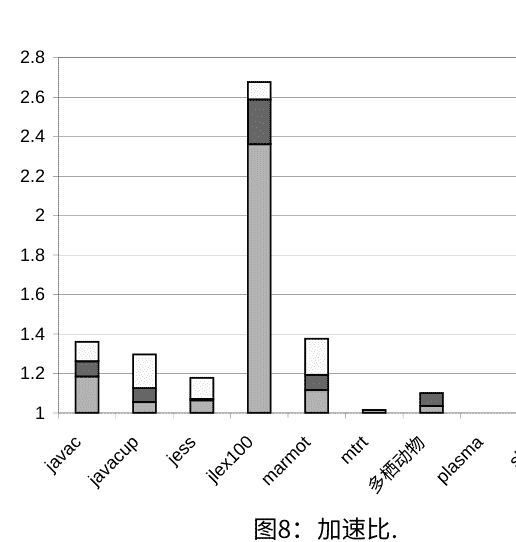

## 5 相关工作

本节描述了引言或正文中未涉及的工作。

### 5.1 同步优化

[DR96, DR97] 描述了将由同一锁保护的多个关键区域聚合为一个更大的关键区域的方案，以及用单个锁替换多个锁对象以保护所有子对象操作的方案。这些技术减少了每次执行的锁操作数量，但由于更粗的锁粒度，可能会降低并行性。[Tse95] 自动重构并行程序，用更便宜的操作替换屏障同步，或者完全移除它。在这两种情况下，这些转换是为并行编译器生成的特定线程同步风格而开发的，因此不清楚它们是否适用于像 Java 中的一般监视器同步。

在调用图中存在循环（例如，jess）时，我们的分析容易出错。可能的改进包括通过上下文敏感技术或建模多态数据结构来增强 Marmot 静态调用图分析。另一种选择是通过将方法调度编码到类型中，并使用基于实例化约束的流分析技术（[FRD00]）来避免使用静态调用图。第三种选择是在统一性产生错误别名时，允许使用 aliasSet 集合来表示值的有限使用 [SH97]。

减少同步操作的运行时成本的另一种方法是更高效地实现它们。IBM 的 "细锁" 工作 [BKMS98] 和 Marmot 锁实现 [FKR'00] 是快速锁定机制的示例。

我们分析的高速度打开了几个机会。一种可能性是将分析用作预处理阶段，以减少更精确模型的成本。另一种方法是迭代的、悲观的调用图优化，类似于 [HH98] 的风格，其中分析用于建模类集合，这些类集合用于改进调用图，从而实现重新分析等，直到达到收敛。

### 5.2 相关分析

用于间过程分析的抽象摘要函数的构建至少可以追溯到 [SP81] 的 "功能方法"。基于等价类和统一的别名分析是在 [Ste96b, Ste96a] 中引入的。基于摘要的指针分析的背景下的最新工作包括 [CRL99, CmH00] 和介绍中讨论的基于摘要的逃逸分析 [Bla99, CGS'99, WR99]。[FRD00] 探索了基于等价类分析和过程摘要的组合，支持高阶过程。

我们计划将基于等价类的总结技术应用于其他程序间问题，如堆栈分配、内存消歧和类型传播。

最后，我们认为继续寻找和开发额外的、更现实的多线程程序，以用于优化的设计和测试，是非常重要的。

## 6 未来工作

虽然我们的优化在单线程上表现得很好基准测试中并且在多线程情况下取得了一些成功，

## 7 结论

我们已经描述了一种有效、高效的技术，用于从 Java 程序中静态地删除不必要的同步操作。这种方法的特点是：

- 使用线程闭包和别名分析，而不是逃逸分析，从而在全局变量和多线程的情况下更精确地建模值流。

使用基于等价类的方法摘要，实现简单、快速、非固定点、上下文敏感的分析和转换。

我们的优化处理了同步方法和块，并保留了Java的同步、内存和通知语义。我们在优化编译器的环境中进行的实验表明，在单线程和多线程程序中，动态同步计数和执行时间都有所改善，而编译时间和代码增长的代价相对合理。

## 致谢

我们感谢微软研究院高级编程语言组的成员对Marmot编译器基础设施的支持，感谢Bjarne Steensgaard发现统一错误，以及匿名审稿人的建议。

## 参考文献

- [ACSE99] J. Aldrich, C. Chambers, E. G. Sirer和S. Eggers。用于从Java程序中消除不必要同步的静态分析。在SAS'99，LNCS。Springer-Verlag，1999年9月。
- [ASU86] A. V. Aho, R. Sethi, 和 J. D. Ullman。编译器：原理, 技术和工具。Addison-Wesley, Reading, MA, 美国, 1986。
- [BH99] J. Bogda 和 U. Holzle。在Java中去除不必要的同步。在第14届面向对象的编程系统、语言和应用会议（OOPSLA '99）上的论文集, 1999年11月。
- [BKMS98] D. F. Bacon, R. Konuru, C. Murthy, 和 M. Serrano.轻量级锁: Java的轻量级同步。在SIGPLAN '98编程语言设计和实现会议上的论文集, 1998年6月, 页码258-268.
- [Bla99] B. Blanchet。面向对象语言的逃逸分析。应用于Java。在第14届面向对象的编程系统、语言和应用会议（OOPSLA '99）上的论文集, 1999年11月。
- [BS96] D. F. 培根和P. F. 斯威尼。C++虚拟函数调用的快速静态分析。在OOP-SLA'96的论文集中，ACM SIGPLAN通知，页码324-341, 1996年10月。作为OOPSLA '96的论文集，ACM SIGPLAN通知，卷31, 编号10。
- [CFRW91] R. Cytron, J. Ferrante, B. K. Rosen和M. N.Wegman. 高效计算静态单赋值形式和控制依赖图。ACM程序设计语言和系统交易，13(4):451-490, 1991年10月。
- [CGS*99] J.-D. Choi, M. Gupta, M. Serrano, V. C. Sreedhar和 S. Midki。Java的逃逸分析。在第14届面向对象的编程系统，语言和应用大会(OOPSLA '99)上，1999年11月。
- [CmH00] B.-C. Cheng和W. mei Hwu。使用访问路径的模块化跨程序指针分析：设计，实现和评估。在SIGPLAN 2000年编程语言设计和实现会议上的论文中，2000年6月。
- [CRL99] R. Chatterjee, B. G. Rynder和W. A. Landi。相关上下文推断。在第26届ACM SIGPLAN-SIGACT编程语言原理研讨会上，1999年1月，第133-146页。
- [DR96] P. Diniz和M. Rinard。锁粗化：消除自动并行化基于对象的程序中的锁开销。在第九届并行计算语言和编译器研讨会上的论文中，LNCS 1239，1996年8月，第285-299页。
- [DR97] P. Diniz和M. Rinard。用于并行计算的同步转换。在第24届ACM SIGPLAN-SIGACT原则编程语言研讨会论文集中，页码为187-200，1997年。
- [FKR*00] R. Fitzgerald，T. B. Knoblock, E. Ruf, B. Steens- gaard和D. Tarditi。Marmot：用于Java的优化编译器。软件：实践与经验，30（3）：199-232，2000年3月。
- [FRD00] M. Fahrenkrug, J. Rehof和M. Das。使用实例化约束的可扩展上下文敏感流分析。在2000年SIGPLAN会议上的论文集编程语言设计与实现。
- [GJS96] J. Gosling, B. Joy和G. Steele。Java语言规范。Java系列。Addison-Wesley，马萨诸塞州雷丁，美国，1996年6月。
- [HH98] R. Hasti和S. Horwitz。使用静态单赋值形式改进对流不敏感的指针分析。在SIGPLAN '98会议论文集中，页码为97-105，1998年6月。
- [Rin99] M. Rinard。个人通信。1999年。
- [SH97] M. Shapiro和S. Horwitz。快速准确的流不敏感指针分析。在第24届ACM SIGPLAN-SIGACT编程语言原理研讨会论文集中，页码为1-14，1997年1月。
- [SP81] M. Sharir和A. Pnueli。两种方法进行过程间数据流分析。在程序流分析：理论与应用中，第7章，页码为189-284。Prentice-Hall，1981年。
- [Ste96a] B. Steensgaard。通过类型推断对具有结构和联合的程序进行指针分析。在编译器构造国际会议上，编号为在计算机科学讲义的第1060页，136-150页，1996年4月。
- [Ste96b] B. Steensgaard。几乎线性时间的指向分析。在编程语言原理的第23届ACM SIGPLAN-SIGACT研讨会上，32-41页，1996年1月。
- [Tse95] C.Tseng。用于消除栅栏同步的编译器优化。在第五届ACM SIGPLAN并行编程原则与实践研讨会上，144-155页，1995年7月。
- [WR99] J. Whaley和M. Rinard。用于Java程序的组合指针和逃逸分析。在第14届面向对象程序设计系统、语言和应用会议（OOP-SLA '99）上，1999年11月。

## 用受限类型封装对象

Christian Grothoff
詹斯·帕尔斯伯格
Jan Vitek
S³实验室，普渡大学计算机科学系
{grothoff,palsberg,jv}@cs.purdue.edu

### 摘要

面向对象的语言很少支持封装对象。引用语义允许对象逃离其定义范围。随之而来的普遍别名成为软件缺陷的主要来源。本文介绍了一种名为Kacheck/J的工具，用于推断大型Java程序中的对象封装属性。我们的目标是开发实用的工具来帮助软件工程师，因此我们专注于简单和可扩展的技术。Kacheck/J能够推断Java类的封闭性。一个类及其子类如果其所有实例都封装在其定义的包中，则被视为封闭的。这个简单的属性可以用来识别敏感对象的意外泄漏。分析具有可扩展性和高效性；Kacheck/J能够在6分钟内对46,000个类（115 MB）的语料库进行封闭性推断。

本文的目标是通过实验来探索关于封装的实用概念，以便为软件工程师提供指导设计健壮系统的工具。为此，我们专注于可以轻松理解的简单封装模型。我们故意忽略了更强大的逃逸分析[2, 3, 9]，因为它们对源代码的微小更改非常敏感，并返回可能难以解释的结果。当然，这样做的代价是我们的分析有时会将一个对象视为'逃逸'，而更精确的分析会发现这并非如此。我们选择研究受限类型[5]，因为它们产生了一种既简单易懂又成本较低的封装形式。受限类型的基本思想如下：

受限类型的对象被封装在其定义的包中。

### 1. 引言

面向对象的语言依赖引用语义来允许对象的共享。当一个对象对不同的客户端可访问时，就会发生共享；当一个对象通过不同的访问路径从同一个客户端可访问时，就会发生别名。共享既是一个强大的工具，也是一个潜在的程序缺陷的源头。别名的一个潜在后果是对象上调用的方法可能以设计者未预料到的方式相互依赖，并且一个子系统中的更新可能会影响表面上不相关的子系统，从而破坏程序的可靠性。

因此，如果一个类是受限的，那么该类的实例和其所有的子类都不能被属于其他包的代码所操作。就别名而言，受限性允许在一个包内使用别名，但阻止它们在其他包中传播，如图1所示。

虽然面向对象的语言提供了保护变量、方法甚至整个类的语言支持，但它们未能提供任何系统化的方式来保护对象。一个类可以将某些变量声明为私有的，但仍然可以从公共方法中返回该变量的内容。换句话说，面向对象的语言保护了单个对象的状态，但无法保证相互作用对象系统的完整性。它们缺乏一个封装边界的概念，以确保对‘受保护’对象的引用不会逃逸。

在[5]中，对受限性的定义需要显式的注解，因此假定软件是以受限性为前提进行设计的。在这项工作中，我们采用了一种不同的方法：Kacheck/J推断现有Java包中的受限性。我们从以下有争议的论点开始：

> 论点：Java程序中的所有包作用域类都应该受限。

此外，我们还展示了大多数大型Java应用程序都是这样编写的，以使得包作用域类受限。换句话说，受限性是对包作用域类的一种自然属性，也是可以期望的。

一个应该由编译器强制执行的约束。为了验证我们的假设，我们收集了大量的Java程序（46,000个类文件——据我们所知是最大的基准套件），并实现了Kacheck/J工具来推断这些类的约束属性。我们的分析结果显示，在不对源程序进行任何更改的情况下，有3,998个类（或包作用域类的25%）是受限的。此外，我们发现，如果在Java中添加解决泛型容器类型缺乏的功能，受限类型的数量可以增加到4,800多个。最后，令我们惊讶的是，在适当的工具支持下，同一基准套件中受限类的数量可以超过14,500个（或所有类的32%）。尽管我们可以同意包作用域类存在一些打破约束的合理用途，但我们认为这些用途应该被标记并进行特殊处理，而不是相反。

- 本文的贡献是：
- 比[5]（第3节）中的限制更简单和更宽松的受限规则。
- 基于约束的受限分析（第4节）。
- Kacheck/J受限推理工具的介绍（第5节）。
- 大规模基准套件的受限结果（第6节）。
- 改进受限的重构讨论以及对受限的更好语言支持的建议（第6节）。

### 2. 一个封装的例子

在现代面向对象的编程语言中，如Java，通过纪律使用内置的访问控制机制和一些简单的编码习惯，可以实现封装。我们将给出一个简单的激励例子，并用它来讨论我们的分析。

考虑在Sun JDK的java.util包中实现的Hashtable中使用的类HashtableEntry。该类的访问修饰符设置为默认访问，这在Java中意味着该类的作用域由其定义的包确定。HashtableEntry实例用于实现具有相同哈希码模除表大小的元素的链表。它们是一个内部数据结构的典型例子，该数据结构仅与一个特定的哈希表实现相关，并且不应逃逸出 Hashtable的上下文，绝对不应逃逸出定义的包 java.util。然而，我们如何确保包外的代码无法访问HashtableEntry对象？

由于HashtableEntry是包范围的，我们不需要担心外部代码会创建该类的实例。但是，如果一个公共方法返回一个HashtableEntry对象，或者一个公共字段持有对这样一个对象的引用，外部代码将能够将该引用转换为 Object并将其存储或用作参数。实现 Hashtable本身可以将HashtableEntry对象转换为某个公共超类，然后公开对该对象的引用。程序员可能会认为这种情况是编程错误的结果，一个好的程序员会小心并防止这种限制违规。可以将这视为一个逃逸问题：包范围类的实例引用能否逃离其封闭包？如果不能，那么这样一个类的对象被称为封装在包中。在这个例子中，HashtableEntry确实被封装起来，因为程序员们小心地避免将它们暴露给 java.util包之外的代码。

尽管更强大的程序分析可能会产生更多的受限类，特别是如果采用整个程序的方法，但我们目前的数字已经令人惊讶地高。另一个令人愉快的惊喜是，这些结果可以高效地获得。分析一个类文件的平均时间不到8毫秒（或者对于整个基准套件约350秒），对于一个完全用Java编写的工具在标准硬件上运行。

Kacheck/J 发现潜在的限制违规，并返回每个被工具分析的包的受限类型列表。例如，在上面的示例中，分析的预期结果将是HashtableEntry被限制在java.util包中，而Hashtable则不是，因为它被声明为public。分析依赖于类、字段和方法的访问修饰符，以及封闭包中所有方法的字节码的简单内部过程分析的结果（此部分分析执行限制检查）。此外，对于包作用域的类，还会分析继承方法的代码（此部分分析执行所谓的匿名性检查）。图2说明了工具执行的检查。

分析是模块化的，因为一次只需要考虑一个包；这被证明是可扩展性的一个关键特性。此外，由于在检查封闭性时不需要客户端代码，因此可以在库代码上使用 Kacheck/J。

事实上，我们的分析推断出类HashtableEntry不是封闭的，因为其中一个实例上调用了方法clone。 Hashtable的 clone方法克隆了表中的所有条目。问题在于 clone返回的是接收者的一个副本，强制转换为 Object。

对代码进行手动检查发现，每次调用HashtableEntry.clone ()后面都紧跟着一个强制转换为HashtableEntry。因此，该类的实例不会逃逸。但是我们的分析不足以发现这一点。

一个简单而高效的修复方法是通过替换HashtableEntry.clone()为一个返回HashtableEntry的新方法 clone来重构代码。这种重构足够简单，并且有去除不必要的类型转换的优点。

#### 简化假设

Kacheck/J 在一些简化假设下运行我们在这里详细说明。

#### 密封的包装

我们假设在分析时已知包中的所有类。这个假设对于分析结果很重要因为新的类可能会破坏已存在类的限制（例如，创建一个HashtableEntry 并从一个公共方法中返回它）。在Java中，用户代码可以加载新的类它们自己声明为包的成员。这里有几种可能的方法。例如，从jar文件加载的包可以声明为密封的[14, 16]在这种情况下，不能向该包添加用户类。

另一种解决方案是在字节码验证的一部分中添加对增量限制分析的支持。

#### 反射

分析假设反射不会违反语言访问控制。换句话说，它假设私有、受保护和默认访问修饰符的语义会被反射机制所尊重。这个假设可以通过更改JavaSecurity Manager的设置来违反。这可能导致额外的限制违规。

#### 本地代码

本地方法不受 Kacheck/J的检查，可能违反封装。我们假设当前包中定义的本地方法不会直接违反封装，但对于其他包中定义的本地方法的行为我们不做任何假设。对大量本地方法进行手动检查表明这个假设是合理的。此外，我们假设系统中其他部分的本地代码不会通过忽略访问控制声明来违反语言的语义。

### 3. 封装类型

封装的目标是满足以下的正确性属性：

正确性：封装类型的对象被封装在该类型的作用域中。

在[5]中，封装的粒度是包。因此，封装类型的实例不能逃离其定义的包。我们说封装类的实例被封装在其定义的包中。

约束的执行由两组约束条件实施。第一个约束条件集合，约束规则，适用于封装包，即定义受限类的包。

这些规则跟踪受限类型的值，并确保它们既不在公共成员中公开，也不扩展为非受限类型。第二组约束条件，所谓的匿名规则，适用于继承受限类的方法，可能包括库代码，并确保这些方法不会泄露对被标记的变量 this的引用，该变量可能引用受限类型的对象。

在本节中，我们将Bokowski和Vitek的规则调整为适用于约束推断。新规则既更简单，也更宽松（即可以显示更多的类为受限类），同时保持正确性。与原始论文一样，这里介绍的规则不需要封闭世界假设。约束推断在包级别上执行。这些规则假设一个包中的所有类都是已知的，并且对于受限类，它们的超类是可用的。

#### 3.1 匿名规则

强制执行封装依赖于跟踪包内封装对象的传播，并防止它们越过包边界。我们选择通过它们的类型来跟踪封装对象。因此，一旦一个受限类型的值可以逃离其包，就会发生封装违规。由于我们跟踪类型，将一个值从受限类型扩展到非受限类型违反了封装属性。

匿名规则适用于可能（但不一定）位于封装包外部的继承方法。这组规则的目标是防止方法泄露对特殊 this指针的引用。

这些规则的动机是，如果 this引用一个封装对象，返回或存储它等同于隐藏扩展。因此，我们说一个方法是匿名的如果满足以下三个规则。

| $\mathcal{A}_1$ | 一个匿名方法不能将 this扩展为非受限类型。 |
|---|---|
| $\mathcal{A}_2$ | 一个匿名方法不能是本地的。 |
| $\mathcal{A}_3$ | 在 this上调用的方法必须是匿名的。 |

第一条规则防止继承的方法存储或返回 this，除非 this的静态类型也是受限的。第二条规则确保本地方法永远不会是匿名的。虽然规则 $\mathcal{A}_1$和 $\mathcal{A}_2$是直接的匿名违规，但规则 $\mathcal{A}_3$跟踪传递违规。规则 $\mathcal{A}_3$中提到的调用取决于 this的动态类型（调用的目标）。因此，方法的匿名性是相对于特定类型来确定的。

#### 3.2 受限规则

受限规则适用于包中的所有类。如果一个类满足图4中的五条规则，则该类是受限的。

| 标识 | 描述 |
|------|------|
| C1 | 在受限类型上调用的所有方法必须是匿名的。 |
| C2 | 受限类型不能是公共的。 |
| C3 | 受限类型不能出现在公共（或受保护）字段的类型或非受限类型的公共（或受保护）方法的返回类型中。 |
| C4 | 受限类型的子类型必须是受限的。 |
| C5 | 受限类型不能扩展为非受限类型。 |

methodId不是匿名的；同样地，not-conf(classId)插入了class Id不是受限的。剩下的四种约束形式表示逻辑蕴含关系。例如，not-anon(A.m())⇒not-conf(C)的意思是“如果类A中的方法m不是匿名的，则类C不会被限制。”

我们以一种直接的方式从程序文本中生成约束。图5的示例说明了约束的生成过程。对于每个语法结构，我们在注释中指出了与之相关的规则（来自第3节）。图6详细说明了该示例生成的约束。从Java字节码生成的约束的完整描述在附录A中给出。

规则 C1 确保在受限类型上调用的任何继承方法都不会泄漏 this 指针。只要从未调用，此规则不排除受限类型继承非匿名方法。规则 C2 防止公共类被限制。规则 C3 确保没有公开成员（私有或受保护）是受限类型。这适用于包中的所有非受限类型。

规则 C4防止非受限类（或接口）扩展受限类型。最后，规则 C5防止将受限类型的值转换为非受限类型。

异常是一种不在这些规则中明确列出的扩展情况。相反，我们认为 throw 将其参数扩展为声明为 public 的类 Throwable，从而违反了规则 C5。

我们的限制规则不禁止包含本地代码，但规则 A2明确指出本地方法不是匿名的。这种设计选择的动机是，尽管可以预期包的开发者手动检查当前包中的本地代码，但很难检查属于标准库的父类的本地代码。此外，违反 A1的 this 的使用通常不被视为本地代码的不良行为。基本上，我们假设封闭包中的本地代码在某种程度上是可信的。

### 4. 基于约束的分析

我们使用基于约束的程序分析来推断方法的匿名性和封闭性。基于约束的分析先前已被用于各种目的，包括类型推断和流分析。基于约束的分析分为两个步骤：

- 从程序文本生成约束系统。
- 解决约束系统。

约束系统的解是所需的信息。在我们的情况下，约束的形式如下：
A ::= 非匿名 (方法ID)
T ::= 非封闭 (类ID)
C ::= A | T | T ⇒ A | A ⇒ A | A ⇒ T | T ⇒ T
约束not-anon(方法ID)断言该方法不是匿名的。

```
public class A {
    A a;
    public A m() {
        a = this;        // (A1)
        new B().t(this); // (A1)
        返回 this;       // (A1)
    }
    本地 void o();      // (A2)
}
类 B 扩展 A {
    void t(A a) {}
    A p() {
        返回 this.m();   // (A3)
    }
    public A getD() {
        返回 new D().p(); // (C1)
    }
}
public class C {        // (C2)
    public D getD() {   // (C3)
        返回 new D();
    }
    public D d = new D(); // (C3)
}
类 D 扩展 B {            // (C4)
    A getA() {
        this.t(this);    // (C5)
        a = new D();     // (C5)
        返回 new D();    // (C5)
    }
}
```

我们的约束都是基本Horn子句. 我们的解决方案过程计算出集合 not-conf(classId)这些子句要么是直接事实，要么是通过逻辑蕴含推导出来的. 这个计算可以在线性时间内完成.

#### 控制流分析

规则 C1将控制流问题作为强制性问题，因为它要求只有在受限类型上实际调用的方法才需要是匿名的。任何保守的控制流分析都可以用来产生一组候选方法。

我们选择执行一种简单的流不敏感分析，对于我们的目的来说足够实用和精确。

## 5. 实施Kacheck/J

尽管限制和匿名规则被描述为源代码级别的约束，但我们选择将Kacheck/J实现为字节码分析器。在字节码级别工作的主要优势是有大量的类文件可用。Kacheck/J的实现利用了开放虚拟机项目的字节码验证框架。

在OVM中，通过使用轻量级模式实现了字节码验证。对于Java虚拟机规范中定义的200个字节码指令，OVM验证器创建一个负责计算该指令对抽象状态产生影响的指令对象。验证是一个简单的固定点迭代过程。

验证从包括指令指针、操作数栈和变量的初始状态开始。验证器遵循方法内的所有可能的控制流。

这种轻量级的方法使我们能够将OVM字节码验证器用作静态分析引擎。通过仅对200个指令对象中的9个进行子类化，我们生成约束。这些特殊目的的指令执行一些简单的检查和记录程序执行的基本事实。

专门用于受限类型的代码（包括详细的违规报告）大约有5,600行。从OVM重用的代码（包括类加载）大约有25,000行代码。当前版本的OVM大约有74,000行代码。

## 例子

图7给出了一个导致类不受限的约束链的示例。请注意，该工具会重新排序解决过程的部分，而这里只解释了最终的约束链。

> 方法P.nonAnon()不是匿名的，因为它将this扩展为java.lang.Object，这是一个非受限类。

| 情况 | 约束 | 解释 |
|------|------|------|
| (A1) | 非受限（A）⇒ 非匿名（A.m()） | 将this扩展为A |
| (A2) | 非匿名（A.o()） | o是本地的 |
| (A3) | 非匿名（A.m()）⇒ 非匿名(B.p()) B.p()调用 m()时，接收对象为this | |
| (C1) | 非匿名（D.p()）⇒ 非受限（D） | 在一个 D对象上调用p() |
| (C2) | not-conf(C) | 声明为public的类 C |
| (C3) | not-conf(C) ⇒ 非受限（D） | public方法 C.getD()的返回类型为 D; public字段 C.d的类型为 D |
| (C4) | 非受限（D）⇒ not-conf(B) | D继承自B |
| (C5) | not-conf(A) ⇒ 非受限（D） | D扩展为A |

图6：从图5的示例生成的约束条件。

根据定义，受限类型不能从其定义包之外调用，也不能扩展为非受限类型，因此分析只需要记录在受限类型的实例上调用的方法。因此，只有对类型为 x 的调用m()需要保留，其中 x 的类型是受限的。这形成了控制流分析的根集。在根集中的受限方法内部的传递调用（例如 this.m()）由匿名规则 A3记录。在 x.m()中，x 的类型被确定为在字节码验证期间推断出的最一般类型与所有扩展为该类型的子类型的并集。

记录程序执行的基本事实。例如，areturn指令检查是否将其用作返回值，如果是，则报告将其扩展为方法的返回类型。invoke指令记录依赖关系，例如将其用作参数或在此上调用方法时。

- 总体上，对验证器进行了以下更改：
- 在非静态方法中，跟踪局部变量0（this）。
- 记录this的使用情况。
- 记录所有扩展。
- 记录抛出异常的类型。

分析不尝试执行死代码检测，所以包含调用a.m()的方法可能是死代码，但我们仍然将m添加到根集合中。这简化了分析但会损失一些精确性。进行死代码检测也会导致分析结果对源程序的更改更敏感。我们坚信，对于源程序的微小更改，限制推断的结果应该是稳定的，并且任何更改应该只有局部影响。

通过拦截子类型检查来捕获扩展。
匿名检查只需要对模拟九个指令的代码进行轻微修改：添加检查以记录对this的操作。详见附录A。

流分析计算每个可能受限类型T₁的蕴含链，例如 T₂ ⇒ (A ⇒)* A ⇒ T₁ 被折叠到 T₂ ⇒ T₁. 形式的约束 T和 T ⇒ T立即解决，同时记录下来。

## 6. 结果

Kacheck/J已在大型数据集上进行了评估。本节概述了基准程序并呈现了分析结果。我们还讨论了Kacheck/J的扩展、限制的编码习惯和改进的语言支持。

### 6.1 Purdue基准套件

Purdue基准套件（PBS）包含33个Java程序和不同大小、目的和来源的库。整个套件包含46,165个类（或115 MB的字节码）和1,771个包。据我们所知，PBS是最大的Java程序集合。大多数基准程序都是免费提供的，可以从 Kacheck/J网页获取。

```
public class P {
    public Object nonAnon() {
        return this;         // (1)
    }
}
class B extends P {
    public Object nonAnonInd() {
        return this.nonAnon(); // (2)
    }
}
class C extends B {          // (3)
}
public class X {
    public Object invocation() {
        return new C().nonAnonInd(); // (4)
    }
}
```

图8：普渡基准套件（PBS v1.0）

| 名字 | 描述 | 缩写 |
|---|---|---|
| Aglets | 移动代理工具包 | ag |
| AlgebraDB | 关系数据库 | db |
| Bloat | 普渡字节码优化器 | bl |
| Denodo | 设计工具 | de |
| Forte | 集成开发环境 | fo |
| GFC | 图形基础类 | gf |
| GJ | Java编译器 | gj |
| HyperJ | IBM组合框架 | hj |
| JAX | 打包工具 | ja |
| JDK 1.1.8 | 库代码 (Sun) | j1 |
| JDK 1.2.2 | 库代码 (Sun) | j2 |
| JDK 1.3.0 | 库代码 (IBM) | j3 |
| JDK 1.3.1 | 库代码 (Sun) | j4 |
| JavaSeal | 移动代理系统 | js |
| Jalapeno 1.1 | Java即时编译器 | jp |
| JPython | Python实现 | jy |
| JTB | 普渡大学Java树构建器 | jb |
| JTOpen | IBM Java工具箱 | jt |
| Kawa | Scheme编译器 | kw |
| OVM | Java虚拟机 | o4 |
| Ozone | ODBMS | oz |
| Rhino | Javascript解释器 | rh |
| SableCC | Java到HTML转换器 | sc |
| Satin | 伯克利工具包 | sa |
| Schroeder | 音频编辑器 | sh |
| Soot | 字节码优化框架 | so |
| Symjpack | 符号数字包 | sy |
| Tomcat | Java Servlet参考实现 | tc |
| Toba | 字节码到C语言转换器 | to |
| Voyager | 分布式对象系统 | vy |
| Web服务器 | Java Web服务器 | ws |
| Xerces | XML解析器 | xe |
| Zeus | Java/XML数据绑定 | ze |

图9给出了PBS中每个程序或库的类数量概述。附录B提供了有关基准测试的其他数据。我们最大的基准测试，每个都有超过2,000个类，包括Forte，JDK 1.2.2，JDK 1.3.*，Ozone，Voyager和JTOpen。Ozone和Forte是应用程序，而其他的是库。每个应用程序中的包作用域类的数量以浅灰色表示。这个数字是受限类的上限；公共类不能被限制。

是声明为私有或默认访问权限的字段和方法。大多数编码规范鼓励使用包作用域方法和包作用域类。

毫不奇怪，为了重用而设计的程序（如库和框架）比一次性应用程序写得更好。例如，Aglet工作台和JTOpen这两个库都具有很高的封装度。值得注意的是，尽管Forte是一个应用程序，但它有超过50%的包作用域类和成员。以面向对象的方式编写的编译器和优化器（如Bloat、Toba和Soot）由于用于表示语法元素或单个字节码指令的许多类，具有大量的包作用域类。另一方面，我们有几乎没有包作用域类的应用程序，如Jax和Kawa。值得注意的是，JDK的不同版本之间封装性的增加。 JDK1.1.8和JDK1.3.1之间的包作用域类的百分比翻了一番，而类的绝对数量增加了三倍。

编码风格对封装性有影响。尽管作用域限定的类和封装类型之间的关系是显而易见的，但作用域限定的成员和封装类型之间存在着更微妙的联系：公共和受保护的方法可以返回潜在的封装类型。因此，可以合理地期望具有低比例作用域限定成员的程序也具有较少的封装类型。

### 6.2 限制类型

在PBS上运行Kacheck/J产生了3,998个限制类，25%的包作用域类是限制类。图11显示了所有类的限制类的百分比。这些数字按照具有限制内部类的程序进行了细分，以浅灰色显示。原始数字在附录B中给出。

有6个程序，其中超过40%的包范围类型被限制（db，gf，jy，jb，jp，o4）。有趣的是，这些程序几乎没有共同之处：它们是库（gf），框架（o4）和应用程序（db，jy，jb，jp）的混合体。它们的包范围类的比例和大小差异很大。事实上，对这些程序的手动检查表明编程风格对限制非常重要。例如，在OVM和 Kacheck/J的早期版本中，单元测试被系统地存储在当前包的子包中。一些方法和类仅声明为公共，以便测试代码。这反过来阻止了许多类的限制。OVM中限制的内部类数量很大（o4），这是因为嵌套在指令集类中的表示字节码指令的对象。对于Jalapeno，高限制比率（994个类中的153个类）部分是程序的单一包结构的结果。

可以预见的是，具有非常少的包作用域类（例如ja，kw，sh，gf）的程序最终只有很少的受限类。图12显示了包作用域类和受限类之间的关系。这个图中的变异性非常高。例如，像Aglets（ag）这样具有非常高的包作用域成员和类比例的库，在410个类中只有13个类被限制。为什么会这样呢？可能有两种解释：要么这些类确实被限制，而我们的分析能力不足以发现这一点，要么我们最初的假设即包作用域类自然受限是错误的。第一种情况引出了如何改进我们的分析的问题。第二种情况提出了是否可以重构代码使其受限的问题。为了回答这些问题，我们从讨论受限违规开始。

### 6.3 限制违规

限制违规是由少数广泛使用的编程习惯引起的。对于任何违规，Kacheck/J返回导致违规的蕴含链的文本表示。我们举例说明了类不被限制的主要原因。

#### 6.3.1 匿名违规

在整个JDK中，前三个匿名违规（共计133个非限制类）来自于AWT库中注册当前对象以进行通知的方法。方法addImpl是代表性的：

```
protected void addImpl(Component comp,
                      Object constraints,
                      int index) {
    synchronized (getTreeLock()) { ... 
        ContainerEvent e
            = new ContainerEvent
                (this,
                ContainerEvent.COMPONENT_ADDED,
                comp); ... } }
```

#### 6.3.2 向超类扩展

向超类扩展是最常见的限制违规类型之一。例如，Kacheck/J在Aglet基准测试中发出了以下扩展信号：

```
com/ibm/aglets/tahiti/SecurityPermissionEditor:
 - 非法扩展到：
   - com/ibm/aglets/tahiti/PermissionEditor
```

PermissionEditor是非公开类SecurityPermissionEditor的抽象超类。PermissionEditor是在包外部导出的接口的一部分。

#### 6.3.3 容器中的扩展

大量违规来自于在Java中使用容器类。诸如向量和哈希表等数据结构总是接受 Object类型的参数，因此使用容器将导致扩展到最通用的超类型。例如，Kacheck/J报告NativeLibrary，是ClassLoader的内部类，不受限制。

```
java/lang/ClassLoader$NativeLibrary:
   非法扩展到 java/lang/Object
```

错误发生的原因是NativeLibrary的一个实例被存储在一个向量中：

```
systemNativeLibraries.addElement(lib);
```

因此，这个违规可能表示一个安全问题。类加载器的内部应该真正封装起来。检查代码发现，存储对象的 Vector是私有的。

```
private static Vector systemNativeLibraries
    = new Vector();
```

经过进一步检查，很明显向量 does not escape from its defining class. 但这需要 inspection of the source code and only remains true only until the next patch is applied to the class. 这个例子显示了像Kacheck/J这样的工具的有用性，因为它们可以 direct the attention of software engineers towards potential security breaches or software defects.

#### 6.3.4 匿名内部类

当使用内部类实现回调时，这种违规情况经常发生。例如，在Aglets中，MouseListener类是 public. 因此，以下代码违反了匿名内部类的 confinement。

```
MouseListener mlistener = new MouseAdapter() {
    public void mouseEntered(MouseEvent e)
    { ... } };
```

类似的情况发生在实现公共接口的包范围类中。它们是包范围的，以 protect their members, but are exported outside of the package.

### 6.4 使用泛型进行限制

在Java中，向量、哈希表和其他容器是无处不在的。每当一个对象被存储在容器中时，它的类型会被扩大为Object，导致对象的类出现扩大违规。如果Java支持适当的参数多态性，大多数违规将消失（可能会有一些异构数据结构，但它们似乎是例外）。

为了尝试评估泛型的影响，而不需要重写PBS中的所有程序，我们修改了Kacheck/J以忽略与容器相关的扩大违规。

这是通过忽略对java.util类的方法调用中发生的所有扩大到Object的操作来实现的。图13显示了没有泛型违规的受限类的百分比；我们将这些类称为泛型受限（GC）类。浅灰色的条形图显示了原始受限类的数量。

深灰色的条形图显示了添加泛型的效果。受限类型的数量增加了875个（在PBS的所有程序中）。

这些结果应该谨慎对待，因为它们可能会过高估计潜在的收益，因为我们不能保证容器实例是包作用域的。

### 6.5 推断访问修饰符

一些基准测试中受限类的数量较低令人惊讶。查看这些基准测试中类的访问修饰符，原因立即清楚。

例如，在Kawa中，共有443个类，只有5个是包作用域的。同样，许多基准测试包含被声明为公共的方法和字段，从而阻止某些类型被限制。

这些访问模式是最严格的吗，还是有时随机选择的？

为了回答这个问题，我们在分析过程中推断出最紧密的访问模式，然后使用推断出的模式进行限制检查。图14显示了这个分析的结果。

通过修改推断，成为限制的类被称为可限制的（CA）。通过模式推断，整个PBS中可限制的类的数量增加到13,064个。此外，如果我们将可限制的类和泛型类结合起来，我们将获得14,591个泛型可限制的类。

图14：可限制的类型。

图15将这个新分析的结果与原始的包作用域类数量进行了对比。令人惊讶的是，Jax和Kawa这两个应用程序，原本只有很少的限制类，现在约有40%的类是可限制的。

图15：可限制类型和包范围。

当然，在库代码上使用此选项可能会导致潜在收益的过高估计，因为从库中从未使用的某些类可以被设置为包范围，尽管客户端代码需要访问这些类。尽管如此，结果很好地显示了潜在收益。

### 6.6 分层包

我们最后的实验涉及改变Java包机制的语义。目前，Java具有平面包命名空间；也就是说，尽管包名可以嵌套，但这种嵌套没有语义。这在数据抽象和模块化之间产生了一个困境。

良好的设计实践建议根据代码的功能特性将应用程序分割成包。

另一方面，创建包会强制某些类成为公共类，即使这些类不应该被程序的客户端使用。从隔离的角度来看，我们可以说更多的包会导致更少的受限类。

一个极端是Jalapeno，它被构造为一个单一的包。这降低了约束性质的有用性。

为了评估包结构对约束性的影响，我们修改了Kacheck/J，使使用了分层包模型。总体思路是将包访问扩展到相邻的包。我们引入了一个称为 n-package-scoped的范围定义。n-package-scoped限制了距离定义包的包名树中少于 n nodes的包中的类的访问。

例如，类java.util.HashtableEntry对于java.lang.System而言，当 n=2时是可见的。未命名包被定义为与其他包的距离为 ∞，这使得一个 n-package-scoped类 a.A对于 b.B来说是不可见的，无论选择的 n是什么。

图16展示了通过增加接近阈值n而产生的累积改进。当 n=9时，大多数程序被视为一个单独的包，带来了3691个额外的受限类。受限类中最大的增加来自Voyager基准测试，增加了813个新的受限类。最重要的增量发生在 n=3时，增加了2679个额外的受限类。此阈值允许类访问同级类的包范围成员（和类）。

图16：分层包。

### 6.7 用于限制的编码

我们的结果明确指出容器是限制违规的一个来源。我们考虑使用Java的通用扩展（如GJ）来增加限制。不幸的是，大多数这些扩展采用的同质翻译策略意味着在字节码级别上，使用GJ编写的代码被翻译回使用标准Java容器类的代码。因此，Kacheck/J无法验证存储在通用容器中的类是否保持受限。异构翻译策略的缺点是会导致代码重复。幸运的是，通过一些编码技巧可以实现所需的结果。基本思想是使用适配器模式将一个非受限对象包装在每个必须存储在容器中的受限对象周围。

一个受限制的哈希表的实现可以提供一个带有两个方法的接口 Entry boolean equal(Entry e)和int hashCode()。 在包含受限制类 c 的包中，程序员将使用包范围的构造函数定义一个 Entry 的实现 RealEntry，该构造函数接受键和值（例如，值的类型为受限制类）和包范围的访问器方法。 哈希表本身只能访问 Entry中定义的公共方法。

这种更改的代价是创建额外的 Entry 对象，其他 Hashtable 的实现可能不需要。 另一方面，要访问键值对，这个实现只需要一个强制转换（将 Entry 转换为 RealEntry 以访问键和值），而默认实现需要对键和值进行强制转换。
对于其他容器，权衡可能更糟糕。

```
public interface Entry {
    public boolean equal(Entry e);
    public int hashCode();    }
public class Hashtable {
    public void put(Entry e) {...}
    public Entry get(Entry e) {...}    }
class MyEntry implements Entry {
    ConfinedKey key;
    ConfinedValue val;
    public boolean equal(Entry e) {...}
    public int hashCode() {...}    }
```

图17：示例 Hashtable 接口。

## 6.8 运行时性能

所有基准测试都是在一台配备 256 MB RAM 的 Pentium III 800 上运行的，使用 Linux 2.2.19 和 IBM JDK 1.3。 除了 JDK 测试 (j1, j2, j3, j4) 之外，所有运行时间都包括加载和分析 Sun JDK 1.3.1 库的所需部分。 运行时间最长的是 JDK 1.3.1，它由 7,037 个类组成，在 41 秒内进行分析。 平均而言， Kacheck/J 每个类需要 7.5 毫秒。 图 18 总结了封闭检查的成本，详细的时间数据在附录中。

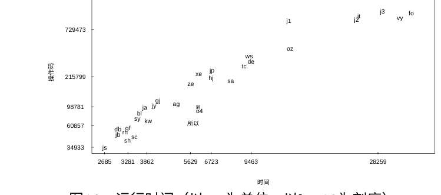

图18：运行时间（以 ms 为单位，以 log10 为刻度）。

## 7. 相关工作

```
public class Parent {
    protected Parent nonAnonymousMethod() {
        return this; // 违反规则 A1
    }  }
class NotConf extends Parent {
    Parent violation() {
        return nonAnonymousMethod();
                                // 隐藏的扩宽
    }  }
```

图19：违反限制 C1。

近年来，已经有很多论文讨论了这个问题 [12, 11, 8, 1, 15, 10, 13, 7]。 我们将简要讨论最相关的工作。

Bokowski 和 Vitek [5] 引入了受限类型的概念。 在他们的论文中，受限类型是明确声明的。这意味着软件必须考虑和实现受限性。 他们的论文讨论了基于 Bokowski 的 CoffeeStrainer [4] 的源代码级受限性检查器的实现。Kacheck/J 从现有的 Java 代码中推断出受限性。 那项工作与本文的主要区别在于匿名性的定义。 最有趣的受限性违规是受限类型向公共类型的隐藏扩宽，这可能发生在继承方法中 (规则 C1)。

考虑图 19 的例子。 在程序内部分析不会揭示出 (new NotConf ()).violation() 会将 NotConfined 扩大到 Parent。 因此，Bokowski 和 Vitek 选择依赖于显式的匿名声明，并添加了额外的匿名约束：

> 当覆盖方法时，必须保留 4 个匿名声明。

因此，一旦一个方法被声明为匿名，所有对该方法的重写定义都必须遵守约束。
在推断匿名性时，规则 4 不是必需的。 规则 4 的目标是确保方法的匿名性与方法查找的结果无关。 如果推断方法的匿名性，则可以考虑动态绑定。

```
public class A {     // A 在关系上不受限制
    Object m() {
        // m() 在关系上对 C 是匿名的
        // 但对 B 不是匿名的
        return null;    }
    public Object n() {
        return new C().m();    }    }
class B extends A { // B 在关系上不受限制
    Object m() {        // m() 不是匿名的
        return this;    }    }
类 C 继承自 A {} // C 是受限的
```

图20：匿名性不需要在所有子类型中保留。

图20展示了一个受限类C，它继承了类A。方法A.m()满足所有匿名性标准，除了规则A4。违反该规则的发生在类B中，因为B继承自A并重新定义了m()，返回了this。需要注意的关键点是，如果this的动态类型是A，则不会发生匿名性违规。我们说方法A.m()相对于C是匿名的，但相对于B不是匿名的。

Boyland，Noble和Retert [6]引入了能力作为描述对引用所施加的限制的统一系统。他们的系统可以模拟许多用于解决匿名问题的不同修饰符，例如不可变的、唯一的、只读的或借用的。他们还模拟了匿名引用的概念，这与本文中使用的概念不同。他们的访问权限系统不能用于模拟受限类型，主要是因为它缺乏对包范围访问的支持。

旧的和新的匿名性规则之间的另一个区别是，我们允许将this引用扩展到其他受限类型。旧规则完全禁止返回this或将this用作参数。如果返回值或参数的类型再次是受限类型，新规则允许这种情况。图21显示了一个最小变化的图19的示例。在这种情况下，新规则将允许两个类都是受限的。

```
父类 {
    protected 父类 匿名方法() {
        返回 this; // 不违反 A1
    }
}
子类 继承自 父类 {
    父类 无违规() {
        返回 匿名方法();
        // 扩大范围，但没有逃逸
    }
}
图21：限制！
```

在 [15] 中，灵活的别名保护被提出作为控制聚合对象（或所有者）之间潜在别名的手段。别名模式声明指定了引用共享的约束。模式 rep 保护表示对象免受暴露。实质上，rep 对象属于单个所有者对象，并且模型保证所有通往表示对象的路径都经过该对象的所有者。模式 arg 标记不属于当前所有者的参数对象，因此可能从外部引用别名。参数对象可以具有不同的角色，模型保证所有者不能在角色之间引入别名。Clarke、Potter 和 Noble [7] 通过所有权类型形式化了表示包含。

霍格的岛屿[11]和阿尔梅达的气球[1]有相似的目标。岛屿或气球是一种拥有者对象，它保护其内部表示不受别名的影响。与[15]的主要区别在于，这两个提案都力求实现完全封装，即从拥有者可达的所有对象都受到保护，不受别名的影响。这相当于将岛屿或气球中的所有内容声明为 rep。这是有限制的，因为它阻止了许多常见的编程风格；无法像灵活的别名保护和受限类型那样混合使用受保护和未受保护的对象。

霍格的提案通过共享注解扩展了Smalltalk-80，但尚未实现也未经过正式验证。阿尔梅达提出了一个抽象解释算法来判断一个类是否满足他的气球不变式，但迄今为止还没有实现。气球类型与受限类型类似，只需要对气球类型的代码进行分析，而不需要对整个程序进行分析。

## 8. 结论

我们已经提出了 Kacheck/J 工具来推断Java程序中的约束，并使用该工具分析了超过46,000个类。分析结果令人惊讶，大约25%的包作用域类和接口是受限的。此外，我们发现许多约束违规是由于使用容器类引起的，因此通过扩展Java的泛型性可能解决这些问题，这将增加约束到30%。最令人惊讶的是由于访问修饰符选择不当而导致的违规数量。在推断更严格的访问修饰符之后，所有包作用域类的45%都是受限的。我们预计一旦程序员开始考虑约束编写代码，这些数字将进一步上升。

约束是一个重要的属性。它将封装对象的别名限制在其类的定义包中，并通过暴露潜在的软件缺陷，或者至少使常常微妙的依赖关系可见，有助于重新设计面向对象的软件。我们已经证明推断受限类型是快速且可扩展的。Kacheck/J 可以从以下位置获取
http://gecko.cs.purdue.edu/kacheck/

## 致谢

这项工作得到了DAAD、Lockheed-Martin、CERIAS和NSF (CCR-9734265) 的资助。作者们感谢Ben Titzer和Theodore Witkamp开发的修改推理包，以及Mario S`udholt和IFIP WG2.4的成员提供的有益评论。

普渡基准套件中的一些程序源自Ashes套件，我们感谢麦吉尔大学的Sable研究小组提供这些程序。

## 9. 参考文献

- [1] Paulo S'ergio Almeida. Balloon Types: 控制数据类型中的状态共享。 在ECOOP Proceedings, 1997年6月。
- [2] Bruno Blanchet. 逃逸分析用于面向对象语言。应用于Java。 在OOPSLA'99 ACM Conference on Object-Oriented Systems, Languages and Applications, ACM SIGPLAN Notices的第34卷(10)中，第20-34页，科罗拉多州丹佛市，1999年10月。 ACM Press。
- [3] Jeff Bogda and Urs Hölzle. Removing unnecessary synchronization in Java. 在OO PSLA'99 ACM Conference on Object-Oriented Systems, Languages and Applications, ACM SIGPLAN Notices的第34卷(10)中，第35-46页，科罗拉多州丹佛市，1999年10月。 ACM Press。
- [4] Boris Bokowski. CoffeeStrainer: 在Java中对类型的定义和使用进行静态检查的约束。在ESEC/FSE '99的会议论文中，法国图卢兹，1999年9月。
- [5] Boris Bokowski和Jan Vitek。 受限类型。 在第14届ACM SIGPLAN年会议论文集面向对象的编程系统、语言和应用（OOPSLA'99），美国科罗拉多州丹佛市，1999年11月。
- [6] John Boyland, James Noble和William Retert。 别名的能力：独特性和只读的推广。 在ECOOP'01 - 面向对象的编程第15届欧洲会议，即将出版的计算机科学讲义柏林，海德堡，纽约2001年。 Springer。
- [7] David G. Clarke, John M. Potter和James Noble。 所有权类型用于灵活的别名保护。 在 OOPSLA '98会议论文集，ACM SIGPLAN通知的第33卷（10），第48-64页。 ACM, 1998年10月。
- [8] D. Detlefs, K. Rustan M. Leino, and G. Nelson。 解决与重复曝光的斗争。 技术报告，数字设备公司系统研究中心，1996年。
- [9] Alain Deutsch。 语义模型和抽象解释技术用于归纳数据结构和指针。 在 ACM SIGPLAN部分评估和基于语义的程序操作研讨会，页面226-229，加利福尼亚州拉霍亚，1995年6月21日至23日。
- [10] Daniela Genius, Martin Trapp和Wolf Zimmermann。 改善局部性的方法。在编译研讨会的第二种类型，卷LNCS 1473，日本京都，1998年3月。 SpringerVerlag。
- [11] John Hogg。 岛屿：面向对象语言中的别名保护。 在OOPSLA会议，1991年11月。
- [12] 约翰·霍格，道格·利亚，艾伦·威尔斯，丹尼斯·德尚波，和理查德·霍尔特。 关于对象别名处理的日内瓦公约。 OOPS Messenger, 3(2), 1992年4月。
- [13] S.J.H. 肯特和I. 蒙。 封装和聚合。 在TOOLS PACIFIC 95 (TOOLS 18)会议论文集中。 Prentice Hall, 1995年。
- [14] Sun Microsystems. Java平台1.2版本中的扩展和应用支持。 2000年。
- [15] 詹姆斯·诺布尔，约翰·波特和扬·维特克。 灵活的别名保护。 在ECOOP'98会议论文集中，LNCS卷1543，比利时布鲁塞尔，1998年7月20日-24日。 Springer-Verlag。
- [16] Ayal Zaks, Vitaly Feldman和Nava Aizikowitz。 Java包中的封闭调用。 在OOPSLA '2000会议论文集中，ACM SIGPLAN通知。 ACM, 2000年10月。

# 附录

## A. 约束生成

在本节中，我们介绍了哪些操作码为受限类型生成了哪些约束。

### InvokeStatic

- 如果 this 在参数列表中出现，则记录将 this 扩展为匹配参数的类型 T 的操作。 这生成了约束：C ⇒ A 其中 C 不是非约束(T) 而 A 不是匿名(m)。
- 对于每个推断类型为对象的参数 a，记录相应的声明类型 T' 的参数。 这生成了约束 C' ⇒ C 其中 C' 不是非约束(T') 而 C 不是非约束(T)。

### Areturn、Putfield、Putstatic、Aastore

- 如果返回或存储的变量是 this，则记录将 this 扩展为声明类型 T' (返回类型、字段类型或数组类型)。 这生成了约束 A ⇒ C 其中 C 不是非约束(T') 而 A 不是匿名(m)，其中 m 是当前方法。
- 如果使用的变量是一个对象而不是 this 并且具有推断类型 T，则将其扩展为相应的声明类型 T'。 这会生成约束条件 C ⇒ C' 其中 C 不是 T' 的非冲突(T') 且 C 不是 T 的非冲突(T)。

### InvokeInterface, InvokeVirtual, InvokeSpecial

- 如果 this 在参数列表中出现，则记录将 this 扩展为匹配参数的类型 T 的操作。 这生成了约束：C ⇒ A 其中 C 不是非约束(T) 而 A 不是匿名(m)。
- 如果调用的形式为 this.n()，从方法 m 对 this 调用方法 n，记录方法调用时区分 invokevirtual、invokeinterface 和 invokespecial。 这会生成约束条件 A ⇒ A' 其中 A 不是 m 的非匿名(n) 且 A' 不是 m 的非匿名(m)。
- 如果调用不是在 this 上，而是以 T 的形式 a.n()，记录对类型 T 的调用，其中 T 是 a 的推断类型。 这会生成约束条件 A ⇒ C 其中 A 不是 n 的非匿名(n) 且 C 不是 T 的非冲突(T)。
- 对于每个参数 a 的推断类型 T，如果是一个对象，则记录相应的声明类型 T' 的参数。 这会生成约束 C ⇒ C'，其中 C 不是冲突的 (T') 且 C 不是冲突的 (T)。

### Athrow

- 如果被抛出的变量是 this，则记录将 this 扩展为 Throwable。 这会生成约束 C ⇒ A 其中 C 不是冲突的 (Throwable) 且 A 不是匿名的 (m) 其中 m 是当前方法。 因为条件不是冲突的 (Throwable) 总是成立，也可以使用原始约束 A。
- 如果被抛出的变量是一个对象但不是 this 且具有推断类型 T，则记录将其扩展为 Throwable。 这会生成约束 C ⇒ C'，其中 C 再次总是成立 (不是冲突的 (Throwable)) 且 C' 不是冲突的 (T)。

### 调用传播

对类型 T 上的方法 m 的调用必须为 T 的所有子类型 S 生成额外的约束，这些子类型 S 被扩展为 T。

## B. 基准数据

| 基准测试 | 课程-全部 | 课程-公开 | 课程-内部包 | 操作码 | 限制-C | 限制-限制 | CA | GCA | 时间(毫秒) |
| :--- | :--- | :--- | :--- | :--- | :--- | :--- | :--- | :--- | :--- |
| Aglets | 410 | 193 | 133 | 18 | 107846 | 13 | 15 | 60 | 66 | 4979 |
| AlgebraDB | 161 | 130 | 9 | 6 | 51218 | 20 | 24 | 81 | 97 | 3009 |
| 膨胀 | 282 | 150 | 127 | 17 | 84212 | 10 | 17 | 29 | 39 | 3623 |
| 牛仔布 | 949 | 684 | 271 | 63 | 288140 | 65 | 71 | 187 | 211 | 9463 |
| Forte | 6535 | 3053 | 3769 | 192 | 1123362 | 306 | 437 | 1149 | 1346 | 37565 |
| GFC | 153 | 143 | 8 | 15 | 58003 | 5 | 5 | 58 | 58 | 3284 |
| GJ | 338 | 202 | 189 | 12 | 105323 | 27 | 27 | 51 | 52 | 4245 |
| HyperJ | 1007 | 862 | 70 | 26 | 211269 | 32 | 38 | 193 | 212 | 6711 |
| JAX | 255 | 255 | 0 | 9 | 97932 | 0 | 0 | 99 | 104 | 3790 |
| JDK 1.1.8 | 1704 | 1423 | 29 | 80 | 917132 | 71 | 96 | 712 | 744 | 13103 |
| JDK 1.2.2 | 4338 | 2655 | 1365 | 130 | 958619 | 527 | 603 | 1062 | 1173 | 23463 |
| JDK 1.3.0 | 5438 | 3326 | 1780 | 176 | 1180406 | 581 | 685 | 1297 | 1476 | 29336 |
| JDK 1.3.1 | 7037 | 4569 | 2043 | 213 | 2010305 | 756 | 891 | 2126 | 2344 | 41304 |
| JPython | 214 | 134 | 35 | 7 | 103094 | 40 | 45 | 90 | 107 | 4107 |
| JTB | 158 | 150 | 1 | 6 | 48900 | 4 | 4 | 8 | 8 | 3009 |
| JTOpen | 3022 | 1439 | 557 | 52 | 1048704 | 438 | 467 | 1049 | 1113 | 23950 |
| Jalapeno 1.1 | 994 | 730 | 132 | 29 | 255436 | 155 | 159 | 543 | 549 | 6770 |
| JavaSeal | 75 | 56 | 19 | 9 | 34933 | 1 | 2 | 14 | 17 | 2685 |
| Kawa | 443 | 438 | 100 | 6 | 68733 | 1 | 1 | 177 | 177 | 3910 |
| OVM | 763 | 391 | 539 | 26 | 89975 | 313 | 313 | 427 | 428 | 6072 |
| Ozone | 2442 | 1705 | 490 | 112 | 447984 | 93 | 221 | 754 | 920 | 13245 |
| 犀牛 | 95 | 67 | 1 | 5 | 51752 | 11 | 15 | 28 | 33 | 3201 |
| SableCC | 342 | 290 | 47 | 8 | 45621 | 3 | 5 | 24 | 28 | 3470 |
| 缎子 | 938 | 559 | 455 | 48 | 194985 | 48 | 52 | 206 | 218 | 7955 |
| 施罗德 | 108 | 103 | 7 | 2 | 41422 | 0 | 1 | 6 | 7 | 3270 |
| 煤烟 | 721 | 302 | 79 | 6 | 65137 | 45 | 47 | 90 | 92 | 5622 |
| Symjpack | 194 | 125 | 0 | 11 | 73465 | 8 | 10 | 53 | 89 | 3559 |
| 托巴 | 762 | 327 | 79 | 11 | 98993 | 53 | 55 | 102 | 104 | 6020 |
| Tomcat | 1271 | 916 | 221 | 93 | 286368 | 65 | 109 | 377 | 448 | 8918 |
| 航海者 | 5667 | 4430 | 1305 | 294 | 996077 | 208 | 295 | 1268 | 1442 | 34082 |
| Web服务器 | 1024 | 787 | 52 | 60 | 370664 | 51 | 72 | 255 | 301 | 9308 |
| Xerces | 622 | 508 | 125 | 35 | 233919 | 22 | 47 | 221 | 279 | 6038 |
| 宙斯 | 604 | 517 | 74 | 39 | 180437 | 20 | 38 | 237 | 278 | 5640 |
| 总计 | 46165 | 30277 | 13555 | 1771 | 10917301 | 3998 | 4873 | 13064 | 14591 | 347567 |

图22: 基准测试的统计数据。 C是受限的，GC是通用受限的，CA是可限制的，GCA是通用可限制的。