# UIUC CS173：理论计算机科学的积木

玛格丽特·M·弗莱克

2013年1月1日

# 目录

- 前言 xi

## 1 数学回顾 1
- 1.1 一些集合 1
- 1.2 实数对 3
- 1.3 指数和对数 4
- 1.4 一些方便的函数 5
- 1.5 求和 6

## 2 逻辑 10
- 2.1 关于风格的一点 10
- 2.2 命题 11
- 2.3 复杂命题 11
- 2.4 蕴含 12
- 2.5 逆命题、逆否命题、双条件 14
- 2.6 复杂陈述 15
- 2.7 逻辑等价 16
- 2.8 一些有用的逻辑等价 17
- 2.9 否定命题 18
- 2.10 谓词和变量 19
- 2.11 其他量词 20
- 2.12 表示法 21
- 2.13 有用的表示法 22
- 2.14 二维点的表示法 23
- 2.15 否定带有量词的陈述 24
- 2.16 绑定和作用域 25
- 2.17 符号表示的变化 26

## 3 证明 27
- 3.1 证明一个普遍陈述 27
- 3.2 另一个涉及奇数和偶数的直接证明的例子 28
- 3.3 直接证明概述 29
- 3.4 证明存在性陈述 30
- 3.5 反驳一个普遍陈述 31
- 3.6 反驳一个存在性陈述 32
- 3.7 证明方法回顾 33
- 3.8 直接证明：两个变量的例子 34
- 3.9 另一个两个变量的例子 35
- 3.10 情况证明 36
- 3.11 重新表述命题 37
- 3.12 反证法证明 38
- 3.13 反证法证明的另一个例子 39

## 4 数论 40
- 4.1 因子和倍数 40
- 4.2 带有整除性的直接证明 41
- 4.3 保持在集合中 42
- 4.4 素数 43
- 4.5 最大公约数和最小公倍数 44
- 4.6 除法算法 45
- 4.7 欧几里得算法 46
- 4.8 伪代码 47
- 4.9 递归版本的最大公约数 48
- 4.10 同余模 k 49
- 4.11 同余模 k 的证明 50
- 4.12 等价类 51
- 4.13 等价关系的更广泛视角 52
- 4.14 术语的变化 53

## 5 集合 54
- 5.1 集合 54
- 5.2 需要注意的事项 55
- 5.3 基数，包含关系 56
- 5.4 空真 57
- 5.5 集合运算 58
- 5.6 集合恒等式 59
- 5.7 集合并的大小 60
- 5.8 乘法规则 61
- 5.9 结合这些基本规则 62
- 5.10 证明关于集合包含的事实 63
- 5.11 一个抽象的例子 64
- 5.12 一个带有乘法的例子 65
- 5.13 使用集合和逆否命题的证明 66
- 5.14 符号表示的变化 67

## 6 关系 68
- 6.1 关系 68
- 6.2 关系的性质：自反 69
- 6.3 对称和反对称 70
- 6.4 传递性 71
- 6.5 关系的类型 72
- 6.6 证明一个关系是等价关系 73
- 6.7 证明反对称性 74

## 7 函数和满射 75
- 7.1 函数 75
- 7.2 函数何时相等？ 76
- 7.3 什么不是函数？ 77
- 7.4 图像和满射 78
- 7.5 为什么有些函数不是满射？ 79
- 7.6 否定满射 80
- 7.7 嵌套量词 81
- 7.8 证明一个函数是满射 82
- 7.9 一个二维例子 83
- 7.10 组合两个函数 84
- 7.11 一个涉及组合的证明 85
- 7.12 术语的变化 86

## 8 函数和一对一 87
- 8.1 一对一 87
- 8.2 双射 88
- 8.3 鸽巢原理 89
- 8.4 排列 90
- 8.5 排列的进一步应用 91
- 8.6 证明一个函数是一对一 92
- 8.7 组合和一对一 93
- 8.8 严格递增函数是一对一的 94
- 8.9 使这个证明更简洁 95
- 8.10 术语的变化 96

## 9 图 97
- 9.1 图 97
- 9.2 度 98
- 9.3 完全图 99
- 9.4 循环图和轮图 100
- 9.5 同构 101
- 9.6 子图 102
- 9.7 行走、路径和循环 103
- 9.8 连通性 104
- 9.9 距离 105
- 9.10 欧拉回路 106
- 9.11 二分图 107
- 9.12 术语的变化 108

## 10 2路界限 109
- 10.1 标记制作 109
- 10.2 鸽洞点放置 110
- 10.3 图着色 111
- 10.4 为什么关心图着色？ 112
- 10.5 证明集合相等 113
- 10.6 术语的变化 114

## 11 归纳 115
- 11.1 归纳简介 115
- 11.2 一个例子 116
- 11.3 为什么这是合法的？ 117
- 11.4 构建归纳证明 118
- 11.5 另一个例子 119
- 11.6 关于风格的一些评论 120
- 11.7 几何例子 121
- 11.8 图着色 122
- 11.9 邮资例子 123
- 11.10 Nim 124
- 11.11 质因数分解 125
- 11.12 符号变化 126

## 12 递归定义 127
- 12.1 递归定义 127
- 12.2 寻找闭合形式 128
- 12.3 分而治之 129
- 12.4 超立方体 130
- 12.5 递归定义的证明 131
- 12.6 归纳定义和强归纳 132
- 12.7 符号变化 133

## 13 树 134
- 13.1 为什么要使用树? 134
- 13.2 定义树 135
- 13.3 m叉树 136
- 13.4 高度 vs 节点数 137
- 13.5 上下文无关文法 138
- 13.6 递归树 139
- 13.7 另一个递归树例子 140
- 13.8 树归纳 141
- 13.9 堆示例 142
- 13.10 使用语法树的证明 143
- 13.11 术语的变化 144

## 14 大O 145
- 14.1 程序的运行时间 145
- 14.2 渐近关系 146
- 14.3 原始函数的排序 147
- 14.4 主导项方法 148
- 14.5 大O 149
- 14.6 应用大O的定义 150
- 14.7 证明原始函数关系 151
- 14.8 符号表示的变化 152

## 15 算法 153
- 15.1 引言 153
- 15.2 基本数据结构 154
- 15.3 嵌套循环 155
- 15.4 合并两个列表 156
- 15.5 可达性算法 157
- 15.6 二分查找 158
- 15.7 归并排序 159
- 15.8 汉诺塔 160
- 15.9 大整数乘法 161

## 16 NP 162
- 16.1 寻找解析树 162
- 16.2 什么是NP? 163
- 16.3 电路可满足性 164
- 16.4 什么是NP完全问题? 165
- 16.5 符号表示的变化 166

## 17 反证法证明 167
- 17.1 方法 167
- 17.2 √2是无理数 168
- 17.3 有无限多个素数 169
- 17.4 无损压缩 170

## 目录
- 17.5 哲学 ................................. 200
- 18 集合的集合
- 18.1 包含集合的集合 ........................... 201
- 18.2 幂集和集值函数 ........................... 203
- 18.3 分割 ..................................... 204
- 18.4 组合 ..................................... 206
- 18.5 应用组合公式 ............................. 207
- 18.6 重复组合 ................................. 208
- 18.7 二项式系数的恒等式 ....................... 209
- 18.8 二项式定理 ............................... 210
- 18.9 符号表示的变化 ........................... 211
- 19 状态图
- 19.1 引言 ..................................... 212
- 19.2 狼羊菜问题 ............................... 214
- 19.3 电话格 ................................... 215
- 19.4 表示函数 ................................. 217
- 19.5 过渡函数 ................................. 217
- 19.6 共享状态 ................................. 218
- 19.7 计数状态 ................................. 221
- 19.8 符号表示的变化 ........................... 222
- 20 可数性
- 20.1 有理数和实数 ........................... 223
- 20.2 完备性 ................................. 224
- 20.3 基数 ................................... 224
- 20.4 Cantor Schroeder Bernstein 定理 ........................... 225
- 20.5 更多可数无穷集合 ................................... 226
- 20.6 ℙ(ℕ) 不可数 ................................... 227
- 20.7 更多不可数结果 ................................... 228
- 20.8 不可计算性 ................................... 229
- 20.9 符号表示的变化 ................................... 231
- 21 平面图
- 21.1 平面图 ................................... 232
- 21.2 面 ................................... 233
- 21.3 树 ................................... 234
- 21.4 Euler 公式的证明 ................................... 235
- 21.5 Euler 公式的一些推论 ................................... 236
- 21.6 K_{3,3} 不是平面图 ................................... 237
- 21.7 Kuratowski 定理 ................................... 238
- 21.8 平面图的着色 ................................... 241
- 21.9 应用：柏拉图立体 ................................... 242
- 术语
- A.1 奇怪的技术术语 ................................... 245
- A.2 正常词汇的奇怪用法 ................................... 246
- A.3 构造 ................................... 248
- A.4 意外的正常 ................................... 249
- B 致谢和补充阅读
- C 它去哪了？

## 前言

这本书教授两种不同的东西，交织在一起。 它教你如何阅读和写数学证明。 它提供了基本数学对象、符号和技巧的概述，这些对以后的计算机科学课程很有用。 这些包括命题和谓词逻辑、集合、函数、关系、模运算、计数、图和树。

最后，它对理论计算机科学的一些关键主题进行了简要介绍：算法分析和复杂性、自动机理论和可计算性。

### 为什么学习形式化数学？

形式化数学在计算机科学中有几个相关性。 首先，它用于创建算法的理论设计并证明其正确性。 这对于经常使用和/或在不希望出现故障的应用中使用的方法尤为重要（飞机设计、五角大楼安全、电子商务）。 只有一些人进行这些设计，但很多人使用它们。 用户需要能够阅读和理解设计的工作原理。

其次，你在进行形式化数学时所学到的技能与设计和调试程序所需的技能非常相似。 两者都需要跟踪变量的类型。两者都使用归纳和/或递归设计。 而且两者都需要仔细的校对技巧。 因此，你在这门课程中学到的知识也将帮助你在实际的编程课程中取得成功。

第三，当你开始设计复杂的真实软件时，你将不得不记录你所做的和它是如何工作的。 这对许多人来说很难。 做好这个是很困难的，但对于使用你的软件的人来说是至关重要的。学会清晰地描述数学对象将转化为更好地描述计算对象的技能。

### 每个人都可以做证明

你可能认为证明是由聪明的年轻理论家创造的东西。你们中的一些人是聪明的年轻理论家，你们会觉得这很有趣，因为这是你们天生喜欢做的事情。然而，你们中的许多人是未来的软件和硬件工程师。你们中的一些人可能从来没有把形式化数学看作是“有趣”的。这没关系，我们理解。我们希望给你一种为什么它很美丽和有用的感觉，并且足够流利地与这个领域的理论方面进行交流。

许多人认为证明需要非常聪明。对于一些证明中的步骤来说，这是真的。这就是为什么实际上成为一个聪明的年轻理论家会有所帮助。但是许多证明非常常规。而且聪明证明中的许多步骤都是常规的。因此，我们可以做很多证明。我们都可以阅读、理解和欣赏那些我们自己没有想到的聪明之处。

换句话说，不要害怕。你可以完成这门课程所需的证明，以及未来的理论计算机科学课程。

### 这本书适合你吗？

这本书是为那些已经参加过面向科学家或工程师的入门编程课程的学生设计的。算法将以“伪代码”形式呈现，所以你使用的编程语言并不重要。但是你应该编写过操作数组内容的程序，例如对一组数字进行排序。你还应该编写过递归程序，即一个函数（也称为过程或方法）调用自身。

我们还假设你已经修过一学期的微积分。我们将很少直接涉及微积分：只在第14章中简要且相对简单地使用极限。

但是，我们将假设你对预微积分（代数、几何、对数等）有一定的熟练程度，这通常是在学习微积分时发展起来的。如果你已经有了相当多的证明写作经验，包括归纳证明，那么这本书可能对你来说太简单了。你可能希望阅读附录B中列出的一些补充读物。

### 对于教师

本教材适用于广泛的计算机科学专业学生，从初出茅庐的理论学者到对理论几乎没有兴趣的能力强大的程序员。

它只假设有限的数学成熟度，因此可以在专业早期使用。 因此，一个核心目标是清楚地向那些不能通过渗透来理解证明构建过程的学生解释。 建立证明构建过程的目标是为了那些不能仅凭渗透就能理解的学生。

本书旨在简洁明了，以便学生能够阅读并吸收其中的内容。 因此，它只包括核心概念和一些例证性的例子，期望教师能够根据需要提供补充材料（参见附录B中的有用后续书籍），学生可以查阅更广泛的事实、定义和图片，例如在互联网上。

尽管本书的核心主题是古老而成熟的，但术语和符号在多年间发生了变化，并且在不同的作者之间有所不同。 为了避免给学生造成过多负担，我选择了一种干净、现代的符号、定义和术语，在主要文本中始终如一地使用。 常见的变体在每章的末尾有记录。 如果学生理解了基本概念，他们在阅读其他书籍时应该没有困难适应不同的约定。

许多传统教科书对每个主题都进行了仔细而详尽的处理，从第一原理开始，包括基础构造和定理，证明了概念系统的良好形成。 然而，许多主题的最抽象部分对初学者来说很难理解，而基础发展的重要性在大多数学生这个水平上被忽视了。

这本教材的前几部分去除了大部分杂乱，更加专注于关键概念和结构。

最后，我们重新讨论某些话题，以更抽象的例子和选定的基础问题为重点。请参阅附录C，了解有关主题重新安排的快速指南。

## 第1章 数学复习

本书假设您在学习预备课程时已经理解了它。因此，您曾经知道如何因式分解多项式，解决高中几何问题，使用三角恒等式等等。然而，您可能无法完全记住所有内容。许多有用的事实可以在需要时查阅（例如在互联网上）。本章回顾了在本书中经常使用的概念和符号，以及一些可能是新的但相对容易的概念。

### 1.1 一些集合

你们都见过集合，虽然可能有点不正式。我们将在几周后回到一些形式主义。与此同时，这里是一些常用数字集合的名称：

- $\mathbb{Z} = \{\dots, -3, -2, -1, 0, 1, 2, 3, \dots\}$ 是整数。
- $\mathbb{N} = \{0, 1, 2, 3, \dots\}$ 是非负整数，也被称为自然数。
- $\mathbb{Z}^+ = \{1, 2, 3, \dots\}$ 是正整数。
- $\mathbb{R}$ 是实数。
- $\mathbb{Q}$ 是有理数。
- $\mathbb{C}$ 是复数。

注意，如果一个数大于零，则它是正数，所以零不是正数。如果你希望排除负值，但包括零，你必须使用术语“非负数”。在本书中，自然数被定义为包括零。还要注意，实数包含整数，所以一个“实数”不需要有小数部分。最后，无穷大在标准数学中不是一个数。

记住，有理数是分数的集合 $\frac{p}{q}$ 其中 $q$ 不能为零，如果将两个分数约分到最简形式时，它们相同，则认为它们是相同的数。

实数包含所有有理数，以及无理数，例如 $\sqrt{2}$ 和 $\pi$。（还有 $e$，但我们在计算机科学的这一端不常用 $e$。）我们假设 $\sqrt{x}$ 返回（仅）$x$ 的正平方根。

复数是形如 $a+bi$ 的数，其中 $a$ 和 $b$ 是实数，$i$ 是 -1 的平方根。你们中的一些人可能知道，复数可以做很多奇怪而有趣的事情。我们这里不会做那些事情。我们只会用它们做一些例子，并期望你们做一些非常基本的事情，大部分是 $i = \sqrt{-1}$ 的简单推论。

如果我们想说变量 $x$ 是实数，我们写作 $x \in \mathbb{R}$。同样地，$y \in \mathbb{Z}$ 意味着 $y$ 是整数。在微积分中，你不需要太关注变量的类型，因为它们大部分是实数。在这门课中，我们处理几种不同类型的变量，所以明确地声明类型很重要。

在某个有限范围内选择实数有时是有用的，这个范围被称为实数线的一个区间。我们使用以下符号表示：

- 闭区间：$[a, b]$ 是从 $a$ 到 $b$ 的实数集合，包括 $a$ 和 $b$。
- 开区间：$(a, b)$ 是从 $a$ 到 $b$ 的实数集合，不包括 $a$ 和 $b$。
- 半开区间: $[a, b)$ 和 $(a, b]$ 只包括两个端点中的一个。

### 1.2 实数对

所有实数对的集合被写作 $\mathbb{R}^2$。因此，它包含像 $(-2.3, 4.7)$ 这样的对。类似地，集合 $\mathbb{R}^3$ 包含实数三元组，例如 $(8, 7.3, -9)$。在计算机程序中，我们使用一个对象或结构来实现一对实数。

假设有人给你一对数字 $(x, y)$ 或者其中一个对应的数据结构。你的第一个问题应该是：这对数字代表什么？它可能是：

- 二维空间中的一个点
- 一个复数
- 一个有理数 (如果第二个坐标不为零)
- 实数线上的一个区间

意义的不同会影响我们对这对数字可以进行的操作。例如，如果 $(x, y)$ 是实数线上的一个区间，它是一个集合。所以我们可以写成 $z \in (x, y)$ 表示 $z$ 在区间 $(x, y)$ 中。如果 $(x, y)$ 是一个二维点或者一个数字，那么这种表示法就没有意义。

如果这对数字是数字，我们可以将它们相加，但结果取决于它们所代表的内容。所以对于二维点和复数，$(x, y) + (a, b)$ 是 $(x + a, y + b)$。但对于有理数，它是 $(xb + ya, yb)$。

奇怪的是，你也可以将两个实数线段相乘。这样做将在二维平面上划出一个矩形区域，其边由两个区间确定。

### 1.3 指数和对数

假设 $b$ 是任意实数。我们都知道如何取 $b$ 的整数次幂，即 $b^n$ 是 $b$ 乘以自身 $n$ 次。如何精确定义 $b^x$ 并不那么清楚，但我们都相信它有效（例如，我们的计算器会产生它的值），它是一个随着输入变大而快速增长的平滑函数，并且在整数输入上与整数定义一致。

以下是一些需要了解的特殊情况：

- 对于任何 $b$, $b^0$ 都是一。
- $b^{0.5}$ 是 $\sqrt{b}$。
- $b^{-1}$ 是 $\frac{1}{b}$。

还有一些方便的指数运算规则：

$$
\begin{aligned}
b^x b^y &= b^{x+y} \\
a^x b^x &= (ab)^x \\
(b^x)^y &= b^{xy} \\
b^{(x^y)} &\neq (b^x)^y
\end{aligned}
$$

假设 $b > 1$。然后我们可以反转函数 $y = b^x$，得到函数 $x = \log_b y$（“以 $b$ 为底 $y$ 的对数”）。对数在计算机科学中出现，作为特别快速算法的运行时间。它们还用于处理具有非常广泛范围的数字，例如概率。请注意，对数函数只接受正数作为输入。在这门课程中，没有明确基数的 $\log x$ 始终表示 $\log_2 x$，因为计算机算法的分析非常依赖于基数为 2 的数字和 2 的幂。

关于对数的有用事实包括：

$$
\begin{aligned}
b^{\log_b(x)} &= x \\
\log_b(xy) &= \log_b x + \log_b y \\
\log_b(x^y) &= y \log_b x \\
\log_b x &= \log_a x \log_b a
\end{aligned}
$$

在进制转换公式中，很容易忘记最后一项应该是 $\log_b a$ 还是 $\log_a b$。为了即时解决这个问题，首先确定哪个 $\log_b x$ 和 $\log_a x$ 更大。然后你就知道最后一项是大于还是一于一。$\log_b a$ 和 $\log_a b$ 中的一个大于一，另一个小于一：弄清楚哪个是哪个。

更重要的是，注意到改变底数的乘数是一个常数，即不依赖于 $x$。因此，它只是将曲线上下平移，而不会真正改变其形状。这是一个非常重要的事实，即使你无法重构出精确的公式，也应该记住。在许多计算机科学分析中，我们不关心常数乘法因子。

因此，底数变化只是乘以一个常数，这意味着我们通常不需要关心底数是多少。因此，作者经常写 $\log x$ 而不指定底数。

### 1.4 一些方便的函数

阶乘函数可能对你来说很熟悉，但很容易解释。假设 $k$ 是任意正整数。那么 $k$ 的阶乘，记作 $k!$，是从 $1$ 到 $k$ 的所有正整数的乘积。也就是说：

$$
k! = 1 \cdot 2 \cdot 3 \cdot \ldots \cdot (k-1) \cdot k
$$

例如，$5! = 1 \cdot 2 \cdot 3 \cdot 4 \cdot 5 = 120$。$0!$ 被定义为 $1$。

$\max$ 函数返回其输入中的最大值。例如，假设我们定义 $f(x) = \max(x^2, 7)$。那么 $f(3) = 9$，但 $f(2) = 7$。$\min$ 函数类似。

在计算机科学中，地板函数和天花板函数被广泛使用，但在其他科学和工程领域中并不常见。这两个函数接受一个实数 $x$ 作为输入，并返回接近 $x$ 的整数。地板函数返回不大于 $x$ 的最大整数。换句话说，它将 $x$ 转换为整数，向下取整。这被写作 $\lfloor x \rfloor$。如果地板函数的输入已经是整数，则返回不变。注意，地板函数对负数也向下取整。所以：$\lfloor 3.75 \rfloor = 3$， $\lfloor 3 \rfloor = 3$， $\lfloor -3.75 \rfloor = -4$。

天花板函数，写作 $\lceil x \rceil$，类似于向上取整。例如：$\lceil 3.75 \rceil = 4$， $\lceil 3 \rceil = 3$， $\lceil -3.75 \rceil = -3$。

大多数编程语言都有这两个函数，还有一个函数是四舍五入到最近的整数，以及一个“截断”即向零舍入的函数。在统计程序中经常使用四舍五入。在理论分析中很少使用截断。

### 1.5 求和

如果 $a_i$ 是依赖于 $i$ 的某个公式，那么：

$$
\sum_{i=1}^n a_i = a_1 + a_2 + a_3 + \ldots + a_n
$$

例如：

$$
\sum_{i=1}^n \frac{1}{2^i} = \frac{1}{2} + \frac{1}{4} + \frac{1}{8} \ldots + \frac{1}{2^n}
$$## 第1章 数学复习

乘积可以用类似的符号表示，例如

$$ \prod_{k=1}^{n} \frac{1}{k} = \frac{1}{1} \cdot \frac{1}{2} \cdot \frac{1}{3} \cdot \ldots \cdot \frac{1}{n} $$

某些求和可以重新表达为“闭合形式”，即不使用求和符号。例如：

$$ \sum_{i=1}^{n} \frac{1}{2^{i}} = 1 - \frac{1}{2^{n}} $$

在微积分中，你可能见过这个求和的无限版本，它收敛到1。 在这门课上，我们总是处理有限求和，而不是无限求和。

如果你修改起始值，使我们从零开始计算，我们得到以下对这个求和的变体。 始终小心检查你的求和从哪里开始。

$$ \sum_{i=0}^{n} \frac{1}{2^{i}} = 2 - \frac{1}{2^{n}} $$

许多参考书都有有用的求和公式表，这些公式具有简单的闭合形式。 当我们学习数学归纳法并学会如何正式证明它们的正确性时，我们将再次见到它们。

只需要记住很少一部分闭合形式。 一个例子是

$$ \sum_{i=1}^{n} i = \frac{n(n+1)}{2} $$

这是一种让自己相信它是正确的方法。 在图纸上，画一个高度为$n$单位、宽度为$n+1$单位的矩形。它的面积是$n(n+1)$。 填充每行的最左边部分，以表示求和的一个项：第一行的左边框，第二行的左边两个框，依此类推。这形成了一个小的三角形图案，正好填满了一半的矩形。

### 1.6 字符串

你可能在入门编程中见过字符串，例如处理来自用户或磁盘文件的输入。在计算机科学中，字符串是一个有限长度的字符序列，其长度是其中的字符数。例如，菠萝是一个长度为9的字符串。

特殊符号 $\epsilon$ 用于表示不包含任何字符的字符串，其长度为0。长度为零的字符串可能看起来很奇怪，但在处理文本数据的计算机程序中经常出现。例如，从键盘读取输入的程序如果用户连续按两次ENTER键，则通常会接收到一个长度为零的字符串。

我们通过将字符串连接在一起，或将字符串与单个字符连接在一起来指定字符串的连接。例如，假设 $\alpha$ =蓝色和 $\beta$ =猫。那么 $\alpha\beta$ 将是字符串蓝色猫，而 $\beta\alpha$ 将是字符串猫。

一个比特串是由字符0和1组成的字符串。如果A是一个字符集合，那么 $A^*$ 是由 A中的字符组成的所有（有限长度的）字符串的集合。例如，如果 A包含所有小写字母字符，那么 $A^*$ 包含像 e, onion和kkkkmmmmmbb这样的字符串。它还包含空字符串 $\epsilon$。

有时我们想要为一组相似的字符串指定一个模式。我们经常使用一种称为正则表达式的简写符号。它们看起来很像普通字符串，但我们可以使用两种操作：

- a | b表示字符 a和 b中的任意一个。
- a*表示字符 a的零个或多个副本。

括号用于显示分组。

因此，例如，$ab^*$ 指定由一个 a后跟零个或多个 b的字符串：a, ab, abb等等。$c(b | a)^* c$ 指定由一个c后跟零个或多个 a或b字符的字符串，最后跟一个 c。例如 cc, cac, cbbac等等。

### 1.7 表示法的变化

数学符号并不完全标准化，并且随着年代的变迁，它也发生了变化，所以你会发现不同的子领域甚至不同的个别作者使用稍微不同的符号。这些“符号变异”部分会告诉你有关同义词和符号变化的信息，这些信息在其他地方也很可能会遇到。始终仔细检查作者使用的约定。在完成课程作业或考试时，遵循该特定课程使用的规范。

特别是，在自然数中是否包含零这一点上，作者们存在不同意见。此外，\(\sqrt{-1}\)在电子工程和物理学中被称为\(j\)，因为\(i\)用于表示电流。在计算机科学之外，对数的默认底数通常为\(e\)，因为这使得许多连续数学公式得以很好地工作（就像底数2使得许多计算机科学公式得以很好地工作一样）。

在实数的标准定义和本书中，无穷大不是一个数字。人们有时会感到困惑，因为\(\infty\)有时也用于表示数字，例如在微积分中定义极限时。存在包括无穷大数的非标准数系统。在讨论二维和三维几何时，有时会引入无穷远点。

我们不会使用这样的扩展。

正则表达式在理论和实际应用中被广泛使用。因此，符号表示法有许多变种。还有其他操作可以方便地指定更广泛的模式。

## 第2章 逻辑

本章以基础水平介绍命题逻辑和谓词逻辑。
一些更深入的问题将在后面讨论。

### 2.1 关于风格的一点

写数学需要两个方面。 你需要正确地表达逻辑思路。 你还需要以标准风格表达自己，以一种对人类（而不是计算机）易于阅读的方式。 数学风格最好通过示例来教授，类似于英语课上的情况。

数学写作使用方程和看起来像英语的部分的组合。数学英语几乎和普通英语一样，但在一些关键方面有所不同。 你可能熟悉物理学家与其他人使用“力量”这样的术语的方式不同。 或者英国人认为“石蜡”是液体，而在美国这个词指的是固体物质。我们将尝试突出数学英语与普通英语不同的地方。

在写证明本身时，通常最好使用较长的英语。

### 2.2 命题

在数学中常用两种逻辑系统：命题逻辑和谓词逻辑。 我们将从命题逻辑开始讲解。

命题是一个陈述，它可以是真或假（但不能同时为真和假）。 例如，“厄巴纳在伊利诺伊州”或2 ≤ 15。它不能是一个问题。 它也不能包含变量，例如 x ≤ 9 不是一个命题。 没有动词的句子片段（例如“明亮的蓝色花朵”）或算术表达式（例如5 + 17）不是命题，因为它们没有陈述。

缺乏变量使得命题逻辑在很多方面都不太有用，尽管它在电路分析、数据库和人工智能中有一些应用。 谓词逻辑是一个升级版本，它添加了变量。在这门课程中，我们主要使用谓词逻辑。 我们只是使用命题逻辑来入门。

### 2.3 复杂命题

语句可以组合在一起形成更复杂的语句。 例如，“Urbana在伊利诺伊州，Margaret在威斯康星州出生。”为了讨论复杂的语句序列而不使一切变得太长，我们用一个变量表示每个简单的语句。例如，如果p是“Urbana在伊利诺伊州”，q是“Margaret在威斯康星州出生”，那么整个长语句将是“p并且q”。或者，使用简写符号p∧q。

当p和q都为真时，语句p∧q为真。 我们可以用“真值表”来表示这个。

| p | q | p ∧ q |
|---|---|-------|
| T | T | T     |
| T | F | F     |
| F | T | F     |
| F | F | F     |

类似地，¬p 是 “not p” 的简写。 在我们的例子中，¬p 将是 “Urbana不在伊利诺伊州。” 当 p 为假时，¬p 为真。

p ∨ q 是 “p 或 q” 的简写，当 p 或 q 为真时，它为真。 请注意，当 p 和 q 都为真时，它也为真，即它的真值表为：

| p | q | p ∨ q |
|---|---|-------|
| T | T | T     |
| T | F | T     |
| F | T | T     |
| F | F | F     |

当数学家使用“或”时，他们总是希望它被理解为“包含”的意思。

正常的英语有时也遵循相同的约定，例如“你需要戴一个绿帽子或者蓝领带”允许你两者都做。 但正常的英语与数学英语不同，因为“或”有时排除了两个陈述都为真的可能性。 例如，“整理你的房间否则你将不会得到甜点”强烈暗示如果你整理了你的房间，你将得到甜点。 所以正常的英语“或”有时与数学的“或”匹配，有时与另一种叫做“异或”的运算匹配，定义为

| p | q | p ⊕ q |
|---|---|-------|
| T | T | F     |
| T | F | T     |
| F | T | T     |
| F | F | F     |

异或在计算机科学中有一些重要的应用，尤其是在对字母字符串进行编码以保证安全性方面。 然而，在这门课程中我们不会经常看到它。

### 2.4 蕴含

两个命题 p 和 q 也可以组合成条件语句。
“如果 p，那么 q。” 在“如果”后面的命题（在这个例子中是 p）被称为“假设”，而在“那么”后面的命题（在这个例子中是 q）被称为“结论”。与正常的英语一样，有很多不同的方式来表达“如果 p，那么 q”的陈述，例如“p蕴含 q”或“q由 p推出”。

这个条件语句的简写是 p → q，它的真值表是

| p | q | p → q |
|---|---|-------|
| T | T | T     |
| T | F | F     |
| F | T | T     |
| F | F | T     |

例如，“如果奥巴马是总统，那么奥巴马住在白宫”是真的（至少在2010年是真的）。但是，“如果奥巴马是总统，那么2 > 4”是假的。所有的例子都有点人为，因为我们还没有变量。

在正常的英语中，我们倾向于不使用“如果”部分为假的条件语句。例如，“如果布什是总统，那么厄巴纳在伊利诺伊州。”在数学英语中，这样的陈述更常见。更糟糕的是，无论“那么”部分是真还是假，它们总是被认为是真的。例如，这个陈述是真的：“如果布什是总统，那么2 > 4。”

记住这个操作的正确输出值最简单的方法是记住只有一个情况下值为假：当 p为真且q为假时。

普通英语要求条件句之间有某种因果关系，即一个命题为真是因为另一个命题为真。例如，“如果海伦学会写C++，她将会找到一份好工作。”如果我们说“如果厄巴纳在伊利诺伊州，那么玛格丽特就出生在威斯康星州。”就会显得奇怪，因为没有理由说明一个命题为什么会由另一个命题推出。在数学英语中，这个陈述就很好：没有必要有任何因果关系。

在普通英语的如果/那么语句中，通常涉及到时间的流动。除非我们特别努力地建立一个时间模型，命题逻辑是没有时间概念的。这使得英语的启发式例子稍显尴尬。在数学中这不是一个大问题，因为数学证明通常讨论的是一个静态的世界。它有一系列的角色（例如变量、集合、函数）具有一组固定的属性，我们只是分析它们之间的关系。

### 2.5 逆命题、逆否命题、双条件

逆命题 $p \rightarrow q$ 是 $q \rightarrow p$。 这两个陈述不等价。 为了看到这一点，将上一个真值表与这个进行比较：

| p | q | q → p |
|---|---|-------|
| T | T | T     |
| T | F | T     |
| F | T | F     |
| F | F | T     |

逆命题主要出现在两个情境中。 首先，将蕴含的方向搞反是写证明时常见的错误。 也就是使用逆命题而不是原始陈述。 这是一个错误，因为蕴含通常只在一个方向上成立。

其次，“$p$蕴含$q$，反之亦然”这个短语意味着在完全相同的条件下， $p$和$q$都是真的。 这个的简写是双条件运算符 $p \leftrightarrow q$。

| p | q | p ↔ q |
|---|---|-------|
| T | T | T     |
| T | F | F     |
| F | T | F     |
| F | F | T     |

另一种常见的表达双条件的方式是“如果且仅如果p成立，则q成立。”

$p \rightarrow q$的逆否命题是通过交换 $p$和$q$的角色，并否定它们两个来得到 $\neg q \rightarrow \neg p$。与逆命题不同，逆否命题等价于原命题。

逆否命题等价于原命题。下面是一个真值表，展示了为什么：

| p | q | ¬q | ¬p | ¬q → ¬p |
|---|---|----|----|---------|
| T | T | F  | F  | T       |
| T | F | T  | F  | F       |
| F | T | F  | T  | T       |
| F | F | T  | T  | T       |

要确定表格的最后一列，回想一下 $\neg q \rightarrow \neg p$ 只有一个情况下为假：当假设 $(\neg q)$ 为真且结论 $(\neg p)$ 为假时。

让我们考虑一下这些变化在英语例子中的样子：

- 如果气温低于零度，我的车就不会启动。
- 逆否命题：如果我的车不会启动，那么气温低于零度。
- 逆命题：如果我的车会启动，那么气温不低于零度。

### 2.6 复杂陈述

使用连接词的组合可以构建非常复杂的陈述。

例如：“如果气温低于零度或者我的车没有汽油，那么我的车就不会启动，我就无法去买菜。”这个例子的形式是

$(p \vee \neg q) \rightarrow (\neg r \wedge \neg s)$

简写符号对于处理复杂的陈述特别有用，例如确定一个陈述的否定形式。

当你试图阅读一组由连接词连接在一起的复杂命题时，有时会有关于哪些部分应该先组合在一起的问题。英语在规则方面有些模糊。因此，例如在前面的例子中，你需要运用常识来确定“我无法去买菜”是if/then陈述的结论的一部分。

### 2.7 逻辑等价

两个（简单或复合）命题 p 和 q 在逻辑上等价，如果它们对于完全相同的输入值都为真。这的简写表示是 p ≡ q。建立逻辑等价的一种方法是使用真值表。

例如，我们看到蕴含具有以下真值表：

| p | q | p → q |
|---|---|-------|
| T | T | T     |
| T | F | F     |
| F | T | T     |
| F | F | T     |

一个经常有用的事实是 p → q 在逻辑上等价于 ¬p ∨ q。

为了证明这一点，我们建立了 ¬p ∨ q 的真值表，并注意到输出值与 p → q 完全匹配。

| p | q | ¬p | ¬p ∨ q |
|---|---|----|--------|
| T | T | F  | T      |
| T | F | F  | F      |
| F | T | T  | T      |
| F | F | T  | T      |

两个非常著名的等价性是德摩根定律。它们表明 ¬(p ∧ q) 等价于 ¬p ∨ ¬q。以及 ¬(p ∨ q) 等价于 ¬p ∧ ¬q。在其他领域（例如集合论）中，类似的规则也被称为德摩根定律。它们特别有帮助，因为它们告诉你如何简化涉及“与”和“或”的复杂陈述的否定。

我们可以用另一个真值表轻松地证明这一点：

| p | q | ¬p | ¬q | p ∨ q | ¬(p ∨ q) | ¬p ∧ ¬q |
|---|---|----|----|-------|----------|---------|
| T | T | F  | F  | T     | F        | F       |
| T | F | F  | T  | T     | F        | F       |
| F | T | T  | F  | T     | F        | F       |
| F | F | T  | T  | F     | T        | T       |

T 和 F 是特殊的常量命题，没有变量，分别总是真和总是假。因此，由于 p ∧ ¬p 总是假，我们有以下等价关系：

p ∧ ¬p ≡ F

请注意，在数学中，等号 = 只能应用于数字等对象。当比较返回真/假值的逻辑表达式时，必须使用 ≡。如果使用 ≡ 创建复杂的逻辑方程，请使用缩进和空格确保结果易于阅读。

### 2.8 一些有用的逻辑等价

很容易找到（例如在互联网上）有用的逻辑等价表。它们中的大多数是常识和/或类似于代数规则。例如，∧和∨是可交换的，例如p∧q≡q∧p。

然而，分配律在代数中的运作方式略有不同。在代数中，我们有一个规则：

a(b + c) = ab + ac

而在逻辑中，我们有两个规则：

- p∨(q∧r)≡(p∨q)∧(p∨r)
- p∧(q∨r)≡(p∧q)∨(p∧r)

因此，在逻辑中，你可以将任一运算符分配到另一个上。此外，算术有一个明确的规则，即先进行乘法运算，因此右侧不需要括号。对于逻辑来说，运算次序不太清晰，因此需要更多的括号。

### 2.9 否定命题

逻辑等价的一个重要用途是帮助你正确陈述复杂命题的否定，即复杂命题不成立的含义。当你试图证明一个命题为假或将一个陈述转化为其逆否命题时，这一点非常重要。此外，仔细观察定义或命题的否定通常有助于准确理解定义或命题的含义。当你对某些概念还不熟悉，对什么是正确的只有有限的直觉时，拥有清晰的否定机械规则非常重要。

例如，假设我们有一个命题：“如果M是正则的，则M是平坦紧致的或M不是Lindelöf的。”我相信你根本不知道这是否正确，因为它来自你几乎肯定没有上过的数学课。然而，你可以找出它的否定。

首先，让我们将命题转换为简写形式，以便我们可以看到其结构。设 r 为 “M 是正则的”， p 为 “M 是拟紧的”， l 为 “M 是 Lindelöf 的。那么该命题将为 r → (p ∨ ¬l)。

r → (p ∨ ¬l) 的否定是 ¬(r → (p ∨ ¬l))。然而，要对这个否定的表达式进行有用的操作，通常需要将其转换为具有各个命题的否定的等价表达式。

在进行这种操作时使用的关键等价性是：

- ¬(¬p) ≡ p
- ¬(p ∧ q) ≡ ¬p ∨ ¬q
- ¬(p ∨ q) ≡ ¬p ∧ ¬q
- ¬(p → q) ≡ p ∧ ¬q.

这些中的最后一个是我们之前看到的一个等价性的结果：p → q ≡ ¬p∨q 再加上德摩根定律之一。

所以我们有

¬(r → (p ∨ ¬l)) ≡ r ∧ ¬(p ∨ ¬l) ≡ r ∧ ¬p ∧ ¬¬l ≡ r ∧ ¬p ∧ l

所以我们原始命题的否定是 “ M 是正规的且 M 不是拟紧致的且 M 是 Lindelöf。” 了解机械规则有助于处理你的逻辑直觉无法完全胜任的情况，无法直观地看出否定应该是什么样子。机械规则在你疲劳或紧张（例如考试期间) 时也非常有帮助。

请注意，我们还通过应用一系列已知的等价关系推导出了一个新的逻辑等价关系 ¬(r → (p∨¬l)) ≡ r ∧ ¬p ∧ l。当真值表变得难以处理时，这就是我们建立新等价关系的方法。

### 2.10 谓词和变量

命题是一个有用的开始，但过于死板，无法表示大部分有趣的数学内容。为了做到这一点，我们需要谓词逻辑，它允许变量和以变量为输入的谓词。 我们现在开始谈谈谓词逻辑，但在涉及到我们正在研究的证明时，会推迟一些细节的讲解。

谓词是一个语句，如果你为它的变量替换值，它会变为真或假。 例如，“$x^2 \geq 10$”或“$y$是耐寒的。”假设我们称这些为 $P(x)$ 和 $Q(y)$。 那么如果$y$是“薄荷”， $Q( y)$ 为真，但如果 $y$是“番茄”， $Q(y)$ 为假。

如果我们为谓词中的所有变量替换具体值，我们就回到了命题。 那没什么用，对吧？
谓词的主要用途是对变量替换各种值时进行一般性陈述。 例如：

对于每个x，P(x)都为真

例如，“对于每个整数 $x$， $x^2 \geq 10$” (假) .

考虑“对于所有的$x$, $2x\geq x.$” 这是真还是假？ 这取决于 $x$可以有什么值 。$x$可以是任何整数吗？ 在这种情况下，该命题是假的。 但是如果 $x$被假定为自然数，则该命题为真。

为了判断涉及量词的陈述是否为真，您需要知道每个变量允许的值类型 。 良好的风格要求在引入变量时明确指定变量的类型，例如“对于所有自然数 $x$， $2x\geq x$。 ” 例外情况包括类型在上下文中非常明确的情况，例如当整个长篇讨论都是关于整数时。 如果您不确定，多余的类型声明是一个小问题，而缺少的类型声明有时是一个大问题。

### 2.11 其他量词

量词的一般概念是表达在域中有多少个值使得命题成立。 普通英语有广泛的应用范围。

1冬季耐寒植物是指能在寒冷气候中度过冬季的植物，例如在伊利诺伊州中部。

## 第2章 逻辑

量词大致告诉你有多少个值是有效的，例如“一些”，“几个”，“一些”，“许多”，“大多数”。例如，“这个班级中大多数学生都上过编程课。”

相比之下，数学只使用三个量词，其中一个很少使用。 我们已经见过普遍量词“对于所有”。另一个常见的量词是存在量词“存在”，例如

存在一个整数 x such that x² = 0.

在普通英语中，当我们说存在一个具有某些属性的对象时，这往往意味着只有一个或者只有几个。 如果有许多具有这个属性的对象，我们通常希望说出来。所以说

存在一个整数 x such that x² > 0.

或

存在一个整数 x such that 5 < x < 100.

然而，数学家很高兴说这样的话。 当他们“存在一个x”，具有某些属性时，他们的意思是至少存在一个具有这些属性的x。 他们对有多少这样的x没有任何声明。

然而，有时候指出只有一个x具有某个属性是很重要的。 这种情况下，数学术语使用唯一存在量词，如下所示：

存在一个唯一的整数 x such that x² = 0.

数学家使用形容词“唯一”来表示只有一个这样的对象（类似于正常用法但不完全相同）。

### 2.12 表示法

全称量词的简写符号为 ∀. 例如，

$$∀x ∈ \mathbb{R}, x^2 + 3 ≥ 0$$

在这个句子中， ∀是量词。 x ∈ R声明了变量和集合(R)，它的值可以取自该集合，称为它的 domain或domain。作为计算机科学家，我们也可以将其视为声明变量 x的类型，就像在计算机程序中一样。最后， x^2+ 3 ≥0 是谓词。

存在量词写作 ∃，例如 ∃y ∈ R， y = √2. 注意，当量词使用简写时，我们不写“such that”。唯一存在量词写作 ∃!，例如 ∃!x ∈ R， x^2= 0。当存在量词用英语书写时，而不是简写形式时，我们需要添加短语“such that”以使英语听起来正确，例如

存在一个实数 y使得 y = √2.

在添加“such that”没有深层次的原因。这只是数学英语书写的一个怪癖，你应该模仿，以使你的数学写作看起来专业。“Such that”有时缩写为“s. t.”

### 2.13 有用的表示法

如果你想陈述关于两个数的命题，你可以使用两个量词，如下所示：

$$∀x ∈ \mathbb{R}, ∀y ∈ \mathbb{R}, x + y ≥ x$$

通常缩写为

$$∀x, y ∈ \mathbb{R}, x + y ≥ x$$

这意味着“对于所有实数 x和 y， x + y ≥ x”（这是不正确的）。

在这样的命题中，两个变量 $x$ 和 $y$ 可能包含不同的值，但重要的是要意识到它们也可能相等。例如，以下句子是正确的：

$\exists x, y \in \mathbb{Z}, x - y = 0$

我们在上面看到了语句“如果 $p$, 那么 $q$”的逆否命题是“如果 $\neg q$, 那么 $\neg p$。”这个转换可以扩展到带有量词（通常是全称量词）的语句。例如，这个语句

$\forall x, \text{ if } p(x), \text{那么 } q(x)$

将有一个逆否命题

$\forall x, \text{ if } \neg q(x), \text{ 那么 } \neg p(x)$

注意量词保持不变：我们只转换其中的if/then语句。

### 2.14 二维点的表示法

在涉及二维点和量词的数学写作中，你有几种符号选项。你可以写成 $\forall x, y \in \mathbb{Z}$ (“对于任意的整数 $x$和 $y$”)，然后稍后引用这对 $(x, y)$ 。或者你可以将这对 $(x, y)$ 视为一个单一的变量，其替换集合是所有的二维点。

例如，以下表明实平面 ($\mathbb{R}^2$) 包含一个在单位圆上的点：

$\exists (x, y) \in \mathbb{R}^2, x^2 + y^2 = 1$

另一种方法是写成类似这样的形式

$\exists p \in \mathbb{R}^2, p \text{在单位圆上}$

当你需要准确地说明“在单位圆上”的含义时，你需要将 $p$ 分解为它的两个坐标。此时，你可以说

由于 $p$ 是平面上的一个点，它必须具有形式 $(x, y)$，其中 $x$ 和 $y$ 是实数。 这定义了你需要展开“在单位圆上”的定义所需的分量变量，即方程 $x^2 + y^2 = 1$。

### 2.15 否定带有量词的陈述

假设我们有一个全称命题，如 $\forall x \in \mathbb{R}, x^2 \geq 0$。 如果存在至少一个实数 $x$ 使得 $x^2 < 0$，则该命题将为假。 一般来说，形如“对于所有 $x \in A, P(x)$”的陈述在存在某个值 $x \in A$ 使得 $P(x)$ 为假时为假。 换句话说，当“存在一个 $x \in A$ 使得 $P(x)$ 不为真”时。简写表示为:

$$\neg(\forall x, P(x)) \equiv \exists x, \neg P(x)$$

同样地,

$$\neg(\exists x, P(x)) \equiv \forall x, \neg P(x)$$

所以这有点像德摩根定律：当你将否定移到运算符的另一侧时，它会变成另一个类似的运算符。

我们之前看到了如何将否定运算符从外部移到涉及 $\land$, $\lor$ 和其他命题运算符的表达式的内部。加上这两个处理量词的新规则，我们现在有了一个机械过程来计算谓词逻辑中任意随机陈述的否定。

所以如果我们有像这样的东西

$$\forall x, P(x) \to (Q(x) \land R(x))$$

它的否定是

$$\neg(\forall x, P(x) \to (Q(x) \land R(x))) \equiv \exists x, \neg(P(x) \to (Q(x) \land R(x)))$$
$$\equiv \exists x, P(x) \land \neg(Q(x) \land R(x))$$
$$\equiv \exists x, P(x) \land (\neg Q(x) \lor \neg R(x))$$

### 2.16 绑定和作用域

量词被称为“绑定”其定义的变量。例如，在语句中

$$\forall x \in \mathbb{R}, x^2 + 3 \ge 0$$

量词 ∀绑定变量 x。

量化中的“绑定”变量仅在有限的时间内定义，称为绑定的“作用域”。这通常是量化语句的结束或行的结束，但有时需要根据作者的意图来使用常识。括号经常用于指示作者意图较短的作用域。

如果一个变量没有被量词绑定，或者没有被赋值或替换值的集合，那么它被称为“自由变量”。包含自由变量的语句没有定义的真值，因此它们不能作为证明中的一步（例如）

被量词绑定的变量就像求和和积分中使用的虚拟变量一样。例如，当你在求和中时， $i \in \sum_{i=0}^{n} 1$ 只在你仍然在求和中时才有定义。计算机程序中的变量也有一个“作用域”，在该作用域内它们的声明有效，例如整个程序、单个代码文件或局部于一个函数/过程/方法。如果你尝试在其定义的作用域之外使用一个变量，你将会得到一个编译器错误。

在编写数学时，变量必须被定义，就像计算机程序中的变量一样。在使用变量之前，告诉读者这个变量来自哪里是不礼貌的：它是否被量词绑定？它是否被设置为特定的值（例如，让 x= 3.1415）？读者还需要知道这个变量可能包含的值的类型。

### 2.17 符号表示的变化

虽然谓词逻辑的核心概念非常标准，但一些细节因作者而异。请坚持使用上述约定，因为如果我们都使用相同的符号，就不会那么令人困惑。 然而，如果另一个班级或书籍以不同的方式处理，不要感到惊讶。例如：

-   关于在量词后面插入逗号和/或括号有几种约定。 我们对此不会太挑剔。

-   一些子领域（但不包括本课程）有一个约定，即“and”在“or”之前应用，因此可以省略“and”操作周围的括号。 在这种情况下，我们将保留括号。

-   一些作者在写数学英语时使用某些“or”的变体（例如，“either ... or”），具有排他性的含义。在本课程中，除非明确指示排他性，否则始终将“or”解读为包容性。 例如，“拿一些面包或一些谷物”应该在数学上解读为包容性。 如果我们想表示排他性的含义，我们会写一些类似“拿面包或一些谷物，但不能两者都拿。”的东西。

-   在电路和某些编程语言中，“真”和“假”分别用1和0表示。 有许多不同的简写符号用于逻辑连接诸如“与”的。 最后，程序员经常使用术语“布尔”来指代真/假值和返回真/假值的表达式。

## 第3章

### 证明

许多数学证明使用一小部分标准概述：直接证明，例子/反例，以及逆否证明。 这些笔记解释了这些基本证明方法，以及如何在证明中使用新概念的定义。 更高级的方法（例如归纳证明，反证法）将在后面介绍。

### 3.1 证明一个普遍陈述

现在，让我们考虑如何证明一个像这样的命题

对于每个有理数 $q$， $2q$ 是有理数。

首先，我们需要定义“有理数”的含义。

实数 $r$ 是有理数，如果存在整数 $m$ 和 $n$, $n \neq 0$, 使得 $r = \frac{m}{n}$。

在这个定义中，注意分数 $\frac{m}{n}$ 不需要满足条件，如是正规的或最简形式。所以，例如，零是有理数因为它可以写成 $\frac{0}{1}$。然而，关键是这两个数字

在分数中必须是整数，因为即使是无理数也可以写成分子和/或分母上有非整数的分数。例如 $\pi = \pi$

证明形式为 $\forall x \in A, P(x)$ 的主张最简单的技术是选择一些代表性的值作为 $x$的值。$^1$。 想象一下闭着眼睛把手伸进集合 $A$中，并随机抽取一些元素。你利用 $x$是 $A$的元素这个事实来证明 $P(x)$ 是真的。 这是我们的例子的样子：

证明：令 $q$为任意有理数。 根据“有理”的定义，我们知道 $q = \frac{m}{n}$ 其中 $m$ 和 $n$ 是整数，且 $n$ 不为零。所以$2q = 2\frac{m}{n} = \frac{2m}{n}$。由于 $m$是整数，所以$2m$也是整数。 因此$2q$也是两个整数的比值，因此$2q$是有理数。

在证明的开始时，请注意我们展开了“有理”这个词的定义。 在证明的结束时，我们反过来：注意到某个东西具有定义所要求的形式，然后断言它必须是有理数。

警告！！滥用符号。 请注意上述“有理”的定义使用了“如果”的词。 如果你字面上理解，这意味着定义只能应用于一个方向。这不是意思。

定义始终意在双向工作。 从技术上讲，我应该写成“当且仅当”（经常缩写为“iff”）。 这种对“如果”在定义中的误用非常常见。

还要注意，我们详细解释了“有理数”的定义，但我们只是自由地使用高中代数中的事实，好像它们是显而易见的。 一般来说，在写证明时，你和读者会就哪些数学部分被认为是熟悉和显而易见的，以及哪些部分需要明确讨论达成一致。 从实际角度来看，这意味着在写作解决家庭作业问题时，你应该尽量模仿讲座中和以前家庭作业模范解答中的详细程度。

### 3.2 另一个涉及奇数和偶数的直接证明的例子

这里有另一个可以通过直接证明来证明的命题。

声明1对于任意整数 k，如果 k是奇数，则 k的平方是奇数。

这与前一个命题略有不同的形式： ∀x ∈ ℤ，如果 P(x)，则 Q(x)

在进行实际证明之前，我们首先需要明确“奇数”的含义。而且，在这个话题上，我们对“偶数”的含义是什么。

定义1如果存在整数 m使得 n= 2m，则整数m是偶数。

定义2如果存在整数 m使得 n = 2m+1，则整数m是奇数。

有时这样的定义会用术语“具有形式”来表述，例如“如果整数m具有形式2 m，其中m是整数，则整数m是偶数。”我们假设很明显（从我们的

高中代数知识）每个整数都是偶数或奇数，并且没有整数既是偶数又是奇数。你可能也对哪些数字是奇数或偶数感到自信。一个例外可能是零：请注意，上述定义明确将其归类为偶数。这是数学和计算机科学中的标准约定。

使用这些定义，我们可以证明我们的论断如下：

论断1的证明：设 k为任意整数，并假设 k为奇数。我们需要证明 k^2为奇数。由于 k为奇数，存在整数 j使得 k= 2j+ 1。然后我们有

k^2 = (2j + 1)^2 = 4j^2 + 4j + 1 = 2(2j^2 + 2j) + 1

由于 j是整数，2j^2 + 2j也是整数。我们称之为 p。然后 k^2= 2p+ 1。因此，根据奇数的定义， k^2为奇数。

与前面的证明类似，我们在证明中两次使用了我们的关键定义：一次在开始时将技术术语（“奇数”）展开为其含义，然后再次在结尾处将我们的发现总结为适当的技术术语。

在证明开始时，注意我们选择了一个随机的（或者在数学术语中称为“任意的”）整数 $k$，就像上次一样。然而，我们还“假设”了如果/那么语句的假设是真的。在证明开始时，收集所有给定的信息是很有帮助的，这样你就知道你有什么可以使用。

关于我们需要展示的内容的评论对于证明来说并不是必要的。有时候包含这个评论是因为对读者有帮助。你可能还想包含它，因为它对你来说有帮助，可以提醒你在证明结束时需要达到的目标。

类似地，引入变量 $p$对于这个简单的命题来说并不是真正必要的。然而，使用新变量来创建与定义完全匹配的情况可能有助于你保持组织有序。

### 3.3 直接证明概述

在这两个证明中，我们从已知信息（变量声明中的任何内容和如果/那么语句的假设）开始，逐渐向需要证明的信息（如果/那么语句的结论）移动。这是直接证明的标准“逻辑”顺序。这是读者最容易理解的顺序。

在推导证明时，你有时需要从你的草稿纸上的期望结论开始向后推理。然而，当你写出最终版本时，将所有内容重新排序，使其符合逻辑顺序。

有时你会看到证明是按照倒序部分书写的。这样做更难，并且需要更多的解释词汇来帮助读者理解证明的意图。当你刚开始学习时，尤其是如果你不喜欢写很多注释，最好坚持使用直接的逻辑顺序。

### 3.4 证明存在性陈述

这是一个存在性断言：

断言2存在一个整数 $k$ 使得 $k^2=0$。

像下面这样的存在性断言断言了具有某些属性的对象的存在。因此，只需展示一些具体的、我们选择的具有所需属性的对象即可。因此，我们的证明可以非常简单：

证明：零是这样一个整数。所以这个陈述是真的。

我们可以详细解释一些细节，但这并不是必要的。存在性断言的证明通常非常简短，尽管也有例外情况。

注意与我们先前的证明的一个不同之处。当我们选择一个值来实例化一个全称量化的变量时，我们对该值的确切内容没有控制权。我们必须基于它所属的集合进行推理。但是当我们证明一个存在性断言时，我们可以选择我们自己喜欢的具体值，例如零。

不要使用关于为什么必须存在具有这些属性的数字的一般论证来证明存在性断言。这不仅是过度杀伤力，而且很难正确执行，并且对读者来说更加困难。使用一个具体的例子。

### 3.5 反驳一个普遍陈述

这是一个错误的普遍断言：

断言3：每个有理数 $q$ 都有一个乘法逆元。

在高等数学中，你偶尔必须对存在性进行抽象论证，因为无法产生具体的例子。我们将在课程结束时看到一个例子。但这是非常罕见的。

定义3如果 $q$ 和 $r$ 是实数，那么 $r$ 是 $q$ 的乘法逆元，如果 $qr= 1$。

一般来说，形如“对于所有 $A$ 中的 $x$，$P(x)$”的陈述在存在某个值 $A$ 中的 $y$ 使得 $P(y)$ 为假时是错误的。$^3$ 因此，要反驳一个全称命题，我们需要证明一个存在性陈述。 因此，只需提供一个具体的值（一个“反例”），使得命题失败。

在这种情况下，我们的反驳非常简单：

反驳第3个命题：这个命题是不正确的，因为我们从高中代数知道零没有逆元。

当一个具体的反例足够时，不要试图构造一个一般性的论证。

### 3.6 反驳一个存在性陈述

这里有一个一般的模式：$\forall x, P(x)$ 的否定是 $\exists x, \neg P(x)$。 因此，普遍性主张的否定是存在性主张。 同样，$\exists x, P(x)$ 的否定是 $\forall x, \neg P(x)$。 因此，存在性主张的否定是普遍性主张。

假设我们想要反驳一个存在性主张，例如：

主张4存在一个整数 $k$ 使得 $k^2 + 2k + 1 < 0$。

我们需要提出一个一般性的论证，无论我们选择什么值的 $k$，方程式都不成立。 因此，我们需要证明这个主张

主张5对于每个整数 $k$，都不是 $k^2 + 2k + 1 < 0$。

或者，换句话说，

### 命题6

对于每个整数 $k$，$k^{2}+2k+1 \ge 0$。

这个证明相当简单：

证明：设 $k$ 为一个整数。那么 $(k+1)^{2} \ge 0$，因为任何实数的平方都是非负的。但是 $(k+1)^{2} = k^{2}+2k+1$。因此，通过结合这两个方程，我们发现 $k^{2}+2k+1 \ge 0$。

### 3.7 证明方法回顾

因此，我们选择证明类型的一般模式是：

|   | 证明 | 反证明 |
| :--- | :--- | :--- |
| 普遍性 | 一般论证 | 特定反例 |
| 存在性 | 特定例子 | 一般论证 |

都是从域的元素 $x$ 中选择开始的。然而，对于一般论证，$x$ 是一个你不知道身份的随机元素。对于需要特定例子的证明，你可以选择 $x$ 作为你最喜欢的具体值。

### 3.8 直接证明：两个变量的例子

让我们再做一个直接证明的例子。首先，让我们定义

### 定义4

一个整数 $n$ 是一个完全平方数，如果 $n = k^{2}$ 对于某个整数 $k$。

现在考虑以下命题：

### 命题7

对于任意整数 $m$ 和 $n$，如果$m$和$n$都是完全平方数，则 $mn$ 也是完全平方数。

证明：设 $m$ 和 $n$ 是整数，并假设$m$和$n$都是完全平方数。

根据“完全平方数”的定义，我们知道 m = k²和n = j²，其中 k和j是整数。因此 mn等于 k²j²，这等于 (kj)²。由于 k和j是整数，kj也是整数。由于 mn是整数 kj的平方，mn是一个完全平方数，这就是我们需要展示的内容。

请注意，在两次使用完全平方定义时，我们使用了不同的变量名： k第一次和 j 第二次。每次扩展这样的定义时，使用一个新的变量名非常重要。否则，你可能会强制两个变量（在这种情况下是m和 n）相等，而这并不是（或可能不是）真实的。

请注意短语“这就是我们需要展示的”有助于告诉读者我们已经完成了证明。以某种方式表示结束是礼貌的。在打字笔记中，缩进可能会清楚地表明。有时，在手写证明中，我们在结尾处放置一个盒子、三角形的点或Q.E.D.。Q.E.D.是拉丁语“Quod erat demonstrandum”的缩写，意思是“我们需要展示的”。

### 3.9 另一个两个变量的例子

这是另一个涉及两个变量的命题的例子:

命题8对于所有整数 j和 k，如果 j和 k都是奇数，则 jk是奇数。

直接证明如下:

证明: 设 j和 k是整数，并假设它们都是奇数。因为 j是奇数，所以存在整数 p使得 j = 2p + 1。同样地，存在整数 q使得 k = 2q + 1。因此 jk = (2p+1)(2q+1) = 4pq+2p+2q+1 = 2(2pq + p + q) + 1。由于 p和 q都是整数，所以2pq + p + q也是整数。我们称之为m。那么 jk = 2m+1，因此 jk是奇数，这就是我们需要展示的。

### 3.10 情况证明

在构建证明时，有时你会发现你给定的一部分信息具有“p或q”的形式。也许你的主张是用“或”来陈述的，或者你有一个像 |x| >6这样的方程，当你尝试操作它时，它会转化为一个“或”(x > 6或x < -6)。当给定的信息允许两个或更多个单独的可能性时，通常最好使用一种称为“分情况证明”的技术。

在分情况证明中，你需要对“或”中的每个可能性进行两次或更多次的证明。例如，假设我们的主张是：

主张9 对于所有整数 j和 k，如果 j是偶数或 k是偶数，则 jk是偶数。

我们可以通过以下方式证明这一点：

- 证明：设 j和 k为整数，并假设 j是偶数或 k是偶数。有两种情况：
- 情况1: j是偶数。那么 j= 2m，其中 m是整数。所以 jk= (2m)k= 2(mk)。由于 m和 k是整数，所以 mk也是整数。因此 jk必须是偶数。
- 情况2: k是偶数。那么 k= 2n，其中 n是整数。所以 jk = j(2n) = 2(nj)。由于 n和 j是整数，所以 nj也是整数。因此 jk必须是偶数。

因此，在这两种情况下， jk都是偶数，这就是我们需要证明的。

可以有多于两种情况。如果情况重叠也是可以的，例如一种情况可能假设 x ≤0，而另一种情况可能假设x ≥0。然而，你必须确保所有的情况，综合起来，涵盖了所有的可能性。

在这个例子中，每个案例都涉及扩展“偶数”的定义。我们扩展了定义两次，但与我们之前的例子不同，在给定时间内只有一个扩展是活动的。所以我们可以在案例2中扩展“偶数”时重新使用变量 m。我选择使用一个新的变量名(n)，因为如果你不确定何时可以重新使用，这是一种更安全的策略。

### 3.11 重新表述命题

有时候你会被要求证明一个不适合直接证明的命题。例如：

> 命题10 不存在整数 $k$ 使得 $k$ 是奇数且 $k^2$ 是偶数。

对于这样的命题，如何开始证明并不清楚。我们有什么给定的信息和需要展示什么？

在这种情况下，重新表述你的命题使用逻辑等价是很有用的。例如，上述命题等价于

> 声明11 对于每个整数 $k$，不成立的是 $k$ 是奇数且 $k$ 的平方是偶数。

根据德摩根定律，这等价于

> 声明12 对于每个整数 $k$，不成立的是 $k$ 是奇数或 $k$ 的平方不是偶数。

由于我们假设我们都知道偶数和奇数是相反的，这与以下相同

> 声明13 对于每个整数 $k$，不成立的是 $k$ 是奇数或 $k$ 的平方是奇数。

我们可以使用 $\neg p \vee q$ 等价于 $p \rightarrow q$ 的事实，将其重新表述为蕴含式：

> 声明14 对于每个整数 $k$，如果 $k$ 是奇数，则 $k$ 的平方是奇数。

我们的声明现在以方便的形式呈现：一个包含正面（非否定）事实的普遍的如果/那么语句。实际上，在这些笔记中我们之前证明了这个声明。

### 3.12 反证法证明

一种特别常见的重新表述方式是用其逆否命题替换一个声明。如果原始声明是 ∀x, P(x) → Q(x)，那么它的逆否命题是 ∀x, ¬Q(x)→ ¬P(x)。请记住，任何如果/那么语句在逻辑上等价于其逆否命题。

记住，构建逆否命题需要交换假设和结论，并对它们进行否定。如果你只做了这个转换的一半，你得到的陈述与原始陈述不等价。例如，逆命题 ∀x, Q(x) → P(x)与原始命题不等价。

例如，假设我们想要证明

命题15 对于任意整数 a 和 b，如果 a + b ≥ 15，则 a ≥ 8 或 b ≥ 8。

这在其原始形式下很难证明，因为我们试图使用关于派生数量的信息来证明关于更基本数量的事情。如果我们重新表述为逆否命题，我们得到

命题16 对于任意整数 a 和 b，如果不是 a ≥ 8 或 b ≥ 8 的情况，那么不是 a + b ≥ 15 的情况。

而这等同于：

命题17 对于任意整数 a 和 b，如果 a < 8 且 b < 8，则 a + b < 15。

注意，当我们否定原命题的结论时，我们需要将“或”改为“且”（德摩根定律）。

当你进行这种改述时，你的证明应该从解释你如何改述命题开始。从技术上讲，只说你在证明逆否命题就足够了。但是，对于初学证明的人来说，最好实际写出命题的逆否命题。这样可以确保你正确构造了逆否命题。而且，在你写证明的其余部分时，它可以帮助你确切地记住给定的条件和需要展示的内容。

因此，我们原命题的证明可能如下所示：

## 第3章. 证明

证明：我们将证明这个命题的逆否命题。也就是说，对于任意整数 a 和 b，如果 a<8 且 b<8，则 a+b<15。
因此，假设 a 和 b 是满足 a<8 且 b<8 的整数。
由于它们是整数（而不是实数），这意味着 a≤7 且 b≤7。将这两个方程相加，我们得到 a+b≤14。但这意味着 a+b<15。 □

关于何时转换为逆否命题没有硬性规定。如果你在尝试写出直接证明时遇到困难，可以写出命题的逆否命题，看看那个版本是否更容易证明。

### 3.13 逆否命题的另一个例子

下面是另一个例子，转换为逆否命题会更好用：

命题18 对于任意整数 k，如果 3k+1是偶数，则 k是奇数。

如果我们改写成逆否命题，我们得到：

命题19 对于任意整数 k，如果 k是偶数，则 3k+1是奇数。

所以我们的完整证明如下：

证明：我们将证明这个命题的逆否命题，即对于任意整数 k，如果 k是偶数，则3k+1是奇数。
所以，假设 k是一个整数且 k是偶数。那么，k= 2m，其中 m是一个整数。然后，3k+1 = 3(2m) + 1 = 2(3m) + 1。由于 m是一个整数，所以3m也是整数。所以3k+1必定是奇数，这就是我们需要展示的。

## 第4章

## 数论

我们现在已经涵盖了大部分编写证明的基本技巧。所以我们将开始将它们应用于数学的具体主题，从数论开始。

数论是数学的一个分支，涉及整数的行为。它在密码学和随机算法设计中有非常重要的应用。随机化已经成为创建非常快速的算法（例如哈希表）、测试两个对象是否相同（例如MP3文件）等的越来越重要的技术。许多基础理论依赖于整数相互均匀地除以另一个整数以及哪些整数是质数的事实。

### 4.1 因子和倍数

你无疑在之前的数学课程中以非正式的方式看到了一些基本思想（例如可除性）。然而，你可能对特殊情况下情况不太清楚，例如零、负数。为了编写正式证明，我们还需要清晰的形式化定义。所以，让我们从这里开始。

> > 定义：假设 a和 b是整数。那么如果 b = an是某个整数 n的倍数， a可以整除 b。 a被称为 b的因子或除数。 b是 a的倍数。

表示 $a$ 可以整除 $b$ 的简写形式是 $a \mid b$。要注意顺序。除数在左边，倍数在右边。

- 一些例子：
- $7 \mid 77$
- $77 \mid 7$
- $7 \mid 7$ 因为 $7 = 7 \cdot 1$
- $7 \mid 0$ 因为 $0 = 7 \cdot 0$，零可以被任何整数整除。
- $0 \mid 7$ 因为 $0 \cdot n$ 总是得到零，而不是7。零只是一个数的因子：零。
- $(-3) \mid 12$ 因为 $12 = 3 \cdot -4$
- $3 \mid (-12)$ 因为 $-12 = 3 \cdot -4$

一个整数 $p$ 当且仅当 $2 \mid p$ 时是偶数。零是偶数的事实只是零能被任何整数整除的特例。

### 4.2 带有整除性的直接证明

我们可以用与证明偶数和奇数的基本事实相同的方式证明关于可除性的基本事实。

命题20 对于任意整数 $a$、$b$ 和 $c$，如果 $a \mid b$ 且 $a \mid c$，则 $a \mid (b+c)$。

> > 证明：设 $a$、$b$ 和 $c$，并假设 $a \mid b$ 且 $a \mid c$。由于 $a \mid b$，存在整数 $k$ 使得 $b = ak$ (除法的定义)。同样，由于 $a \mid c$，存在整数 $j$ 使得 $c = aj$。将这两个方程相加，我们得到 $(b+c) = ak + aj = a(k+j)$。由于 $k$ 和 $j$ 是整数，$k+j$ 也是整数。因此，根据除法的定义，$a \mid (b+c)$。 $\square$

当我们第二次扩展除法的定义时，我们使用了一个新的变量名。如果我们重新使用$k$，那么我们会错误地强制$b$和$c$相等。

以下两个命题可以用类似的方式证明：

命题21 对于任意整数$a$、$b$和$c$，如果$a \mid b$且$a \mid c$，则$a \mid (b+c)$。

命题22 对于任意整数$a$、$b$和$c$，如果$a \mid b$且$b \mid c$，则$a \mid c$。（除法的传递性。）

命题23 对于任意整数$a$、$b$和$c$，如果$a \mid b$，则$a \mid bc$。

你可能在不等式的背景下见过“传递性”。例如，如果$a < b$且$b < c$，则$a < c$。我们将在本学期后期回到传递性的一般概念。

### 4.3 保持在集合中

学生们有时会试图重新表述$a \mid b$的定义为“$\frac{b}{a}$是一个整数”。这不是一个好主意，因为它引入了一个非整数有理数到一个只需要涉及整数的问题中。以这种方式跳出感兴趣的集合有时是有用的，但更常见的是它会导致不优雅和/或有错误的解决方案。这发生的原因有三个：

- 纯整数证明通常更简单。
- 在从头开始构建数学时，整数通常是首先构建的，有理数是从整数构建的。因此，使用有理数来证明关于整数的事实可能导致循环证明。
- 在计算机上，整数运算得到精确的答案，但浮点运算只是近似的。因此，使用实数来实现整数计算常常会引入错误。

### 4.4 素数

我们都熟悉高中的素数。明确细节：

定义：一个大于等于2的整数 q 是素数，如果 q 的唯一正因子是 q 和1。一个大于等于2的整数 q 如果不是素数，则是合数。

例如，在不大于20的整数中，质数是2、3、5、7、11、13、17和19。小于2的数既不是质数也不是合数。

关于质数的一个关键事实是

算术的基本定理：每个大于等于2的整数都可以被表示为一个或多个质因数的乘积。除了写因数的顺序不同外，这个质因数分解是唯一的。

这里的“唯一”意味着每个整数只有一种因式分解的方式。

例如，260 = 2·2·5·13，而180 = 2·2·3·3·5。

我们现在不会证明这个定理，因为它需要一种叫做“归纳”的证明技巧，而我们还没有见过。

有相当快的算法可以测试一个大整数是否为质数。然而，即使你知道一个数是合数，对于分解这个数的算法都相当慢。分解大合数的困难是许多著名加密算法（例如RSA算法）的基础。

### 4.5 最大公约数和最小公倍数

如果 c 同时整除 a 和 b，则 c 被称为 a 和 b 的公约数。其中最大的数是 a 和 b 的最大公约数。简写形式为 gcd(a, b)。

通过检查两个数的质因数分解并提取共同的因子，可以找到这两个数的最大公约数。例如，$140 = 2^2 \cdot 5 \cdot 7$，$650 = 2 \cdot 5^2 \cdot 13$。因此，$\gcd(140,650) = 2 \cdot 5 = 10$。

同样地，$a$和$b$的公倍数是一个数$c$，使得$a \mid c$和$b \mid c$。最小公倍数（lcm）是使得这个条件成立的最小正数。可以使用以下公式计算lcm：

$$\text{lcm}(a, b) = \frac{ab}{\gcd(a, b)}$$

例如，$\text{lcm}(140,650) = \frac{140 \cdot 650}{10} = 9100$。

如果两个整数$a$和$b$没有共同的因数，则$\gcd(a,b)=1$。这样的一对整数被称为互质。

如果$k$是一个非零整数，则$k$除以零。$k$和零的最大公约数是$k$。所以$\gcd(k,0)=\gcd(0,k)=k$。然而，$\gcd(0,0)$没有定义。所有整数都是0和0的公约数，因此没有最大的公约数。

### 4.6 除法算法

计算两个整数的最大公约数的明显方法是将两个整数分解为质数并提取共同的因子。对于小整数来说，这很容易。然而，对于较大的整数来说，这很快变得非常困难，无论是对人类还是对计算机来说。幸运的是，有一种快速的方法，称为欧几里德算法。在介绍这个算法之前，我们需要一些关于整数除法的背景知识。

一般来说，当我们将一个整数除以另一个整数时，我们会得到一个商和一个余数：

定理1（除法算法）：对于任意整数$a$和$b$，其中$b$为正数，存在唯一的整数$q$（商）和$r$（余数），使得$a = bq + r$且$0 \leq r < b$。

例如，如果13除以4，商为3，余数为1。请注意，余数要求为非负数。因此，-10除以7的余数为4，因为 (-10) = 7·(-2) + 4。这是数学中的标准约定。定理中的“唯一”一词只是表示只有一对数字$q$和$r$满足这一对方程。

现在，注意以下关于最大公约数的非显而易见的事实：

命题24 对于任意整数 $a$, $b$, $q$ 和 $r$，其中 $b$ 为正数，如果 $a = bq + r$，那么 $\gcd(a, b) = \gcd(b, r)$。

证明：假设 $n$ 是同时能够整除 $a$ 和 $b$ 的某个整数。那么 $n$ 能够整除 $bq$，因此 $n$ 能够整除 $a - bq$。（例如，使用上周关于整除的各种引理。）但是 $a - bq$ 就是 $r$。所以 $n$ 能够整除 $r$。

通过几乎相同的推理，如果 $n$ 同时能够整除 $b$ 和 $r$，那么 $n$ 能够整除 $a$。

因此，$a$ 和 $b$ 的公约数集合与 $b$ 和 $r$ 的公约数集合完全相同。但是，$\gcd(a, b)$ 和 $\gcd(b, r)$ 只是这两个集合中的最大数，所以如果这两个集合包含相同的元素，那么两个$\gcd$必须相等。

如果 $r$ 是当 $a$ 被 $b$ 除时的余数，那么 $a = bq + r$，其中$q$是整数。因此我们可以立即得出结论：

推论：假设 $a$ 和 $b$ 是整数，$b$ 是正数。令 $r$ 是当 $a$ 被 $b$ 除时的余数。那么$\gcd(a, b) = \gcd(b, r)$。

术语“推论”意味着这个事实是前面论述的一个非常简单的结果。

### 4.7 欧几里得算法

现在我们可以给出一个快速计算$\gcd$的算法，这个算法可以追溯到欧几里得。假设 $\text{remainder}(a, b)$ 返回当 $a$ 被 $b$ 除时的余数。那么我们可以按照以下步骤计算$\gcd$：

```
gcd(a, b: 正整数)
  x := a
  y := b
  while (y > 0)
    begin
      r := remainder(x, y)
      x := y
      y := r
    end
  return x
```

让我们在输入 a=105和 b=252上跟踪这个算法。跟踪应该总结出最重要的变量的值。

| x | y | r = remainder(x, y) |
|---|---|---------------------|
| 105 | 252 | 105 |
| 252 | 105 | 42 |
| 105 | 42 | 21 |
| 42 | 21 | 0 |
| 21 | 0 |   |

由于 x小于 y，循环的第一次迭代交换了 x和 y。之后，每次迭代都会减小 a和 b的大小，因为 a mod b小于 b。在最后一次迭代中， y变为零，所以我们输出 x的值，即21。

为了验证这个算法的正确性，我们需要确信两件事。首先，它必须停止，因为每次迭代都会减小 y的大小。其次，根据我们上面的推论，\gcd(x, y)的值在每次迭代中都不会改变。此外，对于任何非零整数 x，\gcd(x, 0)都是 x。因此，最终输出将是输入 a和 b的最大公约数。

这是一个真正非常好的算法。它不仅快速，而且涉及到非常简单的计算，可以手工完成（无需计算器）。与将两个数字分解为质数相比，这要容易得多，特别是当个别质因数变大时。我们大多数人不能迅速判断一个大数是否能被17整除。

### 4.8 伪代码

请注意，此算法是用伪代码编写的。伪代码是一种抽象的编程语言，用于突出算法的重要结构并在可能不使用相同编程语言的研究人员之间进行交流。它借用了很多控制结构（例如while循环）来自诸如C之类的命令式语言。但仅对于机械编译器（例如所有变量的类型声明）所需的详细信息被省略，并且使用方程或单词来隐藏容易弄清楚的细节。

如果你上过编程课，伪代码通常很容易阅读。许多小细节没有标准化，例如相等的测试是写为==还是===？然而，对于人类来说（尽管不是计算机），弄清楚作者的意图通常很容易。

一个常见的问题是使用多少细节。尽量使用与笔记中示例相同的数量。并考虑你的伪代码如何被同学轻松阅读。实际的C或Java代码几乎从不是可接受的伪代码，因为它过于详细。

### 4.9 递归版本的最大公约数

我们还可以将gcd写成递归算法

```
过程 gcd(a,b: 正整数)
r := 余数(a,b)
如果 (r = 0) 返回 b
否则 返回 gcd(b,r)
```

这段代码非常简单，因为这个算法具有自然的递归结构。我们的推论允许我们用较小的一对数的gcd来表示两个数的gcd。也就是说，它允许我们将一个更大的任务缩小为同一个任务的较小版本。

### 4.10 同余模 k

许多数论的应用，特别是在计算机科学中，使用模运算。在模运算中，只有有限的一组数字，并且加法从最大的数字“环绕”到最小的数字。例如，在标准美国时钟上的12小时就是如此：11点后的3小时是2点，而不是14点。

模运算的正式数学定义基于同余的概念。具体来说，如果两个整数“模 k”相等，那么它们之间相差 k 的倍数。形式上：

定义：如果 k 是任意正整数，那么两个整数 a 和 b 在模 k 下是相等的（记作 a ≡ b (mod k)）如果 k | (a - b)。

注意，只有当 k | (b - a)时，才有 k | (a - b)。所以从另一个数中减去某个数是无关紧要的。

例如：

- 17 ≡ 5 (模 12) (对于那些需要在美国12小时制钟表和欧洲/军事24小时制钟表之间转换的人来说很熟悉。)
- 3 ≡ 10 (模 7)
- 3 ≡ 38 (模 7) (因为 38 - 3 = 35。)
- 38 ≡ 3 (模 7)
- -3 ≡ 4 (模 7) (因为 (-3) + 7 = 4。)
- -3 ≡ 3 (模 7)
- -3 ≡ 3 (模 6)
- -29 ≡ -13 (模 8) (因为 (-13) - (-29) = 16。)

模 k 同余是我们对数字相等的正常规则的一种放松，我们同意某些数字对将被视为可互换。

## 4.11 用模 $k$ 的同余进行证明

让我们尝试使用我们的定义来证明关于模算术的一个简单事实:

声明24 对于任意整数 $a, b, c, d$, 和 $k$, $k$ 为正数, 如果 $a \equiv b \pmod{k}$ 并且 $c \equiv d \pmod{k}$, 那么 $a + c \equiv b + d \pmod{k}$.

证明: 设 $a, b, c, d$ 和 $k$ 为整数，其中 $k$ 为正数。假设 $a \equiv b \pmod{k}$ 且 $c \equiv d \pmod{k}$。
由于 $a \equiv b \pmod{k}$，根据同余的定义， $k | (a - b)$。同样地， $c \equiv d \pmod{k}$, $k | (c - d)$。
由于 $k | (a - b)$ 和 $k | (c - d)$，根据关于除法的引理（上述），我们知道 $k | (a - b) + (c - d)$。因此， $k | (a + c) - (b + d)$。
但是根据同余的定义， $a + c \equiv b + d \pmod{k}$. $\square$

这个证明可以很容易地修改以显示

命题25 对于任意整数 $a, b, c, d$, 和 $k$, $k$ 为正数, 如果 $a \equiv b \pmod{k}$ 并且 $c \equiv d \pmod{k}$, 那么 $ac \equiv bd \pmod{k}$.

因此，标准算术运算与我们放松的相等概念很好地相互作用。

## 4.12 等价类

模同余的真正威力在于我们将一组同余整数聚集起来并将它们视为一个单位。这样的一组被称为同余类或等价类。具体而言，假设我们固定了 $k$ 的特定值。那么，如果 $x$ 是一个整数， $x$ 的等价类（写作 $[x]$）是所有与 $x$ 模 $k$ 同余的整数的集合。或者等价地说，当被 $k$ 除时，具有余数 $x$ 的整数的集合。例如，假设我们将 $k$ 固定为7。那么

$$[3] = \{3, 10, -4, 17, -11, \dots\}$$
$$[1] = \{1, 8, -6, 15, -13, \dots\}$$
$$[0] = \{0, 7, -7, 14, -14, \dots\}$$

注意 $[-4]$ 和 $[10]$ 与 $[3]$ 完全相同的集合。也就是说 $[-4] = [10] = [3]$。所以我们有一个对象（集合），有很多不同的名称（每个整数一个名称）。这就像一个由弗雷德、艾米丽、阿里和米歇尔共享的学生公寓。表面上不同的短语“艾米丽的公寓”和“阿里的公寓”实际上指的是同一个公寓。

对于同余类模 $k$ 的整数，数学家倾向于为每个对象选择一个特殊的首选名称，这样有很多名称指向同一个对象会变得混乱。在计算中，数学家倾向于使用名称 $[0], [1], \dots, [k-1]$ 来表示整数模 $k$ 的等价类。其他名称（例如当 $k=7$ 时的 $[30]$）通常只在计算的中间结果中出现。

因为标准算术运算与模同余相互作用良好，我们可以建立一个在这些等价类上的算术系统。具体而言，我们通过以下方式定义等价类上的加法和乘法：
$$[x] + [y] = [x + y]$$
$$[x] * [y] = [x * y]$$

因此，（仍然设置 $k = 7$），我们可以进行如下计算：
$$[4] + [10] = [4 + 10] = [14] = [0]$$
$$[-4] * [10] = [-4 * 10] = [-40] = [2]$$
这个新的数集 $([0], [1], \dots, [k-1])$ ，以及这些模运算和等式规则，被称为“模 $k$ 的整数”或简称为 $\mathbb{Z}_k$。

例如， $\mathbb{Z}_4$ 的加法和乘法表如下：

| $+_{4}$ | $[0]$ | $[1]$ | $[2]$ | $[3]$ |
| :--- | :--- | :--- | :--- | :--- |
| $[0]$ | $[0]$ | $[1]$ | $[2]$ | $[3]$ |
| $[1]$ | $[1]$ | $[2]$ | $[3]$ | $[0]$ |
| $[2]$ | $[2]$ | $[3]$ | $[0]$ | $[1]$ |
| $[3]$ | $[3]$ | $[0]$ | $[1]$ | $[2]$ |

| $\times_4$ | $[0]$ | $[1]$ | $[2]$ | $[3]$ |
| :--- | :--- | :--- | :--- | :--- |
| $[0]$ | $[0]$ | $[0]$ | $[0]$ | $[0]$ |
| $[1]$ | $[0]$ | $[1]$ | $[2]$ | $[3]$ |
| $[2]$ | $[0]$ | $[2]$ | $[0]$ | $[2]$ |
| $[3]$ | $[0]$ | $[3]$ | $[2]$ | $[1]$ |

经常使用模算术的人经常省略方括号。我们暂时保留方括号，以帮助您更清楚地理解模整数是如何从正常整数中创建的。

## 4.13 等价关系的更广泛视角

模运算在描述周期性现象时经常很有用。例如，一天的小时形成了一个循环空间，即 $\mathbb{Z}_{12}$。然而，在时间记录中的传统是更喜欢使用名称 $[1]$，$[2]$，等等。而不是 $[0]$，$[2]$，等等。在数学中传统上使用 $[11]$ 而不是 $[12]$。

计算机上的低精度整数存储经常使用模运算。例如，数字化图片中的值通常以8位无符号数的形式存储。这些数的范围是从0到255，即结构是 $\mathbb{Z}_{256}$。在 $\mathbb{Z}_{256}$ 中，如果你将 $[17]$ 加上 $[242]$，结果将是 $[3]$。

更一般类型的等价类用于构造有理数。也就是说，有理数基本上是分数，只是两个分数
$$
\frac{p}{q} \text{ 和 } \frac{p'}{q'}
$$
如果 $\frac{p}{q} = \frac{p'}{q'}$，那么 $\frac{p}{q}$ 和 $\frac{p'}{q'}$ 被认为是等价的。例如，集合 $\left[ \frac{2}{3} \right]$ 将包含值，例如 $\frac{2}{3}$，$\frac{4}{6}$，$\frac{6}{9}$，和 $\frac{-4}{-6}$。大多数人更喜欢用最简形式的分数来表示有理数。

此外，注意到音乐家对每个音符有多个名称。有七个音符名称，每个音符都可以升半音或降半音。然而，在标准的西方音阶中只有12个不同的音符：其中有很多名称实际上指的是同一个音符。¹例如，A#和Bb是同一个音符。因此，使用比音乐家更多的数学符号，我们可以说 [A#] 包含 A# 和 Bb 两个音符。

¹更准确地说，这在像钢琴这样的乐器上是正确的。在其他一些乐器上，可以进行更微妙的音符区分。

## 4.14 术语的变化

在这些笔记中，如果 $b = an$ 的话，$a$ 被定义为能够整除 $b$ 的真值 $n$。关于当 $a$ 为零时会发生什么，不同的作者有不同的观点。显然，非零数不能是零的倍数。但是零是它自己的倍数吗？根据我们的定义，是的，但是一些作者明确排除了这种特殊情况。幸运的是，在实践中很少见到这种特殊情况。最大公约数也被称为最高公因数（HCF）。

在简写符号 $a \equiv b \pmod k$ 中，符号 $(\bmod k)$ 在我们的等式（$\equiv$）上是一个修饰符。回顾起来，写成 $a \equiv_k b$ 可能更有意义。然而，$a \equiv b \pmod k$ 已经成为标准符号，我们必须接受它。

整数除法产生的商和余数有许多不同的表示方法，特别是如果你包括大多数编程语言中内置的函数。余数的常用名称包括模、取模、剩余、和 %。负数输入的行为因语言而异，在某些情况下甚至在不同的实现中也会有所不同。$^2$ 这种缺乏标准化通常导致难以找到的程序错误。

一些作者使用 $\mathbb{Z}/n\mathbb{Z}$ 而不是 $\mathbb{Z}_n$ 作为整数模 $n$ 的简写名称。记法 $\mathbb{Z}_n$ 可能指的是一个结构上与整数模 n 相同的集合，但其中使用乘法和指数运算作为基本操作，而不是加法和乘法。

整数模 $n$ 的等价类有时被写作 $n$。

> ²维基百科上的“模运算”条目有一个关于不同语言中发生的情况的好表格。

## 第5章 集合

到目前为止，我们只假设了对集合的基本理解。现在是时候系统地讨论集合了，包括一系列有用的构造、操作、符号和特殊情况。我们还将看到如何计算集合的大小，并证明涉及集合的命题。

### 5.1 集合

集合是一个非常普遍的概念，定义如下：

定义：集合是一组无序的对象。

例如，自然数是一个集合。3到7之间的整数也是一个集合（包括3和7）。这个太阳系中的所有行星或CS 225学生在过去三年中编写的所有程序也都是集合。集合中的对象可以是任何你想要的东西。

集合中的项称为其元素或成员。我们已经看到了这个符号的表示：$x \in A$ 表示 $x$ 是集合 $A$ 的成员。有三种基本方法来定义一个集合：

- 用数学英语描述其内容，例如“介于3和7之间（包括3和7）的整数。”
- 列出所有成员，例如 $\{3,4,5,6,7\}$
- 使用所谓的集合构建符号，例如 $\{x \in \mathbb{Z} \mid 3 \leq x \leq 7\}$

集合构建符号由两部分组成，用竖线或冒号分隔。第一部分命名了一个变量（在本例中为 $x$），该变量范围包括集合中的所有对象。第二部分给出了一个或多个约束条件，这些对象必须满足，例如 $3 \leq x \leq 7$。变量的类型（在我们的例子中为整数）可以在竖线之前或之后指定。分隔符（$|$ 或 :）通常读作“使得”。

这是一个包含无限个对象的集合的例子

- “7的倍数”
- $\{ \ldots -14,-7,0,7,14,21,28,\ldots \}$
- $\{ x \in \mathbb{Z} \mid x \text{ 是7的倍数} \}$

我们无法列出所有元素，所以我们不得不使用“...”。只有在模式对读者清晰明了时，这才是一个好主意。如果你不确定，可以使用其他方法之一。

如果我们想要用简写表示“倍数”，可能会让人困惑，因为“|”被用于两个不同的目的。所以最好使用集合构建符号的冒号变体：$\{x \in \mathbb{Z}: 7 \mid x\}$

这种符号可以用于包含非数值对象的集合。例如，假设 $A = \{\text{狗,猫,树}\}$。那么集合 $\{as : a \in A\}$ 包含字符串 dogs, cats 和 trees。

### 5.2 需要注意的事项

集合是一个无序的集合。所以 $\{1,2,3\}$ 和 $\{2,3,1\}$ 是同一个集合的两个名称。集合中的每个元素只出现一次。或者，换句话说，你写多少次都无所谓。所以 $\{1,2,3\}$ 和 $\{1,2,3,2\}$ 也是同一个集合的名称。

我们已经看到了有序的数对和三元组，比如 (3,4) 和 (4, 5, 2)。有序的k个数字的一般术语是k-元组。元组与集合非常不同，因为元组中的值的顺序很重要，重复的元素不会自动合并。所以 (1, 2, 2, 3) = (1, 2, 3) 和 (1, 2, 2, 3) = (2, 2^1, 3)。因此，请确保用花括号括起集合的元素，并仔细区分花括号（集合）和圆括号（有序对）。

元组的一个更微妙的特性是，一个元组必须至少包含两个元素。在形式化数学中，一个一维值x只需写作x，而不是(x)。在数学中，没有0元组这样的东西。因此，元组只是将两个或多个值组合成一个单一对象的方式。

相比之下，集合就像一个纸箱，你可以把物品放进去。一只小猫和一个盒子里的小猫是不同的。同样，一个只包含一个对象的集合与该对象本身是不同的。例如，{57} 不等于 57。一个集合也可以什么都不包含，就像一个空盒子。不包含任何元素的集合被称为空集或空集合，并具有简写符号 $\varnothing$。

空集可能看起来很麻烦。然而，计算机科学应用中充满了空列表、长度为零的字符串等等。这是一种特殊情况，即使是非理论学家也会在生活中不断遇到并需要注意。

集合和元组都可以包含多种类型的对象，例如 (猫，毛茸茸，1983) 或 {a, b, 3, 7}。一个集合也可以包含复杂对象，例如 { (a, b), (1, 2, 3), 6} 是一个包含三个对象的集合：一个有序对，一个有序三元组和一个单独的数字。

### 5.3 基数，包含关系

如果A是一个有限集（只包含有限数量的对象），那么 $|A|$ 是A中（不同）对象的数量。这也被称为基数

的 A. 例如， $|\{a, b, 3\}|= 3$. 而 $|\{a, b, a, 3\}|$ 也是3， 因为我们只计算一组相同对象一次。 基数的表示法也适用于具有无限多成员（“无限集合”）的集合，例如整数，但我们现在不会详细介绍。

请注意，符号 $|A|$ 可能表示集合的基数，也可能是更熟悉的绝对值。 要确定是哪种情况，请弄清楚对象A的类型。如果它是一个集合，作者指的是基数。 如果它是一个数字，作者指的是绝对值。

如果 A 和 B 是集合，那么 A 是 B的子集（写作 $A \subseteq B$），如果 A的每个元素也在 B中。 或者，如果你想正式一点： $\forall x, x \in A \rightarrow x \in B$。例如， $\mathbb{Q} \subseteq \mathbb{R}$，因为有理数的每个成员也是实数的成员。

子集的概念允许两个集合相等。所以 $A \subseteq A$ 对于任何集合 A都是真的。所以 $\subseteq$ 就像 $\leq$ 一样。 如果你想强制两个集合不同（即像 $<$ 一样），你必须说 A 是 B 的真子集，写作 $A \subset B$。 你偶尔会看到这些符号的反向版本来表示相反的关系，例如 $B \supseteq A$ 的意思与 $A \subseteq B$ 相同。

### 5.4 空真

如果我们有一个集合 A，一个有趣的问题是空集是否应该被认为是 A的子集。 为了回答这个问题，让我们先回头看下数学逻辑的一个细微之处。

考虑以下命题：

命题26 对于所有自然数 n，如果 $14 + n < 10$，则明天 Siebel Center将遭受木精灵的攻击。

我声称这是真的，这个事实大多数学生都觉得违反直觉。 事实上，如果n被声明为整数，这个命题就不成立。

注意到这个陈述的形式是 $\forall n, P(n) \rightarrow Q(n)$，其中 $P(n)$ 是谓词 $14+n<10$。因为n被声明为自然数，n永远不会是负数，所以 $n+14$ 至少为14。 所以 $P(n)$ 总是假的。

### 5.5 集合运算

给定两个集合 $A$ 和 $B$， $A$ 和 $B$ 的交集 ($A \cap B$) 是包含在 $A$ 和 $B$ 中的所有对象的集合。用集合构建符号表示为：

$$A \cap B = \{S \mid S \in A \text{ 且 } S \in B\}$$

让我们设置一些示例集合：

- $M = \{\text{鸡蛋,面包,牛奶}\}$
- $P = \{\text{牛奶,鸡蛋,面粉}\}$

然后 $M \cap P$ 是 $\{\text{牛奶,鸡蛋}\}$。

如果两个集合 $A$ 和 $B$ 的交集是空集，即两个集合没有共同元素，则 $A$ 和 $B$ 被称为不相交。

集合 $A$ 和 $B$ 的并集 ($A \cup B$) 是包含所有在 $A$ 和 $B$ 中的对象的集合。所以 $M \cup P$ 是 $\{\text{牛奶,鸡蛋,面包,面粉}\}$。

集合 $A$ 和 $B$ 的差集 ($A - B$) 包含所有在 $A$ 中但不在 $B$ 中的对象。 在这种情况下，

$$M - P = \{\text{面包}\}$$

集合 $A$ 的补集 ($\overline{A}$) 包含所有不在 $A$ 中的对象。 为了使这有意义，你需要定义你的“全集”（通常写作 $U$）。$U$ 包含你讨论的种类的所有对象。例如，在某些讨论中，$U$ 可能是所有实数。在其他讨论中，$U$ 可能包含所有复数。我们无法定义一个包含你可能想象的所有东西的通用集合，因为构建一个如此广泛的集合会导致逻辑悖论。因此，你对 $U$ 的定义必须针对你的情况具体化，因此你和你的读者需要达成一致关于其中的内容。因此，如果我们的宇宙 $U$ 是所有整数，而 $A$ 包含所有的3的倍数，则 $\overline{A}$ 是所有余数模3为1或2的整数。 $\overline{\mathbb{Q}}$ 如果我们的宇宙是所有实数，则是无理数。 如果我们在复数上工作，它可能是所有无理实数加上所有具有虚部的数字。

如果 $A$ 和 $B$ 是两个集合，它们的笛卡尔积 ($A \times B$) 包含所有有序对 ($x$, $y$) 其中 $x$ 在 $A$ 中，$y$ 在 $B$ 中。 也就是说

$$A \times B = \{(x, y) \mid x \in A \text{ 且 } y \in B\}$$

例如，如果 $A = \{a, b\}$ 且 $B = \{1, 2\}$，那么

$$A \times B = \{(a, 1), (a, 2), (b, 1), (b, 2)\}$$
$$B \times A = \{(1, a), (2, a), (1, b), (2, b)\}$$

注意这两个集合不相等: 对于笛卡尔积, 顺序很重要。

我们可以将这个定义推广到三个或更多集合的笛卡尔积。 所以, 例如, 如果 $C = \{p, q\}$, 那么

$A \times B \times C = \{(a, 1, p), (a, 1, q), (a, 2, p), (a, 2, q), (b, 1, p), (b, 1, q), (b, 2, p), (b, 2, q)\}$

### 5.6 集合恒等式

很容易找到（例如在网络上）长列表，显示两个序列的集合操作产生相同的输出集合的情况。例如：

德摩根定律： $\overline{A \cup B} = \overline{A} \cap \overline{B}$

我不会详细介绍这些，因为它们在很大程度上与你在逻辑运算中看到的恒等式相同，如果你进行以下对应：

- $\cup$ 就像 $\vee$
- $\cap$ 就像 $\wedge$
- $\overline{A}$ 就如 $\neg P$
- $\varnothing$ (空集) 就像 $F$
- $U$ (全集) 就像 $T$

这两个系统并不完全相同。例如，集合论不使用 $\rightarrow$ 运算符的密切类似物。但它们非常相似。

### 5.7 集合并的大小

许多应用程序要求我们计算应用集合运算创建的集合的大小。这些集合通常是某个任务的选项集合。

有时只是估计。

如果两个集合 A和 B不相交，则它们的并集的大小就是它们大小的总和。 例如，假设现在是晚上，你想看电影。 你有37部有线电视电影， 57张DVD在书架上， 以及12部存储在iTunes中的电影。 如果这三个电影集合不相交， 你总共有 $37 + 57 + 12 = 106$ 部电影。

如果你的输入集合有重叠，那么它们的大小相加会重复计算一些对象。 因此，为了得到并集的正确数量，我们需要修正重复计数。 以我们的电影示例为例，假设唯一的重叠是有2部电影既在iTunes上又在DVD上。 那么你可以选择的电影数量为 $(37 + 57 + 12) - 2 = 104$ 部。

这个修正的正式名称是“包含-排除原理”。 形式上，假设你有两个集合 A和 B。 那么

包含-排除原理：$|A \cup B| = |A| + |B| - |A \cap B|$

我们可以使用这个基本的两个集合公式推导出三个集合 A, B和 C的相应公式:

$|A \cup B \cup C| = |A| + |B \cup C| - |A \cap (B \cup C)|$
$= |A| + |B| + |C| - |B \cap C| - |A \cap (B \cup C)|$
$= |A| + |B| + |C| - |B \cap C| - |(A \cap B) \cup (A \cap C)|$
$= |A| + |B| + |C| - |B \cap C| - (|A \cap B| + |A \cap C| - |(A \cap B) \cap (A \cap C)|)$
$= |A| + |B| + |C| - |B \cap C| - |A \cap B| - |A \cap C| + |A \cap B \cap C|$

除了包含排斥原理外，这个推导还使用了分配律（第三步）和交集是可交换和可结合的事实（最后一步）。

### 5.8 乘法规则

现在，假设我们形成两个集合 A和 B的笛卡尔积，其中 $|A| = n$ 和 $|B| = q$。 为了形成一个元素 $(x, y)$ 在乘积中，我们有 $n$个选择 x 和 q 个选择 y. 所以我们有 nq 种方法来创建一个乘积的元素。

$$|A \times B| = nq.$$

一般来说：

乘法规则：如果你在任务的一部分有 p 个选择，然后在第二部分有 q 个选择，而你在第二部分的选择不依赖于你在第一部分选择了什么，那么你对整个任务有 pq 个选项。

这个规则以显而易见的方式推广到多个选择的序列上：对于每个选择，你将选项的数量相乘。例如，假设T恤有4种颜色，5种尺码，2种袖长和3种领口样式，那么总共有 4 · 5 · 2 · 3 = 120 种T恤类型。

我们可以将特定的T恤类型表示为一个4元组 (c, s, l, n)： c 表示颜色， s 表示尺码， l 表示袖长， n 表示领口。例如，一个T恤类型是 (红色，小号，长袖，V领)。 所有可能的T恤类型的集合将是所有颜色的集合、所有尺码的集合、所有袖长的集合和所有领口的集合的4元组的笛卡尔积。

## 5.9 结合这些基本规则

这两个基本计数规则可以结合起来解决更复杂的实际计数问题。例如，假设我们有一个集合 S，其中包含以2个1开头或以2个零结尾的所有5位十进制数，其中不允许前导零。那么 S 有多大，即有多少个数符合这种形式？

设 T 为以2个1开头的5位数的集合。我们知道前两位数字，对于后三位有三个独立的选择（每个选择有10个选项）。所以 T 中有1000个数。

设 R 为以2个零结尾的5位数的集合。对于第一位数字，我们有9个选项，因为不能为零。对于第二位和第三位数字，我们每个都有10个选项，最后两位是固定的。所以 R 中有900个数。

$T \cap R$的大小是多少？ 这个集合中的数字以2个1开头，以2个0结尾，所以只有中间的数字可选。所以它包含10个数字。

$$|S| = |T| + |R| - |T \cap R| = 1000 + 900 - 10 = 1890$$

## 5.10 证明关于集合包含的事实

到目前为止，在学校里，你大部分的证明或推导都涉及到相等的推理。不等式（例如涉及数字的不等式）较少见。对于集合来说，情况正好相反。证明通常涉及到子集关系的推理，即使是证明两个集合相等的情况也是如此。主要依赖一系列集合相等的证明确实存在，但较少见。即使两种方法都可行，基于子集关系的方法通常更容易编写和调试。

作为典型集合证明的第一个例子，让我们假设我们有以下两个集合，并且我们想要证明 $A \subseteq B$

$$A = \{\lambda(2,3) + (1 - \lambda)(7,4) \mid \lambda \in [0,1]\}$$
$$B = \{(x,y) \mid x,y \in \mathbb{R}, x \geq 0, \text{and } y \geq 0\}$$

当面对这样的主张时，你应该先花一分钟来验证这个主张是否真实。集合 $B$是平面的右上象限。要理解集合 $A$的定义，记住如何将实数乘以一个向量： $a(x,y) = (ax, ay)$。这个定义生成了所有形如 $\lambda(2,3) + (1 - \lambda)(7, 4)$ 的点，其中 $\lambda$是介于0和1之间的实数。尝试将一些 $\lambda$的样本值代入这个方程并在二维平面上绘制它们：这是什么几何对象？ ⁴确保你相信这个对象确实存在于右上象限中。

现在，记住我们对 $\subseteq$的定义：如果集合 $A$是集合 $B$的子集，那么对于任意对象 $x$，如果 $x \in A$，则 $x \in B$。因此，为了证明我们的论断，我们需要选择一个随机对象 $x$从 $A$中，并展示它属于 $B$。因此，我们证明的起始草图可能如下所示：

> ⁴提示：使用铅笔和纸。你的图绘制不需要整洁才能看到模式。

证明：设集合 $A$ 和 $B$ 如上所定义。 设 $x$ 是 $A$ 的一个元素。 [缺少细节] 因此， $x$ 是 $B$ 的一个元素。

由于 $x$ 是任意选择的，我们已经证明了任何$A$ 的元素也是 $B$ 的元素。因此， $A$ 是 $B$ 的子集。

现在我们可以使用 $A$ 的定义从假设中向前推导出缺失的部分。特别地，$A$ 的定义意味着 $x$ 是一个二维点，因此给这两个坐标取名可能会有帮助：

证明：设集合 $A$ 和 $B$ 如上所述。 设 $x$ 是 $A$ 的一个元素。 那么 $x = \mu(2,3) + (1-\mu)(7,4)$，其中 $\mu \in [0,1]$。因此， $x=(p,q)$，其中 $p=2\mu+7(1-\mu)$ 且 $q=3\mu+4(1-\mu)$ [缺少细节] 所以， $x$ 是 $B$ 的一个元素。

由于 $x$ 是任意选择的，我们已经证明了任何$A$ 的元素也是 $B$ 的元素。因此， $A$ 是 $B$ 的子集。

注意，在 $A$ 的定义中，变量 $\lambda$ 是局部的。因此，当我们使用这个定义来说明我们的元素$x$的属性时，我们需要引入一个新的变量。我使用了一个新的变量名 $\mu$ 来强调这是一个新的变量。

在这一点上，值得看一下证明的结尾部分。 如果 $x=(p,q)$ 并且我们试图证明 $x$ 在 $B$ 中，那么这就转化为证明 $p$ 和 $q$ 都是非负的。因此，我们可以倒推证明的结尾部分，进一步缩小缺失的部分：

证明：设集合 $A$ 和 $B$ 如上所定义。 设 $x$ 是 $A$ 的一个元素。 那么 $x = \mu(2,3) + (1-\mu)(7,4)$，其中 $\mu \in [0,1]$。所以 $x=(p,q)$，其中 $p=2\mu+7(1-\mu)$ 且 $q=3\mu+4(1-\mu)$ [缺失的细节]

所以 $p \geq 0$ 且 $q \geq 0$。这意味着 $x=(p,q)$ 是 $B$ 的一个元素。

由于 x是任意选择的，我们已经证明了任何A的元素也是 B的元素。因此， A是 B的子集。

现在我们有一个直接的代数问题：从定义复杂方程的p和q到它们都是非负的事实。 解决那个代数问题的细节给出了最终的证明：

证明：让集合A和B如上所定义。 让x是A的一个元素。 那么x = μ(2,3) + (1-μ)(7,4)对于某个μ∈[0, 1]。 所以x = (p, q)其中p = 2μ + 7(1-μ)和q = 3μ + 4(1-μ)。简化这些方程，我们得到 p = 2μ + 7-7μ = 7-5μ和q = 3μ + 4-4μ = 4-μ。由于μ在区间[0, 1]内， μ≤1。 所以7 - 5μ和4 - μ都 ≥ 0。 所以 p ≥ 0 且 q ≥ 0。 这意味着 x= (p, q) 是B的一个元素。

由于 x是任意选择的，我们已经证明了任何A的元素也是 B的元素。因此， A是 B的子集。

这个证明中的最后一段实际上是可选的。当你刚开始时，它是一个有用的回顾，因为你可能对你需要证明的内容有点模糊。 有经验的人经常省略它，依赖读者理解子集包含证明的基本概要。 但是你仍然会偶尔在非常长的（例如多页）证明的结尾看到它，读者可能在细节中迷失了对证明的整体目标的追踪。

## 5.11 一个抽象的例子

现在，让我们尝试做一个类似的证明，但是涉及通用集合而不是特定集合的声明。

声明27对于任意集合 A, B和 C，如果 A ⊆ B且 B ⊆ C，则 A ⊆ C。

这个性质被称为“传递性”，就像实数上的≤的类似性质一样。 ⊆和≤都是偏序的例子，传递性是其关键定义性质之一。

让我们从假设中收集所有给定信息开始证明：

证明：设A、B和C是集合，并假设A⊆B和B⊆C。

我们的最终目标是证明A⊆C。 这是一个如果/那么语句：对于任意的x，如果x∈A，则x∈C。 因此，我们需要选择一个代表x，并假设假设成立，然后证明结论。 因此，我们的证明继续进行：

设x是A的一个元素。 由于A⊆B且x∈A，则x∈B（子集的定义）。 同样，由于x∈B且B⊆C，则x∈C。 因此，对于任意的x，如果x∈A，则x∈C。 因此，A⊆C（再次使用子集的定义）。

## 5.12 一个带有乘法的例子

这里有另一个涉及笛卡尔积的命题：

命题28对于任意集合 A, B, 和 C, 如果 A × B ⊆ A × C并且 A ≠ ∅, 那么 B ⊆ C.

注意，如果 A = ∅， 这个命题就不成立。 例如，∅ × {1, 2, 3}是∅ × {a, b}的子集，因为这两个集合都是空集。 然而，{1, 2, 3}不是 {a, b}的子集。

这就像在代数方程两边除以一个非零数：如果 xy ≤ xz并且 x ≠ 0， 那么 y ≤ z。 当我们允许 x为零时，这个方法不起作用。 集合运算并不总是像实数运算那样完全有效，但是它们之间有足够的相似性来暗示应该研究特殊情况。

证明的一个普遍性质是，证明应该使用命题的所有信息。 如果不是这种情况，要么证明有错误（例如在作业中），要么命题可以修订使其更有趣（例如在研究问题或有错误的作业问题中）。 无论哪种情况，都有一个重要的问题需要处理。所以，在这种情况下，我们需要确保我们的证明确实使用了 $A \neq \varnothing$这个事实。

这是一个草稿证明：

> 证明草稿：假设$A$，$B$和$C$是集合，并假设$A \times B \subseteq A \times C$和$A = \varnothing$。我们需要证明$B \subseteq C$。所以让我们选择一些$x \in B$。. .

我们得到的主要事实是$A \times B \subseteq A \times C$。 为了使用它，我们需要一个$A \times B$的元素。 现在，我们只有一个$B$的元素。 我们需要找到一个$A$的元素与之配对。 为了做到这一点，我们盲目地从$A$中取出一些随机元素，并给它一个名字。 但是我们必须小心：如果$A$不包含任何元素怎么办？ 所以我们必须使用$A \neq \varnothing$的假设。

> 证明：假设 $A$，$B$和 $C$是集合，并且假设$A \times B \subseteq A \times C$且 $A \neq \varnothing$。我们需要证明 $B \subseteq C$。所以让我们选择一些 $x \in B$。由于 $A \neq \varnothing$，我们可以选择一个元素 $t$从 $A$中。那么 $(t, x) \in A \times B$根据笛卡尔积的定义。
>
> 由于 $(t, x) \in A \times B$且 $A \times B \subseteq A \times C$，我们必须有$(t, x) \in A \times C$（根据子集的定义）。 但是然后（再次根据笛卡尔积的定义） $x \in C$。
>
> 所以我们已经证明了如果 $x \in B$，则 $x \in C$。 所以 $B \subseteq C$，这就是我们需要证明的。

## 5.13 使用集合和逆否命题的证明

这是一个关于集合的不太明显的主张:

主张29对于任意集合 $A$ 和 $B$，如果 $(A - B) \cup (B - A) = A \cup B$ 那么 $A \cap B = \emptyset$.

注意，结论 $A \cap B = \emptyset$ 声称不存在某个对象（即同时属于 $A$ 和 $B$ 的对象）。因此，这是一个应用反证法的好地方。

证明：让我们证明逆否命题。也就是说，我们将证明如果 $A \cap B \neq \emptyset$，那么 $(A - B) \cup (B - A) \neq A \cup B$。
因此，让 $A$ 和 $B$ 是集合，并假设 $A \cap B \neq \emptyset$。 由于 $A \cap B \neq \emptyset$，我们可以从 $A \cap B$ 中选择一个元素。我们称之为 $x$。
由于 $x$ 在 $A \cap B$ 中，$x$ 同时在 $A$ 和 $B$ 中。因此，$x$ 在 $A \cup B$ 中。
然而，由于 $x$ 在 $B$ 中，$x$ 不在 $A - B$ 中。同样地，由于 $x$ 在 $A$ 中，$x$ 不在 $B - A$ 中。因此，$x$ 不是 $(A - B) \cup (B - A)$ 的成员。
这意味着 $(A - B) \cup (B - A)$ 和 $A \cup B$ 不能相等，因为 $x$ 在第二个集合中但不在第一个集合中。 $\square$。

## 5.14 符号表示的变化

在数学写作中，很少创建包含其他元组的元组。原则上，包含元组的元组在形式上与更长的元组不同。例如，$((a, b), c)$ 在形式上是一个不同的对象，与 $(a, b, c)$ 和 $(a, (b, c))$ 都不同。然而，大多数数学作家将这种差异视为一个小小的麻烦，并将这两个对象视为可以互换的。

在计算机科学中使用的链表与数学元组的行为非常不同。链表 $((a, b), c)$ 与列表 $(a, b, c)$ 完全不同，链表可以包含一个元素或没有元素。将链表和数学元组混淆是一个坏主意，尽管它们使用相同的符号表示。

## 第6章 关系

数学关系是一种非常通用的框架，用于指定对象对之间的关系。本章概述了可以在单个集合 A上构建的关系类型以及用于表征不同类型关系的属性。

### 6.1 关系

集合A上的关系 R是 A × A的子集，即 R是由 A中元素的有序对组成的集合。为简单起见，我们将假设基本集合 A始终非空。如果 R包含对(x, y)，我们称 x与 y有关系，或者用简写表示为 xRy。我们将写作 $x \not R y$来表示 x与 y无关。例如，假设我们令 A = {2,3,4,5,6,7,8}。我们可以定义关系 W on A，如果且仅如果 xW y，则 x ≤ y ≤ x + 2。那么 W包含类似于(3,4)和(4,6)的对，但不包含类似于(6,4)和(3,6)的对。在这个关系下，A的每个元素与自身有关系。因此，W也包含类似于(5,5)的对。

我们可以使用有向图来绘制关系的图示。我们为每个元素 A绘制一个图节点，并绘制连接每对相关元素的箭头。所以 W看起来像这样：

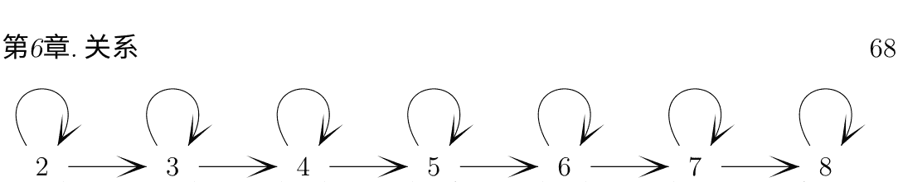

实际上，关系集合上的关系和有向图之间几乎没有形式上的区别，因为图的边可以表示为有序的端点对。它们是描述相同情况的两种方式。

我们可以通过说 $xSy$ 在 $S$ 中，如果 $x \equiv y \pmod{3}$，来定义另一个关系 $S$ 在A上。那么S看起来像这样：

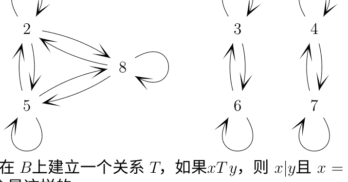

让我们在 $A$ 上建立一个关系 $T$，如果 $xTy$，则 $x|y$ 且 $x \neq y$。那么我们的图示将会是这样的：

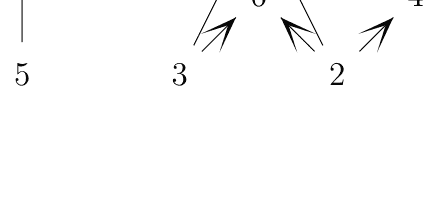

数学关系也可以用来表示现实世界的关系，这种情况下它们通常具有不规则的结构。例如，假设我们有一组学生，如果学生 $x$ 提名学生 $y$ 为ACM主席，则学生 $x$ 与学生 $y$ 相关。这种关系的图（称为 $Q$）可能如下所示：

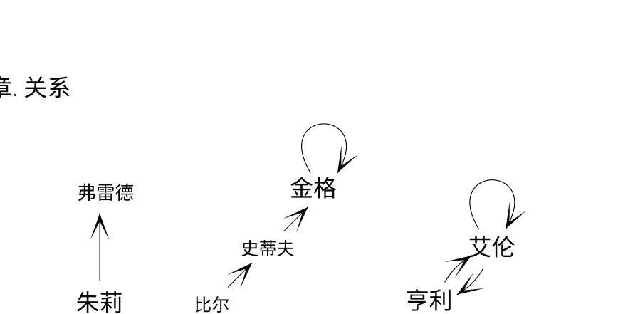

关系也可以定义在无限集合或多维对象上。例如，我们可以在实平面 $\mathbb{R}^2$ 上定义一个关系 $Z$，其中 $(x, y)$ 与 $(p, q)$ 相关当且仅当 $x^2+y^2 = p^2+q^2$。换句话说，两个点如果它们与原点的距离相同，则它们相关。

对于复杂的关系，完整的有向图可能会变得有些混乱。因此，对于某些特定类型的关系，存在简化的图示方法，例如偏序关系的哈斯图。

### 6.2 关系的性质：自反

关系可以通过几个关键属性进行分类。首先是集合中的元素是否与自身相关。有三种情况：

-   **自反性**：每个元素与自身相关。
-   **非自反性**：没有元素与自身相关。
-   **既非自反也非非自反**：一些元素与自身相关，而一些元素则不相关。

在上面的图示中，与自身相关的元素具有自环。因此，很容易看出 $W$ 和 $S$ 是自反的， $T$ 是非自反的， $Q$ 既非自反也非非自反。实数上的熟知关系 $\leqslant$ 和 $=$ 是自反的，但 $<$ 是非自反的。假设我们通过 $x M y$ 来定义整数上的关系 $M$，当且仅当 $x + y = 0$ 时。那么2与自身无关，但0与自身相关。因此， $M$ 既非自反也非非自反。

正式定义规定，如果 $R$ 是集合 $A$ 上的关系，则

-   $R$是自反的，如果对于所有的 $x \in A$，都有 $xRx$。
-   $R$是非自反的，如果对于所有的 $x \in A$，都没有 $xRx$。

请注意，非自反不是自反的否定。 非自反的否定是：

-   **非自反**：存在一个 $x \in A$，使得 $xRx$。

### 6.3 对称和反对称

关系的另一个重要属性是每对元素中的顺序是否重要。 也就是说，如果 $xRy$ 在 $R$ 中，是否总是成立 $yRx$？ 如果这是真的，则该关系被称为对称的。

在对称关系的图形表示中，一对元素要么通过一对相反方向的箭头连接，要么没有箭头。 在上面的示例中，只有 $S$ 是对称的。

类似于相等的关系通常是对称的。 例如，整数上定义的关系 $X$，如果 $|x| = |y|$，则是对称的。 因此，在实数平面上定义的关系 $N$，如果 $(x, y)N(p, q))$，则 $(x - p)^2 + (y - q)^2 \leq 25$（即两点之间的距离不超过5个单位）。

将元素按顺序排列的关系，如 $\leq$ 或除法，具有一种称为反对称性的不同属性。 如果两个不同的元素¹在两个方向上都没有关联，则关系是反对称的。 在反对称关系的图形表示中，一对点可以通过单个箭头连接，也可以不连接。 它们永远不会通过双向箭头连接。 在我们上面的图中， $W$ 和 $T$ 是反对称的。

与自反性一样，存在一些既不具有对称性也不具有反对称性的混合关系。 因此，上述关系 $Q$ 既不对称也不反对称。

如果 $R$ 是集合 $A$ 上的关系，这是关于 $R$ 对称性的正式定义（其中没有特别困难的内容）：

-   **对称的**：如果对于所有的 $x, y \in A$，每当 $xRy$ 时，都有 $yRx$。
-   **反对称的**：如果对于所有的 $x, y \in A$，只要 $xRy$ 且 $yRx$，就有 $x = y$。

¹“不同”意味着不相等。

对称性：对于所有的 $x, y \in A$，如果 $xRy$ 则有 $yRx$。

有两种方式来定义反对称性。它们在逻辑上是等价的，你可以选择更方便的方式：

> 反对称性：对于所有的 $x$ 和 $y$ 在 $A$ 中，如果 $xRy$ 且 $yRx$，则有 $x = y$。
> 反对称性：对于所有的 $x$ 和 $y$ 在 $A$ 中，如果 $xRy$ 且 $yRx$，则有 $x = y$。

为了解释第二个定义，记住当数学家选择两个值 $x$ 和 $y$ 时，他们保留了这两个值实际上可能相同的可能性。在正常的英语对话中，如果我们提到两个具有不同名称的对象，我们通常意味着它们是不同的对象。但在数学中并非如此。我发现第一个定义对于理解这个概念更好，但第二个定义对于写证明更有用。

## 6.4 传递性

关系的一个重要属性是传递性。如果一个集合 $A$ 上的关系 $R$ 是传递的，那么

> 传递性：对于集合 $A$ 中的任意元素 $a, b, c$，如果 $aRb$ 且 $bRc$，则 $aRc$。

正如我们之前所看到的，传递性适用于广泛的熟悉的数值关系，如 $<$，$=$，整除和集合包含关系。例如，对于实数，如果 $x < y$ 且 $y < z$，则 $x < z$。类似地，如果 $x \mid y$ 且 $y \mid z$，则 $x \mid z$。对于集合，如果 $X \subseteq Y$ 且 $Y \subseteq Z$，则 $X \subseteq Z$。如果我们看图形，传递性意味着当存在从 $x$ 到 $y$ 的间接路径时，必须也存在从 $x$ 到 $y$ 的直接箭头。这对于上面的 $S$ 和 $B$ 是正确的，但对于 $W$ 或 $Q$ 不正确。

我们也可以通过详细说明关系 $R$ 在集合 $A$ 上不具备传递性的含义来理解这一点：

不具备传递性：存在 $a, b, c \in A$，使得 $aRb$ 和 $bRc$ 成立，但 $aRc$ 不成立。

因此，要证明一个关系不具备传递性，我们需要找到一个反例，即具体的元素 $a$，$b$ 和 $c$，使得 $aRb$ 和 $bRc$ 成立，但 $aRc$ 不成立。在一个非传递关系的图中，你可以找到一个类似的子图：

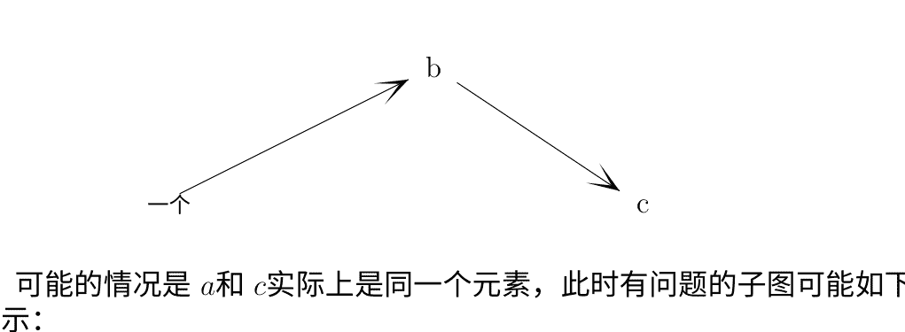

可能的情况是 $a$ 和 $c$ 实际上是同一个元素，此时有问题的子图可能如下所示：

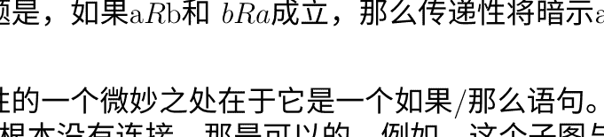

这里的问题是，如果 $aRb$ 和 $bRa$ 成立，那么传递性将暗示 $aRa$ 和 $bRb$ 成立。

关于传递性的一个微妙之处在于它是一个如果/那么语句。所以，如果一些元素集合根本没有连接，那是可以的。例如，这个子图与关系具备传递性是一致的。

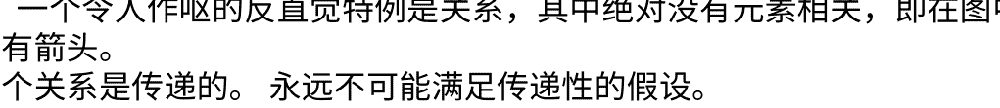

一个令人作呕的反直觉特例是关系，其中绝对没有元素相关，即在图中没有箭头。这个关系是传递的。永远不可能满足传递性的假设。

传递性的定义也是对称的。出于同样的原因，它也是对称的。而且，奇怪的是，它还是反对称的。所有这些属性都通过空关系的真实性成立。空关系的真实性不适用于自反和非自反，因为它们是无条件的要求，而不是如果/那么语句。所以这个空关系是非自反的，而不是自反的。

## 6.5 关系的类型

现在我们已经定义了这些基本属性，我们可以定义一些重要的关系类型。其中三个是排序关系：

-   一个偏序是一个关系，它是自反的，反对称的和传递的。
-   一个线性顺序（也称为全序）是一个偏序 $R$，其中每一对元素都是可比较的。也就是说，对于任意两个元素 $x$ 和 $y$，要么 $xRy$，要么 $yRx$。
-   一个严格的偏序是一个不可自反、反对称和传递的关系。

线性顺序与实数或整数上的正常 $\leq$ 排序非常相似。偏序与线性顺序不同，因为有一些元素对彼此之间没有排序。例如，整数上的除法关系是一个偏序但不是线性顺序，因为它不以任何方向关联一些整数对。例如，5不能整除7，但7也不能整除5。严格偏序与偏序类似，只是对象与自身没有关联。例如，在第6.1节中，关系 $T$ 是一个严格的偏序关系。

第四种关系是等价关系：

> 定义：一个等价关系是一个具有自反性、对称性和传递性的关系。

这三个属性为一组对象创建了一个良好的等价或同余的符号表示，例如整数集上的模 $k$ 同余。特别地，如果 $R$ 是集合 $A$ 上的等价关系， $x$ 是 $A$ 的一个元素，我们可以定义 $x$ 的等价类为与 $x$ 相关的所有元素的集合。即

$$[x]_R = \{ y \in A \mid xRy \}$$

当关系在上下文中清楚时（例如我们讨论模 $k$ 的同余时），我们经常省略方括号上的下标。例如，我们在实平面 $\mathbb{R}^2$ 上看到了关系 $Z$，其中 $(x, y)Z(p, q)$ 当且仅当 $x^2 + y^2 = p^2 + q^2$。那么 $[(0, 1)]_Z$ 包含了与 $(0, 1)$ 相关的所有点，即单位圆。

## 6.6 证明一个关系是等价关系

让我们看看如何证明一个新的关系是等价关系。这些证明通常非常机械化。例如，让 $F$ 是所有分数的集合，即

$$F = \left\{ \frac{p}{q} \mid p, q \in \mathbb{Z} \text{ 且 } q \neq 0 \right\}$$

分数和有理数不是同一回事，因为每个有理数可以用多个分数表示。我们认为两个分数是等价的，即表示相同的有理数，如果 $xq = yp$。因此，我们有一个由 $\sim$ 定义的等价关系：$\frac{x}{y} \sim \frac{p}{q}$ 当且仅当 $xq = yp$ 时。让我们证明 $\sim$ 是一个等价关系。

-   证明：
    自反性：对于任意的 $x$ 和 $y$， $xy = xy$。因此，$\sim$ 的定义意味着 $\frac{x}{y} \sim \frac{x}{y}$。
    对称性：如果 $\frac{x}{y} \sim \frac{p}{q}$ 那么 $xq = yp$，所以 $yp = xq$，所以 $py = qx$，这意味着 $\frac{p}{q} \sim \frac{x}{y}$。
    传递性: 假设 $\frac{x}{y} \sim \frac{p}{q}$ 和 $\frac{p}{q} \sim \frac{r}{s}$。根据 $\sim$ 的定义，$xq = yp$ 和 $ps = qr$。所以 $xqs = yps$ 和 $psy = qrs$。由于 $yps = psy$，这意味着 $xqs = qrs$。消去 $q$，我们得到 $xs = ry$。根据 $\sim$ 的定义，这意味着 $\frac{x}{y} \sim \frac{r}{s}$。

由于 $\sim$ 是自反的、对称的和传递的，它是一个等价关系。请注意，证明有三个子部分，每个部分展示了一个关键性质。每个部分都涉及到使用关系的定义，以及一些基本数学知识。自反的情况非常简短。对称的情况通常也很简短。大部分工作在传递的情况下进行。

## 6.7 证明反对称性

这是另一个关系的例子，这次是一个顺序（而不是等价）关系。考虑实数线上的区间集合 $J = \{(a, b) \mid a, b \in \mathbb{R} \text{ 且 } a < b\}$。定义包含关系 $C$ 如下：

$(a, b) C (c, d)$ 当且仅当 $a \leq c$ 且 $d \leq b$

要证明 $C$ 是一个偏序，我们需要证明它是自反的，反对称的和传递的。我们已经看到了如何证明其中两个性质。让我们看看如何证明反对称性。

对于证明反对称性，通常最容易使用反对称性的这种形式的定义：如果 $xRy$ 且 $yRx$，则 $x = y$。注意 $C$ 是一个关于区间的关系，即一对数字，而不是单个数字。将 $C$ 的定义代入反对称性的定义中，我们需要证明：对于任意区间 $(a, b)$ 和 $(c, d)$，如果 $(a, b) C (c, d)$ 并且 $(c, d) C (a, b)$，那么 $(a, b) = (c, d)$。

所以，假设我们有两个区间 $(a, b)$ 和 $(c, d)$，使得 $(a, b) C (c, d)$ 并且 $(c, d) C (a, b)$。根据 $C$ 的定义，$(a, b) C (c, d)$ 意味着 $a \leq c$ 并且 $d \leq b$。同样地，$(c, d) C (a, b)$ 意味着 $c \leq a$ 并且 $b \leq d$。由于 $a \leq c$ 并且 $c \leq a$， $a = c$。由于 $d \leq b$ 并且 $b \leq d$， $b = d$。所以 $(a,b) = (c,d)$。

## 第7章 函数和满射

本章介绍了函数，包括函数的组合以及函数成为满射的含义。在这个过程中，我们将看到当两个不同的量词嵌套时会发生什么。

### 7.1 函数

我们都熟悉高中和微积分中的函数。然而，这些先前的数学课程集中在输入和输出都是数字的函数上，由代数公式定义，如 $f(x)=2x+3$。我们将使用更广泛的函数范围，其输入和/或输出值可以是整数、字符串、字符等。

假设 $A$ 和 $B$ 是集合，那么从 $A$ 到 $B$ 的函数 $f$ 是将 $B$ 的一个元素（即输出值）分配给每个 $A$ 的元素（即输入值）的一种赋值。$A$ 被称为函数 $f$ 的定义域，$B$ 被称为函数 $f$ 的值域。所有这些信息可以用简写的类型签名来表示：$f: A \to B$。如果 $x$ 是 $A$ 的一个元素，则值 $f(x)$ 也被称为 $x$ 的像。

例如，假设 $P$ 是一个由五个人组成的集合：
$P = \{\text{玛格丽特}, \text{汤姆}, \text{陈}, \text{拉索尼娅}, \text{艾玛}\}$
并且假设 $C$ 是一个颜色的集合:
$C = \{\text{红色}, \text{蓝色}, \text{绿色}, \text{紫色}, \text{黄色}, \text{橙色}\}$

我们可以定义一个函数 $f : P \to C$，它将每个人映射到他们最喜欢的颜色。例如，我们可能有以下的输入/输出对:

| 输入 | 输出 |
| :--- | :--- |
| 玛格丽特 | 蓝色 |
| 汤姆 | 红色 |
| 拉索尼娅 | 紫色 |
| 艾玛 | 红色 |
| 陈 | 蓝色 |

我们还使用气泡图来展示 $f$ 如何将输出值分配给输入值。

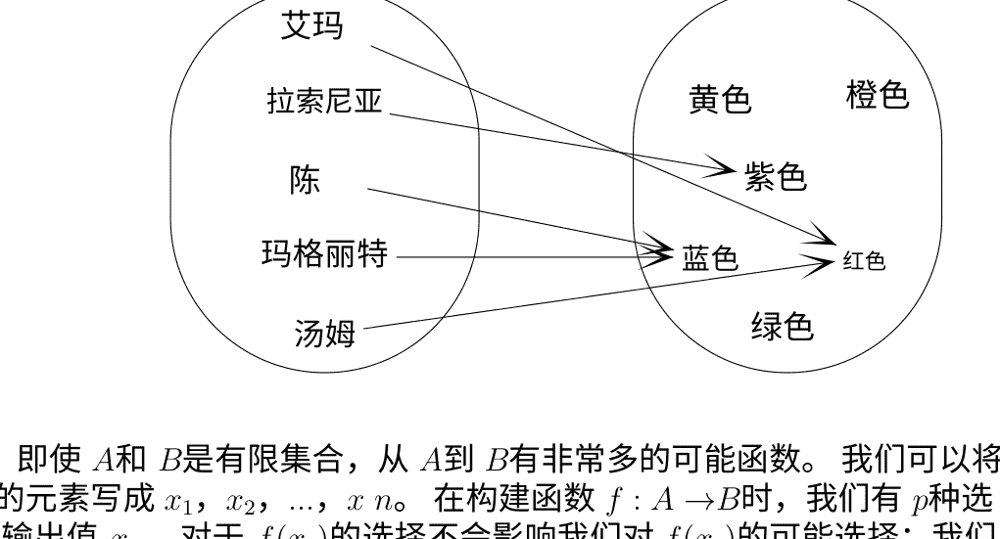

即使 $A$ 和 $B$ 是有限集合，从 $A$ 到 $B$ 有非常多的可能函数。我们可以将 $A$ 的元素写成 $x_1, x_2, ..., x_n$。在构建函数 $f : A \to B$ 时，我们有 $p$ 种选择输出值 $f(x_1)$。对于 $f(x_1)$ 的选择不会影响我们对 $f(x_2)$ 的可能选择：我们对该值也有 $p$ 种选择。因此，我们对前两个输出值有 $p^2$ 种选择。如果我们继续这个过程，对于 $A$ 的其余元素，我们有 $p^n$ 种构建函数 $f$ 的可能方式。

### 7.2 函数何时相等？

对于任意集合 $A$，恒等函数 $\text{id}_A$ 将 $A$ 中的每个值映射到其自身。也就是说，$\text{id}_A: A \to A$ 且 $\text{id}_A(x) = x$。

请注意，定义中的定义域和值域是函数的一个组成部分。要相等，两个函数必须（显然）将相同的输出值分配给每个输入值。此外，它们必须具有相同的类型签名。

例如，假设 $D$ 是一个稍微较小的颜色集合：
$D = \{\text{红色}, \text{蓝色}, \text{紫色}\}$
那么下面显示的函数 $g: P \to D$ 与第7.1节中的函数 $f$ 不相等，尽管对于每个 $x$ 在 $P$ 中，$g(x) = f(x)$。

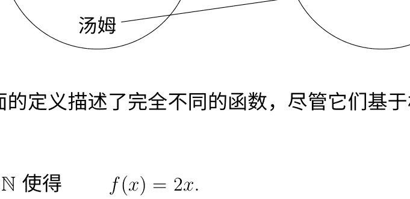

同样，下面的定义描述了完全不同的函数，尽管它们基于相同的方程。

-   $f: \mathbb{N} \to \mathbb{N}$ 使得 $f(x) = 2x$。
-   $f: \mathbb{R} \to \mathbb{R}$ 使得 $f(x) = 2x$。

然而，以下都是同一个函数的定义，因为这三种变体具有相同的类型签名，并且为每个输入值分配相同的输出值。

-   $f: \mathbb{Z} \rightarrow \mathbb{Z}$ 使得 $f(x) = |x|$。
-   $f: \mathbb{Z} \rightarrow \mathbb{Z}$ 使得 $f(x) = \max(x, -x)$。
-   $f: \mathbb{Z} \rightarrow \mathbb{Z}$ 使得 $f(x) = x$ 如果 $x \geq 0$，并且 $f(x) = -x$ 如果 $x < 0$。

注意，最后一个定义使用了两种不同的情况来覆盖域的不同部分。只要所有情况一起为每个输入值提供恰好一个输出值，这就没问题。

### 7.3 什么不是函数？

对于每个输入值，函数必须提供一个且仅有一个输出值。所以下面不是一个函数，因为一个输入没有输出：

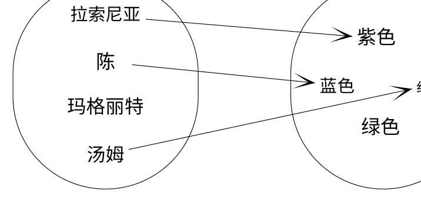

下面不是一个函数，因为一个输入与两个输出配对：

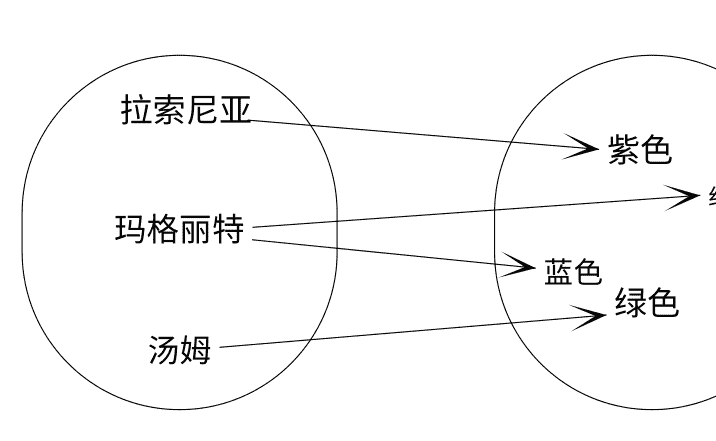

### 7.4 图像和满射

函数 $f: A \to B$ 的图像是当 $f$ 应用于 $A$ 的所有元素时产生的值的集合。也就是说，图像是

$$f(A) = \{f(x) : x \in A\}$$

例如，假设 $M = \{a, b, c, d\}$，$N = \{1, 2, 3, 4\}$，我们的函数 $g: M \to N$ 如下图所示。那么 $g(M) = \{1, 3, 4\}$。

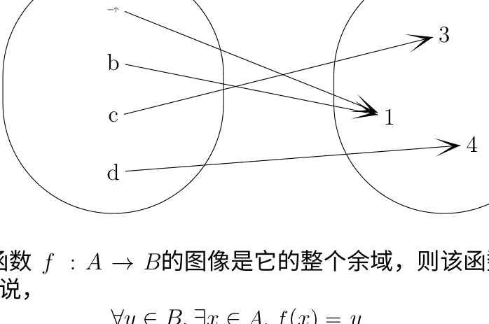

如果一个函数 $f: A \to B$ 的图像是它的整个余域，则该函数是满射。或者，等价地说，

$$\forall y \in B, \exists x \in A, f(x) = y$$

我们刚刚看到的函数 $g$ 不是满射的，因为没有输入值被映射到 $2$。

一个函数是否是满射关键取决于它的类型签名。假设我们定义 $p : \mathbb{Z} \to \mathbb{Z}$ 为 $p(x) = x + 2$。如果我们选择一个输出值 $y$，那么输入值 $y - 2$ 映射到 $y$。所以 $p$ 的值域是整个 $\mathbb{Z}$。所以这个函数是满射的。

然而，假设我们使用相同的公式定义 $q : \mathbb{N} \to \mathbb{N}$，即 $q(x) = x + 2$。$q$ 不是满射的，因为没有任何输入值映射到 $0$ 或 $1$。

## 7.5 为什么有些函数不是满射？

你可能会认为许多非满射函数的例子看起来如果作者在设置共域时更加精确，它们可能是满射的。有时候共域过大只是因为映射集合难以简洁地指定。但是，在某些应用中，我们特意希望某些函数不是满射的。

例如，在图形学或某些工程应用中，我们可能希望在2D空间中绘制曲线。曲线的整个重点在于它仅占据2D的一部分，并被空白所包围。这些曲线通常以“参数化”的方式进行规定，使用将映射到2D空间中的函数，但不是一一对应的函数。

例如，我们可以将（单位）圆指定为函数 $f: [0, 1] \to \mathbb{R}^2$ 的图像，其中 $f(x) = (\cos 2\pi x, \sin 2\pi x)$。如果你将输入值视为时间，那么 $f$ 显示了笔或机器人在圆周上移动的轨迹。余弦和正弦是其位置的 $x$ 和 $y$ 坐标。$2\pi$ 的乘法器只是将输入放入正确的范围，以便我们能够完整地绕圆周一周（假设正弦和余弦以弧度为单位输入）。

## 7.6 否定满射

为了理解"onto"的概念，可以考虑一下函数不是"onto"的含义。这是我们第一个否定的例子，涉及两个嵌套（不同）量词的语句。我们对"onto"的定义是

$$\forall y \in B, \exists x \in A, f(x) = y$$

所以，如果一个函数 $f$ 不是"onto"的话

$$\neg \forall y \in B, \exists x \in A, f(x) = y$$

为了否定这个命题，我们逐步进行，将否定向内移动。你已经看到了所有涉及的恒等式，所以这主要是一个小心谨慎的问题。

$$\begin{aligned}
& \neg \forall y \in B, \exists x \in A, f(x) = y \\
\equiv & \exists y \in B, \neg \exists x \in A, f(x) = y \\
\equiv & \exists y \in B, \forall x \in A, \neg (f(x) = y) \\
\equiv & \exists y \in B, \forall x \in A, f(x) \neq y
\end{aligned}$$

所以，如果我们想要证明 $f$ 不是满射，我们需要找到一些值 $y$ 在 $B$ 中，无论从 $A$ 中选择哪个元素 $x$，$f(x)$ 都不等于 $y$。

### 7.7 嵌套量词

请注意，满射的定义结合了普遍量词和存在量词，其中一个的范围包括另一个的范围。这些被称为嵌套量词。当量词嵌套时，语句的含义取决于两个量词的顺序。

例如，

对于Fleck家族中的每个人 $p$，都有一把牙刷 $t$，使得 $p$ 用 $t$ 刷牙。

这个句子要求你考虑一个随机的Fleck。然后，在给定这个选择的情况下，它断言他们有一把牙刷。牙刷是在我们选择人之后选择的，所以牙刷的选择可以取决于人的选择。这并不绝对要求每个人都选择自己的牙刷。（在一个短暂的时期内，我的两个儿子使用同一把牙刷，因为他们弄混了。）然而，至少这个陈述与每个人都有自己的牙刷是一致的。

现在假设我们交换量词的顺序，得到

有一把牙刷 $t$，对于Fleck家族中的每个人 $p$来说， $p$ 用 $t$ 刷牙。

在这种情况下，我们被要求先选择一把牙刷 $t$。然后我们断言每个Fleck都使用这一固定的牙刷 $t$。呃！那不是我们想要说的！

当各个人之间共享一个对象时，我们确实希望存在量词先出现，比如：

有一台炉子 $s$，对于Fleck家族中的每个人 $p$来说， $p$ 在 $s$ 上煮食物。

注意，这个顺序问题只在存在量词和全称量词混合的语句中出现。如果所有的量词都是存在量词，或者所有的量词都是全称量词，顺序就无关紧要。

为了举一个更数学的例子，让我们回顾一下模运算。如果两个数 $x$ 和 $y$ 的乘积等于 $1$，那么它们互为乘法逆元。在整数集合 $\mathbb{Z}$ 中，只有 $1$ 有乘法逆元。然而，在 $\mathbb{Z}_k$ 中，许多其他整数都有逆元。例如，如果 $k = 7$，那么 $[3][5] = [1]$。所以 $[3]$ 和 $[5]$ 是互为逆元的。

对于某些值 $k$， $\mathbb{Z}_k$ 的每个非零元素都有逆元。$^1$ 你可以验证这对于 $\mathbb{Z}_7$ 是成立的：$[3]$ 和 $[5]$ 是互为逆元，$[2]$ 和 $[4]$ 是互为逆元，$[1]$ 是它自己的逆元，$[6]$ 也是它自己的逆元。因此我们可以说

$^1$ 你能找出哪些值的 $k$ 具有这个性质吗？

∀ 非零 \(x \in \mathbb{Z}_{7}\), ∃\(y \in \mathbb{Z}_{7}\), \(xy = yx = 1\)

请注意，我们将全称量词放在存在量词之外，这样每个数字都可以选择自己的逆元。 反转量词的顺序会得到以下陈述：

∃\(y \in \mathbb{Z}_{7}\), ∀ 非零 \(x \in \mathbb{Z}_{7}\), \(xy = yx = 1\)

这个版本是不正确的，因为你无法选择一个单一的数字作为所有其他非零数字的逆元，即使在模运算中也是如此。

然而，在以下声明中，我们确实希望存在量词先出现，因为对于每个 \(y \in \mathbb{Z}_{7}\), \(0 y = y0 = 0\)。

∃\(x \in \mathbb{Z}_{7}\), ∀\(y \in \mathbb{Z}_{7}\), \(xy = yx = x\)

## 7.8 证明一个函数是满射

现在，考虑这个命题：

命题30通过公式 \(g(x) = x - 8\)，将函数 \(g\) 从整数映射到整数。 \(g\) 是满射。

> 证明：我们需要证明对于每个整数 \(y\)，存在一个整数 \(x\) 使得 \(g(x) = y\)。

所以，让 \(y\) 成为任意整数。选择 \(x\) 为 \((y + 8)\)。

\(x\) 是一个整数，因为它是两个整数的和。 但是，我们有

\(g(x) = (y + 8) - 8 = y\)，所以我们找到了

\(y\) 的所需的原像，证明完成。

对于某些函数，多个输入值映射到一个输出值。

在这种情况下，我们可以选择任何输入值进行证明，通常选择对于证明者来说是最容易的。例如，假设我们有 \(g: \mathbb{Z} \to \mathbb{Z}\)，使得 \(g(x) = \lfloor \frac{x}{2} \rfloor\)。为了证明 \(g\) 是满射的，我们给出一个输出值 \(x\) 并且需要找到相应的输入值。最简单的选择就是 \(2x\) 本身。但你也可以选择 \(2x + 1\)。

假设我们试图为一个不是满射的函数构建这样的证明，例如 \(f: \mathbb{Z} \to \mathbb{Z}\) 使得 \(f(x) = 3x + 2\)。

> 证明：我们需要证明对于每个整数 \(y\)，存在一个整数 \(x\) 使得 \(f(x) = y\)。因此，让 \(y\) 是任意的整数。选择 \(x\) 为 \(\frac{(y-2)}{3}\)。

如果 \(f\) 是从实数到实数的函数，我们在这一点上就没问题了，因为 \(x\) 将是 \(y\) 的一个良好的原像。然而，\(f\) 的输入被声明为整数。对于许多值 \(y\)，\(\frac{(y-2)}{3}\) 不是一个整数。所以它不能作为 \(f\) 的输入值。

## 7.9 一个二维例子

这是一个定义域为2D的示例函数。设 \(f: \mathbb{Z}^2 \to \mathbb{Z}\) 定义为 \(f(x, y) = x + y\)。我声称 \(f\) 是满射的。

首先，让我们确保我们知道如何阅读这个定义。\(f: \mathbb{Z}^2\) 是 \(\mathbb{Z} \times \mathbb{Z}\) 的简写，它是整数对的集合。所以 \(f\) 将一对整数映射到一个单独的整数，即两个坐标的和。

为了证明 \(f\) 是满射的，我们需要选择一些任意的元素 \(y\) 在共域中。也就是说，\(y\) 是一个整数。然后我们需要找到一个样本值在定义域中映射到 \(y\)，即 \(y\) 的“原像”。在这一点上，在我们的草稿纸上摆弄一下，找到一个合适的原像会有所帮助。在这种情况下，\((0, y)\) 很好地起作用。所以我们的证明如下：

> 证明：令 \(y\) 为 \(\mathbb{Z}\) 的一个元素。那么 \((0, y)\) 是 \(f: \mathbb{Z}^2\) 的一个元素，且 \(f(0, y) = 0 + y = y\)。由于这个构造对于任意的 \(y\) 的选择都有效，我们已经证明了 \(f\) 是满射的。

注意这个函数将许多输入值映射到每个输出值上。因此，在我们的证明中，我们可以使用不同的公式来找到输入值，例如\((1, y-1)\)或\((y,0)\)。 一个有幽默感的证明作者可能会使用\((342, y-342)\)。

## 7.10 组合两个函数

假设\(f: A \to B\)和\(g: B \to C\)是函数。 那么\(g \circ f\)是从\(A\)到\(C\)的函数，定义为 \((g \circ f)(x) = g(f(x))\)。 根据作者的不同，这要么被称为\(f\)和\(g\)的复合，要么被称为\(g\)和\(f\)的复合。 这个想法是你从\(A\)中取输入值，经过\(f\)的处理，然后将结果通过\(g\)来得到最终的输出值。

核心信息：在使用函数组合时，要查看作者的简写符号而不是他们的数学英语，以明确哪个函数先应用。

在这个定义中，注意在\((g \circ f)(x)\)中\(g\)先出现，而在 \(g(f(x))\) 中 \(g\) 也先出现。即与 \(f(g(x))\)不同，其中 \(f\)先出现。 记住这个定义的技巧是记住 \(f\) 和 \(g\) 在定义方程的两边是相同顺序的。

例如，假设我们从整数到整数定义了两个函数 \(f\)和 \(g\)：

\(f(x) = 3x + 7\)
\(g(x) = x - 8\)

由于两个函数的定义域和值域都是整数，我们可以按照两种顺序组合这两个函数。 但是两种组合顺序会得到不同的函数：

\((f \circ g)(x) = f(g(x)) = 3g(x) + 7 = 3(x - 8) + 7 = 3x - 24 + 7 = 3x - 17\)

\((g \circ f)(x) = g(f(x)) = f(x) - 8 = (3x + 7) - 8 = 3x - 1\)

通常，两个函数的声明域和共域不完全相同，因此通常只能按一种顺序进行组合。例如，考虑函数 \(h: \{\text{字符串}\} \to \mathbb{Z}\)，它将字符串 \(x\) 映射到其字符长度上。（例如 \(h(\text{Margaret}) = 8\)。）那么 \(f \circ h\) 存在，但 \((h \circ f)\) 不存在，因为 \(f\) 产生数字，而 \(h\) 的输入应该是字符串。

## 7.11 一个涉及组合的证明

让我们展示函数复合中的映射性能良好。具体来说：

**命题 31** 对于任意集合 \(A\), \(B\), 和 \(C\) 以及任意函数 \(f: A \to B\) 和 \(g: B \to C\)，如果 \(f\) 和 \(g\) 是映满的，那么 \(g \circ f\) 也是映满的。

**证明：** 设 \(A\), \(B\), 和 \(C\) 是集合。设 \(f: A \to B\) 和 \(g: B \to C\) 是函数。假设 \(f\) 和 \(g\) 是映满的。

我们需要证明 \(g \circ f\) 是映满的。也就是说，我们需要证明对于任意元素 \(x\) 在 \(C\) 中，存在一个元素 \(y\) 在 \(A\) 中，使得 \((g \circ f)(y) = x\)。

因此，选择一个元素 \(x\) 在 \(C\) 中。由于 \(g\) 是映满的，存在一个元素 \(z\) 在 \(B\) 中，使得 \(g(z) = x\)。由于 \(f\) 是映满的，存在一个元素 \(y\) 在 \(A\) 中，使得 \(f(y) = z\)。

将值 \(f(y) = z\) 代入方程 \(g(z) = x\)，我们得到 \(g(f(y)) = x\)。也就是说，\((g \circ f)(y) = x\)。所以 \(y\) 是我们需要找到的元素 \(A\)。

## 7.12 术语的变化

函数通常被称为“映射”，“满射”通常被用作“到上”的同义词。函数的像有时被写作 \(\text{Im}(f)\)。在纯数学中，有用的术语“类型签名”并不传统，但在计算机科学中广泛使用。

术语“范围”是一个在数学中已经过时的术语。根据作者的不同，它可能指函数的像或余域，这会引起混淆。避免使用它。

一些作者写作 \(gf\) 而不是 \(g \circ f\) 表示两个函数的复合。此外，一些作者定义 \(g \circ f\) 为 \(g \circ f(x) = f(g(x))\)，即与我们使用的相反约定。

## 第8章 函数和一对一

在本章中，我们将看到函数是一对一和双射的含义。这个一般主题包括计数排列和比较有限集合的大小（例如鸽巢原理）。我们还将看到在证明中“不失一般性”地添加规定的方法，以及通过上下界证明等式的技巧。

### 8.1 一对一

假设 \(f: A \rightarrow B\) 是从 \(A\) 到 \(B\) 的函数。如果我们选择一个值 \(y \in B\)，那么 \(x \in A\) 是 \(y\) 的一个原像，如果 \(f(x) = y\)。请注意，我说的是 \(y\) 的一个原像，而不是 \(y\) 的原像，因为 \(y\) 可能有多个原像。例如，在下面的函数中，1和2是1的原像，4和5是4的原像，3是3的原像，而2没有原像。

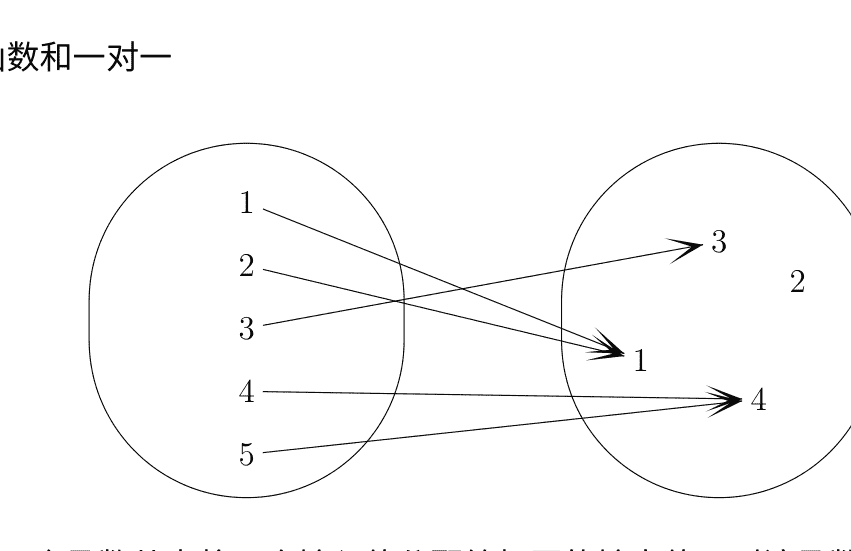

如果一个函数从未将两个输入值分配给相同的输出值，则该函数是一对一的。或者换句话说，没有输出值具有多于一个的原像。因此，上述函数不是一对一的，因为（例如）4具有多个原像。如果我们定义一个函数\(g: \mathbb{Z} \to \mathbb{Z}\)，使得\(g(x) = 2x\)。那么\(g\)是一对一的。

与满射一样，函数是否是一对一通常取决于其类型签名。例如，绝对值函数\(|x|\)作为从实数到实数的函数不是一对一的。然而，作为从自然数到自然数的函数，它是一对一的。

一对一的一个正式定义是：

$$\forall x,y \in A, x=y \to f(x)=f(y)$$

对于大多数证明来说，使用逆否命题更方便：

$$\forall x,y \in A, f(x)=f(y) \to x=y$$

阅读这个定义时，请注意当你设置两个变量\(x\)和\(y\)时，它们不必具有不同（数学术语：“不同”）的值。在普通英语中，如果你给两个对象不同的名称，听者会理解它们是不同的。相比之下，数学家总是希望你明白它们可能是不同的，但也有可能是同一个对象。

### 8.2 双射

如果函数 \(f\) 既是一对一的又是到达的，那么每个输出值都有恰好一个原像。所以我们可以反转 \(f\)，得到一个反函数 \(f^{-1}\)。既是一对一的又是到达的函数被称为双射或一一对应。如果 \(f\) 从 \(A\) 映射到 \(B\)，那么 \(f^{-1}\) 从 \(B\) 映射到 \(A\)。

假设 \(A\) 和 \(B\) 是有限集合。从 \(A\) 到 \(B\) 的映射是满射的，只有当 \(A\) 至少有与 \(B\) 一样多的元素时才可能。从 \(A\) 到 \(B\) 的映射是一对一的，要求 \(B\) 至少有与 \(A\) 一样多的值。因此，如果 \(A\) 和 \(B\) 之间存在双射，那么这两个集合必须包含相同数量的元素。正如我们将在后面看到的，双射也用于定义两个无限集合“大小”相同的概念。

### 8.3 鸽巢原理

假设 \(A\) 包含比 \(B\) 更多的元素。那么就不可能构造一个一对一的映射从 \(A\) 到 \(B\)，因为 \(A\) 的两个元素必须映射到 \(B\) 的同一个元素。如果我们用对象上的标签重新表述这个问题，我们得到以下鸽笼原理：

> 鸽笼原理：假设你有 \(n\) 个对象，并给这些对象分配 \(k\) 个标签。如果 \(n > k\)，则必定有两个对象获得相同的标签。

例如，如果你有8张扑克牌，这些牌有五种颜色，那么至少有两张牌会有相同的颜色。当这些基本例子涉及更大的数字时，它们看起来更有趣。例如，在伊利诺伊大学的本科生中分配三个字母、不区分大小写的用户名将效果不佳。仅厄巴纳-香槟校区就有超过30,000名本科生。但是只有 \(26^3 = 17,576\) 个三字母用户名。因此，鸽巢原理暗示会有一对本科生被分配相同的用户名。

鸽巢原理（像许多超级英雄一样）有着双重身份。当你被告知将其应用于某些具体的对象和标签时，很明显如何做到。然而，在证明中，它经常被突然拿出来作为一个巧妙的技巧，你从未想过它可能有用。这样的证明很容易阅读，但有时很难想出来。

例如，这是一个我们可以用鸽巢原理的一个不太明显的应用来证明的事实。

命题32 在前100个17的幂中，存在两个（不同的）幂，它们之间相差57的倍数。

这里的诀窍是注意到两个数在模57下相差57的倍数，当且仅当它们在模57下有相同的余数。但是我们有100个不同的17的幂，而模57的余数只有57个不同的可能值。所以我们的证明可能是这样的：

> 证明：前100个17的幂是$17^1, 17^2, \dots, 17^{100}$。考虑它们对57取余数：$r_1, r_2, \dots, r_{100}$。由于只有57个可能的余数对57取余数，根据鸽巢原理，其中两个数$r_i$和$r_j$必定相等。假设$r_j$和$r_k$相等。那么$17^j$和$17^k$在模57下有相同的余数，因此$17^j$和$17^k$相差57的倍数。

鸽巢原理的实际应用几乎像是事后才想到的，在我们找到正确的技巧来构建问题分析之后。这是更难的鸽巢原理证明的典型情况。

### 8.4 排列

现在，假设 \(|A| = n = |B|\)。我们可以构造出许多从 \(A\) 到 \(B\) 的一一函数。有多少种？假设 \(A = \{x_1, x_2, \dots, x_n\}\)。我们有 \(n\) 种选择输出值 \(x_1\) 的方式。但是这个选择使用了一个输出值，所以我们只有 \(n-1\) 种选择输出值 \(x_2\)。按照这个模式继续，我们有 \(n(n-1)(n-2)\dots2\cdot1\)（简记为 \(n!\)）种构建函数的方式。

同样地，假设我们有一组 \(n\) 个龙雕像，我们想要将它们摆放在壁炉台上。我们需要构建一个从位置到龙的映射。壁炉台上的位置与龙之间存在映射关系。有 n! 种方法可以实现这一点。按顺序排列的 n个对象的排列称为这 n个对象的排列。

更常见的情况是，我们需要从一组较大的 n个对象中选择一个有序列表的 k个对象。例如，我们有30个龙雕像，但壁炉台上只有空间容纳10个。那么我们对于第一个雕像有30种选择，对于第二个有29种选择，以此类推，直到最后一个雕像只有21种选择。因此，我们有30·29·...·21种装饰壁炉台的方式。

一般来说，从一组 n个对象中有序选择 k个对象被称为这 n个对象的 k-排列。有 n(n-1)...(n-k+1) = n!/(n-k)! 种不同的k-排列。不同的 k个元素的排列组合 n个对象。这个数字被称为 P(n,k)。P(n,k) 也是从一个包含 k个对象的集合到一个包含 n个对象的集合的一对一函数的数量。

### 8.5 排列的进一步应用

许多现实世界的计数问题可以通过排列组合公式来解决，但有些问题需要适当的调整。例如，假设有7个成年人和3个孩子需要在机场排队。还假设我们不能让两个孩子站在一起，因为他们会打架。

解决这个问题的诀窍是将7个成年人排成一行，之间留有间隔。每个间隔可以为空或者放一个孩子。我们有8个间隔，需要放入3个孩子。所以，我们有7!种将成年人分配到位置的方式。然后我们有8个间隔可以放置孩子 A，7个间隔可以放置孩子 B，6个间隔可以放置孩子 C。总共有7!·8·7·6种排列方式。

现在，假设我们有一组7个拼字瓷砖，我们想要弄清楚我们可以用它们制作多少不同的字母串。我们几乎可以使用排列公式，只是一些瓷砖可能包含相同的字母。例如，假设瓷砖是：C, O, L, L, E, G, E。

首先，让我们在重复的瓷砖上涂上一些污垢，这样我们就可以区分两个副本：C, O, L1, L2, E1, G, E2。然后我们将计算这个列表的7!个排列。然而，就我们最初的问题而言，这是对一些可能性的重复计数，因为我们不关心重复项之间的区别，例如 \(L_1\) 和 \(L_2\)。因此，我们需要除以可以对重复项进行排列的方式的数量。在这种情况下，我们有 2! 种方式对 L 进行排列，以及 2! 种方式对 E 进行排列。因此，$L$ 的真实排序数量为 \(\frac{7!}{2!2!}\)。

同样地，重新排列 \(J = (a, p, p, l, e, t, r, e, e, s)\) 的数量是 \(\frac{10!}{2!3!}\)。

一般来说，假设我们有 \(n\) 个物体，其中 \(n_1\) 个是类型 1 的，\(n_2\) 个是类型 2 的，依此类推，直到 \(n_k\) 个是类型 \(k\) 的。那么我们的物体列表的排序方式的数量是 \(\frac{n!}{n_1!n_2!...n_k!}\)。

### 8.6 证明一个函数是一对一

现在，让我们来看一些如何证明一个特定函数是一对一的例子。

命题 33 设 \(f : \mathbb{Z} \rightarrow \mathbb{Z}\) 定义为 \(f(x) = 3x + 7\)。\(f\) 是一对一的。

让我们使用我们对一对一的定义来证明这一点。

> 证明：我们需要证明对于每个整数 \(x\) 和 \(y\)，\(f(x) = f(y) \rightarrow x = y\)。

所以，让 \(x\) 和 \(y\) 为整数，并假设 \(f(x) = f(y)\)。我们需要证明 \(x = y\)。

我们知道 \(f(x) = f(y)\)。因此，将我们的 \(f\) 公式代入，得到 \(3x + 7 = 3y + 7\)。所以 \(3x = 3y\)，因此 \(x = y\)，通过高中代数可以证明。这就是我们需要证明的。

当我们在证明开始时选择 \(x\) 和 \(y\) 时，请注意我们没有明确指定它们是否是相同的数字。数学约定对此模糊不清，不像正常的英语，其中相同的陈述会强烈暗示它们是不同的。

### 8.7 组合和一对一

像映射一样，一对一函数在函数组合中也很好用。具体来说：

命题34对于任意集合 \(A\)、\(B\)和\(C\)，以及任意函数\(f: A \to B\)和\(g: B \to C\)，如果\(f\)和\(g\)是一对一的，则\(g \circ f\)也是一对一的。

我们可以通过直接证明来证明这一点，通过系统地使用我们的定义和标准证明大纲。首先，让我们选择一些代表性的正确类型的对象，并假设我们的假设中的一切都成立。

证明：设\(A\)、\(B\)和\(C\)是集合。设\(f: A \to B\)和\(g: B \to C\)是函数。假设\(f\)和\(g\)是一对一的。
我们需要证明\(g \circ f\)是一对一的。

为了证明\(g \circ f\)是一对一的，我们需要选择其定义域中的两个元素\(x\)和\(y\)，并假设它们的输出值相等，然后证明\(x\)和\(y\)必须相等。让我们将这个插入到我们的草稿证明中。
请记住\(g \circ f\)的定义域是\(A\)，其余域是\(C\)。

证明：设\(A\)、\(B\)和\(C\)是集合。设\(f: A \to B\)和\(g: B \to C\)是函数。假设\(f\)和\(g\)是一对一的。
我们需要证明\(g \circ f\)是一对一的。因此，选择\(A\)中的\(x\)和\(y\)，并假设\((g \circ f)(x) = (g \circ f)(y)\)
我们需要证明\(x = y\)。

现在，我们需要应用函数复合的定义和事实\(f\)和\(g\)都是一对一的：

证明：设\(A\)、\(B\)和\(C\)是集合。设\(f: A \to B\)和\(g: B \to C\)是函数。假设\(f\)和\(g\)是一对一的。
我们需要证明\(g \circ f\)是一对一的。因此，选择\(A\)中的\(x\)和\(y\)，并假设\((g \circ f)(x) = (g \circ f)(y)\)
利用函数复合的定义，我们可以将其重写为\(g(f(x)) = g(f(y))\)。
结合\(g\)是一对一的事实，我们发现\(f(x) = f(y)\)。但是，由于\(f\)是一对一的，这意味着\(x = y\)，这就是我们需要证明的。

## 8.8 严格递增函数是一对一的

现在，让我们进行一个稍微棘手的证明。首先，一个定义。假设 $A$ 和 $B$ 是实数集合（例如实数，有理数，整数）。一个函数 $f: A \to B$ 如果对于每个 $x$ 和 $y$ 在 $A$ 中，$x \leq y$ 意味着 $f(x) \leq f(y)$，那么它是递增的。$f$ 被称为严格递增的，如果对于每个 $x$ 和 $y$ 在 $A$ 中，$x < y$ 意味着 $f(x) < f(y)$。$^1$递增函数可以有平台其中输出值保持不变，而严格递增函数必须始终增加。

声明35 对于任意实数集 $A$ 和 $B$，如果 $f$ 是从 $A$ 到 $B$ 的任意严格递增函数，那么 $f$ 是一对一的。

严格递减函数也有类似的事实。

为了证明这一点，我们将使用一对一的替代，反证法版本的定义。

$$ \forall x,y \in A, x = y \to f(x) = f(y) $$

通常情况下，这不是一个有用的方法。假设涉及到一个否定的事实，而定义的另一个版本有一个肯定的假设，通常是一个更好的起点。但这是一个非典型的例子在这种情况下，负面信息事实上是一个很好的起点。

证明：设 $A$ 和 $B$ 是一组数字，设 $f: A \to B$ 是一个严格递增的函数。设 $x$ 和 $y$ 是集合 $A$ 中的不同元素。我们需要证明 $f(x)=f(y)$。由于 $x \neq y$，有两种可能性。

情况1：$x < y$。由于 $f$ 是严格递增的，这意味着 $f(x) < f(y)$。所以 $f(x) \neq f(y)$。

情况2: $y < x$。由于 $f$ 是严格递增的，这意味着 $f(y) < f(x)$。所以 $f(x) \neq f(y)$。

无论哪种情况，我们都有 $f(x) \neq f(y)$，这就是我们需要证明的。

短语“集合 $A$ 的不同元素”是数学术语，表示 $x \neq y$。当我们在证明中进行到一半时，我们有了事实 $x \neq y$，这不容易处理。但是对于实数的三分律公理表明，对于任意的 $x$ 和 $y$，我们有三种可能性：$x = y$，$x < y$，或者 $y < x$。约束条件 $x \neq y$ 消除了其中一种可能性。

## 8.9 使这个证明更简洁

在这个例子中，两种情况的证明非常相似。所以我们可以将这两种情况合并在一起。这里有一种方法，我不建议在课程的早期阶段这样做，但是以后会对你有好处：

证明：设 $A$ 和 $B$ 是一组数字的集合，设 $f : A \rightarrow B$ 是一个严格递增的函数。设 $x$ 和 $y$ 是集合 $A$ 中的不同元素。我们需要证明 $f(x) \neq f(y)$。
由于 $x \neq y$，有两种可能性。
情况1: $x < y$。由于 $f$ 是严格增加的，这意味着 $f(x) < f(y)$。所以 $f(x) \neq f(y)$。
情况2: $y < x$。与情况1类似。
无论哪种情况，我们都有 $f(x) \neq f(y)$，这就是我们需要证明的。

只有在你和你的读者都同意这两种情况非常相似且证明确实相似的情况下，这种方法才有效。
现在是一个危险的假设。而且我们只节省了很少的写作，这并不值得冒失去分数的风险，如果评分人认为这是显而易见的话。

但是这种简化在更复杂的情况下非常有用，其中可能有很多情况，每种情况的证明都很长，并且不同情况的证明确实非常相似。

这是简化我们证明的另一种方法：

证明：设 $A$ 和 $B$ 是一组数字的集合，设 $f: A \rightarrow B$ 是一个严格递增的函数。设 $x$ 和 $y$ 是集合 $A$ 中的不同元素。我们需要证明 $f(x) \neq f(y)$。
我们知道 $x \neq y$，所以要么 $x < y$，要么 $y < x$。不失一般性地假设 $x < y$。
由于 $f$ 是严格增加的，$x < y$ 意味着 $f(x) < f(y)$。所以 $f(x) \neq f(y)$，这就是我们需要展示的。

短语“without loss of generality”意味着我们在证明中添加了一个额外的假设，但我们声称它实际上并没有添加任何更多的信息。在这种情况下，$x$ 和 $y$ 都是同时引入的任意元素。它并不重要哪个被称为 $x$，哪个被称为 $y$。因此，如果我们选择的名称顺序不方便，我们可以简单地交换这两个名称。

“without loss of generality”简化问题是一种强大但潜在危险的证明技巧。在你自己使用之前，你可能需要看几次。它实际上经常用于简化证明，所以它有一个缩写：WOLOG或WLOG。

## 8.10 术语的变化

术语“injective”是“一对一”的同义词，而“one-to-one correspondence”是“双射”的同义词。短语“by symmetry”经常用来代替“without loss of generality”。

“单调递增”是“递增”的同义词。术语“非递减”和“弱递增”也是“递增”的同义词，通常在作者担心读者可能忘记“递增”允许平台时使用。

# 第9章 图

图是一种非常通用的对象类，用于形式化计算机科学中的各种实际问题。在本章中，我们将看到(有限)无向图的基础知识，包括图同构和连通性。

## 9.1 图

图由一组节点 $V$ 和一组边 $E$ 组成。有时我们将图称为一对集合$(V, E)$。$E$ 中的每条边连接 $V$ 中的两个节点。由边连接的两个节点称为邻居或相邻。例如，这是一个图，其中节点是伊利诺伊州的城市，边是连接它们的道路：

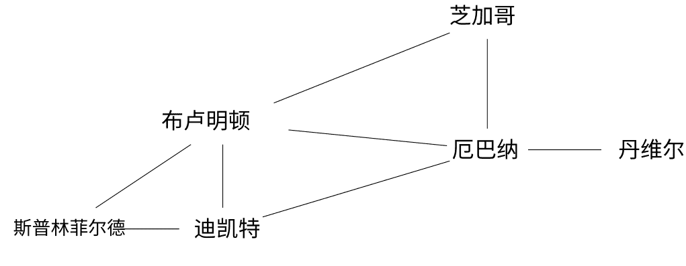

图的边可以双向遍历，就像这个街道的例子一样，即边是无向的。在之前讨论关系时，我们使用了有向图，其中每条边都有特定的方向。除非我们明确说明，否则“图”始终是无向的。无向图的概念可以直接推广到有向图。

当两个节点之间只有一条边连接时，我们可以使用节点对来命名边。我们可以称这条边为 $xy$ 或者（由于顺序无关）$yx$ 或者 $\{ x, y \}$。因此，在上面的图中，厄巴纳-丹维尔边连接了厄巴纳节点和丹维尔节点。

在某些应用中，我们需要通过多条边连接两个节点，即具有相同端点的平行边。例如，下面的图显示了在旧金山湾区四个城市之间旅行的方式。从旧金山到奥克兰有三条边，代表不同的交通方式。当存在多条边时，我们通常标记边而不是尝试根据它们的端点来命名边。这个图还说明了一个自环边，它将一个节点连接到自身。

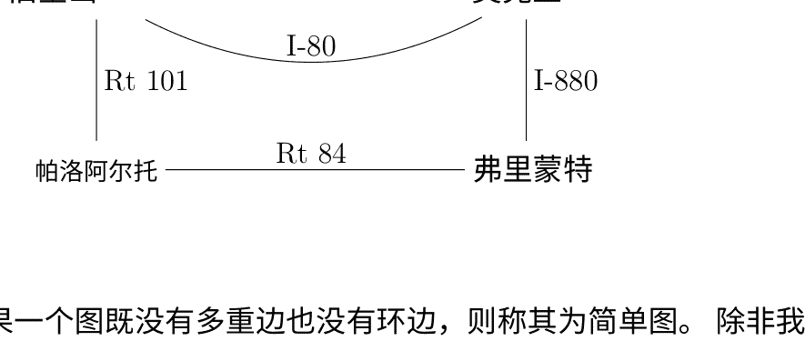

如果一个图既没有多重边也没有环边，则称其为简单图。除非我们明确说明，否则“图”始终指简单图。此外，我们假设图至少有一个节点，并且它只有有限数量的边和节点。同样，大多数概念可以合理地扩展到无限和非简单图。

## 9.2 度

节点 $v$ 的度，记为 $\deg(v)$，是以 $v$ 为端点的边的数量。如果允许自环，则自环计算两次。例如，在下图中，$a$ 的度为2，$b$ 的度为6，$d$ 的度为0，依此类推。

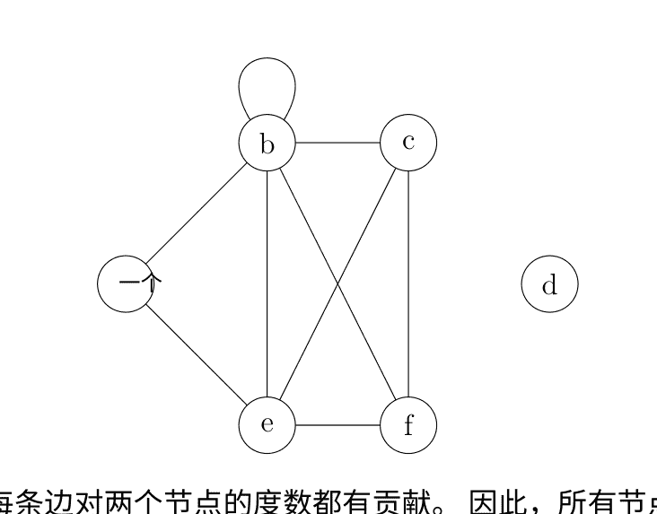

每条边对两个节点的度数都有贡献。因此，所有节点的度数之和是边的两倍。这被称为握手定理，可以写成

$$ \sum_{v \in V} \deg(v) = 2|E| $$

这是一个稍微不同的求和符号版本。我们选择集合 $V$ 中的每个节点 $v$，获取其度数，并将其值加入总和中。由于 $V$ 是有限的，我们也可以给节点 $v_1, ..., v_n$ 命名，然后写成

$$ \sum_{k=1}^{n} \deg(v_k) = 2|E| $$

第一种基于集合的样式的优势是它很好地推广到涉及无限集合的情况。

## 9.3 完全图

几种特殊类型的图在示例中很有用。首先，完全图 $K_n$ 是一个有 $n$ 个节点的图，其中每个节点都与其他节点相连。$K_5$ 如下所示。

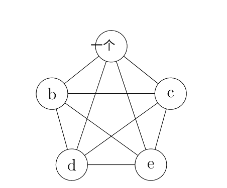

要计算 $K_n$ 中的边数，从第一个节点的角度考虑情况。它与 $n - 1$ 个其他节点相连。如果我们看第二个节点，它会增加 $n - 2$ 个连接。依此类推。所以我们有 $\sum_{k=1}^{n}(n-k) = \sum_{k=0}^{n-1} k = \frac{n(n-1)}{2}$ 边缘。

## 9.4 循环图和轮图

假设我们有 $n$ 个节点，分别命名为 $v_1, \ldots, v_n$，其中 $n \geq 3$。那么，循环图 $C_n$ 是具有这些节点和连接 $v_i$ 到 $v_{i+1}$ 的边缘的图形，再加上从 $v_n$ 到 $v_1$ 的额外边缘。也就是说，边缘的集合是：

$$ E = \{v_1 v_2, v_2 v_3, \ldots, v_{n-1} v_n, v_n v_1\} $$

所以 $C_5$ 看起来像

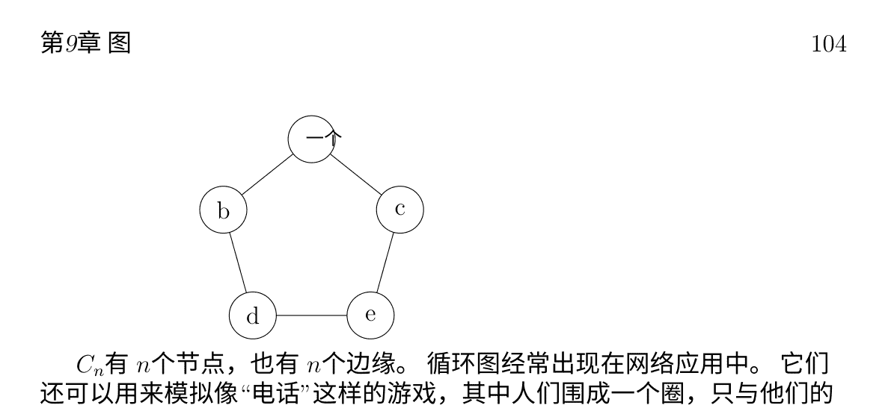

$C_n$ 有 $n$ 个节点，也有 $n$ 个边缘。循环图经常出现在网络应用中。它们还可以用来模拟像“电话”这样的游戏，其中人们围成一个圈，只与他们的邻居交流。

轮 $W_n$ 与循环图 $C_n$ 类似，只是它有一个额外的中心“中心”节点，它与其他所有节点连接。注意，$W_n$ 有 $n+1$ 个节点（不是 $n$ 个节点）。它有 $2n$ 个边缘。例如，$W_5$ 看起来像

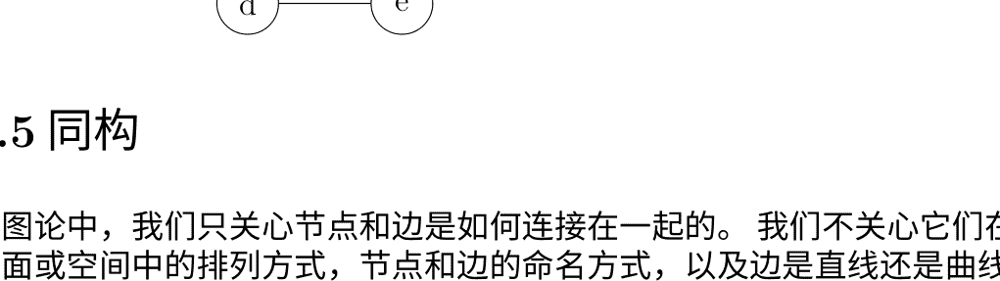

## 9.5 同构

在图论中，我们只关心节点和边是如何连接在一起的。我们不关心它们在页面或空间中的排列方式，节点和边的命名方式，以及边是直线还是曲线。如果两个图具有相同的抽象连接结构，我们希望将它们视为可互换的。

具体来说，假设 $G_1 = (V_1, E_1)$ 和 $G_2 = (V_2, E_2)$ 是图。从 $G_1$ 到 $G_2$ 的同构是一个双射 $f: V_1 \rightarrow V_2$，使得节点 $a$ 和 $b$ 之间存在一条边当且仅当 $f(a)$ 和 $f(b)$ 之间存在一条边。如果存在从 $G_1$ 到 $G_2$ 的同构，则图 $G_1$ 和 $G_2$ 是同构的。

例如，以下两个图形是同构的。我们可以通过定义函数 $f$，使其将1映射到 $d$，2映射到 $a$，3映射到 $c$，4映射到 $b$ 来证明这一点。读者可以验证左图中是否存在边，当且仅当右图中存在相应的边。

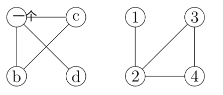

图同构是等价关系的另一个例子。每个等价类包含一组外观上不同的图形（例如，节点的不同名称，在页面上绘制方式不同），但都代表相同的抽象图形。

要证明两个图形不同构，我们可以遍历将一个图形的节点映射到另一个图形的节点的所有可能函数。然而，对于任何有趣的大小的图形来说，这是一个巨大的函数数量。事实上，是一个指数级的数量。相反，对于许多示例来说，一个更好的技术是注意到一些图形属性是“不变的”，即在同构下保持不变。

- 两个图必须具有相同数量的节点和相同数量的边。
- 对于任何节点度 $k$，两个图必须具有相同数量的度为 $k$ 的节点。例如，它们必须具有相同数量的度为3的节点。

我们可以通过给出一个在两个图之间应该保持不变的属性的例子来证明两个图不同构。例如，在下面的图片中，左边的图有一个度为3的节点，但右边的图没有度为3的节点，所以它们不能是同构的。

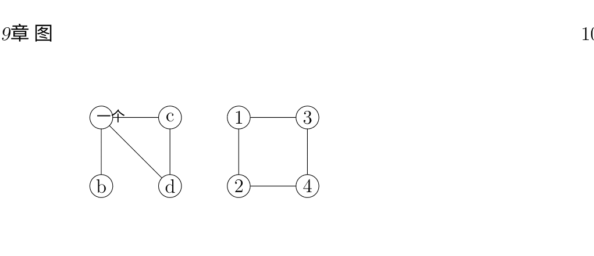

## 9.6 子图

找到一对不同构的图并不难，但其中最明显的属性（例如节点度数）是匹配的。为了证明这样一对图不同构，通常有助于关注其中一个图中特定的局部特征，在另一个图中不存在。例如，下面的两个图具有相同的节点度数：一个度为1的节点，三个度为2的节点，一个度为3的节点。然而，一点实验表明它们不是同构的。

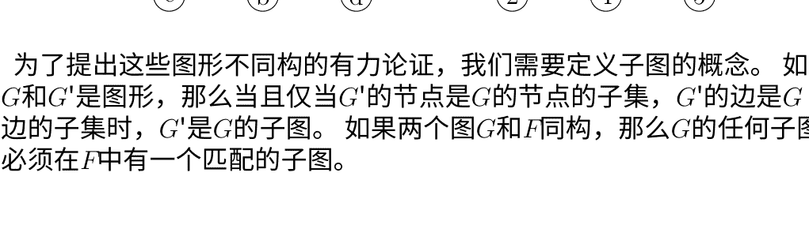

为了提出这些图形不同构的有力论证，我们需要定义子图的概念。如果 $G$ 和 $G'$ 是图形，那么当且仅当 $G'$ 的节点是 $G$ 的节点的子集，$G'$ 的边是 $G$ 的边的子集时，$G'$ 是 $G$ 的子图。如果两个图 $G$ 和 $F$ 同构，那么 $G$ 的任何子图都必须在 $F$ 中有一个匹配的子图。

一个图有大量的子图。然而，我们通常可以通过查看小的子图来找到非同构的证据。例如，在上面的图中，左图有 $C_3$ 作为子图，但右图没有。所以它们不能是同构的。

## 9.7 行走、路径和循环

在图 $G$ 中，从节点 $a$ 到节点 $b$ 的长度为 $k$ 的行走是一个有限序列的节点 $a= v_1, v_2, ..., v_n = b$，并且是一个有限序列的边 $e_1, e_2, ..., e_{n-1}$，其中 $e_i$ 连接 $v_i$ 和 $v_{i+1}$，对于所有 $i$。在大多数情况下，不需要同时给出节点序列和边序列：其中之一通常就足够了。行走的长度是它包含的边的数量。最短的行走只包含一个节点，长度为零。

如果一个行走的起始节点和结束节点相同，则该行走是闭合的。否则，它是开放的。
路径是一种行走，其中没有节点被多次使用。
循环是一种至少有三个节点的闭合行走，在该行走中除了起始和结束节点之外，没有节点被多次使用。循环包含至少三个节点的明显特殊要求很重要，因为它强制循环形成一个环，可以（例如）围住一个二维区域。

例如，在以下图中，从 $a$ 到 $e$ 有一条长度为3的行走：$ac, cd, de$。另一条长度为3的行走将具有边：$ab, bd, de$。这两条行走也是路径。还有从 $a$ 到 $e$ 的更长的行走，它们不是路径，因为它们重复使用节点，例如具有节点序列 $a, c, d, b, d, e$。如果你有两个节点之间的行走，你总是可以通过从行走中修剪不必要的循环来创建两个节点之间的路径。

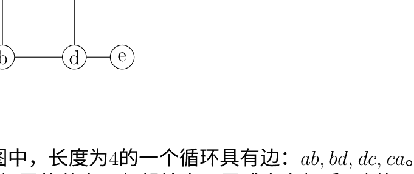

在下面的图中，长度为4的一个循环具有边：$ab, bd, dc, ca$。其他密切相关的循环通过相同的节点，但起始点不同或方向相反，例如 $dc, bd, ab, ca$。（记住 $cd$ 和 $dc$ 是同一条边的两个名称。）与循环不同，闭合行走可以重复使用节点，例如 $ab, ba, ac, ce, ec, ca$ 是一个闭合行走但不是循环。

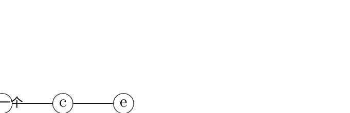

下面的图是无环的，即它不包含任何循环。

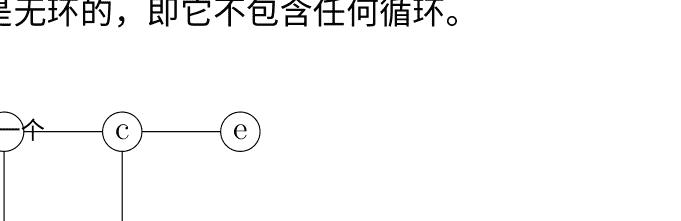

注意，循环图 $C_n$ 包含 $2n$ 个不同的循环。例如，如果 $C_4$ 的顶点如下所示标记，则一个循环是 $ab, bc, cd, da$，另一个是 $cd, bc, ab, da$，依此类推。

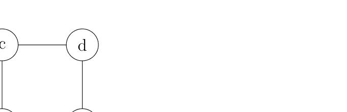

## 9.8 连通性

如果图 $G$ 中的每对节点之间都存在一条路径，则图 $G$ 是连通的。我们之前的图示例都是连通的。下面的图示例不是连通的，因为从（例如） $a$ 到 $g$ 之间没有路径。

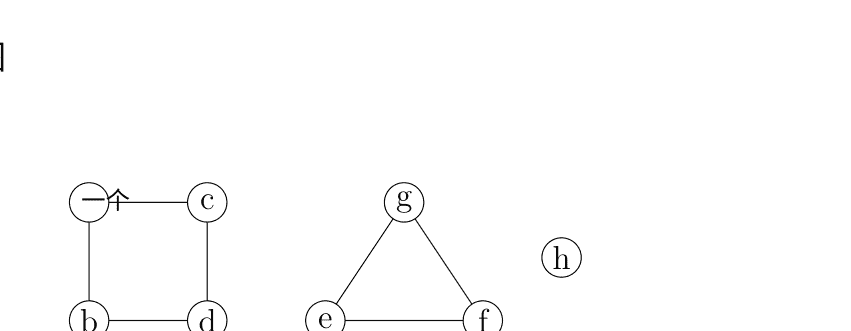

如果我们有一个可能连通也可能不连通的图 $G$，我们可以将 $G$ 划分为连通分量。每个连通分量包含一个最大的（即可能的最大）节点集合，这些节点彼此都连通，并包含它们之间的所有边。因此，上面的图示例有三个连通分量：一个包含节点 $a, b, c$ 和 $d$，一个包含节点 $e, f$ 和 $g$，以及一个只包含节点 $h$。

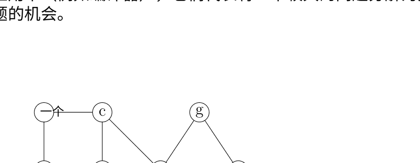

## 9.9 距离

在图中，距离是基于连接两个节点的路径的长度。具体而言，两个节点 $a$ 和 $b$ 之间的距离 $d(a, b)$ 是从 $a$ 到 $b$ 的最短路径长度。图的直径是图中任意一对节点之间的最大距离。例如，下面的左图直径为4，因为 $d(f, e) = 4$，而且没有其他节点对之间的距离更远。右图的直径为2，因为 $d(1,5) = 2$，而且没有其他节点对之间的距离更远。

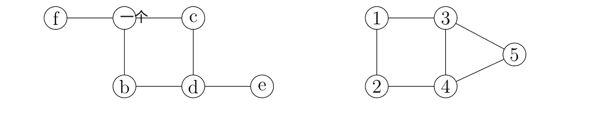

## 9.10 欧拉回路

图 $G$ 的欧拉回路是一条闭合路径，它恰好使用图的每条边一次。注意，“$G$ 有欧拉回路”意味着 $G$ 的每条边都在回路中；仅仅有 $G$ 的某个子图有一个合适的回路是不够的。例如，以下图的一个欧拉回路可以是 $ac, cd, df, fe, ec, cf, fb, ba$。

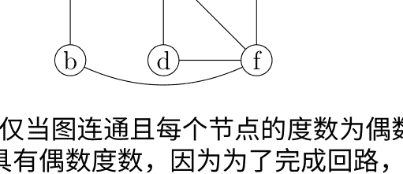

当且仅当图连通且每个节点的度数为偶数时，存在欧拉回路。每个节点必须具有偶数度数，因为为了完成回路，你必须离开每个进入的节点。如果节点的度数为奇数，最终你会进入一个节点，但没有未使用的边可以离开。

对欧拉回路的迷恋可以追溯到18世纪。当时，普鲁士的科尼斯堡市有一组大致如下的桥梁：

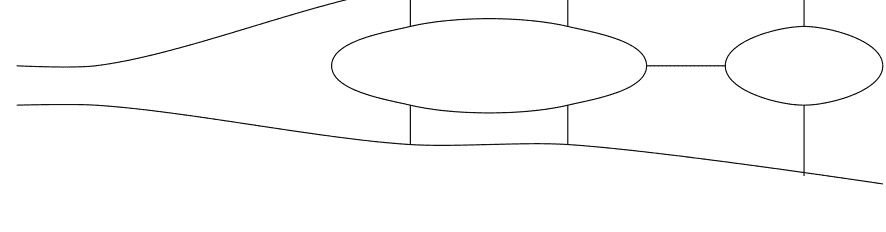

镇上的人们想知道是否可能在一次过桥的过程中，每座桥只过一次，最后回到出发的地方。这种事情经常在夜晚的酒吧里引发长时间的争论，或者在无聊的教堂仪式期间让人娱乐。莱昂哈德·欧拉是那个清楚解释为什么这是不可能的人。

对于我们的具体例子，相应的图如下所示。由于所有节点的度数都是奇数，不存在欧拉回路的可能性。

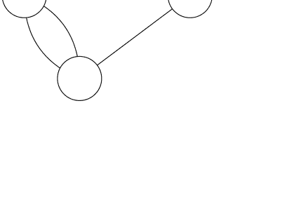

## 9.11 二分图

另一种特殊类型的图是二分图。一个图 $G=(V, E)$ 如果我们可以将 $V$ 分成两个不重叠的子集 $V_1$ 和 $V_2$，使得 $G$ 中的每条边连接 $V_1$ 的一个元素和 $V_2$ 的一个元素，则该图是二分图。也就是说，没有边连接划分的同一部分中的两个节点。

例如，立方图是二分图。如果我们将节点分配给R和G组，如下所示，则没有边连接R节点和R节点，或者G节点和G节点。

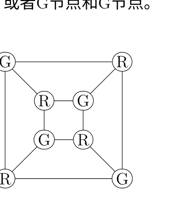

二分图经常出现在匹配问题中，其中两个子集表示不同类型的对象。例如，一个节点组可能是学生，另一个节点组可能是工作研究岗位，边可以表示每个学生感兴趣的工作。完全二分图 $K_{m,n}$ 是一个具有 $m$ 个节点在 $V_1$ 中，$n$ 个节点在 $V_2$ 中，并且包含与二分图定义一致的所有可能边的二分图。下面的图示显示了一个由7个节点组成的部分二分图，以及完全二分图 $K_{3,2}$。

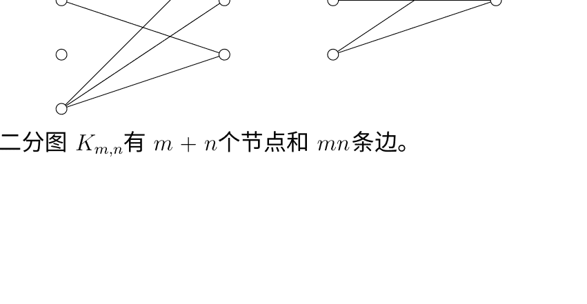

完全二分图 $K_{m,n}$ 有 $m + n$ 个节点和 $mn$ 条边。

## 9.12 术语的变化

尽管图论的核心思想非常稳定，术语却变化很大，并且有大量专门用于特定类型图的术语。特别是，节点通常被称为“顶点”。请注意，这个术语的单数形式是“vertex”（而不是“vertice”）。一组顶点上的完全图也被称为一个团。

我们所称的“行走”过去常常被称为“路径”。仍然使用这种约定的作者会使用术语“简单路径”来排除顶点的重复。与密切相关的概念的术语，例如循环，也经常发生变化。

关于轮图 $W_n$ 的节点数量，作者的观点不一。有的认为是 $n$，有的认为是 $n+1$。

## 第10章

### 双向边界

在高中和大学早期的数学中，我们经常证明等式，而且通常通过操作一系列等式来证明它们。例如

```
$$\frac{3x^2 - 5x - 2}{x - 2} = \frac{(x - 2)(3x + 1)}{x - 2} = 3x + 1$$
```

在更复杂的问题上，往往需要采用更灵活的方法：从两个方向限制感兴趣的数量。当我们的最佳上界和最佳下界相等时，我们建立了一个等式。

否则，我们将数量限制在一个已知的（希望是小的）范围内。

因为我们需要建立一个下界和一个上界，一个双向边界证明包含两个子证明。有时候两个子证明是相似的。然而，这种技术的真正威力来自于两个子证明可以使用完全不同的技巧。因此，当证明更困难的结果时，例如在高级计算机科学和数学课程中（例如实分析，算法），该方法被广泛使用。

在构建这些证明时，最常见的错误是完全忽略一半。例如，有人打算证明f(x)=k，可能会证明f(x)≤k，但忘记证明f(x)≥k。不要这样做。如果一个界限是显而易见的，请明确说明。在本章中，我们将看到这种方法在各种示例中的工作原理。

### 10.1 标记制作

假设我们有一张12英寸乘以15英寸的饼干面团，我们想要切割枫叶形状的饼干。已经回收和重新擀平的面团碎片永远不会产生与原始面团一样好的结果，因此我们希望尽可能多地将饼干放入我们的原始面团中。我们能从这张面团中切割出多少块饼干？

我们可以尝试切割几张面团，在不同的方式下放置我们的饼干切割器。假设我们在最佳尝试中成功放入了25块饼干。现在我们知道25是我们能够切割出的饼干的最小数量。但要证明我们找到了最佳布局可能非常困难。

现在，假设我们将枫叶切割器放在图纸上，并计算出每个饼干的面积至少为6平方英寸。由于我们的面团面积为180平方英寸，我们知道无法切出超过30个饼干。因此，我们现在对最佳布局中的饼干数量有一个上限为30。在这个例子中，我们通常期望我们的下限和上限之间有一定的距离，因为搜索所有排列切割器的方式非常困难。

家庭厨房不需要过多担心效率，但工业厂房需要。特别是服装制造商需要为从布料矩形上切割服装部件创建标记。由于布料的外观和材料特性与其经线方向有关，部件必须以特定的方向对齐。废布虽然可以回收利用于其他用途，但不能简单地重新形成和重复使用。高效的标记对于任何浪费都会被复制多次至关重要，但对人类来说却很困难创建。因此，大量的努力已经投入到高效标记制作算法的开发中。

在工程学和理论计算机科学中，常常会遇到无法直接计算的数量，而是必须从上下限进行界定。有时我们可以使上下限相等，从而得到所谓的紧密界限。但通常情况下，我们无法做到这一点。

### 10.2 鸽洞点放置

这是一个非常不同的问题，它结合了两种方式的界定和鸽巢原理。像许多鸽巢证明一样，这个证明依赖于一个不明显的技巧。在这种情况下，这是一个关于三角形划分的技巧。一旦你看到这个技巧，证明就成为一个从上下限界定数量的经典例子。

命题36假设 T 是一个边长为2单位的等边三角形。我们可以在三角形中放置最多四个点，使得每对点之间的距离大于1单位。

为了证明4是我们可以放置的最大点数，并且无法放置5个点，我们需要分别解决这两个子问题，使用不同的技巧。

证明：为了证明最大值至少为四，注意到我们可以将三个点放在三角形的角落，一个点放在中心。角落的点相距两个单位。

要看到中心点距离任何角落点都超过一个单位，注意到中心点、角落点和边的中点形成一个直角三角形。

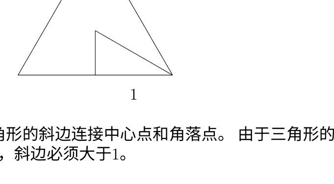

这个三角形的斜边连接中心点和角落点。由于三角形的一条腿长度为1，斜边必须大于1。

为了证明最大点数不能超过四，将三角形分成四个小等边三角形如下：

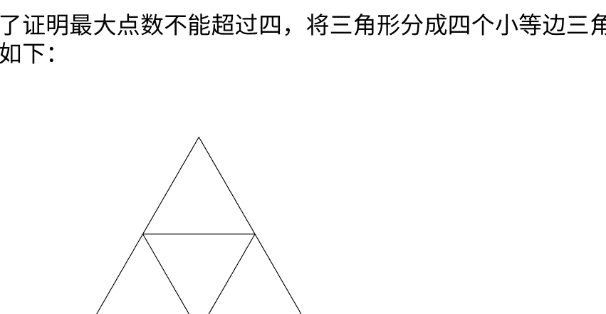

假设我们试图将五个或更多的点放入大三角形中。由于只有四个小三角形，根据鸽笼原理，某个小三角形必须包含至少两个点。但由于小三角形的边长只有1，这些点不能相距超过一个单位。

### 10.3 图着色

图 G的着色将每个节点 G分配一个颜色，限制条件是相邻节点不能有相同的颜色。 如果 G可以用k种颜色着色，我们称 G为 k可着色的。 图 G的色数，记作χ(G)，是着色 G所需的最小颜色数。

例如，这个图只需要三种颜色：

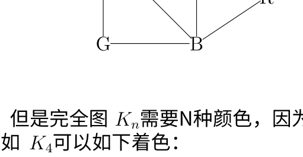

但是完全图 K_n需要N种颜色，因为每个节点都与其他所有节点相邻。例如 K_4可以如下着色：

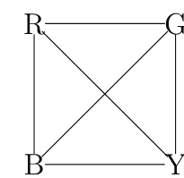

要确定N是图 G的色数，我们需要确定两个事实：

- $\chi(G) \leq N$:  G可以用N种颜色着色。
- $\chi(G) \geq N$:  G不能用少于N种颜色着色。

对于小的有限图，显示 $\chi(G) \leq n$的最简单方法是显示一个使用 $n$个颜色的 G的着色。对于更大类的图，我们可以描述一个进行着色的算法。例如，我们可以通过在圆圈周围交替使用颜色来给一个有偶数个节点的循环图着色。二分图永远不需要超过两种颜色。

显示 $\chi(G) \geq n$有时同样简单直接。例如，如果图中有任何边，它的色数至少为2。如果 G包含一个 $K_n$的副本，则 G的色数至少为 $n$，因为 $K_n$不能用少于 $n$个颜色着色。

然而，下面的例子展示了为什么这个过程可能变得棘手。用4种颜色着色相对容易。但其中最大的完全图是 $K_3$，这给出了一个仅为3的下界。显示色数实际上为4需要仔细地遍历所有可能的方式来为节点分配三种颜色，并解释为什么没有一种方式可以得到完全着色。

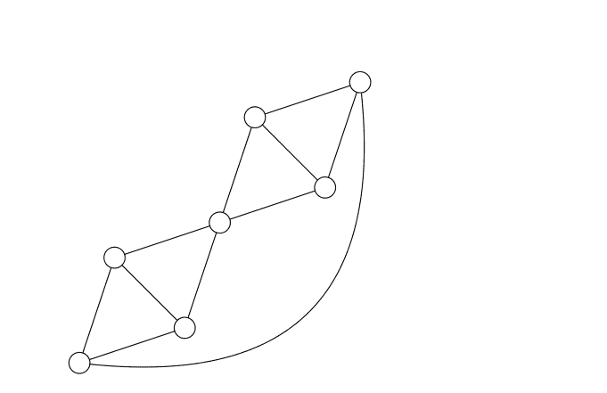

### 10.4 为什么关心图着色？

图着色在解决各种实际问题时是必需的。例如，大多数编译器中都嵌入了一种着色算法。由于通常情况下无法高效地解决这个一般性问题，所以实现的算法会使用各种限制或近似方法，以便在合理的时间内运行。

例如，目录和在线零售商经常将他们的服装产品组织成系列，例如“高尔夫老头”或“坚韧但可触摸”或“制服4U”。系列中的所有物品都保证是兼容的。这有助于零售商将服装推销给没有穿衣品味的人，同时也应对了人们对目录和计算机屏幕上无法准确再现的细微色彩差异的敏感性。需要多少个系列来组织零售商的服装库存？

我们可以将这个问题建模为图着色。每个图节点都是一件服装。边连接不兼容的物品对，例如鲜绿色的裤子与灰橙色的衬衫不搭配，商务正式的衬衫与高尔夫裤不搭配。每个节点上的“颜色”是一个系列的名称。如果我们发现需要太多的系列，我们可能希望从库存中删除一些选定的服装（例如与任何物品都不搭配的深绿色喇叭裤）。

我们可以通过为每个方格设置一个节点来建模数独谜题。颜色是9个数字，其中一些预先分配给特定的节点。如果它们的方格在同一个块、行或列中，那么两个节点是相连的。 如果我们可以以尊重预先分配的颜色的方式对这个图进行9着色，那么这个谜题是可解的。

我们可以将考试安排建模为一个着色问题。 如果有一名学生同时选修两门课程，那么这两门课程的考试不应该安排在同一时间。因此，我们可以将其建模为一个图，其中每门课程是一个节点，并且如果它们共享学生，则课程之间有边连接。 问题是，我们是否可以用 k种颜色对图进行着色，其中 k是我们日程安排中的考试次数。

在考试安排问题中，我们实际上希望答案是“否”，因为消除冲突将需要过多的考试时间。 因此，真正的实际问题是：我们需要从图中排除多少学生（即给予特殊的冲突考试），才能以合理的 k值解决着色问题。我们还有一个选择，即分割一门课程（即提供一个预定的冲突考试），以简化图。

在计算机科学中，颜色的一个特别重要的用途是寄存器分配。 一个大型的Java或C程序包含许多命名变量。 但是计算机只有一小部分（例如32个）快速寄存器，可以提供基本的操作，如加法。 因此，变量必须分配给特定的寄存器。

这个着色问题中的节点是变量。 颜色是寄存器。如果两个变量在同一时间使用，则它们之间存在一条边，因此不能共享一个寄存器。 与考试安排问题一样，我们实际上预计原始着色问题会失败。然后编译器使用所谓的“溢出”操作来打破依赖关系并创建一个我们可以用有限数量的寄存器着色的图形。 目标是尽可能少地使用溢出操作。

### 10.5 证明集合相等

最后，双向边界证明经常用于证明两个集合 A和B相等。 也就是说，我们展示 A ⊆ B和 B ⊆ A，使用分开的子证明。我们可以得出结论 $A = B$。这看起来表面上与之前的例子不同，因为关系是 $\subseteq$ 而不是 $\leq$。但主要思想是相同的：我们首先证明 $A$ 不比 $B$ 大，然后证明 $A$ 不比 $B$ 小。举个例子，让我们看一下

**命题37** 设 $A = \{15p+ 9q \mid p, q \in \mathbb{Z}\}$ 那么 $A = \{3的倍数\}$。

在你试图证明这个之前，先将一些整数值代入公式$15p+ 9q$。 看看你能否自己非正式地相信这个公式确实只生成3的倍数。

使用边界方法，我们将证明写成如下形式：

证明:
(1) 证明 $A \subseteq \{3的倍数\}$。
设 $x$ 是 $A$ 的一个元素。根据 $A$ 的定义， $x = 15s+ 9t$，其中 $s$ 和 $t$ 是整数。那么 $x = 3(5s+ 3t)$。由于 $s$ 和 $t$ 是整数，所以 $x$ 是3的倍数。
(2) 证明 $\{3的倍数\} \subseteq A$。
注意 $(*) 15 \cdot (-1) + 9 \cdot 2 = 3$。
设 $x$ 是3的倍数。那么 $x = 3n$，其中 $n$ 是整数。将 $(*)$ 代入这个方程，我们得到 $x = (15 \cdot (-1) + 9 \cdot 2)n$。
所以 $x$ 是 $A$ 的一个元素。
由于我们已经证明了 $A \subseteq \{3的倍数\}$ 和 $\{3的倍数\} \subseteq A$，我们可以得出结论 $A = \{3的倍数\}$。

### 10.6 术语的变化

在着色图中，我们将颜色放在顶点上。一组相关的问题涉及将颜色放在边上。当需要区分两者时，使用术语“顶点着色”和“边着色”。

## 第11章

## 归纳法

本章介绍了数学归纳法。

### 11.1 归纳简介

在学期开始时，我们看到了计算前 $n$个整数和的以下公式：

> **命题38** 对于任何正整数 $n$, $\sum_{i=1}^n i = \frac{n(n+1)}{2}$.

在那个时候，我们没有证明这个公式是正确的，因为这最容易通过一种新的证明技术来完成：归纳法。

数学归纳法是一种用于证明对于所有自然数$n$, 或者对于某些无限自然数子集（例如所有正偶数）都成立的技术。 这是一种产生快速、易于阅读的证明的好方法，适用于证明你目前所见的技术难以证明的各种事实。它特别适用于分析递归算法的性能。 你们中的大多数人在以前的编程课程中见过其中一些；在以后的课程中你们将见到更多。

归纳法非常方便，但可能会让你感到有点奇怪。 你可能需要一些时间来适应它。事实上，你有两个有些独立的任务：

- 学习如何编写归纳证明。
- 理解归纳证明的合法性。

即使你对这种方法的合法性还有些不确定，你也可以学会编写正确的归纳证明。在接下来的几节课中，你将对归纳法及其好友递归的有效性有更多的信心。

### 11.2 一个例子

归纳证明的大纲如下：

> > **声明：** 对于所有正整数n，P(n)为真。
> **证明：** 我们将对n使用归纳法。
> **基础：** 我们需要证明P(1)为真。
> **归纳：** 假设对于n=1, 2, ..., k-1，P(n)为真。我们需要证明P(k)为真。

标记为“归纳”的证明部分是一个条件语句。我们假设对于n小于等于k-1的值，P(n)为真。这个假设被称为归纳假设。我们使用这个假设来证明P(k)为真。

对于我们的公式示例，我们的命题 P(n) 是 $\sum_{i=1}^n i = \frac{n(n+1)}{2}$. 将 P 的这个定义代入大纲，我们得到了以下特定声明的大纲:

> > **证明:** 我们将证明 $\sum_{i=1}^n i = \frac{n(n+1)}{2}$ 对于任何正整数 n, 使用归纳法证明。
> **基础:** 我们需要证明该公式对于 n= 1 成立，即 $\sum_{i=1}^1 i = \frac{1 \cdot 2}{2}$.
> **归纳:** 假设对于 n= 1,2, . . . . . . . . . k−1，有 $\sum_{i=1}^{n} i = \frac{n(n+1)}{2}$.
> 我们需要证明 $\sum_{i=1}^k i = \frac{k(k+1)}{2}$.

完整的证明可能如下所示:

证明: 我们将证明 $\sum_{i=1}^n i = \frac{n(n+1)}{2}$ 对于任何正整数 $n$, 使用归纳法证明。

基础: 我们需要证明该公式对于 $n=1$ 成立。 $\sum_{i=1}^1 i = 1$。同时也是 $\frac{1^2}{2} = 1$。 因此对于 $n=1$, 两者相等。

归纳: 假设对于 $n=1,2,...,k-1$, 有 $\sum_{i=1}^n i = \frac{n(n+1)}{2}$

我们需要证明 $\sum_{i=1}^k i = \frac{k(k+1)}{2}$.

根据求和符号的定义, $\sum_{i=1}^k i = (\sum_{i=1}^{k-1} i) + k$

我们的归纳假设是在 $n = k-1$ 时, $\sum_{i=1}^{k-1} i = \frac{(k-1)k}{2}$.

结合这两个公式, 我们得到 $\sum_{i=1}^k i = \frac{(k-1)k}{2} + k$。

但是 $\frac{(k-1)k}{2} + k = \frac{(k-1)k}{2} + \frac{2k}{2} = \frac{(k-1)k+2k}{2} = \frac{k(k+1)}{2}$.

因此, 结合这些方程, 我们得到 $\sum_{i=1}^k i = \frac{k(k+1)}{2}$ 这就是我们需要展示的。

归纳证明的一种思考方式是它是一个用于构建直接证明的模板。 如果我给你具体的值 $n=47$, 你可以通过从基本情况开始使用归纳步骤46次来逐步从 $n=1$的情况推导到 $n=47$的情况。

### 11.3 为什么这是合法的?

有几种方式可以思考数学归纳法, 并理解为什么它是一种合法的证明技巧 。 不同的人在这一点上有不同的动机, 所以我会提供几种。

多米诺理论: 想象一个无限长的多米诺骨牌排列。 基础步骤推倒第一个多米诺骨牌。 归纳步骤声称, 一个倒下的多米诺骨牌会推倒下个多米诺骨牌。 所以多米诺骨牌会从一开始一直倒下到最后。 这个过程会无限继续下去, 因为这条线是无限长的。然而，如果你专注于任何一个特定的多米诺骨牌，它会在一段特定的有限延迟后倒下。

递归精灵：递归精灵是数学家的版本的编程助手。假设你告诉她如何证明 \(P(1)\)，以及为什么 \(P(1)\)通过 \(P(k)\)都暗示了 \(P(k+1)\)。然后假设你选择任何一个整数（例如1034），她可以使用这个方法来填写所有关于这个特定整数的正常直接证明的细节。也就是说，她取 \(P(1)\)，然后使用归纳步骤从 \(P(1)\)到 \(P(2)\)，依此类推直到 \(P(1034)\)。

整数的定义特性：整数在数学上被设定为归纳法有效。一些形式化的公理集定义整数，其中包括一个规则，说明归纳法有效。其他公理集包括“良序性”特性：任何有下界的子集都有最小元素。

这等同于明确声明归纳法有效的公理。这两个公理都防止整数具有无法通过重复加一到某个起始整数达到的非常大的元素。所以，例如，\(\infty\)不是整数。

这些论证不依赖于我们的起始点是1还是其他整数，例如0或2或-47。你只需要确保你的基本情况涵盖了第一个使得命题成立的整数。

### 11.4 构建归纳证明

在构建归纳证明时，你有两个任务。首先，你需要为问题设置这个大纲。这包括确定一个合适的命题 \(P\)和一个合适的整数变量 \(n\)。

注意 \(P(n)\)必须是一个陈述，即一个可以是真或假的东西。例如，它从不仅仅是一个值为数字的公式。
另外，注意 \(P(n)\)必须依赖于一个整数 \(n\)。这个整数 \(n\)被称为我们的归纳变量。

在归纳步骤的开始处的假设（“P(k)是真的”）被称为归纳假设。

你的第二个任务是填写归纳步骤的中间部分。也就是说，你必须弄清楚如何将一个更大问题的解决方案 $P(k)$ 与一个或多个较小问题的解决方案 $P(1), \ldots, P(k-1)$ 相关联。大多数学生希望通过从一个小问题开始，例如 $P(k-1)$，然后添加一些内容来解决问题。然而，对于更复杂的情况，通常最好从较大的问题开始，然后尝试在其中找到较小问题的实例。

### 11.5 另一个例子

前面的例子应用了归纳法到一个代数公式上。我们也可以应用归纳法到其他类型的陈述中，只要它们涉及一个适当的整数 $n$。

**命题39** 对于任意自然数 $n$, $n^3 - n$ 是3的倍数。

在这种情况下，$P(n)$ 是“$n^3 - n$是3的倍数”。

因此，我们的证明大纲如下

```
证明：通过对 $n$进行归纳。
基础：令 $n= 0$。 [证明当 $n= 0$时,$n^3 - n$是3的倍数]
归纳：假设当 $n= 0, 1, \ldots, k$时，$n^3 - n$是3的倍数。 我们需要证明 $(k+1)^3 - (k+1)$ 是3的倍数。
```

详细阐述代数的细节，我们得到以下完整的证明：

```
证明：通过对 $n$进行归纳。
基础: 让 $n= 0$. 那么 $n^3 - n= 0^3 -0 = 0$, 可以被3整除。
归纳: 假设对于 $n= 0,1,\ldots, k$, $n^3 - n$可以被3整除。 我们需要证明 $(k+1)^3 - (k+1)$ 可以被3整除。
```

$(k+1)^3 - (k+1) = (k^3+3k^2+3k+1) - (k+1) = (k^3 - k) + 3(k^2 + k)$

根据归纳假设，$(k^3 - k)$可以被3整除。 而$3(k^2 + k)$可以被3整除，因为$(k^2 + k)$是一个整数。 所以它们的和可以被3整除。 也就是说 $(k+1)^3 - (k+1)$ 可以被3整除。 $\square$

请注意，我们还使用了归纳大纲的变体，其中归纳假设涵盖了值直到 $k$（而不是 $k-1$），并且我们证明了在 $n = k+1$（而不是在 $n = k$）时的声明。 无论你的假设通过 $n = k-1$ 还是 $n = k$，都没有关系，只要你证明了下一个更大整数的声明。

还要注意，我们的假设说对于 $n=0,1,\ldots$，声明成立。， $k$。 我们使用的约定是，这种表示法意味着 $k \ge 0$，而不是 $k$一定更大（例如 $k \ge 1$)。 也就是说，这个表达式中的1仅用于显示增长的模式，并不意味着 $k$的大小。

从技术上讲，零基本情况足以使证明成立，但有时零基本情况不能提供良好的直觉或信心。 因此，有时你会看到额外的基本情况写出来，例如在这个例子中， $n=1$，以帮助作者或读者看出声明为什么是合理的。

## 11.6 关于风格的一些评论

注意证明的开始告诉你公式中的哪个变量（$n$在这种情况下）是归纳变量。 在这个公式中，归纳变量的选择是相当明显的。 但有时候有多个整数floating around，可能会对归纳变量做出合理的选择。

在进行归纳证明时，提及你正在进行归纳证明，说明你的归纳变量，并标记你的基础步骤和归纳步骤是很好的风格。

注意基础情况的证明非常简短。 事实上，我写的大约是正常情况下的两倍长。几乎所有的时间，基础情况都是很容易证明的，对你和读者来说都是相当明显的。 通常，这一步只包含一些代数运算和一个检查标记在末尾。然而，检查基础情况是至关重要的。而且，如果你的基础情况涉及一个方程，计算出两边的结果（不仅仅是一边），以便验证它们是否相等。

归纳步骤的重要部分是确保你假设P(1),...,P(k−1)并使用这些事实来证明P(k).在开始时，你必须明确说明你的归纳假设，即你的主张中P(n)是什么。通常有帮助的是明确地替换一些关键值给n，例如计算出P(k−1)是什么。确保你在证明P(k+1)成立时使用归纳假设中的信息。如果你不这样做，那就不是一个归纳证明，很可能你的证明有错误。

在归纳步骤开始时，也是一个好主意说出你需要展示的内容，即引用P(k)是什么。

这些“风格”问题在理论上是可选的，但对于初学者编写归纳证明来说实际上是至关重要的。如果你的证明不清晰易读，你将失去分数。遵循这些风格要点（例如，标记你的基础和归纳步骤）是确保证明清晰易读且逻辑正确的好方法。

## 11.7 几何例子

让我们看另一个基本归纳大纲的例子，这次是在几何应用中。用某种类型的拼图块铺满一定的空间意味着你将拼图块完全放入该空间，没有重叠或缺失的区域。.一个右三格多米诺是一个2×2的正方形减去其中一个方格。

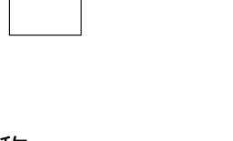

我声称40对于任何正整数n，一个去掉一个方格的2^n × 2^n棋盘可以使用右三格多米诺铺满。

证明：通过对 n进行归纳。
基础：假设 n= 1。那么我们的2^n × 2^n棋盘去掉一个方块后，
正好是一个右三格骨牌。
归纳：假设对于 n= 1, . . . , k，命题成立。也就是说，只要n ≤ k
，任意去掉一个方块的2^n × 2 n棋盘都可以用右三格骨牌铺满
。
假设我们有一个2^(k+1) × 2^(k+1)的棋盘 C，去掉一个方块。我们可以将 C分成四个2^k×2^k的子棋盘P, Q, R和 S。其中一个子棋盘已经缺少一个方块。假设不失一般性，这个子棋盘是S。在 C的中间放置一个右三格骨牌，使其覆盖 P, Q和 R上的一个方块。
现在看看还有哪些区域需要覆盖。在每个子棋盘中，正好缺少一个方块（S）或已经被覆盖（P， Q和 R）。因此，根据我们的归纳假设，每个这些子棋盘减去一个方块都可以用右三格骨牌铺满。将这四个铺满的子棋盘与中间的三格骨牌组合起来，我们得到了整个较大的棋盘 C的铺法。这就是我们需要构造的。

## 11.8 图着色

我们还可以使用归纳法来证明关于图的染色的一个有用的一般性质：

命题41

对于任意正整数 D，如果图 G中的所有节点的度数 ≤ D，则 G可以用 D+ 1种颜色进行染色。
这个命题涉及的对象是图。要将归纳法应用于像图这样的对象，我们按照它们的大小组织我们的对象。归纳过程中的每一步都将证明该命题对于特定大小的所有对象都成立。(整数) 大小。对于图形来说，“大小”通常是节点数或边数。对于这个证明来说，使用节点数最方便。

证明：让我们选择一个正整数 $D$ 并通过对 $G$ 中节点数进行归纳来证明这个命题。
基础：由于 $D \geq 1$，只有一个节点的图形显然可以用 $D+1$ 种颜色着色。
归纳：假设任何节点数最多为 $k-1$ 且最大节点度 $\leq D$ 的图形都可以用 $D+1$ 种颜色着色。
设 $G$ 为一个具有 $k$ 个节点和最大节点度 $\leq D$ 的图形。从 $G$ 中删除某个节点 $v$ (及其边) 以创建一个较小的图形 $G'$。
$G'$ 有 $k-1$ 个节点。此外，$G'$ 的最大节点度不大于 $D$，因为删除节点不会增加度数。因此，根据归纳假设，$G'$ 可以用 $D+1$ 种颜色着色。
因为 $v$ 最多有 $D$ 个邻居，它的邻居只使用了 $D$ 个可用的颜色，留下了一个备用的颜色，我们可以分配给 $v$。对 $G'$ 的着色可以扩展为 $G$ 的着色，使用 $D+1$ 种颜色。

我们可以利用这个想法设计一个算法（称为“贪婪”算法）来对图进行着色。该算法逐个遍历节点，为每个节点分配一种颜色，而不修改任何先前分配的颜色。当我们到达每个节点时，我们查看已分配给其邻居的颜色。如果有一个先前使用的颜色没有分配给邻居，我们重新使用该颜色。否则，我们使用一种新的颜色。上述定理表明，贪婪算法最多使用 $D+1$ 种颜色。

然而，请注意，$D+1$ 只是图的色数的上界。图的实际色数可能要小得多。例如，对于轮图 $W_6$，$D+1$ 为 7，但该图的色数实际上只有三种：

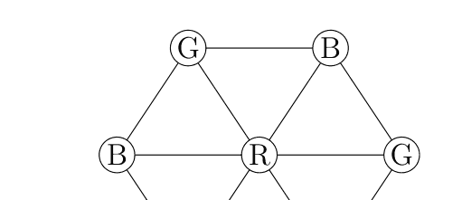

贪婪算法的性能对节点考虑顺序非常敏感。例如，假设我们从中心节点开始着色W₆，然后是外环上的一个节点v，然后是与v相对的节点。那么我们的部分着色可能如下所示。

完成这个着色需要使用四种颜色。

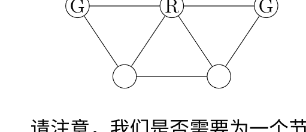

请注意，我们是否需要为一个节点部署新的颜色实际上并不取决于节点的度数，而是取决于其已经着色的邻居节点数量。因此，一个有用的启发式方法是按照节点的度数排序，在过程中较早地着色高度节点。这往往意味着当我们到达一个高度节点时，它的一些邻居节点尚未着色。因此，我们将能够使用较少的颜色处理高度节点，然后将这个部分着色扩展到所有低度节点。

## 11.9 邮资例子

在我们迄今为止看到的归纳证明中，实际上并不需要归纳假设中的全部信息。我们的归纳步骤假设对于从基础值到k−1的所有k值，P(n)都为真，所以-命题42：每个至少为12美分的邮资都可以用4美分和5美分的邮票组成。

在尝试证明这种类型的命题之前，你应该尝试一些小的例子，并验证所述的基本情况是否正确。也就是说，在这种情况下，你可以为一些代表性整数 ≥12 制作邮资，但你不能为11制作邮资。

例如，12美分使用三张4美分的邮票。13美分的邮资使用两张4美分的邮票加上一张5美分的邮票。14美分使用一张4美分的邮票加上两张5美分的邮票。如果你尝试使用小的数值进行实验，你很快就会意识到制作 k 美分的邮资的公式取决于制作 k-4 美分的邮资的公式。也就是说，你拿走 k-4 美分的邮票，再加上另外一张4美分的邮票。我们可以将这个问题转化为归纳证明，如下所示：

证明：通过对邮资金额进行归纳。

基础：如果邮资为12美分，我们可以用三张4美分的邮票来制作。如果邮资为13美分，我们可以用两张4美分的邮票加上一张5美分的邮票来制作。如果邮资为14美分，我们使用一张4美分的邮票加上两张5美分的邮票来制作。如果邮资为15美分，我们使用三张5美分的邮票来制作。
归纳法：假设我们已经展示了如何构建从12到 k-1 的邮资。我们需要展示如何构建 k 分邮资。由于我们已经证明了基本情况从15分开始，我们假设 k ≥ 16。

由于 k ≥ 16，k-4 ≥ 12。所以根据归纳假设，我们可以使用 m 个4分邮票和 n 个5分邮票构建 k-4 分的邮资。其中 $m$ 和 $n$ 是自然数。 换句话说， $k - 4 = 4m + 5n$。

然后 $k = 4(m+1) + 5n$。 所以我们可以使用 $m+1$ 个4分邮票和 $n$ 个5分邮票构建 $k$ 分的邮资，这就是我们需要展示的内容。

请注意，我们需要直接证明四个基本情况，因为我们需要在归纳步骤中回溯四个整数。 在你解决归纳步骤的细节之前，很难确定需要多少个基本情况。 第一个基本情况是 $n = 12$，因为我们的断言只对大于等于 $12$ 的整数起作用。

## 11.10 尼姆游戏

在尼姆游戏中，有两个玩家和两堆火柴。 每次轮到一个玩家时，他可以从一堆火柴中移除一些（非零）数量的火柴。 最后一个火柴被移除的玩家获胜。<sup>1</sup>

断言43 如果游戏开始时两堆火柴包含相同数量的火柴，则第二个玩家总是能赢。

以下是第二个玩家的获胜策略。 假设你的对手从一堆火柴中移除 $m$ 根火柴。 在你的下一步中，你从另一堆火柴中移除 $m$ 根火柴，从而使两堆火柴数量相等。 让我们证明这个策略是有效的。

通过对每堆中的火柴数量 ($n$) 进行归纳证明。
基础：如果两堆都只有1根火柴，第一个玩家只有一个可能的移动：从一堆中移走最后一根火柴。 然后第二个玩家可以从另一堆中移走最后一根火柴，从而获胜。

归纳假设：假设第二个玩家可以赢得任何以两堆 $n$ 根火柴开始的游戏，其中 $n$ 是从1到 $k -1$ 的任意值。我们需要证明如果 $n = k$，这个假设也成立。因此，假设两堆都有 $k$ 根火柴。
第一个玩家的合法移动涉及从一堆中移走 $j$ 根火柴，其中 $1 \leq j \leq k$。然后堆中剩下 $k$ 根火柴和 $k - j$ 根火柴。

现在第二个玩家可以从另一堆中移走 $j$ 根火柴。这样我们就剩下两堆 $k - j$ 根火柴。如果 $j = k$，那么第二个玩家赢。如果 $j < k$，那么我们现在实际上是在每堆有 $k - j$ 根火柴的游戏开始时。因此，根据归纳假设，我们知道第二个玩家可以以胜利结束游戏的其余部分。

这个证明中的归纳步骤使用了我们的断言 $P(n)$ 对于较小的 $n$ 的情况是真的这一事实。但是由于我们无法控制第一个玩家移除多少根火柴，我们不知道在之前的结果 $P(1)\dots P(k)$ 序列中要回溯多远。我们之前关于邮资的证明可以重新写成避免使用强归纳的形式。如何重新编写这样的Nim示例的证明则不太清楚。

## 11.11 质因数分解

在这门课程的早期，我们看到了“算术基本定理”，它说明每个正整数 $n$, $n \geq 2$，都可以表示为一个或多个质数的乘积。让我们证明这是正确的。

回想一下，一个数 $n$ 如果它的唯一正因数是1和$n$，那么它是质数。如果 $n$ 不是质数，则它是合数。由于一个数的因子不能大于这个数本身，这意味着一个合数 $n$ 总是有一个大于1但小于 $n$ 的因子。反过来，这意味着我们可以将 $n$ 写成 $ab$ 的形式，其中 $a$ 和 $b$ 都大于1但小于 $n$。

对 $n$ 进行归纳证明。

2我们将把证明细节留给读者作为练习。

基础：2可以写成一个质数的乘积，2。

归纳法：假设2到 k 之间的每个整数都可以表示为一个或多个质数的乘积。 我们需要证明 k+1 可以表示为质数的乘积。有两种情况：

+   情况1： k+1 是质数。 那么它就是一个质数的乘积，即它本身。

+   情况2： k+1 是合数。 那么 k+1 可以表示为 ab 的乘积，其中 a 和 b 是在范围[2, k]内的整数。根据归纳假设， a可以表示为质数的乘积 p_1p_2...p_i 和 b可以表示为质数的乘积 q_1q_2...q_j。因此，k+1可以表示为质数的乘积 p_1p_2...p_i q_1q_2...q_j。

在这两种情况下 k+1 可以被写成质数的乘积，这就是我们需要展示的。

同样，归纳步骤需要回溯我们结果序列的一些步骤，但我们无法控制我们需要回溯多远。

## 11.12 符号表示的变化

归纳证明的具体细节因作者和被证明的具体命题的个人偏好而异。 有些人喜欢假设命题对于 k 成立，并证明对于 k+1 也成立。

其他人假设命题对于 k-1 成立，并证明对于 k 也成立。对于特定问题，有时选择其中一种方法会得到稍微简单一些的证明。

人们对于符号表示 n= 0,1, ... 的理解不同。 ，k 意味着 k 至少为0、至少为1或至少为2。

一些作者更喜欢始终写强归纳假设，即使弱假设已经足够。这样可以节省思考的精力，因为你不需要提前弄清楚是否需要强假设。

真的是必需的。 然而，对于某些问题，强假设可能比弱假设更复杂。

为了更有经验的读者，作者可能会在概述中进行一些缩写，例如将完全简短的证明放在一个段落中，而不单独标记基础和归纳步骤。 然而，当你还在适应这种技巧时，对概述要小心谨慎是很重要的。

# 第12章

## 递归定义

本章介绍递归定义，包括寻找闭合形式。

### 12.1 递归定义

到目前为止，我们使用半正式定义涉及.... 来定义变长对象。例如，我们通过 $\sum_{i=1}^{n} i$ 来定义求和。

$$\sum_{i=1}^{n} i = 1 + 2 + 3 + \ldots + (n - 1) + n$$

当读者能够轻松看出正则模式the...is trying to express时，这种方法才可行。当精确度至关重要时，例如在模式is less obvious时，我们需要切换到“递归定义”。数学中的递归函数定义与编程语言中的递归过程基本相似。递归定义是通过较小的相同类型对象来定义一个对象。因为这个过程必须在某个点结束，所以我们需要为最小的对象包含明确的定义。因此，递归定义总是有两个部分：

+   基本情况或情况
+   递归公式

例如，求和 $\sum_{i=1}^n i$ 可以定义为：

+   $g(1) = 1$
+   $g(n) = g(n-1) + n$, 对于所有 $n \geq 2$

基本情况和递归公式都必须存在才能有一个完整的定义。然而，传统上不会明确标记这两个部分。你只需要自己弄清楚哪些部分是基本情况，哪些部分是递归公式。输入值通常被假定为整数。

递归定义的真正威力在于结果对于$n$的依赖取决于更多小于$n$的值的结果，就像强归纳法的例子一样。例如，著名的斐波那契数列被定义为：

+   $F_0 = 0$
+   $F_1 = 1$
+   $F_i = F_{i-1} + F_{i-2}$, $\forall i \geq 2$

所以 $F_2=1$, $F_3=2$, $F_4=3$, $F_5=5$, $F_6=8$, $F_7=13$, $F_8=21$, $F_9=34$. 这个模式如何以非递归的方式表达并不明显。

### 12.2 寻找闭合形式

许多递归数值公式都有一个闭式形式，即一个等价的表达式，不涉及递归（或求和等）。有时候，你可以通过计算函数的前几个值并猜测模式来找到闭式形式。更常见的情况是，你需要使用一种有组织的技巧。寻找闭式形式的最简单技巧被称为“展开”。

例如，假设我们有一个函数 $T : \mathbb{N} \to \mathbb{Z}$, 定义如下：

```
T(1) = 1
T(n) = 2T(n-1) + 3, \quad \forall n \ge 2
```

这个函数的值为 T(1) = 1, T(2) = 5, T(3) = 13, T(4) = 29, T(5) = 61。很难看出模式是什么。

展开的想法是将递归定义替换为自身，以便用 T(n-2) 而不是 T(n-1) 来重新表达 T(n)。我们不断这样做，用越来越小的输入值来表达 T(n)，直到我们能够看到表达 T(n) 所需的模式，以 n 和 T(0) 来表达。因此，对于我们的示例函数，我们将计算：

```
T(n) = 2T(n-1) + 3
     = 2(2T(n-2) + 3) + 3
     = 2(2(2T(n-3) + 3) + 3) + 3
     = 2^3 T(n-3) + 2^2 \cdot 3 + 2 \cdot 3 + 3
     = 2^4 T(n-4) + 2^3 \cdot 3 + 2^2 \cdot 3 + 2 \cdot 3 + 3
     ...
     = 2^k T(n-k) + 2^{k-1} \cdot 3 + \ldots + 2^2 \cdot 3 + 2 \cdot 3 + 3
```

这个的前几行是机械替换。要到达最后一行，你必须想象在 k 次替换后模式的样子。我们可以使用求和符号来简洁地表示第 k 次展开步骤的结果：

```
T(n) = 2^k T(n-k) + 2^{k-1} \cdot 3 + \ldots + 2^2 \cdot 3 + 2 \cdot 3 + 3
     = 2^k T(n-k) + 3(2^{k-1} + \ldots + 2^2 + 2 + 1)
     = 2^k T(n-k) + 3 \sum_{i=0}^{k-1} (2^i)
```

现在，我们需要确定输入到T时何时达到基本情况。在我们的例子中，输入值为n - k，基本情况是输入为1。所以当n - k = 1时，我们达到基本情况。即当k = n - 1时。将这个值代入k的方程，利用T(1) = 1这个事实，我们得到

$$
T(n) = 2^k T(n - k) + 3 \sum_{i=0}^{k-1} (2^i)
= 2^{n-1} T(1) + 3 \sum_{i=0}^{n-2} (2^i)
= 2^{n-1} + 3 \sum_{k=0}^{n-2} (2^k)
= 2^{n-1} + 3(2^{n-1} - 1) = 4(2^{n-1}) - 3 = 2^{n+1} - 3
$$

因此，这个函数的闭合形式是T(n) = 2^{n+1} - 3。展开过程并不是我们的闭合形式正确性的正式证明。然而，我们将在下面看到如何使用归纳法编写正式证明。

### 12.3 分而治之

计算机科学中的许多重要算法涉及将一个大问题分解为大小为n/b的子问题。这种通用方法称为“分而治之”。分析这样的算法涉及递归定义，其形式如下：

$$
S(1) = c
S(n) = a S(\lceil n/b \rceil) + f(n), \quad \forall n \geq 2
$$

基本情况需要一定量的工作c。术语f(n)是将大问题分解和/或合并所涉及的工作量。

# 第12章 递归定义

较小问题的解决方案。调用天花板函数是为了确保输入到 $S$ 的始终是整数。

在完全的普遍性下处理这样的定义超出了本课程的范围。因此，让我们考虑一个特别重要的特例：将问题分成两个半大小的问题，其中分割/合并的时间与问题的大小成比例。并且让我们将输入 $n$ 限制为2的幂次，这样我们就不需要使用天花板函数了。然后我们得到一个递归定义，看起来像这样：

$$S(1) = c$$
$$S(n) = 2S(n/2) + n, \quad \forall n \ge 2 \text{ (n是2的幂次)}$$

展开这个，我们得到

$$\begin{aligned} S(n) &= 2S(n/2) + n \\ &= 2(2S(n/4) + n/2) + n \\ &= 4S(n/4) + n + n \\ &= 8S(n/8) + n + n + n \\ &\dots \\ &= 2^{i}S\left(\frac{n}{2^{i}}\right) + in \end{aligned}$$

当我们达到基本情况时， $\frac{n}{2^{i}} = 1$，即 $i = \log n$（即以2为底的对数，这是算法应用的常规约定）。将这个值代入 $i$ 和基本情况值 $S(1) = c$，我们得到

$$S(n) = 2^{i}S\left(\frac{n}{2^{i}}\right) + in = 2^{\log n}c + n \log n = cn + n \log n$$

因此， $S(n)$ 的闭式形式是 $cn + n \log n$。

在实际应用中，我们的输入 $n$ 可能不是2的幂次，因此我们的实际递归可能如下所示：

$$S(1) = c$$
$$S(n) = 2S(\lceil n/2 \rceil) + n, \quad \forall n \ge 2$$

我们可以扩展我们的分析细节，以处理不是2的幂的输入值。然而，在许多实际情境中，我们只对函数的整体形状感兴趣，例如它大致是线性的还是立方的？指数的？因此，通常只需注意 $S$ 是增加的，因此不是2的幂的输入值的 $S$ 将位于相邻2的幂的 $S$ 值之间。

## 12.4 超立方体

非数值对象也可以递归定义。例如，超立方体 $Q_n$ 是一个由一个 $n$ 维立方体的角点和边组成的图形。它的递归定义如下（对于任意的 $n \in \mathbb{N}$ ）：

$Q_0$ 是一个没有边的单个节点。

对于任意的 $n \ge 1$, $Q_n$ 由两个 $Q_{n-1}$ 的副本组成，相应的节点之间有边连接。

也就是说，每个节点 $v_i$ 在一个 $Q_{n-1}$ 的副本中，都与其在第二个 $Q_{n-1}$ 的副本中的克隆节点 $v_i'$ 通过一条边相连。$Q_0$，$Q_1$，$Q_2$ 和 $Q_3$ 如下所示。节点标签区分了 $Q_{n-1}$ 的两个副本。

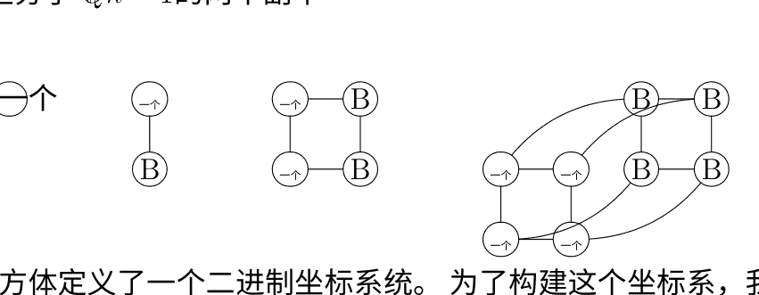

超立方体定义了一个二进制坐标系统。为了构建这个坐标系，我们用二进制数给节点标记，其中每个二进制位对应于一个坐标的值。边连接那些在恰好一个坐标上不同的节点。

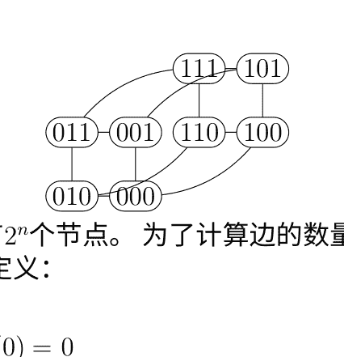

$Q^n$ 有 $2^n$ 个节点。为了计算边的数量，我们为 $Q^n$ 的边数 $E_{(n)}$ 设置了以下递归定义：

$E(0) = 0$
$E(n) = 2E(n-1) + 2^{n-1}$，对于所有的 $n \geq 1$

第 $2^{n-1}$ 项是每个 $Q^{n-1}$ 的节点数，即连接相应节点所需的边数。我们将其作为一个练习，找出这个递归定义的闭合形式。

## 12.5 递归定义的证明

递归定义非常适合归纳证明。证明的主要大纲通常反映了递归定义的结构。例如，让我们证明关于斐波那契数的以下断言：

断言44 对于任何 $n \geq 0$， $F_{3n}$ 是偶数。

让我们检查一些具体的值： $F_0= 0$， $F_3= 2$， $F_6= 8$， $F_9= 34$。都是偶数。断言看起来不错。因此，让我们构建一个归纳证明：

证明：对 $n$ 进行归纳。
基础： $F_0= 0$，是偶数。
归纳法：假设 $F_{3n}$ 对于 $n=0,1,\ldots,k$ 都是偶数。我们需要证明 $F_{3k}$ 是偶数。我们需要证明 $F_{3(k+1)}$ 是偶数。

$F_{3(k+1)} = F_{3k+3} = F_{3k+2} + F_{3k+1}$

所以，将上述方程代入，我们得到：

$F_{3(k+1)} = (F_{3k+1} + F_{3k}) + F_{3k+1} = 2F_{3k+1} + F_{3k}$

根据归纳假设 $F_{3k}$ 是偶数。$2F_{3k+1}$ 是偶数，因为它是一个整数的两倍。所以它们的和必定是偶数。所以 $F_{3(k+1)}$ 是偶数，这就是我们需要证明的。

有些人对于基本情况是否为零这样的特殊情况感到有些不确定。也可以包括第二个基本情况。对于这个证明，你需要检查当 $n=1$ 时的情况，即验证 $F_3$ 是否为偶数。额外的基本情况对于完整的证明来说并不是必要的，但它不会造成任何伤害，而且可能有助于读者。

## 12.6 归纳定义和强归纳

涉及递归定义的命题通常需要使用强归纳假设进行证明。例如，假设函数 $f: \mathbb{N} \rightarrow \mathbb{Z}$ 由 $f(0) = 2$ 定义

$f(1) = 3$

对于所有 $n \geq 1$， $f(n+1) = 3f(n) - 2f(n-1)$ 我宣称：

宣称 45 对于所有 $n \in \mathbb{N}$， $f(n) = 2^n + 1$

我们可以通过以下方式证明这个命题：

证明：通过对 n 进行归纳。

基础： $f(0)$ 被定义为2。 $2^0+1 = 1+1 = 2$。因此，当 $n=0$ 时， $f(n) = 2^n+1$。 $f(1)$ 被定义为3。 $2^1+1 = 2 + 1 = 3$。因此，当 $n=1$ 时， $f(n) = 2^n+1$。

归纳法：假设对于 $n=0, 1, ..., k$， $f(n) = 2^n+1$ 成立。对于 $k$, $f(k+1) = 3f(k) - 2f(k-1)$ 根据归纳假设， $f(k) = 2^k+1$, $f(k-1) = 2^{k-1}+1$。将这些公式代入前一个方程，我们得到： $f(k+1) = 3(2^k+1) - 2(2^{k-1}+1) = 3·2^k + 3 - 2^k - 2 = 2·2^k + 1 = 2^{k+1} + 1$。所以 $f(k+1) = 2^{k+1} + 1$, 这就是我们需要展示的内容。

我们需要使用强归纳假设，以及两个基本情况，因为归纳步骤使用了公式对两个先前值 $n$ ($k$ 和 $k - 1$) 成立的事实。

## 12.7 符号变化

递归定义有时被称为归纳定义或（特别是对于数值函数）递推关系。称他们为“递推关系”的人通常使用术语“初始条件”来指代基本情况。

# 第13章 树

本章介绍了树和树归纳。

## 13.1 为什么要使用树？

树是计算机科学中存储和组织数据的核心结构。树的例子包括：

- 展示现实世界数据组织的树：家族/家谱树，分类学（例如动物亚种、物种、属、科）
- 高效存储和检索数据的数据结构。基本思想与我们在数组中进行二分搜索时相同：对数据进行排序，以便可以反复将搜索区域减半。
- 解析树，展示了一段（例如）计算机程序的结构，以便编译器可以正确生成相应的机器代码。
- 决策树，通过一系列问题对数据进行分类。每个树节点包含一个问题，其答案指向节点的一个子节点。

例如，这是一个算术表达式的解析树： $a * c + b * d$。

```
E
├── E
│   ├── a
│   ├── *
│   └── c
├── +
└── E
    ├── b
    ├── *
    └── d
```

试图理解自然语言的计算机程序使用解析树来表示句子的结构。例如，这里有两个短语“绿色鸡蛋和火腿”的可能结构。在第一个结构中，火腿是绿色的，但在第二个结构中不是。

```
NP
├── 绿色
└── NP
    ├── 鸡蛋
    ├── 和
    └── 火腿
```

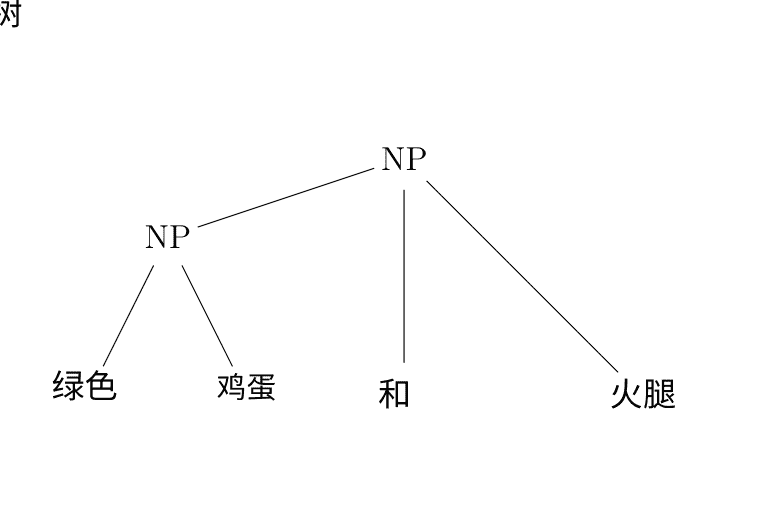

这是一个决策树，用于确定是什么动物在你的后院垃圾桶中觅食。决策树通常用于工程分类问题，这些问题没有精确的数值模型，例如将语音波形转录为自然语言的基本音素。

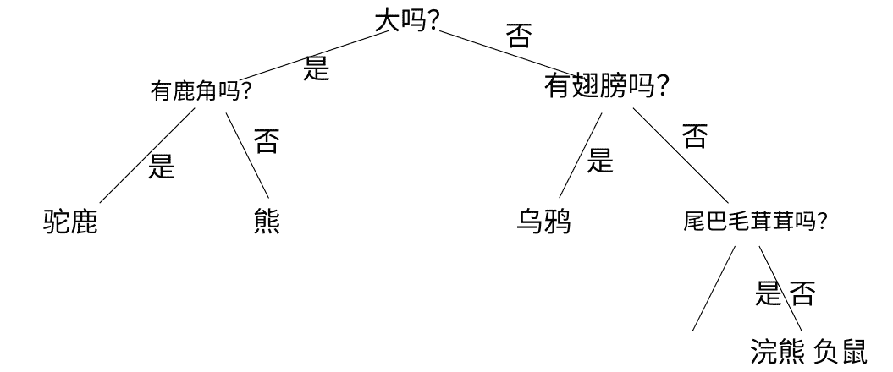

这是一个存储数字集合 $\{-2, 8, 10, 32, 47, 108, 200, 327, 400\}$ 的树。

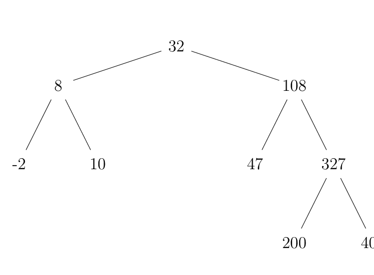

## 13.2 定义树

严格来说，树是一个无向图，其中有一个特殊的节点称为根节点，在这个图中，每个节点都与根节点通过一条路径连接。当一对节点在图中是相邻的时候，离根节点最近的节点称为父节点，另一个节点称为它的子节点。按照惯例，树是从上往下绘制的。同一个父节点的两个子节点被称为兄弟节点。

为了简化问题，我们假设树中的节点集合是有限的。我们还假设每个兄弟节点集合是从左到右排序的，因为这在计算机科学应用中很常见。

叶节点是没有子节点的节点。有子节点的节点称为内部节点。根节点是一个内部节点，除非它是由一个节点（没有边）组成的特殊情况。

树的节点可以根据它们距离根节点的边数进行分级。根节点被定义为第0级。它的子节点是第1级。它们的子节点是第2级，依此类推。树的高度是它的任何节点的最大级别，或者等价地说，它的任何叶节点的最大级别，或者等价地说，从根节点到叶节点的最长路径的最大长度。

如果你可以通过零个或多个父链接从 $x$ 到 $g$，那么 $g$ 是 $x$ 的祖先， $x$ 是 $g$ 的后代。所以 $x$ 是自己的祖先/后代。除了自己之外， $x$ 的祖先/后代是它的合适的祖先/后代。如果你在树 $T$ 中随机选择一个节点 $a$，以 $a$ 为根的子树包括 $a$（它的根节点）， $a$ 的所有后代以及连接这些节点的所有边。

## 13.3 m叉树

许多应用程序限制每个节点可以拥有的子节点数量。二叉树（非常常见！）允许每个节点最多有两个子节点。m叉树允许每个节点最多有 m 个子节点。具有“肥胖”节点的树（例如16个子节点）出现在某些存储应用程序中。

重要的特殊情况涉及树在某种意义上被完全填充。在一个完全的m叉树中，每个节点要么没有子节点，要么有m个子节点。永远不是一个中间数。因此，在一个完全的3叉树中，节点可以有零个或三个子节点，但不能有一个子节点或两个子节点。

在一个完全的 m元树中，所有的叶子都在同一高度上。通常，我们只对完整的和完全的 m元树感兴趣，这意味着底层整体上都是叶子。

对于这样的受限树类型，不同类型的节点之间存在着强关系。例如：

命题46 一个具有 i 个内部节点的完全m元树总共有 mi + 1 个节点。

要理解为什么这是正确的，请注意有两种类型的节点：有父节点和没有父节点的节点。一棵树只有一个没有父节点的节点。我们可以通过计算树中的父节点数（i） 乘以分支因子 m来计算具有父节点的节点数。因此，具有 i 个内部节点的完全m元树中的叶子数为（mi + 1） - i = (m - 1) i + 1。

## 13.4 高度 vs 节点数

假设我们有一棵高度为 h 的二叉树。它包含多少个节点和多少个叶子节点？显然这不可能是一个精确的公式，因为有些树比其他树更茂密。但是我们可以给出有用的上界和下界。

为了最小化节点数，考虑一棵高度为 h 且只有一个叶子节点的树。它包含 h+1 个节点，通过 h 条边连接成一条直线。因此，叶子节点的最小数量为1（不考虑 h），节点的最小数量为 h+1。

节点数最大的树是完全二叉树。对于这些树，叶子节点的数量是 $2^h$。更一般地，第 L 层的节点数是 $2^L$。因此，总节点数 n 是 $\sum_{L=0}^{h} 2^L$。这个求和的闭式形式是 $2^{h+1} - 1$。因此，对于完全二叉树，高度与 $\log_2 n$ 成比例。

平衡二叉树是一种二叉树，其中所有叶子节点的高度大致相同。“大致相同”这个精确定义取决于用于保持树平衡的具体算法。平衡树比完全二叉树更灵活，但它们的高度与节点数量的对数成比例。这意味着存储在平衡二叉树中的数据可以在对数时间内访问和修改。

## 13.5 上下文无关文法

涉及语言（包括人类语言和计算机语言）的应用经常涉及显示序列结构的解析树。终结符可能是一个单词或一个字符，具体取决于应用。终结符存储在解析树的叶节点中。非叶节点包含帮助指示句子结构的符号。

例如，下面的树展示了一个句子的一种结构：

这个结构假设你打算先进行乘法，然后再进行加法，即 $(a * c) + (b * d)$。这棵树使用了八个符号：$E, V, a, b, c, d, +, *$。

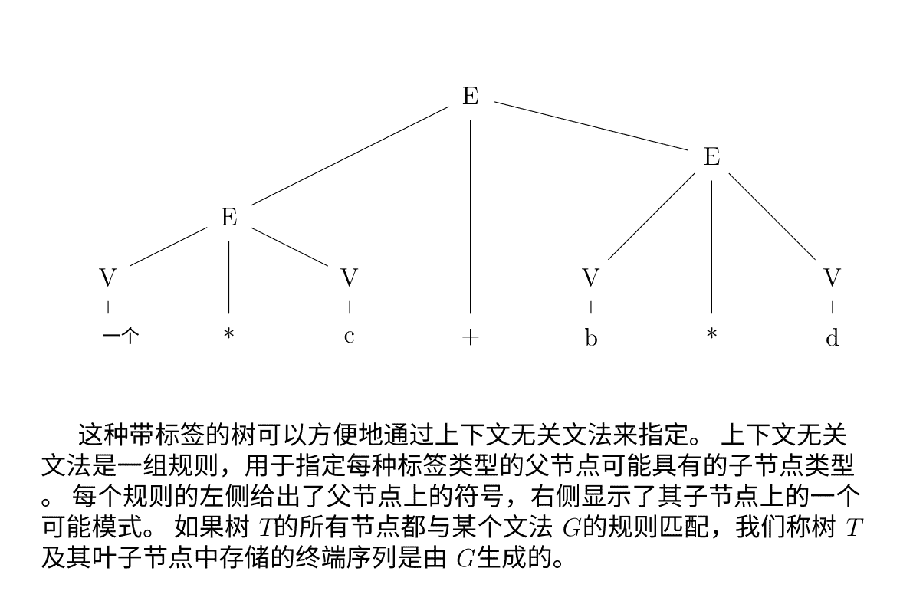

这种带标签的树可以方便地通过上下文无关文法来指定。上下文无关文法是一组规则，用于指定每种标签类型的父节点可能具有的子节点类型。每个规则的左侧给出了父节点上的符号，右侧显示了其子节点上的一个可能模式。如果树 $T$ 的所有节点都与某个文法 $G$ 的规则匹配，我们称树 $T$ 及其叶子节点中存储的终端序列是由 $G$ 生成的。

例如，以下语法包含了对一个 $E$ node 的四个规则。第一个规则允许一个 $E$ node 有三个子节点，最左边的一个标记为 $E$，中间的一个标记为 $+$，右边的一个标记为 $V$。根据这些规则，一个标记为 $V$ 的节点只能有一个子节点，标记为 $a$, $b$, $c$, 或者 $d$。上面显示的树遵循这些语法规则。

$$E \rightarrow E + V$$
$$E \rightarrow E * V$$
$$E \rightarrow V + V$$
$$E \rightarrow V * V$$
$$V \rightarrow a$$
$$V \rightarrow b$$
$$V \rightarrow c$$
$$V \rightarrow d$$

如果一个语法包含了对某个节点的子节点的多个模式，我们可以使用竖线将它们放在一行上，以分隔选项。例如，我们可以将这个语法更紧凑地写成

$$E \rightarrow E + V \mid E * V \mid V + V \mid V * V$$
$$V \rightarrow a \mid b \mid c \mid d$$

为了完全准确地确定语法允许的树，我们必须在语法规则集之外指定两个细节。首先，我们必须给出允许出现在叶节点上的终结符集合。其次，我们必须说明允许出现在根节点上的符号，称为起始符号。例如，对于上述语法，我们可以规定终结符为 $a$、$b$、$c$、$d$、$+$ 和 $*$，起始符号为 $E$ 和 $V$。经常用大写字母表示规则左侧可以出现的符号。

考虑以下语法，起始符号为 $S$，终结符为 $a$、$b$ 和 $c$。

$$S \rightarrow aSb$$
$$S \rightarrow c$$

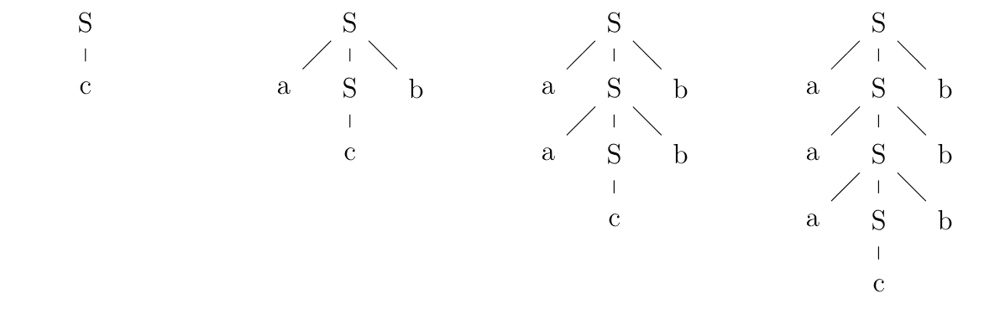

上述树的终结符序列为（从左到右）：$c$、$acb$、$aacbb$、$aaacbbb$。从这个语法中得到的序列总是在中间有一个 $c$，之前有一些 $a$，之后有相同数量的 $b$。

注意树中节点的从左到右顺序必须与语法规则中的顺序匹配。因此，例如，下面的树与上述语法不匹配。

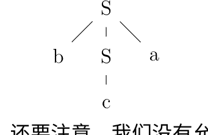

还要注意，我们没有允许 $S$ 成为终结符。如果我们将 $S$ 添加到终结符集合中，我们的语法也将允许以下树：


有时候使用相对较少的符号是有帮助的，这样可以集中注意力在解析树的可能形状上。例如，考虑名词复合词，如“倾倒卡车司机”或“木制沙拉夹子”。与其涉及所涉及的具体词语的细节，我们可以用符号 N表示每个名词。名词复合结构可以看起来像任何二叉树，因此它将具有以下语法，其中 N既是起始符号又是终结符号。

$$N \rightarrow N \mid NN$$

以下是由这些规则生成的一些树：


左下方的树显示了“倾卸车司机”的结构，中下方显示了“木制沙拉夹”的结构。

在某些应用中，拥有一个生成终端序列中无内容的语法树分支是很方便的。这可以通过具有右侧为 $\epsilon$ 的规则来实现，$\epsilon$ 是表示空字符串的标准符号。例如，这是一个过于简化的英语句子的语法，起始符号为 S，终端符号为：coyotes、rabbits、carrots、eat、kill、wash、the、all、some 和 Q。

$$S \rightarrow NP \ VP$$
$$VP \rightarrow V \ NP \mid V \ NP \ NP$$
$$NP \rightarrow Det \ N$$
$$N \rightarrow coyotes \mid rabbits \mid carrots$$
$$V \rightarrow eat \mid kill \mid wash$$
$$Det \rightarrow \epsilon \mid the \mid all \mid some$$

这将生成终端序列，例如“所有的coyotes吃一些rabbits。”每个名词短语（NP）都需要有一个限定词（Det），但是这个限定词可以扩展为终端序列中不可见的单词。因此，我们也可以生成类似“Coyotes吃胡萝卜。”的序列。


可以修改这个语法，使其生成这个句子而不使用 $\epsilon$。然而，一些关于自然语言含义的理论对完全缺失的项目和在底层结构中缺失但在表面结构中存在的项目进行区分。在这种情况下，可以认为上述句子有一个被理解为“全部”的限定词。

## 13.6 递归树

树的一个好的应用是可视化某些递归定义的行为，特别是用于描述算法行为的定义。例如，考虑以下定义，其中 $c$ 是某个常数。

$$\begin{aligned}
S(1) &= c \\
S(n) &= 2S(n/2) +n, \quad \forall n \geq 2 \text{ (n是2的幂次)}
\end{aligned}$$

我们可以使用“递归树”来绘制这个定义的图像。树中的顶部节点表示 $S(n)$，并包含公式中的所有内容 $S(n)$ 除了对 $S$ 的递归调用。它下面的两个节点表示计算 $S(n/2)$ 的两个副本。同样，每个节点中的值包含计算 $S(n/2)$ 的公式的非递归部分。然后， $S(n)$ 的值是递归树中所有节点值的总和。

为了计算树中的所有内容，我们需要问：

-   这棵树有多高，即在我们达到基本情况 $n=1$ 之前需要扩展多少层？
-   对于树的每一层，所有节点值的总和是多少？
-   有多少个叶节点？

在这个例子中，树的高度为 $\log n$，即有 $\log n$ 个非叶层级。在树的每一层，节点值的总和为 $n$。因此，所有非叶节点的总和为 $n\log n$。有 $n$ 个叶节点，每个叶节点对总和贡献 $c$。因此，树中所有内容的总和为 $n\log n + cn$，这是我们在第12.3节中找到的递归定义的相同闭合形式。递归树在只需要对闭合形式进行近似描述时特别有用，例如其主导项是二次的还是三次的？

## 13.7 另一个递归树例子

现在，让我们假设我们有以下定义，其中 c 是某个常数。

$$
P(1) = c \\
P(n) = 2P(n/2) + n^2, \quad \text{对于所有的 } n \geq 2 \ (n\text{是2的幂})
$$

它的递归树是

树的高度再次是 log n。顶层所有节点的和是 n^2。下一层的和是 n^2/2 然后我们有和：n^2/4, n^2/8, n^2/16, 等等。所以第 k 层所有节点的和是 n^2/2^k

最低的非叶节点在层 log n - 1。所以树中所有非叶节点的和是

$$
P(n) = \sum_{k=0}^{\log n-1} n^2 \frac{1}{2^k} = n^2 \sum_{k=0}^{\log n-1} \frac{1}{2^k} \\
= n^2(2 - \frac{1}{2^{\log n-1}}) = n^2(2 - \frac{2}{2^{\log n}}) = n^2(2 - \frac{2}{n}) = 2n^2 - 2n
$$

添加 cn 以覆盖叶节点，我们最终的闭合形式是 2n^2 + (c - 2)n。

## 第13章 树

## 13.8 树归纳

在对树进行归纳时，我们将树从顶部分割。 也就是说，我们将树视为由根节点和一些以其子节点为根的子树组成。 归纳变量通常是树的高度。

子树的高度小于父树的高度。 因此，在归纳步骤中，我们将假设对于这些较短的子树来说命题是成立的，并展示它对包含它们的较高树也是成立的。

例如，我们之前声称

假设47让 $T$ 是一棵二叉树，高度为 $h$，节点数为 $n$。 那么 $n \leq 2^{h+1} - 1$。

归纳法证明，根据树的高度 $h$ 进行归纳。

基础情况：基础情况是一棵只有一个节点且没有边的树。 它的高度 $h= 0$，节点数 $n= 1$。 然后我们计算出 $2^{h+1} - 1 = 2^1 - 1 = 1 = n$。

归纳假设：假设对于所有高度小于 $h$ 的二叉树，该命题成立。假设 $T$ 是一棵高度为h的二叉树 ($h > 0$)。

情况1：$T$ 由一个根节点和一个子树 $X$ 组成。 $X$ 的高度为 $h - 1$。所以 $X$ 最多包含 $2^h - 1$ 个节点。$T$ 只包含一个额外的节点（根节点），所以这意味着 $T$ 最多包含 $2^h$ 个节点，这少于 $2^{h+1} - 1$ 个节点。

情况2：$T$ 由一个根节点和两个子树 $X$ 和 $Y$ 组成。$X$和$Y$的高度分别为 $p$ 和 $q$，两者都必须小于 $h$，即 $\leq h - 1$。根据归纳假设，$X$ 最多包含 $2^{p+1} - 1$ 个节点，而 $Y$ 最多包含 $2^{q+1} - 1$ 个节点。但是，由于 $p$ 和 $q$ 都小于 $h$，这意味着 $X$ 和 $Y$ 都包含 $\leq 2^h - 1$ 个节点。

因此，T中的节点总数等于X中的节点数加上Y中的节点数再加上一个（新的根节点）。这个数量 ≤ 1+(2^p−1)+(2^q−1) ≤ 1+2(2^h−1) = 1+2^{h+1}−2 = 2^{h+1}−1，这就是T中节点的总数 ≤ 2^{h+1}−1，这就是我们需要证明的。□

在编写这样的证明时，很容易认为如果完整的树的高度为h，则子树的高度必须为h-1。只有当树是完全的时，这才是真的。对于一个不一定完全的树，其中一个子树的高度必须为h-1，但其他子树可能比h-1短。因此，在树的归纳中，几乎总是需要使用强归纳假设。

在归纳步骤中，注意我们将大树（T）在其根部分成两个较小的子树（X）和（Y）。一些学生尝试通过将东西嫁接到树的底部来进行树的归纳。不要这样做。在后续课程中，有很多论断，采用这种嫁接方法将行不通，必须在根部进行划分是必不可少的。

## 13.9 堆示例

在实际应用中，树的节点经常用于存储数据。算法设计者经常需要证明关于数据在树中如何排列的声明。例如，假设我们将数字存储在一个满二叉树的节点中。如果对于树中的每个节点X，X中的值至少与X的每个子节点中的值一样大，则这些数字遵循堆属性。

例如：

请注意，一个级别上的值并不一定比下一个较低级别上的值大。例如，底层的18比中间层的12大。但是，沿着从叶子到根的路径移动时，值永远不会减小。

具有堆属性的树对于需要维护具有关联优先级的人员或任务列表的应用非常方便。很容易检索具有最高优先级的人员或任务：它们位于根节点。如果添加或删除人员或任务，恢复堆属性也很容易。

我声称：

声称48如果一棵树具有堆属性，则树的根节点的值至少与树的任何节点的值一样大。

为了保持证明简单，让我们将注意力限制在完全二叉树上：

声称49如果一棵完全二叉树具有堆属性，则树的根节点的值至少与树的任何节点的值一样大。

让我们将 v(a)定义为节点 a的值，并利用树的递归结构进行证明。

通过对树高度 h进行归纳证明。

基础情况: $h=0$。高度为零的树只包含一个节点，所以显然树中最大的值位于根节点! 归纳假设: 假设对于所有高度小于h的完全二叉树，该命题成立。设T为高度为h ($h>0$)且具有堆属性的树。由于T是一棵完全二叉树，它的根节点r有两个子节点p和q。假设X是以p为根的子树，Y是以q为根的子树。

$X$和$Y$都有高度$< h$。此外，注意到$X$和$Y$必须具有堆属性，因为它们是T的子树，并且堆属性是对节点值的纯粹局部约束。假设x是T的任意节点。我们需要证明$v(r) \geq v(x)$。有三种情况:

情况1: $x = r$。这是显而易见的。

情况2: x是子树X中的任意节点。由于X具有堆属性且高度$\leq h$，根据归纳假设，$v(p) \geq v(x)$。但是我们知道$v(r) \geq v(p)$，因为T具有堆属性。所以$v(r) \geq v(x)$。

情况3: x是子树Y中的任意节点。类似于情况2。

因此，对于任意节点x在T中，$v(r) \geq v(x)$。□

## 13.10 使用语法树的证明

考虑以下文法G，具有起始符号S和终结符a和b。我声称由G生成的所有树具有相同数量的带有标签a和标签b的节点。

S → ab
S → SS
S → aSb

我们可以通过归纳法证明如下:

通过对树高度 $h$ 进行归纳证明。

基础：注意到这个文法生成的树的高度至少为1。产生高度为1的树的唯一方法是使用第一条规则，它生成一个 $a$ 节点和一个 $b$ 节点。

归纳：假设对于高度小于 $k$ 的所有树，该命题成立，其中 $k \geq 1$。考虑一个高度为 $k$ 的树 $T$。根节点必须带有标签 $S$，文法规则给出了三种根节点子节点的可能性：

情况1：根节点的子节点标记为 $a$ 和 $b$。这只是基本情况。

情况2：根节点的子节点都标记为 $S$。这些子树的根节点高度 $< k$。因此，根据归纳假设，每个子树具有相等数量的 $a$ 和 $b$ nodes。假设左边的树有 $m$ 个每种类型的节点，右边的树有 $n$ 个每种类型的节点。那么整个树有 $m + n$ 个每种类型的节点。

情况3：根节点有三个子节点，标记为 $a$， $S$ 和 $b$。由于中间子节点的子树高度 $< k$，根据归纳假设，它具有相等数量的 $a$ 和 $b$ nodes。假设它有 $m$ 个每种类型的节点。那么整个树有 $m + 1$ 个每种类型的节点。

在这三种情况下，整个树 $T$ 具有相等数量的 $a$ 和 $b$ nodes。

## 13.11 术语的变化

在数学世界中实际上有两种树。本章描述了在计算机科学中最常用的一种树，即具有从左到右顺序的“根树”。在图论中，“树”一词通常指的是“自由树”，即无环的连通图，没有明确的根节点和明确的上下或左右方向。

当分析平面图时，我们将会看到自由树。这两种类型的树也有一些变体。例如，一些数据结构应用程序使用的树与我们的树几乎相似，只是必须指定一个“左”或“右”子节点。

无限树偶尔在计算机科学应用中出现。它们是这里讨论的有限树的明显推广。

树的术语因为广泛应用于各种需求非常多样的应用而有很大的变化。特别地，一些作者将“完全二叉树”一词用来指代只有底层最左边部分填充的树。然后，“完美”一词用于指代底层完全填充的树。一些作者不允许节点成为其自身的祖先或后代。少数作者不将根节点视为叶节点。

许多上下文无关文法符号的细节会随着应用的变化而改变。例如，在编程语言规范中使用的BNF符号看起来不同，因为语法符号是由尖括号括起来的整个单词。

传统的上下文无关文法的表达方式受到限制，使得终结符不能出现在规则的左侧，并且只有一个起始符号。这里的更广泛的定义允许我们捕捉到实际应用中出现的各种例子，而不改变这些文法所能生成的终结符序列的集合。

## 第14章

## 大O

本章介绍函数增长的渐近分析和大O符号表示法。

### 14.1 程序的运行时间

设计计算机程序的一个重要方面是弄清楚它在一系列可能情况下的运行情况。 设计者需要估计它运行的速度有多快，需要多少内存，可靠性如何等等。 在这门课程中，我们将集中讨论速度问题。

对于某些小型平台的设计师来说，有时候他们会开发非常详细的运行时间模型，因为这对于使复杂的应用程序在有限的资源下运行是至关重要的。例如，让《战神》在你的iPhone上运行。然而，这种编程设计越来越少见，因为计算机的速度足够快，可以在大多数程序中运行而无需手动优化。

更典型的情况是，设计师必须分析一个大型的C或Java程序的行为。 准确地计算出这样一个程序需要多长时间是不可行的。 从标准编程语言转换为机器代码的过程太过复杂。 只有少数程序员清楚C或Java编译器内部发生了什么。 此外，对于一个计算机系统进行非常详细的分析并不能转化为另一个编程语言、另一个硬件平台或者未来几年购买的计算机。

更有用的是开发一种能够抽象出不重要细节的分析方法，以便它具有可移植性和持久性。数学和它在计算机科学中的相关性

这个抽象过程有两个关键组成部分：

-   忽略对小输入的行为，集中关注程序处理大输入的能力。（这通常被称为渐近分析。）
-   忽略乘法常数

乘法常数被忽略，因为它们对实现、硬件平台等细节非常敏感。忽略小输入的行为，因为程序通常在小测试案例上运行得足够快。当程序的使用扩展到更大的示例时，通常会出现困难的实际问题。例如，为一个社区大学开发的小型数据库程序可能在处理（比如）伊利诺伊大学的所有注册记录时遇到困难。

## 14.2 渐近关系

因此，假设你将程序的运行时间建模为一个函数 $f(n)$，其中 $n$ 是输入问题的大小的一种度量。例如，$n$ 可以是数据库应用中的条目数。你的竞争对手提供了一个以输入大小$n$为参数的程序 $g(n)$。是 $f(n)$ 比 $g(n)$ 更快，还是更慢，还是与 $g(n)$ 相当？为了回答这个问题，我们需要形式化的工具来比较两个函数的增长速度。

假设 $f(n) = n$ 和 $g(n) = n^2$。对于小的正输入，$n^2$ 较小。对于输入1，它们有相同的值，然后 $g$ 变得更大并迅速发散，远远大于 $f$。我们想说 $g$ 更“大”，因为它对于大输入有更大的输出。

当一个函数是更快和更慢增长项的总和时，我们只对更快增长的项感兴趣。例如，$n^2 + 7n + 105$ 将被视为等价于 $n^2$。随着输入 $n$ 变大，行为的

函数的增长主要由增长最快的项（在这种情况下是第一项）主导。

形式上，我们将比较两个函数 f(n) 和 g(n)，它们的输入和输出都是实数，通过观察它们的比值 f(n)/g(n)。因为我们只关心算法的运行时间，所以我们的大多数函数产生正的输出。异常情况，例如对数函数，在输入足够大时产生正的输出。只要我们同意忽略一些较小的输入值，这个比率就存在。

然后我们看看当输入趋近于无穷大时，这个比率会发生什么变化。具体来说，我们将定义

（渐近等价） f(n) ∼ g(n) 当且仅当 lim_{n→∞} f(n)/g(n) = 1

（渐近较小） f(n) ≪ g(n) 当且仅当 lim_{n→∞} f(n)/g(n) = 0

从微积分中可以得知，lim_{n→∞} h(n) 是输出值 h(n) 随着输入 n 的增大而越来越接近的值。¹因此，两个渐近等价的函数在输入值越大时变得越来越相似。如果一个函数是渐近较小的，那么随着输入值的增大，输出值之间的差距会越来越大。

所以，例如 lim_{n→∞} (n^2 + n)/n^2 = 1 所以 n^2 + n ∼ n^2。lim_{n→∞} (n^2 + 17n)/n^3 = 0 所以 n^2 + 17n ≪ n^3。而 lim_{n→∞} (3n^2 + 17n)/n^2 = 3 所以 3n^2 + 17n 和 n^2 没有相关性在 ∼ 或 ≪ 方面。

如果我们选择两个随机函数 f 和 g, lim_{n→∞} f(n)/g(n) 并不总是存在，因为 f(n)/g(n) 可能会振荡而不是收敛到某个特定的数。在实践中，我们将仅将上述定义应用于选定的行为良好的原始函数，并使用第二个、更宽松的定义来处理乘法常数和可能行为不良的函数。

> ¹如果你不能回忆起或从未见过极限的正式定义，不要惊慌。一个非正式的理解应该足够了。

## 14.3 原始函数的排序

让我们来看一些原始函数，并尝试按增长顺序排列它们。

很明显，高阶多项式的增长速度比低阶多项式快。 例如当 $n^2 \ll n^5$ 时

$$\lim_{n\to\infty} \frac{n^2}{n^5} = \lim_{n\to\infty} \frac{1}{n^3} = 0$$

你可能熟悉指数函数的增长速度。 有一个关于一位法官对纽约一个行政区实施加倍罚款的著名故事，因为该行政区无视法官的命令。 由于该行政区官员没有太多的工程训练，他们花了几天时间才意识到这是严重的坏消息，并且他们需要谈判解决。 所以当 $n^2 \ll 2^n$ 时。

而且，一般来说，对于任何指数 $k$，你可以证明 $n^k \ll 2^n$。

指数的底数很重要。考虑 $2^n$ 和 $3^n$. 当 $n \to \infty$ 时，$\lim_{n \to \infty} \frac{2^n}{3^n} = \lim_{n \to \infty} (\frac{2}{3})^n = 0$ 所以 $2^n \ll 3^n$。

不太明显的是，$2^n \ll n!$. 这是因为 $2^n$ 和 $n!$ 都是项的乘积. 对于 $2^n$，它们都是2. 对于 $n!$，它们是前 $n$ 个整数，除了前两个之外，它们都比2大. 所以随着 $n$ 的增长，$2^n$ 和 $n!$ 之间的差距越来越大. 我们将在下面的第14.7节中对这个结果进行正式证明.

我们可以总结这些事实如下：

$$n \ll n^2 \ll n^3 \ldots \ll 2^n \ll 3^n \ll n!$$

为了设计计算机程序，只有前三个运行时间才是好消息。 对于大多数应用来说，三阶多项式的增长速度已经太快了，如果你期望输入的规模不是微不足道的话。
指数时间复杂度的算法只适用于非常小的输入，并且经常被更快的算法（例如使用统计抽样）替代，这些算法返回近似结果。

现在，让我们来看看增长缓慢的函数，即可能是高效程序的运行时间。我们将看到，在查找大型数据集中的条目的算法通常具有与 $\log n$ 成比例的运行时间。 如果你绘制对数函数并忽略其在输入小于1时的奇怪值，你会发现它的增长速度比 $n$ 慢得多。 而且

常数函数1增长得更慢：它根本不增长！对于排序数字列表的算法，运行时间的增长速度像是n log n。我们从上面知道1 ≪ log n ≪ n。我们可以乘以这个方程的n，因为f和g的公共因子在我们对≪的定义中会相互抵消。所以我们有n ≪ n log n ≪ n²。

我们可以将这些原始函数关系总结为：

1 ≪ log n ≪ n ≪ n log n ≪ n²

非常值得记住这些基本函数的相对顺序，因为你将在这门课程和未来的计算机科学课程中反复看到它们。

## 14.4 主导项方法

这些渐近关系的美妙之处在于很少有必要回到原始的极限定义。在建立了一组有用的原始函数之间的关系之后，我们通常可以在高层次上操作表达式。而且我们通常只需要关注主导每个表达式的项，忽略增长较慢的其他项。

首先要注意的是，对于一个和的∼和≪关系完全由主导项决定，即增长最快的项。例如，假设我们面临的问题是

47n + 2n! + 17 ≪ 3ⁿ + 102n³

左边的主导项是2n!。右边的主导项是3ⁿ。所以我们的问题归结为是否

2n! ≪ 3ⁿ

我们从前一节知道这是错误的，因为

3ⁿ ≪ n!

渐近关系也与代数的常规规则良好地交互作用。例如，如果 $f(n) \ll g(n)$且 $h(n)$是任何非零函数，则$f(n)h(n) \ll g(n)h(n)$。

## 14.5 大O

渐近等价是比较良好参考函数的一种很好的方法，但对于比较程序运行时间和这些参考函数来说，效果较差。有两个问题。我们希望忽略常数乘法因子，即使在主导项上也是如此，因为它们通常是未知的且容易改变。此外，程序的运行时间可能是一些复杂的函数，可能涉及到像取整或向上取整这样的操作。一些程序$^2$在“好”的输入大小上可能比在“坏”的大小上运行得更快，这会导致我们的极限定义无法工作的振荡现象。

因此，我们通常使用一种更宽松的关系，称为大O来比较更复杂的函数之间或两个参考函数之间。假设 $f$和 $g$是定义域和值域都是实数集的函数。那么当且仅当 $f(n)$ 是 $O(g(n))$（读作“g的大O”）时，

存在正实数 $c$和 $k$使得对于每个 $k \leq n$，有$0 \leq f(n) \leq cg(n)$。

方程中的因子 $c$模拟了我们不关心乘法常数的事实，即使在主导项上也是如此。函数 $f(n)$可以随意摆动，与 $cg(n)$相比，只要它保持较小即可。我们完全忽略了 $f$在小于 $k$的输入上的行为。

如果 $f(n)$渐近地小于 $g(n)$，那么 $f(n)$是 $O(g(n))$，但$g(n)$不是 $O(f(n))$。例如，$3n^2 + 17n$是 $O(2^n)$。但是$3n^2$不是$O(n + 132)$。当两个函数具有相同的主导项时，无论是否存在常数乘数的差异，大O关系仍然成立。

例如，$3n^2$是$O(n^2 - 17n)$，因为两个函数的主要项都是形式为 cn²。因此，大O关系是类似于实数上的非严格偏序关系 ≤，而 ≪ 是类似于 < 的严格偏序关系。

当 g(n)是 O(f(n)) 且 f(n)是 O(g(n))时，则 f(n)和 g(n)在无穷大时被迫保持接近。在这种情况下，我们说 f(n)是 Θ(g(n))（也可以说 g(n)是 Θ(f(n))）。Θ关系是这个函数集合上的等价关系。因此，例如，等价类 [n²] 包含函数如 n²，57 n² - 301，2n² + n + 2 等等。

注意到具有不同底数的对数仅仅相差一个常数倍数，即一个不依赖于输入 n 的乘数。例如，log₂(n) = log₂(3) log₃(n)。这意味着对于任意选择的 p 和 q，log_p(n) 是 Θ(log_q(n))。因为对数的底数不会改变最终的大O结果，计算机科学家经常省略对数函数的底数，假设你会明白它并不重要。

### 14.6 应用大O的定义

为了证明大O关系成立，我们需要找到合适的值 c 和 k。对于任何特定的大O关系，存在着广泛的选择范围。首先，你选择的乘数 c 会影响函数相交的位置，从而影响你的下界 k。其次，没有必要将 c 和 k 最小化。由于你只是证明了存在合适的 c 和 k，使用过度的值是完全合适的。

例如，为了证明 3n 是 O(n²)，我们可以选择 c=3 和 k=1。那么对于每个 n ≥ k，有 3n ≤ c n²，这可以转化为 3n ≤ 3n² 对于每个 n ≥ 1，这显然是正确的。但我们也可以选择 c=100 和 k=100。

过度的选择似乎不够优雅，但在像考试这样的情况下，更容易确认所选择的值是否正常工作。此外，稍微过大的值通常更能说服读者，因为读者更容易看到它们确实起作用。

让我们以一个更复杂的例子来展示 3n² + 7n + 2 是 O(n²)。如果我们选择 c=3，那么我们的方程将变为 3n² + 7n + 2 ≤ 3n²。这显然对于大的 n 不起作用。

所以让我们试试 $c= 4$。然后我们需要找到一个使得 $3n^2+7n+2 \leq 4n^2$ 成立的下界。为了做到这一点，我们需要强制 $7n+2 \leq n^2$。如果 $n$ 很大，例如 $\geq 100$，那么这将成立。所以我们可以选择 $k= 100$。

### 14.7 证明原始函数关系

让我们看看如何通过归纳来确定原始函数之间的一个排序的形式细节。我之前声称 $2n \ll n!$。为了证明这个关系，注意增加 $n$ 到 $n+1$ 会使左边乘以2，右边乘以 $n+1$。所以比值变化了 $\frac{2}{n+1}$。一旦 $n$ 足够大 $\frac{2}{n+1}$ 至少是 $\frac{1}{2}$。详细确定下来，我们发现

命题50对于每个大于等于4的正整数$n$, $\frac{2^n}{n!} < (\frac{1}{2})^{n-4}$。

如果我们能证明这个关系，那么由于从微积分中我们知道$(\frac{1}{2})^n$随着$n$的增加趋近于零， $\frac{2^n}{n!}$ 也必然如此。

为了通过归纳法证明我们的命题，我们概述证明如下:

```
证明: 假设$n$是一个整数且$n$大于等于4。我们将证明 $\frac{2^n}{n!} < (\frac{1}{2})^{n-4}$，通过对$n$进行归纳。

基础情况: $n= 4$. [证明公式对于$n= 4$成立]

归纳假设: 假设对于$n= 4,5, \ldots, k$, 不等式 $\frac{2^k}{k!} < (\frac{1}{2})^{k-4}$ 成立。

我们需要证明对于 $n = k+1$ 的情况成立，即 $\frac{2^{k+1}}{(k+1)!} < (\frac{1}{2})^{k-3}$
```

在处理不等式时，所需的代数运算通常并不明显。因此，写下归纳假设（可能明确写出最后一个或两个值的声明）和归纳步骤的结论尤为重要。然后，你可以从两端开始填补证明中间的空白部分。

## 第14章 大O表示法

证明: 假设n是一个整数且n大于等于4。我们将证明 $\frac{2^n}{n!} < (\frac{1}{2})^{n-4}$使用归纳法证明 n。
基础情况: $n=4$。那么$\frac{2^n}{n!}=\frac{16}{24}<1=(\frac{1}{2})^0=(\frac{1}{2})^{n-4}$。
归纳步骤: 假设 $\frac{2^n}{n!} < (\frac{1}{2})^{n-4}$ 成立于 $n=4,5,\ldots,k$。
由于 $k \geq 4$, $\frac{2}{k+1} < \frac{1}{2}$, 所以$\frac{2^{k+1}}{(k+1)!} < \frac{1}{2} \cdot \frac{2^k}{k!}$。
根据我们的归纳假设 $\frac{2^k}{k!} < (\frac{1}{2})^{k-4}$。所以$\frac{1}{2} \frac{2^k}{k!} < (\frac{1}{2})^{k-3}$。
所以我们有 $\frac{2^{k+1}}{(k+1)!} < \frac{1}{2} \cdot \frac{2^k}{k!} < (\frac{1}{2})^{k-3}$这就是我们需要展示的。

归纳法可以用于建立其他原始函数之间的类似关系，例如 $n^2$和$2^n$。

### 14.8 符号表示的变化

尽管这个领域的概念在不同的作者之间是相对一致的，但是使用简写符号并不是。符号 ~在数学中有许多不同的用途。作者经常写“f(n) is o(g(n))” (使用小写字母o而不是大写字母O) 来表示 $f(n) \ll g(n)$。而 $\ll$可能用来表示大O。幸运的是，大O的使用似乎是标准的。

在计算机科学中，我们通常关注函数在输入值变大时的行为。一些领域 (如摄动理论) 使用类似的定义和符号，但是极限趋向于某个特定的有限值 (如零)。

在大O符号的定义中，一些作者用$| f(n)| \leq c|g(n)|$替换了$0 \leq f(n) \leq cg(n)$。这个版本的定义可以比较具有负输出值的函数，但对初学者来说相应地更难处理。一些作者只针对具有正输出值的函数 f和 g给出了定义。这很尴尬，因为对于非常小的输入，对数函数会产生负输出值。

在理论课程之外，计算机科学家经常说 $f(n)$是 $O(g(n))$，实际上他们指的是更强的说法，即 $f(n)$是$\Theta(g(n))$。当你确切地知道界限是紧密的，即函数肯定增长时以相同的速度，通过使用$\Theta$来清楚地表达对读者更有帮助。

符号$O(f(n))$经常嵌入在方程中，意思是“一些随机函数是$O(f(n))$。例如，作者经常写像$n^3 + O(n^2)$这样的东西，其中$O(n^2)$是一些不确定的函数，它的增长速度不超过$n^2$。

非常非常令人讨厌的是，由于历史原因，表达式$f(n)$是$O(g(n))$经常被写成$f(n) = O(g(n))$。这看起来像一种等式，但实际上不是。它实际上是表示一个不等式。

## 第15章 算法

本章介绍如何分析算法的运行时间。

### 15.1 引言

我们在本课程中早期开发的技术可以应用于分析计算机算法所需的时间，作为其输入大小的函数。我们将看到一系列简单的算法，展示了各种不同的运行时间。分析运行时间将使用三种方法：嵌套循环、资源消耗和递归定义。

我们只会计算每个算法的大O运行时间，即忽略乘法常数和对小输入的行为。这将使我们能够在不过于复杂的情况下检查算法的整体设计。当你在后续的计算机科学课程中遇到更复杂的算法时，能够快速概览并快速理解是一项关键技能。

### 15.2 基本数据结构

许多简单的算法需要存储一系列对象 $a_1, \ldots, a_n$。在伪代码中，序列的起始索引有时为0，有时为1，你经常需要检查最后一个下标来确定长度。序列可以使用数组或链表来存储。 选择有时会影响算法分析，因为这两种实现方法具有略微不同的特点。

数组可以以常数时间访问任何元素。 因此，你可以按任意顺序快速访问元素，访问时间不取决于列表的长度。 然而，数组的长度在构建数组时是固定的。 更改数组长度需要与数组长度成比例的时间，即 $O(n)$。 在数组的中间添加或删除对象需要将其他对象向侧边推动。这也可能需要 $O(n)$的时间。 二维数组类似，只是你需要提供两个下标，例如 $a_{x,y}$。

在链表中，每个对象指向列表中的下一个对象。 一个算法只能直接访问列表两端的元素。 列表中间的对象只能通过逐个遍历元素从一端到另一端来访问，这可能需要 $O(n)$ 时间。 然而，列表的长度是可变的，可以在常数时间内添加或删除列表的末端的对象。 一旦你在列表的中间位置，可以在常数时间内添加或删除对象。

链表以其头部开始，并以其尾部结束。 例如，假设我们的列表是 $L=(1, 7, 3, 4, 7, 19)$。 那么头部$(L)$是1，尾部$(L)$是19。函数 $pop$移除并返回列表头部的值。 即pop(L) 将返回1，并将列表 $L$变为 $(7, 3, 4, 7, 19)$。

对于一些算法，大O性能不取决于使用数组还是链表。 当对象数量固定且按顺序访问对象时，就会发生这种情况。 然而，请记住大O分析忽略乘法常数。 其他条件相同的情况下，基于数组的实现往往具有较小的常数，因此运行速度更快。

严格来说，这仅适用于某些类型的链表。 查看数据结构文本以获取所有详细信息。

### 15.3 嵌套循环

基于嵌套循环的算法最容易分析。假设我们有一组二维点，我们想找到最接近的一对。我们的代码可能如图15.1所示，假设函数dist计算两个二维点之间的距离。

要以大O术语分析此代码，首先注意到起始代码（第1-4行）和结束代码（第12行）需要相同的时间，无论输入大小n如何。因此，我们将其称为“常数时间”或$O(1)$时间。循环内的代码块（第7-11行）执行一次需要恒定时间。因此，此算法的大O运行时间完全取决于循环运行的次数。

外部循环运行 n次。内部循环在每次外部循环迭代期间运行 n次。因此，在两个循环内部的代码块执行$O(n^2)$ 次。

```

01 closestpair(p1, ..., pn) : 2D点的数组)
02     best1 = p1
03     best2 = p2
04     bestdist = dist(p1,p2)
05     对于 i 从 1 到 n
06         对于 j 从 1 到 n
07             newdist = dist(pi,pj)
08             如果 (i = j 且 newdist < bestdist)
09                 best1 = pi
10                 best2 = pj
11                 bestdist = newdist
12     返回 (best1, best2)

```

图15.1: 使用嵌套循环找到最接近的一对。

这段代码会检查每一对2D点两次，一次按顺序，一次按相反顺序。我们可以通过使内部循环（j）只从i+1到n运行来避免这个额外的工作。在这种情况下，两个循环内的代码块将执行 $\sum_{i=1}^{n} (n - i)$ 次。这等于 $\sum_{i=0}^{n-1} i = \frac{n(n-1)}{2}$。这仍然是 $O(n^2)$：我们的优化改善了常数，但没有改善大O运行时间。

### 15.4 合并两个列表

当代码包含 while 循环而不是 for 循环时，循环运行的次数可能不太明显。例如，假设我们有两个已排序的列表， \(a_1,\ldots,a_p\) 和 \(b_1,\ldots,b_q\)。 我们可以将它们合并成一个非常高效的排序列表。 为此，我们创建一个新的空列表来存储我们合并的输出。 然后我们检查两个输入列表的第一个元素，并将较小的值移动到我们的输出列表中。 我们继续查看两个列表的第一个元素，直到其中一个列表为空。 然后我们复制剩余的非空列表。 图15.2显示了该算法的伪代码。

```

01 合并 (L₁, L₂: 实数排序列表)
02    O = 空列表
03    当 ( L₁ 不为空或       L₂ 不为空) 时
04        如果 (L₁为空)
05            将头部(    L₂) 移到 O 的尾部
06        否则如果 (L₂为空)
07            将头部(    L₁) 移到 O 的尾部
08        否则如果 (头部(L₁) <= 头部(L₂))
09            将头部(    L₁) 移到 O 的尾部
10        否则将头部(    L₂) 移到 O 的尾部
11    返回 O
```


对于合并，输入大小的一个很好的度量是输出数组的长度 \(n\)，它等于两个输入数组的长度之和 \((p + q)\)。 合并函数有一个大的 while 循环。 由于循环内的操作 (第4-10行) 都需要常数时间，我们只需要确定循环运行的次数，作为 \(n\) 的函数。

分析 while 循环的一种好方法是跟踪一个已知大小并且在循环运行时被消耗的资源。 在这种情况下，每次循环运行时，我们将一个数字从 \(L_1\) 或 \(L_2\) 移动到输出列表 O。我们有 \(n\) 个数字要移动，在循环停止之后。所以循环必须运行 n 次。所以合并需要 O(n)（也称为线性）时间。这被称为资源消耗分析。

### 15.5 可达性算法

图15.3中的函数确定一个图中的一个节点 t 是否可以从另一个节点 s 到达，即是否存在连接 s 和 t 的路径。为了做到这一点，我们从 s 开始，沿着图的边界向外探索。当我们访问一个节点时，我们在上面放置一个标记，以便我们可以避免再次检查它（从而使代码进入无限循环）。临时列表 M 包含我们已经到达的节点，但其邻居尚未被探索。²

```
01 可达(G: 一个图; s,t: G中的节点)
02     如果 s = t返回真
03     取消标记G的所有节点。
04     M = 空列表
05     标记节点s并将其添加到M中
06     当M不为空时
07         p = 弹出(M)
08         对于G中与p相邻的每个节点q
09             如果 q = t返回真
10             否则如果q未标记，则标记q并将其添加到M中
11     返回假
```

图15.3: 节点 s 能从节点 t 到达吗？

我们可以使用资源消耗的论证来分析此代码中的while循环。假设 G 有 n 个节点和 m 条边。没有节点会被多次放入列表 M 中。因此，行6-10中的循环运行次数不超过 n 次。

第8行从节点 q开始，并找到所有邻居 p。³ 因此，它追踪涉及 q的所有边。 在代码的整个运行过程中，图的边可能被追踪两次，每次都是在相反的方向。 图中有 m条边。 因此，第9-10行不能运行超过2m次。

总的来说，这个算法需要 O(n + m) 时间。 这是一个有趣的情况，因为两个术语 n 和 m 都没有占主导地位。 事实上，边的数量m不是 O( n²)，因此连接组件算法是 O(n²)。 然而，在大多数应用中，实际上只有很少的这些潜在边存在。 因此， O(n + m) 的限制更有帮助。

请注意，有各种各样的图，有 n个节点和 m条边。我们的分析是基于一种会导致算法运行时间最长的图形，即算法到达每个节点并遍历每条边，最后到达的图形。 这被称为最坏情况分析。 在某些输入图形上，我们的代码可能运行得更快，例如，如果我们在搜索中早早地遇到了某个节点，或者如果图形的大部分部分与s没有连接。 除非作者明确指示，大O算法分析通常被理解为最坏情况。

### 15.6 二分查找

现在我们将看一种算法设计策略，称为“分而治之”，其中一个较大的问题通过将其分解为几个（通常是两个）较小的问题来解决。 例如，图15.4中的代码使用一种称为二分查找的技术来计算其输入的平方根。 为了简单起见，我们假设输入n相当大，因此我们只需要最接近整数的答案。

这段代码通过定义一个整数范围来操作，答案必须在初始时位于1和 n之间。 每次递归调用都会测试范围的中点是高于还是低于所需答案，并选择范围的适当一半进行进一步探索。 辅助函数squarerootrec 在找到 ⌊ 该值或者下一个更大的整数哪个是更好的近似值。

³我们假设图的内部计算机表示存储了每个节点的邻居列表。

```
01 平方根(n: 正整数)
02     p = squarerootrec(n, 1, n)
03     如果 (n - p² ≤ (p+1)² - n)
04         返回 p
05     否则返回 p + 1

11 squarerootrec(n, bottom, top: 正整数)
12     如果 (bottom = top) 返回 bottom
13     middle = floor((bottom+top)/2)
14     如果 (中间² == n)
15         返回中间
16     否则如果 (中间² ≤ n)
17         返回 squarerootrec(n,中间,顶部)
18     否则
19         返回 squarerootrec(n,底部,中间)
```

图15.4: 二分查找 √n

这不是找到平方根最快的方法，但这个简单的方法很好地推广到我们只有一个对要优化的函数的弱模型的情况。这种方法只需要你能够测试候选值是太低还是太高。例如，假设你正在调音吉他弦。许多业余乐手可以判断当前调音是太低还是太高，但对于要转动调音旋钮多少的模型却很差。二分查找是优化调音的一个好策略。

要分析二分查找所需的时间，首先注意主要的squareroot函数中的启动和清理工作只需要常数时间。因此，我们基本上可以忽略它的贡献。函数squarerootrec只对自身进行一次递归调用，其他情况下只需要做一定量的工作。基础知识只需要固定数量的工作。因此，如果squarerootrec的运行时间为T(n)，我们可以写出以下递归定义T(n)的形式，其中c和d是常数。

一个标准的更快方法是牛顿法。

## 第15章 算法

- $T(1) = c$
- $T(n) = T(n/2) + d$

如果我们展开这个定义$k$次，我们得到$T(n) = T(n/2^k) + kd$。假设$n$是2的幂次，当$k=\log n$时，我们达到基本情况。所以$T(n) = c + d\log n$，这是$O(\log n)$。

### 15.7 归并排序

归并排序接受一个包含数字的输入链表，并返回一个包含排序后数字的新链表。这与冒泡排序和插入排序有些不同，它们在单个数组内重新排列值（并且不返回任何内容）。

归并排序将其大输入列表（长度$n$）分成两个较小的列表长度为$n/2$。列表被重复地分割，直到我们有很多非常短的列表，长度为1或2（取决于代码编写者的偏好）。长度为1的列表必定是有序的。长度为2的列表可以在常数时间内排序。然后，我们将所有这些小的有序列表合并成一对一对的，逐渐构建出越来越长的有序列表，直到我们有一个包含所有原始输入数字的有序列表。图15.5展示了生成的伪代码。

```
01 归并排序 (L = a1, a2, . . . , an: 实数列表)
02    如果 (n=1)，则返回 L
03    否则
04        m = ⌊n/2⌋
05        L1 = (a1, a2, . . . , am)
06        L2 = (am+1, am+2, . . . , an)
07        return merge(mergesort(L1), mergesort(L2))
```

图15.5：使用归并排序对列表进行排序

对于长度为$n$的输入，归并排序会对自身进行两次递归调用。它还需要花费$O(n)$的时间将列表分成两半，因为它必须逐个元素地从列表头部走到中间位置。

它还需要花费$O(n)$的时间将两个结果合并。因此，如果归并排序的运行时间为$T(n)$，我们可以写出以下递归定义，其中$c$和$d$是常数。

- $T(1) = c$
- $T(n) = 2T(n/2) + dn$

这个递归定义有以下递归树:


这棵树有 $O(\log n)$ 个非叶节点，每个节点的工作量总和为 $dn$。因此，非叶节点的工作量总和为 $O(n \log n)$。此外，还有 $n$ 个叶节点（递归函数的基本情况），每个叶节点涉及 $c$ 个工作量。因此，总运行时间为 $O(n \log n) + cn$ 即 $O(n \log n)$。

### 15.8 汉诺塔

汉诺塔游戏是由法国数学家埃德华·卢卡斯于1883年发明的。它由三个柱子和一组 $k$ 个逐渐增大的圆盘组成，可以放在柱子上。圆盘最初按顺序放在一个柱子上。你只能一次移动一个圆盘。目标是在另一个柱子上重新构建有序的塔，而不会将一个圆盘放在较小的圆盘上方。

理解解决方案的最佳方法是递归。假设我们知道如何使用第三个临时存储柱将 $k$ 个盘子从一个柱子移动到另一个柱子。要将 $k+1$ 个盘子从柱子A移动到柱子B，我们首先使用B作为临时存储将顶部的 $k$ 个盘子从A移动到C。然后我们将最大的盘子从A移动到B。然后我们使用A作为临时存储将其他 $k$ 个盘子从C移动到B。因此，我们的递归求解器的伪代码如图15.6所示。

```
01 hanoi(A, B, C: 柱子, d_1, d_2, . . . , d_n: 盘子)
02       如果 (n=1)，则移动 d_1 = d_n 从A移动到B。
03       否则
04            hanoi(A, C, B, d_1, d_2, . . . , d_{n-1})
05            从A移动d到B。
06            hanoi(C, B, A, d_1, d_2, . . . , d_{n-1})
```

图15.6：解决汉诺塔问题

函数hanoi将大小为$n$的问题分解为两个大小为$n-1$的问题。警告！警报响起！这不可能是好事：子问题比原问题小得不多！

无论如何，hanoi将大小为$n$的问题分解为两个大小为$n-1$的问题。除了两个递归调用外，它只做了一定量的工作。因此，函数hanoi的运行时间$T(n)$由递归定义给出（其中$c$和$d$是常数）：

- $T(1) = c$
- $T(n) = 2T(n-1) + d$

如果我们展开这个定义，我们得到

$$\begin{aligned}
T(n) &= 2T(n-1) + d \\
&= 2 \cdot 2(T(n-2) + d) + d \\
&= 2 \cdot 2(2(T(n-3) + d) + d) + d \\
&= 2^3T(n-3) + 2^2d + 2d + d \\
&= 2^k T(n-k) + d \sum_{i=0}^{k-1} 2^i
\end{aligned}$$

当 $k = n - 1$ 时，我们将达到基本情况。所以

$$\begin{aligned}
T(n) &= 2^k T(n-k) + d \sum_{i=0}^{k-1} 2^i \\
&= 2^{n-1}c + d \sum_{i=0}^{n-2} 2^i \\
&= 2^{n-1}c + d(2^{n-1} - 1) \\
&= 2^{n-1}c + 2^{n-1}d - d \\
&= O(2^n)
\end{aligned}$$

### 15.9 大整数乘法

假设我们想要相乘两个整数。在计算机速度缓慢的旧时代，我们需要逐位相乘中等大小的整数。如今，我们通常有一个可以将两个中等大小的数字（例如16位、32位）作为单个操作相乘的CPU。但是一些应用程序（例如密码学）涉及相乘非常非常大的整数。然后，每个非常长的整数必须被分解成一系列16位或32位的整数。

假设我们将每个整数分解为单个数字，并且我们使用二进制。递归乘法算法将每个$n$位输入数字分成两个$n/2$位的半数。具体来说，

假设我们的输入数字是$x$和$y$，它们每个都有$2m$位。然后我们可以将它们分解为

$$x = x_1 2^m + x_0$$
$$y = y_1 2^m + y_0$$

如果我们以明显的方式将$x$乘以$y$，我们得到

$$xy = A 2^{2m} + B 2^m + C$$

按照这种方式设置，计算 $xy$ 需要用半数位数乘以四个数字。

在这个计算中，除了乘法之外的操作都很快，即$O(m) = O(n)$。两个数字的相加可以从右到左一次性完成。乘以$2^m$也很快，因为它只需要将数字中的位向左移动。或者，如果你对二进制还不太熟悉，注意乘以$10^m$只需要在数字的末尾添加 $m$ 个零。在二进制中左移与此类似。

因此，这种朴素方法的运行时间具有递归定义：

- $T(1) = c$
- $T(n) = 4T(n/2) + O(n)$

对于 $T(n)$ 的闭式形式是 $O(n^2)$ （例如，使用展开）。加速此算法的技巧是将计算 $B$ 的代数重写为以下形式

$$B = (x_1 + x_0)(y_1 + y_0) - A - C$$

这意味着我们可以只用一次乘法来计算 $B$，而不是两次。因此，如果我们使用这个公式计算 $B$，乘法的运行时间具有递归定义

- $P(1) = c$
- $P(n) = 3P(n/2) + O(n)$

我们并不明显地获得了什么实质性的东西，但我们确实获得了。如果我们为 $P$ 构建一个递归树，我们会发现树的第 $k$ 层包含了 $3^{k}$ 个问题，每个问题涉及到 $n^{\frac{1}{2^{k}}}$ 工作。因此，每个非叶级别需要 $n(\frac{3}{2})^{k}$ 工作。非叶工作的总和由底部非叶级别主导。

树的高度是 $\log_{2}(n)$，因此底部非叶级别在 $\log_{2}(n)-1$。这个级别需要 $n(\frac{3}{2})^{\log_{2}n}$ 工作。如果你稍微调整一下这个表达式，使用对数的事实，你会发现它是 $O(n^{\log_{2}3})$，大约是 $O(n^{1.585})$。

叶子的数量是 $3^{\log_{2}n}$，并且每个叶子上都做了常数工作。使用对数恒等式，我们可以证明这个表达式也是 $O(n^{\log_{2}3})$。

因此，这个由Anatolii Karatsuba提出的技巧，将我们的算法的速度从 $O(n^{2})$ 提高到了 $O(n^{1.585})$，基本上没有改变常数。如果 $n= 2^{10}=1024$，那么朴素算法需要 $(2^{10})^{2}=1,048,576$ 次乘法，而卡拉茨巴算法只需要 $3^{10}=59,049$ 次乘法。所以这是一个明显的改进，随着 $n$ 的增加，差距将会扩大。

实际上还有其他更快的整数乘法算法，例如 Scho¨ohage-Strassen 算法的运行时间为 $O(n\log n\log \log n)$。但是这些方法更加复杂。

## 第16章 NP

有些任务确实需要指数时间。也就是说，我们不仅可以展示一个指数时间的算法，还可以证明这个问题不能在指数时间以外的时间内解决。例如，我们已经看到如何使用 $O(2^n)$ 步骤解决汉诺塔问题。因为最大的盘子必须首先放在目标柱上，而且在它上面的所有盘子都移走之前它不能移动，所以任何算法都必须涉及到类似于我们在第15章中使用的递归分解。所以改进指数时间是不可能的。需要指数时间的问题集合被称为 EXP。

然而，还有另一类任务，其中已知的最佳算法是指数级的，但没有人证明无法构造多项式时间算法。这类问题被称为 NP。<sup>1</sup> 问题是否真正需要指数时间是一个重要的未解问题。

### 16.1 寻找解析树

假设我们有一个输入句子，比如

饥饿的僵尸群正在校园的北端游荡。

---
<sup>1</sup> NP是“非确定性多项式”的缩写，但只有在你有额外的理论背景时才有意义。

如果句子包含 $n$ 个单词，并且我们有一个上下文无关文法 $G$，一个设计良好的解析算法需要 $O(n^3)$ 时间来找到句子的解析树或确定不存在解析树。然而，生成这样一个句子的所有解析树需要指数时间。

为了看到这一点，考虑以大量介词短语结尾的句子，例如

> 教授 Rutenbar 在地下一楼的学术办公室附近的雕像旁边用一把大剑杀死了一个戴红帽子的僵尸。

在构建这样一个句子的解析树时，每个介词短语都需要与主动词或某个前置名词短语关联起来。例如，“用一把大剑”可能是杀死僵尸的工具，在这种情况下，它应该与解析树中的“杀死”相关联。但也有可能剑是对雕像的描述的一部分，在这种情况下，“用一把大剑”将与树中的“雕像”相关联。无论你对句子的早期部分做什么，都至少有两种可能的方法将每个新的短语添加到解析树中。因此，如果有 $n$ 个介词短语，至少有 $2^n$ 种可能的解析树。

这个例子可能看起来很傻。然而，类似的歧义也会出现在其他类型的修饰语中。例如，在“野生大蒜奶酪”中，是指野生的大蒜还是奶酪？在正常对话中，句子往往很短，我们通常有足够的上下文来推断正确的解释，从而构建正确的解析树。然而，可能的解析树数量的爆炸性增长在处理新闻报道时会导致实际问题，新闻报道往往有很长的句子和许多修饰语。

### 16.2 什么是NP？

现在，让我们来看一个属于NP问题的问题：图的可着色性。具体来说，给定一个图 $G$ 和一个整数 $k$，确定是否可以用 $k$ 种颜色对 $G$ 进行着色。对于小图来说，这个问题似乎很简单。此外，

启发式算法（如第11章的贪婪算法）在许多实际应用中的较大图上表现良好。然而，如果 $k \geq 3$，对于不幸的输入图选择，所有已知的算法所需的时间都是指数级的。然而，我们不知道是否真正需要指数时间，或者是否有一些聪明的技巧可以让我们构建出更快的算法。

为了使理论定义更容易理解，让我们稍微改进一下我们的可着色算法。如上所述，我们的可着色算法需要给出一个是或否的答案。此外，让我们的算法还能够给出其答案正确的证明。<sup>2</sup> 例如，对于图的可着色问题，一个“是”的答案还应该附带一个将 $k$ 个颜色分配给 $G$ 中节点的方案。很容易验证这样的分配是一个合法的着色方案，并且，“是”的答案是正确的。

---
<sup>2</sup> 就像我们强迫你们在理论考试中回答问题时一样！

图的可着色和解析树生成之间的主要区别在于能够提供简洁、易于检查的解决方案和证明。具体来说，当一个算法能够提供“是”答案的证明，并且每个证明都可以在多项式时间内检查时，一个计算问题就属于集合 NP。也就是说，证明检查的时间与算法输入的大小（例如，可着色问题中的图 $G$）多项式相关。这意味着证明本身必须是简洁的，因为检查者必须阅读它。图的可着色问题属于 NP。解析树生成属于 EXP 但不属于 NP，因为即使是没有证明的原始答案也具有指数长度。

对于图的可着色性，似乎只能对“是”答案提供简洁的解释。对于“否”答案，我们有时可以给出一个简短而有说服力的解释。但是，对于困难的图，我们可能需要遍历所有指数级可能的节点颜色分配，说明为什么它们都不是合法的着色。因此，似乎没有一种通用的方法来提供负面答案的简洁解释。

显然，“是”与“否”的选择取决于我们如何表述问题。考虑非可着色问题：给定一个图 $G$ 和一个整数 $k$，是否不可能用 $k$ 种颜色对 $G$ 进行着色？对于这个问题，我们可以给出“否”答案的简洁解释，但显然不适用于“是”答案。我们可以为负答案提供多项式时间可检查的证明的问题属于集合 co-NP。

有一些困难的问题，我们可以为负答案和正答案都提供证明。例如，有有效的方法来验证一个整数是否为素数，但是分解整数要困难得多。例如，我们不知道任何多项式时间的方法来确定一个整数 $m$ 是否在范围 $[2, n]$ 内有因子。<sup>3</sup> 然而，经过费力地分解 $m$，我们可以使用 $m$ 的素因子分解来提供简洁、易于验证的“是”和“否”答案的证明。因此，这个问题既属于NP，也属于co-NP。

---
<sup>3</sup> 然而，经过费力地分解 $m$，我们可以使用 $m$ 的素因子分解来提供简洁、易于验证的“是”和“否”答案的证明。因此，这个问题既属于NP，也属于co-NP。

可以在多项式时间内解决的算法属于P集合。P是NP和co-NP的子集。理论家们强烈怀疑这三个集合——P，NP和co-NP——都是不同的。然而，没有人找到证明这一点的方法。因此，三个集合都可能相等，即我们可能错过了一些能让我们构建更高效算法解决NP和co-NP问题的重要技巧。

### 16.3 电路可满足性

NP中的另一个有趣问题是布尔电路的可满足性。布尔电路是一种由一组门通过导线连接在一起的图形。每根导线携带两个值之一，0（假）和1（真）。每个门上的标签描述了其输出导线上的值（所有输出导线具有相同的值）如何由其输入导线上的值确定。例如，AND门的输出导线在两个输入导线都为1时具有值1，否则输出导线的值为0。

像逻辑运算符一样，门的行为可以通过真值表来描述。为了简单起见，我们将限制门只有一个或两个输入。使用基本的三个运算符（AND、OR、NOT）可以构建具有任意行为的布尔电路。然而，在实际应用中，通常还会使用其他门，例如XOR（异或）和NAND（与非）。

例如，这是一个非常简单的布尔电路。在这张图片中，输入在左边，输出在右边。

在电路设计中，左边是输入，右边是输出。为了方便软件和理论人员理解，每个门的类型都用运算符的名称表示。对于严肃的电路设计，你需要记住常用于不同门类型的特殊节点形状。


在设计实际应用的电路时，确保电路确实完成了它应该完成的任务非常重要。或者至少，它不会产生某些可能导致灾难的关键错误。例如，控制一个四路交叉口的电路必须确保两个交叉的车道不能同时亮绿灯。一个移动缓慢的六足机器人不应该同时抬起超过三条腿。如果点火灯灭了，加热系统不应该打开燃气喷嘴。

这样的控制器的重要部分可以很好地建模为布尔电路。

要找出布尔电路中的重要设计缺陷，我们需要确定是否存在一组输入值可以创建禁止的输出值模式。这个问题被称为电路可满足性。对于电路可满足性，存在一个明显的指数算法：如果我们有 $n$ 个输入线，生成所有 $2^n$ 个可能的输入模式，并观察输出线上发生了什么。这太慢了，所以电路测试人员必须满足于部分测试。然而，如果我们确定坏的输出是可能的，我们可以提供一个简明易验证的理由：展示一种输入值模式，导致了坏的输出。所以这个问题属于NP类问题。

可悲的是，对于实际应用，我们真正希望的是易于验证负答案的合理性。或者等价地，对于电路安全的互补问题，即电路是否免受坏输出的影响，这似乎要比电路可满足性的合理性更难，因为证明负答案似乎需要遍历指数级的输入模式，并证明为什么没有一个产生坏输出模式。因此，电路安全属于co-NP，但显然不属于NP。

### 16.4 什么是NP完全问题？

关于NP中更难的问题的一个有趣且非常不明显的事实是它们有着共同的命运。可以证明，要么找到一个多项式时间算法来解决电路可满足性问题，要么找到一个多项式时间算法来解决图着色问题，都意味着NP中的所有问题都有多项式时间算法。这样的问题被称为NP完全问题。

其他的NP完全问题包括

- 命题逻辑可满足性问题：给定一个命题逻辑表达式，是否存在对变量的真/假赋值使得逻辑表达式为真？
- 团问题：给定一个整数 $n$ 和一个图 $G$，$G$ 是否包含一个大小为 $n$ 的团？（暴力搜索在图 $G$ 的大小上是多项式时间的，但在 $n$ 上是指数时间的。）
- 当不允许部件旋转时，来自第10.1节的标记制作问题。
- 顶点覆盖问题：给定一个图 $G$，找到一个节点集合 $S$，使得 $G$ 的每条边都至少有一个端点在 $S$ 中。
- 旅行推销员问题：找到通过一组城市的最短路径，每个城市只访问一次。

即使将这些问题简化到最基本的形式，它们通常仍然是NP完全的。例如，我们可以限制我们的电路只能有一个输出。我们可以将逻辑表达式限制为一些3变量OR表达式的AND。或者我们可以只使用原始的AND、OR和NOT运算符/门。我们可以将Marker Making中的形状限制为矩形。只有这些问题的最简化版本才无法满足NP完全性。

有两种技术可以证明一个问题是NP完全的。首先，我们可以直接展示这个问题是如此一般化，以至于它可以模拟NP中的任何其他问题。具体细节超出了本书的范围。但是请注意，电路是计算机构造的支柱，逻辑是构建数学的支柱，因此两者都是通用且强大的。一旦我们证明了一些关键问题是NP完全的，我们就可以展示其他问题也是NP-完全的，方法是展示新问题可以模拟已知为NP完全的基本原语的问题。例如，我们可以使用彩色图机器来模拟逻辑表达式。

### 16.5 符号表示的变化

对于一个肯定的答案的证明也可以被称为“证明”，“证书”，或者“证人”。

## 第17章 反证法证明

本章介绍了反证法证明。这是一种强大的证明技巧，在适当的情况下非常有用。我们将在第20章中需要这种方法，当我们讨论不可数性的主题时。然而，反证法证明往往比直接证明或逆否证明更不容易令人信服和更难写。因此，这是一种宝贵的技巧，你应该谨慎使用。

### 17.1 方法

在反证法证明中，我们通过展示一个命题 $P$ 的否定 $\neg P$ 导致矛盾来证明它是真的。如果 $\neg P$ 导致矛盾，那么 $\neg P$ 不能为真，因此 $P$ 必须为真。矛盾可以是任何已知为假的陈述，或者一组明显与彼此不一致的陈述，例如 $n$ 是奇数且 $n$ 是偶数，或者 $x < 2$ 且 $x > 7$。

反证法通常用于证明某种类型的对象不存在的主张。主张的否定意味着这种类型的对象存在。具有指定属性的对象的存在通常是证明的一个良好起点。例如：

主张51不存在最大的偶数。

## 第17章 反证法

证明：假设不成立。也就是说，假设存在一个最大的偶数。让我们称之为k。由于k是偶数，它的形式为2n，其中n是整数。考虑k+2。k+2 = (2n) + 2 = 2(n+1)。所以k+2是偶数。但是k+2比k大。这与我们假设k是最大偶数相矛盾。所以我们的原始主张必须是真实的。

证明从告诉读者你将使用反证法开始。短语“假设不成立”是一种传统的做法。接下来，你应该明确说明主张的否定是什么。然后使用数学推理（例如代数）向前推进，直到推导出某种矛盾。

### 17.2 √2是无理数

反证法的最著名的例子之一是证明√2是无理数的证明。这个证明，以及对√2无理数存在的认识，显然可以追溯到公元前5世纪的希腊哲学家希帕索斯。

我们将有理数定义为可以写成分数形式的实数，其中a和b是整数，且b不为零。a/b，其中a和b是整数，且b不为零。如果一个数可以写成这样的分数形式，那么它可以写成最简分数形式，即a和b没有公因数。如果a和b有公因数，那么去除它们很容易。

此外，我们证明了（上面）对于任意整数k，如果k是奇数，则k²是奇数。因此，这个陈述的逆否命题也是真的：（*）如果k²是偶数，那么k是偶数。

现在，我们可以证明我们的论断：

假设不成立。也就是说，假设√2是有理数。那么我们可以将√2写成一个分数a/b，其中a和b是整数，且没有公因数。

由于 $\sqrt{2} = \frac{a}{b}$，$2b^2 = a^2$。
根据偶数的定义，这意味着 $a^2$ 是偶数。但是根据上面的(*)，$a$ 必须是偶数。所以 $a=2n$，其中 $n$ 是某个整数。如果 $a=2n$ 且 $2b^2=a^2$，那么 $2b^2=4n^2$。所以 $b^2=2n^2$。这意味着 $b^2$ 是偶数，所以 $b$ 必须是偶数。

我们现在有一个矛盾。$a$ 和 $b$ 被选择为没有共同因子。但它们都是偶数，即它们都可以被2整除。

因为假设 $\sqrt{2}$ 是有理数导致了一个矛盾，所以 $\sqrt{2}$ 是无理数。 □

### 17.3 有无限多个素数

矛盾还提供了一个关于素数的经典定理的漂亮证明，可以追溯到公元前300年左右的欧几里德。

> 欧几里德定理：有无限多个素数。

这是一种轻微伪装的不存在性断言。该定理可以重新表述为“没有最大的素数”或“没有所有素数的有限列表”。因此，这是一个适用于反证法的好情况。

证明：假设不成立。也就是说，假设只有有限多个素数。我们将它们称为 $p_1$，$p_2$，一直到 $p_n$。考虑 $Q = p_1p_2\cdots p_n + 1$。

如果你将 $Q$ 除以我们列表中的一个质数，你会得到余数1。所以 $Q$ 不能被任何一个质数 $p_1$，$p_2$ 直到 $p_n$ 整除。然而，根据算术基本定理，$Q$ 必须有一个质因数（可能是它自己或者比它小的数）。这与我们假设的 $p_1,p_2, \dots p_n$ 是所有质数的列表相矛盾。 □

注意一个细微之处。我们并不声称 $Q$ 一定是质数。相反，我们只是声称 $Q$ 不能被前 $n$ 个质数整除。可能 $Q$ 可以被比 $p_n$ 更大的质数整除。

### 17.4 无损压缩

最后一个例子涉及文件压缩。文件压缩算法试图通过将每个输入文件转换为比特数更少的输出文件来减小文件大小。无损算法允许你从压缩版本中完全恢复原始文件，而有损算法只允许你重建原始文件的近似版本。换句话说，无损算法必须以一对一的方式将输入文件转换为输出文件，以确保两个不同的输入文件永远不会被压缩为相同的输出文件。

声明 52 一种无损压缩算法可以使一些文件变小，但必须使一些（其他）文件变大。

证明：假设不成立。也就是说，假设我们有一个无损压缩算法 $A$ 可以使一些文件变小，但不会使任何文件变大。

设 $x$ 为压缩后大小比原始大小小的最短文件。（如果有两个长度相同的这样的文件，随机选择一个。）假设 $x$ 的输入大小为 $m$ 个字符。

假设 $S$ 是少于 $m$ 个字符的不同文件的集合。因为 $x$ 缩小，$A$ 将 $x$ 压缩成 $S$ 中的一个文件。因为没有比 $x$ 更小的文件缩小，$S$ 中的每个文件都压缩成 $S$ 中的一个文件（可能是相同的，也可能是不同的）。现在我们有一个问题。$A$ 被假定为无损的，因此是一对一的。但 $A$ 将至少包含 $|S|+1$ 个文件的集合映射到包含 $|S|$ 个文件的集合，所以鸽笼原理表明两个输入文件必须映射到同一个输出文件。这是一个矛盾。

所以，从表面上看，无损文件压缩算法无法取胜。它们在实践中为什么能够工作得这么好呢？一个秘密是压缩算法可以确保文件大小不会增加太多。如果一个文件会增大，算法会存储原始版本而不做任何改变，并在前面加上一个一位的标记。这样就限制了如果我们遇到一个“坏”的输入文件时可能造成的潜在损害。

第二个秘密是常见的文件并不是随机生成的，而是具有明确的模式。文本文件包含自然语言文本。数字化图像包含的值往往会逐渐变化。压缩算法被调整得可以使常见类型的文件变小。事实上，一些文件可能会变大并不是一个严重的实际问题，如果这些文件在您的磁盘上不太可能出现的话。

### 17.5 哲学

反证法对许多人来说是神秘的，因为论证从一个已知为假的假设开始。整个证明过程是建立一个幻想世界，然后将其推翻。尽管这种方法被绝大多数理论家认为是有效的，但这些证明比直接证明构建我们认为的世界更不令人满意。最好的数学风格避免使用反证法，除非它肯定会导致一个更简单的论证。

事实上，在理论数学中有一个少数但长期存在的思路，称为“构造性数学”，它不接受这种证明方法。他们已经证明了大部分标准数学可以在没有它的情况下重新构建。例如，在一个将√2与任何选择的分数分开的误差来构造地证明√2的无理性。√2可以通过展示√2与任何选择的分数之间存在一个误差。

## 第18章 集合的集合

到目前为止，我们的大部分集合都包含原子元素（如数字或字符串）或元组（例如数字对）。集合也可以包含其他集合。例如，{ℤ, ℚ}是一个包含两个无限集合的集合。{{a, b}, {c}}是一个包含两个有限集合的集合。在本章中，我们将看到一些包含其他集合的集合的例子。为了避免混淆，我们将使用术语集合的集合来指代包含其他集合的集合，并使用一个手写体字母作为其变量名。

### 18.1 包含集合的集合

当应用程序需要考虑基本集合 𝒜 的一些或全部子集时，包含集合的集合自然而然地出现。例如，假设我们有一个包含6个学生的集合：

𝒜 = {伊恩, 陈, 米歇尔, 艾米莉, 何塞, 安妮}

我们可以根据他们住在哪个宿舍将 𝒜 分成不重叠的组，得到以下集合：

ℬ = {{伊恩, 陈, 何塞}, {安妮}, {米歇尔, 艾米莉}}

我们还可以构建一组重叠的组，每个组包含共同演奏的学生（例如，可能米歇尔和陈都演奏双簧管）。这些组的集合可能如下所示：

$\mathscr{D} = \{\{\text{伊恩,艾米莉,何塞}\}, \{\text{安妮,陈,伊恩}\}, \{\text{米歇尔,陈}\}, \{\text{伊恩}\}\}$

或者我们可以尝试列出从这个学生集合中选择一个3人委员会的所有方法，这将是一个相当庞大的集合，其中包含如 {伊恩,艾米莉,何塞}和 {伊恩,艾米莉,米歇尔}等元素。

当像 $\mathscr{B}$ 这样的集合是函数的定义域时，函数将整个子集映射到一个输出值。例如，假设我们有一个函数 $f: \mathscr{B} \to \{\text{宿舍}\}$。那么 $f$ 将每个学生集合映射到一个宿舍。例如 $f(\{\text{米歇尔,艾米莉}\}) = \text{Babcock}$。

函数在子集上的值可以以各种方式取决于子集中的内容。例如，假设我们有一个集合

$\mathscr{D} = \{\{-12, 7, 9, 2\}, \{2, 3, 7\}, \{-10, -3, 10, 4\}, \{1, 2, 3, 6, 8\}\}$

我们可能有一个函数 $g: \mathscr{D} \to \mathbb{R}$，它将每个子集映射到某个描述性统计量。例如，$g$ 可能将每个子集映射到其平均值。然后我们会有 $g(\{-12, 7, 9, 2\}) = 1.5$ 和 $g(\{1, 2, 3, 6, 9\}) = 4.2$。在处理集合的集合时，很容易混淆并“丢失”一层结构。为了避免这种情况，将每个集合想象成一个盒子。然后集合 $\mathscr{F} = \{\{a, b\}, \{c\}, \{a, p, q\}\}$ 是一个包含三个盒子的盒子。其中一个内部盒子包含 $a$ 和 $b$，另一个包含 $c$，第三个包含 $a$、$p$ 和 $q$。因此，$\mathscr{F}$ 的基数是三。

空集合，像任何其他集合一样，可以放入另一个集合中。所以 $\{\varnothing\}$ 是一个包含空集合的集合。可以将其想象为一个包含空盒子的盒子。集合 $\{\varnothing, \{3, 4\}\}$ 有两个元素：空集合和集合 $\{3, 4\}$。

### 18.2 幂集和集值函数

如果 A 是一个集合，那么 A 的幂集（记作 P(A)）是包含 A 的所有子集的集合。例如，假设 A = {1, 2, 3}。那么

P(A) = {∅, {1}, {2}, {3}, {1, 2}, {1, 3}, {2, 3}, {1, 2, 3}}

假设 A 是有限的且包含 n 个元素。在形成一个子集时，我们对于每个元素 x 有两种选择：将 x 包含在子集中或者不包含它。每个元素的选择与我们对其他元素的选择无关。因此，我们有 2 的 n 次方种方式来形成一个子集，因此幂集 P(A) 包含 2 的 n 次方个元素。

注意，无论 A 中包含什么，幂集 P(A) 始终包含空集。因此，P(∅) = {∅}。

幂集经常出现在需要返回一组值而不仅仅是单个值的函数的共域中。例如，假设我们有以下图形，其节点集为 V = {a, b, c, d, e, f, g, h}。

现在，让我们定义函数 n，它以一个节点作为输入，并返回该节点的邻居。一个节点可能有一个邻居，但也可能有多个，也可能没有邻居。因此，n 的输出不能是单个节点。它们必须是节点的集合。例如，n(a) = {b, c, e} 和 N(f) = ∅。在输出类型上保持一致是很重要的： n 始终返回一个集合。因此， n(g) = {h}，而不是 not n(g) = h。形式上， n 的定义域是 V，余域是 P(V)。因此， n 的类型签名将是 n : V → P(V)。

假设我们有下面所示的两个图，其中节点集合 X = {a, b, c, d, e, f}。

假设我们正在寻找两个图之间的所有可能同构。我们可能需要一个函数 $f$ 来获取可能对应的节点。例如，如果 $p$ 是 $X$ 中的一个节点，则 $f(p)$ 可能是 $Y$ 中与 $p$ 具有相同度数的节点的集合。

$f$ 不能返回单个节点，因为 $Y$ 中可能有多个具有相同度数的节点。或者，如果两个图不同构，则 $Y$ 中没有具有相同度数的节点。因此，我们将使 $f$ 返回一个节点集合。函数 $f$ 的值域需要是 $\mathbb{P}(Y)$。因此，要声明 $f$，我们将写作 $f : X \rightarrow \mathbb{P}(Y)$。

### 18.3 分割

当我们将一个基本集合 $A$ 分成不重叠的子集，其中包括 $A$ 的每个元素时，结果被称为 $A$ 的一个划分。例如，假设 $A$ 是以下图中的节点集合。如果节点属于同一个连通分量，则将节点分组到相同的子集中。

注意，处于同一连通分量的节点在图中是一个等价关系。一般来说，每个等价关系对应于其基本集的一个划分，反之亦然。划分中的每个集合恰好是关系的等价类之一。例如，模4同余对应于整数的以下划分：

{{0, 4, -4, 8, -8, ...}, {1, 5, -3, 9, -7, ...}, {2, 6, -2, 10, -6, ...}, {3, 7, -1, 11, -5, ...}}

我们也可以将这个划分写成 {[0], [1], [2], [3]}，因为每个等价类都是一组数字的集合。

子集的集合并不总是形成分区。例如，考虑下面的图 G。

假设我们收集在 G 中形成一个循环的节点集合。我们将得到以下子集的集合。这不是一个分区，因为一些子集重叠。

{{f, c, d}, {a, b, c, d}, {a, b, c, d, f}, {f, e, g}}

严格来说，一个集合 A 的一个划分是 A 的一组非空子集，这些子集覆盖了 A 的所有元素，并且不重叠。所以，如果划分中的子集是 A_1， A_2， .. A_n，那么它们必须满足三个条件：

- 1. 覆盖了 A 的所有元素： A_1 ∪ A_2 ∪ ... ∪ A_n = A
- 2. 非空：对于所有的 i， A_i ≠ ∅
- 3. 无重叠：对于所有的 i ≠ j， A_i ∩ A_j = ∅

一个无限集合 A 的划分可能包含无限多个子集。例如，我们可以将整数划分为具有相同绝对值的子集：

{{0}, {1, -1}, {2, -2}, {3, -3}, ...}

我们需要更一般的符号来涵盖无限划分的可能性。假设 ℭ 是 A 的一个划分。那么 ℭ 必须满足以下条件：

- 1. 包含 A 的所有元素：对所有的 x∈A, 存在 X ∈ ℭ 使得 x ∈ X
- 2. 非空：对于所有的 X ∈ ℭ, X ≠ ∅
- 3. 无重叠：对于所有的 X,Y ∈ ℭ, 如果 X ≠ Y, 则 X ∩ Y = ∅

等价关系的三个定义条件（自反性，对称性和传递性）被选择为强制等价类成为一个分割。没有这些属性之一的关系可能会生成可能为空、部分重叠等的“等价类”。

### 18.4 组合

在许多应用中，我们有一个 n 个元素的集合，并且需要计算特定大小 k 的所有子集。大小为 k 的子集被称为 k 组合。注意排列和组合之间的区别：我们关心排列中元素的顺序，但不关心组合中元素的顺序。

例如，从一副60张魔术卡牌中选择一手7张牌有多少种方式（假设没有两张相同的牌）？¹分析这个问题的一种方法是计算选择一个有序的7张牌的方式，即 P(60,7)。这会导致计数过多。

> ¹好的，好的，对于那些真正玩魔术的人来说，卡组通常包含相同的土地卡。但也许我们使用了很多特殊的土地，或者我们将具有不同艺术品的卡片视为不同的卡片。

可能的情况数量很大，所以我们必须除以相同7张卡片可能出现的不同顺序的数量。这只是7!。所以我们的总手数是 $P(60, 7) / 7!$，这是 $60 \cdot 59 \cdot 58 \cdot 57 \cdot 56 \cdot 55 \cdot 54 / (7 \cdot 6 \cdot 5 \cdot 4 \cdot 3 \cdot 2 \cdot 1)$。除非你真的必须这样做，否则不值得简化或计算出结果。（让计算机来做吧。）

一般来说，假设我们有一个具有 $n$ 个元素的集合 $S$，我们想要选择一个无序的 $k$ 个元素的子集。我们有 $n! / (n-k)!$ 在某个特定顺序中选择 $k$ 个元素的方法。由于每个子集有 $k!$ 种放置的方式，我们需要除以 $k!$，这样我们只计算每个子集一次。因此，可能子集的一般公式是 $n! / (k!(n-k)!)$。

表达式 $n! / (k!(n-k)!)$ 通常被写作 $C(n, k)$ 或 $\binom{n}{k}$。这被发音为“n选择k”。出于很明显的原因，它有时也被称为“二项式系数”。因此，对于我们关于魔术卡的问题的简短答案是 $\binom{60}{7}$。

> 注意 $\binom{n}{r}$ 只有在 $n \ge r \ge 0$ 时才有定义。什么是 $\binom{0}{0}$？这是 $0! / (0! 0!) = 1 / 1 \cdot 1 = 1$。

### 18.5 应用组合公式

当我们想要选择一组包含特定值的位置或位置时，经常使用组合公式。例如，回想一下，一个二进制字符串是由0和1组成的字符串。假设我们想要计算有多少个16位二进制字符串恰好包含5个零。让我们将字符串看作有16个位置。我们需要选择其中5个位置来包含这些零。我们可以应用组合公式：我们有 $\binom{16}{5}$ 选择这5个位置的方法。

为了举一个稍微困难一点的例子，让我们计算一下26个字母的ASCII码字母表中有多少个长度为10的字符串不超过3个A。这样的字符串必须包含0个、1个、2个或3个A。为了找出包含恰好三个A的字符串的数量，我们首先选择10个位置中的三个位置来放置A。有 $\binom{10}{3}$ 种方法可以做到这一点。然后，我们还有七个位置可以用除了A以外的任意字符来填充。我们有 $25^7$ 种方法可以做到这一点。因此，我们包含3个A的字符串的总数是 $\binom{10}{3} 25^7$。为了得到字符串的总数，我们进行类似的分析来计算包含0个、1个和2个A的字符串。然后将这四种可能性的计数相加，得到一个稍微复杂的最终答案，即包含3个或更少A的字符串的数量：

$$ \binom{10}{3}25^7 + \binom{10}{2}25^8 + \binom{10}{1}25^9 + 25^{10} $$

### 18.6 重复组合

假设我有一个集合 $S$，我想选择一组类型为 $S$ 中列出的对象，但我可以选择多个相同类型的对象。例如，假设我想为我的花园选择6棵植物，可用的植物集合为 $S = \{\text{百里香}, \text{牛至}, \text{薄荷}\}$。花园商店可以提供任意数量的任何类型的植物。我可以选择3棵百里香和3棵薄荷。或者我可以选择2棵百里香，1棵牛至和3棵薄荷。

这里有一种聪明的计数方法。让我们按照以下方式绘制选择的图像。我们将把所有的百里香放在一起，然后是牛至，然后是薄荷。在每对组之间，我们将放置一个纸板分隔符#。所以2棵百里香，1棵牛至和3棵薄荷看起来像

TT # O # MMM

而且3株百里香和3株薄荷看起来像

TTT ## MMM

但是这张图片是多余的，因为第一个分隔符之前的项目总是百里香，分隔符之间的项目是牛至，最后一组是薄荷。因此，我们可以通过为每个对象使用一个星号并隐式记住它们的类型来简化图表。然后2株百里香，1株牛至和3株薄荷看起来像

** # * # ***

而且3株百里香和3株薄荷看起来像要计算这些图片，我们需要计算排列6个星号和两个#的方式数。也就是说，我们有8个位置，需要选择2个位置来填充#。换句话说，$\binom{8}{2}$。一般来说，假设我们从一个包含n个类型的列表中选择k个对象（可能有重复）。那么我们的图片将包含k个星号和n-1个#。因此，我们在图片中有k+n-1个位置，需要选择n-1个位置来放置#。因此，可能的图片数量是k+n-1选择n-1。$\binom{k+n-1}{n-1}$。注意这等于$\binom{k+n-1}{k}$，因为我们有一个恒等式如上所示。我们可以通过在图表中选择一个k个位置的子集来进行计数，我们会用星号填充这些位置（然后其余的位置将得到#）。如果我想选择20棵植物，而有五种可供选择，我将会有$\binom{24}{4} = \binom{24}{20}$选择的方式。$\binom{24}{4} = \frac{24\cdot23\cdot22\cdot21}{4\cdot3\cdot2} = 23\cdot22\cdot21$。

## 18.7 二项式系数的恒等式

涉及二项式系数的有很多有用的恒等式，大部分你可以在需要时查阅。有两个非常基本的恒等式值得记忆。首先，根据定义的一个简单推论$\binom{n}{k} = \binom{n}{n - k}$。帕斯卡恒等式也经常出现。它表明（帕斯卡恒等式）$\binom{n+1}{k} = \binom{n}{k} + \binom{n}{k-1}$。这不难从定义中证明 $\binom{n}{k}$。为了记住它，假设 $S$ 是一个有 $n+1$ 个元素的集合。方程的左边是 $S$ 的 $k$ 个元素子集的数量。

现在，固定集合 $S$ 中的某个元素 $a$。有两种类型的 $k$ 个元素子集：(1) 不包含元素 $a$ 的子集，和 (2) 包含元素 $a$ 的子集。方程右边的第一项计算的是第一类子集的数量：所有 $S - \{a\}$ 的 $k$ 个元素子集。方程右边的第二项计算的是 $S - \{a\}$ 的 $k-1$ 个元素子集。然后我们将 $a$ 添加到每个子集中，得到第二类子集。

如果我们有帕斯卡恒等式，我们可以为所有自然数 $n$ 和 $k$（其中 $k \leq n$）给出二项式系数的递归定义。

- 基础：对于任何自然数 $n$，$\binom{n}{0} = \binom{n}{n} = 1$。
- 归纳：$\binom{n}{k} = \binom{n-1}{k-1} + \binom{n-1}{k}$，只要 $k < n$。

## 18.8 二项式定理

记住，一个二项式是两个项的和，例如 $(x + y)$。二项式系数得名于以下关于将一个二项式提升到整数幂的有用定理：

**命题53（二项式定理）** 设 $x$ 和 $y$ 为变量，$n$ 为任意自然数。那么
$$(x + y)^n = \sum_{k=0}^{n} \binom{n}{k} x^{n-k} y^k$$

当我们展开乘积 $(x + y)^n$ 时，每一项都是 $n$ 个变量的乘积，其中一些是 $x$，其余的是 $y$。例如，如果 $n = 5$，一个项是 $xyyxx$。因此，每一项都是 $x$ 和 $y$ 的有序列表。

我们可以将我们的大量术语集合视为被划分为子集的集合，每个子集中包含具有相同数量的 $x$ 的术语。例如，具有两个 $x$ 的术语集合将是 $$[xxyyy] = \{xxyyy, xyxyy, xyyxy, xyyyx, yxxyy, yxyxy, yxyyx, yyxxy, yxyxx, yyxx\}$$

当我们收集术语时，每个术语的系数将是这个等价术语集合的大小。例如，$x^2y^3$的系数是10，因为$[xxyyy]$包含10个元素。要找到 $x^{n-k}y^k$ 的系数，我们需要计算有多少种方式可以构成一个包含 $k$ 个 $y$ 和 $n-k$ 个 $x$ 的变量名序列。这相当于从序列中的 $n$ 个位置中选择 $k$ 个元素的子集。换句话说，有 $\binom{n}{k}$ 这样的术语。

## 18.9 符号表示的变化

我们使用符号 $\mathbb{P}(A)$ 表示集合 $A$ 的幂集。另一种常见的表示方法是 $2^A$。

我们使用术语“集合”来指代包含其他集合的集合。集合只是一种特殊类型的集合，所以也可以称它们为集合。

## 第19章 状态图

在本章中，我们将看到状态图，这是一种使用有向图的不同方式的示例。

### 19.1 引言

状态图是一种有向图的一种类型，其中图节点表示状态，图边上的标签表示动作。例如，这是一个表示鸡的生命周期的状态图：


从状态 A到状态 B的边上的标签表示系统从状态 A转移到状态 B时发生的动作。在许多应用中，所有的转换都涉及一种基本类型的动作，例如读取一个字符或者通过一个门口。在这种情况下，图可能只是指示这个动作的细节。例如，下面这个多房间电脑游戏的图只显示了每条边上的运动方向。


状态图中的行走（以及路径和循环）必须遵循狭窄的方向。因此，例如从渡船到书房没有路径。其次，一个动作可能导致状态不变，例如从地窖尝试向东走。最后，两个不同的动作可能导致相同的新状态，例如从大厅向西或向北走都会到达餐厅。

请记住，图中行走的完整规范包含节点序列和边序列。对于状态图来说，这些对应着状态序列和动作序列。通常包括这两个序列是很重要的，既可以避免歧义，也可以让最终用户了解状态和动作的重要性。例如，对于从大厅到谷仓的一次行走，完整的状态和动作序列如下：

| 状态 | 大厅 | 餐厅 | 大厅 | 地窖 | 谷仓 |
|---|---|---|---|---|---|
| 行动 | 西 | 南 | 下 | 上 | |

### 19.2 狼羊菜问题

状态图常用于建模谜题或游戏。例如，一个著名的谜题涉及一个农夫带着一只狼、一只山羊和一颗卷心菜去市场。为了做到这一点，他必须从东岸过河到西岸，使用一艘只能搭载他和他的三个物品之一的船。他不能让狼和山羊单独在一起，也不能让山羊和卷心菜单独在一起，因为其中一个会吃掉另一个。

我们可以通过列出位于东岸的物体来表示系统的每个状态：w代表狼，g代表山羊，c代表卷心菜，b代表船。像wc和wgb这样的状态是合法的，但是wg不是一个合法的状态。
合法状态的图表如下所示：


在这个图表中，动作没有标记在边上：你需要从状态的变化中推断出动作。系统开始的起始状态(wgcb)用一个指向它的箭头标记。没有东岸上剩下任何东西的结束状态(∅)用一个双环标记。

在这个图中，一个（有向）行走可以回到自身，重复状态。所以这个谜题有两个最短解，但也有无限多个其他解，涉及撤销然后重做一些工作。

### 19.3 电话格

状态图的另一个标准应用是模拟语音识别中单词的发音。在这些图中，被称为电话格，每条边代表从输入语音流中读取一个声音（一个电话）的动作。为了使我们的示例易于阅读，我们假装英语是按照音标拼写的，即英语的每个字母都代表一个声音/电话。例如，我们可以使用以下图表来模拟单词集合{chat, chop, chip}：


就像狼羊菜谜题一样，我们有一个明确定义的起始状态（标有入箭头的状态1）。这次有两个结束状态（6和7），标有双环。惯例上只有一个起始状态，但可能有多个结束状态。

另一个电话格子可能表示单词集合{cat, sock, truck, frock}。


我们可以将这两个电话网络合并成一个大的图表，表示这两组单词的并集：


请注意，从状态1出发有两条边，都标有电话c。这表示用户（例如语音理解程序）在输入流中处理c时有两个选项。如果这对我们的应用程序不方便，可以通过合并状态2和8来消除。

偶尔，电话网格包含一个循环是有用的。例如，人们经常拖延单词“um”的发音。因此，以下表示形如 um* 的所有单词，即 um, uum, uuuuuum等等。


许多状态图是一组可能性的被动表示。例如，计算机游戏的房间布局仅显示了可能的行走路径；玩家决定要选择哪条路径。电话网络通常以更主动的方式使用，作为一种非常简单的计算机，称为有限自动机。自动机按照电话网络中的边读取输入字符序列。在输入结束时，它报告是否成功到达了一个结束状态。

### 19.4 表示函数

为了理解状态图如何在数学上表示和/或存储在计算机中，让我们首先更详细地看一下函数的表示方式。函数 $f : A \rightarrow B$ 将来自 $A$ 的每个输入值与来自 $B$ 的输出值相关联。因此，我们可以将 $f$ 数学上表示为一组输入/输出对 $(x, y)$，其中 $x$ 来自 $A$，$y$ 来自 $B$。例如，从 $\{a, b, c\}$ 到 $\{1, 2, 3, 4\}$ 的一个特定函数可以表示为 $\{(a,4), (b,1), (c,4)\}$。

在计算机中，这些信息可能以一系列成对的链表形式存储。每个成对可能是一个短链表，或者是一个对象或结构。然而，在这样的链表中查找一个成对需要与链表长度成比例的时间。如果链表很长，即函数的定义域很大，这样做会非常慢。

另一个选择是将输入值转换为小整数。例如，在 C 语言中，小写字母的整数值（如上面的集合 $A$）可以通过减去 97（a 的 ASCII 码）来转换为小整数。然后，我们可以使用数组来存储函数的输入/输出对。每个数组位置表示一个输入值。每个数组单元格包含相应的输出值。

### 19.5 过渡函数

形式上，我们可以将状态图定义为一组状态 $S$、一组动作 $A$ 和一个转换函数 $\delta$，它映射了图的边，即显示了动作如何导致状态变化。状态图的每条边显示了当你处于特定状态 $s$ 并执行某个动作 $a$ 时会发生什么，即你可能处于哪些新状态。

因此，$\delta$ 的输入是一个状态和一个动作的对$(s, a)$。每个 $\delta$ 的输出是一组状态。因此，$\delta$ 的类型签名看起来像 $\delta : S \times A \rightarrow \mathbb{P}(S)$。

对于许多输入对，$\delta$ 产生一个包含单个状态的集合。那么为什么 $\delta$ 会产生一组状态而不是单个状态呢？这有两个原因。首先，在某些状态图中，可能无法从某些状态执行某些操作，例如在我们的房间布局示例中无法从学习中向上移动。在这种情况下， $\delta$ 返回 $\emptyset$。其次，正如我们在电话网格示例中看到的那样，有时允许用户或计算机系统有几个选择是很方便的。在这种情况下， $\delta$ 返回一组可能性用于新状态。

在计算机程序中实现状态图的困难部分是存储转换函数。我们可以构建一个二维数组，其单元格表示所有的配对 $(s, a)$。然后，每个单元格将包含一个输出状态的列表。然而，这种方法并不高效，因为状态图往往是稀疏的：大多数状态/动作对不会产生任何新的状态。

更好的方法是构建一个一维状态数组。每个状态的单元格包含从该状态可能的动作列表，以及每个动作的新状态。例如，在我们最终的电话网络中，状态1的条目将是 `((c, (2,8)))`，状态3的条目将是 `((o, (5)), (i, (5)), (a, (4)))`。这种邻接列表式的存储方式更加紧凑，因为我们不再浪费空间来表示大量不可能的动作。

另一种方法是构建一个名为哈希函数的函数，将每个状态/动作对映射到一个小整数。然后，我们为每个状态/动作对分配一个一维数组的位置。然后，每个数组单元格包含一个新状态的列表，用于该状态/动作对。哈希函数的细节超出了本课程的范围。然而，现代编程语言通常包含内置的哈希表或字典对象，可以处理这些细节。

### 19.6 共享状态

假设我们的字典中的每个单词都有自己的电话网格，然后我们将这些单独的网格合并成表示单词集合的网格。我们可能会得到以下表示单词集合 { cop, cap, cops, caps}的网格。


尽管这个网格编码了正确的单词集合，但使用了比必要的更多的状态。我们可以使用以下更紧凑的电话网格表示相同的信息。


当状态是动态生成时，状态合并变得更加重要。例如，假设我们正在寻找像井字游戏这样的游戏的最优策略。盲目地枚举移动序列可能会创建如下的状态图：


重复搜索相同的移动序列会浪费时间和空间。如果我们建立一个已经生成的状态的索引，我们可以检测到第二次到达相同状态的情况。然后我们可以使用先前工作的结果，而不是重复它。这个技巧被称为动态编程可以显著提高算法的运行时间。


我们还可以使用状态图来模拟计算机程序运行时发生的情况。考虑下面的代码片段
```
cyclic()
    y = 0
    x = 0
    while (y < 100)
        x = remainder(x+1,4)
        y = 2*x
```
我们可以通过给出 $x$ 和 $y$ 的值来表示这台机器的状态。
然后我们可以绘制它的状态图如下所示。通过认识到在四次迭代后我们返回到相同的状态，我们不仅可以保持图表的简洁，还可以捕捉到代码进入无限循环的事实。


### 19.7 计数状态

状态图的大小在不同的应用中变化很大。例如，狼羊菜问题只有$2^4=16$种可能的状态，因为我们对每个四个关键对象（狼、羊、菜、船）的位置有两种选择。其中有六种是不合法的，因为它们将一个饥饿的动物留在食物旁边，而船在河的另一边。

对于这个应用程序，我们没有问题地构建完整的状态图。

然而，许多应用程序生成非常大的状态图。例如，当前的语音理解系统可能需要存储数万个单词和数百万个短语。这么多的数据只能通过使用高性能存储和压缩技巧来装入计算机内存中。

最终，状态的数量变得足够大，无法明确地存储它们。例如，围棋是在一个19乘19的位置网格上进行的。每个位置可以是空的，可以放置黑子，也可以放置白子。因此，初步估计，我们有$3^{361}$个可能的游戏局面。其中一些违反了游戏规则，但不足以使状态空间的大小可处理。

一些游戏和理论计算模型使用无限的内存量，使得它们的状态空间变得无限。例如，康威的“生命游戏”在一个二维的细胞网格上运行，每个细胞有8个邻居。游戏从一个初始配置开始，其中一些细胞被标记为活着，其余的被标记为死亡。每个时间步，活着的细胞集合根据规则进行更新：

- 如果一个活细胞有2或3个邻居，它将保持活着。否则它将死亡。
- 一个死细胞如果恰好有3个邻居，它将变为活细胞。

对于一些初始配置，系统会进入稳定状态或在几个配置之间振荡。对于一些配置（例如所谓的“滑翔机”），活细胞的集合会在平面上移动。如果我们的视窗随着滑翔机的移动而移动，我们仍然可以用有限数量的状态来表示这种情况。然而，更有趣的是，一些有限配置（所谓的“滑翔机枪”）随着时间的推移而无限增长，因此棋盘上包含越来越多的活细胞。对于这些初始配置，系统的表示显然需要无限多个状态。

当一个系统具有无法处理的大量状态（无论是有限还是无限），我们显然无法显式构建其状态空间。对于这样的系统的分析需要像计算高级状态属性、智能生成状态和使用启发式方法来决定一个状态是否可能导致最终解决方案等技术。

### 19.8 符号表示的变化

各种类型的状态图以及与状态图非常相似的结构，在广泛的应用中被使用。因此，对于等价和/或微妙不同变体的术语集合有很多不同的选择。特别是当状态图被视为一种主动设备，即一种机器或计算机时，通常被称为状态转换或自动机。

起始状态也被称为初始状态。结束状态可以被称为最终状态或目标状态。

设置转换函数$\delta$有两种选择。转换函数返回一组状态的状态图被称为非确定性的。转换函数返回单个状态的状态图被称为确定性的。

确定性状态图的灵活性较低，但实现起来更容易高效。

## 第20章 可数性

本章涵盖了无限集合和可数性。

### 20.1 有理数和实数

你熟悉三个基本数集：整数集、有理数集和实数集。整数显然是离散的，因为相邻整数之间有很大的间隔。

初步看，有理数和实数似乎很相似。有理数在实数中是稠密的：如果我选择任意实数x和距离$\delta$，总有一个有理数在距离$\delta$以内的x附近。在任意两个实数之间，总有一个有理数。

我们知道实数和有理数是不同的集合，因为我们已经证明了一些特殊的数不是有理数，例如$\pi$和$\sqrt{2}$。然而，这些无理数似乎是个别的情况。事实上，这种直觉是完全错误的：绝大多数实数都是无理数，而有理数只是实数的一个很小的子集。

### 20.2 完备性

两个集合之间的一个重要区别是实数具有所谓的“完备性”属性。它表明实数的任何具有上界的子集都有一个最小上界。（下界也是类似的。）因此，如果我有一个收敛的实数序列，它收敛到的极限也是一个实数。这对于有理数来说是不成立的。我们可以构造一系列收敛于 $\pi$ （例如）的有理数：3, 3.1, 3.14, 3.141, 3.1415, 3.14159, 3.141592, 3.1415926, 3.14159265...

但是没有一个有理数等于 $\pi$。

实际上，实数的设置正是为了使完备性起作用。构造实数的一种方法是构造所有收敛于有理数的序列，并添加新的点来表示这些序列的极限。微积分的大部分机制都依赖于这些额外的点的存在。

### 20.3 基数

我们知道如何计算和比较有限集合的大小。为了将这个想法扩展到无限集合，我们使用双射函数来比较集合的大小：

> **定义：** 如果集合 $A$ 和 $B$ 具有相同的基数 ($|A| = |B|$), 那么 $A$ 到 $B$ 之间存在一个双射。

我们已经看到，当集合具有相同数量的元素时，两个有限集之间存在双射。因此，基数的这个定义与我们对有限集大小的正常概念相匹配。但是，由于我们没有任何无限大小的数字，使用双射来处理无限集更加合适。

整数和自然数具有相同的基数，因为我们可以构造它们之间的双射。

考虑函数 $f: \mathbb{N} \to \mathbb{Z}$ 其中 $f(n) = \frac{n}{2}$ 当 $n$ 为偶数时, $f(n) = \frac{-(n+1)}{2}$ 当 $n$ 为奇数时。

## 第20章. 可数性

偶数自然数与非负整数之间存在双射关系。它将奇数自然数与负整数之间存在双射关系。

同样地，我们可以轻松地构建 ℤ 或 ℕ 与它们的各种无限子集之间的双射。例如，公式 \( f(n) = 3^n \) 可以从整数到3的幂之间创建一个双射。如果 S 是自然数的任意无限子集，我们可以按照增加的顺序对 S 的元素进行编号： \( s_0, s_1, s_2, \dots \)。这样就创建了 S 与 ℕ 之间的双射。

由于整数非常重要，对于与整数具有相同基数的集合有一个特殊的名称：

> 如果存在从 ℕ （或等价地， ℤ ）到 A 的双射，则无限集合 A 被称为可数无限。

术语可数用于涵盖有限集和可数无限集。整数的所有子集都是可数的。

### 20.4 Cantor Schroeder Bernstein 定理

对于某些可数无限集，直接构建到整数或自然数的双射是困难的。幸运的是，有一种更通用的技术可用。请记住，对于有限集，我们可以构建一个一对一函数从 A 到 B，当且仅当 \( |A| \leq |B| \)。使用这个思想，我们可以对集合进行偏序，无论是有限还是无限：

> 定义：如果存在一个一对一函数从 A 到 B，当且仅当 \( |A| \leq |B| \)。

如果 \( |A| \leq |B| \) 且 \( |B| \leq |A| \)，则 \( |A| = |B| \)。也就是说，如果你可以在两个方向上构建一对一函数，那么存在一个双射。这个结果被称为 Cantor Schroeder Bernstein 定理。¹ 它允许我们进行非常巧妙的双向边界证明，证明了一系列集合都是可数无限的。

例如，考虑 $\mathbb{N}^2$，即自然数对的集合。可以直接构造一个双射 $f: \mathbb{N}^2 \to \mathbb{N}$，但细节有点复杂。相反，让我们在两个方向上构建一对一函数。先来看容易的方向：定义 $f_1: \mathbb{N} \to \mathbb{N}^2$，其中 $f_1(n) = (n,0)$。这是一对一的，所以 $|\mathbb{N}| \leq |\mathbb{N}^2|$（你可能已经准备好认为这是显而易见的）。

在相反的方向上，考虑以下函数： $f_2: \mathbb{N}^2 \to \mathbb{N}$，其中 $f_2(n, m) = 2^n3^m$。这是一对一的，因为质因数分解是唯一的。所以 $|\mathbb{N}^2| \leq |\mathbb{N}|$。由于我们在两个方向上都有一对一函数，Cantor Schroeder Bernstein定理暗示 $|\mathbb{N}^2| = |\mathbb{N}|$。因此，$\mathbb{N}^2$是可数无穷的。

### 20.5 更多可数无穷集合

假设我们有一个有限集合 $M$的字符。 例如， $M$可能是26个大写字母字符的集合。 那么集合 $M^*$包含各种有限长度的字符串，例如 I、THIS、FINITE和RUMBLESEAT。 它还包含长度为零的字符串 $\epsilon$。我声称集合 $M^*$是可数无穷的。

为了证明这一点，我们将建立双向的一一对应函数。首先，我们可以通过将每个自然数 $n$映射到由$n$个A组成的字符串来创建一个从 ℕ 到 M* 的一一对应函数 $f$。例如， $f(0) = \epsilon$， $f(2) = AA$，以及 $f(5) = AAAAA$。

在另一个方向上，注意到 $M$中的每个字母都有一个2位的ASCII码： $A$的码是65， $B$是66，依此类推， $Z$的码是90。我们可以通过用其ASCII码替换每个字母来将每个字符串转换为一系列数字。例如， RUBY变成了82 85 66 89。 对于字符串 $\epsilon$，这种方法不适用，所以我们将其特殊地转换为数字0。 我们现在已经创建了一个从 $M^*$中的字符串到自然数的一一对应映射。

我们还可以证明非负有理数是可数无穷的。 很容易构造一个从自然数到非负有理数的一一对应函数：只需将每个自然数$n$映射到它本身。所以 $|\mathbb{N}| \leq |\mathbb{Q}^{\geq 0}|$。 现在我们只需要一个从非负有理数到自然数的一一对应函数，以证明 $|\mathbb{Q}^{\geq 0}| \leq |\mathbb{N}|$。

要将非负有理数映射到自然数，首先将每个有理数映射到一个代表性分数，例如最简分数。这不是一个双射，但它是一一对应的。 然后使用我们上面看到的方法将分数（只是非负整数对）映射到自然数。 现在我们已经得到了从非负有理数到自然数的所需的一一对应函数。

这个构造也可以适应处理负有理数。 因此有理数集是可数无穷的。 而且，更一般地说，有理数的任何子集都是可数的。

### 20.6  $\mathbb{P}(\mathbb{N})$ 是不可数的

在看实数之前，让我们先证明一个相关的结果，即 $\mathbb{P}(\mathbb{N})$是不可数的，而且更简洁： 回想一下， $\mathbb{P}(\mathbb{N})$是自然数的幂集，即包含所有自然数的子集的集合。

假设 $A$是一个有限集合 $\{a_0, a_1, a_2, \ldots, a_n\}$。 我们可以将 $A$的子集 $X$表示为一个位向量 $\{b_0, b_1, b_2, \ldots, b_n\}$，其中 $b_i$只有在$a_i$在 $X$中时才为1。 例如，如果 $A = \{7, 8, 9, 10, 11\}$，那么位向量01100表示子集 $\{8, 9\}$，位向量10101表示子集 $\{7, 9, 11\}$。 类似地，我们可以将自然数的子集表示为一个无限长度的位向量。

我们将使用一种名为对角线化的过程（由Georg Cantor提出）来证明从自然数到表示自然数子集的无限位向量的双射是不可能的。假设存在这样的双射。 那么我们可以将所有的位向量放入一个列表中，例如， $v_0$将是第一个位向量， $v_1$将是第二个，依此类推。 我们的位向量列表可能看起来像这样，其中第 $k$列包含所有位向量的第k个数字（$b_k$）的值：

| | $b_0$ | $b_1$ | $b_2$ | $b_3$ | $b_4$ | $b_5$ | $b_6$ | $b_7$ | $b_8$ | $b_9$ | ... |
| --- | --- | --- | --- | --- | --- | --- | --- | --- | --- | --- | --- |
| $v_0$ | 1 | 1 | 0 | 1 | 1 | 0 | 1 | 1 | 1 | 1 | ... |
| $v_1$ | 1 | 1 | 0 | 0 | 1 | 0 | 1 | 1 | 0 | 0 | ... |
| $v_2$ | 0 | 0 | 0 | 0 | 1 | 0 | 0 | 1 | 0 | 0 | ... |
| $v_3$ | 0 | 1 | 1 | 1 | 1 | 0 | 1 | 0 | 0 | 0 | ... |
| $v_4$ | 0 | 0 | 0 | 0 | 1 | 1 | 1 | 0 | 1 | 1 | ... |
| $v_5$ | 1 | 1 | 1 | 0 | 1 | 0 | 1 | 0 | 0 | 1 | ... |
| ... | ... |

这应该是所有位向量的完整列表。但是我们可以构造一个不在列表中的位向量 $x$。我们新向量的第 $k$ 位（$x_k$）的值将为0，如果 $v_k$ 的第 $k$ 位为1，则为1。注意，$x$ 与 $v_3$ 不同，因为这两个向量在第三个位置上不同。它不能是 $v_{20}$，因为这两个向量在第二十个位置上不同。而且，一般情况下，$x$ 不能等于 $v_k$，因为这两个向量在第 $k$ 个位置上不同。对于上面的例子，不在列表中的新向量将以以下方式开始：001001...

所以，将这些无限位向量放入以自然数为索引的列表中是不可能的，因为我们总是可以构造一个不在列表中的新位向量。也就是说，从无限位向量到自然数之间不能存在一对一的函数关系。因此，从自然数的子集到自然数之间也不能存在一对一的函数关系。因此，$\mathbb{P}(\mathbb{N})$ 不可数。也就是说，自然数的子集比自然数本身更多。

### 20.7 更多不可数结果

这个对角线化技巧也可以用来证明其他各种集合是不可数的。例如，我们可以证明实数是不可数的。为了证明这一点，我们要证明甚至在区间[0,1]中的数字也是不可数的。假设[0,1]的元素是可数的。

然后我们可以将这些实数放入一个列表 $a_1$, $a_2$，等等。让我们写出这个列表上数字的十进制展开的表格。现在，检查一下这个表格对角线上的数字：$a_{11}$, $a_{22}$，等等。假设我们构造一个新数字 $b$，其第 $k$ 位 $b_k$ 在 $a_{kk}$ 为5时为4，否则为5。

否则。那么 b 不会与我们的表格中的任何数字匹配，所以我们的表格不是[0,1]中所有数字的完整列表。 因此，[0,1]是不可数的，因此实数不能被计数。

接下来，注意无限位向量是从自然数到集合 {0,1}的函数。 所以我们已经证明了从自然数到 {0,1}的函数有不可数多个。 因此，从自然数到自然数或从整数到整数的函数必然有不可数多个。

另一个推广是注意到我们的对角线证明并不依赖于自然数的任何特殊属性。 因此，它可以被改编成这样的形式：如果 A是任意集合， P(A)的基数比 A要大（严格地说）。 所以，不仅 P(N)比 N要大，而且 P(P(N))更大。 因此，存在一个整个序列的越来越大的无穷基数。

因此，特别地， P(R)比 R要大。 然而，请注意 R²和 R具有相同的基数。 让我们考虑这个问题的一个简化版本：[0, 1)²和[0,1)具有相同的基数。[0, 1)²的任何元素都可以表示为两个无穷的十进制数字序列：0.a₁a₂a₃a₄...和0.b₁b₂b₃b₄...。我们可以通过交错两个数字的数字来将其映射到一个实数：0.a₁b₁a₂b₂a₃b₃...这定义了两个集合之间的双射关系。这种方法可以适应创建从 R²到 R的双射关系。

### 20.8 不可计算性

我们可以将其中一些事实整合到计算机科学的一些有趣的结果中。 注意，一个函数的公式只是一个有限的字符串。 因此，公式的集合是可数的。 但是，即使是从整数到整数的函数的集合也是不可数的。 因此，有更多的函数而不是公式，即一些函数没有有限的公式。

类似地，注意计算机程序只是一个有限的ASCII字符串。 因此，计算机程序只有可数多个。但是，函数的数量是不可数的。 因此，有更多的函数而不是程序，即有些函数无法通过任何程序计算。

具体来说，可以证明不可能构建一个程序读取其他程序的代码并决定它们最终是停止还是永远运行。 至少，不是一个完全通用的算法，可以处理任何可能的输入程序。 这个著名的结果被称为停机问题，它的证明使用了对角线化的变体。

之所以很难判断一个程序是否停机，是因为尽管计算机程序的代码长度是有限的，但程序在运行时可能经历无限多个不同的状态。 具体来说，程序的行为可以分为三类：

- (1) 程序最终停机，因此追踪是有限的。
- (2) 程序循环，即返回到先前的状态。
- (3) 程序永远运行下去，消耗越来越多的存储空间，而不是返回到先前的状态。

第二种行为类型类似于有理数的小数展开：重复。 第三种行为类型类似于实数的小数展开：一个不重复的无限序列。 无限运行而不重复状态的潜力是使停机问题如此困难的原因。

停机问题与涉及非周期性行为的其他领域的结果密切相关，因为其他类型的系统可以用来模拟计算机程序的基本特征。 康威的生命游戏中可以模拟一个简单但有效的计算机。生成无限多个不同状态的配置直接对应于永远不会循环的程序。

最后一个例子涉及平面的铺砌。 周期性铺砌由许多重复的单一模式组成，类似于有理数或循环程序。 非周期性铺砌的存在性直到1966年才被证明，类似于实数或第三种类型的程序：它们永远不会结束，但不会重复一个单一的模式。 最初证明它们存在性的方法是使用一组20,426个无聊的方形瓷砖来模拟一个简单的计算机。 到了20世纪70年代，关键的模拟已经变得简单，并且罗杰·彭罗斯开发出了由少量（例如2个瓷砖）漂亮图案组成的非周期性瓷砖集。（请参考互联网上的图片。）

除了看起来很酷之外，非周期性平铺可以具有周期性平铺所没有的对称类型，例如10倍旋转对称性。 1982年，一位材料科学教授名叫丹·谢赫特曼观察到了电子衍射图案中的这种对称性。 他对这些“准晶体”的发现最初受到怀疑，但最终赢得了2011年的诺贝尔奖。

### 20.9 符号表示的变化

关于术语“可数”的含义，作者们意见不一，有的认为它包括有限集合，有的认为只包括可数无穷集合。

## 第21章 平面图

本章介绍平面图的特殊属性。

### 21.1 平面图

平面图是一种可以在平面上绘制而不交叉的图。 一些平面图的图示可能有交叉的边，但可以通过重新绘制图示来消除交叉。 例如，虽然常规的 $K_4$ 和 $Q_3$的图示有交叉的边，但很容易重新绘制它们，使得没有边交叉。 例如，下面是 $Q_3$的一个平面图示。 然而，如果你尝试绘制 $K_{3,3}$或 $K_5$的图示，似乎没有办法消除交叉。 我们将看到如何证明这两个图不是平面图。

为什么我们要关心？ 平面图具有一些有趣的数学性质，例如它们只能用4种颜色着色。 此外，正如我们稍后将看到的那样，我们可以使用关于平面图的事实来证明只有5个柏拉图立体。

在具有图结构的许多实际应用中，交叉边是一个麻烦，包括电路、地铁、公用事业线路的设计问题。 两个交叉连接通常意味着边必须以不同的高度运行。 对于电线来说，这不是一个大问题，但对于某些类型的线路来说，比如将一个地铁隧道埋在另一个地铁隧道下面（因此比通常需要更深），这会增加额外的费用。

特别是，如果电路的连接位于较少的层中，更容易制造。

### 21.2 面

当一个平面图没有交叉边时，它将平面分割成一组区域，称为面。 按照惯例，我们还将整个图形外的无界区域视为一个面。 面的边界是包含与该面相邻的所有边的子图，而边界行走是包含所有这些边的闭合行走。 面的度是边界行走的最小长度。 例如，在下面的图中，左侧的图形有三个面。 面2的边界有边df, fe, ec, cd，所以这个面的度为4。 面3（无界面）的边界有边bd, df, fe, ec, ca, ab，所以面3的度为6。

上面的右手图中有一个尖刺边插入到面1的中间。面1的边界有边bf，fe，ec，cd，ca，ab。然而，任何边界行走都必须经过尖刺两次，例如一种可能的边界行走是bf，fe，ec，cd，cd，ca，ab，在其中 *cd* 被使用两次。因此，右手图中面1的度数为7。在这种情况下，想象一下沿着紧邻边界的内部行走，而不是沿着边界本身行走可能会有所帮助。注意，这样一个面的边界行走不是一个循环。

假设我们有一个图，有 *e* 条边， *v* 个节点和 *f* 个面。我们知道握手定理成立，即节点度数的总和为2*e*。对于平面图，我们还有一个面的握手定理：面度数的总和为2*e*。要看到这一点，注意一条典型的边界边是两个面的边界的一部分，一个在其一侧，一个在其另一侧。例外是边，例如那些在一个单独的面的边界上出现两次的边，比如尖刺中涉及的边。

最后，对于连通平面图，我们有欧拉公式：$v - e + f = 2$。我们将证明这个公式是正确的。

### 21.3 树

在我们试图证明欧拉公式之前，让我们先看一个特殊类型的平面图：自由树。在图论中，自由树是任何没有环的连通图。自由树有点像普通树，但它们没有指定的根节点，因此它们没有明确的祖先-后代的顺序。

自由树不会将平面分割成多个面，因为它们不会包含任何环。 自由树只有一个面：围绕它的整个平面。因此，欧拉定理简化为 $v - e = 1$，即 $e = v - 1$. 让我们通过归纳法证明这是正确的。

通过对图中节点数量进行归纳证明。
基础：如果图中没有边，只有一个节点，则公式显然成立。

归纳：假设公式对所有具有最多$n$个节点的自由树都成立。 设 $T$ 为具有$n+1$个节点的自由树。 我们需要证明 $T$有$n$条边。

现在，我们找到一个度为1的节点（只有一条边指向它）。为了做到这一点，从任意节点$t$开始，沿着任意方向进行行走，不重复边。 因为 $T$没有环，这个行走不能返回已经访问过的节点。 所以它最终必定走到一个死胡同：末尾的节点的度为1。将其称为$p$。

移除 $p$和指向它的边，得到一个新的自由树 $T'$，具有$n$个节点。 根据归纳假设， $T'$有$n-1$条边。因为 $T$比 $T'$多一条边，所以 $T$有 $n$条边。 因此我们的公式对于 $T$成立。

### 21.4 Euler 公式的证明

我们现在可以证明对于任何连通平面图，欧拉公式 ($v - e + f= 2$) 都成立。

证明： 对于图中边的数量进行归纳。
基础情况： 如果 $e= 0$，图由一个单独的节点和一个围绕它的单个面组成。 所以我们有 $1 - 0 + 1 = 2$，显然正确。

归纳假设：假设对于边数不超过 $n$的所有图，公式都成立。 设 $G$为一张有 $n+ 1$ 条边的图。
情况1： $G$不包含环。 所以 $G$是一棵自由树，我们已经知道公式对于自由树成立。

### 21.5 Euler 公式的一些推论

推论1假设 $G$ 是一个连通的平面图，具有 $v$ 个节点，$e$ 条边，和 $f$ 个面，其中 $v \geq 3$。那么 $e \leq 3v - 6$。

证明：面的度数之和等于边的两倍。但是每个面的度数必须 $\geq 3$。所以我们有 $3f \leq 2e$。

欧拉公式说 $v - e + f = 2$，所以 $f = e - v + 2$，因此 $3f = 3e - 3v + 6$。将此与 $3f \leq 2e$ 结合，我们得到 $3e - 3v + 6 \leq 2e$。所以 $e \leq 3v - 6$。

我们还可以使用这个公式来证明图 $K_5$ 不是可平面的。$K_5$ 有五个节点和十条边。这与公式 $e \leq 3v - 6$ 不一致。不幸的是，这种方法不能帮助我们解决 $K_{3,3}$，它不是平面图，但满足这个方程。

我们还可以使用这个推论1来推导关于平面图的一个有用的事实：推论2 如果 $G$ 是一个连通的平面图，则 $G$ 有一个度小于六的节点。

证明：如果 $G$ 有一个或两个节点，这显然是真的。
如果 $G$ 至少有三个节点，那么假设每个节点的度至少为6。根据握手定理，$2e$ 等于节点度数的和，所以我们会有 $2e \ge 6v$。
但是推论1说 $e \le 3v -6$，所以 $2e \le 6v -12$。我们不能同时满足 $2e \ge 6v$ 和 $2e \le 6v -12$。所以必定存在一个度小于六的节点。

如果我们的图 $G$ 不连通，结果仍然成立，因为我们可以将证明应用于每个连通分量。所以我们有：

推论3 如果 $G$ 是一个平面图，则 $G$ 有一个度小于六的节点。

## 21.6 $K_{3,3}$ 不是平面图

当我们的图中的所有循环都至少有四个节点时，我们可以得到节点和边的数量之间更紧密的关系。

推论4 假设 $G$ 是一个连通的平面图，具有 $v$ 个节点， $e$ 个边，和 $f$ 个面，其中 $v \ge 3$。如果 $G$ 中的所有循环长度 $\ge 4$，则 $e \le 2v - 4$。

证明：面的度数之和等于边的两倍。但是每个面的度数必须 $\ge 4$，因为所有循环的长度 $\ge 4$。所以我们有 $4f \le 2e$，所以 $2f \le e$。欧拉公式说 $v - e + f = 2$，所以 $e - v + 2 = f$，所以 $2e - 2v + 4 = 2 f$。将此与 $2f \le e$ 结合，我们得到 $2e - 2v + 4 \le e$。所以 $e \le 2v - 4$。

这个结果让我们能够证明 $K_{3,3}$ 不是可平面的。所有的循环在 $K_{3,3}$ 中至少有四个节点。但是 $K_{3,3}$ 有9条边和6个节点，这与这个公式不一致。所以 $K_{3,3}$ 不能是可平面的。

## 21.7 Kuratowski 定理

这两个非可平面图 $K_{3,3}$ 和 $K_5$ 不是随机选择的。事实证明，任何非可平面图都必须包含一个与这两个图密切相关的子图。具体来说，我们将说一个图 $G$ 是另一个图 $F$ 的子图，如果这两个图同构或者唯一的区别是 $G$ 通过在边的中间添加额外的度为2的节点来分割 $F$ 的边。

例如，在下图中，右侧的图是左侧图的一个细分。


我们现在可以准确地陈述我们的定理。

**定理54 库拉托夫斯基定理**：如果一个图是非平面的，那么它包含一个是 $K_{3,3}$ 或 $K_5$ 的子图的细分。

这个定理是由卡齐米日·库拉托夫斯基于1930年证明的，证明显然有些困难。所以我们只需要看看如何应用它。

例如，这是一个被称为彼得森图的图（以丹麦数学家朱利叶斯·彼得森命名）。


这个图不是平面的。 有问题的子图是整个图，除了节点 $B$（以及与 $B$ 相连的边）：


这个子图是 $K_{3,3}$ 的一个细分。 要理解为什么，首先注意到节点 $b$ 只是将边从 $d$ 到 $e$ 细分，所以我们可以删除它。或者，从形式上讲，先前的图是这个图的细分：


同样地，我们可以移除节点 $A$ 和 $C$，以消除不必要的细分：


现在稍微改变一下图片，我们可以看到我们有 $K_{3,3}$。

## 21.8 平面图的着色

平面图的一个应用是对国家地图进行着色。共享边界的两个国家必须被赋予不同的颜色。我们可以通过为每个国家分配一个图节点来将其转化为图着色问题。

当它们的区域共享边界时，我们就用一条边连接两个节点。这个图被称为我们原始地图的对偶图。因为这些地图是平面的，所以这些对偶图总是平面的。

平面图比其他图更容易着色。例如，我们可以证明它们永远不需要超过6种颜色：


证明：通过对 $G$ 中节点数量进行归纳。基础：只有一个节点的平面图的最大度数为0，可以用一种颜色着色。

归纳法：假设任何具有 $< k$ 个节点的平面图都可以用6种颜色着色。设 $G$ 是一个具有 $k$ 个节点的平面图。
根据推论3，$G$ 有一个度小于6的节点。让我们选择一个这样的节点，并称之为 $v$。
从 $G$ 中删除节点 $v$（及其边）以创建一个较小的图 $G'$。$G'$ 是一个具有 $k-1$ 个节点的平面图。因此，根据归纳假设，$G'$ 可以用6种颜色着色。
因为 $v$ 的邻居少于6个，它的邻居只使用了5种可用的颜色。因此，有一个多余的颜色可以分配给 $v$，完成对 $G$ 的着色。

将这个证明升级到平面图只需要五种颜色并不难，但有点混乱。四种颜色要困难得多。早在1852年，弗朗西斯·古瑟里就假设任何平面图只需要四种颜色就可以着色，但花了124年才证明他是正确的。阿尔弗雷德·肯普在1879年认为他已经证明了这一点，但另一位数学家花了11年时间找到了他证明中的错误。

四色定理最终由肯尼斯·阿佩尔和沃尔夫冈·哈肯于1976年在UIUC证明。他们通过数学方法简化了问题，但是还剩下1936个需要通过计算机程序进行详尽检查的具体图形。并不是每个人都愿意在数学证明中使用计算机，但是这个证明已经被接受为合法。

## 21.9 应用：柏拉图立体

追溯到希腊时期的一个事实是只有五个柏拉图立体：立方体、十二面体、四面体、二十面体、八面体。这些是凸多面体，它们的面都有相同数量的边（$k$），节点都有相同数量的边进入（$d$）。

将柏拉图立体转化为图形，想象它是由有弹性的材料制成的。在一个面上做一个小孔。把手指放进那个面，向两边拉，把那个面拉得很大，使整个物体变平。例如，一个八面体（8个三角形面）变成了以下图形。请注意，它仍然有八个面，每个面都有三条边，与原始立体的每个面对应。


多面体的图形是稍微特殊的平面图。多面体不允许在边的中途有额外的节点，因此图中的每个节点的度数至少为三。此外，由于面必须是平的，边必须是直的，所以每个面都需要由至少三条边界。因此，如果 $G$ 是一个柏拉图立体的图形，$G$ 的所有节点必须具有相同的度数 $d \geq 3$，并且所有的面必须具有相同的度数 $k \geq 3$。

现在，让我们进行一些代数运算，看看为什么这样的图形结构的可能性很少。

根据握手定理，节点度数的总和是边的两倍。因此，由于度数等于 $d$，我们有 $dv = 2e$，因此
$$v = \frac{2e}{d}$$

根据面的握手定理，面的度数之和也是边的两倍。即 $kf = 2e$。所以
$$f = \frac{2e}{k}$$

欧拉公式表明 $v - e + f = 2$，所以 $v + f = 2 + e > e$。将上述方程代入该方程，我们得到：
$$\frac{2e}{d} + \frac{2e}{k} > e$$

将两边除以 $2e$：
$$\frac{1}{d} + \frac{1}{k} > \frac{1}{2}$$

如果我们分析这个方程，我们发现 $d$ 和 $k$ 不能同时大于3。如果它们都大于等于4，方程的左边将会是 $\le 1/2$。由于我们知道 $d$ 和 $k$ 都是 $\ge 3$，这意味着其中一个实际上等于三，另一个至少是3的整数。

假设我们将 $d$ 设为3。那么方程变为 $1/3 + 1/k > 1/2$。所以 $1/k > 1/6$，这意味着 $k$ 不能大于5。同样，如果 $k$ 为3，那么 $d$ 不能大于5。

这使得我们只有五种可能的度数 $d$ 和 $k$：$(3,3)$, $(3,4)$, $(3,5)$, $(4,3)$, 和 $(5,3)$。这些对应于五个柏拉图立体之一。

# 附录A

## 行话

数学家使用一种与日常英语和正式科学英语不同的方言来书写。要流利地阅读和写作数学，你需要了解这些差异。

### A.1 奇怪的技术术语

许多技术术语、缩写和简写符号很容易查找。也许它们属于一个明显的主题领域。也许它们被广泛使用，以至于没有人会忘记它们的含义。也许它们在维基百科上很容易找到。但其他一些术语似乎神秘地出现在无处。

**符号滥用** 作者使用了一种在数学写作规则上并不严格的符号，但非常方便或常规。例如，在定义中使用“if”时，我们实际上是指“if and only if”。或者写作 $f(2,3)$ 表示将 $f$ 应用于对 $(2,3)$ 的结果。严格来说，我们应该写作 $f((2,3))$，但除了计算机程序之外，没有人会这样做。

**∃!** 这是唯一存在量词。 $\exists! x, P(x)$ 表示存在一个且仅存在一个 $x$ 使得 $P(x)$ 成立。

**通过对称性** “无损失地”是一个变体措辞。

**IH** 归纳假设，在归纳证明中使用。

**QED** “*quod erat demonstrandum*”的缩写。这只是拉丁翻译的“*which is what we needed to show*”。拉丁语和英语版本都是告诉读者证明已经完成的礼貌方式。

**元组** 将“对”、“三元组”等推广到更多项的一般化概念。一个 *k*-元组是一个有序序列，包含 *k* 个项目。有时听到“2-元组”代替“对”。

**NTS** 需要证明，如“我们需要证明所有马都有四条腿。”

**WLOG**，**WOLOG**，不失一般性 我们假设了一个额外的事实或关系，但声称它实际上并没有为问题增加任何新信息。例如，如果我们有两个实数变量 $x$ 和 $y$，到目前为止具有相同的属性，那么我们可以假设 $x \le y$，因为我们只是确定了这两个名称中较小的数。

### A.2 正常词汇的奇怪用法

除了显而易见的技术术语（例如“有理数”），有些词在数学中的用法与日常英语中的用法有所不同。

**显然** 见“显然”。

**考虑** 作者即将从虚空中引出一个例子、常数或类似物。通常，证明的这一部分是反向构建的，这一步的原因直到证明的后面才会变得明显。

**不同** 不相等。例如，如果 $x$ 和 $y$ 被选择为集合 $A$ 的“不同元素”，那么 $x$ 和 $y$ 不允许具有相同的值。

**通用** “通用”是指适用于所有输入或所有情况的简写形式。

**图** 可能是显示两个变量之间关系的图片，也可能是具有节点和链接的图表。

**显然** 也许确实是显而易见的。 或者作者在讲课时没有想要详细解释（或者在热情高涨时忘记了）。 或者，臭名昭著地，他只是想吓唬观众。

**或** 逻辑连接词“或”及其变体（例如“要么...要么”）留下了两个陈述都为真的可能性。 如果数学家想要排除两者都为真的可能性（“排他或”），他们会明确说明。 在日常英语中，你需要根据上下文来确定“或”是包容性的还是排他性的。

**具有形式** 例如，“如果 $x$ 是有理数，则 $x$ 具有形式 $\frac{p}{q}$，其中 $p，q \in Z$，并且 $q \neq 0$。” 意味着这种类型对象的定义强制对象具有特定的内部结构。

**明显地** 看“显然。”

**适当的** 例如，“适当的子集”或“适当的子图。”用于排除相等的可能性。 非常类似于“严格”。

**回想一下** 作者即将告诉你一些基本的东西，你可能应该知道，但他意识到你们中的一些人在背景知识上有空白或者忘记了一些东西。 他试图避免冒犯一些观众，暗示他们不知道如此基本的东西，同时又不让其他人因为承认他们不知道而尴尬。

**同样地** 你可以通过调整证明的先前部分来轻松填补这些细节，如果我详细说明它们，你会感到厌烦。 偶尔被错误地使用，类似于“显然”。

**严格的** “严格的”关系是排除相等可能性的关系。 所以“严格小于”意味着两个项不能相等。“严格增加”的函数永远不会停留在同一个值上。 与“适当”进行比较。

**假设不** 一个典型的以反证法开始证明的方式。 它是“假设该命题不成立”的简写。

**唯一的** 只有一个具有指定属性的项目。例如，“存在一个唯一的实数，其平方为零。”

**真空地真** 该命题是真的，但只是因为无法满足假设条件。回想一下，在数学中，如果假设条件成立，则 if/then 语句被认为是真的。真空地真的陈述经常出现在将定义应用于非常小的例子（例如空集）或缺少某些重要特征的例子（例如没有边的图，定义域为空集的函数）时。

**良好定义** 如果数学对象的定义没有错误，则称其为良好定义。这个术语通常出现在一个上下文中，该定义乍一看可能没有问题，但可能存在微妙的错误。

### A.3 构造

数学家们在某些句法结构上的使用方式与普通英语并不完全相同。

**如果/那么语句** 在数学中，假设为假的如果/那么语句被认为是真的。在普通英语中，这样的语句很少见，而且不清楚它们是真的、假的还是可能都不是。

**命令句** 数学构造通常被写成作者和读者一起执行的步骤。例如，“我们可以找到一个实数 $x$ 使得 $x^2<47$”。这背后的意思是作者在帮助你进行数学推导，而不是自己做，你只是旁观。命令形式的动词有时是读者自己要做的动作（例如，在问题集上“证明XX”），但有时是读者按照作者明确的指示来做的命令。例如，“定义 $f: \mathbb{N} \to \mathbb{N}, f(n)=2n$”告诉你如何定义一个函数，但是你被告知如何去做。在问题集上，这将是背景信息，而不是你需要回答的问题。

**两个变量** 如果一个数学家设置了两个具有不同名称的变量，例如 $x$ 和 $y$，他留下了它们可能相等的可能性。如果...

### A.4 意外的正常

数学家们当然是普通英语的使用者。因此，有时候，他们在正式的数学系统中并不包含的情况下，也会应用普通英语的常规规则。

**变量的名称** 原则上，任何字母都可以用作证明中所需的任何变量的名称，可以带有各种重音符号。 然而，有一些强烈的惯例偏好某些名称。
例如， $x$ 是一个实数， $n$ 是一个整数， $f$ 是一个函数， $T$ 是一个集合。观察一下作者在你所研究的特定主题领域中使用的名称，并且不要偏离他们的约定。

**方程的主题** 证明是关于特定对象的对话（例如多项式，求和）。 因此，方程和其他陈述通常是关于某个特定主题对象的，描述其属性。当情况如此时，主题位于左侧，就像正常句子的主语一样。

# 附录B

## 致谢和补充阅读

本书中的大部分基本思想和示例都可以追溯到多年前，它们的原始来源几乎无法追踪。 多年来，我咨询了很多书籍，并与很多乐于助人的教师、学生和课程工作人员合作，以至于细节已经融为一体。 尽管如此，某些书籍对我的讲解产生了特别强烈的影响。 其中大部分都可以成为优秀的辅助材料，无论是对于教师还是学生来说。

没有引用罗森 [Rosen 2007] 的经典百科全书式的离散数学，甚至无法想象。 它帮助我理解了对计算机科学而言最相关的主题，而不是数学。 Biggs [Biggs 2002]，Matousek 和 Nesetril [Matousek and Nesetril 1998] 以及 West [West 2001] 对离散数学和图论非常有价值。

从 Liebeck [Liebeck 2006]，Sipser [Sipser 2006] 和 Biggs [Biggs 2002] 那里，我学会了如何提取核心概念并简洁地呈现它们。 从 Fendel 和 Resek [Fendel and Resek 1990] 那里，我学会了如何解释证明机制并谈论构建证明的过程。 从我在爱荷华州和伊利诺伊州的众多学生和课程人员那里，我学会了理解为什么对初学者来说，这些概念似乎如此困难。 我的早期合作导师 Eric Shaffer 和 Viraj Kumar 帮助塑造了教学大纲以满足我们在伊利诺伊州学生的需求。 Sariel Har-Peled 和 David Forsyth 提供了许多有用的指导。

特别感谢 Jeff Erickson 的递归精灵（尽管我的精灵的工作略有不同）以及关于正确呈现归纳的扩展论证（尽管我们仍然有分歧）。

最后，本书简要介绍了一些不广为人知的主题。有关无周期铺砖及其与图灵机的数学基础的详细信息，请参阅 [Gr¨unbaum and Shephard 1986] 和 [Robinson 1971]。有关 Marker Making 问题的更多信息，请参阅 Victor Milenkovic 和 Karen Daniels 的工作，从 [Milenovic et al 1991, Milenovic et al 1992] 开始。

# 参考文献

[Biggs 2002] Norman L. Biggs (2002) 离散数学, 第二版, 牛津大学出版社, 英国牛津.

[Fendel and Resek 1990] Daniel Fendel and Diane Resek (1990) 高等数学基础 : 探索与证明, Addison-Wesley出版社, 马萨诸塞州雷丁.

[Gr"unbaum and Shephard 1986] Branko Gr"unbaum and G. C. Shephard (1986) 铺砌和图案, W. H. Freeman出版社, 1987年.

[Liebeck 2006] Martin Liebeck (2006) 纯数学简明导论, Chapman Hall/CRC出版社, 佛罗里达州博卡拉顿.

[Matousek and Nesetril 1998] Jiri Matousek and Jaroslav Nesetril (1998) 离散数学导论, 牛津大学出版社.

[Milenovic et al 1991] Victor Milenkovic, Karen Daniels, 和 Zhenyu Li (1991) “自动标记制作,” 第三届加拿大计算几何会议, 温哥华, 1991, 页码 243-246.

[Milenovic et al 1992] Victor Milenkovic, Karen Daniels, 和 Zhenyu Li (1992) “非凸多边形的布料制造中的放置和压缩,” 第四届加拿大计算几何会议, 纽芬兰, 页码 236-243.

[Robinson 1971] Raphael M. Robinson (1971) “平面铺砌的不可判定性和非周期性”, Inventiones Mathematicae 12/3, 页码 177-209.

[Rosen 2007] Kenneth H. Rosen (2007) 离散数学及其应用, 第六版, McGraw Hill, 纽约, 纽约.

## 参考文献

[Sipser 2006] Michael Sipser，计算理论导论，第二版，Thomson, Boston MA.

[West 2001] Douglas B. West (2001)图论导论，第二版，Prentice-Hall, Upper Saddle River, NJ.

## 附录C
### 它去哪了？

当教授本书的前几章时，你可能会感到困惑，因为一些重要的主题似乎被遗漏或过快地讲解。在许多情况下，所发生的是‘遗漏’的主题会在后面讲解。本指南将帮助您定位。

传统上，在课程的开始阶段就涵盖了大部分逻辑和证明技巧，并在每个主题（例如关系）首次出现时完全涵盖。这种方法对于少数未来的理论家来说可能看起来很整洁，而且确实有效。然而，这种方法会使大多数学生感到不知所措，他们只能对关键方法有一个肤浅的理解。在本书中，最困难的概念和技巧是逐步引入的。

计数材料已与其他三个主题整合在一起：第5章（集合），第8章（函数和一对一），以及第18章（集合的集合）。

第2-3章（证明和逻辑）。虚假的真理在第5章（集合）中。嵌套量词在第7章（函数和满射）中。与电路的连接在第16章（NP）中。反证法在第17章（反证法）中。非传统的2向边界主题在第10章中。

第4章（数论）。等价类在本章中被引入，但只是预先形式化。正式细节逐渐在第章中添加

第6章（关系）和第18章（集合的集合）。

第5章（集合）。本章要求他们证明子集关系。然而，通过证明包含到两个方向的集合相等性被推迟到第10章（2向边界）。嵌套在其他集合中的集合在第18章（集合的集合）中涵盖。

第6章（关系）。等价关系的形式细节在第18章（集合的集合）中有所涉及。请注意，等价类在第4章中以预形式引入。

第7-8章（函数）。集合值函数在第18章（集合的集合）中。将函数的正式定义延迟到第19章（状态图）。

第9章（图）。本书中的图指的是无向图。图在本书中早早地被引入，并在许多后续章节中用作示例。它在第21章（平面图）中作为一个主要主题再次出现。有向图在第6章（关系）和第19章（状态图）中有所涉及。对图的处理是有意代表性的，而不是详尽无遗的。

第11章（归纳）。本章介绍了基本思想，进一步发展在第12章（递归定义）和第13章（树）中。涉及不等式的归纳推理被推迟到第14章（大O）。这种组织方式使我们可以在几个问题集上分阶段进行归纳实践，先从简单的例子开始。