# UIUC CS374 算法中文讲义


杰夫・埃里克森

第0版（预发布草稿）— 2018年12月30日

第0.5版（预发布草稿）— 2019年4月9日

第1版平装本— 2019年6月13日

1 2 3 4 5 6 7 8 9 — 27 26 25 24 23 22 21 20 19

ISBN: 978-1-792-64483-2（平装本）

©版权所有2019年Jeff Erickson

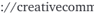

本作品在Creative Commons Attribution 4.0 International License下可用。

有关许可证详细信息，请访问http://creativecommons.org/licenses/by/4.0/。

在http://jeffe.cs.illinois.edu/teaching/algorithms/或http://algorithms.wtf下载本书

或https://archive.org/details/Algorithms-Jeff-Erickson

请在https://github.com/jeffgerickson/algorithms报告错误

我们的编程部分是机械复制的，

现在我们开始广播。

为金姆、凯和汉娜
以爱和钦佩之情

并为艾琳
表示感谢
因为她打破了诺言

> > 在算术实践的算法书中，序言开始。
>
> — 伊奥安尼斯·伊斯帕伦西斯 [约翰·塞维利亚?],
> *Liber algorismi de practica arismetrice* (c.1135)

> > 我告诉你，我的朋友，你将如何理解它？
> 去写一本关于它的书吧。
>
> — 亨利·霍姆，凯姆斯勋爵 (1696-1782)，
> 在给吉尔伯特·艾略特爵士的一封信中

> > 个体总是错误的。他设计了许多东西，并吸引了其他人作为合作者，与一些人或全部人争吵，犯了很多错误，但有些事情已经完成了；所有人都有所进步，但个体总是错误的。
> 结果与他所承诺的有些新颖且非常不同。
>
> — 拉尔夫·沃尔多·爱默生，“经验”，第二系列 (1844)

> > 上述内容是一本书的内容概要，其基本计划的实现和细节的融入可能是不可能的；我所写的是这本书初版的第二或第三稿的初步版本——Michael Spivak，《微分几何学，第一卷》（1970年）的前言

## 前言

### 关于本书

这本教材起源于我为伊利诺伊大学香槟分校的各种算法课程编写的讲义集合，自1999年1月以来，我每年教授一次。受到本科理论课程的变化的推动，我在2016年对我的讲义进行了重大修订；本书包括我修订后的讲义中关于最基础课程材料的一个子集，主要反映了我们新的必修的大三理论课程的算法内容。

### 先修条件

我在伊利诺伊州教授的算法课程有两个重要的先修条件：离散数学课程和基础数据结构课程。
因此，这本教科书可能不适合大多数学生作为第一本教材数据结构和算法课程。特别是，我假设至少对以下具体主题有一定的了解：

-   * 离散数学：高中代数，对数恒等式，朴素集合论，布尔代数，一阶谓词逻辑，集合，函数，等价关系，偏序，模运算，递归定义，树（作为抽象对象，而不是数据结构），图（顶点和边，而不是函数图）。
-   证明技巧：直接证明，间接证明，反证法，穷举分析法，归纳法（特别是“强归纳法”和“结构归纳法”）。第0章使用归纳法，每当第n-1章使用归纳法时，第n章也使用归纳法。
-   迭代编程概念：变量，条件语句，循环，记录，间接引用（地址/指针/引用），子程序，递归。我不假设对任何特定的编程语言流利，但我假设至少有一种支持间接引用和递归的语言的经验。
-   基本抽象数据类型：标量、序列、向量、集合、栈、队列、映射/字典、有序映射/字典、优先队列。
-   基本数据结构：数组、链表（单向和双向、线性和循环）、二叉搜索树、至少一种形式的平衡二叉搜索树（如AVL树、红黑树、Treap树、跳表或伸展树）、哈希表、二叉堆，以及最重要的是，这个列表与前一个列表的区别。
-   基本计算问题：基本算术、排序、搜索、枚举、树遍历（前序、中序、后序、层序等）。
-   基本算法：基本算法、顺序搜索、二分搜索、排序（选择、插入、归并、堆、快速、基数等）、（至少二叉）树的广度优先和深度优先搜索，以及最重要的是，这个列表与前一个列表的区别。
-   基本算法分析：渐近符号（o, O, Θ, Ω, ω），将循环转化为求和以及递归调用转化为递归式，求解简单的求和和递归式。
-   数学素养：对抽象概念的熟悉，形式化（尤其是递归）定义的理解，以及（尤其是归纳）证明的能力；撰写和理解数学论证；识别和避免语法、语义和/或逻辑上的荒谬。

本书在相关内容出现时简要介绍了一些先修知识，但更多地是作为提醒而不是很好的入门。对于更全面的概述，我强烈推荐以下免费参考资料：

-   Margaret M. Fleck. 理论计算机科学基础. 版本1.3（2013年1月）或更高版本可从http://mfleck.cs.illinois.edu/building-blocks/获取。
-   Eric Lehman, F. Thomson Leighton, 和 Albert R. Meyer. 计算机科学数学. 2018年6月修订版可从https://courses.csail.mit.edu/6.042/spring18/获取。（我强烈建议搜索最新修订版。）
-   Pat Morin. 开放数据结构. 第0.1G版β（2016年1月）或更晚版本可从http://opendatastructures.org/获取。
-   Don Sheehy. 数据结构和面向对象设计课程. 2019年2月或更晚修订版可从https://donsheehy.github.io/datastructures/获取。

### 附加参考资料

请不要局限于这本或任何其他单一参考资料。作者和读者对任何知识材料都有自己的观点；没有一个教师能够与每个学生，甚至是每个非常优秀的学生都完全合拍。找到最能有效地将作者的直觉传达给你的头脑的作者需要一些努力，但这种努力在长期来看是非常值得的。

以下参考资料对直觉、示例、练习和灵感都非常有价值；这并不意味着这是一个完整的列表。

-   Alfred V. Aho, John E. Hopcroft, and Jeffrey D. Ullman. 计算机算法的设计与分析. Addison-Wesley, 1974.（我在莱斯大学读本科时使用过这本教材，在加州大学尔湾分校读硕士时又使用过一次。）
-   Boaz Barak. 理论计算机科学导论. 教材草稿，最近修订于2019年6月。（这不是你祖父的理论计算机科学教材，这样更好；而且它是免费的，这是一个令人愉快的额外好处。）
-   Thomas Cormen, Charles Leiserson, Ron Rivest, and Cliff Stein. 算法导论，第三版. MIT出版社/麦格劳希尔, 2009年。（我在伯克利大学担任助教时使用过第一版。）
-   Sanjoy Dasgupta, Christos H. Papadimitriou, 和 Umesh V. Vazirani. 算法. McGraw-Hill, 2006. (可能是内容上最接近本书的，但冗长程度要小得多。）
-   Jeff Edmonds. 如何思考算法. 剑桥大学出版社, 2008.
-   Michael R. Garey 和 David S. Johnson. 计算机与难解性：NP完全性理论指南. W. H. Freeman, 1979.
-   Michael T. Goodrich 和 Roberto Tamassia. 算法设计: 基础, 分析和互联网示例. John Wiley & Sons, 2002.
-   Jon Kleinberg 和 Éva Tardos. 算法设计. Addison-Wesley, 2005. 如果可以的话，从图书馆借阅它。
-   Donald Knuth. 计算机程序设计艺术, 卷1-4A. Addison-Wesley, 1997 和 2011. (我父母在我14岁时给了我前三卷作为圣诞礼物。可惜，我直到很久以后才真正读了它们。)
-   Udi Manber. 算法导论: 创造性方法. Addison-Wesley, 1989. (我在伯克利担任助教时使用过这本教材。)
-   Ian Parberry. 算法问题. Prentice-Hall, 1995 (已绝版)。 在您同意进行小额慈善捐款后，可从https://larc.unt.edu/ian/books/free/license.html下载。 请遵守您的协议。
-   Robert Sedgewick和Kevin Wayne。 算法 . Addison-Wesley, 2011.
-   Robert Endre Tarjan。 数据结构和网络算法. SIAM, 1983.
-   我在伯克利自己的算法课上的课堂笔记，尤其是由Dick Karp和Raimund Seidel教授的课程。
-   许多同行在网上免费提供了讲座笔记、幻灯片、作业、考试、视频讲座、研究论文、博客文章、StackExchange问题和答案、播客以及完整的MOOC课程。

### 关于练习

每章末尾都有几个练习题，其中大部分我至少在一次作业、讨论/实验室课程或考试中使用过。 练习题不按难度递增的顺序排列，而是按常见的技巧或主题进行分组。 一些问题的注释如下:

-   ♥红心表示特别具有挑战性的问题; 其中许多问题曾出现在伊利诺伊大学博士生资格考试中。 少数非常困难的问题用♥大心标记。
-   ♦蓝钻石表示需要熟悉后面章节的材料，但在主题上属于当前章节。不过，不会标记需要熟悉前面材料的问题; 这本书和生活一样是累积的。
-   ♣绿梅花表示需要熟悉本书范围之外的材料，例如有限状态机、线性代数、概率或平面图。 这种问题很少见。
-   ♠黑桃表示需要大量的工作和/或编码的问题。 这些很少见。
-   ★橙色的星星表示你正在吃1998年之前制造的幸运魔法师。呕。

这些练习是为了练习而设计的机会，而不是为了自己而设立的目标。每个问题的目标不是解决特定的问题，而是锻炼一定的技能，或者练习解决某种类型的问题。

部分原因是为了这个原因，我不提供练习的解答；解答不是重点。特别是，没有“教师手册”；如果你自己不能解决一个问题，你可能不应该把它分配给你的学生。话虽如此，你可能可以在我教授的任何课程的网页上找到我分配的作业问题的解答。没有什么能阻止你写一个教师手册！

### 偷这本书！

本书以创作共用许可证发布，允许您在不需要我的许可的情况下使用、重新分发、调整和混合其内容，只要您指向原始来源。本书的完整电子版本可以在以下任何位置免费获取：

-   书籍网站：http://jeffe.cs.illinois.edu/teaching/algorithms/
-   助记符快捷方式：http://algorithms.wtf
-   错误报告网站：https://github.com/jeffgerickson/algorithms
-   互联网档案馆：https://archive.org/details/Algorithms-Jeff-Erickson书籍

网站还包含数百页相关和更高级材料的附加讲义，以及过去作业、考试、讨论/实验室问题和其他教学资源的近乎完整的存档。每当我教授算法课程时，我会修订、更新并有时删除我的教学材料，因此您可能会在我当前教授的课程网页上找到更新的版本。

无论你是学生还是教师，你都可以自由地使用这本教材或者我的其他讲义中的任何子集，无需征得我的许可——这就是我将它们放在网上的原因！然而，请引用这本书，可以用书名或者链接回到http://algorithms.wtf；如果你是学生，并且你使用我的课程材料来帮助你的作业，这一点尤为重要。（请与你的教师核实。）然而，如果你是一名教师，我强烈鼓励你补充一些你自己编写的额外材料。亲自编写材料将加强你对材料的掌握和课堂演讲，从而提高学生对材料的掌握。它还将帮助你克服与这本书中你不喜欢的部分打交道的挫折感。所有的教科书都有缺陷，这本书也不例外。

最后，请将你写的任何内容自由、轻松地在开放的网络上提供，而不是隐藏在学习管理系统或其他类型的付费墙后面，这样其他地方的学生和教师也可以从你独特的见解中受益。 特别是，如果你开发出与这本教材直接补充的有用资源，如幻灯片、视频或解答手册，请告诉我，以便我可以在书籍网站上添加链接到你的资源。

### 致谢

这本教科书在很大程度上借鉴了无数算法学生、教师和研究人员的贡献。 特别感谢超过三千名伊利诺伊州的学生，他们将我的讲义作为主要参考资料，提供了有用的（有时是痛苦的）批评，并忍受了一些真正糟糕的初稿。 还要感谢世界各地的许多同事和学生，他们在自己的课堂上使用了这些讲义，并提供了有益的反馈和错误报告。

我特别感谢我的优秀助教们提供的反馈和贡献（尤其是练习题）：

Aditya Ramani, Akash Gautam, Alex Steiger, Alina Ene, Amir Nayyeri, Asha Seetharam, Ashish Vulimiri, Ben Moseley, Brad Sturt, Brian Ensink, Chao Xu, Charlie Carlson, Chris Neihengen, Connor Clark, Dan Bullok, Dan Cranston, Daniel Khashabi, David Morrison, Ekta Manaktala, Erin Wolf Chambers, Gail Steitz, Gio Kao, Grant Czajkowski, Hsien-Chih Chang, Igor Gammer, Jacob Laurel, John Lee, Johnathon Fischer, Junqing Deng, Kent Quanrud, Kevin Milans, Kevin Small, Konstantinos Koiliaris, Kyle Fox, Kyle Jao, Lan Chen, Mark Idleman, Michael Bond, Mitch Harris, Naveen Arivazhagen, Nick Bachmair, Nick Hurlburt, Nirman Kumar, Nitish Korula, Patrick Lin, Phillip Shih, Rachit Agarwal, Reza Zamani-Nasab, Rishi Talreja, Rob McCann, Sahand Mozaffari, Shalan Naqvi, Shripad Thite, Spencer Gordon, Srihita Vatsavaya, Subhro Roy, Tana Wattanawaroon, Umang Mathur, Vipul Goyal, Yasu Furakawa, and Yipu Wang.

在伊利诺伊州，我还得到了许多与教职员工的讨论帮助：Alexandra Kolla 、Cinda Heeren、Edgar Ramos、Herbert Edelsbrunner、Jason Zych、Kim Whittlesey、Lenny Pitt、Madhu Parasarathy、Mahesh Viswanathan、Margaret Fleck、Shang-Hua Teng、Steve LaValle，特别是Chandra Chekuri、Ed Reingold和Sariel Har-Peled。当然，这本书还要非常感谢那些在我学习算法的 过程中教导我的人：Rice的Bob Bixby和Michael Pearlman；Irvine的David Eppstein、Dan Hirschberg和George Lueker；以及Berkeley的Abhiram Ranade 、Dick Karp、Manuel Blum、Mike Luby和Raimund Seidel。

我从Herbert Edelsbrunner那里借鉴了整个课程结构的第一次迭代，以及首次撰写自己的讲义笔记的想法；从Steve LaValle那里得到了将我的一部分笔记转化为书籍的想法；还从Robert Ghrist那里借鉴了书籍设计的几个组成部分。

### 读者请注意！

当然，这些人不应该为结果中的任何缺陷负责。尽管经过多轮修订和编辑，这本书中仍然存在一些错误、漏洞、失误、遗漏、疏忽、修补、错别字、数学错误、语法错误、思维错误、脑袋抽风、糟糕的设计决策、历史错误、时代错误、不一致性、夸张、犹豫不决、废话、歪曲、过度简化、冗余、废话、垃圾、杂物和彻头彻尾的谎言，这完全是史蒂夫·斯基纳的错。

我在https://github.com/jeffgerickson/algorithms上维护了一个问题跟踪器，读者们可以在那里提交错误报告、功能请求和对本书的一般反馈。如果您发现任何错误，无论是数学上的、语法上的、历史上的、排版上的、文化上的还是其他方面的错误，无论是在主文本、练习中还是在我的其他课程材料中，请告诉我。（史蒂夫可能不会在意。）当然，我也欢迎其他任何反馈！祝您阅读愉快！

> > — 杰夫

> > 作者传统上会慷慨地承担任何剩余缺陷的责任。但我不会。本书中的任何错误、缺陷或问题都是别人的错，但我希望能了解这些问题以确定责任人。
>
> — 史蒂文·S·斯基纳，《算法设计手册》（1997年）
>
> 毫无疑问，这个声明之后会有一份所有教科书的注释列表，以及每本教科书为什么糟糕。
>
> — 亚当·康蒂尼，MetaFilter，2010年1月4日

## 目录

-   前言 i
    -   关于本书 i
    -   先修条件 i
    -   附加参考资料 iii
    -   关于练习 iv
    -   偷这本书！ v
    -   致谢 vi
    -   读者请注意！ vii
-   目录
-   0 引言
    -   0.1 什么是算法? 1
    -   0.2 乘法 3
        -   格点乘法 • 倍增和中介 • 指南针和直尺
    -   0.3 国会分配 ........................................ 8
    -   0.4 一个糟糕的例子 ........................................ 10
    -   0.5 描述算法 ........................................ 11
        -   指定问题 • 描述算法
    -   0.6 分析算法 ........................................ 14
        -   正确性 • 运行时间
    -   练习 ........................................ 17
-   1 递归 ........................................ 21
    -   1.1 简化 ........................................ 21
    -   1.2 简化和委派 ........................................ 22
    -   1.3 汉诺塔 ........................................ 24
    -   1.4 归并排序 ........................................ 26
        -   正确性 • 分析
    -   1.5 快速排序 ........................................ 29
        -   正确性 • 分析
    -   1.6 模式 ........................................ 31
    -   1.7 递归树 ........................................ 31
        -   ♥忽略楼层和天花板是可以的，诚实的
    -   1.8 ♥线性时间选择 ........................................ 35
        -   快速选择 • 好的枢轴 • 分析 • 合理性检查
    -   1.9 快速乘法 ........................................ 40
    -   1.10 指数运算 ........................................ 42
    -   练习 ........................................ 44
-   2 回溯 ........................................ 71
    -   2.1 N皇后 ........................................ 71
    -   2.2 游戏树 ........................................ 74
    -   2.3 子集和 ........................................ 76
        -   正确性 • 分析 • 变种
    -   2.4 一般模式 ........................................ 79
    -   2.5 文本分割（Interpunctio Verborum） ........................................ 80
        -   索引公式 • ♥分析 • 变种
    -   2.6 最长递增子序列 ........................................ 86
    -   2.7 最长递增子序列，第二次尝试 ........................................ 89
    -   2.8 最优二叉搜索树 ........................................ 91
        -   ♥分析
    -   练习 ........................................ 93
-   3 动态规划 ........................................ 97

### 3.1 矩阵链乘法
- 回溯法可能很慢
- 记忆化搜索：记住所有
- 动态规划：有意填充
- 不要记住所有的东西

### 3.2 注：更快的斐波那契数
哇！不要这么快！

### 3.3 单词间的点号再现

### 3.4 模式：智能递归

### 3.5 警告：贪婪是愚蠢的

### 3.6 最长递增子序列
- 第一次重复：这是下一个吗？
- 第二次重复：接下来是什么？

### 3.7 编辑距离
- 递归结构
- 递归关系
- 动态规划

### 3.8 子集和

### 3.9 最优二叉搜索树

### 3.10 树上的动态规划

## 练习

## 4 贪婪算法

### 4.1 磁带上的文件存储

### 4.2 课程调度

### 4.3 一般模式

### 4.4 哈夫曼编码

### 4.5 稳定匹配
- 一些不好的想法
- 波士顿池和盖尔-沙普利算法
- 运行时间
- 正确性
- 最优性！

## 练习

## 5 基本图算法

### 5.1 简介和历史

目录

## 6 深度优先搜索
### 6.1 先序遍历和后序遍历
分类顶点和边
### 6.2 检测循环
### 6.3 拓扑排序
隐式拓扑排序
### 6.4 记忆化和动态规划
有向无环图中的动态规划
### 6.5 强连通性
### 6.6 线性时间中的强连通分量
Kosaraju和Sharir的算法
• Tarjan的算法
## 练习

## 7 最小生成树
### 7.1 不同的边权重
### 7.2 唯一的最小生成树算法
### 7.3 Borůvka的算法
这是你想要的最小生成树算法
### 7.4 Jarník的（Prim的）算法
改进Jarník的算法
### 7.5 Kruskal的算法
## 练习

## 8 最短路径
### 8.1 最短路径树
### 8.2 负边
### 8.3 唯一的单源最短路径算法
### 8.4 无权图：广度优先搜索
### 8.5 有向无环图：深度优先搜索
### 8.6 最佳优先：Dijkstra算法
无负边 • 负边
### 8.7 放松所有边：Bellman-Ford算法
Moore的改进 • 动态规划公式
## 练习

## 9 全对最短路径
### 9.1 引言
### 9.2 大量单源
### 9.3 重新加权
### 9.4 Johnson算法
### 9.5 动态规划
### 9.6 分治
### 9.7 有趣的矩阵乘法
### 9.8 （Kleene-Roy-）Floyd-Warshall（-Ingerman）
## 练习

## 10 最大流和最小割
### 10.1 流
### 10.2 割
### 10.3 最大流-最小割定理
### 10.4 Ford和Fulkerson的增广路径算法
非理性容量
### 10.5 组合和分解流
### 10.6 Edmonds和Karp的算法
最胖的增广路径 • 最短的增广路径
### 10.7 进一步的进展
## 练习

## 流和割的应用
### 11.1 边不相交的路径
### 11.2 顶点容量和顶点不相交的路径
### 11.3 二分图匹配
### 11.4 元组选择
考试安排
### 11.5 不相交路径覆盖
最小的教职员工招聘
### 11.6 棒球淘汰赛
### 11.7 项目选择
## 练习

## 12 NP-难度
### 12.1 一个你无法赢的游戏
### 12.2 P与NP
### 12.3 NP-难度，NP-易度和NP-完全度
### 12.4 正式定义（ HC SVNT DRACONES）
### 12.5 缩减和 Sat
### 12.6 3SAT （来自 CIRCUIT SAT）
### 12.7 最大独立集（来自 3Sat）
### 12.8 一般模式
### 12.9 团和顶点覆盖（来自独立集）
### 12.10 图着色（来自 3SAT）
### 12.11 哈密顿回路
来自顶点覆盖 • 来自 3SAT • 变种和扩展
### 12.12 子集和（来自顶点覆盖）
注意减少！
### 12.13 其他有用的NP难问题
### 12.14 选择正确的问题
### 12.15 一个轻浮的现实世界例子
### 12.16 超越斑马
多项式空间 • 指数时间 • 更加优秀!
## 练习

## 索引

### 人名索引

### 伪代码索引

### 图片来源

### 版权页

> Hinc incipit algorismus. Haec algorismus ars praesens dicitur in qua talibus indorum fruimur bis quinque figuris o. 9. 8. 7. 6. 5. 4. 3. 2. 1.
— 弗里亚尔·亚历山大·德·维拉·德伊,《算法之歌》(公元1220年)

> 你要
求一个艺术家有意识地参与他的作品，这是正确的，但你混淆了两件不同
的事情：解决问题和正确提出问题。

— 安东·契诃夫,给A. S. 苏沃林的信 (1888年10月27日)

> 我们越是将自己降低到机器的水平，
我们就越能释放在更高层面上使用的力量。
— 安娜·布拉克特,《休息的技巧》(1892年)

> 尽管我坚信一个人一旦开始谈
论技巧，那就证明他已经没有新的想法了，但在凌晨2点30分，我还是在写技巧的文章。

— 雷蒙德·钱德勒,给厄尔·斯坦利·加德纳的信 (1939年5月5日)

好人不需要规则。
今天不是弄清楚我为什么有这么多的日子。

> — 医生 [马特·史密斯], “战争中的好人”, 神秘博士 (2011)

## 0 介绍

### 0.1 什么是算法？
算法是一系列明确、精确、无歧义、可机械执行的基本指令序列，通常旨在实现特定目标。 例如，这是一种唱那首令人讨厌的歌“99瓶啤酒在墙上”的算法，适用于任意值为99的情况：
```
BOTTLESOFBEER(n):
    对于 i 从 n 到 1 递减
        唱“i瓶啤酒在墙上， i瓶啤酒，”
        唱“拿下一瓶，传递出去， i－1瓶啤酒在墙上。”
    唱“墙上没有瓶啤酒了，没有瓶啤酒，”
    唱“去商店买更多，共有 n瓶啤酒在墙上。”
```
“算法”这个词并不是源自于希腊语的词根算术 (arithmos)，意思是“数字”，和痛苦 (algos) (ἄλγος)，意思是“痛苦”。相反，它是对9世纪波斯学者穆罕默德·本·穆斯·阿尔·赫瓦里兹米的名字的改编。阿尔·赫瓦里兹米可能最为人所知的是他写的论文《关于代数的书》在另一篇论文中，阿尔·赫瓦里兹米描述了现代十进制数的写法和运算方法，特别是使用一个小圆圈或零 (sifr) 来表示缺少的数量，这个方法在几个世纪前就在印度发展起来了。
这本书中描述的方法，无论是使用书面数字还是计数石头，都被称为阿尔戈里斯姆或奥格林姆，并且它的数字被称为密码。
尽管位值记数法和al-Khwārizm 的作品已经为一些欧洲学者所知，但是“印度-阿拉伯”数字系统是由中世纪意大利数学家和商人斐波那契在欧洲推广的。多亏了他在1202年写的《计算之书》，书面数字开始取代计数桌 (当时被称为算盘) 和手指算术，成为13世纪欧洲首选的计算平台，这并不是因为书面十进制数字更容易学习或使用，而是因为它们提供了审计追踪。只有在活字印刷术出现后，密码才在西欧变得普遍，而且只有在19世纪初廉价纸张变得丰富之后才真正无处不在。
最终，单词 algorism演变成了现代 algorithm，通过希腊语 arithmos (也许还有之前提到的algos) 的民间词源学。6 因此，直到最近，单词 algorithm 仅指使用“阿拉伯”数字进行位值算术的机械技术。
那些训练有素、能够快速可靠地执行这些过程的人被称为算法师或计算机，或者更简单地称为计算机。

### 0.2 乘法
尽管算法只在过去几十年里成为正式学术研究的话题，但它们自文明的黎明以来就一直存在。关于逐步算术计算的描述是人类语言中最早的书面例子之一，早在斐波那契和阿尔-花拉子米之前，甚至早于他们所推广的位值表示法。

#### 格点乘法
对于美国学生来说，乘法的最熟悉方法至少是格点算法。这个算法在《计算自由》一书中被斐波那契推广，他从包括阿尔-花拉子米在内的阿拉伯来源中学到了这个算法，而阿尔-花拉子米则从包括布拉马古普塔在内的印度来源中学到了这个算法，而布拉马古普塔可能是从中国来源中学到的。
算法的最古老的描述出现在中国的《孙子算经》中，写于公元3至5世纪，在阿斯卡隆的尤托修斯对阿基米德的《圆的测量》的评论中也有描述，写于公元500年左右，但有证据表明这个算法早在此之前就已知。尤托修斯将这种方法归功于佩尔加的阿波罗尼乌斯，他生活在公元前300年左右，著有《Ωκυτόκιον》一书。苏美尔人在公元前2600年左右的粘土板上记录了乘法表，这表明他们可能使用了格点算法。
格点算法假设输入的数字是以明确的数字字符串表示的；在这里，我假设我们是在十进制下工作，但该算法立即推广到任何其他进制。为了简化表示法，9输入由一对数组 \(X[0 .. m-1]\) 和 \(Y[0 .. n-1]\) 组成，表示数字
\[x = \sum_{i=0}^{m-1} X[i] \cdot 10^i \quad \text{和} \quad y = \sum_{j=0}^{n-1} Y[j] \cdot 10^j,\]
同样，输出由一个数组 \(Z[0 .. m+n-1]\) 组成，表示乘积
\[z = x \cdot y = \sum_{k=0}^{m+n-1} Z[k] \cdot 10^k.\]
该算法使用加法和单个数字乘法作为原始操作。可以使用简单的 for 循环进行加法运算。在实践中，使用查找表进行单个数字乘法，可以将其刻在粘土板上，绘制在木条或竹子上，写在纸上，存储在只读内存中，或者由计算机记忆。整个格点算法可以用公式总结为
\[x \cdot y = \sum_{i=0}^{m-1} \sum_{j=0}^{n-1} (X[i] \cdot Y[j] \cdot 10^{i+j}).\]
不同变种的格算法评估部分乘积 \(X[i] \cdot Y[j] \cdot 10^{i+j}\) 的不同顺序，并使用不同的策略计算它们的总和。例如，在利伯阿巴科中，斐波那契描述了一种考虑按重要性递增顺序的变种，如下所示的现代伪代码。
```
FIBONACCIMULTIPLY(X[0 .. m-1], Y[0 .. n-1]):
  hold ← 0
  for k ← 0 to n + m - 1
    for all i and j such that i + j = k
      hold ← hold + X[i] · Y[j]
    Z[k] ← hold mod 10
    hold ← ⌊hold/10⌋
  return Z[0 .. m+n-1]
```
斐波那契算法通常通过将所有部分乘积存储在二维表格（通常称为“表”或“格子”或“格子”）中，然后沿对角线相加，适当地进行进位，如图 o.1 右侧所示。美国小学生被教导将一个因子（“被乘数”）与另一个因子（“乘数”）中的每个数字相乘，在将它们相加之前，写下所有的被乘数乘以数字的乘积，如图 o.1 左侧所示。这也是 Eutocius 所描述的方法，尽管他适当地从左到右考虑乘数位数，如图所示。

在匿名的1458年教科书《L’Arte dell’Abbaco》（也称为Treviso Arithmetic）中，这两种变体（以及其他几种）被并列描述和说明，这是西方第一本印刷的数学书。

图0.1.使用“长乘法”（通过九位数检查错误）和“格点乘法”计算934 × 314 = 293276，来自于L’Arte dell’Abbaco（1458年）。（请参阅本书末尾的图片来源。）

图0.2. 尤托修斯在6世纪计算了1172⅛ × 1172⅛ = 1373877⅙₆₄在他对阿基米德《圆的测量》的评论中，由约翰·海贝格（1891年）将其转录（左）并翻译成现代符号（右）。（请参阅本书末尾的图片来源。）

所有这些格点算法的变体，以及Sunzi、al-Khwārizmī、Fibonacci、L’Arte dell’Abbaco和许多其他来源描述的类似变体，都可以在O(mn)时间内计算出任意m位数和任意n位数的乘积；每个变体的运行时间都由单个数字乘法的数量所主导。

#### 复制和中介

格点算法不是我们有直接记录证据的最古老的乘法算法。一种更古老且可以说更简单的算法，不依赖于位值表示法，有时被称为俄罗斯农民乘法、埃塞俄比亚农民乘法或者只是农民乘法。

这种算法的变体被埃及抄写员阿姆斯在公元前1650年左右抄写到了Rhind纸上，他声称这是一份（当时）大约350年历史的文档。这种算法仍然在20世纪末的东欧小学数学中使用；早期的数字计算机也常常使用这种算法，因为它们没有直接在硬件中实现整数乘法。

农民乘法算法将乘法任意数的困难任务简化为四个较简单的操作序列：

- 1. 确定奇偶性
- 2. 加法
- 3. 复制（将一个数加倍）
- 4. 中介（将一个数减半，向下取整）

```
PeasantMultiply(x, y):
    prod ← 0
    while x > 0
        if x是奇数
            prod ← prod + y
        x ← ⌊x/2⌋
        y ← y + y
    返回 prod
```

| x | y | prod |
|---|---|------|
| | | 0 |
| 123 | +456 | 456 |
| 61 | +912 | 1368 |
| 30 | 1824 | |
| 15 | +3648 | 5016 |
| 7 | +7296 | 12312 |
| 3 | +14592 | 26904 |
| 1 | +29184 | 56088 |

图0.3.通过重复和中介进行乘法

这个算法的正确性可以通过归纳法从以下递归恒等式得到证明，该恒等式对于所有非负整数x和y成立：

```
$$x \cdot y = \begin{cases} 0 & \text{if } x = 0 \\ \lfloor x/2 \rfloor \cdot (y + y) & \text{如果 } x \text{是偶数} \\ \lfloor x/2 \rfloor \cdot (y + y) + y & \text{if } x \text{是奇数} \end{cases}$$
```

可以说，这个递归式是农民乘法算法。不要被迭代伪代码所迷惑；这个算法本质上是递归的！如所述，PeasantMultiply执行O(log x)的奇偶性、加法和中介操作，但是当x > y时，我们可以将两个参数交换以改善这个界限为O(log min{ x, y})。假设数字使用任何合理的位值表示法（如二进制、十进制、巴比伦十六进制、埃及十二进制、罗马数字、中国算筹、算盘上的珠子等），每个操作最多需要O(log(xy)) = O(log max{x, y})个单位数字操作，因此算法的总运行时间为O(log min{x, y} · log max{x, y}) = O(log x · log y)。

10这个算法在古埃及实际使用的版本中不使用中介或奇偶校验，但它确实使用比较。为了避免减半，算法通过重复加倍预先计算两个表：一个包含不超过x的所有2的幂，另一个包含相同的2的幂乘以y。然后，通过贪婪减法找到和为x的2的幂，并将另一个表中的相应条目相加以形成乘积。

换句话说，这个算法需要 $O(mn)$ 时间来将一个 $m$ 位数乘以一个 $n$ 位数；在常数因子的影响下，这与格算法的运行时间相同。这个算法在手工执行时需要更多（一个常数因子！）的工作，但必要的原始操作可能更容易由人类执行。事实上，当数字用二进制表示时，这两个算法是等价的。

#### 罗盘和直尺

古希腊几何学家将数字（或更准确地说，大小）与适当长度的线段相对应，他们使用两个简单的机械工具——罗盘和直尺——来操作这些线段。这两个工具的版本已经被测量员、建筑师和其他工匠广泛使用了几个世纪。只使用这两个工具，这些学者将几个复杂的几何构造简化为以下原始操作，从一个或多个已知的参考点开始。

- 画出通过两个不同的已知点的唯一直线。
- 画出以一个已知点为中心并通过另一个点的唯一圆。
- 确定两条直线的交点（如果有的话）。
- 确定一条直线和一个圆的交点（如果有的话）。
- 确定两个圆的交点（如果有的话）。

实际上，古希腊几何学生几乎肯定是在一个覆盖着灰尘或沙子的ἄβαξ（古希腊的一种绘图工具）上绘制他们的构造。$^{11}$ 几个世纪前，埃及的测量员使用绳子在地面上确定直线和圆。$^{12}$ 然而，欧几里德和其他古希腊几何学家将罗盘和直尺构造呈现为精确的数学抽象——点是理想点；线是理想线；圆是理想圆。

图0.4展示了一个算法，大约2500年前由欧几里得在《几何原本》中描述，用于乘除两个量。输入由四个不同的点 $A, B, C$ 和 $D$ 组成，目标是构造一个点 $Z$，使得 $|AZ| = |AC||AD|/|AB|$。特别地，如果我们将 $|AB|$ 定义为我们的长度单位，那么该算法计算 $|AC|$ 和 $|AD|$ 的乘积。

请注意，欧几里得首先通过定义一个新的原始操作 RightAngle（如现代程序员所表述的）编写了一个子程序。正确性

> $^{11}$ 欧洲至少在费波那契的《算盘书》之前两个世纪就已经知道了1到9的书面数字，这些数字被称为“gobar数字”，源自阿拉伯语 *ghubar*，意思是尘土，最终指的是印度在覆盖着沙子的桌子上进行算术运算的做法。希腊词 ἄβαξ 是拉丁词 *abacus* 的起源，最初也指的是一个沙盘。

> $^{12}$ 记住“几何”是什么意思吗？德谟克利特后来嘲笑这些埃及测量员，称他们为“绳索固定者”。

```
《构造垂直于 ℓ 通过 P 的直线.》
RIGHTANGLE(ℓ,P):
 选择一个点 A ∈ ℓ
 A,B ← INTERSECT(CIRCLE(P,A),ℓ)
 C,D ← INTERSECT(CIRCLE(A,B),CIRCLE(B,A))
 返回线 (C,D)

《构造一个点 Z 使得 |AZ| = |AC||AD|/|AB|.》
MULTIPLYORDIVIDE(A,B,C,D):
 α ← 直角 (线段(A, C), A)
 E ← 相交 (圆 (A, B), α)
 F ← 相交 (圆 (A, D), α)
 β ← 直角 (线段(E, C), F)
 γ ← 直角 (β, F)
 返回相交(γ,线段(A, C))
```

图0.4. 欧几里得的乘除算法

算法的正确性来自于观察到三角形ACE和AZF是相似的。主算法的第二行和第三行存在歧义，因为α与以A为圆心的任何圆相交于两个不同的点，但无论选择哪个交点作为E和F，算法实际上都是正确的。

欧几里得算法将两个大小（长度）相乘的问题简化为一系列原始的指南针和直尺操作。这些操作在现代数字计算机上很难精确实现，但欧几里得算法并不是为数字计算机设计的。它是为了柏拉图理想几何学家而设计的，他们使用柏拉图理想的圆规和柏拉图理想的直尺，在定义上可以在恒定时间内完美执行每个操作。在这种计算模型中，MultiplyOrDivide的运行时间为O(1)！

### 0.3 国会分配

这是另一个具有重要政治意义的现实世界算法的例子。美国宪法第一条第二款要求将代表和直接税按照各个可能包括在这个联盟中的州的相应数字进行分配。数目。...

> 代表的数量不得超过每个人。三万，但每个州至少有一个代表。...

因为众议院中只有有限的席位，确切的比例代表需要共享或分数代表，这两者都是非法的。因此，在接下来的几十年里，提出并使用了许多不同的分配算法来公平地舍入理想的分数解。实际上今天使用的算法称为亨廷顿-希尔方法或等比例方法，最初由人口普查局统计学家约瑟夫·希尔在1911年提出，由哈佛大学数学家爱德华·亨廷顿在1920年完善，于1941年成为联邦法律（2 U.S.C. §2a），并在1992年经受住了最高法院的挑战。¹³亨廷顿-希尔方法一次将代表分配给各州。首先，在预处理阶段，每个州被分配一个代表。

然后在主循环的每次迭代中，下一个代表被分配给具有最高优先级的状态。每个状态的优先级被定义为 \( P / \sqrt{r(r+1)} \)，其中 \( P \) 是状态的人口， \( r \) 是已分配给该状态的代表人数。

该算法在图0.5的伪代码中进行了描述。输入包括存储各个州人口的数组 \( Pop[1..n] \)，以及表示总代表人数的整数 \( R \)；算法假设 \( R \geq n \)。（目前，在美国，\( n = 50 \) 且 \( R = 435 \)。）输出数组 \( Rep[1..n] \) 记录了分配给每个州的代表人数。

```
APPORTIONCONGRESS(Pop[1..n], R):
  PQ ← NEWPRIORITYQUEUE
  // 给每个州分配第一个代表
  对于 s ← 1 到 n
    Rep[s] ← 1
    插入 (PQ, s, Pop[i]/√2)
  // 分配剩余的 n - R 代表
  对于 i ← 1 到 n - R
    s ← EXTRACTMAX(PQ)
    Rep[s] ← Rep[s] + 1
    priority ← Pop[s] / √(Rep[s] (Rep[s] + 1))
    INSERT(PQ, s, priority)
  return Rep[1..n]

图0.5. 亨廷顿-希尔分配算法
```

这个亨廷顿-希尔的实现使用支持NEWPRIORITYQUEUE、INSERT和EXTRACTMAX操作的优先队列。（当然，实际的法律并没有提到优先队列。）算法的输出和正确性完全不依赖于这个

> > 13在一个联邦地区法院之前的裁决被推翻后，最高法院一致判决认为，国会以善意采用的任何分配方法都是合宪的（美国商务部诉蒙大拿州）。当前的国会分配算法在美国人口普查局网站http://www.census.gov/topics/public-sector/congressional-apportionment.html上有详细描述。关于分配问题的良好历史可以在http://www.thirty-thousand.org/pages/Apportionment.html找到。国会研究服务机构的一份报告描述了各种分配方法，可以在http://www.fas.org/sgp/crs/misc/R41382.pdf上获得。

优先队列已实现。 人口普查局使用一个排序数组，在Excel电子表格的单列中存储，并在每次迭代时从头开始重新计算。 在你的本科数据结构课程中，你（应该已经）学到了一种更高效的实现方法。

类似的分配算法在世界各地的多党制议会选举中使用，每个政党分配的席位数量应该与该党获得的选票数量成比例。 最常见的两种方法是D'Hondt方法1⁴和Webster-Sainte-Laguë方法1⁵，分别使用优先级P/（r+1）和P/（2r+1）代替Huntington-Hill中的平方根表达式。 Huntington-Hill方法在美国众议院中是独特的，部分原因是宪法要求每个州至少分配一个代表。

### 0.4 一个糟糕的例子

作为一个不是真正算法的指令序列的典型例子，考虑"Martin's算法"：16

> 成为百万富翁并且永不缴税（）：获得一百万美元。如果税务人员来到你家门口说：“你从未缴纳税款！”说：“我忘了。”

相当简单，除了第一步；那是个大挑战！ 一群亿万富翁CEO、硅谷风险投资家或纽约房地产搞手可能会认为这是一个算法，因为对他们来说，第一步既明确又简单，17但对于我们这些可怜的家伙来说，马丁的步骤太模糊了，不能被视为一个真正的算法。 另一方面，这是一个完美的例子一个简化—它将成为百万富翁且从未缴税的问题简化为“更容易”的问题，即获得一百万美元。 我们将在本书中一次又一次地看到简化。 正如数百名商人和政治家所证明的那样，如果你知道如何解决更容易的问题，简化告诉你如何解决更困难的问题。

马丁的算法，就像我们之前的一些例子一样，并不是计算机科学家习惯思考的那种算法，因为它是用计算机难以执行的操作来表达的。

本书几乎专门关注于可以在标准数字计算机上合理实现的算法。这些算法中的每一步要么直接由常见的编程语言支持（如算术、赋值、循环或递归），要么是你已经学会如何做的事情（如排序、二分查找、树遍历或唱“*n*瓶啤酒在墙上”）。

### 0.5 描述算法

有效设计和分析算法所需的技能与有效描述算法所需的技能是交织在一起的。至少在我的课程中，任何算法的完整描述包括四个组成部分：

- *什么：算法解决的问题的精确规范。
- *如何：算法本身的精确描述。
- *为什么：算法解决所需解决的问题的证明。
- *多快：算法的运行时间分析。

在这个特定的顺序中，不需要（甚至不建议）同时开发这四个组成部分。问题规范、算法描述、正确性证明和时间分析通常同时发展，每个组成部分的发展都会影响其他组成部分的发展。例如，我们可能需要调整问题描述以支持更快的算法，或者在正确性证明的棘手案例中修改算法。

然而，将这些组件分开呈现通常对读者来说更清晰。

与任何写作一样，重要的是将描述针对正确的受众；我建议写给一个能力强但持怀疑态度的程序员，他不像你一样聪明。想象一下自己六个月前的样子。当你开发任何新算法时，你自然会积累大量关于问题和算法如何解决问题的直觉，你的非正式推理将受到这种直觉的指导。但是，任何后来阅读你的算法或从中派生的代码的人都不会分享你的直觉或经验。你的编译器也不会。你六个月后也不会。他们所拥有的只有你的书面描述。

即使你从未必须向任何人解释你的算法，但仍然重要的是要以观众为导向来开发它们。试图清晰地沟通迫使你更清晰地思考。特别是为初学者观众写作，他们会准确地按照你写的话来解释，这迫使你努力工作。

无论此刻你的高层次想法看起来多么“明显”或“直观”，都要仔细处理细节。同样，为怀疑的观众写作迫使你为正确性和效率开发强大的论证，而不是依靠直觉或智力。¹⁸

我无法强调这一点足够：作为算法设计师，你的主要工作是教别人如何以及为什么你的算法工作。如果你无法向其他人传达你的想法，它们可能就不存在了。. 生成正确且高效的可执行代码是一个重要的但次要的目标。说服自己、你的教授、你的（潜在）雇主、你的同事或你的学生你很聪明，最多只是一个遥远的第三个目标。

#### 明确问题

在我们开始开发新算法之前，我们必须就我们的算法应该解决的问题达成一致。同样，在我们开始描述算法之前，我们必须描述算法应该解决的问题。

算法问题通常使用标准英语以现实世界的对象为基础来呈现。作为算法设计者，我们需要将这些问题重新表述为我们 can 形式化推理的形式、抽象、数学对象——数字、数组、列表、图、树等等。我们还必须确定问题陈述是否带有任何隐藏的假设，并明确陈述这些假设。（例如，在歌曲“墙上的$n$瓶啤酒”中，墙上的 $n$始终是非负整数。¹⁹）

随着算法的开发，我们可能需要进一步完善我们的规范。例如，我们的算法可能需要特定的输入表示，或者产生特定的输出表示，而这些在原始的非正式问题描述中没有明确说明。或者我们的算法实际上可能解决的是比我们最初要求解决的问题更一般的问题。（这是递归算法的常见特征。）

规范应该包含足够的细节，以便其他人可以将我们的算法作为黑盒使用，而不知道算法的工作原理或原因。特别是，我们必须描述每个输入参数的类型和含义，并准确说明最终输出如何依赖于输入参数。另一方面，我们的规范应该有意隐藏使用算法所不必要的任何细节。让那些不重要的事情真正滑过去。

¹⁸特别是，我假设你是一个怀疑的新手！

¹⁹我从来没有听过有人唱“ $\sqrt{2}$墙上的啤酒瓶。”偶尔我听到集合论者唱“$ℵ_0$墙上的啤酒瓶”，但出于某种原因，他们总是在歌还没唱完之前放弃了。

例如，格子算法和倍增中介算法都解决了同一个问题：给定两个非负整数$x$和$y$，每个都表示为数字数组，计算乘积$x \cdot y$，也表示为数字数组。对于使用这些算法的人来说，选择算法是完全无关紧要的。另一方面，希腊直尺和圆规算法解决了一个不同的问题，因为输入和输出值是由线段而不是数字数组表示的。

#### 描述算法

计算机程序是算法的具体表示，但算法不是程序。相反，算法是抽象的机械过程，可以在支持底层原始操作的任何编程语言中实现。你最喜欢的编程语言的独特的语法细节是完全无关紧要的；关注这些只会分散你（和你的读者）的注意力，远离真正的问题。20一个好的算法描述更接近于我们在真实程序的注释中应该写的内容，而不是代码本身。代码是一个不好的叙事媒介。

另一方面，通常用简单的英语散文描述也不是一个好主意。算法具有许多习惯用法的结构 - 尤其是条件语句、循环、函数调用和递归 - 这些结构在非结构化的散文中很容易被隐藏起来。口语英语充满了歧义和意义的细微差别，但算法必须尽可能明确地描述。散文是一个不好的精确媒介。

在我看来，展示算法最清晰的方式是使用伪代码和结构化英语的组合。伪代码使用形式化编程语言和数学的结构来将算法分解为原始步骤；原始步骤本身可以使用数学符号、纯英语或两者的适当混合来编写，以便清晰明了。写得好的伪代码揭示了算法的内部结构，但隐藏了不相关的实现细节，使算法更容易理解、分析、调试和实现。

> 20当然，这是一种宗教信仰的问题。坐在椅子上的语言学家们不停地争论萨皮尔-沃尔夫假说，该假说（或多或少地）认为人们只能按照他们的语言所强加的范畴来思考。根据这一原则的一个极端表述，某些语言中的概念对其他语言的使用者来说根本无法理解，这不仅仅是因为技术进步的原因——你如何将“跳过鲨鱼”或“堡垒之夜主播”翻译成亚拉姆语？——而是因为语言和文化之间固有的结构差异。

对于更怀疑的观点，请参阅史蒂文·平克的《语言本能》。当应用于不同的编程范式时，这个想法确实有一些优势。（Y组合子是什么来着？模板是如何工作的？抽象工厂是什么？）幸运的是，这些差异对本书的内容没有任何影响。对于一个有说服力的反例，请参阅克里斯·奥卡萨基的专著《函数式数据结构》及其更近期的后续作品。

每当我们描述一个算法时，我们的描述应包括完全指定算法、证明其正确性和分析其运行时间所需的每个细节。同时，它应该排除任何不必要的细节，这些细节不是完全指定算法、证明其正确性和分析其运行时间所必需的。在更实际的层面上，我们的描述应该允许一个有能力但持怀疑态度的程序员（尚未阅读本书）能够快速而正确地在他们喜欢的编程语言中实现算法，而不需要理解其工作原理。

我不想用写伪代码的规则来让你感到无聊，但是我必须警告大家不要养成一种特别有害的习惯。永远不要以非正式的方式描述重复的操作，比如“首先做[这个]，然后做[那个]，以此类推。”或者“重复这个过程直到[某个条件]”。正如任何参加过那种令人沮丧的“这个序列的下一个是什么？”测试的人都知道的那样，仅仅描述算法的前几个步骤对于后面的步骤几乎没有任何作用。如果你的算法有一个循环，就将其写成一个循环，并明确地描述在任意迭代中会发生什么。同样，如果你的算法是递归的，就以递归的方式写出来，并明确地描述每个情况的边界和每种情况下会发生什么。

### 0.6 分析算法

仅仅写下一个算法并说“看哪！”是不够的。我们还必须说服我们的观众（包括我们自己！）这个算法确实能够按照预期的方式工作，并且能够高效地工作。

#### 正确性

在一些应用程序设置中，程序在大多数情况下正确运行是可以接受的，对于所有“合理”的输入。但在本书中不是这样的；我们要求算法在所有可能的输入下都是正确的。此外，我们必须证明我们的算法是正确的；仅仅依靠直觉或尝试一些测试用例是不够的。有时候正确性是显而易见的，特别是对于你在之前课程中见过的算法。然而，“显而易见”往往是“错误”的同义词。我们在本课程中讨论的大多数算法都需要真正的工作来证明其正确性。特别是，正确性证明通常涉及归纳法。我们喜欢归纳法。归纳法是我们的朋友。²¹当然，在我们能够正式证明我们的算法做到了它应该做的事情之前，我们必须正式描述它应该做什么！

> 如果归纳法不是你的朋友，你将在这本书中遇到困难。 21

#### 运行时间

对于同一个问题，排列不同算法的最常见方法是通过它们的运行速度来评估。理想情况下，我们希望针对任何特定问题都能找到最快的算法。在许多应用场景中，程序在大多数时间内以高效的方式运行是可以接受的，对于所有“合理”的输入都是如此。但这本书不是这样的；我们要求算法在最坏情况下始终以高效的方式运行。

但是我们如何衡量运行时间呢？以唱歌 BottlesOfBeer(n) 为例，需要多长时间呢？这显然取决于输入值 n，但也取决于你的唱歌速度。有些歌手可能需要十秒钟唱完一节，而其他人可能需要二十秒。技术进一步扩大了可能性。通过电报以摩尔斯码口述歌曲可能需要一分钟唱完一节。通过网络下载mp3可能需要每节十分之一秒的时间。将mp3复制到计算机的主内存中可能每节只需要几微秒的时间。

重要的是随着 n 的增长，唱歌时间如何变化。唱歌瓶子里的啤酒(2n)需要的时间大约是唱歌瓶子里的啤酒(n)的两倍，无论使用什么技术。这在渐近唱歌时间 Θ(n)中得到了体现。

我们可以通过计算算法执行某个指令的次数或达到某个“代码”里的里程碑来测量时间。例如，我们可能注意到在 BottlesOfBeer 的每一节中，单词“beer”被唱三次，所以唱“beer”的次数是总唱歌时间的一个很好的指标。对于这个问题，我们可以给出一个确切的答案：BottlesOfBeer(n)中提到 beer 的次数是 3n + 3 次。

顺便说一下，有很多歌曲的演唱时间是二次的。这首歌对大多数讲英语的人来说可能很熟悉：

```
NDAYSOFCHRISTMAS(礼物[2 .. N]):
    对于 i 从 1 到 N
        唱“在圣诞节的第i天，我的真爱给了我”
        对于 j 从 i 递减到 2
            唱“j个礼物[j]，”
        如果 i > 1
            唱“和”
        唱“一只梨树上的鹧鸪”
```

NDAYSOFCHRISTMAS 的输入是一个由 N-1 个礼物组成的列表，在这里表示为一个数组。很容易证明唱歌的时间是 Θ(N²)；特别地，歌手会提到一个礼物的名字 $\sum_{i=1}^N i = N(N+1)/2$ 次（包括梨树上的鹧鸪）。很容易看出，在圣诞节的前 N 天，我的真爱给了我正好 $\sum_{i=1}^N \sum_{j=1}^i j = N(N+1)(N+2)/6 = \Theta(N^3)$ 个礼物。

### 0. 引言

其他二次时间的歌曲包括“Old MacDonald Had a Farm”，“There Was an Old Lady Who Swallowed a Fly”，“Hole in the Bottom of the Sea”，“Green Grow the Rushes O”，“The Rattlin’ Bog”，“The Court Of King Caractacus”，“The Barley-Mow”，“If I Were Not Upon the Stage”，“Star Trekkin’”，“Ist das nicht ein Schnitzelbank?”, “Il Pulcino Pio”，“Minkurinn í hænsnakofanum”，“Echad Mi Yodea”，和“ To κοκορύκι”。要获取更多示例，请咨询您喜欢的学前儿童。

```
ALOUETTE(lapart[1 .. n]):
    唱« Alouette, 温柔的alouette, alouette, 我要拔你的羽毛。»
    对于每个 i 从 1 到 n
        唱« 我要拔你的羽毛 lapart[i]。我要拔你的羽毛 lapart[i]。»
        对于每个 j 从 i 到 1 (倒序)
            唱« 和 lapart[j]！ 和 lapart[j]！»
        唱« Alouette! Alouette! Aaaaaa. . . »
        唱« . . . . . . . . . . . . 温柔的alouette, alouette, 我要拔你的羽毛。»
```

一些歌曲的演唱时间甚至更奇怪。一个相当现代的例子是 Guy Steele 的“The TELNET Song”，实际上需要 Θ(2ⁿ)时间来演唱前 n 节；Steele 建议 n = 4。最后，还有一些歌曲是永远不会结束的。²³

除了“TELNET之歌”之外，所有这些歌曲最自然地表达为一小组嵌套循环，因此它们的演唱时间可以使用嵌套求和来计算。递归算法的运行时间更容易以递归方式表达。例如，农民乘法算法可以递归地表示如下：

```
x · y = \begin{cases} 0 & \text{if } x = 0 \\ \lfloor x/2 \rfloor \cdot (2y) & \text{如果 } x \text{是偶数} \\ \lfloor x/2 \rfloor \cdot (2y) + y & \text{if } x \text{是奇数} \end{cases}
```

让 T(x, y) 表示计算 x · y 所需的奇偶、加法和中介操作的次数。这个函数满足递归不等式 T(x, y) ≤ T(⌊x/2⌋, 2y) + 2，其中基本情况为 T(0, y) = 0。下一章中描述的技术暗示了上界 T(x, y) = O(log x)。

有时，算法的运行时间取决于底层数据结构或子程序的特定实现。例如，Huntington-Hill 分配算法 ApportionCongress 的运行时间为 O(N + RI + (R - n)E)，其中 N 表示 NewPriority-Queue 的运行时间， I 表示 Insert 的运行时间， E 表示运行时间 of EXTRACTMAX。在合理的假设下， R ≥ 2n (平均而言，每个状态至少有两个代表)，我们可以简化这个界限为 O(N + R(I + E))。精确的运行时间取决于底层优先队列的实现方式。人口普查局将优先队列实现为未排序的数组，这给了我们 N = I = Θ(1) 和 E = Θ(n)，因此人口普查局对 APPORTIONCONGRESS 的实现时间为 O(Rn)。

然而，如果我们将优先队列实现为二叉堆或堆有序数组，我们有 N = Θ(1) 和 I = E = O(log n)，因此整体算法的运行时间为 O(R log n)。

最后，有时我们对计算资源感兴趣，而不仅仅是时间，比如空间，硬币翻转次数，缓存或页面错误次数，进程间消息的数量，或者我真爱给我的礼物数量。这些资源可以使用与分析运行时间相同的技术进行分析。例如，两个 n 位数的格点乘法如果我们在加法之前写下所有的部分乘积，需要 O(n²) 的空间，但是如果我们边加边计算，只需要 O(n) 的空间。

## 练习

- o. 描述并分析一种高效的算法，可以确定在标准国际象棋棋盘上给定合法棋子布局的情况下，如果两个玩家都完美地下棋，哪个玩家将在给定的起始位置上获胜。
[提示：有一个简单的一行解决方案！]
- 1. (a) 找出（或编写）一首需要 Θ(n³) 时间来唱前 n 节的歌曲。
(b) 鉴定（或编写）一首需要 Θ(n log n) 时间来唱前 n 节的歌曲。
(c) 鉴定（或编写）一首需要其他奇怪的时间来唱前 n 节的歌曲。
- 2. 细心的读者可能会抱怨我们对“n墙上的啤酒瓶”或“圣诞节的 n 天”等歌曲的分析过于简单，因为唱大数比唱小数需要更长的时间。更一般地说，因为给定长度的单词只有那么多，所以更大的单词集合必然包含更长的单词。我们可以通过计算唱出的音节数量而不是单词数量来更准确地估计唱歌时间。
(a) 唱整数 n 需要多长时间？
(b) 唱“n墙上的啤酒瓶”需要多长时间？
(c) 唱“圣诞节的N天”需要多长时间？
通常，以 $O(f(n))$ 的形式表示答案，其中 $f$ 是某个函数。
- 3. 累计饮酒歌“大麦草堆”已经在英国群岛上唱了几个世纪。这首歌有很多变体；图0.6中包含了传统上在德文郡和康沃尔郡唱的一个版本的伪歌词，其中 vessel[i] 是一个容器的名称，容量为 $2^i$ 盎司的啤酒。

```
BarleyMow(n):
"为大麦草堆干杯，我的勇敢的男孩们，"
"为大麦草堆干杯！"
"我们将从欢乐的棕色碗中喝光它，"
"为大麦草堆干杯！"
"为大麦草堆干杯，我的勇敢的男孩们，"
"为大麦草堆干杯！"
对于 i ← 1 到 n
    "我们将从容器[i]中喝它，伙计们，"
    "这是对大麦堆的祝福！"
    对于 j ← i 递减 1
        "容器[j]，"
    "和愉快的棕色碗！"
    "这是对大麦堆的祝福！"
    "这是对大麦堆的祝福，我的勇敢的伙计们，"
    "这是对大麦堆的祝福！"
```

图0.6. "大麦堆".
- (a) 假设每个名字容器[i]是一个单词，你可以每秒唱四个单词。你唱完 Barley Mow(n)需要多长时间？(给出一个紧密的渐近界。)
(b) 如果你想为任意大的 n 唱这首歌，你将不得不自己编造容器的名字。为了避免重复，这些名字必须随着 n的增加而逐渐变长。假设容器[n]有 Θ (log n) 音节，你可以每秒唱六个音节。现在，如果你唱BarleyMow (n) 需要多长时间？（给出一个紧密的渐近界限。）
(c) 假设每次提到一个容器的名字时，你实际上会喝相应的啤酒量：愉快的棕色碗每次一盎司，每个容器每次 2ⁱ 盎司。假设为了解决这个问题，你至少21岁，如果你唱BarleyMow (n)，你会喝多少盎司的啤酒？（给出一个确切的答案，而不仅仅是一个渐近界限。）
- 4. 回想一下，Huntington-Hill算法 ApportionCongress 的输入是一个数组 Pop[1 .. n]，其中 Pop[i] 是第i个州的人口，以及一个整数 R，表示分配的代表总数。输出是一个数组 Rep[1 .. n]，其中 Rep[ i] 是算法分配给第i个州的代表数。

有时候，Huntington-Hill算法的描述完全避免使用优先队列。顶层算法“猜测”一个正实数 D，称为除数，然后运行以下子程序来计算分配。变量 q 是给定除数 D 时分配给一个州的理想代表配额；实际分配的代表数总是 ⌈q⌉ 或 ⌊q⌋。

```
HHGUESS(Pop[1 .. n], R, D):
    reps ← 0
    for i ← 1 to n
        q ← Pop[i]/D
        if q·q < ⌈q⌋·⌊q⌋
            Rep[i] ← ⌊q⌋
        否则
            Rep[i] ← ⌈q⌋
        reps ← reps + Rep[i]
    return reps
```

最终返回值 reps 有三种可能性。如果 reps < R，我们没有分配足够的代表，这至少从直觉上来说意味着我们的除数 D 太小了。如果 reps > R，我们分配了太多的代表，这至少从直觉上来说意味着我们的除数 D 太大了。最后，如果 reps = R，我们可以将数组 Rep[1 .. n] 作为最终的分配返回。在实践中，我们可以通过使用接近标准除数 D = P / R 的少量整数除数来计算一个有效的分配（具有 reps = R）。在以下问题中，令 P = ∑ᵢ₌₁ⁿ Pop[i] 表示所有州的总人口，并假设 n ≤ R ≤ P。
- (a) 证明使用标准除数 $D = P/R$ 调用 HHGUESS 不一定会得到有效的分配。
- (b) 证明如果 HHGuess 对于两个不同的除数 $D$ 和 $D'$ 返回相同的 $reps$ 值，则它也会为这两个除数计算相同的分配 $Rep[1..n]$。
- (c) 证明如果 HHGuess 返回正确的值 $R$，则它计算的分配 $Rep[1..n]$ 与我们之前的算法 ApportionCongress 相同。
- (d) 证明“正确”的除数 $D$ 不一定存在！也就是说，描述输入 $Pop[1..n]$ 和 $R$，其中 $n \leq R \leq P$，使得对于每个实数 $D > 0$，HHGuess 分配的代表数量不等于 $R$。[提示：如果我们在 HHGuess 的第四行将 $<$ 更改为 $\leq$ 会发生什么？]

> 控制大力量的原则与控制少数人的原则相同：只是将他们的人数分开而已。
——孙子，《孙子兵法》（公元前400年），由莱昂内尔·贾尔斯（1910年翻译）

> 我们的生活被细节消磨殆尽……简化，简化。
——亨利·大卫·梭罗，《瓦尔登湖》（1854年）

> 现在，别问我Voom是什么。我永远不会知道。
但是，天哪！让我告诉你，它确实能清理雪！
——塞奥斯博士（西奥多·塞奥斯·盖塞尔），《猫帽子归来》（1958年）

> 先做难的工作。简单的工作会自己解决。
——道尔·卡耐基（据说）

## 1 递归

### 1.1 简化

简化是设计算法中最常用的技术。
将一个问题 X 归约到另一个问题 Y 意味着编写一个算法来解决 X，该算法使用 Y 作为黑盒子或子程序。至关重要的是，对于 X 的结果算法的正确性不能以任何方式依赖于 Y 算法的工作方式。我们唯一能假设的是黑盒子能正确解决 Y。
黑盒子的内部工作对我们来说根本不重要；那是别人的问题。最好将黑盒子视为纯粹通过魔法运作。

例如，在前一章中描述的农民乘法算法中，将两个任意正整数相乘的问题简化为三个更简单的问题：加法、中介（折半）和奇偶校验。该算法依赖于一个支持这三个操作的抽象的“正整数”数据类型，但乘法算法的正确性并不依赖于它取决于精确的数据表示（计数符号、黏土令牌、巴比伦六十进制、奇普、计数棒、罗马数字、手指位置、占卜石数字、高巴尔数字、二进制、负二进制、格雷码、平衡三进制、五进制、四分之一虚数、...），或者取决于这些操作的精确实现。当然，乘法算法的运行时间取决于加法、中介和奇偶操作的运行时间，但这与正确性是一个独立的问题。最重要的是，我们可以通过切换到更高效的数字表示（例如从计数符号到位值表示）来创建一个更高效的乘法算法。

同样地，亨廷顿-希尔算法将分配国会的问题简化为维护一个支持插入和提取最大值操作的优先队列的问题。抽象数据类型“优先队列”是一个黑盒子；分配算法的正确性不依赖于任何特定的优先队列数据结构。当然，分配算法的运行时间取决于插入和提取最大值算法的运行时间，但这是与算法的正确性无关的一个单独问题。这种简化的美妙之处在于我们可以通过简单地替换一个新的优先队列数据结构来创建一个更高效的分配算法。此外，该数据结构的设计者不需要知道或关心它将被用于分配国会。

当我们设计算法时，我们可能不知道我们使用的基本构建块是如何实现的，或者我们的算法如何作为构建块来解决更大的问题。这种无知对于许多初学者来说是不舒服的，但它既是不可避免的，也是非常有用的。即使你确切地知道你的组件是如何工作的，假装你不知道也经常非常有帮助。

### 1.2 简化和委派

递归是一种特别强大的归约方式，可以粗略地描述为：

- 如果给定的问题实例可以直接解决，就直接解决它。
- 否则，将其归约为一个或多个更简单的相同问题的实例。

如果自我引用令人困惑，可以想象其他人将要解决更简单的问题，就像你对其他类型的归约假设一样。我喜欢称那个其他人为递归仙子。你的唯一任务是简化原始问题，或在简化不必要或不可能时直接解决它；递归仙子将为你解决所有更简单的子问题，使用与你无关的方法。

数学上熟练的读者可能会通过更正式的名称来认出递归精灵：归纳假设。

为了使任何递归方法正常工作，必须满足一个轻微的技术条件：不能存在无限的简化实例的序列。最终，递归简化必须导致一个可以通过其他方法解决的基本情况；否则，递归算法将永远循环。满足这个条件的最常见方法是将问题简化为一个或多个更小的相同问题的实例。例如，如果原始输入是一个具有n个glurps的skreeble，则每个递归调用的输入应该是一个具有严格少于n个glurps的skreeble。

当然，如果skreeble根本没有glurps，这是不可能的——你不能有负数的glurps；那太愚蠢了！——所以在这种情况下，我们必须使用其他方法来grindlebloff skreeble。

我们已经在农民乘法算法中看到了这种模式的一个实例，该算法直接基于以下递归身份。

$$ x \cdot y = \begin{cases} 0 & \text{if } x = 0 \\ \lfloor x/2 \rfloor \cdot (y + y) & \text{如果 } x \text{是偶数} \\ \lfloor x/2 \rfloor \cdot (y + y) + y & \text{if } x \text{是奇数} \end{cases} $$

相同的递归可以用以下算法表达：

```
PEASANTMULTIPLY(x, y):
    如果 x = 0
        返回 0
    否则
        x' ← ⌊x/2⌋
        y' ← y + y
        prod ← PEASANTMULTIPLY(x', y')  （递归！）
        如果 x 是奇数
            prod ← prod + y
        返回 prod
```

一个懒惰的埃及抄写员可以通过计算 x′ 和 y′ 来执行这个算法，然后让一个更年轻的抄写员将 x′ 和 y′ 相乘，然后可能将 y 添加到年轻抄写员的回答中。年轻抄写员的问题更简单，因为 x′ < x，而重复减少一个正整数最终会导致 0。年轻抄写员实际上如何计算 x′·y′ 是高级抄写员的事情（也不是你的事情）。

### 1.3 汉诺塔

汉诺塔谜题最早是由法国教师和娱乐数学家埃德华・卢卡斯（Édouard Lucas）在1883年以实际物理谜题的形式发表的，使用了化名“N. Claus (de Siam)” (“Lucas d’Amiens”的字谜）。
第二年，亨利・德・帕维尔（Henri de Parville）用以下引人注目的故事描述了这个谜题：

> 在贝纳雷斯的大寺庙里⁴…在标志着世界中心的圆顶下，有一块黄铜板，上面固定着三根钻石针，每根针高一肘，粗细如蜜蜂的身体。在其中一根针上，上帝在创世时放置了六十四个纯金的圆盘，最大的圆盘放在黄铜板上，其他的圆盘逐渐变小，直到最上面的一个。这就是布拉马之塔。日夜不停地，祭司们根据布拉马的固定和不变的法则，将圆盘从一根钻石针转移到另一根针上，值班的祭司每次只能移动一个圆盘，并且必须将该圆盘放在一根针上，使得它下面没有更小的圆盘。当这六十四个圆盘从上帝放置它们的针转移到其他针上时，塔、寺庙和婆罗门都将化为尘土，世界也将随着一声雷鸣而消失。

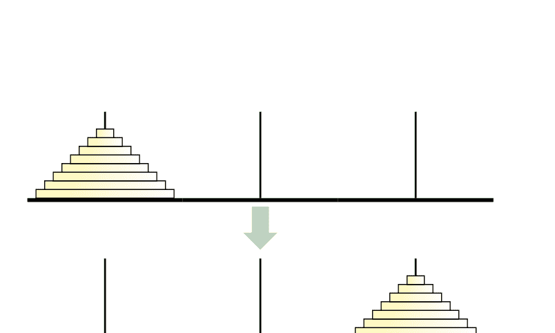

当然，作为优秀的计算机科学家，我们在阅读这个故事时的第一反应是用变量 $n$ 替换硬编码的常量 64。而且，由于大多数物理实例的难题是由木头而不是钻石和黄金制成的，我将把盘子的三个可能位置称为“柱子”而不是“针”。我们如何将一个由$n$个盘子组成的塔从一个柱子移动到另一个柱子，同时使用第三个备用柱子作为临时存放盘子的位置，而不会将一个盘子放在较小的盘子上面？

正如N.克劳斯（来自暹罗）在他的谜题附带的小册子中指出的那样，解决这个谜题的秘诀在于递归思维。与其试图一次性解决整个谜题，不如先专注于只移动最大的盘子。一开始我们无法移动最大的盘子，因为其他所有的盘子都挡住了。所以我们首先必须将那些$n-1$个较小的盘子移动到备用柱子上。一旦完成，我们就可以直接将最大的盘子移动到目标柱子上。最后，为了完成谜题，我们必须将备用柱子上的$n-1$个较小的盘子移动到它们的目标位置上。

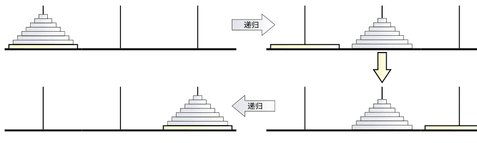

现在我们只需要弄清楚如何———

**不！！停！！**

就是这样！我们完成了！我们成功地将 $n$ 个盘子的汉诺塔问题简化为两个 $n - 1$ 个盘子的汉诺塔问题，我们可以高兴地将其交给递归精灵——或者按照卢卡斯的比喻，交给寺庙里的年轻僧侣。我们的工作完成了。如果我们不相信年轻僧侣，我们就不会雇佣他们；让他们安心地做好自己的工作。

我们的简化确实有一个微妙但非常重要的假设：存在一个最大的盘子。我们的递归算法适用于任何正数个盘子，但在 $n = 0$ 时会出现问题。我们必须使用不同的方法处理这种情况。幸运的是，贝纳勒斯的僧侣们是好的佛教徒，他们非常擅长在短时间内将零个盘子从一个柱子移动到另一个柱子，什么都不做。

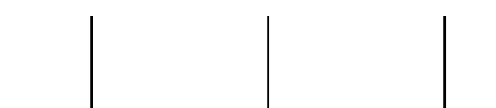

也许会有诱惑去思考那些较小的盘子是如何移动的——或者更一般地说，当递归展开时会发生什么——但实际上，不要这样做。对于大多数递归算法来说，展开递归既不必要也无益处。我们唯一的任务是将给定的问题实例化为一个或多个更简单的实例，或者如果这样的简化不可能，则直接解决问题。当 $n=0$ 时，我们的递归汉诺塔算法是显然正确的。对于任何 $n\geq 1$，递归精灵都会正确地移动顶部的 $n-1$ 个盘子（更正式地说，归纳假设暗示了我们的递归算法正确地移动顶部的 $n-1$ 个盘子），因此我们的算法是正确的。递归汉诺塔算法在图1.4中用伪代码表示。该算法将一个由 $n$ 个盘子组成的堆栈从源柱（$src$）移动到目标柱（$dst$），并使用第三个临时柱（$tmp$）作为占位符。注意，当 $n=0$ 时，算法确实什么都不做。

```
HANOI(n, src, dst, tmp):
    如果 n > 0
        HANOI(n-1, src, tmp, dst)    （递归！）
        将盘子 n 从 src 移动到 dst
        HANOI(n-1, tmp, dst, src)    （递归！）
```

令 $T(n)$ 表示转移 $n$ 个盘子所需的移动次数——我们算法的运行时间。我们的基本情况是 $T(0)=0$，而更一般的递归算法暗示 $T(n)=2T(n-1)+1$ 对于任意的 $n\geq 1$。通过列出 $T(n)$ 的前几个值，我们可以轻松地猜测 $T(n)=2^n-1$；一个直接的归纳证明证明了这个猜测是正确的。特别地，移动一个由64个盘子组成的塔需要 $2^{64}-1=18,446,744,073,709,551,615$ 次单独的移动。因此，即使以每秒一次的惊人速度，贝纳雷斯的僧侣们也将工作大约5850亿年（“plus decinq milliards de siècles”），直到塔楼、寺庙和婆罗门一起化为尘土，世界也将随着一声雷鸣而消失。

- 卢卡斯后来声称他在1876年发明了这个难题。
- 这个英文翻译摘自W.W. Rouse Ball的1892年著作《数学娱乐和论文》。
- “贝纳勒斯的大寺庙”几乎可以肯定是位于印度北方邦瓦拉纳西的卡西维斯瓦纳特寺庙，距离越南河内西北约2400公里，虚构的N.克劳斯据说住在那里。巧合的是，法国军队在1883年入侵了河内，正是在同一年卢卡斯发布了他的难题，最终导致河内成为法属印度支那的首都。

### 1.4 归并排序

归并排序是最早为通用存储程序计算机设计的算法之一。该算法由约翰·冯·诺伊曼于1945年开发，并在1947年与赫尔曼·戈尔斯坦合著的一篇论文中详细描述，作为EDVAC的第一个非数值程序之一。

戈尔斯坦和冯·诺伊曼实际上描述了一种非递归变体，现在通常称为自底向上的归并排序。当时，大型数据集是由专用机器排序的——几乎全部由IBM构建，使用二进制基数排序的变体来操作打孔卡。冯·诺伊曼（成功地！）争辩说，因为EDVAC比IBM的专用排序机器更快地进行排序，“无需人工干预或额外设备”，EDVAC是一台“通用”机器，不再需要专用的排序机器。

标准的递归归并排序算法遵循以下分治范式：

1. 将输入数组分成大致相等大小的两个子数组。
2. 递归地对每个子数组进行归并排序。
3. 将新排序的子数组合并为一个排序好的数组。

| 操作 | S | O | R | T | I | N | G | E | X | A | M | P | L |
| :--- | :-: | :-: | :-: | :-: | :-: | :-: | :-: | :-: | :-: | :-: | :-: | :-: | :-: |
| **输入** | S | O | R | T | I | N | G | E | X | A | M | P | L |
| **划分** | S | O | R | T | I | N | **G** | E | X | A | M | P | L |
| **递归左侧** | **I** | **N** | **O** | **R** | **S** | **T** | G | E | X | A | M | P | L |
| **递归右侧** | **I** | **N** | **O** | **R** | **S** | **T** | **A** | **E** | **G** | **L** | **M** | **P** | **X** |
| **合并** | **A** | **E** | **G** | **I** | **L** | **M** | **N** | **O** | **P** | **R** | **S** | **T** | **X** |

图1.5.归并排序示例。

第一步非常简单——只需将数组大小除以二——然后我们可以将第二步委托给递归精灵。所有真正的工作都在最后的合并步骤中完成。算法的完整描述在图1.6中给出；为了保持递归结构清晰，我将合并步骤提取为一个独立的子程序。合并算法也是递归的——首先确定输出数组的第一个元素，然后递归地合并输入数组的其余部分。

```
归并排序 (A[1..n]):
    如果 n > 1
        m ← ⌊n/2⌋
        归并排序 (A[1..m])      （递归！）
        归并排序 (A[m+1..n])  （递归！）
        合并 (A[1..n], m)
```

```
合并 (A[1..n], m):
    i ← 1; j ← m + 1
    对于 k 从 1 到 n
        如果 j > n
            B[k] ← A[i]; i ← i + 1
        否则如果 i > m
            B[k] ← A[j]; j ← j + 1
        否则如果 A[i] < A[j]
            B[k] ← A[i]; i ← i + 1
        否则
            B[k] ← A[j]; j ← j + 1
    对于 k 从 1 到 n
        A[k] ← B[k]
```

图1.6.归并排序

#### 正确性

为了证明这个算法的正确性，我们两次应用我们的老朋友归纳法，首先是对归并子程序，然后是对顶层的归并排序算法。

**引理 1.1.** 合并子数组 A[1..m]和 A[m+1..n]是正确的，假设这些子数组在输入中是有序的。

**证明:** 设 A[1 .. n]是任意数组， m是任意整数，使得子数组A[1 .. m]和 A[m + 1 .. n]是有序的。 我们证明对于所有的 k从0到 n，主循环的最后 n – k – 1次迭代将 A[i .. m]和 A[j .. n]正确地合并到 B[k .. n]中。 证明通过对剩余要合并的元素数量 n – k + 1进行归纳进行。

- 如果 j > n，则子数组 A[j .. n]为空，所以 min (A[i .. m] ∪ A[j .. n]) = A[i].
- 如果 i > m，则子数组 A[i .. m]为空，所以 min(A[i .. m] ∪ A[j .. n]) = A[j].
- 否则，如果 A[i] < A[j]，则 min (A[i .. m] ∪ A[j .. n]) = A[i].
- 否则，我们必须有 A[i] ≥ A[j]，且 min (A[i .. m] ∪ A[j .. n]) = A[j].

在这四种情况下， B[k]被正确地赋值为 A[i .. m] ∪ A[j .. n]中的最小元素。 在赋值 B[k] ← A[i]的两种情况下，递归精灵正确地合并——抱歉，我是说归纳假设暗示主循环的最后 n – k次迭代正确地将 A[i + 1 .. m]和 A[j .. n]合并为 B[k + 1 .. n]。 同样，在另外两种情况下，递归精灵也正确地合并了其余的子数组。

**定理 1.2.** 归并排序能正确地对任意输入数组 A[1 .. n]进行排序。

**证明:** 我们通过对 n进行归纳来证明该定理。 如果 n ≤ 1，则该算法正确地不执行任何操作。 否则，递归妖精正确地对两个较小的子数组 A[1 .. m]和 A[m + 1 .. n]进行排序（根据引理 1.1），之后它们被正确地合并成一个有序数组。

#### 分析

由于归并排序算法是递归的，其运行时间自然地表示为一个递归关系。 归并操作显然需要 O(n)时间，因为它是一个简单的循环，每次迭代都有固定的工作量。 我们立即得到了归并排序的以下递归关系：

$$T(n) = T(\lceil n/2 \rceil) + T(\lfloor n/2 \rfloor) + O(n).$$

在大多数分治递归关系中，我们可以安全地去除地板和天花板函数（使用本章后面描述的一种称为域变换的技术），从而得到更简单的递归关系 $T(n) = 2 T(n/2) + O(n)$。 递归树方法的“所有层级相等”情况（也在本章后面描述）立即得出了闭式解 $T(n) = O(n \log n)$。 即使你（还）不熟悉递归树，你也可以通过归纳验证解 $T(n) = O(n \log n)$。

### 1.5 快速排序

快速排序是另一种递归排序算法，由Tony Hoare在1959年发现并于1961年首次发表。 在这个算法中，最困难的部分是在递归之前将数组分割成较小的子数组，以便合并排序后的子数组变得简单。

1. 从数组中选择一个枢轴元素。
2. 将数组分成三个子数组，包含小于枢轴的元素，枢轴元素本身和大于枢轴的元素。
3. 递归地对第一个和最后一个子数组进行快速排序。

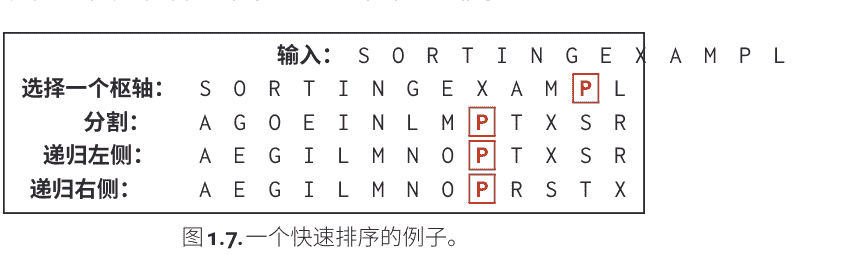

更详细的伪代码在图1.8中给出。在Partition子程序中，输入参数p是未排序数组中枢纽元素的索引；子程序对数组进行分区并返回枢轴元素的新索引。有许多不同的高效分区算法；这里介绍的算法归功于Nico Lomuto。变量ℓ计算数组中小于枢轴元素的项的数量。

```
快速排序 (A[1..n]):
    如果 (n > 1)
        选择一个枢轴元素    A[p]
        r ← PARTITION(A, p)
        快速排序 (A[1..r-1])    （递归！）
        快速排序 (A[r+1..n])    （递归！）

PARTITION(A[1..n], p):
    swap A[p] ↔ A[n]
    ℓ ← 0                    （#items < pivot）
    for i ← 1 to n-1
        if A[i] < A[n]
            ℓ ← ℓ + 1
            swap A[ℓ] ↔ A[i]
    swap A[n] ↔ A[ℓ+1]
    return ℓ + 1
```

#### 正确性

就像归并排序一样，证明快速排序的正确性需要两个单独的归纳证明：一个证明Partition正确地将数组分割，另一个证明快速排序正确排序的方法是假设Partition是正确的。为了证明PARTITION是正确的，我们需要证明以下循环不变式：在主循环的每次迭代结束时，子数组 $A[1 .. \ell]$ 中的所有元素都小于 $A[n]$，并且子数组 $A[\ell + 1 .. i]$ 中的所有元素都大于或等于 $A[n]$。我将把剩下的直接但繁琐的细节留给读者作为练习。

> Hoare提出了一种更复杂的“双向”分区算法，它在实际中比Lomuto的算法具有一些优势。另一方面，Hoare的分区算法是一个解决偏差错误的地方。

#### 分析

快速排序的分析也类似于归并排序。Partition明显需要 $O(n)$的时间，因为它是一个简单的for循环，每次迭代的工作量都是恒定的。对于快速排序，我们得到一个依赖于选择的枢轴元素的排名 $r$的递归关系：

$$T(n) = T(r - 1) + T(n - r) + O(n)$$

如果我们总是能够神奇地选择枢轴元素为数组 $A$的中位数，那么我们将有 $r = \lfloor n/2 \rfloor$，两个子问题的大小将尽可能接近，递归关系将变为

$$T(n) = T(\lceil n/2 \rceil - 1) + T(\lfloor n/2 \rfloor) + O(n) \le 2T(n/2) + O(n),$$

而且我们可以使用递归树方法或者更简单的“哦，是的，我们已经解决了归并排序的递归方程”方法来得到 $T(n) = O(n \log n)$。

事实上，正如我们将在本章后面看到的那样，我们实际上可以在线性时间内找到未排序数组的中位数，但是算法相当复杂，$O(\cdot)$表示法中的隐藏常数足够大，使得得到的排序算法不实用。实际上，大多数程序员会选择一些简单的方法，比如选择数组的第一个或最后一个元素。

在这种情况下，$r$可以取 $1$和 $n$之间的任何值，所以我们有

$$T(n) = \max_{1 \le r \le n} \big( T(r - 1) + T(n - r) + O(n) \big).$$

在最坏的情况下，两个子问题完全不平衡——要么 $r = 1$，要么 $r = n$，递归方程变为 $T(n) \le T(n - 1) + O(n)$。解决方案是 $T(n) = O(n^2)$。

另一个常见的启发式算法被称为“三数中值法”——选择数组的三个元素（通常是数组的开头、中间和结尾），并将这三个元素的中值作为枢轴。尽管这种启发式算法在实践中比仅选择一个元素要更有效，特别是当数组已经（几乎）排序时，但在最坏情况下仍然可能出现 $r=2$或 $r=n-1$。使用三数中值法，递归变成了 $T(n) \le T(1) + T(n-2) + O(n)$，其解仍然是 $T(n) = O(n^2)$。

直观上，枢轴元素应该“通常”位于数组的中间，即排名在\(n/10\)和\(9n/10\)之间。这个观察表明，“平均情况”下的运行时间应该是\(O(n\log n)\)。尽管这种直觉可以形式化，但最常见的形式化假设是所有输入数组的排列都是等可能的，这是完全不现实的。

真实世界的数据可能是随机的，但它不是以任何我们可以预先预测的方式随机的，而且它肯定不是均匀的！⁷

偶尔人们也考虑“最好情况”下的运行时间，出于某种原因。我们不会。

### 1.6 模式

归并排序和快速排序都遵循一种称为分治的一般三步模式：

- 1. 将给定问题的实例分成几个独立的更小的问题实例完全相同的问题。
- 2. 将每个更小的问题实例委托给递归精灵。
- 3. 将更小问题实例的解决方案组合成给定问题的最终解决方案。

如果任何实例的大小低于某个常数阈值，我们将放弃递归，并直接通过蛮力在常数时间内解决问题。

证明分治算法的正确性几乎总是需要归纳法。分析运行时间需要建立和解决一个递归关系，通常（但不幸的是并不总是！）可以使用递归树来解决。

### 1.7 递归树

那么这些“递归树”是什么？递归树是一种简单、通用的图形工具，用于解决分治递归。递归树是一棵根树，每个递归子问题对应一个节点。每个节点的值表示对应子问题的耗时，不包括递归调用。因此，算法的总运行时间是树中所有节点值的总和。

为了更加具体地理解这个概念，想象一个分治算法，在非递归工作上花费\(O(f(n))\)的时间，然后进行\(r\)次递归。

另一方面，如果我们随机选择主元素索引\(p\)，则快速排序的运行时间为\(O(n\log n)\)，对于每个可能的输入数组，概率很高。关键的区别在于，随机性由我们的算法控制，而不是由全能的恶意对手在读取我们的代码后提供输入数据。遗憾的是，随机快速排序的分析超出了本书的范围，但你可以在http://algorithms.wtf/找到相关的讲义。

每个问题的调用次数为 n/c。除了常数因子（我们可以在 O()表示中隐藏），该算法的运行时间由递归方程决定。

$$T(n) = r T(n/c) + f(n)$$

对于 \(T(n)\)的递归树的根节点具有值 \(f(n)\)和 \(r\)个子节点，每个子节点都是 \(T(n/c)\)的递归树的根节点。换句话说，递归树是一棵完全的 \(r\)叉树，每个深度为 \(d\)的节点包含值 \(f(n/c^d)\)。（可以假设 \(n\)是 \(c\)的整数幂，所以 \(n/c^d\)始终是整数，尽管实际上这并不重要。）在实践中，我建议绘制出前两或三层的树，如图1.9所示。

图1.9.递归树对于递归式 \(T(n) = r T(n/c) + f(n)\)

递归树的叶子节点对应于递归式的基本情况。因为我们只关注渐近界限，具体的基本情况实际上并不重要；我们可以安全地假设 \(T(n) = 1\)对于所有 \(n \leq n_0\)，其中 \(n_0\)是任意正常数。特别地，我们可以选择对于我们的分析最方便的 \(n_0\)的值。对于这个例子，我将选择 \(n_0 = 1\)。

现在 \(T(n)\)是递归树中所有值的总和；我们可以通过逐层考虑树来计算这个总和。对于每个整数 \(i\)，树的第 \(i\)层恰好有 \(r^i\)个节点，每个节点的值为 \(f(n/c^i)\)。因此，

$$T(n) = \sum_{i=0}^{L} r^i \cdot f(n/c^i) \quad (\Sigma)$$

其中 \(L\)是树的深度。我们的基本情况 \(n_0 = 1\)立即意味着 \(L = \log_c n\)，因为 \(n/c^L = n_0 = 1\)。由此可见，叶子节点的数量是递归树的节点数正好是 \(r^L = r^{\log_c n} = n^{\log_c r}\)。因此，在逐层求和 (\(\Sigma\)) 中的最后一项是 \(n^{\log_c r} \cdot f(1) = O(n^{\log_c r})\)，因为 \(f(1) = O(1)\)。

有三种常见情况下，逐层求和 (\(\Sigma\)) 特别容易计算：

- **递减**：如果序列呈指数衰减——每一项都比前一项小一个常数因子——那么 \(T(n) = O(f(n))\)。在这种情况下，求和的主导因素是递归树根节点的值。
- **相等**：如果序列中的所有项都相等，则我们立即有 \(T(n) = O(f(n) \cdot L) = O(f(n) \log n)\)。（常数 \(c\) 消失在 \(O(\;)\)表示法中。）
- **增长**：如果序列呈指数增长——每个项都是前一个项的一个常数因子大——那么 \(T(n) = O(n^{\log_c r})\)。在这种情况下，总和由递归树中的叶子数量主导。

在第一种和第三种情况下，只有几何级数中最大的项才重要；所有其他项都被 \(O(\cdot)\) 表示法吞噬。在递减的情况下，我们甚至不需要计算 \(L\)；如果递归树是无限的，渐近上界仍然成立！

作为一个基本的例子，如果我们绘制出（简化的）归并排序递归的前几个层级的树形结构 \(T(n) = 2T(n/2) + O(n)\)，我们会发现所有层级都是相等的，这立即意味着 \(T(n) = O(n \log n)\)。

递归树技术也可以用于递归子问题大小不同的算法。例如，如果我们能够以某种方式实现快速排序，使得枢轴始终落在已排序数组的中间三分之一，最坏情况下的运行时间将满足递归关系。

$$T(n) \le T(n/3) + T(2n/3) + O(n)$$

这个递归关系看起来可能很吓人，但实际上相当温和。如果我们绘制出结果递归树的几个层级，我们很快就会意识到任何层级上的值的总和最多为 \(n\)——更深层级可能会缺少一些节点——整个树的深度为 \(\log_{3/2} n = O(\log n)\)。由此立即得出 \(T(n) = O(n \log n)\)。（此外，递归中的 full 层级的数量树的高度 \(\log_3 n = \Omega(\log n)\)，所以这种保守的分析可以通过一个常数因子来改进，对于我们的目的来说，这意味着根本不需要改进。）递归树不平衡的事实根本无关紧要。

作为一个更极端的例子，快速排序的最坏情况复杂度 \(T(n)=T(n-1)+T(1)+O(n)\) 给我们一个完全不平衡的递归树，其中每个内部节点的一个子节点是叶子节点。逐层求和不属于我们三个默认类别之一，但我们仍然可以通过观察得出解决方案\(T(n)=O(n^2)\)，因为每个层级的值最多为 \(n\)，并且最多有 \(n\) 个层级。（再次强调，这种保守的分析是紧密的，因为每个 \(n/2\) 层级的值至少为 \(n/2\)。）

## ♥忽略楼层和天花板是可以的，诚实的

仔细的读者可能会反对我们的分析忽略了一个重要细节。归并排序的运行时间实际上不遵循递归关系式\(T(n)=2T(n/2)+O(n)\)；毕竟，输入大小 \(n\) 可能是奇数，那么对于大小为 \(42^1_2\) 或 \(17^7_8\) 的数组进行排序意味着什么呢？实际的归并排序递归关系式有些混乱：

$$T(n) = T(\lceil n/2 \rceil) + T(\lfloor n/2 \rfloor) + O(n).$$

当然，我们可以使用归纳法来检查 \(T(n) = O(n \log n)\)，但是必要的计算将会非常糟糕。幸运的是，有一种称为域变换的简单技术可以从递归关系式中去除 floor 和 ceiling。

- 首先，因为我们正在推导一个上界，我们可以安全地高估 \(T(n)\)，一次假装两个子问题的大小相等，再次消除天花板：

$$T(n) \leq 2T(\lceil n/2 \rceil) + n \leq 2T(n/2 + 1) + n.$$

8形式上，我们将 T 视为一个关于实数的函数，而不仅仅是关于整数的函数，它满足给定的递归关系和基本情况 \(T(n)=C\) 对于所有 \(n \leq n_0\)，其中 \(C \geq 0\) 和 \(n_0 > 0\) 的值不重要。如果 \(n\) 恰好是一个整数，则 \(T(n)\) 与输入大小为 \(n\) 的算法的运行时间相符，但这也无关紧要。

- 其次，我们定义一个新函数 \(S(n) = T(n + \alpha)\)，选择常数 \(\alpha\) 使得 \(S(n)\) 满足更简单的递归关系 \(S(n) \leq 2S(n/2) + O(n)\)。为了找到正确的常数 \(\alpha\)，我们从给定的递归关系为 T 推导出 S 的递归关系：

$$S(n) = T(n + \alpha) \quad \text{[S的定义]}$$
$$\leq 2T(n/2 + \alpha/2 + 1) + n + \alpha \quad \text{[T的递归公式]}$$
$$= 2S(n/2 - \alpha/2 + 1) + n + \alpha \quad \text{[S的定义]}$$

将 \(\alpha = 2\) 简化这个递归为 \(S(n) \leq 2S(n/2) + n + 2\)，这正是我们想要的。

- 最后，递归树方法暗示 \(S(n) = O(n \log n)\)，因此

$$T(n) = S(n - 2) = O((n - 2) \log(n - 2)) = O(n \log n),$$
正如承诺的那样。

正如承诺的那样。类似的域变换可以用来消除任何分治递归中的地板、天花板甚至低阶项。但是现在我们意识到这一点，我们不再需要费心地去处理细节了！从现在开始，面对任何分治递归，我会默默地忽略地板、天花板和低阶项，我也鼓励你这样做。

## ❤1.8 线性时间选择

在我们讨论快速排序的过程中，我曾经提到我们可以在在线性时间内找到未排序数组的中位数。第一个这样的算法是由 Manuel Blum，Bob Floyd，Vaughan Pratt，Ron Rivest 和 Bob Tarjan 在20世纪70年代初发现的。他们的算法实际上解决了更一般的问题，即在一个n元素数组中选择第k个最小的元素，给定数组和整数k作为输入，使用一种称为 quickselect 或 one-armed quicksort 的算法的变体。Quickselect 是由 Tony Hoare 在1961年首次描述的，字面上是在他首次发表 quicksort 的同一页上。

#### 快速选择

通用的 quickselect 算法选择一个枢轴元素，使用与 QuickSort 相同的 Partition 子程序对数组进行分区，然后递归地搜索原始输入数组中包含第k个最小元素的两个子数组中的一个。quickselect 的伪代码如图1.12所示。

## 1. 递归

```
QUICKSELECT(A[1..n], k):
如果 n = 1
    返回 A[1]
否则
    选择一个枢轴元素 A[p]
    r ← PARTITION(A[1..n], p)
    如果 k < r
        返回 QUICKSELECT(A[1..r-1], k)
    否则如果 k > r
        返回 QUICKSELECT(A[r+1..n], k-r)
    否则
        返回 A[r]
```

> 图1.12.快速选择，或者单臂快速排序

这个算法有两个重要特点。首先，就像快速排序一样，快速选择的正确性不依赖于枢轴的选择方式。其次，即使我们只关心选择中位数（特殊情况 k = n/2），Hoare的递归策略要求我们考虑更一般的选择问题；输入数组 A[1..n] 的中位数几乎从不是两个较小子数组 A[1..r-1] or A[r+1..n] 的中位数。QuickSelect的最坏情况运行时间遵循类似于QuickSort的递归关系。我们不知道 r 的值，或者我们将递归搜索的两个子数组中的哪一个，所以我们必须假设最坏情况。

$$T(n) \leq \max_{1\leq r\leq n} \max\{T(r-1), T(n-r)\} + O(n)$$

我们可以通过让 \(\ell\) 表示递归子问题的长度，稍微简化递归。

$$T(n) \leq \max_{0\leq \ell\leq n-1} T(\ell) + O(n)$$

如果选择的主元始终是数组中最小或最大的元素，则递归简化为 \(T(n) = T(n-1) + O(n)\)，这意味着 \(T(n) = O(n^2)\)。（这个递归的树只是一个简单的路径。）

#### 好的主元

如果我们可以某种方式神奇地选择一个好的主元，即 \(\ell \leq \alpha n\)，其中 \(\alpha < 1\)，则可以避免这种二次最坏情况。在这种情况下，递归会简化为

$$T(n) \leq T(\alpha n) + O(n).$$

这个递归展开成一个递减的几何级数，其主要由最大项主导，因此 \(T(n) = O(n)\)。（同样，递归树只是一个简单的路径。运行时间中的常数取决于常数 \(\alpha\)。）换句话说，如果我们可以以线性时间快速找到一个接近中位数的元素，我们就可在线性时间内找到确切的中位数。所以现在我们只需要一个近似中位数的仙女。Blum-Floyd-Pratt-Rivest-Tarjan算法通过递归计算输入数组的精心选择的子集的中位数来选择一个好的快速选择主元。近似中位数仙女只是伪装成递归仙女！具体来说，我们将输入数组分成 \(\lceil n/5 \rceil\) 个块，每个块包含恰好5个元素，最后一个块可能不满。（如果最后一个块不满，只需添加一些 \(\infty\)。）我们通过蛮力计算每个块的中位数，将这些中位数收集到一个新数组 \(M[1..\lceil n/5 \rceil]\) 中，然后递归计算这个新数组的中位数。最后，我们使用块中位数的中位数（在伪代码中称为“$mom$”）作为快速选择主元。

```
MOMSELECT(A[1..n], k):
  如果 n ≤ 25 《或者其他》
      使用暴力法
  否则
      m ← ⌈n/5⌉
      对于 i ← 1 到 m
          M[i] ← MEDIANOFFIVE(A[5i-4 .. 5i]) 《暴力法！》
      mom ← MOMSELECT(M[1..m], ⌊m/2⌋) 《递归！》
      r ← PARTITION(A[1..n], mom)
      如果 k < r
          返回 MOMSELECT(A[1..r-1], k) 《递归！》
      否则如果 k > r
          返回 MOMSELECT(A[r+1..n], k-r) 《递归！》
      否则
          返回 mom
```

MOMSELECT 使用递归来实现两个不同的目的；第一次是选择一个枢轴元素 ($mom$)，第二次是在该枢轴的一侧搜索条目。

#### 分析

但是为什么这样快呢？第一个关键洞察是中位数中的中位数是一个很好的枢轴。\(mom\) 比 \(\lfloor \lfloor n/5 \rfloor / 2 \rfloor - 1 \approx n/10\) 个块中位数大，并且每个块中位数比其块中的其他两个元素大。因此，\(mom\) 比输入数组中至少 \(3n/10\) 个元素大；对称地，\(mom\) 比至少 \(3n/10\) 个元素小。因此，在最坏的情况下，第二次递归调用搜索的数组大小最多为 \(7n/10\)。

我们可以通过将输入数组绘制成一个 \(5 \times \lceil n/5 \rceil\) 的网格来可视化算法的行为，其中每一列代表五个连续的元素。为了说明的目的，想象一下我们从上到下对每一列进行排序，然后按照它们的中间元素对列进行排序。（让我强调一下，算法实际上并不这样做！）在这种排列中，中位数是离网格中心最近的元素。

网格的前三行的左半部分包含 \(3n/10\) element，每个元素都小于 mom。如果我们要查找的元素大于 mom，我们的算法将在递归之前丢弃所有小于 mom 的元素，包括那 \(3n/10\) element。因此，递归子问题的输入最多包含 \(7n/10\) element。对称的论证意味着，如果我们的目标元素小于 mom，我们丢弃至少 \(3n/10\) element 大于 mom 的元素，因此我们递归子问题的输入最多有 \(7n/10\) element。

好的，所以妈妈是一个很好的枢轴，但是我们的算法仍然会进行两次递归调用，而不是只有一次；我们如何证明线性时间？第二个关键洞察是，两个递归子问题的总大小比原始输入数组的大小小一个常数因子。算法的最坏情况运行时间遵循递归关系

$$T(n) \leq T(n/5) + T(7n/10) + O(n)$$

如果我们为这个递归关系绘制递归树，我们会观察到每个递归树层级的总工作量最多是前一层级总工作量的 9/10。因此，层级求和呈指数衰减，给出我们的解 \(T(n) = O(n)\)。（再次强调，递归树不平衡这个事实完全无关紧要。）太棒了！谢谢，妈妈！

# 合理性检查

在这一点上，许多学生问起那个魔术常数 5。为什么我们选择了那个特定的块大小？答案是 5 是能够在递归树分析中给我们指数衰减的最小奇数块大小！（偶数块大小会引入额外的复杂性。）如果我们使用大小为 3 的块，运行时间递归关系将会是

$$ T(n) \leq T(n/3) + T(2n/3) + O(n). $$

我们之前见过这个递归关系！递归树的每一层的总值最多为 n，并且递归树的深度为 \(\log_{3/2} n = O(\log n)\)，因此这个递归关系的解为 \(T(n) \leq O(n \log n)\)。（此外，这个分析是紧密的，因为递归树有 \(\log_3 n\) 个完整层。）使用 3 元素块的中位数选择并不比排序更快。

更精细的分析揭示了被 \(O( )\) 符号隐藏的常数是相当大的，即使我们只计算比较次数。选择 5 个元素的中位数最多需要 6 次比较，因此我们最多需要 \(6n/5\) 次比较来设置递归子问题。在递归调用之后，简单地对数组进行分区需要 \(tn - 1\) 次比较，但我们已经知道大于枢轴的 \(3 n/10\) 个元素和小于枢轴的 \(3n/10\) 个元素，因此分区实际上只需要 \(2n/5\) 次额外比较。因此，最坏情况下比较次数的更精确递归关系是

$$ T(n) \leq T(n/5) + T(7n/10) + 8n/5. $$

递归树方法意味着上界

$$ T(n) \leq \frac{8n}{5} \sum_{i \geq 0} \left( \frac{9}{10} \right)^{i} = \frac{8n}{5} \cdot 10 = 16n. $$

实际上，中位数选择的效率并不像最坏情况分析所预测的那样慢——在递归的每个层级都得到最坏情况的枢轴是非常不可能的——但对于中等大小的数组来说，它仍然比排序慢。⁹

实际上，在实践中选择枢轴元素的正确方法是均匀地随机选择。那么找到中位数所需的比较次数的期望值最多为 \(4n\)。有关更多详细信息，请参阅我的随机算法讲义，网址为 http://algorithms.wtf。

### 1.9 快速乘法

在前一章中，我们看到了两种古老的算法，用于在 O(n^2) 时间内乘以两个 n 位数：传统的格栅算法和埃及农民算法。

也许我们可以通过将数字数组分成两半并利用以下等式来获得更高效的算法：

$$(10^m a + b)(10^m c + d) = 10^{2m} ac + 10^m (bc + ad) + bd$$

这个递归公式立即提示了以下分治算法，用于乘以两个 n 位数 x 和 y。四个子乘积 ac, bc, ad 和 bd 都是通过递归计算的，但是最后一行中的乘法不是递归的，因为我们可以通过将数字向左移动并填充正确数量的零来乘以十的幂，所有这些操作都可以在 O(n) 时间内完成。

```
SPLITMULTIPLY(x, y, n):
    如果 n = 1
        返回 x · y
    否则
        m ← ⌈n/2⌉
        a ← ⌊x/10^m⌋; b ← x mod 10^m    《x = 10^m a + b》
        c ← ⌊y/10^m⌋; d ← y mod 10^m    《y = 10^m c + d》
        e ← SPLITMULTIPLY(a, c, m)
        f ← SPLITMULTIPLY(b, d, m)
        g ← SPLITMULTIPLY(b, c, m)
        h ← SPLITMULTIPLY(a, d, m)
        返回 10^{2m} e + 10^m (g + h) + f
```

通过归纳法很容易证明这个算法的正确性。这个算法的运行时间遵循递归关系式

$$T(n) = 4T(\lceil n/2 \rceil) + O(n).$$

递归树方法将这个递归关系转化为一个递增的几何级数，这意味着 T(n) = O(n log^2 n) = O(n^2)。事实上，这个算法将 x 的每一位与 y 的每一位相乘，就像格点算法一样。

所以我猜那个方法不起作用。太糟糕了。这是一个好主意。

在 20 世纪 50 年代中期，安德烈·科尔莫戈洛夫，20 世纪的数学巨人之一，公开猜测在次二次时间内没有乘法两个 n 位数的算法。科尔莫戈洛夫在 1960 年组织了莫斯科大学的一个研讨会，在那里他重新提出了他的“n^2 猜想”，并提出了一些相关问题，计划在未来的会议上讨论。几乎一周后，一个 23 岁的学生名叫阿纳托利·卡拉茨巴向科尔莫戈洛夫提出了一个了不起的反例。根据卡拉茨巴本人的说法，

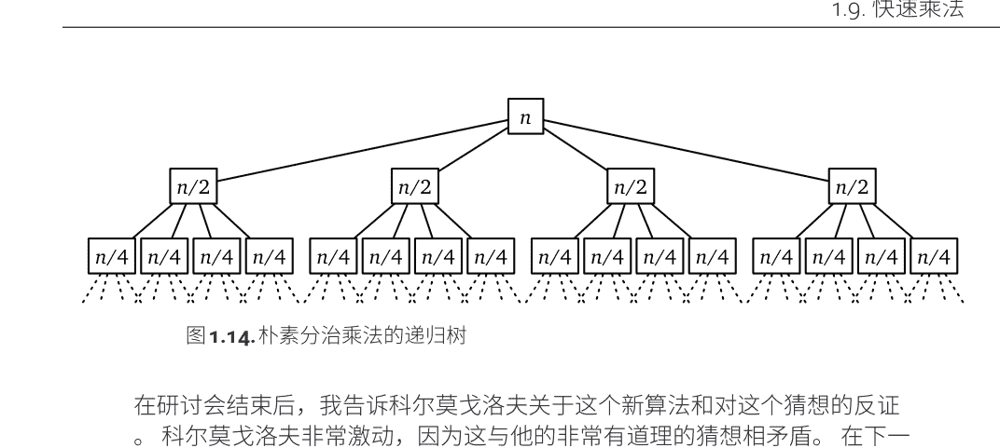

在研讨会结束后，我告诉科尔莫戈洛夫关于这个新算法和对这个猜想的反证。科尔莫戈洛夫非常激动，因为这与他的非常有道理的猜想相矛盾。在下一次研讨会上，科尔莫戈洛夫亲自告诉与会者关于我的方法，于是研讨会被终止了。

卡拉图巴观察到中间系数 bc+ad 可以通过以下代数恒等式仅使用一个递归乘法计算出来，而不需要其他两个系数 ac 和 bd：

ac + bd - (a - b)(c - d) = bc + ad

这个技巧让我们可以用仅仅三个递归调用来替代之前算法中的四个递归调用，如下所示：

```
快速乘法 (x, y, n):
    如果 n = 1
        返回 x · y
    否则
        m ← ⌈n/2⌉
        a ← ⌊x/10^m⌋; b ← x mod 10^m    // ⟨x = 10^m a + b⟩
        c ← ⌊y/10^m⌋; d ← y mod 10^m    // ⟨y = 10^m c + d⟩
        e ← FASTMULTIPLY(a, c, m)
        f ← FASTMULTIPLY(b, d, m)
        g ← FASTMULTIPLY(a - b, c - d, m)
        return 10^{2m} e + 10^m (e + f - g) + f
```

T(n) ≤ 3T(⌈n/2⌉) + O(n)

再次，递归树方法将这个递归关系转化为一个递增的几何级数，但新的解决方案只有 T(n) = O(n^{log_2 3}) = O(n^{1.58496})，相比之前的二次时间复杂度有了显著的改进。¹⁰

> ¹⁰我的演讲稍微简化了实际历史。事实上，Karatsuba提出了一个基于公式 (a + b)(c + d) - ac - bd = bc + ad 的算法。这个算法的运行时间也是 O(n^{lg 3})，但实际的递归关系稍微复杂一些：a - b 和 c - d 仍然是 m 位数的数字，但 a + b 和 c + d 可能每个都有 m + 1 位数。这里提出的简化是由Donald Knuth提出的。

Karatsuba算法可以说是启动了算法的设计和分析作为一个正式的研究领域。

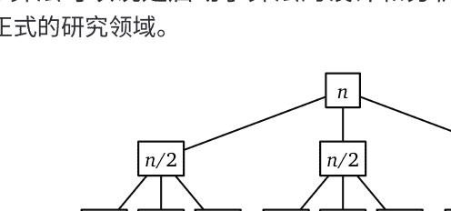

我们可以进一步采用Karatsuba的思想，将数字分割成更多的部分，并以更复杂的方式组合它们，以获得更快的乘法算法。 Andrei Toom发现了一个无限家族的算法，将任何整数分成 k个部分，每个部分有k/ n位数，并且然后仅使用 2k − 1个递归乘法计算乘积； Toom的算法在Stephen Cook的博士论文中进一步简化。 对于任何固定的 k， Toom-Cook算法的运行时间为 \( O(n^{1+1/(\lg k)}) \)， 其中 \( O(\cdot) \)表示的隐藏常数取决于 k。

最终，这种分而治之的策略使高斯（是的，真的）发现了快速傅里叶变换 。\( ^{11} \) 基本的\( FFT \)算法本身的运行时间为 \( O(n \log n) \)；然而，使用\( FFT \)进行整数乘法会产生一些额外的开销。 第一个基于\( FFT \)的整数乘法算法由Arnold Schönhage和Volker Strassen于1971年发表， 运行时间为 \( O(n \log n \log \log n) \)。 在Martin Fürer发现一系列技术改进之前， Schönhage-Strassen一直是理论上最快的整数乘法算法。 最后，在2019年，David Harvey和Joris van der Hoeven发表了一种运行时间为\( O(n \log n) \)的算法。\( ^{12} \)

### 1.10 指数运算

给定一个数 \( a \)和一个正整数 \( n \)，假设我们想计算 \( a^n \)。 标准的朴素方法是一个简单的for循环， 通过 \( a \)进行\( n − 1 \)次乘法运算：

```
SLOWPOWER(a, n):
    x ← a
    for i ← 2 to n
        x ← x · a
    return x
```

这个迭代算法需要 n次乘法。

输入参数 a可以是整数、有理数或浮点数。实际上，它不需要是一个数字，只要我们知道如何进行乘法运算。例如，相同的算法可以用于计算模某个有限数的幂（在密码学算法中常用的操作）或计算矩阵的幂（用于求解递归和计算图中的最短路径）。因为我们不知道我们正在相乘的对象是什么，所以我们无法知道单次乘法需要多少时间，因此我们被迫根据乘法次数来分析运行时间。

有一种更快的分治方法，最初由印度韵律学家Pingala在公元前2世纪提出，它使用以下简单的递归公式：

```
a^n = { 1, if n = 0
      { (a^{n/2})^2, 如果 n > 0 且 n是偶数
      { (a^{⌊n/2⌋})^2 · a, otherwise
```

```
PINGALAPower(a, n):
    如果 n = 1
        返回 a
    否则
        x ← PINGALAPower(a, ⌊n/2⌋)
        如果 n是偶数
            返回 x · x
        否则
            返回 x · x · a
```

这个算法执行的乘法总次数满足递归关系 T(n) ≤ T(n/2) + 2。递归树方法立即给出了解 T(n) = O(log n)。

一个几乎相同的指数算法也可以直接从前一章的埃及农民乘法算法中推导出来，通过用乘法替换加法（特别是用平方替换重复）。

```
a^n = { 1, if n = 0
      { (a^2)^{n/2}, 如果 n > 0 且 n是偶数
      { (a^2)^{⌊n/2⌋} · a, otherwise
```

```
PEASANTPOWER(a, n):
    如果 n = 1
        返回 a
    否则如果 n是偶数
        返回 PEASANTPOWER (a², n/2)
    否则
        返回 PEASANTPOWER (a², ⌊n/2⌋) · a
```

这个算法——可以合理地称为“平方和中介”——也只执行 O(log n)次乘法。

这两个算法都是渐进最优的；任何计算 aⁿ 的算法都必须至少执行 Ω(log n)次乘法，因为每次乘法最多将已计算的最大幂次加倍。实际上，当n是2的幂时，这两个算法都需要 log₂ n次乘法，这是 exactly optimal。然而，对于其他值的 n，还有稍微更快的方法。例如，PingalaPower 和 PeasantPower每个都使用六次乘法计算 a¹⁵，但实际上只需要五次乘法：

- 皮尼亚拉： a → a² → a³ → a⁶ → a⁷ → a¹⁴ → a¹⁵
- 农民： a → a² → a⁴ → a⁸ → a¹² → a¹⁴ → a¹⁵
- 最优： a → a² → a³ → a⁵ → a¹⁰ → a¹⁵

关于给定指数 n的绝对最小乘法次数是否可以高效计算，这是一个长期存在的开放问题。

## 练习

### 汉诺塔

- 1. 证明原始递归汉诺塔算法执行的移动序列与以下非递归算法的移动序列完全相同——相同的盘子，从相同的柱子到相同的柱子，按照相同的顺序。柱子标记为 0，1和 2，我们的问题是将一堆 n个盘子从柱子 0移动到柱子 2（如图24页所示）。
    (a) 如果 n是偶数，则交换钉子 1和 2。在第 i步，进行唯一合法的移动，避免钉子 i mod 3。如果没有合法的移动，则所有的盘子都在钉子 i mod 3上，谜题解决。
    (b) 对于第一次移动，如果 n是偶数，则将盘子 1移动到钉子 1，如果 n是奇数，则将盘子1移动到钉子 2。然后重复进行唯一合法的移动，涉及到与前一次移动不同的盘子。如果不存在这样的移动，则谜题解决。
    (c) 假设盘子 n+1，n+2和 n+3位于钉子 0，1和 2的底部。重复进行唯一满足以下约束条件的移动，直到无法进行这样的移动为止。

    - 不要将奇数盘直接放在另一个奇数盘上。
    - 不要将偶数盘直接放在另一个偶数盘上。
    - 不要撤销上一步操作。

    (d) 让 \(\rho(n)\) 表示最小的整数 \(k\)，使得 \(t n/2^k\) 不是整数。
    例如，\(\rho(42)=2\)，因为 \(42/2^1\) 是整数，但 \(42/2^2\) 不是。（等价地，\(\rho(n)\) 是在 \(tn\) 的二进制表示中最低有效位 1 的位置加一。）由于其行为类似于标尺上的刻度，\(\rho(n)\) 有时被称为刻度函数。

    ```
    RULERHANOI(n):
        i ← 1
        while ρ(i) ≤ n
            if t n − i 是偶数
                将盘 ρ(i) 向前移动  ⟨0 → 1 → 2 → 0⟩
            否则
                将盘 ρ(i) 向后移动  ⟨0 → 2 → 1 → 0⟩
            i ← i + 1
    ```

- 2. 汉诺塔是一个相对较新的谜题，它是一个更古老的机械谜题的后裔，这个谜题被称为中国连环环，巴格诺迪尔，卡尔丹的环，梅莱达，耐心，疲劳铁，囚犯的锁，旋转，以及许多其他名称。这个谜题在16世纪时已经在中国和欧洲广为人知。意大利数学家卢卡·帕乔利在他的未发表著作《De Viribus Quantitatis》中描述了7环谜题及其解法，该著作写于1498年至1506年之间；仅仅几年后，明代诗人杨慎将9环谜题描述为“妇女和儿童的玩具”。这个谜题据说是归功于一位2世纪的中国将军，他把这个谜题交给他的妻子在他出征期间消磨时间。

    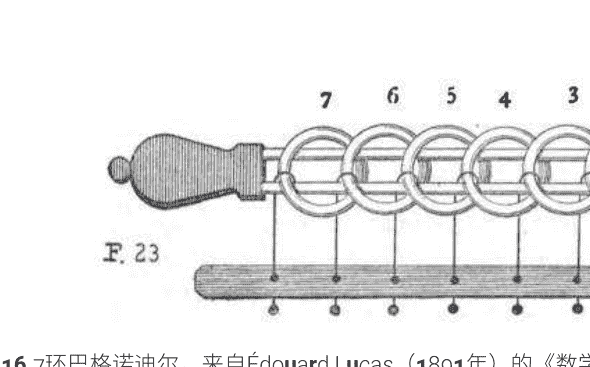

    > > _De Viribus Quantitatis_ [关于数字的力量] 是一部重要的早期娱乐数学著作，也许是现存最古老的魔术论文。Pacioli因其晚15世纪数学的近乎完整的百科全书《算术总汇》而闻名，其中包括了对双入账簿记法的首次描述。

    巴格诺迪尔拼图有许多物理形式，但最常见的是由长金属环和几个环组成，这些环通过可移动的杆连接到一个坚固的底座上。最初，环被穿过环，如图1.16所示；拼图的目标是将环取下。

    更抽象地说，我们可以将这个谜题建模为一系列位，每个环对应一个位，其中第i位为1表示环通过第i个环，为0表示不通过。（这里我们从右到左对环进行编号，如图1.16所示。）这个谜题允许两种合法的移动：

    - 你总是可以翻转第1位（最右边的位）。
    - 如果位串以恰好z个0结尾，你可以翻转第（z+2）位。这个谜题的目标是将一个由n个1组成的位串转化为一个由n个0组成的位串。

    例如，下面这个由21个移动组成的序列解决了5环谜题：

    ```
    11111 → 11110 → 11010 → 11011 → 11001 → 11000
    → 01000 → 01001 → 01011 → 01010 → 01110
    → 01111 → 01101 → 01100 → 00100 → 00101
    → 00111 → 00110 → 00010 → 00011 → 00001 → 00000
    ```

    ◆ (a) 如果没有任何移动是前一个移动的逆操作，我们称移动序列为“简化的”。证明对于任意非负整数n，存在唯一的简化移动序列可以解决n环巴格诺迪尔谜题。
    [提示：如果你已经熟悉图论，那么这个问题会更容易。]

    (b) 描述一个解决Baguenaudier难题的算法。你的输入是环的数量 n；你的算法应该打印出一个简化的移动序列来解决这个难题。例如，给定整数 5作为输入，你的算法应该打印出序列1, 3, 1, 2, 1, 5, 1, 2, 1, 3, 1, 2, 1, 4, 1, 2, 1, 3, 1, 2, 1。

    (c) 作为 n的函数，你的算法执行了多少次移动? 证明你的答案是正确的。

- 3. 汉诺塔历史上一个较少为人所知的章节是它在13世纪初从贝纳雷斯迁至比萨的短暂搬迁。14这次搬迁是由富有的商人列奥纳多·斐波那契组织的，应圣罗马帝国皇帝弗里德里希二世的请求，他从十字军返回的士兵那里听说了这座寺庙的传闻。比萨的塔楼和随从僧侣因此而闻名，帮助确立了比萨作为意大利半岛的主要贸易中心。

    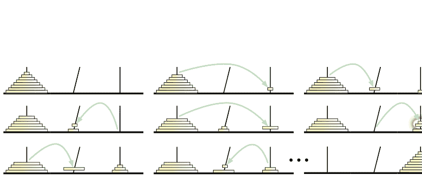

    图1.17. 比萨斜塔。在第五次移动中，两个盘子被从倾斜的针上取下。

    不幸的是，庙宇刚刚移动不久，其中一根钻石针就开始倾斜到一边。为了避免倾斜塔楼因使用过度而倒塌，斐波那契说服祭司们采用了一条更宽松的规则：任意数量的盘子可以一次性移动到另一根针上。仍然禁止在较小的盘子上放置较大的盘子，并且盘子必须一次移动一个，放到倾斜的针上或者两根垂直的针之间。

    多亏了斐波那契的新规则，祭司们可以从比萨比从贝纳雷斯更快地结束宇宙。幸运的是，在新加冕的教皇格里高利九世将弗雷德里克二世逐出教会后，庙宇从比萨迁回了贝纳雷斯，使当地的祭司们对接纳具有奇怪数学习惯的外国异教徒不再表示同情。不久之后，一座钟楼建在了庙宇曾经的位置上；它也几乎立即开始倾斜。

    描述一个算法，将一个堆栈的 n 个盘子从一个垂直的针移动到另一个垂直的针，使用尽可能少的移动次数。你的算法执行了多少次移动？

- 4. 考虑以下受限制的汉诺塔难题变体。在每个问题中，柱子编号为 0，1 和 2，你的任务是将一个堆栈的 n 个盘子从柱子 0 移动到柱子 2，就像问题1中一样。

    (a) 假设你被禁止直接在柱子 1 和柱子 2 之间移动任何盘子；每次移动必须涉及柱子 0。描述一个算法，以尽可能少的移动次数解决这个版本的难题。你的算法执行了多少次移动？

    ♣♥(b) 假设你只允许从柱子 0 移动盘子到柱子 2，从柱子 2 移动盘子到柱子 1，或者从柱子 1 移动盘子到柱子 0。等效地，假设柱子排列成一个环，按顺时针顺序编号，你只允许逆时针移动盘子。描述一个算法，以尽可能少的移动次数解决这个版本的难题。你的算法执行了多少次移动？

    ♣♥(c) 最后，假设你唯一的限制是你不能直接将一个盘子从柱子 0 移动到柱子 2。描述一个算法来解决这个版本的谜题，使移动次数尽可能少。你的算法需要多少步？[提示：矩阵！这个变体比其他两个要难分析得多。]

- 5. 考虑下面这个更复杂的汉诺塔谜题变体。谜题有一排 k 个柱子，编号从 1 到 k。在一个回合中，你被允许将柱子 i 上的最小盘子移动到柱子 i-1 或柱子 i+1，对于任意的索引 i；和往常一样，你不能将一个较大的盘子放在一个较小的盘子上。你的任务是将一堆 n 个盘子从柱子 1 移动到柱子 k。

    (a) 描述一个递归算法，对于情况 k=3。你的算法需要多少步移动？？(这与问题4(a)完全相同。)

    (b) 描述一个递归算法，对于情况 k=n+1，最多需要 O(n^3) 步。[提示：使用部分(a)。]

    ♥(c) 描述一个递归算法，对于情况 k=n+1，最多需要 O(n^2) 步。[提示：不要使用部分(a)。]

    ♥(d) 描述一个递归算法，对于情况 k=√n，最多需要多项式次数的步骤。(哪个多项式？)

    ♥(e) 描述和分析一个递归算法，对于任意的 n 和 k。当 k（作为 n 的函数）足够小，使得移动的次数被多项式函数所限制，那么 k 需要多小？

### 递归树

- 6. 使用递归树来解决以下递归问题。
    $A(n) = 2A(n/4) + \sqrt{n}$
    $B(n) = 2B(n/4) + n$
    $C(n) = 2C(n/4) + n^2$
    $D(n) = 3D(n/3) + \sqrt{n}$
    $E(n) = 3E(n/3) + n$
    $F(n) = 3F(n/3) + n^2$
    $G(n) = 4G(n/2) + \sqrt{n}$
    $H(n) = 4H(n/2) + n$
    $I(n) = 4I(n/2) + n^2$

- 7. 使用递归树来解决以下递归问题。
    (j) $J(n) = J(n/2) + J(n/3) + J(n/6) + n$
    (k) $K(n) = K(n/2) + 2K(n/3) + 3K(n/4) + n^2$
    (l) $L(n) = L(n/15) + L(n/10) + 2L(n/6) + \sqrt{n}$

- ♥ 8. 使用递归树来解决以下递归问题。
    (m) $M(n) = 2M(n/2) + O(n \log n)$
    (n) $N(n) = 2N(n/2) + O(n/ \log n)$
    (p) $P(n) = \sqrt{n} P(\sqrt{n}) + n$
    (q) $Q(n) = \sqrt{2n} Q(\sqrt{2n}) + \sqrt{n}$

### 排序

- 9. 假设你有一堆不同大小的煎饼。你想要将煎饼排序，使得较小的煎饼在较大的煎饼上面。
    你只能执行一种操作，即翻转煎饼——将铲子插入顶部的 $k$ 个煎饼中，其中 $k$ 是一个介于 1 和 $k$ 之间的整数，并将它们全部翻转。

    

    (a) 描述一个算法，使用 $O( n)$ 次翻转来排序任意堆叠的 $k$ 个煎饼。在最坏情况下，你的算法执行了多少次翻转？$^{15}$[提示：这个问题与汉诺塔无关。]

    $^{15}$排序 $n$ 个煎饼（烧焦或未烧焦）所需的最坏情况下的最优翻转次数是一个长期存在的开放问题；尽力而为吧。

(b) 对于每个正整数 n，描述一个需要 Ω(n) 次翻转才能排序的 n 个煎饼的堆栈。

(c) 现在假设每个煎饼的一面都烧焦了。描述一个算法，用 O(n) 次翻转来排序任意堆栈的 n 个煎饼，使得每个煎饼的烧焦一面朝下。在最坏情况下，你的算法执行了多少次翻转？

10. 回想一下，中值法则在快速排序中检查数组的第一个、最后一个和中间一个元素，并使用这三个元素的中值作为快速排序的枢轴。证明使用中值法则的快速排序在最坏情况下需要 Ω(n²) 时间来排序大小为 n 的数组。具体来说，对于任何整数 n，描述一个整数 1 到 n 的排列，使得在每次递归调用中值法则快速排序时，枢轴始终是数组的第二小元素。设计这个排列需要对 Partition 子程序有深入的了解。

- (a) 作为一个热身练习，假设 Partition 子程序是稳定的，意味着它保留了所有小于枢轴的元素的现有顺序，并保留了所有小于枢轴的元素的现有顺序。
- (b) 假设 Partition 子程序使用了第29页上列出的特定算法，该算法是不稳定的。

11. (a) 嘿，莫！嘿，拉里！证明以下算法实际上对其输入进行了排序！

```
STOOGESORT(A[0 .. n - 1]):
    如果 n = 2 且 A[0] > A[1]
        交换 A[0] ↔ A[1]
    否则如果 n > 2
        m = ⌈2n/3⌉
        STOOGESORT(A[0 .. m - 1])
        STOOGESORT(A[n - m .. n - 1])
        STOOGESORT(A[0 .. m - 1])
```

- (b) 如果我们用 m = ⌊2n/3⌋ 替换 m = ⌈2n/3⌉，STOOGESORT 仍然能正确排序吗？请解释你的答案。
- (c) 给出 StoogeSort 执行的比较次数的递归公式（包括基本情况）。
- (d) 解决递归公式，并证明你的解是正确的。[提示：忽略向上取整。]
- (e) 证明 StoogeSort 执行的交换次数最多为 (n 2)。

12. 以下是 Gary Miller 提出的一种残酷而不寻常的排序算法：

```
残酷（A[1 .. n]）:
    如果 n > 1
        残酷（A[1 .. n/2]）
        残酷（A[n/2 + 1 .. n]）
        不寻常（A[1 .. n]）
```

```
不寻常（A[1 .. n]）:
    如果 n = 2
        如果 A[1] > A[2]        			《唯一的比较！》
            交换 A[1] ↔ A[2]
    否则
        对于 i ← 1 到 n/4        			《交换第二和第三季度》
            交换 A[i + n/4] ↔ A[i + n/2]
        不寻常的(A[1 .. n/2])        			《在左半部分上递归》
        不寻常的(A[n/2 + 1 .. n])        		《在右半部分上递归》
        不寻常的(A[n/4 + 1 .. 3n/4])        		《在中间一半上递归》
```

此算法执行的比较不依赖于输入数组中的值；这种排序算法被称为无意识的。
假设对于这个问题，输入大小 n 总是 2 的幂。

(a) 通过归纳证明 Cruel 可以正确地对任何输入数组进行排序。[提示：考虑一个包含 n/4 1s, n/4 2s, n/4 3s 和 n/4 4s 的数组。为什么这个特殊情况足够？]

(b) 证明如果我们从 Unusual 中删除 for 循环，Cruel 将不能正确地排序。

(c) 证明如果我们交换 Unusual 的最后两行，Cruel 将不能正确地排序。

(d) Unusual 的运行时间是多少？请解释你的答案。

(e) Cruel 的运行时间是多少？请解释你的答案。

13. 在数组 A[1 .. n] 中，逆序对是指一对索引 (i, j)，满足 i < j 且 A[i] > A[j]。一个包含 n 个元素的数组中的逆序对数量介于 0（如果数组已排序）和 $\binom{n}{2}$（如果数组以相反顺序排序）之间。描述并分析一个在 n 个元素的数组中计算逆序对数量的算法，时间复杂度为 O(n log n)。[提示：修改归并排序。]

14. (a) 假设给定两组 n 个点，一组在 y=0 的直线上 $\{p_1, p_2, \ldots, p_n\}$，另一组在 y=1 的直线上 $\{q_1, q_2, \ldots, q_n\}$。通过连接每个点 $p_i$ 和对应的点 $q_i$ 来创建一组 n 条线段。描述和分析一种分治算法，以确定这些线段的交点数，在 O(n log n) 时间内。[提示：参考前面的问题。]

(b) 点 \( q_i \)。描述和分析一种分治算法，以确定这些线段的交点数，在 \( O(n \log^2 n) \)时间内。[提示：使用你在第(a)部分的解决方案。]

♥(c) 描述一个在第(b)部分中运行时间为 \( O(n \log n) \)的算法。[提示：使用你在第(b)部分的解决方案！]

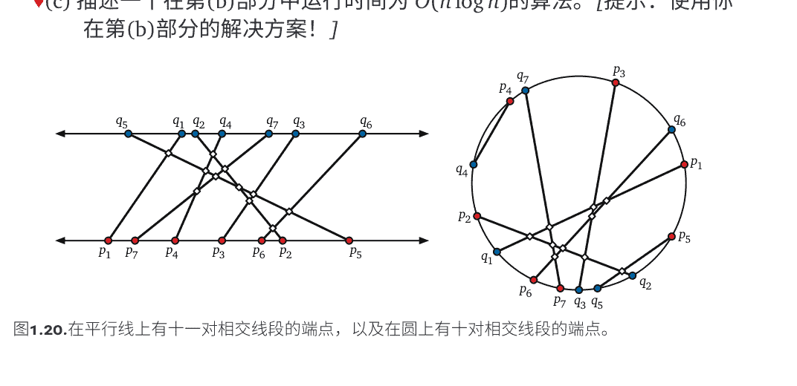

15. (a) 描述一个算法，通过调用子程序\(\texttt{SqrtSort}(k)\)对输入数组 \(A[1 .. n]\)进行排序，该子程序对子数组 \(A [k+1 .. k+\sqrt{n}]\) 进行原地排序，给定任意整数 \(k\)作为输入，其中 \(0 \leq k \leq n - \sqrt{n}\)。(为了简化问题，假设 \(\sqrt{n}\)是一个整数。)你的算法只能通过调用\(\texttt{SqrtSort}\)来检查或修改输入数组；特别地，你的算法不能直接比较、移动或复制数组元素。在最坏情况下，你的算法调用\(\texttt{SqrtSort}\)多少次？

♣ (b) 证明你在 (a) 部分的算法在常数因子上是最优的。换句话说，如果 \( f(n) \) 是你的算法调用\(\texttt{SqrtSort}\)的次数，证明没有算法可以使用\(O(f(n))\)次调用来排序。

(c) 现在假设\(\texttt{SQRTSORT}\)是通过调用你在 (a) 部分的排序算法递归实现的。例如，在递归的第二层，算法正在对大约大小为\(n^{1/4}\)的数组进行排序。结果排序算法的最坏情况运行时间是多少？（为了简化分析，假设数组大小是 \(2^{2^k}\)的形式，因此重复的平方根总是整数。）

### 选择

16. 假设我们有一个集合 \(S\)，其中包含个项目，每个项目都有一个值和一个权重。对于 \(S\)中的任何元素，我们定义两个子集

- $S_{<x}$ 是 $S$ 中值小于 $x$ 的元素的集合。
- $S_{>x}$ 是 $S$ 中值大于 $x$ 的元素的集合。

对于任意子集 $R \subseteq S$, 令 $w(R)$ 表示 $R$ 中元素的权重之和。$R$ 的加权中位数是任意元素 $x$，使得 $w(S_{<x}) \le w(S)/2$ 且 $w(S_{>x}) \le w(S)/2$。
描述并分析一种算法，以 $O(n)$ 时间计算给定加权集合的加权中位数。你的输入包含两个未排序的数组 $S[1\,..\,n]$ 和 $W[1\,..\,n]$，其中对于每个索引 $i$，第 $i$ 个元素的值为 $S[i]$ 和权重为 $W[i]$。你可以假设所有的值都是不同的且所有的权重都是正数。

17. (a) 描述一个算法，以 $O(n)$ 时间确定任意数组 $A[1\,..\,n]$ 是否包含超过 $n/4$ 个相同的值。
(b) 描述并分析一个算法，给定任意数组 $A[1\,..\,n]$ 和一个整数 $k$，确定 $A$ 是否包含超过 $k$ 个相同的值。将算法的运行时间表示为 $n$ 和 $k$ 的函数。

**不要使用哈希、基数排序或任何依赖于精确输入值而不是它们的顺序的方法。**

18. 描述一个算法，使用最多 6 次比较来计算一个由不同数字组成的数组 $A[1\,..\,5]$ 的中位数。不使用伪代码，使用一个决策树来描述你的算法：一个二叉树，每个内部节点包含形式为“$A[i] \gtrless A[j]$?”的比较，每个叶子节点包含一个数组的索引。

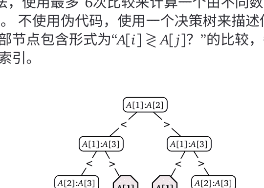

19. 考虑到 Blum-Floyd-Pratt-Rivest-Tarjan MOM-SELECT 算法的推广，如图 1.22 所示，将输入数组分成 $\lceil n/b \rceil$ 大小的块，而不是 $\lceil n/5 \rceil$ 大小的块，但其他方面相同。

```
Mom_b SELECT(A[1..n], k):
如果 n ≤ b²
    使用蛮力法
否则
    m ← ⌈n/b⌉
    for i ← 1 to m
        M[i] ← MEDIANOFB(A[b(i-1)+1 .. bi])
    mom_b ← Mom_b SELECT(M[1..m], ⌊m/2⌋)
    r ← PARTITION(A[1..n], mom_b)
    如果 k < r
        返回 Mom_b 选择 (A[1..r-1], k)
    否则如果 k > r
        返回 Mom_b 选择 (A[r+1..n], k-r)
    否则
        返回妈妈_b
```

图1.22. 一个参数化的选择算法族；参见问题19。

(a) 给出 Mom_b 选择运行时间的递归关系，假设 b是一个常数（所以子程序 MedianOfB 在 O(1)时间内运行）。特别地，递归子问题的大小如何取决于常数 b？分别考虑偶数 b和奇数 b。

(b) Mom_1 选择的最坏情况运行时间是多少？[提示：这是一个技巧问题。]

♣♥(c) Mom_2 选择的最坏情况运行时间是多少？[提示：这是一个不公平的问题！]

♥(d) Mom_3 Select的最坏情况运行时间是多少？找到运行时间的上界很简单；困难的部分是证明这个分析实际上是紧密的。[提示：见问题10。]♥

(e) Mom_4 Select的最坏情况运行时间是多少？同样，困难的部分是证明分析无法改进。

(f) 对于任意常数 b ≥ 5，算法 Mom_b Select的运行时间为 O(n)，但不同的 b值导致不同的常数因子。令 M(b)表示找到 b个数字的中位数所需的最小比较次数。只有对于 b ≤ 13，才知道 M(b)的确切值：

| b | 1 | 2 | 3 | 4 | 5 | 6 | 7 | 8 | 9 | 10 | 11 | 12 | 13 |
|---|---|---|---|---|---|---|---|---|---|----|----|----|----|
| M(b) | 0 | 1 | 3 | 4 | 6 | 8 | 10 | 12 | 14 | 16 | 18 | 20 | 23 |

四个元素的中位数要么是第二小的，要么是第二大的。在2014年，Ke Chen和Adrian Dumitrescu证明了如果我们修改 Mom_4 Select算法，在 k < n/2时找到第二小的元素，在 k > n/2时找到第二大的元素，得到的算法的运行时间为 O(n)! 详见他们的论文“Select with Groups of 3 or 4 Takes Linear Time” (WADS 2015, arXiv:1409.3600)。

对于每个 b在 5和 13之间，找到Mom bSelect的运行时间的上界形式为 T(n) ≤ αb n，其中 αb 是某个明确的常数。（例如，在第39页上我们证明了 α5 ≤ 16。）

(g) 哪个 b的值使得常数 αb最小？【提示：这是一个诡计问题！】

20. 证明在图1.23中显示的Blum-Floyd-Pratt-Rivest-Tarjan Select算法的变体，该算法使用额外的小中位数层来选择主轴，运行时间为 O(n)。

```
MOMOMSELECT(A[1 .. n], k)
: 如果 n ≤ 81则使用蛮力法
    否则

    m ← ⌈n/3⌉
    for i ← 1 to m
        M[i] ← MEDIANOF3(A[3i − 2 .. 3i])
    mm ← ⌈m/3⌉
    for j ← 1 to mm
        Mom[j] ← MEDIANOF3(M[3j − 2 .. 3j])
    momom ← MOMOMSELECT(Mom[1 .. mm], ⌈mm/2⌉)
    r ← PARTITION(A[1 .. n], momom)
    if k < r
        return MOMOMSELECT(A[1 .. r − 1], k)
    else if k > r
        return MOMOMSELECT(A[r + 1 .. n], k − r)
    else
        return momom
```

图1.23. 通过中位数选择；参见问题20).

21. (a) 假设我们有两个已排序的数组 A[1 .. n]和 B[1 .. n]。描述一个算法在Θ(log n)时间内找到 A和 B的并集中的中位数元素。你可以假设数组中没有重复元素。

(b) 假设我们有两个已排序的数组 A[1 .. m]和 B[1 .. n]以及一个整数 k。描述一个算法在Θ(log(m + n))时间内找到A ∪ B中第 k小的元素。例如，如果 k = 1,你的算法应该返回 A ∪ B中最小的元素。)[提示: 使用你在(a)部分的解决方案.]

❤(c) 现在假设我们有三个已排序的数组A[1 .. n], B[1 .. n]和C[1 .. n], 以及一个整数k。描述一个算法来在O(log n)时间内找到A∪B∪C中第k小的元素。

### 算术

22. 1854年，考古学家发现了苏美尔人的粘土板，刻有大约2000年前的整数的平方列表，最高到59。这一发现引起了一些学者的猜测，认为古代苏美尔人通过将乘法化简为平方运算，使用类似于 $x \cdot y = ( x^2 + y^2 - (x-y)^2 )/2$ 的恒等式。
不幸的是，这些学者对苏美尔人如何求平方较大的数字保持沉默。四千年后，我们终于可以通过递归的力量拯救这些苏美尔数学家免于单调乏味的生活！

- (a) 描述一种变体的Karatsuba算法，可以在 $O( n^{\lg 3} )$ 时间内求平方任意$n$位数，通过将其简化为求平方三个 $\lceil n/2 \rceil$ 位数的数。（Karatsuba实际上在1960年做到了这一点。）
- (b) 描述一种递归算法，可以在 $O( n^{\log_3 6} )$ 时间内求平方任意$n$位数，通过将其简化为求平方六个 $\lceil n/3 \rceil$ 位数的数。
- (c) 描述一种递归算法，可以在 $O( n^{\log_3 5} )$ 时间内求平方任意$n$位数，通过将其简化为求平方只有 five $( n/3 + O(1) )$ 位数的数。【提示：$(a + b + c)^2 + (a - b + c)^2$ 等于什么？】

23. (a) 描述并分析Karatsuba算法的一种变体，可以将任意$m$位数和任意$n$位数相乘，其中 $n \ge m$，在 $O(nm^{\lg 3 - 1})$ 时间内完成。

(b) 描述一种算法，使用部分(a)作为子程序，在 $O( n^{\lg 3} )$ 时间内计算2的$n$次方的十进制表示。（传统算法每次计算一个数字需要 $\Theta(n^2)$ 时间。）

(c) 描述一种分治算法，在 $O(n \lg^3)$ 时间内计算任意$n$位二进制数的十进制表示。[提示：注意运行时间中的额外对数因子。]

(d) 假设我们可以在 $O(M(n))$ 时间内相乘两个$n$位数。描述一种算法，在 $O( M(n) \log n )$ 时间内计算任意$n$位二进制数的十进制表示。[提示：分析是困难的部分；使用域转换。]

24. 考虑以下用于计算非负整数 $n$ 的阶乘 $n!$ 的经典递归算法：

```
阶乘($n$):
    如果 $n = 0$
        返回 1
    否则
        返回 $n \cdot$ 阶乘($n-1$)
```

- (a) 这个算法执行了多少次乘法？
- (b) 用二进制写出 $n!$ 需要多少位？以 $\Theta(f(n))$ 的形式给出你的答案，其中 $f(n)$ 是某个熟悉的函数。[提示：$(n/2)^{n/2} < n! < n^n$。]
- (c) 你对(b)的答案应该让你相信，乘法的次数并不是阶乘的实际运行时间的好估计。我们可以使用格算法或者倍增和中介来在 $O(k \cdot l)$ 时间内计算任意 $k$ 位数和 $l$ 位数的乘积。如果我们将这个乘法算法作为子程序，那么阶乘的运行时间是多少？

- (d) 下面的递归算法也计算阶乘函数，但是使用了不同的乘法分组：

```
FALLING($n, m$):  <<计算 $n$ 的阶乘 $/(n-m)$ 的阶乘>>
    如果 $m = 0$
        返回 1
    否则如果 $m = 1$
        返回 $n$
    否则
        返回 FALLING($n, \lfloor m/2 \rfloor$) $\cdot$ FALLING($n-\lfloor m/2 \rfloor, \lceil m/2 \rceil$)
```

如果我们使用小学乘法，FALLING($n, n$) 的运行时间是多少？[提示：像往常一样，忽略地板和天花板。]

- (e) 描述并分析 KARATSUBA 算法的一个变体，可以在 $O(k \cdot l^{\lg 3 - 1}) = O(k \cdot l^{0.585})$ 时间内乘以任意 $k$ 位数和任意 $l$ 位数，其中 $k \ge l$。

- ♥(f) 如果我们使用修改后的Karatsuba乘法，那么阶乘($n$)和下降阶乘($n, n$) 的运行时间是多少？

25. **两个正整数 $x$ 和 $y$ 的最大公约数，表示为 $\gcd(x, y)$，是满足 $x/d$ 和 $y/d$ 都是整数的最大整数 $d$。**
欧几里得的《几何原本》约于公元前300年写成，描述了以下递归算法来计算 $\gcd(x, y)$：

> > ¹⁷欧几里得算法有时被错误地描述为最古老的递归算法，甚至是最古老的非平凡算法，尽管埃及的倍增和中介算法——既非平凡又递归——比欧几里得早至少1500年。

欧几里得GCD(x,y):
如果 x = y
    返回 x
否则如果 x > y
    返回 EUCLIDGCD(x - y, y)
否则
    返回 EUCLIDGCD(x, y - x)

(a) 证明 EUCLIDGCD 正确计算 $\gcd(x,y)$.¹⁸具体来说:
    i. 证明 EuclidGCD $(x,y)$ 能够整除 $x$ 和 $y$.
    ii. 证明 $x$ 和 $y$ 的每个除数都是 EuclidGCD $(x,y)$ 的除数.

(b) 欧几里得算法的最坏情况运行时间是多少 $(x,y)$ 的函数关于 $x$ 和 $y$? (假设计算 $x - y$ 需要 $O(\log x + \log y)$ 时间。)

(c) 证明以下算法也计算 $\gcd(x,y)$:

FASTEUCLIDGCD(x,y):
如果 y = 0
    返回 x
否则如果 x > y
    返回 FASTEUCLIDGCD (y, x mod y)
否则
    返回 FASTEUCLIDGCD (x, y mod x)

(d) FastEuclidGCD$(x,y)$ 的最坏情况运行时间是多少，作为 $x$ 和 $y$ 的函数? (假设计算 $x$ mod $y$ 需要 $O(\log x \cdot \log y)$ 时间。)

(e) 证明以下算法也计算 $\gcd(x,y)$:

BINARYGCD(x,y):
如果 x = y
    返回 x
否则如果 x 和 y 都是偶数
    返回 2⋅BINARYGCD(x/2, y/2)
否则如果 x 是偶数
    返回 BINARYGCD(x/2, y)
否则如果 y 是偶数
    返回 BINARYGCD(x, y/2)
否则如果 x > y
    返回 BINARYGCD((x-y)/2, y)
否则
    返回 BINARYGCD(x, (y-x)/2)

¹⁸ 欧几里得没有做这个。《几何原本》第七卷命题1指出，如果 EuclidGCD$(x,y)=1$，那么 $x$ 和 $y$ 是互质的（即，$\gcd(x,y)=1$），但证明只考虑了特殊情况 $x$ mod $(y$ mod $(x$ mod $y))=1$。命题2指出，如果 $x$ 和 $y$ 不是互质的，那么 EuclidGCD$(x,y)=\gcd(x,y)$，但证明只考虑了特殊情况 $\gcd(x,y)=y$ 和 $\gcd(x,y)=y$ mod $(x$ mod $y)$。最后，这两个命题不能构成 EuclidGCD 正确性的完整证明。不要像欧几里得一样。

(f) 作为一个关于 $x$ 和 $y$ 的函数，BinaryGCD( $x$, $y$)的最坏情况运行时间是多少？(假设计算 $x - y$ 需要 $O(\log x + \log y)$ 时间，计算 $z/2$ 需要 $O(\log z)$ 时间。)

### 数组

26. 假设给你一个 $2^n \times 2^n$ 的棋盘，其中一个方格被移除了（任意选择）。描述并分析一个算法，通过 **L形状的瓷砖** 来填充棋盘，使得没有间隙或重叠。每个瓷砖由3个方格组成。你的输入是整数 $n$ 和表示缺失方格的两个 $n$ 位整数，分别表示行和列。输出是 $(4^n - 1)/3$ 个瓷砖的位置和方向的列表。你的算法应该在 $O(4^n)$ 时间内运行。[提示：首先证明这样的填充总是存在。]

27. 你是一个参加政治大会（或者可能是教职员会议）的访客，有 $n$ 个代表；每个代表都是一个政党的成员。无法确定任何代表属于哪个政党；特别是，如果你问的话，你将被立即从大会中驱逐出去。然而，你可以通过介绍他们互相认识来确定任何一对代表是否属于同一个政党。同一个政党的成员总是用微笑和友好的握手互相问候；不同政党的成员总是用愤怒的眼神和侮辱互相问候。$^{19}$

-   (a) 假设超过一半的代表属于同一个政党。描述一个高效的算法，用于识别所有属于这个多数党的成员。
-   (b) 现在假设有多于两个政党，但是一个政党拥有多数派：比任何其他政党的人都有更多的属于该党。提供一个实际的过程，以尽可能节省的方式从多数政党中准确选择人员，假设多数政党至少由 $p$ 人组成。拜托了。

28. 斯穆利安岛上有三种居民：骑士总是说实话；诡计者总是说谎话；普通人有时说实话，有时不说。岛上的每个人都知道其他人的名字和类型（骑士、诡计者或普通人）。你想了解每个居民的类型。

你可以询问任何居民告诉你任何其他居民的类型。具体来说，如果你问“嘿 $X$，$Y$ 是什么类型？”那么 $X$ 会如下回答：

$^{19}$ 现实世界的政治比这个简化模型要复杂得多，但这是理论书！

-   如果 X 是骑士，那么 X 会正确回答 Y 的类型。
-   如果 X 是一个骗子，那么 X 可以回答任何 Y 不是的类型之一。
-   如果 X 是一个正常人，那么 X 可以回答任何三种类型之一。

居民会忽略任何不符合这个精确形式的问题；特别是，你不能问一个居民关于他们自己的类型。多次向同一个居民问同一个问题总是得到相同的答案，所以没有必要问同一个问题超过一次。

(a) 假设你知道大多数居民是骑士。描述一种高效的算法来确定每个居民的类型。
(b) 证明如果最多有一半的居民是骑士，那么无法确定每个居民的类型。

29. 大多数图形硬件都包含对低级操作的支持，称为 blit，或者 block transfer，它可以快速地将像素图的一个矩形块（一个二维像素值数组）从一个位置复制到另一个位置。这是标准C库函数 memcpy()的二维版本。

假设我们想要将一个 $n \times n$ 像素地图顺时针旋转90°。一种方法是将像素地图分成四个 $n/2 \times n/2$ 的块，使用一系列的五个blit将每个块移动到其正确的位置，然后递归地旋转每个块。（为什么是五个？和汉诺塔问题需要第三个柱子的原因一样。）或者，我们可以先递归地旋转块，然后将它们blit到正确的位置。

(a) 证明当 $n$ 是2的幂时，算法的两个版本都是正确的。
(b) 当 $n$ 是2的幂时，算法执行了多少个blit？
(c) 描述如何修改算法，使其适用于任意的 $n$，而不仅仅是2的幂次。你修改后的算法执行了多少次blit？
(d) 如果一个 $k \times k$ 的 blit 需要 $O(k^2)$ 的时间，你的算法的运行时间是多少？
(e) 如果一个 $k \times k$ 的 blit 只需要 $O(k)$ 的时间，那么运行时间是多少？

30. 如果一个由不同数字组成的数组 $A[0..n-1]$ 满足以下条件，则称其为 bitonic：存在唯一的索引 $i$ 和 $j$ 使得 $A[(i-1) \mod n] < A[i] > A[(i+1) \mod n]$ 且

换句话说，一个双调序列要么由一个递增序列后跟一个递减序列组成，要么可以循环移位成为这样。例如，

| 4 | 6 | 9 | 8 | 7 | 5 | 1 | 2 | 3 | 是双调的，但是 |
|---|---|---|---|---|---|---|---|---|----------------|
| 3 | 6 | 9 | 8 | 7 | 5 | 1 | 2 | 4 | 不是双调的。   |

描述并分析一个算法，以在 $O(\log n)$ 时间内找到一个 $n$ 个元素的双调数组中的最小元素。您可以假设输入数组中的数字是不同的。

31. 假设我们有一个数组 $A[1..n]$ of $n$ 个不同的整数，可以是正数、负数或零，按递增顺序排序，使得 $A[1] < A[2] < \cdots < A[n]$。

-   (a) 描述一个快速算法，要么计算出一个索引 $i$ 使得 $A[i] = i$，要么正确地报告不存在这样的索引。
-   (b) 假设我们事先知道 $A[1] > 0$。描述一个更快的算法，要么计算出一个索引 $i$ 使得 $A[i] = i$，要么正确地报告不存在这样的索引。[提示：这真的很简单。]

32. 假设我们有一个具有特殊属性的数组 $A[1..n]$，即 $A[1] \ge A[2]$ 且 $A[n-1] \le A[n]$。如果一个元素 $A[x]$，它小于或等于它的两个邻居，则称其为局部最小值，或更正式地说，如果 $A[x-1] \ge A[x]$ 且 $A[x] \le A[x+1]$。例如，在以下数组中有六个局部最小值：

| 9 | 7 | 7 | 2 | 1 | 3 | 7 | 5 | 4 | 7 | 3 | 3 | 4 | 8 | 6 | 9 |
|---|---|---|---|---|---|---|---|---|---|---|---|---|---|---|---|

通过扫描数组，我们显然可以在 $O(n)$ 时间内找到一个局部最小值。描述并分析一个算法，可以在 $O(\log n)$ 时间内找到一个局部最小值。[提示：根据给定的边界条件，数组必须至少有一个局部最小值。为什么？]

33. 假设你有一个已经旋转了 $k$ 步的有序数组，其中包含了 $n$ 个不同的数字，其中 $k$ 是一个未知的整数，满足 $1 \leqslant k \leqslant n-1$。也就是说，给定一个数组 $A[1\ldots n]$，其中某个前缀 $A[1\ldots k]$ 按升序排列，相应的后缀 $A[k+1\ldots n]$ 按升序排列，且 $A[n] < A[1]$。

例如，你可能会得到以下16个元素的数组（其中 $k=10$）：

| 9 | 13 | 16 | 18 | 19 | 23 | 28 | 31 | 37 | 42 | 1 | 3 | 4 | 5 | 7 | 8 |
|---|----|----|----|----|----|----|----|----|----|---|---|---|---|---|---|

-   (a) 描述并分析一个计算未知整数 $k$ 的算法。
-   (b) 描述并分析一个确定给定数组中是否包含给定数字 $x$ 的算法。

34. 在动作大片《速度与不可能之XIII³/₄：最后的守护者重装版》的第二幕结束时，邪恶的Dr. Metaphor催眠了整个英雄联盟/力量/小队，将他们排成一条长队站在悬崖边上，并指示每个英雄在预先安排的信号下向左右最近的更高的英雄开枪。假设我们已经得到了所有英雄的身高，按照从左到右的顺序，存储在一个数组 $Ht[1\ldots n]$ 中。（为了避免薪水争议，制片人坚持没有两个英雄有相同的身高。）然后我们可以使用以下的蛮力算法在 $O(n^2)$ 时间内计算出每个英雄的左右目标。

```
谁是谁的目标 ($Ht[1\ldots n]$):
  对于 $j$ 从 1 到 $n$
    <<找到英雄 $j$ 的左目标 $L[j]$>>
    $L[j] \leftarrow$ 无
    对于 $i$ 从 1 到 $j-1$
      如果 $Ht[i] > Ht[j]$
        $L[j] \leftarrow i$
    <<找到英雄 $j$ 的右目标 $R[j]$>>
    $R[j] \leftarrow$ 无
    对于 $k$ 从 $n$ 递减到 $j+1$
      如果 $Ht[k] > Ht[j]$
        $R[j] \leftarrow k$
  返回 $L[1\ldots n]$, $R[1\ldots n]$
```

(a) 描述一个分治算法，以 $O(n \log n)$ 时间计算出 WHOARGETSWHOM 的输出。
(b) 证明至少有 $\lfloor n/2 \rfloor$ of the $n$ heroes 是目标。也就是说，证明输出数组 $R[0..n-1]$ 和 $L[0..n-1]$ 至少包含 $\lfloor n/2 \rfloor$ distinct values (other than None)。
(c) 不幸的是，Metaphor博士的恶毒计划成功了。在预先安排的信号下，所有英雄同时射击他们的目标，所有目标都倒下了悬崖，看起来死了。Metaphor一遍又一遍地重复他邪恶的实验；在每次大屠杀之后，他迫使剩下的英雄选择新的目标，按照相同的算法进行，并在下一个信号时射击他们的目标。最终，只有英雄团队/联盟/帮派中最矮的成员活了下来。²⁰描述并分析一个算法，以计算在Metaphor博士的致命过程最终结束之前的回合数。为了获得全部学分，你的算法应该在 $O(n)$ 时间内运行。

35. 你是一个参加热门游戏节目“击败邻居”的选手！你被呈现出一个 $m \times n$ 的网格，每个格子里都有一个独特的数字。打开一个格子需要花费100美元。你的目标是找到一个数字比它周围的格子（上方、下方、左边和右边）的数字都大的格子。如果你花费的钱比任何对手都少，你将赢得一次为期一周的双人拉斯维加斯之旅和一年份的Rice-A-Roni m供应，而你对此已经上瘾了。

-   (a) 假设 $m=1$。描述一个算法，找到一个数字，它比它的邻居中的任何一个都大。在最坏的情况下，你的算法会打开多少个格子？
-   (b) 假设 $m=n$。描述一个算法，找到一个数字，它比它的任何邻居都大。在最坏的情况下，你的算法会打开多少个格子？
-   (c) 证明你对问题的解决方案在常数因子上是最优的。

36. (a) 让 $n = 2^\ell - 1$，其中 $\ell$ 是一个正整数。假设有人声称持有一个未排序的数组 $A[1..n]$，其中包含了 $\ell$ 位字符串，因此只有一个 $\ell$ 位字符串不在 $A$ 中。进一步假设我们唯一能够访问 $A$ 的方式是通过调用函数 FetchBit(i, j), 该函数以 $O(1)$ 时间返回字符串 $A[i]$ 的第 $j$ 位。描述一个算法，只使用 $O(n)$ 次调用 FetchBit 来找到 $A$ 中缺失的字符串。

在激动人心的最后一幕中，松鼠Retcon成为最后一个幸存的英雄团队/组织的成员，通过回到过去并用逼真的气球雕塑替换其他 $n-1$ 个英雄来拯救了所有人。所以，是的，基本上就是复仇者联盟：终局之战。

(b) 现在假设 \(n = 2^\ell - k\)，其中 \(k\) 和 \(\ell\) 是正整数，我们给出了一个包含不同的 \(\ell\) 位字符串的数组 \(A[1 .. n]\)。描述一个算法，仅使用 \(O (n \log k)\) 次调用 to FetchBit，找到在 \(A\) 中缺失的 \(k\) 个字符串。

### 树

37. 对于这个问题，二叉树的子树指的是任何连接的子图。
如果每个内部节点都有两个子节点，并且每个叶子节点的深度相同，则二叉树是完全的。描述并分析一个递归算法，计算给定二叉树的最大完全子树。你的算法应该返回这个子树的根节点和深度。参见图1.26作为一个例子。

38. 设 \(T\) 是一个具有 \(n\) 个顶点的二叉树。删除任何顶点 \(v\) 将 \(T\) 分割成最多三个子树，包括 \(v\) 的左子节点（如果有），\(v\) 的右子节点（如果有）和 \(v\) 的父节点（如果有）。如果这些较小的树中的每一个都最多有 \(n/2\) 个顶点，则称 \(v\) 为中心顶点。参见图1.27作为一个例子。

描述并分析一种算法，以在任意给定的二叉树中找到一个中心顶点。[提示：首先证明每棵树都有一个中心顶点。]

39. (a) 乔治·奥丛林教授有一棵27个节点的二叉树，其中每个节点都标有罗马字母或字符 &。 树的先序遍历和后序遍历按以下顺序访问节点：

-   先序遍历: I Q J H L E M V O T S B R G Y Z K C A & F P N U D W X
-   后序遍历: H E M L J V Q S G Y R Z B T C P U D N F W & X A K O I

画出乔治的二叉树。

(b) 回想一下，如果每个非叶节点都恰好有两个孩子，则二叉树是满的。

-   i. 描述并分析一个递归算法，根据其前序和后序节点序列作为输入，重建一个任意的满二叉树。
-   ii. 证明没有算法可以根据其前序和后序节点序列重建一个任意的二叉树。

(c) 描述并分析一个递归算法，根据其前序和中序节点序列作为输入，重建一个任意的二叉树。
(d) 描述并分析一个递归算法，仅根据其前序节点序列重建一个任意的二叉搜索树。
(e) 描述并分析一个递归算法，仅根据其前序节点序列，在 $O(n)$ 时间内重建一个任意的二叉搜索树。

在(b)-(e)部分，假设所有键都是不同的，并且输入与至少一个二叉树一致。

40. 假设我们在二维盒子内有 $n$ 个散布的点。 kd树通过以下方式递归地将点细分。如果盒子内部没有点，则我们完成了。否则，我们通过盒子内的中位点通过一条垂直线将盒子分成两个较小的盒子，尽可能均匀地划分点。然后，我们对每个较小盒子中的点递归构建kd树，在构建之前将它们旋转90度。因此，在每个递归层次上，我们在垂直和水平方向上交替划分。最终的空盒子被称为单元格。

²¹ 术语“kd树”（发音为“kay deetree”）最初是“k-维树”的缩写，但现代用法忽略了这个词源，部分原因是因为没有人会以k来表示维度，而不是明显更好的d。从词源的一致性来看，这个问题中的数据结构应该被称为“2d树”（或者可能是“2-d树”），但标准的命名现在是“二维kd树”。

另请参阅：B树（也许）、alpha形状、beta骨架、epsilon网、波托马克河、密西西比河、密歇根湖、塔霍湖、曼哈顿岛、拉布雷亚焦油坑、撒哈拉沙漠、乞力马扎罗山、南越、东帝汶、银河系、城市镇、和自动驾驶汽车。

### 1. 递归

-   (a) 作为 $n$ 的函数，有多少个单元格？证明你的答案是正确的。
-   (b) 在最坏的情况下，一条水平线可以穿过多少个单元格，作为 $n$ 的函数？证明你的答案是正确的。假设 $n = 2^k - 1$，其中 $k$ 是一个整数。[提示：存在不止一个函数 $f$ 满足 $f(16) = 4$。]
-   (c) 假设我们有 $n$ 个点存储在kd树中。描述并分析一种尽快计算出位于水平线上方的点数的算法（例如图中的虚线）。[提示：使用第 (b) 部分。]
-   (d) 描述并分析一种高效的算法，给定一个包含 $n$ 个点的kd树，计算位于矩形 $R$ 内的点数，该矩形具有水平和垂直边。[提示：使用第 (c) 部分。]

41. 鲍勃·拉滕伯，CS 225的新学生，正在尝试编写代码来执行二叉树的前序、中序和后序遍历。鲍勃对遍历算法的基本思想有点理解，但每当他尝试实现它们时，他总是混淆递归调用。

截止时间前五分钟，鲍勃疯狂地提交了以下结构的代码：

```
前序遍历(v):
  如果 v = NULL
    返回
  否则
    打印标签(v)
    ■中序遍历(left(v))
    ■中序遍历(right(v))
```

```
中序遍历(v):
  如果 v = NULL
    返回
  否则
    ■中序遍历(left(v))
    打印标签(v)
    ■中序遍历(right(v))
```

```
后序遍历(v):
  如果 v = NULL
    返回
  否则
    ■后序遍历(left(v))
    ■后序遍历(right(v))
    打印标签(v)
```

每个 ■ 在这个伪代码中，每个前缀Pre、In或Post都隐藏了一个。此外，以下每个函数调用在Bob的提交代码中都恰好出现一次：前序遍历（左子树（节点））   前序遍历（右子树（节点））
中序遍历（左子树（节点））   中序遍历（右子树（节点））
后序遍历（左子树（节点））   后序遍历（右子树（节点））

因此，Bob的代码有36种可能性。不幸的是，Bob在提交可执行文件后意外删除了源代码，所以你和他都不知道哪些函数在哪里被调用。

现在假设你已经获得了Bob的遍历算法在某个未知二叉树T上的输出。Bob的输出已经被有用地解析成了三个数组Pre[1 .. n]、In[1 .. n]和Post[1 .. n]。你可以假设这些遍历序列与唯一的二叉树T一致；特别地，未知树T的顶点标签是不同的，并且T中的每个内部节点都有两个孩子。

- (a) 描述一个算法来从给定的遍历序列中重建未知树 T。
- (b) 描述一个算法，要么从给定的遍历序列中重建Bob的代码，要么正确地报告遍历序列与多个算法集一致。

例如，给定输入

```
前序[1 ..n] = [H A E C B I F G D]
中序[1 ..n] = [A H D C E I F B G]
后序[1 ..n] = [A E I B F C D G H]
```

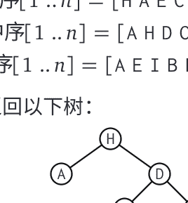

```
前序遍历(v):
    如果 v = NULL
        返回
    否则
        打印标签(v)
        前序遍历(左子树(v))
        后序遍历(右子树(v))

中序遍历(v):
    如果 v = NULL
        返回
    否则
        后序遍历(左子树(节点))
        打印标签(节点)
        前序遍历(右子树(节点))

后序遍历(节点):
    如果节点 = 空
        返回
    否则
        中序遍历(左子树(节点))
        中序遍历(右子树(节点))
        打印标签(节点)
```

♥42. 设 T 为一个二叉树，其节点存储不同的数值。回顾如果且仅如果以下条件成立，那么 T 是一个二叉搜索树：(1) T 为空，或者 (2) T 满足以下递归条件：

## 1. 递归

- 左子树是一个二叉搜索树。
- 左子树中的所有值都小于根节点的值。
- 右子树是一个二叉搜索树。
- 右子树中的所有值都大于根节点的值。

考虑以下对二叉树的操作：

- 将任意节点向上旋转。²²
- 交换任意节点的左右子树。

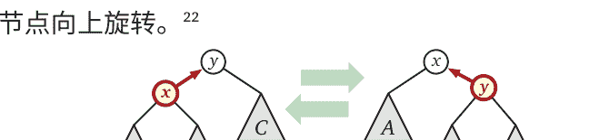

在这两个操作中，一些、全部或者没有子树 A、 B和C可能为空。

(a) 描述一个算法，将一个任意的 n个节点的二叉树 转化为一棵二叉搜索树，使用最多 O(n²) 次旋转和交换。图1.29展示了一个包含八个操作的序列 将一个五个节点的二叉树转化为一棵二叉搜索树。

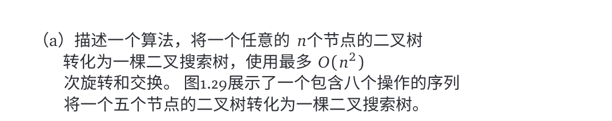

图1.29.对二叉树进行“排序”：旋转2次，旋转2次，交换3次，旋转3次，旋转4次，交换3次，旋转2次，交换4次。

你的算法不允许直接修改父节点或子节点的指针，创建新节点或删除旧节点；修改树的唯一方式是通过旋转和交换。

另一方面，你可以自由计算任何你想要的内容，只要这个计算不修改树；你的算法的运行时间被定义为执行的旋转和交换的次数。

❤ (b) 描述一个算法，将任意的n个节点的二叉树转换为二叉搜索树，最多使用O(nlogn)次旋转和交换。

> ²²旋转保持二叉树中节点的中序序列。部分原因是为了维护多种平衡二叉搜索树，包括AVL树、红黑树、伸展树、替罪羊树和Treap树，所以使用旋转。请访问http://algorithms.wtf以获取关于大多数这些数据结构的讲座笔记。

+ (c) 证明任意n个节点的二叉搜索树可以通过仅使用O(n)次旋转（而没有交换）转换为另一个具有相同节点值的二叉搜索树。

+ ♥(d) 开放问题：要么描述一个算法，使用仅O(n)次旋转和交换将任意n个节点的二叉树转换为二叉搜索树，要么证明不存在这样的算法。【提示：我认为这是不可能的。】

然而，在无法通过信仰规则或上下文来消除歧义的情况下，没有任何阻碍我们根据任何自己选择的方法来指出句子的。

> — 圣奥古斯丁，基督教教义 (公元397年) 马库斯·多兹 (1892年) 译

我把晚饭掉了，然后跑回实验室。在那里，我兴奋地我尝了桌子上每个烧杯和蒸发皿的内容。 幸运的是，没有一个含有腐蚀性或有毒液体。

> — 康斯坦丁·法尔伯格关于他发现糖精的言论,《科学美国人》(1886年)

对于任何思考者来说，最大的挑战是以一种能够允许解决方案的方式来陈述问题。

> — 伯特兰德·罗素所归属

当你来到一个岔路口时，就走吧。

> — 瑜伽·贝拉 (给他家的方向)

## 2 回溯

本章描述了另一种重要的递归策略，称为回溯。回溯算法尝试逐步构建一个计算问题的解决方案，一次一个小片段。每当算法需要在解决方案的下一个组成部分之间决定多个选择时，它会递归地评估每个选择，然后选择最佳的一个。

### 2.1 N皇后

典型的回溯问题是经典的 n皇后问题，首先由德国国际象棋爱好者Max Bezzel在1848年（在他的化名“Schachfreund”下）提出，用于标准的 8×8棋盘，并由François-Joseph Eustache Lionnet在1869年为更一般的 n×n棋盘提出。问题是在一个 n×n棋盘上放置 n个皇后，使得没有两个皇后互相攻击。

对于不熟悉国际象棋规则的读者，这意味着没有两个皇后在同一行、同一列或同一对角线上。

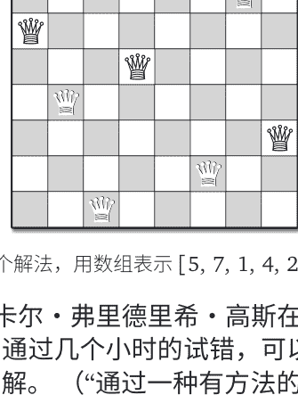

1850年，著名数学家卡尔・弗里德里希・高斯在给他的朋友海因里希・舒马赫写的一封信中写道，通过几个小时的试错，可以很容易地证实弗朗茨・诺克的八皇后问题有92个解。（“通过一种有方法的试探，这并不困难，如果你愿意花1个或几个小时的话。”）他的描述试探来自法语*tâtonner*，意思是摸索、摸黑或盲目摸索。

高斯的信中描述了以下递归策略来解决八皇后问题；同样的策略在1882年由法国娱乐数学家埃杜瓦・卢卡斯描述，他将这个方法归功于埃曼纽尔・拉奎尔。我们逐行在棋盘上放置皇后，从顶行开始。为了放置第 r 个皇后，我们按照简单的 for 循环从左到右依次尝试第 r 行的所有 n 个方格。如果一个特定的方格被之前的皇后攻击了，我们忽略该方格；否则，我们暂时将一个皇后放在该方格上，并递归地在后面的行中寻找一致的皇后放置位置。

图2.2展示了递归枚举与给定部分解一致的所有的n皇后解的结果算法。

继高斯之后，我们使用一个数组Q[1 .. n]来表示皇后的位置，其中Q[i]表示第 i 行中包含皇后的方格。当调用PlaceQueens时，输入参数 r 是第一个空行的索引，前缀Q[1 .. r - 1]包含前 r - 1 个皇后的位置。特别地，要计算没有限制的所有 n 皇后解，我们会调用PlaceQueens(Q[1 .. n], 1)。外部 for 循环考虑了在第 r 行上放置皇后的所有可能位置；内部 for 循环检查候选的第 r 行放置是否与已经在前 r - 1 行上的皇后一致。

可以通过递归树来说明PlaceQueens的执行。

这棵树中的每个节点对应一个递归子问题，因此对应一个合法的部分解；特别地，根节点对应空棋盘。

```
PLACEQUEENS(Q[1 .. n], r):
    如果 r = n + 1
        输出 Q[1 .. n]
    否则
        对于 j 从 1 到 n
            合法 ← 真
            对于 i 从 1 到 r - 1
                如果 (Q[i] = j) 或 (Q[i] = j + r - i) 或 (Q[i] = j - r + i)
                    合法 ← 假
            如果 合法
                Q[r] ← j
                PLACEQUEENS(Q[1 .. n], r + 1)    （《递归！》）
```

图2.2. 高斯和拉奎尔的回溯算法解决n皇后问题。

(其中 r = 0). 递归树中的边对应于递归调用。叶子节点对应于无法进一步扩展的部分解，要么是因为每一行已经有一个皇后，要么是因为下一行的每个空位置都被现有的皇后攻击。寻找完整解的回溯搜索等同于对该树进行深度优先搜索。

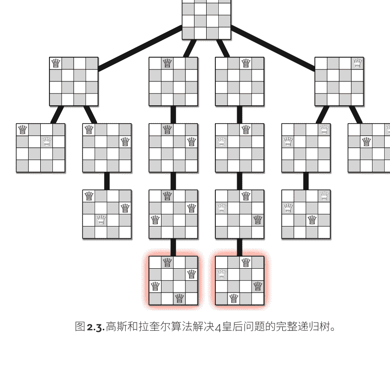

图2.3. 高斯和拉奎尔算法解决4皇后问题的完整递归树。

### 2.2 游戏树

考虑以下简单的两人游戏^1在一个 $n \times n$ 的方格网格上进行，带有边界方格；我们称玩家为霍雷斯·法尔伯格-雷姆森和维拉·雷鲍迪。^2每个玩家都有 $n$ 个令牌，他们从一边移动到另一边。霍雷斯的令牌从左边界开始，每一行一个，水平向右移动；对称地，维拉的令牌从顶部边界开始，每一列一个，垂直向下移动。玩家轮流进行。在霍雷斯的每个回合中，他要么将自己的一个令牌向右移动一个空方格，要么跳过维拉的一个令牌，跳到右边两个空方格。如果没有合法的移动或跳跃可用，霍雷斯只需跳过。类似地，维拉在她的每个回合中要么移动一个她的令牌向下，要么跳过。第一个将所有令牌移出边界的玩家获胜。（很容易证明只要棋盘上还有令牌，至少有一个玩家可以合法移动，因此最终会有人获胜。）

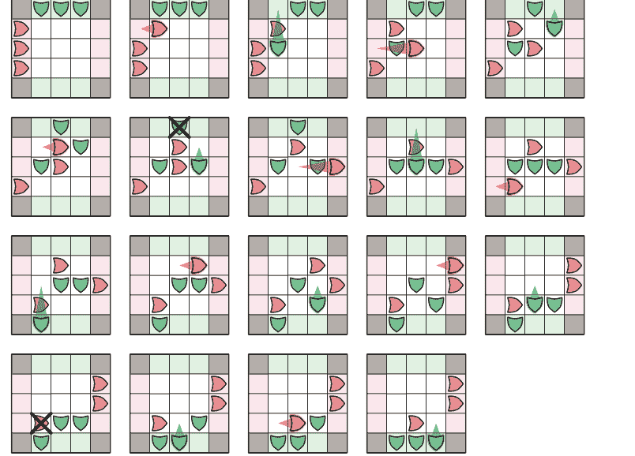

图2.4. 维拉赢得了3×3个假糖包游戏。

> ^1 我不知道这个游戏叫什么，甚至不确定我是否正确地报告了规则；我是从Lenny Pitt那里学到的（或类似的东西），他建议在餐馆里用假糖包玩。

> ^2 Constantin Fahlberg和Ira Remsen于1878年首次合成了糖精，当时Fahlberg是Remsen实验室的博士后，研究煤焦油衍生物。1900年，Ovidio Rebaudi发表了对ka’a he’e进行的第一次化学分析，这是一种由Guarani人种植了1500多年的药用植物，现在更常被称为甜菊。

除非你以前见过这个游戏³，否则你可能不知道如何玩得好。然而，有一个相对简单的回溯算法可以玩这个游戏 - 或者任何在有限步数后结束的没有随机性或隐藏信息的两人游戏 - 完美地。也就是说，如果我们把你放在游戏的中间，并且有可能对抗另一个完美的玩家获胜，算法将告诉你如何获胜。

游戏的状态由所有棋子的位置和当前玩家的身份组成。这些状态可以连接成一个游戏树，如果当前玩家在状态x中可以合法地移动到状态y，则状态x到状态y之间有一条边。游戏树的根是游戏的初始位置，从根到叶子的每条路径都是一个完整的游戏。

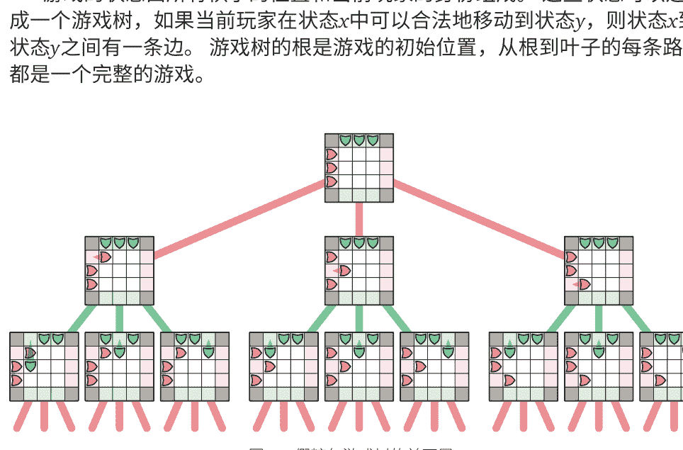

图2.5. 假糖包游戏树的前两层。

为了遍历这个游戏树，我们递归地定义一个游戏状态为好或坏，如下所示:

- 如果当前玩家已经赢了，或者当前玩家可以移动到对手的坏状态，则游戏状态为好。
- 如果当前玩家已经输了，或者每个可用的移动都导致对手的好状态，则游戏状态为坏。

等价地，游戏树中的非叶节点是好的，如果它至少有一个坏的子节点，而非叶节点是坏的，如果它的所有子节点都是好的。通过归纳，任何在他们的回合中发现游戏处于良好状态的玩家都可以赢得游戏，即使他们的对手玩得完美；另一方面，从一个坏状态开始，只有在对手犯错误时，玩家才能赢得游戏。这个递归定义是由恩斯特·策梅洛在1913年提出的。⁴

这个递归定义立即提出了以下递归回溯算法，用于确定给定游戏状态是好还是坏。在其核心，这个算法只是游戏树的深度优先搜索；等价地，游戏树是算法的递归树！对于输入是一个好的游戏状态，这个回溯算法的一个简单修改可以找到一个好的移动（甚至所有可能的好的移动）。

```
PLAYANYGAME(X, player):
    如果 player已经在状态 X中赢了
        返回 GOOD
    如果 player已经在状态 X中输了
        返回 BAD
    对于所有合法的移动 X ↔ Y
        如果 PLAYANYGAME(Y, ¬player) = BAD
            返回 GOOD   ⟨⟨X ↔ Y是一个好的移动⟩⟩
    返回 BAD   ⟨⟨没有好的移动⟩⟩
```

所有的游戏程序最终都基于这个简单的回溯策略。然而，由于大多数游戏有大量的状态，实际上不可能遍历整个游戏树。相反，游戏程序使用其他启发式方法5来修剪游戏树，通过忽略明显（或“明显”）好或坏的状态，或者至少比其他状态更好或更差，并且/或者通过在特定深度（或者回合）截断树并使用更有效的启发式方法来评估叶子节点。

### 2.3 子集和

让我们考虑一个更复杂的问题，称为SubsetSum: 给定一个正整数集合 X和目标整数 T，是否存在 X的一个子集，其元素之和等于 T？注意可能存在多个这样的子集。例如，如果 X = {8, 6, 7, 5, 3, 10, 9} 且 T = 15，则答案为True，因为子集{8, 7}和{7, 5, 3}和{6, 9}和{5, 10}的元素之和都等于15。另一方面，如果X = {11, 6, 5, 1, 7, 13, 12}且 T = 15，则答案为False。

有两种特殊情况。如果目标值 T为零，则我们可以立即返回True，因为空集是 X的子集，而空集的元素之和为零。6另一方面，如果 T < 0，或者如果 T = 0但集合 X为空，则我们可以立即返回False。对于一般情况，考虑任意元素 x ∈ X。（我们已经处理了 X为空的情况。）如果存在一个 X的子集，其元素之和等于 T，则以下陈述之一为真：

5一种启发式算法是一种不起作用的算法。（除了在实践中。有时候。也许。）
6……因为还能有什么其他的解释呢？

- 存在一个包含 x 并且和为 T 的 X 的子集。
- 存在一个不包含 x 并且和为 T 的 X 的子集。

在第一种情况下，必须存在一个不包含x并且和为 T - x 的 X \ {x} 的子集；在第二种情况下，必须存在一个不包含x并且和为 T 的 X \ {x} 的子集。所以我们可以通过将其简化为两个更简单的实例来解决SubsetSum(X, T): SubsetSum(X \ {x}, T - x)和SubsetSum(X \ {x}, T)。下面是得到的递归算法。

```
⟨⟨是否存在 X 的子集总和为 T？ ⟩⟩
SUBSETSUM(X, T):
  如果 T = 0
    返回 True
  否则如果 T < 0 或 X = ∅
    返回 False
  否则
    x ← X 中的任意元素
    with ← SUBSETSUM(X \ {x}, T - x)  ⟨⟨递归!⟩⟩
    wout ← SUBSETSUM(X \ {x}, T)  ⟨⟨递归!⟩⟩
    返回 (with ∨ wout)
```

#### 正确性

证明这个算法的正确性是一个简单的归纳练习。如果 T = 0，则空子集的元素总和为 T，因此正确的输出是 True。否则，如果 T 为负数或集合 X 为空，则没有子集的总和为 T，因此正确的输出是 False。否则，如果存在一个总和为 T 的子集，则它要么包含 X[n]，要么不包含，递归正确地检查了这两种可能性。完成。

#### 分析

为了分析算法，我们必须更准确地描述一些实现细节。首先，让我们假设输入集合 X 被给定为一个数组 X[1 .. n]。

前面的递归算法允许我们在主递归情况下选择 X 中的任意元素 x ∈ X。纯粹出于效率考虑，选择一个元素 x 使得剩余子集 X \ {x} 具有简洁的描述是有帮助的，这样可以快速计算，从而设置递归调用所需的开销最小。具体来说，我们将 x 设为最后一个元素 X[n]；然后，子集 X \ {x} 存储在前缀 X[1 .. n-1] 中。传递完整的前缀的副本给递归调用需要太长时间——我们需要 Θ(n) 时间来进行复制——因此，我们只推送两个值：对数组（或其起始地址）的引用和前缀的长度。（或者，我们可以通过将 X作为全局变量，可以避免在每个递归调用中传递引用。

```
⟨⟨是否存在 X[1..i]的子集的和为 T? ⟩⟩
SUBSETSUM(X, i, T):
  如果 T = 0
    返回True
  否则，如果 T < 0 或 i = 0
    返回FALSE
  否则
    with ← SUBSETSUM(X, i-1, T-X[i])  ⟨⟨递归! ⟩⟩
    wout ← SUBSETSUM(X, i-1, T)       ⟨⟨递归! ⟩⟩
    返回 (with ∨ wout)
```

通过这些实现选择，我们算法的运行时间 T(n)满足递归关系 T(n) ≤ 2T(n−1)+O(1)。解 T(n)=O(2^n)很容易通过递归树或者更简单的“哦，是的，我们已经解决了汉诺塔问题”的方法得到。在最坏的情况下，例如当 T大于 X的所有元素之和时，该算法的递归树是一个深度为 n的完全二叉树，算法考虑了所有 2^n个 X的子集。

#### 变体

只需进行轻微更改，我们就可以解决几个SubsetSum的变体。例如，图2.6展示了一种算法，如果存在，则实际上构造了一个和为T的X的子集，否则返回错误值None；这个算法与我们之前的决策算法完全使用相同的递归策略。这个算法的运行时间也是 O(2^n)；如果我们假设一个允许在 O(1)时间内插入单个元素的集合数据结构（例如，链表），则分析最简单，但实际上，即使插入需要 O(n)时间（例如，有序链表），运行时间仍然是 O(2^n)。类似的变体使我们能够计算和为特定值的子集的数量，或者选择和为特定值的最佳子集（根据某些其他标准）。

通过回溯法解决的大多数其他问题都具有这样的特性：相同的递归策略可以用来解决同一个问题的许多不同变体。例如，很容易修改前一节中描述的递归策略，该策略确定给定游戏位置是好还是坏，改为返回一个好的移动或所有好的移动的列表。因此，当我们设计回溯算法时，应该以问题的最简单的变体为目标，计算一个数字甚至一个布尔值，而不是更复杂的信息或结构。

### 2.4 一般模式

回溯算法通常用于进行一系列决策，目标是构建满足特定约束条件的递归定义结构。

通常（但不总是），这个目标结构本身是一个序列。例如：

- 在$n$皇后问题中，目标是一系列皇后的位置，每行一个，使得没有两个皇后互相攻击。对于每一行，算法决定在哪里放置皇后。
- 在游戏树问题中，目标是一系列合法的移动，使得每个移动对于进行它的玩家来说尽可能好。对于每个游戏状态，算法决定最佳的下一个移动。
- 在SubsetSum问题中，目标是具有特定和的输入元素序列。对于每个输入元素，算法决定是否将其包含在输出序列中或者不包含。

> > （等等，为什么SubsetSum的目标是找到一个序列？这是一个有意的设计决策。我们对输入集合施加了方便的排序，通过使用数组来表示它，而不是其他更模糊的数据结构，我们可以在递归算法中利用它。）在每个回溯算法的递归调用中，我们需要做出准确的决策，并且我们的选择必须与所有先前的决策一致。

因此，每个递归调用不仅需要我们尚未处理的输入数据部分，还需要我们已经做出的决策的适当摘要。为了效率起见，过去决策的摘要应尽可能小。例如：

- 对于$n$皇后问题，我们不仅需要传入空行的数量，还需要传入所有先前放置的皇后的位置。在这里，不幸的是，我们必须完全详细地记住我们过去的决定。
- 对于游戏树问题，我们只需要传入游戏的当前状态，包括下一个玩家的身份。我们不需要记住我们过去的决定，因为谁在给定的游戏状态下获胜不取决于创建该状态的移动。
- 对于子集和问题，我们需要传入剩余可用的整数和剩余的目标值，即原始目标值减去先前选择元素的总和。先前选择的元素是不重要的。

当我们设计新的递归回溯算法时，我们必须提前弄清楚在算法中间我们将需要关于过去决策的哪些信息。如果这些信息是非平凡的，我们的递归算法可能需要解决一个比我们最初要求解的问题更一般的问题。（我们之前见过这种泛化：为了在线性时间内找到未排序数组的中位数，我们推导出了一个选择第$k$小元素的算法，其中$k$是任意的。）

最后，一旦我们弄清楚了我们真正需要解决的递归问题，我们通过递归暴力来解决这个问题：尝试所有与过去决策一致的下一个决策的可能性，并让递归精灵来担心其余的事情。这里不要聪明。不要跳过“显然”愚蠢的选择。尝试一切。你可以稍后加快算法的速度。

---

### 2.5 文本分割（Interpunctio Verborum）

假设你得到了一个代表某种外国语言文本的字母字符串，但没有任何空格或标点符号，并且你想将这个字符串分解为其各个组成单词。例如，你可能会得到西塞罗在公元前62年为了辩护卢修斯·利奇尼乌斯·穆雷纳而发表的著名演讲中的以下段落，使用的是古典拉丁语的标准连续写法：$^8$

$^7$许多游戏似乎违反了这个独立条件。例如，国际象棋和跳棋的标准规则允许玩家在出现三次相同的棋局时宣布平局，而围棋的中国规则则简单地禁止重复任何早期的棋局。因此，对于这些游戏，游戏状态正式包括不仅是棋子的当前位置，还包括整个先前移动的历史。因此，对于这些游戏，游戏状态正式包括不仅是棋子的当前位置，还包括整个先前移动的历史。

$^8$事实上，大多数古典拉丁手稿用小点（称为间点）分隔单词。到了3世纪，间点几乎消失，取而代之的是连续书写。在8世纪，爱尔兰修道士引入了单词之间的空格，并在接下来的几个世纪逐渐传播到整个欧洲。连续书写在21世纪初的英语中以URL和标签的形式存在。

PRIMVSDIGNITASINTAMTENVISCIENTIANONPOTEST
ESSERESENIMSVNTPARVAEPROPEINSINGVLISLITTERIS
ATQVEINTERPVNCTIONIBUSVERBORVMOCCVPATAE

一位流利的拉丁文读者会将这个字符串（以现代拼写法）解析为：Primus dignitas in tam tenui scientia non potest esse; res enim sunt parvae, prope in singulis litteris atque interpunctionibus verborum occupatae.$^9$文本分割不仅是古典拉丁文和希腊文的问题，还是包括巴厘语、缅甸语、中文、日语、爪哇语、高棉语、老挝语、泰语、藏语和越南语在内的几种现代语言和文字的问题。在将未标点的英文文本分割成句子、将文本分割成排版、语音和手写识别、曲线简化以及几种类型的时间序列分析中也会出现类似的问题。为了说明问题，我将把现代英文字母序列分割成现代英文单词。

当然，有些字符串可以以多种不同的方式进行分割；例如，BOTHEARTHANDSATURNSPIN可以分解为英文单词BOTH·EARTH·AND·SATURN·SPIN或BOT·HEART·HANDS·AT·URNS·PIN等等。现在，让我们考虑一个非常简单的分割问题：给定一个字符串，它能否被分割成英文单词？

为了使问题具体化（并且与语言无关），让我们假设我们可以访问一个子程序IsWord(w)，它接受一个字符串w作为输入，并返回True如果w是一个“单词”，或者返回False如果w不是一个“单词”。例如，如果我们试图将输入字符串分解为回文，则“单词”是“回文”的同义词，因此IsWord(ROTATOR) = True，但IsWord(PALINDROME) = False。

就像SubsetSum问题一样，输入结构是一个序列，这次是包含字母而不是数字，所以自然而然地考虑按照从左到右的顺序消耗输入字符的决策过程。同样地，输出结构是一个单词序列，所以自然而然地考虑按照从左到右的顺序生成输出单词的过程。因此，跳入分割过程的中间，我们可以想象以下情景：


$^9$松散地翻译：“首先，这种微不足道的知识中是不可能有尊严的；这是琐碎的东西，主要涉及个别字母和单词之间的点的放置。” Cicero公开嘲笑了他的朋友（！）和著名法学家Servius Sulpicius Rufus的法律专业知识，后者曾指控Murena行贿，而Murena在竞选执政官的选举中击败了Rufus。Murena被宣判无罪，部分归功于Cicero的尖刻辩护，尽管他几乎可以肯定是有罪的。

$^{10}$圣奥古斯丁的《基督教教义》专门讲述了如何通过添加标点符号来消除拉丁圣经中的歧义。

这里的黑色条将我们过去的决策分开——将前17个字母分成四个单词——与我们尚未处理的输入字符串部分分开。

我们设想的下一阶段是决定输出序列中下一个单词的结束位置。对于这个具体的例子，下一个输出单词有四种可能性——HE, HEAR, HEART和 HEARTH。我们不知道这些选择中的哪一个（如果有的话）与输入字符串的完整分割一致。此时，我们可以“聪明地”尝试去弄清楚哪些选择是好的，但这需要思考！相反，让我们通过蛮力尝试每一种可能性，让递归精灵完成所有真正的工作。

- 首先暂时接受HE作为下一个单词，并让递归精灵做出其他决策。


- 然后暂时接受HEAR作为下一个单词，并让递归精灵做出其他决策。

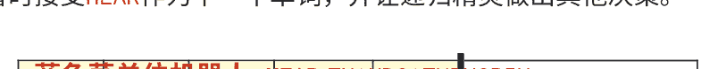

- 然后暂时接受HEART作为下一个单词，并让递归精灵做出其他决策。


- 最后，暂时接受HEARTH作为下一个单词，并让递归精灵做出其他决策。


只要递归精灵至少报告一次成功，我们就报告成功。另一方面，如果递归精灵从未报告成功，特别是如果可能的下一个单词集为空，则我们报告失败。

我们过去的决策不会影响现在可用的选择；重要的是我们尚未处理的字符后缀。特别地，几个不同的过去决策序列可能会导致相同的后缀，但它们都会给我们留下完全相同的该后缀的选择集。


因此，我们可以通过丢弃黑线左边的所有内容来简化递归过程的图像：


```
可分割的 (A[1 .. n]):
  如果 n = 0
    返回真
  对于 i 从 1 到 n
    如果是单词(A[1 .. i])
      如果可分割 (A[i + 1 .. n])
        返回真
  返回假
```

---

#### 索引形式

在实践中，将数组作为输入参数传递是相当慢的；我们应该找到一种更紧凑的方式来描述我们的递归子问题。为了设计算法，将原始输入数组视为全局变量，然后用数组索引而不是显式子数组来重新定义问题和算法，这非常有用。

对于我们的字符串分割问题，任何递归调用的参数都是原始输入数组的后缀 A[i..n]。因此，如果我们将输入数组 A[1 .. n] 视为全局变量，我们可以将递归问题重新定义如下：

> 给定一个索引 i，找到后缀 A[i .. n] 的分割。

为了描述我们的算法，我们需要两个布尔函数：

- 对于任意的索引 i 和 j，如果子字符串 A[i..j] 是一个单词，则 IsWord(i,j) = True。（我们假设这个函数已经给出。）
- 对于任意的索引 i，如果后缀 A[i..n] 可以被分割成单词，则 Splittable(i) = True。（这是我们需要实现的函数。）例如，如果整个输入字符串是一个单词，则 IsWord(1, n) = True，如果整个输入字符串可以被分割，则 Splittable(1) = True。我们之前的递归策略给出了以下递推关系：

> Splittable(i) = \begin{cases}
\text{真} & \text{if } i > n \\
\bigvee_{j=i}^{n} (\text{IsWord}(i,j) \wedge \text{Splittable}(j+1)) & \text{否则}
\end{cases}

这完全是我们之前看到的相同算法；我们唯一改变的是符号。如果我们用伪代码重写递归，相似性更加明显：

```
《后缀A[i..n]可分割吗？》
SPLITTABLE(i):
  如果 i > n
    返回真
  对于 j 从 i 到 n
    如果 IsWord(i, j)
      如果 SPLITTABLE(j + 1)
        返回真
  返回假
```

虽然它看起来像是一个微不足道的符号差异，但使用索引符号而不是数组符号是一个重要的习惯，不仅可以加速实践中的回溯算法，还可以用于开发动态规划算法，我们将在下一章中讨论。

---

## ❤ 分析

毫不奇怪，大多数回溯算法的最坏情况运行时间是指数量级的。分析许多这些算法的精确运行时间需要超出本书范围的技术。

幸运的是，在本书中我们将遇到的大多数回溯算法只是更高效算法的中间结果，这意味着它们的确切最坏情况运行时间实际上并不重要。（先让它工作，然后让它快速。）

但是，只是为了好玩，让我们分析一下我们的递归算法Splittable的运行时间。因为我们不知道IsWord在做什么，所以我们无法知道每次调用IsWord需要多长时间，因此我们被迫根据调用IsWord的次数来分析运行时间。$^{11}$ Splittable在输入字符串的每个前缀上调用IsWord，并且可能在输出字符串的每个后缀上递归调用自身。因此，Splittable的“运行时间”遵循着令人生畏的递归关系式

```
T(n) \leq \sum_{i=0}^{n-1} T(i) + O(n)
```

实际上，这并不像看起来的那样糟糕，特别是一旦你看到了这个技巧。

首先，我们用一个明确的表达式$\alpha n$替换$O(n)$项，其中$\alpha$是一个未知的（最终无关紧要的）常数。其次，我们保守地

> $^{11}$事实上，只要IsWord在多项式时间内运行，Splittable就可以在$O(2^n)$时间内运行。

假设算法实际进行了每一个可能的递归调用。$^{12}$然后，我们可以通过减去$T(n-1)$的递归来将“完整历史”递归转化为“有限历史”递归，如下所示：

```
\begin{aligned}
T(n) &= \sum_{i=0}^{n-1} T(i) + \alpha n \\
T(n-1) &= \sum_{i=0}^{n-2} T(i) + \alpha(n-1) \\
\implies T(n) - T(n-1) &= T(n-1) + \alpha
\end{aligned}
```

这个最终的递归简化为$T(n) = 2T(n-1) + \alpha$。此时，我们可以自信地猜测（或通过递归树推导，或从我们的汉诺塔分析中记住）$T(n) = O(2^n)$；事实上，这个上界通过对原始的完整历史递归进行归纳证明并不难。

此外，这个分析是紧密的。有$2^{n-1}$种可能的方法来分割长度为$n$的字符串——每个输入字符要么结束一个单词，要么不结束，除了最后一个输入字符，它总是结束最后一个单词。在最坏的情况下，我们的可分割算法会探索这$2^{n-1}$种可能性中的每一种。

---

#### 变体

现在我们已经掌握了基本的递归模式，我们可以使用它来解决许多不同的分割问题，就像我们为SubsetSum问题所做的那样。这里我只描述一个例子；更多的变体在练习中考虑。像往常一样，我们问题的原始输入是一个数组$A[1..n]$。

如果一个字符串可以被分割成多个单词序列，我们可能希望根据某个标准找到最佳的分割；相反，如果输入字符串不能被分割成单词，我们可能希望计算出我们能找到的最佳分割，而不仅仅报告失败。为了实现这两个目标，假设我们可以访问一个名为Score的第二个函数，它接受一个字符串作为输入并返回一个数值。例如，我们可以给较长或更常见的单词分配较高的分数，给较短或更晦涩的单词分配较低的分数，对于轻微的拼写错误给予略微负分，对于明显的非单词给予更负分。我们的目标是找到一个分割，使得分割的分数之和最大化。

> $^{12}$这个假设对于英语单词分割来说过于保守，因为大多数字母字符串都不是英语单词，但对于将英语单词序列分割成语法正确的英语句子的类似问题来说，这个假设是正确的。例如，考虑一个由n个“水牛”单词的副本组成的序列，或者n个“警察”单词的副本，或者n个“罐头”单词的副本，其中n是正整数。（在红磨坊，那些可以通过其他舞蹈在金属圆筒中保存的舞蹈有机会与发生在监狱洗手间垃圾桶中的舞蹈相遇。）

对于任何索引 i，令 MaxScore(i) 表示后缀 A[i..n] 的任何分割的最大得分；我们需要计算 MaxScore(1)。这个函数满足以下递归关系：

> MaxScore(i) = \begin{cases}
0 & \text{if } i > n \\
\max_{i \le j \le n} (\text{Score} (A[i..j]) + \text{MaxScore} (j+1)) & \text{否则}
\end{cases}

这本质上是我们为可分割开发的那个递归式；唯一的区别是布尔运算 $\vee$ 和 $\wedge$ 被数值运算 $\max$ 和 $+$ 所替代。

---

### 2.6 最长递增子序列

对于任意序列 $S$，$S$ 的一个子序列是通过删除零个或多个元素而不改变剩余元素顺序而获得的另一个序列；子序列的元素在 $S$ 中不一定是连续的。例如，当你在城市的主要街道上行驶时，你会经过一系列带有红绿灯的交叉口，但你只需要在其中的一个子序列上停车，其中红绿灯是红色的。如果你非常幸运，你根本不需要停车：空序列是 $S$ 的一个子序列。另一方面，如果你非常不幸，你可能不得不在每个交叉口停车：$S$ 是它自身的一个子序列。

作为另一个例子，字符串 BENT, ACKACK, SQUARING 和 SUBSEQUENT 都是字符串 SUBSEQUENCEBACKTRACKING 的子序列，空字符串和整个字符串 SUBSEQUENCE BACKTRACKING 也是，但是字符串 QUEUE 和 EQUUS 和 TALLYHO 不是。原始序列中元素连续的子序列称为子字符串；例如， MASHER 和 LAUGHTER 都是 MANSLAUGHTER 的子序列，但只有 LAUGHTER 是子字符串。

现在假设我们有一个整数序列，并且我们需要找到最长的递增子序列。更具体地说，输入是一个整数数组 $A[1..n]$，我们需要计算出最长的可能的索引序列 $1 \le i_1 < i_2 < ... < i_\ell \le n$，使得对于所有的 $k$，都有 $A[i_k] < A[i_{k+1}]$。

构建最长递增子序列的一种自然方法是按顺序对每个索引 $j$ 进行决策，是否将 $A[j]$ 包含在子序列中。跳入这个决策序列的中间，我们可以想象以下情景：


就像我们之前的文本分割示例一样，黑色的条将我们过去的决策与我们尚未处理的输入部分分开。我们已经决定包含的数字被突出显示和加粗；我们已经决定排除的数字被变灰。（请注意，我们决定包含的数字是递增的！）我们的算法必须决定是否在黑色条之后包含该数字。

我们绝对不能包含5，因为那样选定的数字将不再是递增的。

所以让我们跳到下一个决策：


现在我们可以包括 8，但是否应该这样做并不明显。与其试图变得“聪明”，我们的回溯算法将使用简单的蛮力方法。

- 首先暂时包括 8，然后让递归精灵做出其余的决策。
- 然后暂时排除 8，然后让递归精灵做出其余的决策。

无论哪种选择导致更长的递增子序列都是正确的选择。（这正是我们用来解决SubsetSum问题的递归模式。）现在关键问题是：我们需要记住关于过去决策的什么信息？只有当结果子序列是递增的时候，我们才能包括 $A[j]$。如果我们假设（归纳地！）之前从$A[1..j-1]$中选择的数字是递增的，那么我们只能在$A[j]$大于从$A[1..j-1]$中选择的最后一个数字时才能包括它。因此，我们只需要关于过去的最后一个选择的数字的信息。现在我们可以通过擦除不需要的部分来修订我们的图示：

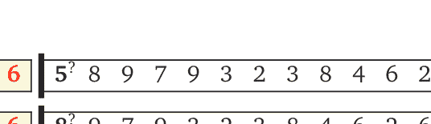

所以我们的递归策略实际上是解决以下问题的：

> 给定一个整数 $prev$ 和一个数组 $A[1..n]$，在 $A$ 中找到最长的递增子序列，其中每个元素都大于 $prev$。

像往常一样，我们的递归策略需要一个基本情况。当我们到达数组的末尾时，我们的当前策略会失败，因为没有“下一个数字”可以考虑。但是空数组恰好有一个子序列，即空序列。虽然空序列中的每个元素都比您想要的值大，但空序列中的每对元素都按递增顺序出现。因此，空数组的最长递增子序列的长度为 0。

下面是得到的递归算法：LISBIGGER(prev, A[1 .. n]):
    如果 n = 0
        返回 0
    否则如果 A[1] ≤ prev
        返回 LISBIGGER (prev, A[2 .. n])
    否则
        跳过 ← LISBIGGER(prev, A[2 .. n])
        取出 ← LISBIGGER(A[1], A[2 .. n]) + 1
        返回最大值{跳过, 取出}

好的，但请记住，在调用堆栈上传递数组是昂贵的；让我们尝试用数组索引来重新表达一切，假设数组 A[1 .. n]是一个全局变量。整数前一个通常是数组元素 A[第i个]，而剩余的数组总是原始输入数组的后缀 A[第j个 .. n]。因此，我们可以将递归问题重新表述如下：

给定两个索引 i 和 j，其中 i < j，找到最长的递增子序列，其中每个元素都大于 A[i]的 A[j .. n]。

让 LISbigger(i, j)表示在 A[j .. n]中长度大于 A[i]的最长递增子序列的长度。我们的递归策略给出了以下递推关系：

LISbigger(i, j) =
        { 0                         如果 j > n
        { 则LISbigger(i, j+1)      if A[i] ≥ A[j]
        { max { LISbigger(i, j+1), 1+LISbigger(j, j+1) }  否则

LISBIGGER(i, j):
    如果 j > n
        则返回 0
    否则, 如果 A[i] ≥ A[j]
        则返回 LISBIGGER(i, j + 1)
    否则
        skip ← LISBIGGER(i, j + 1)
        take ← LISBIGGER(j, j + 1) + 1
        返回   max{skip, take}

最后，我们需要将我们的递归策略与原始问题连接起来：找到数组的最长递增子序列没有其他限制。最简单的方法是在数组的开头添加一个人工哨兵值 -∞。

LIS(A[1 .. n]):
    A[0] ← -∞
    返回 LISBIGGER (0, 1)

LISBIGGER 的运行时间满足 Hanoi 递归 T(n) ≤ 2T(n-1)+O(1)，通常意味着 T(n) = O(2ⁿ)。我们对这个运行时间不应该感到惊讶；在最坏的情况下，算法会检查输入数组的每个 2ⁿ 子序列。

### 2.7 最长递增子序列，第二次尝试

这不是我们可以用来找到最长递增子序列的唯一回溯策略。我们可以尝试逐个元素地构建输出序列，而不是逐个考虑输入序列。也就是说，我们可以直接问：“如果有的话，输出序列的下一个元素在哪里？” 假设我们刚刚决定在黑条的左边包含6我们的输出序列，并且我们需要决定在条的右边包含哪个元素。

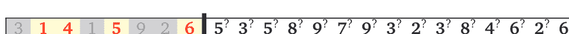

当然，我们只能包含右边大于 6 的数字；否则，我们的输出序列将不会递增。


但是我们不知道那些更大的数字中哪个是最佳选择，而且试图聪明地找出最佳选择太麻烦了，而且只会给我们带来麻烦。相反，我们通过蛮力枚举所有可能性，并让递归精灵评估每一个可能性。

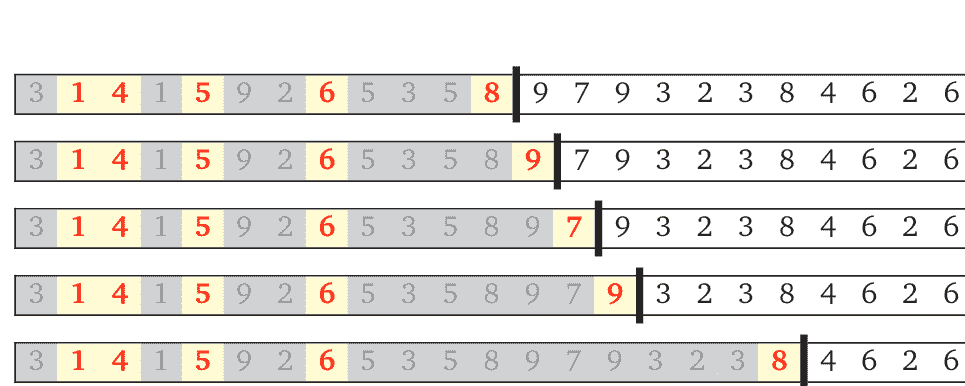

我们可以将数字的子集视为下一个元素，这取决于我们决定包含的最后一个数字。因此，我们可以通过丢弃除了最后一个我们决定包含的数字以外的所有内容来简化我们对决策过程的图像。

6 5 3 5 8 9 7 9 3 2 3 8 4 6 2 6

剩余的数字序列只是原始输入数组的后缀。因此，如果我们将输入数组 A[1..n]视为全局变量，我们可以正式地用索引来表达我们的递归问题，如下所示：

给定一个索引 i，找到以 A[i]开始的 A[i..n]的最长递增子序列。

让 LISfirst(i)表示以 A[i]开始的 A[i..n]的最长递增子序列的长度。现在我们可以将我们的递归回溯策略表达为以下递归定义：

LISfirst(i) = 1 + max {LISfirst(j) | j > i and A[j] > A[i]}

因为我们处理的是自然数集合，我们定义 max∅ = 0。然后，我们自动有 LISfirst(i) = 1 if A[j] ≤ A[i] for all j > i; in particular, LISfirst(n) = 1。这些是我们递归的基本情况。

我们还可以用伪代码来表示这个递归定义如下：

LISFIRST(i):
    best ← 0
    for j ← i + 1 to n
        if A[j] > A[i]
            最好 ← 最大{最好, LISfirst(j)}
    返回 1 + 最好

最后，我们需要将这个递归算法与我们原来的问题重新连接起来，即找到最长递增子序列而不知道它的第一个元素。一种自然的方法是通过蛮力尝试所有可能的第一个元素。等价地，我们可以在数组的开头添加一个哨兵元素 -∞，找到以哨兵开头的最长递增子序列，最后忽略哨兵。

LIS(A[1..n]):
    最好 ← 0
    对于 i 从 1 到 n
        最好 ← 最大{最好, LISfirst(i)}
    返回最好

LIS(A[1..n]):
    A[0] ← -∞
    返回 LISfirst(0) - 1

### 2.8 最优二叉搜索树

我们的最后一个例子将递归回溯与分治策略结合起来。回想一下，在二叉搜索树中，成功搜索的运行时间与目标节点的祖先数量成正比。因此，最坏情况下的搜索时间与树的深度成正比。因此，为了最小化最坏情况下的搜索时间，树的高度应尽可能小；按照这个度量标准，理想的树是完全平衡的。

然而，在许多二叉搜索树的应用中，更重要的是最小化多个搜索的总成本，而不是单个搜索的最坏情况成本。如果 $x$ 是一个比 $y$ 更频繁的搜索目标，我们可以通过构建一棵树，其中 $x$ 的深度小于 $y$ 的深度，来节省时间，即使这意味着增加树的总深度。如果某些项目比其他项目更受欢迎，那么一个完全平衡的树并不是最好的选择。事实上，一个完全不平衡的深度为 $\Omega(n)$ 的树实际上可能是最好的选择！这种情况提出了以下问题。假设我们有一个排序后的关键字数组 $A[1..n]$ 和一个相应的访问频率数组 $f[1..n]$。我们的任务是构建二叉搜索树，以最小化总搜索时间，假设每个关键字 $A[i]$ 将会有 $f[i]$ 次搜索。在我们考虑如何解决这个问题之前，我们应该首先得到我们要优化的函数的良好递归定义！假设我们还有一棵二叉搜索树 $T$，有 $v_1, v_2, \ldots, v_n$ 是 $T$ 的节点，按排序顺序索引，使得每个节点 $v_i$ 存储相应的关键字 $A[i]$。忽略常数因子，执行所有二叉搜索的总成本由以下表达式给出:

$$\text{成本}(T,f[1..n]) := \sum_{i=1}^{n} f[i] \cdot \# T中v_i的祖先 \quad (*)$$

现在假设 $v_r$ 是 $T$ 的根节点；根据定义，$v_r$ 是 $T$ 中每个节点的祖先。如果 $i < r$，则 $v_i$ 的所有祖先（除了根节点）都在 $T$ 的左子树中。同样地，如果 $i > r$，则 $v_i$ 的所有祖先（除了根节点）都在 $T$ 的右子树中。因此，我们可以将成本函数分为三个部分，如下所示:

$$\begin{aligned} \text{成本}(T,f[1..n]) &= \sum_{i=1}^{n} f[i] + \sum_{i=1}^{r-1} f[i] \cdot \#T中v_i在左子树中的祖先 \\ &+ \sum_{i=r+1}^{n} f[i] \cdot \#T中v_i在右子树中的祖先 \end{aligned}$$

第二个和第三个求和看起来与我们的原始定义完全一样 $(*)$。现在简单的替换给我们提供了一个关于 Cost的递归公式:

$$成本(T, f[1 .. n]) = \sum_{i=1}^{n} f[i] + Cost(left(T), f[1 .. r-1]) + Cost(right(T), f[r+1 .. n])$$

这个递归的基本情况是，通常情况下， n = 0; 在空树中不进行搜索的成本为零。

现在我们的任务是计算使得这个成本函数最小的树 Topt。假设我们以某种神奇的方式知道 T的根节点是 vr。那么递归定义 Cost(T, f)立即意味着左子树left(T)的最优搜索树必须是键 A[1 .. r − 1]和访问频率 f[1 .. r − 1]的最优搜索树。同样，右子树 right(T)必须是键 A[r + 1 .. n]和访问频率 f[r + 1 .. n]的最优搜索树。

**一旦我们选择在根节点存储正确的键，递归精灵将构建其余的最优树。**

更一般地，让 OptCost(i, k)表示频率区间 f[i .. k]的最优搜索树的总成本。这个函数遵循以下递归关系。

$$OptCost(i, k) = \begin{cases} 0 & \text{if } i > k \\ \sum_{j=i}^{k} f[j] + \min_{i \leq r \leq k} \left\{ OptCost(i, r-1) + OptCost(r+1, k) \right\} & \text{otherwise} \end{cases}$$

基本情况正确地表明，对于空集合进行零次搜索的最小成本是零！我们的原始问题是计算OptCost(1, n)。

这个递归定义可以机械地转化为一个递归回溯算法来计算 OptCost(1, n)。毫不奇怪，这个算法的运行时间是指数级的。在下一章中，我们将看到如何将运行时间减少到多项式级别，所以计算精确的运行时间没有太大意义。

## ♥分析

除非你对这种事情感兴趣。 只是为了好玩，让我们来计算一下这个回溯算法实际上有多慢。运行时间满足递归关系

$$T(n) = \sum_{k=1}^{n} (T(k-1) + T(n-k)) + O(n).$$

术语 $O(n)$来自计算搜索的总数 $\sum_{i=1}^n f[i]$。是的，这是一个丑陋的递归，但我们可以使用完全相同的减法技巧来解决它，我们之前使用的。我们用一个明确的常数替换 O( )符号，重新分组和收集相同的项，减去 T(n-1)的递归以消除求和，然后再次重新分组。

$$T(n) = 2 \sum_{k=0}^{n-1} T(k) + \alpha n$$
$$T(n-1) = 2 \sum_{k=0}^{n-2} T(k) + \alpha (n-1)$$
$$T(n) - T(n-1) = 2T(n-1) + \alpha$$
$$T(n) = 3T(n-1) + \alpha$$

嘿，看起来一点都不糟糕。递归树方法立即给出了我们的解 T(n) = O(3^n)（或者我们可以猜测并通过归纳法进行确认）。

这个分析意味着我们的递归算法并没有检查所有可能的二叉搜索树！具有 N 个顶点的二叉搜索树的数量满足递归关系

$$N(n) = \sum_{r=1}^{n-1} (N(r-1) \cdot N(n-r)),$$

它的闭式解为 N(n) = Θ(4^n / √n)。（不，这不是显而易见的。）我们的算法通过独立地搜索每个根节点的最佳左子树和右子树来节省了大量时间。对二叉搜索树的完全枚举将考虑所有可能的左子树和右子树对；因此，在 N(n)的递归中有一个乘积。

## 练习

- 1. 描述递归算法用于以下子集和问题的一般化：
    - (a) 给定一个正整数数组 X[1 .. n] 和一个整数 T，计算 X 中元素和为 T 的子集数量。
    - (b) 给定两个正整数数组 X[1 .. n] 和 W[1 .. n] 以及一个整数 T，其中每个 W[i] 表示相应元素 X[i] 的权重，计算 X 中元素和为 T 的最大权重子集。如果 X 的任何子集的和都不等于 T，则算法应返回 -∞。

- 2. 描述递归算法用于以下文本分割问题的变体：假设你有一个子程序 IsWoRD，它接受一个字符数组作为输入，并在该字符串是一个 “单词” 时返回True。
    - (a) 给定一个字符数组 A[1..n]，计算将A分割成单词的数量。例如，给定字符串 ARTISTOIL，你的算法应该返回 2，即分割成 ARTIST·OIL 和 ART·IS·TOIL 两个部分。
    - (b) 给定两个字符数组 A[1..n] 和 B[1..n]，判断 A和 B是否可以在相同的索引处分割成单词。例如，字符串BOTHEARTHANDSATURNPIN 和 PINSTARTRAPSANDRAGSLAP 可以按照以下方式在相同的索引处分割成单词：
        > BOT·HEART·HAND·SAT·URNS·PIN
        > PIN·START·RAPS·AND·RAGS·LAP
    - (c) 给定两个字符数组 A[1..n]和 B[1..n]，计算将 A和 B在相同的索引处分割成单词的不同方式的数量。

- 3. 对于一个整数 n的加法链是一个递增的整数序列，它以 1开始并以 n结束，每个条目在第一个条目之后是两个较早条目的和。更正式地说，整数序列 $x_0 < x_1 < x_2 < \cdots < x_\ell$ 是一个加法链，如果且仅如果
    - $x_0 = 1$,
    - $x_\ell = n$，并且
    - 对于每个索引 $k > 0$，存在索引 $i \leq j < k$ 使得 $x_k = x_i + x_j$。加法链的长度是元素数量减去 1；我们不计算第一个条目。例如， (1, 2, 3, 5, 10, 20, 23, 46,92, 184, 187, 374)是长度为 11的 374的加法链。
    - (a) 描述一个递归回溯算法来计算给定正整数 n的最小长度加法链。除了满足自己的好奇心外，不要分析或优化算法的运行时间。一个正确的算法，其运行时间在 n上是指数级的，足以获得满分。[提示：这个问题更像是 n皇后问题而不是文本分割。]
    - (b) 描述一个递归回溯算法，以在给定正整数 n的时间内计算最小长度的加法链，该时间是 n的次指数级。[提示：您可能会发现某些埃及绳索紧固件、印度河韵律学家和俄罗斯农民的结果有帮助。]

- 4. (a) 让 A[1..m] 和 B[1..n] 是两个任意的数组。A和 B的一个公共子序列既是 A的子序列，也是 B的子序列。给出函数 lcs(A,B) 的一个简单递归定义，该函数给出A和 B的最长公共子序列的长度。
    - (b) 让 A[1..m] 和 B[1..n] 是两个任意的数组。A 的一个公共超序列是另一个包含 A 和 B 作为子序列的序列。给出一个简单的递归定义函数scs(A, B)，它给出A和B的最短公共超序列的长度。
    - (c) 如果存在一个索引 i，使得序列 X[1..n] 的前缀 X[1..i] 是递增的，后缀X[i..n] 是递减的，则称序列X[1..n]为 **bitonic**序列。给出一个简单的递归定义函数lbs(A)，它给出任意整数数组 A 的最长bitonic子序列的长度。
    - (d) 如果对于所有偶数i, X[i] < X[i+1]，并且对于所有奇数i, X[i] > X[i+1]，则称序列X[1..n]为振荡序列。给出一个简单的递归定义，用于计算任意整数数组A的最长振荡子序列的长度函数los(A)。
    - (e) 给出一个简单的递归定义，用于计算任意整数数组A的最短振荡超序列的长度函数sos(A)。
    - (f) 如果对于所有i, 2·X[i] < X[i-1] + X[i+1]，则称序列X[1..n]为凸序列。给出一个简单的递归定义，用于计算任意整数数组A的最长凸子序列的长度函数lxs(A)。

- 5. 对于以下问题中的每一个，输入由两个数组 X[1..k] 和 Y[1..n]组成，其中 k ≤ n。
    - (a) 描述一个递归回溯算法来确定 X是否是 Y的子序列。例如，字符串 PPAP 是字符串 PENPINEAPPLEAPPLEPEN的子序列。
    - (b) 描述一个递归回溯算法，找到可以从 Y中删除的最少符号数，使得 X 不再是一个子序列。换句话说，你的算法应该找到 Y的最长子序列，该子序列不是 X 的超序列。例如，在从字符串 PENPINEAPPLEAPPLEPEN 中删除两个符号后，字符串 PPAP不再是一个子序列。
    - ♥(c) 描述一个递归回溯算法来确定 X是否作为 Y的两个不相交的子序列出现。例如，字符串 PPAP在字符串 PENPINEAPPLEAPPLEPEN中作为两个不相交的子序列出现。
    不要分析算法的运行时间，除非满足你自己的好奇心。这三个算法的运行时间是指数量级的；我们稍后会改进，所以精确的运行时间并不是特别重要。

- 6. 这个问题要求你设计回溯算法来找到满足额外平衡约束的最优二叉搜索树的成本。你的输入包括一个有序数组 A[1 .. n]的搜索键和一个数组f [1 .. n]的频率计数，其中 f [i]是对 A[i]的搜索次数。这与第2.8节中描述的成本函数完全相同。但是现在你的任务是计算满足一些额外约束的最优树。
    - (a) AVL树是最早的自平衡二叉搜索树，由Georgy Adelson-Velsky和Evgenii Landis于1962年首次描述。AVL树是一种二叉搜索树，对于每个节点 v ，左子树的高度和右子树的高度之差最多为1。描述一个递归回溯算法来构建给定搜索键和频率的最优AVL树。
    - (b) 对称二叉B树是另一种自平衡二叉树，由Rudolf Bayer于1972年首次描述；这些树更为人所知的名称是红黑树，在Leo Guibas和Bob Sedgwick于1978年进行了一些简化改进后得到。红黑树是一种具有以下附加约束的二叉搜索树：
        - 每个节点要么是红色，要么是黑色。
        - 每个红色节点都有一个黑色父节点。
        - 每条从根到叶子的路径包含相同数量的黑色节点。
        描述一个递归回溯算法，用于构建给定搜索键和频率集的最优红黑树。
    - (c) AA树是由Arne Andersson于1993年提出的，并在2000年由Mark Allen Weiss稍作简化（并命名）。AA树也被称为左倾红黑树，这是由Bob Sedgewick在2006年通过对称重构（使用不同的平衡算法）得到的。AA树是一种带有额外约束的红黑树：
        - 没有左孩子是红色。
        描述一个递归回溯算法，用于构建给定搜索键和频率集的最优AA树。
        除了满足自己的好奇心外，不要分析算法的运行时间。这三个算法都以指数时间运行；我们稍后会改进，所以精确的运行时间并不重要。

> 要获取更多的回溯练习，请参阅下一章！
>
> 14 Sedgewick的改进要求没有右子节点是红色的。无论如何。Andersson和Sedgewick对于先吃蛋的哪一端保持沉默。

Potes enim videre in hac margine, qualiter hoc operati fuimus, scilicet quod iunximus primum numerum cum secundo, videlicet 1 cum 2; et secundum cum tertio; et tertium cum quarto; et quartum cum quinto, et sic deinceps. . . . [你可以在这里的边缘看到我们是如何工作的；显然，我们将第一个数字与第二个数字相结合，即1与2，第二个数字与第三个数字相结合，第三个数字与第四个数字相结合，第四个数字与第五个数字相结合，依此类推。. . .] — Leonardo Pisano, Liber Abaci (1202)

> 那些不能记住过去的人注定要重蹈覆辙。
— 胡尔赫·阿古斯丁·尼古拉斯·鲁伊斯·德·桑塔亚纳和博拉斯，《理性的生活，第一卷：引言和常识中的理性》（1905年）

> 你知道什么是学习经验吗？
学习经验就是那种说，“你刚刚做的那件事，不要再做了。”的事情。
— 道格拉斯·亚当斯，《怀疑的鲑鱼》（2002年）

## 3 动态规划

### 3.1 矩阵链乘法

递归的最早例子出现在2000多年前的印度，在诗歌韵律或韵律学的研究中。古典梵语诗歌区分两种音节（akṣara）：轻音节（laghu）和重音节（guru）。在一类韵律中，称为 matr̥ v̥r̥tta 或 matr̥ āchandas，每行诗由固定数量的“拍子”（mātrā）组成，其中每个轻音节持续一个拍子，每个重音节持续两个拍子。对 matr̥ a-v̥r̥tta 的正式研究可以追溯到学者平伽拉在公元前600年至公元前200年之间写的 Chandah.śāstra。平伽拉观察到恰好有五种4拍子的韵律：— —，— • •，• — •，• • — 和 • • • •。（这里的每个“—”代表一个长音节，每个“•”代表一个短音节。）¹

¹在莫尔斯电码中，“dah”持续时间是“dit”的三倍，但每个“dit”或“dah”后面都有一个持续时间与“dit”相同的暂停。因此，每个“dit-pause”是一个 laghu akṣara，每个 “dah-pause”是一个 guru akṣara，而且有正好五个字母（M, D, R, U和 H）它们的代码持续四个 mātrā。

尽管 Pingala 的文本暗示了一种用于计算具有给定拍数的节拍的系统规则，但要明确陈述这个规则大约花了一千年的时间。在公元7世纪，另一位名叫 Virahānka 的印度学者对 Pingala 的作品进行了评论，在评论中他观察到具有 n 拍的节拍数是具有 (n-2)拍的节拍数和具有 (n-1)拍的节拍数之和。用更现代的符号表示，Virahānka 的观察意味着总数 M(n) of n 拍节拍的递归关系：
$$M(n) = M(n-2) + M(n-1)$$
很容易看出 M(0)=1 （只有一个空的音节） 和 M(1)=1 （只有一个拍子由一个短音节组成）。

大约500年后，同样的递归在欧洲重新出现在Leonardo of Pisa的1202年著作*Liber Abaci*中，这是最早的欧洲“算法”作品之一。完全遵守Stigler's Law of Eponymy,³现代Fibonacci数列使用Virahānka的递归定义，但是基本情况不同:
$$F_n = \begin{cases}
0 & \text{if } n = 0 \\
1 & \text{如果 } n = 1 \\
F_{n-1} + F_{n-2} & \text{otherwise}
\end{cases}$$
特别地，我们有 M(n) = F_{n+1} 对于所有的 n.

#### 回溯法可能很慢

斐波那契数的递归定义立即给出了计算它们的递归算法。这是相同的算法用伪代码写成：
```
RecFibo(n):
  如果 n = 0
    返回 0
  否则如果 n = 1
    返回 1
  否则
    返回 RecFibo(n-1) + RecFibo(n-2)
```
不幸的是，这个朴素的递归算法非常慢。除了递归调用之外，整个算法只需要恒定数量的步骤：一个比较和可能一个加法。让 T(n) 表示对 RecFibo 的递归调用次数；这个函数满足递归关系
T(0) = 1,  T(1) = 1,  T(n) = T(n-1) + T(n-2) + 1,
这看起来非常像斐波那契数列本身的递归关系！写出 T(n) 的前几个值，可以推测出闭式解 T(n) = 2F_{n+1} - 1，我们可以通过归纳法验证（提示，提示）。因此，使用这个算法计算 F_n 大约需要比简单计数到 F_n 多一倍的时间。本书范围之外的方法⁴暗示 F_n = Θ(φ^n)，其中φ=( √5 +1)/2 ≈1.6180³被称为黄金比例。简而言之，这个递归算法的运行时间是指数级的，与N成正比。

我们实际上可以直接看到这种指数增长，如下所示。将 RecFibo的递归树视为一个只有 0和 1的加法二叉树，叶子节点上的值为0和 1。由于最终的输出是 F_n，叶子节点中必须有 F_n 个值为1的节点；这些叶子节点表示对 RecFibo(1)的调用。一个简单的归纳论证（提示，提示）表明 RecFibo(0)被调用了 F_{n-1} 次。（如果我们只想要一个渐近界限，观察到对 RecFibo(0)的调用次数最多不超过对 RecFibo(1)的调用次数即可。）因此，递归树一共有 F_n + F_{n-1} = F_{n+1} = O(F_n) 个叶子节点，因此，因为它是一个满二叉树，一共有 2F_{n+1} - 1 = O(F_n) 个节点。

#### 记忆化：记住一切

递归算法速度缓慢的明显原因是它一遍又一遍地计算相同的斐波那契数。对RecFibo(n)的单次调用会导致对RecFibo(n-1)的一个递归调用，对RecFibo(n-2)的两个递归调用，对RecFibo(n-3)的三个递归调用，对RecFibo(n-4)的五个递归调用，一般情况下，对RecFibo(n-k)的F_{k-1} 个递归调用，其中0 ≤ k < n。每次调用都会重新计算一些斐波那契数。

通过记录递归调用的结果并在需要时再次查找，我们可以大大加快递归算法的速度。

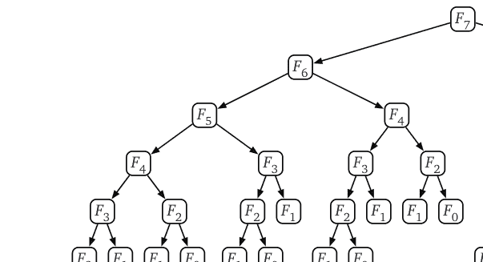

这种优化技术，现在被称为记忆化（是的，没有R），通常归功于1967年的Donald Michie，但本质上相同的技术在1959年由Arthur Samuel提出。⁵
```
MEMFIBO(n):
    如果 n = 0
        返回 0
    否则如果 n = 1
        返回 1
    否则
        如果 F[n] 未定义
            F[n] ← MEMFIBO(n-1) + MEMFIBO(n-2)
        返回 F[n]
```
记忆化明显减少了算法的运行时间，但是减少了多少？如果我们实际跟踪MemFibo所做的递归调用，我们发现数组F[]从底部向上填充：首先是F[2]，然后是F[3]，以此类推，直到F[n]。这个模式可以通过归纳验证：每个条目F[i]只有在其前任F[i-1]填充后才填充。如果我们忽略递归调用所花费的时间，每个斐波那契数Fi的递归只需要常数时间来计算。但是根据设计，每个索引i的Fi的递归只计算一次。我们得出结论，MemFibo只执行O(n)次加法，相对于朴素递归算法，这是指数级的改进！

⁵米奇提出，编程语言应该支持他所称之为“备忘函数”的抽象，其中包括标准函数（“规则”）和字典（“背诵”），而不是分别支持数组和函数。每当备忘函数第一次计算函数值时，它会将该值“记忆”（是的，带有一个R）到它的字典中。米奇受到塞缪尔对“背诵学习”在递归评估跳棋游戏树中的加速应用的启发；米奇将他更一般的提议描述为“使程序员能够‘塞缪尔化’任何他喜欢的函数。”（据我所知，米奇从未自己使用过“备忘化”这个术语。）备忘化甚至在克劳德·香农于1950年设计和构建的迷宫解决机器人“Theseus”中早早使用过。

#### 动态规划：有意填充

一旦我们看到数组F[]如何填充，我们可以用一个简单的for循环来替换记忆化递归，有意地按照这个顺序填充数组，而不是依赖于一个更复杂的递归算法来无意中为我们填充。
```
ITERFIBO(n):
    F[0] <- 0
    F[1] <- 1
    for i <- 2 to n
        F[i] <- F[i-1] + F[i-2]
    return F[n]
```
现在时间分析是显而易见的： ITERFIBO明显使用O(n)次加法和存储O(n)个整数。

这是我们的第一个明确的动态规划算法。动态规划范式在20世纪50年代中期由理查德·贝尔曼在兰德公司工作时被正式化和普及，尽管他并不是第一个使用这种技术的人。特别是，这个迭代算法计算斐波那契数已经在12世纪由Virahānka和后来的梵文韵律学家提出，并在13世纪初由斐波那契再次提出！⁶

事实上，多年之后，贝尔曼声称他故意选择了“动态规划”这个名字，以隐藏他的工作的数学性质，以避免军方上司的敌意，因为他们对任何类似数学研究的东西都持敌对态度。⁷“编程”一词并不是指编写代码，而是指填充表格的旧意义上的计划或安排。例如，体育节目和戏剧节目是重要事件的时间表（带有广告）；电视节目涉及用节目（和广告）填充每个可用时间段；学位课程是要上的课程的时间表（带有广告）。空军资助贝尔曼和其他人开发了构建训练和后勤计划的方法，或者正如他们所称的“程序”。“动态”一词不仅是对贝尔曼和他的同事们试图优化的多阶段、时变过程的参考，而且也是一个会引起战后美国未来主义热潮的市场宣传词。⁸部分归功于贝尔曼的宣传，动态规划现在已经成为经济学、机器人学、控制理论和其他几个学科中的多阶段规划的标准工具。

#### 不要记住所有的东西

在许多动态规划算法中，并不需要保留所有中间结果直到计算结束。例如，我们可以通过仅保留数组的最新两个元素来显著减少我们的算法IterFibo的空间需求：
```
IterFibo2(n):
    prev ← 1
    curr ← 0
    for i ← 1 to n
        next ← curr + prev
        prev ← curr
        curr ← next
    return curr
```
（该算法使用非标准但一致的基本情况 F_{-1} = 1，因此 IterFibo2(0)返回正确的值 0。）虽然在实践中节省空间可能非常关键，但我们不会在本书中重点关注空间问题。

### 3.2 附注：更快的斐波那契数列

虽然之前的算法简单而有吸引力，但它不是计算斐波那契数的最快算法。通过利用斐波那契递推式的以下矩阵重组，我们可以得到一个更快的算法：
$$\begin{bmatrix} 0 & 1 \\ 1 & 1 \end{bmatrix} \begin{bmatrix} x \\ y \end{bmatrix} = \begin{bmatrix} y \\ x+y \end{bmatrix}$$
换句话说，将二维向量乘以矩阵 \begin{bmatrix} 0 & 1 \\ 1 & 1 \end{bmatrix} 与 IterFibo2 的内部循环一次迭代完全相同。因此，乘以矩阵 n 次等同于迭代循环 n 次：
$$\begin{bmatrix} 0 & 1 \\ 1 & 1 \end{bmatrix}^n \begin{bmatrix} 1 \\ 0 \end{bmatrix} = \begin{bmatrix} F_{n-1} \\ F_n \end{bmatrix}$$
所以，如果我们想要计算第n个斐波那契数，我们只需要计算矩阵 \begin{bmatrix} 0 & 1 \\ 1 & 1 \end{bmatrix} 的n次方。如果我们使用重复平方法，计算某个数的n次方只需要 O(\log n)次乘法。在这里，因为“某个数”是一个2\times 2的矩阵，这意味着 O(\log n) 次 2\times 2矩阵乘法，每次乘法都可以化简为一定数量的整数乘法和加法。因此，我们可以只用 O(\log n)次整数运算来计算 F_n。

我们可以使用恒等式 F_n = F_m F_{n-m-1} + F_{m+1} F_{n-m} 来实现相同的加速，这个恒等式对于所有整数 m和 n都成立（通过归纳证明！）。特别地，这个恒等式暗示了相邻斐波那契数对的以下互相递推关系，这个关系最早由Édouard Lucas在1898年提出：
$$F_{2n-1} = F_{n-1}^2 + F_n^2$$
$$F_{2n} = F_n(F_{n-1} + F_{n+1}) = F_n(2F_{n-1} + F_n)$$
这些互相循环直接转化为以下算法：
```
⟨计算一对 F_{n-1}, F_n⟩
FASTRECFIBO(n)：
    如果 n = 1
        返回 0, 1
    m ← ⌊n/2⌋
    hprv, hcur ← FASTRECFIBO(m)    ⟨F_{m-1}, F_m⟩
    prev ← hprv² + hcur²            ⟨F_{2m-1}⟩
    curr ← hcur · (2·hprv + hcur)   ⟨F_{2m}⟩
    next ← prev + curr              ⟨F_{2m+1}⟩
    如果 n 是偶数
        返回 prev, curr
    否则
        返回 curr, next
```
我们的标准递归树技术表明，该算法仅执行O(log n)个整数运算。这是对标准迭代算法的指数级加速，而标准迭代算法已经对我们的原始递归算法进行了指数级加速。对吗？

#### 哇！不要这么快！

嗯，不完全是。斐波那契数以指数速度增长。第 n 个斐波那契数约为 n log_{10} φ ≈ n/5位十进制数，或 n log_2 φ ≈ 2n/3位二进制数。所以我们不可能在对数时间内计算 F_n —— 我们需要 Ω(n)时间仅仅为了写下答案！

摆脱这个明显的悖论的方法是观察到我们无法在常数时间内执行任意精度的算术运算。让 M(n) 表示两个 n 位数相乘所需的时间。FASTRECFIBO 的运行时间满足递归关系 T(n) = T(⌊n/2⌋) + M(n)，通过递归树求解得到 T(n) = O(M(n))。已知的最快整数乘法算法（截至2019年）的运行时间为 O(n log n)，因此这也是已知的最快算法（截至2019年）计算斐波那契数的运行时间。

这个算法比我们的“线性时间”迭代算法慢吗？实际上，不是的 - 加法也不是免费的！将两个 n 位数的数字相加需要 O(n) 时间，所以迭代算法 ITERFIBO 和 ITERFIBO2 实际上运行在 O(n^2) 时间。（你明白为什么吗？）所以 FASTRECFIBO 比迭代算法快得多，但并不是指数级别的快。在原始递归算法中，任意精度算术的额外成本被大量的递归调用所淹没。正确的递归关系是 T(n) = T(n-1) + T(n-2) + O(n)，仍然有解 T(n) = O(\phi^n)。

### 3.3 词语间隔重复

对于我们下一个动态规划算法，让我们考虑前一章的文本分段问题。我们给定一个字符串 A[1..n] 和一个子程序IsWord，它确定给定的字符串是否是一个单词（无论是什么意思），我们想知道 A 是否可以被分割成一个单词序列。
$$\text{Splittable}(i) = \begin{cases}
\text{真} & \text{if } i > n \\
\bigvee_{j=i}^{n} (\text{IsWord}(i,j) \land \text{Splittable}(j+1)) & \text{否则}
\end{cases}$$
其中\text{IsWord}(i,j)是\text{IsWord}(A[i..j])的简写。这个递归关系直接转化为一个递归回溯算法，在最坏情况下调用IsWord子程序 O(2^n)次。

但对于任何固定的字符串 A[1..n]，只有 n种不同的方式来调用递归函数 \text{Splittable}(i) — 每个值 i 在 1到n+1之间一种方式 — 以及只有 O(n^2)种不同的方式来调用函数 \text{IsWord}(i,j) — 每对(i,j)满足 1 \le i \le j \le n一种方式。为什么我们要花指数时间计算只有多项式数量的东西?

每个递归子问题由一个介于 1和 n+1之间的整数指定，因此我们可以将函数 \text{Splittable}的记忆化存储到一个数组 \text{SplitTable}[1..n+1]中。每个子问题 \text{Splittable}(i)仅依赖于子问题 \text{Splittable}(j)的结果，其中 j > i，因此记忆化递归算法按递减的索引顺序填充数组。如果我们有意按照这个顺序填充数组，我们将得到图3.3中所示的动态规划算法。该算法对函数IsWord进行了 O(n^2)次调用，相比我们之前的回溯算法有指数级的改进。

### 3.4 模式：智能递归

简而言之，动态规划是无重复的递归。动态规划算法将中间子问题的解存储在一个数组或表中，通常但并不总是。许多算法学生FASTSPLITTABLE(A[1..n]):
SplitTable[n+1] ← TRUE
for i ← n down to 1
    SplitTable[i] ← FALSE
    for j ← i to n
        if ISWORD(i,j) and SplitTable[j+1]
            SplitTable[i] ← TRUE
return SplitTable[1]

图3.3 Interpunctio verborum velox

（以及教师和教科书）错误地将重点放在表上——因为表格易于理解和熟悉——而不是更重要的（也更难的）任务，即找到正确的递归关系。只要我们记忆化正确的递归关系，实际上并不需要显式的表格，但如果递归关系错误，我们将彻底失败。

> 动态规划不是关于填充表格的。
> 它是关于聪明的递归！

## 3.4 动态规划算法最好分为两个不同的阶段来开发。

1.  递归地制定问题。根据较小子问题的答案，写下一个递归公式或算法来解决整个问题。这是困难的部分。一个完整的递归公式有两个部分：
    (a) 规范。用连贯而准确的英语描述您想要递归解决的问题，而不是如何解决该问题，而是您要解决的问题是什么。如果没有这个规范，甚至原则上都无法确定您的解决方案是否正确。
    (b) 解决方案。根据完全相同问题的较小实例的答案，给出一个清晰的递归公式或算法来解决整个问题。

2.  从底部向上构建递归的解决方案。编写一个算法，从递归的基本情况开始，按照正确的顺序考虑中间子问题，一直到最终解决方案。这个阶段可以分解为几个较小的、相对机械的步骤：
    (a) 识别子问题。你的递归算法可以通过哪些不同的方式调用自身，从某个初始输入开始？例如，RecFibo的参数始终是介于0和n之间的整数。
    (b) 选择一个备忘录数据结构。找到一个可以存储步骤(a)中识别的每个子问题的解决方案的数据结构。通常情况下，这是一个多维数组，但不总是。
    (c) 识别依赖关系。除了基本情况，每个子问题都依赖于其他子问题——哪些子问题？画出你的数据结构的图像，选择一个通用元素，并从它依赖的每个其他元素画箭头。然后形式化你的图像。
    (d) 找到一个好的评估顺序。对子问题进行排序，使得每个子问题都在它依赖的子问题之后。你应该首先考虑基本情况，然后是仅依赖于基本情况的子问题，依此类推，最终构建到原始的顶层问题。你在上一步中识别的依赖关系定义了子问题的部分顺序；你需要找到该部分顺序的线性扩展。要小心！
    (e) 分析空间和运行时间。不同子问题的数量决定了记忆化算法的空间复杂度。要计算总运行时间，将所有可能的子问题的运行时间相加，假设更深层的递归调用已经被记忆化。实际上，在步骤(a)之后立即可以这样做。
    (f) 写下算法。你知道考虑子问题的顺序，也知道如何解决每个子问题。所以就这样做吧！如果你的数据结构是一个数组，这通常意味着在原始递归周围写几个嵌套的for循环，并用数组查找替换递归调用。

当然，你必须证明每个步骤都是正确的。如果你的递归关系式错误，或者如果你尝试以错误的顺序构建答案，你的算法将无法工作！

### 3.5 警告：贪婪是愚蠢的

如果我们非常幸运，我们可以绕过所有的递归和表格等等，使用贪心算法解决问题。像回溯算法一样，贪心算法通过一系列决策构建解决方案，但它直接做出这些决策，而不解决任何递归子问题。虽然这种方法似乎非常自然，但能够通过贪心算法正确解决的优化问题非常罕见。尽管如此，对于许多应该通过回溯或动态规划解决的问题，许多学生的第一直觉是应用贪心策略。

例如，对于文本分割问题的贪婪算法可能会找到输入字符串的最短（或者，如果你愿意，最长）前缀作为分割中的第一个单词，并且然后递归地分割输入字符串的剩余后缀。类似地，对于最长递增子序列问题的贪婪算法可能会寻找输入数组的最小元素，接受该元素作为目标子序列的起始元素，然后递归地寻找右侧的最长递增子序列。如果这些听起来像是愚蠢的技巧，那么请为自己鼓掌；这些甚至都不是正确的解决方案。

每个人都应该在手背上纹上以下句子，在所有关于对数和大O符号的规则之下：

> 贪婪算法永远不起作用！
> 改用动态规划！

什么，从来没有？
不，从来没有！
什么，从来没有？
好吧...几乎从不。¹⁰

¹⁰ 它们几乎从不工作！然后为严格的船长Pinafore欢呼三声，再欢呼一声！然后为船长Pinafore欢呼三声，再欢呼一声！

因为贪婪的方法非常诱人，但很少正确，我强烈建议在任何算法课程中遵循以下政策，即使（或也许特别是）对于通常不要求正确性证明的课程。¹¹

即使算法是正确的，你也不会在任何作业或考试中得到任何贪婪算法的学分，没有正确性证明。

此外，学生们往往会被诱惑提交贪婪算法的大多数问题实际上最好使用动态规划来解决。所以我总是给我的算法学生以下建议。

> 无论你写或者思考“贪婪”这个词，你的潜意识都在告诉你要使用动态规划。

即使对于可以通过贪婪算法正确解决的问题，通常更有效的是首先开发回溯或动态规划算法。先让它工作，然后让它快。我们将在下一章中看到证明贪婪算法正确性的技巧。

¹¹ 在我的算法课程中引入这个政策显著提高了学生的成绩，因为它显著减少了错误贪婪算法的频率。

### 3.6 最长递增子序列

在前一章中，我们考虑了另一个问题，即计算给定数组 A[1..n]的最长递增子序列的长度。我们为这个问题开发了两种不同的递归回溯算法。这两种算法在最坏情况下的运行时间为 O(2^n)；这两种算法都可以通过动态规划来显著加速。

#### 第一次重复：下一个是什么？

我们的第一个回溯算法评估了函数 LISbigger(i,j)，我们将其定义为 A[j..n]的最长递增子序列的长度，其中每个元素都大于 A[i]。我们得到了以下递归公式用于计算这个函数：

$$
\text{LISbigger}(i,j) =
\begin{cases}
0 & \text{如果 } j > n \\
\text{LISbigger}(i,j+1) & \text{if } A[i] \geq A[j] \\
\max \begin{cases} \text{LISbigger}(i,j+1) \\ 1 + \text{LISbigger}(j,j+1) \end{cases} & \text{否则}
\end{cases}
$$

为了解决原始问题，我们可以在数组中添加一个哨兵值 A[0] = -\infty，并计算 LISbigger(0,1)。每个递归子问题由两个索引 i和 j标识，因此只需要考虑 O(n^2)个不同的递归子问题。我们可以将这些子问题的结果存储在一个二维数组 LISbigger[0..n, 1..n]中进行记忆化。¹²此外，每个子问题可以在 O(1)的时间内解决，不计算递归调用，因此我们应该期望最终的动态规划算法在 O(n^2)的时间内运行。

记忆化递归算法填充这个数组的顺序并不明显；从递归中我们只能知道每个条目 LISbigger[i,j]在下一列中的条目 LISbigger[i,j+1]和 LISbigger[j,j+1]之后被填充，如图3.4左侧所示。

幸运的是，这部分信息足以给我们一个有效的评估顺序。如果我们从右到左逐列填充表格，那么每当我们到达表格中的一个条目时，它所依赖的条目已经可用。这可能不是递归算法使用的顺序，但它有效，所以我们将采用它。图3.4中的右图说明了这个评估顺序，双箭头表示外循环，单箭头表示内循环。在这种情况下，单箭头是双向的，因为我们用于填充每一列的顺序无关紧要。

我们完成了！我们的动态规划算法的伪代码如下所示；正如预期的那样，我们的算法在 $O(n^2)$ 时间内运行。如果需要的话，我们可以将空间限制从 $O(n^2)$ 降低到 $O(n)$，只需保留表格的最近两列， $LISbigger[,j]$ 和 $LISbigger[,j+1]$ 。¹³

| FASTLIS(A[1..n]): |
| :--- |
| A[0] ← -∞                         ⟨⟨添加一个哨兵⟩⟩ |
| 对于 i 从 0 到 n                  ⟨⟨基本情况 ⟩⟩ |
|     LISbigger[i, n+1] ← 0 |
| 对于 j 从 n 递减到 1 |
|     对于 i 从 0 到 j-1            ⟨⟨... 或者无论什么⟩⟩ |
|         保持 ← 1 + LISbigger[j, j+1] |
|         跳过 ← LISbigger[i, j+1] |
|         如果 A[i] ≥ A[j] |
|             LISbigger[i, j] ← 跳过 |
|         否则 |
|             LISbigger[i, j] ← max{保持,跳过} |
| 返回 LISbigger [0, 1] |

#### 第二个递归：下一步是什么？

我们的第二个回溯算法评估了函数 $LISfirst(i)$ ，我们将其定义为 $A[i..n]$ 的最长递增子序列的长度，该子序列以 $A[i]$ 开头。我们得到了以下递归公式：

$$LISfirst(i) = 1 + \max \{LISfirst(j) \quad j > i \text{ and } A[j] > A[i] \}$$

在这里，我们假设 $\max \emptyset = 0$ ，这样基本情况如 $LISfirst(n) = 1$ 会自动从递归中排除。为了解决原始问题，我们可以在数组中添加一个哨兵值 $A[0] = -\infty$ ，并计算 $LISfirst(0) - 1$ 。在这种情况下，递归子问题由单个索引 $i$ 表示，因此我们可以将递归记忆化为一个一维数组 $LISfirst[1..n]$ 。每个条目LISfirst[i]仅依赖于具有j > i的条目LISfirst[j]，因此我们可以按照递减的索引顺序填充数组。为了计算每个LISfirst[i]，我们需要考虑j > i的所有索引j的LISfirst[j]，但我们不需要按任何特定顺序考虑这些索引j。得到的动态规划算法运行时间为O(n²)，并使用O(n)空间。

| FastLIS2(A[1..n]): |
| :--- |
| A[0] = -∞              ⟨添加一个哨兵⟩ |
| 对于 i 从 n 到 0 递减 |
|     LISfirst[i] ← 1 |
|     对于 j 从 i+1 到 n    ⟨…或者其他⟩ |
|         如果 A[j] > A[i] 且 1+LISfirst[j] > LISfirst[i] |
|             LISfirst[i] ← 1+LISfirst[j] |
| 返回 LISfirst[0] - 1   ⟨不要计算哨兵⟩ |

### 3.7 编辑距离

两个字符串之间的编辑距离是将一个字符串转换为另一个字符串所需的最小字母插入、字母删除和字母替换的次数。例如，FOOD和MONEY之间的编辑距离最多为四：

FOOD → MOOD → MON^D → MONED → MONEY

这个距离函数在1965年由弗拉基米尔·列文斯坦（在编码理论方面工作）、塔拉斯·文茨尤克（在语音识别方面工作）和斯坦尼斯劳·乌拉姆（在生物序列方面工作）独立提出。因此，编辑距离有时被称为列文斯坦距离或乌拉姆距离（但奇怪的是，从来没有“文茨尤克距离”）。

我们可以通过将字符串对齐在一起来可视化这个编辑过程，对于每个插入在第一个单词中有一个间隙，对于每个删除在第二个单词中有一个间隙。具有两个不同字符的列对应于替换。在这种表示中，编辑步骤的数量就是不包含相同字符两次的列的数量。

```
F O O   D
M O N E Y
```

很明显，我们无法在三步内将FOOD转化为MONEY，所以FOOD和MONEY之间的编辑距离恰好为四。不幸的是，通常很难判断一系列编辑是否尽可能短。例如，下面的对齐表明字符串ALGORITHM和ALTRUISTIC之间的距离至多为六。这是我们能做到的最好吗？

```
A L G O R   I T H M
A L T R U I S T I C
```

#### 递归结构

为了开发一个动态规划算法来计算编辑距离，我们首先需要以递归方式来表述问题。我们的对齐表示法具有关键的“最优子结构”属性。假设我们已经有了两个字符串的最短编辑序列的间隙表示。如果我们移除最后一列，剩下的列表示剩余前缀的最短编辑序列。我们可以通过反证法轻松证明这个观察结果：如果前缀有一个更短的编辑序列，将最后一列粘回去会给我们原始字符串的一个更短的编辑序列。

所以一旦我们弄清楚了最后一列应该发生什么，递归精灵就可以弄清楚其余的最佳间隙表示。换句话说，我们要寻找的对齐表示了一系列编辑操作，按照（没有特定原因）从右到左的顺序排列。解决编辑距离问题需要做出一系列决策，每个决策对应输出对齐中的一列。在这个决策序列的中间，我们已经将一个字符串的后缀与另一个字符串的后缀对齐了。

```
| A L G O R | I | T | H | M |
| :--- | :--- | :--- | :--- | :--- |
| A L T R U | I | S | T | I | C |
```

因为对齐的成本只是不匹配的列数，我们剩下的决策不依赖于我们已经选择的编辑操作；它们只依赖于我们尚未对齐的前缀。

```
| A L G O R |
```

因此，对于任意两个输入字符串 $A[1 \dots m]$ 和 $B[1 \dots n]$，我们可以递归地如下形式化编辑距离问题：对于任意的索引 $i$ 和 $j$，令 $Edit(i, j)$ 表示前缀 $A[1 \dots i]$ 和 $B[1 \dots j]$ 之间的编辑距离。我们需要计算 $Edit(m, n)$。

#### 递归

当 $i$ 和 $j$ 都是正数时，在 $A[1 \dots i]$ 和 $B[1 \dots j]$ 的最佳对齐的最后一列中，有三种可能性：

- 插入：顶行的最后一个条目为空。在这种情况下，编辑距离等于 $Edit(i, j - 1) + 1$。这个 +1 是最后插入的成本，递归表达式给出了剩余对齐的最小成本。

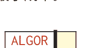

- 删除：底行的最后一个条目为空。在这种情况下，编辑距离等于 $Edit(i-1,j)+1$。这个+1是最后删除的成本，递归表达式给出了剩余对齐的最小成本。


- 替换：两行都有最后一列的字符。如果这两个字符不同，则编辑距离等于 $Edit(i-1,j-1)+1$。如果这两个字符相等，则替换是免费的，所以编辑距离是 $Edit(i-1,j-1)$。

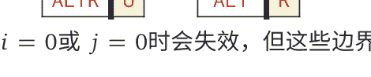

这个通用的情况分析在 $i=0$ 或 $j=0$ 时会失效，但这些边界情况可以直接处理。

- 将空字符串转换为长度为 $j$ 的字符串需要 $j$ 次插入，所以 $Edit(0,j)=j$。
- 将长度为 $i$ 的字符串转换为空字符串需要 $i$ 次删除，所以 $Edit(i,0)=i$。

作为一个健全性检查，这两个基本情况都正确地表明空字符串和空字符串之间的编辑距离为零！我们得出结论，Edit函数满足以下递归关系：

$$
Edit(i,j) =
\begin{cases}
i & \text{if } j=0 \\
j & \text{if } i=0 \\
\min\begin{cases} Edit(i,j-1)+1 \\ Edit(i-1,j)+1 \\ Edit(i-1,j-1)+[A[i]\neq B[j]] \end{cases} & \text{otherwise}
\end{cases}
$$

#### 动态规划

现在我们有了一个递归关系，我们可以按照通常的机械方法将其转化为动态规划算法。

- 子问题：每个递归子问题由两个索引标识 $0 \le i \le m$ 和 $0 \le j \le n$。
- 记忆化结构：这样我们可以在一个二维数组 $Edit[0 .. m, 0 .. n]$ 中记忆化所有可能的 $Edit(i, j)$ 的值。
- 依赖关系：每个条目 $Edit[i, j]$ 仅依赖于其三个相邻的条目 $Edit[i - 1, j]$， $Edit[i, j - 1]$ 和 $Edit[i - 1, j - 1]$。
- 评估顺序：如果我们按照标准的行优先顺序填充这个数组——从上到下逐行，每行从左到右——那么每当我们到达数组中的一个条目时，它所依赖的所有条目都已经可用。（这不是我们唯一可以使用的评估顺序，但它有效，所以我们选择它。）

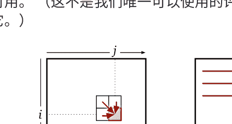

- 空间和时间：记忆化结构使用 $O(mn)$空间。一旦我们知道其前任，我们可以在 $O(1)$时间内计算每个条目 $Edit[i, j]$，因此整个算法的运行时间为 $O(mn)$。

这是得到的动态规划算法：

| 编辑距离 $(A[1 .. m], B[1 .. n])$: |
| :--- |
| 对于 $j \leftarrow 0$ 到 $n$ |
| &emsp; 编辑$[0, j] \leftarrow j$ |
| 对于 $i \leftarrow 1$ 到 $m$ |
| &emsp; 编辑$[i, 0] \leftarrow i$ |
| &emsp; 对于 $j \leftarrow 1$ 到 $n$ |
| &emsp;&emsp; 插入 $\leftarrow$ 编辑$[i, j - 1] + 1$ |
| &emsp;&emsp; 删除 $\leftarrow$ 编辑$[i - 1, j] + 1$ |
| &emsp;&emsp; 如果 $A[i] = B[j]$ |
| &emsp;&emsp;&emsp; 替换 $\leftarrow$ 编辑$[i - 1, j - 1]$ |
| &emsp;&emsp; 否则 |
| &emsp;&emsp;&emsp; 替换 $\leftarrow$ 编辑$[i - 1, j - 1] + 1$ |
| &emsp;&emsp; 编辑$[i, j] \leftarrow$ min {插入, 删除, 替换} |
| 返回 编辑$[m, n]$ |

这个算法最常归功于罗伯特·瓦格纳和迈克尔费舍尔，他们在1974年描述了这个算法。然而，完全遵守斯蒂格勒的命名定律，塔拉斯·文茨尤克在1968年，V·M·维利奇科和N·G·扎戈鲁伊科在1970年，大卫·桑科夫在1972年，彼得·塞勒斯在1974年，以及几乎可以肯定还有其他几个人。14. 有趣的是，这些作者都没有引用 Levenshtein 或 Ulam！

输入字符串 ALGORITHM 和 ALTRUISTIC 的记忆化表如下所示。粗体数字表示两个字符串中字符相等的位置。从 ALGORITHM 到 ALTRUISTIC 的编辑距离确实是六！

|   | A | L | G | O | R | I | T | H | M |
|---|---|---|---|---|---|---|---|---|---|
| A | **1** | 0 | 1 | 2 | 3 | 4 | 5 | 6 | 7 |
| L | 2 | **1** | 0 | 1 | 2 | 3 | 4 | 5 | 6 |
| T | 3 | 2 | **1** | 1 | 2 | 3 | 4 | 4 | 5 |
| R | 4 | 3 | 2 | **2** | 2 | 2 | 3 | 4 | 5 |
| U | 5 | 4 | 3 | 3 | **3** | 3 | 3 | 4 | 5 |
| I | 6 | 5 | 4 | 4 | 4 | **4** | 3 | 4 | 5 |
| S | 7 | 6 | 5 | 5 | 5 | 5 | **4** | 4 | 5 |
| T | 8 | 7 | 6 | 6 | 6 | 6 | **5** | 4 | 5 |
| I | 9 | 8 | 7 | 7 | 7 | 7 | 6 | **5** | 5 |
| C | 10 | 9 | 8 | 8 | 8 | 8 | 7 | 6 | **6** |

表中的箭头表示实际定义每个条目的前任。每个箭头的方向对应于不同的编辑操作：水平＝删除，垂直＝插入，对角线＝替换。粗体红色的对角线箭头表示字母自身的“自由”替换。从表的左上角到右下角的任何箭头路径都代表两个字符串之间的最优编辑序列。示例记忆化数组中恰好包含三条从左上角到右下角的有向路径，每条路径表示一系列六次编辑，将 ALGORITHM 转换为 ALTRUISTIC，如下页所示。


我们的 EDITDISTANCE 算法实际上不会计算或存储表中的任何箭头，但是可以从数值中实时重构表中任何条目的箭头。因此，一旦我们填充了表格，我们可以在额外的 O(n+m) 时间内重构最短编辑序列。

### 3.8 子集和

回想一下，Subset Sum 问题询问是否存在给定数组 X[1 .. n] 的任何子集的和等于给定整数 T。在前一章中，我们开发了一个递归的 Subset Sum 算法，可以重新表述如下。固定原始输入数组 X[1 .. n] 并定义布尔函数

```
SS(i, t) = TRUE当且仅当X[i..n]的某个子集的和等于 t。
```

我们需要计算 SS(1, T). 这个函数满足以下递归关系：

```
SS(i, t) = \begin{cases} 
    真 & \text{如果 } t = 0 \\
    FALSE & \text{如果 } t < 0 \text{ 或者 } i > n \\
    SS(i + 1, t) \lor SS(i + 1, t - X[i]) & \text{otherwise}
\end{cases}
```

我们可以将这个递归关系转化为一个动态规划算法，按照通常的模板进行。

- 子问题: 每个子问题由一个整数 i 描述，满足 $1 \leq i \leq n + 1$，和一个整数 $t \leq T$。然而，对于 $t < 0$ 的子问题来说是微不足道的，所以将它们进行记忆化似乎有些愚蠢。事实上，我们可以修改递归关系，使得这些子问题永远不会出现：

```
SS(i, t) = \begin{cases} 
    真 & \text{如果 } t = 0 \\
    FALSE & \text{if } i > n \\
    SS(i + 1, t) & \text{如果 } t < X[i] \\
    SS(i + 1, t) \lor SS(i + 1, t - X[i]) & \text{otherwise}
\end{cases}
```

> 15 是的，我违反了自己对过早优化的规则。

- 数据结构：我们可以将我们的递归记忆化为一个二维数组 $S[1 .. n+1, 0 .. T]$, 其中 $S[i, t]$ 存储 $SS(i, t)$ 的值。

- 评估顺序：每个条目 $S[i, t]$ 最多依赖于两个其他条目，都是形式为 $SS[i+1, .]$ 的。因此，我们可以通过在外部循环中从底部到顶部填充数组，并在内部循环中以任意顺序考虑每行中的元素来填充数组。

- 空间和时间：记忆化结构使用 $O(nT)$ 空间。如果 $S[i+1, t]$ 和 $S[i+1, t - X[i]]$ 已知，我们可以在常数时间内计算 $S[i, t]$，因此算法的运行时间为 $O(nT)$。

这是得到的动态规划算法：

```
FASTSUBSETSUM(X[1 .. n], T):
  S[n+1, 0] ← TRUE
  for t ← 1 to T
    S[n+1, t] ← FALSE
  for i ← n downto 1
    S[i, 0] = TRUE
    for t ← 1 to X[i]-1
      S[i, t] ← S[i+1, t]    // 避免 t < X[i]
    for t ← X[i] to T
      S[i, t] ← S[i+1, t] ∨ S[i+1, t - X[i]]
  return S[1, T]
```

对于这个算法，最坏情况下的运行时间 $O(nT)$ 是一个显著的改进，相比于 $O(2^n)$ 时间复杂度的递归回溯算法，当 $T$ 很小的时候。16 然而，如果目标和 $T$ 远大于 $2^n$，这个迭代算法实际上比朴素的递归算法更慢，因为它在解决递归算法从不考虑的子问题上浪费了时间。

动态规划并不总是一种改进！17

### 3.9 最优二叉搜索树

在前一章中，我们考虑的最后一个问题是二叉搜索树问题。输入是一个有序数组 $A[1 .. n]$ 的搜索键和一个频率计数数组 $f[1 .. n]$，其中 $f[i]$ 是我们搜索 $A[i]$ 的次数。我们的任务是构建一个二叉搜索树，使得所有搜索的总成本尽可能小。

固定频率数组 $f$，并让 $OptCost(i, k)$ 表示子数组 $A[i..k]$ 的最优搜索树的总搜索时间。我们得到了以下的递归关系式 $OptCost$：

$$OptCost(i, k) = \begin{cases} 0 & \text{if } i > k \\ \displaystyle\sum_{j=i}^{k} f[j] + \min_{i \leq r \leq k} \left\{ OptCost(i, r-1) + OptCost(r+1, k) \right\} & \text{否则} \end{cases}$$

你可能已经猜到我们最终要如何处理这个递归关系式，但让我们先摆脱那个丑陋的求和符号。

对于任意一对指数 $i \leq k$，让 $F(i, k)$ 表示区间 $A[i..k]$ 中所有键的总频率计数:

$$F(i, k) := \sum_{j=i}^{k} f[j]$$

这个函数满足以下简单的递归关系:

$$F(i, k) = \begin{cases} f[i] & \text{如果 } i = k \\ F(i, k-1) + f[k] & \text{否则} \end{cases}$$

我们可以使用动态规划在 $O(n^2)$ 时间内计算出所有可能的 $F(i, k)$ 值！通常的机械步骤给出了以下动态规划算法:

```
INITF(f[1..n]):
  对于 i 从 1 到 n
    F[i, i-1] ← 0
    对于 k 从 i 到 n
      F[i, k] ← F[i, k-1] + f[k]
```

我们将使用这个简短的算法作为初始化子程序。这个初始化使得我们可以简化原始的 $OptCost$ 递归关系如下:

$$OptCost(i, k) = \begin{cases} 0 & \text{if } i > k \\ F[i, k] + \min_{i \leq r \leq k} \left\{ OptCost(i, r-1) + OptCost(r+1, k) \right\} & \text{否则} \end{cases}$$

现在让我们转动曲柄。

- 子问题：每个递归子问题由两个整数 $i$ 和 $k$ 指定，其中 $1 \leq i \leq n+1$ 且 $0 \leq k \leq n$。
- 记忆化：我们可以将 $OptCost$ 的所有可能值存储在一个二维数组 $OptCost[1..n+1, 0..n]$ 中。（只有实际使用的条目 $OptCost[i,j]$ 满足 $j \geq i-1$，但无论如何。）
- 依赖关系：每个条目 $OptCost[i,k]$ 依赖于条目 $OptCost[i,j-1]$ 和 $OptCost[j+1,k]$，其中 $j$ 满足 $i \leq j \leq k$。换句话说，每个表项都依赖于直接左侧或直接下方的所有条目。

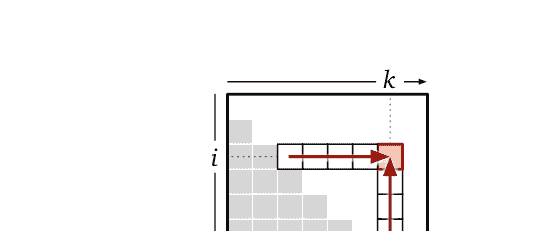

下面的子程序填充条目 $OptCost[i,k]$，假设所有依赖的条目已经计算完毕。

```
COMPUTEOPTCOST(i,k):
  OptCost[i,k] ← ∞
  for r ← i to k
    tmp ← OptCost[i,r-1] + OptCost[r+1,k]
    if OptCost[i,k] > tmp
      OptCost[i,k] ← tmp
  OptCost[i,k] ← OptCost[i,k] + F[i,k]
```

- 评估顺序：有至少三种不同的顺序可以用来填充数组。大多数学生首先想到的是按对角线逐个扫描表格，从平凡的基本情况 $OptCost[i,i-1]$ 开始，向最终答案 $OptCost[1,n]$ 努力，如下所示：

```
OPTIMALBST(f[1..n]):
  INITF(f[1..n])
  for i ← 1 to n+1
    OptCost[i,i-1] ← 0
  for d ← 0 to n-1
    for i ← 1 to n-d
      COMPUTEOPTCOST(i,i+d)
  return OptCost[1,n]
```

我们还可以从底部向上逐行遍历数组，从左到右遍历每一行，或者从左到右逐列遍历，从底部向上遍历每一列。

```
OPTIMALBST2(f[1..n]):
    INITF(f[1..n])
    for i ← n+1 downto 1
        OptCost[i,i-1] ← 0
        for j ← i to n
            COMPUTEOPTCOST(i,j)
    return OptCost[1,n]
```

```
OPTIMALBST3(f[1..n]):
    INITF(f[1..n])
    for j ← 0 to n+1
        OptCost[j+1,j] ← 0
        for i ← j downto 1
            COMPUTEOPTCOST(i,j)
    return OptCost[1,n]
```

与之前一样，我们可以使用双线箭头表示外循环，使用单线箭头表示内循环来说明这些评估顺序。第一个评估顺序中的双向箭头表示内循环的顺序无关紧要。

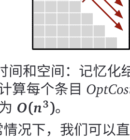
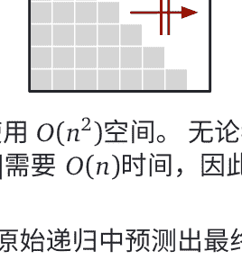
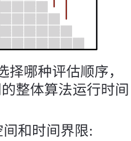

- 时间和空间：记忆化结构使用 $O(n^2)$ 空间。无论我们选择哪种评估顺序，计算每个条目 $OptCost[i,k]$ 需要 $O(n)$ 时间，因此我们的整体算法运行时间为 $O(n^3)$。

通常情况下，我们可以直接从原始递归中预测出最终的空间和时间界限：

$$OptCost(i,k) = \begin{cases} 0 & \text{if } i > k \\ F[i,k] + \min\limits_{i\leq r\leq k} \left\{ OptCost(i,r-1) + OptCost(r+1,k) \right\} & \text{否则} \end{cases}$$

$OptCost$ 函数有两个参数，每个参数大致可以取 $n$ 个不同的值，所以我们可能需要一个大小为 $O(n^2)$ 的数据结构。另一方面，在递归体中有三个变量（$i$、$k$ 和 $r$），每个变量大致可以取 $n$ 个不同的值，所以计算所有内容可能需要 $O(n^3)$ 的时间。

### 3.10 树上的动态规划

到目前为止，我们所有的动态规划示例都使用多维数组来存储递归子问题的结果。然而，正如下一个示例所示，这并不总是最合适的数据结构。图中的独立集是顶点的一个子集，它们之间没有边。在任意图中找到最大的独立集非常困难；实际上，这是我们将要讨论的经典 NP 难问题之一，将在第12章学习。但在一些特殊类的图中，我们可以快速找到最大的独立集。特别地，当输入图是一棵具有 $n$ 个顶点的树时，我们实际上可以在 $O(n)$ 的时间内计算出最大的独立集。

假设我们有一棵树 $T$。不失一般性，假设 $T$ 是一棵有根树；也就是说，$T$ 中有一个特殊的节点称为根，并且所有的边都隐含地从这个顶点指向其他顶点。（如果 $T$ 是一棵无根树——一个连通的无环无向图——我们可以选择任意一个顶点作为根。）我们称顶点 $w$ 是顶点 $v$ 的一个后代，如果从 $w$ 到根的唯一路径包括 $v$；等价地，$v$ 的后代是 $v$ 本身和 $v$ 的子节点的后代。以 $v$ 为根的子树由 $v$ 的所有后代和它们之间的边组成。

对于树中的任意节点 $v$，让 $MIS(v)$ 表示以 $v$ 为根的子树中最大独立集的大小。在这个子树中，任何不包括 $v$ 本身的独立集都是以 $v$ 的子节点为根的子树中独立集的并集。另一方面，任何包括 $v$ 的独立集必然排除了 $v$ 的所有子节点，因此包括了以 $v$ 的孙子节点为根的子树中的独立集。因此，函数 $MIS$ 遵循以下递归关系，其中非标准符号 $w \downarrow v$ 表示“$w$ 是 $v$ 的子节点”：

$$MIS(v) = \max \left\{ \sum_{w \downarrow v} MIS(w), \ 1 + \sum_{w \downarrow v} \sum_{x \downarrow w} MIS(x) \right\}$$

我们需要计算 $MIS(r)$，其中 $r$ 是树 $T$ 的根节点。

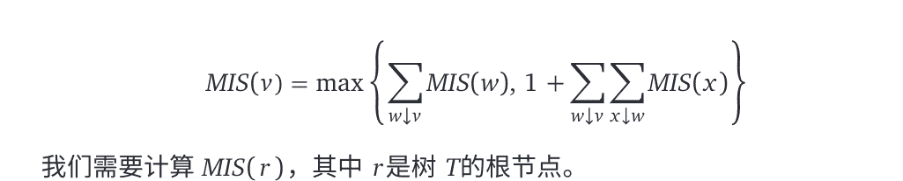

我们应该使用什么数据结构来记忆这个递归？最自然的选择是树本身！具体来说，对于树中的每个顶点 $v$，我们在一个新的字段 $v.MIS$ 中存储 $MIS(v)$ 的结果。（原则上，我们可以使用数组，但是那样我们需要在每个节点和其对应的数组条目之间来回指针，所以为什么要麻烦呢？）

什么是考虑子问题的好顺序？与任何节点 $v$ 相关联的子问题取决于与 $v$ 的子节点和孙节点相关联的子问题。因此，我们可以按照任何顺序访问节点，只要每个顶点在其父节点之前被访问；特别是，我们可以使用标准的后序遍历。

算法的运行时间是多少？与每个节点 $v$ 相关联的非递归时间与其子节点和孙节点的数量成比例，这个数字可能在不同的顶点之间非常不同。但是我们可以将分析反过来：每个顶点对其父节点和祖父节点贡献了一个恒定的时间！因为每个顶点最多只有一个父节点和一个祖父节点，所以该算法的运行时间为 $O(n)$。

这是得到的动态规划算法。是的，它仍然是递归的，因为这是实现后序树遍历的最自然的方式。

```
TREEMIS(v):
  skipv ← 0
  对于每个子节点 w of v
    skipv ← skipv + TREEMIS(w)
  keepv ← 1
  对于每个孙子节点 x of v
    keepv ← keepv + x.MIS
  v.MIS ← max{keepv,skipv}
  return v.MIS
```

我们可以通过定义两个独立的函数来推导出一个更简单的线性时间算法，这两个函数是在树的节点上定义的：

- 让 $MISyes(v)$ 表示包括节点 $v$ 在内的子树中最大独立集的大小。
- 让 $MISno(v)$ 表示不包括节点 $v$ 在内的子树中最大独立集的大小。

同样，我们需要计算 $\max\{MISyes(r),MISno(r)\}$，其中 $r$ 是树的根节点。前两个函数满足以下相互递归关系：

$$MISyes(v) = 1 + \sum_{w \downarrow v} MISno(w)$$
$$MISno(v) = \sum_{w \downarrow v} \max\{MISyes(w),MISno(w)\}$$

同样，我们可以将这些函数记忆化到树本身中，通过为每个顶点定义两个新的字段。一个直接的后序遍历树的方法可以在 $O(n)$ 时间内计算出每个节点上的这两个函数的值。下面的算法不仅记忆化了节点 $v$ 上的这两个函数的值，还返回了其中较大的那个值。

```
TREEMIS2(v):
  v.MISno ← 0
  v.MISyes ← 1
  对于每个子节点 w of v
    v.MISno ← v.MISno + TREEMIS2(w)
    v.MISyes ← v.MISyes + w.MISno
  返回 max{v.MISyes, v.MISno}
```

在内部循环的第二行，我们使用了值 $w.MISno$，这是通过前一行的递归调用进行记忆化的。

## 练习

对于以下所有练习，以及更一般地开发任何新的动态规划算法，我强烈建议遵循第3.4节中概述的步骤。特别是，在你有一个完整的递归解决方案之前，包括明确的英文规范，你甚至不要开始考虑表格或 for 循环。18

**先让它工作，然后让它快。**

#### 序列/数组

1.  在以前的生活中，你在失落的南极洲殖民地纳迪里亚当过收银员，一天中大部分时间都在给顾客找零。因为纸张在南极洲是非常稀缺和宝贵的资源，根据法律规定，收银员在找零时必须使用尽可能少的钞票。由于其中一位创始人对数字学有偏好，纳迪里亚的货币称为梦幻美元，有以下面额：1美元，4美元，7美元，13美元，28美元，52美元，91美元和365美元。19
    - (a) 贪婪找零算法重复地选择不超过目标金额的最大面额钞票。例如，使用贪婪算法找零 $122，我们首先拿一个 $91 的钞票，然后拿一个 $28 的钞票，最后拿三个 $1 的钞票。给出一个例子，说明这个贪婪算法使用的梦幻美元钞票比最小可能数量多。[提示：编写一个小程序可能比手工计算更容易。]
    - (b) 描述并分析一个递归算法，计算给定一个整数 $k$，需要多少张钞票才能凑够 $k$ 美元。（不用担心算法的速度，只需确保正确性。）
    - (c) 描述一个动态规划算法，计算给定一个整数 $k$，需要多少张钞票才能凑够 $k$ 美元。（这个算法需要快速执行。）

在我的算法课上，任何不包含对底层递归子问题的英文规范的动态规划解决方案都会得到零分，即使解决方案在其他方面是完美的。引入这个政策显著提高了学生的成绩，因为它显著减少了他们提交错误（或不连贯）的动态规划算法的次数。

有关 Nadiria 的历史和文化的更多细节，包括各种面额的梦幻美元的图片，请访问 http://moneyart.biz/dd/。

## 3. 动态规划

2. 描述以下文本分段问题的高效算法。假设你有一个子程序IsWord，它接受一个字符数组作为输入，并且只有当该字符串是一个“单词”时才返回True。通过限制对IsWord的调用次数来分析你的算法。

(a) 给定一个字符数组 $A[1..n]$，计算将 $A$ 分割成单词的数量。例如，给定字符串ARTISTOIL，你的算法应该返回 2，即分割成ARTIST·OIL和ART·IS·TOIL两个部分。

(b) 给定两个字符数组 $A[1..n]$ 和 $B[1..n]$，判断 $A$ 和 $B$ 是否可以在相同的索引处分割成单词。例如，字符串BOTHEARTHANDSATURNSPIN和PINSTARTRAPSANDRAGSLAP可以按照以下方式在相同的索引处分割成单词：

BOT·HEART·HAND·SAT·URNS·PIN
PIN·START·RAPS·AND·RAGS·LAP

(c) 给定两个字符数组 $A[1..n]$ 和 $B[1..n]$，计算将 $A$ 和 $B$ 在相同的索引处分割成单词的不同方式的数量。

3. 假设你有一个由数字组成的数组 $A[1..n]$，这些数字可以是正数、负数或零，并且不一定是整数。

(a) 描述并分析一个算法，找到连续子数组 $A[i..j]$ 中元素之和的最大值。

(b) 描述并分析一个算法，找到连续子数组 $A[i..j]$ 中元素之积的最大值。

例如，给定数组$[-6, 12, -7, 0, 14, -7, 5]$作为输入，你的第一个算法应该返回19，而你的第二个算法应该返回504。

给定一个只有一个元素的数组 $[-374]$ 作为输入，你的第一个算法应该返回 0，你的第二个算法应该返回 1。（空区间仍然是一个区间！）为了分析的方便，假设比较、相加或相乘任意一对数字的时间复杂度为 $O(1)$。

> [提示：自从至少在20世纪80年代中期以来，(a) 部分一直是计算机科学面试的一个标准问题。你可以在网上找到很多正确的解决方案；这个问题甚至有自己的维基百科页面！但至少在2016年，我在网上找到的 (b) 部分的解决方案中，有相当一部分要么比必要的慢，要么实际上是错误的。]

4. 这个练习探讨了最大子数组问题（问题3）的变体。在所有情况下，你的输入都是一个由实数组成的数组 $A[1 .. n]$（可以是正数、负数或零），可能还有一个额外的整数 $X \geq 0$。

(a) 环绕：假设 $A$ 是一个循环数组。在这种情况下，一个连续子数组可以是一个区间 $A[i .. j]$ 或者是一个后缀跟着一个前缀 $A[i .. n] \cdot A[1 .. j]$。描述并分析一个算法，找到 $A$ 中具有最大和的连续子数组。

(b) 只有长子数组：描述并分析一个算法，找到长度至少为 $X$ 的 $A$ 的连续子数组，其和最大。（假设 $X \leq n$。）

(c) 只有短子数组：描述并分析一个算法，找到长度最多为 $X$ 的 $A$ 的连续子数组，其和最大。

(d) 价格就是对的：描述并分析一个算法，找到 $A$ 中和最大且小于等于 $X$ 的连续子数组。

(e) 描述一个更快的算法来解决问题 4(d)，当数组 $A$ 中的每个数字都是非负数时。

5. 这个练习要求你开发高效的算法来找到各种类型的最优子序列。子序列是从序列中提取一部分元素，但保持它们的顺序；子序列的元素不需要在原始序列中是连续的。

例如，字符串 `C`, `DAMN`, `YAIOAI` 和 `DYNAMICPROGRAMMING` 都是字符串 `DYNAMIC PROGRAMMING` 的子序列。

[提示：这些问题中只有一个可以使用贪婪算法在 $O(n)$ 时间内解决。]

(a) 让 $A[1 .. m]$ 和 $B[1 .. n]$ 是两个任意的数组。$A$ 和 $B$ 的一个共同子序列是同时是 $A$ 和 $B$ 的子序列的另一个序列。描述一个高效的算法来计算 $A$ 和 $B$ 的最长共同子序列的长度。

(b) 让 $A[1 .. m]$ 和 $B[1 .. n]$ 是两个任意的数组。一个 $A$ 和 $B$ 的公共超级子序列是另一个包含 $A$ 和 $B$ 作为子序列的序列。描述一个高效的算法来计算 $A$ 和 $B$ 的最短公共超级子序列的长度。

(c) 如果存在一个索引 $i$，使得前缀 $X[1 .. i]$ 是递增的，后缀 $X[i .. n]$ 是递减的，则称序列 $X[1 .. n]$ 为双峰的。描述一个高效的算法来计算任意数组 $A$ 的最长双峰子序列的长度。

(d) 如果对于所有偶数i， $X[i] < X[ i + 1]$，对于所有奇数i， $X[i] > X[ i + 1]$，则称序列 $X[1 .. n]$为振荡的。 描述一个高效的算法来计算任意数组 $A$的最长振荡子序列的长度。

(e) 描述一个有效的算法来计算任意整数数组 $A$的最短振荡超序列的长度。

(f) 如果对于所有的i，都有 $2 \cdot X[i] < X[i-1] + X[ i+1]$，则称序列 $X[1 .. n]$为凸序列。 描述一个有效的算法来计算任意整数数组 $A$的最长凸子序列的长度。

(g) 如果每个元素都大于前两个元素的平均值，即 $2 \cdot X[i] > X[i - 1] + X[i - 2]$，则称序列 $X[1 .. n]$为弱递增序列。 描述一个有效的算法来计算任意整数数组 $A$的最长弱递增子序列的长度。

(h) 如果对于所有的 $i > 2$， $X[i] > X[i-2]$，则称序列 $X[1..n]$为双递增序列。 (换句话说，双递增序列是两个递增序列的完美洗牌。 ) 描述一个高效的算法来计算任意整数数组A的最长双递增子序列的长度。

(i) 如果对于所有的i， $X[i] < X[i+1]$，则称序列 $X[1..n]$为递增序列。 描述一个高效的算法来计算两个给定整数数组的最长公共递增子序列的长度。 例如， $\langle1, 4, 5, 6, 7, 9\rangle$是序列 $(3, 1, 4, 1, 5, 9, 2, 6, 5, 3, 5, 8, 9, 7, 9, 3)$和 $(1, 4, 1, 4, 2, 1, 3, 5, 6, 2, 3, 7, 3, 0, 9, 5)$的最长公共递增子序列。

6. 将两个字符串 $X$和 $Y$的字符交错组合成一个新的字符串，保持 $X$和 $Y$中字符的顺序。 例如，字符串BANANAANANAS是字符串 BANANA和ANANAS的多种不同组合方式之一。 同样，字符串PRODGYRNAMAMMIINCG和DYPRONGARMAMMICING都是 DYNAMIC 和PROGRAMMING的组合：

(a) 给定三个字符串 $A[1 .. m]$, $B[1 .. n]$, 和 $C[1 .. m + n]$，描述并分析一个算法来确定 $C$是否是 $A$和 $B$的组合。

(b) 平滑组合是指 $X$和 $Y$的组合，它不会连续使用两个以上的字符。例如，

- PRODGYRNAMAMMIINCG是字符串 DYNAMIC和PROGRAMMING的顺序混合。
- DYPRNOGRAAMMICING是字符串 DYNAMIC和PROGRAMMING的顺序混合，但是它不是一个平滑的混合（因为子字符串 OGR和 ING）。
- XXXXXXXXXXXXXXXX是字符串的平滑混合XXXXXXX和XXXXXXXXXXXXXXX。
- 没有字符串 XXXX和XXXXXXXXXXXXXXX的平滑混合。

描述并分析一个算法，判断给定的三个字符串 X，Y，和 Z是否是 X和 Y的平滑混合。

7. 对于以下问题，输入包括两个数组 X[1 ..k] 和 Y[1 ..n]其中 k ≤ n。

(a) 描述并分析一个算法来判断 X是否是 Y的子序列。例如，字符串 PPAP 是字符串PENPINEAPPLEAPPLEPEN的子序列。

(b) 描述并分析一个算法，找到从 Y中删除的最少符号数，使得 X不再是子序列。
换句话说，你的算法应该找到 Y的最长子序列，该子序列不是 X的超序列。例如，在字符串 PENPINEAPPLEAPPLEPEN中删除两个符号后，字符串 PPAP不再是子序列。

(c) 描述并分析一个算法来确定 X是否作为 Y的两个不相交的子序列出现。例如，字符串 PPAP作为字符串 PENPINEAPPLEAPPLEPEN的两个不相交的子序列出现。

(d) 假设输入还包括第三个数组 C[1 ..n]，其中的数字可以是正数、负数或零，其中 C[i]是 Y[i]的成本。描述并分析一个算法，计算X作为 Y的子序列的最小成本出现。也就是说，我们希望找到一个数组 I[1 ..k]，使得对于每个索引j， I[j] < I[j+1]且 X[I[j]] = Y[ j]，并且总成本 $\sum_{j=1}^{k} C[j]$尽可能小。

(e) 描述并分析一个算法，计算 X作为 Y的子序列的总数（可能重叠）。为了分析，假设我们可以在O(1)时间内添加两个任意整数。例如，字符串 PPAP作为字符串 PENPINEAPPLEAPPLEPEN的子序列出现了 23次。如果 X和 Y中的所有字符都相等，则你的算法应该返回 $\binom{n}{k}$。

(f) 如果将两个 $\ell$ 位整数相加需要 O($\ell$)时间，那么你的算法在第(d)部分的运行时间是多少？

8. 描述并分析一种高效的算法，用于找到在输入字符串 T[1..n]中同时出现在前向和后向的最长连续子字符串的长度。前向和后向的子字符串不能重叠。

以下是几个示例：

- 给定输入字符串 ALGORITHM，你的算法应该返回 0。
- 给定输入字符串 RECURSION，你的算法应该返回 1，表示子字符串 R。
- 给定输入字符串 REDIVIDE，你的算法应该返回 3，表示子字符串 EDI。（前向和后向的子字符串不能重叠！）
- 给定输入字符串 DYNAMICPROGRAMMINGMANYTIMES，你的算法应该返回 4，表示子字符串 YNAM。（特别地，它不应该返回 6，表示子序列 YNAMIR。）

9. 回文是指与其反转完全相同的字符串，例如 I，或者 DEED，或 RACECAR，或 AMANAPLANACATACANALPANAMA。

(a) 描述并分析一种算法，用于找到给定字符串的最长回文子序列的长度。
例如，字符串的最长回文序列为 MAHDY NAMICPRO GRAMZLETME SHOWYOU THEM是MHYMRORMYHM；因此，给定该字符串作为输入，您的算法应返回 11。

(b) 描述并分析一种算法，用于找到给定字符串的最短回文超序列的长度。
例如，TWENTYONE的最短回文超序列是 TWENTOYOTNEWT，因此，给定字符串 TWENTYONE作为输入，您的算法应返回 13。

(c) 任何字符串都可以分解为回文序列。例如，字符串BUBBASEESABANANA（“Bubba sees a banana.”）可以按以下方式分解为回文序列（还有其他65种方式）：

- BUB • BASEESAB • ANANA
- B • U • BB • ASEESA • B • ANANA
- BUB • B • A • SEES • ABA • N • ANA
- B • U • BB • A • S • EE • S • A • B • A • NAN • A
- B • U • B • B • A • S • E • E • S • A • B • A • N • A • N • A

描述并分析一种高效的算法，以找到组成给定输入字符串的最小回文数的数量。例如，给定输入字符串BUBBASEESABANANA，你的算法应该返回 3。

(d) 描述并分析一种高效的算法，以找到一个给定字符串可以分割成至少长度为k的回文数的最大整数k。例如：

- 给定字符串 PALINDROME，你的算法应该返回 1。
- 给定字符串BUBBASEESABANANA，你的算法应该返回 3，
  对于分割 BUB·BASEESAB·ANANA。
- 给定一个由 $n$ 个相同符号组成的字符串，你的算法应该返回 $n$。

(e) 描述并分析一种高效的算法，以找到一个给定字符串可以分解成回文数的不同方式的数量。
例如：

- 给定字符串 PALINDROME，你的算法应该返回 1。
- 给定字符串BUBBASEESABANANA，你的算法应返回 70。
- 给定一个由 $n$ 个相同符号组成的字符串，你的算法应返回 $2^{n-1}$。

(f) 元回文串是将一个字符串分解成一系列回文串的序列，其中回文串的长度序列本身也是一个回文串。例如：

BOB·S·MAM·ASEESA·UKU·L·ELE

对于字符串BOBSMAMASEESAUkULELE，它是一个元回文串，其长度序列是回文串 (3, 1, 3, 6, 3, 1, 3)。描述并分析一个高效的算法，用于找到给定字符串的最短元回文串的长度。例如，给定输入字符串BOBSMAMASEESAUkULELE，你的算法应返回11。

10. 假设给定一个正整数数组 $A[1 .. n]$。一个递增的来回子序列是一个索引序列 $I[1 .. \ell]$，具有以下属性：

- 对于所有的 $j$，有 $1 \leq I[j] \leq n$。
- 对于所有的 $j < \ell$，有 $A[I[j]] < A[I[j+1]]$。
- 如果 $I[j]$ 是偶数，则 $I[j+1] > I[j]$。
- 如果 $I[j]$ 是奇数，则 $I[j+1] < I[j]$。

更不正式地说，假设我们有一个包含 $n$ 个正整数的数组。假设我们将一个令牌放在其中一个方格上，然后重复地向左移动（如果它在奇数索引的方格上）或向右移动（如果它在偶数索引的方格上），始终从较小的数到较大的数。那么令牌位置的序列就是一个递增的来回子序列。

描述一个算法来计算给定数组中最长递增来回子序列的长度。例如，给定输入数组

你的算法应该返回整数 9，即以下递增来回子序列的长度：

11. 假设我们想要将一段文本排版到一张纸上（或者如果你坚持的话，是计算机屏幕上）。文本由一系列 n 个单词组成，其中第 i 个单词的长度为 ℓ[i]。我们希望将段落分成几行，总长度恰好为 L。例如，根据用于排版这些笔记的程序TEX，你正在阅读的段落的宽度约为11.94794厘米 ≈4.7055英寸。

根据段落如何分成文本行，我们必须在单词之间插入不同数量的空白。段落应该是完全对齐的，意味着每行的第一个字符从左边距开始，除了最后一行，每行的最后一个字符在右边距结束。同一行上的任意两个单词之间必须至少有一个单位的空白。看你现在正在阅读的段落？就像这样。

将段落布局的斜率定义为每行额外空白的立方和，除了最后一行，不计算每个相邻单词之间所需的一个单位空间。

具体而言，如果一行包含单词 i 到 j，则该行的斜率定义为 $(L - j + i - \sum_{k=i}^{j} \ell[k])^3$。描述一个动态规划算法，以最小的斜率打印段落。

12. 你和你八岁的侄子埃尔莫决定玩一个简单的纸牌游戏。在游戏开始时，纸牌面朝上排成一行。每张纸牌都有不同的点数。在所有纸牌发完之后，你和埃尔莫轮流从行的最左边或最右边移除一张纸牌，直到所有纸牌都被拿走。在每一轮中，你可以决定拿哪张纸牌。游戏结束时，得分最高的玩家获胜。

由于从未上过算法课，埃尔莫遵循显而易见的贪心策略—当轮到他时，埃尔莫总是选择点数更高的卡片。你的任务是找到一种策略，以便在可能的情况下击败埃尔莫。（这样对一个小孩进行欺负似乎有点不好，但埃尔莫绝对讨厌成年人让他赢。）

(a) 证明你不应该使用贪心策略。也就是说，证明存在一种游戏，只有在你不遵循埃尔莫的贪心策略时才能赢。

(b) 描述并分析一种算法，以确定在对抗埃尔莫时，给定初始卡片序列，你可以收集到的最大点数。

(c) 当埃尔莫四岁时，他使用了一种更简单的策略—在他的回合中，他总是均匀随机地选择下一张卡片。也就是说，如果他的回合还剩下多张卡片，他会以 1/2的概率选择最左边的卡片，以 1/2的概率选择最右边的卡片。描述一个算法来确定，在给定的初始卡片序列中，你可以在与四岁的艾尔莫对战时收集到的最大预期点数。

(d) 五年后，十三岁的艾尔莫已经成为一个更强大的选手。描述并分析一个算法，以确定在给定的初始卡片序列中，你可以在与一个完美对手对战时收集到的最大点数。

13. 快要展示你炫酷的舞技了！明天是你一生中为之训练的大型舞蹈比赛，除了那个夏天你和叔叔一起在阿拉斯加打猎狼獾。你已经获得了比赛期间裁判将播放的歌曲列表的提前副本，按照时间顺序排列。

你非常了解所有的歌曲、所有的裁判和自己的舞蹈能力。对于每个整数 k，你知道如果你跳舞到日程表上的第 k 首歌曲，你将被授予 Score[k] 分，但是然后你将无法在接下来的 Wait[k] 首歌曲中跳舞（也就是说，你不能跳舞到第 k + 1 到第 k + Wait[k] 首歌曲）。晚上比赛结束时总分最高的舞者将获胜，所以你希望你的总分尽可能高。

描述并分析一个高效的算法来计算你可以达到的最大总分。你甜蜜算法的输入是一对数组 Score[1 .. n] 和 Wait[1 .. n]。

14. 新的交换拼图游戏糖果交换传奇XIII涉及到 n 只可爱的动物，编号从 1 到 n。每只动物手里都拿着三种类型的糖果：马戏团花生、希思巴和Cioccolateria Gardini巧克力松露。你也有一颗糖果在手里；在游戏开始时，你有一颗马戏团花生。

为了得分，你按顺序访问每只动物，从 1 到 n。对于每只动物，你可以保留手里的糖果，也可以与动物手里的糖果交换。

- 如果你将你的糖果与相同类型的另一个糖果交换，你将获得一个点。

## 3. 动态规划

*   如果你将你的糖果与一种不同类型的糖果交换，你会失去一分。（是的，你的分数可以是负数。）
*   如果你访问一个动物并决定不交换糖果，你的分数不会改变。

你必须按顺序访问动物，一旦你访问了一个动物，就再也不能访问它。

描述并分析一个高效的算法来计算你的最大可能分数。你的输入是一个数组 $C[1..n]$，其中 $C[i]$ 是第 $i$ 个动物持有的糖果的类型。

15. 新成立的马克西米利安・R・列夫钦计算机科学学院的创始院长 Lenny Rutenbar 在 Orchard Downs 滑雪山南坡上委托建造了一系列雪坡，并向电气与计算机工程系主任 Bill Kudeki 发起了一场滑雪比赛。Bill 和 Lenny 都将从山上滑下来，每个人都试图最大化他们的空中时间。获胜者将有机会将他们的系/学院扩展到 Siebel 中心和新的 ECE 大楼；失败者必须将他们的整个系/学院搬到 Loomis 实验室旁边的 Boneyard 排水沟中。每当 Lenny 或 Bill 在地面上达到一个坡道时，他们可以选择使用该坡道跳跃到空中，可能飞过一个或多个坡道，或者继续滑过该坡道并保持在地面上。显然，如果有人飞过一个坡道，他们就不能再利用那个坡道延长他们的跳跃。

(a) 假设给定一对数组 $Ramp[1..n]$ 和 $Length[1..n]$，其中 $Ramp[i]$ 是从山顶到第 $i$ 个坡道的距离，而 $Length[i]$ 是任何选择第 $i$ 个坡道的滑雪者在空中行进的距离。描述并分析一个算法来确定 Lenny 或 Bill 可以在空中度过的最大总距离。

(b) 大学的律师听说了 Lenny 和 Bill 的小赌注，立即提出了反对意见。为了保护大学免受诉讼或者保险费飙升的影响，他们对每个滑雪者可以进行的跳跃次数设定了上限。描述并分析一个算法，以确定在给定原始数组 $Ramp[1..n]$ 和 $Length[1..n]$ 以及整数 $k$ 作为输入的情况下，Lenny 或 Bill 可以在空中度过的最大总距离，最多进行 $k$ 次跳跃。

(c) 当律师们意识到他们的限制并没有立即关闭比赛时，他们添加了一个新的限制：每个斜坡只能使用一次！对法律干预感到厌恶的莱尼和比尔放弃了他们的赌注，并决定合作以进行一场好的表演给观众。描述并分析一种算法，以确定莱尼和比尔可以在空中度过的最大总距离，每个人最多可以跳 k 次（因此总共最多可以跳 2k 次），并且每个斜坡最多只能使用一次。

16. 农民博吉斯、邦斯和比恩为狐狸先生设立了一个障碍赛道。该赛道由一排长长的摊位组成，每个摊位前都涂有鲜红色的数字。正式地说，狐狸先生被给予一个数组 A[1 .. n]，其中 A[i]是第 i 个摊位前涂的数字。 每个数字 A[i] 可以是正数、负数或零。每个人都同意以下规则：

*   在每个摊位上，福克斯先生必须说“Ring！”或“Ding！”。
*   如果福克斯先生在第 i 个摊位上说“Ring！”，他将获得 A[i] 只鸡作为奖励。（如果 A[i] < 0，福克斯先生将支付 -A[i] 只鸡作为罚款。）
*   如果福克斯先生在第 i 个摊位上说“Ding！”，他将支付 A[i] 只鸡作为罚款。（如果 A[i] < 0，福克斯先生将获得 -A[i] 只鸡作为奖励。）
*   福克斯先生被禁止连续三次说相同的单词。例如，如果他在第6、7和8个摊位上说“Ring！”，那么他必须在第9个摊位上说“Ding！”。
*   所有账户将在最后结算，之后狐狸先生会参观每个摊位并且裁判喊出“热盒！”狐狸先生实际上不需要携带鸡穿过障碍赛道。
*   最后，如果狐狸先生违反任何规则，或者他在障碍赛道结束时欠农民鸡，农民将会射击他。描述并分析一个算法来计算狐狸先生在障碍赛道上能够获得的最大鸡的数量，给定输入的数字数组 A[1 .. n]。[提示：小心燃烧的松果！]

17. Dance Dance Revolution 是一款舞蹈视频游戏，最早于1998年由日本康尼公司引入。 玩家站在一个标有四个箭头的平台上，箭头指向前方、后方、左方和右方，排列成十字形。在游戏过程中，游戏会播放一首歌曲并滚动一系列的N箭头（←, ↑, ↓, 或 →）从屏幕底部到顶部。在每个箭头到达屏幕顶部的精确时刻，玩家必须踩在舞台上对应的箭头上。（箭头的时间安排得与歌曲的节奏相匹配。）

你正在玩一个名为“时尚时尚革命”的变种游戏，目标是完美演奏但尽量少移动。当一个箭头到达屏幕顶部时，如果你的一只脚已经踩在正确的箭头上，你将获得一个风格点以保持你当前的姿势。如果两只脚都没有踩在正确的箭头上，你必须将一只脚（仅限一只）从当前位置移动到平台上的正确箭头上。如果你踩错箭头，或者未能踩在正确的箭头上，或者一次移动超过一只脚，或者当你已经站在正确的箭头上时移动任何一只脚，你将失去所有的风格点并输掉游戏。

你应该如何移动你的脚来最大化你的风格总分？对于这个问题，假设你总是从左脚在 ← 右脚在 → 上开始，并且你已经记住了整个箭头序列。例如，如果序列是 ↑↑↓↓←→，你可以通过以下方式获得风格分数：

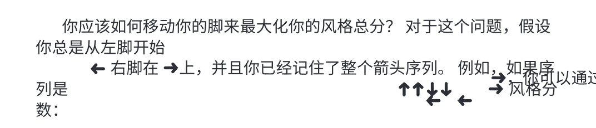

(a) 证明对于任何箭头序列，至少可以获得 $n/4 - 1$ 风格分数。

(b) 描述一个高效的算法，找到在给定的VVR例程中可以获得的最大风格分数。你的算法的输入是一个包含箭头序列的数组 Arrow[1..n]。

## 18. 考虑以下形式的单人Scrabble游戏。

我们从一个固定的、有限的瓷砖序列开始；每个瓷砖都有一个字母和一个数值。在游戏开始时，我们从序列中抽取前七个瓷砖放入手中。每一轮，我们从手中的一些或所有瓷砖中组成一个英文单词，将这些瓷砖放在桌子上，并获得这些瓷砖的总值作为分数。（如果手中的瓷砖无法组成英文单词，则游戏立即结束。）然后我们反复从序列的开头抽取下一个瓷砖，直到（a）我们手中有七个瓷砖，或者（b）序列为空。（抱歉，没有双倍/三倍单词/字母得分、bingo、空白或放弃。）我们的目标是获得尽可能多的分数。

例如，考虑以下20个瓷砖的序列：


在游戏开始时，给定这个瓷砖序列，我们可以得到68分，具体如下：

*   我们最初抽到了我₂ □ 你₂ 他₈ 爱₁ 你₂ 和₁ 我₃.
*   使用瓷砖拼出单词你₂ 我₂ 爱₁ 你₂ 但₃ 得到9分，手上剩下你₂ 他₈.
*   抽取下面的五个瓷砖哈 5 哈5 哈2 哈3 哈8.
*   玩字游戏 U 5 N2 D3 I2 D3 得15分，剩下 K 8 他.
*   抽取下面的五个瓷砖哈 5 B4 L2 A1 K8.
*   玩字游戏 B 4 U5 L2 K8 得19分，剩下 K 8 X8 A1 在手中.
*   抽取最后三个字母 H 5 A1 N2.
*   玩字游戏 A 1 N2 K8 H5 得16分，剩下 X 8 A1 在手中.
*   玩字游戏 A 1 X8 得9分，清空手中的字母并结束游戏.

(a) 假设字母序列由两个数组 Letter[1..n] 和 Value[A..Z] 表示，其中 Letter[ℓ] 是任何字母为 ℓ 的字母的值。 设计并分析一个高效的算法，计算给定字母序列可以获得的最大分数。

(b) 现在假设两个具有相同字母的瓷砖可能具有不同的值。 现在，瓷砖序列由两个数组字母[1..n]和值[1..n]表示，其中值[i]是第 i个瓷砖的值。 设计并分析一种高效的算法，计算给定瓷砖序列可以获得的最大点数。

在这两个问题中，输出是一个单独的数字：最大可能得分。 假设（因为是真的）你可以在 O(1)时间内找到由最多七个瓷砖组成的任何集合的所有英文单词，以及这些单词的点数。

## 19. 假设我们有一组 L 线段在平面上，其中每个线段的一个端点在线 y=0 上，另一个端点在线 y=1 上，并且所有 2n 个端点都是不同的。

(a) 描述并分析一个算法来计算在其中没有两个线段相交的最大子集 L。

(b) 描述并分析一个算法来计算在其中每对线段都相交的最大子集 L。

现在假设我们有一个在平面上的线段集合 L，其中每个线段的两个端点都位于单位圆上 $x^2 + y^2 = 1$，并且所有的 2n 端点都是不同的。

(c) 描述并分析一个算法来计算在其中没有两个线段相交的最大子集 L。

(d) 描述并分析一个算法来计算在其中每对线段都相交的最大子集 L。

20. 让 P 是均匀分布在单位圆上的一组点，让 S 是具有端点在 P 上的一组 m 线段。这 m 个线段的端点不一定是不同的；n 可能明显小于 2m。

(a) 描述一个算法来找到集合 S 中互不相交的线段子集的最大小。如果两个线段甚至在端点处都不相交，则它们是互不相交的。
(b) 描述一个算法来找到集合 S 中互不相交的内部线段子集的最大小。如果两个线段的交集为空集或者是它们的端点，则它们是内部互不相交的。
(c) 描述一个算法来找到集合 S 中相交的线段子集的最大小。
(d) 描述一个算法来找到集合 S 中相交的线段子集的最大小。如果两个线段相交但不在端点处相交，则它们是相交的。

为了获得满分，这四个算法的运行时间应为 O(mn)。

21. 你正在沿着一条公路驾驶一辆巴士，车上坐满了吵闹、兴奋和口渴的学生，还有一个饮料机。每分钟一个学生会喝掉一盎司的饮料。你的目标是尽快让学生下车，以便所有学生消耗的饮料总量尽可能小。

你知道每个出口会有多少学生下车。你的公交车从高速公路的某个地方开始（可能不是两端），以恒定的时速 37.4 英里每小时行驶。你必须沿着高速公路驾驶公交车；然而，你可以向前驶向一个出口，然后向相反方向的出口后退，可以随意切换。

（你可以立即停下公交车，让学生下车，并立即转身。）描述一个有效的算法，以尽可能少地让学生喝汽水。你的输入包括公交车路线（连续出口之间的行驶时间的列表），每个出口要下车的学生数量，以及你的公交车当前的位置（可以假设是一个出口）。

22. 让我们定义两个字符串 A 和 B 的摘要为以下形式的子字符串的连接：

*   ▲SNA 表示只有第一个字符串 A 的子字符串 SNA。
*   ◆FOO 表示两个字符串的公共子字符串 FOO。
*   ▼BAR 表示只有第二个字符串 B 的子字符串 BAR。

如果我们可以通过按顺序连接摘要的适当子字符串并丢弃分隔符 ▲,◆ 和 ▼ 来恢复原始字符串 A 和 B，则摘要是有效的。 每个常规字符的长度为 1，每个分隔符 ▲,◆ 或 ▼ 的长度为固定的非负长度 Δ。 摘要的长度是其符号长度的总和。

例如，以下每个字符串都是字符串 **KITTEN** 和 **KNITTING** 的有效摘要：

*   ◆K▼N◆ITT▲E▼I◆N▼G 的长度为 9 + 7Δ。
*   ◆K▼N◆ITT▲EN▼ING 长度为 10 + 5Δ。
*   ◆K▲ITTEN▼NITTING 长度为 13 + 3Δ。
*   ▲KITTEN▼KNITTING 长度为 14 + 2Δ。

描述并分析一个算法，计算两个给定字符串 A[1 .. m] 和 B[1 .. n] 的最短摘要的长度。 分隔符长度 Δ 也是算法的输入部分。例如：

*   给定字符串 KITTEN 和 KNITTING 和 Δ = 0，你的算法应该返回 9。
*   给定字符串 KITTEN 和 KNITTING 和 Δ = 1，你的算法应该返回 15。
*   给定字符串 KITTEN 和 KNITTING 和 Δ = 2，你的算法应该返回 18。

## 23. Vankin的Mile

Vankin的Mile是一种在一个 n × n 的方格网格上玩的美国纸牌游戏。玩家首先在网格的任意一个方格上放置一个标记。 然后在每一轮中，玩家将标记移动到右边的方格或者下方的方格。 当玩家将标记移出棋盘时，游戏结束。 网格的每个方格都有一个数值，可以是正数、负数或零。 玩家初始得分为零；当标记落在一个方格上时，玩家将该方格的数值加到自己的得分上。 游戏的目标是尽可能多地得分。

例如，给定下面的网格，玩家可以通过将初始标记放在第二行的8上，然后向下、向下、向右、向下、向下移动，得到8－6＋7－3＋4＝10分。（这不是该数字网格的最佳得分。）

| -1 | 7 | -8 | 10 | -5 |
|----|----|----|----|----|
| -4 | -9 | **8** | -6 | 0 |
| 5 | -2 | **-6** | -6 | 7 |
| -7 | 4 | **7** | **-3** | -3 |
| 7 | 1 | -6 | **4** | -9 |

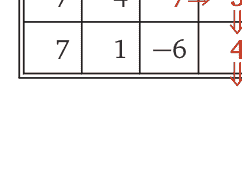

## 3. 动态规划

(a) 描述并分析一个高效的算法，以计算给定值的 Vankin's Mile 游戏的最大可能得分。

(b) 在这个游戏的欧洲版本中，适当地称为 Vankin的Kilometer，玩家可以在每一轮中将代币移动到下一个方格、右边一个方格或左边一个方格。然而，为了防止无限得分，代币不能落在同一个方格上超过一次。描述并分析一种高效的算法，以计算给定输入的 Vankin's Kilometer 游戏的最大可能得分，其中输入是一个 n × n数组的值。

24. 假设你有一个 m × n 位图，表示为一个数组 M[1 .. n, 1 .. n] of 0s 和 1s。在 M 中，一个连续的块是指形式为 M[i .. i′, j .. j′] 的子数组，其中所有位都相等。如果连续的块具有相同的行数和列数，则它是一个正方形块。

(a) 描述一个算法来找到一个立方体的最大面积方块在 M 中在 O(n²)时间内。
(b) 描述一个算法来找到一个立方体的最大面积块在 M 中在 O(n³)时间内。
(c) 描述一个算法来找到一个立方体的最大面积块在 M 中在 O(n² log n)时间内。[提示：分而治之。]
(d) 描述一个算法来找到一个立方体的最大面积块在 M 中在 O(n²)时间内。

25. 假设你有一个数组 M[1 .. n, 1 .. n] 包含数字，这些数字可以是正数、负数或零，并且不一定是整数。描述一个算法来找到任意矩形子数组中元素的最大和形式为 M[i .. i′, j .. j′]。为了获得全部学分，你的算法应该在 O(n³)时间内运行。[提示：参见问题3。]

26. 描述并分析一个算法，该算法在给定位图中找到出现多次的最大面积矩形模式。具体来说，给定一个二维数组 M[1 .. n, 1 .. n] 作为输入，你的算法应该输出 M 中最大重复矩形模式的面积。例如，给定下图左侧的位图，你的算法应该返回整数 195，即 15 × 13的狗狗的面积。（尽管在这个例子中没有发生，但是重复模式的两个副本可能会重叠。）

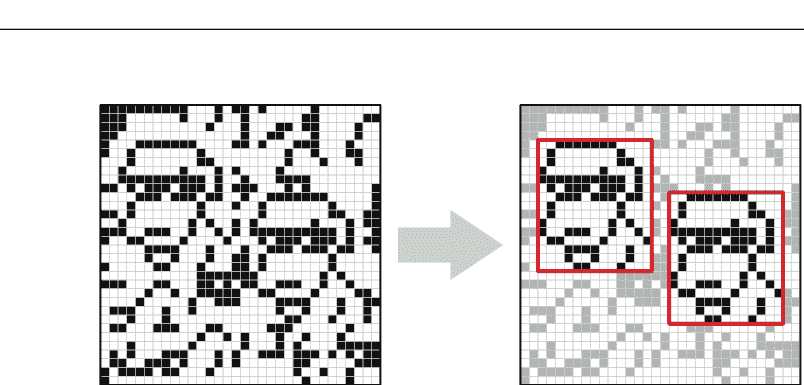

(a) 为了获得满分，请描述一个运行时间为 $O(n^5)$的算法。
(b) 为了额外的学分，请描述一个运行时间为 $O(n^4)$的算法。
(c) 对于额外的额外学分，描述一个运行时间为 $O(n^3 \text{polylog} n)$的算法。

27. 设 $P$ 是平面上的一组点，处于凸位置。直观地说，如果一个橡皮筋绕着这些点绕一圈，那么每个点都会接触到橡皮筋。更正式地说，对于 $P$ 中的任意点 $p$，存在一条线将 $p$ 与 $P$ 中的其他点分开。此外，假设这些点按逆时针顺序索引为 $P[1], P[2], \ldots, P[n]$，以最左边的点 $P[1]$ 开始绕“橡皮筋”一圈。

这个问题要求你解决旅行商问题的一个特殊情况，其中旅行商必须访问 $P$ 中的每个点，从一个点 $p \in P$ 移动到另一个点 $q \in P$ 的成本是欧几里得距离 $|pq|$。

(a) 描述一个简单的算法来计算 $P$ 的最短循环游览。
(b) 一个简单的游览是指不会交叉的游览。证明 $P$ 的最短游览必须是简单的。
(c) 描述并分析一个高效的算法来计算从最左边的点 $P[1]$ 开始并以最右边的点 $P[r]$ 结束的 $P$ 的最短游览。
(d) 描述并分析一个高效的算法来计算 $P$ 的最短游览，对端点没有限制。

28. 描述并分析一个算法来解决旅行商问题，时间复杂度为 $O(2^n \text{poly}(n))$。给定一个带有加权边的无向图 $G$，你的算法应该返回 $G$ 中访问每个顶点恰好一次的最轻循环的权重，如果 $G$ 没有这样的循环，则返回 $\infty$。[提示：显然的递归回溯算法的时间复杂度为 $O(n!)$。]

29. 令 $W = \{w_1, w_2, \ldots, w_n\}$ 是一个由某个固定字母表 $\Sigma$ 上的有限字符串组成的集合。对于 $W$ 来说，一个编辑中心 $C \in \Sigma^*$ 是一个字符串，使得到 W 中任意字符串的编辑距离都尽可能小。对于 W 来说，编辑半径 of W 是从编辑中心到 W 中字符串的最大编辑距离。一组字符串可能有多个编辑中心，但它们的编辑半径是唯一的。

$$EditRadius(W) := \min_{C \in \Sigma^*} \max_{w \in W} Edit(w, C)$$
$$EditCenter(W) := \arg \min_{C \in \Sigma^*} \max_{w \in W} Edit(w, C)$$

(a) 描述并分析一个高效的算法来计算给定三个字符串的编辑半径。
(b) 描述并分析一个高效的算法，以 2 的因子近似计算任意一组字符串的编辑半径. (计算精确的编辑半径在字符串数量不固定的情况下是 NP 难问题。)

♥30. 让 D[1 .. n] 成为一个由数字组成的数组，每个数字都是介于 0 和 9 之间的整数。 D 的一个数字子序列是由 D 的不相交子字符串组成的正整数序列，按照通常的方式组合而成。 例如，序列 3, 4, 5, 6, 8, 9, 32, 38, 46, 64, 83, 279 是 π 的前几个数字的一个数字子序列：

```
3, 1, 4, 1, 5, 9, 2, 6, 5, 3, 5, 8, 9, 7, 9, 3, 2, 3, 8, 4, 6, 2, 6, 4, 3, 3, 8, 3, 2, 7, 9
⌊_⌋⌊_⌋⌊_⌋⌊_⌋⌊_⌋⌊_⌋⌊_⌋⌊_⌋⌊_⌋⌊_⌋⌊_⌋⌊_⌋⌊_⌋⌊_⌋⌊_⌋⌊_⌋⌊_⌋⌊_⌋⌊_⌋⌊_⌋⌊_⌋⌊_⌋⌊_⌋⌊_⌋⌊_⌋⌊_⌋⌊_⌋⌊_⌋⌊_⌋⌊_⌋⌊_⌋
```

数字子序列的长度是它包含的整数的数量，而不是数字的数量；上面的例子长度为 12。 通常情况下，数字子序列是递增的，如果每个数字都大于它的前一个数字。

描述并分析一个高效的算法来计算 D 的最长递增数字子序列。 [提示：要小心你的计算假设。比较两个 k 位数的数字需要多长时间？]

为了获得全部学分，你的算法应该在 $O(n^4)$ 时间内运行；更快的算法值得额外学分。 我知道的解决这个问题的最快算法运行时间为 $O(n^{3/2} \log n)$；要达到这个界限需要一些技巧，无论是在算法的设计还是分析上，但都不超出本课程的范围。 ²²

♥31. 考虑下面这个经典汉诺塔问题的变体。 和往常一样，有 n 个大小不同的盘子，放在编号为 0, 1, 和 2 的三个柱子上。 最初，所有的 n 个盘子都在柱子 0 上，按照从上到下的顺序排列。 我们的目标是将所有的盘子移动到柱子 2 上。 在一步中，我们可以将任意柱子上最高的盘子移动到另一个柱子上，只要我们满足两个约束条件。首先，我们绝不能将一个较小的盘子放在一个较大的盘子上面。其次——这是非标准的部分——我们不能直接将一个盘子从柱子上移动到另一个柱子上。描述并分析一个算法，计算从柱子1上移动所有 n个盘子所需的确切移动次数到柱子2，符合所述的限制条件。为了获得满分，你的算法在最坏情况下应该只使用 O(log n)次算术运算。为了分析，假设将两个 k位数相加或相乘需要 O(k)时间。提示：矩阵！

## 32. 分割序列/数组

一个基本的算术表达式由来自集合{1, +, ×}和括号的字符组成。几乎每个整数都可以用多个基本算术表达式表示。例如，以下所有基本算术表达式都表示整数14：

```
1+1+1+1+1+1+1+1+1+1+1+1+1+1+1+1
((1+1)×(1+1+1+1+1))+((1+1)×(1+1))
(1+1)×(1+1+1+1+1+1+1)
(1+1)×(((1+1+1)×(1+1))+1)
```

描述和分析一个算法，以计算给定一个整数 n作为输入时，最小的数字数量1在一个基本的算术表达式中，其值等于 n的数量。括号的数量并不重要，只有1的数量重要。例如，当 n=14时，你的算法应该返回8，对于上面的最终表达式。你的算法的运行时间应该受到 n的一个小多项式函数的限制。

## 33. 

假设你有一个由 +和-符号分隔的整数序列；例如：

```
1+3-2-5+1-6+7
```

你可以通过在不同的位置添加括号来改变这个表达式的值。例如：

```
1+3-2-5+1-6+7=-1
(1+3-(2-5))+(1-6)+7=9
(1+(3-2))-(5+1)-(6+7)=-17
```

描述和分析一个算法，以计算给定一个由 +和-符号分隔的整数列表时，表达式的最大可能值通过添加括号来计算。括号只能用于分组加法和减法；特别地，不要使用它们来创建隐式乘法，如 1 + 3(-2)(-5) + 1- 6 + 7 = 33。

## 34. 

假设你有一串由整数组成的序列，用 +和 ×符号分隔；例如：

1 + 3 × 2 × 0 + 1 × 6 + 7

你可以通过在不同的位置添加括号来改变这个表达式的值。例如：

- (1 + (3 × 2)) × 0 + (1 × 6) + 7 = 13
- ((1 + (3 × 2 × 0) + 1) × 6) + 7 = 19
- (1 + 3) × 2 × (0 + 1) × (6 + 7) = 104

(a) 描述并分析一个算法，通过添加括号来计算给定表达式可能的最大值，假设输入中的所有整数都是正数。提示：这很容易。

(b) 描述并分析一个算法，通过添加括号来计算给定表达式可能的最大值，假设输入中的所有整数都是非负数。

(c) 描述并分析一个算法，通过添加括号来计算给定表达式可能的最大值，对输入数字没有任何限制。

假设任何算术运算都需要 O(1)时间。

## 35. 

从Sham-Poobanana大学毕业后，你决定去华尔街银行Long Live Boole面试。该银行的总经理Eloob Egroeg对每个新员工提出了一个“解决或死亡”的问题，他们必须在24小时内解决。那些无法解决问题的人将立即被解雇！

第一次进入银行时，你注意到员工办公室是按照一排直线排列的，每个办公室的门上都有一个大大的 T或 F。此外，在相邻的两个办公室之间，有一个标有以下符号之一的板子 ∧,∨, 或 ⊕。当你询问这些神秘的符号时，Eloob确认 T和 F分别代表布尔值True和False，而板子上的符号代表标准的布尔运算符And、Or和Xor。他还解释说，这些字母和符号描述了某些员工组合是否能够成功地一起工作。在任何新项目开始时，Eloob通过在符号序列中添加括号来进行层次聚类他的员工，以获得一个明确的布尔表达式。 如果这个带括号的布尔表达式的计算结果为 T，那么项目就会成功。
例如，如果银行有三名员工，并且他们的门上和门之间的符号序列是 T ∧ F ⊕ T，那么只有一种成功的括号方案： (T ∧ (F ⊕ T))。 然而，如果门符号列表是 F ∧ T ⊕ F，则无法添加括号使项目成功。

Eloob最后提出了你的求解或死亡面试问题：描述一个算法来判断给定的符号序列是否可以加括号，使得结果布尔表达式的值为 T。 你的输入是一个数组 S[0 .. 2n]，其中 S[i]∈ {T,F}当 i为偶数时， S[i]∈ {∨,∧,⊕}当 i为奇数时。

## 36. 

每年，作为年度会议的一部分，上格拉斯维尔的南极蜗牛爱好者举行一场圆桌交配比赛。几只高质量的繁殖蜗牛被放置在圆桌的边缘。 蜗牛按顺序编号，从 1到 n。 在比赛期间，每只蜗牛在桌子上四处游荡，留下一条粘液痕迹。这些蜗牛经过特殊训练，永远不会从桌子边缘掉下去，也不会穿过粘液痕迹，即使是它们自己的痕迹。如果两只蜗牛相遇，它们被宣布为繁殖配对，从桌子上移走，并被带到地下的一个浪漫洞穴中制造小蜗牛。 请注意，有些蜗牛可能永远找不到配偶，即使比赛永远进行下去。

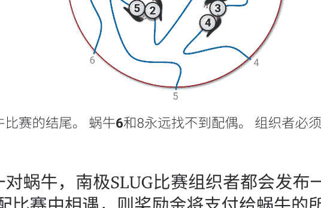

图 3.6。典型南极蜗牛比赛的结尾。蜗牛6和8永远找不到配偶。组织者必须支付 M[3, 4] + M[2, 5] + M[1, 7]。

对于每一对蜗牛，南极SLUG比赛组织者都会发布一份奖励金，如果这对蜗牛在交配比赛中相遇，则奖励金将支付给蜗牛的所有者。具体来说，这是一个二维数组 $M[1..n, 1..n]$贴在圆桌后面的墙上，其中 $M[i, j] = M[j, i]$是蜗牛 $i$和 $j$相遇时要支付的奖励金。
描述并分析一种算法，以计算组织者可能被迫支付的最大总奖励，给定数组 $M$作为输入。

## 37. 

你从一个采石场开采了一块大理石板。为了简单起见，假设大理石板的高度为 $m$英寸，宽度为 $m$英寸。你想把这块板子切成各种大小的小矩形——一些用于厨房台面，一些用于大型雕塑项目，其他用于纪念碑。你有一把可以在任何矩形板上进行水平或垂直切割的大理石锯。在任何时候，你都可以查询一个 $P[x, y]$的现货价格，这是一个 $x$英寸乘以 $y$英寸的大理石矩形，其中 $x$和 $y$是正整数。这些价格取决于顾客的需求，购买大理石台面的人很奇怪，所以不要对他们做任何假设；特别是，较大的矩形可能具有显著较小的现货价格。给定现货价格数组和正整数 $m$和 $n$作为输入，描述一种算法来计算如何将一个 $m \times n$的大理石板细分以最大化你的利润。

## 38. 

这个问题要求你设计高效的算法来构建满足额外平衡约束的最优二叉搜索树。你的输入包括一个有序数组 $A[1..n]$的搜索键和一个数组 $f[1..n]$的频率计数，其中 $f[i]$是对 $A[i]$的搜索次数。这与第3.9节中描述的成本函数完全相同。但现在你的任务是计算一个满足一些额外约束的最优树。

(a) $AVL$树是最早的自平衡二叉搜索树，由Georgy Adelson-Velsky和Evgenii Landis于1962年首次描述。$AVL$树是一种二叉搜索树，对于每个节点 $v$，左子树的高度和右子树的高度之差最多为1。

描述并分析一个构建给定搜索键和频率的最优AVL树的算法。

(b) 对称二叉$B$树是另一种自平衡二叉树，由Rudolf Bayer于1972年首次描述；这些树更为人所知的名称是红黑树，在Leo Guibas和Bob Sedgewick于1978年进行了一些简化改进后得到。红黑树是一种具有以下附加约束的二叉搜索树：

- 每个节点要么是红色，要么是黑色。
- 每个红色节点都有一个黑色父节点。
- 每条从根到叶子的路径包含相同数量的黑色节点。

描述一个递归回溯算法，用于构建给定搜索键和频率集的最优红黑树。

(c) AA树是由Arne Andersson于1993年提出的，并在2000年由Mark Allen Weiss稍作简化（并命名）。AA树也被称为左倾红黑树，这是由Bob Sedgewick在2006年通过对称重构（使用不同的平衡算法）得到的。AA树是一种带有额外约束的红黑树：

- 没有左孩子是红色。
- 23

描述并分析一个构建给定搜索键和频率的最优AA树的算法。

## 39. 

假设你有一个 m × n位图，表示为一个数组 M[1 .. m, 1 .. n]，其中 0和 1表示位。在 M中，一个实心块是一个形如 M[i .. i', j .. i']的子数组，其中所有位都相等。假设你想将 M分解为尽可能少的不相交块。

一种自然递归分割策略被称为断头台子分割。如果整个位图 M是一个实心块，那就没什么可做的了。否则，我们沿着水平或垂直线将 M切成两个较小的位图，然后递归地将这两个较小的位图分解成实心块。

任何断头台子分割都可以表示为一棵二叉树，其中每个内部节点存储一个切割的位置和方向，每个叶子节点存储一个单独的 0或 1表示相应块的内容。断头台子分割的大小是相应二叉树中叶子节点的数量（即最终实心块的数量），而断头台子分割的深度是相应二叉树的深度。

- (a) 描述并分析一个计算最小可能大小的断头台子分割的算法。
- (b) 证明断头台子分割不总是产生最小数量的实心块的分割。
- (c) 描述并分析一个算法，用于计算具有最小可能深度的M的断头台细分。
- (d) 描述并分析一个算法，给定表示M的断头台分解和两个索引i和j，确定 M[i, j]。

> 23 Sedgwick的改进要求没有右子节点是红色的。无论如何。Andersson和Sedgwick对于顺时针还是逆时针测量角度，冥王星是否是行星，"较低级别"是否意味着"更好"还是"更差"，以及是与一百只鸭子大小的马战斗还是与一只马大小的鸭子战斗，都保持沉默。

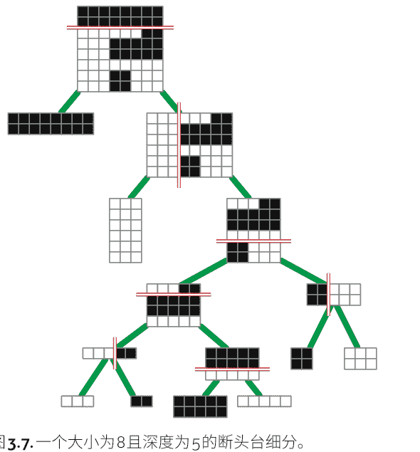

- (e) 将像素M[i,j]在断头台细分中的深度定义为包含该像素的叶子的深度。描述并分析一个算法，计算M的断头台细分，使像素的深度之和尽可能小。
- (f) 描述并分析一个算法，用于计算一个断头台细分，使黑色像素的深度之和尽可能小。

## 40. 

恭喜！你已经被巨大的在线书店DeNile（“不仅仅是埃及的一条河！”）聘请来优化他们的仓库机器人。DeNile销售的每本书都有一个独特的ISBN（国际标准书号），它只是一个数字值。DeNile的每个仓库都有一排长长的货架，每个货架上放着多本同一本书的副本。这些货架按照ISBN的顺序排列；每个货架的ISBN以机器可读的形式打印在货架的前面。书籍是由沿着货架平行运行的机器人从这些货架上取出的。

DeNile不维护哪个货架包含哪个ISBN号码的列表；那太简单了！相反，为了取出所需的书籍，机器人必须首先使用二分搜索找到该书籍的货架。因为搜索需要机器人进行物理运动，我们不能再假设二分搜索的每一步都需要 O(1)时间。具体来说：

- 机器人始终从“0号箱子”开始（将书装箱发送给客户）。
- 将机器人从 $i$ 号箱子移动到 $j$ 号箱子需要 $\alpha|i-j|$ 秒，其中 $\alpha$ 是某个常数。
- 机器人必须直接面对一个箱子才能读取该箱子的ISBN号。读取一个ISBN号需要 $\beta$ 秒，其中 $\beta$ 是某个常数。
- 改变机器人的运动方向（从递增到递减或反之）需要额外的 $\gamma$ 秒，其中 $\gamma$ 是某个常数。
- 当机器人找到目标箱子时，它从该箱子中取出一本书并返回到“0号箱子”。

设计并分析一个算法，计算一个二叉搜索树，使机器人在搜索书籍时所花费的总时间最小。
你的输入是一个整数数组 $f[1..n]$，其中 $f[i]$ 表示机器人将被要求从 $i$ 号箱子中取出书的次数，同时还给出了时间参数 $\alpha, \beta$ 和 $\gamma$。

## 41. 

提高搜索树缓存性能的一种标准方法是将更多的搜索键和子树打包到每个节点中。$B$树是一种根节点为根的树，每个内部节点最多存储$B$个键和指向$B+1$个子节点的指针，每个子节点都是一个较小的$B$树的根节点。具体来说，每个节点$v$存储三个字段：

- 一个正整数$v.d \leq B$,
- 一个排序数组$v.key[1..v.d]$，以及
- 一个子指针数组$v.child[0..v.d]$。

特别地，子指针的数量总是比键的数量多一个。$^{24}$

每个指针$v.child[i]$要么为空，要么是指向键都大于$v.key[i]$且小于$v.key[i+1]$的$B$-树的根节点的指针。特别地，左侧子树$v.child[0]$中的所有键都小于$v.key[1]$，右侧子树$v.child[v.d]$中的所有键都大于$v.key[v.d]$。

直观地，你应该心中有以下的图像：


这里 $T_i$ 是由 $child[i]$ 指向的子树。在 $B$ 树中，搜索键 $x$ 的成本是从根节点到包含 $x$ 作为其键之一的节点的路径上的节点数。一个 $1$ 树只是一个标准的二叉搜索树。

固定一个任意的正整数 $B > 0$。（我建议 $B = 8$。）假设给定一个已排序的搜索键数组 $A[1,\ldots,n]$ 和相应的频率计数数组 $F[1,\ldots,n]$，其中 $F[i]$ 是我们将搜索 $A[i]$ 的次数。你的任务是描述和分析一种有效的算法，找到一个 $B$ 树，使得搜索给定键和给定频率的总成本最小化。

- (a) 描述一个多项式时间算法，用于特殊情况 $B = 2$。
- (b) 描述一个对任意 $B$ 运行时间为 $O(n^{B+c})$ 的算法，其中 $c$ 是某个固定整数。
- (c) 描述一个对任意 $B$ 运行时间为 $O(n^c)$ 的算法，其中 $c$ 是某个固定整数，不依赖于 $B$。

## 42. 

一个由括号 $($ 和 $)$ 以及方括号 $[$ 和 $]$ 组成的字符串 $w$ 是平衡的，如果满足以下条件之一：

- $w$ 是空字符串。
- $w = (x)$，其中 $x$ 是一个平衡字符串。
- $w = [x]$，其中 $x$ 是一个平衡字符串。
- $w = xy$，其中 $x$ 和 $y$ 是平衡字符串。

例如，字符串 $w = ([[()]][()]) [()()]()$ 是平衡的，因为 $w = xy$，其中 $x = ([[()]][()])$ 和 $y = [()()]()$。

- (a) 描述并分析一个算法，用于确定给定的括号和方括号字符串是否平衡。
- (b) 描述并分析一个算法来计算给定括号和方括号字符串的最长平衡子序列的长度。
- (c) 描述并分析一个算法来计算给定括号和方括号字符串的最短平衡超序列的长度。
- (d) 描述并分析一个算法来计算从给定括号和方括号字符串到一个平衡括号和方括号字符串的最小编辑距离。

- ♥(e) 描述并分析一个算法来计算两个给定括号和方括号字符串的最长公共平衡子序列。
- ♥(f) 描述并分析一个算法来计算给定括号和方括号字符串的最长回文平衡子序列。
- ♥(g) 描述并分析一个算法来计算两个给定括号和方括号字符串的最长公共回文平衡子序列（呼！）。

对于每个问题，你的输入是一个数组 w[1..n]，其中 w[i]∈ {(,), [, ]} 对于每个索引 i。（你可以选择使用不同的符号代替括号和方括号，例如 L,R, l,r 或 <,>,►，但请告诉你的评分人员你使用的符号！）

## ♥43. 

恭喜！你的研究团队刚刚获得了由DARPA、谷歌和麦当劳共同资助的价值5 000万美元的多年项目，该项目旨在开发DWIM：第一个能够读取程序员思维的编译器！你的提案和众多新闻稿都承诺DWIM将自动纠正任何给定代码中的错误，同时尽可能少地修改该代码。不幸的是，现在是时候开始真正让这个该死的东西工作了。

作为一个热身练习，你决定解决以下必要的子问题。回想一下，两个字符串之间的编辑距离是将一个字符串转换为另一个字符串所需的最小单字符插入、删除和替换次数。算术表达式是一个字符串w，满足以下条件：

- w是一个由一个或多个十进制数字组成的字符串，
- w = (x)，其中x是一个算术表达式，或者
- w = x ♢ y，其中x和y是算术表达式，，其一个二元运算符。

假设给你一个由字母表中的标记组成的字符串 {#, ♢, (, )}, 其中 #表示十进制数字， ♢表示二进制运算符。描述并分析一种算法，计算给定字符串到算术表达式的最小编辑距离。

## 44. 

核糖核酸（RNA）分子是由数百万个核苷酸链组成的长链，或碱基的四种不同类型：腺嘌呤（A），胞嘧啶（C），鸟嘌呤（G）和尿嘧啶（U）。RNA分子的序列是一个字符串 b[1..n]，其中每个字符 b[i]∈ {A,C,G,U}对应一个碱基。除了序列中相邻碱基之间的化学键外，氢键还可以形成某些碱基对之间。被键合的碱基对的集合被称为RNA分子的二级结构。

如果两个碱基对 $(i, j)$和 $(i', j')$满足 $i < j$ 和 $i' < j'$的条件，则我们称它们重叠。在实践中，大多数碱基对都是非重叠的。重叠的碱基对会在二级结构中形成所谓的伪结，这对于一些RNA功能是必不可少的，但更难预测。

假设我们想要预测给定RNA序列的最佳可能的二级结构。我们将采用一个极为简化的二级结构模型：

- 每个碱基最多可以与另一个碱基结合。
- 只有 A-U对和 C-G对可以结合。
- 形式为 $(i, i+1)$和 $(i, i+2)$的对不能结合。
- 键合碱基不能重叠。

最后（也是最不现实的）限制使我们能够将RNA二级结构可视化为一种类似于肥胖树的结构，如下所示。

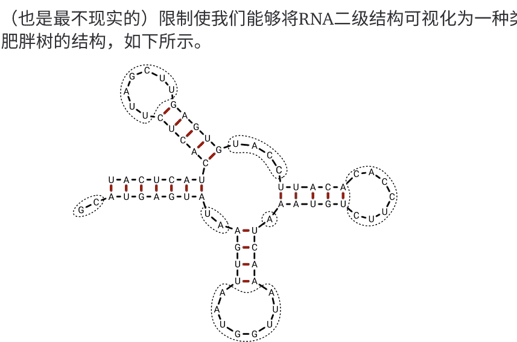

(a) 描述并分析一种算法，用于计算给定RNA序列的二级结构中可能的最大键合碱基数。

(b) 在次级结构中，间隙是最大的未配对碱基子串。大的间隙会导致化学不稳定，所以具有较小间隙的次级结构更有可能。为了考虑这种偏好，让我们定义次级结构的得分为间隙长度的平方和；参见图3.8。（这个得分函数完全是虚构的；真正的RNA结构预测需要更复杂的得分函数。）描述并分析一个算法，计算给定RNA序列的次级结构的最小可能得分。

#### 树和子树

45. (a) 描述并分析一个高效的算法，确定给定字符串 w 和正则表达式 R 时，是否 w ∈ L(R)。

(b) 广义正则表达式允许二元运算符 ∩（交集）和一元运算符 ¬（补集），除了通常的运算符：连接、或（+）和闭包（*）。NFA 构造和 Kleene 定理意味着任何广义正则表达式 E 表示一个正则语言 L(E)。

描述并分析一种高效的算法，用于确定给定一个字符串 w 和一个广义正则表达式 E，是否 w ∈ L(E)。在这两个问题中，假设你实际上是给出了一个解析树，而不仅仅是一个字符串。

46. 你刚刚被任命为 Giggle（Abugida 的子公司）第一届年度强制性假日派对的新组织者。Giggle 员工被组织成一个严格的层次结构——公司总裁位于根节点。人力资源部的全知预言家为每个员工分配了一个实数，衡量员工的“有趣程度”。为了保持社交，对于客人名单有一个限制：如果一个员工的直接上级也在场，则该员工不能参加派对。另一方面，公司总裁必须参加派对，即使她的有趣程度为负数；毕竟这是她的公司。给出一个算法，为派对制定一个客人名单，使客人的“有趣程度”之和最大化。

47. 由于去年的假日派对来的人很少，Giggle 的总裁决定今年给每个员工一个礼物。具体来说，每个员工必须收到三个礼物：（1）全球范围内六周的免费度假，（2）在 Jumping Jack Flash's Flapjack Stack Shack 享用两人份的无限量煎饼早餐，或者（3）一袋装满狗屎的燃烧纸袋。公司规定，任何员工都不能收到与直接主管相同的礼物。任何员工如果收到比直接主管更好的礼物，几乎肯定会因嫉妒而被解雇。

作为 Giggle 的官方派对策划者，你的工作是决定每个员工收到哪个礼物。描述一个分发礼物的算法，以使被解雇的人数最少。是的，你可以给总裁寄一个燃烧的狗屎袋。

更正式地说，给定一个根树 T，表示公司的层次结构，你想要给 T 的节点标记为整数 1，2 或 3，以便每个节点的标记与其父节点不同。标记的成本是具有比其父节点更小标记的节点数。参见图 3.9 的示例。描述并分析一个计算 T 的最小成本标记的算法。

图 3.9。一个成本为 9 的树标记。这九个粗体节点的标记比其父节点小。这不是该树的最优标记。

48. 在火烧狗屎假日事件之后，你受到了强烈的鼓励寻找其他工作，于是你离开了 Giggle 去了竞争对手 Twitbook 公司。不幸的是，Twitbook 的新总裁决定模仿 Giggle 举办自己的假日派对，鉴于你的过去经历，她任命你为官方派对组织者。总裁要求你邀请恰好 k 名员工，包括总裁本人，而且每个被邀请的人都必须参加。是的，这会很有趣。

就像在 Giggle 一样，Twitbook 的员工被组织成一个严格的层次结构：一个以公司总裁为根的树。人力资源部的全知预言家为每个员工分配了一个实数，表示邀请该员工及其直接主管的尴尬程度；负值表示该员工和他们的主管实际上互相喜欢。你的目标是选择一个包含恰好 k 个员工的子集，使得结果聚会的总尴尬程度尽可能小。例如，如果宾客名单不包括员工和他们的直接主管，总尴尬程度为零。你的算法的输入是树 T、整数 k 和 T 中每个节点的尴尬程度。

(a) 描述一个算法，计算最不尴尬的 k 个员工的总尴尬程度，假设公司的层次结构由二叉树描述。也就是说，假设每个员工最多直接监督其他两个员工。

(b) 描述一个算法，计算最不尴尬的子集的总尴尬程度，对公司层级没有限制。

49. 假设我们需要向根树中的所有节点广播一条消息。最初，只有根节点知道这条消息。在一个回合中，任何知道消息的节点最多可以将其转发给一个子节点。参见图 3.10 的示例。

(a) 设计一个算法，计算将消息广播到二叉树中所有节点所需的最小回合数。

(b) 设计一个算法，计算将消息广播到任意根树中所有节点所需的最小回合数。【提示：尽管这不是一种贪婪算法，但您可能会发现下一章中的技术对于证明您的算法正确性很有用。】

50. 有一天，亚历克斯厌倦了在健身房攀爬，决定带一大群攀岩朋友到户外攀爬。他们去的攀爬区域有一块巨大的宽阔岩石，不是很高，上面有各种标记的手和脚的支撑点。亚历克斯迅速确定了她的朋友们可以执行的“允许”的移动集合，以便从一个支撑点到达另一个支撑点。

支撑点的整体系统可以用一棵根树 T 来描述，其中每个顶点对应一个支撑点，每条边对应一个允许的移动。攀爬路径在攀岩石上向上汇聚，导致一个唯一的顶点作为顶峰，由 T 的根表示。

亚历克斯和她的朋友们（都是优秀的攀岩者）决定玩一个游戏，尽可能多的攀岩者同时在岩石上，每个攀岩者需要执行一系列确切 k 次移动。每个攀岩者可以选择任意一个支撑点作为起点，所有的移动都必须远离地面。因此，每个攀岩者在树 T 中追踪出一条 k 条边的路径，所有的边都指向根。然而，不允许两个攀岩者触碰同一个支撑点；不同攀岩者所走的路径不能有任何交叉。

描述并分析一个高效的算法来计算能够玩这个游戏的最大人数。更正式地说，给定一个根树 T 和一个整数 k，你想找到可能的最大值，即 T 中不相交路径的数量，每条路径的长度为 k。不要假设 T 是一棵二叉树。例如，给定下面的树 T 和输入 k = 3，你的算法应该返回整数 8。

## 3. 动态规划

图 3.11。长度为 k = 3 的七条不相交路径。这不是这棵树中最大的路径集合。

51. 设 T 为一棵具有 N 个顶点的根二叉树，并且 k ≤ N 为一个正整数。我们想要标记 T 中的 k 个顶点，以便每个顶点都有一个附近的标记祖先。更正式地说，我们将任何子集 K 的聚类成本定义为

成本(K) = max_v 成本(v, K),

其中最大值是在树的所有顶点 v 中取得的，并且成本(v, K) 是从 v 到其在 K 中最近的祖先的距离：

成本(v, K) = 0 如果 v ∈ K；

成本(v, K) = ∞ 如果 v 是 T 的根节点，并且 v ∉ K；

成本(v, K) = 1 + 成本(父节点(v)) 其他情况。

特别地，如果 K 不包括 T 的根节点，则成本(K) = ∞。

图 3.12。二叉树中的五个顶点子集，聚类成本为 3。

(a) 描述一个动态规划算法，计算给定树 T 和整数 k 的情况下，T 中任意 k 个顶点子集的最小聚类成本。为了获得满分，你的算法应该在 O(n²k²) 时间内运行。

(b) 描述一个动态规划算法来计算给定树 T 和一个整数 r，其聚类成本最多为 r 的最小顶点子集的大小。为了获得全部学分，你的算法应该在 O(nr) 时间内运行。

(c) 证明你在部分 (b) 的解决方案意味着一个在 O(n² log n) 时间内运行的部分 (a) 的算法。

52. 这个问题要求你找到计算两个给定根树的最大公共根子树的高效算法。回想一下，一个根树是一个带有指定节点称为根的连通无环图。

一个根树的子树由一个任意节点及其所有后代组成。“公共”的精确定义取决于我们考虑哪些根树对是同构的。

(a) 回想一下，一个二叉树是一个根树，其中每个节点都有一个（可能为空的）左子树和一个（可能为空的）右子树。两个二叉树是同构的当且仅当它们都为空，或者它们的左子树是同构的，且它们的右子树是同构的。描述一个算法来找到两个给定二叉树的最大公共二叉子树。

图 3.13。两个二叉树，突出显示它们的最大公共（根）子树。

(b) 在有序根树中，每个节点都有一个子节点序列，它们是有序根子树的根。如果两个有序根树都为空，或者它们的第 i 个子树是同构的，则它们是同构的。描述一个算法来找到两个有序树 T₁ 和 T₂ 的最大公共有序子树。

(c) 在无序根树中，每个节点都有一个无序子节点集合，它们是无序根子树的根。如果两个无序根树都为空，或者每个根的子树可以排序，使得它们的第 i 个子树是同构的，则它们是同构的。描述一个算法来找到两个无序树 T₁ 和 T₂ 的最大公共无序子树。

53. 这个问题要求你找到计算无根树中最优子树的高效算法 - 这些无根树是连通的无环无向图。无根树的子树是任何连通子图。

(a) 假设给你一棵带有边权重的无根树 T，这些权重可以是正数、负数或零。描述一个算法来找到 T 中具有最大总权重的路径。

(b) 假设给你一棵带有顶点权重的无根树 T，这些权重可以是正数、负数或零。描述一个算法来找到 T 中具有最大总权重的子树。[这是 2016 年 Google 的面试题。]

(c) 让 T₁ 和 T₂ 是任意有序的无根树，意味着每个节点的邻居有一个明确定义的循环顺序。描述一个算法来找到 T₁ 和 T₂ 的最大公共有序子树。

(d) 让 T₁ 和 T₂ 是任意无序的无根树。描述一个算法来找到 T₁ 和 T₂ 的最大公共无序子树。

54. 根化子序列是根化树的一种自然推广。

根化树 T 的根化子树是通过收缩一条或多条边得到的任意树。当我们收缩一条边 u→v，其中 u 是 v 的父节点时，v 的子节点成为 u 的新子节点，然后 v 被删除。特别地，T 的根节点也是 T 的每个根化子树的根节点。

(a) 设 T 是一棵带标记节点的根化树。如果对于每个节点 x，x 的所有子节点具有相同的标记，则我们称 T 是无聊的；不同节点的子节点可以具有不同的标记。描述一个算法来找到给定标记根化树的最大无聊根化子树。

(b) 假设我们有一棵带有数字标记的根化树 T。描述一个算法来找到给定根化树 T 的最大堆序根化子树。也就是说，你的算法应该返回最大的根化子树 M，其中 M 中的每个节点的标记都比它的子节点小。

(c) 假设我们有一个二叉树 T，其节点带有数字标签。描述一个算法来找到最大的二叉搜索有序根化子树。也就是说，你的算法应该返回一个根化子树 M，使得 M 中的每个节点最多有两个子节点，并且 M 的中序遍历是 T 的中序遍历的递增子序列。

(d) 回想一下，如果每个节点的子节点有一个明确定义的从左到右的顺序，那么一个根树就是有序的。描述一个算法来找到带有数字标签的任意有序树 T 的最大的二叉搜索有序根化子树。同样，M 中节点的从左到右的顺序应与 T 中节点的顺序一致。

(e) 描述一个算法来找到两个有序标记的根树的最大公共有序根化子树。

(f) 描述一种算法来找到两个无序的有标签根树的最大公共无序根化子树。[提示：将动态规划与最大流相结合。]

## 4 贪婪算法

> > 问题是，女士们先生们，贪婪是好的。贪婪有效，贪婪正确。贪婪澄清、穿透并捕捉进化精神的本质。贪婪以其各种形式，对于生活、金钱、爱情、知识的贪婪标志着人类的向上飞跃。而贪婪——记住我的话——不仅将拯救泰达尔纸业，还将拯救那个名为美国的故障公司。
> >
> > ——戈登·盖柯[迈克尔·道格拉斯]，《华尔街》（1987年）
> >
> > 对于每个人类问题，总有一个简单的解决方案——整洁、合理，但是错误的。
> >
> > ——H·L·门肯，“神圣的灵感”，《纽约晚邮报》（1917年11月16日）

### 4.1 磁带上的文件存储

假设我们有一组要存储在磁带上的文件。将来，用户将希望从磁带上读取这些文件。从磁带上读取文件不像从磁盘上读取文件；首先，我们必须快进到所有其他文件的末尾，这需要相当长的时间。让 L[1 .. n] 成为一个列出每个文件长度的数组；具体而言，文件 i 的长度为 L[i]。如果文件按照从 1 到 n 的顺序存储，则访问第 k 个文件的成本为

成本(k) = Σ_{i=1}^{k} L[i]

成本反映了在我们读取文件 k 之前，我们必须先扫描过磁带上的所有早期文件。如果我们暂时假设每个文件被访问的概率相等，那么随机查找文件的预期成本是

E[成本] = (1/n) * Σ_{k=1}^{n} 成本(k) = (1/n) * Σ_{k=1}^{n} Σ_{i=1}^{k} L[i]

如果我们改变磁带上文件的顺序，我们就改变了访问文件的成本；有些文件的阅读成本变得更高，但其他文件的成本变得更低。不同的文件顺序可能导致不同的预期成本。具体而言，让 π(i) 表示磁带上位置 i 处存储的文件的索引。那么排列 π 的预期成本是

E[成本(π)] = (1/n) * Σ_{k=1}^{n} Σ_{i=1}^{k} L[π(i)]

如果我们希望这个期望成本尽可能小，应该使用哪种顺序？答案似乎直观清晰：按照长度递增的顺序排序文件。但是直觉是一个棘手的东西。唯一确定这个顺序是否有效的方法是从轨道上起飞并彻底摧毁整个站点，实际证明它有效！

> 引理 4.1. 当 L[π(i)] ≤ L[π(i+1)] 对于所有的 i 时，E[成本(π)] 最小。

证明：假设对于某个索引 i，L[π(i)] > L[π(i+1)]。为了简化表示，让 a = π(i) 和 b = π(i+1)。如果我们交换文件 a 和 b，那么访问 a 的成本增加了 L[b]，而访问 b 的成本减少了 L[a]。总体而言，这个交换会改变期望成本 (L[b] - L[a])/n。但是这个改变是一个改进，因为 L[b] < L[a]。因此，如果文件的顺序不正确，我们可以通过交换一些错位的文件对来降低期望成本。 □

这是我们的第一个正确贪婪算法的例子。为了最小化总的预期访问成本，我们先放置最便宜的文件，然后递归地写入其他所有文件；没有回溯，没有动态规划，只是做出最佳的局部选择并盲目地前进。如果我们使用一个高效的排序算法，运行时间显然是 O(n log n)，再加上实际写入文件所需的时间。为了证明贪婪算法实际上是正确的，我们证明了任何其他算法的输出都可以通过某种交换来改进。

让我们进一步概括这个想法。假设我们还给出了一个数组 F[1..n] 对于每个文件，有访问频率 F[i] 在磁带的生命周期内将会访问文件 i 次。现在，访问磁带上所有文件的总成本是

Σ成本(π) = Σ_{k=1}^{n} ( F[π(k)] * Σ_{i=1}^{k} L[π(i)] ) = Σ_{k=1}^{n} Σ_{i=1}^{k} ( F[π(k)] * L[π(i)] )

与之前一样，重新排序文件可以改变总成本。那么，如果我们希望总成本尽可能小，应该使用什么顺序？（这个问题在精神上类似于最优二叉搜索树问题，但目标数据结构和成本函数都不同，所以算法必须也不同。）

我们已经证明，如果所有频率相等，我们应该按照大小递增的顺序排序文件。如果频率都不同，但文件长度 L[i] 都相等，那么直观上，我们应该按照访问频率递减的顺序排序文件，最常访问的文件排在最前面。事实上，这并不难证明（提示，提示），可以通过修改引理 4.1 的证明来证明。但如果大小和频率都不同呢？在这种情况下，我们应该按照比率 L/F 排序文件。

> 引理 4.2. Σ成本(π) 在 L[π(i)]/F[π(i)] ≤ L[π(i+1)]/F[π(i+1)] 对于所有的 i 时被最小化。

证明：假设存在某个索引 i，使得 L[π(i)]/F[π(i)] > L[π(i+1)]/F[π(i+1)]。为了简化符号，令 a = π(i) 和 b = π(i+1)。如果我们交换文件 a 和 b，那么访问 a 的成本增加了 L[b]，而访问 b 的成本减少了 L[a]。总体上，交换改变了总成本，变化量为 L[b]F[a] - L[a]F[b]。但是，这个变化是一个改进，因为

L[a]/F[a] > L[b]/F[b] ⇔ L[b]F[a] - L[a]F[b] < 0

因此，如果任意两个相邻的文件顺序错乱，我们可以通过交换它们来改善总成本。

### 4.2 课程调度

下一个例子稍微复杂一些。假设你决定退出计算机科学专业，改为应用混沌学专业。应用混沌学系每周的同一天提供所有课程，学生称之为“清醒日”（但有趣的是，教职员工不这么称呼）。每门课程都有不同的开始时间和结束时间：AC 101（“卫生纸景观建筑学”）从晚上 10:27 开始，晚上 11:51 结束；AC 666（“实现末日”）从下午 4:18 开始，下午 4:22 结束，以此类推。为了尽快毕业，你想注册尽可能多的课程。（应用混沌学课程不需要任何实际工作。）大学的注册计算机不允许你注册时间冲突的课程，而且系里没有人知道如何覆盖这个“功能”。

你应该选哪些课程？更正式地说，假设给定两个数组 S[1..n] 和 F[1..n]，列出每个课程的开始和结束时间；具体来说，我们可以假设对于每个 i，满足 0 ≤ S[i] < F[i] ≤ M 的某个值 M（例如，Soberday 中的皮秒数）。你的任务是选择可能的最大子集 X ⊆ {1, 2, ..., n}，使得对于任意一对 i, j ∈ X，要么 S[i] > F[j]，要么 S[j] > F[i]。我们可以通过绘制每个课程的矩形来说明这个问题，矩形的左右 x 坐标表示开始和结束时间。目标是找到一个不在垂直方向上重叠的最大矩形子集。

这个问题有一个相当简单的递归解法，基于观察要么你上课 1，要么你不让。让 B 表示在 1 开始之前结束的课程集合，让 A 表示在 1 结束之后开始的课程集合：

B := {i | 2 ≤ i ≤ n 且 F[i] < S[1]}

A := {i | 2 ≤ i ≤ n 且 S[i] > F[1]}

如果 1 在最优调度中，那么 B 和 A 的最优调度也是如此，我们可以递归地找到它们。如果不是，我们可以递归地找到 {2, 3, ..., n} 的最优调度。所以我们应该尝试两种选择，并选择给出更好调度的那个。从底向上评估这个递归算法给我们一个运行时间为 O(n³) 的动态规划算法。

我不会详细介绍，因为我们可以做得更好。直观上，我们希望第一类尽早结束，因为这样我们剩下的课程数量最多。这种直觉建议了以下简单的贪心算法。按照结束时间的顺序扫描课程；每当遇到一门与迄今为止最后一门课程不冲突的课程时，就选择它！

我们可以将贪心算法写得更加形式化。在初始排序之后，算法是一个简单的线性时间循环，因此整个算法的运行时间为 O(n log n)。

GREEDYSCHEDULE(S[1..n],F[1..n])
: 按F排序并重新排列S以匹配
count ← 1
X[count] ← 1
for i ← 2 to n
    if S[i] > F[X[count]]
        count ← count + 1
        X[count] ← i
return X[1..count]

为了证明GREEDYSCHEDULE实际上计算出最大的无冲突调度，我们使用了一个类似于我们用于磁带排序的交换论证。 我们并不声称贪婪调度是唯一的最大调度；可能还有其他的。（比较图4.1和4.2！）我们只能说至少有一个最优调度是由贪婪算法产生的。

#### 引理4.3. 至少有一个最大无冲突调度包括第一个完成的班级。

证明：设f为第一个完成的班级。 假设我们有一个最大无冲突调度X，它不包括f。 设g为X中第一个完成的班级。 由于f在g之前完成，f与集合X\ {g}中的任何班级都不会冲突。 因此，调度X’ = X∪ {f} \ {g}也是无冲突的。 由于X’与X具有相同的大小，它也是最大的。

为了完成证明，我们借助于我们的老朋友归纳法。

#### 定理 4.4. 贪心调度是最优调度。

证明: 设 \(f\) 为第一个结束的课程，设 \(A\) 为在 \(f\) 结束后开始的课程的子集。前面的引理表明，一些最优的安排中包含 \(f\)，因此包含 \(f\) 的最佳安排是一个最优的安排。包含 \(f\) 的最佳安排必须包含与 \(f\) 不冲突的课程的最优安排，即 \(A\) 的最优安排。贪心算法选择 \(f\)，然后根据归纳假设，计算出 \(A\) 中的课程的最优安排。

如果我们稍微展开归纳，证明可能更容易理解。

证明: 设 \(\langle g_1, g_2, \dots, g_k \rangle\) 为贪心算法选择的课程序列，按照开始时间排序。假设我们有一个最大的无冲突安排。

\(\langle c_1, c_2, \dots, c_{j-1}, c_j, c_{j+1}, \dots, c_m \rangle\),

再次按开始时间排序，其中 \(c_j\) 与贪心算法选择的班级 \(g_j\) 不同。（我们可以有 \(j = 1\)，这种情况下，这个日程表以非贪心选择 \(c_1\) 开始。）根据构造，第 \(j\) 个贪心选择 \(g_j\) 与任何早期班级 \(g_1, g_2, \dots, g_{j-1}\) 不冲突，因为我们的日程表 \(S\) 是无冲突的，\(c_j\) 也不冲突。此外，\(g_j\) 在不与早期班级冲突的所有班级中具有最早的完成时间；特别地，\(g_j\) 在 \(c_j\) 之前完成。由此可见，\(g_j\) 与后面的班级 \(c_{j+1}, \dots, c_m\) 不冲突。因此，修改后的日程表

\(\langle c_1, c_2, \dots, c_{j-1}, g_j, c_{j+1}, \dots, c_m \rangle\),

也是无冲突的。（这个论证是引理4.3的直接推广，考虑了 \(j = 1\) 的情况。）

通过归纳，现在可以得出存在一个最优调度 \(\langle g_1, g_2, \dots, g_k, c_{k+1}, \dots, c_m \rangle\)，其中包括贪心算法选择的每个课程。但是这是不可能的，除非 \(k = m\)；如果某个课程 \(c_{k+1}\) 与前 \(k\) 个贪心课程都不冲突，那么贪心算法会选择超过 \(k\) 个课程！

### 4.3 一般模式

这个正确性证明的基本结构与磁带排序问题完全相同：归纳交换论证。

-   假设存在一个与贪心解不同的最优解。
-   找到两个解之间的“第一个”差异。
-   论证我们可以在不使解变差的情况下将最优选择替换为贪心选择（尽管替换可能不会使其变得更好）。

这个论证通过归纳法暗示某个最优解包含整个贪心解，因此等于贪心解。 有时，如调度问题，需要额外的步骤来证明没有最优解严格改进贪心解。

### 4.4 哈夫曼编码

二进制编码将每个字母分配一个由0和1组成的字符串。 如果没有任何编码是其他编码的前缀，则二进制编码是前缀无重叠的。（令人困惑的是，前缀无重叠编码通常也被称为前缀编码。）7位ASCII码和Unicode的UTF-8都是前缀无重叠的二进制编码。 莫尔斯码是一个由符号•和—组成的二进制编码，但它不是前缀无重叠的，因为字母E的编码（•）是字母I（••）、S（•••）和H（••••）编码的前缀。³

任何前缀自由的二进制编码都可以被视为一个二进制树，编码字符存储在叶子节点上。 任何符号的编码字由根节点到相应叶子节点的路径给出；左为0，右为1。 因此，任何符号的编码字长度就是对应叶子节点的深度。 尽管它们在表面上看起来相似，但二进制编码树并不是二叉搜索树；我们完全不关心叶子节点上符号的顺序。

假设我们想要对一个由n个字符组成的字母表写的消息进行编码，使得编码后的消息尽可能短。 具体来说，给定一个频率计数数组f[1 .. n]，我们希望计算一个前缀自由的二进制编码，使得消息的总编码长度最小：

$$ \sum_{i=1}^{n} f[i] \cdot \text{深度}(i)。 $$

这是我们考虑用于优化二叉搜索树的完全相同的成本函数，但优化问题是不同的，因为代码树不需要保持任何特定的顺序。

为此，莫尔斯码可以说更好地描述为一个前缀自由的三进制编码，有三个符号：•，—和暂停。 或者，莫尔斯码可以被认为是一个前缀自由的二进制编码，其中一个声音/光/电流/高电压/烟雾/气体（■）和一个沉默/黑暗/地面/低电压/空气/液体（□）作为两个符号。 然后，每个“点”被编码为■□，每个“划”被编码为■■■□，每个暂停被编码为□□。在标准莫尔斯码中，每个字母后面跟着一个暂停，每个单词后面跟着两个额外的暂停；然而，暂停在整个编码消息的末尾被省略。 例如，字符串“摩尔斯码”被明确地编码为以下比特串：

1951年，作为麻省理工学院的博士生，David Huffman开发了以下贪婪算法来生成这样一个最优编码：⁴

> HUFFMAN：合并两个最不频繁的字母并递归。

Huffman的算法最好通过一个例子来说明。假设我们想要编码以下有益自描述的句子，由Lee Sallows发现：⁵

这个句子包含三个a，三个c，两个d，二十六个e，五个f，三个g，八个h，十三个i，两个l，十六个n，九个o，六个r，二十七个s，二十二个t，两个u，五个v，八个w，四个x，五个y，只有一个z。

为了保持简单，让我们忽略四十四个空格，十九个撇号，十九个逗号，三个连字符和一个句号，并且只编码字母，就好像消息是用scriptio continua写的：

这个句子包含三个A，三个C，两个D，二十六个E，五个F，三个G，八个H，十三个I，两个L，十六个N，九个O，六个R，十七个S，二十二个T，两个U，五个V，八个W，四个X，五个Y和只有一个Z⁶

这是Sallows句子的频率表：

| A | C | D | E | F | G | H | I | L | N | O | R | S | T | U | V | W | X | Y | Z |
|---|---|---|---|---|---|---|---|---|---|---|---|---|---|---|---|---|---|---|---|
| 3 | 3 | 2 | 26 | 5 | 3 | 8 | 13 | 2 | 16 | 9 | 6 | 27 | 22 | 2 | 5 | 8 | 4 | 5 | 1 |

Huffman算法选择出现频率最低的两个字母，打破平局——在这种情况下，假设是 Z和 D——然后将它们合并成一个

> ⁴Huffman是罗伯特·范诺（Robert Fano）教授的信息论课上的一名学生，范诺是克劳德·香农（Claude Shannon）的亲密同事，也是信息论之父。范诺和香农之前开发了一种不同的贪婪算法来生成前缀码——将频率数组均匀地分成两个子数组，然后递归地为每个子数组构建一个编码——但这些范诺-香农码被认为不是最优的。范诺向他的班级提出了找到最优前缀码的问题。Huffman决定将这个问题作为一个班级项目来解决，而不是参加期末考试，他并没有意识到这个问题是开放的，也没有意识范诺和香农已经尝试过并失败了。经过几个月的徒劳努力，Huffman最终放弃了，并决定参加期末考试。当他把笔记扔进垃圾桶时，解决方案突然出现在他脑海中。Huffman后来将这个顿悟描述为“突然意识到的绝对闪电”。

> ⁵这个句子最早由亚历山大·杜德尼在他1984年10月的《科学美国人》专栏“计算机娱乐”中报道。Sallows本人在1985年发表了这个令人惊讶的发现故事，以及其他几个自描述句子；你可以在他的网站上找到Sallows的论文。由于他的代码在VAX 11/780上运行进展缓慢，Sallows设计并构建了专用硬件，以进行自描述句子的蛮力搜索，其中包含各种不同的文本（“这个句子有...”，“这个句子恰好包含...”，等等）。仔细的理论分析将搜索空间限制在六十多亿个可能性上，他的1MHz全字母机在不到两个小时内枚举完毕。

> ⁶...他讲了四十五分钟，没有人听懂他说的话，但我们在那里填表格和玩铅笔，玩得很开心。

新字符 DZ 频率 3。这个新字符成为我们正在构建的编码树中的一个内部节点，它的子节点是 Z 和 D；哪个子节点是哪个并不重要。然后，算法递归地为新的频率表构建一个 Huffman 编码。

| A | C | E | F | G | H | I | L | N | O | R | S | T | U | V | W | X | Y | DZ |
|---|---|---|---|---|---|---|---|---|---|---|---|---|---|---|---|---|---|----|
| 3 | 3 | 26| 5 | 3 | 8 |13 | 2 |16 | 9 | 6 |27 |22 | 2 | 5 | 8 | 4 | 5 | 3 |

经过19次合并，所有20个字母都已经合并在一起。合并的记录给我们提供了编码树。算法做出了许多任意选择；因此，实际上有几种不同的 Huffman 编码。下面展示了一种 Huffman 编码；非叶节点中的数字是合并字符的频率。例如，A 的编码是 101000，S 的编码是 111。

使用这个特定的 Huffman 编码对 Sallows 的句子进行编码将产生以下的比特串：

```
100 0110 1011 111 111 110 010 100 110 010 101001 110 101001 0001 010 100 ...
 T   H    I   S   S   E   N   T   E   N     C     E     C    O   N   T ...
```

这是 Sallows 句子中每个字符编码成本的列表，以及该字符对编码句子总长度的贡献：

| 字符 | A | C | D | E | F | G | H | I | L | N | O | R | S | T | U | V | W | X | Y | Z |
|------|---|---|---|---|---|---|---|---|---|---|---|---|---|---|---|---|---|---|---|---|
| 频率 | 3 | 3 | 2 |26 | 5 | 3 | 8 |13 | 2 |16 | 9 | 6 |27 |22 | 2 | 5 | 8 | 4 | 5 | 1 |
| 深度 | 6 | 6 | 7 | 3 | 5 | 6 | 4 | 4 | 6 | 3 | 4 | 5 | 3 | 3 | 6 | 5 | 4 | 5 | 5 | 7 |
| 总计 |18 |18 |14 |78 |25 |18 |32 |52 |12 |48 |36 |30 |81 |66 |12 |25 |32 |20 |25 | 7 |

总共，编码后的消息长度为649位。不同的哈夫曼编码将相同的字符以不同的方式编码，可能使用不同长度的编码词，但对于每个哈夫曼编码，编码后的消息的总长度都是相同的：649位。

## 4.5 贪婪算法

鉴于哈夫曼算法的简单结构，令人惊讶的是它能产生一个最优的无前缀二进制编码。使用任何无前缀编码对Sallows的句子进行编码至少需要649位！幸运的是，递归结构使得这个断言易于证明，类似于我们之前的最优性证明。我们首先证明算法的第一个选择是正确的。

引理4.5. 让x和y是两个最不频繁的字符（在频率相等的字符之间任意选择）。在一个最优的编码树中，x和y是兄弟节点。

证明：我将实际证明一个更强的陈述：存在一个最优代码，在其中x和y是兄弟节点，并且具有最大深度的叶子节点。
设T为一个最优代码树，并假设该树的深度为d。因为T是一棵满二叉树，在深度d至少有两个兄弟叶子节点。（通过归纳验证！）假设这两个叶子节点不是x和y，而是其他字符a和b。
设T′为通过交换x和a得到的代码树，并设Δ =d −depth_T(x)。这次交换将x的深度增加Δ，并将a的深度减少Δ，因此
cost(T′)=cost(T)+Δ⋅(f[x]−f[a])。
我们假设x是两个最不频繁的字符之一，但a不是意味着f[x]≤f[a]，而我们假设a具有最大深度则意味着Δ≥0。由此可得cost(T′)≤cost(T)。另一方面，T是一个最优的编码树，所以我们必须有cost(T′)≥cost(T)。我们得出结论T′也是一个最优的编码树。
同样，交换y和b必须得到另一个最优的编码树。在这个最终的最优编码树中，x和y是最大深度的兄弟节点，正如所需。
现在，我们的亲爱的朋友递归精灵保证了优化性！我们的递归论证依赖于以下非标准递归定义：一个完全二叉树可以是一个单个节点，或者是一个完全二叉树，其中某个叶子节点被一个具有两个叶子子节点的内部节点替换。

定理4.6. 每个哈夫曼编码都是一个最优的前缀无重复二进制编码。

证明：如果消息只有一个或两个不同的字符，那么定理是显然的，所以假设不是这样。
设f[1…n]是原始输入频率，并且不失一般性地假设f[1]和f[2]是最小的两个频率。为了设置
对于Huffman和Fano来说，这确实是令人惊讶的！

递归子问题，定义 $f[n+1] = f[1] + f[2]$。我们之前的交换论证表明，在 $f[1..n]$ 的某个最优编码中，1 和 2 是（最深的）兄弟节点。

令 $T'$ 为 $f[3..n+1]$ 的 Huffman 树；归纳假设表明 $T'$ 是较小频率集合的最优编码树。为了得到最终的编码树 $T$，我们用两个子节点标记为 1 和 2 替换标记为 $n+1$ 的叶子节点。我声称 $T$ 对于原始频率数组 $f[1..n]$ 是最优的。

为了证明这个声称，我们可以用以下方式将 $T$ 的代价表示为 $T'$ 的代价。（在这些方程中，$depth(i)$ 表示标记为 $i$ 的叶子节点在 $T$ 或 $T'$ 中的深度；在 $T$ 和 $T'$ 中都出现的叶子节点在两棵树中具有相同的深度。）

$$\begin{aligned}
\text{代价}(T) &= \sum_{i=1}^{n} f[i] \cdot depth(i) \\
&= \sum_{i=3}^{n+1} f[i] \cdot depth(i) + f[1] \cdot depth(1) + f[2] \cdot depth(2) \\
&\qquad - f[n+1] \cdot depth(n+1) \\
&= \text{成本}(T') + (f[1] + f[2]) \cdot \text{深度}(T) - f[n+1] \cdot (\text{深度}(T) - 1) \\
&= \text{成本}(T') + f[1] + f[2] + (f[1] + f[2] - f[n+1]) \cdot (\text{深度}(T) - 1) \\
&= \text{成本}(T') + f[1] + f[2]
\end{aligned}$$

这个方程意味着最小化 $T$ 的成本等同于最小化 $T'$ 的成本；特别地，将标记为 1 和 2 的叶子节点附加到标记为 $T'$ 的叶子节点上，可以得到原始频率的最优编码树。$\square$

为了高效构建哈夫曼编码，我们使用字符频率作为优先级，将字符存储在优先队列中。我们可以将编码树表示为三个索引数组，分别列出每个节点的 $L$ 左孩子、$R$ 右孩子和 $P$ 父节点。最终编码树的叶子节点是索引 1 到 N 的节点，根节点是索引为 2N-1 的节点。算法的伪代码如图 4.4 所示。BuildHuffman 执行 N 个优先队列操作：精确地说，执行 2N-1 次插入操作和 2N-2 次删除最小值操作。如果我们将优先队列实现为标准二叉堆，每个操作的时间复杂度为 $O(\log N)$，因此整个算法的运行时间为 $O(N \log N)$。

最后，使用固定的 Huffman 编码对消息进行编码和解码的简单算法在图 4.5 中展示；这两个算法都在 $O(m)$ 时间内运行，其中 $m$ 是编码消息的长度。

```
BUILDHUFFMAN(f[1..n]):
    对于 i ← 1 到 n
        L[i] ← 0; R[i] ← 0
        INSERT(i, f[i])
    对于 i ← n to 2n - 1
        x ← EXTRACTMIN()  // 找到两个最稀有的符号
        y ← EXTRACTMIN()
        f[i] ← f[x] + f[y]  // 合并为一个新符号
        INSERT(i, f[i])
        L[i] ← x; P[x] ← i  // 更新树指针
        R[i] ← y; P[y] ← i
    P[2n - 1] ← 0
```

图4.4. 构建哈夫曼编码。

```
HUFFMANENCODE(A[1..k]):
    m ← 1
    for i ← 1 to k
        HUFFMANENCODE(A[i])

HUFFMANENCODE(x):
    if x < 2n - 1
        HUFFMANENCODE(P[x])
        if x = L[P[x]]
            B[m] ← 0
        否则
            B[m] ← 1
    m ← m + 1
```

```
HUFFMANDECODE(B[1..m]):
    k ← 1
    v ← 2n - 1
    for i ← 1 to m
        if B[i] = 0
            v ← L[v]
        否则
            v ← R[v]
        if L[v] = 0
            A[k] ← v
            k ← k + 1
            v ← 2n - 1
```

图4.5. 用于Huffman编码的编码和解码算法

### 4.5 稳定匹配

每年，成千上万的新医生必须在美国各地的医院获得实习机会。在20世纪上半叶，医院之间为了争夺最好的医生，实习机会的提提供时间越来越早，有时甚至在医学院的第二年，同时接受通知的截止日期也越来越紧。在1940年代，医学院同意在学生的第四年的一个共同日期之前不发布信息。作为回应，医院开始要求更快的决策。到1950年，医院经常会给医生打电话，提供实习机会，并要求立即回应。实习生们被迫冒险，如果他们的第三选择医院先打电话过来，是接受并冒险失去更好的机会，还是拒绝并冒险没有任何职位。

8美国学术就业市场涉及类似的冒险，至少在计算机科学领域是如此。一些部门从二月开始提供职位，有两周的决策期限；其他部门甚至直到三月才开始面试；麻省理工学院以五月为准，当所有的部门都开始面试时最后，在1950年代初建立了一个名为国家住院匹配计划（NRMP）的实习分配中心。每年，医生们都会提交一个对他们愿意接受实习的所有医院的排名列表，而每个医院也会提交一个对他们愿意接受的医生的排名列表。然后，NRMP计算出医生和医院之间的匹配，满足以下稳定性要求。如果存在一个医生 \(\alpha\) 和一个医院 \(B\)，他们与当前的匹配相比，彼此都更愿意与对方匹配，则匹配是不稳定的。

- \(\alpha\) 与其他医院 \(A\) 匹配，尽管她更喜欢 \(B\)。
- \(B\) 与其他医生 \(\beta\) 匹配，尽管他们更喜欢 \(\alpha\)。

在这种情况下，我们称之为 \((\alpha, B)\) 不稳定对用于匹配。居民匹配的目标是稳定匹配，即没有不稳定对的匹配。

为了简单起见，我假设现在医生和医院的数量完全相同；每个医院只提供一个实习职位；每个医生对所有医院进行排名，反之亦然；最后，医生或医院的排名中没有并列。

#### 一些不好的想法

乍一看，甚至不清楚是否总是存在稳定匹配！当然，并不是每个医生和医院的匹配都是稳定的。假设有三个医生（Dr. Quincy, Dr. Rotwang, Dr. Shepherd, 用小写字母表示）和三个医院（Arkham Asylum, Bethlem Royal Hospital 和 County General Hospital, 用大写字母表示），他们对彼此的排名如下：

| q | r | s |   | A | B | C |
|---|---|---|---|---|---|---|
| A | C | A |   | r | s | q |
| C | A | B |   | q | q | r |
| B | B | C |   | s | r | s |

匹配 \(\{Aq, Br, Cs\}\) 是不稳定的，因为 Arkham 宁愿雇佣 Dr. Rotwang 而不是 Dr. Quincy，而 Dr. Rotwang 宁愿在 Arkham 工作而不是在 Bedlam 工作。\((A, r)\) 对于这个匹配来说是一个不稳定的对。

> 在进行任何教职工作之前，它的面试已经结束。不用说，offer的混乱日期和决策截止日期给候选人和部门都带来了巨大的压力。
出于类似的原因，自1965年以来，大多数美国大学已经同意在4月15日之前接受潜在研究生的财务支持（以及通过推广，接受入学通知）。

事实上，大多数医院提供多个实习机会，每个医生只对一部分医院进行排名，反之亦然，而且通常实习机会比感兴趣的医生多。然后事情开始变得复杂起来。

一个可能的想法是使用增量算法，从任意匹配开始，然后贪婪地进行交换以解决不稳定性。不幸的是，解决一个不稳定性可能会产生新的不稳定性；事实上，这种增量的“改进”可能会导致无限循环。例如，如果我们从之前的不稳定匹配 {Aq, Br, Cs}开始，下面的每个交换都解决了一个不稳定的配对（在箭头上标示），但是交换的顺序会回到原始的匹配状态：¹⁰

```
{Aq, Br, Cs} \xrightarrow{Ar} {Ar, Bq, Cs} \xrightarrow{Cr} {As, Bq, Cr} \xrightarrow{Cq} {As, Br, Cq} \xrightarrow{Aq} {Aq, Br, Cs}
```

或者，我们可以尝试以下多轮贪心协议。在每一轮中，每个未匹配的医院向他们最喜欢的未匹配的医生提供报价，然后每个有报价的未匹配的医生接受他们最喜欢的报价。很容易证明，在每一轮中至少有一个新的医生-医院配对被匹配，所以算法总是以匹配结束。对于之前的示例输入，在第一轮结束时我们已经有了一个稳定的匹配 {Ar, Bs, Cq}！但是考虑以下输入：

| q | r | s | A | B | C |
|---|---|---|---|---|---|
| C | A | A | q | q | s |
| B | C | B | s | r | r |
| A | B | C | r | s | q |

在第一轮中，Shephard医生接受了County的报价，Quincy医生接受了Bedlam的报价（拒绝了Arkham的报价），只剩下Rotwang医生和Arkham未匹配。因此，协议在两轮后以匹配{Ar, Bq, Cs}结束。不幸的是，这个匹配是不稳定的；Arkham和Shephard医生更喜欢彼此而不是他们的匹配。

#### 波士顿池算法和盖尔-沙普利算法

1952年，NRMP采用了“波士顿池”算法来分配实习生，因为它之前曾被波士顿地区的一个区域性清算所使用。十年后，大卫·盖尔和劳埃德·沙普利描述并正式分析了波士顿池算法的一个推广，并证明它计算出了一个稳定的匹配。盖尔和沙普利使用了大学招生的隐喻。1972年，埃利奥特·佩兰森独立开发了基本相同的算法，用于医学院的招生。类似的算法已经被采用许多其他匹配市场，包括法国的教职员工招聘、美国新经济学博士的招聘、德国的大学入学、纽约和波士顿的公立学校入学、美国海军水兵的驻地分配以及肾脏配对计划。

沙普利因其关于稳定匹配的研究而与阿尔文·罗斯一起获得了2012年的诺贝尔经济学奖，罗斯在沙普利的工作基础上进行了重要的扩展，并将其用于开发几个现实世界的交易所。（盖尔没有分享这个奖项，因为他在2008年去世。）

像我们上次失败的贪婪算法一样，Gale-Shapley算法进行回合直到每个位置都被接受。每个回合有两个阶段：1. 一个任意未匹配的医院A向最好的医生α提供其职位（根据A的偏好列表），只要α还没有拒绝过它。2. 如果α没有匹配，她（暂时）接受A的提供。如果α已经有了匹配但更喜欢A，她会拒绝当前的匹配并（暂时）接受A的新提供。否则，α拒绝新的提供。

每个医生最终接受她收到的最好的提供，根据她的偏好列表。¹¹ 简而言之，医院贪婪地提供，医生贪婪地接受提供。医生有能力拒绝当前的匹配以获得更好的提供，这是使这种相互贪婪策略成功的关键。

例如，假设有四位医生（Quincy医生，Rotwang医生，Shephard医生和Tam医生）和四家医院（Arkham Asylum，Bethlem Royal Hospital，County General Hospital和The Dharma Initiative），他们互相排名如下：

| q | r | s | t |
|---|---|---|---|
| A | A | B | D |
| B | D | A | B |
| C | C | C | C |
| D | B | D | A |

| A | B | C | D |
|---|---|---|---|
| t | r | t | s |
| s | t | r | r |
| r | q | s | q |
| q | s | q | t |

根据这些偏好列表作为输入，Gale-Shapley算法可能按照以下步骤进行：

1. Arkham向Tam医生提供了一个职位。
2. Bedlam向Rotwang医生提供了一个职位。
3. County向Tam医生提供了一个职位，但Tam医生拒绝了她之前从Arkham得到的职位。
4. Dharma向Shephard医生提供了一个职位。（从这一点开始，只有一个未匹配的医院，所以算法没有更多的选择。）
5. Arkham向Shephard医生提供了一个职位，但Shephard医生拒绝了她之前从Dharma得到的职位。

¹¹1952年波士顿池算法是Gale-Shapley算法的一个特例，它按照特定顺序执行报价。粗略地说，每个医院X都会提出报价，其最喜欢的医生（在那些尚未拒绝X的医生中）排名最高。由于报价的顺序取决于整个偏好列表集合，这个算法必须由中央机构执行；相比之下，Gale-Shapley算法甚至不需要每个参与者提前知道自己的偏好，只要他们与某些固定排名一致即可。

6. 达尔玛向罗特旺医生提出报价，罗特旺医生拒绝了她之前在Bedlam医院的报价。
7. Bedlam医院向Tam医生提出报价，Tam医生拒绝了她之前在County医院的报价。
8. County医院向罗特旺医生提出报价，罗特旺医生拒绝了报价。
9. 县向谢帕德博士提出了一个报价，但被拒绝了。
10. 县向昆西博士提出了一个报价。

在第十轮之后，所有待定的报价都被接受，算法返回匹配 {As, Bt, Cq, Dr}。你可以（也应该）通过蛮力验证这个匹配是稳定的，即使没有医生被她最喜欢的医院聘用，也没有医院聘用他们最喜欢的医生；事实上，县最终聘请了他们最不喜欢的医生。这不是这些偏好列表的唯一稳定匹配；匹配 {Ar, Bs, Cq, Dt}也是稳定的。

#### 运行时间

分析算法执行的报价数量相对直观（这就是为什么我们首先这样做的原因）。每个医院对每个医生最多只能提出一次报价，因此算法最多进行$n^2$次报价。

然而，为了分析实际运行时间，我们需要更详细地指定算法。算法如何获得偏好列表？算法如何决定是否有医院没有匹配，并且如果有，如何找到一个没有匹配的医院？算法如何存储临时匹配？算法如何决定医生是否喜欢她的新提议而不是她目前的匹配？最基本的是：算法如何实际表示医生和医院？

一种可能性是通过唯一的整数来表示每个医生和医院，范围在1到n之间，并将偏好表示为两个数组$Dpref[1..n, 1..n]$和$Hpref[1..n, 1..n]$，其中$Dpref[i, r]$表示医生$i$偏好列表中的第$r$个医院，而$Hpref[j, r]$表示医院$j$偏好列表中的第$r$个医生。在这种形式的输入下，波士顿池算法可以在一些初始预处理后以恒定时间执行每个提议；整体实现的运行时间为$O(n^2)$。我们将剩下的细节作为一个简单的练习留给读者。

一个稍微困难的练习是证明存在输入（以及选择何时进行报价）会导致算法在停止之前强制进行$\Omega(n^2)$次报价。因此，我们对最坏情况运行时间的$O(n^2)$上界是紧密的。

#### 正确性

但是为什么算法正确呢？我们如何知道它总是计算出一个稳定的匹配，或者说任何完全匹配？

一旦医生接收到一个报价，她至少在剩下的时间里有一个初步匹配。等价地，如果有任何医生没有匹配，那么没有医院给该医生提供工作，这意味着医院还没有用尽他们的偏好列表。由此可见，当算法终止（在最多 $n^2$ 轮之后），每个医生都有匹配，因此每个职位都被填满。换句话说，该算法总是计算出医生和医院之间的完美匹配。（呼！）只剩下证明结果的匹配是稳定的。

假设算法将一些医生 $\alpha$ 与某些医院 $A$ 匹配，即使她更喜欢另一个医院 $B$。因为每个医生都接受她收到的最好的报价，$\alpha$ 没有收到比 $A$ 更喜欢的报价；特别地，$B$ 从未向 $\alpha$ 提出过报价。另一方面，$B$ 向他们偏爱的每个医生提出了报价，而不是他们最终匹配的 $\beta$。由此可知，$B$ 更喜欢 $\beta$ 而不是 $\alpha$，这意味着 $(\alpha, B)$ 不是一个不稳定的配对。我们得出结论，没有不稳定的配对；匹配是稳定的！

#### 最优性！

> > 引理4.7. 在$Gale-Shapley$算法中，每个医院 $A$ 只被不可行的医生拒绝。

证明：我们通过归纳法证明这个引理。考虑算法的任意一轮，在这一轮中医生 $\alpha$ 拒绝了医院 $A$ 而选择了医院 $B$。这个拒绝意味着 $\alpha$ prefer $B$ to $A$。在 $B$ 的偏好列表中排在 $\alpha$ 之前的每个医生已经在之前的轮次中拒绝了 $B$，因此根据归纳假设，对 $B$ 来说这些医生都是不可行的。现在考虑一个任意的匹配（相同的医生和医院），将 $\alpha$ 分配给 $A$。我们已经确定 $\alpha$ prefer $B$ to $A$。如果 $B$ prefer $\alpha$ to its partner，这个匹配是不稳定的。另一方面，如果 $B$ prefer its partner to $\alpha$，那么（根据我们之前的论证）它的伴侣是不可行的，同样这个匹配是不稳定的。我们得出结论，没有稳定的匹配将 $\alpha$ 分配给 $A$。$\square$

现在让最好的$(A)$表示$A$的偏好列表中排名最高的可行医生。引理4.7表明，$A$ 偏好的每个医生都对 $A$ 来说是不可行的。另一方面，最终匹配是稳定的，所以分配给 $A$ 的医生必须对 $A$ 来说是可行的。下面的结果是立即的：

#### 推论4.8. Gale-Shapley算法将最好的(A)与A匹配，对于每个医院A。

换句话说，Gale-Shapley算法从医院的角度计算出最佳的稳定匹配。事实证明，这种匹配也是从医生的角度来看最差的！让最差的(α)表示医生α偏好列表中排名最低的可行医院。

#### 推论 4.9. Gale-Shapley算法将 α与最差(α)匹配，对于每个医生 α。

证明：假设Gale和Shapley将医生 α分配给医院 A；我们需要证明 A=最差(α)。考虑一个任意的稳定匹配，其中 A与医生 α而不是其他医生 β匹配。前面的推论意味着A prefers α=最好(A)而不是 β。因为匹配是稳定的，所以 α必须更喜欢她被分配的医院而不是 A。这个论证对于任何稳定匹配都适用，所以 α prefers任何其他可行的匹配而不是 A；换句话说，A=最差(α)。 □

这两个推论的一个微妙的结果是，医生可以通过谎报自己的偏好来改善自己的匹配，但医院不能。（然而，一组医院可以串通起来以改善他们的匹配。）部分原因是，国家住院匹配计划在1998年改变了其匹配算法，使得潜在的住院医生根据他们的偏好顺序提供工作，并且每个医院接受最好的报价。因此，新算法为医生计算了最佳的稳定匹配，为医院计算了最差的稳定匹配。然而，在实践中，这种改变对于居民的匹配影响不到1%。据我所知，这种改变对于患者的确切影响是一个未解决的问题。

## 练习

读者注意：其中一些练习不能使用贪婪算法解决！每当你描述和分析一个贪婪算法时，你必须还要包括一个证明你的算法正确性的证明；这个证明通常采用交换论证的形式。这些证明在一些不通常需要正确性证明的课程（比如我的课程）中尤为重要。

1. 我们为课程安排问题描述的贪婪调度算法并不是唯一的贪婪策略。对于以下每种替代的贪婪策略，要么证明得到的算法总是构建一个最优的日程安排，要么描述一个小规模的输入示例，该算法不会产生一个最优的日程安排。假设所有算法都以任意方式进行决策（也就是说，你无法控制决策的方式）。[提示：其中三个算法实际上是正确的。]

    (a) 选择最后结束的课程 $x$，丢弃与 $x$冲突的课程，并递归。

    (b) 选择最早开始的课程 $x$，丢弃所有与 $x$冲突的课程，并递归。

    (c) 选择最晚开始的课程 $x$，丢弃所有与 $x$冲突的课程，并递归。

    (d) 选择持续时间最短的课程 $x$，丢弃所有与 $x$冲突的课程，并递归。

    (e) 选择与其他课程冲突最少的课程 $x$，丢弃所有与 $x$冲突的课程，并递归。

    (f) 如果没有课程冲突，选择所有课程。否则，丢弃持续时间最长的课程，并递归。

    (g) 如果没有课程冲突，选择所有课程。否则，丢弃与其他课程冲突最多的课程，并递归。

    (h) 让 $x$为最早开始的课程，让 $y$为第二早开始的课程。
        * 如果 $x$和 $y$是不相交的，选择 $x$并对除了 $x$之外的所有内容进行递归。
        * 如果 $x$完全包含 $y$，则丢弃 $x$并进行递归。
        * 否则，丢弃 $y$并进行递归。

    (i) 如果任何课程 $x$完全包含另一个课程，则丢弃 $x$并进行递归。否则，选择最后结束的课程 $y$，丢弃所有与 $y$冲突的课程，并进行递归。

2. 现在考虑课程安排问题的加权版本，其中不同的课程提供不同的学分（与课程讲座的持续时间无关）。您的目标是选择一组不冲突的课程，以获得尽可能多的学分，输入为开始时间、结束时间和学分的数组。

    (a) 证明本章开头描述的贪心算法——选择最早结束的课程并进行递归——不总是返回最优的日程安排。

    (b) 证明没有一个贪心算法能够始终返回最优的调度。[提示：先解决练习1；那些在那里不起作用的算法在这里也不起作用。]

    (c) 描述并分析一个始终计算最优调度的算法。[提示：你的算法不会是贪心的。]

3. 设 \(X\) 是实数线上的一组区间。如果子集 \(Y \subseteq X\) 覆盖 \(X\)，则 \(Y\) 中所有区间的并集等于 \(X\) 中所有区间的并集。覆盖的大小就是区间的数量。

    描述并分析一个高效的算法来计算 \(X\) 的最小覆盖。假设你的输入由两个数组 \(L[1..n]\) 和 \(R[1..n]\) 组成，表示 \(X\) 中区间的左右端点。如果你使用贪心算法，你必须证明它的正确性。

    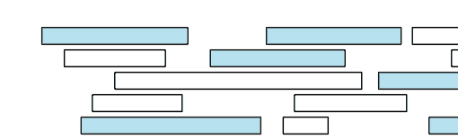

4. 设 \(X\) 为实数线上的一组 \(N\) 个区间。如果 \(X\) 中的每个区间都至少包含 \(P\) 中的一个点，则我们称 \(P\) 为 \(X\) 的点集。描述并分析一种高效的算法来计算能够覆盖 \(X\) 的最小点集。假设你的输入由两个数组 \(L[1..N]\) 和 \(R[1..N]\) 组成，表示 \(X\) 中区间的左右端点。通常情况下，如果你使用贪心算法，你必须证明它的正确性。

    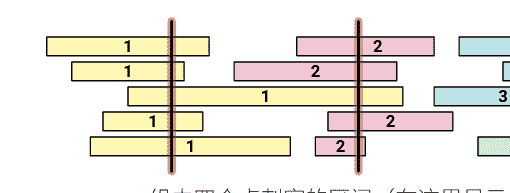

5. 设 \(X\) 为实数线上的一组 \(N\) 个区间。对 \(X\) 的一种适当着色将为每个区间分配一种颜色，以便任何两个重叠的区间被分配不同的颜色。描述并分析一种高效的算法来计算适当着色 \(X\) 所需的最小颜色数。假设你的输入由两个数组 \(L[1..N]\) 和 \(R[1..N]\) 组成，表示 \(X\) 中区间的左右端点。通常情况下，如果你使用贪心算法，你必须证明它的正确性。

    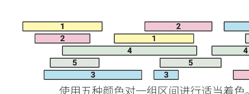

6. (a) 对于每个整数 n，找到一个频率数组 f[1..n]，其哈夫曼编码树的深度为 tn-1，使得最大频率尽可能小。

    (b) 假设未编码消息的总长度 N受到字母表大小tn的多项式限制。证明对于频率 f[1..n]的任何哈夫曼树，其深度为 O(log n)。

7. 如果频率数组 f[1..n]满足以下两个条件，则称其为 α-重的:
    - 对于所有 i>1，f[1] > f[i]; 也就是说，1是唯一的最频繁符号。
    - f[1] ≥ α ∑_{i=1}^n f[i]; 即至少有 α的符号是 1。
    找到最大的实数 α，使得在每个Huffman编码中，对于每个 α-heavy频率数组，符号 1由一个比特表示。[提示: 首先证明 1/3 ≤ α ≤ 1/2。]

8. 描述并分析一个算法，用于计算给定频率数组 f[1..n]的最优三进制前缀编码。不要忘记证明你的算法对于所有的 n都是正确的。

9. 详细描述如何实现Gale-Shapley稳定匹配算法，使得最坏情况下的运行时间为 O(n^2)，正如本章前面所述。

10. (a) 证明Gale-Shapley算法在终止之前可能执行 Ω(n^2)次提议。(你需要描述一个合适的输入和一个 Ω(n^2)个有效提议的序列。)

    (b) 对于任意整数 n，描述一组医生和医院的偏好，使得无论每一轮做出什么有效的提议，Gale-Shapley算法都需要执行 Ω(n^2)轮。[提示: 部分 (b) 暗示了部分 (a)。]

11. 描述并分析一种高效的算法，用于确定给定的医院和医生偏好集合是否有唯一的稳定匹配。

12. 考虑稳定匹配问题的一般化，其中一些医生不对所有医院进行排序，一些医院不对所有医生进行排序，并且只有当医生出现在对方的偏好列表中时，医生才能被分配给医院。在这种情况下，还有三种额外的不稳定情况:

    - 匹配的医院更喜欢未匹配的医生而不是其分配的匹配。
    - 匹配的医生更喜欢未匹配的医院而不是她的分配匹配。
    - 一个未匹配的医生和一个未匹配的医院出现在彼此的偏好列表中。

## 4. 贪婪算法

在这种情况下，稳定匹配可能会导致一些医生和/或医院无法匹配，即使他们的偏好列表不为空。例如，如果每个医生都将哈佛列为他们唯一可接受的医院，而每个医院都将Dr. House列为他们唯一可接受的实习生，那么只有House和Harvard会被匹配。

描述并分析一种在这种更一般的情况下计算稳定匹配的高效算法。/提示：将其简化为每个医生都对每个医院进行排名，反之亦然，然后调用Gale-Shapley算法。

-   13. 斯堪的纳维亚家具公司Furni雇佣了n名司机在特拉华州威尔明顿的不同地址上交付相同的订单。每个司机都有自己经过威尔明顿的固定交付路线，途中会访问所有地址。假设他们按照他们一贯的路线行驶，两名司机永远不会同时访问同一地址。

原则上，每个司机都可以将家具交付给任何一个地址，但存在一个复杂情况。其中一名司机秘密地在Johannshamn沙发（带有Strinne绿色条纹图案）上安装了接近传感器和爆炸装置。如果两个沙发在同一时间出现在同一地址，两者都会爆炸，摧毁货车和该地址上的建筑物。只有一名司机将订单交付到该地址，然后稍后另一名司机在家具仍在他们的卡车上时访问同一地址时，才会发生这种情况。

作为Furni调度员，您的工作是将每个司机分配给一个送货地址。描述一种算法，以便将地址分配给司机，以便每个地址都能收到他们的家具订单，并且没有爆炸。

例如，假设杰克的路线在下午6点访问537 Paper Street，下午8点访问1888 Franklin Street，而玛拉的路线在下午7点访问537 Paper，下午9点访问1888 Franklin。然后杰克应该送货到1888 Franklin，而玛拉应该送货到537 Paper；否则，在下午8点，1888 Franklin将发生爆炸。（放上Pixies的音乐。）[提示：杰克和玛拉有点不稳定。]

-   14. 假设您是一个简单的店主，生活在一个有不同硬币类型的国家，其价值为1=c[1]<c[2]<⋯<c[n]。（例如，在美国，n=6，值为1、5、10、25、50和100美分。）您心爱而仁慈的独裁者，El Generalissimo，已经下令，每当您给客户找零时，您必须使用最少的硬币数量，以免磨损每个硬币上由皇家财政部仆人亲切雕刻的El Generalissimo形象。

(a) 在美国，有一个简单的贪婪算法，总是得到最少的硬币数量：减去最大的硬币并递归地给出剩余的零钱。El Generalissimo不赞成美国资本主义的贪婪。证明存在一组硬币值，贪婪算法不总是给出最少的硬币。

(b) 现在假设El Generalissimo决定实施一种货币系统，硬币面额是连续的幂 b^0, b^1, b^2, ..., b^k 某个整数 b ≥ 2. 证明尽管El Generalissimo不赞成，贪婪算法在这种货币系统中确实能够进行最优的找零。

(c) 描述并分析一种高效的算法，给定目标金额 T 和一个排序的硬币面额数组 c[1..n]，找出组成 T 美分找零所需的最少硬币数量。假设 c[1] = 1，因此可以为任何金额 T 找零。

15. 假设给定一个整数数组 A[1..n]，其中每个整数可以是正数、负数或零。如果一个连续的子数组 A[i..j] 的元素之和大于零，则称其为一个正数区间。描述并分析一个算法，计算覆盖 A 中每个正数元素所需的最小正数区间数量。例如，给定以下数组作为输入，你的算法应该输出 3。如果输入数组中的每个元素都是负数，则你的算法应该输出 0。

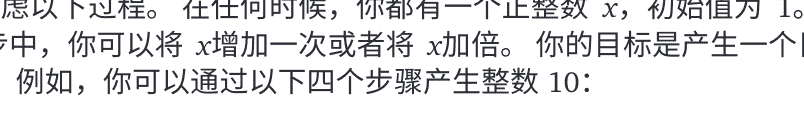

16. 考虑以下过程。在任何时候，你都有一个正整数 x，初始值为 1。在每一步中，你可以将 x 增加一次或者将 x 加倍。你的目标是产生一个目标值 n。例如，你可以通过以下四个步骤产生整数 10：


显然，你可以使用恰好 n-1 次增量来产生任何整数 n，但对于几乎所有的 n 值，这是非常低效的。描述并分析一个算法，计算产生任何给定整数 n 所需的最小步骤数。

17. 假设我们有 n 个滑雪者的身高分别在数组 P[1..n] 中给出，并且有 n 个滑雪板的高度分别在数组 S[1..n] 中给出。描述一个高效的算法，为每个滑雪者分配一个滑雪板，使得滑雪者的身高与她所分配的滑雪板之间的平均差异尽可能小。该算法应该计算一个排列 σ，使得表达式

```
$\frac{1}{n}\sum_{i=1}^{n} P[i] - S[\sigma(i)]$
```

尽可能小。

18. 爱丽丝想要举办一个派对，她正在努力决定邀请谁。 她有 n个人可以选择，并且她知道这些人中哪些人彼此认识。 她想要邀请尽可能多的人，但受到两个限制条件的限制：

-   每个客人至少应该认识五个其他客人。
-   每个客人至少应该不认识五个其他客人。

描述并分析一个算法，计算出给定一个人员列表和知道彼此的人员对列表的情况下，爱丽丝可以邀请的最大可能人数。

19. 假设我们有两个正整数数组 C[1..n]和 R[1..n]。如果对于每个索引 i，第i行包含 R[i]个1，第 i列包含 C[i]个1，则一个 n × n矩阵与 R和 C相符。描述并分析一个算法，要么构建一个与 R和 C相符的矩阵，要么正确报告不存在这样的矩阵。

20. 你刚刚接受了埃隆·马斯克的工作，从旧金山送墨西哥卷饼到纽约市。你将驾驶一辆卷饼送货车通过埃隆的新洲际地下卷饼送货管道，该管道直线连接这两个城市。12

你的卷饼送货车使用一次性电池，最多行驶100英里后必须更换。实际燃料几乎是免费的，但电池昂贵且易碎，因此必须由洲际地下卷饼送货车电池更换技术工会的官方成员安装。13因此，即使你提前更换电池，每次安装新电池仍需支付全价。 此外，你的车辆太小，一次只能携带一个电池。

12. ...而且，这个管道显然是以马切·塞格洛夫斯基的虚构“阿拉米达-威霍肯卷饼隧道”为原型设计的

13. 或者他们在德语中称自己为Die Transkontinentaluntergrundburritoliefersfahrzeug-batteriewechseltechnikervereinigung。

沿着管道有几个加油站；每个加油站都收取不同的价格来安装新的电池。 在开始旅行之前，你仔细打印维基百科页面，列出了沿着管道的每个加油站的位置和价格。根据这些信息，你如何决定最佳的加油站？

更正式地说，假设给定两个数组 $D[1\ ..n]$ 和 $C[1\ ..n]$，其中 $D[i]$ 是从管道起点到第 $i$ 个加油站的距离，$C[i]$ 是在第 $i$ 个加油站更换电池的费用。假设你的旅行从加油站开始并结束（所以 $D[1]=0$，$D[n]$ 是你旅行的总长度），并且你的汽车初始电池为空（所以你必须在第 1 个加油站安装新的电池）。

-   (a) 描述并分析一种贪婪算法，以找到完成旅行所需的最小加油站数量。不要忘记证明你的算法是正确的。
-   (b) 但你真正想要最小化的是旅行的总费用。 证明在扩展到这种情况时，部分(a)中的贪婪算法不能产生最优解。
-   (c) 描述一种高效的算法，计算出你应该停下来加油的加油站位置，以最小化旅行的总费用。

## 21. 你被雇佣来在图书馆的书架上存储一系列 $n$ 本书。 书的顺序由编目系统确定，并且不能更改；每个书架必须存储给定书序列的连续区间。

给定两个数组 $H[1\ ..n]$ 和 $T[1\ ..n]$，其中 $H[i]$ 和 $T[i]$ 分别是序列中第 $i$ 本书的高度和厚度。 这个图书馆的所有书架长度都相同 $L$；任何一个书架上的所有书的总厚度不能超过 $L$。

-   (a) 假设所有的书都有相同的高度 $h$，书架的高度大于 $h$，所以每本书都可以放在每个书架上。描述并分析一种贪婪算法，以尽可能少的书架来存放书籍。[提示：这个算法很明显，但为什么它是正确的？]
-   (b) 那只是一个很好的热身，现在是真正的问题。 实际上，书的高度是不同的，但你可以调整每个书架的高度to与该书架上最高的书相匹配。（ 特别是，你可以将任何空书架的高度更改为零。）现在你的任务是尽可能地存放书籍，使书架的高度之和最小。

证明你在第(a)部分中的贪婪算法不总是给出最佳解决方案。
-   (c) 描述并分析一种算法，以找到与第(b)部分中描述的书籍和书架之间的最佳匹配。

22. 如果一个字符串 w中的括号（和 ）是平衡的，则满足以下条件之一：

-   w 是空字符串。
-   w = (x)，其中 x是一个平衡字符串
-   w = xy，其中 x和 y是平衡字符串。

例如，字符串

w = (((()))()()) ((()())) ()

是平衡的，因为 w = xy，其中

x = (((()))()()) 和 y = ((()())) ().

(a) 描述并分析一个算法，以确定给定的括号字符串是否平衡。

(b) 描述并分析一种贪婪算法，以计算给定括号字符串的最长平衡子序列的长度。 像往常一样，不要忘记证明你的算法是正确的。

对于这两个问题，你的输入是一个数组 w[1..n]，其中对于每个 i，要么 w[i] = (，要么 w[i] = )。 你的两个算法都应该在 O(n)时间内运行。

23. 一天，亚历克斯厌倦了在健身房攀爬，决定带一大群攀岩朋友到户外攀爬。他们去了一个有一个巨大宽阔的岩石的攀岩区，不是很高，上面有几个标记的手和脚的支撑点。亚历克斯很快确定了她的朋友们可以执行的“允许”移动集，以从一个支撑点到另一个支撑点。

整个系统的握持可以用一棵根树 T来描述，其中每个顶点对应一个握持，每条边对应一个允许的握持之间的移动。攀爬路径在攀爬石上逐渐汇聚，导致在山顶有一个唯一的握持，由 T的根表示。

亚历克斯和她的朋友们（都是优秀的攀岩者）决定玩一个游戏，尽可能多的攀岩者同时在岩石上，每个攀岩者需要执行一系列确切 k次移动。每个攀岩者可以选择任意一个支撑点作为起点，所有的移动都必须远离地面。因此，每个攀岩者在树 T中追踪出一条 k条边的路径，所有的边都指向根。然而，不允许两个攀岩者触碰同一个支撑点；不同攀岩者所走的路径不能有任何交叉。

(a) 描述并分析一种贪心算法，用于计算可以参与这个游戏的最大攀爬者数量。你的算法给出了一棵根树 T 和一个整数 k 作为输入，它应该计算 T 中最大可能的不相交路径数量，其中每条路径的长度为 k。不要假设 T 是一棵二叉树。例如，给定下面的树作为输入，你的算法应该返回整数 8。

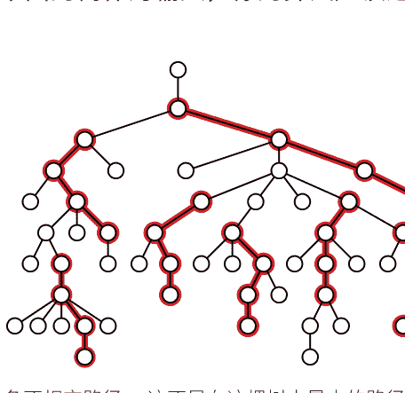

图4.6. 长度为 k = 3 的七条不相交路径。这不是在这棵树中最大的路径集合。

(b) 现在假设 T 中的每个顶点都有一个关联的奖励，你的目标是最大化路径中顶点的总奖励，而不是路径的总数。证明你的贪心算法并不总是返回最优的奖励。

(c) 描述一种高效的算法来计算最大可能的奖励，如(b)部分所述。

24. 恭喜！你成功征服了卡梅洛特，将这个曾经充满战争创伤的世袭君主制国家转变为一个无政府主义者的社会团体，公民轮流担任一周的执行官，但所有决策都在每两周的特别会议上得到批准，对于纯内部事务，只需简单多数通过，对于更重大的事务，则需要三分之二多数通过。....

作为最后的象征性举动，你下令将圆桌（出人意料的是，一个真正的圆桌）分成像披萨一样的楔形，并分发给卡梅洛特的公民作为纪念品。每个公民都提交了一个请求，请求的是桌子的一个角度范围，例如：勇敢的罗宾爵士可能请求从17.23度到42度的楔形，而纯洁的兰斯洛特爵士可能请求从359度到1度的2度楔形。只有当每个公民收到他们请求的楔形时，他们才会感到满意。

不幸的是，其中一些范围重叠，因此满足所有市民的要求是不可能的。欢迎来到政治。

描述并分析一种算法，以找到可以满足的最大请求数量。[提示：如果旋转表格，您的算法的输出不应更改。不要假设角度为整数。]

25. 假设您站在一个被几个大气球包围的田野上。您想要使用全新的Acme品牌Zap-O-Matic™来爆破所有的气球，而不离开您当前的位置。 Zap-O-MaticTM发射高功率激光束，可以爆破它击中的所有气球。 由于每次射击需要足够的能量来为一个小国家供电一年，所以您希望尽可能少的射击。

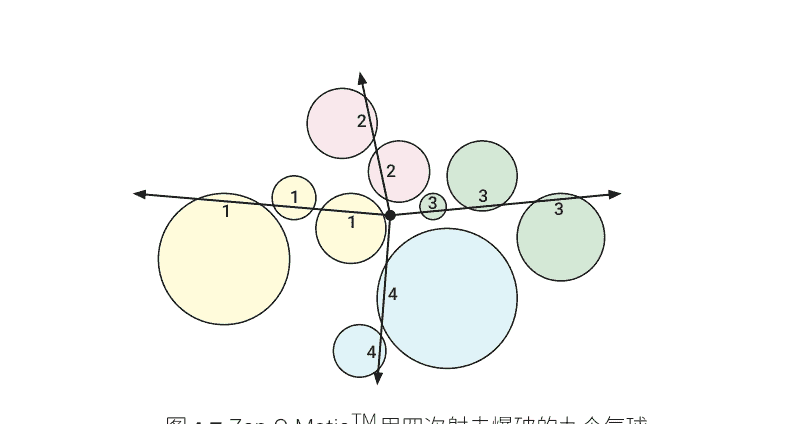

最小zap问题可以更正式地陈述如下。 给定平面上的一组圆C，每个圆由其半径和中心的(x, y)坐标指定，计算从原点到每个圆都相交的最小射线数量。 您的目标是找到一个高效的算法来解决这个问题。

-   (a) 假设存在一条射线，它不与任何气球相交。描述并分析一个贪婪算法，解决这种特殊情况下的最小zap问题。[提示：参见练习4。]
-   (b) 描述并分析一个贪婪算法，其输出在最优解的范围内1 ofoptimal。也就是说，如果 m是击中每个气球所需的最小射线数，则您的贪婪算法必须输出 m或 m+1。（当然，您必须证明这个事实。）
-   (c) 描述一个算法，以 O(n^2) 时间解决最小zap问题。
-   (d) 描述一个算法，以 O(n log n) 时间解决最小zap问题。

假设您有一个子程序，告诉您射线与任意圆 c相交的角度范围，在 O(1)时间内。 这个子程序并不难写，但它并不是问题的有趣部分。

> 【7】知识的分布和划分不像几条线在一个角度相交，只在一个点接触，而是像一棵树的分支，在一个茎上相遇，这个茎在分裂和分支之前具有完整性和持续性的尺寸和数量。

— 弗朗西斯·培根，《学术进展》（1605年）

因此，尊贵的先生，你可以看到这种解决方案与数学几乎没有关系，我不明白为什么你期望一个数学家来提出这个解决方案，而不是其他人。

— 莱昂哈德·欧拉，在给卡尔·莱昂哈德·戈特利布·埃勒的信中描述了Königsburg桥问题（1736年4月3日）

> 好吧，在村庄的消防站左转，然后沿着旧的邮路经过水库...不，那样行不通。

最好继续沿着柏油路直走，直到你到达学校，然后左转到贝内特湖的路上...然后...不，那样也不行。不，那样也行不通。
东米林诺基特，你说呢？仔细想想，你从这里去不了那里。
— 罗伯特·布莱恩和马歇尔·道奇，
伯特和我以及其他来自东部的故事（1961年）

## 5 基本图算法

### 5.1 简介和历史

图是一组对—整数对、人对、城市对、星对、国家对、科学论文对、网页对、游戏位置对、递归子问题对，甚至图对。 与最常见的图形可视化方法相对应，被配对的底层对象通常称为顶点或节点，而配对本身称为边或弧，但实际上对象和配对可以是任何东西。

图的最早例子之一是道路网络及其地图。
罗马工程师在罗马帝国鼎盛时期，在欧洲、西亚、中亚和北非建造了超过40万公里的公共道路网络。 在道路网络上旅行的人会携带行程表，这些行程表可以是简单的列表，也可以是更具象征性的各种道路上的地标和距离的表示。 《普丁格地图》是一部13世纪的地图滚动描绘整个罗马*cursus publicus*，被广泛认为是一份中世纪复制品，是1世纪修订版的5世纪*itinerarium pictum*的委托作品，委托者是奥古斯都·凯撒。普廷格表不是一个地理准确的地图——历史学家们争论它是否符合“地图”的资格！——而是道路网络的抽象表示，类似于现代地铁图。每条道路上的城市都用曲线上的弯曲表示，地图上还标有这些城市的名称和道路之间的长度。因此，这张地图包含了在5世纪罗马帝国中找到任意两个城市之间最短路线所需的足够信息。见图5.1。


图的最古老的经典应用之一——特别是树——是在表示家谱中。复杂的家族“树”已经被用于几个世纪来解决婚姻、继承和王位继承的法律问题。罗马帝国的民法，后来被早期天主教会采用为教会法，禁止近亲结婚。在九世纪初，教会改变了所需的距离和计算方法。罗马的*computatio legalis*要求到最近共同祖先的距离之和至少为四，而较新的*computatio canonica*要求两个距离中的最大值至少为七。1215年，考虑到实际情况（和实际做法），教会将结婚的最小距离放宽到四。1图5.2中的左图展示了一个特别复杂的案例：Tirius和Theburga结婚并生下一个儿子Gaius，之后Tirius去世；然后Theburga

1在11世纪和12世纪期间，这一限制逐渐扩大，包括通过亲缘关系最多四个链接，最初是通过婚姻，后来通过婚外性行为、订婚，甚至是教父母关系。例如，男人和他妹夫的妹夫的妹夫之间的婚姻是被正式禁止的，一个鳏夫和他儿子的妻子的鳏母之间的婚姻也是被禁止的。这些亲缘关系的要求在1215年被大大减少，但并未消除；教会直到1917年才放弃了亲缘关系的概念非法的性行为。

盖乌斯的儿子是否可以合法地与吉玛的女儿结婚？

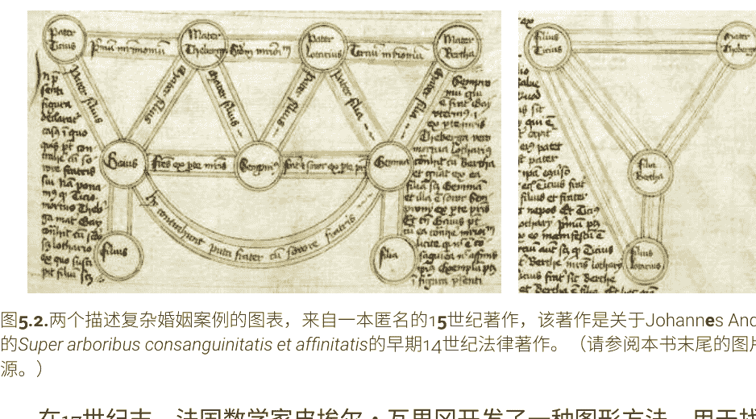

在17世纪末，法国数学家皮埃尔·瓦里冈开发了一种图形方法，用于找到树状网络中绳索受力下的平衡位置，这是在一个世纪之前西蒙·斯蒂文发表的早期工作的基础上建立的。瓦里冈观察到，当绳索处于平衡状态时，可以绘制一张图，其边是平行于绳索的线段，长度等于沿着这些绳索的力量，使得网络中任意一点相交的绳索在图中定义了一个闭合循环。瓦里冈的“图形静力学”方法直到他去世两年后的1725年才完整地发表。这些图现在被称为互补力图或麦克斯韦-克雷莫纳图，以詹姆斯·克拉克·麦克斯韦和路易吉·克雷莫纳的名字命名，他们（以及卡尔·库尔曼和其他人）在19世纪末发展了丰富的互补图理论。

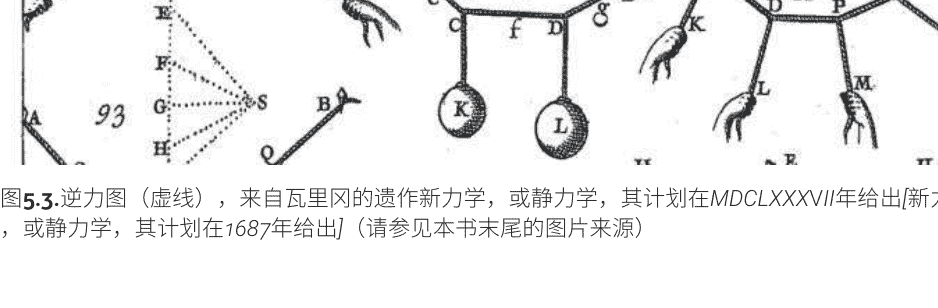

当然，还有许多其他熟悉的图的例子，比如棋盘游戏（追溯到古代）；凸多面体的顶点和边（古希腊哲学家正式研究，但更古老）；星形图案的可视化（东亚在公元7世纪已经发展）；骑士之旅（由al-Adli， Rudrat.a， al-Suli等人在9世纪和10世纪描述）；迷宫（由乔瓦尼·方塔纳于1420年左右以其现代形式引入）；测地三角网（由杰玛·弗里修斯于1533年引入，并由威勒布罗德·斯内尔于1615年用于计算地球周长，并于1799年定义米）；莱昂哈德·欧拉对于“科尼斯堡桥问题”的著名部分²解决方案（1735年）；电报和其他通信网络（1753年首次提出，由罗纳兹，席林，高斯，韦伯等人在19世纪初发展，并在19世纪末全球部署）；电路（19世纪初由欧姆，麦克斯韦，基尔霍夫等人正式化）；分子结构式（由奥古斯特·凯库勒于1857年和阿奇博尔德·库珀于1858年独立引入）；社交网络（社会学家雅各布·莫雷诺于1930年代中期首次研究）；数字电子电路（查尔斯·桑德斯·皮尔斯于1886年提出，并由克劳德·香农于1937年形成其现代形式）；还有，好吧，如果你坚持，现代互联网。“图”这个抽象数学词汇是由詹姆斯·西尔维斯特于1878年创造的，他借鉴了凯库勒的“化学图”来描述某些代数不变量，这是他的同事威廉·克利福德的建议。“树”这个词是由亚瑟·凯利于1857年首次用于连通无环图，尽管树的抽象概念早在十年前就已经被古斯塔夫·基尔霍夫和卡尔·冯·斯陶特使用过。图论的第一本书是由安德烈·圣特拉吉于1926年出版的；十年后，德内什·科尼格出版了第一本图论书。

### 5.2 基本定义

从形式上讲，一个（简单的）图是一个由集合（V， E）组成的对，其中 V 是一个任意的非空有限集合，其元素被称为顶点³或节点，并且 E 是 V 的元素对的集合，我们称之为边。在一个无向图中，边是无序对，或者只是大小为两个的集合；我通常用u v来表示u和v之间的无向边。在一个有向图中，边是顶点的有序对；我通常用 u → v来表示从 u到v的有向边。

> ²欧拉认为他的论证的最后一步——找到一个图的欧拉路径，当每个顶点的度都是偶数时，是显而易见的。欧拉还没有注意到一个有欧拉路径的图必须是连通的。第一个完整的证明，即一个图有欧拉路径当且仅当它是连通的且每个顶点的度都是偶数，是由卡尔·希尔霍尔泽于1873年发表的。

> ³英语单词“vertices”的单数形式是 vertex。同样，“matrices”的单数形式是 matrix，而“indices”的单数形式是 index。除非你说意大利语，否则没有这样的按照标准（尽管有些令人困惑）的做法，我也会使用 V 来表示图中的顶点数，E 表示边的数目。

因此，在任何无向图中，我们有 $0 \le E \le \binom{V}{2}$，在任何有向图中，我们有 $0 \le E \le V(V-1)$。

边 $uv$ 或 $u \to v$ 的端点是它的顶点 $u$ 和 $v$。我们通过称 $u$ 为 *tail* 和 $v$ 为 *head* 来区分有向边 $u \to v$ 的端点。

将图定义为一对 sets 禁止具有相同端点的多个无向边，或具有相同头和相同尾的多个有向边。（同一个有向图可以包含有向边 $u \to v$ 和其反向边 $v \to u$。）同样，将无向边定义为一组顶点禁止从一个顶点到其自身的无向边。没有环和平行边的图通常称为简单图；非简单图有时称为多重图。尽管在定义上存在一些差距，但大多数用于简单图的算法可以很容易地扩展到多重图，几乎不需要修改，因此，我认为在这里没有必要进行正式定义。

对于无向图中的任意边 $uv$，我们称 $u$ 为 $v$ 的邻居，反之亦然，并且我们说 $u$ 和 $v$ 是相邻的。一个节点的度是它的邻居数量。在有向图中，我们区分两种邻居。对于有向边 $u \to v$，我们称 $u$ 为 $v$ 的前驱，称 $v$ 为 $u$ 的后继。一个顶点的入度是它的前驱数量；出度是它的后继数量。

**如果 $V' \subseteq V$ 且 $E' \subseteq E$，则图 $G' = (V', E')$ 是图 $G = (V, E)$ 的子图。**

图 $G$ 的真子图是除 $G$ 本身之外的任何子图。

在无向图 $G$ 中，一条路径是一个顶点序列，其中每个相邻的顶点在 $G$ 中是相邻的；非正式地说，我们也可以将路径视为一系列边。如果一条路径最多只访问每个顶点一次，则称其为一条简单路径。对于图 $G$ 中的任意两个顶点 $u$ 和 $v$，如果 $G$ 包含 $u$ 和 $v$ 之间的一条路径（因此也包含一条简单路径），我们称 $v$ 从 $u$ 可达。如果每个顶点都可以从其他任意顶点可达，则无向图是连通的。每个无向图由一个或多个连通分量组成，它们是其最大连通子图；如果且仅当它们之间存在一条路径时，两个顶点属于同一个连通分量。

如果一次行走从同一个顶点开始并结束，则该行走是闭合的；如果一个行走进入并离开每个顶点最多一次，则该行走是一个简单循环。如果没有子图是一个简单循环，则一个无向图是无环的；无环图也被称为森林。树是一个连通的无环图，或者等价地说，是森林的一个连通分量。一个生成树是……

事物作为顶点，矩阵，指数，附录，螺旋，顶点，根，简单，代码，导向，支配，邻居，邻居，邻居，邻居，邻居，邻居，邻居，邻居，邻居或邻居！如果你记不住这个规则，就坚持使用“节点”。

> 4个连通分量通常被称为“连通分量”，但这种用法是多余的；分量在定义上是连通的。

### 5.3 表示和示例

最常见的可视化图形的方式是通过绘制它们。图形的绘制将每个顶点映射到平面上的一个点（通常绘制为一个小圆圈或其他形状），将每条边映射到连接两个顶点的曲线或直线段。如果一个图形有一个绘制，其中没有两条边相交，则该图形是平面的；这样的绘制也被称为嵌入。同一个图形可以有许多不同的绘制，因此重要的是不要将特定的绘制与图形本身混淆。特别是，平面图可以有非平面的绘制！

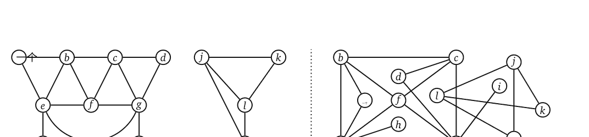

然而，绘制远非图形的唯一有用的表示方式。例如，一组几何对象的交集图具有每个对象的节点和每个相交对象对的边。一个特定的图形是否可以表示为交集图取决于你想要用于顶点的对象的类型。不同类型的对象——线段、矩形、圆等——定义了不同类别的图形。一种特别有用的交集图类型是区间图，其顶点是实线上的区间，任何两个重叠的区间之间都有一条边。

> 令人困惑的是，“嵌入”这个词经常被用作“绘图”的同义词，即使边相交。请不要这样做。

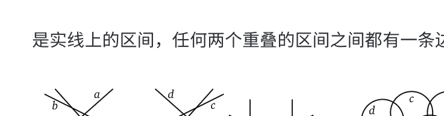

另一个很好的例子是递归算法的依赖图。依赖图是有向无环图。顶点是在特定输入上执行算法时出现的所有不同递归子问题。如果评估第二个子问题需要对第一个子问题进行递归评估，则存在一条边。例如，对于斐波那契递推式

$$F_n = \begin{cases} 0 & \text{if } n=0, \\ 1 & \text{如果 } n=1, \\ F_{n-1} + F_{n-2} & \text{否则,} \end{cases}$$

依赖图的顶点是整数 $0, 1, 2, \ldots, n$，并且边是对于在 $2$ 和 $n$ 之间的每个整数 $i$ 的配对 $(i-1) \to i$ 和 $(i-2) \to i$。


作为一个更复杂的例子，回想一下第三章中编辑距离问题的递归：

$$\text{Edit}(i, j) = \begin{cases} i & \text{if } j=0 \\ j & \text{if } i=0 \\ \min \left\{ \begin{aligned} & \text{Edit}(i-1, j) + 1 \\ & \text{Edit}(i, j-1) + 1 \\ & \text{Edit}(i-1, j-1) + [A[i]=B[j]] \end{aligned} \right\} & \text{otherwise} \end{cases}$$

这个递归的依赖图是一个 $m \times n$ 的顶点网格 $(i, j)$，通过垂直边连接 $(i-1, j) \to (i, j)$，水平边连接 $(i, j-1) \to (i, j)$，和对角线边连接 $(i-1, j-1) \to (i, j)$。动态规划对于任何具有相对较小的依赖图的递归都能高效工作；适当的评估顺序确保每个子问题在其前驱之后被访问。

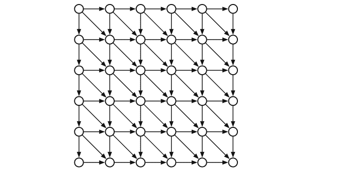

图 5.7. 编辑距离递归的依赖图。

另一个有趣的例子是游戏、谜题或机械装置的配置图，如井字棋、跳棋、魔方、汉诺塔或图灵机。配置图的顶点是谜题的所有有效配置；如果可以通过单个简单的“移动”将一个配置转换为另一个配置，则存在从一个配置到另一个配置的边。（显然，精确定义取决于允许的移动方式。）即使对于相对简单的机械装置，配置图也可能非常复杂，而我们通常只能访问关于配置图的局部信息。

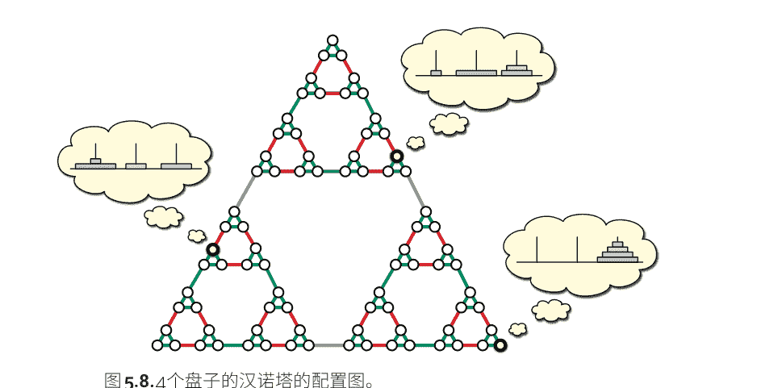

图 5.8. 4个盘子的汉诺塔的配置图。

配置图是我们在第2章中考虑的游戏树的近亲，但有一个关键的区别。游戏的每个状态在其配置图中只出现一次，但在其游戏树中可以出现多次。简而言之，配置图是记忆化的游戏树！

形式语言理论中使用的有限状态自动机可以建模为带标签的有向图。回想一下，确定性有限状态自动机在形式上被定义为一个5元组 $M=(\Sigma, Q, s, A, \delta)$，其中 $\Sigma$ 是一个有限集合，称为字母表，$Q$ 是一组有限状态，$s \in Q$ 是起始状态，$A \subseteq Q$ 是接受状态集合，和 $\delta: Q \times \Sigma \to Q$ 是一个转移函数。但是通常更有用的是将 $M$ 视为一个有向图 $G_M$，其顶点是状态 $Q$，边的形式为 $q \to \delta(q,a)$，其中 $q \in Q$ 和符号 $a \in \Sigma$。关于语言 $L(M)$ 的基本问题可以转化为关于图 $G_M$ 的问题。例如，当且仅当从起始状态/顶点 $s$ 无法到达任何接受状态/顶点时， $L(M) = \emptyset$。

最后，有时一个图可以用来隐式表示其他更大的图。这种隐式表示的一个很好的例子是子集构造，通常用于将非确定有限自动机转换为确定有限自动机，但也可以应用于任意的有向图如下。给定任何有向图 $G= (V, E)$，我们可以定义一个新的有向图 $G' = (2^V, E')$，其顶点是 $V$ 中所有的子集，边 $E'$ 的定义如下：

$$E' := \{ A \to B \mid \exists u \in A, v \in B \text{ 使得 } u \to v \in E \}$$

我们可以机械地将这个定义翻译成一个算法来构造 $G'$ 从 $G$，但严格来说，这个构造是不必要的，因为 $G$ 已经是 $G'$ 的一个隐式表示。

重要的是不要混淆这些例子/表示与实际的正式定义：图是一对集合 $(V, E)$，其中 $V$ 是一个任意的非空有限集合，$E$ 是 $V$ 的元素的一对（有序或无序）的集合。简而言之：图是一组事物的一对。

### 5.4 数据结构

在实践中，图通常由两种标准数据结构之一表示：邻接表和邻接矩阵。从高层次来看，这两种数据结构都是由顶点索引的数组；这要求每个顶点都有一个唯一的整数标识符，介于1和V之间。从形式上讲，这些整数就是顶点。

#### 邻接表

到目前为止，存储图最常见的数据结构是邻接表。

邻接表是一个包含每个顶点的邻居的列表数组（如果图是有向的，则是出度邻居）。^6对于无向图，每条边 $uv$ 在 $u$ 的邻居列表和 $v$ 的邻居列表中各存储一次；对于有向图，每条边 $u \to v$ 只存储一次，在尾部 $u$ 的邻居列表中。对于这两种类型的图，邻接表所需的总空间为 $O(V + E)$。

> 细心的学生可能会注意到，尽管它的名字是邻接表，但它并不是一个列表。这个术语是红鲱鱼原则的一个例子：在计算机科学中，就像在数学中一样，红鲱鱼既不一定是红色的，也不一定是鱼。

有几种不同的方法来表示这些邻居列表，但标准实现使用一个简单的单链表。由此产生的数据结构允许我们在 $O(1 + \deg(v))$时间内列出一个节点 $v$ 的（出度）邻居；只需扫描 $v$ 的邻居列表。同样，我们可以通过扫描 $u$ 的邻居列表来确定是否存在边 $u \to v$，时间复杂度为 $O(1 + \deg(u))$。对于无向图，我们可以通过同时扫描 $u$ 和 $v$ 的邻居列表来将时间复杂度提高到 $O(1 + \min\{\deg(u), \deg(v)\})$，当我们找到边或者到达列表末尾时停止扫描。

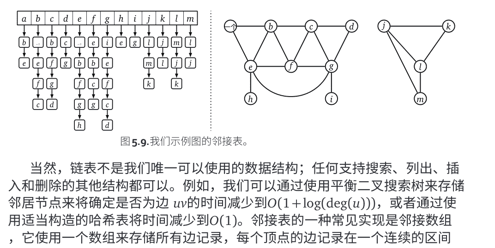

当然，链表不是我们唯一可以使用的数据结构；任何支持搜索、列出、插入和删除的其他结构都可以。例如，我们可以通过使用平衡二叉搜索树来存储邻居节点来将确定是否为边 $uv$ 的时间减少到 $O(1 + \log(\deg(u)))$，或者通过使用适当构造的哈希表将时间减少到 $O(1)$。邻接表的一种常见实现是邻接数组，它使用一个数组来存储所有边记录，每个顶点的边记录在一个连续的区间内，并使用一个单独的数组存储每个顶点的第一条边的索引。此外，为了能够在 $O(\log \deg(u))$ 时间内检查两个顶点 $u$ 和 $v$ 是否相邻，有序地保持每个顶点的区间是很有用的，如图5.10所示。

#### 邻接矩阵

图的另一个标准数据结构是邻接矩阵，首次由乔治·布鲁内尔在1894年提出。图 $G$ 的邻接矩阵是一个 $V \times V$ 的矩阵，通常用二维数组 $A[1..V, 1..V]$ 表示，其中每个条目表示图 $G$ 中是否存在特定的边。具体而言，对于所有顶点 $u$ 和 $v$：

-   如果图是无向的，则 $A[u,v] := 1$ 当且仅当 $uv \in E$，且
-   如果图是有向的，则 $A[u, v] := 1$ 当且仅当 $u \rightarrow v \in E$。

> 这比听起来要复杂得多。大多数流行的哈希技术不能保证快速查询时间，即使大多数良好的哈希方法也只能保证 $O(1)$ 的期望时间。请访问 http://algorithms.wtf 以获取更详细的哈希讨论。8 请参阅脚注3。


对于无向图，邻接矩阵始终是对称的，意味着 $A[u, v] = A[v, u]$ 对于所有顶点 $u$ 和 $v$，因为 $uv$ 和 $vu$ 只是同一条边的不同名称，并且对角线条目 $A[u, u]$ 都为零。对于有向图，邻接矩阵可能是对称的，也可能不是，并且对角线条目可能为零。

邻接矩阵：

|     | a | b | c | d | e | f | g | h | i | j | k | l | m |
|:---:|:-:|:-:|:-:|:-:|:-:|:-:|:-:|:-:|:-:|:-:|:-:|:-:|:-:|
| a   | 0 | 1 | 0 | 0 | 1 | 0 | 0 | 0 | 0 | 0 | 0 | 0 | 0 |
| b   | 1 | 0 | 1 | 0 | 1 | 1 | 0 | 0 | 0 | 0 | 0 | 0 | 0 |
| c   | 0 | 1 | 0 | 1 | 0 | 1 | 1 | 0 | 0 | 0 | 0 | 0 | 0 |
| d   | 0 | 0 | 1 | 0 | 0 | 0 | 1 | 0 | 0 | 0 | 0 | 0 | 0 |
| e   | 1 | 1 | 0 | 0 | 0 | 1 | 1 | 1 | 0 | 0 | 0 | 0 | 0 |
| f   | 0 | 1 | 1 | 0 | 1 | 0 | 1 | 0 | 0 | 0 | 0 | 0 | 0 |
| g   | 0 | 0 | 1 | 1 | 1 | 1 | 0 | 0 | 1 | 0 | 0 | 0 | 0 |
| h   | 0 | 0 | 0 | 0 | 1 | 0 | 0 | 0 | 0 | 0 | 0 | 0 | 0 |
| i   | 0 | 0 | 0 | 0 | 0 | 0 | 1 | 0 | 0 | 0 | 0 | 0 | 0 |
| j   | 0 | 0 | 0 | 0 | 0 | 0 | 0 | 0 | 0 | 0 | 1 | 1 | 1 |
| k   | 0 | 0 | 0 | 0 | 0 | 0 | 0 | 0 | 0 | 1 | 0 | 1 | 0 |
| l   | 0 | 0 | 0 | 0 | 0 | 0 | 0 | 0 | 0 | 1 | 1 | 0 | 1 |
| m   | 0 | 0 | 0 | 0 | 0 | 0 | 0 | 0 | 0 | 1 | 0 | 1 | 0 |


给定一个邻接矩阵，我们可以在 $\Theta(1)$ 时间内判断两个顶点是否通过边相连，只需查看矩阵中的相应位置。

我们还可以通过扫描相应的行（或列）来在 $\Theta(V)$ 时间内列出一个顶点的所有邻居。这个运行时间在最坏情况下是最优的，但即使一个顶点只有很少的邻居，我们仍然需要扫描整行来找到它们。同样，无论图实际上有多少边，邻接矩阵都需要 $\Theta(V^2)$ 空间，因此它们只对非常稠密的图是空间高效的。

#### 比较

表5.1总结了各种标准图数据结构的性能。星号 * 表示维护动态哈希表的预期摊销时间界限。⁹

表 5.1. 标准图数据结构上基本操作的时间。

| 操作 | 标准邻接表（链表） | 快速邻接表（哈希表） | 邻接矩阵 |
|:---|:---|:---|:---|
| 空间 | $\Theta(V + E)$ | $\Theta(V + E)$ | $\Theta(V^2)$ |
| 测试是否 $uv \in E$ | $O(1 + \min\{\deg(u), \deg(v)\}) = O(V)$ | $O(1)$ | $O(1)$ |
| 测试是否 $u \to v \in E$ | $O(1 + \deg(u)) = O(V)$ | $O(1)$ | $O(1)$ |
| 列出 $v$ 的(出)邻居 | $\Theta(1 + \deg(v)) = O(V)$ | $\Theta(1 + \deg(v)) = O(V)$ | $\Theta(V)$ |
| 列出所有边 | $\Theta(V + E)$ | $\Theta(V + E)$ | $\Theta(V^2)$ |
| 插入边 $uv$ | $O(1)$ | $O(1)*$ | $O(1)$ |
| 删除边 $uv$ | $O(\deg(u) + \deg(v)) = O(V)$ | $O(1)*$ | $O(1)$ |

鉴于这种比较，人们可能会合理地想知道为什么有人会使用邻接矩阵；毕竟，使用哈希表的邻接表在相同的时间内执行相同的操作，使用更少的空间。主要原因是对于足够密集的图，邻接矩阵在实践中更简单、更高效，因为它们避免了追踪指针和计算哈希函数的开销；它们只是连续的内存块。

同样，为什么有人要在邻接表结构中使用链表来存储邻居，而不是平衡二叉搜索树或哈希表？尽管在实践中的主要原因几乎肯定是传统——如果它们对于 Donald Knuth 的代码足够好，那么它们对于你的代码也应该足够好！——但还有更有原则性的论据。其中一个是标准邻接表实际上对于大多数应用程序来说已经足够好了。大多数标准图算法实际上从不（或很少）询问任意边是否存在或不存在，也不尝试插入或删除边，因此优化数据结构以支持这些操作是不必要的。

但是在我看来，使用标准数据结构的最有说服力的原因是，许多图都是通过邻接矩阵或标准邻接表隐式表示的。例如：

-   交集图通常表示为底层几何对象的列表。只要我们可以在常数时间内测试两个对象是否相交，我们就可以将任何图算法应用于交集图，假装输入图以邻接矩阵的形式存储。
-   由记录和指针组成的任何数据结构都可以看作是一个有向图。可以通过假装图以标准邻接表的形式存储来应用图算法于这些数据结构。
-   同样地，我们可以将任何图算法应用于配置图，假装它以标准邻接表的形式表示，只要我们可以在常数时间内枚举给定配置的所有可能移动。

对于最后两个例子，我们可以枚举从任意顶点出发的边，在与其度数成比例的时间内完成，但我们不能在常数时间内确定两个顶点是否相邻。（这个记录是否有指针指向那个记录？我们能否在一步内从这个配置到达那个配置？）此外，我们通常没有重新组织每个记录中的指针或将给定配置的移动转移到更高效的数据结构的便利。因此，标准的邻接表，其中邻居存储在链表中，是适当的模型数据结构。

**在本书的其余部分，除非另有明确说明，所有图算法的时间界限都假定输入图由标准的邻接表表示。同样，除非另有明确说明，当练习要求您设计和分析图算法时，您应该假设输入图以标准的邻接表表示。**

### 5.5 深度优先搜索

到目前为止，我们只讨论了图的局部操作；可以说，关于图最基本的全局问题是可达性。给定一个图 $G$ 和一个顶点 $s$ 在 $G$ 中，可达性问题询问从 $s$ 到哪些顶点 $v$ 存在路径。现在，让我们只考虑无向图；我会在本节末尾简要讨论有向图。对于无向图，从 $s$ 可达的顶点正好是与 $s$ 在同一个连通分量中的顶点。

也许最自然的可达性算法——至少对于像我们这样习惯递归思考的人来说——是深度优先搜索。这个算法可以递归地或迭代地编写。无论哪种方式，它都是完全相同的算法；唯一的区别是在非递归版本中我们实际上可以看到“递归”栈。

```
递归深度优先搜索(v):
    如果 v 未标记
        标记 v
        对于每条边 vw
            递归深度优先搜索(w)
```

```
迭代深度优先搜索(s):
    将(s)入栈
    当栈不为空时
        取出 v
        如果 v 未标记
            标记 v
            对于每条边 vw
                将(w)入栈
```深度优先搜索只是一种（也许是最常见的）图遍历算法家族中的一种，我称之为“无论什么优先搜索”。通用遍历算法使用某种数据结构存储一组候选边，我将其称为“袋子”。“袋子”的唯一重要属性是我们可以将东西放入其中，然后稍后取出。栈是一种特殊类型的袋子，但绝不是唯一的一种。以下是通用算法：

```
无论什么优先搜索        (s):
  将 (s) 放入袋子
  当袋子不为空时
    从袋子中取出 v
    如果 v 未标记
      标记 v
      对于每条边 vw
        将 w 放入袋子
```

我声称无论什么优先搜索都会标记从 s 可达的每个节点，而且不会标记其他节点。该算法明确地将 G 中的每个顶点标记最多一次。为了证明它至少会访问一次连通图中的每个节点，我们稍微修改了算法；修改部分以粗体红色显示。修改后的算法不再将顶点保存在袋子中，而是将顶点对保存起来。这个修改使我们能够记住，每当我们第一次访问一个顶点 v 时，是哪个先前访问过的邻居顶点将 v 放入袋子中。我们称这个先前的顶点为 v 的父节点。

```
广度优先搜索       (s):
  将 (∅, s) 放入袋子中
  当袋子不为空时
    从袋子中取出 (p, v)                (*)
    如果 v 未被标记
      标记 v
      父节点(v) ← p
      对于每条边 vw                    (†)
        将 (v, w) 放入袋子中          (**)
```

**引理 5.1.** 广度优先搜索(s)标记从 s 可达的每个顶点以及仅仅这些顶点。此外，所有对 (v, parent(v)) 的集合其中 parent(v) = ∅ 定义了包含 s 的生成树。

**证明:** 首先我们证明算法标记了从 s 可达的每个顶点 v，通过对从 s 到 v 的最短路径距离进行归纳。算法标记了 s。设 v 是从 s 可达的任意其他顶点，设 s → · · · → u → v 是从 s 到 v 的任意一条边数最小的路径。（因为 v 是从 s 可达的，所以一定存在这样的路径。）前缀路径 s → · · · → u 比从 s 到 u 的最短路径更短，因此归纳假设表明算法标记 u。当算法标记 u 时，它必须立即将配对 (u, v) 放入袋子中，因此它必须稍后将 (u, v) 从袋子中取出，此时算法立即标记 v，除非它已经被标记。

每个具有父节点 (v, parent(v)) 且 parent(v) = ∅ 的配对实际上是底层图 G 中的一条边。我们声称对于任何标记的顶点 v，父节点路径 v→parent(v)→parent(parent(v))→⋯ 最终会回到 s；我们通过对顶点标记的顺序进行归纳来证明这个命题。显然，从 s 可以到达 s，所以让 v 是任何其他标记的顶点。在标记 v 之前，必须先标记 v 的父节点，因此归纳假设表明父节点路径 v→parent(v)→parent(parent(v))→⋯ 会导向 s；再添加一条父节点边 s→parent(s) 就建立了这个命题。

前面的说法意味着算法标记的每个顶点都可以从 s 到达，并且所有父边的集合形成一个连通图。因为除了 s 之外的每个标记节点都有一个唯一的父节点，父边的数量恰好比标记顶点的数量少一个。我们得出结论，父边形成一棵树。 □

#### 分析

遍历算法的运行时间取决于我们用于“包”（数据结构）的选择，但我们可以得出一些一般性的观察。设 T 是将单个项插入包或从包中删除单个项所需的时间。for 循环 (†) 对于每个标记的顶点仅执行一次，因此最多执行 V 次。s 的连通分量中的每条边 uv 都会被放入包中两次；一次作为对 (u, v) 和一次作为对 (v, u)，因此行 (**) 最多执行 2E 次。最后，我们不能从包中取出比放入的东西更多，因此行 (⋆) 最多执行 2E+1 次。因此，假设底层图 G 存储在标准邻接表中，无论什么优先搜索都在 O(V+E*T) 时间内运行。（如果 G 存储在邻接矩阵中，则无论什么优先搜索的运行时间增加到 O(V^2+E*T)。）

### 5.6 重要变体

#### 栈：深度优先

如果我们使用栈来实现“袋子”，我们就可以恢复我们最初的深度优先搜索算法。栈支持插入（推入）和删除（弹出），每个操作的时间复杂度都是 O(1)，因此该算法的运行时间为 O(V+E)。由父边形成的生成树称为深度优先生成树。树的确切形状取决于起始顶点和邻居在 for 循环内的访问顺序（†），但一般来说，深度优先生成树很长而且瘦。我们将在第6章中讨论深度优先搜索的几个重要属性和应用。

#### 队列：广度优先

如果我们使用队列来实现“袋子”，我们将得到一个不同的图遍历算法，称为广度优先搜索。队列支持每次插入（推）和删除（拉）的时间复杂度为 O(1)，因此该算法的运行时间为 O(V+E)。在这种情况下，由父边形成的广度优先生成树包含从起始顶点 s 到其分量中的每个其他顶点的最短路径；我们将在第8章中详细讨论最短路径。再次强调，广度优先生成树的确切形状取决于起始顶点和在 for 循环中访问邻居的顺序 (†)，但通常来说，广度优先生成树是短而且茂密的。


#### 优先队列：最佳优先

最后，如果我们使用一个优先队列来实现“袋子”，我们就得到了另一类算法，称为最佳优先搜索。因为优先队列最多存储每条边的一个副本，所以插入一条边或提取最小优先边的时间复杂度为 O(log E)，这意味着最佳优先搜索的运行时间为 O(V + E log E)。

我将最佳优先搜索描述为“一类算法”，而不是单一的算法，因为有不同的方法来为边分配优先级，而这些选择会导致不同的算法行为。我将在下面描述三种众所周知的变体，但还有许多其他变体。在这三个例子中，我们假设输入图中的每条边 uv 或 u→v 都有一个非负的权重 w(uv) 或 w(u→v)。

首先，如果输入图是无向的，并且我们使用每条边的权重作为其优先级，最佳优先搜索构建了该分量的最小生成树。令人惊讶的是，只要所有边的权重都不同，得到的树就不依赖于起始顶点或邻居的顺序。在这种情况下，最小生成树实际上是唯一的。这种最佳优先搜索的实例通常（但通常是不正确的）被称为普里姆算法；我们将在第7章中更详细地讨论这个算法和其他最小生成树。

将路径的长度定义为其边的权重之和。我们还可以使用最佳优先搜索计算加权图中的最短路径，如下所示。每个标记的顶点 v 存储一个距离 dist(v)。最初，我们设置 dist(s)=0。对于每个其他顶点 v，当我们设置 parent(v)←p 时，我们还设置 dist(v)←dist(p)+w(p, v)，并且当我们将边 v→w 插入优先队列时，我们使用优先级 dist(v)+w(v→w)。假设所有边的权重都是正数，dist(v) 是从 s 到 v 的最短路径的长度。这种最佳优先搜索的实例通常（但严格来说是不正确的）被称为迪杰斯特拉算法；我们将在第8章中再次看到这个算法。

最后，将路径的宽度定义为路径中任意边的最小权重。“Dijkstra”的最佳优先搜索算法的简单修改可以计算从 s 到每个可达顶点的最宽路径；最宽路径也被称为瓶颈最短路径。每个标记的顶点 v 存储一个值 width(v)。最初，我们将 width(s) 设置为 ∞。对于其他每个顶点 v，在设置 parent(v)←p 时，我们还设置 width(v)←min{width(p), w(p, v)}，并且当我们将边 v→w 插入优先队列时，我们使用优先级 min{width(v), w(v, w)}。最宽路径在计算最大流的算法中非常有用，我们将在第10章中讨论这个问题。

#### 断开的图

无论什么优先搜索(s)只访问从单个起始顶点 s 可达的顶点。为了访问 G 中的每个顶点，我们可以使用以下简单的“包装器”函数。

```
WFSALL(G):
  对于所有顶点 v
      取消标记 v
  对于所有顶点 v
      如果 v 未标记
          无论什么优先搜索      (v)
```

等等，我听到你问，为什么你把这个弄得这么复杂？为什么不只是扫描顶点数组？

```
MARKEVERYVERTEXDUH(G):
  对于所有顶点 v
      标记 v
```

¹⁰ 这个词几乎总是一个信号，说明你漏掉了重要的东西。

好吧，当然，如果你有一个完整的顶点列表，那么你可以这样做，但是请记住，并不是所有的图都以如此明确的方式表示。更重要的是，即使我们有一个明确的顶点列表，这个朴素算法访问顶点的顺序是由它们在数据结构中的顺序决定的，而不是由图的抽象结构决定的。

特别是，与简单的遍历顶点不同，WFSAll 会访问所有分量中的所有顶点，然后访问下一个分量中的所有顶点，依此类推，直到遍历完输入图的每个分量。这种逐个分量遍历的方式使我们能够使用单个计数器计算一个非连通图的分量数量，例如。

```
COUNTCOMPONENTS(G):
count ← 0
对于所有顶点 v
    标记 v 为未标记
对于所有顶点 v
    如果 v 为未标记
        count ← count + 1
        WHATEVERFIRSTSEARCH(v)
返回 count
```

通过稍微修改，我们可以记录每个顶点所属的分量，而不仅仅是标记它。

```
COUNTANDLABEL(G):
count ← 0
对于所有顶点 v
    标记 v 为未标记
对于所有顶点 v
    如果 v 为未标记
        count ← count + 1
        LABELONE(v, count)
返回 count
```

```
((标记一个分量))
LABELONE(v, count):
    当袋子不为空时
        从袋子中取出 v
        如果 v 为未标记
            标记 v
            分量(v) ← count
            对于每条边 vw
                将 w 放入袋子中
```

WFSAll 每个顶点只标记一次，每条边只放入袋子一次，然后从袋子中取出每条边，因此总运行时间为 O(V + E T)，其中 T 是一次袋子操作的时间。特别地，如果我们在每个顶点上运行深度优先搜索或广度优先搜索，得到的算法仍然只需要 O(V + E) 时间。

此外，因为 WhateverFirstSearch 计算一个连通分量的生成树，我们可以使用 WFSAll 来计算整个图的生成森林。

另一方面，如果我们在每个顶点上存储一个时间戳，表示它最后一次被“标记”的时间，那么我们可以通过记录遍历的开始时间，并考虑一个顶点的时间戳是否晚于记录的开始时间，以在 O(1) 时间内“取消标记每个顶点”。特别是，以边权重作为优先级的最佳优先搜索算法可以在 O(V + E log E) 时间内计算出最小权重生成树。令人震惊的是，至少有一本极受欢迎的算法教材声称，这个包装器只能与深度优先搜索一起使用。¹² 这种说法是完全错误的。事实上，广度优先搜索的第一个实现是在1945年由康拉德·祖塞在他的原型语言 Plankalkül 中编写的，目的是计算和标记无向图的分量。

#### 有向图

无论是什么优先搜索算法，都很容易适应有向图；唯一的区别是，当我们标记一个顶点时，我们将其所有的出边邻居放入袋子中。事实上，如果我们使用标准的邻接表或邻接矩阵，我们根本不需要改变代码！

```
深度优先搜索 (s):
    将 s 放入袋子中
    当袋子不为空时
        从袋子中取出 v
        如果 v 未标记
            标记 v
            对于每条边 v→w
                将 w 放入袋子中
```

我们之前的证明表明算法标记了从 s 可达的每个顶点，并且有向边 parent(v)→p 定义了一棵以根 s 为起点的树，所有的边都指向远离根 s 的方向。然而，即使图是连通的，我们也不一定能得到图的一棵生成树，因为可达性不再对称。

另一方面，深度优先搜索确实定义了从 s 可达的顶点的一棵生成树。此外，通过改变“袋子”的实例化，我们可以得到一棵深度优先生成树、一棵广度优先生成树、一棵最小权重有向生成树、一棵最短路径树或一棵最宽路径树，这些树都是从可达顶点中生成的。

### 5.7 图缩减：洪水填充

早期现代化的深度优先搜索的一个例子是由 Edward Moore 在1950年代中期提出的。像素图是一个二维数组，代表颜色的值；数组中的各个条目称为像素，是 picture elements 的缩写。¹³ 像素图中的一个连通区域是具有相同颜色的像素的连通子集，其中两个像素被认为是相邻的，如果它们是直接的水平或垂直邻居。洪水填充操作，通常在光栅图形编辑软件中用油漆桶表示，将连通区域中的每个像素更改为新颜色；操作的输入包括目标区域中一个像素的索引 i 和 j 以及新颜色。


泛洪填充问题可以通过追踪定义来简化为可达性问题。我们定义一个无向图 G = (V, E)，其中顶点是单个像素，边连接具有相同颜色的相邻像素。像素图中的每个连通区域都是 G 的一个分量；因此，泛洪填充问题简化为 G 中的可达性问题。我们可以使用深度优先搜索在 G 中解决这个可达性问题，从给定的像素点 (i, j) 开始，有一个小的修改；每当我们标记一个顶点时，立即改变其颜色。对于一个 n × n 像素图，图 G 最多有 2n² 个顶点和边，因此深度优先搜索的运行时间为 O(V + E) = O(n²)。

这个简单的例子演示了一个规约的基本要素。我们不是从头开始解决洪水填充问题，而是将现有的算法作为一个黑盒子子程序使用。在这里，无论是如何进行深度优先搜索都是无关紧要的；重要的是它的规范：给定一个图 G 和一个起始顶点 s，标记从 s 可达的每个顶点。像任何其他子程序一样，我们仍然需要描述如何构造输入以及如何使用其输出。我们还必须根据我们的输入参数分析我们得到的算法，而不是中间图的顶点和边。

现在我们有了一个可行的算法，但是只有现在，我们可以应用两个简单的优化来加快速度，一个是实际的，另一个是理论的：

> 在20世纪60年代现代光栅显示设备出现之前，像素更常被称为针或小石头，具体取决于它们是由线还是非常小的石头制成的。单词像素在20世纪初成为图片的标准缩写，不久之后袜子成为袜子的常见复数形式，取代了早期的俚语 piccy。另请参见体素（体积元素）、纹素（纹理元素）和触觉元素（触觉元素和/或触觉元素）。

+ 在实际实现中，我们实际上不会为 G 构建一个单独的图形数据结构。相反，我们可以直接使用像素映射，就像它是一个标准的邻接表一样，因为我们可以在 O(1) 时间内列出任何像素的相同颜色邻居。特别地，没有必要单独“标记”顶点；我们可以使用像素的颜色来代替。
+ 更仔细的分析意味着运行时间与填充区域中的像素数量成比例 - 等效地，与包含顶点 (i,j) 的 G 的分量中的顶点数量成比例 - 这可能比 O(n²) 要小得多。

## 练习

### 图

+ 1. 证明以下定义是等价的。
   - 树是一个连通的无环图。
   - 树是森林的一个分量。（森林是一个无环图。）
   - 一棵树是一个具有最多 V – 1 条边的连通图。
   - 一棵树是一个最小连通图；删除任何一条边都会断开图。
   - 一棵树是一个具有至少 V – 1 条边的无环图。
   - 一棵树是一个最大无环图；在任意两个顶点之间添加一条边都会形成一个环。
   - 一棵树是一个包含每对顶点之间唯一路径的图。

2. 证明任何具有 n ≥ 2 个顶点的连通无环图至少有两个度为 1 的顶点。不要使用“树”或“叶子”这些词，也不要使用任何关于树的已知性质；你的证明应完全基于“连通”和“无环”的定义。

3. 如果顶点集 V 可以被划分为两个子集 L 和 R，使得每条边的一个顶点在 L 中，另一个在 R 中，则图 G=( V,E) 是二分图。
   (a) 证明每棵树都是二分图。
   (b) 证明当且仅当图 G 中的每个循环都有偶数条边时，图 G 是二分图。
   (c) 描述并分析一种高效的算法，用于确定给定的无向图是否是二分图。

4. 每当一群鸽子聚集在一起时，它们本能地建立了一个啄食顺序。对于任意一对鸽子，总有一只鸽子啄食另一只鸽子，将其驱赶离开食物或潜在配偶。即使经过多年的分离，同一对鸽子始终选择相同的啄食顺序，无论周围有什么其他鸽子。令人惊讶的是，整体的啄食顺序可能包含循环——例如，鸽子 i 啄食鸽子 j，鸽子 j 啄食鸽子 k，鸽子 k 啄食鸽子 ℓ，鸽子 ℓ 啄食鸽子 i。

   (a) 请证明任何有限数量的鸽子都可以排成一队（也许是一场游行？），使得每只鸽子都啄食前面鸽子的后部。拜托了。
   (b) 假设你有一个有向图，表示一组鸽子之间的啄食关系。该图每个鸽子都有一个顶点，并且只有当鸽子 i 啄食鸽子 j 时，它才包含一条边 i → j。描述并分析一个算法，以计算由第 (a) 部分保证的鸽子的啄食顺序。
   (c) 证明对于至少三只鸽子的任何一组，要么第 (a) 部分描述的啄食顺序是唯一的，要么存在三只鸽子 i， j 和 k，其中鸽子 i 啄食鸽子 j，鸽子 j 啄食鸽子 k，鸽子 k 啄食鸽子 i。

5. 图 G 的欧拉遍历是通过 G 的每条边恰好一次的闭合路径。
   (a) 证明如果连通图 G 有一个欧拉遍历，那么 G 中的每个顶点都有偶数度数。（欧拉证明了这一点。）
   (b) 证明如果一个连通图 G 中的每个顶点的度数都是偶数，则 G 有一个欧拉回路。（欧拉没有证明这个。）
   (c) 描述并分析一个算法，用于计算给定图中的一个欧拉回路，或者正确报告不存在这样的回路。（欧拉含糊地挥了挥手。）

6. d 维超立方体是以下图定义的。有 2^d 个顶点，每个顶点用一个不同的 d 位字符串标记。如果两个顶点的标记在恰好一个位上不同，则它们通过一条边相连。
   (a) 图 G 中的哈密顿回路是 G 中的一个边的循环，每个顶点恰好进入一次。证明对于所有的 d ≥ 2，d 维超立方体都有一个哈密顿回路。
   (b) 哪些超立方体有一个欧拉回路（一条经过每条边恰好一次的闭合路径）？[提示：这非常容易。]

## 遍历算法

7. 回想一下，一个有向图 G如果对于任意两个顶点 u和 v，存在一条从 u到 v的路径和一条从 v到 u的路径，则称为强连通的。描述一个算法，给定一个无向图 G作为输入，判断是否可能将 G的每条边定向，使得结果有向图是强连通的。

8. 设 G是一个连通图， T是 G的一棵以某个节点 v为根的深度优先生成树。证明如果 T也是 G的一棵以 v为根的广度优先生成树，则 G = T。

9. Epprich教授和Goodstein教授提出了以下对通用的深度优先搜索算法的优化。 他们的算法在将顶点放入袋子之前，先检查顶点是否已标记，从而确保每个顶点最多只放入一次。 他们的算法还在标记顶点时为每个顶点分配父节点。

```
EAGERWFS(s):
标记 s
将v放入袋子中
当袋子不为空时
    从袋子中取出 v
    对于每条边 vw
        如果 w未标记
            标记 w
            父节点(w) ← v
            将 w 放入袋子中
```

(a) 证明EAGERWFS(s)标记了从 s可达的每个节点，而且没有其他节点被标记。 同样地，证明由EAGERWFS(s)计算得到的父节点边 v→parent(v)定义了包含 s的连通分量的生成树。 (b) 证明如果将袋子实现为队列， EAGERWFS等价于广度优先搜索，也就是说这两个算法以相同的顺序标记相同的顶点并构造相同的生成树。[提示：队列的定义是什么？]

(c) 证明无论使用什么数据结构作为袋子（尤其是当袋子是栈时）， EAGER WFS永远不等同于深度优先搜索。

EAGERWFS和RecursiveDFS都没有指定在每个顶点v处考虑的边vw的顺序， 不同的边顺序可能导致不同的生成树。 因此，你需要证明对于某个明确的图G，没有由RecursiveDFS生成的G的生成树可以由EAGERWFS（使用任何袋子数据结构）构造，反之亦然。

10. 关于whatever-first搜索作为一类通用算法的最早发表的描述之一是由Edsger Dijkstra，Leslie Lamport，Alain Martin，Carel Scholten和Elisabeth Steffens在1975年发表的，作为自动垃圾收集器的设计的一部分。 他们的算法不是维护已标记和未标记的顶点，而是为每个顶点维护一种颜色，可以是白色、灰色或黑色。 如常，在下面的算法中，我们假设有一个固定的底层图G。

```
THREECOLORSEARCH(s):
将所有节点涂成白色
将节点 s涂成灰色
当至少有一个顶点是灰色时
THREECOLORSTEP()
```

```
THREECOLORSTEP():
v ← 任意一个灰色顶点
如果 v没有白色邻居
    将 v涂成黑色
否则
    w ← 任意一个 v的白色邻居
    父节点(w) ← v
    将 w涂成灰色
```

(a) 证明ThreeColorSearch在任何时候都保持以下不变式：没有黑色顶点是白色顶点的邻居。[提示：这很容易。]

(b) 证明在ThreeColorSearch(s)终止后，从v可达的所有顶点都是黑色的，从v不可达的所有顶点都是白色的，并且父节点边v→parent(v)定义了包含v的根生成树。

[提示：直观上，黑色节点被“标记”，灰色节点被“放入袋子”。然而，与我们对WhateverFirstSearch的表述不同，三色算法不要求同时处理节点的所有出边。]

(c) 证明以下ThreeColorSearch的变体，它将灰色顶点集合维护在一个标准栈中，等价于深度优先搜索。[提示：ThreeColorStackStep的最后两行的顺序很重要！]

```
THREECOLORSTACKSEARCH(s):
将所有节点涂成白色
将 s涂成灰色
将 s推入栈中
当至少有一个顶点是灰色时
THREECOLORSTACKSTEP()
```

```
THREECOLORSTACKSTEP():
从栈中弹出 v
如果 v没有白色邻居
    将 v涂成黑色
否则
    w ← 任意一个 v的白色邻居
    父节点(w) ← v
    将 w涂成灰色
    将 v推入栈中
    将 w推入栈中
```

(d) 证明以下ThreeColorSearch的变体，它将灰色顶点集合维护在一个标准队列中，不等价于广度优先搜索。

[提示：ThreeColorQueueStep的最后两行的顺序无关紧要！]

```
THREECOLORQUEUESEARCH(s):
将所有节点涂成白色
将 s 涂成灰色
将 s 推入队列
当至少有一个顶点为灰色时
    THREECOLORQUEUESTEP()
```

```
THREECOLORQUEUESTEP():
从队列中取出 v
如果 v没有白色邻居
    将 v 涂成黑色
否则
    w ← 任意一个 v的白色邻居
    父节点(w) ← v
    将 w涂成灰色
    将 v 推入队列
    将 w 推入队列
```

(e) 现在假设另一个进程正在向 G 添加边，而ThreeColorSearch正在运行。这些新边可能违反了部分(a)中描述的颜色不变性，从而破坏了算法的正确性——特别是当ThreeColorSearch终止时，一些从 s 可达的顶点可能是白色的。如果我们依赖于“白色”表示“不可达，因此可以安全删除”，那将是灾难性的。

然而，如果另一个进程明确保持颜色不变性，我们仍然可以使用三色算法安全地识别不可达的顶点。我们将两个并发算法建模如下；GarbageCollect中的选择和Mutate中选择哪些顶点 u 和 w 完全不受主算法的控制。14

```
垃圾回收(s)：
将所有顶点涂成白色
将 s 涂成灰色
当至少有一个顶点为灰色时
    要么
        收集步骤()
    要么
        变异()
```

```
收集步骤():
v ← 任意灰色顶点
如果 v没有白色邻居
    将 v涂成黑色
否则
    w ← 任意 v的白色邻居
    将 w涂成灰色
```

> 14 这是一个对“标记和清除”垃圾回收算法的夸张简化。实际上，在像Lua和Go这样的多线程语言中使用的垃圾回收算法更加复杂。对多线程动态内存管理的更全面讨论不幸地超出了本书的范围，除了第一戒：不要自己编写垃圾回收器。

## 5. 基本图算法

```
变异():
u ← 任意顶点
w ← 任意顶点
如果 uw 不是一条边
    添加边 uw
如果 u 是黑色 且 w 是白色
    将 w 涂成灰色
如果 u 是白色 且 w 是黑色
    将 u 涂成灰色
```

证明垃圾回收最终会终止，每个从 s 可达的顶点都被标记为黑色，每个从 s 不可达的顶点都被标记为白色。

```
MUTATE():
u ← 任意顶点
w ← 任意顶点
如果 uw 不是一条边
  添加边 uw
如果 u 是黑色 且 w 是白色
  将 w 着色为灰色
如果 u 是白色 且 w 是黑色
  将 u 着色为灰色
```

证明垃圾回收最终会终止，s 被着色为黑色，每个从黑色顶点可达的顶点都被着色为黑色，每个从黑色顶点不可达的顶点都被着色为白色。

### 约简

11. 数字迷宫是一个 n×n 的正整数网格。 一个令牌从左上角开始；你的目标是将令牌移动到右下角。每次轮到你时，你可以将令牌向上、向下、向左或向右移动；你可以移动的距离由当前方格上的数字决定。 例如，如果令牌在标有 3 的方格上，则可以向上、向下、向左或向右移动三步。 但是，你不能将令牌移出棋盘的边缘。

描述并分析一个高效的算法，该算法要么返回解决给定数字迷宫所需的最小移动次数，要么正确报告迷宫无解。 例如，给定图 5.14 中的数字迷宫，你的算法应该返回整数 8。

12. 《蛇和梯子》是一款经典的棋盘游戏，起源于至少 16 世纪的印度。棋盘由一个 n × n 的方格网格组成，


方格按照从 1到 n的顺序连续编号，从左下角开始，按行从下到上进行，行之间交替向左和向右。 在这个方格网格中，某些方格对总是位于不同的行中，通过“蛇”（向下）或“梯子”（向上）相连。

每个方块最多可以成为一条蛇或梯子的终点。你从左下角的方格1开始，有一个代币。 在每一步中，你可以将代币向上移动最多k个位置，其中k是一个固定的常数。 如果代币在移动结束时位于蛇的顶部，它会滑下到蛇的底部。 同样地，如果代币在移动结束时位于梯子的底部，它会爬到梯子的顶部。

描述并分析一个算法，计算代币到达网格最后一个方格所需的最小步数。


13. 臭名昭著的蒙古拼图战士维德拉奇·伊特基·莱达在1473年发明了以下拼图。 这个拼图由一个n×n的方格网格组成，每个方格上都标有一个正整数，并且有两个代币，一个红色的和一个蓝色的。 代币始终位于网格的不同方格上。 代币从网格的左上角和右下角开始；拼图的目标是交换代币。

在一次移动中，你可以将任一令牌向上、向右、向下或向左移动，移动的距离由另一个令牌决定。例如，如果红色令牌在标有 3的方格上，则可以将蓝色令牌向上移动 3步，向左移动 3步，向右移动3步或向下移动 3步。但是，你不能将任一令牌移出网格，并且在移动结束时，两个令牌不能位于同一个方格上。

描述并分析一种高效的算法，该算法要么返回解决给定Vidrach Itky Leda谜题所需的最小移动次数，要么正确报告该谜题无解。例如，在图5.16中给出的谜题中，你的算法将返回数字 5。


14. 假设给定一个有向图 $G=(V, E)$ 和两个顶点 $s$ 和 $t$。描述并分析一个算法，确定在 $G$ 中是否存在一条从 $s$ 到 $t$ 的路径（可能重复顶点和/或边），其长度可被 3整除。例如，给定下面所示的图，以及指定的顶点 $s$ 和 $t$，你的算法应该返回True，因为路径 $s\rightarrow w\rightarrow y\rightarrow x\rightarrow s\rightarrow w\rightarrow t$ 的长度为6。


15. 假设给定一个有向图 $G$，其中一些边是红色的，其余边是蓝色的。描述一个算法，找到在 $G$ 中从一个顶点 $s$ 到另一个顶点 $t$ 的最短路径，其中没有连续三条边具有相同的颜色。也就是说，如果路径中包含两条连续的红色边，下一条边必须是蓝色的，如果路径中包含两条连续的蓝色边，下一条边必须是红色的。例如，给定以下图形作为输入，你的算法应该返回整数 7，因为 $s\rightarrow a\rightarrow b\rightarrow d\rightarrow c\rightarrow a\rightarrow b\rightarrow t$ 是从 $s$ 到 $t$ 的最短合法路径。


## 16.

考虑一个有向图 G，其中每条边都被染成红色、白色或蓝色。在 G 中的一条路径被称为法国国旗路径，如果它的边颜色序列是红色、白色、蓝色、红色、白色、蓝色等等。更正式地说，对于每个整数 i，边 v_i → v_{i+1} 如果 i mod 3 = 0，则为红色，如果 i mod 3 = 1，则为白色，如果 i mod 3 = 2，则为蓝色。描述一种算法，用于找到从给定顶点 v 通过法国国旗行走可以到达的 G 中的所有顶点。

## 17.

有 n 个星系通过 m 个星际传送方式相连。每个星际传送方式连接两个星系，并且可以双向穿越。此外，每个星际传送方式花费 c(e)美元，其中 c(e)是一个正整数。星际传送方式可以多次使用，但每次使用都必须支付费用。

+   朱迪想从星系 s 到星系 t 旅行，但传送并不愉快，她希望尽量减少传送次数。然而，她希望总费用是五美元的倍数，因为携带零钱也不愉快。

(a) 描述并分析一种算法，计算朱迪从星系 s 到星系 t 所需的最少传送次数，使得总费用是五美元的倍数。

(b) 解决部分 (a)，但现在假设朱迪有一张允许她免费使用一次传送的优惠券。

## 18.

Three Seashells 是一个在连通无向图 G 上玩的纸牌游戏。最初，三个令牌被放置在不同的起始顶点 a，b，c 上。每一轮，你必须移动所有三个令牌，通过将每个令牌沿着一条边从当前顶点移动到相邻顶点。在每一轮结束时，三个令牌必须位于三个不同的顶点上。你的目标是将令牌移动到三个目标顶点 x，y，z 上；令牌最终位于哪个目标顶点上并不重要。


描述并分析一个算法来确定给定的 Three Seashells 拼图是否可解。你的输入包括图 G，起始顶点 a, b, c，以及目标顶点 x, y, z。你的输出是一个单一的位：True 或 False。

19. 设 G为一个连通无向图。假设我们从 G的两个任意选定的顶点上开始放置两个硬币，并且我们希望通过尽可能少的移动将硬币放置在同一个顶点上。在每一步中，每个硬币必须移动到一个相邻的顶点。

+   (a) 描述并分析一个算法，计算到达两个硬币都在同一个顶点的最小步数，或者正确报告无法达到这样的配置。你的算法的输入包括一个图 G=(V,E)和两个顶点 u,v∈V（可能相同，也可能不同）。

+   (b) 现在假设有三个硬币。描述并分析一个算法，计算到达两个硬币都在同一个顶点的最小步数，或者正确报告无法达到这样的配置。

+   (c) 最后，假设有四十二个硬币。描述并分析一个算法，以确定是否可能将所有 42个硬币移动到同一个顶点。同样，每个硬币必须在每一步都移动。为了获得全部学分，你的算法应该在 O(V+E)时间内运行。

20. 我女儿的小学数学作业本中有几个以下类型的谜题：

通过追踪从起点到终点的路径来完成下面的每个锐角迷宫。


描述并分析一个解决任意锐角迷宫的算法。

给定一个连通的无向图 G，其顶点是平面上的点，边是线段。边不相交，除了它们的端点。例如，字母 x的绘图有五个顶点和四条边，而上面的第一个迷宫有18个顶点和21条边。你还得到了两个顶点起点和终点。

如果你的算法应该返回True，如果 G包含从开始到结束的只有锐角的路径，否则返回False。形式上，对于任意两个连续的边 u→v→w在路径中，要么 ∠uvw = π，要么 0 < ∠uvw < π/2才算有效。假设你有一个子程序，可以在 O(1)时间内确定两个给定线段之间的角度是直角、钝角、直角还是锐角。

> 15 Jason Batterson和Shannon Rogers, Beast Academy Math: Practice 3A, 2012年。请访问https://www.beastacademy.com/resources/printables.php获取更多示例。

## 21.

假设你有一组水平和垂直线段以及两个点 $s$ 和 $t$ 在平面上。描述一个高效的算法来确定是否存在一条从 $s$ 到 $t$ 的路径，该路径不与任何给定的线段相交。

每个水平线段由其左右 $x$-坐标和其唯一 $y$-坐标指定；同样，每个垂直线段由其唯一 $x$-坐标和其顶部和底部 $y$-坐标指定。最后，点 $s$ 和 $t$ 分别由它们的 $x$-坐标和 $y$-坐标指定。


图5.18。迷宫中两点之间的路径由水平和垂直线段组成。

## 22.

每部肉麻的浪漫电影都有一个场景，在漫长而令人沮丧的分离之后，突然在远处看到彼此，然后眼神坚定地靠近，音乐响起，雨停了，阳光透过云层照射下来，音乐响起，每个人都开始与彩虹、小猫和巧克力独角兽一起跳舞，然后…。16

假设一对浪漫的情侣——按照计算机科学的传统，他们被命名为爱丽丝和鲍勃——从东边和西边的入口进入他们最喜欢的公园，并立即建立了眼神交流。他们不能直接跑向对方；相反，他们必须沿着迷宫般的路径在东边和西边的入口之间穿行。为了保持适当的戏剧张力，爱丽丝和鲍勃必须沿着路径行走，使得他们始终位于直接的东西方向上。

我们可以将之字形路径描述为两个数组 $X[0..n]$ 和 $Y[0..n]$，包含路径角落的 $x$-和 $y$-坐标，按照从西南端点到东南端点的顺序排列。数组 $X$ 按照递增顺序排序，且 $Y[0] = Y[n]$。路径是连接这些角落的直线段的序列。

+   (a) 假设 $Y[0] = Y[n] = 0$，并且对于路径上的其他点，$Y[i] > 0$；也就是说，路径的端点严格位于路径上的其他点之下。


证明对于满足这些条件的任何路径 \( P \)，爱丽丝和鲍勃总是可以相遇。[提示：描述一个模拟路径上所有可能位置的图。这个图的顶点是什么？边是什么？使用握手引理：每个图都有偶数个奇度顶点。]

(b) 如果路径的端点不在其他顶点下方，爱丽丝和鲍勃可能仍然能够相遇，也可能不能。描述一个算法来判断爱丽丝和鲍勃是否能够相遇，不违反东西方向的眼神接触，也不离开路径，给定输入数组 \( X[0..n] \) 和 \( Y[0..n] \)。

(c) 描述一个在 \( O(n) \) 时间内运行的算法来解决第(b)部分的问题。

23. 著名的拼图制造者丹麦人卡尼尔发明了一种在一个 \( n \times n \) 的方格网格上玩的单人游戏，使用两个令牌。方格网格的一些方格被标记为障碍物，并且一个方格被标记为目标。在每一回合中，玩家必须将其中一个令牌从其当前位置向上、向下、向右或向左移动，直到令牌接触到（1）棋盘的边缘，（2）障碍方格，或者（3）另一个令牌之前停止。目标是将任一令牌移动到目标方格上。例如，我们可以通过将红色令牌向下移动直到碰到障碍物，然后将绿色令牌向左移动直到碰到红色令牌，然后将红色令牌向左、向下、向上和向上移动来解决图5.20中所示的拼图。红色令牌在第6步停在目标方格上，因为绿色令牌正好在目标方格上方。描述和分析一个算法来确定这个谜题的一个实例是否可解。你的输入包括整数 \( n \)，一个障碍物列表，目标位置和令牌的初始位置。你的算法的输出是一个布尔值：如果给定的谜题可解则为True，否则为False。[提示：不要忘记构建图所需的时间。]

24. Rectangle Walk是一个新的抽象谜题游戏，仅售99美分，在Steam、iOS、Android、Xbox One、Playstation 5、Nintendo Wii U、Atari 2600、Palm Pilot、Commodore 64、TRS-80、Sinclair ZX-1、DEC PDP-8、PLATO、Zuse Z3、Duramesc、Odhner Arithmometer、Analytical Engine、Jacquard Loom、Horologium Mirabile Lundense、Leibniz Stepped Reckoner、Al-Jazari's Robot Band、Yan Shi's Automaton、Antikythera Mechanism、Knot Rope、Ishango Bone和Pile of Rocks上可用。

游戏在一个黑白方格的n×n网格上进行。玩家通过这个网格移动一个矩形，受以下条件限制：

- 矩形必须与网格对齐；即，顶部、底部、左侧和右侧的坐标必须是整数。
- 矩形必须适应n×n网格，并且必须至少包含一个网格单元。
- 矩形不能包含黑色方格。
- 在一次移动中，玩家可以用任何包含矩形r或被矩形r包含的矩形r'替换当前矩形r。

玩家的目标是使用尽可能少的移动到达左下角的一个1×1方格。

描述并分析一个算法，计算给定位图中最短矩形行走的长度。你的输入是一个数组$M[1..n, 1..n]$，其中$M[i, j] = 1$表示一个黑色方格，$M[i, j] = 0$表示一个白色方格。假设存在一个有效的矩形行走；特别地，$M[1, 1] = M[n, n] = 0$。例如，给定上面显示的位图，你的算法应该返回整数18。【提示：不要忘记构建图所需的时间！！】

25. 赛道（也称为图形赛车和向量拉力赛）是一款两人纸和铅笔赛车游戏，杰夫在五年级的公共汽车上玩过。$^{17}$游戏是在一张图纸上画出的赛道上进行的。玩家们交替选择一系列代表汽车在赛道上移动的网格点，受到下面解释的某些约束条件的限制。

| 速度 | 位置 |
| :--- | :--- |
| (0, 0) | (1, 5) |
| (1, 0) | (2, 5) |
| (2, -1) | (4, 4) |
| (3, 0) | (7, 4) |
| (2, 1) | (9, 5) |
| (1, 2) | (10, 7) |
| (0, 3) | (10, 10) |
| (-1, 4) | (9, 14) |
| (0, 3) | (9, 17) |
| (1, 2) | (10, 19) |
| (2, 2) | (12, 21) |
| (2, 1) | (14, 22) |
| (2, 0) | (16, 22) |
| (1, -1) | (17, 21) |
| (2, -1) | (19, 20) |
| (3, 0) | (22, 20) |
| (3, 1) | (25, 21) |

图5.22。一次16步的赛道比赛，在一个$25 \times 25$的赛道上进行。这不是这个赛道上最短的比赛。

每辆汽车都有一个位置和一个速度，都有整数的 $x$- 和 $y$-坐标。一部分网格方块被标记为起始区域，另一部分被标记为结束区域。每辆汽车的初始位置由玩家在起始区域的某处选择；每辆汽车的初始速度始终为（0, 0）。在每一步中，玩家可以选择增加或减少汽车速度的一个或两个坐标；换句话说，速度的每个分量在单个步骤中最多可以改变1。然后，汽车的新位置由新速度加上汽车的上一个位置确定。新位置必须在赛道内；否则，汽车会撞毁，玩家将输掉比赛。当第一辆汽车到达结束区域内的位置时，比赛结束。

假设赛道由一个 n×n 位数组表示，其中每个 0位表示赛道内的一个网格点，每个 1位表示赛道外的一个网格点，“起始区域”是第一列，“结束区域”是最后一列。描述并分析一种算法，以找到从起始线到给定赛道的终点线所需的最小步数。

26. 滚动骰子迷宫是一个涉及标准六面骰子（每面有数字）和一个方格网格的谜题。你应该想象方格网格位于桌子上；骰子始终停在并完全覆盖网格的一个方格上。在一个步骤中，你可以将骰子围绕其底边之一旋转90度，将其移动到相邻的方格，向北、南、东或西移动一步。

网格中的一些方块可能被阻挡; 骰子永远不能停在一个被阻挡的方块上。其他方块可能被标记为一个数字; 每当骰子停在一个标记的方块上时，骰子顶部的数字必须等于标记。既没有标记也没有标记的方块是自由的。你不能将骰子从网格的边缘滚出去。如果在这些约束条件下，可以将骰子放在左下方的方块上并将其滚动到右上方的方块上，则滚动骰子迷宫是可解的。

图5.24显示了四个滚动骰子迷宫。假设我们使用标准的骰子，其1和6在对面，只有前两个迷宫是可解的。例如，第一个迷宫可以通过将骰子放在左下方的方块上，顶部面为1，然后向东滚动骰子，然后向北滚动，然后向北滚动，然后向东滚动来解决。

(a) 假设输入是一个二维数组 L[1..n,1..n]，其中每个条目 L[i,j]存储第 i行和第 j列的方块的标签，其中0表示方块是空的，-1表示方块被阻塞。

描述并分析一个多项式时间算法，以确定给定的滚动骰子迷宫是否可解。

(b) 现在假设迷宫是通过一个标记和被阻塞的方块列表来隐式指定的。具体来说，假设输入由一个整数 M 和一个数组 S[1..n]组成，其中每个条目 S[i]是一个三元组 (x, y, L)，表示方块 (x, y)具有标签 L。与显式编码一样，标签 -1 表示该方块被阻塞；自由方块根本不在 S 中列出。描述并分析一种高效的算法，以确定给定的滚动骰子迷宫是否可解。为了获得满分，你的算法的运行时间应该是输入大小的多项式。

[提示：在放置初始骰子的方式上有一定的自由。只有在选择正确的初始位置时，才能解决一些滚动骰子迷宫。]

27. 假设给定一个任意的有向图 G，其中每条边都被着色为红色或蓝色，并且还有两个特殊的顶点 s 和 t。

(a) 描述一个算法，要么计算出从 s 到 t 的路径，使得路径上红色和蓝色边的模式是一个回文，要么正确报告不存在这样的路径。

(b) 描述一个算法，要么计算出从 s 到 t 的最短路径，使得路径上红色和蓝色边的模式是一个回文，要么正确报告不存在这样的路径。

[提示：我们上次在哪里看到回文？]

28. 跳棋，在美国被称为“西洋跳棋”，是一种在一个 m × m 的方格网格上进行的游戏，交替着颜色为浅色和深色的方格。¹⁸这个游戏通常在一个 8 × 8 或 10 × 10 的棋盘上进行，但规则很容易推广到任何棋盘大小。每个深色方格最多只能有一个游戏棋子（在美国通常称为“跳棋”），它可以是黑色或白色；浅色方格始终为空。一个玩家（“白方”）移动白色棋子；另一个玩家（“黑方”）移动黑色棋子。当一个玩家的最后一个棋子被移出棋盘时，她就输了。

¹⁸中世纪英国政府会计使用的计数表上覆盖着绿色布料，上面有黑色方格呈棋盘图案；圆盘状的计数器被放置在这些方格中以表示数值。因此，自10世纪以来，英国政府的会计师被统称为财政部。实际的计数表一直被财政部用于计算税款，直到19世纪。

考虑下面这个简化版的游戏，基本上是美国跳棋或英国跳棋，但每个棋子都是国王。棋子可以沿着四个对角线方向移动。每回合，玩家要么将自己的棋子对角线移动一步到一个空方格中，要么用自己的棋子进行一系列的跳跃。在每次跳跃中，棋子可以沿着任意对角线方向移动两步到一个空方格中，但前方的方格必须被对方颜色的棋子占据；这个敌方棋子会被俘获并立即从棋盘上移除。在同一回合中，所有的跳跃都必须使用同一个棋子进行。

描述一个算法来决定白方是否能够在一次行动中捕获每个黑子，从而赢得比赛。输入包括棋盘的宽度（m），白子的位置列表和黑子的位置列表。为了获得满分，你的算法应该在 O(n) 时间内运行，其中 n 是棋子的总数。[提示：贪婪策略——进行任意跳跃直到无法继续——并不总能找到一种获胜的跳跃序列，即使存在一种。参见问题5. 奇偶性。]

大多数其他国际跳棋的变种都有“飞王”，它们的行为与英式/美式跳棋中的王子非常不同，这使得这个问题更困难，我们将在第12章中看到。

## 6 深度优先搜索

在前一章中，我们考虑了一个通用的算法—任意优先搜索—用于遍历任意的无向图和有向图。 在本章中，我们重点关注这个算法的一个特定实例，称为深度优先搜索，并主要关注该算法在有向图中的行为。

尽管深度优先搜索可以准确地描述为“使用堆栈的任意优先搜索”，但该算法通常是通过递归实现的，而不是使用显式堆栈：

```
DFS(v):
    如果 v未标记
        标记 v
        对于每条边 v→w
            DFS(w)
```

我们可以通过检查一个节点是否被标记来稍微加快这个算法（在实践中）。这个修改确保我们只对每个顶点$v$调用一次DFS($v$)。我们可以进一步修改算法，计算关于顶点和边的其他有用信息，通过引入两个黑盒子子程序，PreVisit和PostVisit，我们暂时不予说明。

```
深度优先搜索(v):
    标记 v
    先序遍历(v)
    对于每条边 v→w
        如果 w未标记
            父节点(w) ← v
            深度优先搜索(w)
    后序遍历(v)
```

回忆一下，在有向图 $G$中，节点 $w$可以从节点 $v$到达——或者更简单地说， $v$可以到达 $w$——当且仅当 $G$包含一条从 $v$到 $w$的有向路径。记作 $reach(v)$表示从节点 $v$可达的所有顶点（包括 $v$本身）。如果我们将 $G$中的所有顶点标记为未标记状态，并调用深度优先搜索($v$)，那么标记的顶点集合恰好是 $reach(v)$。

在无向图中，可达性是对称的： $v$可以到达 $w$当且仅当 $w$可以到达 $v$。因此，在将无向图 $G$的所有顶点标记为未标记状态后，调用深度优先搜索($v$)将遍历 $v$所在连通分量的所有顶点，并且父节点指针将定义该连通分量的生成树。

对于有向图，情况更加微妙，如下图所示。即使图是“连通的”，不同的顶点也可以到达图的不同部分，可能会有重叠。DFS（深度优先搜索）分配的父指针定义了以顶点 $v$为根的树，其顶点恰好是 $v$可达的顶点，但这不一定是图的生成树。

通常情况下，我们可以扩展我们的可达性算法以遍历整个输入图，即使它是不连通的，使用图6.2左侧所示的标准包装函数。在这里，我们添加了一个通用的黑盒子子程序预处理以执行任何必要的先访问和后访问函数的预处理。

```
DFSAll(G):
    预处理(G)
    对于所有顶点 v
        标记为未访问 v
    对于所有顶点 v
        如果 v未被标记
            DFS(v)
```

或者，如果我们被允许修改图，我们可以添加一个新的源顶点 s，与 G中的每个其他顶点相连，然后只需进行一次 DFS(s)，如图6.2右侧所示。现在，生成的父指针总是定义了增强输入图的生成树，但不是原始输入图的生成树。否则，这两个包装函数的行为基本相同；选择其中一个完全是出于方便考虑。同样，该算法在无向图和有向图上的行为略有不同。在无向图中，正如我们在上一章中所看到的，很容易将DFSAll调整为计算图的连通分量；特别是，DFSAll计算的父指针定义了输入图的生成森林，其中包含每个连通分量的生成树。然而，当图是有向的时，DFSAll可能会发现在1和 V之间的任意数量的“连通分量”，即使图是“连通”的，这取决于包装算法访问顶点的顺序和图的具体结构。

### 6.1 先序遍历和后序遍历

希望你已经熟悉了树的先序遍历和后序遍历，这两种遍历可以使用深度优先搜索来计算。类似的遍历顺序可以用于任意有向图，即使它们是不连通的，通过传递一个计数器来实现，如图6.3所示。等价地，我们可以使用通用的深度优先搜索算法，其中包括以下子程序：预处理（Preprocess）、访问前（PreVisit）和访问后（PostVisit）。

```
预处理(G):
    时钟 ← 0

访问前(v):
    时钟 ← 时钟 + 1
    v.前序 ← 时钟

访问后(v):
    时钟 ← 时钟 + 1
    v.后序 ← 时钟
```

```
DFSALL(G):
    时钟 ← 0
    对于所有顶点 v
        标记 v
    对于所有顶点 v
        如果 v 未标记
            时钟 ← DFS(v, 时钟)

DFS(v, 时钟):
    标记 v
    前序 ← 时钟
    对于每条边 v→w
        如果 w 未标记
            w.父节点 ← v
            时钟 ← DFS(w, 时钟)
    时钟 ← 时钟 + 1; v.后序 ← 时钟
    返回时钟
```

图 6.3.通过深度优先搜索定义前序和后序。

在任何形式中，该算法都会在将 v 推入递归栈之后分配前序(并推进时钟)，并且会在将 v 从递归栈中弹出之前分配后序(并推进时钟)。由此可知，对于任意两个顶点 u 和 v，区间 [u.前序, u.后序] 和 [v.前序, v.后序] 要么不相交，要么嵌套。此外，[u.前序, u.后序] 包含 [v.前序, v.后序] 当且仅当在执行 DFS(v) 期间调用了 DFS(u)，或等效地，当且仅当 u 是父指针的最终森林中 v 的祖先。

在 DFSAll 标记图中的每个节点后，标签 v.pre 定义一个顶点的预排序，并标记 v.post 定义一个顶点的后序排序。除了一些微不足道的例外，每个图都有几种不同的前序和后序排序，这取决于 DFS 考虑离开每个顶点的边的顺序，以及 DFSAll 考虑顶点的顺序。

在本章的其余部分，我们将 v.pre 称为 v 的起始时间（或者不太正式地说，“当 v 开始时”），v.post 作为 v 的结束时间（或者不太正式地说，“当v结束时”），并且起始时间和结束时间之间的间隔称为v的活动间隔（或者不太正式地说，“当v处于活动状态时”）。

#### 分类顶点和边

在执行 DFSAll 期间，输入图的每个顶点 v 都有三种状态之一：

- 如果DFS(v)没有被调用过，也就是说，如果 $clock < v.pre$;
- 如果DFS(v)被调用过但还没有返回，也就是说，如果 $v.pre \leq clock < v.post$;
- 如果DFS(v)已经返回，也就是说，如果 $v.post \leq clock$.

因为起始和结束时间对应于递归栈上的推入和弹出，一个顶点只有在递归栈上时才是活动的。由此可见，活动节点始终构成 G 中的一个有向路径。

图6.4.有向图的深度优先森林，以及其顶点的相应活动区间，定义了前序排序*abfgchdlokpeinjm*和后序排序*dkoplhcgfbamjnie*。实线表示森林边，虚线在图6.5中解释。

输入图的边可以分为四类，取决于它们的活动区间如何相交。修复你最喜欢的边 *u→v*。

- 如果在DFS(*u*)开始时，*v*是新的，则在DFS(*u*)的执行过程中必须调用DFS(*v*)，可以直接调用或通过一些中间递归调用。 无论哪种情况，*u*是深度优先森林中*v*的正确祖先，并且*u.pre* < *v.pre* < *v.post* < *u.post*。
    - 如果DFS(*u*)直接调用DFS(*v*)，则 *u = v.parent*和 *u→v*被称为树边。
    - 否则，*u→v*被称为前向边。
- 如果DFS(*u*)开始时，*v*是活动的，则 *v*已经在递归栈上，这意味着相反的嵌套顺序 *v.pre* < *u.pre* < *u.post* < *v.post*。此外，*G*必须包含从*v*到*u*的有向路径。 满足此条件的边被称为反向边。
- 如果 *v*在DFS(*u*)开始时已经完成，我们立即有 *v.post* < *u.pre*。满足这个条件的边被称为交叉边。
- 最后，第四个顺序 *u.post* < *v.pre*是不可能的。

这些边类在图6.5中有所说明。再次强调，边的实际分类取决于DFSAll考虑顶点的顺序和DFS考虑离开每个顶点的边的顺序。

## 6. 深度优先搜索


最后，以下关键引理描述了在遍历过程中任何深度优先森林中的祖先和后代的顶点状态。

### 引理 6.1
固定任意有向图 G 的深度优先遍历。对于 G 的所有顶点 u 和 v，以下陈述是等价的。
(a) u 是深度优先森林中 v 的祖先。
(b) 在 DFS(v) 被调用之后，u 是活跃的。
(c) 在 DFS(u) 被调用之前，存在一条从 u 到 v 的路径，其中每个顶点（包括 u 和 v）都是新的。

证明：首先，假设 u 是深度优先森林中 v 的祖先。那么根据定义，存在一条树边路径 P 从 u 到 v。通过对路径长度进行归纳，我们有 u.pre ≤ w.pre < w.post ≤ u.post 对于路径 P 中的每个顶点 w，以及在 DFS(u) 被调用之前，每个顶点都是新的。特别地，我们有 u.pre ≤ v.pre < v.post ≤ u.post，这意味着在 DFS(v) 执行时，u 是活跃的。

因为父指针对应递归调用，u.pre ≤ v.pre < v.post ≤ u.post 意味着 u 是 v 的祖先。

假设在调用 DFS(v) 之后，u 是活跃的。那么 u.pre ≤ v.pre < v.post ≤ u.post，这意味着从 u 到 v 存在一条路径（零个或多个）通过递归栈上的中间节点（如果有的话）。

最后，假设 u 不是 v 的祖先。固定一条任意路径 P 从 u 到 v，让 x 是 P 中第一个不是 u 的后代的顶点，并且让 w 是 P 中 x 的前驱。边 w→x 保证了 x.pre < w.post，并且 w.post < u.post，因为 w 是 u 的后代，所以 x.pre < u.post。由此可知 x.pre < u.pre，否则 x 将是 u 的后代。因为活跃区间是正确嵌套的，只有两种可能性：

- 发布，然后当 DFS(u) 被调用时，x 是活跃的。
- 先序，然后当 DFS(u) 被调用时，x 已经完成。

### 6.2 检测循环

有向无环图或 DAG 是一个没有有向循环的有向图。在 DAG 中，任何没有入度的顶点被称为源；任何没有出边的顶点被称为汇。一个完全没有关联边的孤立顶点既是源又是汇。每个 DAG 至少有一个源和一个汇，但可能有多个源和多个汇。例如，在具有 n 个顶点但没有边的图中，每个顶点都是源，每个顶点都是汇。


回顾我们之前的案例分析，如果 u.post < v.post 对于任意边 u → v，图中存在从 v 到 u 的有向路径，因此包含一条通过边 u → v 的有向环。因此，我们可以通过计算顶点的后序遍历并通过暴力检查每条边来确定给定的有向图 G 是否是有向无环图，时间复杂度为 O(V + E)。

或者，我们可以显式地维护每个顶点的状态，并在发现到活动顶点的边时立即返回 False。这个算法的运行时间也是 O(V + E)；参见图 6.7。

```
IsAcyclic(G):
    对于所有顶点 v
        v.status ← New
    对于所有顶点 v
        如果 v.status = New
            如果 IsAcyclicDFS(v) = FALSE
                返回 FALSE
    返回 True
```

```
IsAcyclicDFS(v):
    v.状态 ← 活跃
    对于每条边 v→w
        如果 w.状态 = 活跃
            返回假
        否则如果 w.状态 = 新
            如果 IsAcyclicDFS(w) = 假
                返回假
    v.状态 ← 完成
    返回真
```

> 图是无环的线性时间算法的示意图。

### 6.3 拓扑排序

有向图 G 的拓扑排序是顶点的全序 < 使得对于每条边 u → v 都有 u < v。更不正式地说，拓扑排序将顶点沿水平线排列，使得所有边都从左到右指向。如果图 G 有一个有向环，那么拓扑排序显然是不可能的——环的最右边的顶点会有一条指向左边的边！另一方面，考虑一个任意有向图 G 的任意后序遍历。我们之前的分析表明 u.post < v.post 对于任意边 u → v，如果存在 u.post 小于 v.post，那么 G 包含一条从 v 到 u 的有向路径，因此包含一条通过 u → v 的有向环。等价地，如果 G 是无环的，则对于每条边 u → v 都有 u.post > v.post。对于每条边 u → v，都有 u.post > v.post。由此可知，每个有向无环图 G 都有一个拓扑排序；特别地，对 G 的任意后序遍历进行反转得到的序列就是 G 的一个拓扑排序。


如果我们需要将拓扑排序存储在一个单独的数据结构中，我们可以将顶点按照逆后序的顺序写入一个数组中，时间复杂度为 O(V + E)，如图 6.9 所示。

#### 隐式拓扑排序

但是将拓扑排序记录在一个单独的数据结构中通常是多余的。在大多数拓扑排序的应用中，顶点的有序列表并不是我们的实际目标；相反，我们希望在图的每个顶点上执行一些固定的计算，无论是按照拓扑顺序还是按照逆拓扑顺序。对于这些应用，根本不需要记录拓扑排序的顺序！

```
拓扑排序(G):
    对于所有顶点 v
        v.状态 ← 新
    时钟 ← V
    对于所有顶点 v
        如果 v.状态 = 新
            时钟 ← TopSortDFS(v, 时钟)
    返回 S[1..V]
```

```
TopSortDFS(v, 时钟):
    v.状态 ← 活跃
    对于每条边 v→w
        如果 w.状态 = 新
            时钟 ← TopSortDFS(w, 时钟)
        否则如果 w.状态 = 活跃
            优雅地失败
    v.状态 ← 完成
    S[时钟] ← v
    时钟 ← 时钟 - 1
    返回时钟
```

图 6.9. 显式拓扑排序

如果我们想要以逆拓扑顺序处理有向无环图，只需在其递归深度优先搜索的末尾处理每个顶点即可。毕竟，拓扑顺序与反向后序遍历相同！

```
后处理(G):
    对于所有顶点 v
        v.状态 ← 新的
    对于所有顶点 v
        如果 v 未标记
            POSTPROCESSDFS(v)
```

```
后处理深度优先搜索(v):
    v.状态 ← 活跃
    对于每条边 v→w
        如果 w.状态 = 新
            后处理深度优先搜索(w)
        否则如果 w.状态 = 活跃
            优雅地失败
    v.状态 ← 完成
    处理(v)
```

如果我们已经知道输入图是无环的，我们可以通过仅标记顶点而不是记录它们的搜索状态来进一步简化算法。

```
后处理有向无环图(G):
    对于所有顶点 v
        取消标记 v
    对于所有顶点 v
        如果 v 未标记
            后处理有向无环图深度优先搜索(v)
```

```
后处理有向无环图深度优先搜索(v):
    标记 v
    对于每条边 v→w
        如果 w 未标记
            后处理有向无环图深度优先搜索(w)
    处理(v)
```

这只是标准的深度优先搜索算法，将 PostVisit 重命名为 Process！

因为在有向无环图上，这是一个常见的操作，我有时会将后序处理表达为以下习惯用语：

```
后处理有向无环图(G):
    对于所有顶点 v 按后序处理
        处理(v)
```

例如，我们之前的显式拓扑排序算法可以写成如下形式：

```
拓扑排序(G):
    时钟 ← V
    对于所有顶点 v 按后序处理
        S[时钟] ← v
        时钟 ← 时钟 - 1
    返回 S[1 .. V]
```

为了按正向拓扑顺序处理有向无环图，我们可以将顶点的拓扑排序记录到一个数组中，然后运行一个简单的 for 循环。或者，我们可以对 G 的反向图应用深度优先搜索，表示为 rev(G)，通过将每个 v→w 替换为其反向 w→v。反转有向环会得到另一个方向相反的有向环，因此有向无环图的反转也是有向无环图。每个 G 中的源是 rev(G) 中的汇，反之亦然；根据归纳法，rev(G) 的每个拓扑排序都是 G 的反向拓扑排序。³任何有向图（以标准邻接表表示）的反转可以在 O(V + E) 时间内计算得到；具体细节留作简单练习。

### 6.4 记忆化和动态规划

我们的拓扑排序算法可以说是一类广泛的动态规划算法的模型。回顾一下，递归的依赖图中，每个递归子问题都有一个顶点，如果求解第一个子问题需要递归求解第二个子问题，则两个子问题之间有一条边。依赖图必须是无环的，否则朴素的递归算法将永远不会停止。

使用记忆化技术求解任何递归式，与对依赖图进行深度优先搜索完全相同。特别地，依赖图的顶点如果对应的子问题的值已经计算过，则被标记为“已计算”。黑盒子子程序 PreVisit 和 PostVisit 是实际值计算的代理。参见图 6.10。进一步延伸这个类比，使用动态规划求解递归式，等同于按照逆拓扑排序的顺序求解依赖图中的所有子问题——每个子问题都在依赖它的子问题之后考虑。因此，每个动态规划算法都等价于对其底层递归式的依赖图进行后序遍历！

³ G 的逆序的后序遍历不一定是 G 的后序遍历的逆序，尽管两者都是 G 的拓扑排序。

```
记忆化(x):
    如果 value[x] 未定义
        初始化 value[x]
        对于所有子问题 y of x
            记忆化(y)
            根据 value[y] 更新 value[x]
        完成 value[x]
```

```
深度优先搜索(v):
    如果 v 未标记
        标记 v
        前序访问(v)
        对于所有边 v → w
            深度优先搜索(w)
        后序访问(v)
```

图 6.10. 记忆化递归是深度优先搜索。深度优先搜索是记忆化递归。

```
动态规划(G):
    对于所有后序遍历的子问题 x
        初始化 value[x]
        对于所有子问题 y of x
            根据 value[y] 更新 value[x]
        完成 value[x]
```

图 6.11. 动态规划是后序遍历。

然而，大多数动态规划算法和拓扑排序之间存在一些细微的差异。首先，在大多数动态规划算法中，依赖图是隐式的——节点和边不是显式地存储在内存中，而是由底层递归编码。但这个差异实际上很小；只要我们能够以恒定的时间枚举递归子问题，我们就可以像显式存储在邻接表中一样遍历依赖图。

更重要的是，大多数动态规划递推公式具有高度结构化的依赖图。例如，正如我们在第 5 章中讨论的那样，编辑距离递推公式的依赖图是一个带有对角线的正规网格，而最优二叉搜索树的依赖图是一个带有所有可能的向右和向上边的上三角网格。这种规则结构使我们能够直接将适当的评估顺序硬编码到算法中，通常作为一组嵌套循环，因此在运行时无需对依赖图进行拓扑排序。我们之前称之为逆拓扑顺序的评估顺序。

#### 有向无环图中的动态规划

相反地，我们可以使用深度优先搜索来构建具有较少结构化依赖图的动态规划算法。例如，考虑最长路径问题，该问题要求在具有加权边的有向图 G 中，从一个节点 s 到另一个节点 t 的最大总权重路径。在一般的有向图中，最长路径问题是 NP 难问题（通过从旅行商问题进行简单的约简；参见第 12 章），但如果输入图 G 是无环的，我们可以线性时间内计算出 G 中的最长路径，如下所示。


如果输入图 G 是有向无环图，我们可以按照以下方式线性时间内计算出 G 中的最长路径。

固定目标顶点 t，并对于任何节点 v，让 LLP(v) 表示从 v 到 t 的最长路径的长度。如果 G 是有向无环图，这个函数满足递归关系。

> LLP(v) = \begin{cases} 0 & \text{如果 } v = t, \\ \max\{\ell(v\to w) + LLP(w) \mid v\to w \in E\} & \text{否则}. \end{cases}

其中 ℓ(v→w) 表示边 v→w 的给定权重（“长度”），max ∅ = -∞。特别地，如果 v 是一个汇点但不等于 t，则 LLP(v) = -∞。

这个递归的依赖图是输入图 G 本身：子问题 LLP(v) 依赖于子问题 LLP(w) 当且仅当 v→w 是 G 中的一条边。因此，我们可以通过在 G 中从起点 s 开始进行深度优先搜索，在 O(V + E) 的时间内评估这个递归函数。算法将每个长度 LLP(v) 存储在相应节点 v 的额外字段中。

```
最长路径(v, t):
    如果 v = t
        返回 0
    如果 v.LLP 未定义
        v.LLP ← -∞
        对于每条边 v→w
            v.LLP ← 最大{v.LLP, ℓ(v→w) + 最长路径(w, t)}
    返回 v.LLP
```

原则上，我们可以通过拓扑排序将这个记忆化递归算法转化为动态规划算法：

```
最长路径(s, t):
    对于每个节点 v 在后序遍历中
        如果 v = t
            v.LLP ← 0
        否则
            v.LLP ← -∞
            对于每条边 v→w
                v.LLP ← 最大{ v.LLP, ℓ(v→w) + w.LLP }
    返回 s.LLP
```

这两个算法可以说是相同的——第一个算法中的递归和第二个算法中的 for 循环代表了“相同”的深度优先搜索！选择其中一个公式而不是另一个完全是一种方便的问题。

几乎任何要求最佳决策序列的动态规划问题都可以重新定义为在某个相关的有向无环图中找到最佳路径。例如，我们在第 2 章和第 3 章中考虑的文本分割、子集和、最长递增子序列和编辑距离问题都可以重新定义为在有向无环图中找到最长路径或最短路径，可能涉及带权重的顶点或边。在每种情况下，所讨论的有向无环图是基础递归的依赖图。另一方面，“树形”动态规划问题，如寻找最佳二叉搜索树或树中的最大独立集，不能重新定义为在有向无环图中找到最佳路径。

### 6.5 强连通性

让我们回到有向图中连通性的准确定义。回想一下，一个顶点 u 可以在有向图 G 中到达另一个顶点 v，如果 G 包含从 u 到 v 的有向路径，并且 reach(u) 表示 u 可以到达的所有顶点的集合。如果 u 可以到达 v 并且 v 可以到达 u，则两个顶点 u 和 v 是强连通的。一个有向图是强连通的，当且仅当每一对顶点都是强连通的。

繁琐的定义追踪表明，在任何有向图的顶点集上，强连通性是一个等价关系，就像无向图中的连通性一样。这个关系的等价类被称为强连通分量，或者更简单地称为强分量。等价地，G 的强分量是 G 的最大强连通子图。有向图 G 是强连通的当且仅当 G 恰好有一个强分量；在另一个极端，G 是一个有向无环图，当且仅当 G 的每个强分量由一个单独的顶点组成。

强连通分量图 scc(G) 是通过将每个强连通分量缩减为一个顶点并合并平行边而得到的另一个有向图。(强连通分量图有时也被称为元图或 G 的压缩图。) 证明 scc(G) 总是一个有向无环图并不难 (提示，提示)。因此，至少在原则上，可以对 G 的强连通分量进行拓扑排序；也就是说，可以对顶点进行排序，使得每个反向边连接两个同一强连通分量中的顶点。


图 6.13 图 G 的强连通分量和强连通分量图 scc(G)。

计算单个顶点 v 的强连通分量是直接的，时间复杂度为 O(V + E)。首先，我们通过任意深度优先搜索计算 reach(v)。然后，我们通过搜索 G 的逆图计算 reach^{-1}(v) = {u | v ∈ reach(u)}。最后，v 的强连通分量是 reach(v) 和 reach^{-1}(v) 的交集。特别地，我们可以在 O(V + E) 的时间内确定整个图是否强连通。

同样地，我们可以通过将先前的算法与我们的标准包装函数结合起来，在有向图中计算所有强连通分量。然而，得到的算法运行时间为 O(VE)；最多有 V 个强连通分量，每个分量需要 O(E) 的时间来发现，即使图是有向无环图。当然，我们可以做得更好！毕竟，我们只需要 O(V + E) 的时间来判断每个强连通分量是否是单个顶点。

### 6.6 线性时间中的强连通分量

事实上，有几种算法可以在 O(V + E) 的时间内计算强连通分量，所有这些算法都依赖于以下观察结果。

> 引理 6.2. 固定任意有向图 G 的深度优先遍历。每个强连通分量 C 中都恰好包含一个没有父节点的节点。(要么这个节点在另一个强连通分量中有父节点，要么它没有父节点。)

证明：假设 C 是 G 的任意强连通分量。考虑从一个顶点 v ∈ C 到另一个顶点 w ∈ C 的任意路径。这条路径上的每个顶点都可以到达 w，因此可以到达 C 中的每个顶点；同样地，这条路径上的每个顶点都可以被 v 到达，因此可以被 C 中的每个顶点到达。我们得出结论，这条路径上的每个顶点也在 C 中。

假设 C 中的顶点 v 具有最早的起始时间。如果 v 有一个父节点，则父节点(v) 在 v 之前开始，因此不能在 C 中。
现在假设 w 是 C 中的另一个顶点。在调用 DFS(v) 之前，C 中的每个顶点都是新的，因此从 v 到 w 存在一条新顶点的路径。引理 6.1 现在暗示 w 是深度优先森林中 v 的后代。树边路径 v 到 w 上的每个顶点都在 C 中；特别地，父节点(w) ∈ C。

前面的引理表明，有向图 G 的每个强连通分量都定义了 G 的任意深度优先森林的一个连通子树。特别地，对于任何强连通分量 C，C 中起始时间最早的顶点是 C 中所有顶点的最低公共祖先；我们称这个顶点为 C 的根。


我将介绍两个算法，它们都遵循相同的直观概要。
设 C 是 G 中的一个强连通分量，且在 scc(G) 中是一个汇点；我们称 C 为一个汇组件。等价地，如果 C 中任意顶点的可达集合恰好是 C，则 C 是一个汇组件。我们可以通过反复找到输入图中某个汇组件的顶点 v，找到从 v 可达的顶点，并从输入图中移除该汇组件，直到没有顶点剩余，从而找到 G 中的所有强连通分量。还不是一个完整的算法，因为还不清楚如何找到一个汇组件中的顶点！

```
STRONGCOMPONENTS(G):
    count ← 0
    当 G 非空时
        C ← ∅
        count ← count + 1
        v ← G 中任意一个汇组件的顶点 ⟨⟨神奇！⟩⟩
        对于所有 的顶点 w 在 reach(v) 中
            w.label ← count
            将 w 添加到 C 中
        从 G 中删除 C 及其入边
```

图 6.15。 几乎是一个计算强连通分量的算法。

#### Kosaraju和Sharir的算法

乍一看，快速找到一个汇组件中的顶点似乎很困难。然而，使用深度优先搜索可以很容易地找到一个源组件中的顶点——对应于 G 中的一个源的强连通分量。

引理6.3。在 G 的任何后序遍历中，最后一个顶点位于一个源组件中。

证明：固定一个深度优先遍历 G，并且让 v 成为结果中的最后一个顶点后序遍历。那么DFS(v)必须是DFSAll算法中最后一个直接调用的。此外， v 是深度优先森林中一棵树的根节点，所以任何节点 x 满足 x.post > v.pre 是 v 的后代。最后， v 是其强连通分量 C 的根节点。

为了论证，假设存在一条边 x→y 使得 x ∈ C 且 y ∉ C。那么 x 可以到达 y ， y 可以到达 v ，所以 x 可以到达 v 。因为 v 是 C 的根节点，顶点 y 是 v 的后代 ，因此 v.pre < y.pre。边 x→y 保证了 y.pre < x.post，因此 v.pre < x.post。由此可知 x 是 v 的后代。但是这样 v 可以到达 x （通过树边），与我们假设 x ∈ C相矛盾。 □

很容易检查（提示，提示） rev(scc(G)) = scc(rev(G)) 对于任何有向图 G。因此，在 rev(G) 的后序遍历中，最后一个顶点位于原始图 G 的一个 sink 组件中。因此，如果我们第二次遍历图，其中包装函数遵循 rev(G) 的反向后序遍历，那么每次调用DFS都会访问 G 的一个强连通分量。⁴

将所有内容放在一起，我们得到图6.16中显示的算法，它可以在 O(V+E) 的时间内计算和标记任何有向图的强连通分量。这个算法是由Rao Kosaraju在1978年发现的（但从未发表），后来由Micha Sharir在1981年独立重新发现。⁵ Kosaraju-Sharir算法有两个阶段。第一阶段对 rev(G)进行深度优先搜索，在完成时将每个顶点推入堆栈。在第二阶段中，我们按照它们在堆栈上出现的顺序对原始图 G 进行逆后序遍历，考虑每个顶点。该算法使用第二次深度优先遍历将每个顶点标记为其强连通分量的根。

图6.17展示了Kosaraju-Sharir算法在我们的示例图上运行。通过对算法进行轻微修改，我们还可以在 O(V + E) 时间内计算强连通分量图 scc(G)。

再次强调：对于 rev(G) 的逆后序遍历并不等同于 G 的后序遍历。

有传言称这个算法在俄罗斯文献中甚至在Kosaraju之前就出现了，但我还没有找到可靠的来源证实这个传言。

KosarajuSharir(G):

```
S <- 新的空栈
对于所有顶点 v
    标记为未标记的 v
    v.root <- NONE

阶段1：按照逆后序在 rev(G) 中进行推入
对于所有顶点 v
    如果 v 未标记
        PushPostRevDFS(v, S)

第二阶段：按照栈的顺序再次进行深度优先搜索
当 S 非空时
    v <- 弹出(S)
    如果 v.root = NONE
        LabelOneDFS(v, v)
```

```
PushPostRevDFS(v, S):
    标记 v
    对于每条边 u->v 《反转！》
        如果 u 未标记
            PushPostRevDFS(u, S)
    Push(v, S)
```

```
LabelOneDFS(v, r):
    v.root <- r
    对于每条边 v->w
        如果 w.root = NONE
            LabelOneDFS(w, r)
```

图 6.16. Kosaraju-Sharir强连通分量算法

图 6.17. Kosaraju-Sharir算法的执行过程。顶部：反转图的深度优先遍历。底部：原始图的深度优先遍历，以逆序的后序访问根节点从第一次遍历开始。

#### Tarjan算法

Bob Tarjan在1972年发表了一种早期但更加微妙的线性时间算法来计算强连通分量。直观上，Tarjan算法识别出G的一个源组件，将其“删除”，然后“递归地”找到其余的强连通分量；然而，整个计算过程发生在单个深度优先搜索中。

固定某个有向图G的任意深度优先遍历。对于每个顶点v，让 low(v) 表示通过一条树边后跟最多一条非树边从v可达的所有顶点中的最小起始时间。显然，low(v) ≤ v.pre，因为v可以通过零条树边和零条非树边到达自身。Tarjan观察到，可以通过 low 函数来表征汇组件。

引理 6.4. 一个顶点 v 是图 G 的一个汇组件的根，当且仅当 low(v) = v.pre 且对于每个顶点 v 的合适后代 w，都有 low(w) < w.pre。

证明：首先，假设 v 是一个顶点，使得 low(v) = v.pre。那么就不存在边 w→x，其中 w 是 v 的后代且 x.pre < v.pre。另一方面，v 无法到达任何顶点 y，使得 y.pre > v.post。由此可知，v 只能到达其后代，因此 v 的任何后代只能到达 v 的后代。特别地，v 无法到达其父节点（如果有的话），所以 v 是其强连通分量的根。

现在假设另外还有对于每个 v 的后代 w，每个后代 w 都可以到达另一个顶点 x（必须是 v 的另一个后代），使得 x.pre < w.pre。因此，通过归纳，v 的每个后代都可以到达 v。由此可知，v 的后代构成了强连通分量 C，其根为 v。此外，C 必须是一个汇组件，因为 v 无法到达 C 之外的任何顶点。

另一方面，假设 v 是一个汇组件 C 的根。那么 v 可以到达另一个顶点 w 当且仅当 w ∈ C。但是 v 可以到达它的所有后代，并且 C 中的每个顶点都是 v 的后代，所以 v 的后代包括 C。如果 low(w) = w.pre 对于 C 中的任何其他节点 w ∈ C 成立，那么 w 是 C 的另一个根，那是不可能的。

通过深度优先搜索计算每个顶点 v 的 low(v) 是直接的；参见图6.18。

引理6.4暗示着在运行 FindLow 之后，我们可以在 O(V + E) 时间内（通过全局任意优先搜索）识别每个汇组件的根。

根据传说，Kosaraju在算法讲座期间发现了他的算法。他本应该介绍Tarjan的算法，但是他忘记了他的笔记，所以他不得不即兴发挥。我唯一觉得惊讶的是没有人把这个故事讲给Sharir或Tarjan听。

```
FindLow(G):
    clock ← 0
    对于所有顶点 v
        取消标记 v
    对于所有顶点 v
        如果 v 未标记
            FindLowDFS(v)

FindLowDFS(v):
    标记 v
    clock ← clock + 1
    v.pre ← clock
    v.low ← v.pre
    对于每条边 v → w
        如果 w 未标记
            FindLowDFS(w)
            v.low ← min{v.low, w.low}
        否则
            v.low ← min{v.low, w.pre}
```

图6.18.计算 low(v) 对于每个顶点 v。

然后在 O(V + E) 额外时间内标记和删除这些汇组件 (通过在每个根上调用任意优先搜索)，然后递归。 不幸的是，结果算法可能需要 V 次迭代，每次只删除一个顶点，天真地给出总运行时间为 O(VE)。

为了加快这个策略的速度，Tarjan的算法维护了一个辅助堆栈顶点 (与递归堆栈分开)。 每当我们开始一个新的顶点 v，我们将其推入堆栈。 每当我们完成一个顶点 v，我们将 v.low 与 v.pre 进行比较。 然后，第一次发现 v.low = v.pre 时，我们知道三件事：

- 顶点 v 是一个汇组件 C 的根。
- 所有顶点在 C 中连续出现在辅助栈的顶部。
- 在辅助栈上， C 中最深的顶点是 v。

此时，我们可以通过逐个弹出辅助栈中的顶点来识别 C 中的顶点，当我们弹出 v 时停止。

我们可以删除 C 中的顶点，并递归计算剩余图的强连通分量，但这样做是浪费的，因为我们会重复执行访问 v 之前的所有计算。 相反，我们给 C 中的每个顶点标记，将 v 标识为其强连通分量的根，并在剩余的深度优先搜索中忽略已标记的顶点。 严格来说，这个修改将 low(v) 的定义更改为 v 所能通过一条树边后跟最多一条非树边的路径到达的与 v 在同一个强连通分量中的所有顶点中的最小起始时间。 但为了证明正确性，观察到忽略已标记的顶点会使算法的行为与实际删除它们完全相同更容易。

最后，Tarjan的算法在图6.19中展示，其中从 FindLow（图6.18）中的必要修改以粗体红色标出。算法的运行时间可以分为两部分。 每个顶点只被推入一次 S 并弹出一次 S，因此在维护辅助栈（红色部分）上花费的总时间为 O(V)。 如果我们忽略辅助栈的维护，剩下的算法就是一个标准的深度优先搜索。

我们得出结论，该算法的运行时间为 O(V+E)。 Tarjan (G):

图6.19

## 练习

### 深度优先搜索、拓扑排序和强连通分量

- 0. (a) 描述一个算法来计算有向图的反转 rev(G) 在 O(V + E) 时间内。
- (b) 证明对于每个有向图 G，强连通分量图 scc(G) 是无环的。
- (c) 证明 scc(rev(G)) = rev(scc(G)) 对于每个有向图 G。
- (d) 修复一个任意的有向图 G。对于有向图 G 的任意顶点 v，令 S(v) 表示包含 v 的强连通分量 G。对于有向图 G 的所有顶点 u 和 v，证明当且仅当 S(u) 能够到达 S(v) in scc(G)时，u能够到达v在G中。
- 1. 如果对于每一对顶点 u 和 v，有向图 G 是半连通的，则要么 u 可以从 v 到达，要么 v 可以从 u 到达（或者两者都可以）。
    - (a) 给出一个具有唯一源的有向无环图的例子，该图不是半连通的。
    - (b) 描述并分析一个算法，以确定给定的有向无环图是否是半连通的。
    - (c) 描述并分析一种算法，用于确定任意有向图是否是半连通的。
- 2. Sham-Poobanana市的警察局将城市中的每条街道都设为单行道。 尽管有许多困惑的驾车者投诉，市长声称从Sham-Poobanana的任何一个十字路口合法驾驶到另一个十字路口是可能的。
    - (a) 城市需要验证或驳斥市长的说法。 用图的术语来形式化这个问题，然后描述并分析解决它的算法。
    - (b) 在运行第(a)部分的算法后，市长勉强承认她是在撒谎误导。 如果对于任何从x合法到达的交叉路口y，从y合法返回x是可能的，则称交叉路口x是好的。 现在市长声称Sham-Poobanana市的交叉路口中有超过95%是好的。 描述并分析一种有效的算法来验证或驳斥她的说法。
    - 为了获得全部学分，两个算法都应该在线性时间内运行。
- 3. 假设我们有一个带有唯一源点 s 和唯一汇点 t 的有向无环图 G。 如果从 s 到 t 的每条路径都经过顶点 v，或者等价地，删除 v 会使 t 从 s 不可达，则顶点 v∉ { s, t} 被称为 (s, t)割点。 描述并分析一个算法，以找到 G 中的每个 (s, t)割点。
- 图 6.20。 一个有三个 (s, t)割点的有向无环图。
- 4. 在一个连通的无向图 G 中，如果顶点 v 被称为割点，则从 G 中删除 v 后得到的子图 G – v 是不连通的。
- 图 6.21。 一个有四个割点的无向图。
    - (a) 描述一个线性时间算法，确定给定一个无向图 G 和一个顶点 v，是否 v 是 G 中的割点。通过尝试每个顶点的算法，找到所有割点的运行时间是多少？
    - (b) 设 T 是无向图 G 的深度优先生成树。
        - i. 证明 T 的根是 G 的割点，当且仅当它在 T 中有多于一个子节点。
        - ii. 证明非根顶点 v 是 G 的割点，当且仅当 v 的每个子节点（在 T 中）的至少一个后代（在 T 中）是 v 的某个祖先（在 T 中）的邻居（在 G 中）。
        - [提示：如果 T 不是深度优先生成树，和/或 G 是有向图，则这些断言不再成立。]
    - (c) 描述一个算法，在给定的无向图中识别出每个割点，时间复杂度为 O(V + E)。
- 5. 在一个连通的无向图 G 中，如果边 e 在从 G 中移除 e 后的子图 G - e 是不连通的，则称边 e 为桥（或者切割边）。
    - (a) 给定图 G 和边 e，描述一个线性时间算法来确定 e 是否为桥。尝试使用你的算法来找到所有的桥，运行时间是多少？
    - (b) 设 T 是图 G 的任意生成树。证明 G 的每一座桥也是 T 中的一条边。这个论断意味着 G 最多有 V - 1 座桥。这个信息如何改进你在第 (a) 部分的算法来找到所有的桥？
    - (c) 现在假设我们以任意顶点 v 为根来构建 T。对于任意顶点 v，令 T v 表示以 v 为根的 T 的子树；例如，T r = T。设 uv 是 T 的一条任意边，其中 u 是 v 的父节点。证明当且仅当 uv 是 G 中唯一一条端点在 T v 中的边时，uv 是 G 的一座桥。
    - (d) 描述一个线性时间算法来识别 G 中的每个桥。[提示：让 T 成为 G 的深度优先生成树。]
- 6. 有向图 G 的传递闭包 G^T 是一个具有相同顶点的有向图，如果且仅当在 G 中存在从 u 到 v 的有向路径时，它包含任何边 u → v。有向图 G 的传递闭包是具有最小可能边数的图，其传递闭包是 G^T。同一个图可能有多个传递闭包。
    - (a) 描述一个高效的算法来计算给定有向图的传递闭包。
    - (b) 证明如果有向图 G 有一个唯一的传递减少，则当且仅当 G 是无环的。
    - (c) 描述一个高效的算法来计算给定有向图的传递减少。
- 7. 探索任意连通图的最古老算法之一是由加斯顿·塔里于1895年提出的，作为解决迷宫的系统性过程。⁷ 塔里算法的输入是一个无向图 G；然而，为了方便演示，我们正式将每个无向边 uv 拆分为两个有向边 u→v 和 v→u。（在实际实现中，这个拆分是微不足道的；算法只是简单地使用给定的邻接表作为 G 的有向图。）
    ```
    Tarry(G):
        取消标记 G 的所有顶点
        将 G 的所有边标记为白色
        s ← G 中的任意顶点
        RecTarry(s)

    RecTarry(v):
        标记 v                     ⟨“访问 v”⟩
        如果存在白色弧 v→w
            如果 w 未标记
                将 w→v 标记为绿色
            将 v→w 标记为红色
            RecTarry(w)             }⟨“遍历 v→w”⟩
        如果存在一条绿色弧 v→w
            颜色 v→w 为红色
            RecTarry(w)             }⟨“遍历 v→w”⟩
    ```
    - 我们非正式地说 Tarry 算法“访问”顶点 v 每次它标记 v，并且当它将边 v→w 染成红色并且递归调用 RecTarry(w) 时，它“遍历”边 v。与我们之前的图遍历算法不同，Tarry 算法可以多次标记同一个顶点。
    - (a) 描述如何实现 Tarry 算法，使其运行时间为 O(V + E)。
    - (b) 证明在图 G 中没有有向边被遍历超过一次。
    - (c) 当算法第 k 次访问顶点 v 时，有多少条边进入 v 是红色的，有多少条边离开 v 是红色的？[提示：将起始顶点 s 与其他顶点分开考虑。]
    - (d) 证明每个顶点 v 最多被访问 deg(v) 次，除了起始顶点 s，它最多被访问 deg(s)+1 次。这个断言立即意味着 Tarry(G) 会终止。
    - (e) 证明 Tarry(G) 最后访问的顶点是起始顶点 s。
    - (f) 对于 Tarry(G) 访问的每个顶点 v，证明当 Tarry(G) 停止时，所有进入 v 和离开 v 的边都是红色的。 [提示：按照它们首次标记的顺序考虑顶点，从 s 开始，并通过归纳法证明断言。]
    - (g) 证明 Tarry(G) 访问了 G 的每个顶点。这个断言和前一个断言意味着 Tarry(G) 恰好遍历了 G 的每条边。
- 8. 考虑 Tarry 图遍历算法的以下变体；这个变体在遍历绿色边时不将其重新染成红色，并为每个顶点分配两个数值标签：
    ```
    TARRY2(G):
        取消标记 G 的所有顶点
        将 G 的所有边染成白色
        s ← G 中的任意顶点
        RecTARRY2(s, 1)

    RecTARRY2(v, clock):
        如果 v 未标记
            v.pre ← clock; clock ← clock + 1
            标记 v
        如果存在白色弧 v→w
            如果 w 未标记
                将 w→v 染成绿色
            将 v→w 染成红色
            RecTARRY2(w, clock)
        否则如果存在绿色弧 v→w
            v.post ← clock; clock ← clock + 1
            RecTARRY2(w, clock)
    ```
    - 证明或证伪以下命题：当 Tarry2(G) 停止时，绿色边界定义了一棵生成树和标签 v.pre 和 v.post 定义了一种与单个深度优先搜索一致的前序和后序标记方式 of G。换句话说，证明或证伪 Tarry2 产生相同的输出结果 as 深度优先搜索，尽管它以完全不同的顺序访问边界。
- 9. 你有一堆 n 个锁盒和 m 把金钥匙。每个钥匙最多可以打开一个盒子。然而，每个盒子可能被一个或多个钥匙打开，也可能根本不被打开。一旦锁上，只有两种方法可以打开盒子：正确解锁（需要手上有一把匹配的钥匙），或者用锤子砸碎它。
    - 你的宝宝弟弟，他喜欢玩闪亮的东西，不知怎么地把你所有的钥匙锁在了盒子里！幸运的是，你家的安全系统记录了一切，所以你知道每个盒子里有哪些钥匙（如果有的话）。你需要把所有的钥匙从盒子里取出来，因为它们是金子做的。显然，你至少要打破一个盒子。
    - (a) 你的宝宝弟弟找到了锤子，正在热切地盯着一个盒子。描述并分析一个算法来确定它是否可以在不砸开除了你兄弟选择的那个盒子之外的所有盒子中检索到所有的钥匙。
    - (b) 描述并分析一个算法，计算检索所有钥匙所需砸碎的最小盒子数。
- 10. 假设你正在教授算法课程。在你的第二次期中考试中，你给学生们一张图的绘画，并要求他们指出以特定顶点为根的广度优先搜索树和深度优先搜索树。不幸的是，一旦你开始批改考试，你就意识到你给学生们的图有几个这样的生成树——太多了，无法列举。相反，你需要一种方法来判断每个学生的提交是否正确！
    - 在以下问题中，假设给定一个连通图 G，一个起始顶点 s，和一棵生成树 T of G。
    - (a) 假设 G 是无向的。描述并分析一个算法来判断是否 T 是以 s 为根的深度优先生成树。
    - (b) 假设 G 是无向的。描述并分析一个算法来判断是否 T 是以 s 为根的广度优先生成树。[提示：仅仅是 T 作为无权最短路径树是不够的。是的，这是这个问题的正确章节！]
    - (c) 假设 G 是有向的。描述并分析一个算法来判断是否 T 是以 s 为根的广度优先生成树。[提示：先解决第(b)部分。]
    - (d) 假设 G 是有向的。描述并分析一个算法来判断是否 T 是以 s 为根的深度优先生成树。
- 11. 包括JavaScript、Python、Perl和Ruby在内的几种现代编程语言都包含了一种名为并行赋值的特性，它允许在一行代码中编码多个赋值操作。例如，Python代码 `x, y = 0, 1` 同时将 x 设置为 0 并将 y 设置为 1。
    - 赋值右侧的值都由变量的旧值确定。因此，Python代码 `a, b = b, a` 交换了 a 和 b 的值，以下Python代码计算第N个斐波那契数：
    ```
    def fib(n):
        prev, curr = 1, 0
        while n > 0:
            prev, curr, n = curr, prev+curr, n-1
        return curr
    ```
    - 假设你正在编写的解释器需要将每个并行赋值转换为等效的单个赋值序列。对于例如，并行赋值 `a,b = 0,1` 可以按任意顺序序列化——要么 `a=0; b=1` 要么 `b=1; a=0`——但是并行赋值 `x,y = x+1,x+y` 只能按照 `y=x+y; x=x+1` 的顺序序列化。序列化可能需要一个或者多个额外的临时变量；例如，序列化 `a,b = b,a` 需要一个临时变量，而序列化 `x,y = x+y,x-y` 需要两个临时变量。

(a) 描述一个算法来确定给定的并行赋值是否可以在没有额外临时变量的情况下串行化。

(b) 描述一个算法来确定给定的并行赋值是否可以在只有一个额外临时变量的情况下串行化。

假设给定的并行赋值只涉及简单的整数变量（没有通过指针或数组进行间接引用）；左侧没有变量出现超过一次；右侧的表达式没有副作用。不用担心解析赋值语句的细节；只需假设（但要描述！）一个适当的图表示。

#### 动态规划

12. 假设我们有一个有向无环图 G，其节点表示作业，边表示优先约束；即，每条边 `u→v` 表示作业 u 必须在作业 v 开始之前完成。每个节点 v 还有一个权重 `T(v)` 表示执行作业 v 所需的时间。

    (a) 描述一个算法来确定在 G 中执行所有作业所需的最短时间间隔。
    (b) 假设第一个工作从时间 0 开始。描述一个算法来确定每个顶点 v 的最早开始工作时间。
    (c) 现在描述一个算法来确定每个顶点 v 的最晚开始工作时间，而不违反优先约束条件或增加总完成时间（在部分（a）中计算），假设除 v 之外的每个工作都从其最早开始时间开始（在部分（b）中计算）。

13. 让 G 是一个有唯一源点 s 和唯一汇点 t 的有向无环图。

    (a) 在 G 中，哈密顿路径是包含 G 中每个顶点的有向路径。描述一个算法来确定 G 是否有哈密顿路径。
    (b) 假设 G 的顶点具有权重。描述一个高效的算法来找到从 s 到 t 的具有最大总权重的路径。
    (c) 假设我们还有一个整数 ℓ。描述一种高效的算法，从 s 到 t 找到包含最多 ℓ 条边的最大权重路径。（假设至少存在一条这样的路径。）
    (d) 假设 G 的一些顶点被标记为 important，并且我们还有一个整数 k。描述一种高效的算法，从 s 到 t 找到至少访问 k 个重要顶点的最大权重路径。（假设至少存在一条这样的路径。）
    (e) 描述一种算法，计算从 s 到 t 在 G 中的路径数。（假设您可以在 O(1) 时间内添加任意大的整数。）

14. 设 G 是一个有向无环图，其顶点具有来自某个固定字母表的标签，并且 `A[1..ℓ]` 是相同字母表上的字符串。在 G 中的任何有向路径都有一个标签，该标签是通过连接其顶点的标签得到的字符串。

    (a) 描述一个算法，要么找到一条在 G 中标签为 A 的路径，要么正确报告没有这样的路径。
    (b) 描述一个算法，找到在 G 中标签为 A 的路径数量。（假设你可以在 O(1) 时间内添加任意大的整数。）
    (c) 描述一个算法，找到在 G 中标签为 A 的最长路径，该路径是 A 的子序列。
    (d) 描述一个算法，找到在 G 中标签为 A 的最短路径，该路径是 A 的超序列。
    (e) 描述一个算法，找到与 A 的标签具有最小编辑距离的路径。

15. 多边形路径是一系列端点相连的线段；这些线段的端点被称为路径的顶点。多边形路径的长度是其线段长度的总和。具有顶点 `(x1, y1), (x2, y2), ..., (xk, yk)` 的多边形路径在每个索引 i 上都是单调递增的，如果 `xi < xi+1` 且 `yi < yi+1` — 简单来说，路径的每个顶点都在其前一个顶点的右上方。

    

    假设给定一组平面上的点 `S`，表示为两个数组 `X[1 .. n]` 和 `Y[1 .. n]`。描述并分析一个算法来计算具有 `S` 中顶点的最长单调递增路径的长度。假设你有一个子程序 `Length(x, y, x', y')`，返回从 `(x, y)` 到 `(x', y')` 的线段长度。

16. 对于有向无环图 G 中的任意两个节点 u 和 w，区间 `G[u, w]` 是 G 中从 u 到 w 的所有有向路径的并集。等价地，`G[u, w]` 包含所有顶点 v，使得 `v ∈ reach(u)` 且 `w ∈ reach(v)`，以及连接这些顶点的 G 中的所有边。

    假设我们有一个有向无环图 G，其中每个顶点都有一个数值权重，可以是正数、负数或零。

    (a) 描述一种高效的算法，用于找到 G 中最大权重的区间，其中每个区间的权重是其顶点权重的总和。
    (b) 描述一种高效的算法，用于找到 G 中每个区间中最大的顶点权重。你的算法应该计算一个二维数组 `MaxWt[1 .. V, 1 .. V]`，其中每个条目 `MaxWt[u, w]` 是区间 `G[u, w]` 中所有顶点的最大权重。特别地，如果 `G[u, w]` 为空，则 `MaxWt[u, w]` 应为 `-∞`。

17. 令 G 为一个有向无环图，其顶点的标签来自某个固定的字母表。在 G 中的任何有向路径都有一个标签，该标签是通过连接其顶点的标签得到的字符串。回顾一下，回文是一个与其反转相等的字符串。

    (a) 描述并分析一种算法，用于找到在 G 中作为路径标签的最长回文的长度。例如，给定图中的图6.23，您的算法应返回整数 6，即回文 HANNAH 的长度。

    

    (b) 描述一种算法，用于找到在 G 的路径标签中作为子序列的最长回文。
    (c) 假设 G 有一个单一源点 s 和一个单一汇点 t。描述一种算法，用于找到作为从 s 到 t 的路径标签的超序列的最短回文。

18. 假设给你两个有向无环图 G 和 H，其中每个节点都有一个来自某个有限字母表的标签；不同的节点可能有相同的标签。在任何一个有向无环图中，路径的标签是通过连接其顶点的标签得到的字符串。

    (a) 描述并分析一个算法，计算既是 G 路径标签又是 H 路径标签的最长字符串的长度。
    (b) 描述并分析一个算法，计算既是 G 路径标签子序列又是 H 路径标签子序列的最长字符串的长度。
    (c) 描述并分析一个算法，计算既是 G 路径标签超序列又是 H 路径标签超序列的最短字符串的长度。[提示：这比看起来的要简单。]

19. 设 G 为任意（不一定是无环的）有向图，其中每个顶点 v 都有一个整数权重 `w(v)`。

    (a) 描述一个算法，找到 G 中顶点权重定义为递增序列的最长有向路径。
    (b) 描述并分析一个算法，确定从 G 中每个顶点可达的最大权重顶点。也就是说，对于每个顶点 v，你的算法需要计算 `maxreach(v) := max{ w(x) | x ∈ reach(v) }`。

20. (a) 假设给定一个有 N 个顶点的有向无环图 G 和一个整数 k ≤ N。描述一个高效的算法，找到一个最多包含 k 个顶点不相交路径的集合，这些路径访问 G 中的每个顶点。

    (b) 现在假设输入有向无环图 G 的边具有权重，可以是正数、负数或零。描述一个高效的算法，找到一个最多包含 k 个顶点不相交路径的集合，并且这些路径的总权重最小，这些路径访问 G 中的每个顶点。

    你的算法应该在 `O(n^{k+c})` 时间内运行，其中 c 是一个小常数。单个顶点是权重为零的路径。（我们将在在第11章中看到一个更高效的算法来解决（a）部分。）

21. 克里斯是一名职业攀岩运动员，他正在参加美国攀岩锦标赛。比赛要求克里斯尽可能多地使用攀岩墙上的抓握点，只能使用路线设置者明确允许的过渡。

    攀岩墙上有个抓握点。克里斯被给予一个 m 对 `(x, y)` 表示允许直接从抓握点 x 移动到抓握点 y；但是，除非列表中还包括 `(y, x)` 对，否则不允许直接从 y 移动到 x。克里斯需要找出一系列允许的过渡，以尽可能多地使用抓握点，因为每个新的抓握点都会增加他的得分一分。规则允许克里斯选择攀岩路线中的第一个和最后一个抓握点。规则还允许他随意使用每个抓握点；然而，只有第一次使用每个抓握点会增加克里斯的得分。

    (a) 定义表示输入的自然图。描述并分析一个解决 Kris 攀爬问题的算法，如果保证输入图是有向无环图。
    (b) 描述并分析一个解决 Kris 攀爬问题的算法，对输入图没有任何限制。

    你的两个算法都应该输出 Kris 能够获得的最大可能分数。

22. 有 n 个星系通过 m 个星际传送通道相连。每个传送通道连接两个星系，可以双向穿越。然而，运营传送通道的公司建立了一种极其有利可图的费用结构：任何人可以免费从他们的家族星系传送更远，但是向他们的家族星系传送则费用高得禁止。

    朱迪决定通过访问尽可能多的星系来进行宇宙的度假之旅，从她的家族星系开始。为了节省旅行费用，她希望在每一步都远离她的家族星系进行传送，除了最后一次回家的传送。

    (a) 描述并分析一个算法来计算朱迪可以访问的最大星系数量。你的输入包括一个无向图 G 具有 n 个顶点和 m 条边，描述了传送网络，一个整数 `1 ≤ s ≤ n` 标识朱迪的家星系，以及一个数组 `D[1 .. n]` 包含每个星系到 S 的距离。
    (b) 就在朱迪开始她的宇宙之旅之前，她赢得了太空彩票，只够支付两次传送回她的家星系。描述一个新的算法来计算朱迪可以访问的不同星系的最大数量。她可以多次访问同一个星系，但是关键是，只有第一次访问计入她的总数。

23. 博士和河流之歌决定在一个有向无环图 G 上玩一个游戏，该图有一个源点 S 和一个汇点 T。

    每个玩家在 G 的一个顶点上有一个令牌。游戏开始时，博士的令牌在源顶点 s 上，River的令牌在汇顶点 t 上。玩家轮流进行，博士先行动。

    在每个回合中，博士沿着有向边向前移动他的令牌；在每个回合中，River沿着有向边向后移动她的令牌。

    如果两个令牌在同一个顶点相遇，River赢得游戏。（“你好，甜心！”）如果博士的令牌到达 t 或者 River 的令牌到达 s 在两个令牌相遇之前，那么博士赢得游戏。

    描述并分析一个算法来确定谁赢得这个游戏，假设两个玩家都完美地进行。也就是说，如果无论 River 如何移动，博士都能赢得游戏，那么你的算法应该输出“博士”。

24. 设 `x = x₁x₂…xₙ` 是给定的 n 个字符的字符串，属于某个有限字母表 Σ，并且 A 是一个确定性有限状态机，具有相同的字母表。

    (a) 描述并分析一个算法，用于计算被 A 接受的最长子序列的长度。例如，如果 A 接受语言 `(AR)*` 并且 `x = ABRACADABRA`，你的算法应该输出子序列 ARAR 的长度 4。
    (b) 描述并分析一个算法，用于计算被 A 接受的最短超序列的长度。例如，如果 A 接受语言 `(ABCDR)*` 并且 `x = ABRACADABRA`，你的算法应该输出超序列的长度 25，即 `ABCDRABCDRABCDRABCDR ABCDR`。

    根据输入字符串的长度 n、有限状态机的状态数 m 和字母表的大小 |Σ| 来分析你的算法。

25. 并不是每个动态规划算法都可以建模为通过有向无环图找到最优路径，但每个动态规划算法都会按照后序处理一些底层依赖图。

    (a) 假设我们有一个有向无环图 G，每个节点都存储一个数值搜索键。描述并分析一个算法，找到 G 的最大二叉搜索树子图。
    (b) 假设我们有一个有向无环图 G 和两个顶点 s 和 t。描述一个算法来计算从 G 中的 s 到 t 的有向路径的数量。（假设任何算术运算都需要 O(1) 时间。）
    (c) 让 G 是一个具有以下特征的有向无环图：
        - G 有一个单一的源顶点 s 和多个汇顶点 `t₁, t₂, …, tₖ`。
        - 每条边 `v → w` 有一个关联的权重 `p(v → w)`，取值范围在 0 和 1 之间。
        - 对于每个非汇顶点 v，离开 v 的所有边的总权重为 1；也就是说，`∑_w p(v → w) = 1`。

        权重 `p(v → w)` 定义了从源顶点 s 到某个汇顶点 `tᵢ` 的随机行走；在到达任何非汇顶点 v 后，行走会以概率 `p(v → w)` 选择边 `v → w`。所有概率是相互独立的。
        描述和分析一个算法，计算这个随机行走到达汇点 `tᵢ` 的概率，对于每个指标 i。（假设每个算术运算只需要 O(1) 时间。）

> > 先生们，我们必须团结一致，否则我们肯定会被单独绞死。
> > ——本杰明·富兰克林，在《独立宣言》签署时（1776年7月4日）

> > 我记得曾向某人寻求建议——可能是谁呢？——关于是否值得将这项工作提交出版；它所使用的推理是如此简单……幸运的是，他建议我继续下去，多年过去了，直到我的另一篇论文像这个非常简单的论文一样出名。——约瑟夫·克鲁斯卡尔，描述他的最短生成树算法（1997年）

> > 清洁所有的东西！
> > ——艾莉·布罗什，《这就是为什么我永远不会成为一个成年人》，《夸张与半》杂志，2010年6月17日。

## 最小生成树

假设我们有一个连通的、无向的、加权的图。这是一个图 `G = (V, E)` 以及一个函数 `w: E → ℝ`，它给每条边 e 分配一个实数权重 `w(e)`，可以是正数、负数或零。本章描述了几种算法来找到 G 的最小生成树，即最小化函数的生成树 T

`w(T) := ∑_{e ∈ T} w(e).`

参见图 7.1 的示例。

### 7.1 不同的边权重

问题陈述中的一个令人讨厌的细微之处是加权图可以有多个具有相同最小权重的生成树；特别是，如果 G 中的每条边都有权重 1，则 G 的每个生成树都是最小的。


生成树，权重为 `V - 1`。这种歧义使我们的算法的开发变得复杂；如果我们可以假设最小生成树是唯一的，那么一切都会简单得多。

幸运的是，有一个简单的条件可以暗示我们想要的唯一性。

**引理 7.1.** 如果一个连通图 G 中的所有边权重都不同，则 G 有一个唯一的最小生成树。¹

证明: 设 G 是一个任意的连通图，具有两个最小生成树 T 和 T'；我们需要证明 G 中的某对边具有相同的权重。这个证明本质上是一种贪心交换的论证。

我们的每个生成树都必须包含另一个树省略的边。设 `T \ T'` 中的一条最小权重边为 e，`T' \ T` 中的一条最小权重边为 e'（任意选择）。不失一般性，假设 `w(e) ≤ w(e')`。

子图 `T' ∪ {e}` 恰好包含一个通过边 e 的环 C。设 T 中的任意一条不在 T' 中的边为 e''。至少存在一条这样的边，因为 T 是一棵树。（我们可能有或可能没有 `e'' = e'`。）因为 `e ∈ T`，我们立即有 `e'' = e'`，因此 `e'' ∈ T' \ T`。由此可得 `w(e'') ≥ w(e') ≥ w(e)`。

现在考虑生成树 `T'' = T' + e - e''`。（这棵新树 T'' 可能等于 T。）我们立即有 `w(T'') = w(T') + w(e) - w(e'') ≤ w(T')`。但是 T' 是一棵最小生成树，所以我们必须有 `w(T'') = w(T')`；换句话说，T'' 也是一棵最小生成树。我们得出结论 `w(e) = w(e'')`。这完成了证明。□

如果我们已经有一个假设边权重不同的算法，我们仍然可以在一些边权重相等的图上运行它，只要我们有一种一致的方法来解决冲突。其中一种方法使用以下

¹这个引理的逆命题是错误的；具有重复边权重的连通图仍然可以有唯一的最小生成树。作为一个简单的例子，假设 G 是一棵树！

算法代替简单的权重比较。ShorterEdge 以四个整数 i, j, k, l 作为输入，表示四个（不一定不同的）顶点，并决定哪条边 `(i, j)` 和 `(k, l)` 的权重“较小”。（因为输入图是无向的，对 `(i, j)` 和 `(j, i)` 这对边来说是相同的。）

| 条件 | 返回 |
|------|------|
| 如果 `w(i, j) < w(k, l)` | 则返回 `(i, j)` |
| 如果 `w(i, j) > w(k, l)` | 则返回 `(k, l)` |
| 如果 `w(i, j) = w(k, l)` 且 `min(i, j) < min(k, l)` | 则返回 `(i, j)` |
| 如果 `w(i, j) = w(k, l)` 且 `min(i, j) > min(k, l)` | 则返回 `(k, l)` |
| 如果 `w(i, j) = w(k, l)` 且 `min(i, j) = min(k, l)` 且 `max(i, j) < max(k, l)` | 则返回 `(i, j)` |
| 如果 `w(i, j) = w(k, l)` 且 `min(i, j) = min(k, l)` 且 `max(i, j) > max(k, l)` | 则返回 `(k, l)` |

根据引理 7.1 和这个决胜规则，我们将安全地假设在本章的其余部分中，边权重总是不同的，因此最小生成树总是唯一的。特别地，我们可以自由地讨论没有混淆的最小生成树。

### 7.2 唯一的最小生成树算法

有很多算法可以计算最小生成树，但几乎所有这些算法都是以下通用策略的实例。情况类似于图遍历，其中几种不同的算法都是通用遍历算法的变体，无论是深度优先搜索还是广度优先搜索。

通用最小生成树算法维护输入图 G 的无环子图 F，我们将其称为中间生成森林。始终满足以下不变性：F 是 G 的最小生成树的子图。

最初，F 由 V 个单顶点树组成。通用算法通过在 F 中添加某些边来连接树。当算法停止时，F 由一棵生成树组成；我们的不变量表明这必须是 G 的最小生成树。显然，我们必须小心地选择要添加到不断演化的森林中的边，因为并不是每条边都在最小生成树中。

- 如果一条边不是 F 的边，但它的两个端点在同一个分量中，则该边是无用的。
- 如果一条边是具有恰好一个端点的最小权重边，并且该端点在某个分量中，则该边是安全的。

同一条边可能对 F 的两个不同分量都是安全的。`G \ F` 的一些边既不安全也不无用；我们称这些边为未决定的。

所有最小生成树算法都基于两个简单的观察。第一个观察结果由罗伯特·普里姆在 1957 年证明（尽管它在几个早期算法中是隐含的），第二个观察结果是直接的。

**引理 7.2（普里姆）。** G 的最小生成树包含每条安全边。

证明：实际上，我们证明了以下更强的陈述：对于 G 的任何子集 S，G 的最小生成树包含恰好一个端点在 S 中的最小权重边。与前面的引理类似，我们使用贪心交换论证来证明这个命题。

设 S 为 G 的任意顶点子集，设 e 为唯一一个端点在 S 中的最轻的边。（我们假设所有边的权重都不同，这意味着 e 是唯一的。）设 T 为任意不包含 e 的生成树；我们需要证明 T 不是 G 的最小生成树。因为 T 是连通的，它包含一条从 e 的一个端点到另一个端点的路径。因为这条路径起始于 S 中的一个顶点并且终止于 S 之外的一个顶点，所以它必定包含至少一条端点在 S 中的边；设 e' 为任意一条这样的边。因为 T 是无环的，从 T 中移除 e' 后得到一个有两个分量的生成森林，每个分量包含一个 e 的端点。因此，将 e 添加到这个森林中得到一个新的生成树 `T' = T - e' + e`。根据 e 的定义，`w(e') > w(e)`，这意味着 T' 的总权重比 T 小。因此，T 不是 G 的最小生成树，证明完成。 □


图 7.2. 每条安全边都在最小生成树中。黑色顶点在子集 S 中。

**引理 7.3．** 最小生成树不包含无用边。

证明：将任何无用边添加到 F 中会引入一个循环。 □

我们的通用最小生成树算法会重复添加安全边到不断演化的森林 F 中。如果 F 还没有连接，那么至少会有一条安全边，因为输入图 G 是连通的。因此，无论我们在每次迭代中添加哪些安全边，我们的通用算法最终都会连接 F。根据归纳法，引理 7.2 表明得到的树实际上是最小生成树。

生成树。每当我们向 F 添加新边时，一些未决定的边可能变为安全边，而其他未决定的边可能变为无用边。（一旦一条边变为无用边，它将永远保持无用。）为了完全指定一个特定的算法，我们必须描述在每次迭代中添加哪些安全边，以及如何找到这些边。

### 7.3 Borůvka的算法

最古老且可以说是最简单的最小生成树算法是由捷克数学家Otakar Borůvka于1926年发现的，在Jindřich Saxel询问他如何使用最少的电线连接几个城市构建电网后的大约一年后。²该算法在1938年被Gustav Choquet重新发现，又在1951年由一组波兰数学家（由Józef Łukaszewicz领导）再次发现，并在1961年由George Sollin再次发现。尽管Sollin从未发表过他的重新发现，但它在第一本图算法教材中被仔细描述并得到了认可；因此，有时将此算法称为“Sollin算法”。

Borůvka / Choquet / Florek-Łukaziewicz-Perkal-Steinhaus-Zubrzycki / Prim / Sollin / Brosh³算法可以用一句话总结：

> BORŮVKA: 添加所有安全边并递归。


这是更详细的Borůvka算法。算法调用第5章（第204页）的 Count-AndLabel 算法来计算 F 的组件数量并为每个顶点 v 标记一个整数 comp(v)表示其组件。

> ₂Saxel是西摩拉维亚电力公司的一名员工，被Borůvka描述为“非常有才华和勤奋”，后来被纳粹以犹太血统的人身份处决。

> ₃去读一下夸张与半真半假的所有内容。然后去买这本书。再给你的猫多买一本。什么？你没有猫？你是什么怪物？去养只猫，然后给它买一本夸张与半真半假的书。

```
BORŮVKA(V, E):
    F = (V, ∅)
    count ← COUNTANDLABEL(F)
    while count > 1
        ADDALLSAFEEDGES(E, F, count)
        count ← COUNTANDLABEL(F)
    return F
```

只需描述如何识别并添加所有安全边到 F。
假设 F 有多个组件，否则我们已经完成了。
下面的子程序通过对 G 中的每条边进行蛮力检查，计算一个数组 safe[1 .. V] of safe edges，其中 safe[i] 是在 F 的第 i 个组件中具有最小权重的边。对于每条边 uv，如果 u 和 v 在同一个组件中，则 uv 要么是无用的，要么已经是 F 中的一条边。否则，我们将 uv 的权重与 safe[comp(u)] 和 safe[comp(v)] 的权重进行比较，并在必要时更新数组条目。一旦我们识别出所有的安全边，我们将每条边 safe[i] 添加到 F 中。

```
ADDALLSAFEEDGES(E, F, count):
    对于 i 从 1 到 count
        safe[i] ← NULL
    对于每个边 uv ∈ E
        如果 comp(u) = comp(v)
            如果 safe[comp(u)] = NULL 或者 w(uv) < w(safe[comp(u)])
                safe[comp(u)] ← uv
            如果 safe[comp(v)] = NULL 或者 w(uv) < w(safe[comp(v)])
                safe[comp(v)] ← uv
    对于 i 从 1 到 count
        将 safe[i] 添加到 F
```

每次调用 COUNTANDLABEL 的运行时间为 O(V)，因为森林 F 最多有 V - 1 条边。ADDALLSAFEEDGES 的运行时间为 O(V + E)，因为我们对每个顶点、每条边 G 和每个组件 F 都花费了常数时间。因为输入图是连通的，所以我们有 V ≤ E + 1。由此可见，Borůvka 的每次循环迭代的运行时间为 O(E)。

每次迭代都会将 F 的组件数量至少减少一半——在最坏情况下，F 的组件会成对合并。因为 F 最初有 V 个组件，所以 while 循环的迭代次数最多为 O(log V) 次。我们得出结论，Borůvka 算法的总运行时间为 O(E log V)。

## 这是你想要的最小生成树算法

尽管 Borůvka 算法的起源相对较为晦涩，但早期的西方算法研究者对其有所了解，但却认为它“过于复杂”。因此，尽管Borůvka算法简单且高效，但大多数算法和数据结构教材都不提及它，这是一个严重的错误。这种遗漏是一个严重的错误；Borůvka算法在许多方面都优于其他经典的最小生成树算法。

-   - Borůvka算法通常比其 O(E log V)的最坏情况运行时间更快。在单次迭代中，F中的组件数量可以下降得比2的倍数还要多，从而将迭代次数降低到低于最坏情况下的 ⌈log₂ V⌉次。
-   - Borůvka算法的一个轻微改进（实际上更接近Borůvka的原始演示）在广泛的有趣图形类别中可以在 O(E)时间内运行，包括可以在平面上绘制而不交叉的图形。相比之下，另外两个算法的时间分析适用于所有图形。
-   - Borůvka算法允许显著的并行性；在每次迭代中，F的每个组件可以一个独立的线程中处理。这种隐式并行性可以在多核或分布式系统上实现更快的性能。相比之下，另外两个经典的最小生成树算法本质上是串行的。
-   - 几个较新的最小生成树算法在最坏情况下比这里描述的经典算法更快。所有这些更快的算法都是Borůvka算法的推广。

简而言之，如果你需要实现一个最小生成树算法，使用Borůvka算法。另一方面，如果你想有效地证明关于最小生成树的事情，你真的需要了解接下来的两个算法。

### 7.4 Jarník的（Prim的）算法

下一个最早的最小生成树算法是由捷克数学家Vojtěch Jarník在1929年写给Borůvka的一封信中首次描述的；Jarník在随后的一年发表了他的发现。该算法在1956年由Joseph Kruskal独立重新发现，（可以说）在1957年由Robert Prim、Harry Loberman和Arnold Weinberger重新发现，最后在1958年由Edsger Dijkstra重新发现。Prim、Lobermand和Weinberger以及Dijkstra最终都知道并引用了Kruskal的论文，但由于Kruskal在同一篇论文中还描述了另外两个最小生成树算法，所以这个算法通常被称为“Prim算法”，有时也被称为“Prim/Dijkstra算法”，尽管到1958年，Dijkstra已经有了另一个（不恰当地）以他命名的算法。在Jarník的算法中，中间森林 F 只有一个非平凡的分量 T；所有其他分量都是孤立的顶点。最初，T由图的一个任意顶点的出发点。该算法重复以下步骤，直到 T 覆盖整个图：

> > JARNÍK：重复将 T 的安全边添加到 T 中。


图7.4. Jarník算法在示例图上运行，从底部顶点开始。在每个阶段，粗红色边在 T 中，箭头沿着 T 的安全边指向；虚线边是无用的。

为了实现Jarník算法，我们将与 T相邻的所有边保存在一个优先队列中。当我们从优先队列中取出最小权重的边时，我们首先检查其两个端点是否都在 T中。如果不是，则将该边添加到 T中，然后将新的相邻边添加到优先队列中。换句话说，Jarník算法是“最佳优先搜索”的一种变体，如第5章末尾所述！如果我们使用标准二叉堆实现底层优先队列，Jarník算法的运行时间为 O(E log E) = O(E log V)。

#### 改进Jarník的算法

我们可以使用一个更复杂的优先队列数据结构来改进Jarník的算法，这个数据结构被称为Fibonacci堆，由Michael Fredman和Robert Tarjan在1984年首次描述。就像二叉堆一样，Fibonacci堆支持标准优先队列操作Insert、ExtractMin和DecreaseKey。然而，与标准二叉堆不同，后者对于每个操作都需要O(logn)的时间，Fibonacci堆支持Insert和DecreaseKey的均摊常数时间。ExtractMin的均摊成本仍然是O(log n)。⁴

均摊时间是一种会计技巧，它允许我们忽略单个数据结构操作中的偶发波动。在最坏情况下，Fibonacci堆可以在O( I + D + X log n)的时间内执行任何交错的Insert、DecreaseKey和ExtractMin序列。因此，平均Insert和平均DecreaseKey的时间复杂度都是常数，而平均ExtractMin的时间复杂度是O(log n)；然而，某些单个操作可能会花费在最坏情况下更长。摊销使用统计平均法来处理操作序列；这里既不假设输入数据的随机性，也不假设算法的随机性。

为了应用这种更快的数据结构，我们将 G 的顶点保留在优先队列中，而不是边，其中每个顶点 v 的优先级要么是 v 和生成树 T 之间的最小权重边，要么是 ∞ 如果没有这样的边。我们可以在算法开始时将所有顶点插入优先队列中；然后，每当我们向 T 添加一条新边时，我们可能需要降低一些相邻顶点的优先级。

为了更容易描述，我们将算法分为两个部分。JARNÍKINIT 初始化优先队列；JARNÍKLOOP 是主要算法。输入包括图的顶点和边，以及起始顶点 s。对于每个顶点 v，我们同时维护其优先级 priority(v) 和关联边 edge(v)，使得 w(edge(v)) = priority(v)。

```
JARNÍK(V, E, s):
  JARNÍKINIT(V, E, s)
  JARNÍKLOOP(V, E, s)

JARNÍKINIT(V, E, s):
  对于每个顶点 v ∈ V \ {s}
    如果 vs ∈ E
      边 (v) ← vs
      优先级 (v) ← w(vs)
    否则
      边 (v) ← NULL
      优先级 (v) ← ∞
    插入 (v)

JARNÍKLOOP(V, E, s):
  T ← ({s}, ∅)
  对于 i 从 1 到 |V| - 1
    v ← 提取最小值
    将 v 和边(v)添加到 T
    对于每个邻居 u of v
      如果 u ∉ T 且优先级(u) > w(uv)
        边 (u) ← uv
        减小关键字 (u, w(uv))
```

图7-5. 贾尼克的最小生成树算法，准备与斐波那契堆一起使用

对于每个顶点，插入和提取最小值操作分别被调用 O(V) 次除了顶点 s 之外，并且减小键操作被调用 O(E) 次，最多两次对于每条边。因此，如果我们使用斐波那契堆，改进的算法运行时间为 O(E + V log V)，这比博鲁夫卡的算法更快，除非 E = O(V)。

然而，在实践中，除非图非常大且密集，否则这种改进很少比使用二叉堆的朴素实现更快。斐波那契堆算法非常复杂，无论是运行时间还是空间中的隐藏常数都是显著的，不是过分的，但肯定比二叉堆操作的 O(log n) 时间界限中的隐藏常数 1 要大。

### 7.5 Kruskal的算法

我们将考虑的最后一个最小生成树算法是由 Joseph Kruskal 在 1956 年首次描述的，在同一篇论文中，他重新发现了 Jarnik 的算法。 Kruskal受到了“一个模糊来源的打字翻译”Borůvka原始论文的启发，这篇论文一直“流传”在普林斯顿数学系。 Kruskal发现Borůvka的算法“过于复杂”。同样的算法在1957年被Harry Loberman和Arnold Weinberger重新发现，但不知何故没有以他们的名字命名。

像我们之前的最小生成树算法一样，Kruskal的算法有一个令人难忘的一行描述：

**KRUSKAL：按照权重递增的顺序扫描所有边；如果一条边是安全的，则将其添加到F中。**


图7.6.克鲁斯卡尔算法在示例图上运行。粗红色边在F中；细虚线边是无用的。

按照权重递增的顺序扫描边的最简单方法是按权重对边进行排序，时间复杂度为 O(E log E)，然后在排序后的边列表上使用简单的for循环。正如我们很快将看到的，这个初步排序占据了算法的运行时间。

因为我们按照从轻到重的顺序检查边，所以只有当边的端点在森林 F的不同分量中时，我们检查的边才是安全的。 假设我们遇到了一条连接两个分量 A和 B但不安全的边 e。 那么必定存在一条更轻的边 e'，它的一个端点恰好在 A中。 但这是不可能的，因为（归纳地）之前检查过的每条边的两个端点都在 F的同一个分量中。

就像在Borůvka算法中一样，每个顶点都需要“知道”它属于F中的哪个分量。然而，与Borůvka算法不同的是，我们不需要每次添加一条边时都重新计算所有分量的标签。相反，当两个分量通过一条边连接时，较小的分量继承较大分量的标签；也就是说，我们通过较小的分量进行遍历（通过任意第一次搜索）。这种遍历对于较小分量中的每个顶点需要O(1)时间。每当一个顶点的分量标签发生变化时，包含该顶点的F的分量至少增长2倍；因此，每个顶点标签最多变化O(log V)次。由此可知，更新顶点标签所花费的总时间仅为O(V log V)。

更一般地，Kruskal算法维护了图G的顶点的一个不相交子集（在我们的情况下，是F的组件），使用一个支持以下操作的数据结构：

-   - MAKESET(v) — 创建一个只包含顶点v的集合。
- FIND(v) — 返回包含v的集合的唯一标识符。
- UNION(u,v) — 用它们的并集替换包含u和v的集合。（这个操作减少了集合的数量。）

```
Kruskal(V,E):
按照权重递增的顺序对E进行排序
F ← (V, ∅)
对于每个顶点 v ∈ V:
    MAKESET(v)
对于 i 从1到|E|:
    uv ← E中第i轻的边
    如果 Find(u) = Find(v):
        UNION(u, v)
    将uv添加到F
返回F
```

在初始排序之后，该算法执行了确切V MakeSet操作（每个顶点一次），2E Find操作（每条边两次），以及V−1 Union操作（最小生成树中每条边一次）。我们刚刚描述了一种不相交集数据结构，其中MakeSet和Find需要O(1)时间，而Union在摊还时间内运行为O(log V)时间。使用这种实现，维护集合划分所花费的总时间为O(E + V log V)。但是请记住，我们已经需要O(E log E) = O(E log V)时间来对边进行排序。因为这比维护并查集数据结构所花费的时间更长，Kruskal算法的总运行时间为O(E log V)。

一种不同的不相交集数据结构，使用了一种称为union-by-rank with pathcompression的策略，每次Union或Find的摊还时间为O(α(V))，其中α是几乎-但不是完全常数的inverse Ackerman函数。如果你不想查阅维基百科，只需将α(V)视为4。使用这种实现，维护集合划分所花费的总时间为O(Eα(V))，当V很大且E非常接近V时，速度稍快。

与Borůvka算法完全相同，或者与Jarník算法相同，只是使用了一个普通的（非Fibonacci）堆。

## 练习

-   1. 设 $G=(V,E)$ 是一个任意的连通图，其边带有权重。
    (a) 证明对于 $G$ 中的任何一个环，最小生成树将不包括该环中权重最大的边。
    (b) 证明或反驳：对于 $G$ 中的任何一个环，最小生成树将包括该环中权重最小的边。
-   2. 在本章中，我们假设输入图中没有两条边具有相等的权重，这意味着最小生成树是唯一的。
    事实上，边权重上的一个较弱条件也能保证最小生成树的唯一性。
    (a) 描述一个边带权重的图，其中存在唯一的最小生成树，尽管有两条边具有相等的权重。
    (b) 证明当且仅当以下条件成立时，边带权重的图 $G$ 具有唯一的最小生成树：
        * 对于图 $G$ 的任意顶点划分为两个子集，具有最小权重的边，其中一个端点在每个子集中，是唯一的。
        * 图 $G$ 中任意一个环中的最大权重边是唯一的。
    (c) 描述并分析一种算法，用于确定图是否具有唯一的最小生成树。
-   3. 大多数经典的最小生成树算法使用文本中描述的“安全”和“无用”边的概念，但也有另一种表述方式。
    设 $G$ 为一个带权无向图，其中边的权重各不相同。
    我们称边 $e$ 为“危险的”，如果它是图 $G$ 中某个环中的最长边，并且称其为“有用的”，如果它不在图 $G$ 的任何环中。
    (a) 证明 $G$ 的最小生成树包含每条有用的边。
    (b) 证明 $G$ 的最小生成树不包含任何危险的边。
    (c) 描述并分析以下算法的高效实现，该算法首次由Joseph Kruskal在1956年的同一篇论文中提出“Kruskal算法”。按照递减顺序检查图 $G$ 的边；如果一条边是危险的，则将其从图 $G$ 中移除。[提示：它不会像Kruskal的常规算法那样快。]
-   4. (a) 描述并分析一个算法，用于计算给定加权图的最大权重生成树。
    (b) 无向图 G的反馈边集 F是图 G的边的子集 F，使得图 G中的每个环至少包含 F中的一条边。换句话说，删除F中的每条边会使图G无环。描述并分析一个快速算法，用于计算给定加权图的最小权重反馈边集。
- 5. 假设我们既有一个带有加权边的无向图 G，又有一个最小生成树 T。
    (a) 描述一个算法，在单个边E的权重减小时更新最小生成树。
    (b) 描述一个算法，在单个边E的权重增加时更新最小生成树。
    在这两种情况下，你的算法的输入是边E及其新的权重；你的算法应该修改 T，使其仍然是一个最小生成树。 [提示：分别考虑情况 e ∈ T 和 e ∉ T 。]
- 6. (a) 描述并分析一种算法，用于找到给定图 G的第二小生成树，即除最小生成树外总权重最小的生成树。
    (b) 描述并分析一种高效的算法，给定一个加权无向图 G和一个整数 k，计算 G的 k个权重最小的生成树。
- 7. 描述一种修改的Jarník最小生成树算法，当输入图是稠密图时，在 O(V^2) 时间内运行（与 E无关），只使用基本数据结构，特别是不使用斐波那契堆。 这种Jarník算法的变体最早由Edsger Dijkstra在1958年描述。
- 8. 最小生成树算法通常使用一种称为边收缩的操作来进行公式化。 要收缩边 uv，我们插入一个新节点，将与 u或 v（除了 uv）相关的任何边重定向到这个新节点，然后删除 u和 v。 收缩后，新节点与图中其他节点之间可能存在多个平行边；我们保留任意两个节点之间最轻的边，删除其他边。
    本章描述的三种经典最小生成树算法都可以用收缩的方式清晰地表达。 这三种算法都从对输入图 G进行干净的复制 G'开始，然后在 G'中重复收缩安全边；最小生成树由收缩的边组成。

# 7. 最小生成树

图7.7。收缩一条边并删除多余的平行边。

- BORŮVKA: 标记每个顶点离开的最轻的边，收缩所有标记的边，并递归进行。
- JARNÍK: 重复收缩与某个固定根顶点相连的最轻的边。
- KRUSKAL: 重复收缩图中最轻的边。

(a) 描述一个执行Borůvka的收缩算法的单次遍历的算法时间复杂度为 \(O(V + E)\)。 输入图以邻接表的形式表示。

(b) 考虑一个算法，首先执行 \(k\) 次Borůvka的收缩算法，然后在结果收缩图上运行Jarník的算法（使用斐波那契堆）

- i. 这个混合算法的运行时间是多少，作为 \(V\)，\(E\) 和 \(k\) 的函数？
- ii. 对于哪个值的 \(k\)，这个运行时间是最小的？结果运行时间是多少？

(c) 如果一个图的家族是“好”的，那么它具有以下特性：

- 收缩一个“好”图的边会得到另一个“好”图。
- 每个具有 \(V\) 个顶点的“好”图只有 \(O(V)\) 条边。

例如，可平面图——在平面上没有交叉边的图——是“好”的。收缩可平面图的任意边会得到一个更小的可平面图，而欧拉公式表明每个具有 \(V\) 个顶点的可平面图最多有 \(3V - 6\) 条边。

证明Borůvka的收缩算法能在 \(O(V)\) 时间内计算出任何“好”图的最小生成树。

9. 考虑一个无向加权图 \(G\) 中两个顶点 \(s\) 和 \(t\) 之间的路径。这条路径的宽度是路径中任意边的最小权重。从 \(s\) 到 \(t\) 的最宽路径的瓶颈距离是路径的宽度。（如果从 \(s\) 到 \(t\) 没有路径，则瓶颈距离为 \(-\infty\)；另一方面，从 \(s\) 到自身的瓶颈距离为 \(\infty\)。）

(a) 证明 \(G\) 的最大生成树包含每对顶点之间的最宽路径。

s和t之间的瓶颈距离为9。

(b) 描述一个算法来解决以下问题，时间复杂度为 \(O(V + E)\)：
给定一个无向加权图 \(G\)，两个顶点 \(s\) 和 \(t\)，以及一个权重 \(W\)，判断 \(s\) 和 \(t\) 之间的瓶颈距离是否小于等于 \(W\)？

(c) 假设 \(B\) 是 \(s\) 和 \(t\) 之间的瓶颈距离。

- i. 证明删除权重小于 \(B\) 的任意边不会改变 \(s\) 和 \(t\) 之间的瓶颈距离。
- ii. 证明收缩权重大于 \(B\) 的任意边不会改变 \(s\) 和 \(t\) 之间的瓶颈距离。（如果收缩操作创建了平行边，请保留每对节点之间最重的边，删除其他边。）

(d) 描述一个算法，在 \(O(V + E)\) 时间内计算 \(s\) 和 \(t\) 之间的最小瓶颈路径。[提示：从 \(G\) 中找到中位数权重的边开始。]

10. Borůvka算法可以重新定义使用标准的不相交集合数据结构来识别安全边，就像Kruskal算法一样，而不是在每次迭代中显式计数和标记演化生成树 \(F\) 的组件。

在这个变种中，\(F\) 的每个组件都由一个并查集表示；每个顶点 \(v\) 存储一个指针 \(parent(v)\) 指向它的父节点，如果 \(v\) 是根节点，则指向 \(v\) 本身，这是它的并查集。子程序Find(\(v\)) 返回 \(v\) 的并查集的根节点，但是还应用了路径压缩，将所有从 \(v\) 到根节点的父指针重新分配，以加快未来的查找操作。^7 子程序Union将两个并查集合并为一个，使其中一个根节点成为另一个的父节点。^8

> ——————————————————————————————
> ^7 路径压缩是一种记忆化的形式！
> ^8 通常，Union的实现更加谨慎，以确保较大或较旧的并查集的根节点不会改变；然而，在这里这些细节并不重要。

```
查找(v)：
    如果 parent(v) = v
        返回 v
    否则
        $\bar{v}$ ← 查找(parent(v))
        parent(v) ← $\bar{v}$
        返回 $\bar{v}$
```

```
合并(u, v)：
    $\bar{u}$ ← 查找(u)
    $\bar{v}$ ← 查找(v)
    要么
        parent($\bar{u}$) ← $\bar{v}$
    或
        parent($\bar{v}$) ← $\bar{u}$
```

在修改后的Borůvka算法中，除了父指针外，每个组件的根顶点 $\bar{v}$ 还维护一条边 safe($\bar{v}$)，该边（在FindSafeEdges结束时）是该组件中一个端点的最轻的边。

```
FINDSAFEEDGES(V, E)：
    对于每个顶点 v ∈ V
        safe(v) ← NULL
    found ← FALSE
    对于每条边 uv ∈ E
        $\bar{u}$ ← 查找(u)
        $\bar{v}$ ← 查找(v)
        如果 $\bar{u}$ ≠ $\bar{v}$
            如果 safe($\bar{u}$) = NULL 或者 w(uv) < w(safe($\bar{u}$))
                safe($\bar{u}$) ← uv
            如果 safe($\bar{v}$) = NULL 或者 w(uv) < w(safe($\bar{v}$))
                safe($\bar{v}$) ← uv
            found ← TRUE
    返回 found
```

```
ADDSAFEEDGES(V, E, F)：
    对于每个顶点 v ∈ V
        如果 safe(v) ≠ NULL
            x y ← safe(v)
            如果 FIND(x) = FIND(y)
                合并(x, y)
                将 xy 添加到 F
```

```
BORUVKA(V, E)：
    F = ∅
    对于每个顶点 v ∈ V
        parent(v) ← v
    当 FindSafeEdges(V, E)
        AddSafeEdges(V, E, F)
    返回 F
```

证明每次调用FindSafeEdges和AddSafeEdges只需要 \(O(E)\) 时间。[提示：FindSafeEdges结束时，上树的深度是多少？]这意味着这个变种的Borůvka算法的运行时间为 \(O(E \log V)\)。

> 我像采集苹果一样研究我的圣经。首先我摇晃整棵树，让最熟的果实掉下来。然后我爬上树，摇晃每个树枝，然后每个分支，然后每个小枝，然后我看每片叶子下面。
> ——马丁·路德（约1500年）

> 生活是一个展开的过程，我们旅行得越远，就能理解更多的真理。了解我们门前的事物是理解那些在我们之外的事物的最好准备。
> ——希帕提娅（公元400年）据埃尔伯特·哈伯德在《伟大教师之家的小旅行》（1908年）中所述

> 如果你学会放松和等待答案，你的大脑会回答大部分问题。就像那些思考机器之一，你输入问题，坐下来等待……
> ——威廉·S·博洛斯基，《裸午餐》（1959年）

> 本文中给出的方法不需要先见之明或创造力，因此被称为算法。
> ——爱德华·R·摩尔，《迷宫中的最短路径》（1959年）

## 8 最短路径

假设我们有一个带权重的有向图 \(G=(V,E,w)\)，其中有两个特殊的顶点，并且我们想要找到从源顶点 \(s\) 到目标顶点 \(t\) 的最短路径。也就是说，我们希望找到从 \(s\) 开始、以 \(t\) 结束的有向路径 \(P\)，使得以下函数最小化：

$$w(P) := \sum_{(u \rightarrow v) \in P} w(u \rightarrow v)。$$

例如，如果我想回答问题“从我在伊利诺伊州香槟市的旧公寓到我妻子在俄亥俄州哥伦布市的旧公寓最快的方式是什么？”，我可以使用一个顶点为城市、边为道路、权重为行驶时间的图，其中 \(s\) 为香槟市，\(t\) 为哥伦布市。该图是有向的，因为同一条道路的行驶时间可能不同。

沿着教堂向西，沿着前景向北，沿着I-74向东，沿着I-465向南，沿着机场高速公路向东，沿着I-65向北，沿着I-70向东，沿着Grandview向北，沿着第五向东，沿着Olentangy River向北，沿着Dodridge向东，沿着High向北，沿着Kelso向西，沿着Neil向南。根据交通情况。我们现在住在厄巴纳。

朝不同的方向。（曾经，在印第安纳州/俄亥俄州边界以东的I-70上有一个超速陷阱，但只针对东行交通。）

### 8.1 最短路径树

实际上，几乎所有已知的用于计算从一个顶点到另一个顶点的最短路径的算法都解决了（大部分）以下更一般的单源最短路径或SSSP问题：在图中找到从源顶点s到每个其他顶点的最短路径。通常通过找到以s为根的最短路径树来解决这个问题，该树包含了所有所需的最短路径。

很容易看出，如果最短路径是唯一的，那么它们形成一棵树，因为最短路径的任何子路径都是最短路径。如果某些顶点存在多条最短路径，我们总是可以选择每个顶点的一条最短路径，使得这些路径的并集是一棵树。如果从顶点s到两个顶点u和v存在最短路径，它们先分开，然后相遇，再分开，我们可以修改其中一条路径而不改变其长度，使得这两条路径只在一个地方分开。

尽管它们都是最优生成树，但最短路径树和最小生成树是非常不同的结构。最短路径树是有根有向树；最小生成树是无根无向树。

最短路径树最自然地定义为有向图；最小生成树更自然地定义为无向图。如果边的权重不同，则只有一棵最小生成树，但每个源顶点都会引发一棵不同的最短路径树；此外，每棵最短路径树可能使用与最小生成树不同的边集。

### 8.2 负权边

对于大多数最短路径问题，边的权重对应于距离、长度或时间，自然地假设所有边的权重都是非负的，甚至是正的。然而，对于许多最短路径算法的应用，考虑具有负权重的边是很自然的。例如，边的权重可能表示从一个顶点移动到另一个顶点的成本，因此负权边表示具有负成本的转换，或者等效地说，具有盈利的转换。

负边是大多数最短路径问题的一个难题，因为负循环的存在可能意味着最短路径可能不明确。准确地说，从 s 到 t 存在一条最短路径，当且仅当从 s 到 t 至少存在一条路径，但是不存在从 s 到 t 的路径经过负循环。对于从 s 到 t 经过负循环的任何路径，存在一条更短的路径从 s 到 t 绕过循环多一次。因此，如果至少存在一条从 s 到 t 经过负循环的路径，则不存在从 s 到 t 的最短路径。

由于需要考虑负边权重，本章仅明确考虑有向图。这里描述的所有算法也适用于无向图，只需进行基本的修改，如果且仅当禁止负边。在无向图中正确处理负边相当复杂。我们不能简单地用一对有向边替换每条无向边，因为这会将任何负边转换为一个短负循环。包含负边的无向最短路径的子路径不一定是最短路径；因此，即使最短路径是唯一的，从单个源顶点到所有无向最短路径的集合可能不定义一棵树。

> 从技术上讲，我们应该讨论最短步行路径，而不是最短路径，但滥用术语是标准的。如果 s 可以到达 t，那么必定存在从 s 到 t 的最短简单路径；只是计算起来是NP难的（当存在负环时），通过一个简单的从Hamiltonian路径问题的规约。另一方面，如果存在从 s 到 t 的最短步行路径，那么这个路径必定是一个简单路径，因此必定是从 s 到 t 的最短简单路径。

### 8.3 唯一的单源最短路径算法

就像图遍历和最小生成树一样，许多不同的SSSP算法可以被描述为单个通用算法的特殊情况，这个算法最初由Lester Ford在1956年提出，并由George Dantzig在1957年独立描述，再由George Minty在1958年描述。图中的每个顶点 \(v\) 都存储两个值，这些值（归纳地）描述了从 \(s\) 到 \(v\) 的一个暂定最短路径。

- \(dist(v)\) 是暂定最短路径的长度，如果没有这样的路径，则为 \(\infty\)。
- \(pred(v)\) 是 \(v\) 在暂定最短路径中的前驱顶点，如果没有这样的顶点，则为NULL。

前驱指针自动定义了以 \(s\) 为根的暂定最短路径树；这些指针与我们通用图遍历算法中的父指针完全相同。算法开始时，我们将距离和前驱初始化如下：

```
INITSSSP(s):
    dist(s) ← 0
    pred(s) ← NULL
    对于所有顶点 v ≠ s
        dist(v) ← ∞
        pred(v) ← NULL
```

在算法执行过程中，如果边 \(u \to v\) 是紧张的，那么满足条件 \(dist(u) + w(u \to v) < dist(v)\)。如果边 \(u \to v\) 是紧张的，那么暂定的最短路径 \(s \rightsquigarrow v\) 显然是不正确的，因为路径 \(s \rightsquigarrow u \to v\) 更短。我们可以通过以下方式来纠正（或至少改进）这个明显的过高估计：松弛边：

> 具体来说，丹齐格表明最短路径问题可以被表述为一个线性规划问题，然后用原始图的角度描述了他的单纯形法的解释。他的描述在道义上等同于福特的松弛策略。

```
RELAX (u→v):
    dist(v) ← dist(u) + w(u → v)
    pred(v) ← u
```

现在一切都准备好了，Ford的通用算法有一个简单的一行描述：

**重复松弛紧张的边，直到没有更多的紧张的边。**

```
FORDSSSP(s):
    INITSSSP(s)
    只要还有至少一条紧张的边
        松弛任何紧张的边
```

如果FORDSSSP最终终止（因为没有更多的紧张的边），那么前驱指针正确地定义了一棵最短路径树，每个值 \(dist(v)\) 是从 \(s\) 到 \(v\) 的实际最短路径距离。 特别地，如果 \(s\) 无法到达 \(v\)，则 \(dist(v) = \infty\)，如果从 \(s\) 可以到达任何负循环，则算法永远不会终止。

Ford的通用算法的正确性可以从以下一系列更简单的断言中得出结论：

1. 在算法执行的任何时刻，对于每个顶点 \(v\)，距离 \(dist(v)\) 要么是 \(\infty\)，要么是从 \(s\) 到 \(v\) 的路径长度。 这个断言可以通过对松弛操作的数量进行归纳来证明。
2. 如果图中没有负环，则对于每个顶点 \(v\)，距离 \(dist(v)\) 要么是 \(\infty\)，要么是从 \(s\) 到 \(v\) 的某条简单路径的长度。 具体来说，如果 \(dist(v)\) 是从 \(s\) 到 \(v\) 的包含有向环的路径的长度，那么该环必须具有负长度。 这个断言意味着如果 \(G\) 没有负环，那么松弛算法最终会停止，因为 \(G\) 中只有有限条简单路径。
3. 如果 \(G\) 中没有紧张边，则对于每个顶点 \(v\)，距离 \(dist(v)\) 是前驱路径的长度 \(s\rightarrow\cdots pred(pred(v))\rightarrow pred(v)\rightarrow v\)。 具体来说，如果 \(v\) 违反了这个条件，但是它的前驱 \(pred(v)\) 没有违反，那么边 \(pred(v)\rightarrow v\) 就是紧张的。
4. 如果 \(G\) 中没有紧张的边，那么对于每个顶点 \(v\)，前驱边路径 \(s\rightarrow\cdots\rightarrow pred(pred(v))\rightarrow pred(v)\rightarrow v\) 实际上是从 \(s\) 到 \(v\) 的最短路径。 具体来说，如果 \(v\) 违反了这个条件，但是它的前驱 \(u\) 在某个最短路径中没有违反，那么边 \(u\rightarrow v\) 就是紧张的。 这个论断还意味着，如果 \(G\) 有一个负循环，那么总有一条边是紧张的，所以通用算法永远不会停止。

到目前为止，我还没有讲述如何找到紧张的边，或者如果有多个紧张的边，应该放松哪一条。就像任意优先搜索一样，这有几种不同的Ford通用松弛算法的实例化。然而，与任意第一次搜索不同，每个搜索策略的效率和正确性取决于输入图的结构。

本章的其余部分考虑了Ford算法的四种最常见的实例化，每种实例化都是不同类别输入图的最佳选择。我将把通用正确性证明的其余细节留作练习，并为这四种具体算法提供（更具信息性和自包含性的）正确性证明。

### 8.4 无权图：广度优先搜索

在最短路径问题的最简单特殊情况下，所有边的权重都是1，路径的长度就是边的数量。这种特殊情况可以通过我们的通用图遍历算法的一种变种来解决，称为广度优先搜索。广度优先搜索通常归功于Edward Moore，在1957年描述了它（作为“算法A”），作为找到迷宫最短路径的第一种公开方法。特别是在VLSI布线和机器人路径规划的背景下，广度优先搜索有时被归功于Chin Yang Lee，在1961年描述了Moore的“算法A”的几个应用（并正确归功于Moore）。然而，在1945年，比Moore考虑迷宫的十多年前，Konrad Zuse描述了广度优先搜索的一种实现，作为计算和标记断开图组件的方法。

> 摩尔受到克劳德·香农的迷宫解决机器人“Theseus”中的一个弱点的启发，这是香农在1950年设计和构建的。（Theseus使用了一个基于记忆化的深度-优先搜索版本，使用电机继电器实现；这几乎可以肯定是图中深度优先搜索的第一个实现。）根据摩尔的说法，“当这台机器用于具有多个解决方案的迷宫时，有人问为什么它没有被构建为始终找到最短路径。香农和我各自尝试找到经济的方法来通过机器实现这一点。他找到了几种适用于模拟计算的方法，而我获得了这些算法。”

> 已经提出了使用滚珠轴承、流体/等离子体流动、化学反应波、趋化性、电阻网络、带有LED的电路、记忆电阻网络、微流控芯片中的辉光放电、植物生长、黏菌、变形虫、蚂蚁、蜜蜂、线虫和游客计算迷宫最短路径的模拟方法。

> 康拉德·祖塞是计算机的早期先驱之一；他在1930年代末在父母的客厅里设计并建造了他的第一台可编程计算机（后来被称为Z1），使用金属条和棒材制成；Z1及其原始蓝图在1944年的英国空袭中被摧毁。
> 祖塞于1945年的博士论文中描述了第一个高级编程语言，称为 Plankalkül。
> 祖塞论文中的第一个完整的Plankalkül程序示例是一个实现广度优先搜索以计算组件数量的程序，附带有伪代码解释和一个以步骤为单位的算法执行的图示。该图示展示了一个具有八个顶点的非连通图的执行过程。由于纳粹政府的崩溃，祖塞无法提交他的博士论文，Plankalkül直到1972年才被发表。第一个Plankalkül编译器最终在1975年由约阿希姆·霍曼实现。

广度优先搜索维护一个先进先出的顶点队列，最初只包含源顶点 s。在每次迭代中，算法从队列的前面取出一个顶点 u，并检查其所有出边 u→v。每当算法发现一条出边 u→v，它会松弛该边并将顶点 v推入队列。当队列变为空时，算法结束。

```
BFS(s):
    当队列不为空时
        u ← 取出()
        对于所有边 u→v
            如果 dist(v) > dist(u) + 1    <<if u→v是松弛的>>
                dist(v) ← dist(u) + 1    <<松弛 u→v>>
                pred(v) ← u
                PUSH(v)
```

广度优先搜索如果我们将其执行分解为阶段，会更容易分析，通过引入一个虚拟的令牌。在我们推入任何顶点之前，我们将令牌推入队列中。当前阶段在我们从队列中拉出令牌时结束；当我们再次将令牌推入队列时，我们开始下一个阶段。因此，第一个阶段完全是扫描源顶点 s。当队列只包含令牌时，算法结束。修改后的算法如图8.5所示，图8.6展示了该算法的一个示例。让我强调一下，这些修改仅仅是为了方便分析；无论有无令牌，算法按照相同的顺序推入和拉出顶点，按照相同的顺序扫描边，输出完全相同的距离和前驱。

```
BFSWITHTOKEN(s):
    INITSSSP(s)
    PUSH(s)
    PUSH(★)          <<开始第一阶段      >>
    当队列中至少包含一个顶点时
        u ← PULL()
        如果 u = ★
            PUSH(★)    <<开始下一阶段      >>
        否则
            对于所有边 u→v
                如果 dist(v) > dist(u) + 1    <<if u→v是松弛的>>
                    dist(v) ← dist(u) + 1    <<松弛 u→v>>
                    pred(v) ← u
                    PUSH(v)
```

图8.5.带有阶段结束标记 (★) 的广度优先搜索；粗红线仅用于分析。


让我强调一下，在下面的引理中，dist(v)只是算法维护的一个变量。虽然dist(v)直观上表示了一个暂时的最短路径距离，但我们不能假设（至少现在还不能）dist(v)实际上等于从s到v的真正最短路径距离。别担心，我们会解决这个问题的。

## 引理 8.1. 对于每个整数 i ≥ 0和每个顶点 v，在第 i个阶段结束时，要么 dist(v) = ∞，要么 dist(v) ≤ i，并且 v仅当dist(v) = i时才在队列中。

证明：证明通过对 i进行归纳进行。基本情况 i = 0很简单：在第一个阶段开始时（“在第零个阶段结束时”），队列只包含起始顶点 s和标记 ✳，InitSSSP 只将dist(s) ← 0和 dist(v)← ∞设置为所有 v = s。

所以 fix 一个整数 i > 0. 归纳假设意味着在第 i个阶段的开始时，队列中包含每个顶点 u，使得 dist(u) = i−1，然后是令牌 ✳。换句话说，队列看起来像这样：

```
→ ✳ i−1 i−1 ⋯ i−1 →
```

因此，在我们从队列中取出令牌 ✳，结束第 i个阶段之前，我们从队列中取出每个顶点 u，使得 dist(u) = i−1. 对于每个这样的顶点 u，我们考虑每条出边 u→v. 如果 u→v是松弛的，我们设置 dist(v) ← dist(u) + 1，这样 dist(v) = i，然后立即

将 v推入队列中. 这些是在第 i个阶段期间对距离标签的唯一赋值. 因此，根据归纳法，在整个第 i个阶段期间，队列中包含一些距离标签为 i-1的顶点，然后是令牌，然后是一些距离标签为 i 的顶点:


特别是，在第 i 个阶段结束之前，队列中包含令牌，后面跟着一些距离标签为 i 的顶点。


此外，顶点 v 只有在第i个阶段期间 dist(v)发生变化时才会出现在最终队列中。因此，在第 i个阶段结束时，队列中包含每个距离标签为 i 的顶点 v。

引理8.1表明BFS的主体按非递减顺序分配距离标签；另一方面，每个顶点 v的距离标签 dist( v)从不增加。由此可见，对于每个顶点 v，行“dist(v) ← dist (u) + 1”在第 dist(v)个阶段最多执行一次。类似地：

- 每个前驱指针 pred(v)在阶段 dist(v)中最多改变一次。
- 每个顶点 v在阶段 dist(v)中最多被推入队列一次。
- 每个顶点 u在阶段 dist(u)+1中最多被从队列中拉出一次。
- 对于每条边 u→v，在阶段 dist(u) + 1中最多执行一次比较“ dist(v) > dist(u) + 1”。

综上所述，这些观察结果意味着广度优先搜索的运行时间为 O(V + E)。直观地说，我们可以将队列中的顶点视为从源顶点 s开始单调向外扩展的“波前”，最多经过图中的每个顶点和边一次。这种扩展的波前类比已经在1961年由李振洋提出，受到他对摩尔算法A可视化实现产生的启发。

这些观察还意味着我们可以用“如果 dist(v) >dist(u) + 1”这个条件来替换（可以说是）更简单的测试“如果 dist(v) = ∞”。然后距离扮演着其他图遍历算法维护的标记的相同角色，确保每个顶点只被访问一次。具体来说，如果一个顶点的距离标签是有限的，那么它就被“标记”了。

但我们仍然需要证明最终的距离标签是正确的！

## 定理8.2. 当 BFS结束时， dist(v)是从 G 中从 s到 v的最短路径的长度，对于每个顶点 v。

证明：固定一个任意的顶点 v，并考虑一个任意的路径 v₀→v₁→⋯→vₗ 在 G 中，其中 v₀ = s 且 vₗ = v。我声称对于每个索引 j，dist(vⱼ) ≤ j 成立；特别地，dist(v) ≤ ℓ。我们可以通过对 j 进行归纳来证明这个命题。

- * 简单地计算距离(v₀) = 距离(s) = 0。
- * 对于任意的索引 j > 0，归纳假设表明 dist(vⱼ₋₁) ≤ j - 1。 在我们从队列中取出顶点 vⱼ₋₁ 之后，要么 dist(vⱼ) ≤ dist(vⱼ₋₁) + 1 已经成立，要么我们设置 dist(vⱼ) ← dist(vⱼ₋₁) + 1。无论哪种情况，我们都有 dist(vⱼ) ≤ dist(vⱼ₋₁) + 1 ≤ j。

我们刚刚证明了 dist(v) 至多是从 s 到 v 的任意路径的长度；由此可知 dist(v) 至多是从 s 到 v 的最短路径的长度。类似的归纳证明表明，dist(v) 是前驱路径的长度 s→⋯→pred(pred(v))→pred(v)→v，因此这必定是最短路径。 □

### 8.5 有向无环图：深度优先搜索

在有向无环图中，即使边权重不同，计算最短路径也很容易，尤其是当一些边具有负权重时。（我们不必担心负循环，因为根据定义，有向无环图 dags 没有任何循环！）事实上，这是一个完全标准的动态规划算法。

设 G 为具有加权边的有向图，s 为固定的起始顶点。对于任意顶点 v，dist(v) 表示从 G 中的 s 到 v 的最短路径的长度。这个函数满足以下简单的递归关系：

```
dist(v) = 
\begin{cases} 
0 & \text{if } v = s \\
\min_{u \to v}(dist(u) + w(u \to v)) & \text{otherwise}
\end{cases}
```

事实上，这个等式对于所有有向图都成立，但它只是对于有向无环图的一个递归公式。如果输入图 G 包含一个循环，那么对这个函数的递归调用将会陷入无限循环；然而，因为 G 是一个有向无环图，每个递归调用都按照拓扑顺序访问一个更早的顶点。

这个递归的依赖图是输入图 G 的反转：子问题 dist(v) 依赖于 dist(u) if and only if u→v 是 G 中的一条边。因此，我们通过在 G 的反转中进行深度优先搜索并按照后序遍历的顺序考虑顶点，以 O(V + E) 的时间计算每个顶点的距离。等价地，我们可以按照拓扑顺序考虑原始图 G 中的顶点，如图 8.7 所示。

得到的动态规划算法是 Ford 的另一个泛松弛算法的例子！为了使这种联系更清晰，我们可以将初始化 dist(v) 移到主循环之外，并添加前驱指针的计算，如图 8.8 所示。图 8.9 展示了这个算法的运行过程。

```
DAGSSSP(s):
对于所有按拓扑顺序排列的顶点v
    如果v=s
        dist(v) ← 0
    否则
        dist(v) ← ∞
对于所有边 u→v
    如果dist(v) > dist(u) + w(u→v)
        dist(v) ← dist(u) + w(u→v)        // 如果u→v是松弛的
```

图8.7.使用动态规划计算有向无环图中的最短路径

```
DAGSSSP(s):
    INITSSSP(s)
    对于所有顶点 v 按拓扑顺序
        对于所有边 u→v
            如果 u→v 是松弛的
                松弛 (u→v)
```

图8.8.使用Ford算法计算有向无环图中的最短路径(这些是相同的算法。)


图8.9. 按拓扑顺序放松有向无环图中的入边，计算最短路径。在每次迭代中，粗体边表示前驱，粗体顶点即将被扫描。与图8.10进行比较。

DAGSSSP与广度优先搜索和Ford算法的其他实例在一个小的方面有所不同。当这些其他最短路径算法考虑一个顶点时，它们尝试放松每条出边，直观地从源头向前推进波前；而DAGSSSP尝试放松每个顶点的入边，直观地向前拉动波前。

然而，如果我们修改DAGSSSP以放松出边而不是入边，我们得到另一个在有向无环图中计算最短路径的算法，时间复杂度为$O(V + E)$，并且更接近我们的其他最短路径算法。

```
PUSH DAGSSSP(s):
    INITSSSP(s)
    对于所有按拓扑顺序排列的顶点 u
        对于所有从 u 到 v 的出边 u→v
            如果 u→v 是松弛的
                RELAX(u→v)
```

图8.10展示了在与图8.9相同的图上执行这个修改后的算法。PushDagSSSP的正确性立即可以从Ford的一般松弛策略的正确性得出，但是通过对按拓扑顺序排列的顶点进行归纳，也可以直接证明其正确性。

### 8.6 最佳优先：Dijkstra算法

如果我们用一个优先队列替换广度优先搜索中的FIFO队列，其中顶点v的关键字是其临时距离dist(v)，我们得到了一种算法，这种算法在1957年由美国陆军电子试验场战斗发展部的Michael Leyzorek领导的研究团队在年度项目报告中首次“发布”。同样的算法在1956年由Edsger Dijkstra独立发现（但直到1959年才发表），在1960年之前由George Minty再次发现，并在1960年由Peter Whiting和John Hillier再次发现。George Dantzig在1958年也描述了一个几乎相同的算法。尽管一些早期的来源称其为“Minty的算法”，但现在这种方法普遍被称为“Dijkstra的算法”，完全符合斯蒂格勒定律。这个算法的伪代码如图8.11所示。

一个简单的归纳证明表明，在执行此算法的整个过程中，边 u→v 是松弛的，当且仅当顶点 u 要么在优先级中

> 7我将遵循这个常见的约定，尽管历史上不准确，部分原因是我认为没有人想读关于“Leyzorek-Gray-Johnson-Ladew-Meaker-Petry-Seitz-Dantzig-Dijkstra-Minty-Whiting-Hillier算法”的内容，部分原因是没有实际发表的论文不算数。


图8.10.通过按拓扑顺序放松出边来计算最短路径。在每次迭代中，粗体边表示前任，粗体顶点即将被扫描。与图8.9进行比较。

```
DIJKSTRA(s):
    INITSSP(s)
    INSERT(s, 0)
    当优先队列不为空时
        u ← EXTRACTMIN()
        对于所有的边 u→v
            如果 u→v是松弛的
                松弛 (u→v)
                如果 v在优先队列中
                    减小关键字 (v, dist(v))
                否则
                    插入 (v, dist(v))
```

图8.11.Dijkstra算法。

队列或者是最近从优先队列中提取的顶点。因此，Dijkstra算法是Ford的一般策略的一个实例，这意味着它可以正确计算最短路径，前提是G中没有负循环。

#### 没有负边

当输入图中没有负权边时，Dijkstra算法表现得特别好。在这种情况下，该算法直观地从源顶点$s$开始向外扩展一个波前，按照它们到$s$的距离的增加顺序经过顶点，类似于广度优先搜索。图8.12展示了算法的运行过程。


我们可以通过形式化这种波前直觉，在这种情况下为Dijkstra算法推导出一个自包含的正确性证明。对于每个整数$i$，让$u_i$表示第$i$次调用ExtractMin返回的顶点，让$d_i$表示此提取后$dist(u_i)$的值。特别地，我们有$u_1 = s$和$d_1 = 0$。在这一点上，我们不能假设顶点$u_i$是不同的；原则上，同一个顶点可能被提取多次。

> **引理8.3.** 如果$G$没有负权边，则对于所有$i < j$，我们有$d_i \leq d_j$。

证明：假设$G$没有负权边。固定一个任意的索引$i$；为了证明引理，只需证明$d_{i+1} \geq d_i$。有两种情况需要考虑。

- 如果 $G$包含边 $u_i \to u_{i+1}$，并且这条边在主循环的第 $i$次迭代中被松弛，那么在第 $i$次迭代结束时，我们有 $dist(u_{i+1}) = dist(u_i) + w(u_i \to u_{i+1}) \ge dist(u_i)$，因为所有边的权重都是非负的。
- 否则，在第 $i$次迭代开始时， $u_{i+1}$必须已经在优先队列中，并且它的优先级必须满足 $dist(u_{i+1}) \ge dist(u_i)$，因为 $u_i$是由ExtractMin返回的顶点。此外，在第$i$次迭代期间， $dist(u i+1)$不会改变。

在这两种情况下，我们得出结论： $d_{i+1} \ge d_i$。 引理立即得证通过对 $i$进行归纳。

## 引理8.4. 如果 $G$没有负权边， $G$的每个顶点最多从优先队列中提取一次。

证明：假设 $v$被提取多次。 具体而言，假设 $v$在主循环的第 $i$次迭代中被提取，第 $j$次迭代中被重新插入，第 $k$次迭代中被重新提取，其中 $i < j < k$。 那么根据前面证明的记号，我们有 $v = u_i = u_k$。距离标签 $dist(v)$永远不会增加。 此外，在第 $j$次迭代之前， $dist(v)$严格减少，就在 $v$被重新插入之前。 由此可知， $d_i > d_k$。 因此，根据前面的引理，$G$至少有一条负权边。 □

引理8.4立即意味着每个顶点最多被扫描一次，因此每条边最多被松弛一次。 然而，与广度优先搜索不同的是，每个距离标签$dist(v)$可以多次改变。 当$dist(v)$从$\infty$变化时，我们将$v$插入优先队列；之后，每次对$dist( v)$的改变都会调用DecreaseKey。 从优先队列中提取$v$后，它的距离标签不再改变。

其余的正确性证明与广度优先搜索几乎相同。

## 定理8.5. 如果$G$没有负权边，则当Dijkstra算法结束时， $dist(v)$是从$s$到$v$的最短路径长度，对于每个顶点$v$。

证明：固定一个任意的顶点$v$，并考虑$G$中的一条任意路径$v_0 \to v_1 \to \cdots \to v_\ell$，其中$v_0=s$且$v_\ell=v$。 对于任意的索引$j$，令$L_j$表示子路径$v_0 \to v_1 \to \cdots \to v_j$的长度。 我们通过归纳证明对于所有的$j$，$dist( v_j) \le L_j$。

- 简单地计算$(v_0) =$计算$(s) = 0 = L_0$.
- 对于任意索引 $j > 0$, 归纳假设意味着计算$(v_{j-1}) \le L_{j-1}$。我们从队列中取出顶点 $v_{j-1}$后，要么计算$(v_i) \le$计算$(v_{j-1})+$权重$(v_{j-1} \to v_j)$已经成立，要么我们设置计算$(v_i) \leftarrow$计算$(v_{j-1})+$权重$(v_{j-1} \to v_j)$。无论哪种情况，我们都有
计算$(v_j) \le$ 计算$(v_{j-1}) +$权重$(v_{j-1} \to v_j) \le L_{j-1} +$权重$(v_{j-1} \to v_j) = L_j$。

我们刚刚证明了 dist(v) 至多是从 s 到 v 的每条路径的长度；由此可得 dist(v) 至多是从 s 到 v 的最短路径的长度。另一方面，类似的归纳证明表明 dist(v) 是前驱路径 s→···→pred(pred(v))→pred(v)→v 的长度。

现在只需要限制算法的运行时间。总的来说，Dijkstra算法最多执行 E 次DecreaseKey操作，以及最多 V 次Insert和ExtractMin操作。因此，如果我们使用标准的二叉堆实现底层优先队列，每个操作的时间复杂度为 O(log V)，那么Dijkstra算法的运行时间为 O( E log V)。⁸

如果我们事先知道输入图中永远不会有负边，我们可以稍微简化Dijkstra算法，在初始化阶段将每个顶点插入优先队列，然后在主循环中只调用Decrease Key，如图8.13所示。这是大多数算法教材、维基百科甚至Dijkstra原始论文中介绍的Dijkstra算法版本；这也是我在第5章中描述的“最佳优先搜索”版本的Dijkstra算法。

```
非负 DIJKSTRA (s):
    初始化 SSSP(s)
    对于所有顶点 v
        插入(v, 距离(v))
    当优先队列不为空时
        u ← 提取最小()
        对于所有边 u→v
            如果 u→v 是松弛的
                松弛(u→v)
                减小关键字(v, 距离(v))
```

图8.13. Dijkstra算法在没有负边的图上略微简化。与Dijkstra的不同之处以粗体红色显示。

## ❤️负边

然而，非负DIJKSTRA不能正确计算具有负边的图中的最短路径。此外，即使所有边的权重都是

> 20世纪50年代的最短路径论文从未提到优先队列。Dijkstra提出了在每次迭代中对波前的所有顶点进行暴力扫描；他的原始算法的运行时间为 O(V²)，实际上比二叉堆实现更快，当 E = Ω(V²)时！Minty提出了对所有边 u→v进行暴力扫描，使得 dist(u)有限但 dist(v)无限；因此，他的原始算法的运行时间为 O(VE)。使用二叉堆实现的优先队列来获得近线性的运行时间是Donald Johnson在1977年提出的。
> 
> 使用更复杂的优先队列数据结构，可以将运行时间改进为 O(E + V log V)，这种数据结构被称为斐波那契堆。对于整数边权重的特殊情况，甚至可以使用更复杂的优先队列来实现更快的算法。

在理论上或实践中，非负Dijkstra算法并不比Dijkstra算法更快。出于这两个原因，我认为Dijkstra算法比非负Dijkstra算法更值得被称为“Dijkstra算法”。即使是Edsger Dijkstra也会同意，一个有时候（在实践中很少）慢但正确的算法比一个不总是有效的快速算法更好！不幸的是，当输入图中存在负边时，熟悉的“扩展波前”直觉不再准确。同一个顶点可以被多次提取；同一条边可以被多次放松；并且距离可能不是按递增顺序发现的。图8.15展示了一个示例执行，其中左上角的顶点被提取了六次，前三条边分别被放松了两次。

对于没有负循环的图，但对边权重没有其他限制，Dijkstra算法的最坏运行时间实际上是指数量级的。图8.14展示了一族特别简单的图（由Douglas Shier和Christoph Witzgall提出），它迫使Dijkstra算法执行Θ(2^{V/2})次松弛操作。一族更复杂的图（我将其作为练习留给读者）迫使Dijkstra算法执行Θ(2^V)次松弛操作，这是最坏情况。然而，在实践中，Dijkstra算法通常对具有负边的图也很快。


图8.14。一个具有负边的有向图，迫使Dijkstra算法以指数时间运行。

### 8.7 放松所有边：Bellman-Ford算法

Ford通用最短路径算法的最简实现最早由Alfonso Shimbel在1954年草拟，由Edward Moore在1957年详细描述，并由Max Woodbury和George Dantzig在1957年，Richard Bellman在1958年以及George Minty在1958年独立重新发现。

（无论是伍德伯里和丹齐格还是明蒂都没有发表他们的算法。）完全遵守斯蒂格勒定律，这个算法几乎被普遍称为贝尔曼-福特算法，因为贝尔曼明确使用了福特在1956年的公式。

> 有趣的是，Shier和Witzgall的例子是一个有O(V)条边的有向无环图，这意味着最短路径可以在只有O(V)时间内计算出来，即使我们没有注意到沿着顶部的之字形路径是最短路径树。
> 尽管历史上不准确，我将遵循这个常见的惯例，部分原因是因为我认为没有人真正想读关于“Shimbel / Moore / 伍德伯里-丹齐格 / 贝尔曼-福特 / 卡拉巴 / 明蒂算法”的内容，部分原因是因为我厌倦了当我谈论“Shimbel的算法”时人们对我投以奇怪的目光。

## 8. 最短路径


图8.15。Dijkstra算法在具有负边的图上的完整运行。在每次迭代中，粗体边表示前驱；阴影顶点在优先队列中；粗体顶点是下一个要扫描的。与图8.17进行比较。

松弛边，尽管一些作者称之为“Bellman-Kalaba”¹¹，一些早期资料称之为“Bell man-Shimbel”。

Shimbel / Moore / Woodbury-Dantzig / Bellman-Ford / Kalaba / Minty / Brosh¹²算法可以用一行总结：

**BELLMAN-FORD**：松弛所有紧张边，然后递归。

```
BELLMANFORD(s)
    INITSSSP(s)
    当至少存在一条紧张边时
        对于每条边 u→v
            如果 u→v 是紧张的
                松弛 (u→v)
```

下面的引理是证明Bellman-Ford算法的正确性和效率的关键。对于每个顶点 v 和非负整数 i，让 dist≤i(v)表示从 s 到 v 的最短路径的长度，其中路径由最多 i 条边组成。特别地， dist≤0(s)=0，并且对于所有 v≠s， dist≤0(v)=∞。

**引理 8.6.** 对于每个顶点 v 和非负整数 i，在 BellmanFord 的主循环经过 i 次迭代后，我们有 dist(v) ≤ dist≤i(v)。

**证明：** 证明通过对 i 进行归纳进行。基本情况 i=0 是显然的，所以假设 i>0 。固定一个顶点 v，并且让 W 是从 s 到 v 的最短路径，由至多 i 条边组成（任意选择打破平局）。根据定义， W 的长度为 dist≤i(v)。有两种情况需要考虑。

*   假设 W 没有边。那么 W 必须是从 s 到 s 的平凡路径，所以 v=s 且 dist≤i(s)=0。我们在 InitSSSP 中将 dist(s) ← 0，并且 dist(s)永远不会增加，所以我们始终有 dist(s) ≤ 0。
*   否则，让 u→v 成为 W 的最后一条边。归纳假设意味着在 i−1 次迭代后，dist(u) ≤ dist≤i−1(u)。在外部循环的第 i 次迭代期间，在内部循环中考虑边 u→v 时，要么 dist(v) < dist(u) + w(u→v) 已经成立，要么我们设置 dist(v) ← dist(u) + w(u→v)。在这两种情况下，我们有 dist(v) ≤ dist≤i−1(u) + w(u→v) = dist≤i(v)。通常情况下，dist(v) 不能增加（尽管在外部循环的第 i 次迭代结束之前，dist(v) 可能会进一步减小）。

在这两种情况下，我们得出结论：在第 i 次迭代结束时，dist(v) ≤ dist≤i(v)。

¹¹这个名字很可能是参考了Richard Bellman和Robert Kalaba在1965年关于动态规划和控制理论的专著，该专著描述了Bellman的算法。 Bellman和Kalaba在1960年还发表了Bellman算法的扩展，用于计算任意常数 k 的第 k 短路径。
¹²再次阅读Hyperbole and a Half中的所有内容。然后再领养一只猫，这样你就可以给它买另一本书了。

如果输入图中没有负环，从s到任何其他顶点的最短路径是一条最多有 V−1 条边的简单路径；因此，Bellman-Ford算法在最多 V−1 次迭代后会得到正确的最短路径距离。
换句话说，如果在 V−1 次迭代后仍然存在紧张的边，那么输入图必定包含负环！因此，我们可以更具体地重写算法如下：

```
BELLMANFORD(s)
    INITSSSP(s)
    repeat V - 1 次
        对于每条边 u→v
            如果 u→v 是紧张的
                RELAX(u→v)
    对于每条边 u→v
        如果 u→v 是紧张的
            返回“负循环！”
```

内部循环的每次迭代都需要 O(E) 时间，因此整个算法的运行时间为 O(VE)。因此，Bellman-Ford算法始终是高效的，即使图中存在负边，实际上即使图中存在负循环也是如此。
然而，如果所有边的权重都是非负的，Dijkstra算法在最坏情况下更快。
（实际上，即使对于带有负边的图，Dijkstra算法通常也比Bellman-Ford算法更快。）

#### Moore的改进

Moore和Bellman都没有以我在这里提出的形式描述Bellman-Ford算法。Moore在同一篇论文中提出了他的算法（“算法D”），该论文还提出了用于无权图的广度优先搜索（“算法A”）；实际上，这两个算法几乎是相同的。尽管Moore的算法与BellmanFord具有相同的 O(VE) 最坏情况运行时间，但在实践中通常更快，直观地因为它避免了检查“明显”不紧张的边。

Moore通过对广度优先搜索进行两次修改，得到了他的加权最短路径算法。
首先，在最内层循环中，将每个“+1”替换为“+w(u→v)”，以考虑边的权重。
其次，在插入顶点之前，检查顶点是否已经在FIFO队列中，以确保队列中最多只包含一个顶点的副本。¹³

> 即使没有这个检查，Moore的算法仍然是正确的，但时间复杂度为 O(VE)。

根据我们之前对广度优先搜索的分析，我将引入一个“令牌”来将算法的执行分为多个阶段。就像广度优先搜索一样，每个阶段都从将令牌推入队列开始，当令牌再次从队列中弹出时，阶段结束。就像BFS一样，当队列只包含令牌时，算法结束。图8.16展示了得到的算法。


```
穆尔(s):
    初始化SSSP(s)
    推(s)
    PUSH(☆) 〈〈开始第一阶段〉〉
    当队列中至少包含一个顶点时
        u ← PULL()
        如果 u = ☆
            PUSH(☆) 〈〈开始下一阶段〉〉
        否则
            对于所有的边 u→v
                如果 u→v是紧张的
                    松弛(u→v)
                    如果 v不在队列中
                        推(v)
```

因为队列在任何时候最多只包含每个顶点的一个副本，所以每个顶点在每个阶段最多从队列中拉出一次，因此每条边 u→v在每个阶段最多被检查一次是否紧张。此外，每当一个阶段开始时，所有紧张的边都会在该阶段进行松弛。（在该阶段变得紧张的一些边也可能在该阶段进行松弛，而一些松弛的边可能在同一阶段再次变得紧张。）因此，穆尔可以被视为Bellman-Ford的一种改进，它使用队列来维护紧张的边，而不是通过蛮力测试每条边。特别地，类似的归纳证明可以证明以下引理的类比引理8.6：

**引理 8.7.** 对于每个顶点 v和非负整数 i，在 i次Moore迭代之后，我们有 dist(v) ≤ dist≤i(v)。

因此，如果输入图中没有负环，Moore算法在最多V – 1次迭代后停止。在每个迭代中，我们最多扫描每个顶点一次，所以我们最多松弛每条边一次，因此单次迭代的最坏运行时间是 O(E)。因此，Moore算法的总运行时间是 O(VE)。然而，在实践中，Moore算法通常比Bellman-Ford算法计算最短路径要快得多，因为它只在前一次迭代中更改了边 u→v的情况下扫描该边。

如果输入图包含负环，Moore算法永远不会停止。幸运的是，与Bellman-Ford算法不同，修改Moore算法以报告负数是很容易的。

## 8. 最短路径


图8.17。在具有负边的有向图上运行Moore算法的完整过程。节点按照顺序从队列中取出，顺序为s ✻ a b c ✻ d f ✻ d e ✻ d ✻，其中 ✻ 是阶段结束的标记。在每个阶段开始时，粗体边表示前驱，阴影顶点在顶点队列中。

如果存在，则存在循环。可能最简单的修改是实际维护一个令牌，并计算令牌从队列中取出的次数。然后，当且仅当队列在第（V-1）次取出令牌后非空时，输入图包含负循环。

## 动态规划公式

就像他名字上的几乎所有其他东西一样，Richard Bellman通过动态规划推导出了“Bellman-Ford”最短路径算法。像往常一样，我们需要从最短路径距离的递归定义开始。很诱人地，我们可以使用同样的恒等式来利用有向无环图：

$$dist(v) = \begin{cases} 0 & \text{if } v = s \\ \min\limits_{u\to v} (dist(u) + w(u\to v)) & \text{otherwise} \end{cases}$$

不幸的是，如果输入图不是有向无环图，则此递归不起作用！假设输入图包含有向循环 u→v→w→u。要计算dist(w)，我们首先需要计算dist(v)，而要计算dist(v)，我们首先需要计算dist(u)，但是要计算dist(u)，我们首先需要计算dist(w)。如果输入图中有任何有向循环，我们将陷入无限循环！

为了支持适当的递归，我们需要在距离函数中添加一个额外的结构参数，该参数在每次递归调用时单调递减，定义为当参数达到0时函数可以轻松计算。Bellman选择边的最大数量作为这个额外的参数。¹⁴

与我们之前的分析一样，让 \(dist_{\le i}(v)\) 表示从 \(s\) 到 \(v\) 的最短路径的长度，最多由 \(i\) 条边组成。Bellman观察到这个函数满足以下Bellman方程的递归关系：

$$dist_{\le i}(v) = \begin{cases}
0 & \text{如果 } i = 0 \text{ 且 } v = s \\
\infty & \text{如果 } i = 0 \text{ 且 } v \neq s \\
\min \left\{ \begin{array}{l}dist_{\le i-1}(v) \\ \min_{u \to v} (dist_{\le i-1}(u) + w(u \to v))\end{array} \right\} & \text{否则}
\end{cases}$$

假设图中没有负循环，我们的目标是计算每个顶点 \(v\) 的 \(dist_{\le V-1}(v)\)。这是一个直观的动态规划方法来计算这个递归，其中 \(dist[i, v]\) 存储 \(dist_{\le i}(v)\) 的值。最终最短路径距离的正确性来自于递归的正确性，而 \(O(VE)\) 的运行时间是显而易见的。这基本上是贝尔曼提出他的最短路径算法的方式。

```
BELLMANFORD(DP, s)
    dist[0, s] ← 0
    对于每个顶点 v ≠ s
        dist[0, v] ← ∞
    对于 i ← 1 到 V - 1
        对于每个顶点 v
            dist[i, v] ← dist[i - 1, v]
            对于每条边 u → v
                如果 dist[i, v] > dist[i - 1, u] + w(u → v)
                    dist[i, v] ← dist[i - 1, u] + w(u → v)
```

我们可以通过一系列小的优化将这个动态规划算法转化为我们原始的贝尔曼-福特公式。

首先，最外层循环的每次迭代只考虑每条边 \(u \to v\) 一次，但是考虑这些边的顺序实际上并不重要。因此，我们可以安全地从最后三行中删除一个缩进级别！修改后的算法可能以不同的顺序考虑边，但仍然正确地计算出所有 \(i\) 和 \(v\) 的 \(dist_{\le i}(v)\)。

```
BELLMANFORDDP2(s)
    dist[0,s] ← 0
    对于每个顶点  v ≠ s
       dist[0,v] ← ∞
    对于 i 从 1 到 V − 1
       对于每个顶点 v
           dist[i,v] ← dist[i−1,v]
       对于每条边  u→v
           如果 dist[i, v] > dist[i−1, u] + w(u→v)
               dist[i, v] ← dist[i−1, u] + w(u→v)
```

接下来，我们将最后两行中的索引从 i − 1 更改为 i。这个改变可能会使距离 dist[i, v] 更快地接近真正的最短路径距离，但是算法仍然正确地计算出真正的最短路径距离。不再是 dist[i, v] = dist≤i(v)，现在我们有 dist[i, v] ≤ dist≤i(v) 对于所有的 i 和 v，与引理 8.6 和 8.7 相对应。

```
BELLMANFORDDP3(s)
    dist[0,s] ← 0
    对于每个顶点  v ≠ s
       dist[0,v] ← ∞
    对于 i 从 1 到 V − 1
       对于每个顶点 v
           dist[i,v] ← dist[i−1,v]
       对于每条边  u→v
           如果 dist[i, v] > dist[i, u] + w(u→v) （不 i − 1!）
               dist[i, v] ← dist[i, u] + w(u→v) （不 i − 1!）
```

但是这个算法有点傻。在外层循环的第 i 次迭代中，我们首先将数组 dist[·, ·] 的第 (i − 1) 行复制到第 i 行，然后修改第 i 行的元素。所以我们实际上不需要一个二维数组；迭代索引 i 是完全多余的！在我们最终的修改中，我们只维护一个一维数组的临时距离。

```
BELLMANFORDFINAL(s)
    dist[s] ← 0
    对于每个顶点  v ≠ s
       dist[v] ← ∞
    for i ← 1 to V − 1
       对于每条边  u→v
           如果 dist[v] > dist[u] + w(u→v)
               dist[v] ← dist[u] + w(u→v)
```

这个最终的动态规划算法与我们最初的 BellmanFord 算法几乎完全相同！前三行初始化最短路径距离，最后两行松弛边 u→v 如果该边是紧张的。

BELLMANFORDFINAL只缺少我们之前的算法的两个特性：它不维护前驱指针，也不检测负循环。 幸运的是，添加这些特性很简单。

## 练习

- 0. 假设 $G$ 是一个具有任意边权重（可以是正数、负数或零）的有向图，可能存在负循环，并且 $s$ 是 $G$ 的任意顶点。
    (a) 假设每个顶点 $v$ 存储一个数字 $dist(v)$ (但没有前驱指针)。 描述并分析一个算法，以确定是否 $dist(v)$ 是从 $s$ 到 $v$ 的最短路径距离，对于每个顶点 $v$。
    (b) 假设每个顶点 $v ≠ s$ 存储一个指针 $pred(v)$ 到 $G$ 中的另一个顶点(但没有距离)。 描述并分析一个算法，以确定这些前驱指针是否定义了一个以 $s$ 为根的单源最短路径树。

- 1. 一个循环树是由二叉树构建的加权有向图，通过从每个叶子到根添加一条边。 每条边的权重都是非负的。

    (a) Dijkstra算法在一个具有 $n$ 个节点的循环树中计算两个顶点 $u$ 和 $v$ 之间的最短路径需要多长时间?
    (b) 描述并分析一个更快的算法。

- 2. 假设我们有一个有向图 $G$ 带有加权边和两个顶点 $s$ 和 $t$.
    (a) 描述并分析一个算法，找到从 $s$ 到 $t$ 的最短路径，当 $G$ 中只有一条边的权重为负数时。[提示：修改Dijkstra算法。 或者不修改。]

(b) 描述并分析一个算法，找到从 s 到 t 的最短路径，当 G 中恰好有 k 条边的权重为负数时。你的算法的运行时间如何依赖于 k？

## 3. 假设我们有一个无向图 G，其中每个顶点都有一个正权重。
- (a) 描述并分析一个算法，找到 G 的最小总权重的生成树。（生成树的总权重是其顶点权重的总和。）
- (b) 描述并分析一个算法，找到从给定的一个顶点 s 到另一个给定的顶点 t 的最小总权重的路径。（路径的总权重是其顶点权重的总和。）
> [提示：其中一个问题是微不足道的。]

## 4. 对于任何图 G 中的边 e，让 G \ e 表示通过从 G 中删除 e 而得到的图。假设我们有一个图 G 和两个顶点 s 和 t。替换路径问题要求我们计算从顶点 s 到顶点 t 在 G \ e 中的最短路径距离，对于 G 的每条边 e。输出是一个数组，包含 G 的每条边的距离。
- (a) 假设 G 是一个有向图，并且从顶点 s 到顶点 t 的最短路径经过 G 的每个顶点。描述一个算法来解决替换路径问题的这种情况，时间复杂度为 O(E log V)。
- (b) 描述一个算法来解决任意无向图的替换路径问题，时间复杂度为 O(E log V)。
> [提示：如果我们删除原始最短路径的一条边，旧的和新的最短路径如何重叠？]

5. 设 G=(V,E) 是一个有非负边权重的连通有向图，设 s 和 t 是 G 的顶点，设 H 是通过删除一些边得到的 G 的子图。假设我们想要将一条边从 G 重新插入到 H 中，使得从 s 到 t 的最短路径在结果图中尽可能短。描述并分析一个选择最佳边重新插入的算法，时间复杂度为 O(E log V)。
6. (a) 描述并分析一种修改后的Bellman-Ford算法，如果从 s 可达，则返回一个负循环，如果没有这样的循环，则返回一棵最短路径树。修改后的算法仍然可以在 O(V E) 的时间内运行。
- (b) 描述并分析一种修改后的Bellman-Ford算法，计算从输入图的每个顶点 s 到其他顶点的正确最短路径距离，即使图中包含负环。具体来说，如果从 s 到 v 的任何路径包含负环，你的算法应该以 dist(v) = -∞ 结束；否则，dist(v) 应该包含从 s 到 v 的最短路径的长度。修改后的算法仍然应该在 O(VE) 时间内运行。
- (c) 重复 (a) 和 (b) 部分，但对于 Ford 的通用松弛算法。如果没有负环，你可以假设未修改的算法在 O(2^V) 步骤内停止；你的修改后的算法也应该在 O(2^V) 时间内运行。

## 7. 考虑以下更宽松的 Ford 通用松弛算法的变体：
```
BELLMAN-FORD(s):
  INIT-SSSP(s)
  对于 i ← 1 到 无论什么
    e_i ← G 中的任意边
    如果 e_i 是紧绷的
      松弛 (e_i)
```
证明如果 FELLmanBORED 按照顺序检查任何以 W 开始的行走 W 的边，则 W 中的最后一个距离标签至多为 W 的长度。更正式地说：如果任何行走 v0 →v1→⋯→vℓ 的边的顺序，其中 v0 = s，则定义边的子序列 e1,e2,e3,… 被 FellmanBORED 检查，那么我们有 dist(vℓ) ≤ [提示：这个性质几乎比正确陈述它更容易证明。]

## 8. 这个问题考虑了使用 Ford 的通用松弛算法检测负循环的几种方法。
- (a) 证明如果在 InitSSSP 之后 pred(s) 发生变化，则输入图中包含通过 s 的负循环。
- (b) 证明即使输入图中通过 s 存在负循环，pred(s) 可能永远不会改变。
- (c) 让 P 表示当前的前驱边图 pred(v)∈v，让 X 表示所有当前的强连通边集合；这两个集合在算法执行过程中会发展。证明如果且仅如果 P∪X 始终是一个有向无环图，那么输入图中没有负循环。
- (d) 让 R 表示到目前为止已经放松的所有边的集合；随着算法的执行，这个集合会增长。证明如果输入图中没有负环，那么 R 始终是一个有向无环图。

9. 证明当允许边具有负权重时，Dijkstra 算法在最坏情况下执行 Ω(2^V) 次放松，即使底层图是无环的。 具体来说，对于每个正整数 n，构造一个有 n 个顶点的有向无环图 G_n，其具有加权边，当输入图为 G_n 时，Dijkstra 算法调用 Relax 函数 Ω(2^n) 次。[提示：二进制计数器。]
10. 证明 Ford 的通用放松算法（因此也包括 Dijkstra 算法）在最多 O(2^V) 次放松后终止，除非输入图包含负环。[提示：参见问题 8(d)。]
11. 假设给定一个有向图 G，其中每条边都有负权重，以及一个源顶点 s。 描述并分析一种高效的算法，该算法计算从 s 到图中每个其他顶点的最短路径距离。具体来说，对于每个顶点 t:
- 如果从 s 无法到达 t，则算法应报告 dist(t) = ∞。
- 如果从 s 可以到达一个可达的循环，并且从该循环可以到达 t，那么从 s 到 t 的最短路径距离是不明确的，因为存在从 s 到 t 的路径（严格地说，是行走）长度可以任意大的负数。在这种情况下，算法应报告 dist(t) = -∞。
- 如果前两个条件都不适用，则算法应报告从 s 到 t 的正确最短路径距离。
12. 虽然我们通常谈论的是两个节点之间的“最短路径”，但是单个图可能包含具有相同端点的多条最小长度路径。 即使对于加权图，通常也希望选择具有最少边的最小权重路径；将其称为从 s 到 t 的最佳路径。 假设我们有一个具有正边权重和源顶点 s 的有向图 G。 描述并分析一个算法，用于计算从 s 到 G 中的每个其他顶点的最佳路径。

13. 描述并分析一种算法，用于确定从源顶点 s 到任意有向图 G 中的目标顶点 t 的最短路径数量。 您可以假设所有边权重都是正数，并且可以执行所有必要的算术运算。
> [提示：计算从 s 到每个其他顶点的最短路径距离。丢弃所有不能成为从 s 到另一个顶点的最短路径的边。剩下的是什么？]

## 14. 你刚刚在 Twitbook 上发现了你小学时的最好朋友。你们都想尽快见面，但是你们住在两个相距很远的城市。为了最小化旅行时间，你们决定在一个中间城市见面，然后同时上车向对方驶去。但是在哪里准确地应该见面呢？
给定一个带权重的图 G= (V,E)，其中顶点 V 表示城市，边 E 表示直接连接城市的道路。每条边 e 的权重 w(e) 表示两个城市之间的旅行时间。还给定了一个起始顶点 p，表示你的起始位置，和一个起始顶点 q，表示你朋友的起始位置。
描述并分析一个算法，找到目标顶点 t，使你和你的朋友尽快见面。

## 15. 你被聘为 Giggle Highway View 项目的自行车手，该项目将提供整个美国国家公路系统的街景图像。
作为一个试点项目，你被要求骑着 Giggle Highway-View 固定齿轮碳纤维自行车从波特兰的“Giggleplex”到纽约的“Gigglesburg”威廉斯堡布鲁克林。
你是一个无望的咖啡因成瘾者，但像大多数 Giggle 员工一样，你也是一个咖啡狂；你只喝独立烘焙、手拉、直接贸易、有机、阴影种植、单一产地的浓缩咖啡，不加牛奶或糖，非常感谢。每喝一杯浓缩咖啡，你可以骑行 L 英里，然后就会遭受咖啡因戒断性偏头痛。
Giggle 贴心地为你提供了一张美国地图，以无向图 G 的形式呈现，其中顶点代表售卖独立烘焙手拉直接贸易有机阴影种植单一产地浓缩咖啡的咖啡店，边代表它们之间的公路连接。每条边 e 都标有相应公路段的长度 ℓ(e)。当然，在图 G 中有两个特定顶点 s 和 t 分别代表 Giggle 办公室的可接受浓缩咖啡摊位。
- (a) 描述并分析一种算法，以确定是否可能从 Giggleplex 骑车到 Gigglesburg 而不遭受咖啡因戒断偏头痛。
- (b) 你发现通过戴一顶更昂贵的礼帽，你可以增加你在浓缩咖啡之间可以骑车的距离 L。描述并分析一种算法，以找到允许你从 Giggleplex 骑车到 Gigglesburg 而不遭受咖啡因戒断偏头痛的最小值 L。
(c) 当你向你的主管报告这个无法完成的行程时（Giggle 最近从竞争对手 Unter 那里雇佣了她），她要求看你的地图。“哦，我看到问题了；这张地图上没有星巴克！”当你惊恐地看着她时，她递给你一张更新的图 G'，其中包括美国每个星巴克位置的一个顶点，用星巴克绿色（Pantone®3425 C）标记。描述并分析一个算法，找到从 Giggleplex 到 Gigglesburg 的自行车行程中，你必须访问的最少星巴克位置数，以免遭受咖啡因戒断性偏头痛。更正式地说，你的算法应该找到 G' 中从 s 到 t 的任何路径上最少的绿色顶点数，这些路径只使用长度不超过 L 的边。

16. 假设给定一个有向图 G= (V, E)，其边具有非负权重，并给定两个顶点 s 和 t。描述并分析一个算法，找到从 s 到 t 的最短路径，路径上的边数可被 3 整除（可能重复顶点和/或边）。
例如，给定下面所示的图，以及指定的顶点 s 和 t，所有边的权重都为 1，你的算法应返回 6，即路径 s→u→v→w→x→y→z→s→u→v→w→t 的长度为 6。

17. 假设给定一个有向图 G，其边具有非负权重，其中一些边为红色，其余边为蓝色。描述一个算法，找到从一个顶点 s 到另一个顶点 t 的最短路径，其中没有连续三条边具有相同的颜色。也就是说，如果路径中包含连续两条红色边，则下一条边必须为蓝色，如果路径中包含连续两条蓝色边，则下一条边必须为红色。例如，给定下面的图作为输入，其中每条红色边的权重为 1，每条蓝色边的权重为 2，你的算法应返回整数 9，因为从 s 到 t 的最短合法路径是 s→a→b→d→c→a→b→c。

18. 考虑一个有向图 G，其中每条边都有非负权重，且每条边都被标记为红色、白色或蓝色。 在 G 中，如果一条路径的边的颜色序列是红色、白色、蓝色、红色、白色、蓝色等等，则称之为法国国旗路径。更正式地说，对于每个整数 i，如果边 vi 到 vi+1 是红色当且仅当 i mod 3 = 0，是白色当且仅当 i mod 3 = 1，是蓝色当且仅当 i mod 3 = 2，则路径 v0 → v1 →⋯→vk 是法国国旗路径。
描述一个算法，找到从一个起始顶点 s 到图 G 中每个其他顶点的最短法国国旗路径。

19. 有 m 个星系通过 m 个星际传送通道相连。 每个星际传送通道连接两个星系，并且可以双向穿越。 此外，每个星际传送通道 c(e) 有一个相关的费用 c(e) (e 为正整数) 美元。 星际传送通道可以多次使用，但每次使用都必须支付费用。
朱迪想要以尽可能便宜的方式从星系 s 到星系 t 旅行。 然而，她希望总费用是五美元的倍数，因为携带零钱也不愉快。
(a) 描述并分析一种算法，计算从星系 s 到星系 t 的最小总费用，但要求总费用是五美元的倍数。
(b) 解决部分 (a)，但现在假设朱迪有一张允许她免费使用一次传送的优惠券。

20. 搬到新城市后，你决定选择一条步行路线，从家到新办公室。 为了获得良好的日常锻炼，你的路线必须包括一个上坡路径（用于锻炼），然后是一个下坡路径（用于冷却），或者只有一个上坡路径，或者只有一个下坡路径。 但你还希望满足这些条件的最短路径，这样你才能准时到达工作岗位。
你的输入包含一个无向图 G，其中顶点表示交叉口，边表示道路段，还有一个起始顶点 s 和一个目标顶点 t。 每个顶点 v 都有一个关联值 h(v)，表示该交叉口的海拔高度，每条边 uv 都有一个关联值 ℓ(uv)，表示该道路段的长度。
(a) 描述并分析一种算法，找到从 s 到 t 的最短上坡-下坡路径。 假设所有顶点的高度都不相同。
(b) 现在假设我们允许一些或所有顶点的高度相等。描述并分析一种算法，找到从 s 到 t 的最短“先上坡再下坡”路径；在你的路径的“上坡”和“下坡”部分都可以使用平路边。
(c) 最后，假设你发现从 s 到 t 没有符合你要求的路径。描述一种算法，找到从 s 到 t 的路径，尽可能少地在“上坡”和“下坡”子路径之间交替，并且在所有这样的路径中具有最小长度。

21. 毕业于 Sham-Poobanana 大学后，你接受了 Aerophobes-Us，领先的旅行社，为那些讨厌飞行的人提供服务。你的工作是构建一个系统，帮助客户规划从一个城市到另一个城市的飞机旅行。你的所有客户都害怕飞行（以及机场），所以你计划的旅行需要尽可能短。你知道地球上所有航班的出发和到达时间。
假设你的一个客户想要从城市 X 飞往城市 Y。描述一个算法来找到一系列航班，以最小化在途中的总时间—从初始出发到最终到达的时间长度，包括在中间机场等待连接航班的时间。

22. 在第 5 章的练习 20 中，你设计了一个算法来判断给定的锐角迷宫是否可解。在这个问题中，你将设计算法来找到通过给定锐角迷宫的最短路径，对于两种不同的“长度”定义。
通过追踪从起点到终点的路径来完成下面的每个锐角迷宫。
你的输入是一个连通的无向图 G，其顶点是平面上的点，边是线段。边不相交，除了它们的端点。例如，字母 X 的绘图有五个顶点和四条边；上面的第一个迷宫有 14 个顶点和 21 条边。你还得到了两个顶点开始和结束。
> 在 G 中从开始到结束的行走是有效的，如果它只包含锐角，或者更正式地说，对于任意两个连续的边 u → v → w，要么 ∠uvw = π，要么 0 < ∠uvw < π/2。假设你可以在 O(1) 时间内确定两个给定线段之间的角度是直角、钝角、直角还是锐角。
- (a) 描述一个算法，计算从开始到结束的有效行走，尽可能少地穿越线段。（如果你的行走两次穿越同一条线段，计算两次。）
- (b) 描述一个算法，计算从开始到结束的有效路径，使转弯次数尽可能少。[提示：这与第 (a) 部分不同。]
(c) 描述一个算法，计算从开始到结束的有效路径，使得总欧几里得长度尽可能小。（假设您还可以在 O(1)时间内计算任何段的长度。）

## 23. 在 See-Bull Center for Fake News Detection 经历了一次艰苦的期中考试后，你决定坐公交车回家。由于你提前计划，你有一个列出 Sham-Poobanana 每辆公交车每个站点的时间和位置的时间表。不幸的是，没有一辆公交车同时经过 See-Bull Center 和你的家；你必须至少换乘一次。一共有 b 辆不同的公交车。每辆公交车从上午 12:00:01 开始，做完 n 站，最后在晚上 11:59:59 停运。公交车始终准时运行，你有一只准确的手表。最后，你太累了，无法在公交车站之间步行。
(a) 描述并分析一个算法，以确定尽早回家的公交车乘坐顺序。你的目标是最小化到达时间，而不是旅行时间。
(b) 哦，不！期中考试在万圣节举行，街上到处都是僵尸！Sham-Poobanana 大众交通区没有资金增加额外的公交车或安装防僵尸的公交车站，特别是每年只有一晚。描述并分析一个算法，以确定一系列公交车乘坐顺序，以最小化你在公交车站等待的总时间；你不在乎回家多晚或在公交车上花费多少时间。（假设你可以在 See-Bull 中心等待，直到你的第一辆公交车即将离开。）

## 24. 在一个美好的春假后的第一个早晨，爱丽丝醒来发现她的车无法启动，所以她必须通过公共交通去 Sham-Poobanana 大学上课。她有 Poobanana 县的完整公交车时刻表。公交车路线在时刻表中由一个有向图 G 表示，其中顶点表示公交车站，边表示这些站点之间的公交车路线。对于每条边 u→v，时刻表记录了三个正实数：
- ℓ(u→v) 是从站点 u 到站点 v 的公交车乘坐时间（以分钟为单位）
- f(u→v) 是公交车从站点 u 到站点 v 的首次出发时间（以分钟为凌晨 12 点过后的时间计算）
- Δ(u→v) 是从站点 u 到站点 v 的连续出发时间间隔（以分钟为单位）
因此，这条路线的第一班公交车在时间 f(u→v) 从站点 u 出发，并在时间 f(u→v)+ℓ(u→v) 到达站点 v，第二班公交车在时间 f(u→v)+Δ(u→v) 从站点 u 出发，并在时间 f(u→v)+Δ(u→v)+ℓ(u→v) 到达站点 v，第三班公交车在时间 f(u→v) + 2 ⋅ Δ(u→v) 出发，并在 f(u→v) + 2 ⋅ Δ(u→v) + ℓ(u→v) 到达，等等。
爱丽丝想要在某个特定时间从停靠点 s（她的家）出发，并尽快到达停靠点 t（The See-Bull Center）。如果爱丽丝在一辆公交车上准时到达一个停靠点，而另一辆公交车正好在那个时间计划离开，她可以赶上第二辆公交车。因为她是 SPU 的学生，爱丽丝可以免费乘坐公交车，所以她不在乎需要换乘多少次。
描述并分析一个算法，找到爱丽丝能够到达目的地的最早时间。你的输入包括有向图 G=(V,E)，顶点 s 和 t，每条边 e ∈ E 的值 ℓ(e)，f(e)，Δ(e)，以及爱丽丝的出发时间（以 12 点过后的分钟数表示）。
> 【提示：在这种罕见情况下，修改算法可能比修改输入图形更容易。】

## 25. Mulder 和 Scully 已经计算出美国每条道路上的确切概率，即在该道路上行驶的人不会被外星人绑架。Mulder 特工需要从弗吉尼亚州兰利开车到 51 区内华达州。他应该选择哪条路线，以使自己被绑架的可能性最小？
更正式地说，给定一个有向图 G=(V,E)，其中每条边 e 都有独立的安全概率 p(e)。路径的安全性是其边的安全概率的乘积。设计和分析一个算法，以确定从给定的起始顶点 s 到给定的目标顶点 t 的最安全路径。您可以假设所有必要的算术运算都可以在 O(1) 时间内完成。
例如，根据上面显示的概率，如果穆尔德试图直接从兰利到 51 区开车，他有 50% 的机会在不被绑架的情况下到达那里。如果他在孟菲斯停下来，他有 0.7×0.9=63% 的安全到达的机会。如果他先在孟菲斯停下来，然后再在拉斯维加斯停下来，他有 1−0.7×0.1×0.5=96.5% 的被绑架的机会！（你知道他们是怎么得到埃尔维斯的吧。）

## 26. 在阳光谷国家公园的一次过夜野营旅行中，你被一声尖叫惊醒。

当你从帐篷里爬出来调查时，一名恐惧的公园管理员从树林里跑出来，浑身是血，紧紧抓着一张皱巴巴的纸。当他走到你的帐篷旁时，他喘着气说，“快走.. .在...你...之前...” ，他把纸塞到你手里，然后倒在地上。检查他的脉搏，你发现管理员已经死了。

你低头看着纸上的地图，认出它是一个无向图，其中顶点代表公园中的地标，边代表连接这些地标的小径。（小径起点和终点都是地标，不会交叉。）你认出其中一个顶点是你当前的位置；地图边界上有几个顶点标记为EXIT。

仔细观察后，你注意到有人（也许是可怜的死去的公园管理员）在每个顶点和每条边旁边写了一个介于0和1之间的实数。地图背面上有一张潦草的便条，指出边旁边的数字是沿着相应小径遇到吸血鬼的概率，而顶点旁边的数字是在相应地标遇到吸血鬼的概率。（吸血鬼彼此不能忍受对方的陪伴，所以你在同一条小径或同一地标上永远不会看到超过一个吸血鬼。）便条警告你，离开标记的小径将导致缓慢而痛苦的死亡。

你低头看着你脚下的尸体。是的，他的死看起来确实很痛苦。等等，那是一阵抽搐吗？他的牙齿变长了吗？在将不死的游侠的心脏上钉下帐篷桩后，你明智地决定尽快离开公园。

描述并分析一种有效的算法，以找到一条从当前位置到任意EXIT节点的路径，使得沿路径遇到的吸血鬼的总数尽可能小。确保考虑到顶点概率和边概率。

> [提示：即使没有顶点概率，这也不同于之前的问题！]

> > 填满手臂的树从最小的芽长出；九层楼的塔从一堆（小）土堆中升起；千里之行始于足下的一步。 ——老子，《道德经》，第64章（公元前6世纪），詹姆斯·莱格翻译（1891年）

> > 而且我会走五百英里，而且我会再走五百英里，只为了成为那个走一千英里的人，倒在你的门前。 — The Proclaimers, “我会成为（500英里）”，阳光在利斯（2001）

> > 快到了... 快到了... — 红色领袖 [Drewe Henley]，星球大战（1977）

## 9 全对全最短路径

### 9.1 引言

在前一章中，我们讨论了几种算法，通过构建以 s为根的最短路径树，找到从单个源顶点 s到图中每个其他顶点的最短路径。最短路径树为图中的每个节点 v指定了两个信息：

- dist(v)是从 s到 v的最短路径的长度；
- pred(v)是从 s到 v的倒数第二个顶点的最短路径。

在本章中，我们考虑更一般的全对全最短路径问题，它要求计算从每个可能的源到每个可能的目的地的最短路径。对于每对顶点 u和 v，我们想要计算以下信息：

- dist(u, v)是从 u到 v的最短路径的长度；
- pred(u, v)是从 u到 v的最短路径上倒数第二个顶点.

这些直观的定义排除了一些边界情况，所有这些情况我们在前一章中已经看到了。

- 如果从 \(u\) 到 \(v\) 没有路径，则从 \(u\) 到 \(v\) 没有最短路径；在这种情况下，我们定义 \(dist(u,v) = \infty\) 和 \(pred(u,v) = NULL\)。
- 如果 \(u\) 和 \(v\) 之间存在负循环，则存在从 \(u\) 到 \(v\) 的路径¹，其长度可以任意负；在这种情况下，我们定义 \(dist(u,v) = -\infty\) 和 \(pred(u,v) = NULL\)。
- 最后，如果 \(u\) 不在负环上，则从 \(u\) 到自身的最短路径没有边，因此没有最后一条边；在这种情况下，我们定义 \(dist(u,u) = 0\) 和 \(pred(u,u) = Null\)。

全对最短路径问题的期望输出是一对 \(V \times V\) 数组，一个存储所有 \(V^2\) 最短路径距离，另一个存储所有 \(V^2\) 前驱节点。在本章中，我将几乎专注于计算距离数组。前驱节点数组可以通过仅进行轻微修改（提示，提示）计算出来，从而可以计算出实际的最短路径。

### 9.2 大量单源

全对最短路径问题的最明显解决方案是运行一次单源最短路径算法 \(V\) 次，每次以可能的源顶点为起点。具体来说，为了填充一维子数组 \(dist[s, \cdot]\)，我们从源顶点 \(s\) 开始调用单源算法。

```
pseudocode
OBVIOUSAPSP(V, E, w):
    对于每个顶点 s
        dist[s, ·] ← SSSP(V, E, w, s)
```

这个算法的运行时间显然取决于我们使用的单源最短路径算法。就像在单源设置中一样，有四个自然的选择，取决于图的结构和边的权重：

- 如果图的边没有权重，广度优先搜索的总运行时间为 \(O(VE) = O(V^3)\)。
- 如果图是无环的，按拓扑顺序扫描顶点也可以得到总运行时间为 \(O(VE) = O(V^3)\)。
- 如果所有边的权重都是非负的，Dijkstra算法给出了一个运行时间为 O(VE log V) = O(V³ log V)的结果。
- 最后，在最一般的情况下，Bellman-Ford算法给出了一个总体运行时间为 O(V²E) = O(V⁴)的结果。

### 9.3 重新加权

负边使我们的速度显著减慢；我们能否摆脱它们？许多人想到的一个简单的想法是增加所有边的权重，使所有权重变为正数，这样我们就可以使用Dijkstra算法而不是Bellman-Ford算法。不幸的是，这个简单的想法行不通，直观地说，因为我们对“长度”的两个自然概念是不兼容的——边数更多的路径可能比边数更少的路径具有更小的总权重。如果我们以相同的速率增加所有边的权重，边数更多的路径会比边数更少的路径更快地变长；因此，两个顶点之间的最短路径可能会改变。


然而，有一种更微妙的方法可以重新调整边的权重，从而保持最短路径。这种重新调整权重的方法通常被归功于Donald Johnson，在1973年描述了它在最短路径算法中的应用。但实际上，Johnson将这种方法归功于Jack Edmonds和Richard Karp在1972年的一篇论文。同样的方法也在1971年由Nobuaki Tomizawa和1961年由Delbert Fulkerson以稍微不同的形式进行了描述。

假设每个顶点 v 都有一些相关的价格 π(v)，可能是正数、负数或零。我们可以定义一个新的权重函数 w'如下：

w'(u→v) = π(u) + w(u→v) - π(v)

为了给出一些直观的理解，想象一下当我们离开顶点 u 时，我们必须支付一个出口税 π(u)，当我们进入顶点 v 时，我们得到 π(v)作为入口礼物。

很容易证明，具有新权重函数 w'的最短路径与具有原始权重函数 w 的最短路径完全相同。

再次，如果我们将Dijkstra算法中的二叉堆替换为一个未排序的数组，整体运行时间变为 O(V³)（无论图中有多少条边），如果我们将二叉堆替换为斐波那契堆，运行时间降至 O(V(E + V log V)) = O(VE + V² log V) = O(V³)。

## 9. 全对全最短路径

事实上，对于从一个顶点 $u$ 到另一个顶点 $v$ 的任何路径 $u \leadsto v$，我们有
$$w'(u \leadsto v) = \pi(u) + w(u \leadsto v) - \pi(v).$$
我们支付 $\pi(u)$ 作为出口费用，加上路径的原始权重，减去 $\pi(v)$ 作为入口礼物。在路径上的每个中间顶点 $x$，我们作为入口礼物得到 $\pi(x)$，但立即作为出口税收支付回去！由于从 $u$ 到 $v$ 的所有路径长度变化完全相同，从 $u$ 到 $v$ 的最短路径不会改变。（不同顶点对之间的路径长度可能会以不同的量改变，因此它们的顺序可能会改变。）

### 9.4 Johnson算法

约翰逊的全对最短路径算法计算每个顶点的代价 $\pi(v)$，使得每条边的新权重都是非负的，然后使用迪杰斯特拉算法计算相对于新权重的最短路径。

首先，假设输入图中有一个顶点 $s$ 可以到达所有其他顶点。约翰逊的算法使用贝尔曼-福特算法（不关心边的权重是否为负）计算从 $s$ 到其他顶点的最短路径，然后使用价格函数 $\pi(v) = dist(s, v)$ 重新赋予图的权重。每条边的新权重为
$$w'(u \to v) = dist(s, u) + w(u \to v) - dist(s, v).$$

这些新权重是非负的，因为贝尔曼-福特算法停止了！回想一下，如果边 $u \to v$ 的距离 $dist(s, u) + w(u \to v) < dist(s, v)$，则该边是紧张的，而单源最短路径算法会消除所有紧张的边。（如果贝尔曼-福特算法检测到负循环，则约翰逊的算法会中止，因为最短路径是不明确的。）

如果没有适合的顶点 $s$ 可以到达所有地方，那么无论从哪里开始贝尔曼-福特算法，一些结果顶点的价格将是无限的。为了避免这个问题，我们总是向图中添加一个新的顶点 $s$，并且从 $s$ 到其他顶点之间添加权重为零的边，但是没有从其他顶点返回 $s$ 的边。这个添加操作不会改变任何一对原始顶点之间的最短路径，因为没有路径进入 $s$。

约翰逊算法的完整伪代码如图9.2所示。该算法的运行时间由对迪杰斯特拉算法的调用所主导。
具体来说，我们花费 $O(V E)$ 的时间运行一次贝尔曼-福特算法，花费 $O(V E \log V)$ 的时间运行迪杰斯特拉算法 $V$ 次，以及花费 $O(V + E)$ 的时间进行其他记录。因此，总体运行时间为 $O(V E \log V) = O(V^3 \log V)$。负边并不会减慢我们的速度！

```
JOHNSONAPSP(V, E, w):
⟨添加一个人工源⟩
为每个顶点 v 添加一个新顶点 s 为每个边 u→v 添加一条新边 s→vw(s
    □v) ← 0⟨计算顶点价格⟩dist
    [s, ·] ← BELLMANFORD(V, E,
w,s)如果BellmanFord发现负环优雅地失败

⟨重新调整边的权重⟩
对于每条边    u→v ∈ E
    w'(u→v) ← dist[s, u] + w(u→v) - dist[s, v]
⟨计算重新调整后的最短路径距离⟩
对于每个顶点 u
    dist'[u, ·] ← DIJKSTRA(V, E, w', u)
⟨计算原始最短路径距离⟩
对于每个顶点 u
    对于每个顶点 v
        dist[u, v] ← dist'[u, v] - dist[s, u] + dist[s, v]
```

图9.2. Johnson的全对最短路径算法

### 9.5 动态规划

我们还可以直接使用动态规划解决全对最短路径问题，而不是调用单源算法。对于稠密图，其中 \(E = \Omega(V^2)\)，动态规划方法最终得到的算法比Johnson的算法更简单且（稍微）更快。

在本章的其余部分，我将假设输入图不包含负循环。

对于动态规划算法来说，我们首先需要一个递归。就像在单源设置中一样，"显而易见"的递归定义

```
dist(u, v) = \begin{cases} 
0 & \text{if } u = v \\
\min_{x \to v} (dist(u, x) + w(x \to v)) & \text{否则}
\end{cases}
```

只有在输入图是有向无环图时才有效；任何有向环都会使递归陷入无限循环。

我们可以通过引入一个额外的参数来打破这个无限循环，就像我们对Bell man-Ford算法所做的那样；让 \(dist(u, v, \ell)\)表示从 \(u\)到 \(v\)的最短路径的长度，该路径使用最多 \(\ell\)条边。任意两个顶点之间的最短路径最多经过 \(V-1\)条边，因此真正的最短路径距离是 \(dist(u, v, V-1)\)。Bellman的单源递归适应了这种情况立即：

```
dist(u, v, ℓ) = 
    如果 ℓ = 0 且 u = v: 0
    如果 ℓ = 0 且 u ≠ v: ∞
    否则: min{ dist(u, v, ℓ-1), min_{x→v} (dist(u, x, ℓ-1) + w(x→v)) }
```

将这个递归转化为动态规划算法很简单；得到的算法的运行时间为 O(V²E) = O(V⁴)。

```
SHIMBELAPSP(V, E, w):
    对于所有顶点 u
        对于所有顶点 v
            如果 u = v
                dist[u, v, 0] ← 0
            否则
                dist[u, v, 0] ← ∞
    对于 ℓ 从 1 到 V-1
        对于所有顶点 u
            对于所有顶点 v = u
                dist[u, v, ℓ] ← dist[u, v, ℓ-1]
            对于所有边 x→v
                如果距离[u, v, ℓ] > 距离[u, x, ℓ-1] + 权重(x→v)
                    距离[u, v, ℓ] ← 距离[u, x, ℓ-1] + 权重(x→v)
```

这个算法最早由阿方索·辛贝尔在1954年提出。5 就像贝尔曼-福特算法的形式，我们不需要对顶点 v 或迭代索引 ℓ 进内循环。修改后的算法如下所示。

```
全对贝尔曼-福特算法(V, E, 权重):
    对于所有顶点 u
        对于所有顶点 v
            如果 u = v
                距离[u, v] ← 0
            否则
                距离[u, v] ← ∞
    对于 ℓ 从 1 到 V-1
        对于所有顶点 u
            对于所有边 x→v
                如果距离[起点,终点] > 距离[起点,中间点] + 权重(中间点→终点)
                    距离[起点,终点] ← 距离[起点,中间点] + 权重(中间点→终点)
```

5Shimbel假设输入是一个完整的 V × V 距离矩阵，所以他的原始算法实际上在不管图有多少边的情况下都运行在 O(V⁴) 时间内。

考虑到我们是如何推导出它的，结果算法与交错执行不同的Bellman-Ford算法，每个都有不同的源顶点，这一点应该不会让人感到意外。特别地，对于所有的顶点 u 和 v，在主循环的第 ℓ 次迭代之后，距离[u, v]最多是从 u 到 v 的最短路径的长度，其中最多包含 ℓ 条边。

### 9.6 分治法

但是我们可以通过迈克尔·费舍尔和阿尔伯特·迈耶在1971年提出的建议来做出更重要的改进。贝尔曼的递归将最短路径分解为稍短的路径和一条边，通过考虑目标顶点的所有可能的前驱顶点。相反，让我们将最短路径分解为两个更短的最短路径，在中间顶点处。这个想法为我们提供了相同函数 dist(u, v, ℓ) 的不同递归。在这里，我们需要在基本情况 ℓ = 1 处停止，而不是 ℓ = 0，因为最多只有一条边的路径没有“中间”顶点。

为了简化递归，让我们定义 \( w(v \rightarrow v) = 0 \) 对于每个顶点 v。

```
$$dist(u, v, \ell) = \begin{cases} w(u \rightarrow v) & \text{if } i = 1 \ \min\limits_{x} \left(dist(u, x, \ell/2) + dist(x, v, \ell/2)\right) & \text{否则} \end{cases}$$
```

如上所述，这个递归只在 ℓ 是 2 的幂时有效，否则我们可能尝试找到最短路径时（最多）使用了分数个边！但这并不是真正的问题；dist(u, v, ℓ) 是从 u 到 v 的真正最短路径距离，对于所有 ℓ ≥ V − 1 都成立；特别地，我们可以使用 ℓ = 2^⌈lg V⌉ < 2V。

再一次，动态规划的解决方案很直接。即使在我们写下算法之前，我们就可以知道运行时间是 \( O(V^3 \log V) \)- 我们需要考虑 V 个可能的值，但只有 ⌈lg V⌉ 个可能的 ℓ 值。在Fischer和Meyer算法的下面伪代码中，数组条目dist[u, v, i] 存储了 dist(u, v, 2^i) 的值。

```
FISCHERMEYERAPSP(V, E, w):
    对于所有顶点 u
        对于所有顶点 v
            dist[u, v, 0] ← w(u→v)

    for i ← 1 to ⌈lg V⌉    (ℓ = 2^i)
        对于所有顶点 u
            对于所有顶点 v
                dist[u, v, i] ← ∞
                对于所有顶点 x
                    如果 dist[u, v, i] > dist[u, x, i−1] + dist[x, v, i−1]
                        dist[u, v, i] ← dist[u, x, i−1] + dist[x, v, i−1]
```

与我们之前的算法不同，FischerMeyerAPSP与任何单源最短路径算法的V调用不同；特别是，最内层循环不仅仅是放松紧张的边。 然而，我们仍然可以去掉表的最后一个维度，使用 dist[u, v]代替dist[u, v, i]，就像我们在Bellman-Ford和之前的动态规划算法中所做的那样；这将空间从 O(V^3)减少到 O(V^2)。 这个更加完善的算法是由Leyzorek等人在1957年描述的，他们在同一篇论文中描述了Dijkstra的算法。

```
LEYZOREKAPSP(V, E, w):
    对于所有顶点 u
        对于所有顶点 v
            dist[u, v] ← w(u→v)
    for i ← 1 to ⌈lg V⌉          ⟨⟨ℓ = 2^i⟩⟩
        对于所有顶点 u
            对于所有顶点 v
                对于所有顶点 x
                    如果 dist[u, v] > dist[u, x] + dist[x, v]
                        dist[u, v] ← dist[u, x] + dist[x, v]
```

### 9.7 有趣的矩阵乘法

在有向图中计算最短路径和计算一个方阵的幂之间存在非常紧密的联系（最初由Shimbel观察到，后来由Bellman独立观察到）。 比较以下算法计算一个 n × n矩阵 A的平方与FischerMeyerAPSP的内循环。（我稍微修改了第二个算法的符号以使相似性更加明显。）

```
MATRISQUARE(A):
    对于 i 从 1 到 n
        对于 j 从 1 到 n
            A'[i, j] ← 0
            对于 k 从 1 到 n
                A'[i, j] ← A'[i, j] + A[i, k] · A[k, j]
```

```
FISCHERMEYERINNERLOOP(D):
    对于所有顶点 u
        对于所有顶点 v
            D'[u, v] ← ∞
            对于所有顶点 x
                D'[u, v] ← min {D'[u, v], D[u, x] + D[x, v]}
```

这两个算法之间唯一的区别是第二个算法使用加法而不是乘法，使用最小化而不是加法。 因此，最短路径内循环有时被称为“最小加”或“距离”或“有趣”的矩阵乘法。

我们较慢的算法ShimbelAPSP是计算权重矩阵 \(w\) 的第 \((V - 1)\) 个“min-plus power”的标准迭代算法。第一组循环设置了min-plus单位矩阵，主对角线上为0，其他地方为 \(\infty\)，第二个主循环的每次迭代计算下一个“min-plus power”。FischerMeyerAPSP将这种迭代计算幂的方法替换为重复平方，就像我们在第1章末尾看到的那样。再次，我们看到古埃及\(\alpha\rho\pi\epsilon\delta\omega\nu\alpha\pi\tau\alpha\tau\)的影响！对于（标准的）矩阵乘法，存在更快的分治算法，类似于Karatsuba用于乘法的分治算法。第一个这样的算法由Volker Strassen于1969年描述，将两个 \(n \times n\) 矩阵相乘的问题减少为七个相乘的 \(n/2 \times n/2\) 矩阵的问题；Strassen的算法的运行时间为 \(O(n^{\lg 7}) = O(n^{2.807355})\)。Strassen的算法在过去五十年中已经改进了很多次；截至2018年，已知的最快矩阵乘法算法的运行时间为 \(O(n^{2.372864})\)。6不幸的是，所有这些更快的算法都使用减法，而减法没有“有趣”的等价物。（min的逆操作是什么？）所以至少对于一般图，没有明显的方法可以加速我们动态规划算法的内部循环。

但是“不明显”并不意味着“不可能”！实际上，对于所有对最短路径问题的特殊情况，有几个显著更快的算法。其中一个最好的算法是由Zvi Galil和Oded Margalit于1991年发现的一个简单的随机算法，后来在1992年被Raimund Seidel进一步简化，它可以在无权、无向图中以 \(O(M(V)\log V)\) 的期望时间计算所有对最短路径的距离，其中 \(M(n) = O(n^{2.372864})\) 是计算两个 \(n \times n\) 整数矩阵的时间。7Galil、Margalit和Seidel的方法后来被扩展为在有向图中以小整数边权重的情况下确定性地计算实际最短路径，时间复杂度为强次立方。

另一方面，尽管在小整数权重设置方面取得了相当大的进展，但没有人知道如何在 \(O(V^{2.999999})\) 时间内计算更一般的边权重的全对最短路径，对于任意数量的9s。此外，有一些证据表明这样的算法是不可能的！所以也许“不明显”确实意味着“不可能”。

### 9.8 (Kleene-Roy-)Floyd-Warshall(-Ingerman)

我们快速的动态规划算法在最坏情况下仍然比约翰逊算法的标准实现慢 O(log V)。

在1962年，有一个不同的最短路径形式，去除了这个对数因子，首先由罗伯特·弗洛伊德提出，后来由彼得·英格曼独立提出，两者都稍微推广了斯蒂芬·沃沙尔在同一年早些时候发表的算法。事实上，沃沙尔的算法在1959年由伯纳德·罗伊先前发现，而底层的递归模式则是斯蒂芬·克利尼在1951年使用的。

沃沙尔（以及罗伊和克利尼）的洞察力是在动态规划的递推中使用了一个不同的第三个参数。他们不是考虑具有有限边数的路径，而是考虑只能通过某些顶点的路径。这里，“通过”意味着“既进入又离开”；例如，路径 w→x→y→z 从 w 开始，经过 x 和 y，最后到达 z。

将顶点任意编号为 1到 V。对于每一对顶点 u 和 v 以及每一个整数 r，我们定义路径 π(u, v, r) 如下：

> π(u, v, r) 是从 u 到 v 的最短路径（如果存在），该路径只通过编号不超过 r 的顶点。

特别地，π(u, v, V) 是从 u 到 v 的真正最短路径。Kleene、Roy和Warshall都观察到这些路径具有简单的递归结构。


- 路径 π(u, v, 0) 不能通过任何中间顶点，因此它必须是从 u 到 v 的边（如果存在）。
- 对于任何整数 r > 0，要么 π(u, v, r) 通过顶点 r，要么不通过。
  - 如果 π(u, v, r) 通过顶点 r，那么它由从 u 到 r 的子路径组成，接着由从 r 到 v 的子路径组成。这两个子路径只通过编号最多为 r−1 的顶点；而且，在这个限制下，这两个子路径是最短的。所以这两个子路径必须是 π(u, r, r−1) 和 π(r, v, r−1)。
  - 另一方面，如果π(u, v, r)不经过顶点r，则只经过编号最多为r-1的顶点，并且它必须是具有此限制的最短路径。因此，在这种情况下，我们必须有π(u, v, r) = π(u, v, r - 1)。

现在，让dist(u, v, r)表示路径π(u, v, r)的长度。路径π(u, v, r)的递归结构立即暗示了以下递归关系：

\[dist(u, v, r) = \begin{cases} w(u \rightarrow v) & \text{if } r = 0 \\ \min \left\{ dist(u, v, r-1), dist(u, r, r-1) + dist(r, v, r-1) \right\} & \text{否则} \end{cases}\]

我们的目标是计算所有顶点u和v的距离dist( u, v, V)。再一次，这个递归可以通过一个直接的动态规划算法在O(V^3)时间内求解。

8 发音为“克莱尼”，不是“克林”、“克林尼”、“克莱纳”或“迪马吉奥”。具体来说，Kleene描述了一个归纳证明，即每个有限自动机都有一个等价的正则表达式；Kleene的归纳模式与Floyd-Warshall递推式本质上是相同的。

```
KLEENEAPSP(V, E, w):
    对于所有顶点 u
        对于所有顶点 v
            dist[u, v, 0] ← w(u→v)
    对于 r 从 1 到 V
        对于所有顶点 u
            对于所有顶点 v
                如果 dist[u, v, r-1] < dist[u, r, r-1] + dist[r, v, r-1]
                    dist[u, v, r] ← dist[u, v, r-1]
                否则
                    dist[u, v, r] ← dist[u, r, r-1] + dist[r, v, r-1]
```

像我们之前所有的动态规划最短路径算法一样，我们可以通过删除记忆化表的第三维度来简化KleeneAPSP。而且，因为我们任意选择了顶点编号，所以在伪代码中没有明确引用它的原因。最终我们得到了Floyd对Warshall算法的改进：

```
FLOYDWARSHALL(V, E, w):
    对于所有顶点 u
        对于所有顶点 v
            dist[u, v] ← w(u→v)
    对于所有顶点 r
        对于所有顶点 u
            对于所有顶点 v
                如果 dist[u, v] > dist[u, r] + dist[r, v]
                    dist[u, v] ← dist[u, r] + dist[r, v]
```

如果图中包含负循环，所有在本章讨论的算法都会失败。Johnson算法通过Bellman-Ford在初始化阶段检测负循环并中止；动态规划算法只会返回错误的结果。然而，所有这些算法都可以修改以返回正确的最短路径距离，即使存在负循环。具体来说，对于所有顶点u和v：

## 练习

- 1. (a) 描述LeyzorekAPSP的修改版本，除了返回最短路径距离数组之外，还返回一个前驱指针数组，仍然在O(V^3 \log V)时间内完成。
  (b) 描述FloydWarshall的修改版本，除了返回最短路径距离数组之外，还返回一个前驱指针数组，仍然在O(V^3)时间内完成。

- 2. 如果图中包含负循环，本章讨论的所有算法都会失败。Johnson算法通过Bellman-Ford在初始化阶段检测负循环并中止；动态规划算法只会返回错误的结果。然而，所有这些算法都可以修改以返回正确的最短路径距离，即使存在负循环。具体来说，对于所有顶点u和v：
  - 如果无法到达 v，则算法应返回 dist[ u, v] = ∞。
  - 如果存在一个可以到达 v 的负权重环路，则算法应返回 dist[ u, v] = -∞。
  - 否则，存在从 u到 v 的最短路径，因此算法应返回其长度。
  (a) 描述如何修改Johnson算法以返回正确的最短路径距离，即使图中存在负权重环路。
  (b) 描述如何修改LeyzorekAPSP算法以返回正确的最短路径距离，即使图中存在负权重环路。
  (c) 描述如何修改Floyd-Warshall算法以返回正确的最短路径距离，即使图中存在负权重环路。

- 3. 本章描述的算法还可以修改，以返回输入图 G中某个负权重环路的明确描述（如果存在），而不仅仅报告 G是否包含负权重环路。
  (a) 描述如何修改约翰逊算法以返回所有最短路径距离的数组或负循环。
  (b) 描述如何修改LeyzorekAPSP算法以返回所有最短路径距离的数组或负循环。
  (c) 描述如何修改弗洛伊德-沃尔什算法以返回所有最短路径距离的数组或负循环。

在所有情况下，如果输入图包含多个负循环，则您的算法可以任意选择一个。

- 4. 设 $G=(V,E)$为具有加权边的有向图；边的权重可以是正数、负数或零，但没有负循环。
  (a) 描述一种高效的算法，可以在 $G$中找到长度为零的循环，或者正确报告不存在这样的循环。
  (b) 描述一种高效的算法，可以构建 $G$的子图 $H$，该子图具有以下属性：
  - $G$的每个顶点都是 $H$的顶点。
  - $H$中的每个有向环的长度为 0。
  - $G$中长度为 0的每个有向环也是 $H$中的一个环。
  特别地，如果 $G$中没有长度为0的环，则 $H$没有边。

- 5. 设 $G=(V,E)$为具有加权边的有向图；边的权重可以是正数、负数或零。假设 $G$的顶点被划分为 $k$个不相交的子集 $V_1, V_2, \ldots, V_k$；也就是说，$G$的每个顶点都属于恰好一个子集 $V_i$。对于每个 $i$和 $j$，设 $\delta(i, j)$表示 $V_i$中的顶点与 $V_j$中的顶点之间的最小最短路径距离：
  $$\delta(i,j) = \min \{ dist(v_i, v_j) \mid v_i \in V_i \text{ 且 } v_j \in V_j \}$$
  描述一个算法来计算 $\delta(i, j)$对于所有的 $i$和 $j$。为了获得全部学分，你的算法应该在 $O(V E + k V \log V)$时间内运行。

- 6. 在这个问题中，我们将发现你，是的你，如何被华尔街雇佣并引发一次重大经济崩溃！套利业务是一种利用货币兑换差异的赚钱计划。特别是，假设1美元可以购买120日元，1日元可以购买0.01欧元，1欧元可以购买1.2美元。然后，一个从1美元开始的交易员可以将他们的钱从美元兑换成日元，然后从日元兑换成欧元，最后再从欧元兑换回美元，最终得到1.44美元！这个货币循环 $\$ \rightarrow \text{\yen} \rightarrow \text{€} \rightarrow \$被称为套利循环。当然，要在价格被修正之前找到并利用套利循环需要极快的算法。
  假设 $n$种不同的货币在你的货币市场上交易。给定一个矩阵 $Exch[1..n, 1..n]$，表示每对货币之间的汇率；对于每个 $i$和 $j$，可以用一单位的货币 $i$ 交换 $Exch[i,j]$单位的货币 $j$。（不要假设 $Exch[i,j] \cdot Exch[j,i] = 1$。）
  (a) 描述一个算法，返回一个数组 $MaxAmt[1..n]$，其中 $MaxAmt[i]$是你可以获得的货币 $i$的最大数量，通过交易，从一单位的货币 1开始，假设没有套利循环。
  (b) 描述一个算法，确定给定的货币汇率矩阵是否创建了套利循环。
  (c) 修改你在(b)部分的算法，如果存在的话，实际返回一个套利循环。

- 7. Morty需要从Clackspire迷宫中取回一个稳定的plumbus。他必须使用Rick的跨维度传送门进入迷宫，穿越迷宫到达一个plumbus，然后将该plumbus带到迷宫中的一个fleeb进行稳定，最后将稳定的plumbus带回原始传送门返回家中。Plumbus通过fleeb果汁进行稳定，任何fleeb在从其fleebhole中取出后都会立即释放果汁。如果未稳定的plumbus离其原始存储单元超过137个flinks，它将爆炸。Clackspire迷宫闻起来像屁，所以Morty希望尽可能少的时间待在那里。
  Rick给Morty提供了Clackspire迷宫的详细地图，该迷宫由一个有向图 G = (V,E)组成，其中边的权重为非负数（表示距离），还有两个不相交的子集 P ⊂ V和F ⊂ V，分别表示plumbus存储单元和fleebholes。
  Morty需要确定一个起始顶点 s，一个plumbus存储单元 p ∈ P，以及一个feebhole f ∈ F，使得从 p到f的最短路径距离不超过137个flinks，并且最短路径 s↝p↝f↝s的长度尽可能短。
  描述并分析一个算法来解决Morty的问题。你可以假设Morty能够成功。

- 8. 设 G= (V,E)为一个带有加权边的有向图；边的权重可以是正数、负数或零。
  (a) 如果我们要从这个图中删除一个任意的顶点 v，而不改变任何其他顶点对之间的最短路径距离，我们应该如何做? 描述一个算法，构建一个带有加权边的有向图 G'= (V\ {v}, E')，使得 G'中任意两个顶点之间的最短路径距离等于 G中相同两个顶点之间的最短路径距离，且算法的时间复杂度为 O(V²)。
  (b) 现在假设我们已经计算出 G'中的所有最短路径距离。描述一个算法，在 O(V²)的时间内计算出原始图 G中从顶点 v到其他每个顶点的最短路径距离，以及从其他每个顶点到 v的最短路径距离。
  (c) 将部分(a)和(b)组合成另一个全对最短路径算法其运行时间为 $O(V^3)$。(得到的算法几乎与Floyd-Warshall算法相同！ )

- 9. 假设 $A$ 和 $B$ 是布尔矩阵，大小为 $n \times n$。$A$和$B$的布尔或与或积是一个 $n \times n$ 矩阵 $C$，定义如下：
  $C[i, j] := \bigvee_k (A[i, k] \land B[k, j])$
  (a) 将布尔矩阵乘法简化为最小加矩阵乘法。也就是说，给定一个子程序MinPlusMultiply，它在 $T(n)$时间内计算两个 $n \times n$ 矩阵的最小加积，描述并分析一个算法BooleanMatrixMultiply，它在 $O(T(n))$时间内乘法两个布尔矩阵。
  (b) 将布尔矩阵乘法简化为标准矩阵乘法。也就是说，给定一个子程序MatrixMultiply，它以 $T(n)$时间计算两个 $n \times n$ 矩阵的标准乘积，在$T(n)$时间内描述和分析一个算法BooleanMatrixMultiply，它将两个布尔矩阵相乘。

- 10. 有向图 $G$的传递闭包包含一条边 $u\rightarrow v$，当且仅当在 $G$中存在一条从 $u$到 $v$ 的有向路径。对于这个问题，假设我们可以在 $O(n^\omega)$时间内乘两个 $n \times n$ 布尔矩阵，其中$2 \leq \omega < 3$。(问题9(b)暗示 $\omega \leq 2.372864$。)
  (a) 描述一个算法，在 $O(n^\omega \log n)$时间内计算一个有向图的传递闭包，其中图有n个顶点。
  (b) 现在假设 $G$是一个有向无环图。描述一个算法，在 $O(n^\omega)$时间内计算 $G$ 的传递闭包。[提示：像处理有向无环图一样处理，然后分而治之。利用 $\omega \geq 2$ 的事实。]
  (c) 最后，描述一个在 $O(n^\omega)$时间内计算任意有向图的传递闭包的算法。[提示：像往常一样，将任意有向图转换为有向无环图。]
  (d) 现在让我们反转之前的规约。给定一个子程序Transitive-Closure，它可以在 $O(n^\alpha)$时间内计算一个有n个顶点的有向图的传递闭包，其中 $2 \leq \alpha < 3$，描述并分析一个布尔矩阵乘法的算法，它可以在 $O(n^\alpha)$时间内运行。

- 11. 证明以下递归算法可以正确计算所有对最短路径距离，在 $O(n^3)$时间内。为了简单起见，你可以假设 $n$是 2的幂。像往常一样，数组 $D$通过引用传递给辅助函数RecAPSP。[提示：这是Floyd-Warshall的一个混乱版本，具有更好的缓存行为。⁹]

## 9. 全对全最短路径

```
递归APSP (V, E, w):
    n ← |V|
    for i ← 1 to n
        for j ← 1 to n
            if i = j
                D[i, j] ← 0
            if i→j ∈ E
                D[i, j] ← w(i→j)
            否则
                D[i, j] ← ∞
    RecAPSP(D, n, 1, 1, 1)
    return D[1 .. n, 1 .. n]
```

```
RecAPSP(D, n, i, j, k):
    if n = 1
        D[i, j] ← min{D[i, j], D[i, k] + D[j, k]}
    否则
        m ← n/2
        RecAPSP(D, n/2, i,     j,     k     )
        RecAPSP(D, n/2, i,     j,     k + m)
        RecAPSP(D, n/2, i,     j + m, k     )
        RecAPSP(D, n/2, i,     j + m, k + m)
        RecAPSP(D, n/2, i + m, j,     k     )
        RecAPSP(D, n/2, i + m, j,     k + m)
        RecAPSP(D, n/2, i + m, j + m, k     )
        RecAPSP(D, n/2, i + m, j + m, k + m)
```

- 12. 令 G= (V,E)为一个无向、无权、连通的、n-顶点图，由邻接矩阵 A[1 .. n, 1 .. n]表示。在这个问题中，我们将推导出 Seidel 的亚立方算法来计算 G 中的最短路径距离矩阵 D[1 .. n, 1 .. n]，使用快速矩阵乘法。假设我们有一个子程序 MatrixMultiply，它以 O(n^ω)时间计算两个 n×n 矩阵的标准乘积，其中 ω ≥ 2是一个未知常数。
  (a) 令 G² denote 与 G具有相同顶点的图，如果两个顶点在 G中的路径长度不超过 2，则它们由一条边连接。描述一个算法，使用一次 MatrixMultiply 调用和 O(n²)额外时间来计算 G²的邻接矩阵。
  (b) 假设我们发现 G²是一个完全图。描述一个算法来计算 G中最短路径距离的矩阵 D，其时间复杂度为 O(N²)。
  (c) 假设我们递归计算 G²中最短路径距离的矩阵 D²。证明 G中从节点 i到节点 j的最短路径距离要么是 2·D²[i, j]，要么是 2·D²[i, j] - 1。
  (d) 现在假设 G²不是一个完全图。令 X = D² · A，并且令 deg(i)表示原始图 G中顶点 i的度。证明当且仅当 X[ i, j] ≥ D 2[i, j]·deg(i)时， G中从节点i到节点j的最短路径距离为2·D²[i, j]。

> ⁹Joon-Sang Park, Michael Penner, and Viktor K. Prasanna. 优化图算法以提高缓存性能。IEEE Trans. 并行和分布式系统15(9):769–782, 2004. 对于更广泛的动态规划问题的重要推广，请参见Rezaul Alam Chowdhury和Vijaya Ramachandran. 缓存无关的动态规划。Proc. 第17届 SODA 591–600, 2006.

(e) 描述一个算法来计算矩阵 $D$ 的最短路径距离在 $G$ 中 $O(n^{\omega} \log n)$ 时间内。

13. Gideon Yuval在1976年提出了将min-plus矩阵乘法归约为标准矩阵乘法的方法。假设我们有两个整数 $n \times n$ 矩阵 $A$ 和 $B$，每个条目都在 $0$ 和 $M$ 之间，并且我们想要计算它们的min-plus乘积矩阵 $C$，通过设置

$$C[i,k] = \min_j (A[i,j] + B[j,k])$$

对于所有的指数 $i$ 和 $k$。定义两个新的 $n \times n$ 矩阵 $A'$ 和 $B'$，其中

$$A'[i,j] = M - A[i,j] \quad \text{和} \quad B'[i,j] = M - B[i,j]$$

最后，让 $C'$ 成为 $A'$ 和 $B'$ 的（标准）乘积，定义如下

$$C'[i,k] = \sum_j A'[i,j] \cdot B'[j,k]$$

(a) 描述一个算法，仅使用标准整数算术运算（+, -, ×）从 $A$ 构建 $A'$。

(b) 描述一个算法，使用标准整数算术运算（+, -, ×）从 $C'$ 中提取最小加乘积 $C$。

10(c) 假设我们可以使用 $O(n^{\omega})$ 个算术运算来计算两个整数矩阵的标准乘积，其中 $2 \leq \omega < 3$。Yuval的算法需要多少算术运算来计算最小加乘积 $C$？

(d) 给定一个单一的 $A$ 矩阵，使用Yuval的算法需要多少算术运算来计算 $A$ 的第 $n$ 个“有趣”的幂？(回想一下，如果 $A$ 是图的加权邻接矩阵，那么 $A$ 的第 $n$ 个“有趣”的幂是最短路径距离的矩阵。)

(e) 为什么Yuval的算法不能比Floyd-Warshall算法更快地实现任意边权的全对最短路径算法？我们是如何作弊的？

> 一个过程不能通过停止来理解。理解必须随着过程的流动而移动，必须加入其中并与之流动。
——《沙丘》（1965年）中的第一法则

> 与预期相反，流动通常发生在休闲和娱乐的放松时刻，而是在我们积极参与一项困难的任务时。
企业中，这项任务会拉伸我们的智力和体力能力。…流动是困难的不费力地实现。流动不是“浪费时间”。
——米哈伊·奇克森特米哈伊，流动：最佳体验的心理学（1990年）

> 知道路径和走过路径之间有着很大的区别。
— 莫菲斯 [劳伦斯·菲什伯恩],     黑客帝国（1999）

# 10

# 最大流和最小割

在1950年代中期，美国空军研究员西奥多·E·哈里斯和退休的美国陆军将军弗兰克·S·罗斯撰写了一份机密报告，研究了连接苏联与其东欧卫星国家的铁路网络。该网络被建模为一个图，有44个顶点，代表地理区域，和105条边，代表铁路网络中的连接。每条边都被赋予一个权重，代表从一个区域到下一个区域运输物资的速率。他们基本上通过试错的方法确定了从俄罗斯运送到欧洲的物资的最大量，以及通过移除连接（或者用更具体的说法，炸毁铁轨）的最便宜的方式，他们称之为“瓶颈”。他们的报告，包括图10.1中的网络绘图，直到1999年才解密。¹

¹我从亚历山大·斯克里弗的引人入胜的调查“组合优化的历史（1960年以前）”中学到了这个故事；哈里斯-罗斯报告是在斯克里弗的请求下解密的。福特和福尔克森（我们很快就会见面）归功于哈里斯提出了这个问题

# 10. 最大流和最小割


这是最大流和最小割问题的最早记录应用之一。 对于这两个问题，输入是一个有向图$G= (V, E)$，有两个特殊顶点$s$和$t$，称为源和目标。 与之前的章节一样，我将写作$u \to v$来表示从顶点$u$到顶点$v$的有向边。 直观地说，最大流问题要求从$s$到$t$移动某种资源的最大速率；最小割问题要求分离$s$和$t$所需的最小损害。

### 10.1 流

一个$(s, t)$-flow(或者如果源顶点和目标顶点在上下文中清楚的话，就是一个flow)是一个满足以下conservation constraint在每个顶点$v$除了可能的$s$和$t$的函数$f: E \to \mathbb{R}$：

$$\sum_{u} f(u \to v) = \sum_{w} f(v \to w).$$

在英语中，流入顶点$v$的总流量等于流出顶点$v$的总流量。 为了保持符号简单，如果图中没有边$u \to v$，我们定义$f( u \to v) = 0$。

流$f$的值，表示为$|f|$，是源顶点$s$的总净流量：

$$|f| := \sum_{w} f(s \to w) - \sum_{u} f(u \to s).$$

最大流问题，尽管确切的时间顺序有些混乱；哈里斯和罗斯感谢乔治·丹齐格“在问题的制定中提供帮助”。

很容易证明 $|f|$ 也等于总净流入目标顶点 $t$，如下所示。为了简化符号，让 $\partial f(v)$ 表示任意顶点 $v$ 的总净流出：

$$\partial f(v) := \sum_{u} f(u \to v) - \sum_{w} f(v \to w).$$

根据守恒约束，对于除了顶点 $s$ 和 $t$ 之外的每个顶点 $v$，有 $\partial f(v) = 0$。

$$\sum_v \partial f(v) = \partial f(s) + \partial f(t).$$

另一方面，离开一个顶点的任何流必须进入另一个顶点，所以我们必须有：

$$\sum_v \partial f(v) = 0.$$

立即得到 $|f| = \partial f(s) = -\partial f(t)$。

现在假设我们有另一个函数 $c: E \to \mathbb{R}_{\geq 0}$，它给每条边 $e$ 分配一个非负容量 $c(e)$。我们说一个流 $f$ 对于 $c$ 是可行的（相对于 $c$）如果对于每条边 $e$，有 $0 \leq f(e) \leq c(e)$。大多数情况下，我们只考虑相对于某个固定容量函数 $c$ 可行的流。我们说一个流 $f$ 饱和了边 $e$ 如果 $f(e) = c(e)$，并且避免了边 $e$ 如果 $f(e) = 0$。最大流问题是在给定的有向图中计算一个可行的 $(s, t)$-流，其容量函数给定，其值尽可能大。


### 10.2 割

一个 $(s, t)$-割（如果源点和目标点在上下文中清楚的话，也可以简称为割）是将顶点分为不相交的子集 $S$ 和 $T$ 的一种划分，即 $S \cup T = V$ 并且 $S \cap T = \varnothing$，其中 $s \in S$ 且 $t \in T$。

如果我们有一个容量函数 $c: E \to \mathbb{R}_{\geq 0}$，割的容量是从 $S$ 到 $T$ 的边的容量之和：

$$||S, T|| := \sum_{v \in S} \sum_{w \in T} c(v \to w).$$

（同样，如果 $v \to w$ 不是图中的一条边，我们假设 $c(v \to w) = 0$。请注意，这个定义是不对称的；从 $T$ 到 $S$ 的边是无关紧要的。）

最小割问题是计算一个(s, t)割，其容量尽可能小。


直观上，最小割是从s到t中断所有流量的最便宜的方法。事实上，很容易证明流量和割之间的以下关系：

引理10.1. 让f是任意可行的(s, t)流，让(S, T)是任意(s, t)割。流f的值最多为(S, T)的容量。此外，只有当f饱和了从S到T的每条边并避免了从T到S的每条边时，|f| = ||S, T||。

证明：选择你最喜欢的流f和你最喜欢的割(S, T)，然后遵循弹跳不等式：

|f| = \partial f(s) \\[ [根据定义] \\ = \sum_{v \in S} \partial f(v) \\[ [守恒约束] \\ = \sum_{v \in S} \sum_{w} f(v \rightarrow w) - \sum_{v \in S} \sum_{u} f(u \rightarrow v) \\[ [数学，\partial 的定义] \\ = \sum_{v \in S} \sum_{w \in S} f(v \rightarrow w) - \sum_{v \in S} \sum_{u \in S} f(u \rightarrow v) \\[ [从 S 到 S 移除边] \\ = \sum_{v \in S} \sum_{w \in T} f(v \rightarrow w) - \sum_{v \in S} \sum_{u \in T} f(u \rightarrow v) \\[ [割的定义] \\ \leq \sum_{v \in S} \sum_{w \in T} f(v \rightarrow w) \\[ [因为 f(u \rightarrow v) \geq 0] \\ \leq \sum_{v \in S} \sum_{w \in T} c(v \rightarrow w) \\[ [因为 f(v \rightarrow w) \leq c(v \rightarrow w)] \\ = \|S, T\| \\[ [根据定义]

在第二步中，我们只是添加了零，因为对于每个顶点v ∈ S \setminus \{s\}, 有\partial f(v) =0。在第四步中，我们移除了流值f(x \rightarrow y)，其中

因为它们同时出现在两个求和中，所以both x and y都在 S中，当 v = x 和 w = y时，它们是正的，当 v = y和 u = x时，它们是负的。

在这个推导中，第一个不等式实际上是一个等式，当且仅当 f避免了从 T 到 S的每条边时。类似地，第二个不等式实际上是一个等式，当且仅当 f饱和了从 S到 T的每条边时。 □

这个引理立即意味着，如果 |f| = ||S, T||，那么 f 必须是一个最大流，而 (S, T) 必须是一个最小割。

### 10.3 最大流-最小割定理

令人惊讶的是，在每个流网络中，存在一个可行的 (s, t)-流f 和一个 (s, t)-割 (S, T)，使得 |f| = ||S, T||。 这是著名的最大流-最小割定理，由莱斯特·福特（最短路径的名人）和德尔伯特·福尔克森在1954年首次证明，并由彼得·埃利亚斯、阿米尔·费因斯坦和克劳德·香农（信息论和迷宫解决机器人的名人）在1956年独立证明。

最大流最小割定理。在每个具有源点 s和目标点 t的流网络中，最大 (s, t)-流的值等于最小 (s, t)-割的容量。

Ford和Fulkerson通过以下方式证明了这个定理。固定一个图 G，顶点 s和 t，以及一个容量函数 c: E → ℝ≥0。如果我们假设 G是简化的，证明将更容易，这意味着任意两个顶点 u和 v之间最多只有一条边。特别地，要么 c(u→v ) = 0，要么 c(v→u) = 0。这个假设很容易实现：对于 G中的每条边 u→v，用一个新的顶点 x将其细分，用路径 u→x→v替换 u→v，并定义 c(u→x) = c(x→ v) = c(u→v)。修改后的图与原始图具有相同的最大流值和最小割容量。


设 f 为图 G中的任意可行 (s, t)-flow。我们定义一个新的容量函数 c_f : V × V → ℝ，称为剩余容量，如下所示：

$$c_f(u \to v) = \begin{cases} c(u \to v) - f(u \to v) & \text{if } u \to v \in E \\ f(v \to u) & \text{if } v \to u \in E \\ 0 & \text{否则} \end{cases}$$

直观上，边的剩余容量表示可以通过该边推送的更多流量。由于 $f \ge 0$ 且 $f \le c$，这些剩余容量始终为非负数。即使$u\to v$不是原始图 $G$中的边，也有可能 $c_f(u\to v) > 0$。因此，我们定义剩余图 $G_f= (V, E_f)$，其中 $E_f$是剩余容量为正的边的集合。大多数剩余图都不是简化的；特别地，如果 $0 < f (u\to v) < c(u\to v)$，则剩余图 $G_f$包含 $u\to v$及其反向边 $v\to u$。


现在我们有两种情况要考虑：要么在剩余图 $G^f$中存在一条从源顶点 $s$到目标顶点 $t$的有向路径，要么不存在。

首先假设剩余图 $G_f$中包含一条从$u$到$v$的有向路径 $P$；我们称 $P$为增广路径。让 $F = min_{u\to v \in P} c_f(u\to v)$表示我们可以通过 $P$推送的最大流量。我们定义一个新的流 $f': E \to \mathbb{R}$(在原始图中)如下：

$$f'(u\to v) = \begin{cases} \text{如果}u\to v \in P, \text{则}f(u\to v) + F \text{为} f(u\to v)\text{的值}; \ \text{如果} v\to u \in P, \text{则}f(u\to v) - F \text{为} f(u\to v)\text{的值}; \ \text{否则为} f(u\to v)\text{的值}. \end{cases}$$


我声称这个新的流 $f'$相对于原始容量 $c$是可行的，意味着 $f' \ge 0$并且 $f' \le c$ 在任何地方。考虑原始图中的边 $u\to v$. 有三种情况需要考虑。

-   如果增广路径 $P$包含 $u\to v$, 那么

  $$f'(u\to v) = f(u\to v) + F > f(u\to v) \ge 0$$

因为 $f$ 是可行的，而且

$f'(u \to v) = f(u \to v) + F$          根据 $f'$
的定义≤$f(u \to v) + c_f(u \to v)$          根据 $F$
的定义= $f(u \to v) + c(u \to v) - f(u \to v)$    根据 $c_f$的定义
= $c(u \to v)$                     嗯。

-   如果增广路径 $P$包含反向边 $v \to u$, 那么

$f'(u \to v) = f(u \to v) - F < f(u \to v) \le c(u \to v),$

再次因为 $f$ 是可行的, 并且

$f'(u \to v) = f(u \to v) - F$          根据 $f'$的定义
$\ge f(u \to v) - c_f(v \to u)$          根据 $F$的定义
$= f(u \to v) - f(u \to v)$            根据 $c_f$的定义
$= 0$                          嗯。

-   最后，如果既不是 $u \to v$也不是 $v \to u$在增广路径中，那么 $f'(u \to v) = f(u \to v)$, 并且 $0 \le f'(u \to v) \le c(u \to v)$, 因为 $f$ 是可行的。

所以 $f$ 确实是可行的。

最后，在增广路径中只有第一条边离开 $s$，这意味着$|f'| = |f| + F > |f|$。因此，$f'$是一个具有更大值的可行流。我们得出结论，如果在剩余图 $G_f$ 中存在一条从 $s$ 到 $t$ 的路径，则 $f$ 不是最大流。

另一方面，假设剩余图 $G_f$ 中不存在从 $s$ 到 $t$ 的有向路径。让 $S$ 是从 $s$ 在 $G_f$ 中可达的顶点集合，并且让 $T = V \setminus S$。显然，划分 $(S, T)$ 是一个 $(s, t)$割。对于每个顶点 $u \in S$ 和 $v \in T$，我们有

$c_f(u \to v) = ( c(u \to v) - f(u \to v)) + f(v \to u) = 0.$

可行性 $f$ 意味着 $c(u \to v) - f(u \to v) \ge 0$ 和 $f(v \to u) \ge 0$，因此实际上我们必须有 $c(u \to v) - f(u \to v) = 0$ 和 $f(v \to u) = 0$。换句话说，我们的流 $f$ 饱和了从 $S$ 到 $T$ 的每条边，并避免了从 $T$ 到 $S$ 的每条边。引理10.1现在暗示 $|f| = ||S, T||$，这意味着 $f$ 是最大流，而 $(S, T)$ 是最小割。

这证明完成了！

### 10.4 Ford和Fulkerson的增广路径算法

Ford和Fulkerson的最大流最小割定理的证明立即提出了一种计算最大流的算法：从零流开始，反复沿着剩余图中的任意路径增加流量，直到没有这样的路径为止。

这个算法有一个重要但直接的推论：

整数性定理。如果流网络中的所有容量都是整数，则存在一个最大流，使得每条边上的流量都是整数。

证明：我们通过归纳论证，每次增广路径算法迭代后，所有流量值和剩余容量都是整数。

-   在第一次迭代之前，所有流量值都是0（这是一个整数），所有剩余容量都是原始容量，根据定义都是整数。

-   在每次迭代中，归纳假设意味着增广路径的容量 $F$ 是一个整数，因此增广会改变每条边的流量，从而改变每条边的剩余容量，增加一个整数。

特别地，增广路径算法的每次迭代都会增加流量的值，增加一个正整数。由此可知，算法最终会停止并返回最大流量。
□

如果每条边的容量都是整数，那么按保守估计，Ford-Fulkerson算法在最多 $|f^*|$ 次迭代后停止，其中 $f^*$ 是实际的最大流量。在每次迭代中，我们可以构建剩余图 $G_f$ 并执行一次深度优先搜索来找到增广路径，时间复杂度为 $O(E)$。因此，在这种情况下，算法在最坏情况下的运行时间为 $O(E|f^*|)$。

杰克·埃德蒙兹和理查德·卡普观察到这个运行时间分析实际上是紧密的。考虑图10.7中的4节点网络，其中 $X$ 是一个大整数。这个网络中的最大流明显是 $2X$。然而，福特-福尔克森算法可能会在增广路径 $s\to u\to v\to t$ 和增广路径 $s\to v\to u\to t$ 之间交替推送一单位的流量，导致运行时间为 $\Theta(X) = \Omega(|f^*|)$。


## 10. 最大流和最小割

福特和富尔克森的算法在实践中通常很快，并且当最大流值 |f*| 很小时，它总是很快的，但是在增广路径没有进一步约束的情况下，这不是一个高效的算法。埃德蒙兹和卡普的反例网络只需要 O(log X) 位来描述；因此，福特-富尔克森算法的运行时间实际上是输入大小的指数级。

## ❤非理性容量

但是如果容量不是整数呢？如果我们将所有的容量乘以相同的（正）常数，最大流量会以相同的常数因子增加。由此可见，如果所有的边容量都是有理数，那么福特-富尔克森算法最终会停止，尽管仍然需要指数时间（以描述输入所使用的位数为基础）。

然而，如果我们允许容量是无理数，算法实际上可能会无限循环，不断找到越来越小的增广路径。更糟糕的是，这个无限的增广序列甚至可能不收敛到最大流量！这种不良行为的最小网络是由 Uri Zwick 在1993年发现的。考虑图10.8中显示的六节点网络。九条边中有六条具有一些大整数容量 X，两条具有容量 1，一条具有容量

φ = (√5 − 1)/2 ≈ 0.618034，选择这个数是为了使得 1 − φ = φ² 成立。为了证明Ford-Fulkerson算法可能陷入困境，我们可以观察算法进行过程中三条水平边的剩余容量。（其他六条边的剩余容量至少为 X − 3。）


假设Ford-Fulkerson算法从选择中心增广路径开始，如图10.8顶部所示。现在，从左到右的三条水平边的剩余容量分别为1，0和φ。

> 2 1962年，Ford和Fulkerson描述了一个更复杂的网络，有10个顶点和48条边，具有相同的不良行为。

从左到右的顺序，现在水平边的剩余容量分别为 1，0和 φ。假设水平剩余容量为 φ^(k-1)，0和 φ^k，其中 k为非负整数。
1.  沿着路径 B增广，添加
    现在 φ^(k+1), φ^k, 和 0。
2.  沿着路径 C增加
    现在 φ^(k+1), 0, 和 φ^k。
3.  沿着路径 B增加
    现在 0, φ^(k+1), 和 φ^(k+2)。
4.  沿着路径 A增加
    现在 φ^(k+1), 0, 和 φ^(k+2)。

根据归纳法可知，在 4n+1次增广步骤之后，水平边的剩余容量为 φ^(2n-2)，0，和 φ。随着增加的数量无限增长，流的值收敛到

1 + 2∑_(i=1)^∞ φ^i = 1 + 2/(1 - φ) = 4 + √5 < 7,

尽管最大流值明显为 2X + 1 ≫ 7。

实际上，实用主义读者可能会想知道为什么有人会关心无理容量；毕竟，计算机只能准确表示（小）整数或（小）二进制有理数。好问题！数学家的答案是，限制为整数容量是完全人为的；它是数字计算硬件（或者也许是无关紧要的物理定律）的产物，而不是抽象计算问题的固有特征。但更实际的原因是，算法对于无理数输入的行为告诉我们一些关于其最坏情况行为的信息在实践中使用浮点容量时——糟糕！即使是非常合理的容量，Ford-Fulkerson的粗心实现也可能进入一个无限循环，仅仅因为舍入误差，而从未接近正确答案。

### 10.5 组合和分解流

流通常被定义为满足图的边上某些约束条件的函数在顶点上。然而，流还有第二种更自然和在某些情境下更有用的特征。

考虑一个任意的图 G，其中源顶点为 s，目标顶点为 t。固定任意两个 (s,t)-流 f 和 g，以及任意两个实数 α和 β，考虑由以下方式定义的函数 h: E → ℝ

h(u→v) := α·f(u→v) + β·g(u→v)

对于每条边 u → v；我们可以更简单地将这个定义写为 h = α f + β g。直接的定义追踪表明 h 也是一个 (s, t)-流，其值为 |h| = α |f| + β |g|。更一般地，任何 (s, t)-流的线性组合也是一个 (s, t)-流。

事实证明，任何 (s, t)-流都可以写成一组带有特殊结构的流的加权和。对于任何从 s 到 t 的有向路径 P，我们定义相应的路径流如下：

P(u → v) = 
1 如果 u → v ∈ P,
-1 如果 v → u ∈ P,
0 否则。

直接的定义追踪表明函数 P: E → R 确实是一个值为 1 的 (s, t)-流。我故意重载变量 P，既表示路径（一系列顶点和有向边），也表示沿该路径的单位流。

类似地，对于任何有向循环 C，我们通过设置相应的循环流来定义。

C(u → v) = 
1, 如果 u → v ∈ C
-1 如果 v → u ∈ C
, 否则。

再次，很容易验证 C: E → R 是一个 (s, t)-流，其值为零。

我们之前的论证表明，路径流和循环流的任何线性组合都是另一个流；这个加权和被称为流分解。

此外，每个非负流都具有以下特殊结构的流分解。

#### 流分解定理

每个非负 (s, t)-流 f 都可以写成有向 (s, t)-路径和有向循环的正线性组合。

此外，有向边 u → v 至少出现在这些路径或循环中之一当且仅当 f(u → v) > 0，并且路径和循环的总数最多等于网络中的边数。

证明：我们通过对携带非零流的边的数量进行归纳来证明该定理，直观地通过反向运行 Ford-Fulkerson 算法来证明。

只要图中至少有一条边携带正流量，我们可以找到一个 (s, t)-路径或者一个携带流量的有向环。从该路径或环中尽可能减去流量会使至少一条边变为空，因此递归精灵可以给我们剩下的分解。

为了形式化这个论证，我们首先考虑循环的特殊情况；这些是值为 0 的流，其中在每个顶点上流量守恒。固定一个


图10.9。将循环分解为加权有向环。

在任意流网络中，任意循环 f 的情况下，令 # f 表示边 u → v 满足 f(u → v) > 0 的数量。我们证明 f 可以分解为至多 max{0, # f -1}个循环的正线性组合，通过对 # f 进行归纳。有三种情况需要考虑：

-   如果 # f = 0，则 f 是零循环的线性组合。
-   假设对于一条有向边 u → v 的单个有向循环，有 f(u → v) > 0。那么 # f ≥ 2，并且 f 是一个循环的平凡线性组合。
-   否则，选择一条任意的边 u → v，使得 f(u → v) > 0。考虑一条任意的行走 v_0 → v_1 → v_2 → ⋯，其中 v_0 = u 且 v_1 = v，使得对于每个索引 i，有 f(v_{i-1} → v_i) > 0。守恒约束意味着每个具有入流的顶点也具有出流，因此我们可以使这个行走任意长；特别地，这个行走必定会访问某个顶点超过一次。设 k 是最小的索引，使得某个索引 j < k 满足 v_j = v_k。子行走 v_j → v_{j+1} → ⋯ → v_k 是一个简单的有向循环 C。定义 F := min_{e ∈ C} f(e)，并考虑函数 f' := f - F · C，或者更详细地说，

    f'(u → v) := 
    f(u → v) - F 如果 u → v ∈ C,
    f(u → v) 否则。

直观的定义追踪表明，f' 是另一个可行的循环流。至少存在一条边 e ∈ C 使得 f(e) = F，因此 f'(e) = 0，这意味着 # f' ≤ # f -1。由于 f' 中承载流的边比 f 中少，递归精灵可以将 f' 分解为最多 # f' -1 ≤ # f -2 个循环。在循环 C 周围添加 F 单位的流给我们一个流分解为 f 的方式；更简洁地说：f = f' + F · C。

现在让 f 是一个任意的 (s,t)-流在一个任意的流网络中，使得 |f| > 0。在网络中添加一条边 t → s，并定义一个循环 f' 通过设置 f'(t → s) = |f| 和 f'(u → v) = f(u → v) 对于每一条原始边 u → v；观察到 #f' = #f + 1 ≥ 2。前面的论证意味着循环 f' 是一个最多 #f' - 1 个有向循环的正线性组合。删除边 t → s 给我们一个将原始流 f 分解成最多 #f' - 1 = #f 条路径和循环的方法。具体来说，f' 中包含 t → s 的循环变成 (s,t)-路径在 f 中，而 f' 中不包含 t → s 的循环保持为 f 中的循环。 □

-   任何循环都可以分解为一组加权循环；不需要路径。
-   任何无环 (s,t)-流都可以分解为一组加权 (s,t)-路径；不需要循环。

此外，通过取消流循环直到没有剩余，我们可以将任何流转换为具有相同值的无环流。特别地，每个流网络都支持一个无环的最大 (s, t)-流。

该证明还可以直接转化为一个算法，类似于Ford-Fulkerson算法，将任何 (s, t)-流分解为路径和循环。该算法重复地在剩余流中寻找一个有向 (s, t)-路径或有向循环，然后沿着该路径或循环尽可能减去最多的流量，直到流量为空。我们可以通过以下方式在 O(V) 时间内找到一个流路径或循环：

-   如果离开 s 的任何边都有正流量，则从 s 在流图中沿着任意路径行走，直到它到达 t（给出了一个流路径）或者到达某个顶点第二次（给出了一个流循环）。
-   如果离开 s 的没有边都有正流量，则找到任何具有正出流量的其他顶点 v，并从 v 在流图中沿着任意路径行走，直到它到达某个顶点第二次（给出了一个流循环）。

在这两种情况下，守恒约束意味着这个算法永远不会卡住。每次迭代需要 O(V) 的时间，并且从流图中至少移除一条边；因此，整个分解算法的运行时间为 O(VE)。

流分解为以路径或循环的方式构建流的任何最大流算法的运行时间提供了一个自然的下界。每个流都可以分解成最多 E 条路径和循环，每个路径和循环最多使用 V 条边，因此流分解的总复杂度为 O(VE)。此外，很容易构造出复杂度为 Ω(VE) 的流分解。因此，任何明确地一次构造一条路径或循环的最大流算法——特别是任何实现福特和富尔克森的增广路径算法——在最坏情况下都需要 Ω(V E) 的时间。

### 10.6 Edmonds和Karp的算法

Ford和Fulkerson的算法没有指定在剩余图中增广的路径；算法的糟糕最坏情况行为可以归咎于选择增广路径的不当。在1970年代初，Jack Edmonds和Richard Karp发表了两个选择增广路径的自然规则，这两个规则都导致了更高效的算法。

#### 最胖的增广路径

Edmonds和Karp的第一条规则本质上是一种贪婪算法：

> 选择具有最大瓶颈值的增广路径。

很容易证明，在有向图中，最大瓶颈 (s, t)-路径可以使用“最佳优先”遍历算法在 O(E log V) 时间内计算，类似于Jarník的最小生成树算法或Dijkstra的最短路径算法。该算法通过不断将离开 T 的最高容量边添加到 T 中，以一个顶点为单位，逐步构建一个以 s 为根的有向树 T，直到 T 包含从 s 到 t 的路径。或者，可以模拟Kruskal算法——按照容量递减的顺序逐个插入边，直到存在从 s 到 t 的路径——尽管这种方法效率较低，至少在图是有向的情况下是如此。

为了完成流算法的运行时间分析，我们需要一个算法停止之前迭代次数的上界。事实上，对于任意实际容量，算法可能永远不会停止；参见练习18。然而，对于整数容量，我们可以将迭代次数限制为最大流值 |f^*| 的函数。

设 f 为 G 中的任意流，f' 为当前剩余图 G_f 中的最大流。（在算法开始时，G_f = G 且 f' = f^*。）我们已经证明 f' 可以分解为最多 E 条路径和循环。一个简单的平均论证表明，这个分解中的至少一条路径必须携带至少 |f'|/E 单位的流量。由此可立即得出，在 G_f 中最宽的 (s, t) 路径携带至少 |f'|/E 单位的流量。

因此，在 G_f 中沿着最大瓶颈路径增加 f，最多将 G_f 中剩余最大流的值乘以 1 - 1/E 的因子。换句话说，剩余最大流值随着迭代次数呈指数衰减。在 G_f 中，经过 E · ln|f^*| 次迭代后，最大流值最多为

|f^*| · (1 - 1/E)^{E·ln|f^*|} < |f^*| e^{-ln|f^*|} = 1。

（这是欧拉常数 e，而不是边 e。抱歉。）特别是，在 E·ln|f*| 次迭代后，剩余最大流值小于 1。如果所有容量都是整数，则剩余最大流值也是整数，因此必须为 0；换句话说，f 是最大流！

我们得出结论，对于具有整数容量的图，Edmonds-Karp“最胖路径”算法的运行时间为 O(E² log E log|f*|)。与最坏情况下的原始Ford-Fulkerson运行时间不同，这个时间界限实际上是输入大小的多项式函数。

就像原始的Ford-Fulkerson算法一样，“最胖路径”算法在具有任意实际容量的网络中可能陷入无限循环。然而，我们的分析表明，即使算法永远不停止，它仍然保持接近极限的最大流的流 f。

#### 最短增广路径

第二个Edmonds-Karp规则实际上是由Ford和Fulkerson在他们的原始最大流论文中提出的一种实用启发式方法；这个规则的一个变体在1970年由俄罗斯数学家Yefim Dinitz独立提出。³

> 选择具有最小边数的增广路径。

通过在剩余图中运行广度优先搜索，可以在 O(E) 时间内找到最短的增广路径。令人惊讶的是，经过多项式次迭代后，得到的算法会停止，而与实际边容量无关！这个多项式上界的证明依赖于对剩余图演化的两个观察。设 f_i 为第 i 次增广后的当前流量，G_i 为相应的剩余图。特别地，f_0 在任何地方都是零，G_0 = G。对于每个顶点 v，令 level_i(v) 表示在 G_i 中从 s 到 v 的无权最短路径距离，或者等价地，v 在以 s 为根的 G_i 的广度优先搜索树中的层级。特别地，如果在 G_i 中从 s 到 v 没有路径，则 level_i(v) = ∞（因为 min ∅ = ∞）。

我们的第一个观察是，一个顶点的级别只能随着时间增加。

> **引理 10.2.** level_i(v) ≥ level_{i-1}(v) 对于所有顶点 v 和所有整数 i > 0 成立。

证明：固定一个任意的正整数 i > 0 和一个任意的顶点 v。我们通过对 level_i(v)（而不是整数 i）进行归纳来证明这个命题。作为归纳假设，假设对于每个顶点 u，使得 level_i(u) < level_i(v) 的情况下，level_i(u) ≥ level_{i-1}(u) 成立。有三种情况需要考虑。

具体来说，Dinitz在由Georgy Adelson-Velsky (AV树中的“AV”) 教授的算法课上，作为课堂练习的回应，发现了一个更复杂的最大流算法。Dinitz的算法也沿着最短路径推动流量，但通过额外的记录来减少运行时间，从 O(V E²) 降低到 O(V²E)。

-   如果 v = s，则我们立即有 level_i(s) = level_{i-1}(s) = 0。
-   如果在 G_i 中从 s 到 v 没有路径，则 level_i(v) = ∞ ≥ level_{i-1}(v)。
-   否则，让 s → ⋯ → u → v 是图 G_i 中从 s 到 v 的任意无权最短路径。因为这是一条最短路径，我们有 level_i(v) = level_i(u)+1，所以归纳假设意味着 level_i(u) ≥ level_{i-1}(u)。为了完成证明，我们需要证明 level_{i-1}(u) ≥ level_{i-1}(v) - 1。我们有两种情况要考虑。
    -   如果 u → v 是 G_{i-1} 中的一条边，则 level_{i-1}(v) ≤ level_{i-1}(u)+1，因为这些层次是通过广度优先遍历定义的。
    -   另一方面，如果 u → v 不是 G_{i-1} 中的一条边，则其反向边 v → u 必定是第 i 个增广路径中的一条边，根据定义，这是从 s 到 t 在 G_{i-1} 中的最短路径。由此可得 level_{i-1}(v) = level_{i-1}(u) - 1 ≤ level_{i-1}(u) + 1。

在这两种子情况中，我们得出结论 level_i(v) = level_i(u)+1 ≥ level_{i-1}(u) + 1 ≥ level_{i-1}(v)。

每当我们增加流量时，增广路径中的瓶颈边会从剩余图中消失，并且增广路径的某些边可能会（重新）出现在反向图中。我们的第二个观察是，一条边不能出现或消失太多次。

**引理 10.3.** 在执行Edmonds-Karp最短增广路径算法期间，每条边 u → v 最多从剩余图 G_f 中消失 V/2 次。

证明: 假设边 u → v 在两个剩余图 G_i 和 G_{j+1} 中出现，但不在任何中间剩余图 G_{i+1}, …, G_j 中出现。对于某个 i < j，边 u → v 必须在第 i 个增广路径中，因此 level_i(v) = level_i(u) + 1，而 v → u 必须在第 j 个增广路径中，因此 level_j(v) = level_j(u) - 1。前面的引理暗示了

level_j(u) = level_j(v) + 1 ≥ level_i(v) + 1 = level_i(u) + 2。

换句话说，在 u → v 消失和重新出现之间，从 s 到 u 的距离至少增加了2。因为每个层级要么小于 V 要么无限大，消失的次数最多为 V/2。

现在我们可以推导出迭代次数的上界。因为每条边最多消失 V/2 次，所以总共最多有 EV/2 次边消失。但是每次迭代至少有一条边消失，所以算法在最多 EV/2 次迭代后必须停止。最后，每次迭代需要 O(E) 时间，所以整个算法的运行时间为 O(VE²) 时间。

### 10.7 进一步的进展

这远远不是最大流算法故事的结束。几十年来的进一步研究已经导致了几种更快的算法，其中一些在图10.10中总结。^4 所有列出的算法都在几次迭代中计算最大流。这些算法大多有两个变种：一个简化版本，通过蛮力法执行每次迭代，以及一个更快的变种，使用复杂的数据结构来维护流网络的生成树，以便每次迭代可以在对数时间内执行（并更新生成树）。没有理由相信迄今为止已知的最佳算法是最优的；事实上，最大流仍然是一个非常活跃的研究领域。

| 技术 | 直接 | 使用动态树 | 来源 |
|---|---|---|---|
| 阻塞流 | $O(V^{2}E)$ | $O(VE \log V)$ | [Dinitz; Karzanov, Even and Itai; Sleator and Tarjan] |
| 网络单纯形 | $O(V^{2}E)$ | $O(VE \log V)$ | [丹齐格;戈尔德法布和郝; 戈尔德伯格，格里戈里亚迪斯和塔尔詹] |
| 推-重标记（通用） | $O(V^{2}E)$ | — | [戈尔德伯格和塔尔詹] |
| 推-重标记（先进先出） | $O(V^{3})$ | $O(VE \log(V^{2}/E))$ | [戈尔德伯格和塔尔詹] |
| 推-重标记（最高标签） | $O(V^{2}\sqrt{E})$ | — | [切里扬和马赫什瓦里; Tunçel] |
| 推-重标记-增加游戏 | — | $O(VE \log_{E/(V\log V)} V)$ | [切里扬和哈格鲁普; 金，饶和塔尔詹] |
| 伪流 | $O(V^{2}E)$ | $O(VE \log V)$ | [霍奇鲍姆] |
| 伪流（最高标签） | $O(V^{3})$ | $O(VE \log(V^{2}/E))$ | [霍奇鲍姆和奥林] |
| 增量BFS | $O(V^{2}E)$ | $O(VE \log(V^{2}/E))$ | [戈尔德伯格，赫尔德，卡普兰，塔尔詹, 和韦尔内克] |
| 紧凑网络 | — | $O(VE)$ | [奥林] |

图10.10. 几种纯组合最大流算法及其运行时间。

迄今为止最快的已知（纯组合）最大流算法，由詹姆斯·奥林在2012年宣布，运行时间为 $O(VE)$，与流分解的最坏情况复杂度完全匹配。奥林算法的细节超出了本书的范围；除了他自己的新技术外，奥林还使用了几种较旧的算法和数据结构作为黑盒子，其中大部分本身都相当复杂。特别是，奥林的算法不会构建显式的流分解；实际上，对于仅有 $O(V)$个边的图，他的算法的扩展实际上只需要 $O(V^{2}/\log V)$时间！尽管如此，为了分析使用最大流的算法，为了使这个表格简洁，我故意省略了运行时间取决于边容量或最大流值的算法。即使有这个限制，这个列表也令人尴尬地不完整！

这是你应该引用的时间限制。所以在你的作弊纸上写下以下句子，并在你的作业中引用它：

> 最大流可以在 $O(V E)$ 时间内计算。

最后，对于单位容量网络，已知存在更快的最大流算法，其中每条边的容量为 1。1973年，Alexander Karzanov证明了Dinitz的阻塞流算法（表格中列出的第一个算法）在这种情况下运行时间为 $O(\min\{V^{2/3}, E^{1/2}\} E)$。（这个时间限制似乎打破了 $\Omega(V E)$流分解的障碍，但实际上Karzanov的分析意味着单位容量网络中的任何流都可以分解为总复杂度为 $O(\min\{V^{2/3}, E^{1/2}\} E)$的路径。）这是这个设置中已知的最快算法，持续了四十年。2013年，Aleksander Mądry宣布了一种真正令人惊叹的算法，可以在单位容量网络中以 $O(E^{10/7} \text{polylog } E)$时间内计算最大流。再次强调，Mądry算法的细节远远超出了本书的范围，也超出了作者的专业知识。

## 练习

+   0. 假设给定一个有向图 $G= (V,E)$，两个顶点 $s$和 $t$，一个容量函数 $c: E \rightarrow \mathbb{R}^+$ ，以及第二个函数 $f : E \rightarrow \mathbb{R}$。描述一个算法来确定 $f$是否是 $G$中的最大 $(s,t)$-流。
1.  设 $f$和 $f'$是流网络 $G$中的两个可行 $(s,t)$-流，满足$| f' | > | f |$。证明在剩余网络 $G_f$中存在一个值为 $|f'| - |f|$的可行 $(s, t)$-流。
2.  设 $u \rightarrow v$是任意流网络 $G$中的一条边。证明如果存在一个最小 $(s, t)$-割 $(S, T)$使得 $u \in S$且 $v \in T$，则不存在一个 $u \in T'$且 $v \in S'$的最小割 $(S', T')$。
3.  设 $(S, T)$和 $(S', T')$是某个流网络 $G$中的最小 $(s, t)$割。证明 $(S \cap S', T \cup T')$ 和 $(S \cup S', T \cap T')$也是 $G$中的最小 $(s, t)$割。
4.  设 $G$是一个包含有一对相反边 $u \rightarrow v$和$v \rightarrow u$的流网络，两条边的容量都是正数。设 $G'$是通过将这两条边的容量都减少 $\min\{c(u \rightarrow v), c(v \rightarrow u)\}$而得到的流网络。
    换句话说：
    -   如果 $c(u \rightarrow v) > c(v \rightarrow u)$，则将 $u \rightarrow v$的容量更改为 $c(u \rightarrow v) - c(v \rightarrow u)$，并删除 $v \rightarrow u$。
    -   如果 $c(u\to v) < c(v\to u)$，则将 $v\to u$ 的容量更改为 $c(v\to u) - c(u\to v)$，并删除 $u\to v$。
    -   最后，如果 $c(u\to v) = c(v\to u)$，则同时删除 $u\to v$ 和 $v\to u$。


    (a) 证明在 $G'$ 中的每个最大 $(s, t)$-流也是在 $G$ 中的最大 $(s, t)$-流。（因此，通过简化 $G$ 中的每对相对边，我们得到一个新的减少的流网络，其最大流值与 $G$ 相同。）
    (b) 证明在 $G$ 中的每个最小 $(s, t)$-割也是在 $G'$ 中的最小 $(s, t)$-割，反之亦然。
    (c) 证明在 $G$ 中至少存在一个不是 $G'$ 中最大流的最大流 $(s, t)$-flow。
5.  (a) 描述一个高效的算法来确定给定流网络是否包含唯一的最大 $(s, t)$-flow。
    (b) 描述一个高效的算法来确定给定流网络是否包含唯一的最小 $(s, t)$-cut。
    (c) 描述一个流网络，其中包含唯一的最大 $(s, t)$-flow，但不包含唯一的最小 $(s, t)$-cut。
    (d) 描述一个流网络，其中包含唯一的最小 $(s, t)$-cut，但不包含唯一的最大 $(s, t)$-flow。
6.  在网络 $G$ 中，如果没有有向循环且每条边都有正流值，则称为无环流。也就是说，具有正流值的边的子图是有向无环图。
    (a) 描述并分析一种计算给定流网络中无环最大 $(s, t)$-flow 的算法。你的算法的渐近运行时间应与 Ford-Fulkerson 算法相同。
    (b) 描述并分析一种确定给定流网络中每个最大 $(s, t)$-flow 是否无环的算法。
7.  设 $G=(V, E)$ 为一个流网络，其中每条边的容量为 1 且从 $s$ 到 $t$ 的最短路径距离至少为 $d$。
    (a) 证明最大 $(s,t)$-流的值最多为 $E/d$。
    (b) 现在假设 $G$ 是简单的，意味着对于所有的顶点 $u$ 和 $v$，从 $u$ 到 $v$ 最多只有一条边。（流网络可以有平行边。）证明最大 $(s,t)$-流的值最多为 $O(V^2 / d^2)$。[提示：以 $s$ 为根的 $BFS$ 树的平均层级有多少个节点？]
8.  假设我们有一个容量为 1 的流网络 $G=(V, E)$，以及一个整数 $k$。描述并分析一个算法，用于在 $G$ 中识别 $k$ 条边，删除这些 $k$ 条边后，剩余图中的最大 $(s,t)$-流的值尽可能小。
9.  我们在流分解定理的证明中的分析可以被紧缩。设 $G=(V, E)$ 是一个任意的流网络，设 $f$ 是 $G$ 中的一个 $(s,t)$-流。
    (a) 证明如果 $|f|=0$，则 $f$ 是至多 $E-V+1$ 个有向环的加权和，其中每个环中的每条边 $f(e) > 0$。
    (b) 证明如果 $|f|>0$，则 $f$ 是至多 $E-V+2$ 个有向路径和有向环的加权和，其中每个路径和环中的每条边 $f(e) > 0$。
    (c) 证明前面两个上界都是紧的：存在一些图，其中一些循环不能分解成少于 $E-V+1$ 个环，一些流不能分解成少于 $E-V+2$ 个路径和环。[提示：这很容易。]
♣10. 我们观察到，任何线性组合 $(s,t)$-流都是一个 $(s,t)$-流，这意味着任何图中的所有（不一定可行的） $(s,t)$-流实际上定义了一个实数向量空间，我们可以称之为流空间。
    (a) 证明任何连通图 $G=(V, E)$ 的流空间的维度为 $E-V+2$。
    (b) 设 $T$ 是 $G$ 的任意生成树。证明以下路径和循环的集合定义了流空间的一组基：
        *   从 $s$ 到 $t$ 的唯一路径；
        *   对于 $T \cup \{e\}$ 中的每条边 $e$，存在唯一的循环。
    (c) 设 $T$ 是 $G$ 的任意生成树，$F$ 是通过删除 $T$ 中的任意一条边得到的森林。证明以下路径和循环的集合定义了流空间的一组基：
        *   从 $F \cup \{e\}$ 中的一个分量到另一个分量的唯一路径，对于每条边 $e \in F$，它的一个端点在 $F$ 的每个分量中；
        *   从 $F \cup \{e\}$ 中的一个分量到另一个分量的唯一循环，对于每条边 $e \in F$，它的两个端点在 $F$ 的同一个分量中；
    (d) 证明或反驳以下命题：每个连通流网络都有一个由从 $s$ 到 $t$ 的简单路径组成的流基。
11. 割有时被定义为图的边的子集，而不是顶点的分割。在这个问题中，你将证明这两个定义几乎是等价的。
    我们说一个子集 $X$ of (有向) 边分离了 $s$ 和 $t$，如果从 $s$ 到 $t$ 的每条有向路径中至少包含一条 $X$ 中的边。对于任何顶点的子集 $S$，令 $\delta S$ 表示离开 $S$ 的有向边的集合；即，$\delta S := \{u→v | u \in S, v \notin S\}$。
    (a) 证明如果 $(S, T)$ 是一个 $(s, t)$ 割，那么 $\delta S$ 将分离 $s$ 和 $t$。
    (b) 让 $X$ 是一个任意分离 $s$ 和 $t$ 的边的子集。证明存在一个 $(s, t)$ 割 $(S, T)$ 使得 $\delta S \subseteq X$。
    (c) 让 $X$ 是一个最小分离 $s$ 和 $t$ 的边的子集。(这样的一组边有时被称为 bond.) 证明存在一个 $(s, t)$ 割 $(S, T)$ 使得 $\delta S = X$。
12. 假设我们考虑的是每条边 $u→v$ 具有非负需求 $d(u→v)$ 的网络，而不是容量。现在，一个 $(s, t)$-流 $f$ 是可行的，当且仅当对于每条边 $u→v$，有 $f(u→v) \geq d(u→v)$。(在这种情况下，可行流的值现在可以是任意大的。) 在这个设置中，一个自然的问题是找到一个最小值的可行 $(s, t)$-流。
    (a) 描述一个高效的算法，用于计算给定图形、需求函数和顶点 $s$ 和 $t$ 作为输入的可行 $(s, t)$-流。[提示：找到一个在每个地方都非零的流，然后将其缩放以使其可行。]
    (b) 假设您可以访问一个名为 MaxFLow 的子程序，该子程序可以计算具有边容量的网络中的最大流。描述一个高效的算法，用于计算给定网络中的最小流，该算法应该只调用一次 MaxFLow。
    (c) 对于这种情况，陈述并证明最大流最小割定理的类比。(最小流是否对应于最大割？)
13. 对于任何流网络 $G$ 和任何顶点 $u$ 和 $v$，令 $bottleneck_G(u, v)$ 表示从 $u$ 到 $v$ 的所有路径 $\pi$ 中最小容量边的最大值。
    (a) 描述并分析一个算法来计算 $G$ 的瓶颈，在 $O(E \log V)$ 时间内。这是 Edmonds-Karp 最胖增广路径算法在第一次迭代中推动的流量量。
    (b) 现在假设流网络 $G$ 是无向的；等价地，假设对于每一对顶点 $u$ 和 $v$，有 $c(u→v) = c(v→u)$。描述并分析一个算法来计算 $G$ 的瓶颈 $(s,t)$ 在 $O(V+E)$ 时间内。[提示：找到中位数边容量。] 为什么这个加速方法对有向图不起作用？
♥(c) 再次假设流网络 $G$ 是无向的。描述并分析一个算法来构建一个生成树 $T$ of $G$，使得对于所有的顶点 $u$ 和 $v$，$T$ 的瓶颈 $(u,v)$ = $G$ 的瓶颈 $(u,v)$。(在 $T$ 中的边从 $G$ 继承它们的容量。为了得到满分，你的算法应该在 $O(E)$ 时间内运行。
14. 假设给定一个带有整数边容量和整数最大流 $f^*$ 的流网络 $G$。描述以下操作的算法：
    (a) 增加 $(e)$：将边 $e$ 的容量增加 1 并更新最大流。
    (b) 减少 $(e)$：将边 $e$ 的容量减少 1 并更新最大流。
    这两个算法应该修改 $f^*$，使其仍然是最大流，比从头开始重新计算最大流更快。
15. 设 $G$ 为一个具有整数边容量的网络。如果将其容量增加 1 也会增加 $G$ 中最大流的值，则 $G$ 中的边是上界绑定的。类似地，如果将其容量减少 1 也会减少 $G$ 中最大流的值，则边是下界绑定的。
    (a) 每个网络 $G$ 都至少有一条上界边吗？证明你的答案是正确的。
    (b) 每个网络 $G$ 都至少有一条下界边吗？证明你的答案是正确的。
    (c) 描述一个算法来找到 $G$ 中的所有上界边，给定 $G$ 和最大流作为输入，在 $O(E)$ 时间内。
    (d) 描述一个算法来找到 $G$ 中的所有下界边，给定 $G$ 和最大流作为输入，在 $O(EV)$ 时间内。
16. 给定一个流网络 $G$ 可能有多个最小 $(s,t)$ 割。让我们定义最好的最小 $(s,t)$ 割为任何从 $S$ 到 $T$ 跨越的边最少的最小割 $(S,T)$。
    (a) 描述一个高效的算法来找到最佳的最小 $(s,t)$ 割，当容量为整数时。
    (b) 描述一个高效的算法来找到任意边容量的最佳最小 $(s,t)$ 割。
    (c) 描述一个高效的算法来确定给定流网络是否包含唯一的最佳最小 $(s,t)$ 割。
17. 一位新任助理教授第一次教授最大流问题，他建议对通用的 Ford-Fulkerson 增广路径算法进行以下贪心修改。不再维护剩余图，只减少增广路径上边的容量！特别是，每当我们饱和一条边，就将其从图中删除。谁需要那些剩余图的废话？
    ```
    贪心流 (G,c,s,t):
        对于每条边 e 在 G
            f(e) ← 0
        当存在一条从 s 到 t 的路径时
            π ← 从 s 到 t 的任意路径
            F ← π 中任意边的最小容量
            对于每条边 e 在 π
                f(e) ← f(e) + F
                如果 c(e) = F
                    从 G 中移除 e
                否则
                    c(e) ← c(e) - F
        返回 f
    ```
    (a) 证明贪心流并不总是计算出最大流。
    (b) 证明贪心流甚至不能保证计算出最大流的一个好近似。[提示：假设贪心流在每次迭代中选择最差的路径 π。] 也就是说，对于任意常数 $\alpha>1$，存在一个流网络 $G$，使得最大流的值比贪心流计算出的流的值大于 $\alpha$ 倍。[提示：假设 GREEDYFLOW 在每次迭代中选择最差的路径 $\pi$。]
18. 1980年，莫里斯·奎兰（Maurice Queyranne）发表了一个流网络的示例，如下所示，在这个示例中，埃德蒙兹和卡普的“最胖路径”启发式算法无法停止。与兹威克（Zwick）对原始福特-福尔克森算法的糟糕示例一样，$\varphi$ 表示倒数的黄金比例 $(\sqrt{5}-1)/2$。这三条垂直边在兹威克的示例中起着基本相同的作用，就像水平边一样。


    (a) 证明以下无限路径增广序列是 Edmonds-Karp '最胖路径' 算法的有效执行。（见图10.12底部。）
        QUEYRANNEFATPATHS: 对于 $i$ 从 1 到 $\infty$
        *   沿着 $s\rightarrow a\rightarrow f\rightarrow g\rightarrow b\rightarrow h\rightarrow c\rightarrow d\rightarrow t$ 推送 $\varphi^{3i-2}$ 单位的流量
        *   沿着 $s\rightarrow f\rightarrow a\rightarrow b\rightarrow g\rightarrow h\rightarrow c\rightarrow t$ 推送 $\varphi^{3i-1}$ 单位的流量
        *   沿着 $s\rightarrow e\rightarrow f\rightarrow a\rightarrow g\rightarrow b\rightarrow c\rightarrow h\rightarrow t$ 推送 $\varphi^{3i}$ 单位的流量
    (b) 描述一系列 $O(1)$ 路径增广，以获得 Queyranne 网络中的最大流量。
♥19. 一个 $(s, t)$ 串并行图是一个有两个特殊顶点 $s$ 和 $t$ 的有向无环图，并且具有以下结构之一：
    *   基本情况：从 $s$ 到 $t$ 的单个有向边。
    *   串行：一个共享一个顶点 $u$ 但没有其他顶点或边的 $(s,u)$ 串并行图和一个 $(u,t)$ 串并行图的并集。
    *   并行：两个具有相同源 $s$ 和目标 $t$ 但没有其他顶点或边共同的较小 $(s, t)$ 串并行图的并集。
    每个 $(s, t)$ 串并行图 $G$ 可以用一个分解树表示，该树是一个具有三种类型节点的二叉树：叶子节点（对应于 $G$ 中的边），串行节点（对应于除了 $s$ 和 $t$ 之外的顶点）和并行节点。相同的串并行图可以用许多不同的分解树表示。
    (a) 假设给定一个有两个特殊顶点 $s$ 和 $t$ 的有向图 $G$。描述并分析一个算法，该算法可以构建 $G$ 的分解树，或者正确地报告 $G$ 不是 $(s, t)$-串并联图。[提示：从底部向上构建树。]


    图10.13。一个串并联图和相应的分解树。分解树中的方块是叶子节点；菱形是并联节点。
    (b) 描述并分析一个算法，用于计算具有任意边容量的给定 $(s,t)$-串并联流网络中的最大 $(s,t)$-流。[提示：根据第 $(a)$ 部分，可以假设实际上给出了分解树。首先计算最大流值，然后计算实际的最大流。]
20. 我们可以通过放宽对下一个增广路径的要求，来加速 Edmonds-Karp“最宽路径”算法，至少对于具有小整数容量的网络来说。使用以下容量缩放算法，而不是找到具有最大瓶颈容量的增广路径，我们找到一个瓶颈容量至少为最大容量一半的路径。
    (这个算法实际上是由 Edmonds 和 Karp 提出的。）假设所有边的容量都是小于 $U=2^k$ 的正整数，其中 $k$ 是一个整数。缩放算法维护一个瓶颈阈值 $\Delta$；初始时，我们设置 $\Delta \leftarrow U$。在每个阶段中，算法沿着从 $s$ 到 $t$ 的路径增广，其中每条边的剩余容量至少为 $\Delta$。当没有这样的路径时，阶段结束，我们设置 $\Delta \leftarrow \lfloor\Delta/2\rfloor$，并开始下一个阶段。当 $\Delta = 0$ 时，算法结束。
    (a) 在最坏情况下，这个算法会执行多少个阶段?
    (b) 设 $f$ 是在某个 $\Delta$ 值下一个阶段结束时的流量。证明在剩余图 $G_f$ 中的最小割的容量至多为 $E\cdot\Delta$。
    (c) 证明在每个扩展算法的阶段中，最多有 $2E$ 次增广。
    (d) 容量缩放算法的总运行时间是多少?

> > 很长一段时间里，我一直感到困惑，为什么一样昂贵、一样领先的东西会如此无用，后来我意识到，计算机是一台愚蠢的机器，却能做出极其聪明的事情，而计算机程序员是聪明的人，却能做出极其愚蠢的事情。简而言之，他们是完美的搭配。
> ——比尔·布莱森，《大国笔记》（1999年）

> > 1990年“铁幕”倒塌后不久，一位美国人和一位俄罗斯人，他们都曾参与武器开发工作，相遇了。美国人问道：“当你们开发出原子弹时，你们是如何在你们那些性能较弱的计算机上进行如此大量的计算的？”俄罗斯人回答道：“我们使用了更好的算法。”
> — Yefim Dinitz，在“Dinitz的算法：原始版本和Even的版本”（2006）中

> > 所以我现在听说我是坏人，因为我不随波逐流。
> 永远不要随波逐流，要成为潮流。
> — Jay-Z，“意识流”，2015年5月16日

## 11 流和割的应用

### 11.1 边不相交的路径

最大流的最简单应用之一是计算有向图 G 中两个指定顶点 s 和 t 之间的最大不相交边路径的最大数量。在 G 中的一组路径是边不相交的，如果 G 中的每条边最多出现在其中一条路径中；然而，多条边不相交的路径可能通过同一个顶点。

如果我们给每条边的容量 1，那么从 s 到 t 的最大流会沿着每条边推送 0 或 1 单位的流量。流分解定理表明，饱和边的子图 S 是多条边不相交路径和循环的并集。此分解中路径的数量正好等于流的值。从 S 中提取实际路径很简单——沿着 S 中的任何有向路径从 s 到 t，将该路径从 S 中移除，并递归进行。

相反地，我们可以将任何一组 k 条边不相交的路径转换为一个通过沿着每条路径从 s 到 t 推送一单位的流量，流的值恰好为 k。由此可见，任何最大流算法实际上计算的是最大可能的一组边不相交的路径。

如果我们使用Orlin的算法来计算最大流，我们可以在 O(VE)时间内计算出边不相交的路径，但是Orlin的算法对于这个简单的应用来说有些过度。割（{s}, V\{s}）的容量最多为 V − 1，因此最大流的值最多为 V − 1。因此，Ford和Fulkerson的原始增广路径算法已经在 O(|f*|E) = O(VE)时间内运行。

相同的算法也可以用于在无向图中找到边不相交的路径。首先，用一对有单位容量的有向边 u→v 和 v→u 替换图 G 中的每条无向边 uv，并将得到的有向图称为 G'。接下来，使用Ford-Fulkerson算法计算图 G' 中的最大 (s, t)-流 f*。对于图 G 中的任意边 uv，如果 f* 饱和了有向边 u→v 和 v→u，则我们可以在不改变流的值的情况下将这两条边从流中移除。更一般地说，我们可以通过取消 f* 中的所有循环来找到 G' 中的无环最大流，而不仅仅是长度为 2 的循环。因此，不失一般性，f* 为每条饱和边分配了一个唯一的方向。最后，我们可以通过搜索由 f* 饱和的有向边构成的子图来提取边不相交的路径。

### 11.2 顶点容量和顶点不相交的路径

现在假设输入图的顶点 G 具有容量，而不仅仅是边。除了我们的其他约束条件之外，对于每个顶点 v （除了 s 和 t 之外），我们要求总流入 v（因此总流出 v）不超过某个非负值 c（v）：

∑_{u→v} f(u→v) ≤ c(v).

我们是否仍然可以计算具有这些新顶点约束的最大流？ 1962年，福特和福克森提出了以下将流网络 Ĝ 减少为仅具有边容量的方法。用具有容量 c（v）的边 v_in → v_out 将每个顶点 v 替换为两个顶点 v_in 和 v_out，并用边 u_out → v_in（保持相同的容量）替换每个有向边 u→v。

常规定义追踪意味着 Ĝ 中的每个可行（s_out, t_in）-流等价于原始图 G 中具有相同值的可行（s, t）-流，反之亦然。特别地，Ĝ 中的每个最大流等价于 G 中的最大流。从 G 到 Ĝ 的减少需要 O（E）时间，之后我们可以使用奥林算法计算 Ĝ 中的最大流。总的来说，计算 G 中的最大流需要 O（VE）时间。

现在很容易计算从 s 到 t 的最大数量的顶点不相交路径在 O(VE)时间内：给每个顶点分配容量 1 并计算最大流量！


### 11.3 二分图匹配

最大流的另一个自然应用是在二分图中找到最大匹配。匹配是一个子图，其中每个顶点的度数最多为一，或者等价地说，一组边，使得没有两个边共享一个顶点。问题是找到具有最大边数的匹配。

例如，假设我们有一组正在寻找工作的医生，和一组正在寻找医生的医院。每个医生列出他们愿意工作的所有医院，每个医院列出他们愿意雇佣的所有医生。我们的任务是找到最大的医生-医院雇佣子集，每个人都愿意接受。$^1$这个问题等价于在一个二分图中找到最大匹配，其中顶点是医生和医院，如果每个人都找到了另一个可接受的人，则存在一条边。

我们可以通过将问题简化为最大流问题来解决它，如下所示。设$G$为给定的二分图，顶点集为$L \cup R$，其中每条边连接$L$中的一个顶点和$R$中的一个顶点。我们通过以下方式创建一个新的有向图$G'$：(1) 将每条边从$L$指向$R$，(2) 添加一个新的源顶点$S$，并与$L$中的每个顶点相连，(3) 添加一个新的汇顶点$T$，并与$R$中的每个顶点相连。最后，我们给$G'$中的每条边分配一个容量为1。

在$G$中的任何匹配$M$可以按照以下方式转化为$G'$中的一个流$f_M$：对于$M$中的每条边$uw$，沿着路径$S \rightarrow u \rightarrow w \rightarrow T$推送一单位的流量。这些路径在$S$和$T$以外是不相交的，因此得到的流满足容量约束。此外，得到的流的值等于$M$中的边数。

相反地，考虑任意$(s,t)$-流$f$在$G'$中计算，使用Ford-Fulkerson增广路径算法。由于边的容量是整数，Ford-Fulkerson算法为每条边分配一个整数流。(这很容易通过归纳法验证，提示，提示。)而且，由于每条边的容量都是单位容量，计算得到的流要么饱和（$f(e)=1$），要么避免（$f(e)=0$）每条边。


从原始二分图G的角度来解释Ford-Fulkerson在G'中的行为是很有启发性的。该算法在G中维护一个初始为空的匹配M，M的边对应于G'中的携带流量的边。
如果是G的一个顶点，并且是M中某条边的端点，则称其为匹配的顶点，否则称其为未匹配的顶点。在算法的每一次迭代中，我们在G中寻找一条交替路径——从L中的一个未匹配顶点到R中的一个未匹配顶点，这条路径在M中的边和不在M中的边之间交替。（在G中，交替路径正好对应于当前流G'中的增广路径。）如果我们找到一条增广路径P，我们将M更新为对称差M ⊕ P，这会增加M中的边数1，并继续下一次迭代。

如果没有交替路径，最大流最小割定理表明M是一个最大匹配，因此算法结束。找到一条交替路径需要O(E)时间，而算法在最多V次迭代后停止，因此整个算法的运行时间为O(VE)。图11.3展示了这个算法的运行过程。

克劳德·贝尔日在1957年证明了最大二分匹配的特征，这与最大流最小割定理无关，尽管这已经隐含在哈拉尔德·库恩在1955年，丹尼斯·科尼希在1916年和卡尔·雅各比在1836年描述的算法中。

约翰·霍普克罗夫特和理查德卡普在1973年提出了一种更复杂的算法，仅在O(√VE)时间内，在每次迭代中找到几条不相交的交替路径。


### 11.4 元组选择

双分图最大匹配问题是我所称的更广泛的问题类别中最简单的例子元组选择。
2 元组选择问题的输入由几个有限集合 X_1, X_2, ..., X_d, 每个集合表示一个不同的离散资源。我们的任务是选择可能的最大集合的 d-元组，每个元组中恰好包含来自每个集合 X_i 的一个元素，同时满足以下形式的几个容量约束条件：

- 对于每个索引 i，每个元素 x ∈ X_i 最多可以出现在 c(x) 个选定的元组中。
- 对于每个索引 i，任意两个元素 x ∈ X_i 和 y ∈ X_{i+1} 最多可以出现在 c(x, y) 个选定的元组中。

每个上界 c(x) 和 c(x, y) 要么是一个（通常很小的）非负整数，要么是 ∞。

在最大匹配问题中，我们有 d = 2 个资源，每个元素 x 的容量为 c(x) = 1，每对 (x, y) 的容量为 c(x, y) = 1 或 c(x, y) = 0，取决于 xy 是否是底层二分图中的边。

由于资源是线性排序的，并且只有相邻子集X_i和X_{i+1}中的对象对受到限制，所以元组选择问题可以简化为以下有向图中的最大流问题:

- G包含每个集合X_i的每个元素的顶点，以及源顶点s和目标顶点t。每个顶点x（除了s和t）都有容量c(x)。
- G包含每个元素w∈X_1的边s→w，每个元素z∈X_d的边z→t，以及每对元素x∈X_i和y∈X_{i+1}的容量为c(x,y)的边x→y，其中i为任意整数。（可选地，我们可以省略容量为0的边x→y。）

从s到t的每条路径对应于（或“是”）我们可以选择的一个d元组；反过来，满足所述约束条件的每个可选择的d元组对应于（或“是”）从s到t的一条路径。


更一般地，设f是G中任意可行的整数（s, t）-流。因为所有容量都是整数或∞，流分解定理意味着f是从s到t的|f|条路径的和，每条路径携带一单位流量。直接的定义追踪表明，所得到的元组集合满足所有容量约束。反过来，对于任何满足容量约束的k个元组集合，对应的k条路径的和是一个值为k的可行整数（s, t）-流。

因此，我们可以通过计算在G中的最大（s, t）-流 f*来选择满足给定容量约束的最大元组数量，然后计算 f*的流分解。因为G中的所有有限容量都是整数，我们可以假设 f*是一个整数流，因此（根据前一段落）对应于一个有效的 |f*|元组集合。

#### 考试安排

下面的“现实世界”调度问题可能有助于澄清我们的一般约简。

> 如果来自非相邻子集（X_i和X_j其中 j > i + 1）的对象对也受到约束，则该问题变为NP难问题，通过从Exact-3DimensionalMatching进行直接约简。我们将在下一章讨论NP难问题。

Sham-Poobanana大学聘请你编写一个算法来安排他们的期末考试。有 n 个不同的课程，每个课程都需要在 r 个教室的 t 个不同时间段之一安排期末考试。每个教室在每个时间段最多只能安排一个课程的期末考试；反过来，课程不能分成多个教室或多个时间段。此外，每个考试必须由 p 个监考人之一监督。⁴每个监考人一次只能监督一个考试；每个监考人只在特定的时间段内可用；并且没有一个监考人被允许监督超过 5 次考试。调度问题的输入由三个数组组成：

- 一个整数数组 E[1 .. n]，其中 E[i]是第 i 个班级的学生人数。
- 一个整数数组 S[1 .. r]，其中 S[j]是第 j 个房间的座位数。第 i 个班级的期末考试可以在第 j 个房间举行，当且仅当 E[i] ≤ S[j]。
- 一个布尔数组 A[1 .. t, 1 .. p]，其中 A[k, l] = True 当且仅当第 k 个时间段的第 l 个监考员可用。⁵

令 N = n + r + t p 表示输入的总大小。你的任务是设计一个算法，要么为每个班级的期末考试安排一个房间、一个时间段和一个监考员，要么正确地报告无法进行这样的安排。
这是一个标准的元组选择问题，涉及四个资源：班级、房间、时间段和监考员。为了解决这个问题，我们构建一个流网络 G，其中包含六种类型的顶点——一个源顶点 s'，每个班级一个顶点 c_i，每个房间一个顶点 r_j，每个时间段一个顶点 t_k，每个监考员一个顶点 p_l，以及一个目标顶点 t'——以及五种类型的边，如图11.5所示：


- 对于每个课程 i，存在一条容量为 1 的边 s' → c i。 （“每个课程最多只能安排一次期末考试。”）

⁴或者在美国以外更为常见的名称，监考员

⁵可以说，这些信息更适合用图表示，但我认为这样会让简化过程更加混乱。

- 对于每个课程i和教室j，存在一条容量为 ∞的边 c i→r j，使得E[i] ≤ S[j]。（“只有当教室有足够的座位时，课程i才能在教室j中进行考试。”）这是唯一使用到选课人数 E[i]和座位数 S[j]的地方。
- 每个房间j和时间槽k之间的容量为1的边 r j→t k。（“每个房间j在时间k只能举行最多一个考试。”）
- 每个时间槽k和监考员l之间的容量为1的边 t k→p l，其中A[l, k] = True 。（“每个监考员在任何时间只能监考最多一个考试，并且只能在他们有空的时间段内监考。”）
- 每个监考员l之间的容量为5的边 p l→t'。（“每个监考员最多可以监考5个考试。”）

(我将源顶点和目标顶点分别称为 s'和 t'，而不是只使用变量 t来表示时间槽数量，因为问题陈述已经使用变量 t来表示时间槽数量。）总共，G有N + r + t + p + 2 = O(N)个顶点和O(nr + rt + tp) = O(N^2)条边。

从 s'到 t'的每条路径在G中表示一个唯一的有效的课程、教室、时间和监考员的选择；具体来说，课程适合教室，监考员在那个时间可用。相反，对于每个有效的选择（课程、教室、时间、监考员），在G中存在一条相应的从 s'到 t'的路径。因此，我们可以通过计算G中的最大 (s', t')-流 f*来构建最大可能数量的考试的有效日程安排，将 f*分解为从 s'到 t'的路径，然后将每条路径转录为一个课程-教室-时间-监考员的分配。如果 |f*| = n，我们可以返回结果日程安排；否则，我们可以正确地报告无法安排所有的 n个期末考试。

通过蛮力法从给定的输入数据构建G需要 O(E)时间。我们可以使用Ford-Fulkerson算法（因为 |f*| ≤ n < V）或Orlin算法在 O(VE)时间内计算最大流，并且我们可以在 O(VE)时间内计算流分解。因此，整体算法的运行时间为 O(VE) = O(N^3)时间。

### 11.5 不相交路径覆盖

有向图 G的路径覆盖是指在 G中的每个顶点上至少存在一条路径的集合。有向图 G的不相交路径覆盖是指每个顶点在 G上恰好存在一条路径的路径覆盖。每个有向图都有一个由多个长度为零的路径组成的平凡不相交路径覆盖，但这很无聊。相反，让我们寻找包含尽可能少路径的不相交路径覆盖。一般情况下，这个问题是NP难的——一个图具有大小为1的不相交路径覆盖当且仅当它包含一个哈密顿路径——但对于有向无环图，存在一种高效的基于流的算法。

为了解决给定的有向无环图 \(G=(V,E)\) 的这个问题，我们按照以下方式构建一个新的二分图 \(G'=(V',E')\)。

- \(H\) 包含图 \(G\) 的每个顶点 \(v\) 的两个顶点 \(v^\flat\) 和 \(v^\sharp\)。
- \(H\) 包含图 \(G\) 中每条有向边 \(u \to v\) 的一个无向边 \(u^\flat v^\sharp\)。（如果 \(G\) 用邻接矩阵表示，则 \(G'\) 是由相同邻接矩阵表示的二分图！）


现在我声称，如果新图 \(G'\) 有大小为 \(V - k\) 的匹配，那么 \(G\) 可以由 \(k\) 个不相交路径覆盖。像往常一样，我们分两个阶段证明等价性：

\(\Leftarrow\) 假设 \(G\) 有一个不相交的路径覆盖 \(P\)，将 \(P\) 看作 \(G\) 的子图。路径 \(P\) 中的每个顶点的入度要么为 0，要么为 1；而且每个路径中都有一个入度为 0 的顶点。由此可知，路径 \(P\) 恰好有 \(V - K\) 条边。现在定义 \(G'\) 的一个子集 \(M\) 如下：

\[M := \{u^\flat v^\sharp \in E' \mid u \to v \in P\} .\]

根据不相交路径覆盖的定义， \(G\) 中的每个顶点在 \(P\) 中最多有一个入边和一个出边。我们得出结论： \(G'\) 的每个顶点至多与 \(M\) 中的一条边关联；也就是说， \(M\) 是大小为 \(V - K\) 的匹配。

\(\Rightarrow\) 假设 \(G'\) 有一条大小为 \(V - K\) 的匹配 \(M\)。我们通过定义子图 \(P=(V, M')\) 将 \(M\) '投影回 \(G\)，其中

\[M' := \{u \to v \in E \mid u^\flat v^\sharp \in M\} .\]

根据匹配的定义，图 \(G\) 的每个顶点在 \(P\) 中最多有一条入边，在 \(P\) 中最多有一条出边。由此可知， \(P\) 是 \(G\) 中一组不相交的有向路径；由于 \(P\) 包含每个顶点， \(P\) 定义了一个包含 \(V - K\) 条边的不相交路径覆盖。在 \(P\) 中的路径数等于 \(G\) 中没有入边的顶点数目。我们得出结论， \(P\) 恰好包含 \(K\) 条路径。

由此立即得出，在 G 中可以通过计算 G′中的最大匹配来找到最小不相交路径覆盖，使用Ford-Fulkerson最大流算法，在 O(V′E′) = O(VE)时间内完成。

尽管它以有向无环图和路径的形式表述，但实际上这是一个最大匹配问题：我们希望将尽可能多的顶点与图中的不同后继顶点匹配。覆盖有向无环图所需的路径数等于没有后继顶点的顶点数。（当然，每个二分图的最大匹配问题实际上是一个流问题。）

#### 最小的教职员工招聘

让我们回到Sham-Poobanana大学解决另一个“现实世界”的排课问题。^SPU每天提供数千门课程。由于极端的预算削减，大学需要大幅减少教职员工的规模。然而，由于学生支付学费（而大学无法负担律师费），大学必须保留足够的教授来确保课程目录中宣传的每门课程都真正开设。SPU能够少用多少教授？每位剩余的教职员工将被分配一系列课程，在任何一天都要教授这些课程。分配给每位教授的课程不能重叠；此外，每位教授的日程表中必须有足够的空闲时间，以便他们从一堂课走到下一堂课。为了解决这个问题，让我们假设每位教授都能够教授每门课程，并且教授不会有办公时间、午餐时间或上洗手间的时间。^7

具体来说，假设有 n 个不同地点提供 m 个课程。我们问题的输入包括以下数据：

- 一个数组 C[1 .. n]，其中每个课程 C[i]有三个字段：起始时间 C[i].开始时间，结束时间 C[i].结束时间，以及位置 C[i].位置。
- 一个二维数组 T[1 .. m, 1 .. m]，其中 T[u, v]是从位置 u到位置 v所需的时间。

我们想要找到能够共同教授每个课程的最小教授人数，使得当一个教授被分配教授两个课程 i和 j，其中 C[j].开始时间 ≥ C[i].开始时间时，我们实际上有

```
C[j].开始 ≥ C[i].结束[T].位置,C[j].位置
```

我们可以通过将问题简化为一个不相交路径覆盖问题来解决这个问题。我们构建一个有向无环图 G= (V,E)，其中顶点表示课程，边表示可以安排在足够远的时间上课的课程对。

> > 对于这个问题的一个更加现实（也不那么令人沮丧）的描述，考虑飞机和航班，或者公交车和公交线路，而不是教授和课程。
> 
> 然而，他们将被期望在课程之间走动时回答学生的电子邮件。

由同一位教授授课。具体来说，有向边 i→j 表示同一位教授可以先授课程 i 然后授课程 j。通过穷举法，可以在 O(n²) 时间内轻松构建这个有向无环图。然后我们使用上述匹配算法找到 G 的一个不相交路径覆盖；G 中的每条有向路径表示一位教授的合法课程安排。整个算法的运行时间为 O(n² + VE) = O(n³)。

尽管最初的描述是关于间隔和距离的，但实际上这是一个最大匹配问题（这意味着它实际上是一个最大流问题）。具体来说，我们希望将尽可能多的课程与同一教授教授的下一门课程匹配。我们需要的教授人数等于没有分配后继者的课程数；每个没有分配后继者的课程都是某个教授教授的最后一门课程。

### 11.6 棒球淘汰赛

每年，数百万美国棒球迷热切地观看他们最喜爱的球队，希望他们能赢得季后赛的资格，最终获得世界大赛的冠军。可悲的是，大多数球队在常规赛季结束前的几天甚至几周就被“数学淘汰”了。

通常，当一个球队被淘汰时很容易发现——他们无法赢得足够的比赛来追赶到他们所在分区的领先者。

但有时情况更加微妙。例如，这是1996年8月30日美国东部联盟的实际排名。

| 团队 | 赢-输 | 剩下 | NYY | BAL | BOS | TOR | DET |
|------|-------|------|-----|-----|-----|-----|-----|
| 纽约洋基队 | 75-59 | 28 | | 3 | 8 | 7 | 3 |
| 巴尔的摩金莺队 | 71-63 | 28 | 3 | | 2 | 7 | 4 |
| 波士顿红袜队 | 69-66 | 27 | 8 | 2 | | 0 | 0 |
| 多伦多蓝鸟队 | 63-72 | 27 | 7 | 7 | 0 | | 0 |
| 底特律老虎队 | 49-86 | 27 | 3 | 4 | 0 | 0 | |

底特律显然落后，但一些铁杆老虎队的球迷可能仍然抱有希望，认为他们的球队仍然可以赢。毕竟，如果底特律赢得他们剩下的27场比赛，他们将以76场胜利结束本赛季，比任何其他球队现在拥有的胜场数都要多。只要其他每个球队都输掉每场比赛…但这是不可能的。

8如果我们假设每个时间间隔 T[u, v] 相等，这个调度问题实际上可以使用简单的贪心算法在 O(n log n) 时间内解决。

9许多美国大学在课程之间安排了十分钟的休息时间，这是因为人们普遍认为一个人可以在十分钟内从任何一个教室走到同一校园的任何其他教室。我邀请任何认为这种观点是现实的人来参观我的校园，并从一个Siebel中心走到另一个中心。

因为其他一些队伍还需要相互比赛。这里是一个完整的论证：

底特律赢得他们剩下的所有比赛，可以以76胜86负的战绩结束本赛季。如果洋基队再赢2场比赛，他们将以77胜85负的战绩结束本赛季，这将使他们超过底特律队。因此，假设老虎队在本赛季剩下的比赛中保持不败，而洋基队则无法再赢得任何比赛。

这种情况的问题在于纽约还有8场与波士顿的比赛。如果红袜队赢得所有这些比赛，他们将以至少77胜的战绩结束本赛季，超过老虎队。因此，底特律队要想有机会获得第一名，唯一的办法就是纽约在与波士顿的8场比赛中只赢得一场，而输掉其他所有比赛。与此同时，红袜队必须输掉与纽约以外的其他队伍的所有比赛。这将使他们与其他两支队伍并列第一名...

现在让我们来看看在我们的情景中金莺队和蓝鸟队会发生什么。巴尔的摩还剩下2场与波士顿的比赛和3场与纽约的比赛。所以，如果一切都按照上述描述发生，金莺队至少将以76场胜利结束。所以，底特律只有在金莺队输掉除纽约和波士顿之外的所有比赛时才能追赶巴尔的摩。特别是，这意味着巴尔的摩必须在与多伦多的剩下的7场比赛中全部输掉。蓝鸟队还剩下7场与洋基队的比赛，我们已经看到，为了底特律能够获得第一名，多伦多必须赢得这些比赛中的所有比赛。

但是如果发生这种情况，蓝鸟队将赢得至少14场比赛，使他们的最终战绩达到77胜85负或更好，这意味着他们将超过老虎队。所以，无论从本赛季的这一点起发生什么，底特律都无法在美国东部联盟中获得第一名。

## 一定有更好的方法来解决这个问题！

这里是问题的更抽象的表述。我们的输入包括两个数组 $W[1..n]$ 和 $G[1..n, 1..n]$，其中 $W[i]$ 是团队 $i$ 已经赢得的比赛数量，$G[i, j]$ 是团队 $i$ 和 $j$ 之间即将进行的比赛数量。我们想要确定团队N是否可以以最多的胜利结束本赛季(可能与其他团队并列)。11

在1960年代中期，Benjamin Schwartz观察到这个问题可以建模为一个最大流问题；大约20年后，Dan Gusfield、Charles Martel和David Fernández-Baca简化了Schwartz的流问题，将其简化为一个配对选择问题。具体而言，我们想要知道是否可能选择每场比赛的获胜者，使得团队N获得第一名。让$R[i] = \sum_{j} G[i, j]$表示队伍 $i$ 剩余比赛的数量。我们将假设队伍 $n$ 赢得其余所有$R[n]$比赛。然后，如果且仅当每个其他队伍 $i$ 赢得至多 $W[n] + R[n] - W[i]$ 的$R[i]$剩余比赛，队伍$n$才能获得第一名。

由于我们想要为每场比赛选择一个获胜的队伍，我们首先构建一个二分图，其节点表示比赛和队伍。我们有 $(n)$ 游戏 nodes $g_{i,j}$，每对 $1 \leq i < j < n$，以及每个 $1 \leq_i < n$ 的一个 $team \ node \ s \ t i$。对于每对 $i,j$，我们添加边 $g_{i,j} \rightarrow t_i$ 和 $g_{i,j} \rightarrow t_j$，容量为无穷大。我们添加一个源顶点 $s$ 和边 $s \rightarrow g_{i,j}$，容量为每对 $i,j$ 的 $G[i,j]$。最后，我们添加一个目标节点 $t$ 和边 $t_i \rightarrow t$，容量为每个队伍的 $W[n] - W[i] + R[n]$。

图11.7显示了从1996年美国东部联盟排名中得出的图形，其中“球队 $n$”是底特律老虎队。所有未标记的边都有无限容量。

图11.7。小熊队赢了！小熊队赢了！

定理。如果且仅如果在这个图中存在一个可行流，使得每条离开 $s$ 的边都饱和，那么球队 $n$ 可以在赛季结束时排名第一。

证明: 假设球队 $n$ 有可能在赛季结束时排名第一。那么每个球队 $i < n$ 在剩余比赛中最多赢得 $W[n] + R[n] - W[i]$ 场。对于每场球队 $i$ 和球队 $j$ 之间的比赛，如果球队 $i$ 获胜，则沿着路径 $s \rightarrow g_{i,j} \rightarrow t_i \rightarrow t$ 添加一单位流量。因为球队 $i$ 和 $j$ 之间恰好有 $G[i,j]$ 场比赛，所以离开 $s$ 的每条边都饱和。因为每个球队 $i$ 最多赢得 $W[n] + R[n] - W[i]$ 场比赛，所以得到的流量是可行的。

相反地，假设 $f$ 是一个饱和每条从 $s$ 出发的边的可行流。假设团队 $i$ 对团队 $j$ 赢得了 $f(g_i, j \to t_i)$ 场比赛，对于所有的 $i$ 和 $j$。那么团队 $i$ 和 $j$ 一共打了 $f(g_{i,j} \to t_i) + f(g_{i,j} \to t_j) = f(s \to g_{i,j}) = G[i,j]$ 场比赛，所以每场即将到来的比赛都会被打完。此外，每个团队 $i$ 赢得了总共 $\sum_j f(g_{i,j} \to t_i) = f(t_i \to t) \leq W[n] + R[n] - W[i]$ 即将到来的比赛，因此最多 $W[n] + R[n]$ 场比赛总共。因此，如果团队 $n$ 赢得了所有即将到来的比赛，他们将以第一名结束本赛季。 $\square$

总结一下，为了决定我们最喜欢的队伍是否能赢，我们构建了流网络，计算了最大流，并报告了是否有最大流饱和了每条边出去的情况。例如，在图11.7中的图中，离开 $s$ 的边的总容量是27（因为还有27场比赛剩下）。另一方面，进入 $t$ 的边的总容量只有26，这意味着最大流值最多为26。我们得出结论，底特律在数学上被淘汰了。12

流网络有 $O(n^2)$个顶点和 $O(n^2)$条边，并且可以在 $O(n^2)$时间内构建。使用Orlin算法，我们可以在 $O(VE) = O(n^4)$时间内计算最大流。

这不是解决棒球淘汰问题的最快算法。在2001年，Kevin Wayne证明了我们可以在$O(n^3)$的时间内确定所有在数学上被淘汰的队伍，基本上只需要进行一次最大流计算。

### 11.7 项目选择

在我们的最后一个例子中，假设我们有一组可能要执行的项目。有些项目必须等到其他特定项目完成后才能开始。v表示项目u必须在项目v之前完成。（这正是我们在第6.4章中考虑的依赖图的形式。）最后，每个项目v都有一个与之关联的利润$(v)$，如果完成该项目，我们将得到这笔利润；一些项目具有负利润，我们将其解释为正成本。我们可以选择完成包括所有依赖项目的任意子集X；也就是说，对于X中的每个项目x，依赖于x的每个项目也都在X中。我们的目标是找到一个有效的项目子集，使其总利润最大。特别地，如果所有工作都有负利润，正确的答案是什么都不做。

从高层次上看，我们的任务是将项目分成两个子集 S 和 T，我们选择的工作和我们拒绝的工作。直观上，我们希望将我们的问题建模为某个图中的最小割问题。但是在哪个图中呢？我们如何强制执行先决条件？我们希望最大化利润，但我们只知道如何找到最小割。如何将负利润转化为正容量？

> 12我们在这里（不）幸运；即使所有进入 t 的边的总容量不小于离开 s 的边的总容量，一个团队仍然可能被淘汰。

为了将给定的约束图 $G$ 转化为一个流网络 $G'$，我们在依赖图中添加一个源顶点 $s$ 和一个目标顶点 $t$，对于每个有利可图的作业 $v$（具有 $\$(v) > 0$），我们添加一条边从源顶点$s$到作业$v$，对于每个代价高的作业 $u$（具有 $\$(u) < 0$），我们添加一条边从作业$u$到目标顶点$t$。直观地说，我们可以将 $s$ 看作是一个新的作业（“睡觉！”），其利润/成本为0，我们必须最后执行。我们按照以下方式为 $G'$ 的边分配容量：

- $c(s\rightarrow v) = \$(v)$ 对于每个有利可图的作业 $v$；
- $c(u\rightarrow t) = -\$(u)$ 对于每个代价高的作业 $u$；
- $c(u\rightarrow v) = \infty$ 对于每个依赖边 $u\rightarrow v$。

所有边的容量都是正数，所以这是最大割问题的一个有效输入。

现在考虑一个任意的 $(s, t)$ 割 $(S, T)$ 在 $G'$ 中。对于原始依赖图中的任何边 $u \rightarrow v$，如果 $u \in S$ 且 $v \in T$，则 $\|S, T\| = \infty$。因此，我们只有在割 $(S, T)$ 的容量是有限的时候才能合法地选择 $S$ 中的作业。

图11.9。示例依赖图的流网络，以及其最小割。割的容量为 13，$P = 15$，所以选择的作业的总利润为 2。

事实上，事实证明，容量较小的切割对应于具有较高利润的作业选择。具体而言，我声称选择 $S$ 中的作业可以获得总利润 $P - \|S, T\|$，其中 $P$ 是所有正利润的总和：

$$P = \sum_{v} \max\{0, \$(v)\} = \sum_{\$(v)>0} \$(v).$$

我们可以通过直接的定义追踪来证明这个命题，如下所示。对于任何项目的子集 $X$，我们定义三个值。（在这里，通常情况下，当$u\rightarrow v$不是一条边时，我们定义$c(u\rightarrow v) = 0$。）

$$\text{成本}(X) := \sum_{\substack{u \in X \\ \$(u)<0}} -\$(u) = \sum_{u \in X} c(u\rightarrow t)$$

$$\text{产量}(X) := \sum_{\substack{v \in X \\ \$(v)>0}} \$(v) = \sum_{v \in X} c(s\rightarrow v)$$

$$利润(X) := \sum_{v\in X} \$(V) = 产出(X) - 成本(X).$$

根据定义，产出(V)=产出(S)+产出(T)。由于割(S,T)的容量是有限的，只有形如s→v和u→t的边可以穿过割。根据构造，每条边s→v指向一个有利可图的工作，每条边u→t指向一个代价高的工作。因此，||S,T|| =成本(S)+产出(T)。我们立即得出结论，产出-||S,T|| =产出(S)-成本(S)=利润(S),如所述。

我们可以立即得出结论，通过计算 G'中的最小割，我们可以最大化我们的总利润。我们可以很容易地在 O(V+E)时间内构建 G'，并且我们可以使用Orlin算法在 O(VE)时间内计算 G'中的最小(s,t)割。我们得出结论，整个项目选择算法的运行时间为 O(VE)。

## 练习

- 1. 设 G=(V,E)为一个有向图，对于每个顶点v，v的入度和出度相等。假设G包含从某个顶点u到另一个顶点v的k条边不相交的路径。在这些条件下，G是否也必须包含从v到u的k条边不相交的路径？给出一个证明或解释的反例。

- 2. 给定一个无向图G=(V,E)，其中有三个顶点u, v和w，描述并分析一个算法来确定是否存在一条从u到w经过v的路径。[提示：如果G是一个有向图，这个问题将是NP难的！]

- 3. 考虑一个有向图G=(V,E)，其中有几个源顶点s_1,s_2,...,s_σ和目标顶点t_1,t_2,...,t_τ，其中没有顶点既是源顶点又是目标顶点。多终端流是一个函数f: E → ℝ_{≥0}，它满足每个既不是源顶点也不是目标顶点的顶点的流守恒约束。多终端流的值|f|是从所有源顶点流出的总过剩流量：$$|f| := \sum_{i=1}^{\sigma} \left( \sum_{w} f(s_i \to w) - \sum_{u} f(u \to s_i) \right)$$通常情况下，我们对满足边界容量约束的最大值流量感兴趣。（特别地，我们不关心从任何特定源顶点到任何特定目标顶点的流量有多少。）

(a) 考虑以下计算多终端流的算法。变量 f 和 f' 表示流函数。子程序MAXFLOW(G,s,t)解决标准的最大流问题，源为s，目标为t。

```
MAXMULTIFLOW(G, s[1..σ], t[1..τ]):
    f ← 0                                     （（初始化流））
    对于 i 从 1 到 σ
        对于 j 从 1 到 τ
            f' ← MAXFLOW(G_f, s[i], t[j])
            f ← f + f'                       （更新流）
    返回 f
```

证明该算法在 G 中正确计算了最多多终端流。

(b) 描述一个更高效的算法来计算G中的最多多终端流。

- 4. 索多岛上有许多城镇和村庄，通过广泛的铁路网络连接在一起。最近，在斯卡洛伊村报告了几起致命的传染病病例（猪流感或僵尸，报告不清楚）。索多铁路的控制者计划关闭某些铁路站点，以防止疾病传播到他的家乡蒂德茅斯。没有火车可以通过关闭的站点。为了最小化费用（和公众注意），他希望尽可能关闭较少的站点。然而，他不能关闭斯卡洛伊站，因为那样会使他暴露在疾病中，他也不能关闭蒂德茅斯站，因为那样他就不能去他最喜欢的酒吧了。描述并分析一个算法，找到必须关闭的最小站点数，以阻止从斯卡洛伊到蒂德茅斯的所有铁路旅行。索多铁路网络由一个无向图表示，每个站点都有一个顶点，每个站点之间的铁路连接都有一条边。

两个特殊顶点 s 和 t 代表Skarloey和Tidmouth的车站。例如，给定以下输入图，你的算法应该返回整数 2。

- 5. 一个 n × n 网格是一个有 n² 个顶点的无向图，排列成 n 行和 n 列。我们用 (i, j) 表示第 i 行第 j 列的顶点。每个顶点 (i, j) 除了边界顶点外，都有四个邻居 (i-1, j), (i+1, j), (i, j-1) 和 (i, j+1)，其中 i=1, i=n, j=1 或 j=n。

在 n × n 网格中，有 m 个不同的顶点，称为终端。逃逸问题是确定是否存在 m 个终端在网格中连接终端到任意 $m$个不同边界顶点的顶点不相交路径。

(a) 描述并分析解决逃逸问题的高效算法。 你的算法的运行时间应该是一个关于 $n$的小多项式函数。

(b) 现在假设逃逸问题的输入由一个整数 $m$和终端顶点的列表组成。 如果 $m$非常小， 前面的运行时间实际上是输入大小的指数函数！描述并分析一个在时间上多项式关于 $m$的算法来解决逃逸问题。

❤(c) 修改前面的算法， 以在时间上多项式关于 $m$输出逃逸路径的显式描述（如果存在）。

- 6. SPU通勤沉默部门正在See-Bull中心的地下室安装一个迷你高尔夫球场！ 游戏场地是一个由 $m$个水平和垂直线段组成的封闭多边形， 相交处呈直角。

课程有 $n$个起点和 $n$个洞， 一一对应。 总是可以直接沿着一条直线从每个起点直接打球到相应的洞， 而不触碰球场的边界。 （不允许球员将高尔夫球弹开墙壁； 玻璃太多。） 起点和洞都位于不同的位置。

可悲的是， 建筑师的电脑在即将开始施工时崩溃了。 多亏了他们系统管理员的巨大努力， 他们能够恢复起点和洞的位置， 但是关于哪个起点对应哪个洞的所有信息都丢失了！描述和分析一个算法， 计算起点和洞之间的一一对应关系， 满足直线要求， 或者报告不存在这样的对应关系。 输入由球场的 $m$个角落的 $x$-和 $y$-坐标， 起点的$n$个， 和洞的 $n$个组成。 假设你可以在常数时间内确定两条线段是否相交， 给定它们端点的 $x$ -和 $y$-坐标。

7. 给定一个有向图 G=（V，E）的循环覆盖是一组顶点不相交的循环，覆盖了 G中的每个顶点。描述并分析一种高效的算法来寻找给定图的循环覆盖，或者正确报告不存在循环覆盖。[提示：使用二分匹配！]

8. 假设你有一个 n × n 的棋盘，其中一些方格被删除了。你有一大堆多米诺骨牌，恰好可以覆盖棋盘上的两个方格。描述并分析一种算法，以确定是否可以用多米诺骨牌铺满棋盘-每个多米诺骨牌必须恰好覆盖两个未删除的方格，并且每个未删除的方格必须被恰好一个多米诺骨牌覆盖。

你的输入是一个布尔数组 删除 [1..n, 1..n]，其中 删除 [i,j] = TRUE，当且仅当第 i 行和第 j 列的方块被删除。你的输出是一个布尔值；你不需要计算多米诺骨牌的实际放置位置。例如，对于图11.12中显示的棋盘，你的算法应该返回True。

9. 假设我们有一个 n × n 的方格网格，其中一些方块被涂成黑色，其余方块被涂成白色。描述并分析一个算法，以确定是否可以在网格上放置令牌，使得

- 每个令牌都在白色方块上；
- 网格的每一行都恰好包含一个令牌；以及
- 网格的每一列都恰好包含一个令牌。

你的输入是一个二维数组 $IsWhite[1..n, 1..n]$，表示哪些方块是白色的。你的输出是一个布尔值。例如，给定图11.13中的网格作为输入，你的算法应该返回True。

10. 假设我们有一组盒子，每个盒子的高度、宽度和深度以厘米为单位给出。每个盒子的三个边长都严格位于10厘米和20厘米之间。正如你所期望的那样，如果第一个盒子可以旋转，使其高度、宽度和深度分别小于第二个盒子的高度、宽度和深度，那么一个盒子可以放在另一个盒子内部。盒子可以递归地嵌套。如果一个盒子不在另一个盒子内部，则称该盒子为可见盒子。
描述并分析一个算法，使得可见盒子的数量尽可能少。

11. 假设我们有一个 $n\times n$ 的网格，其中一些单元格被标记；网格由一个布尔数组 $M[1..n, 1..n]$ 表示，其中 $M[i, j] = True$ 当且仅当单元格 $(i,j)$ 被标记。通过网格的单调路径从左上角单元格开始，每一步只能向右或向下移动，直到达到右下角单元格。我们的目标是用尽可能少的单调路径覆盖标记的单元格。

(a) 描述一个算法，找到覆盖最多标记单元格的单调路径。

(b) 有一个自然的贪心启发式算法，通过单调路径找到一个小的覆盖：如果有任何标记的单元格，找到覆盖最多标记单元格的单调路径π，取消标记π覆盖的任何单元格，并递归。证明这个算法不总是计算出最优解。

(c) 描述并分析一个高效的算法，计算覆盖每个标记单元格的最小单调路径集合。

12. Sham-Poobanana大学的教务会决定成立一个委员会，确定是否应该由Uncle Gabby、Bobo Cornelius教授或Mofo the Psychic Gorilla取代最近受辱的Baron Factotum成为SPU体育队（The Fighting Pooh-bahs）的新官方吉祥物。每个学术部门必须选择一个教职员作为委员会成员。一些教职员在多个部门任职，但每个委员会成员只能代表一个部门。例如，如果Blagojevich教授同时隶属于腐败部门和愚蠢部门，并且他被选为愚蠢部门代表，那么其他人必须代表腐败部门。最后，大学政策要求每个教职员委员会必须包含相同数量的助理教授、副教授和正教授。幸运的是，部门数量是3的倍数。

描述并分析一种算法来选择SPU教职员工的子集，以组成后事猿猴吉祥物符号委员会，或者正确地报告没有有效的委员会。你的输入是一个二分图，表示哪些教授属于哪个部门；每个教授顶点都标有该教授的职称（助理、副教授或正教授）。

13. Sham-Poobanana大学的通勤沉默系有一套复杂的毕业要求。该系提供n门不同的课程，而有m个不同的要求。

例如，假设有 n = 5门课程 A,B,C,D,E和 m = 2 毕业要求：

- 你必须至少选修 2门课程来自子集 {A,B,C}。
- 你必须至少选修 2门课程来自子集 {C,D,E}。

那么只选修课程 B,C,D的学生无法毕业，但是选修课程 A,B,C,D或 B,C,D,E的学生可以毕业。

描述并分析一个算法来确定给定的学生是否能毕业。你的算法的输入是m个要求（每个要求指定一组m门课程和必须从该子集中选修的课程数量）和学生已经选修的课程列表。

14. 你正在组织第一届SPU通勤者静默72小时舞蹈交流活动，活动将在周五、周六和周日全天举行。活动期间将播放多个30分钟的音乐节目，许多DJ已经申请参加表演。根据以下约束条件，您需要雇佣DJ。

- 每天必须播放恰好k套音乐，因此总共播放3k套音乐。
- 每套音乐必须由一个DJ以一种一致的音乐流派（如环境音乐、泡泡糖音乐、跳舞音乐、恐怖核心音乐、韩流音乐、南非舞曲、墨西哥马里亚奇音乐、直接爵士乐、行走的垫子音乐、纳什维尔乡村音乐、帕拉帕拉音乐、斯卡音乐等）来演奏
- 每种音乐流派每天最多只能演奏一次。
- 每个候选DJ都给出了他们愿意演奏的音乐流派列表。
- 每个DJ在整个活动期间最多可以演奏三套音乐。

假设有n个候选DJ和g种不同的音乐流派可供选择。描述并分析一种有效的算法，该算法可以为每个3k集合分配一个DJ和一个流派，或者正确地报告无法进行此类分配。

15. 假设您每天都有一组相同的访问者访问您的网站。每个访问者都声称属于一个或多个人口统计学群体；例如，一个访问者可能自称为男性，40-50岁，父亲，伊利诺伊州居民，学者，博主和吉尔伯特和沙利文的粉丝。您的网站由广告商支持。每个广告商都告诉您哪些人口统计学群体应该看到其广告以及每天必须展示多少广告。总共有n个访问者，k个人口统计学群体和m个广告商。

描述一种有效的算法，根据前面段落中描述的所有数据，确定是否可以每天向每个访问者显示一个广告，以便每个广告商都能够展示其所需数量的广告，并且每个广告都能够被适当人口统计学群体中的某个人看到。

16. 假设我们有一个非负实数数组A[1..m][1..n]。我们想要将A四舍五入为一个整数矩阵，通过将A中的每个元素x替换为⌊x⌋或⌈x⌉，而不改变A中任何行或列的元素之和。例如：

```
[1.2  3.4  2.4]   [1  4  2]
[3.9  4.0  2.1] → [4  4  2]
[7.9  1.6  0.5]   [8  1  1]
```

+   (a) 描述并分析一个高效的算法，要么按照这种方式四舍五入 A，要么正确地报告无法进行这样的四舍五入。
(b) 证明只有当每行的元素之和是整数，每列的元素之和是整数时，才可能进行合法的四舍五入。换句话说，证明要么你在第（a）部分的算法返回一个合法的四舍五入结果，要么一个合法的四舍五入结果明显不可能。
(c) 假设我们保证输入矩阵 A中的所有条目都不是整数。描述并分析一个更快的算法，要么将 A四舍五入，要么正确报告无法进行此类四舍五入。为了获得全部学分，你的算法必须在 O(mn)时间内运行。[提示：不要使用流量。]

17. 自组织网络由低功率无线设备组成。原则上，这些网络可以在战场上使用，在最近遭受自然灾害的地区使用，以及在其他难以到达的地区使用。这个想法是，可以通过大量廉价、简单的设备在感兴趣的区域分布（例如，从飞机上投放）；然后这些设备将自动配置成一个工作的无线网络。

这些设备只能在有限范围内进行通信。我们假设所有设备都是相同的；存在一个距离 D，只有当两个设备之间的距离不超过 D 时，它们才能进行通信。我们希望我们的自组织网络是可靠的，但由于设备廉价且低功率，它们经常会出现故障。如果设备检测到可能会失败，它应该将其信息传输给其通信范围内的某个其他备份设备。我们要求每个设备 x 具有 k个潜在的备份设备，都在距离 D 以内的 x 范围内；我们称这些 k设备为 x的备份集合。此外，我们不希望任何设备成为太多其他设备的备份集合；否则，单个故障可能会影响网络的大部分。

假设我们给定通信半径 D，参数 b 和 k，以及一个距离数组 d[1..n,1..n]，其中 d[i,j]是设备 i 和设备 j 之间的距离。描述一个算法，要么计算为每个设备创建一个大小为 $k$ 的备份集，使得没有设备出现在多于 $b$ 个备份集中，或者（正确地）报告不存在好的备份集合。

18. 面临严重的预算削减威胁，波捷金大学决定雇佣演员作为“学生”坐在课堂上，以确保他们提供的每一门课都完全满员。由于演员很昂贵，大学希望尽可能少地雇佣他们。

在波捷金大学的行政人员在现已关闭的Sham-Poobanana大学的领导经验基础上，给出了一个有向无环图 $G=(V, E)$，其中顶点表示课程，每条边 $i\to j$ 表示同一个“学生”可以参加课程 $i$ 然后再参加课程 $j$。此外，还给出了一个数组 $cap[1..V]$，列出了每门课程可以参加的最大“学生”人数。描述并分析一个算法，计算出使每门课程达到满员所需的最少“学生”人数。

19. 昆汀、艾丽丝和其他布雷克比尔斯物理学家正在计划穿越中间地带前往菲勒里的远足。中间地带是一个庞大而荒芜的城市，由几个广场组成，每个广场都有一个可以神奇地将人们传送到不同世界的喷泉。相邻的广场之间通过门相连，这些门被野兽诅咒了。广场之间的门每小时只开放五分钟，全部同时开放——从12:00到12:05，然后从1:00到1:05，以此类推——其他时间都会被锁住。

在这五分钟内，如果有多人通过同一个门，野兽会察觉到他们的存在。此外，任何试图打开锁住的门，或者在同一个五分钟内尝试通过多个门的人都会变成尼芬。然而，任意数量的人可以安全地同时通过不同的门，或者在不同的时间通过同一个门。

给你一张荷兰地图，它是一个图 $G$，每个喷泉都有一个顶点，每个门都有一条边，喷泉到地球和菲勒里都有明确的标记。

(a) 假设你还得到一个正整数 $h$。描述并分析一个算法，计算在最多 $h$ 小时内，从地球喷泉到菲勒里喷泉可以走的最大人数，即在门最多打开 $h$ 次之后，没有人发现野兽或变成尼芬。你的算法的运行时间应该依赖于 $h$。[提示：构建一个不同的图。]

(b) 描述并分析一个算法，其运行时间在 V 和 E 上是多项式的，不依赖于 h。

(c) 另一方面，假设你还得到一个整数 k。描述并分析一个算法，计算允许 k 人从地球喷泉到菲勒里喷泉行走所需的最少小时数，而没有人发现野兽或变成尼芬。[提示：使用第 (a) 部分。]

♦20. 设 G=(L ⊎ R, E)为一个二分图，其中左侧顶点 L 的索引为 ℓ₁,ℓ₂,…,ℓₙ，右侧顶点的索引为 r₁,r₂,…,rₙ。在 G 中，如果对于每一对边 ℓᵢrⱼ 和 ℓᵢ'rⱼ' 在 M 中，我们有 i < i' 当且仅当 j < j'，则 M 是非交叉匹配。

(a) 描述并分析在 G 中找到最大非交叉匹配的算法。[提示：这实际上不是一个流问题。](b) 描述并分析找到最小数量的非交叉匹配 M₁, M₂, … 的算法 , Mₖ，使得 G 中的每条边都恰好在一个匹配 Mᵢ 中。[提示：这实际上是一个流问题。]

♦21. 设 G=(L ⊎ R, E)为一个二分图，其中左侧顶点 L 的索引为 ℓ₁, ℓ₂, …, ℓₙ 按任意顺序排列。

(a) 在 G 中，如果 L 中没有连续的未匹配顶点，则称匹配 M 为密集匹配；也就是说，对于每个索引 i，顶点 ℓᵢ 和 ℓᵢ₊₁ 中至少有一个与 M 中的边相关。描述一个算法来确定 G 是否有密集匹配。

(b) 在 G 中，如果 L 中没有连续的匹配顶点，则称匹配 M 为稀疏匹配；也就是说，对于每个索引 i，顶点 ℓᵢ 和 ℓᵢ₊₁ 中至少有一个与 M 中的边不相关。(特别地，空匹配是稀疏匹配。)描述一个算法来找到 G 中最大的稀疏匹配。

(c) 在 G 中，如果对于每个索引 i，要么 ℓᵢ 和 ℓₙ₋ᵢ₊₁ 都与 M 中的边相关，要么 ℓᵢ 和 ℓₙ₋ᵢ₊₁ 都不与 M 中的边相关，则称匹配 M 为回文匹配。(特别地，空匹配是回文匹配。)描述一个算法来找到 G 中最大的回文匹配。这些问题都不限制 R 中的顶点是匹配还是未匹配。

♦22. 一个根树是一个有向无环图，在这个图中，每个顶点都有且只有一个入边，除了根，它没有入边。等价地，一个根树由一个根顶点组成，该顶点指向零个或多个较小的根树的根。描述一个高效的算法，给定两个根树 A 和 B，找到最大的根树它既是 A的子图，也是 B的子图。 更简洁地说，描述一个算法来找到两个根树的最大公共子树。

[提示：如果每个节点都有 O(1)个子节点，或者每个节点的子节点从左到右有序，那么这将是一个相对简单的动态规划问题。但对于具有大度数的无序树，您需要另一种技术来有效地组合递归子问题。]

> > 在他短暂而破碎的论文中，他提供了一个永恒的例子——不是法律，也不是方法，因为除了非常聪明之外没有方法，而是智能本身迅速地对感觉进行分析，直到原则和定义的程度。
> 
> ——T.S.艾略特关于亚里士多德的《完美的评论家》，《神圣的树木》（1921年）

> > 标准的好处在于你有很多选择；而且，如果你不喜欢其中任何一个，你可以等待明年的新款。
> 
> ——安德鲁·S·坦尼鲍姆，《计算机网络》（1981年）

> > 能够使迄今不存在的事物变得明显的思维是非常罕见的。
> “我本可以想到那个”的呼声非常流行，但却是一个非常重要和有启示性的事实，因为事实是他们没有想到，这是一个非常重要和有启示性的事实。——德克·金特利对理查德·麦克达夫的话，道格拉斯·亚当斯的《德克·金特利的整体侦探事务所》（1987年）

> > 如果一个问题没有解决方案，那可能不是一个问题，而是一个事实——不是要解决，而是要随着时间的推移应对。
> 
> ——西蒙·佩雷斯（Shimon Peres），引自大卫·拉姆斯菲尔德（David Rumsfeld）的《拉姆斯菲尔德法则》（2001年）

## 12 NP-难度

### 12.1 一个你无法赢的游戏

想象一下，一个穿着红色西装、看起来可疑地像汤姆·韦茨（Tom Waits）的推销员，给你展示了一个黑色钢盒，前面有n个二进制开关，顶部有一个灯泡。推销员告诉你，灯泡的状态由一个复杂的布尔电路控制，这是一个由与门、或门和非门组成的集合，通过电线连接，每个开关都有一个输入电线，灯泡有一个输出电线。 然后他问你一个简单的问题：是否可能设置开关使灯泡亮起？ 如果你能正确回答这个问题，他将给你一千一百亿美元；如果你回答错误，或者在没有回答的情况下死去，他将夺走你的灵魂。

据你所知，对手根本没有将开关连接到灯泡上，所以无论你如何设置开关，灯泡都会保持关闭。 如果你声明可以打开灯，对手将打开盒子并揭示根本没有电路。但是，如果你声明无法打开灯，在测试所有2^n个设置之前，对手会在盒子里神奇地创建一个电路，只有在你尚未测试的设置中开关才会打开灯，并将开关翻到该设置，打开灯。（你无法检测对手的作弊，因为直到最后你才能看到盒子里面。）唯一可以可靠地回答对手问题的方法是尝试所有2^n个可能的设置。 你很快意识到这将花费比你预期的时间要长得多，所以你优雅地拒绝了对手的提议。

对手微笑着说道，声音像希斯·莱杰的小丑吸完一盒万宝路后的低吼：“啊，是的，当然，你没有理由相信我。但也许我可以让你放心。”他递给你一卷很大的羊皮纸，上面画着一个电路图（或者可能是刺青）。“这是盒子内部电路的完整计划。你可以自由地在盒子内部查看以确保计划是正确的。”或者根据这些计划自己建造电路。 或者编写一个计算机程序来模拟电路。随你喜欢。 如果你发现计划与盒子内实际电路不符，你将赢得一千亿美元。”经过几次抽查，你确信计划没有明显的缺陷；微妙的作弊似乎是不可能的。

但你仍然应该拒绝对手的“慷慨”提议。 对手提出的问题被称为电路可满足性或CircuitSat：给定一个布尔电路，是否存在一组输入使得电路输出True，或者反过来，电路是否总是输出False。对于任何特定的输入设置，我们可以使用深度优先搜索在多项式（实际上是线性）时间内计算电路的输出。 但是没有人知道如何比暴力尝试所有2^n个可能的电路输入更快地解决CircuitSat问题，这需要指数时间。 诚然，没有人实际上正式证明我们不能击败蛮力法—也许，也许，有一个聪明的算法还没有被发现—但是也没有人正式证明反重力独角兽不存在。 在实际应用中，可以安全地假设CircuitSat没有快速算法。

你告诉推销员不行。他微笑着说：“你比看上去聪明多了，孩子”，然后骑着他的反重力独角兽飞走了。

### 12.2 P与NP

算法被认为“高效”的最低要求是其运行时间受输入规模的多项式函数限制： O (n^c)，其中 c是常数， n是输入的大小。 研究人员很早就意识到并不是所有问题都可以这么快速地解决，但是他们很难确定哪些问题可以，哪些问题不可以。 有几个所谓的 NP-hard问题，大多数人认为无法在多项式时间内解决，尽管没有人能够证明超多项式的下界。

+   - P是可以在多项式时间内解决的决策问题集合。
  直观地说，P是可以快速解决的问题集合。
- NP是具有以下特性的决策问题集合：如果答案是是，则存在一个可以在多项式时间内验证的证明。 直观地说，NP是一组决策问题，如果我们面前有解决方案，我们可以快速验证答案是否为是。
- co-NP基本上是NP的相反。 如果一个co-NP问题的答案是否，则存在一个可以在多项式时间内验证的证明。

例如，电路可满足性问题属于NP。 如果给定的布尔电路是可满足的，那么任何产生True输出的输入值集合都是电路可满足的证明；我们可以通过在多项式时间内评估电路来验证证明。 普遍认为电路可满足性问题既不属于P也不属于co-NP，但实际上没有人知道。

P中的每个决策问题也属于NP。 如果一个问题属于P，我们可以在多项式时间内验证从头开始重新计算答案！ 同样，P中的每个问题也属于co-NP。

也许在理论计算机科学中，如果不是整个计算机科学，那么最重要的未解答问题就是复杂性类P和NP是否实际上是不同的。直观上，对大多数人来说，P = NP似乎是显而易见的；你在算法和数据结构课程中的作业和考试（我希望如此）已经让你相信，即使解决方案在回顾时很简单，问题也可能非常难以解决。这是完全显而易见的；当然，从头开始解决问题比验证给定解决方案的正确性更困难。我们可以合理地接受，并且大多数算法设计者也接受“P = NP”这个陈述，将其视为自然法则，类似于Maxwell方程、广义相对论和明天早上太阳升起这样的其他自然法则，虽然这些法则受到强有力的证据支持，但没有数学证明。

但是如果我们在数学上严谨的话，我们必须承认没有人知道如何证明P = NP。实际上，几十年来几乎没有任何真正的进展。克莱数学研究所将P与NP列为其七个千禧年大奖问题之一，并提供100万美元的奖金作为解决方案的奖励。事实上，有几个人试图解决这个问题时失去了他们的灵魂，或者至少失去了他们的理智。

一个更微妙但仍然未解决的问题是复杂度类NP和co-NP是否不同。即使我们可以快速验证每个肯定的答案，也没有理由相信我们可以快速验证否定的答案。例如，据我们所知，没有一个简短的证明证明一个布尔电路是不可满足的。人们普遍认为NP = co-NP，但同样，没有人知道如何证明它。


### 12.3 NP-难度，NP-易度和NP-完全度

如果一个多项式时间算法能够解决问题 Π，那么问题 Π 就是NP-hard的，这意味着对于NP中的每个问题，都存在一个多项式时间算法。换句话说：

> 如果问题Π可以在多项式时间内解决，那么P=NP

另一个最重要的进展是 barrier结果，这意味着整个攻击途径注定会失败。从实质上讲，我们不仅不知道如何证明P = NP，而且我们实际上可以证明我们不知道如何证明P = NP!

直观地说，如果我们能够快速解决一个特定的NP-hard问题，那么我们可以使用那个特殊问题的解作为子程序，快速解决任何易于理解的问题。NP-hard问题至少与NP中的每个问题一样难。

最后，如果一个问题既是NP-hard又是NP的元素，则该问题是NP-complete的。非正式地说，NP-complete问题是NP中最难的问题。即使对于一个NP-complete问题的多项式时间算法，也会立即意味着对于每个NP-complete问题都有多项式时间算法。成千上万的问题被证明是NP-complete的，因此一个（因此所有）问题的多项式时间算法似乎是。

称一个问题为NP-hard就像是说“如果我拥有一只狗，那么它会说流利的英语。”你可能不知道我是否拥有一只狗，但我敢打赌你很确定我没有一只会说话的狗。没有人有数学证明狗不能说英语-没有人听过狗说英语的事实是证据，以及对没有正确口形和脑力的狗进行的数百次检查，但仅仅是证据而不是数学证明。然而，如果我说我拥有一只会说流利英语的狗，没有一个理智的人会相信我。因此，命题“如果我拥有一只狗，那么它会说流利的英语”有一个自然的推论：没有一个理智的人应该相信我拥有一只狗！同样，如果一个问题是NP-hard的，没有一个理智的人应该相信它可以在多项式时间内解决。


任何问题是否是NP-困难都不是显而易见的。这个引人注目的定理最早由Stephen Cook于1971年发表，Leonid Levin于1973年独立发表。

系主任摇了摇头，悲伤地说：“哦，得了吧，那听起来就像是在叫喊。让我问一个问题。有史以来最伟大的复杂性理论家是谁？”狗歪了歪头，停顿了几秒钟，然后说：“Karp！”在系主任把他们赶出办公室后，狗转向主人说：“也许我应该说Impagliazzo？” Levin在1971年的莫斯科研讨会上首次报告了他的研究成果，当时他还是博士研究生。Cook的结果直到1973年至少才传到苏联，此时Levin的研究成果已经发表；根据斯蒂格勒定律，这个结果通常被称为“Cook的定理”。Levin因政治原因被莫斯科大学拒绝授予博士学位；他于1978年移民美国，并于一年后在MIT获得博士学位。Cook被伯克利拒绝获得终身职位。

#### Cook-Levin定理。电路可满足性是NP难的。

我甚至不会在这里概述证明，因为我对定义故意含糊不清。^5

### 12.4 正式定义 (HC SVNT DRACONES)

从形式上讲，复杂度类P、NP和co-NP是根据语言和图灵机来定义的。语言是某个有限字母表Σ上的字符串集合；不失一般性，我们可以假设Σ={0,1}。图灵机是一种非常受限制的计算机类型——粗略地说，它是一种具有无限内存带的有限状态机——其精确定义令人惊讶地不重要。P是可以由确定性单带图灵机在多项式时间内决定的语言集合。类似地，NP是由非确定性图灵机在多项式时间内决定的所有语言的集合；NP是非确定性多项式时间的缩写。多项式时间的要求足够粗糙，我们不必指定图灵机的精确形式（磁带数、头数、轨道数、磁带字母表大小等等）。事实上，任何在随机访问机器上以T(n)时间运行的算法都可以模拟为在单带、单轨、单头图灵机上以O(T(n)^4)时间运行。这个模拟结果使我们能够以标准的高级编程构造（如数组、循环和递归）来形式化地讨论计算复杂性，而不是直接用图灵机来描述一切。

严格来说，如果对于每个语言 Π′ ∈ NP，问题 Π 是NP难的当且仅当存在一个多项式时间的图灵规约从 Π′ 到 Π。图灵规约是指可以在图灵机上执行的规约；也就是说，一个可以使用另一个图灵机 M′ 作为黑盒子子程序来解决问题 Π′ 的图灵机 M。图灵规约也被称为预言机规约；多项式时间的图灵规约也被称为Cook规约。

> 他在1970年加入了数学系，就在他发表了开创性论文的前一年；他（但不包括Levin）后来因此获得了图灵奖。

对于感兴趣的读者，可以在我的非确定性图灵机讲义中找到证明，网址为 http://algorithms.wtf ，或者在Boaz Barak的优秀著作《理论计算机科学导论》中找到。标准的随机访问机器具有无限的随机访问内存，模拟为一个无限数组 M[0..∞]，其中每个地址 M[i] 存储一个 w 位整数，对于某个固定的整数 w，可以在常数时间内读取或写入任何内存地址。RAM算法以类似汇编语言的形式编写，使用诸如 ADD i, j, k（表示“M[i] ← M[j] + M[k]”）、INDIR i, j（表示“M[i] ← M[M[j]]”）和 IF0GOTO i, ℓ（表示“如果 M[i] = 0，则跳转到行 ℓ”），但是精确的指令集实际上并不重要。根据定义，每条指令都在单位时间内执行。在实践中，RAM算法可以使用更高级的伪代码进行准确描述，只要我们在算术精度方面小心谨慎。

复杂性理论中的研究人员更喜欢使用多项式时间的many-one reductions（也称为Karp reductions）来定义NP难度。从一个语言 L' ⊆ Σ*到另一个语言 L ⊆ Σ*的一个多对一归约是一个函数 f : Σ* → Σ*，当且仅当 x ∈ L'时 f(x) ∈ L。那么我们可以定义一个语言 L为NP-hard，当且仅当对于任何语言 L' ∈NP，存在一个可以在多项式时间内计算的从 L'到 L的多对一归约。每个Karp归约“是”Cook归约，但反之不成立。具体来说，从一个决策问题 Π到另一个决策问题 Π'的任何Karp归约等价于将 Π的输入转换为 Π'的输入，调用 Π'的oracle（即子程序），然后直接返回答案。然而，据我们所知，并不是每个Cook规约都可以通过Karp规约模拟。复杂性理论家更喜欢Karp规约，主要是因为NP在Karp规约下是封闭的，但在Cook规约下不是封闭的（除非NP=co-NP，这被认为是不太可能的）。存在一些自然问题，对于Cook规约而言是NP难的（1），但只有在P=NP的情况下，对于Karp规约而言才是NP难的（2）。这样一个问题的简单例子是UnSat：给定一个布尔公式，它是否总是假？另一方面，许多一对一规约仅适用于决策问题（或更正式地说，语言）；正式地说，没有优化或构造问题是Karp-NP难的。为了使事情更加混乱，Cook和Karp最初都是根据对数空间规约来定义NP难度。每个对数空间规约都是多项式时间规约，但据我们所知，反之则不成立。放宽允许的（Cook或Karp）规约集合，从对数空间到多项式时间，是否会改变NP难问题的集合，这是一个未解之谜。幸运的是，在实践中，这些微妙之处都不会出现——特别是，本章中描述的每个规约都可以形式化为一个对数空间的多对一规约——所以你现在可以醒过来了。

### 12.5 规约和Sat

为了证明除了电路可满足性之外的任何问题都是NP难的，我们使用了一个规约论证。将问题A规约到另一个问题B意味着在假设问题B的算法已经存在的情况下，描述一个解决问题A的算法。在开始阅读本书之前，你已经在做规约了，只是你可能把它们称为其他东西，比如子程序、实用函数、模块化编程或使用计算器。为了证明某个问题是NP难的，我们描述了问题之间的类似转换，但不是大多数人期望的方向。

你应该将以下规则纹在手背上，紧挨着你妈妈的生日和《大富翁》的实际规则。^7

> 为了证明问题 A 是 NP 难的，将一个已知的 NP 难问题归约到 A。

换句话说，为了证明你的问题很难，你需要描述一个有效的算法来解决一个不同的问题，你已经知道这个问题很难，使用一个假设的有效算法作为你的问题的黑盒子子程序。基本逻辑是通过反证法证明。归约意味着如果你的问题很容易，那么另一个问题也很容易，但实际上并不是这样。换句话说，由于你知道另一个问题很难，归约意味着你的问题也必须很难；你的假设有效算法实际上并不存在。

作为一个典型的例子，考虑公式可满足性问题，通常简称为 Sat。 Sat 的输入是一个布尔公式，如 $(a \lor b \lor c \lor \bar{d}) \Leftrightarrow ((b \land \bar{c}) \lor (\bar{a} \Rightarrow d) \lor (c = a \land b))$，问题是是否可能为变量 a、b、c 等分配布尔值以使整个公式求值为 True。

为了证明 Sat 是 NP-hard，我们需要从一个已知的 NP-hard 问题进行归约。到目前为止，我们唯一知道的 NP-hard 问题是 Circuit SAT，所以让我们从那里开始。设 K 是一个任意的布尔电路。我们可以将（更准确地说，将）K 转录为布尔公式 Φ，如下所示。首先，用一个新变量 $y_j$ 给每个内部线路标记，并用一个新变量 z 给输出线路标记。公式 Φ 由一系列方程组成，每个门对应一个方程，由 Ands 分隔，最后是一个 $\wedge z$。图 12.5 显示了我们示例电路的转录结果。现在我们声称，如果原始电路 K 是可满足的，则结果公式 Φ 也是可满足的。像其他“当且仅当”语句一样，我们将这个声明分为两个步骤来证明：

> 如果玩家落在一个可用的财产上并拒绝（或无法）购买它，那个财产将立即拍卖给出价最高的竞标人；最初拒绝该财产的玩家可以竞标，竞标可以任意高于或低于标价。在监狱中的玩家仍然可以购买和出售财产，购买和出售房屋和酒店，以及收取租金。游戏中有 32 个房屋和 12 个酒店；一旦它们用完，就没有了。特别地，如果所有的房屋已经在棋盘上，你不能将一个酒店降级为四个房屋；你必须将该组的所有酒店拆除。玩家可以互相出售或交换未开发的财产，但不能将财产卖回给银行；另一方面，玩家可以将建筑物卖给银行（以半价），但不能互相出售或交换建筑物。所有罚款直接支付给银行。玩家落在免费停车场上不会获得任何奖励。玩家落在起点上获得恰好 200 美元，没有更多。铁路不是魔法传送器。最后，杰夫总是被踢出去。

不是恐龙也不是企鹅——靴子，该死。


$(y_1 = x_1 \land x_4) \land (y_2 = \overline{x_4}) \land (y_3 = x_3 \land y_2) \land (y_4 = y_1 \lor x_2) \land (y_5 = \overline{x_2}) \land (y_6 = \overline{x_5}) \land (y_7 = y_3 \lor y_5) \land (z = y_4 \land y_7 \land y_6) \land z$

图12.5. 将布尔电路转录为布尔公式。

⇒ 给定满足电路 $K$ 的一组输入，我们可以通过计算 $K$ 中每个门的输出来得到公式 $\Phi$ 的一个满足赋值。⇐ 给定公式 $\Phi$ 的一个满足赋值，我们可以通过简单地忽略内部线变量 $y_i$ 和输出变量 $z$ 来获得电路的一个满足输入。从电路到公式的整个转换可以在线性时间内完成。此外，生成的公式的大小最多比电路的任何合理表示大一个常数因子。

现在假设，为了论证，存在一个可以在多项式时间内确定给定布尔公式是否可满足的算法。然后，给定任何布尔电路 $K$，我们可以通过首先将 $K$ 转换为上述的布尔公式 $\Phi$，然后询问我们神奇的Sat算法是否 $\Phi$ 可满足来决定 $K$ 是否可满足，如下面的漫画所示。每个方框代表一个算法。左边的红色方框是转换子程序。右边的方框是假设的神奇Sat算法。它一定是神奇的，因为上面有一个彩虹。^8


如果你更喜欢神奇的伪代码而不是神奇的盒子：

^8 Kay Erickson, 个人通信, 2011年。对于那些阅读黑白打印副本的人：是的，那个圆形的东西是一道彩虹。

```
CIRCUITSAT(K):
    将 K 转录成布尔公式 Φ
    返回 Sat (Φ) ⟨⟨**MAGIC**⟩⟩
```

将 K 转录成 Φ只需要多项式时间（实际上只需要线性时间，但无论如何），因此整个CircuitSat算法也在多项式时间内运行。$T_{\text{CIRCUITSAT}}(n) \leq O(n) + T_{\text{SAT}}(O(n))$。我们得出结论，对于Sat问题的任何多项式时间算法都会给我们一个多项式时间算法来解决CircuitSat问题，这反过来又意味着P=NP。因此，Sat问题是NP难的！

## 12.6 3Sat(来自CircuitSat)

Sat的一个特殊情况是3CNF-Sat，它在证明NP难度结果时特别有用，或者更常简称为3Sat。布尔公式在合取范式 (CNF) 中，如果它是几个子句的合取 (and)，每个子句是几个文字的析取 (or)，每个文字要么是一个变量，要么是它的否定。例如：$\underbrace{(a \vee b \vee c \vee d) \wedge (b \vee \bar{c} \vee \bar{d}) \wedge (\bar{a} \vee c \vee d) \wedge (a \vee \bar{b})}_{\text{子句}}$。一个3CNF公式是一个每个子句恰好有三个文字的CNF公式；前面的例子不是一个3CNF公式，因为它的第一个子句有四个文字，而最后一个子句只有两个。3Sat是Sat问题限制在3CNF公式上的问题：给定一个3CNF公式，是否存在一种变量赋值使得公式为真？我们可以通过从更一般的 Sat问题进行归约来证明3Sat是NP-hard的，但是从头开始通过直接从CircuitSat进行归约实际上更容易。


给定任意布尔电路 K，我们将 K 转化为等价的3CNF公式，分为几个阶段。除了最后一个阶段，这个归约...

...$(y_1 \lor x_1 \lor x_4) \land (\overline{y_1} \lor x_1 \lor z_1) \land (\overline{y_1} \lor x_1 \lor \overline{z_1}) \land (\overline{y_1} \lor x_4 \lor z_2) \land (\overline{y_1} \lor x_4 \lor \overline{z_2}) \land (y_2 \lor x_4 \lor z_3) \land (y_2 \lor x_4 \lor \overline{z_3}) \land (\overline{y_2} \lor \overline{x_4} \lor z_4) \land (\overline{y_2} \lor \overline{x_4} \lor \overline{z_4}) \land (y_3 \lor \overline{x_3} \lor \overline{y_2}) \land (\overline{y_3} \lor x_3 \lor z_5) \land (\overline{y_3} \lor x_3 \lor \overline{z_5}) \land (\overline{y_3} \lor y_2 \lor z_6) \land (\overline{y_3} \lor y_2 \lor \overline{z_6}) \land (y_4 \lor y_1 \lor x_2) \land (y_4 \lor \overline{x_2} \lor z_7) \land (y_4 \lor \overline{x_2} \lor \overline{z_7}) \land (y_4 \lor \overline{y_1} \lor z_8) \land (y_4 \lor \overline{y_1} \lor \overline{z_8}) \land (y_5 \lor x_2 \lor z_9) \land (y_5 \lor x_2 \lor \overline{z_9}) \land (\overline{y_5} \lor \overline{x_2} \lor z_{10}) \land (\overline{y_5} \lor \overline{x_2} \lor \overline{z_{10}}) \land (y_6 \lor x_5 \lor z_{11}) \land (y_6 \lor x_5 \lor \overline{z_{11}}) \land (\overline{y_6} \lor \overline{x_5} \lor z_{12}) \land (\overline{y_6} \lor \overline{x_5} \lor \overline{z_{12}}) \land (\overline{y_7} \lor y_3 \lor y_5) \land (y_7 \lor \overline{y_3} \lor z_{13}) \land (y_7 \lor \overline{y_3} \lor \overline{z_{13}}) \land (y_7 \lor \overline{y_5} \lor z_{14}) \land (y_7 \lor \overline{y_5} \lor \overline{z_{14}}) \land (y_8 \lor \overline{y_4} \lor \overline{y_7}) \land (\overline{y_8} \lor y_4 \lor z_{15}) \land (\overline{y_8} \lor y_4 \lor \overline{z_{15}}) \land (\overline{y_8} \lor y_7 \lor z_{16}) \land (\overline{y_8} \lor y_7 \lor \overline{z_{16}}) \land (y_9 \lor \overline{y_8} \lor \overline{y_6}) \land (\overline{y_9} \lor y_8 \lor z_{17}) \land (\overline{y_9} \lor y_6 \lor z_{18}) \land (\overline{y_9} \lor y_6 \lor \overline{z_{18}}) \land (y_9 \lor y_8 \lor \overline{z_{17}}) \land (y_9 \lor z_{19} \lor z_{20}) \land (y_9 \lor \overline{z_{19}} \lor \overline{z_{20}}) \land (y_9 \lor z_{19} \lor \overline{z_{20}}) \land (y_9 \lor \overline{z_{19}} \lor z_{20})$

天啊！乍一看，这个公式可能比原始电路复杂得多，但实际上，它只是增加了一个常数因子。具体来说，简化电路 $K'$ 的线路数量最多是原始电路 $K$ 的两倍，$K'$ 中的每个二进制门都会转换为 $\Phi_3$ 中的最多五个子句。即使公式大小是电路大小的一个大多项式函数（如 $^{374}$），我们仍然有一个有效的约简。我们的约简将任意布尔电路 $K$ 在多项式时间内转换为3CNF公式 $\Phi_3$（实际上是线性时间）。此外，输入电路 $K$ 的任何满足输入都可以转换为满足 $\Phi_3$ 的赋值，$\Phi_3$ 的任何满足赋值都可以转换为满足输入电路 $K$ 的赋值。换句话说，如果 $\Phi_3$ 是可满足的，那么 $K$ 也是可满足的。因此，如果3Sat 可以在多项式时间内解决，那么 CircuitSat 也可以在多项式时间内解决，这意味着 P = NP。我们得出结论，3Sat 是 NP-hard 的。

## 12.7 最大独立集 (来自3Sat)

在接下来的几个问题中，输入是一个简单的、无权重的、无向图，问题要求找到满足某种结构性质的最大或最小子图的大小。设 $G$ 是任意的图。在 $G$ 中，独立集是 $G$ 的顶点的一个子集，其中没有边相连。最大独立集问题，简称 $MaxIndSet$，要求给定图中最大独立集的大小。我将证明 $MaxIndSet$ 是 NP-难的，使用从3Sat 的归约，如图 12.7 所示的建议。给定任意的3CNF 公式 $\Phi$，我们构造一个图 $G$ 如下。设 $k$ 表示 $\Phi$ 中的子句数。图 $G$ 恰好包含 $3k$ 个顶点，每个顶点对应 $\Phi$ 中的一个文字。图 $G$ 中的两个顶点之间存在一条边，当且仅当它们对应于同一个子句中的文字，或者它们对应于一个变量及其否定。例如，公式 $(a \lor b \lor c) \land (b \lor \overline{c} \lor \overline{d}) \land (\overline{a} \lor c \lor d) \land (a \lor \overline{b} \lor \overline{d})$ 被转化为图中所示的图形，见图 12.8。

## 12.7 从3Sat到MaxInd Set的多项式时间归约。

G中的每个独立集最多包含来自每个子句三角形的一个顶点，因为每个三角形中的任意两个顶点都是相连的。因此，G中的最大独立集的大小最多为 k。我声称，如果原始公式 Φ是可满足的，那么G中恰好包含一个大小为 k的独立集。

### 对于“当且仅当”语句，证明由两部分组成。

⇒ 假设 Φ是可满足的。固定一个任意的满足赋值。根据定义，Φ中的每个子句至少包含一个真文字。因此，我们可以选择 G中的一个包含每个子句三角形对应的一个顶点的子集 S，使得相应的 k个文字都为真。因为每个三角形中最多只有一个顶点在 S中，所以 S中的任意两个顶点都不会通过三角形边相连。因为 S中每个顶点对应的文字都为真，所以 S中的任意两个顶点都不会通过否定边相连。我们得出结论，S是 G中大小为 k的独立集。

⇐ 另一方面，假设 G包含大小为 k的独立集 S。每个 S中的顶点必须位于不同的子句三角形中。假设我们将 S中的每个文字赋值为真；由于矛盾文字通过边相连，这个赋值是一致的。可能存在变量 x，既不对应于 S中的顶点，也不对应于S中的否定顶点；我们可以将这些变量设置为任意值。

### 12.8 一般模式

所有NP难度证明 - 更一般地说，所有多项式时间归约 - 都遵循相同的一般概述。为了在多项式时间内将问题 X 归约到问题 Y，我们需要做三件事：

- 1. 描述一个多项式时间算法，将任意一个实例 of x of X 转化为一个特殊实例 y of Y。
- 2. 证明如果 x 是一个“好”的 X 实例，那么 y 是一个“好”的 Y 实例。
- 3. 证明如果 y 是一个“好”的 Y 实例，那么 x 是一个“好”的 X 实例。（这通常是最困扰的部分。）

处理这三个任务。首先写下一个似乎可以工作的算法，然后尝试证明它实际上是有效的，这在时间有限的情况下很少成功，特别是在考试中。我们必须同时开发算法、“如果”证明和“只有如果”证明。

> 引用已故的伟大的瑞奇·杰伊：这是一项习得的技能。

有一个让许多学生困惑的观点是，约简算法只能“单向工作”——从 X 到 Y，但正确性证明需要“双向工作”。但是正确性证明实际上并不对称。“如果”证明需要处理 X 的任意实例，但“只有如果”只需要处理约简算法生成的 Y 的特殊实例。利用这种不对称性是成功设计正确约简的关键。

我发现以转换证书——证明一个给定实例是“好”的——以及实例本身的方式很有用。例如，CircuitSat的证书是一组输入，可以点亮灯泡；Sator3Satis的证书是一个满足的赋值；MaxIndSet的证书是一个大的独立集合。为了将 X 减少到 Y，我们实际上需要设计三个算法，分别用于以下三个任务：

- 在多项式时间内，将任意实例 x of X转换为特殊实例 y of Y。
- 将任意 x的证书转换为 y的证书，并且
- 将任意 y的证书转换为 x的证书。第二和第三个任务是指第一个算法的输入和输出。证书的转换需要是可逆的，而不是实例的转换。

我们永远不需要转换 Y的实例，并且我们不需要考虑任意的 Y实例。只有第一个算法需要在多项式时间内运行（尽管在实践中，第二个和第三个算法几乎总是比第一个简单）。

例如，我们从CircuitSat到3Sat的约简包括三个算法：

- 第一个算法将任意布尔电路 K转换为一个特殊的3CNF布尔公式 Φ3，在多项式时间内。（将每个线路编码为一个变量，并将每个门编码为一个子公式，然后将每个子公式扩展为3CNF。）
- 第二个算法将任意满足 K的输入转换为 Φ3的一个满足赋值。（跟踪输入通过电路，将值从每个线路传输到相应的变量，并给任何额外的变量赋予任意值。）
- 第三个将一个任意满足赋值的Φ3转换为一个满足输入的K。（将Φ3中的每个线变量的值传输到K中的相应线。）

这个约简的原因是第一个算法将任何布尔电路K编码成高度结构化的3CNF公式Φ3。Φ3的具体结构限制了它的满足方式；Φ3的每个满足赋值都必须“来自”某个K的满足输入。我们根本不需要考虑任意的3CNF公式。

类似地，我们从3SAT到MaxIndSet的约简由三个算法组成：

- 第一个算法在多项式时间内将任意的3CNF公式Φ转换为一个特殊的图G和一个特定的整数k。
- 第二个将一个满足条件的赋值 Φ转换为一个大小为 k的独立集合在 G中。
- 第三个将一个大小为 k的独立集合在 G中转换为一个满足条件的赋值 Φ。

再次，我们的第一个转换将输入公式 Φ编码为一个高度结构化的图 G和一个特定的整数 k。图 G的结构确保每个大小为 k的独立集合都“来自于”一个满足条件的赋值 Φ。我们根本不考虑任意图形或任意独立集合的大小。

### 12.9 团和顶点覆盖（来自独立集）

一个团是一个完全图的另一个名称，即每对顶点都由一条边连接。MaxClique问题要求给定图中最大完全子图的节点数。图的顶点覆盖是一个触及图中每条边的顶点集合。MinVertexCover问题要求给定图中最小顶点覆盖的大小。

我们可以通过以下简单的约简从最大独立集证明最大团是NP难问题。任何图 G 都有一个边补图 G，它具有相同的顶点，但边的集合完全相反——uv是 G中的一条边当且仅当 uv不是 G中的一条边。在 G 中，一组顶点是独立的当且仅当这些顶点在 G中构成一个团。因此，在G的补图中，最大独立集具有相同的顶点（因此具有相同的大小）作为最大团。

证明MinVertexCover是NP难的更简单，因为它依赖于以下简单的观察：I是图 G=(V,E)中的一个独立集，当且仅当它的补集 V \ I是同一个图 G的一个顶点覆盖。因此，任何图中最大的独立集是相同图的最小顶点覆盖的补集！因此，如果一个有n个顶点的图中最小的顶点覆盖的大小为k，则最大的独立集的大小为n-k。

## 12.10 图着色（来自3SaT）

图$G = (V, E)$的一个合适的$k$-着色是一个函数 $C: V\rightarrow \{1, 2, \ldots, k\}$，它为每个顶点分配一个$k$“颜色”，使得每条边的两个端点具有不同的颜色。（这些“颜色”实际上是任意的标签，为了简单起见，我们用小的正整数表示，而不是电磁频率、CMYK向量或Pantone编号等。）图着色问题要求给定图的合法着色中可能的最小颜色数。

为了证明图着色是NP难的，只需考虑决策问题 $3COLOR$: 给定一个图，它是否有一个合适的$3$-着色？我们使用从$3Sat$简化的方法证明了$3COLOR$是NP难的。（为什么是$3Sat$？因为它里面有一个$3$。你可能认为我在开玩笑，但我不是。）给定一个$3CNF$公式 $\Phi$，我们构造一个图 $G$，当且仅当 $\Phi$是可满足的时候，它是$3$-可着色的，如常规图示所示。

我们使用将输出图 $G$分解为 $gadgets$的标准策略来描述约简，这些子图强制执行图着色的各种语义输入公式 $\Phi$。将约简分解为单独的$gadgets$不仅有助于理解现有的约简并证明其正确性，还有助于设计新的NP难度约简。$^{10}$

> $^{10}$我们将电路满足问题（CircuitSat）约简为将输入电路中的每个门编码为一个子句在输出公式中；这些子句被称为“门小工具”。同样，我们将3-SAT问题约简为最大独立集问题（MaxIndSet），使用了两种类型的小工具：“子句小工具”（三角形）和“变量小工具”（连接矛盾文字的边）。

我们的公式到图的约简使用了三种类型的小工具：

- 存在一个单一的真值小工具：一个由三个顶点 $T$, $F$ 和 $X$ 组成的三角形，直观上表示为真、假和其他。由于这些顶点都是相连的，它们在任何 3-着色中必须具有不同的颜色。为了方便起见，我们将这些颜色命名为真、假和其他。因此，当我们说一个节点被着色为真时，我们的意思是它与顶点 $T$ 具有相同的颜色。
- 对于每个变量 $a$，图中包含一个变量小工具，它是一个将两个新节点标记为 $a$ 和 $\bar{a}$ 与真值小工具中的节点 $X$ 连接的三角形。节点 $a$ 必须被着色为真或假，因此节点 $\bar{a}$ 必须被着色为假或真，分别。
- 最后，对于$\Phi$中的每个子句，图中包含一个子句器件。每个子句器件将三个文字节点（来自相应的变量器件）与节点 $T$（来自真值器件）连接起来，使用五个新的未标记节点和十个边，如下所示。

实际上，子句器件中的每个三角形都像一个‘多数门’一样运作。在任何有效的3-着色中，如果三角形左侧的两个顶点具有相同的颜色，则三角形的最右侧顶点必须具有相同的颜色；另一方面，如果两个左侧顶点具有不同的颜色，则可以任意选择右侧顶点的颜色。参见图12.14。由此可知，子句器件不存在所有三个文字节点都着色为False的有效3-着色。另一方面，任何将文字节点着色为多个颜色的着色都可以扩展为子句器件的有效3-着色。变量器件强制每个文字节点被着色为True或False；因此，在子句器件的任何有效3-着色中，至少有一个文字节点被着色为True。

最终图 G包含恰好一个节点 T，恰好一个节点 F，以及恰好两个节点 a和 $\bar{a}$ 对于每个变量。例如，图12.15显示了从相同的3CNF公式 $(a \lor b \lor c) \land (b \lor \neg c \lor d) \land (\bar{a} \lor c \lor d) \land (a \lor \bar{b} \lor \bar{d})$ 得到的图形，这个公式之前我们用来说明MaxIndSet规约在图12.8中。这个3-着色是与满足的赋值对应的几个着色之一 $a = c = \mathrm{TRUE}, b = d = \mathrm{FALSE}$.

$(a \lor b \lor c) \land (b \lor \neg c \lor d) \land (\bar{a} \lor c \lor d) \land (a \lor \bar{b} \lor \bar{d})$
图12.15. 从可满足的3CNF公式派生出的可3着色图。

我们已经完成了大部分正确性证明的工作。如果公式是可满足的，那么我们可以根据任何满足的赋值对文字节点进行着色，然后（因为每个子句都被满足）将着色扩展到每个子句图。另一方面，如果图是可3着色的，则我们可以从任何3着色中提取一个满足的赋值——每个子句图中的三个文字节点至少有一个被着色为True。

因为3着色是更一般的图着色问题的特例——

### 12.11 哈密顿回路

图中的哈密顿回路是一个恰好访问每个顶点一次的回路。（这与欧拉回路非常不同，欧拉回路是一条经过每条边恰好一次的闭合路径；使用深度优先搜索可以在线性时间内轻松找到和构造欧拉回路。）在这里，我们考虑两个不同的证明，证明了在有向图中的哈密顿回路问题是NP难的。

#### 从顶点覆盖

我们的第一个NP难度证明是从顶点覆盖问题的决策版本简化得到的。给定一个无向图 $G$ 和一个整数 $k$，我们构造一个有向图 $H$，当且仅当 $G$ 有一个大小为 $k$ 的顶点覆盖时，$H$ 有一个哈密顿环。与我们之前的简化一样，输出图 $H$ 由几个小工具组成，每个小工具对应于输入 $G$ 和 $k$ 的某些特征。

- 对于每条无向边 $uv$ 在 $G$ 中，有向图 $H$ 包含一个边缘工具，由四个顶点 $(u, v, in)$，$(u, v, out)$，$(v, u, in)$，$(v, u, out)$ 和六条有向边组成
  $(u, v, in)\rightarrow(u, v, out)$
  $(u, v, in)\rightarrow(v, u, in)$
  $(v, u, in)\rightarrow(u, v, in)$
  $(v, u, in)\rightarrow(v, u, out)$
  $(u, v, out)\rightarrow(v, u, out)$
  $(v, u, out)\rightarrow(u, v, out)$
  如图12.16所示。每个“in”顶点都有一个额外的入边，每个“out”顶点都有一个额外的出边。在$H$中，任何哈密顿循环都必须通过一个边部件以三种方式之一通过 - 要么直接通过两侧，要么从一侧绕道到另一侧再返回。最终，这些选项将对应于$u$和$v$，只有$u$，或者只有$v$属于某个顶点覆盖。
- 对于$G$中的每个顶点$u$，所有与$u$相关的边部件都连接在$H$中形成一条有向路径，我们称之为顶点链。
  具体来说，假设顶点$u$有$d$个邻居$v_1$，$v_2$，...，$v_d$。那么$H$还有$d-1$条额外的边 $(u, v_i, out) \rightarrow (u, v_{i+1}, in)$ 对于每个$i$从$1$到$d-1$。
- 最后，H还包含k个覆盖顶点 $x_1, x_2, \ldots, x_k$。 每个覆盖顶点都有一个有向边指向每个顶点链的第一个顶点，并且有一个有向边从每个顶点链的最后一个顶点出发。

图12.17显示了我们转换的完整示例；每个双窄蓝色段表示一对有向边。

像往常一样，我们分两个阶段证明我们的归约是正确的。

⇒ 首先，假设 $C = \{u_1, u_2, \ldots, u_k\}$ 是一个大小为 k 的顶点覆盖。 我们可以在 H 中构造一个哈密顿回路，将 C“编码”如下。 对于每个索引 i 从 1 到 k，我们从覆盖顶点 $x_i$ 开始，通过顶点链到达覆盖顶点 $x_{i+1}$ (如果 $i = k$，则到达覆盖顶点 $x_1$) 。 当我们遍历每个顶点 $u_i$ 的链时，我们根据以下方式确定如何继续：

- 如果 $v \in C$，则遵循边 $(u_i, v, \text{in}) \to (u_i, v, \text{out})$。
- 如果 $v \notin C$，则绕道通过 $(u_i, v, \text{in}) \to (v, u_i, \text{in}) \to (v, u_i, \text{out}) \to (u_i, v, \text{out})$。

因此，对于图 G 的每条边 $uv$，如果 $u \in C$，则哈密顿回路会访问 $(u, v, \text{in})$ 和 $(u, v, \text{out})$ 作为 u 的顶点链的一部分，否则作为 v 的顶点链的一部分。 参见图12.18。

另一方面，假设 H 包含一个哈密顿回路 C。 这个循环必须包含从每个覆盖顶点到某个顶点链的起点的边。 我们对边部件的案例分析归纳地暗示，在 C 进入某个顶点 u 的顶点链之后，它必须遍历整个顶点链。 具体来说，在每个顶点 (u, v, in)处，循环必须包含单边 (u, v, in)→(u, v, out)或绕道路径(u, v, in)→(v, u, in)→(v, u, out)→(u, v, out)，然后是到下一个边部件的边，如果这是 u 的顶点链中的最后一个边部件，则是到一个覆盖顶点的边。 特别地，如果 C 包含绕道边( u, v, in)→(v,u, in)，则它不能包含任何覆盖顶点和 v 的顶点链之间的边。 由此可见， C 恰好遍历了 k 个顶点链。 此外，这些顶点链描述了原始图 G 的顶点覆盖，因为 C 访问了每条边 uv 在 G 中的顶点 (u, v, in)。

我们得出结论，如果且仅如果 H 包含一个哈密顿回路，那么 G 有一个大小为 k 的顶点覆盖。 从 G 到 H 的转换最多需要 O(V^2)时间；由此可知，有向哈密顿回路问题是NP难的。

#### 从3SAT

我们还可以通过直接从3Sat进行约简来证明有向哈密顿回路问题是NP难的。给定任意的3CNF公式 Φ，其中有个变量$x_1, x_2, ..., x_n$和 k个子句 $c_1, c_2, ..., c_k$，我们构造一个有向图 H，当且仅当 Φ 可满足时，它包含一个哈密顿回路，具体如下。对于每个变量 $x_i$，我们构造一个变量装置，它由一个双向链表组成，其中有 $2k$个顶点 $(i,0),(i,1),...,(i,2k)$，通过边连接$(i,j-1)\to(i,j)$和 $(i,j)\to(i,j-1)$对于每个索引 j。我们连接第一个和最后一个变量图通过添加边将每个相邻变量图的最后一个节点连接起来

$(i,0)\to(i+1,0) \quad (i,2k)\to(i+1,0) \quad (i,0)\to(i+1,2k) \quad (i,2k)\to(i+1,2k)$

对于每个索引 i；我们还使用边连接第一个和最后一个变量图的端点

$(n,0)\to(1,0) \quad (n,2k)\to(1,0) \quad (n,0)\to(1,2k) \quad (n,2k)\to(1,2k).$

生成的图 $G$恰好有 2个哈密顿回路，每个布尔值分配给 $\Phi$的变量都有一个回路。具体来说，对于每个 $i$，如果 $x_i =\mathrm{True}$，则我们从左到右遍历第$i$个变量装置，如果 $x_i = \mathrm{False}$，则从右到左遍历。见图12.19。

图12.19。左：具有4个变量和4个子句的任意公式中的变量工具和连接器 $G$。正确：在 $G$中对应于赋值 $a = b = d = \mathrm{TRUE}$和 $c = \mathrm{FALSE}$的哈密顿回路

现在我们通过添加一个子句顶点 $[j]$来扩展 $G$到一个更大的图 $H$，该顶点与变量图形通过六条边相连，如图12.20所示。对于每个正文字 $x_i$在子句 $c_j$中，我们添加边 $(i, 2_j -1)\to[j]\to(i, 2j)$，对于每个负文字 $\bar{x_i}$在子句 $c_j$中，我们添加边 $(i, 2_j)\to[j]\to(i, 2_j -1)$。与子句顶点的连接保证了 $G$中的哈密顿回路可以扩展为 $H$中的哈密顿回路，当且仅当相应的变量赋值满足 $\Phi$。详尽的情况分析现在暗示了 $H$有一个哈密顿回路，当且仅当 $\Phi$是可满足的。

将公式 $\Phi$转化为图 $H$需要 $O(kn)$时间，这个时间在公式的总长度上至多是二次的；因此我们得出有向哈密顿回路问题是NP难的结论。

#### 变体和扩展

前面的简化推导的微小修改意味着有向图中的哈密顿路径问题也是NP难的。图 $G$中的哈密顿路径当然是一条简单路径，它恰好访问 $G$的每个顶点一次。实际上，## 12.12 子集和（来自顶点覆盖）

是从哈密顿循环问题到哈密顿路径问题和相反方向的简单多项式时间归约。我将把这些归约的细节留作练习。

之前的两个归约都涉及有向图，但是在无向图中对应的问题也是NP难的。实际上，从有向哈密顿循环/路径问题到无向哈密顿循环/路径问题有一个相对简单的归约；同样，我将把这个归约的细节留作练习。

最后，臭名昭著的旅行商问题要求在具有加权边的图中找到最短的哈密顿循环（或路径）。由于找到最短循环/路径显然比确定循环/路径是否存在更困难——考虑一个每条边的权重都为1的图！——旅行商问题也是NP难的。

我们证明NP难的下一个问题是子集和问题，在第2章中考虑：给定一组正整数 X 和一个整数 T，确定 X 是否有一个子集其元素之和为 T。

我们再次从顶点覆盖问题进行简化。给定一个图 G 和一个整数 k，我们需要计算一组正整数 X 和一个整数 T，使得当且仅当 G 有一个大小为 k 的顶点覆盖时，X 有一个子集的元素之和为 T。我们的转换只使用两种类型的“小工具”，它们是表示 G 中顶点和边的整数。

将 G 的边任意编号为 0 到 E-1。我们的集合 X 包含整数 $b_i := 4^i$ 对于每条边 i，以及整数

$$ a_v := 4^E + \sum_{i \in \Delta(v)} 4^i $$

对于每个顶点v，其中Δ(v)是具有v作为端点的边的集合。或者，我们可以将X中的每个整数看作是一个(E+1)位数在基数4下的数字。如果整数表示一个顶点，则第E位为1；否则为0；对于每个i < E，如果整数表示边i或其一个端点，则第i位为1，否则为0。最后，我们设定目标和

$$ T := k \cdot 4^E + \sum_{i=0}^{E-1} 2 \cdot 4^i $$

现在让我们证明这个约简是正确的。

- ⇒ 首先，假设G有一个大小为k的顶点覆盖C。考虑子集

$$ X' := \{ a_v \mid v \in C \} \cup \{ b_i \mid \text{边} i \text{恰好有一个端点在} C \text{中} \} $$

以基数4写出的X'的元素之和，最高位为k，其他位均为2。因此，X'的元素之和恰好为T。

- ⇐ 另一方面，假设存在一个子集X' ⊆ X，其元素之和为T。具体来说，我们必须有

$$ \sum_{v \in V'} a_v + \sum_{i \in E'} b_i = T $$

对于一些子集V' ⊆ V和E' ⊆ E。再次，如果我们将这些四进制数相加，在第一个E个数字中没有进位，因为对于每个i，X中只有三个数字的第i位是1。每个边的数字$b_i$只对和的第i位贡献一个1，但是T的第i位是2。因此，对于G中的每条边，其至少一个端点必须在V'中。换句话说，V'是一个顶点覆盖。另一方面，只有顶点编号大于$4^E$，而$\lfloor T/4^E \rfloor = k$，所以V'最多有k个元素。（实际上，很容易看出V'恰好有k个元素。）

例如，给定四个顶点图$G= (V,E)$ 其中 $V = \{u,v,w,x\}$ 和 $E = \{uv, uw, vw, vx, wx\}$，我们的集合X可能包含以下基于4的整数：

| 左列 | 右列 |
|------|------|
| $a_u := 111000_4 = 1344$ | $b_{uv} := 010000_4 = 256$ |
| $a_v := 110110_4 = 1300$ | $b_{uw} := 001000_4 = 64$ |
| $a_w := 101101_4 = 1105$ | $b_{vw} := 000100_4 = 16$ |
| $a_x := 100011_4 = 1029$ | $b_{vx} := 000010_4 = 4$ |
|  | $b_{wx} := 000001_4 = 1$ |

如果我们正在寻找大小为 $k=2$ 的顶点覆盖，我们的目标和将是 $T := 222222_4 = 2730$。实际上，顶点覆盖 $\{v, w\}$ 对应于子集 $\{a_v, a_w, b_{uv}, b_{uw}, b_{v x}, b_{w x}\}$，其和为 $1300+1105+256+64+4+1 = 2730$。这个简化可以明显地在多项式时间内完成。我们已经证明了VertexCover是NP难问题，所以SubsetSum也是NP难问题。

## 注意减少！

这里必须强调一个微妙的问题。300多页前，在第3章中，我们开发了一个动态规划算法来解决SubsetSum问题，时间复杂度为 $O(nT)$。这不是一个多项式时间算法吗？我们刚刚证明了P=NP吗？嘿，我的百万美元呢？！

唉，生活并不那么简单。确实，运行时间是变量 $n$ 和 $T$ 的多项式函数，但要成为真正的多项式时间算法，运行时间必须是输入大小的多项式函数——表示输入所需的位数。X和目标和 $T$ 的元素值可能比输入位数多出指数级。实际上，我们刚刚描述的简化产生的 $T$ 值比原始输入图的大小指数级更大，这迫使我们的动态规划算法运行时间呈指数增长。

像这样的算法被称为伪多项式时间运行的算法，并且具有这样的算法的任何NP难问题被称为弱NP难问题。等价地，弱NP难问题是一个在所有输入数字以一元（作为 1的和）表示时可以在多项式时间内解决的问题，但当所有输入数字以二进制表示时变为NP难问题。如果一个问题在所有输入数字以一元表示时仍然是NP难的，我们称该问题是强NP难问题。一个强NP难问题的一个很好的例子是旅行商问题，即使输入图是完全的并且所有边的权重都等于 1或 2，它仍然是NP难的。

### 12.13 其他有用的NP难问题

已经证明了成千上万个问题是NP难的。在这里，我将列举一些在推导归约中有用的NP难问题。11我不会详细描述这些问题的NP难性证明，但你可以在Garey和Johnson的经典著作*Scary Black Book of NP-Completeness*中找到大部分证明。12全部

> 11因为总有一天会发生一次减少，我有一个小清单。我有一个小清单。我们可以用一些大力士问题来降低下限。快速解决方案不存在。我们的证明可以帮助他们。
12迈克尔·加里和大卫·约翰逊。计算机与难解性：NP完全理论指南。W.H. Freeman and Co.，1979年。是的，它真的是黑色的。

到目前为止，我讨论的问题中的大部分问题，以及以下清单中的大部分问题，都是由理查德·卡普在1972年的一篇里程碑式论文中首次证明为NP难的。¹³

- **PLANARCIRCUITSAT**：给定一个可以嵌入在平面上的布尔电路，使得没有两根导线交叉，是否存在一个输入使得电路输出TRUE？这个问题可以通过从一般的电路可满足性问题进行约简来证明是NP难的，通过用一小组门替换每个交叉点。
- **1-IN-3SAT**：给定一个3CNF公式，是否存在对变量的值的分配，使得每个子句都包含恰好一个真文字？通过从通常的3SAT进行约简，可以证明这个问题是NP难的。
- **NOTALLEQUAL3SAT**：给定一个3CNF公式，是否存在对变量的值的分配，使得每个子句都至少包含一个真文字和至少一个假文字？通过从通常的3SAT进行约简，可以证明这个问题是NP难的。
- **PLANAR3SAT**：给定一个3CNF布尔公式，考虑一个二分图，其顶点是子句和变量，其中一条边表示一个变量（或其否定）出现在一个子句中。如果这个图是平面图，那么3CNF公式也被称为平面的。PLANAR3SAT问题是指，给定一个平面3CNF公式，是否存在一个满足的分配。通过从PLANARCIRCUITSAT进行约简，可以证明这个问题是NP难的。¹⁴
- **EXACT3DIMENSIONALMATCHING**或**X3M**：给定一个集合 $S$ 和一个包含 $S$ 的三元素子集的集合，称为 *triples*，是否存在一组不相交的子集triples，它们恰好覆盖了 $S$？这个问题可以通过从3Sat进行归约来证明是NP难的，因为它里面有一个3。
- **PARTITION**：给定一个包含 $n$ 个整数的集合 $S$，是否存在子集 $A$ 和 $B$，使得 $A \cup B = S, A \cap B = \varnothing$，且
$$\sum_{a \in A} a = \sum_{b \in B} b?$$
这个问题可以通过从SubsetSum进行简单归约来证明是NP难的。与SubsetSum类似，Partition问题只是弱NP难的。
- **3PARTITION**：给定一个包含 $3n$ 个整数的集合 $S$，是否可以将其划分为 $n$ 个不相交的三元素子集，使得每个子集的和都相等？尽管名字相似，但这个问题与Partition非常不同；抱歉，我没有编造这些名字。这个问题可以通过从X³M进行归约来证明是NP难的，因为它里面有一个³。与Partition不同，3Partition问题是强NP难的；即使每个输入数字都不超过³，它仍然是NP难的。

> ¹³后来在百老汇上演为理查德·卡普和他的21个助手，卡普因此获得了当之无愧的Turing奖。
¹⁴令人惊讶的是，PLANARNOTALLEQUAL3SAT可以在多项式时间内解决！

- **SETCOVER**: 给定一个集合的集合 $S = \{S_1, S_2, \dots, S_m\}$，找到最小的包含所有元素的子集合 $S_i$。$\bigcup_i S_i$。这个问题是顶点覆盖和X3M的推广。
- **HITTINGSET**: 给定一个集合的集合 $S = \{S_1, S_2, \dots, S_m\}$，找到最小的元素数量，使得 $\bigcup_i S_i$中的每个集合都被命中。这个问题也是顶点覆盖的推广。
- **最长路径**: 给定一个非负权重图 $G$（有向或无向）和两个顶点 $u$ 和 $v$，在图中从 $u$到 $v$的最长简单路径是什么？如果路径最多只访问每个顶点一次，则该路径是简单路径。这个问题是相应的哈密顿路径问题的推广。当然，相应的最短路径问题可以在多项式时间内解决。
- **STEINER树**: 给定一个带有一些标记顶点的加权无向图 $G$，最小权重子树是包含每个标记顶点的最小权重子树。如果每个顶点都被标记，则最小STEINER树是最小生成树；如果恰好有两个顶点被标记，则最小STEINER树是它们之间的最短路径。通过从VERTEXCOVER进行约简，可以证明这个问题是NP难的。
- **MAX2SAT**: 给定一个合取范式的布尔公式，每个子句恰好有两个文字，找到一个变量赋值，使得至少有一个真文字的子句数量最大化。通过从3SAT进行约简，可以证明这个问题是NP难的（是的，即使它里面没有3）。更简单的决策问题2SAT，询问是否存在一个赋值满足每个子句，实际上可以在多项式时间内解决。
- **最大割问题**: 给定一个无向图 $G=(V, E)$，找到一个子集 $S \subset V$，使得有且仅有一条边的一个端点在 $S$中，从而最大化这样的边的数量。等价地，找到 $G$的最大二分子图。通过从MAX2SAT问题进行约化，可以证明这个问题是NP难的。

除了这些干燥但有用的问题之外，大多数有趣的拼图和单人游戏都被证明是NP难的，或者具有NP难的推广。（可以说，如果一个游戏或拼图不至少是NP难的，那就不是有趣的！）下面是一些你可能熟悉的例子：

- 扫雷（来自 CircuitSAT）$^{15}$
- 数独（最终来自 3Sat）$^{16}$

> $^{15}$Richard Kaye. 扫雷是NP完全问题。数学智能22(2):9–15, 2000.
但也请参考：Allan Scott, Ulrike Stege和Iris van Rooij。扫雷可能不是NP完全问题但仍然很难。数学智能33(4): 5-17, 2011年。
> $^{16}$Takayuki Yato和Takahiro Seta。寻找另一个解决方案的复杂性和完整性及其在谜题中的应用。IEICE Transactions on Fundamentals of Electronics, Communications and Computer SciencesE86-A(5): 1052-1060，2003年。 http://www-imai.is.s.u-tokyo.ac.jp/~yato/data2/MasterThesis.pdf。

- 俄罗斯方块 (来自 3Partition) ¹⁷
- Klondike，又名“纸牌游戏” (来自 3Sat) ¹⁸
- 吃豆人 (来自HamiltonianCycle) ¹⁹
- 超级马里奥兄弟 (来自 3Sat) ²⁰
- 糖果传奇 (来自 3Sat的变种) ²¹
- Threes!/2048 (来自 3SAT, 当然) ²²
- Trainyard (来自DominatingSet; 参见练习26) ²³
- 最短路径 n × n × n魔方解法 (来自3Sat通过PlanarUndirectedHamCycle的特殊情况) 。²⁴
- Cookie Clicker (来自 Partition 或 3Partition) ²⁵

由于有限的脚注预算，此列表必然不完整。²⁶ 截至2019年6月，还没有人发表过 Ultimate Paperclips, Line Rider, Twister或Cards Against Humanity的NP-hard的推广证明，但我相信只是时间问题。

> ¹⁷Ron Breukelaar, Erik D. Demaine, Susan Hohenberger, Hendrik J. Hoogeboom, Walter A. Kosters, 和 David Liben-Nowell. 俄罗斯方块很难， 即使近似也是如此。 国际计算几何与应用杂志14:41-68, 2004.
¹⁸Luc Longpré 和 Pierre McKenzie. 接龙的复杂性。 第32届国际计算机科学数学基础会议, 18 2-193, 2007.
¹⁹Giovanni Viglietta. 游戏是一项艰巨的工作， 但总有人要做! 计算机系统理论, 54(4):595-621, 2014. http://giovanniviglietta.com/papers/gaming2.pdf.
²⁰Greg Aloupis, Erik D. Demain e, Alan Guo, 和 Giovanni Viglietta. 经典任天堂游戏是 (计算上) 困难的。 理论计算机科学586:135-160, 2015. http://arxiv.org/abs/1203.1895.
²¹Luciano Gualà, Stefano Leucci, Emanuele Natale. Bejeweled, Candy Crush 和其他三消游戏是 (NP-) 难题。 Proc. 2014 IEEE Conference on Computational Intelligence and Games,2014. http://arxiv.org/abs/1403.5830.
²²Stefan Langerman 和 Yushi Uno. Threes!, Fives, 1024!, 和 2048 是困难的。 Proc. 8thInternational Conference on Fun with Algorithms, 2016. https://arxiv.org/abs/1505.04274.
²³Matteo Al manza, Stefano Leucci, 和 Alessandro Panconesi. Trainyard 是 NP-Hard。 Proc.8th International Conference on Fun with Algorithms, 2016. https://arxiv.org/abs/1603.00928.
²⁴Erik D. De maine, Sarah Eisenstat, 和 Mikhail Rudoy. 解决魔方最优化问题是 NP-complete。 Proc. 35th Symposium on Theoretical Aspects of Computer Science, 2018. https://arxiv.org/abs/1706.06708 .
²⁵Erik D. Demaine, Hiro Ito, Stefan Langerman, Jayson Lynch, Mikhail Rudoy, and Kai Xiao. Cookie Clicker. 预印本, 2018年8月。 https://arxiv.org/abs/1808.07540.
²⁶请参阅https://xkcd.com/1208/

### 12.14 选择正确的问题

证明一个问题NP-hard中最困难的步骤之一是选择最佳的问题进行规约。Cook-Levin定理意味着如果存在从任何NP-hard问题到问题X的规约，那么存在一种规约

从每个NP完全问题到问题X，但有些问题比其他问题更容易处理。没有选择正确问题的系统方法，但以下是一些有用的经验法则。

- 如果问题要求如何将位分配给对象，或选择对象的子集，或将对象分成两个不同的子集，请尝试从Sat或Partition的某个版本进行简化。
- 如果问题要求如何将标签分配给来自一个小的固定集合的对象，或将对象分成少数几个子集，请尝试从kColor甚至3Color进行简化。
- 如果问题要求按特定顺序排列一组对象，请尝试从DirectedHamCycle或DirectedHamPath或Traveling-Salesman进行简化。
- 如果问题要求找到满足一些约束条件的子集，请尝试从最小顶点覆盖进行简化。
- 如果问题要求找到满足一些约束条件的大子集，请尝试从最大独立集、最大团或最大2-SAT进行简化。
- 如果问题要求将对象划分为大量的子集，请尝试从3分割进行简化。
- 如果问题中自然地出现数字3，请尝试3-SAT、3-着色、X3M或3分割。（不，这不是一个笑话。）
- 如果其他方法都失败了，请尝试3-SAT甚至电路可满足性问题！

我不建议尝试从俄罗斯方块、超级马里奥兄弟或TrainyArd进行简化。你真的想选择一个尽可能简单的起始问题，同时仍然捕捉到使其难以解决的一些特征。

## **12.15 一个轻浮的现实世界例子**

跳棋是一类已经玩了数千年的棋盘游戏。大多数美国人熟悉称为西洋跳棋或英国跳棋的版本，但全球最常见的变种称为国际跳棋或波兰跳棋，起源于16世纪的荷兰。

要获取完整的规则集，请参阅维基百科；这里有一些与英美游戏的重要区别：

- 飞行的国王：与跳棋一样，一枚棋子如果在最靠近对手的行结束移动，则成为国王，并获得向后移动的能力。然而，与跳棋不同的是，国际跳棋中的国王可以在一次转弯中沿对角线移动任意距离，只要中间的方格为空或者只包含一枚对手的棋子（被吃掉）。

强制最大吃子：每一回合，移动的玩家必须尽可能多地吃掉对手的棋子。这与跳棋中的强制吃子规则不同，后者只要求每个玩家在可能的情况下必须吃子，并且只有在移动的棋子无法再吃子时，吃子的移动才结束。换句话说，跳棋要求在每一回合中吃掉一个局部最大的对手棋子集合；而国际跳棋要求吃掉一个全局最大的对手棋子集合。

捕捉细微差别：就像在跳棋中一样，被捕获的棋子只在回合结束时从棋盘上移除。任何棋子最多只能被捕获一次。因此，当跳过对方的棋子时，该棋子仍然留在棋盘上，但在回合结束之前不能再次跳过。

例如，在下面显示的第一个位置中，每个圆圈代表一个棋子，双重圆圈代表国王。黑方必须进行第一个指示的移动，捕获五个白棋子，因为不可能捕获超过五个棋子，并且没有其他可以捕获五个棋子的移动。黑方无法进一步扩展他的捕获，无论是向东北还是向东南，因为被捕获的白棋子会一直留在棋盘上，直到他的回合结束。然后白方必须进行第二个指示的移动，从而赢得比赛。

实际的游戏在一个 10 × 10的棋盘上进行，每种颜色有20个棋子，计算上是微不足道的；我们可以预先计算出每种可能的棋盘配置下双方的最佳移动，并将结果硬编码到一个大小恒定的查找表中。当然，这是一个大常数，但它仍然是一个常数！但是考虑到国际跳棋到一个 n × n棋盘的自然推广。在这种情况下，找到一个合法的移动实际上是NP难问题！2010年，Bob Hearn发现了以下从有向图的哈密顿回路问题的约简。27 在大多数双人游戏中，找到最佳移动是NP难问题（或更糟）。这是我所知道的唯一一个例子，一个游戏，而且是一个由数百万人玩了几个世纪的真实游戏，仅仅遵循规则就是NP难问题！

给定一个无向图 G有 n个顶点，我们构造一个国际跳棋的棋盘配置，使得白方可以捕获某个只有当 G 有一个哈密顿回路时，才能在一次移动中捕获黑棋的数量。我们将 G 视为一个有向图，用两条弧 u→v 和 v→u 代替每个无向边 uv。将顶点任意编号为 1 到 n。最终的跳棋配置有几个小工具：

- G的顶点由兔子形状的顶点工具表示，它们均匀分布在一条水平线上。每条弧 i→j 由从顶点工具 i 的“左耳朵”到顶点工具 j 的“右耳朵”的两段对角线路径表示。如果 i < j，则弧 i→j 的路径位于顶点工具上方，如果 i > j，则位于顶点工具下方。

- 每个顶点装置的主体是一个被称为保险库的菱形区域。保险库的墙壁由两层黑色实心棋子组成，这些棋子无法被捕获；在图中以灰色圆圈表示。每个保险库内有 N 个可捕获的黑色棋子，其中 N 是稍后确定的一个大整数。白色国王可以通过“右耳”进入保险库，捕获每个内部棋子，然后通过“左耳”离开。两个耳朵都是走廊，同样有两层棋子厚的墙壁，弧路径结束的地方有间隙，以便白色国王进入和离开。“耳朵”的长度可以轻松调整以与其他装置对齐。

- 对于每个弧 i→j，我们有一个角装置，允许从顶点装置 i 离开的白色国王被重定向到顶点装置 j。

- 最后，无论两个弧路径在哪里交叉，我们都有一个交叉装置；这些装置允许白王穿越任何一个弧路径，但禁止从一个弧路径切换到另一个弧路径。

一个单独的白王从一个金库的底角开始。在任何合法的移动中，这个王必须在穿越整个弧路径和清空金库之间交替。王可以逆向穿越各种装置，进入每个金库都可以通过出口进入，反之亦可。 但是在 $G$中，一个汉密尔顿循环的反转是另一个汉密尔顿循环，所以向后走是可以的。
如果在 $G$中存在哈密顿回路，则白王可以通过访问每个其他的宝库并返回到起始宝库的方式来捕获至少$nN$个黑色棋子。 另一方面，如果在 $G$中不存在哈密顿回路，则白王最多可以捕获起始宝库中的一半棋子，因此总共最多可以捕获$(n-1/2)N+O(n^3)$敌方棋子。 $O(n^3)$项解释了角落和交叉装置；每条边通过一个角落装置并且最多通过$n^2/2$个交叉装置。

为了完成约简，我们设置 $N=n^4$。 总结一下，我们得到一个$O(n^5) \times O(n^5)$的棋盘配置，有$O(n^5)$个黑色棋子和一个白王。
我们可以通过蛮力法在多项式时间内清楚地构造出这个棋盘配置。 图12.25展示了一个完整的构造示例。

目前还不清楚以下相关问题是否是NP难问题：给定一个国际跳棋的$n \times n$棋盘配置，白方是否能在一次行动中捕获所有黑子（从而赢得比赛）？

### 12.16 超越字母Z的世界

P和NP只是复杂性类别中的前两个步骤。为了结束本章（和本书），让我描述一些其他有趣的类别。

#### 多项式空间

PSPACE是可以使用多项式空间解决的决策问题的集合。NP中的每个问题（因此也包括P中的问题）都属于PSPACE。普遍认为NP = PSPACE，但没有人能够证明P = PSPACE。问题 Π是PSPACE-hard的，如果对于任何可以使用多项式空间解决的问题 Π'，都存在一个多项式时间的多对一约化从 Π'到 Π。

如果任何PSPACE-hard问题在NP中，则PSPACE=NP；同样，如果任何PSPACE-hard问题在P中，则PSPACE=P。

典型的PSPACE-hard问题是量化布尔公式问题，或者**QBF**：给定一个布尔公式Φ，可以包含任意数量的全称或存在量词，但没有自由变量，Φ是否等价于True？ 例如，以下表达式是**QBF**的有效输入：

```
∃a: ∀b: ∃c: (∀d: a ∨ b ∨ c ∨ d̄) ⇔ ((b ∧ c̄) ∨ (∃e: (ā ⇒ e) ∨ (c = a ∧ e))).
```

SAT等价于QBF的特殊情况，其中输入公式仅包含存在量词（∃）。即使输入公式必须在开头具有所有量词，量词严格交替于∃和∀，并且量化命题在合取范式中，每个子句中恰好有三个文字，QBF仍然是PSPACE-hard的，例如：

```
∃a: ∀b: ∃c: ∀d: ((a ∨ b ∨ c) ∧ (b ∨ c̄ ∨ d̄) ∧ (ā ∨ c ∨ d) ∧ (a ∨ b̄ ∨ d̄))
```

这个限制版本的QBF问题也可以表述为一个双人策略问题。假设有两个玩家，爱丽丝和鲍勃，给定一个带有自由变量 x₁, x₂, ..., xₙ的3CNF谓词。玩家们轮流按索引顺序为变量赋值——爱丽丝给 x₁赋值，鲍勃给 x₂赋值，依此类推。爱丽丝最终给所有奇数索引的变量赋值，鲍勃最终给所有偶数索引的变量赋值。爱丽丝想让表达式为真，鲍勃想让表达式为假。假设爱丽丝和鲍勃都玩得完美，谁会赢得这场游戏？ 毫不奇怪，大多数类似井字棋、黑白棋、跳棋、围棋、国际象棋和曼卡拉等这样的双人游戏——或者更准确地说，这些常数大小游戏的适当推广到任意棋盘大小的问题——都是PSPACE难题。另一个经典的PSPACE难题是NFA totality问题：给定一个非确定有限状态自动机M和一个字母表Σ，M是否接受Σ的每个字符串？ 与之密切相关的问题NFA equivalence（两个给定的NFA是否接受相同的语言？）和NFA minimization（找到与给定NFA接受相同语言的最小NFA）也是PSPACE难题，正如对于正则表达式的相应问题一样。（对于确定有限状态自动机的相应问题实际上可以在多项式时间内解决。）

#### 指数时间

下一个显著更大的复杂性类，**EXP**（也称为**EXPTIME**），是可以在指数时间内解决的决策问题的集合，也就是说，对于某个常数c>0，最多使用2^(n^c)步。**PSPACE**中的每个问题（以及因此，NP中的每个问题（因此也在P中）也在EXP中。人们普遍认为PSPACE= EXP，但没有人能够证明NP=EXP。对于任何可以在指数时间内解决的问题Π′，如果存在一个多项式时间的many-one规约从Π′到Π，则问题Π是EXP-hard的。如果任何EXP-hard问题都在PSPACE中，则EXP=PSPACE；类似地，如果任何EXP-hard问题都在NP中，则EXP=NP。我们知道P≠EXP；特别地，没有任何EXP-hard问题在P中。许多有趣的双人游戏的自然推广，如跳棋、国际象棋、曼卡拉和围棋，实际上是EXP-hard的。PSPACE-complete游戏和EXP-hard游戏之间的边界相当微妙。例如，在国际象棋（标准的8×8游戏）中有三种平局的方式：僵局（移动的玩家没有被将军，但没有合法的移动），重复相同的棋盘位置三次，或者在不吃子或移动兵的情况下移动五十次。国际象棋的n×n推广要么在PSPACE中，要么是EXP-hard，这取决于我们如何推广这些规则。如果我们在（例如）n×n棋中宣布在3次不吃子的移动后平局，那么每个游戏必须在多项式次数的移动后结束，因此我们可以使用多项式空间模拟所有可能的游戏。另一方面，如果我们完全忽略不吃子的移动规则，那么结果游戏可能持续指数次数的移动，因此没有明显的方法只使用多项式空间检测重复的位置；实际上，这个版本的n×n国际象棋是EXP-hard的。

## 卓越！

自然地，即使是指数时间也不是故事的终点。NEXP是可以在非确定性指数时间内解决的决策问题的类别；换句话说，如果对于每个是实例，都存在一个可以在指数时间内检查此事实的证明。EXPSPACE是可以使用指数空间解决的决策问题的集合。即使是这些更大的复杂性类别也存在难题；例如，如果我们将交集运算符∩添加到正则表达式的语法中，决定两个这样的表达式是否描述相同的语言是EXPSPACE-hard的。超过EXPSPACE的是具有双指数资源界限的复杂性类别（EEXP，NEEXP和EEXPSPACE），然后是具有三指数资源界限的复杂性类别（EEEEXP，NEEEEXP和EEEEXPSPACE），以此类推无限。

所有这些复杂度类可以按包含关系排序：

- P ⊆ NP ⊆ PSPACE ⊆ EXP ⊆ NEXP ⊆ EXPSPACE ⊆ EEXP ⊆ NEEXP ⊆ ···

大多数复杂性理论家坚信这个序列中的每个包含关系都是严格的；也就是说，这些复杂度类中没有两个是相等的。然而，已经证明的最强结果是，这个序列中的每个类都严格包含在序列中后面三个步骤的类中。例如，我们有证明了P ≠ EXP和PSPACE ≠ EXPSPACE，但不知道P = PSPACE或NP = EXP。

这个趋于无穷的指数复杂度类序列的极限是可以使用时间或空间受到函数 $2 \uparrow^k n$ 形式的限制来解决的决策问题的类 **ELEMENTARY**，其中

```
2 ↑^k n := \begin{cases} n & \text{if } k = 0, \\ 2^{2↑^{k-1}n} & \text{否则}。\end{cases}
```

例如， $2 \uparrow^1 n = 2^n$ 和 $2 \uparrow^2 n = 2^{2^n}$。

也许很容易猜测每个可判定的自然问题都可以在基本时间内解决，但事实上这个猜测是错误的。考虑通过串联 (x y) 、并集 (x + y) 、Kleene闭包 (x*) 和否定 (\bar{x}) 来递归组合（可能为空）某个有限字母表上的字符串所定义的广义正则表达式。例如，广义正则表达式 $(0 + 1)^* 00 (0 + 1)^*$表示了在 $\{0, 1\}^*$中不包含两个连续的 0 的字符串集合。可以通过递归地将每个表达式转换为等价的NFA，将每个NFA转换为DFA，然后最小化DFA来算法地确定两个广义正则表达式是否描述了相同的语言。然而，该算法的运行时间具有非基本界限 $2 \uparrow^{\Theta (n)} 2$，直观地因为递归否定的每一层都可以指数增加状态的数量。事实上，Larry Stockmeyer在1974年证明了即使禁止Kleene闭包，这个问题也不能仅仅在基本时间内解决。

## 练习

1. (a) 描述并分析解决Partition问题的算法，时间复杂度为O(nM)，其中n是输入集合的大小，M是其元素的绝对值之和。
   (b) 为什么这个算法不意味着P=NP?

2. 考虑以下问题，称为BoxDepth: 给定平面上一组n个轴对齐的矩形，这些矩形中包含共同点的最大子集有多大?
   (a) 描述一个将BoxDepth问题多项式时间归约到MaxClique问题的方法。
   (b) 描述并分析一个解决BoxDepth问题的多项式时间算法。[提示： O(n^3) 的时间复杂度很容易，但O(nlogn)的时间复杂度也是可能的。]
   (c) 为什么这两个结果不意味着P=NP?

3. 布尔公式如果由一个或多个项的析取（或）组成，每个项由一个或多个文字的合取（与）组成，则该布尔公式处于析取范式（DNF）中。例如，该公式
$(\overline{x} \land y \land \overline{z}) \lor (y \land z) \lor (x \land \overline{y} \land \overline{z})$
在析取范式中。DNF-Sat询问，给定一个布尔公式在析取范式中，是否该公式可满足。
   (a) 描述一个多项式时间算法来解决DNF-Sat问题。
   (b) 以下论证中的错误是什么，即P=NP? 假设我们有一个合取范式的布尔公式，每个子句最多有三个文字，并且我们想知道它是否可满足。我们可以使用分配律来构造一个等价的析取范式公式。例如，$(x \lor y \lor \overline{z}) \land (\overline{x} \lor \overline{y}) \iff (x \land \overline{y}) \lor (y \land \overline{x}) \lor (\overline{z} \land \overline{x}) \lor (\overline{z} \land \overline{y})$ 现在我们可以使用部分（a）中的算法，在多项式时间内确定结果DNF公式是否可满足。我们刚刚在多项式时间内解决了3Sat问题。由于3Sat是NP难问题，我们必须得出结论P=NP!

4. 问题AllOrNothing3SAT询问，给定一个3CNF布尔公式，是否存在一种变量赋值，使得每个子句要么有三个True文字，要么有三个False文字。
   (a) 描述一个多项式时间算法来解决AllOrNothing3Sat问题。
   (b) 但是3Sat是NP难问题！为什么这个算法的存在不能证明P=NP?

5. (a) 假设你有一个魔法黑盒，可以在多项式时间内确定任意加权图G中最短哈密顿回路的长度。描述并分析一个多项式时间算法，使用这个魔法黑盒作为子程序，计算任意加权图G中的最短哈密顿回路。
   (b) 假设你有一个魔法黑盒，可以在多项式时间内确定任意图G中最大完全子图的顶点数。描述并分析一个多项式时间算法，使用这个魔法黑盒作为子程序，计算任意图G中最大完全子图的顶点数。
   (c) 假设你有一个可以在多项式时间内确定任意图 G是否可3着色的魔法黑盒。描述并分析一个多项式时间算法，该算法可以计算给定图的一个合适的3着色方案，或者正确地报告不存在这样的着色方案，使用魔法黑盒作为子程序。[提示：魔法黑盒的输入是一个图。只有图。顶点和边。没有其他东西。]
   (d) 假设你有一个可以在多项式时间内确定任意布尔公式 Φ是否可满足的魔法黑盒。描述并分析一个多项式时间算法，该算法可以计算给定布尔公式的一个可满足赋值，或者正确地报告不存在这样的赋值，使用魔法黑盒作为子程序。
   (e) 假设你有一个可以在多项式时间内确定任意正整数集合 X是否可以被分割成两个集合 A和 B，使得 ∑A = ∑B 的魔法黑盒。描述并分析一个多项式时间算法，该算法要么计算给定一组正整数的等分割，要么正确报告不存在这样的分割，使用魔术黑盒作为子程序。
   (f) 假设你有一个魔术黑盒，可以在多项式时间内确定给定任意广义正则表达式 R（如练习前所定义）是否与任何字符串匹配。描述并分析一个多项式时间算法，该算法要么找到与给定广义正则表达式匹配的单个字符串，要么正确报告不存在这样的字符串，使用魔术黑盒作为子程序。

6. 数字3有一些特殊之处。
   (a) 描述并分析一个多项式时间算法来解决2分割问题。给定一组正整数 S，你的算法将在多项式时间内确定 S的元素是否可以分成 2n个不相交的对，其和都相等。
   (b) 描述并分析一个多项式时间算法来解决2Color问题。给定一个无向图 G，你的算法将在多项式时间内确定是否 G有一个只使用两种颜色的合适着色方案。
   (c) 描述并分析一个多项式时间算法来解决2Sat问题。给定一个合取范式布尔公式 Φ，每个子句恰好有两个文字，你的算法将在多项式时间内确定是否 Φ有一个满足的赋值。[提示：这个问题与前一章描述的主题密切相关。]

7. 数字 3 没有什么特别的。
   (a) 问题12Partition的定义如下：给定一个集合 S of 12个正整数，确定 S 的元素是否可以分成 12个子集，每个子集的和都相等。证明12Partition是NP难问题。[提示：从3Partition问题进行约化。首先考虑多重集可能更容易。]
   (b) 问题12Color的定义如下：给定一个无向图 G，确定我们是否可以为每个顶点着色为十二种颜色之一，使得每条边都连接两种不同的颜色。 证明12Color是NP难问题。[提示：从3Color进行约简。]
   (c) 问题12SAT的定义如下：给定一个布尔公式 Φ，其为合取范式，每个子句恰好包含十二个文字，确定 Φ 是否有一个满足的赋值。 证明12Sat是NP难问题。[提示：从3Sat进行约简。]

8. 汉密尔顿回路问题有两个不同的版本，一个适用于有向图，一个适用于无向图。 在本章的前面，你可以找到两个证明有向汉密尔顿回路问题是NP难的证明。
   (a) 描述一个多项式时间的约简，从无向汉密尔顿回路问题到有向汉密尔顿回路问题。 证明你的约简是正确的。
   (b) 描述一个多项式时间的从有向哈密顿环问题到无向哈密顿环问题的归约。 证明你的归约是正确的。
   (c) 这两个归约中哪一个暗示了无向哈密顿环问题是NP难的？

9. (a) 描述一个多项式时间的从无向哈密顿环到有向哈密顿环的归约。
   (b) 描述一个多项式时间的从有向哈密顿环到无向哈密顿环的归约。

10. (a) 描述一个多项式时间的从哈密顿路径问题到哈密顿环问题的归约。
    (b) 描述一个多项式时间的从哈密顿环问题到哈密顿路径问题的归约。[提示：多项式时间的归约可以多次调用黑盒子子程序，但不一定要这样做。]

11. 考虑以下CNFSat的微妙变体。对于每个问题，输入是一个布尔公式 Φ 以合取范式表示，目标是确定 Φ 是否有一个满足的赋值。

## 12. NP-难度

(a) 假设Φ的每个子句最多包含三个文字，每个变量最多出现在三个子句中。证明这个CNF-Sat的变种是NP难的。

(b) 假设Φ的每个子句恰好包含三个文字，每个变量最多出现在四个子句中。证明这个3SAT的变种是NP难的。[提示：先解决部分(a)。]

(c) 假设Φ的每个子句可以包含任意数量的文字，但每个变量最多出现在两个子句中。描述一个多项式时间的算法来解决这个CNF-Sat的变种。

(d) 假设Φ的每个子句恰好包含三个文字，每个变量最多出现在三个子句中。证明Φ必须是可满足的。(所以这个3SAT的变种非常简单！)

(a) 证明NotAllEqual-3SAT是NP难问题。
(b) 证明1-IN-3SAT是NP难问题。

布尔公式在异或合取范式（XCNF）中是几个子句（AND）的合取，每个子句是几个文字的异或，也就是说，如果一个子句包含奇数个真文字，则该子句为真。XCNF-Sat问题询问给定的XCNF公式是否可满足。要么描述一个多项式时间的XCNF-Sat算法，要么证明XCNF-Sat是NP难问题。[提示：不要尝试同时做两者。]

考虑以下的3SAT变种，称为Majority-3SAT。与3SAT类似，Majority-3SAT的输入是一个布尔公式Φ，以合取范式的形式表示，每个子句恰好有三个文字。Majority-3SAT问题询问是否存在对Φ的变量的赋值，使得每个子句至少包含两个真文字。

要么描述一个在多项式时间内解决Majority-3SAT问题的算法，要么证明Majority-3SAT是NP-hard。[提示：不要尝试同时做两者。]

对于任意子集 X ⊆ {0, 1, 2, 3}，考虑以下问题，我将其称为X-3SAT。输入是一个布尔公式 Φ，以合取范式形式表示，每个子句中恰好有三个文字。问题是决定是否存在一种对 Φ 的变量进行赋值，使得 Φ 的每个子句中的真文字数量在集合 X 中。例如：
- {1, 2, 3}-3SAT是标准的3SAT问题。
- {0, 3}-3SAT与AllOrNothing-3SAT相同。（参见练习4。）
- {1, 2}-3SAT通常被称为NotAllEqual-3SAT。（参见练习12（a）。）
- {1}-3SAT通常被称为1-IN-3SAT。（参见练习 12（b）。）
- {1, 3}-3SAT通常被称为 XCNF-3SAT。（参见练习13。）
- {2, 3}-3SAT通常被称为MAJORITY-3SAT。（参见练习14。）

给出所有子集 X ⊆ {0, 1, 2, 3}的完整列表，使得 X-3SAT可在多项式时间内解决，假设 P = NP。[提示：不要给出 16个不同的论证。]

证明以下问题是NP难问题。
(a) 给定一个无向图 G，是否存在一个简单路径，访问所有除了17个顶点之外的顶点？
(b) 给定一个无向图 G，是否存在一个度数不超过23的生成树？
(c) 给定一个无向图 G，是否存在一个最多有42个叶子的生成树？
(d) 给定一个无向图 G=(V,E)，最多有374条边的子集 S ⊆ V，使得这些边的两个端点都在 S中，最大的S的大小是多少？
(e) 给定一个无向图 G=(V,E)，最多有473个邻居的子集 S ⊆ V，使得 S中的每个顶点都至多有473个邻居，最大的 S的大小是多少？
(f) 给定一个无向图 G，是否可能用三种不同的颜色对 G的顶点进行着色，使得最多有31337条边的两个端点具有相同的颜色？

证明以下最小生成树问题的变体是NP难的。
(a) 给定一个图 G，计算 G的最大直径生成树。(树 T的直径是树中最长路径的长度。)
(b) 给定一个带权边的图 G，计算 G的最小权重深度优先生成树。
(c) 给定一个带权边的图 G和 G的一个子集 S，计算 S中所有叶子节点都在的最小权重生成树。
(d) 给定一个带权边的图 G和一个整数 ℓ，计算至多有 ℓ个叶子节点的最小权重生成树。
(e) 给定一个带权边的图 G和一个整数 Δ，计算每个节点的度数至多为 Δ的最小权重生成树。

(a) 使用图12.26(a)中的装置，证明判断给定的平面图是否可3着色是NP难的。[提示：展示该装置可以3着色，然后适当地用该装置替换平面嵌入中的任何交叉点。]

(b) 使用(a)部分和图12.26(b)中的小工具，证明决定一个最大度为4的平面图是否可3着色是NP难的。[提示：用一个连接的小工具集合替换度大于4的任何顶点，使得没有顶点的度大于4。]

证明PlanarCircuitSat是NP难的。[提示：构造一个用于交叉线的小工具。]

(a) 描述一个从3SAT到4SAT的多项式时间归约。
(b) 描述一个从4SAT到3SAT的多项式时间归约。

描述一个从4Color到3Color的直接多项式时间归约。(这比相反的方向要难得多。)

一个多米诺骨牌是一个 1 × 2的矩形，被分成两个方块，每个方块上都标有一个整数。在一个合法的多米诺骨牌排列中，多米诺骨牌被端对端地排列，以使相邻端上的数字相匹配。

对于以下每个问题，要么描述一个多项式时间的算法，要么证明该问题是NP难的：
(a) 给定一个任意的多米诺骨牌袋 D，是否存在一个合法的D中的所有多米诺骨牌的排列？
(b) 给定一个任意的多米诺骨牌袋 D，是否存在一个合法的 D中的多米诺骨牌的排列，其中每个整数从1到N都恰好出现两次？
这些整数通常用点数表示，就像骰子一样。在标准的多米诺骨牌上，每一面的点数都在0到6之间，尽管可以购买每面有多达9或12个点数的骨牌；我们允许任意整数标签。标准的多米诺骨牌套装包含了每对标签的一个多米诺骨牌；我们不假设我们问题的输入具有这个属性。

(c) 给定一个任意的多米诺骨牌袋 D，我们可以从 D中取出多少个多米诺骨牌使得它们能够合法排列？

Pebbling是一种在无向图 G上进行的单人游戏，每个顶点上都有零个或多个 pebbles。一次pebbling move包括从一个顶点 v上移除两个 pebbles，并将一个 pebble添加到 v的任意邻居上。（显然，在进行移动之前，顶点 v必须至少有两个 pebbles。）PebbleDestruction问题是这样问的：给定一个图 G=（V， E）和每个顶点v的pebble count（v），是否存在一系列的 pebbling moves可以移除所有除了一个 pebble。证明PebbleDestruction是NP-hard的。

回顾一下，图 G的5-着色是一个将 G的每个顶点从集合 {0, 1, 2, 3, 4}中分配一个“颜色”的函数，使得对于任意的边 uv，顶点 u和 v被分配不同的“颜色”。如果相邻顶点被分配的颜色不仅不同，而且差值大于 1（mod 5），则称5-着色为 careful。证明判断给定图是否有一个careful 5-着色是NP-hard的。[提示：从标准的5Color问题进行约简。]

(a) 一个子集 S of顶点在一个无向图 G是half-independent if each顶点在 S is相邻的at most一个other顶点在 S。证明在给定的无向图中，找到最大半独立顶点集的大小是NP难的。
(b) 一个子集 S of顶点在一个无向图 G是sort-of-independent if each顶点在 S is相邻的at most 3/4 other顶点在 S。证明在给定的无向图中，找到最大sort-of-independent顶点集的大小是NP难的。
(c) 一个子集 S of顶点在一个无向图 G是almost independent if at most 3/4边在 G have both endpoints in S。证明在给定的无向图中，找到最大almost-independent顶点集的大小是NP难的。

设 G=（V, E）为一个图。在 G中，支配集是指一个顶点的子集 S，使得 G中的每个顶点要么属于 S，要么与 S中的某个顶点相邻。支配集问题是指，给定一个图 $G$ 和一个整数 $k$ 作为输入，判断 $G$ 是否包含大小为 $k$ 的支配集。证明这个问题是 NP 难的。

在一个无向图 $G$ 中，如果对于集合 $S$ 中的任意三个顶点 $u, v, w \in S$，至少有三条边 $uv, uw, vw$ 中的一条不存在，则称 $S$ 为无三角形集。证明在给定的无向图中，寻找最大无三角形集的大小是 NP 难的。

矩形铺砖问题的定义如下：给定一个大矩形和若干个小矩形，确定是否可以将小矩形放入大矩形中，且没有间隙或重叠。
(a) 证明矩形铺砖问题是 NP 难的。
(b) 证明矩形铺砖问题是强 NP 难的。

(a) 在图 $G$ 中，如果从 $G$ 中移除集合 $B$ 中的每个顶点，剩下的子图中不包含哈密顿路径，则集合 $B$ 是一个 Burr 集。证明在给定图中找到最小的 Burr 集是 NP 难的。
(b) 在图 $G$ 中，如果从 $G$ 中移除集合 $S$ 中的每个顶点，剩下的子图中包含哈密顿路径，则集合 $S$ 是一个 Schuyler 集。证明在给定的图中找到最小的Schuyler集合是NP难问题。

(a) 图G中的汉密尔顿路径是一条通过至少一半顶点的路径。证明确定一个图是否有汉密尔顿路径是NP难问题。
(b) 图G中的汉密尔顿循环是一条通过至少一半顶点的循环。证明确定一个图是否有汉密尔顿循环是NP难问题。[提示：使用(a)部分。或者不使用。]

设G是一个带有加权边的无向图。重汉密尔顿循环是一条通过G的每个顶点一次的循环C，使得C中边的总权重超过G中所有边的总权重的一半。证明决定一个图是否有重汉密尔顿循环是NP难问题。

对于以下每个问题，要么描述一个多项式时间的算法，要么证明该问题是NP难的。
(a) 一个无向图 G中的双欧拉回路是一个经过每条边恰好两次的闭合路径。给定一个图 G，是否存在双欧拉回路？
(b) 一个无向图 G中的双哈密顿回路是一个经过每个顶点恰好两次的闭合路径。给定一个图 G，是否存在双哈密顿回路？
(c) 一个无向图 G中的双哈密顿电路是一个经过每个顶点恰好两次且最多经过每条边一次的闭合路径。给定一个图 G，是否存在双哈密顿电路？
(d) 无向图 G中的三次欧拉回路是一条经过每条边恰好三次的闭合路径。给定一个图 G，是否存在三次欧拉回路？
(e) 无向图 $G$中的三次哈密顿回路是一条经过每个顶点恰好三次的闭合路径。给定一个图 $G$，是否存在三次哈密顿回路？

这个练习要求你证明从顶点覆盖到斯坦纳树的某种约简是正确的。假设我们想在给定的无向图 $G = (V, E)$中找到最小的顶点覆盖。我们按照以下方式构建一个新图$H = (V', E')$：
- $V' = V \cup E \cup \{z\}$
- $E' = \{ve \mid v \in V \text{是边 } e \in E \text{的一个端点}\} \cup \{vz \mid v \in V\}$

等价地，我们通过在 $G$中的每条边上插入一个新顶点来构建 $H$，然后将$G$的所有原始顶点连接到一个新的顶点 $z$。

证明如果且仅如果存在一个包含$E \cup \{z\}$中的每个顶点的子树 of $H$有 $k + |E| + 1$个顶点，那么$G$有一个大小为$k$的顶点覆盖。

考虑以下纸牌游戏。这个谜题由一个 $n \times m$的方格网格组成，每个方格可以是空的，也可以是红色石头，或者是蓝色石头。这个谜题的目标是移除一些给定的石头，使得剩下的石头满足两个条件：(1) 每一行至少包含一个石头，(2) 没有一列同时包含两种颜色的石头。对于一些初始的石头配置，达到这个目标是不可能的。

证明，给定一个初始的红色和蓝色石头配置，确定这个谜题是否可以解决是NP难的。

以下每个游戏都涉及到一个$n \times m$的方格网格，每个方格要么为空，要么被一块石头占据。在一次移动中，你可以移除任意一列中的所有石头。
(a) 证明找到能够使得方格网格每行最多只剩下一块石头的最小子集是NP难问题。
(b) 证明找到能够使得方格网格每行至少剩下一块石头的最大子集是NP难问题。
(c) 证明判断是否存在一个列子集，使得方格网格每行恰好只剩下一块石头是NP难问题。

杰夫试图让他的学生们快乐。在课堂开始时，他发放一份问卷，列出了他在灵活性方面可能采取的一些课程政策。每个学生被要求对每个可能的课程政策做出“强烈支持”、“基本中立”或“强烈反对”的回答。每个学生最多可以对不超过五个问题回答“强烈支持”或“强烈反对”。因为杰夫的学生非常理解，所以每个学生只要在他们的强烈政策偏好中至少获胜一次，就会感到满意。要么描述一个多项式时间算法来制定课程政策，以最大化快乐学生的数量，要么证明该问题是NP难的。

你负责为当地社区剧院编排一部音乐剧，现在是时候确定大结局时的最后姿势了。（“有轨电车！”）你决定在歌曲结束时，演员们将站成一排，双臂伸展，展示他们最好的精神手指。导演宣布，在最后的华彩中，每个演员要么抬起双臂，要么放下双臂；你的工作是确定谁抬起双臂，谁放下双臂。此外，导演还给了你一份会破坏他精致艺术气质的安排列表。每个禁止的安排都是演员配对的一部分，配以手臂的位置；例如：“玛吉不能抬起双臂，而内德、阿普和史密瑟斯要放下双臂。”证明找到一个可接受的手臂位置安排是NP难的。

下次你在派对上时，其中一位客人会建议大家玩一个叫做Three-Way Mumbletypeg的游戏，这是一个需要技巧和灵巧的游戏，需要三个团队和一把刀。Three-Way Mumbletypeg的官方规则（在1625年的Holy Roman Three-Way Mumbletypeg Council中修订）要求：（1）每个团队必须至少有一个人，（2）同一团队的任意两个人必须认识对方，（3）观看比赛的每个人必须是三个团队中的一员。当然，这将是一个非常有趣的派对；没有人会想离开。派对上会有几对不认识对方的人。派对的主人听说过你在算法方面的娴熟技巧，他会递给你一张名单，上面列出了哪些派对参与者互相认识，然后请你选择团队，而他则会磨刀。要么描述并分析一个多项式时间算法来确定派对参与者是否可以分成三个合法的三方Mumbletypeg团队，要么证明该问题是NP难的。

你参加的派对进行得很好，但现在是时候排队参加算法游行了！这个舞蹈最初是由日本喜剧二人组Itsumo Kokokara为儿童电视节目PythagoraSwitch开发的。算法游行由一排人表演；排在前面的每个人都比前面的人晚一个节拍开始一系列特定的动作。因此，这个游行就像是音乐回旋或卡农一样，比如“Row Row Row Your Boat”或“Frère Jacques”。适当的礼仪要求每个参与者必须认识排在他们前面的人，以免小错误导致陌生人之间的尴尬。假设你得到了一个完整的名单，上面列出了你派对上的每个人都认识谁。证明确定可以参加算法游行的派对参与者的最大人数是NP难的。你可以假设在你的派对上没有忍者，而不失一般性。

证明以下关于非确定有限状态自动机和正则表达式的问题是NP难的：
- (a) 给定一个字母表为Σ = {0, 1}的NFA M，是否存在一个字符串在Σ*中，M不接受？
- (b) 给定一个字母表为Σ = {0, 1}的无环NFA M，Σ*中最短的M不接受的字符串长度是多少？
- (c) 给定一个字母表为Σ = {0, 1}的正则表达式R，是否存在一个字符串在Σ*中，R不匹配？
- (d) 给定一个字母表为Σ = {0, 1}的无星正则表达式R，Σ*中最短的R不匹配的字符串长度是多少？

(事实上，问题（a）和（c）是PSPACE-complete的；即使证明这些问题在PSPACE中也是非平凡的。)

(a) 描述一个多项式时间算法来解决以下问题：给定一个NFA M在字母表Σ = {0,1}上，是否存在一个字符串在Σ*中被M接受？
(b) 描述一个多项式时间算法来解决以下问题：给定一个正则表达式R在字母表Σ = {0,1}上，是否存在一个字符串在Σ*中与R匹配？
(c) 任何正则语言的补集也是一个正则语言。那么为什么这两个算法，再加上问题40中的NP难度结果，不能证明P = NP?

Charon需要将最近去世的人们渡过阿刻隆河进入哈迪斯。其中一些人是宿敌，除非Charon也在场，否则他们不能在河的任一侧相聚。（如果两个宿敌被单独留下，其中一个将从另一个的嘴里偷走铜币，让他们在阿刻隆河岸边作为幽灵永远徘徊。我们只能说这是一件非常糟糕的事情。）渡船最多可以容纳k名乘客，包括Charon，只有Charon可以驾驶渡船。证明判断Charon是否能够安全地（除了已经死亡之外）将所有的N人渡过阿刻隆河是NP难的。Charon问题的输入包括整数k和N以及描述敌人对的N个顶点图G。输出要么是True，要么是False。请不要用古典拉丁语写出你的解答。

这个问题是著名的狼、羊和白菜难题的一般化，它首次出现在中世纪的著名手稿《锋利问题》中。

第十八题：关于人、羊和狼的问题。有个人需要把狼、羊和一捆卷心菜过河。他找不到其他船只，只能找到一艘只能运送其中两个的船。因此，他被告知必须完整地将所有这些物品都过河。请问，有谁能解释他是如何做到不让它们受伤过河的？

解答。按照相同的方式，我先带过羊，然后把狼和卷心菜放在岸边。然后我会带着狼过河；把狼留在岸边，我会取回山羊再带回来。然后我会把山羊留下，带着卷心菜过河。然后我会再划船过去，把山羊带回来。通过这种方式，过河将会顺利进行，没有任何屠杀的威胁。

《命题》最有可能的作者是8世纪多产的英国学者约克的奥尔昆。关于奥尔昆撰写这篇论文的证据有些间接；然而，我们从他与查理曼的通信中得知，他给皇帝送了一些“有趣的简单算术问题”。大多数现代学者认为，即使奥尔昆确实写了《命题》这篇论文，他并不是自己发明了所有的问题，而是从更早的来源中收集了它们。

有些事情永远不会改变。

如果我们有一个索引文件，我们可以在索引文件中查找‘索引文件’。

> —泰根·乔万卡[珍妮特·菲尔丁]，‘卡斯特罗瓦尔瓦（第一部分）’，《神秘博士》第19季（1982年1月4日）

我从电话簿开始。查找‘mensa’不会很容易，因为现在普遍使用严格的字母顺序规则。我更喜欢一种更柔和、更模糊的字母顺序方案，它允许思维自由地‘发生’在单词上。这是一种自豪。字典是过度字母顺序的完美例子，每个小单词都整齐地放在自己的位置上。这几乎让我再也不想吃东西了。

> —史蒂夫·马丁，‘我是如何加入Mensa的’，《纽约客》杂志，1997年7月21日。

## 索引

对于一些具有多个参考的主题，加粗的页码表示主要参考。人类和伪代码分别索引。

- 1-IN-3SAT, 405
- 2048（游戏），407
- 2COLOR, 417
- 2PARTITION, 417
- 2SAT, 406, 417
- 3CNF公式，388
- 3COLOR, 395
  - 从3SAT的约简，395
- 3PARTITION, 405
- 3SAT, 388
  - 从CircuitSAT的约简，388, 393, 395
  - 约简为3COLOR, 395
  - 约简为DIRECTEDHAMCYCLE, 400
  - 约简为MAXINDSET, 390, 393, 395
- 三法则，395, 405, 408
- 4:20, 161
- 学术就业市场，170
- 活动顶点（深度优先搜索），228
- 无环图（=森林），191
- 无环最大流，339, 345
- 自组织网络，375
- 加法链，94
- 仅增加和加倍，181
- 附加的递归参数，295, 313, 318
- 邻接矩阵，361
- 相邻顶点，191
- 航空公司调度，362
- 交替路径，356
- 摊销分析，264, 267
- 广播员的测试，17
- antanaresis，见 欧几里得算法
- 南极洲，123, 143, 181
- APSP，见最短路径，全对
- 套汇，321
- 算术需要时间，104, 325
- arpedonaptai，7, 317
- 箭头符号（a↑^b c），415
- 关节点，见割点
- 人工源顶点，227, 312, 355, 367
- Aryabhat.a的粉碎机，见欧几里得算法
- 分配，见 匹配，元组
- 选择
- 增广路径，332
- “平均情况”分析，31
- B树，147
- 回边（深度优先搜索），229
- 回溯，71
  - 递归暴力搜索，80
  - 决策序列，79
  - 过去决策总结，79
- 反向归纳，见动态规划
- Baguenaudier, 45
- 平衡括号，148, 184
- “The Barley Mow”，18
- 基本情况，23
- 棒球淘汰赛，363
- 成为百万富翁并且不交税从成为百万富翁的规约，10
- Bellman-Ford, 289
  - 作为动态规划，294
  - Moore的变种，292
- Bellman-Kalaba，见 Bellman-Ford
- Bellman-Shimbel，见 Bellman-Ford
- Bellman方程，见 递归
- “最佳情况”分析，31
- 最佳优先搜索，202
- Dijkstra算法，288
- Jarník算法，264
- 最宽路径算法 (Edmonds-Karp)，340, 348
- BFS，见 广度优先搜索
- 二叉搜索树，67
  - AA树，96, 145
  - AVL树，96, 144, 341
  - 最优，91
  - 重新配置，68
  - 红黑树，96, 144
  - 左倾，见 AA树
- 二进制转十进制，56
- 二分图，207
- 二分图最大匹配，355
- 双调，60
- 黑盒，12, 21, 22, 416
  - 见none of your business
- Bob的妈妈看见了一个尤克里里，129
- 边界（最小边割），347
- 布尔电路，190, 379
- 布尔公式，386
- 布尔矩阵乘法，323
- Borůvka算法，261
  - 优势，262
- 波士顿池算法，172
- 瓶颈，见 最小割
- 瓶颈距离，270, 347
- 瓶颈生成树，348
- 广度优先搜索，202, 278, 341
  - Königsburg的桥，190
  - 见Euler Tour
- BST, 见 二叉搜索树
- Bubba看到一个香蕉, 128
- 公交车调度, 362
- c_f (剩余容量), 331
- Camelot, 185
- 糖果粉碎传奇, 407
- 容量缩放, 351
- 谨慎的图着色, 422
- 树的中心顶点, 64
- 棋盘, 59, 222, 371
- 跳棋, 见国际跳棋
- 儿童歌曲, 16
- 选择正确的问题进行减少, 407
- 电路可满足性, 见 CIRCUITSAT
- CIRCUITSAT, 380
  - 约简为3SAT, 388, 393, 395
  - 约简为SAT, 386
- 流通, 337
- 子句, 388
- 子句小工具, 390, 395, 396, 401
- 团, 394
- 图中的闭合路径, 191
- CNF, 见合取范式
- CNF-SAT, 见 SAT
- co-NP, 381
- 指南针和直尺, 7
- 连通分量, 191
- 计算机规范和法律, 188
- 凝结, 见强连通分量图
- 配置图, 194, 220, 221
- 合取范式, 388
- 连通分量, 见 分量
- 连通图, 191
- 守恒约束, 328
- 方便, 32, 79, 227, 237, 279, 396
- Cook规约, 384
- Cookie Clicker, 407
- 计算图组件数, 204
- 覆盖装置, 399
- 交叉边 (深度优先搜索), 229
- 交叉装置, 410
- 公共课程, 188
- 割 (顶点划分), 329
- 割容量 ||S, T||, 329
- 割顶点, 245
- 循环覆盖, 371
- 循环流, 337
- 图中的循环, 191
- 有向无环图, 见Dance Dance Revolution, 133
- 图的数据结构, 见图
- 决策问题, 381
- 决策树, 53
- 决策与优化, 85
- 顶点的度, 191
- 尼罗河, 146
- 依赖图, 107, 109, 114, 119, 193, 234, 366
- 深度优先顺序, 见 前序, 后序
- 深度优先搜索, 76, 201, 225, 282, 380
- 确定有限状态自动机, 见DFA
- 深度优先搜索, 见DFS
- Dijkstra算法, 203, 284
  - 带有负边的情况, 288
  - 指数级运行时间, 289, 300
  - 没有负边的情况, 286
- Dinic算法, 341
- 有向无环图, 192, 231
- 有向环, 192
- 有向图, 190
- DIRECTEDHAMCYCLE, 398
  - 从3SAT简化, 400
  - 从VertexCover简化, 398
- DIRECTEDHAMPATH, 401
  - 在有向无环图中, 250
  - 在锦标赛中, 208
  - 简化为最短简单路径, 275
- 有向路径, 192
- 有向行走, 192
- 不连通图遍历, 203
- 不相交路径
  - 边不相交, 353
  - 顶点不相交, 354
- 不相交路径覆盖, 253
  - 在有向无环图中, 360
  - 在一般图中是NP难的, 360
- 不相交集数据结构, 267, 271
- 析取范式, 416
- 距离≤i (v) (到v的最短路径长度，最多i条边), 291
- 距离 (u, v), 309
- 距离 (v) (临时距离), 276
- 乘法, 见最小加矩阵乘法
- 距离表, 310
- 分治, 26, 29, 31, 37, 91, 315, 323
- 域转换, 34, 56
- 支配集, 407, 422
  - 在区间图中, 178
- 多米诺骨牌, 371, 421
- 不要聪明, 80, 82, 87, 89
- DP, 见动态规划
- Deadpool, 416
- Dr. Seuss [Theodor Seuss Giesel] 超越斑马, 167
- 博士。苏斯 [西奥多·苏斯·吉塞尔] 猫戴帽子回来了, 21
- 跳棋, 100, 408
  - 英语 (“检查者”), 222
  - 国际, 408
  - 从无向哈姆环减少, 409
- 饮酒歌, 1, 16, 18
- 复制和调解, 5, 21, 23, 43
- 动态规划, 97, 101, 178, 183, 185, 222, 282
  - 作为后序遍历, 234, 255
  - 在贝尔曼之前, 101
  - 样板文件, 106
  - 在有向无环图中, 235, 250
  - 在树中, 120
  - 不总是比记忆化更好, 117
  - 顺序, 105
  - 空间优化, 102
  - 树形, 117
- 边 (顶点对), 187
- 边容量, 329
- 边收缩, 269
- 边需求, 347
- 边装置, 398, 402, 410
- 边重新加权, 311
- 边补充 \overline{G}, 394
- 边不相交路径, 353
- 编辑距离, 111, 139, 149, 193, 235, 237
- Edmonds-Karp算法
  - 最胖增广路径, 340
  - 最短增广路径, 341
- EDVAC, 27
- 埃及乘法, 见 duplation and mediation
- ELEMENTARY, 415
- 小精灵, 见递归仙子
- 空边 (流量), 329
- 边的端点, 191
- 顿悟, 166, 242
- 错误, vii
- 转义问题, 369
- 埃塞俄比亚农民乘法, 见duplation和调解
- 欧几里得算法, 57
- 欧拉游览, 190, 208, 223, 398
- 评估顺序, 107, 109, 114, 119
  - 作为后序, 235
  - 单箭头和双箭头, 110, 120
- EXACT3DIMENSIONALMATCHING, 405
- EXP（指数时间）, 413
- EXP-hard, 414
- 指数衰减, 336, 340, 349, 351
- 指数运算, 42
- |f|（流量值）, 328
- 阶乘, 57
- 假糖包游戏, 74
- Fantastic Mr. Fox, 133
- 快速傅里叶变换, 42
- 可行流, 329
- FFT, 见 快速傅里叶变换
- 斐波那契堆, 264, 288
- 斐波那契数, 98, 193, 249
- Fight Club, 180
- 完成的顶点（深度优先搜索）, 228
- 有限状态自动机, 194, 253, 255
  - 非确定性, 195
  - PSPACE难问题, 413
- 先让它工作，然后让它快速, 22, 26, 40, 80, 84, 95, 96, 99, 106, 108, 109, 123, 289
- 首先是什么，然后是如何, 106
- Fizzbuzz（标准面试问题）, 17
- 洪水填充, 205
- 流, 328
- 流分解, 336, 358
  - 算法, 339
- 流值 |f|, 328
- 流向量空间, 346
- 飞行的国王, 223, 408
- Ford-Fulkerson, 334
  - 可能永远运行, 335, 340, 349
  - 指数运行时间, 335
  - 最胖的增广路径, 340
  - 最短的增广路径, 341
- Ford的松弛算法, 276
  - 指数运行时间, 300
- 森林（=无环图）, 191
- 公式可满足性, 见 SAT
- 前向边（深度优先搜索）, 229
- 法国国旗行走, 303
- 法国对印度支那的入侵, 24
- 有趣的矩阵乘法, 见 最小加矩阵乘法
- Gf（剩余图）, 332
- 小工具, 395
- Gale-Shapley算法, 173
- 游戏状态, 75, 194
- 游戏树, 74, 75, 79, 80, 100
- 垃圾回收, 210
- 门小工具, 395
- 一般模式
  - 回溯法, 79
  - 分治法, 31
  - 动态规划, 105
  - 图遍历, 199
  - 贪婪交换论证, 164
  - 最小生成树算法, 259
  - NP难度证明, 392
  - 最短路径算法, 276
- 通用图遍历, 见 先什么-搜索
- 丛林之王, 65
- 傻笑, 151, 301
- 吉尔伯特和沙利文
  - 彭纳福号军舰, 108
  - 麦卡多, 404
  - 海盗佩恩斯, 374
- 黄金比例, 99, 335, 349
- 好的枢轴, 33, 36
  - 中位数, 37
- 图着色, 395
  - 在区间图中, 178
- 图嵌入, 192
- 图简化, 205, 212
- 图遍历, 199, 209, 247
  - 不连通图, 203, 205, 227
- 图形静力学, 189
- 图
  - data结构
    - 邻接表, 195, 198
    - 邻接矩阵, 196, 198
    - 比较, 198
    - 隐式, 198, 207, 235
  - 历史例子, 187
  - 现代例子, 192
  - 术语, 190
- 最大公约数, 57
- 贪婪算法, 159
  - 通常是错误的, 107
  - 不起作用的算法, 172, 177, 183, 185, 223, 349, 373
  - 首先尝试动态规划, 108
- 贪婪交换参数, 160, 161, 163, 164, 164, 168, 258, 260
- guillotine细分, 145
  - 另见 kd树
- 格列佛游记, 2, 3, 96, 98, 145
- 哈密顿回路, 见 有向哈密顿回路, 无向哈密顿回路
  - definition, 208, 398
- 哈密顿路径, 见 有向哈密顿路径, 无向哈密顿路径
  - definition, 401
- 握手引理, 218
- hashtags, 80
- 边的头部, 191
- 希腊斯诺伯, 57
- 有用的绘图
  - evaluation order arrows, 110, 120
  - NP难度约简, 387
  - 递归树, 32
- 启发式, 30, 76
  - 另见无法运行的算法
- HittingSet, 406
- 我该怎么办..
  - 选择正确的问题来减少从中推导出的问题? 407
  - 设计动态规划算法? 106
  - 设计回溯算法? 79
  - 证明贪婪算法的正确性? 164
  - 证明问题是NP难的? 386, 392
- Huffman编码, 165, 179
- Huntington-Hill算法, 22
- 夸张和半个, 261, 291
- 超立方体, 208
- IBM, 26
- 隐式图表示, 195
- 顶点的入度, 191
- 错误的证明P=NP, 404, 415, 416
- 独立集合, 见最大独立集合, 390
- 索引形式, 77, 83, 88
- 指数, 见指数（该死）
- 归纳法, ii, 23, 28, 29, 40, 75, 77, 100, 103, 163-165, 175, 200, 201, 230, 242, 260, 277, 282, 284, 287, 291, 318, 334, 336-338, 341
  - 向后，见动态规划
  - 另见递归
- 归纳假设，见递归仙女
- 无限循环, 16, 172, 277, 294, 313, 335, 349
- 输入大小, 404
- 整数最大流, 334, 348, 358
- 整数乘法
  - 分治法, 40
  - 重复和调解, 5
  - Karatsuba算法, 41
  - Toom-Cook算法, 42
  - 通过快速傅里叶变换, 42
- 整数乘法格算法, 3
- 整数性定理（最大流）, 334
- 国际跳棋，见跳棋
- 间隔（字间隔）, 80
- 交集图, 192
- 区间图, 192
- 面试问题, 124, 143, 156
- 反阿克曼函数α(n), 267
- 逆序计数, 51
- 约翰逊算法, 312
- 中间跳跃, 80, 81, 86, 89
- 卡尼尔丹麦人, 218
- 卡普尔规约, 385
- kd树, 65
  - 另见切割线细分
- 克朗代克, 407
- 骑士和诡计者, 59
- 科萨拉朱-沙里尔算法, 240
- 克鲁斯卡尔算法, 265
- 库布拉汗, 134
- 库特.塔卡，参见欧几里得算法
- 路径标签, 251-253
- 图组件标记, 204
- 语言（字符串集）, 384
- 最大公共子树, 377
- 拉丁语, 2, 80, 428
- 格点乘法, 3
- 物理定律，无关紧要, 336
- 让那些无关紧要的事情真正滑动, 12, 14, 80, 82
- 顶点的层级, 341
- 莱文斯坦距离，参见编辑距离
- 断行, 130
- 线性时间选择, 37, 53, 55
- NP难问题列表, 404
- 文字, 388
- 局部最大值, 63
- 局部最小值, 61
- 对数空间规约, 385
- 逻辑门, 379
- 最长公共递增子序列, 126
- 最长公共子序列, 94, 115, 125
- 最长递增数字子序列, 140
- 最长递增子序列, 86, 109, 237
- Jarník算法, 203, 263
- Jeff实际上做到了这一点, 249, 349
- 最长路径, 406
  - 在有向无环图中, 86, 88, 90, 236
  - 从旅行商问题中减少, 236
- 循环不变式，参见归纳假设
- 低（ν）, 242
- 通过对手论证的下界, 380
- 磁带, 159
- MAJORITY3SAT, 419
- 多数门, 396
- 多对一减少, 385
- 营销术语, 102
- 主定理，参见递归树
- 匹配, 355
  - 非交叉, 377
  - 其他特殊情况, 377
- mātrāvṛtta, 97
- 矩阵，参见矩阵（该死）
- 矩阵乘法
  - 布尔, 323
  - 在亚立方时间内, 324
  - 最小加法, 316, 323, 325
  - 标准, 323, 325
- 矩阵舍入, 182, 374
- MAX2SAT, 406
- MAXCLIQUE, 394
  - 从MaxIndSet减少, 394
- MAXCUT, 406
- MAXINDSET, 390
  - 在圆弧图中, 185
  - 在区间图中, 162
  - 在树中, 120
  - 从3Sat减少, 390, 393, 395
  - 减少到MaxCLique, 394
  - 减少到MinVertexCover, 394
- 最大流, 329
  - 无环, 339, 345
  - 整数, 334
  - 多源和目标, 368
  - 带顶点容量, 354
- 最大独立集，见MAXINDSET
- 二分图中的最大匹配, 355
- 最大子数组问题, 124
  - 二维, 138
- Maxwell-Cremona图, 189
- 迷宫, 190, 247
- 锐角, 216, 304
- 数字, 212
- 中位数，见选择
- 中位数中的中位数选择, 37, 53
- 中位数中的中位数中的中位数选择, 55
- 中位数的三个启发式, 30, 50
- 记忆化, 99, 194, 234, 271, 278
  - 另见动态规划
- 记忆化递归是深度优先搜索, 234
- 归并排序, 26
- 归并排序递归, 28, 30, 33
- 元图，见强连通分量图
- 方法论探究, 72
- 最小顶点覆盖, 394
  - 从最大独立集约简, 394
  - 约简到有向哈密顿环, 398
  - 约简到子集和, 402
- 最小加法矩阵乘法, 316, 323, 325
- 扫雷游戏, 406
- 最小圆弧图中的最小团覆盖, 186
- 区间图中的最小团覆盖, 178
- 最小割, 330
- 最小生成树, 203, 257
  - 唯一性, 258, 268
- Minty算法, 见Dijkstra算法
- mom, 见中位数的中位数
- 误听, 18
- 实际的大富翁规则, 386
- Moore算法, 292
- 摩尔斯码, 97, 165
- 登山问题, 217
- MST, 见最小生成树
- 多重图, 191
- n皇后问题, 71, 79, 80
- Nadirian Dream-Dollars, 123, 181
- Napoleon Dynamite, 131
- National Resident Matching Program, 171
- “Needleman-Wunch”算法, 115
- 负循环检测, 292, 294, 299
- 负循环, 275, 277
- 负边, 274
- 邻居, 191
- 荷兰 (魔术师), 376
- 嵌套盒子, 372
- 新顶点 (深度优先搜索), 228
- NFA, 参见有限状态自动机
- 算法诺贝尔奖
  - 经济学, 173
- 节点，参见顶点
- 与你无关, 21, 23, 25, 80, 206
  - 另见黑盒子
- NOTALLEQUAL3SAT, 405
- NP (非确定性多项式时间), 381
- NP与co-NP, 382
- NP与EXP, 414
- NP与PSPACE, 412
- NP完全, 383
- NP-困难, 121, 138, 140, 235, 275, 358, 360, 381, 382
  - 正式定义, 384
  - 弱, 117, 404
  - 显而易见, 14, 76, 80, 317, 382, 383
- 哦，是的，我们已经做过这个了, 30, 78
- 单臂快速排序，见快速选择
- 开放问题
  - 所有对最短路径, 317
  - 矩阵乘法, 317
  - 最优加法链, 44
  - 最优煎饼翻转, 49
- P与NP, 381
- 通过交换和旋转对二叉树进行排序
- 在一回合中赢得国际跳棋, 411
- 露天采矿见项目选择, 366
- 最优二叉树
  - 二叉搜索树, 91, 117
  - 变体, 96, 144
  - 表达式树, 141, 142
  - 前缀自由二进制编码, 165
- 最优子结构，另见正确的递归, 112
- 有序子树, 156
- 奥林算法, 34
- 4顶点的出度, 191
- P (多项式时间), 381
- P与NP, 382
- P与PSPACE, 412
- P=NP作为自然法则, 382
- 吃豆人, 407
- 回文, 81, 128, 218, 222, 252, 377
- 煎饼排序, 49, 151
- 并行赋值, 249
- 父节点, 200, 276另见妈妈
- 分区
  - NP难问题, 405
  - 快速排序和
    - 快速选择中的子程序, 29
- 派对策划, 182
- 路径压缩, 271
- 路径流, 337
- 图中的路径, 191
- 农民乘法, 参见
  - 倍增和调解
- 推石头, 422
- 排名, 208
- 像素, 206
- 平面3SAT, 405
- 平面电路SAT, 405
- 平面图, 192
- 平面非全等3SAT, 405
- Plankalkül, 205, 278
- 普朗布斯, 322
- 政治
  - 学术的, 59, 373, 376, 384
  - 伊利诺伊, 373
  - 文艺复兴意大利, 47, 59
  - 苏联, 383
- 后序遍历, 227
  - 树遍历, 65, 66, 122
- 幂, 参见指数
- 前驱 (u, v), 309
- 前驱 (v) (暂定的前驱), 276
- 顶点的前驱, 191
- 前缀, 77
- 前缀自由二进制码, 165
- 前序遍历, 227
  - 树遍历, 65, 66
- 先决条件, i
  - 参考文献, ii
- 普里姆算法, 参见贾尼克的
  - 算法
- 项目选择, 366
- 适当的 k-着色, 395
- 适当的子图, 191

- Propositiones ad Acuendos Juvenes, 428
- 韵律, 97
- 参见斐波那契数
- 参见摩尔斯码
- 伪多项式时间, 117, 404
- PSPACE (多项式空间), 412
- PSPACE与EXP, 414
- PSPACE难, 412
- 穿孔卡片, 26
- QBF (量化布尔公式), 413
- 快速选择, 35
- 快速排序, 29
- 快速排序递归, 33, 34
- 赛车场, 220
- 彩虹, 387
- RAND公司, 101
- 随机访问机, 384
- 到达 (v), 226
- 到达^{-1}(v), 238
- 可达性, 191, 199
  - 有向, 226
- 倒数图, 189
- 推荐课程政策, 108, 123
- 重新配置问题, 24, 45, 49, 68, 213, 215, 216, 219, 221, 428
- 递归
  - 完整历史, 85, 92
  - 去除楼层和天花板, 34
  - 可怕, 84, 92
  - 使用递归树解决, 31
- 递归, 22, 261, 291, 353
- 回溯, 71
- 深度优先搜索, 225
- 分治, 26
- 聪明的, 看动态规划

另见归纳法
- 递归算法, 22, 25, 26, 28, 37, 337
- 递归树, 31, 49, 99
  - 所有层级相等, 28, 30, 33, 33, 39, 49
  - 回溯, 72, 76
  - 指数衰减, 33, 37-39, 43, 49
  - 指数增长, 33, 40, 49, 78, 85
  - 路径, 36, 37
  - 奇怪的, 30, 49
- 递归暴力解法, 见回溯
- 减少流网络, 331, 345
- 约简, 21, 56, 205, 212, 385
- 正则表达式, 151
  - 广义, 414, 415, 417
  - PSPACE难问题, 413
- 松弛紧张边, 276
- 重复平方, 43, 44, 103, 317
- 替换路径, 298
- 重新定价, 见顶点重新加权
- 剩余容量 $c_f$, 331
- 剩余图 $G_f$, 332
- RAND研究人员的结果, 101, 276, 284, 331
- 学生的结果, 35, 40, 42, 166, 278, 324, 341, 383, 407
- 启示录13:15-18, 161
- 反转 $rev(G)$ 的有向图 $G$, 234
- 反向拓扑排序, 见后序
- 瑞克和莫蒂, 322
- 道路地图, 187, 274, 310
- 攀岩, 153, 184, 253
- 根子树, 121
- 魔方, 407
- 三法则, 392, 393, 395, 405, 407, 408, 417
- 规则函数, 45, 46
- 俄罗斯农民乘法, 参见duplation和mediation
- $||S, T||$ (割边容量), 329
- $(s, t)$-割, 329
- $(s, t)$-流, 328
- 安全边, 259
- 星期六, 386
- 从CircuitSat简化, 386
- 可满足性
  - 电路, 见CircuitSat
  - 公式, 见SAT
- 饱和边（流量）, 329
- $scc(G)$ (强连通图), 237
- 调度, 161
  - 贪婪算法不适用, 177
  - 通过动态规划, 162
  - 通过贪婪算法, 162, 363
  - 通过最大流, 358, 362
- Scrabble, 134
- $scriptio continua$, 80, 166
- Seidel's算法, 317, 324
- 选择, 35, 52
  - 中位数中位数, 37, 53
  - 中位数中位数中-位数, 55
  - 快速选择, 35
- 自描述句子, 166
- 自简化, 416
- 半连通图, 244
- 序列对齐, 参见编辑距离
- 决策序列, 79, 112
- 级联并行图, 350
- SETCOVER, 406
- Sham-Poobanana大学, 142, 161, 359, 362, 373
- Shimbel的算法, 参见Bellman-Ford
- 最短公共超序列, 95, 125
- 最短路径树, 274
- 最短路径, 203
  - 所有对, 309
  - 模拟算法, 278
  - 在有向无环图中, 282
  - 在无权图中, 278
  - 单源, 273
  - 与最短路径相比, 275
  - 带有负边的, 274, 288
  - 在无向图中, 275
  - 带有非负边的, 284
- 最短简单路径
  - 从DirectedHamPath中减少, 275
- 洗牌, 126
- 简单图, 191
- 汇（出度为0的顶点）, 231
- 汇组件, 239, 242
- 蜗牛, 143
- 蛇和梯子, 212
- 讲台, vi, 12, 106
- Sollin的算法, 参见Borůvka的算法
- 解决一个更一般的问题, 36, 80
- SSSP, 参见最短路径，单源
- 稳定匹配, 170, 179
- 顶点的起始时间（深度优先搜索）, 228, 242
- Steiner树, 406
- Stigler的命名法则, 42, 98, 114, 189, 261, 263, 284, 289, 383
- Strassen算法, 317
- 强连通分量图, 237
- 强连通分量, 237
  - 在深度优先森林中连接, 239
  - 线性时间内, 238
  - Kosaraju-Sharir, 240
  - Tarjan算法, 242
- 强连通性, 237
- 强连通图, 192
- 子图, 191
- 子序列, 86
- 子集构造, 195
- SubsetSum, 76, 79, 80, 93, 116, 237, 402
  - 动态规划算法, 404
  - 伪多项式时间内, 117
  - 从Vertex Cover简化, 402
- 顶点的后继, 191
- 数独, 406
- 后缀, 83
- 苏美尔泥板, 56
- 过去决策的总结, 79
- 超级马里奥兄弟, 407
- 解决正确的问题, 83, 87, 88, 90, 91
- 归并排序, 26
- 快速排序, 29
- 源（在流网络中）, 328
- 源（入度为0的顶点）, 231
- 源组件, 240
- 生成森林, 192
- 生成树, 192
- 平方和调解, 44

Tabula Peutingeriana, 187
- 边的尾部, 191
- 说笑话的狗, 318, 383
- 磁带排序, 159
- 目标（在流网络中）, 328
- Tarjan算法, 242
- 摸索, 72
- 紧张的边, 276, 312
- 俄罗斯方块, 407
- 文本分割, 80, 94, 105, 124, 130, 237
- 忒修斯（迷宫解谜机器人）, 100, 278
- Threes游戏, 407
- 西藏记忆技巧, 见TheAnnouncer’s Test
- 标记（广度优先搜索）, 279
- 标记（Moore算法）, 293
- 拓扑排序, 见逆后序遍历
- 拓扑排序, 232
  - 隐式, 232
- 汉诺塔, 24, 44
  - 配置图, 194
  - 非递归解法, 44
  - 递归, 26, 78, 85, 89
  - 变种, 46-48, 140
- Trainyard游戏, 407
- 转换证书, 392
- 传递闭包, 246, 323
- 传递减少, 246
- 旅行推销员问题, 402
  - 动态规划, 139
  - 欧几里得，凸位置, 139
  - 从DirectedHamCycle减少, 402
  - 减少到LongestPath, 236
- 树（连通无环图）, 191
  - 等价定义, 207
- 树边（深度优先搜索）, 229
- 树遍历, 66, 227
  - 后序遍历, 122
- 平凡但无用 O(1)时间算法, 17, 409
- 真值装置, 396
- TSP, 见TRAVELING SALESMAN
- 元组选择, 357
- 图灵机, 384
- 图灵归约, 384
- Twitbook, 152, 301
- 排版, 80, 130
- 乌拉姆距离, 见编辑距离
- 未决边, 260
- 无向图, 190
- 无向哈密顿环, 402
  - 在超立方体中, 208
  - 国际跳棋归约, 409
- 无向哈密顿路径, 402
- 并查集, 见不相交集合数据结构
- 无序子树, 156
- 不可满足, 385
- 有用的故意无知, 22, 26, 35
- 无用边, 259
- 虚假的基本情况, 25, 76, 87, 92
- 递归树中的节点值, 31
- Vankin的公里, 138
- Vankin的英里, 137
- 变量小工具, 390, 395, 396, 400
- 顶点, 187
- 顶点覆盖, 394
- 顶点小工具, 398, 403, 410
- 顶点不相交路径, 354
- 顶点, 见 顶点（该死的）
- Vidrach Itky Leda, 213
- 在图中行走, 191
- 波前, 281, 284, 286
- 弱 NP-难, 117, 404
- 加权中位数, 53
- WFS, 见任意-first搜索
- Whackbat, 133
- 任意-first搜索, 199
  - 最佳-first (优先队列), 见也是最佳-first搜索, 202
  - 广度-first (队列), 202
  - 深度-first (堆栈), 201
  - 最宽路径, 203, 270
- 字 RAM 模型, 384
- X3M, 405
- XCNF-SAT, 419
- xkcd, 407
- 零循环, 321

> Dicebat Bernardus Carnotensis nos esse quasi nanos gigantium humeris insidentes, ut possimus plura eis et remotiora videre, non utique proprii visus acumine, aut eminentia corporis, sed quia in altum subvehimur et extollimur magnitudine gigantea.

[沙特尔的伯纳德曾经说过，我们就像坐在巨人肩膀上的侏儒。他指出，我们之所以比我们的前辈看得更多、看得更远，不是因为我们的视力更敏锐或身高更高，而是因为我们站在他们巨大的身躯上被抬高和托举起来。]

- 约翰·萨利斯伯里，《元辩论》(1159), 丹尼尔·D·麦加里译(1955)

> 提高生产力的秘诀是让死人给你工作。

- 罗伯特·J·朗(2009)

### 人名索引

- 阿德尔森-维尔斯基，乔治，96，144，341
- 阿德勒，伊兰，364
- 阿德利·阿尔·鲁米，190
- 对手，全能恶意的，31, 161, 376, 379
- 约克的阿尔昆，428
- 爱丽丝，217
- 但丁，2
- 阿隆，诺加，317
- 安德森，阿尔内，96，145
- 佩尔加的阿波罗尼乌斯，3
- 近似中位数算法，33，37
- 阿基米德，3
- 阿特拉斯，查尔斯，102
- 圣奥古斯丁，81
- 拜尔，鲁道夫，96，144
- 贝尔曼，理查德，101，289
- 贝尔热，克劳德，356
- 布拉戈耶维奇，罗德，373
- 布卢姆，曼努埃尔，35
- 鲍勃，217
- 博鲁夫卡，奥塔卡尔，261
- 布拉玛古普塔，3
- 布罗什，阿莉，261，291
- 凯利，亚瑟，190
- 塞格洛夫斯基，马切伊，182
- 乔叟，杰弗里，2
- 夏泽尔，伯纳德，217
- 夏泽尔，达米恩，217
- 乔凯，古斯塔夫，261
- 乔杜里，雷扎乌尔，324
- 西塞罗，马库斯·图利乌斯，80
- 克劳斯，N.（暹罗），见卢卡斯，爱德华
- 克利福德，威廉，190
- 科布汉姆，艾伦，381
- 库克，斯蒂芬，42，383
- 库珀，阿奇博尔德，190
- 克雷莫纳，路易吉，189
- 库尔曼，卡尔，189
- 丹齐格，乔治，276，284，289，328
- 德迈恩，埃里克，413
- 迪克斯特拉，埃德斯格，210，263，269，284
- 迪玛吉奥，乔，318
- 迪尼茨，叶菲姆，341
- 德顿，泰勒，180
- 德怀特，哈里（雅各布·古德曼的化名），49
- 埃德蒙兹，杰克，311，334，340，381
- 伊莱亚斯，彼得，331
- “查理工程”，见威尔逊，查尔斯·厄文
- 埃普斯坦，大卫，209
- 埃雷拉，艾伦，364
- 埃里克森，汉娜，216，252
- 埃里克森，凯，387
- 欧几里得，7，57
- 欧拉，莱昂哈德，190，247
- 阿斯卡隆的尤托修斯，3
- Füer, Martin, 42
- Fahlberg, Constantin, 74
- Fano, Robert, 166
- Feinstein, Amiel, 331
- Fernández-Baca, David, 364
- Fibonacci, 见 比萨的列奥纳多
- Fischer, Michael, 114, 315
- Floyd, Robert, 35, 318
- Fontana, Giovanni, 190
- Ford, Lester, 276, 331
- Frederick II, Holy Roman Emperor, 46
- Fredman, Micheal, 264
- Frisius, Gemma, 190
- Fulkerson, Delbert, 311, 331
- Gödel, Kurt, 381
- Gale, David, 172
- Galil, Zvi, 317
- Garey, Michael, 404
- Gates, Bill, 49
- Gauß, Karl Friedrich, 42, 72
- Goldstine, Herman, 26
- Goodrich, Michael, 209
- Gregory IX, Pope, 47
- Grimm, Jacob and Wilhelm, 23
- Guibas, Leonidas, 96, 144
- Gusfield, Dan, 364
- Harris, Theodore, 327
- Harvey, David, 42
- Hearn, Robert, 409, 413
- Herotodus, 2
- Hierholzer, Carl, 190, 247
- Hillier, John, 284
- Hoare, Tony, 29, 35
- Hochbaum, Dorit, 364
- van der Hoeven, Joris, 42
- Hopcroft, John, 356
- Huffman, David, 166
- Ingerman, Peter, 318
- Jacobi, Carl, 356
- Jarník, Vojtěch, 263
- Jay, Ricky, 392
- Johnson, David, 404
- Johnson, Donald, 288, 311
- König, Dénes, 356
- Kalaba, Robert, 291
- Kane, Daniel, 218
- Karatsuba, Anatoliĭ, 40
- Karp, Richard, 311, 334, 340, 356, 405
- Karzanov, Alexander, 344
- Kekulé, August, 190
- al-Khwārizmī, Muhammad ibn Mūsā, 2
- Kirchhoff, Gustav, 190
- Kleene, Stephen, 318
- Kolmogorov, Andrei, 40
- Kosaraju, Rao, 240
- Kruskal, Joseph, 263
- Kuhn, Harald, 356
- Lamport, Leslie, 210
- Landis Evgenii, 96, 144
- Laquière, Emmanuel, 72
- Ledger, Heath, 380
- Lee, Chin Yang, 278
- Leonardo of Pisa, 2, 4, 46, 97, 98, 101
- Levin, Leonid, 383
- Leyzorek, Michael, 284, 316
- Loberman, Harry, 263, 266
- Lucas, Édouard, 24, 72, 103
- Łukaszewicz, Józef, 261
- Mądry, Aleksander, 344
- Margalit, Oded, 317
- Marston, John, 18
- Martel, Charles, 364
- Martin, Alain J., 210
- Martin, Steve, 10
- Massé, Pierre, 101
- Maxwell, James Clerk, 189
- McKenna, Terence, 23
- Meyer, Albert, 315
- Michie, Donald, 100, 117
- Miller, Gary, 50
- Minty, George, 276, 284, 289
- 妈妈, 38
- Moore, Edward, 205, 273, 278, 289
- Moreno, Jacob, 190
- Morgenstern, Oskar, 101
- Murena, Lucius Licinius, 80
- Musk, Elon, 182
- Nash, John, 381
- Nauck, Franz, 72
- Okasaki, Chris, 13
- Olinick, Eli, 364
- Orlin, James, 343
- Pacioli, Luca, 45
- Papadimitriou, Christos, 49
- Pappus of Alexandria, 3
- Park, Joon-Sang, 324
- Peirce, Charles Sanders, 190
- Penner, Michael, 324
- Peranson, Elliott, 172
- Piṅgala, 43, 97, 103
- Pinker, Steven, 13
- Pitt, Lenny, 74
- Prasanna, Viktor, 324
- Pratt, Vaughan, 35
- Prim, Robert, 260, 263
- Queyranne, Maurice, 349
- Rabin, Michael, 381
- Ramachandran, Vijaya, 324
- Rebaudi, Ovidio, 74
- 递归算法, ii, 22, 77, 80, 82, 89, 164, 169
- Remsen, Ira, 74
- Rivest, Ronald, 35
- Ross, Frank, 327
- Roy, Bernard, 318
- Rudra, 190
- Sainte-Laguë, André, 190
- Sallows, Lee, 166

### 人名索引

- Samuel, Arthur, 100
- Saxel, Jindřich, 261
- Schönhage, Arnold, 42
- Scholten, Carel S., 210
- Schrijver, Lex, 327
- Schumacher, Heinrich, 72
- Schwartz, Benjamin, 364
- Sedgewick, Robert, 96, 144-145
- Shannon, Claude, 100, 166, 190, 278, 331
- Shapley, Lloyd, 172
- Sharir, Micha, 240
- Shier, Douglas, 289
- Shimbel, Alfonso, 289, 314
- Siedel, Raimund, 317
- Skiena, Steve, vii
- Smullyan, Raymond, 59
- Snell, Willebrod, 190
- Sollin, George, 261
- Steele, Guy, 16
- Steffens, Elisabeth, 210
- Stevin, Simon, 189
- Stigler, Stephen, 98
- Stockmeyer, Larry, 415
- Strassen, Volker, 42, 317
- al-Suli, Abu Bakr Muhammad bin Yahya, 190
- Sulpicius Rufus, Servius, 81
- Sylvester, James, 190
- Tarjan, Robert, 35, 242, 264
- Tarry, Gaston, 247
- Tomizawa, Nobuaki, 311
- Toom, Andrei, 42
- Trémaux, Charles, 247
- Tseitin, Grigorii, 389
- Turing, Alan, 101
- Varignon, Pierre, 189
- Virahānka, 98, 101
- von Neumann, John, 26, 101, 381
- von Staudt, Karl, 190
- Wagner, Robert, 114
- Waits, Tom, 379
- Warshall, Stephen, 318
- Wayne, Kevin, 366
- Weinberger, Arnold, 263, 266
- Weiss, Mark Allen, 96, 145
- Whiting, Peter, 284
- Whittlesey, Kim, 273
- Wiener, Christian, 247
- Wilson, Charles Erwin, 102
- Witzgall, Christoph, 289
- Woodbury, Max, 289
- Yuval, Gideon, 325
- Zermelo, Ernst, 75
- Zuse, Konrad, 205, 278
- Zwick, Uri, 335

在继续之前，我们应该解释一下，我们的目的不是考虑这个程序与引擎上数据的实际排列方式，而只是作为一个抽象问题，涉及到完成解决方案期间需要执行的操作的性质和数量。

> – 亚达·奥古斯塔·拜伦·金，洛夫莱斯伯爵夫人，翻译者注：路易吉·F·梅纳布雷亚，“查尔斯·巴贝奇先生发明的分析引擎概述”（1843年）

如何演奏长笛。[拿起一支长笛]好了，我们到了。你在那里吹气，然后在这里上下移动你的手指。

> – 艾伦[约翰·克里斯]，“如何做到”，蒙提·派森的飞行马戏团，第28集（1972年10月26日播出）

### 伪代码索引

此索引仅包含具有明确伪代码的算法；有关其他命名算法，请参见主索引。

| 算法 | 页码 |
|------|------|
| AddAllSafeEdges | 262 |
| AddSafeEdges | 272 |
| AllPairsBellmanFord | 314 |
| Alouette | 16 |
| ApportionCongress | 9 |
| BeAMillionaireAndNeverPayTaxes | 10 |
| BellmanFord | 291, 292 |
| BellmanFordDP | 295 |
| BellmanFordDP2 | 296 |
| BellmanFordDP3 | 296 |
| BellmanFordFinal | 296 |
| BFS | 279 |
| BFSWithToken | 279 |
| BinaryGCD | 58 |
| Borůvka | 262, 272 |
| BottlesOfBeer | 1 |
| CircuitSat | 388 |
| CollectStep | 211 |
| ComputeOptCost | 119 |
| ConstructSubset | 79 |
| CountAndLabel | 204 |
| CountComponents | 204 |
| Cruel | 51 |
| DAGSSSP | 283 |
| DFS | 225, 226, 228, 235 |
| DFSALL | 227, 228 |
| DIJKSTRA | 285 |
| DYNAMICPROGRAMMING | 235 |
| EAGERWFS | 209 |
| EUCLIDGCD | 58 |
| Factorial | 57 |
| Falling | 57 |
| FASTEUCLIDGCD | 58 |
| FASTLIS | 110 |
| FASTLIS2 | 111 |
| FASTMULTIPLY | 41 |
| FASTRECFIBO | 104 |
| FASTSPLITTAB L E | 106 |
| FASTSUBSETSUM | 117 |
| FELLMANBORED | 299 |
| FETCHBIT | 63 |
| FIBONACCIMULTIPLY | 4 |
| FINDLOW | 243 |
| FINDLOWDFS | 243 |
| FINDSAFEEDGES | 272 |
| FISCHERMEYERAPSP | 315 |
| FLOYDWARSHALL | 319 |
| FORDSSSP | 277 |
| GARBAGECOLLECT | 211 |
| GREEDYFLOW | 349 |
| GREEDYSCHEDULE | 163 |
| HANOI | 26 |
| HHGUESS | 19 |
| INITF | 118 |
| INITSSSP | 276 |
| ISACYCLIC | 231 |
| ISACYCLICDFS | 231 |
| ITERATIVEDFS | 199 |
| ITERFIBO | 101 |
| ITERFIBO2 | 103 |
| JARNÍK | 265 |
| JARNÍKINIT | 265 |
| JARNÍKLOOP | 265 |
| JOHNSONAPSP | 313 |
| KLEENEAPSP | 319 |
| KOSARAJUSHARIR | 241 |
| KRUSKAL | 267 |
| LABELONE | 204 |
| LEYZOREKAPSP | 316 |
| LIS | 89, 90 |
| LISBIGGER | 88 |
| LISFIRST | 90 |
| LONGESTPATH | 236, 237 |
| MARKEVERYVERTEXDUH | 203 |
| MEMFIBO | 100 |
| MEMOIZE | 235 |
| MERGE | 27 |
| MERGESORT | 27 |
| MOMOMSELECT | 55 |
| MOMSELECT | 37 |
| MOMbSELECT | 53 |
| MOORE | 293 |
| MULTIPLYORDIVIDE | 8 |
| MUTATE | 212 |
| NONNEGATIVEDIJKSTRA | 288 |
| OBVIOUSAPSP | 310 |
| OPTIMALBST | 119 |
| OPTIMALBST2 | 120 |
| OPTIMALBST3 | 120 |
| Partition | 29 |
| PeasantMultiplication | 6, 23 |
| PeasantPower | 44 |
| PingalaPower | 43 |
| PlaceQueens | 73 |
| PlayAnyGame | 76 |
| Postprocess | 233 |
| PostprocessDAG | 233 |
| PostprocessDAGDFS | 233 |
| PostprocessDFS | 233 |
| PostVisit | 227 |
| PreVisit | 227 |
| PushDAGSSSP | 284 |
| QUEYRANNEFATPATHS | 350 |
| QuickSelect | 36 |
| Quicksort | 29 |
| RecursiveFibonacci | 99 |
| RecursiveTARRY | 247 |
| RecursiveTARRY2 | 248 |
| RecursiveDFS | 199 |
| Relax | 277 |
| RightAngle | 8 |
| RulerHanoi | 45 |
| SHIMBELAPSP | 314 |
| ShorterEdge | 259 |
| SlowPower | 43 |
| SplitMultiply | 40 |
| Splittable | 83 |
| SqrtSort | 52 |
| STOOGEsort | 50 |
| STRONGCOMPONENTS | 239 |
| SUBSETSUM | 77, 78 |
| TARJAN | 244 |
| TARJANDFS | 244 |
| TARRY | 247 |
| TARRY2 | 248 |
| THREECOLORQUEUESEARCH | 211 |
| THREECOLORQUEUESTEP | 211 |
| THREECOLORSEARCH | 210 |
| THREECOLORSTACKSEARCH | 210 |
| THREECOLORSTACKSTEP | 210 |
| THREECOLORSTEP | 210 |
| TOPOLOGICALSORT | 233, 234 |
| TOPSORTDFS | 233 |
| TREEMIS | 122 |
| UNUSUAL | 51 |
| WFSALL | 203 |
| WHATEVERFIRSTSEARCH | 200, 205 |
| WHOTARGETSWHOM | 62 |

> 明智选择的例证几乎是将真理牢牢地扣在普通人的心上所必不可少的，而且没有一位教师能够忽视他准备工作的这一部分。
— Howard Crosby (c.1880)

> 一个展示胜过百说。
— Alan Watts (误引用中国谚语)，《禅的道路》(1957)

> 请不要认为这是一个中立的问题，而且没有图片的唯一优势就是节省空间。教科书中的图片实际上干扰了学习过程。
— Neville Martin Gwynne, *Gwynne’s Grammar* (2013)

### 图片来源

本书中的所有图形，包括封面，在作者的原创作品中，除了下面列出的那些。除非另有说明，否则所有列出的作品均属于公共领域。

- 图0.1（第5页）— Biblioteca nazionale Braidense (Milano) http://atena.beic.it/webclient/DeliveryManager?pid=2953344
- 图0.2（第5页）— Internet Archive https://archive.org/details/archimedisperao5eutoog/page/n377
- 图1.16（第45页）— Internet Archive https://archive.org/details/p1rcrationsmoolucauoft/page/162
- 图1.25（第61页）— 根据Tina Erickson (2000) 的蜡笔肖像派生而来；获得艺术家许可后包含在内。
- 图5.1（第188页）— 维基共享资源 https://commons.wikimedia.org/wiki/File:Tabula_Peutingeriana_-_Miller.jpg
- 图5.2（第189页）—由耶鲁法学图书馆根据创作共用许可发布的“法律树”图库 https://www.flickr.com/photos/yalelawlibrary/albums/72157621954683764
- 图5.3（第189页）—互联网档案馆 https://archive.org/details/Ao77240124/page/n261
- 练习5.20（第216页）和8.22（第304页）—作者根据Jason Batterson和Shannon Rogers的原创谜题，灵感来自Beast Academy Math: Practice 3A, 2012. https://beastacademy.com/pdf/3A/printables/AngleMazes.pdf https://www.beastacademy.com/resources/printables.php
- 图10.1（第328页）—T[homas] E. Harris 和 F[rank] S. Ross. 评估铁路网络容量的基本方法。兰德公司，研究备忘录RM-1517，1955年10月24日。美国政府工作属于公共领域。 http://www.dtic.mil/dtic/tr/fulltext/u2/o93458.pdf

> 1. 有话要说。
> 2. 说出来。
> 3. 说完就停。
> 4. 给论文一个合适的标题。
>
> ——约翰·肖·比林斯，“关于我们的医学文献的演讲”，国际医学大会，伦敦（1881年）

> 你知道，我可以写一本书。
> 而且这本书足够厚，可以把牛打晕。
> ——劳里·安德森，“让X=X”，大科学（1982年）

### 版权页

这本书是在TeXShop（版本4.27）中编辑的，并使用pdfTeX进行排版（MacTeX-2018），使用了 memoir文档类（具有 madsen章节样式，komalike页眉样式和 Ruled页眉样式）；包括 amsmath, babel, enumitem, imakeidx, mathdesign, microtype, 和standalone等几个标准包；以及大量的自定义和TEX-HA Xing。文本使用Bitstream Charter, Αρτεμισία ，Roboto, 和Inconsolata进行排版。除了在图像来源中指示的内容外，所有图形均由作者使用OmniGraffle Pro绘制，以PDF文件形式导出，并使用 graphicxTEX包进行包含。

我们的编程的部分已经被机械复制，并且我们现在结束我们的广播日。