# UIUC CS374 计算算法与模型讲义

> Hinc incipit algorismus.
Haec algorismus ars praesens dicitur in qua
talibus indorum fruimur bis quinque figuris
0. 9. 8. 7. 6. 5. 4. 3. 2. 1.
— Friar Alexander de Villa Dei, Carmen de Algorismo, (c. 1220)

> 在继续之前，我们应该解释一下，我们的目的不是考虑这个程序与引擎变量上的数据的实际排列，而只是作为一个关于所需执行的操作的性质和数量的抽象问题。
— Ada Augusta Byron King, Countess of Lovelace, Luigi F. Menabrea的翻译注释，“查尔斯·巴贝奇先生发明的分析引擎概述”（1843年）

> 你是对的，要求艺术家有意识地参与他的作品，但你混淆了两个不同的事情：解决问题和正确提出问题。
— 安东·契诃夫，在给A·S·苏沃林的信中（1888年10月27日）

> 我们在低级事物上越是将自己变成机器，我们就能释放出越多的力量来用于高级事物。
— 安娜·布拉克特，《休息的技巧》（1892年）

> 一个人一旦开始谈论技术，那就证明他已经没有新的想法了。
— 雷蒙德·钱德勒

# 0 简介

### 0.1 什么是算法？

算法是一系列明确、精确、无歧义、可机械执行的基本指令。例如，这是一种唱那首讨厌的歌“99瓶啤酒在墙上”的算法，适用于任意值为99的情况：

```
BOTTLES OF BEER(n):
    对于 i ← n 递减到1
        唱“i瓶啤酒在墙上，i瓶啤酒，”
        唱“拿下一瓶，传递出去，i − 1瓶啤酒在墙上。”
    唱“没有瓶啤酒在墙上，没有瓶啤酒，”
    唱“去商店买更多，n瓶啤酒在墙上。”
```

“算法”这个词并不是从希腊词根 arithmos (ἀριθμός)（意为“数字”）和 algos (ἄλγος)（意为“痛苦”）派生而来，这可能会让算法恐惧症的古典主义者猜测。相反，它是9世纪波斯数学家阿布·阿卜杜拉·穆罕默德·伊本·穆萨·卡鲁兹米的名字的变形。阿尔-卡鲁兹米可能最为人所知的是他写的著作 Al-Kitāb al-mukhtaṣar fī ḥisāb al-jabr wa’l-muqābala²，现代词汇 algebra 就源自于此。在另一篇著作中，阿尔-卡鲁兹米推广了现代十进制数的书写和运算系统，特别是使用一个小圆圈或 sifr 来表示缺失的数量，这一系统起源于印度几个世纪前。

这个系统后来在欧洲被称为 algorism，并且它的数字在英语中被称为 ciphers。多亏了中世纪意大利数学家斐波那契 (Fibonacci) 的努力，algorism开始在12世纪末取代算盘成为欧洲商业计算的首选系统。 （事实上，单词 calculate源自拉丁语单词calculus，意思是“小石头”，指的是计算板上的石头，或者算盘。） Ciphers在法国大革命后600年才真正在西欧普及。更现代的单词 algorithm是希腊单词 arithmos (ἀριθμός) 的误译，意思是“数字”（也许还有前面提到的 ἀλγος）。因此，直到最近，单词 algorithm只指纸笔计算的方法。 熟练掌握这些方法的人被称为——你猜对了——computers。

### 0.2 几个简单的例子

#### 用圆规和直尺进行乘法

尽管算法只在过去几十年里成为正式研究的对象，但在文明的黎明之前几个世纪，它们就已经存在了，在Al-Khw¯arizm¯ı和Fibonacci之前就已经普及了密码。这是一个算法，大约2500年前由欧几里得 (Euclid) 普及（但几乎可以肯定不是他发现的），用尺和圆规进行乘除运算。希腊几何学家用适当长度的线段来表示数字。在下面的伪代码中，CIRCLE(p,q)表示以点 p为中心，通过另一个点 q的圆。希望其他指令是明显的。

```
⟨⟨构造与 ℓ垂直且通过 P的直线。⟩⟩
RIGHTANGLE (ℓ, P):
    选择一个点 A ∈ ℓ
    A,B ← INTERSECT (CIRCLE (P,A), ℓ)
    C,D ← INTERSECT (CIRCLE (A,B), CIRCLE (B,A))
    返回 LINE(C,D)

⟨⟨构造一个点 Z使得 |AZ| = |AC||AD|/|AB|.⟩⟩
MULTIPLYORDIVIDE (A, B, C, D):
    α ← RIGHTANGLE (LINE(A, C), A)
    E ← INTERSECT (CIRCLE (A, B), α)
    F ← INTERSECT (CIRCLE (A, D), α)
    β ← RIGHTANGLE (LINE(E, C), F)
    γ ← RIGHTANGLE (β, F)
    return INTERSECT (γ, LINE(A, C))
```

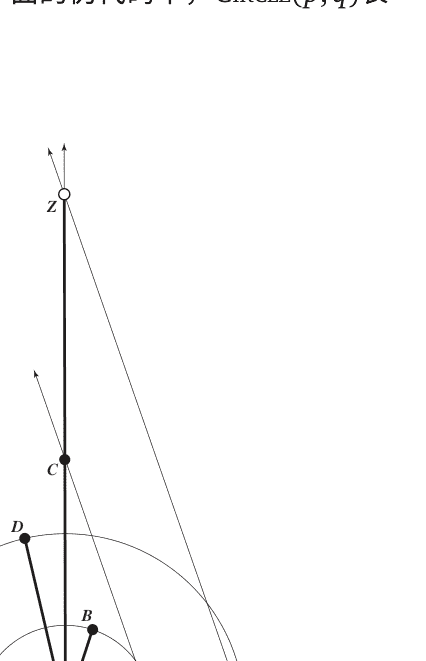

使用指南针和直尺进行乘法或除法。

³意大利人将sifr音译为 zefiro，后来演变成现代的 zero。

⁴事实上，一些中世纪英国的资料声称希腊前缀“algo-”意味着“艺术”或“介绍”。其他资料声称算法是由希腊哲学家、印度国王或西班牙国王“Algas”或“Algor”或“Argus”发明的。一些人，可能包括但丁·阿里吉埃里，甚至将发明者与神话中的希腊造船师和同名的阿尔戈英雄联系起来。我不认为任何严肃的中世纪学者会将其与希腊的“痛苦”一词联系起来，尽管我相当确定他们的学生会这样做。

⁵来自拉丁动词 putare-，它的含义各不相同，包括“修剪/修剪”，“清洁”，“整理”，“价值”，“判断”和“考虑/假设”；也是英语单词“争议”，“声誉”和“截肢”的来源。

⁶欧几里得和他的学生几乎肯定是在一个 ἄβαξ上绘制他们的构造，这是一张覆盖着灰尘或沙子（或者可能是非常小的岩石）的桌子。在接下来的几个世纪里，希腊的 abax演变成了中世纪欧洲的算盘。

这个算法将复杂的乘法任务分解为一系列简单的原始操作：在两点之间画一条线，以给定的中心和边界点画一个圆等。这些原始步骤在现代数字计算机上执行起来非常复杂，但是这个算法并不是为数字计算机设计的；它是为柏拉图理想的古典希腊数学家设计的，他们使用柏拉图理想的圆规和柏拉图理想的直尺。在这个例子中，欧几里得首先通过编写子程序（如现代程序员所说）来定义一个新的原始操作，构造一个直角。

#### 通过复制和中介的乘法

这里有一个更古老的算法用于乘法大数，有时被称为（俄罗斯）农民乘法。这种方法的一个变体被埃及抄写员阿姆斯（Ahmes）复制到了Rhind纸上大约公元前1650年，他声称这是一份（当时）大约350年的文档。这是欧洲人在斐波那契引入阿拉伯数字之前最常用的计算方法；它仍然在20世纪末的东欧小学教学中使用。这个算法也常用于早期的数字计算机，这些计算机没有直接实现整数乘法硬件。

```
农民乘（乘数，被乘数）：
积 ← 0
当乘数 > 0
    如果乘数是奇数
        积 ← 积 + 被乘数
    乘数 ← ⌊乘数 / 2⌋
    被乘数 ← 被乘数 + 被乘数
返回积
```

| x | y | 乘积 |
|---|---|---|
| 123 | +456 = | 456 |
| 61 | +912 = | 1368 |
| 30 | 1824 | |
| 15 | +3648 = | 5016 |
| 7 | +7296 = | 12312 |
| 3 | +14592 = | 26904 |
| 1 | +29184 = | 56088 |

农民乘法算法将一般乘法的困难任务分解为四个更简单的操作：（1）确定奇偶性，（2）加法，（3）复制（将数字加倍），（4）中介（将数字减半，向下取整）。当然，对这个算法的完整规范需要描述如何执行这四个“原始”操作。农民乘法需要（一个恒定的因子！）更多的手工操作，但对于人类来说，必要的操作比美国小学算法所需的10×10乘法表更容易记住。

农民乘法的正确性可以从以下递归恒等式推导出来，该恒等式对于任何非负整数x和y都成立：

```
x \cdot y = \begin{cases} 0 & \text{if } x = 0 \\ \lfloor x/2 \rfloor \cdot (y + y) & \text{如果 } x \text{是偶数} \\ \lfloor x/2 \rfloor \cdot (y + y) + y & \text{if } x \text{是奇数} \end{cases}
```

> ⁷古埃及实际使用的这个算法不使用中介或奇偶性，但它确实使用比较。为了避免减半，算法通过重复加倍来预先计算两个表：一个包含不超过x的所有2的幂，另一个包含相同的2的幂乘以y。然后通过贪婪减法找到总和为x的2的幂，并将另一个表中的相应条目相加以形成乘积。

⁸美国学生学习了由印度数学家开发并由斐波那契在《算盘》中描述的格点乘法算法的变体。如果输入数字以二进制表示，则这两个算法是等效的。

#### 国会分配

这是另一个来自计算机世界之外的好例子的算法。美国宪法第一条第二节要求

> 代表和直接税应根据可能包括在这个联盟中的各个州的人口进行分配
> 。。。代表的数量应该
> 每三万人中不超过一个，但每个州至少有一个代表。...

由于众议院的席位有限，要实现精确的比例
代表是不可能的，除非使用共享或分数代表，这两者都是
非法的。因此，已经提出并使用了几种不同的分配算法来公平地四舍五入
分数解决方案。实际上今天使用的算法，称为亨廷顿-希尔方法或
等比例方法，最初是由人口普查局统计学家约瑟夫·希尔在1911年提出的，
由哈佛大学数学家爱德华·亨廷顿在1920年完善，被纳入联邦法律（2 U.S.C. §§2a
和2b）于1941年，并在1992年经受住了最高法院的挑战。⁹输入数组 \( Pop[1..n] \) 存储
各州的人口，\( R \) 是代表的总数。目前，\( n =50,\)
\( R =435 \)。输出数组 \( Rep[1 ..n] \) 存储分配给每个州的代表人数。

```
一个部分国会（人口[1 ..n], \( R \)）:
\( PQ \leftarrow \text{NEW PRIORITY QUEUE} \)
对于 \( i \leftarrow 1 \) 到 \( n \)
　　重复\([i] \leftarrow 1 \)
　　插入 \( (PQ, i, Pop[i]/\sqrt{2}) \)
　　\( R \leftarrow R - 1 \)
当 \( R > 0 \)
　　\( s \leftarrow \text{EXTRACT MAX}(PQ) \)
　　重复\([s] \leftarrow \) 重复\([s] + 1 \)
　　插入 \( (PQ, s, Pop[s] / \sqrt{\text{重复}[s] (\text{重复}[s] + 1)}) \)
　　\( R \leftarrow R - 1 \)
返回重复\([1 .. n] \)
```

这个伪代码描述假设你知道如何实现支持优先级队列的操作NEW PRIORITY QUEUE，INSERT和EXTRACT MAX。（当然，实际法律并不假设这一点。）算法的输出和正确性完全不依赖于优先级队列的实现方式。人口普查局使用一个未排序的数组，存储在Excel电子表格的一列中；你应该在本科数据结构课程中学到了更高效的解决方案。

#### 一个糟糕的例子

考虑“马丁的算法”: ¹⁰

> ⁹联邦地区法院早先的裁决被最高法院一致裁定为，国会以善意采用的任何分配方法都是合宪的（美国商务部诉蒙大拿州）。当前的国会分配算法在美国人口普查局网站上有详细描述http://www.census.gov/population/www/censusdata/apportionment/computing.html。关于分配问题的良好历史可以在http://www.thirty-thousand.org/pages/Apportionment.html找到。国会研究服务机构的一份报告描述了各种分配方法，可在http://www.rules.house.gov/archives/RL31074.pdf上获得。
> ¹⁰史蒂夫·马丁，“你可以成为百万富翁”，《周六夜现场》，1978年1月21日。还出现在喜剧不好看，华纳兄弟唱片，1979年。

+   成为百万富翁且不付税:
    得到一百万美元。
    不要交税。
    如果被抓住，
    说“我忘了。”

相当简单，除了第一步；那是个大挑战。对于一群亿万富翁CEO来说，他们可能认为这是一个算法，因为对他们来说第一步既明确又简单，但对于这些可怜的人来说，马丁的步骤太模糊了，不能被视为一个真正的算法。另一方面，这是一个完美的减少的例子——它将成为百万富翁且不付税的问题减少为“更容易”的问题，即获得一百万美元。在这门课程中，我们将一次又一次地看到减少的应用。
正如成百上千的商人和政治家所证明的那样，如果你知道如何解决更容易的问题，减少告诉你如何解决更困难的问题。
马丁的算法，就像我们之前的许多例子一样，不是计算机科学家习惯思考的那种算法，因为它是用计算机难以执行的操作来表达的。在这门课上，我们将主要关注可以在计算机上合理实现的算法。换句话说，算法中的每一步都必须是直接由常见编程语言支持的内容（如算术、赋值、循环或递归），或者你在之前的课程中已经学会的内容（如排序、二分查找或深度优先搜索）。

### 0.3 写算法

计算机程序是算法的具体表示，但算法不是程序；它们不应该用特定的编程语言来描述。这门课的整个目的是开发可以在任何编程语言中使用的计算技术。C、C++、C#、Java、Python、Ruby、Erlang、Haskell、OcaML、Scheme、Scala、Clojure、Visual Basic、Smalltalk、Javascript、Processing、Squeak、Forth、TEX、Fortran、COBOL、INTERCAL、MMIX、LOLCODE、Befunge、Parseltongue、Whitespace或Brainfuck的特殊语法细节在算法设计中几乎没有或没有重要性，关注它们只会让你分心。我们真正想要的更接近于你在真实程序的注释中写的内容，而不是代码本身。

另一方面，通常也不是一个好主意用简单的英语散文描述。算法具有很多结构，特别是条件语句、循环和递归，这些结构很容易被无结构的散文隐藏起来。英语等自然语言充满了歧义、微妙和意义的不同之处，但算法必须尽可能精确和明确地描述。最后，更严重的是，有一种自然倾向以非正式的方式描述重复的操作：“首先做这个，然后做这个第二个，依此类推。”但是，任何参加过“这个序列中下一个是什么？”测试的人都知道，在循环的前几次迭代中指定发生的事情几乎没有任何关于后续迭代发生的事情的信息。为了使描述明确，我们必须明确指定每次迭代的行为。关于程序员在淋浴时死亡的愚蠢笑话有一点道理——“涂抹、冲洗、重复”是模棱两可的；我们到底重复什么，一直到什么时候？

这当然是一个宗教信仰的问题。语言学家对萨皮尔-沃尔夫假说进行了不断的争论，该假说（或多或少）认为人们只能按照他们的语言所强加的范畴来思考。根据这一原则的一个极端表述，某种语言中的一些概念对其他语言的使用者来说根本无法理解，这不仅仅是因为技术进步的原因——你如何将“跳过鲨鱼”或“博客”翻译成亚拉姆语？——而是因为语言和文化之间固有的结构差异。对于更为怀疑的观点，请参阅史蒂文·平克的《语言本能》。当然，将这个想法应用于不同的编程范式时，这个观点确实有一定的力量。（Y组合子是什么，再说一遍？模板是如何工作的？抽象工厂是什么？）幸运的是，这些差异通常太微妙，以至于在这门课程中几乎没有太大的影响。对于一个有说服力的反例，请参阅克里斯·奥卡萨基的论文/专著《函数式数据结构》及其较新的后继作品。

在我看来，展示算法最清晰的方式是使用伪代码。伪代码使用正式编程语言和数学的结构来将算法分解为原始步骤；但是原始步骤本身可以使用数学、纯英语或适当的混合语言编写。写得好的伪代码揭示了算法的内部结构，但隐藏了不相关的实现细节，使算法更容易理解、分析、调试和实现。

伪代码的精确语法是个人选择，但最重要的目标应该是清晰和准确。理想情况下，伪代码应该允许任何有能力的程序员在不理解算法原理的情况下，快速而正确地在他们喜欢的编程语言中实现底层算法。以下是我遵循并强烈推荐的准则：

+   保持一致！
+   使用标准的命令式编程关键字（if/then/else，while，for，repeat/until，case，return）和符号（variable ← value，Array[index]，function(argument)，bigger > smaller等）。关键字应该是标准的英语单词：使用'else if'而不是'elif。
+   仔细而一致地缩进所有内容；从房间的另一边也能看到块结构。对于嵌套循环和条件语句，这条规则尤为重要。不要添加不必要的语法糖，如大括号或begin/end标签；仔细的缩进通常足够了。
+   使用助记符算法和变量名。短变量名是好的，但可读性比简洁更重要；除了循环索引等习语外，短而完整的单词比单个字母更好。绝对不要使用代词！
+   对于标准的数学事物，请使用标准的数学符号。例如，用 x·y 代替 x*y 表示乘法；用 x mod y 代替 x % y 表示余数；用 √x 代替 sqrt(x) 表示平方根；用 a^b 代替 power(a,b) 表示指数运算；用 φ 代替 phi 表示黄金比例。
+   如果英语更清晰，避免使用数学符号。例如，'将 a 插入 X'可能更好，而不是 INSERT(X, a) or X ← X ∪ {a}。
+   每个语句应该放在一行上，并且每行应该包含一个语句或一个结构元素（for、while、if）。（对于短的和类似的语句，如 i ← i + 1; j ← j - 1; k ← 0，我有时会例外。）
+   不要使用固定宽度的字体来排版伪代码；它比普通排版文本更难阅读。同样，不要将关键字如'for'或'while'以不同的样式排版；你不希望读者关注语法糖。另一方面，我使用斜体来表示变量（遵循标准数学排版约定），使用小写大写来表示算法和常量，并使用不同的字体来表示字面字符串。

### 0.4 分析算法

仅仅写下算法并说'看哪！'是不够的。我们还必须说服我们的观众（包括我们自己！）这个算法确实做到了它应该做的事情，并且它做得高效。

## 正确性

在某些应用环境中，程序在大多数“合理”的输入上表现正确是可以接受的。但在这门课上，我们要求算法对于所有可能的输入都是正确的。

此外，我们必须证明我们的算法是正确的；相信我们的直觉，或者尝试几个测试用例是不够的。有时候正确性是相当明显的，特别是对于你在之前课程中见过的算法。另一方面，“明显”往往是“错误”的同义词。我们在这门课程中讨论的许多算法都需要额外的工作来证明它们的正确性。正确性证明几乎总是涉及归纳法。我们喜欢归纳法。归纳法是我们的朋友。

但是在我们正式证明算法是否按照预期工作之前，我们必须正式陈述算法应该做什么！算法问题通常使用标准英语来呈现，以真实世界的对象为基础，而不是以形式化的数学对象为基础。作为算法设计者，我们需要将这些问题重新陈述为我们可以证明的数学对象的问题，例如数字、数组、列表、图形、树等等。我们还必须确定问题陈述是否存在任何隐藏的假设，并明确陈述这些假设。（例如，在歌曲“在墙上的n瓶啤酒”中，n始终是一个正整数。）正式重新陈述问题不仅是证明的要求，也是真正理解问题所要求的最好方法之一。回答任何问题最困难的部分是弄清楚正确提问的方式!

重要的是要记住问题和算法之间的区别。问题是要执行的任务，比如“计算x的平方根”或“对这些数字进行排序”或“让算法学生保持清醒t分钟”。算法是完成这样任务的一组指令。同一个问题可能有数百种不同的算法；同一个算法可能解决数百个不同的问题。

## 运行时间

对于同一个问题，不同算法之间最常见的排名方式是它们运行的速度。理想情况下，我们希望对于任何特定的问题，都能找到最快的算法。在许多应用环境中，程序在大多数时间内以高效的方式运行是可以接受的，对于所有“合理”的输入都是如此。但在这门课上不是这样；我们要求算法在最坏情况下始终运行高效。

但是我们如何衡量运行时间？作为一个具体的例子，唱这首歌需要多长时间BOTTLESOFBEER(n)?这显然是输入值的函数n，但它还取决于你能多快地唱。有些歌手可能需要十秒钟来唱一节；其他人可能需要二十秒。技术进一步扩大了可能性。用莫尔斯电码在电报上口述这首歌可能需要一分钟一节。通过网络下载mp3可能需要每节十分之一秒。在计算机的主内存中复制mp3可能只需要几微秒每节。

这里重要的是随着n的增长，唱歌时间如何变化。唱BOTTLESOFBEER（2n）大约需要比唱BOTTLESOFBEER（n）长两倍的时间，无论使用什么技术。这在渐近唱歌时间Θ（n）中得到了反映。我们可以通过计算算法执行某个指令的次数或达到某个代码里程碑的次数来测量时间。例如，我们可能注意到在BOTTLESOFBEER的每一节中，单词“beer”被唱三次，所以唱“beer”的次数是总唱歌时间的一个很好的指标。对于这个问题，我们可以给出一个确切的答案：BOTTLESOFBEER（n）使用了确切的3n +3个啤酒。

还有很多其他歌曲的演唱时间不平凡。这首歌对大多数讲英语的人来说可能很熟悉：

```
圣诞节的第N天（礼物[2..n]）:
对于i从1到n
    唱“在圣诞节的第i天，我真爱给了我”
    对于j从i递减到2
        唱“j个礼物[j]”
    如果i>1
        唱“和”
    唱“一只梨树上的鹧鸪。”
```

NDAYSOFCHRISTMAS的输入是一个包含n-1个礼物的列表。很容易证明演唱时间为Θ(n^2)；特别地，歌手会提到一个礼物的名字2次（计算梨树上的鹧鸪）。很容易看出，在圣诞节的头n天，我的真爱给了我正好 Σi=1到n Σj=1到i j = n(n+1)(n+2)/6= Θ(n^3)礼物。 还有许多其他传统歌曲需要二次时间来唱；例如“Old MacDonald Had a Farm”, “There Was an Old Lady Who Swallowed a Fly”, “The House that Jack Built”, “Hole in the Bottom of the Sea”, “Green Grow the Rushes O”, “The Rattlin’ Bog”, “The Barley-Mow”, “Eh, Cumpari!”, “Alouette”, “Echad Mi Yode’a”, “Ist das nicht ein Schnitzelbank?”和“Minkurinn hænsnakofanum”。有关详细信息，请咨询您附近的学龄前儿童。

```
Old MacDonald（动物[1..n], 声音[1..n]）:
对于i从1到n
    唱“老麦克唐纳有个农场，EIEIO”
    唱“在这个农场上，他有一些动物[i]，EIEIO”
    唱“这里有一个声音[i]声音[i]，那里有一个声音[i]声音[i]”
    唱“这里有一个声音[i]，那里有一个声音[i]，到处都是声音[i]声音[i]”
    对于j从i递减到1
        唱“这里有个声音[j]声音[j]，那里有个声音[j]声音[j]”
        唱“这儿有个噪音[j]，那儿有个噪音[j]，到处都是噪音[j]噪音[j]”
    唱“老麦克唐纳有个农场，EIEIO。”
```

```
一个LOUETTE（从1到n）:
为了所有i从1到n唱“小白鹭，可爱的小白鹭，小白鹭，我要给你拔毛。”
唱“我要给你拔毛lapart[i]。我要给你拔毛lapart[i]。”
为了所有j从i递减到1
唱“还有lapart[j]！还有lapart[j]！”
唱“Oooooo！”
唱“Alouette, gentille alluette, alouette, je te plumerai。”
```

一个更现代的参数化累积歌曲的例子是Guy Steele的“TELNET之歌”，它需要O(2^n)的时间来唱；Steele推荐n=4。 举一个稍微不那么滑稽的例子，考虑算法APPORTIONCONGRESS。这里的运行时间显然取决于优先队列操作的实现，但我们肯定可以将运行时间限定为O(N+RI+(R−n)E)，其中N表示NEWPRIORITYQUEUE的运行时间，I表示INSERT的运行时间，E表示EXTRACTMAX的运行时间。在合理的假设下，R > 2n（平均而言，每个州至少有两个代表），我们可以简化上界为O(N + R(I + E))。人口普查局使用一个大小为n的未排序数组来实现优先队列；这种实现给出了N = I = Θ(1)和E = Θ(n)，因此总体运行时间为O(Rn)。这对于政府工作来说已经足够好了。使用二叉堆（或堆有序数组）实现优先队列给出了N = Θ(1)和I = R = O(log n)，这意味着总体运行时间为O(R log n)。

有时候我们也对其他计算资源感兴趣：空间、随机性、页面错误、进程间消息等等。我们可以使用相同的技术来分析这些资源，就像我们用来分析运行时间一样。

## 0.5 一个更长的例子：稳定匹配

每年，成千上万的新医生必须在美国各地的医院获得实习机会。在20世纪上半叶，医院之间为了争夺最好的医生，实习机会的提前提供时间越来越早，有时甚至在医学院的第二年，同时还有更紧的接受期限。在1940年代，医学院同意在学生的第四年的一个共同日期之前不发布信息。作为回应，医院开始要求更快的决策。

到1950年，医院经常会打电话给医生，提供实习机会，并要求立即回应。实习生被迫冒险，如果他们的第三选择医院先打电话过来，他们要么接受并冒着失去更好机会的风险，要么拒绝并冒着没有任何职位的风险。

最终，在20世纪50年代建立了一个名为国家住院匹配计划的实习分配中心。每年，医生们提交一个对所有医院进行排名的列表，他们愿意接受实习，在此期间，每个医院也会提交一个对医生进行排名的列表，他们愿意接受为实习生。然后，国家住院匹配计划会计算出一种满足以下稳定性要求的实习生与医院的分配。为了简单起见，让我们假设有n个医生和n个医院；每个医院只提供一个实习机会；每个医生对所有医院进行排名，反之亦然；最后，医生和医院的排名中没有并列情况。如果存在两个医生α和β以及两个医院A和B，使得医生α被分配到A，医生β被分配到B，则我们称医生与医院的匹配是不稳定的。

- α被分配到A，而β被分配到B；
- α更喜欢B而不是A，而B更喜欢α而不是β。

换句话说，α和B都会比与他们当前的分配更喜欢对方。居民匹配的目标是实现稳定匹配，即没有医生或医院有动机欺骗系统。乍一看，稳定匹配是否存在并不清楚！

1952年，NRMP采用了“波士顿池”算法来分配实习医生，因为此算法之前曾被波士顿地区的一个区域性清算所使用。这个算法经常被错误地归功于David Gale和Lloyd Shapley，他们在1962年正式分析了该算法并首次证明了它能够计算出稳定匹配；Gale和Shapley使用了大学招生的隐喻。15类似的算法随后被用于其他匹配市场，包括法国的教职员工招聘、德国的大学入学、纽约和波士顿的公立学校入学、美国海军水兵的宿舍分配以及肾脏配对计划。Shapley因其关于稳定匹配的研究与Alvin Roth一起被授予2012年诺贝尔经济学奖，Roth在Shapley的工作基础上进行了重要的扩展，并将其用于开发几个现实世界的交易。

波士顿池算法在每一轮中进行，直到每个位置都被填满。每一轮有两个阶段：

- 1. 一个任意未分配的医院 A 向还没有拒绝它的最佳医生 α（根据医院的偏好列表）提供其位置。
- 2. 每个医生最终接受她收到的最佳报价，根据她的偏好列表。

因此，如果 α 当前未分配，她（暂时）接受来自 A 的报价。如果 α 已经有一个分配但更喜欢 A，她拒绝她现有的分配并（暂时）接受来自 A 的新报价。否则，α 拒绝新的报价。

例如，假设四位医生（Dr. Quincy、Dr. Rotwang、Dr. Shephard 和 Dr. Tam，用小写字母表示）和四家医院（Arkham Asylum、Bethlem Royal Hospital、County General Hospital 和 The Dharma Initiative，用大写字母表示）彼此按照以下方式进行排名：

| q   | r   | s   | t   |   | A   | B   | C   | D   |
| --- | --- | --- | --- | - | --- | --- | --- | --- |
| A   | A   | B   | D   |   | t   | r   | t   | s   |
| B   | D   | A   | B   |   | s   | t   | r   | r   |
| C   | C   | C   | C   |   | r   | q   | s   | q   |
| D   | B   | D   | A   |   | q   | s   | q   | t   |

给定这些偏好作为输入，波士顿池算法可能按照以下步骤进行：

- 1. 阿卡姆向塔姆博士提出了一个报价。
- 2. 疯人院向罗特旺博士提出了一个报价。
- 3. 县向塔姆博士提出了一个报价，她拒绝了阿卡姆之前的报价。
- 4. 达摩向谢泼德博士提出了一个报价。（从这一点开始，因为只有一个未匹配的医院，算法没有更多的选择。）
- 5. 阿卡姆向谢泼德博士提出了一个报价，他拒绝了达摩之前的报价。
- 6. 达摩向罗特旺博士提出了一个报价，他拒绝了疯人院之前的报价。
- 7. 疯人院向塔姆博士提出了一个报价，她拒绝了县之前的报价。
- 8. 县向罗特旺博士提出了一个报价，但他拒绝了。
- 9. 县向谢帕德博士提出了一个报价，但他拒绝了。
- 10. 县向昆西博士提出了一个报价。

此时，所有待定的报价都被接受，算法以匹配结束：(A,s),(B,t),(C,q),(D,r)。你可以（也应该）通过蛮力验证这个匹配是稳定的，即使没有医生被她最喜欢的医院聘用，也没有医院聘用它最喜欢的医生；事实上，县被迫聘用了他们最不喜欢的医生。这不是这个偏好列表的唯一稳定匹配；匹配 (A,r),(B,s),(C,q),(D,t) 也是稳定的。

### 运行时间

分析算法的运行时间相对简单。每个医院最多向每个医生提供一次报价，因此该算法最多需要² n 轮。在实际实现中，每个医生和医院可以用1到N之间的唯一整数来标识，并且偏好列表可以表示为两个数组 DocPref[1..n][1..n] 和 HosPref[1..n][1..n]，其中 DocPref[α][r] 表示医生 α 偏好列表中的第 r 个医院，HosPref[A][r] 表示医院 A 偏好列表中的第 r 个医生。以这种形式输入，波士顿池算法可以实现在 O(n²) 时间内运行；我们将细节留作简单练习。

一个稍微困难的练习是证明存在输入（以及在何时做出报价的选择），使得算法在终止之前需要 Ω(n²) 轮。因此，最坏情况下运行时间的 O(n²) 上界无法改进；在这种情况下，我们称我们的分析是紧密的。

### 正确性

但是为什么这个算法是正确的？我们如何知道波士顿池算法总是计算出一个稳定匹配？Gale和Shapley通过以下方式证明了正确性。只要至少有一个未填充的位置，算法就会继续进行；相反，当算法终止（在最多 n² 轮之后），每个位置都被填充。没有医生可以接受多个职位，也没有医院可以雇佣多个医生。因此，该算法总是计算出一个匹配；只剩下证明这个匹配是稳定的。

假设医生 α 被分配到医院 A 在最终匹配中，但更喜欢 B。因为每个医生接受她收到的最好报价，α 没有收到比 A 更喜欢的报价。特别地，B no 向 α 提出过报价。另一方面，B 向比 β 更喜欢的每个医生提出了报价。因此，B prefers β to α，所以没有不稳定性。

令人惊讶的是，算法的正确性不依赖于哪个医院在哪一轮中提出报价。事实上，有一种更强的意义上，报价的顺序并不重要 - 无论哪个未分配的医院在每一轮中提出报价，算法总是计算出相同的匹配！假设 α 是 A 的一个可行医生，如果存在一个稳定的匹配将医生 α 分配给医院 A。

> 引理0.1. 在波士顿池算法中，每个医院 A 只被对 A 不可行的医生拒绝。

证明：我们通过归纳法证明引理。考虑波士顿池算法的任意一轮，在这一轮中，医生 α 拒绝了医院 A 而选择了另一个医院 B。拒绝意味着 α 更喜欢 B 而不是 A。在 B 的偏好列表中排在 α 之前的每个医生已经拒绝了 B，因此根据归纳假设，对 B 来说是不可行的。

现在考虑将 α 分配给 A 的任意匹配。我们已经确定 α 更喜欢 B 而不是 A。如果 B 更喜欢 α 而不是它的伴侣，那么匹配是不稳定的。另一方面，如果 B 更喜欢它的伴侣而不是 α，则（根据我们之前的论证）它的伴侣是不可行的，同样匹配是不稳定的。我们得出结论，没有稳定的匹配将 α 分配给 A。

现在让 best (A) 表示 A 偏好列表中排名最高的可行医生。引理0.1表明，A 偏好其最终分配的每个医生对 A 来说都是不可行的。另一方面，最终的匹配是稳定的，所以分配给 A 的医生对 A 来说是可行的。下面的结果现在是显然的：

> 推论0.2. 波士顿池算法将最佳(A)分配给 A, 对于每个医院 A。

因此，从医院的角度来看，波士顿池算法计算出了最佳的稳定匹配。事实证明，这种匹配也是医生角度下最差的！让 worst(α) 表示医生 α 偏好列表中排名最低的可行医院。

> 推论0.3. 波士顿池算法将 α 分配给 worst(α), 对于每个医生 α。

证明：假设波士顿池算法将医生α分配给医院A；我们需要证明A=worst(α)。考虑一个任意的稳定匹配，其中A与医生α而不是另一个医生β匹配。前面的推论意味着A更喜欢α=best(A)而不是β。因为匹配是稳定的，所以α必然更喜欢她被分配的医院而不是A。这个论证对于任何稳定分配都适用，所以α更喜欢任何其他可行的匹配而不是A；换句话说，A=worst(α)。

这两个推论的一个微妙的结果是，由Dubins和Freeman在1981年发现，一个医生可以通过谎报自己的偏好来潜在地改善自己的分配，但医院却不能。（然而，一组医院可以勾结，以改善他们的分配。）部分原因是，国家住院医师配对计划在1998年改变了其匹配算法，使潜在住院医师按照偏好顺序向医院提供工作，并且每个医院接受其最佳报价。因此，新算法为医生计算了最佳的稳定匹配，而为医院计算了最差的稳定匹配。然而，在实践中，这种修改对住院医师分配的影响不到1%。据我所知，这种改变对患者的确切影响是一个未解决的问题。

## 0.6 我们为什么在这里？

这门课程最终是关于学习对所有计算机科学家至关重要的两个技能。

- 1. 直觉：如何思考抽象计算。
- 2. 语言：如何谈论抽象计算。

本课程的第一个目标是帮助你发展算法直觉。各种算法真正是如何工作的？当你第一次遇到一个问题时，你应该如何解决它？你如何判断哪种技术会起作用，哪种技术会起到最好的效果？你如何判断一个算法是否比另一个算法更好？你如何判断你是否拥有最佳解决方案？这些都不是简单的问题；任何声称不同的人都在兜售东西。

我们的第二个主要目标是帮助你发展算法语言。仅仅理解如何解决问题是不够的；你还必须能够向他人解释你的解决方案。我不是指仅仅将你的算法转化为可工作的代码——尽管许多学生（和经验不足的程序员）认为，“他人”不仅仅是一台计算机。没有人是独自编程的。代码被阅读的次数远远超过编写甚至编译的次数。在短期内更重要的是，向他人解释某事是澄清自己理解的最佳方式之一。正如阿尔伯特·爱因斯坦（或者是理查德·费曼？）传说中说的：“除非你能向你的祖母解释清楚，否则你真的不理解某件事。”

沿途，你将学到很多算法的事实 - 归并排序的运行时间为Θ(nlogn)；在伸展树中搜索的摊还时间为O(logn)；贪婪算法通常不会产生最优解；旅行商问题是NP难的 - 但这些并不是课程的重点。你总是可以在教科书或网络上查找简单的事实，前提是你有足够的直觉和经验知道要查找什么。这就是为什么我们允许你在考试中带着作弊纸；我们不希望你浪费学习时间去记忆所有你看到的事实。

你还将练习很多算法设计和分析技巧 - 寻找有用的（反）例子，开发归纳证明，解决递归，使用大O符号，使用概率，给问题提供清晰的数学描述等等。这些技巧非常有用，没有它们，很难培养出良好的直觉和良好的沟通能力，但它们也不是课程的主要目标。在你的教育生涯中的这个阶段，一旦你发现自己想要做什么，你应该能够自己掌握大部分这些技能。

不幸的是，没有系统的程序-没有算法-可以确定哪种算法技术在解决给定问题时最有效，或者找到解释、分析、优化或实现给定算法的好方法。像许多其他活动（音乐、写作、杂耍、表演、武术、运动、烹饪、编程、教学等），掌握这些技能的唯一方法就是通过实践，实践和更多的实践。只有通过解决问题才能培养良好的解决问题的能力。只有通过沟通才能培养良好的沟通能力。

良好的直觉是经验的产物，而不是替代品。我们无法教你如何在这门课上表现出色。我们所能做的（也是我们将要做的）就是提供一些基本工具，向你展示如何使用它们，为你创造机会来实践它们，并根据我们自己辛苦获得的经验和直觉给予你诚实的反馈。其余的就取决于你自己了。

好的算法非常有用，优雅，令人惊讶，深奥，甚至美丽，但最重要的是，算法是有趣的！我希望你能像我一样享受与它们一起玩耍。

算法家博伊修斯对抗算盘家毕达哥拉斯。来自格雷戈尔·赖斯希（1503年）的《玛格丽塔哲学》。

## 练习

- 0. 描述并分析一种有效的算法，以确定在标准国际象棋棋盘上给定合法摆放的棋子的情况下，如果两个玩家都完美地下棋，哪个玩家将获胜。[提示：有一个简单的一行解决方案！]

- 1. “The Barley Mow”是一首累积饮酒歌曲，几个世纪以来一直在英国群岛上演唱。（早期版本《Gi ue vs once a drinke》出现在托马斯·拉文斯克罗夫特的歌曲集《Deuteromelia》中，该集于1609年出版，但这首歌几乎肯定更古老。）这首歌有许多变体，但在德文和康沃尔传统上唱的版本有以下伪歌词，其中容器[i]是一个容纳2^i盎司啤酒的容器。

传统歌曲使用以下容器：nipperkin、gill pot、half-pint、pint、quart、pottle、gallon、half-anker、anker、firkin、half-barrel、barrel、hogshead、pipe、well、river和ocean。（此列表中的每个容器都比前一个容器大两倍，除了firkin实际上是2.25个ankers，最后三个单位只是愚蠢的。）

```
BARLEY MOW(n):
    “为大麦堆干杯，我的勇敢的男孩们，”
    “为大麦堆干杯！”
    “我们将用欢乐的棕色碗喝光它，”
    “为大麦堆干杯！”
    “为大麦堆干杯，我的勇敢的男孩们，”
    “为大麦堆干杯！”
    对于i从1到n
        “我们将从容器[i]中喝光它，男孩们，”
        “为大麦堆干杯！”
        对于j ← i递减到1
            “这个容器[j],”
            “和那个快乐的棕色碗！”
            “为大麦堆干杯！”
            “为大麦堆干杯，我的勇敢的孩子们，”
            “为大麦堆干杯！”
```

(a) 假设每个名字容器[i]是一个单词，并且你可以每秒唱四个单词。你需要多长时间才能唱完BARLEY MOW(n)?（给出一个紧密的渐近界限。）

(b) 如果你想为任意大的n值唱这首歌，你将不得不编造你自己的容器名字。为了避免重复，这些名字必须随着n的增加而逐渐变长。（“我们将用半半半半半半品脱的容器喝光它，孩子们！”）假设容器[n]有Θ(log n)音节，你可以每秒唱六个音节。现在你需要多长时间才能唱完BARLEY MOW(n)?（给出一个紧密的渐近界限。）

(c) 假设每次提到一个船的名字时，你实际上会喝相应的啤酒量：愉快的棕色碗是一盎司，每个船是2^i盎司[i]。
假设为了解决这个问题，你至少21岁，如果你唱了BARLEY MOW（n），你会喝多少盎司的啤酒？（给出一个确切的答案，而不仅仅是一个渐近界限。）

- 2. 更详细地描述和分析波士顿游泳池稳定匹配算法，使得最坏情况下的运行时间为O（n²），正如之前的笔记中所述。

- 3. 证明波士顿游泳池算法可以执行 Ω(n²)轮。（你需要描述一个合适的输入和一个 Ω(n²)有效提议的序列。）

- 4. 描述并分析一种有效的算法，以确定给定的医院和医生偏好集是否具有唯一的稳定匹配。

- 5. 考虑稳定匹配问题的一般化，其中一些医生不对所有医院进行排名，一些医院不对所有医生进行排名，并且只有在彼此的偏好列表中都出现时，医生才能被分配到医院。在这种情况下，存在三种额外的不稳定情况：
    - 医院更喜欢未匹配的医生而不是其分配的匹配。
    - 医生更喜欢未匹配的医院而不是她分配的匹配。
    - 未匹配的医生和未匹配的医院在彼此的偏好列表中出现。

描述并分析一种在这种情况下计算稳定匹配的有效算法。

请注意，即使医生和医院的偏好列表非空，稳定匹配可能会使一些医生和医院未匹配。例如，如果每个医生将哈佛大学列为他们唯一可接受的医院，每个医院将Dr. House列为他们唯一可接受的实习生，那么只有House和Harvard会被匹配。

- 6. 回想一下，亨廷顿-希尔分配算法APPORTION CONGRESS的输入是一个数组 P[1..n]，其中 P[i]是第 i 个州的人口，以及一个整数 R，表示分配的代表总数。输出是一个数组 r[1..n]，其中 r[i]是算法分配给第 i 个州的代表数量。

令 P = Σ_{i=1}^n P[i]表示国家的总人口，令 r_i^* = R · P[i] / P 表示第 i 个州的理想代表人数。

    - (a) 证明对于所有的i，有 r[i] ≥ ⌊r_i^*⌋。
    - (b) 描述并分析一个算法，该算法以APPORTION CONGRESS相同的方式计算国会分配，时间复杂度为O(n log n)。（请注意，APPORTION-CONGRESS的运行时间取决于 R，可能比 n大得多。）
    - (c) 如果一个州的人口相对较小，与其他州相比，其理想代表人数 r_i^*可能接近于零；因此，小州在亨廷顿-希尔分配过程中被过度代表。令人惊讶的是，这对于非常大的州也可能成立。令 α= (1+√2)/2 ≈ 1.20710678119。证明对于任意 ε > 0，存在一个输入使得APPORTION - CONGRESS的最大_i P[i] = P[1]，且 r[1] > (α - ε) r_1^*。
    - (d) 你能改进前面问题中的常数 α吗？

> 由此可见，如果我们能找到适合表达我们所有思想的字符或符号。...，我们可以在所有学科中——在它们能够通过推理解决的程度上——完成算术和几何学中所做的工作。因为所有依赖推理的研究都可以通过字符的转置和一种计算方法来完成，这将立即促进美的发现。

> 结果………………如果有人对我的结果表示怀疑，我会对他说：“让我们计算一下，先生”，通过这样做，拿起笔墨，我们很快就能解决这个问题。

——戈特弗里德·威廉·莱布尼茨，《普通科学前言》（1677年），菲利普·维纳（1951年）译

> 我希望读者能看到，字母可以被任何任何一种五种感官的智能生物理解，也就是说，除了那些失去视力和听力的少数无眼聋人之外的所有理性人类在一些完全瘫痪的情况下，既有味觉又有嗅觉。……………………海中的鲸鱼可以像参议员一样传递信息在陆地上，只要他们注意长喷和短喷之间的区别。……………………一个疲倦的听众在教堂通过适当地变化他的长呵欠和短呵欠，可以在布道结束之前向对面的画廊表达他对布道的看法。

——爱德华·埃弗雷特·黑尔，《点和线字母表》，《大西洋月刊》（1858年10月）

> 如果确实如希尔伯特所断言的那样，数学是一个在纸上玩的毫无意义的游戏，那么我们所能参考的唯一数学经验就是在纸上做标记。

——埃里克·坦普尔·贝尔，《科学之后》（1931年）

## 1 字符串

在整个课程中，我们将讨论数十种操作序列的算法和计算模型：一维数组、链表、文本块、图中的行走、执行指令序列等等。最终，任何算法的输入和输出都必须能够表示为计算机内存中某个连续部分的有限符号字符串。

推理计算需要推理字符串。

这个笔记列出了与字符串相关的几个形式定义和形式归纳证明。这些定义和证明故意比通常实践中使用的更详细——大多数人对字符串的直觉相当准确——但是额外的精确性对于任何形式的证明都是必要的。将这些材料视为理论计算机科学的“汇编语言”可能会有所帮助。我们通常在更高层次的抽象上思考计算，但最终每个论证都必须“编译”成这些（以及类似的）定义。

### 1.1 定义

固定一个任意的有限集 Σ 称为字母表； Σ 的元素称为符号或字符。

作为一种符号约定，我将始终使用英语字母表开头的小写字母（a，b，c，…）作为符号变量，而不是作为显式符号。对于显式符号，我将始终使用固定宽度的大写字母（A，B，C，…），数字（0，1，2，…），或其他可以与变量明显区分的符号（♢，$，#，•，…）。

在 Σ 上的一个字符串（或者单词）是由 Σ 中的零个或多个符号组成的有限序列。形式上，一个在 Σ 上的字符串 w 被递归地定义为以下两种情况之一：
- 空字符串，用希腊字母 ε（epsilon）表示，或者
- 有序对（a，x），其中 a 是 Σ 中的一个符号， x 是在 Σ 上的一个字符串。

我们通常用 a·x 或者简单地 ax 来表示有序对 (a, x) 。类似地，我们通常将显式字符串写成符号的序列，而不是嵌套的有序对；例如，STRING是对形式表达式（S，（T，（R，（I，（N，（G， ε）））））的方便缩写。作为一种符号约定，我将始终使用字母表末尾的小写字母（..., w, x, y, z）来表示未知字符串，而 SHOUTY◊MONOSPACED◊TEXT则表示显式符号和（非空）字符串。

所有字符串的集合 Σ 被表示为 Σ*（读作“sigma star”）。非常重要的是要记住，Σ*中的每个元素都是一个有限字符串，尽管Σ*本身是一个包含每个可能的有限长度字符串的无限集合。

字符串 w 的长度 |w| 是 w 中符号的数量，形式上定义如下：

|w| := \begin{cases} 0 & \text{if } w = \varepsilon, \\ 1 + |x| & \text{if } w = ax. \end{cases}

例如，字符串 SEVEN 的长度为 5。尽管它们在形式上是不同的对象，但我们通常不区分符号和长度为1的字符串。

两个字符串 x 和 y 的连接，表示为 x · y 或简单地 xy，是包含 x 中的字符按顺序，后跟 y 中的字符按顺序的唯一字符串。例如，字符串 NOWHERE是字符串 NOW 和 HERE 的连接；即 NOW · HERE = NOWHERE。（另一方面， HERE · NOW = HERENOW。）形式上，连接定义如下：

w \cdot z := \begin{cases} z & \text{如果 } w = \varepsilon \\ a \cdot (x \cdot z) & \text{如果 } w = ax \end{cases}

（在这里，我使用一个较大的点 · 来正式区分连接两个任意字符串的运算符 与构建一个字符和一个字符串的运算符 。）

当我们描述超过两个字符串的连接时，通常省略所有的点和括号，例如，写作 w xyz 而不是 (w · (x · y)) · z。这种简化是有道理的（我们很快将证明的事实），即·是可结合的。

### 1.2 字符串归纳

归纳是证明关于递归定义对象的陈述的标准技术。希望你已经熟悉通过归纳证明关于自然数的陈述，但是归纳实际上是一种更一般的技术。可以使用几种不同的归纳变体来证明关于更一般结构的陈述；这里我描述了我推荐的变体（实际上也是我实际使用的）。这个变体遵循两个主要的设计考虑：
- 证明的情况结构应该与递归定义的情况结构相对应。例如，如果你要证明关于所有字符串的某个性质，你的证明应该有两种情况：要么 w = ε，要么 w = ax，其中 a 是某个符号，x 是某个字符串。
- 归纳假设应该尽可能强大。对于关于自然数的陈述，(强)归纳假设总是“假设不存在反例 k 使得 k < n。”我建议对于字符串采用类似的归纳假设：“假设不存在反例 x 使得 |x| < |w|。”然后对于情况 w = ax，我们有 |x| = |w| - 1 < |w| 根据 |w| 的定义，所以归纳假设适用于 x。

因此，字符串归纳证明具有以下样板结构。假设我们想要证明每个字符串都是完美的 cromulent，无论那意味着什么。白色方框隐藏了额外的证明细节，其中包括依赖于“完美的 cromulent”精确定义的内容。

> 证明：让 w是任意的字符串。
假设，对于每个字符串 x 满足 |x| < |w|, x 是完美的cromulent。
有两种情况需要考虑。
• 假设 w = ε。
因此， w 是完美的cromulent。
• 假设 w = ax, 其中 a是某个符号， x是某个字符串。归纳假设暗示着 x是完美的cromulent。
因此， w 是完美的cromulent。
在这两种情况下，我们得出结论 w 是完美的cromulent。

这里有三个典型的证明结构示例。在以这种风格开发证明时，我强烈建议先机械地写出绿色文本（样板），为每种情况留出足够的空间，然后再填写红色文本（实际定理和归纳假设），最后再开始真正思考。

#### 引理1.1. 对于任意字符串 w，我们有 w • ε = w.

证明：设 w是任意字符串。假设对于任意字符串 x满足 x • ε = x，其中 |x| < |w|.
有两种情况需要考虑：
- 假设 w = ε.
```
w • ε = ε • ε         因为 w = ε,
      = ε           根据连接的定义,
      = w           因为 w = ε.
```
- 假设 w = ax, 其中 a是一个符号， x是一个字符串。
```
w • ε = (a • x) • ε       因为 w = ax,
      = a • (x • ε)     根据连接的定义,
      = a • x           根据归纳假设,
      = w               因为 w = ax.
```
无论哪种情况，我们都得出 w • ε = w.

#### 引理1.2. 连接增加长度： |w • x| = |w| + |x|对于所有字符串 w和 x.

证明：让 w和 x是任意字符串。假设对于每个字符串y满足 |y • x| = | y | + |x|，我们有|y| < |w|。（注意我们只对 w使用归纳法，而不是对 x使用。）有两种情况需要考虑：
- 假设 w = ε.
```
|w • x| = |ε • x|         因为 w = ε
        = |x|              根据| |
        = |ε| + |x|的定义     根据| |
        = |w| + |x|的定义，我们有|e|=     因为 w = ε
```
- 假设 w = a y，其中 a 是一个符号，y 是一个字符串。
```
|w \cdot x| = |a y \cdot x| \quad 因为 \quad w = a y \newline
= |a \cdot (y \cdot x)| \quad 根据\cdot的定义 \newline
= 1 + |y \cdot x| \quad 根据的定义|a| \newline
= 1 + |y| + |x| \quad 根据归纳假设 \newline
= |a y| + |x| \quad 根据的定义|a y| \newline
= |w| + |x| \quad 因为 \quad w = a y
```
在这两种情况下，我们得出结论 |w \cdot x| = |w| + |x|。

#### 引理1.3. 连接是结合的：$(w \cdot x) \cdot y = w \cdot (x \cdot y)$ 对于所有的字符串 $w$, $x$, 和 $y$。

证明：让 $w$, $x$, 和 $y$ 是任意的字符串。假设对于每个字符串 $z$，使得 $|z| < |w|$，有 $(z \cdot x) \cdot y = w \cdot (x \cdot y)$。（再次强调，我们只在 $w$ 上使用归纳法。）有两种情况需要考虑。
- 假设 $w = \varepsilon$。
```
(w \cdot x) \cdot y = (\varepsilon \cdot x) \cdot y \quad 因为 \quad w = \varepsilon \newline
= x \cdot y \quad 根据 \cdot 的定义 \newline
= \varepsilon \cdot (x \cdot y) \quad 根据 \cdot 的定义 \newline
= w \cdot (x \cdot y) \quad 因为 \quad w = \varepsilon
```
- 假设 $w = a z$ 对于某个符号 $a$ 和某个字符串 $z$。
```
(w \cdot x) \cdot y = (a z \cdot x) \cdot y \quad 因为 \quad w = a z \newline
= (a \cdot (z \cdot x)) \cdot y \quad 根据 \cdot 的定义 \newline
= a \cdot ((z \cdot x) \cdot y) \quad 根据 \cdot 的定义 \newline
= a \cdot (z \cdot (x \cdot y)) \quad 根据归纳假设 \newline
= a z \cdot (x \cdot y) \quad 根据 \cdot 的定义 \newline
= w \cdot (x \cdot y) \quad 因为 \quad w = a z
```
在这两种情况下，我们得出结论 $(w \cdot x) \cdot y = w \cdot (x \cdot y)$。

这不是唯一可以用于字符串归纳证明的样板之一。例如，我们可以使用以下观察修改归纳情况分析：一个非空字符串 $w$ 要么是一个单独的符号，要么是两个非空字符串的连接，而这两个字符串（根据引理1.2）必须比 $w$ 短。这是一个使用这种替代递归结构的引理1.3的备用证明：
证明：让 $w$，$x$ 和 $y$ 是任意字符串。假设对于每个字符串 $z$，使得 $|z| < |w|$，有 $(z \cdot x) \cdot y = w \cdot (x \cdot y)$。有三种情况需要考虑。
- 假设 $w = \varepsilon$。
```
(w \cdot x) \cdot y = (\varepsilon \cdot x) \cdot y \quad 因为 \quad w = \varepsilon \newline
= x \cdot y \quad 根据 \cdot 的定义 \newline
= \varepsilon \cdot (x \cdot y) \quad 根据 \cdot 的定义 \newline
= w \cdot (x \cdot y) \quad 因为 \quad w = \varepsilon
```

## 1.3 指数、子字符串和子序列

对于任意字符串 $w$ 和任意整数 $1 \leq i \leq |w|$，表达式 $w_i$ 表示 $w$ 中的第 $i$ 个符号，从左到右计数。更正式地说，$w_i$ 的递归定义如下：

$$ w_i := \begin{cases} a & \text{如果 } w = ax \text{ 且 } i = 1 \\ x_{i-1} & \text{如果 } w = ax \text{ 且 } i > 1 \end{cases} $$

正如人们可以合理地期望的那样，如果 $i < 1$ 或 $w = \varepsilon$，则 $w_i$ 是正式未定义的，因此（通过归纳法）如果 $i > |w|$。整数 $i$ 被称为 $w_i$ 的索引。

我们有时使用这个下标符号将字符串写成它们组成符号的连接形式：$w = w_1 w_2 \cdots w_{|w|}$。虽然标准，但这种表示法稍微有些误导，因为它错误地暗示了字符串 $w$ 至少包含三个符号，而实际上 $w$ 可以是一个单独的符号，甚至是空字符串。

在实际代码中，下标通常使用方括号表示 $w[i]$。方括号是一种在一百多年前引入的印刷约定，因为下标和上标很难或不可能输入。我们有时将字符串写成显式数组 $w[1..n]$，其中理解这个 $n = |w|$ 的概念。再次强调，这种表示法可能会引起误解；请始终记住 $n$ 可能为零；字符串/数组可能为空。

字符串 $w$ 的子串 $y$ 是通过从 $w$ 中删除零个或多个符号而获得的另一个字符串。形式上，如果存在字符串 $x$ 和 $z$ 使得 $w = xyz$，则字符串 $y$ 是字符串 $w$ 的子串。扩展字符串的数组表示法，我们用 $w[i..j]$ 表示从 $w_i$ 开始到 $w_j$ 结束的子串。更正式地说，我们定义

$$ w[i..j] := \begin{cases} \varepsilon & \text{如果 } j < i, \\ w_i \cdot w[i+1..j] & \text{否则。} \end{cases} $$

字符串 $w$ 的一个适当子串是除 $w$ 本身以外的任何子串。例如，LAUGH 是 SLAUGHTER 的一个适当子串。每当 $y$ 是 $w$ 的（适当）子串时，我们也称 $w$ 为 $y$ 的（适当）超串。字符串 $w[1..n]$ 的前缀是形如 $w[1..j]$ 的任何子串。等价地，如果存在字符串 $x$ 使得 $px = w$，则字符串 $p$ 是字符串 $w$ 的前缀。字符串 $w$ 的一个适当前缀是除 $w$ 本身以外的任何前缀。例如，DIE 是 DIET 的一个适当前缀。

同样地，一个字符串 $w[1..n]$ 的后缀是指形如 $w[i..n]$ 的任意子字符串。等价地，一个字符串 $s$ 是字符串 $w$ 的后缀，当且仅当存在一个字符串 $x$ 使得 $xs = w$。字符串 $w$ 的一个合适的后缀是指除了 $w$ 本身之外的任意后缀。例如，YES 是 EYES 的一个合适的后缀，而 HE 既是 HEADACHE 的一个合适的前缀，也是一个合适的后缀。

一个字符串 $w$ 的子序列是通过从 $w$ 的任意位置删除零个或多个符号而获得的一个字符串。更正式地说，如果且仅如果

- $z = \varepsilon$，或者
- $w = ax$ 对于某个符号 $a$ 和某个字符串 $x$，使得 $z$ 是 $x$ 的一个子序列。
- $w = ax$ 和 $z = ay$ 对于一些符号 $a$ 和一些字符串 $x$ 和 $y$，且 $y$ 是 $x$ 的一个子序列。

一个 $w$ 的适当子序列是除了 $w$ 本身之外的任何子序列。每当 $z$ 是 $w$ 的一个（适当）子序列时，我们也称 $w$ 为 $z$ 的一个（适当）超序列。

子串和子序列不是相同的对象；不要混淆它们！$w$ 的每个子串也是 $w$ 的一个子序列，但不是每个子序列都是一个子串。例如，METAL 是 MEATBALL 的一个子序列，但不是一个子串。为了强调区别，我们有时多余地将 $w$ 的子串称为连续子串，意思是它们的所有符号在 $w$ 中一起出现。

> ³电报是一种过时的电机通信设备，由一个带有开关的电路和一个带有电磁铁的电路组成。发送操作员会按下并释放一个键，关闭和打开电路，最初导致电磁铁将一支针压在移动的纸带上，留下可以被接收操作员解码的标记。（操作员很快发现他们可以直接解码电磁铁发出的点击声，因此纸带几乎立即过时。）在美国国内最常见的编码方案是由阿尔弗雷德·维尔和塞缪尔·莫尔斯于1837年开发的，使用（大多数）短 (·) 和长 (−) 标记，现在称为“点”和“划”，或者称为“点”和“线”，它们之间有各种长度的间隔。美国莫尔斯电码（后来被称为）是模棱两可的；例如，字母 Z 和字符串 SE 都被序列··································（“迪迪迪迪，迪特”）编码。这种歧义被归咎于 S 键在打字机键盘上靠近 E 和 Z 的位置。

维尔和莫尔斯当然不是第一个提议将符号编码为位串的人。这个荣誉显然归于弗朗西斯·培根，他在1605年设计了一个五位二进制编码的字母表（除了字母 J 和 U），作为隐写码的基础——一种在正常文本中隐藏秘密消息的方法。

## 练习

以下大部分练习要求证明关于字符串的各种断言。对于每个断言，通过归纳定义追踪，使用第1.2节推荐的样板结构给出一个完整、自包含、形式化的证明。你可以使用引理1.1、1.2和1.3，但不要假设任何其他未证明的关于字符串的事实。不要使用“显然”、“清楚”或“只是”这些词。事实上，这些断言中的大部分都是显而易见的；真正的练习是理解为什么它们显而易见。

- 1. 对于任何符号 $a$ 和任何字符串 $w$，让 $\#(a,w)$ 表示 $w$ 中 $a$ 的出现次数。例如，$\#(\text{A}, \text{BANANA})=3$，而 $\#(\text{X}, \text{FLIBBERTIGIBBET}) = 0$。
  (a) 给出函数 $\#: \Sigma \times \Sigma^* \to \mathbb{N}$ 的形式递归定义。
  (b) 证明对于每个符号 $a$ 和所有字符串 $x$ 和 $y$，有 $\#(a,xy) = \#(a, x) + \#(a, y)$。你的证明必须依赖于你对问题(a)的回答和字符串连接的形式递归定义。

- 2. 递归地定义一个由字母表 $\{0,1\}$ 组成的字符串集合如下：
  - 空字符串 $\varepsilon$ 在 $L$ 中。
  - 对于任意两个字符串 $x$ 和 $y$ 在 $L$ 中，字符串 $0x1y0$ 也在 $L$ 中。
  - 这些是 $L$ 中唯一的字符串。
  (a) 证明字符串 $000010101010010100$ 在 $L$ 中。
  (b) 通过归纳证明 $L$ 中的每个字符串 $0$ 的数量是 $1$ 的两倍。（你可以假设恒等式 $\#(a,xy) = \#(a, x) + \#(a, y)$ 对于任意符号 $a$ 和任意字符串 $x$ 和 $y$ 成立；参见练习1(b)。）
  (c) 给出一个例子，该字符串的 $0$ 的数量是 $1$ 的两倍，但不在 $L$ 中。

- 3. 对于任意字符串 $w$ 和任意非负整数 $n$，我们用 $w^n$ 表示通过连接 $n$ 个 $w$ 得到的字符串；更正式地，我们定义
  $$
  w^n :=
  \begin{cases}
  \varepsilon & \text{如果 } n = 0 \\
  w \cdot w^{n-1} & \text{否则}
  \end{cases}
  $$
  例如，$\text{(BLAH)}^5 = \text{BLAHBLAHBLAHBLAHBLAH}$ 和 $\varepsilon^{374} = \varepsilon$。
  证明对于每个字符串 $w$ 和所有非负整数 $m$ 和 $n$，都有 $w^m \cdot w^n = w^{m+n}$。

- 4. 设 $w$ 为任意字符串，令 $n = |w|$。证明以下各个陈述。
  (a) $w$ 有恰好 $n+1$ 个前缀。
  (b) $w$ 有恰好 $n$ 个真后缀。
  (c) $w$ 最多有 $n(n+1)/2$ 个不同的子串。
  (d) $w$ 最多有 $2^n - 1$ 个真子序列。

## 5. 字符串 w 的反转定义如下：

$$ w^R := \begin{cases} \varepsilon & \text{如果 } w = \varepsilon \\ x^R \cdot a & \text{如果 } w = a \cdot x \end{cases} $$

- (a) 证明 $|w^R| = |w|$ 对于每个字符串 $w$。
- (b) 证明 $(w x)^R = x^R w^R$ 对于所有字符串 $w$ 和 $x$。
- (c) 证明 $(w^R)^n = (w^n)^R$ 对于每个字符串 $w$ 和每个整数 $n \ge 0$。 (参见练习1.3。)
- (d) 证明 $(w^R)^R = w$ 对于每个字符串 $w$。

## 6. 令 w 是任意字符串，令 n = |w|。证明以下陈述对于所有指数 $1 \le i \le j \le k \le n$成立。

- (a) $|w[i..j]| = j-i+1$
- (b) $w[i..j] \cdot w[j+1..k] = w[i..k]$
- (c) $w^R[i..j] = (w[i'..j'])^R$ 其中 $i' = |w|+1-j$ 且 $j' = |w|+1-i$。

## 7. 回文是一个与其反转相等的字符串。

- (a) 给出一个关于字母表 Σ 的回文的递归定义。
- (b) 证明任何字符串 p 满足你的回文的递归定义当且仅当 $p = p^R$。

## 8. 一个字符串 $w \in \Sigma^*$ 被称为两个字符串 $x, y \in \Sigma^*$ 的 *shuffle* 如果满足以下至少一个递归条件之一：

- $w = x = y = \varepsilon$。
- $w = aw'$ 且 $x = ax'$ 且 $w'$ 是 $x'$ 和 $y$ 的洗牌，其中 $a \in \Sigma$ 且 $w', x' \in \Sigma^*$。
- $w = aw'$ 且 $y = a y'$ 且 $w'$ 是 $x$ 和 $y'$ 的洗牌，其中 $a \in \Sigma$ 且 $w', y' \in \Sigma^*$。

例如，字符串 BANANANANASA 是字符串 BANANA 和 ANANAS 的洗牌。

- (a) 证明如果 w 是 x 和 y 的洗牌，则 $|w| = |x| + |y|$。
- (b) 证明如果 w 是 x 和 y 的洗牌，则 $w^R$ 是 $x^R$ 和 $y^R$ 的洗牌。

## 9. 考虑以下一对互相递归的字符串函数：

$$ evens(w) := \begin{cases} \varepsilon & \text{如果 } w = \varepsilon \\ odds(x) & \text{如果 } w = ax \end{cases} $$

$$ odds(w) := \begin{cases} \varepsilon & \text{如果 } w = \varepsilon \\ a \cdot evens(x) & \text{如果 } w = ax \end{cases} $$

- (a) 证明对于所有字符串 w 和 x，以下恒等式成立：
$$ evens(w \cdot x) = \begin{cases} evens(w) \cdot evens(x) & \text{如果 } |w| \text{ 是偶数，则} \\ evens(w) \cdot odds(x) & \text{如果 } |w| \text{ 是奇数，则} \end{cases} $$

(b) 为 $odds(w \cdot x)$ 提供并证明类似的恒等式。

## 10. 对于任何正整数 n，Fibonacci字符串 F_n 的递归定义如下：

$$ F_n=\begin{cases}0 & \text{if } n=1, \\ 1 & \text{如果 } n=2, \\ F_{n-2} \bullet F_{n-1} & \text{otherwise.}\end{cases} $$

例如， $F_6 = 10101101$ 和 $F_7 = 0110110101101$。

(a) 证明对于每个整数 n ≥2，字符串 $F_n$ 也可以通过将 $F_{n-1}$ 中的每个 0 替换为 1，将每个 1 替换为 01 来获得。更正式地，证明 $F_n = Finc(F_{n-1})$，其中

$$ Finc(w)=\begin{cases}\varepsilon & \text{如果 } w=\varepsilon \\ 1 \bullet Finc(x) & \text{如果 } w=0x \\ 01 \bullet Finc(x) & \text{if } w=1x\end{cases} $$

> [提示：首先证明 $Finc(x \bullet y) = Finc(x) \bullet Finc(y)$。]

(b) 证明 00 和 111 不是任何斐波那契字符串 $F_n$ 的子字符串。

## 11. 证明字符串的以下三个属性实际上是相同的。

- 一个字符串 $w \in \{0,1\}^*$ 如果满足以下条件，则为**平衡的**：
  - $w = \varepsilon$,
  - $w = 0x1$ 对于某个平衡字符串 $x$，有，或者
  - 对于某些平衡字符串 $x$ 和 $y$，有 $w = xy$。

- 一个字符串 $w \in \{0,1\}^*$ 如果满足以下条件，则为**可消除的**：
  - $w = \varepsilon$，或者
  - $w = x01y$ 对于一些字符串 $x$ 和 $y$，使得 $xy$ 是可消除的。（字符串 $x$ 和 $y$ 不一定是可消除的。）

- 一个字符串 $w \in \{0,1\}^*$ 是**保守的**，如果它满足以下两个条件之一：
  - $w$ 有相等数量的 0 和 1，并且
  - $w$ 的任何前缀中 0 的数量都不超过 1 的数量。

(a) 证明每个平衡字符串都是可消除的。
(b) 证明每个可消除的字符串都是保守的。
(c) 证明每个保守的字符串都是平衡的。

> [提示：为了培养直觉，可以将 0 视为左括号，将 1 视为右括号，但在证明中不要引用这种直觉。]

## 12. 一个字符串 $w \in \{0,1\}^*$ 是**公平的**，如果它有相等数量的 0 和 1。

- (a) 证明一个字符串 $w$ 是公平的当且仅当它满足以下条件之一：
  • $w = \varepsilon$,
  • $w = x1$ 对于某个公平的字符串 $x$，有，
  • $w = x0$ 对于某个公平的字符串 $x$，有，或者
  • 对于某些公平的字符串 $x$ 和 $y$，有 $w = xy$。

- (b) 证明一个字符串 $w$ 是公平的当且仅当它满足以下条件之一：
  • $w = \varepsilon$,
  • 对于某些字符串 $x$ 和 $y$，使得 $w = x01y$ 且 $xy$ 是公平的，或者
  • $w = x10y$ 对于某些字符串 $x$ 和 $y$，使得 $w = xy$ 且 $xy$ 是公平的。
  在最后两种情况下，单独的字符串 $x$ 和 $y$ 不一定是公平的。

- (c) 证明一个字符串 $w$ 是公平的当且仅当它满足以下条件之一：
  • $w = \varepsilon$,
  • 对于某个平衡字符串 $x$ 和某个公平字符串 $y$，有 $w = xy$，或者
  • 对于某个平衡字符串 $x$ 和某个公平字符串 $y$，有 $w = x^R y$。
  （参见前面的练习中“平衡”的定义。）

> 读者请注意：这是本讲义的第一版。请将错误报告和建议发送至jeffe@illinois.edu。

但耶和华降临观看人们正在建造的城市和塔楼。耶和华说：“看哪，他们都是一个民族，说着同一种语言，如今开始做这事，以后他们所计划的任何事都不会难为他们了。来吧，我们下去，使他们的语言混乱，使他们彼此不明白。”

——创世纪11:6-7（新国际版）

想象一下钢琴键盘，嗯，88个键，只有88个，然而，每天在多塞特郡，数以百计的新旋律、新曲调、新和声在数百个不同的键盘上被创作出来。我们的语言，老虎，我们的语言：成千上万的可用词汇，数以百万计的合法新思想，这样我可以说下面这句话，并且可以完全确定在人类交流的历史上没有人曾经说过它：“餐厅服务员，请牢牢捏住新闻播报员的鼻子，否则友好的牛奶会取消我的裤子。”完全普通的词汇，但从以那种精确的顺序组合过。一个独特的孩子由一个独特的母亲诞生。

——斯蒂芬·弗莱，一点弗莱和劳瑞，第1季，第3集（1989年）

## 2 常规语言

### 2.1 定义

一个形式语言（或者只是一个语言）是一组在某个有限字母表 Σ 上的字符串，或者等价地，Σ* 的任意子集。例如，以下每个集合都是一个语言：

- 空集 ∅。
- 集合 {ε}。
- 集合 {0, 1}*。
- 集合 {THE, OXFORD, ENGLISH, DICTIONARY}。
- 所有 THE ◇ OXFORD ◇ ENGLISH ◇ DICTIONARY 的子序列的集合。
- 所有 The Oxford English Dictionary 中的单词的集合。
- 所有具有奇数个 1 的字符串集合 {0, 1}*。
- 所有在13进制中表示质数的字符串集合 {0, 1}*。
- 所有解决魔方的转动序列集合（从某个固定配置开始）。
- 所有打印“Hello World!”的Python程序集合。

作为一种符号约定，我将始终使用斜体大写字母（通常为 L，但也可以是 A，B，C 等）来表示语言。

形式语言与英语、克林贡语和Python不同，它们并不是以相同方式的“语言”。形式语言中的字符串不一定具有任何“含义”，也不一定根据某种“语法”组合成更大的单元（“句子”或“段落”或“包”）。

非常重要的是要区分三个“空”对象。许多初学者在区分这些对象时有困难。

- ∅ 是空语言，它是一个包含零个字符串的集合。∅ 不是一个字符串。
- {ε} 是一个包含长度为零的唯一字符串的语言。{ε} 不是空的，也不是一个字符串。
- ε 是空字符串，它是一个长度为零的序列。ε 不是一个语言。

### 2.2 构建语言

语言可以像其他集合一样进行组合和操作。因此，如果 A 和 B 是关于 Σ 的语言，则它们的并集 $A \cup B$，交集 $A \cap B$，差集 $A \setminus B$，以及对称差集 $A \oplus B$ 也是关于 Σ 的语言，而补集 $\overline{A} := \Sigma^* \setminus A$ 也是。然而，还有两个对于字符串集合特定的有用的运算符。

两种语言 A 和 B 的连接，用 $A \cdot B$ 或 AB 表示，是由在 A 中的任意字符串与在 B 中的任意字符串连接而得到的字符串集合：

$$ A \cdot B := \{xy \mid x \in A \text{ 且 } y \in B\}. $$

例如，如果 A = {HOCUS, ABRACA} 且 B = {POCUS, DABRA}，则 $A \cdot B$ = {HOCUSPOCUS, ABRACAPOCUS, HOCUSDABRA, ABRACADABRA}。特别地，对于每个语言 A，我们有

$$ \emptyset \cdot A = A \cdot \emptyset = \emptyset \text{ 和 } \{\varepsilon\} \cdot A = A \cdot \{\varepsilon\} = A. $$

语言 L 的 Kleene 闭包或 Kleene 星号²，表示为 $L^*$，是由从 L 中连接零个或多个字符串而得到的字符串集合。例如， $\{0, 11\}^* = \{\varepsilon, 0, 00, 11, 000, 011, 110, 0000, 0011, 0110, 1100, 1111, 00000, 00011, 00110, ..., 000111100110111111, ...\}$。更正式地说， $L^*$ 递归地定义为所有字符串 w 的集合，其中要么

- $w = \varepsilon$，或者
- $w = xy$，对于一些字符串 $x \in L$ 和 $y \in L^*$。

这个定义立即意味着

$$ \emptyset^* = \{\varepsilon\}^* = \{\varepsilon\}. $$

对于任何其他语言 L，Kleene 闭包 $L^*$ 是无限的，并且包含任意长的（但是有限的！）字符串。等价地， $L^*$ 也可以被定义为包含空字符串 $\varepsilon$ 并且在连接下封闭（因此“闭包”）的 L 的最小超集。所有字符串的集合 $\Sigma^*$，正如符号所示，是字母表 Σ 的 Kleene 闭包（其中每个符号被视为长度为 1 的字符串）。

Kleene 闭包运算符的一个有用变体是 Kleene 加，定义为 $L^+ := L \cdot L^*$。因此， $L^+$ 是通过连接 L 中的一个或多个字符串序列获得的所有字符串的集合。

### 2.3 正则语言和正则表达式

如果一个语言 L 满足以下（递归）条件之一，则它是**正则的**：

- L 是空的；
- L 包含一个字符串（可以是空字符串 ε）；
- L 是两个正则语言的并集；正则语言通常使用一种更紧凑的表示方式来描述，称为正则表达式，它省略了单字符串集合周围的大括号，使用 + 表示并集而不是 ∪，并将子表达式并置表示为连接，而不是使用显式运算符 ·。按照惯例，在没有括号的情况下，* 运算符具有最高优先级，其次是（隐式的）连接运算符，然后是 +。因此，例如，正则表达式 10* 是 {1} · {0}* 的简写。作为一个更大的例子，正则表达式

```
0 + 0*1(10*1 + 01*0)*10*
```

代表语言

```
{0} ∪ ({0}* · {1} · (({1} · {0}* · {1}) ∪ ({0} · {1}* · {0}))* · {1} · {0}*)
```

以下是一些正则表达式的更多示例和它们所代表的语言。

- 0* — 所有由0组成的字符串的集合，包括空字符串。
- 00000* — 所有由至少四个0组成的字符串的集合。
- (00000)* — 所有长度是5的0组成的字符串的集合。
- (ε + 1)(01)*(ε + 0) — 所有交替出现的0和1组成的字符串的集合，或者等价地说，所有不包含子字符串00或11的二进制字符串的集合。
- ((ε + 0 + 00 + 000)1)*(ε + 0 + 00 + 000) — 所有不包含子字符串0000的二进制字符串的集合。
- ((0 + 1)(0 + 1))* — 所有长度为偶数的二进制字符串的集合。
- 1*(01*01*)* — 所有具有偶数个0的二进制字符串的集合。
- 0 + 1(0 + 1)*00 — 所有非负二进制数，可被4整除且没有多余的前导0的集合。
- 0 + 0*1(10*1 + 01*0)*10* — 所有非负二进制数，可能带有多余的前导0，可被3整除的集合。

最后一个例子不明显。通过归纳法可以直接而繁琐地证明，0 + 0*1(10*1 + 01*0)*10* 中的每个字符串都是非负倍数的二进制表示。同样地，证明每个非负的3的倍数的二进制表示与这个正则表达式匹配同样直接，也同样繁琐。在后面的笔记中，我们将看到一种系统的方法来推导一些语言的正则表达式，避免（或更准确地说，自动化）这种繁琐。

大多数情况下，我们不区分正则表达式和它们表示的语言，原因与我们通常不区分算术表达式“2+2”和整数4，或符号π和单位圆的面积相同。然而，有时我们需要引用正则表达式本身作为字符串。在这些情况下，我们写作 L(R) 来表示由正则表达式 R 表示的语言。字符串 w 与正则表达式 R 匹配当且仅当 w ∈ L(R)。

两个正则表达式 R 和 R' 等价，如果它们描述相同的语言；例如，正则表达式 (0 + 1)* 和 (1 + 0)* 是等价的，因为并集运算符是可交换的。

几乎每个常规语言都可以用无限多个不同但等价的正则表达式表示，即使我们忽略像 L = (L∅)*Lε + ∅ 这样的最终平凡等价。以下等式在这里陈述，没有（简单的）证明，对于设计、简化或理解正则表达式很有用。

### 引理2.1. 对于所有语言 A、B 和 C，以下等式成立：

- (a) ∅A = A∅ = ∅。
- (b) εA = Aε = A。
- (c) A + B = B + A。
- (d) (A + B) + C = A + (B + C)。
- (e) (AB)C = A(BC)。
- (f) A(B + C) = AB + AC。

### 引理2.2. 对于每个语言 L，以下等式成立：

- (a) L* = ε + L+ = L*L* = (L + ε)* = (L \ ε)* = ε + L + L+L+。
- (b) L+ = L* \ ε = LL* = L*L = L+L* = L*L+ = L + L+L+。
- (c) L+ = L* 当且仅当 ε ∈ L。

### 引理2.3 (阿登规则)。对于任意语言 A, B 和 L，使得 L = AL + B，我们有 A*B ⊆ L。

此外，如果 A 不包含空字符串，则 L = AL + B 当且仅当 L = A*B。

## 2.4 不是正则表达式的东西

许多计算环境和编程语言支持称为 regexen（单数为正则表达式，复数为正则表达式）的模式，这些模式比正则表达式更通用和强大。Regexen 包括表示否定、字符类（例如大写字母或数字）、连续字符范围、行和单词边界、有限重复（与 * 允许的无限重复相对），对先前子表达式的反向引用，甚至局部变量。尽管它的词源显而易见，但正则表达式不一定是正则表达式，并且它不一定描述正则语言！

另一种经常与正则表达式混淆的模式是通配符，它是在大多数 Unix shell 和一些脚本语言中用于表示文件名集合的模式。通配符包括对任意单个字符的符号（?），对指定范围内的单个字符的符号（[a-z]），对任意子字符串的符号（*），以及对指定有限集合的子字符串的符号（{foo,ba{r,z}}）。通配符比正则表达式更加有限。

## 2.5 并非每种语言都是正则的

你可能会猜测所有语言都是正则的，但实际上，以下基数论证几乎所有语言都不是正则的。为了使论证具体化，让我们考虑一下在单符号字母表 {⋄} 上的语言。

- 在单符号字母表 {⋄} 上的每个正则表达式本身都是一个字符串，该字符串由7个符号组成（{⋄, +, (, ), *, ε, ∅}）。通过将这些符号解释为数字1到7，我们可以将任何字符串解释为某个唯一整数的八进制表示。因此，所有在这个更大字母表上的正则表达式的集合至多与整数集合一样大，因此是可数无穷的。由此可知，所有在 {⋄} 上的正则语言也是可数无穷的。

- 另一方面，对于任何实数 \(0 \leq \alpha < 1\)，我们可以定义一个相应的语言 \( L_\alpha = \{ \diamond^n \mid \alpha \cdot 2^n \mod 1 \geq 1/2 \} \)。换句话说，如果二进制表示中的 \(\alpha\) 的 \(n+1\) 位等于1，则 \(L_\alpha\) 包含字符串 \(\diamond^n\)。对于任何不同的实数 \(\alpha \neq \beta\)，\(\alpha\) 和 \(\beta\) 的二进制表示必定在某一位上不同，因此 \(L_\alpha \neq L_\beta\)。我们得出结论，所有在 \(\{\diamond\}\) 上的语言集合至少与0到1之间的实数集合一样大，因此是不可数无穷的。

## 2.6 解析正则表达式

大多数正则表达式算法需要将其表示为正则表达式树的形式，而不是原始字符串。正则表达式树可以是以下之一：

- 标记为 ∅ 的叶节点。
- 标记为 Σ* 中的字符串的叶节点。
- 标记为 + 的节点，具有两个子节点，每个子节点都是一个表达式树的根节点。
- 标记为 * 的节点，具有一个子节点，该子节点是一个表达式树的根节点。
- 标记为 • 的节点，具有两个子节点，每个子节点都是一个表达式树的根节点。

换句话说，正则表达式树直接编码了定义正则语言的选择、连接和闭包操作的序列。同样，当我们想要证明关于正则表达式或正则语言的事实时，更自然的是将子表达式视为子树，而不是子字符串。

给定长度为 n 的任意正则表达式，我们可以在 O(n) 时间内将其解析为等价的正则表达式树。因此，当我们遇到一个以“给定一个正则表达式…”开头的算法问题时，我们可以假设我们实际上是给定了一个正则表达式树。我们稍后会详细讨论这个话题。

## 练习

- 1. (a) 证明 \(\{\varepsilon\} \cdot L = L \cdot \{\varepsilon\} = L\)，对于任意语言 \(L\)。
- (b) 证明 \(\varnothing \cdot L = L \cdot \varnothing = \varnothing\)，对于任意语言 \(L\)。
- (c) 证明 \((A \cdot B) \cdot C = A \cdot (B \cdot C)\)，对于所有语言 \(A\)、\(B\) 和 \(C\)。
- (d) 证明 \(|A \cdot B| = |A| \cdot |B|\)，对于所有语言 \(A\) 和 \(B\)。（第二个 · 是乘法！）
- (e) 证明当且仅当 \(L^*\) 是有限的时候，\(L = \varnothing\) 或者 \(L = \{\varepsilon\}\) 成立。
- (f) 证明当 \(AB = BC\) 时，对于所有的语言 \(A,B\) 和 \(C\)，有 \(A^* B = BC^* = A^* B C^*\) 成立。

- 2. 回顾一下，字符串 \(w\) 的反转 \(w^R\) 的定义如下：

```
$$
w^R := \begin{cases}
\varepsilon & \text{如果 } w = \varepsilon \\
ax^R & \text{如果 } w = ax
\end{cases}$$
```

任意语言 \(L\) 的反转 \(L^R\) 是 \(L\) 中所有字符串的反转的集合：

对于所有的语言 \(A\) 和 \(B\)，证明 \((AB)^R = B^R A^R\) 成立。

对于每个语言 \(L\)，证明 \((L^R)^R = L\) 成立。

(c) 证明 \((L^*)^R = (L^R)^*\) 对于每个语言 \(L\)。

- 3. 证明以下每个正则表达式等价于 \((0 + 1)^*\)。
- (a) \(\varepsilon + 0(0 + 1)^* + 1(1 + 0)^*\)
- (b) \(0^* + 0^*1(0 + 1)^*\)
- (c) \(((\varepsilon + 0)(\varepsilon + 1))^*\)
- (d) \(0^*(10^*)^*\)
- (e) \((1^*0)^*(0^*1)^*\)

- 4. 对于以下每个语言在 \(\{0, 1\}^*\) 中，描述一个等价的正则表达式。对于每个语言，有无限多个正确答案。（在下一节讲座中，我们将看到有限状态机后，这个问题将变得更简单。）
- (a) 以后缀 \(0^9 = 000000000\) 结尾的字符串。
- (b) 除了 \(010\) 之外的所有字符串。
- (c) 包含子字符串 \(010\) 的字符串。
- (d) 包含子序列 \(010\) 的字符串。
- (e) 不包含子字符串 \(010\) 的字符串。
- (f) 不包含子序列 \(010\) 的字符串。
- (g) 包含偶数个子字符串 \(010\) 的字符串。
- (h) 包含偶数个子字符串 \(000\) 的字符串。
- (i) 每个子字符串 \(00\) 出现在每个子字符串 \(11\) 之前的字符串。
- (j) 字符串 \(w\) 满足在 \(w\) 的每个前缀中，\(0\) 的数量和 \(1\) 的数量之差最多为 \(1\)。
- (k) 字符串 \(w\) 满足在 \(w\) 的每个前缀中，\(0\) 的数量和 \(1\) 的数量之差最多为 \(2\)。
- (l) \(0\) 的数量和 \(1\) 的数量之差是 \(3\) 的倍数的字符串。
- (m) 包含偶数个 \(1\) 和奇数个 \(0\) 的字符串。
- (n) 用二进制表示可被 \(5\) 整除的数字的字符串。

- 5. 证明对于任何正则表达式 \(R\)，使得 \(L(R)\) 非空，存在一个等价于 \(R\) 且不使用空集符号 ∅ 的正则表达式。
- 6. 证明如果 \(L\) 是一个正则语言，那么 \(L^R\) 也是一个正则语言。[提示：如何反转一个正则表达式？]
- 7. (a) 描述并分析一个高效的算法，用于确定给定正则表达式 \(R\) 时，\(L(R)\) 是否为空。
- (b) 描述并分析一个高效的算法，用于确定给定正则表达式 \(R\) 时，\(L(R)\) 是否无限。
在每个问题中，假设你以正则表达式树的形式给出 \(R\)，而不仅仅是一个原始字符串。

读者请注意：这是本讲义的第一版。请将错误报告和建议发送至 jeffe@illinois.edu。

> 想象一下钢琴键盘，嗯，88个键，只有88个，然而，每天在多塞特郡，数以百计的新旋律、新曲调、新和声在数百个不同的键盘上被创作出来。我们的语言，老虎，我们的语言：成千上万的可用词汇，数以百万计的合法新思想，这样我可以说下面这句话，并且可以完全确定在人类交流的历史上没有人曾经说过它：“餐厅服务员，请牢牢捏住新闻播报员的鼻子，否则友好的牛奶会取消我的裤子。”完全普通的词汇，但从未以那种精确的顺序组合过。一个独特的孩子由一个独特的母亲诞生。
>
> ——斯蒂芬·弗莱，一点弗莱和劳瑞，第1季，第3集（1989年）

## 2½ 上下文无关语言和文法

### 2½.1 定义

直观地说，如果一个语言可以通过串联、并集和重复来构建，那么它就是正则的。在本讲义中，我们考虑了一类更广泛的上下文无关语言，这些语言可以通过串联、并集和递归来构建。

形式上，如果一个语言具有一种特定类型的递归描述，也就是所谓的上下文无关文法，那么它就是上下文无关的。这种文法具有以下组成部分：

- 一个有限集合 Σ，其元素称为符号或终结符。
- 一个与 Σ 不相交的有限集合 Γ，其元素称为非终结符。
- 一组形式为 A → w 的产生规则，其中 A ∈ Γ 是一个非终结符， w ∈ (Σ∪Γ)* 是一串符号和变量。
- 一个起始的非终结符，通常表示为 S。

例如，以下八个产生式规则描述了一个具有终结符 Σ = {0,1} 和非终结符 Γ = {S,A,B} 的上下文无关文法：

```
S → A     A → 0A     B → B1     C → ε
S → B     A → 0C     B → C1     C → 0C1
```

通常，我们将文法更简洁地写成每个非终结符的所有规则的右侧组合成一个列表，用竖线分隔不同的选择。例如，前面的文法可以更简洁地写成如下形式：

```
S → A | B
A → 0A | 0C
B → B1 | C1
C → ε | 0C1
```

在本讲座的其余部分，我几乎总是使用以下符号约定。

- 等宽数字（0, 1, 2, ... ...）和符号（◆, $, #, •, ... ...）是显式终结符。
- 早期小写拉丁字母（a, b, c, ...）代表未知或任意终端符号 in Σ。
- 大写拉丁字母（A, B, C, ...）和字母 S 代表非终结符 in Γ。
- 晚期小写拉丁字母（..., w, x, y, z）代表字符串 in (Σ ∪ Γ)*，其字符可以是终结符或非终结符。

我们可以将产生式规则应用于字符串 in (Σ ∪ Γ)*，通过用规则左侧的非终结符替换规则右侧的字符串。更正式地说，对于任意字符串 x, y, z ∈ (Σ ∪ Γ)* 和任意非终结符 A ∈ Γ，将产生式规则 A → y 应用于字符串 xAz 得到字符串 xyz。我们使用符号 xAz ➝ xyz 来描述这个应用。例如，我们可以以两种不同的方式将规则 C → 0C1 应用于字符串 00C1BAC0:

```
00C1BAC0 ➝ 000C11BAC0  00C1BAC0 ➝ 00C1BA0C10
```

更一般地，对于任意的字符串 x, z ∈ (Σ ∪ Γ)*，我们说 z 由 x 推导得到，记作 x ➝* z，如果我们可以通过应用有限个产生规则将 x 转化为 z，或者更正式地说，如果

- x = z，或者
- x ➝ y 且 y ➝* z 对于某个字符串 y ∈ (Σ ∪ Γ)* 成立。

直接的定义追踪表明，对于任意的字符串 w, x, y, z ∈ (Σ ∪ Γ)*，如果 x ➝* y，那么 wxz ➝* wyz。

对于任意字符串 w ∈ (Σ ∪ Γ)*，其语言 L(w) 是由 Σ* 中所有由 w 推导出的字符串组成的集合:

```
L(w) := { x ∈ Σ* | w ➝* x }.
```

由上下文无关文法 G 生成的语言 L(G) 是其起始非终结符的语言。最后，如果一个语言是上下文无关的，则它是由某个上下文无关文法生成的。

上下文无关文法有时用于模拟自然语言。在这个背景下，符号是单词，语言中的字符串是句子。例如，下面的文法描述了英语句子的一个简单子集。（在这里，我偏离了通常的符号约定。<尖括号> 中的字符串是非终结符，而普通字符串是终结符。）

```
〈句子〉 → 〈名词短语〉〈动词短语〉〈名词短语〉
〈名词短语〉 → 〈形容词短语〉〈名词〉
〈形容词短语〉 → 〈冠词〉 | 〈所有格〉 | 〈形容词短语〉〈形容词〉
〈动词短语〉 → 〈动词〉 | 〈副词〉〈动词短语〉
〈名词〉 → 狗 | 裤子 | 女儿 | 鼻子 | 作业 | 时间领主 | 小马 | ...
〈冠词〉 → 这个 | 一个 | 一些 | 每个 | 那个 | ...
〈所有格〉 → 〈名词短语〉的 | 我的 | 你的 | 这个 | 她的 | ...
〈形容词〉 → 友好的 | 愤怒的 | 潮湿的 | 绿色的 | 切断的 | 时光倒流的 | 小的 | ...
〈动词〉 → 吃 | 找到 | 写 | 杀 | 损坏 | 拯救 | 发明 | 打破 | ...
〈副词〉 → 坚决地 | 不称职地 | 勉强 | 有点 | 尴尬地 | 完全地 | ...
```

### 2½.2 解析树

通常情况下，使用解析树可视化字符串在 L(G) 中的推导过程。对于一个字符串 w ∈ L(G)，解析树是一棵根有序树，其中

- 每个叶子节点都标有一个终结符或空字符串 ε。按照从左到右的顺序将它们连接起来得到字符串 w。
- 每个内部节点都带有一个非终结符。特别地，根节点带有起始非终结符 S。
- 对于每个内部节点 v，都有一个产生式规则 A → ω，其中 A 是 v 的标签，ω 中的符号是 v 的子节点的标签，从左到右的顺序。

换句话说，语法的产生式规则描述了可以组装成更大的解析树的模板树。例如，前一页上的简单语法有以下模板，每个产生式规则对应一个：

相同的语法给出了以下字符串 000011 的解析树：

我们更复杂的“英语”语法给出了以下解析树：

包含至少一个具有多个非终结子节点的任何解析树对应于多个不同的推导。例如，在推导“英语”句子时，我们可以选择在第一个（名词短语（“你的愤怒的绿色时间领主”）之前或之后扩展第二个（“我的狗的裤子”）。

对于一个文法来说，一个字符串 w 是模糊的，如果对于 w 存在多个解析树，并且一个文法 G 是模糊的，如果存在一个字符串对于 G 是模糊的。之前的例子中，没有一个文法是模糊的。然而，文法 S → 1 | S+S 是模糊的，因为字符串 1+1+1+1 有五个不同的解析树：

一个上下文无关语言 L 如果生成 L 的每个上下文无关文法都是模糊的，则 L 是固有模糊的。之前的文法生成的语言（正则语言 `(1+)*1`）不是固有模糊的，因为非模糊的文法 S → 1 | 1+S 生成相同的语言。

### 2½.3 从文法到语言

让我们来找出我们第一个示例语法生成的语言

```
S → A | B    A → 0A | 0C    B → B1 | C1    C → ε | 0C1.
```

由于非终结符 C 的产生规则不涉及任何其他非终结符，让我们从找出 L(C) 开始。在玩弄较小的语法 C → ε | 0C1 几秒钟后，你可能猜到它的语言是 {ε, 01, 0011, 000111, ...}，即形如 0ⁿ1ⁿ 的字符串集合，其中 n 是某个整数。例如，我们可以通过以下推导从起始非终结符 S 推导出字符串 00001111：

```
C ➝ 0C1 ➝ 00C11 ➝ 000C111 ➝ 0000C1111 ➝ 0000ε1111 = 00001111
```

同样的推导可以看作以下解析树：

事实上，通过归纳法可以很容易地证明 L(C) = {0ⁿ1ⁿ | n ≥ 0}，如下所示。通常在证明两个集合 X 和 Y 相等时，证明分为两个阶段：一个阶段证明 X ⊆ Y，另一个阶段证明 Y ⊆ X。

- 首先我们证明对于每个非负整数 n，有 C ➝* 0ⁿ1ⁿ。

规则 C → ε 意味着 C ⇝ ε，因此 C ⇝* ε 成立。

- 假设 n > 0。归纳假设意味着 C ⇝* 0^{n-1} 1^{n-1} 成立。因此，规则 C → 0C1 意味着 C ⇝ 0C1 ⇝* 0( 0^{n-1} 1^{n-1}) 1 = 0^n 1^n 成立。

在这两种情况下，我们得出结论，即 C ⇝* 0^n 1^n，正如所述。

- 接下来，我们证明对于每个字符串 w ∈ Σ*，使得 C ⇝* w，我们有 w = 0^n 1^n，其中n是非负整数。

固定一个任意的字符串 w，使得 C ⇝* w。假设对于任意的字符串 x，使得 |x| < |w| 且 C ⇝* x，我们有 x = 0^k 1^k，其中k是非负整数。有两种情况需要考虑，每种情况对应一个产生规则。

- 如果 w = ε，则 w = 0^0 1^0。
- 假设 w = 0x1，其中x是一个字符串，使得 C ⇝* x。因为 | x | = |w| - 2 < |w|，归纳假设表明x = 0^k 1^k，其中k是整数。然后我们有 w = 0^{k+1} 1^{k+1}。

在这两种情况下，我们得出结论，那 w = 0^n 1^n 对于某个非负整数 n，正如所述。

第一个证明使用对字符串的归纳，遵循前一讲所提出的样板；特别是，情况分析反映了“字符串”的递归定义。第二个证明使用对语法的结构归纳；情况分析反映了S的语言的递归定义，如产生规则所描述。在这两个证明中，归纳假设是“假设不存在更小的反例。”

类似的分析暗示着 L(A) = {0^m 1^n | m > n} 和 L(B) = {0^m 1^n | m < n}，因此L(S) = {0^m 1^n | m = n}。

## 2½.4 更多例子

给出三个或四个简单但有趣的上下文无关文法的例子。一些可能性：
- 0和1的数量相同
- 0和1的数量不同
- 回文
- 平衡的括号
- 算术/代数表达式
- 正则表达式

## 2½.5 正则语言是上下文无关的

以下归纳论证证明了每个正则语言也是上下文无关语言。

假设L是任意的正则语言，由某个正则表达式R编码。假设任何比R更短的正则表达式表示一个上下文无关语言。（“假设没有更小的反例。”）我们按照以下方式构建L的上下文无关文法。有几种情况需要考虑。

- 假设L是空的。那么L由平凡的文法 S→S 生成。
- 假设 L = {w}，其中w∈Σ*。那么L由文法 S→ w 生成。
- 假设 L 是一些正则语言 L₁ 和 L₂ 的并集。归纳假设表明L₁和L₂是上下文无关的。让 G₁ 成为 L₁ 的上下文无关语言，其起始非终结符为 S₁，让 G₂ 成为 L₂ 的上下文无关语言，其起始非终结符为 S₂，其中非终结符集合 G₁ 和 G₂ 是不相交的。那么 L = L₁ ∪ L₂ 由产生式规则 S → S₁ | S₂ 生成。
- 假设 L 是一些正则语言 L₁ 和 L₂ 的连接。归纳假设表明 L₁ 和 L₂ 是上下文无关的。让 G₁ 成为 L₁ 的上下文无关语言，其起始非终结符为 S₁，让 G₂ 成为 L₂ 的上下文无关语言，其起始非终结符为 S₂，其中 G₁ 和 G₂ 的非终结符集合是不相交的。那么 L = L₁ L₂ 由产生式规则 S → S₁ S₂ 生成。
- 假设 L 是某个正则语言 L₁ 的Kleene闭包。归纳假设表明 L₁ 是上下文无关的。让 G₁ 成为一个以起始非终结符 S₁ 生成 L₁ 的上下文无关语言。那么 L = L₁^* 由产生式规则 S → ε | S₁ S 生成。

在每种情况下，我们都找到了一个生成 L 的上下文无关文法，这意味着 L 是上下文无关的。

在下一节讲义中，我们将证明上下文无关语言 { 0^n 1^n | n ≥ 0} 不是正则的。（事实上，这是一个非正则语言的典型例子。）因此，上下文无关文法比正则表达式更具表达能力。

## *2½.6 并非每个语言都是上下文无关的

同样，你可能会猜想每个语言都是上下文无关的，但我们之前的基数论证的一个变体表明这并非如此。

任何上下文无关文法都可以被编码为一个字符串，该字符串由字母表 Σ 和字母表 Σ ∪ Γ ∪ {ε, →, |, $} 组成，其中 $ 表示每个非终结符的产生规则的结束。例如，我们的示例文法

```
S → A | B
A → 0A | 0C
B → B1 | C1
C → ε | 0C1
```

可以被编码为字符串

```
S→A|B$A→0A|0C$B→B1|C1$C→ε|0C1$
```

我们可以进一步将这样的字符串编码为一个二进制字符串，通过将集合 Σ ∪ Γ ∪ {ε, →, |, $} 编码为形式为 11□0 的字符串，将 Σ 中的每个终结符编码为形式为 011□0 的字符串，将每个非终结符编码为形式为 0011□0 的字符串，我们可以明确地从编码中恢复出文法。

例如，应用代码

| 符号 | 编码 |
| :--- | :--- |
| ε | 10 |
| → | 110 |
| \| | 1110 |
| $ | 11110 |
| 0 | 010 |
| 1 | 0110 |
| S | 0010 |
| A | 00110 |
| B | 001110 |
| C | 0011110 |

将我们的示例语法转换为135位字符串

```
00101100011011100011101111000110
11001000110111001000111101111000
11101100011100110111000111100110
11110001111011010111001000111100
1011110.
```

在这个位字符串的开头添加 1 可以得到整数的二进制编码 51 115 617 766 581 763 757 672 062 401 233 529 937 502。

我们的构造保证了在相同语言上的两个不同的上下文无关文法（忽略非终结符的名称更改）会产生不同的正整数。因此，任何字母表上的上下文无关文法的集合大小最多与整数集合一样大，因此是可数无穷的。（大多数整数不是上下文无关文法的编码，但这只是对我们有帮助。）由此可知，任何固定字母表上的所有上下文无关语言的集合也是可数无穷的。但是，我们已经证明了任何字母表上的所有语言的集合是不可数无穷的。所以几乎所有的语言都不是上下文无关的！

虽然在这门课程中我们可能不会看到它们，但是有一些技术可以证明某些语言不是上下文无关的，就像证明某些语言不是正则的一样。特别地，{0^n 1^n 0^n | n ≥ 0} 不是上下文无关的。（实际上，这是一个非上下文无关语言的典型例子。）

## *2½.7 乔姆斯基范式

对于许多涉及上下文无关文法的算法问题，考虑具有特殊结构的文法是有帮助的，这种结构被称为乔姆斯基范式，简称CNF：

- 起始非终结符 S 不出现在任何产生式的右侧。
- 起始非终结符 S 可能具有产生式 S → ε。
- 其他每个产生式的右侧要么是单个终结符，要么是恰好两个非终结符的字符串，即每个其他产生式具有形式 A → BC 或 A → a。

CNF文法的一个特别有吸引力的特点是它们产生完全二叉解析树；特别地，对于长度为 n > 0的字符串，每个解析树恰好有 2n - 1个非终结符节点。因此，CNF文法的语言中的任何长度为 n的字符串可以在恰好 2n - 1个产生步骤中推导出来。

由此可见，我们可以通过对适当长度的所有可能推导进行蛮力考虑来确定一个字符串是否属于CNF文法的语言。

对于任意的上下文无关文法，不存在类似的推导长度上界，因此也不存在类似的蛮力成员算法，因为文法可能包含额外的ε产生式，形式为 A → ε和/或 A → B的单元产生式，其中 A和 B都是非终结符。单元产生式会在任何解析树中引入度为1的节点，而ε产生式会引入不对被解析的单词做出贡献的叶子节点。

幸运的是，由于以下定理，我们可以确定任意上下文无关文法的语言成员资格。如果两个上下文无关文法定义相同的语言，则它们是等价的。

> 每个上下文无关文法都等价于Chomsky范式中的一个文法。

更具体地说，将上下文无关文法的总长度定义为编写文法所需的符号数量；在常数因子的影响下，总长度是产生规则长度的总和。

**定理 2½.1.** 具有总长度 L的上下文无关文法可以在 O(L^2)时间内机械地转换为等价的乔姆斯基范式文法，其总长度为 O(L^2)。

将任意文法转换为乔姆斯基范式是一项复杂的任务。幸运的是，对于大多数上下文无关文法的应用，只需知道该算法存在即可。为了完整起见，我将在这里描述其中一种转换算法。该算法由几个相对简单的阶段组成。一些阶段的高效实现需要标准的图遍历算法，我们将在课程的后期进行描述。

0.  添加一个新的起始非终结符。添加一个新的非终结符 S' 和一个产生式 S' → S，其中S是给定文法的起始非终结符。S'将成为结果CNF文法的起始非终结符。（实际上，只有当 S ⟼* ε 时，这一步才是必要的，但在转换过程的这一点上，我们还不知道这是否为真。）
1.  分解长的产生式。对于每个产生式 A → ω，其中右侧 ω 的长度大于两个，添加长度仍然允许推导 A ⟼* ω 的长度为两个的新产生式。
    具体来说，假设 ω = αχ，其中 α ∈ Σ ∪ Γ 和字符串 χ ∈ (Σ ∪ Γ)*。算法用两个新的产生式 A→αB 和 B→χ 替换 A → ω，其中B是一个新的非终结符，然后（如果必要）递归地分解产生式 B → χ。例如，我们将长的产生式 A → 0BC1CB 替换为以下一系列短的产生式，其中每个 A_i 是一个新的非终结符：
    A → 0A₁    A₁ → BA₂    A₂ → CA₃    A₃ → 1A₄    A₄ → CB
    这个阶段可以显著增加非终结符和产生式的数量，但它最多只会增加所有产生式总长度的一个小常数倍。这个阶段的运行时间是 O(L)。
2.  识别可空的非终结符。一个非终结符 A 是可空的，当且仅当 A ⟼* ε。 ⟼* 的递归定义意味着，如果文法包含一个产生式 A → ω，其中 ω 完全由可空的非终结符组成（特别地，如果 ω = ε），那么 A 是可空的。你可能会尝试将这个递归特征直接转化为递归算法，但这是一个坏主意；如果（例如）同一个非终结符出现在同一个产生式的两边，那么得到的算法将陷入无限循环。相反，我们应用以下的不动点算法，它重复地扫描整个文法，直到一次完整的扫描不再发现新的可空非终结符为止。
    ```
    NULLABLES (Σ,Γ,R,S):
        Γ_ε ← ∅      // 已知可为空的非终结符
        完成 ← FALSE
        当 ¬完成 时
            完成 ← TRUE
            对于每个非终结符   A ∈ Γ \ Γ_ε
                对于每个产生式 A → ω
                    如果 ω ∈ Γ_ε*
                        将 A 添加到 Γ_ε
                        完成 ← FALSE
        返回  Γ_ε
    ```
    在转换算法的这一点上，如果 S' 没有被识别为空，那么我们可以安全地将其从语法中移除，并使用原始的起始非终结符 S 代替。
    如所写，NULLABLES在 O(nL) = O(L²) 时间内运行，其中 n 是 Γ 中非终结符的数量。主循环的每次迭代（除了最后一次）都会向 Γ_ε 中添加至少一个非终结符，所以算法在最多 L次迭代后停止，每次迭代中，我们最多检查 L个产生式规则。有一种更快的NULLABLES实现，它的运行时间为 O(n + L) = O(L)，但是由于转换算法的其他部分已经需要 O(L²)时间，所以我们不需要费心。
3.  消除 ε-产生式。
    首先，删除形式为 A → ε的每个产生式规则。然后，对于每个产生式规则 A → w，添加所有可能的新产生式规则，形式为 A → w'，其中 w' 是从 w 中删除一个可为空的非终结符获得的非空字符串。例如，如果文法中包含产生式规则 A → BC，其中 B 和 C 都是可为空的，我们将添加两个新的产生式规则 A → B | C。（添加这些产生式可能会使文法的大小呈指数级增长！）最后，如果在前一阶段中确定 S' 是可为空的，则添加产生式规则 S' → ε；这将是最终文法中唯一的 ε-产生式。这个转换阶段的运行时间为 O(L)，并且最多会使产生式规则的数量增加三倍。
4.  合并等价的非终结符。
    如果两个非终结符 A 和 B 可以相互推导出来： A ↝* B 和 B ↝* A，则我们称它们是等价的。因为我们已经移除了 ε-产生式，所以任何这样的推导必须完全由单元产生式组成。例如，在文法中
    ```
    S → B | C, A → B | D | C C | 0, B → C | AD | 1, C → A | DA, D → BA | C S,
    ```
    非终结符 A、B、C 都是等价的，但 S 不在这个等价类中（因为我们不能从 A 推导出 S），D 也不在其中（因为我们不能从 D 推导出 A）。
    构建一个有向图 G，其顶点是非终结符，边对应于单元产生式，在 O(L)时间内完成。然后，两个非终结符等价当且仅当它们在 G 的同一个强连通分量中。使用 Kosaraju 和 Sharir 算法在 O(L)时间内计算 G 的强连通分量。然后将每个等价类中的所有非终结符合并为一个单一的非终结符。最后，移除形式为 A → A 的单元产生式。这个阶段的总运行时间为 O(L)。从上面的例子文法开始，将 B 和 C 与 A 合并并移除产生式 A → A，得到更简单的文法。
    ```
    S → A, A → AA | D | DA | 0 | 1, D → AA | AS.
    ```
    我们可以通过合并从 S 可达的所有非终结符，仅使用单元产生式来进一步简化语法（在这种情况下，合并非终结符 S 和 S），但这种进一步简化是不必要的。
5.  删除单元产生式。
    再次，我们构造一个有向图 G，其顶点是非终结符，边对应于单元产生式，在 O(L)时间内。因为没有两个非终结符是等价的，G 是无环的。因此，使用拓扑排序，我们可以对非终结符进行索引 A₁, A₂, ..., Aₙ 使得对于每个单元产生式 Aᵢ → Aⱼ，我们有 i < j，同样在 O(L)时间内；此外，我们可以假设起始非终结符是 A₁。（实际上，dag G 和非终结符的线性排序在前一阶段已经计算出来了！！）
    然后对于每个索引 j 按递减顺序，对于每个单元产生式 Aᵢ → Aⱼ 和每个产生式 Aⱼ → ω，我们添加一个新的产生式 Aᵢ → ω。此时，所有的单元产生式都是多余的，可以被移除。将这个算法应用到我们上面的示例语法中，得到的语法是
    ```
    S → AA | AS | DA | 0 | 1, A → AA | AS | DA | 0 | 1, D → AA | AS.
    ```
    在最坏的情况下，对于每个 A 的产生式规则，都会被复制到其他 n-1 个非终结符中。因此，这个阶段的运行时间为 Θ(nL) = O(L^2)，并且在最坏情况下增加了语法的长度到 Θ(nL) = O(L^2)。这个阶段主导了 CNF 转换算法的运行时间。与之前的阶段不同，没有更快的算法可以移除单元转换！存在长度为 L 的语法 L，其中任何等价的没有单元转换的语法的长度为 Ω(L^{1.499999})（对于任意数量的 9s），但这个下界并不排除在仅 O(L^{3/2}) 时间内运行的算法的可能性。自 20 世纪 80 年代初以来，缩小 Ω(L^{3/2-ε}) 和 O(L^2) 之间的差距一直是一个悬而未决的问题。
6.  保护终端。最后，对于每个终端 a ∈ Σ，我们引入一个新的非终端 A_a 和一个新的产生式 A_a → a，并且在长度为 2 的每个产生式中用 A_a 替换 a。这完成了转换为 Chomsky 正规形式。正如所述，算法的总运行时间为 O(L^2)，输出语法的总长度也为 O(L^2)。

### CNF转换示例

作为一个运行示例，让我们逐个应用这些阶段到我们的第一个示例语法。

- 初始语法：
  S → A | B    A → 0A | 0C    B → B1 | C1    C → ε | 0C1

添加一个新的起始非终结符 S'。
S' → S    S → A | B    A → 0A | 0C    B → B1 | C1    C → ε | 0C1

1.  分解长的产生式规则 C → 0C1。
    分解后：
    S' → S    S → A | B    A → 0A | 0C    B → B1 | C1    C → ε | 0D    D → C1

2.  将 C 标识为唯一的可空非终结符。因为 S' 不可空，所以移除产生式规则 S' → S。

3.  消除 ε-产生式 C → ε。
    消除后：
    S → A | B    A → 0A | 0C | 0    B → B1 | C1 | 1    C → 0D    D → C1 | 1

4.  没有两个非终结符是等价的，所以没有需要合并的内容。

5.  移除单元产生式 S → A 和 S → B。
    移除后：
    S → 0A | 0C | B1 | C1 | 0 | 1    A → 0A | 0C | 0    B → B1 | C1 | 1    C → 0D    D → C1 | 1

6.  最后，保护终结符 0 和 1 以获得最终的 CNF 语法。
    最终语法：
    S → EA | EC | BF | CF | 0 | 1
    A → EA | EC | 0
    B → BF | CF | 1
    C → ED
    D → CF | 1
    E → 0
    F → 1## 练习

1.  描述生成以下语言的上下文无关文法。函数 #(x,w)返回字符串 w 中子字符串 x 的出现次数。例如， #(0,101001)=3，而 #(010,1010100011)=2。

    - (a) 所有字符串在 {0,1}* 其长度可被5整除。
    - (b) 所有字符串在 {0,1}* 以二进制表示的非负5的倍数。
    - (c) {w ∈ {0,1}* | #(0,w) = #(1,w)}
    - (d) {w ∈ {0,1}* | #(0,w) = #(1,w)}
    - (e) {w ∈ {0,1}* | #(00,w) = #(11,w)}
    - (f) {w ∈ {0,1}* | #(01,w) = #(10,w)}
    - (g) {w ∈ {0,1}* | #(0,w) = #(1,w) 且 |w| 是3的倍数}
    - (h) {0,1}* \ {0^n 1^n | n ≥ 0}
    - (i) {0^n 1^{2n} | n ≥ 0}
    - (j) {0,1}* \ {0^n 1^{2n} | n ≥ 0}
    - (k) {0^n 1^m | 0 ≤ 2m ≤ n < 3m}
    - (l) {0^i 1^j 2^{i+j} | i, j ≥ 0}
    - (m) {0^i 1^j 2^k | i = j 或 j = k}
    - (n) {0^i 1^j 2^k | i = j 或 j = k}
    - (o) {0^i 1^j 0^i 1^j | i, j ≥ 0}
    - (p) {w$0^{#(0,w)} | w ∈ {0,1}*}
    - (q) {xy | x, y ∈ {0,1}* 和 x = y 和 |x| = |y|}
    - (r) {x$y^R | x, y ∈ {0,1}* 和 x = y}
    - (s) {x$y | x, y ∈ {0,1}* 和 #(0,x) = #(1,y)}
    - (t) {0,1}* \ {ww | w ∈ {0,1}*}
    - (u) 所有字符串在 {0,1}* 不是回文。
    - (v) 所有字符串在 {(,),◊}* 中，括号是平衡的，符号 ◊ 最多出现四次。 例如， ()(()) 和 (◊◊(()) 和 ()◊)()◊)◊ 和 ◊◊◊ 是这个语言中的字符串，但 )(() 和 (◊◊◊)◊◊ 不是。

2.  证明如果 L 是一个上下文无关语言，那么 L^R 也是一个上下文无关语言。[提示：如何反转一个上下文无关文法？]

3.  考虑一个上下文无关文法的推广，允许在产生规则的右侧出现任何正则表达式在 Σ∪Γ 上。不失一般性，对于每个非终结符 A∈Γ，广义文法包含一个单一的正则表达式 R(A)。要应用一个产生规则到一个字符串，我们用由 R(A)描述的语言中的任意单词替换任何非终结符 A。通常情况下，广义文法的语言是由其起始非终结符推导出的所有字符串的集合。

    例如：下面的广义上下文无关文法描述了字母表为 {0,1} 的所有正则表达式的语言：
    ```
    S → (T+)^*T+ ∅
    T → ε + F*F    （术语 = 可求和表达式）
    F → (0 + 1 + (S))(* + ε)    （因子 = 可连接表达式）
    ```
    这是一个正则表达式的解析树 `0+1(10*1+01*0)*10*`（表示可被3整除的所有二进制数的集合）：
    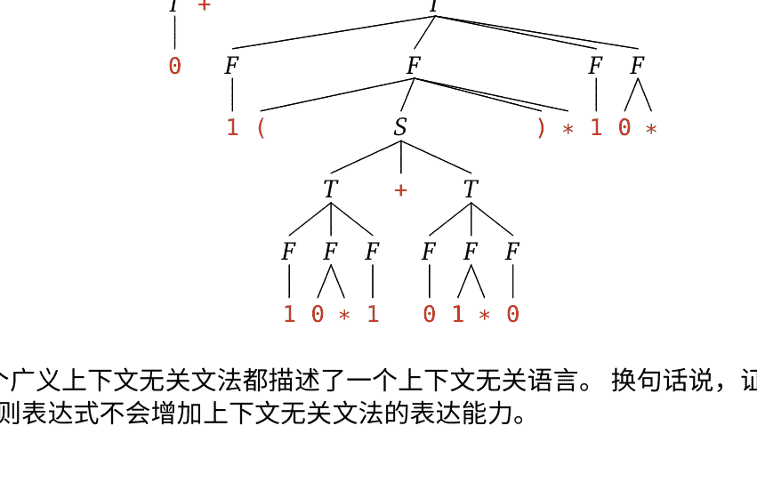

    证明每个广义上下文无关文法都描述了一个上下文无关语言。换句话说，证明允许在产生规则中出现正则表达式不会增加上下文无关文法的表达能力。

> 读者请注意！这是本讲义的第一版。有一些主题缺失，并且几乎肯定存在一些严重错误。请将错误报告和建议发送至jeffe@illinois.edu。

> 哦，奇妙！下一个新的配置会是什么？
我被多样性弄糊涂了。
— 威廉 • 卡洛斯 • 威廉姆斯

> 生命只有价值，而不是曾经活过。权力在休息的瞬间消失；它存在于从过去到新状态的过渡时刻，在冲击中，在追求目标的瞬间。
— 拉尔夫 • 瓦尔多 • 爱默生，《自力更生》，第一系列 (1841年)

## 3 有限状态机

### 3.1 直觉

假设我们想确定给定的二进制位字符串 w[1..n] 是否表示5的倍数。
经过一点思考，你可能会意识到你可以从左到右逐个读取 w 中的位，同时跟踪到目前为止已读取的前缀的模5的值。

```
5的倍数(w[1..n]):
    rem ← 0
    for i ← 1 to n
        rem ← (2·rem + w[i]) mod 5
    if rem = 0
        return TRUE
    else
        return FALSE
```

除了循环索引 i 之外，我们只需要读取整个输入字符串，这个算法还有一个单个局部变量 rem，它只有四个不同的值 (0, 1, 2, 3 或 4)。

这个算法已经在 O(n) 时间内运行，这是我们所能希望的最好情况—毕竟，我们必须读取输入中的每一位，但我们可以在实践中加速算法。让我们定义一个 change 或 transition 函数 δ : {0, 1, 2, 3, 4} × {0, 1} → {0, 1, 2, 3, 4} 如下：

δ(q, a) = (2q + a) mod 5.

(在这里，我将符号 0 和 1 隐式转换为相应的整数0和1。) 由于我们已经知道转换函数的所有值，我们可以将它们存储在一个预计算的表中，然后在 MULTIPLEOF5 的主循环中用一个简单的数组查找来替换计算。

我们还可以修改返回条件以检查不同的模5值。为了完全通用，我们用另一个数组查找来替换最后的 if-then-else 行，使用一个描述“可接受”最终模5值的布尔数组 A[0..4]。

在这两个修改之后，我们的算法可以按照以下方式进行重写，可以迭代地或递归地进行 (在初始调用中 q=0)：

```
做一些酷 (在 w[1 .. n] 中) :
    q ← 0
    对于 i 从 1 到 n
        q ← δ[q, w[i]]
    返回 A[q]
```

```
做一些酷 (q, w) :
    如果 w = ε
        返回 A[q]
    否则
        分解 w = 一个 · x
        返回 做一些酷 (δ(q, a), x)
```

如果我们想要使用我们的新的做一些酷算法来实现 MULTIPLEOF5，我们只需要给数组 δ 和 A 以下硬编码的值：

| q | δ[q, 0] | δ[q, 1] | A[q] |
|---|---|---|---|
| 0 | 0 | 1 | 真 |
| 1 | 2 | 3 | 假 |
| 2 | 4 | 0 | 假 |
| 3 | 1 | 2 | 假 |
| 4 | 3 | 4 | 假 |

我们还可以通过绘制一个有向图来可视化做一些酷的行为，其中顶点表示变量 q 的可能值——算法的可能状态——而边缘则用输入符号标记以表示状态之间的转换。具体来说，图中包括带标签的有向边缘 p → q 当且仅当 δ(p, a) = q。为了表示正确的返回值，我们使用双重圆圈绘制“可接受”的最终状态。以下是 MULTIPLEOF5 的结果图：

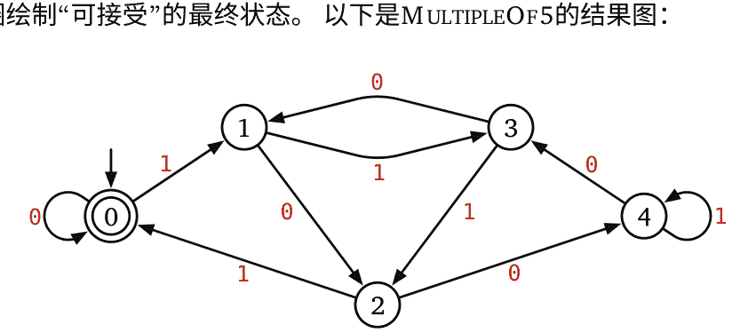

如果我们在字符串 **00101110110**（表示数字 374 的二进制形式）上运行 MULTIPLEOF5 算法，算法将执行以下一系列转换：

$$0 \xrightarrow{0} 0 \xrightarrow{0} 0 \xrightarrow{1} 1 \xrightarrow{0} 2 \xrightarrow{1} 0 \xrightarrow{1} 1 \xrightarrow{1} 3 \xrightarrow{0} 1 \xrightarrow{1} 3 \xrightarrow{1} 2 \xrightarrow{0} 4$$

因为最终状态不是“可接受”状态 0，所以算法正确地返回 FALSE。我们还可以将这一系列转换看作是在图中的一次遍历，这完全由起始状态 0 和边标签的序列决定；算法仅在这次遍历结束于“可接受”状态时返回 TRUE。

### 3.2 正式定义

我们刚刚描述的对象是一个有限状态机的示例。有限状态机是任何能够存在于有限数量的状态并根据输入符号序列在这些状态之间转换的系统/机器/算法的形式模型。

有限状态机也常被称为确定有限状态自动机，简称为 DFA。“确定性”一词意味着机器的行为完全由其确定。输入字符串；我们将在下一讲中讨论非确定性自动机。单词“自动机”（复数“自动机”）源自古希腊语 αὐτόματος，意为“自动行动”，来自于 αὐτό-（“自我”）和 -ματος（“思考，意愿”，拉丁语 *mentus*的词根）。

从形式上讲，每个有限状态机由五个组成部分组成：

- 一个任意的有限集合 Σ，称为输入字母表。
- 另一个任意的有限集合 Q，其元素称为状态。
- 一个任意的 **转换** 函数 δ: Q × Σ → Q。
- 一个起始状态 s ∈ Q。
- 一个接受状态的子集 A ⊆ Q。

有限状态机的行为受到输入字符串 w 的控制，该字符串是来自输入字母表 Σ 的有限序列。机器按顺序（从左到右）逐个读取 w 中的符号。在任何时候，机器都有一个当前状态 q；最初 q 是机器的起始状态 s。每次机器从输入字符串中读取一个符号 a 时，它的当前状态从 q 转换到 δ(q, a)。在所有字符都被读取后，如果当前状态在 A 中，机器接受 w；否则拒绝 w。换句话说，每个有限状态机都运行算法 DO SOMETHING COOL! 有限状态机 M 的语言，表示为 L(M)，是 M 接受的所有字符串的集合。

更正式地说，我们将有限状态机的转换函数扩展为一个 δ 函数 δ*: Q × Σ* → Q，该函数按照以下方式对字符串进行转换：

$$
δ^*(q, w) := \begin{cases}
q & \text{if } w = \varepsilon, \\
δ^*(δ(q, a), x) & \text{if } w = ax.
\end{cases}
$$

最后，一个有限状态机接受一个字符串 w 当且仅当 δ*(s, w) ∈ A，否则拒绝 w。（将此定义与递归形式的 DO SOMETHING COOL! 进行比较）

例如，我们最终的 MULTIPLEOF5 算法是一个具有以下组件的 DFA：

- 输入字母表: Σ = {0, 1}
- 状态集合: Q = {0, 1, 2, 3, 4}
- 转移函数: δ(q, a) = (2q + a) mod 5
- 初始状态: s = 0
- 接受状态: A = {0}

这台机器拒绝字符串 00101110110，因为

$$
\begin{aligned}
δ^*(0, \mathbf{00101110110}) &= δ^*(δ(0, \mathbf{0}), \mathbf{0101110110}) \\
&= δ^*(0, \mathbf{0101110110}) = δ^*(δ(0, \mathbf{0}), \mathbf{101110110}) \\
&= δ^*(0, \mathbf{101110110}) = δ^*(δ(0, \mathbf{1}), \mathbf{01110110}) \\
&= δ^*(1, \mathbf{01110110}) = δ^*(δ(1, \mathbf{0}), \mathbf{1110110}) = \cdots \\
&\quad\vdots \\
&\cdots = δ^*(1, \mathbf{110}) = δ^*(δ(1, \mathbf{1}), \mathbf{10}) \\
&= δ^*(3, \mathbf{10}) = δ^*(δ(3, \mathbf{1}), \mathbf{0}) \\
&= δ^*(2, \mathbf{0}) = δ^*(δ(3, \mathbf{0}), \varepsilon) \\
&= δ^*(4, \varepsilon) = 4 \notin A.
\end{aligned}
$$

我们已经看到了这整个转换序列的更图形化的表示：

```
0 →0 →0 →1 →2 →0 →1 →3 →1 →3 →2 →4
```

箭头符号更容易阅读和书写具体的例子，但令人惊讶的是，大多数人实际上发现更正式的函数符号在正式证明中更容易使用。尝试两者！我们可以等价地将 DFA 定义为一个有向图，其顶点是状态 Q ，其边缘带有来自 Σ 的符号，使得每个顶点都有恰好一个带有每个标签的出边。在我们的有限状态机的绘图中，起始状态 s 总是由一个入箭头表示，而接受状态 A 总是由双圆圈表示。通过归纳，对于任何字符串 w ∈ Σ*，这个图包含一个从 s 开始的唯一路径，其边缘按顺序标记为 w 中 的符号。如果这个路径在一个接受状态结束，机器就接受 w。 这个图形化的 DFA 表示对于培养直觉和设计 DFA 非常有用。对于证明，使用扩展转换函数或标记图形写作主要是个人口味问题，但是（尽管我希望不 是这样）我发现使用函数表示更容易写出正确的证明。

### 3.3 另一个例子

下面的图示显示了一个有输入字母表 Σ = {0, 1}，状态集合 Q = {s, t}，起始状态 s，一个接受状态 t，以及转换函数。

```
δ(s, 0) = s, δ(s, 1) = t, δ(t, 0) = t, δ(t, 1) = s.
```

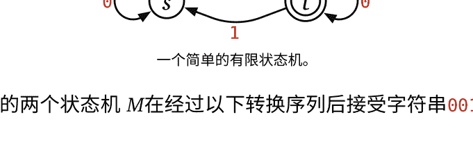

一个简单的有限状态机。

例如，这个页面顶部的两个状态机 M 在经过以下转换序列后接受字符串 00101110100：

```
s →s →s →t →t →s →t →s →t →t →t.
```

同样的状态机 M 在经过以下转换序列后拒绝字符串 11100101：

```
s →t →s →t →t →s →t →t →s.
```

最后，M 拒绝空字符串，因为起始状态 s 不是接受状态。通过这些例子和其他例子，很容易猜测 M 的语言是由所有由 0 和 1 组成且 1 的个数为奇数的字符串组成的。所以让我们来证明一下！

证明（繁琐的情况分析）：让 #(a,w) 表示符号 a 在字符串 w 中出现的次数。我们将证明以下更强的结论，对于任意字符串 w 都成立。

```
δ^*(s,w) = \begin{cases} s & \text{if } \#(1,w) \text{ 是偶数} \\ t & \text{if } \#(1,w) \text{ 是奇数} \end{cases} \quad \text{并且} \quad δ^*(t,w) = \begin{cases} t & \text{if } \#(1,w) \text{ 是偶数} \\ s & \text{if } \#(1,w) \text{ 是奇数} \end{cases}
```

让 w 是任意字符串。假设对于任何比 w 短的字符串 x，我们有 δ*(s,x)=s 和 δ*(t,x)=t，如果 x 中 1 的个数是偶数，那么 δ*(s,x)=t 和 δ*(t,x)=s，如果 x 中 1 的个数是奇数。有五种情况需要考虑。

- 如果 w = ε，那么 w 包含偶数个 1 和 δ*(s, w) = s 和 δ*(t, w) = t 根据定义。

- 假设 w = 1x 且 #(1, w) 是偶数。那么 #(1, x) 是奇数，这意味着

  δ*(s, w) = δ*(δ(s, 1), x)   根据 δ* 的定义
  = δ*(t, x)               根据 δ 的定义
  = s                     根据归纳假设

  δ*(t, w) = δ*(δ(t, 1), x)   根据 δ* 的定义
  = δ*(s, x)               根据 δ 的定义
  = T                     根据归纳假设

由于剩下的情况类似，我将省略逐行的证明。

- 如果 w = 1x 且 #(1, w) 是奇数，则 #(1, x) 是偶数，因此归纳假设成立

  δ*(s, w) = δ*(δ(s, 1), x) = δ*(t, x) = t
  δ*(t, w) = δ*(δ(t, 1), x) = δ*(s, x) = s

- 如果 w = 0x 且 #(1, w) 是偶数，则 #(1, x) 是偶数，因此归纳假设成立

  δ*(s, w) = δ*(δ(s, 0), x) = δ*(s, x) = s
  δ*(t, w) = δ*(δ(t, 0), x) = δ*(t, x) = t

- 最后，如果 w = 0x 且 #(1, w) 是奇数，则 #(1, x) 是奇数，因此归纳假设成立

  δ*(s, w) = δ*(δ(s, 0), x) = δ*(s, x) = t
  δ*(t, w) = δ*(δ(t, 0), x) = δ*(t, x) = s

□

注意，这个证明包含 |Q|²·|Σ| + |Q| 单独的归纳论证。对于每一对状态 p 和 q，我们必须讨论语言中的字符串 w，使得 δ*(p, w) = q，并且我们必须考虑 w 中的每个第一个符号。我们还必须讨论 δ 对于每个状态 p，(p, ε) 都成立。这些参数中的每一个通常都很简单，但很容易在大量情况中迷失。

然而，对于这个特定的证明，我们可以通过从尾递归转换为头递归来减少情况的数量。对于所有字符串 x ∈ Σ* 和符号 a ∈ Σ，以下等式成立：

> δ*(q, xa) = δ(δ*(q, x), a)

我们将这个等式的归纳证明留作一个简单的练习（提示，提示）。

证明（巧妙的重命名，头归纳）：让我们将状态 0 和 1 分别重命名为 s 和 t。然后，过渡函数可以简洁地描述为 δ(q, a) = (q + a) mod 2。

现在我们声称对于每个字符串 w，我们有 δ*(0, w) = #(1, w) mod 2。所以让 w 是一个任意的字符串，并假设对于任何比 w 短的字符串 x，δ*(0, x) = #(1, x) mod 2。只有两种情况需要考虑：w 为空或者不为空。

- 如果 w = ε，那么 δ*(0, w) = 0 = #(1, w) mod 2 根据定义。

- 否则，$w = x a$ 表示某个字符串 $x$ 和某个符号 $a$, 我们有
  $\delta^*(0, w) = \delta(\delta^*(0, x), a)$
  $= \delta(\#(1, x) \bmod 2, a)$ 根据归纳假设
  $= (\#(1, x) \bmod 2 + a) \bmod 2$ 根据 $\delta$ 的定义
  $= (\#(1, x) + a) \bmod 2$ 根据模2的定义
  $= (\#(1, x) + \#(1, a)) \bmod 2$ 因为 $\#(1, 0) = 0$ and $\#(1, 1) = 1$
  $= (\#(1, x a)) \bmod 2$ 根据 $\#$ 的定义
  $= (\#(1, w)) \bmod 2$ 因为 $w = x a$ $\square$

嗯。这个“巧妙”的证明确实比之前的蛮力证明更短，但它真的更“好”吗？
“更简单”？更直观？更容易理解？我持怀疑态度。有时候蛮力确实更有效。

### 3.4 另一个例子

作为一个更复杂的例子，考虑一下魔方，这是一个众所周知的机械谜题，由匈牙利的埃尔诺·鲁比克和日本的石木辉敏在20世纪70年代中期独立发明。这个谜题有精确地 519,024,039,293,878,272,000 个不同的配置。在唯一的解决配置中，魔方的六个面上每个面都只显示一种颜色。我们可以通过将魔方的六个面之一顺时针或逆时针旋转90度来改变魔方的配置。魔方有六个面（前、后、左、右、上、下），因此有正好十二种可能的转动方式，通常用符号 $\text{R, L, F, B, U, D, $\overline{\text{R}}$, $\overline{\text{L}}$, $\overline{\text{F}}$, $\overline{\text{B}}$, $\overline{\text{U}}$, $\overline{\text{D}}$}$ 表示，其中字母表示要转动的面，字母上方的横线表示逆时针转动，字母上方没有横线表示顺时针转动。因此，我们可以将魔方表示为一个具有 519,024,039,293,878,272,000 个状态和 12 个符号的有限状态机；或者等价地，表示为一个具有 519,024,039,293,878,272,000 个顶点和每个顶点有 12 条出边的有向图。实际上，状态的数量对我们来说太大了，无法实际绘制出这个机器或明确指定其转换函数；尽管如此，状态的数量仍然是有限的。如果我们将起始状态设为 $s$，唯一的接受状态设为解决状态，那么这个有限状态机的语言就是所有使魔方保持不变的移动序列的集合。

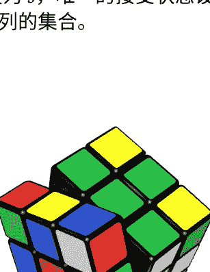

### 3.5 构建DFA

本节介绍了一些构建接受特定语言的 DFA 的示例，从而证明了这些语言是自动的。与算法设计中的通常情况一样，没有纯机械的配方，没有自动的方法，也没有构建通用 DFA 的算法。然而，以下示例展示了几种有用的设计策略。

## 3.5.1 超字符串

也许最简单的经验法则是尝试构建一个类似于MULTIPLEOF5的算法：通过符号的简单for循环，使用恒定数量的变量，其中每个变量（除了循环索引）只有恒定数量的可能值。这里，“恒定”意味着一个实际的数字，它不是输入大小的函数。您应该能够在编译时计算出每个变量的可能值的数量。

例如，以下算法确定给定字符串是否包含子字符串11。

```
C包含 11(w[1..n]):
  found ← FALSE
  for i ← 1 to n
    if i = 1
      last2 ← w[1]
    else
      last2 ← w[1].w[2]
    if last = 11
      found ← TRUE
  return found
```

除了循环索引外，该算法还有两个变量。

- 一个布尔标志 found表示我们是否已经看到了子字符串 11。这个变量有两个可能的值：TRUE和FALSE。
- 一个字符串 last2包含我们迄今为止读取的最后（最多）三个符号。这个变量有7个可能的值：ε, 0, 1, 00, 01, 10, 和 11。

因此，总共，算法最多可以有 2 × 7 = 14种可能的状态，每个可能的配对 (找到,最后2个)对应一个状态。因此，我们可以将CONTAINS11的行为编码为一个具有十四个状态的DFA，其中起始状态为 (假, ε)，接受状态为所有形式为 (真, *) 的七个状态。转换函数在下表中描述（为了节省空间，分为两部分）：

| q | δ[q, 0] | δ[q, 1] | | q | δ[q, 0] | δ[q, 1] |
| :--- | :--- | :--- | :--- | :--- | :--- | :--- |
| (假, ε) | (假, 0) | (假, 1) | | (真, ε) | (真, 0) | (真, 1) |
| (假, 0) | (假, 00) | (假, 01) | | (真, 0) | (真, 00) | (真, 01) |
| (假, 1) | (假, 10) | (真, 11) | | (真, 1) | (真, 10) | (真, 11) |
| (假, 00) | (假, 00) | (假, 01) | | (真, 00) | (真, 00) | (真, 01) |
| (假, 01) | (假, 10) | (真, 11) | | (真, 01) | (真, 10) | (真, 11) |
| (假, 10) | (假, 00) | (假, 01) | | (真, 10) | (真, 00) | (真, 01) |
| (假, 11) | (假, 10) | (真, 11) | | (真, 11) | (真, 10) | (真, 11) |

例如，给定输入字符串 1001011100，这个DFA执行以下转换序列然后接受。

(假, ε) → (假, ) → (假, 10) → (假, 00) → 1
(假, 01) → (假, 10) → (假, 01) →
(真, 11) → (真, 11) → (真, 10) → (真, 00)

## 3.5.2 减少状态

你可能猜到，我们刚刚构建的暴力DFA比必要的状态要多得多，尤其是在看到其转换图之后：

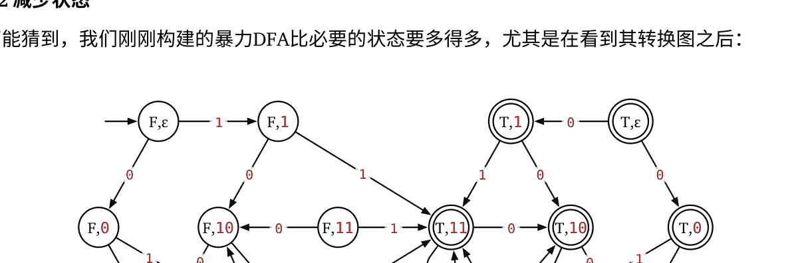

例如，我们实际上不需要记住最后两个符号，而只需要记住倒数第二个符号，因为最后一个符号是我们当前正在读取的符号。 这个观察结果使我们能够将状态数从十四个减少到只有六个。 一旦状态的标志部分设置为真，我们就知道机器最终会接受，所以我们可以将两个接受状态合并在一起。

最后，更微妙的是，因为从 (FALSE, ε)和 (FALSE, 0)出发的所有转换都是相同的，我们也可以将这两个状态合并在一起。 最后，我们得到了以下只有三个状态的DFA：

- 起始状态，表示机器尚未读取子字符串 11并且没有刚刚读取过符号 1。
- 中间状态，表示机器尚未读取子字符串 11但刚刚读取过符号 1。
- 唯一的接受状态，表示机器已经读取了子字符串 11。

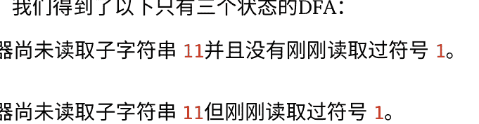

在本讲座结束时，我将描述一种将任何给定的DFA转换为具有最少可能状态的等价DFA的高效算法。 鉴于存在这种最小化算法，通过手动优化DFA的动机非常小。 清晰度比简洁性更重要，尤其是在这门课程中。

## 3.5.3 在此之后的每个东西

假设我们想要接受包含子字符串 00在每个子字符串 11之后出现的字符串集合。 等价地，我们想要拒绝在某个子字符串 11之前出现某个 00的字符串。 通常，设计一个DFA来检查一个字符串是否不在某个集合中的最简单方法是首先构建一个在该集合中的DFA，然后反转该机器中的接受状态。

根据前面的例子，我们知道存在一个三状态的DFA $M_{11}$，它接受包含子字符串 11 的字符串集合，以及一个几乎相同的DFA $M_{00}$，它接受包含子字符串 00 的字符串集合。通过将 $M_{00}$ 的接受状态与 $M_{11}$ 的起始状态相对应，我们得到一个五状态的DFA，它接受包含 00 在 11 之前的字符串集合。最后，通过反转接受状态，我们得到了我们想要的DFA。

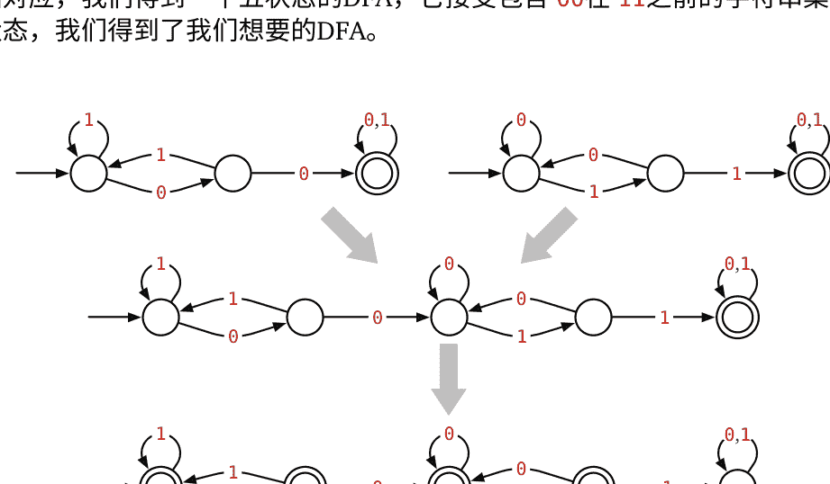

## 3.5.4 这个和那个：乘积构造

现在假设我们想要接受包含 00 和 11 作为子字符串的所有字符串，无论顺序如何。直观上，我们希望并行运行两个早期的DFA——DFA $M_{00}$ 用于检测 00 的超字符串，以及DFA $M_{11}$ 用于检测 11 的超字符串——然后仅当这两个DFA都接受输入字符串时才接受。实际上，我们可以将这种“并行计算”精确地编码为一个单一的DFA，其状态是所有有序对 $(p,q)$，其中 $p$ 是 $M_{00}$ 中的一个状态，$q$ 是 $M_{11}$ 中的一个状态。新的“并行”DFA包括转换 $(p,q) \xrightarrow{a} (p',q')$ 当且仅当 $M_{00}$ 包含转换 $p \xrightarrow{a} p'$ 且 $M_{11}$ 包含转换 $q \xrightarrow{a} q'$ 时。最后，状态 $(p,q)$ 是接受状态当且仅当 $p$ 和 $q$ 分别是它们各自机器中的接受状态。结果是一个九状态的DFA，如下一页所示。

更一般地，让 $M_1=(\Sigma, Q_1, \delta_1, s_1, A_1)$ 是一个接受某个语言 $L_1$ 的任意DFA，让 $M_2=(\Sigma, Q_2, \delta_2, s_2, A_2)$ 是一个接受某个语言 $L_2$（在相同的字母表 $\Sigma$ 上）的任意DFA。我们可以构建一个第三个DFA $M=(\Sigma, Q, \delta, s, A)$ 如下，它接受交集语言 $L_1 \cap L_2$。

```
$Q := Q_1 \times Q_2 = \{(p,q)\mid p \in Q_1 \text{ 且 } q \in Q_2\}$
$s := (s_1, s_2)$
$A := A_1 \times A_2 = \{(p,q)\mid p \in A_1 \text{ and } q \in A_2\}$
$\delta((p,q), a) := (\delta_1(p,a), \delta_2(q,a))$
```

为了确信这个乘积构造实际上是正确的，考虑扩展转移函数 $\delta^*: (Q \times Q') \times \Sigma^* \to (Q \times Q')$，它作用于字符串而不是单个符号。回想一下这个函数的递归定义如下：

```
$\delta^*((p,q), w) := \begin{cases} q & \text{if } w = \varepsilon, \ \delta^*(\delta((p,q), a), x) & \text{如果 } w = ax. \end{cases}$
```

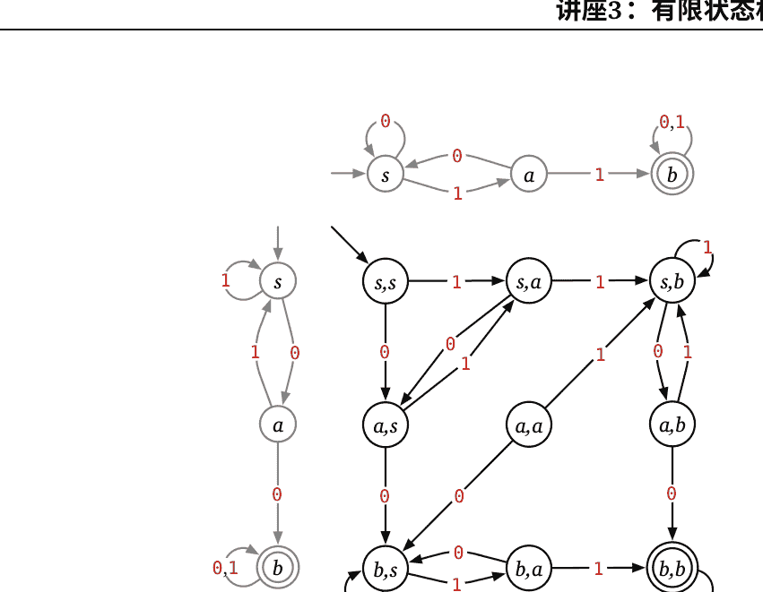

归纳定义追踪给我们恒等式 $\delta^*((p,q),w) = (\delta_1^*(p,w), \delta_2^*(q,w))$ 对于任何字符串w:
$\delta^*((p,q), \varepsilon) = (p,q)$ 根据 $\delta^*$ 的定义
$= (\delta_1^*(p, \varepsilon), \delta_2^*(q, \varepsilon))$ 根据 $\delta_1$ 和 $\delta_2$ 的定义,
$\delta^*((p,q), ax) = \delta^*((\delta((p,q), a), x)$ 根据 $\delta^*$ 的定义
$= \delta^*((\delta_1(p,a), \delta_2(q,a)), x)$ 根据 $\delta$ 的定义
$= (\delta_1^*((\delta_1(p,a), x), \delta_2^*((\delta_2(q,a), x))$ 根据归纳假设
$= (\delta_1^*(p, ax), \delta_2^*(q, ax))$ 根据 $\delta_1$ 和 $\delta_2$ 的定义.

现在根据这个看似难以理解的符号墙，对于任何字符串 w，我们有 $\delta^*$ 换句话说，当且仅当 $M_1$和 $M_2$都接受字符串w时， M接受w，如所需。

通常情况下，这种构造技术不一定产生最小DFAs。例如，在我们的第一个示例中，一个产品DFA，如上所示，中央状态 (a,a)无法通过任何其他状态到达，因此是多余的。无论如何。

类似的产品构造可以用来构建接受任何其他布尔组合的DFA；事实上，唯一需要更改的部分是接受状态的选择。例如：

- 要接受并集 $L_1\cup L_2$，定义 $A = \{(p,q) \mid p\in A_1 \text{ 或 } q\in A_2\}$。
- 要接受差集 $L_1\setminus L_2$，定义 $A = \{(p,q) \mid p\in A_1 \text{ 但不是 } q\in A_2\}$。
- 要接受对称差集 $L_1\oplus L_2$，定义 $A = \{(p,q) \mid p\in A_1 \text{ xor } q\in A_2\}$。

此外，通过级联这种产品构造，我们可以构建接受任意有限集合的正则语言的任意布尔组合的DFA。

## 3.6 决策算法

由于我们还没有讨论过图算法，或者甚至真正讨论过图，所以我们在这里无法说太多。也许这个讨论应该简单地移到图遍历的笔记中。

- 从标签为 w的 q0开始，沿着唯一的路径前进。根据定义，w ∈ L(M)当且仅当这条路径导致一个接受状态。
- 如果从 q0无法到达任何接受状态，则语言 L(M)为空。可以通过任意优先搜索以 O(n)的时间检查这个条件，其中 n是状态的数量。或者，但不太有用的是，L(M) = ∅当且仅当 L(M)不包含任何长度小于 n的字符串 w。
- 从 q0（通过任意第一次搜索）删除所有无法到达的状态。然后 L(M) 是有限的，当且仅当简化的DFA是有向无环图；这个条件可以通过深度优先搜索来检查。或者，但是不太有用的是，L(M) 是有限的，当且仅当 L(M) 不包含任何字符串w，使得| w| < 2 n.
- 从 q0（通过任意第一次搜索）删除所有无法到达的状态。.然后 L(M) = Σ*当且仅当 M中的每个状态都是接受状态。
- 构建一个DFA N，使得 L(N) = L(M) \ L(M′) 使用标准的乘积构造法，然后检查 L(N) = ∅是否成立。

## 3.7 闭包性质

我们还没有证明自动语言是正则的，所以从形式上来说，现在一些这些是自动语言的闭包性质。

- 补集（对于DFA来说很容易，对于正则表达式来说很难。）
- 连接（对于正则表达式来说很简单，对于DFA来说很难。）
- 并集（对于正则表达式来说很简单，通过乘积对于DFA来说很容易。）
- 交集（对于正则表达式来说很难，通过乘积对于DFA来说很容易。）
- 差集（对于正则表达式来说很难，通过乘积对于DFA来说很容易。）
- Kleene星号：等待NFA（对于正则表达式来说很简单，对于DFA来说很难。）
- 同态：只是顺便提一下
- 逆同态：只是顺便提一下

## 3.8 愚弄集合

固定任意字母表 Σ上的任意语言 L。对于任意字符串 x，y，z ∈ Σ*，如果只有字符串 xz和 yz中的一个属于 L，则我们说z可以区分x和y。如果没有字符串可以区分 x和 y，则我们说 x和 y是L-等价的，并且写作 x ≡_L y。因此，

x ≡_L y  ⟺  对于每个字符串 z ∈ Σ*，如果且仅如果 xz ∈ L，则 yz ∈ L。

例如，让 L表示由 {0,1}组成的字符串语言，其中 0的数量为偶数，1的数量为奇数。那么字符串 x = 01和 y = 0011通过字符串 z = 100进行区分，因为

xz = 01 • 100 = 01100 ∈ L_eo

yz = 0011 • 100 = 0011100 ∈ L_eo.

另一方面，很容易证明（提示，提示），字符串 0001和 1011是 L等价的。

让 $M$ 是任意语言 $L$ 的任意DFA，$x$ 和 $y$ 是任意字符串。如果 $x$ 和 $y$ 在 $M$ 中导致相同的状态，即 $\delta^*(s, x) = \delta^*(s, y)$，那么我们有

$$\delta^*(s, xz) = \delta^*(\delta^*(s, x), z) = \delta^*(\delta^*(s, y), z) = \delta^*(s, yz)$$

对于任何字符串 $z$。特别地，要么 $M$ 接受 $x$ 和 $y$，要么 $M$ 拒绝 $x$ 和 $y$，因此 $x \equiv_L y$。由此可知，如果 $x$ 和 $y$ 不是 $L$ 等价的，则接受 $L$ 的任何DFA至少有两个不同的状态 $\delta^*(s,x) = \delta^*(s,y)$。

最后，对于 $L$ 来说，一个愚弄集合是一个包含 $F$ 字符串的集合，其中每对字符串都有一个区分后缀。例如，$F = \{01, 101, 010, 1010\}$ 是语言 $L$ 的一个愚弄集合，该语言包含有偶数个 $0$ 和奇数个 $1$ 的字符串，因为 $F$ 中的每对字符串都有一个区分后缀：

- $0$ 区分 $01$ 和 $101$;
- $0$ 区分 $01$ 和 $010$;
- $0$ 区分 $01$ 和 $1010$;
- $10$ 区分 $101$ 和 $010$;
- $1$ 区分 $101$ 和 $1010$;
- $1$ 区分 $010$ 和 $1010$.

鸽巢原理现在暗示着对于任何整数 $k$，如果语言 $L$ 由一个具有 $k$ 个状态的DFA接受，则 $L$ 的每个愚弄集合最多包含 $k$ 个字符串。这个简单的观察有两个直接的推论。

首先，对于任何整数 $k$，如果 $L$ 有一个大小为 $k$ 的愚弄集合，则接受 $L$ 的每个DFA至少有 $k$ 个状态。例如，愚弄集合 $\{01, 101, 010, 1010\}$ 证明了任何接受 $L_{eo}$ 的DFA至少有四个状态。因此，我们可以使用愚弄集合来证明某些DFA尽可能小。

其次，更有趣的是，如果一个语言 $L$ 被任何DFA接受，则 $L$ 的任何愚弄集必须是有限的。等价地：如果 $L$ 有一个无限愚弄集，则 $L$ 不被任何DFA接受。这可以说是证明一个语言非正则的最简单且最强大的方法。下面是一些愚弄集技术的典型示例。

### **引理3.1.** 语言 $L = \{0^n 1^n \mid n \ge 0\}$ 不是正则的。

证明：考虑集合 $F = \{0^n \mid n \ge 0\}$，或者更简单地说 $F = 0^*$。设字符串 $x$ 和 $y$ 是 $F$ 中的任意不同字符串。那么我们必须有 $x = 0^i$ 和 $y = 0^j$，其中 $i = j$ 是整数。后缀 $z = 1^i$ 可以区分字符串 $x$ 和 $y$，因为 $xz = 0^i 1^i \in L$，但 $yz = 0^i 1^j \in L$。我们得出结论 $F$ 是 $L$ 的一个愚弄集。因为 $F$ 是无限的，$L$ 不能是正则的。 $\square$

### **引理3.2.** 语言 $L = \{ww^R \mid w \in \Sigma^*\}$ 中的偶数长度回文不是正则的。

证明：设 $x$ 和 $y$ 是 $0^*1$ 中的任意不同的字符串。那么我们必须有 $x = 0^i 1$ 和 $y = 0^j 1$，其中 $i = j$ 是整数。后缀 $z = 10^i$ 可以区分 $x$ 和 $y$，因为 $xz = 0^i 1 1 0^i \in L$，但 $yz = 0^i 1 1 0^j \in L$。我们得出结论，$0^*1$ 是 $L$ 的欺骗集合。由于 $0^*1$ 是无限的，$L$ 不能是正则的。 $\square$

### **引理3.3.** 语言 $L = \{0^{2n} \mid n \ge 0\}$ 不是正则的。

证明：假设 $x$ 和 $y$ 是 $L$ 中的任意不同的字符串。那么我们必须有 $x = 0^{2i}$ 和 $y = 0^{2j}$，其中 $i = j$ 是整数。后缀 $z = 0^{2i}$ 可以区分 $x$ 和 $y$，因为 $txz = 0^{2i+2i} = 0^{2^{i+1}} \in L$，但是 $yz = 0^{2i+2j} \in L$。我们得出结论，$L$ 本身是 $L$ 的一个愚弄集合。由于 $L$ 是无限的，$L$ 不能是正则的。 $\square$

### 引理3.4. 语言 $L = \{0^p \mid p\text{是质数}\}$ 不是正则的。

证明：再次，我们使用 $0^*$ 作为我们的愚弄集合，但是实际的论证比我们之前的例子要复杂一些。

让 $x$ 和 $y$ 是任意不同的字符串在 $0^*$ 中。 那么我们必须有 $x = 0^i$ 和 $y = 0^j$ 对于一些整数 $i = j$。 不失一般性，假设 $i < j$。 让 $p$ 是大于 $i$ 的任意素数。 因为 $p + 0(j-i)$ 是素数且 $p + p(j-i) > p$ 不是，必须存在一个正整数 $k \le p$ 使得 $p+(k-1)(j-i)$ 是素数但 $p+k(j-i)$ 不是。然后后缀 $0^{p+(k-1)j-ki}$ 区分 $x$ 和 $y$：

$\begin{align*}
xz &= 0^i 0^{p+(k-1)j-ki} = 0^{p+(k-1)(j-i)} \in L \quad &\text{因为 } p + (k-1)(j-i) \text{ 是素数；}\\
yz &= 0^j 0^{p+(k-1)j-ki} = 0^{p+k(j-i)} \in L \quad &\text{因为 } p + k(j-i) \text{不是质数。}
\end{align*}$

(因为 $i < j$ 且 $i < p$，后缀 $0^{p+(k-1)j-ki} = 0^{(p-i)+(k-1)(j-i)}$ 有正长度，因此实际上存在！)我们得出结论，$0^*$ 确实是 $L$ 的一个愚弄集合，这意味着 $L$ 不是正则的。 $\square$

许多学生问的一个自然问题是“你是怎么想出那个愚弄集合的？”也许最简单的经验法则是对于大多数语言 $L$——特别是对于几乎所有学生在作业或考试中被要求证明非正则的语言——要么一些简单的正则语言如 $0^*$ 或 $10^*1$ 是愚弄集合，要么语言 $L$ 本身就是愚弄集合。（当然，也有一些精心设计的反例。）

### *3.9 Myhill-Nerode定理

愚弄集技术意味着一个语言被DFA接受的必要条件是该语言没有无限愚弄集。 事实上，这个条件也是充分的。 下面这个强大的定理首先由Anil Nerode在1958年证明，加强了John Myhill在1957年的结果。

**Myhill-Nerode定理。** 对于任何语言 $L$，以下是相等的：

- (a) 接受 $L$ 的DFA中的最小状态数，
- (b) 对于 $L$ 的最大愚弄集的大小，以及
- (c) $\equiv_L$ 的等价类的数量。

特别地，如果 $L$ 被DFA接受，则 $L$ 的每个愚弄集都是有限的。

证明：设 $L$ 是任意的语言。

我们已经证明了对于 $L$ 的任何愚弄集合的大小都不超过接受 $L$ 的任何DFA的状态数，因此 (a) $\le$ (b) 。 根据定义，如果 $F \subseteq \Sigma^*$ 是 $L$ 的愚弄集合，那么 $F$ 中每个等价类中最多只包含一个字符串；因此，(b) = (c) 。 我们通过证明 (a) $\ge$ (c) 来完成证明。

我们已经证明了如果 $\equiv_L$ 有无限多个等价类，那么没有一个DFA能够接受 $L$，因此假设等价类的数量是有限的。 对于任意字符串 $w$，我们用 $[w]$ 表示它的等价类。 我们定义一个DFA $M_\equiv = (\Sigma, Q, s, A, \delta)$ 如下：

```
$\begin{align*}
Q &:= \{[w] \mid w \in \Sigma^*\} \\
s &:= [\varepsilon] \\
A &:= \{[w] \mid w \in L\} \\
\delta([w], a) &:= [w \bullet a]
\end{align*}$
```

> $^1$Myhill认为更细的等价关系 $x \sim_L y$，意味着只有当所有字符串 $w$ 和 $z$ 满足 $wxz \in L$ 时，才有 $wyz \in L$，并证明了 $L$ 是正则的当且仅当 $\sim_L$ 定义了有限数量的等价类。 和Myhill早期的自动机研究一样，这个结果出现在一份未发表的空军技术报告中。 现代的Myhill-Nerode定理以更一般的形式出现在Nerode的1958年论文中，而这篇论文（不出所料）没有引用Myhill。

## 算法

## 讲座3: 有限状态机 [Fa'14]

我们声称这个DFA接受语言 $L$；这个声称完成了定理的证明。
但在我们能够证明关于这个DFA的任何事情之前，我们首先需要验证它是否确实是良定义的。
设 $x$ 和 $y$ 是两个字符串，满足 $[x] = [y]$。根据 $L$-等价的定义，对于任意字符串 $z$，当且仅当 $xz \in L$ 时，才有 $yz \in L$。由此可知，对于任意符号 $a \in \Sigma$ 和任意字符串 $z'$，当且仅当 $xaz' \in L$ 时，才有 $yaz' \in L$。因此，根据 $L$-等价的定义，对于每个符号 $a \in \Sigma$，我们有 $[xa] = [ya]$。我们得出结论，函数 $\delta$ 确实是良定义的。

一个简单的归纳证明表明 $\delta^*([\varepsilon], x) = [x]$ 对于每个字符串 $x$。因此，如果 $[x] = [w]$ 对于某个字符串 $w \in L$ 时，M接受字符串 $x$。但是如果 $[x] = [w]$，那么根据定义 (设置 $z = \varepsilon$)，我们有 $w \in L$，则 $x \in L$。因此，如果且仅如果 $x \in L$，M接受 $x$。换句话说，M接受 $L$，正如所声称。因此证明完成。

## ★3.10 最小自动机

给定一个DFA $M = (\Sigma, Q, s, A, \delta)$，假设我们想找到另一个DFA $M' = (\Sigma, Q', s', A', \delta')$，它接受相同的语言，但状态最少。在最后这一节中，我们描述了一种高效的算法来最小化DFA，这个算法最早由Edward Moore在1956年以稍微不同的形式描述。我们根据两个参数来分析Moore算法的运行时间：$n = |Q|$ 和 $\sigma = |\Sigma|$。

在预处理阶段，我们找到并删除任何无法从起始状态到达的状态 $s$；这种过滤可以使用任何图遍历算法在 $O(n\sigma)$ 时间内完成。所以从现在开始，我们假设所有的状态都可以从 $s$ 到达。

现在定义修剪后的DFA中的两个状态 $p$ 和 $q$ 是不可区分的，记作 $p \sim q$，如果满足以下条件之一：

- $p \in A$ 且 $q \in A$，或者
- 对于某个 $a \in \Sigma$，$\delta(p, a) \sim \delta(q, a)$

等价地，$p \sim q$ 当且仅当存在一个字符串 $z$，使得状态 $\delta^*(p, z)$ 和 $\delta^*(q, z)$ 中只有一个接受状态。（听起来熟悉吗？）直观上，主要算法假设所有的状态在未被证明不等价之前都是等价的，然后反复寻找可以证明不可区分的状态对。

主要算法维护一个二维表，由状态索引，其中 $Dist[p, q] = \text{TRUE}$ 表示我们已经证明了状态 $p$ 和 $q$ 是不同的。最初，对于所有的状态 $p$ 和 $q$，我们设置 $Dist[p, q] \leftarrow \text{TRUE}$ 如果 $p \in A$ 和 $q \notin A$ 或者 $p \notin A$ 和 $q \in A$，否则 $Dist[p, q] = \text{FALSE}$。然后我们重复地考虑每对状态和每个符号，以找到更多的不同状态对，直到我们在不修改表的情况下完成一次完整的遍历。表填充算法可以总结如下：$^2$

> 不要只是抱怨；实际上解释一下摩尔算法作为一种动态规划。需要证明如果两个状态可以被区分，它们可以通过长度最多为 $n$ 的字符串来区分。

$^2$更有经验的读者对于任何算法仅仅是填充表格而不是评估递归的建议都会感到恶心；这个算法也不例外。考虑布尔函数 $Dist(p, q, k)$，当且仅当存在长度不超过 $k$ 的某个字符串可以区分 $p$ 和 $q$ 时，它等于 $\text{TRUE}$。这个函数遵循以下递归关系：

```
Dist(p, q, k) = \begin{cases} (p \in A) \oplus (q \in A) & \text{如果 } k = 0, \\ \bigvee_{a \in \Sigma} Dist(p, q, k-1) \lor \bigvee_{a \in \Sigma} Dist(\delta(p, a), \delta(q, a), k-1) & \text{otherwise.} \end{cases}
```

这里介绍的“填表”算法只是一种空间高效的动态规划算法，用于评估这个递归关系。

compute(Σ, Q, s, A, δ):
对于所有 p ∈ Q对于所有 q ∈ Q
如果 (p ∈ A且 q ∉ A) 或者 (p ∉ A且 q ∈ A)
距离[p, q] ← 真
否则
距离[p, q] ← 假
未完成 ← 真
当未完成
未完成 ← 假
对于所有 p ∈ Q对于所有 q ∈ Q
如果距离[p, q] = 假
对于所有 a ∈ Σ
如果距离[δ(p, a), δ(q, a)]
距离[p, q] ← 真
未完成 ← 真
返回距离

算法必须最终停止，因为表中只有有限数量的条目可以标记。事实上，主循环保证在最多n次迭代后终止，这意味着整个算法的运行时间为O(σn^3)。一旦表填满，任何两个状态p和q，使得Dist(p, q) = FALSE，都是等价的，并且可以合并为一个状态。构建最小化DFA的其余细节很简单。

通过更加仔细地处理，Moore的最小化算法可以修改为O(σn^2)时间运行。由于John Hopcroft提出的更快的DFA最小化算法可以在O(σn log n)时间内运行。

## 例子

为了更好地了解这个算法的工作原理，让我们将算法应用于我们之前用于包含子字符串11的暴力DFA。这个DFA有四个无法到达的状态：(FALSE, 11), (TRUE, εε), (TRUE, 0), 和 (TRUE, 1)。我们移除这些状态，并重新标记剩下的状态以便更容易引用。（在实际实现中，状态几乎肯定会通过索引数组来表示，而不是通过助记符标签。）

主要算法初始化一个10×10的表格（下半部分）如下。（在实现中，标记为 ~ 的单元格具有值TRUE，空白单元格具有值FALSE。）

| Row\Col | 0 | 1 | 2 | 3 | 4 | 5 | 6 | 7 | 8 |
|---------|---|---|---|---|---|---|---|---|---|
| 1       |   |   |   |   |   |   |   |   |   |
| 2       |   |   |   |   |   |   |   |   |   |
| 3       |   |   |   |   |   |   |   |   |   |
| 4       |   |   |   |   |   |   |   |   |   |
| 5       |   |   |   |   |   |   |   |   |   |
| 6       | ~ | ~ | ~ | ~ | ~ | ~ |   |   |   |
| 7       | ~ | ~ | ~ | ~ | ~ | ~ |   |   |   |
| 8       | ~ | ~ | ~ | ~ | ~ | ~ |   |   |   |
| 9       | ~ | ~ | ~ | ~ | ~ | ~ |   |   |   |

在主循环的第一次迭代中，算法发现了几对可区分的状态。例如，算法将 Dist[0,2] ← TRUE，因为 Dist [δ(0, 1), δ(2, 1)] = Dist[2,9] = TRUE。迭代结束后，表格如下所示：

| Row\Col | 0 | 1 | 2 | 3 | 4 | 5 | 6 | 7 | 8 |
|---------|---|---|---|---|---|---|---|---|---|
| 1       |   |   |   |   |   |   |   |   |   |
| 2       | ~ | ~ |   |   |   |   |   |   |   |
| 3       |   |   |   |   |   |   |   |   |   |
| 4       | ~ | ~ |   | ~ |   |   |   |   |   |
| 5       |   |   | ~ |   | ~ |   |   |   |   |
| 6       | ~ | ~ | ~ | ~ | ~ | ~ |   |   |   |
| 7       | ~ | ~ | ~ | ~ | ~ | ~ |   |   |   |
| 8       | ~ | ~ | ~ | ~ | ~ | ~ |   |   |   |
| 9       | ~ | ~ | ~ | ~ | ~ | ~ |   |   |   |

while循环的第二次迭代对表格没有进一步的更改——我们运气好！——因此算法终止。

最终的表格意味着我们修剪后的DFA的状态恰好分为三个等价类：{0,1,3,5}，{2,4}和{6,7,8,9}。 用单个状态替换每个等价类，得到我们已经发现的三状态DFA。

## 练习

1. 对于以下每个语言在 {0, 1}* 中，描述一个确定有限状态机来接受该语言。 对于每个语言，有无限多个正确答案。“描述”不一定意味着“绘制”。

- (a) 只有字符串 0110。
- (b) 除了字符串 0110 之外的所有字符串。
- (c) 包含子字符串 0110 的字符串。
- (d) 不包含子字符串 0110 的字符串。
- (e) 包含偶数次出现子字符串 0110 的字符串。(例如，该语言包含字符串 0110110 和 01011。)
- (f) 包含子序列 0110 的字符串。
- (g) 不包含子序列 0110 的字符串。
- (h) 包含偶数个 1 和奇数个 0 的字符串。
- (i) 以二进制表示可被 7 整除的数字的字符串。
- (j) 以二进制表示可被 7 整除的数字的反转字符串。
- (k) 子字符串 01 和 10 出现次数相同的字符串。
- (l) 在每个前缀中， 0 的数量和 1 的数量之差最多为 1 的字符串。
- (m) 在每个前缀中， 0 的数量和 1 的数量之差最多为 4 的字符串。
- (n) 以 0^10 结尾的字符串=0000000000。
- (o) 1 的数量为偶数， 0 的数量可被 3 整除， 总长度可被 5 整除， 二进制值可被 7 整除， 反转的二进制值可被 11 整除的字符串。[提示：这比较繁琐而不是困难。]

2. (a) 让 L ⊆ 0* 是一个任意的 一元 语言。 证明 L* 是正则的。

(b) 证明存在一个二进制语言 L ⊆ (0 + 1)* 使得 L* 不是正则的。

3. 描述并分析以下问题的算法。 在每种情况下，输入是一个 DFA M 在字母表 Σ = {0, 1} 上。

> ★ ★ ★ 将这些移到图遍历笔记中？

- (a) 是否 M 接受任何长度是 5 的倍数的字符串？
- (b) 是否 M 接受用二进制表示可被 7 整除的每个字符串？
- (c) 是否 M 接受无限数量的包含奇数个 0 的字符串？
- (d) 是否 M 接受有限数量的包含子字符串 0110110 且长度可被 5 整除的字符串？
- (e) M 是否只接受长度为完全平方数的字符串？
- (f) M 是否接受任何长度为合数的字符串？
- (g) M 是否接受任何长度为质数的字符串？

4. 证明以下每个语言都不能被DFA接受。

- (a) $\{0^{n^2} \mid n \ge 0\}$
- (b) $\{0^{n^3} \mid n \ge 0\}$
- (c) $\{0^{f(n)} \mid n \ge 0, \text{其中 } f(n) \text{是任意fixed多项式，其次数至少为2。}\}$
- (d) $\{0^{n} \mid n \text{是合数}\}$
- (e) $\{0^{n}1^{0^{n}} \mid n \ge 0\}$
- (f) $\{0^{i}1^{j} \mid i = j\}$
- (g) $\{0^{i}1^{j} \mid i < 3j\}$
- (h) $\{0^{i}1^{j} \mid i \text{和} j \text{互质}\}$
- (i) $\{0^{i}1^{j} \mid j - i \text{是一个完全平方数}\}$
- (j) $\{w\#w \mid w \in (0+1)^{*}\}$
- (k) $\{ww \mid w \in (0+1)^{*}\}$
- (l) $\{w\#0^{|w|} \mid w \in (0+1)^{*}\}$
- (m) $\{w0^{|w|} \mid w \in (0+1)^{*}\}$
- (n) $\{xy \mid w, x \in (0+1)^{*} \text{且 } |x| = |y| \text{但是 } x = y\}$
- (o) $\{0^{m}1^{n}0^{m+n} \mid m, n \ge 0\}$
- (p) $\{0^{m}1^{n}0^{mn} \mid m, n \ge 0\}$
- (q) 子字符串 $00$ 和 $11$ 出现相同次数的字符串。
- (r) 所有长度可被7整除的 $(0+1)^{*}$中的回文集合。
- (s) $\{w \in (0+1)^{*} \mid w \text{是一个完全平方数的二进制表示}\}$
- (t) $\{w \in (0+1)^{*} \mid w \text{是一个质数的二进制表示}\}$

5. 对于以下字母表 $\Sigma = \{0, 1\}$上的每个语言，要么描述一个接受该语言的DFA，要么证明不存在这样的DFA。 回想一下，$\Sigma^{+}$表示所有非空字符串的集合。[提示：不管你信不信，这些语言中的大多数都可以被DFA接受。]

- (a) $\{wx \mid w, x \in \Sigma^{*}\}$
- (b) $\{wx \mid w, x \in \Sigma^{+}\}$
- (c) $\{wx w^{R} \mid w, x \in \Sigma^{+}\}$
- (d) $\{wwx \mid w, x \in \Sigma^{+}\}$
- (e) $\{ww^{R}x \mid w, x \in \Sigma^{+}\}$
- (f) $\{wx wy \mid w, x, y \in \Sigma^{+}\}$
- (g) $\{wx w^{R}y \mid w, x, y \in \Sigma^{+}\}$
- (h) $\{x ww y \mid w, x, y \in \Sigma^{+}\}$
- (i) $\{x ww^{R}y \mid w, x, y \in \Sigma^{+}\}$
- (j) $\{wx xw \mid w, x \in \Sigma^{+}\}$
- (k) $\{wx w^{R}x \mid w, x \in \Sigma^{+}\}$

> 读者请注意！这是本讲义的第一版。一些主题尚未完成，而且几乎肯定存在一些严重错误。请将错误报告和建议发送至jefte@illinois.edu。

> 艺术的艺术，表达的荣耀和字母之光的阳光就是简单。没有什么比简单更好……没有什么可以弥补过度或缺乏明确性。
— 瓦特·惠特曼，《草叶集》前言（1855年）

> 选择的自由是你所拥有的。摆脱选择的束缚是你所追求的。
— Devo，《选择的自由》，《选择的自由》（1980年）

> 非确定性意味着永远不必说你错了。
— BSD 4.3 fortune(6) 文件（约1985年）

## 4 非确定性

### 4.1 非确定性状态机

下面的图表显示了一个看起来像是在字母表 {0, 1}上的有限状态机，但仔细观察后，它与我们之前的定义不一致。一方面，对于每个输入符号，从状态 s出发有两个转移。另一方面，状态 a和 b各自缺少一个外向转移。

尽管如此，从某种意义上说，这个机器“接受”包含00或 11作为子串的所有字符串。 想象一下，当机器在状态 s中读取一个符号时，它会做出一个关于要遵循哪个转移的选择。如果输入字符串包含子串 00，则通过在读取一个 0之后立即选择进入状态 a，机器有可能最终处于接受状态 c。 类似地，如果输入字符串包含子串 11，则机器有可能最终处于接受状态 c。 另一方面，如果输入字符串既不包含00也不包含 11，或者换句话说，如果输入在 0和 1之间交替出现，则没有选择可以将机器引导到接受状态。 如果机器错误地选择转移到状态 a然后读取一个 1，或者转移到 b然后读取一个 0，它会发生错误；避免错误的唯一方法是保持在状态 s中。这个对象是一个非确定性有限状态自动机，或者称为 NFA ，因为它的行为不是由输入字符串唯一确定的。 形式上，每个NFA有五个组成部分：

- 一个任意的有限集合 Σ，称为输入字母表。
- 另一个任意的有限集合 Q，其元素称为状态。
- 一个任意的 **转换** 函数  $\delta: Q \times \Sigma \to 2^Q$。
- 一个起始状态 $s \in Q$。
- 一个接受状态的子集 $A \subseteq Q$。

与确定有限状态自动机的形式定义唯一的区别是转换函数的定义域。在确定有限状态自动机中，转换函数始终返回一个单一状态；而在非确定有限状态自动机中，转换函数返回一个状态集合，可能为空，也可能是全部 $Q$，或者介于两者之间的任何状态。

与确定有限状态自动机一样，非确定有限状态自动机的行为由输入字符串 $w \in \Sigma^*$控制，机器从左到右逐个符号读取。然而，与确定有限状态自动机不同，非确定有限状态自动机不维护一个单一的当前状态，而是维护一个当前状态集合。当非确定有限状态自动机读取一个符号 $a$时，其当前状态集合从 $C$更改为 $\bigcup_{r\in C} \delta(r, a)$。在读取完所有符号后，如果非确定有限状态自动机的当前状态集合包含至少一个接受状态，则接受字符串 $w$；否则，拒绝字符串 $w$。特别地，如果当前状态集合变为空集，它将永远保持为空集，并且非确定有限状态自动机将拒绝。

更正式地，我们定义函数 $\delta^*: Q \times \Sigma^* \to 2^Q$，它按照以下方式对字符串进行转换：

$$
\delta^*(q,w) := \begin{cases} 
\{q\} & \text{if } w = \varepsilon, \\
\bigcup_{r\in \delta(q,a)} \delta^*(r, x) & \text{if } w = ax. 
\end{cases}
$$

如果且仅当 $\delta^* (s, w) \cap A \neq \varnothing$时，$NFA(Q, \Sigma, \delta,s,A)$接受字符串 $w \in \Sigma^*$。

我们可以等价地将NFA定义为一个有向图，其顶点是状态 $Q$，边上标有来自 $\Sigma$的符号。我们不再要求每个顶点具有恰好一个带有每个标签的出边；它可以有多个这样的边或没有。如果图中至少存在一条从起始状态到达一个接受状态的路径，其标签为 $w$，则NFA接受字符串 $w$。

### 4.2 直觉

至少有三种有用的思考非确定性的方式。

**透视力**：当一个NFA在状态$q$中读取符号$a$时，它会从集合$\delta(q,a)$中选择下一个状态，总是神奇地选择一个导致NFA接受输入字符串的状态，除非没有这样的选择。正如BSD fortune文件所说，“非确定性意味着永远不必说你错了。”当然，真实的机器实际上不能预知未来；这就是为什么我用了“魔法”这个词。

**并行线程**：一个更“现实”的观点是，当一个NFA在状态$q$中读取符号$a$时，它为$\delta(q,a)$中的每个状态生成一个独立的执行线程。特别地，如果$\delta(q,a)$为空，当前线程就会死亡。当最后一个输入符号被读取后，如果至少有一个线程处于接受状态，NFA就会接受。

等价地，我们可以想象当一个NFA在状态 $q$中读取符号 $a$时，它会分支成几个平行宇宙，每个宇宙对应 $\delta(q, a)$中的每个状态。如果 $\delta(q, a)$为空，NFA会销毁这个宇宙（包括它自己）。同样地，如果NFA在输入结束时处于一个非接受状态，NFA会销毁这个宇宙。因此，当输入消失时，只有那些NFA以某种方式选择了通往接受状态的路径的宇宙仍然存在。这个比喻的一个小小的缺点是，如果一个NFA读取了一个不属于它语言的字符串，它会销毁所有宇宙。

**证明/预言**：最后，我们可以将NFA视为一种验证证明的机制，而不是一种计算机制。如果我们想要证明一个字符串 $w$包含后缀 $\textbf{00}$或$\textbf{11}$，只需在我们的示例NFA中展示一条从 $s$到 $c$的单条路径即可。

边缘上标有符号 w。等价地，每当NFA面临一个非平凡的选择时，证明者可以简单地告诉NFA下一个要移动到的状态。

这种直觉可以形式化如下。考虑一个输入字母表为 Σ 和预言字母表 Ω 的乘积 Σ × Ω 的确定性有限状态机。等价地，我们可以想象这个DFA同时从两个长度相同的字符串中读取：输入字符串 w 和预言字符串 ω。在任何一种表述中，转移函数的形式为 δ: Q × Σ × Ω → Q。像往常一样，这个DFA只有在 (w, ω) ∈ (Σ × Ω)* 且 δ*(s, w, ω) ∈ A 时才接受一对 (w, ω) ∈ (Σ × Ω)*。最后，如果存在一个长度为 |w| 的预言字符串 ω ∈ Ω* 使得 (w, ω) ∈ L( M )，则 M 非确定地接受字符串 w ∈ Σ*。

## 4.3 ε-转换

对于NFA来说，包含所谓的 ε-转换是相当常见的，这允许机器在不读取输入符号的情况下改变状态。具有 ε-转换的NFA仅当存在一系列转换 s \xrightarrow{a_1} q_1 \xrightarrow{a_2} q_2 \xrightarrow{a_3} \cdots \xrightarrow{a_\ell} q_\ell，其中最终状态 q_\ell 是接受状态，每个 a_i 要么是 ε，要么是 Σ 中的符号，且 a_1 a_2 \cdots a_\ell = w。

更正式地说，具有 ε-转换的NFA中的转换函数具有稍大的定义域 δ: Q × (Σ∪{ε}) → 2^Q。状态 q ∈ Q 的 ε-可达性包括满足以下条件之一的所有状态 r：

- r = q
- r ∈ δ(q', ε) 对于某个状态 q' 在 ε-可达 q 的情况下

换句话说，如果存在一系列（可能为空）的 ε-转换从 q 到 r，则 r 在 ε-可达 q 中。现在我们重新定义扩展转换函数 δ*: Q × Σ* → 2^Q，它在任意字符串上进行转换，如下所示：

```
δ^*(q, w) :=
\begin{cases}
\{q\} & \text{if } w = \varepsilon, \\
\bigcup_{r \in \varepsilon\text{-可达 }(q)} \bigcup_{r' \in \delta(r, a)} \delta^*(r', x) & \text{if } w = ax.
\end{cases}
```

通常情况下，修改后的NFA接受字符串 w 当且仅当 δ*(s, w) ∩ A ≠ ∅。

给定一个带有 ε-转换的NFA M = (Σ,Q,s,A,δ)，我们可以轻松构建一个等价的不带ε-转换的NFA M' = (Σ,Q',s',A',δ')，如下所示：

```
Q' := Q
s' = s
A' = \{q ∈ Q \quad \varepsilon\text{-reach}(q) ∩ A ≠ ∅\}
δ'(q, a) = \bigcup_{r \in \varepsilon\text{-可达 }(q)} δ(r, a)
```

直观的定义追踪表明，M和M'接受完全相同的语言。因此，每当我们推理或设计NFA时，我们可以自由地允许或禁止 ε-转换，具体取决于手头的任务。

## 4.4 Kleene定理

现在我们终于有能力证明以下基本事实，由Steven Kleene首次观察到：

### 定理4.1. 语言 L 可以用正则描述，当且仅当 L 是由 DFA 接受的语言。

我们将分四个阶段证明Kleene的基本定理：

- 每个 DFA 可以转换为等价的 NFA。
- 每个 NFA 可以转换为等价的 DFA。
- 每个正则表达式都可以转换成一个 NFA。
- 每个 NFA 都可以转换成一个等价的正则表达式。

这四个转换中的第一个完全是微不足道的；DFA 只是一种特殊类型的 NFA，其中转移函数总是返回一个状态。不幸的是，其他三个转换需要更多的工作。

## 4.5 从 NFA 构建 DFA：子集构造

在 NFA 执行的并行线程模型中，NFA 没有一个单一的当前状态，而是一个当前状态的集合。这个状态集合的演变由一个修改后的转移函数 δ': 2^Q×Σ→2^Q 确定，其中 Q 是状态集合，Σ 是符号集。对于任何状态集合 p⊆Q 和任何符号 a∈Σ，对于任何状态 p∈P，都有 δ(p,a)∈P。当 NFA 完成读取输入字符串时，它只有在当前状态集合与接受状态集合 A 相交时才接受。

这个表达式使得 NFA 完全确定！我们刚刚证明了任何 NFA M = (Σ, Q, s, A, δ) 等价于一个 DFA M' = (Σ, Q', s', A', δ') 的定义如下：

```
Q' := 2^Q
s' := {s}
A' := {S ⊆ Q | S ∩ A ≠ ∅}
δ'(q', a) := ∪_{p∈q'} δ(p, a)   对于所有的 q' ⊆ Q 和 a ∈ Σ。
```

同样，任何带有 ε-转换的 NFA 等价于具有转换函数的 DFA

```
δ'(q', a) = ∪_{p∈q'} ∪_{r ∈ ε-可達(p)} δ(r, a)
```

这种从 NFA 到 DFA 的转换通常被称为子集构造，但是这个名字有点误导人；它不是一个“构造”，而是一种视角的改变。

这种“构造”的一个缺点是它通常会导致比必要的更多状态的 DFA，部分原因是大多数这些状态是不可达的。通过逐步构建 DFA，可以避免这些不可达状态，基本上是通过对 DFA 图进行广度优先搜索，从其起始状态开始。

为了手动执行这个算法，我们准备了一个表格，有 |Σ| +3列，每个 DFA 状态我们发现一行。按顺序，这些列记录以下信息：

- DFA 状态（作为 NFA 状态的子集）
- 相应 NFA 状态子集的 ε-reach
- DFA 状态是否接受（即 ε-reach 是否与 A 相交）
- 每个符号在 Σ 中的转换函数的输出。

我们从 DFA 状态 {s} 开始，放在第一行和第一列。每当我们在最后一个 |Σ| 列中发现一个未探索的状态时，我们将其复制到新行的左列中。

例如，给定本笔记第一页上的NFA，这个增量算法产生了以下表格，得到一个五状态的DFA。对于这个例子，第二列是多余的，因为NFA没有 ε转换，但我们将在下一小节中看到另一个有 ε转换的例子。为了简化表示法，我们将每个状态集写成一个简单的字符串，省略大括号和逗号。

| q' | ε-reach(q') | q' ∈ A'? | δ'(q', 0) | δ'(q', 1) |
|---|---|---|---|---|
| s | s | | as | bs |
| as | as | | acs | bs |
| bs | bs | | as | bcs |
| acs | acs | ✓ | acs | bcs |
| bcs | bcs | ✓ | acs | bcs |

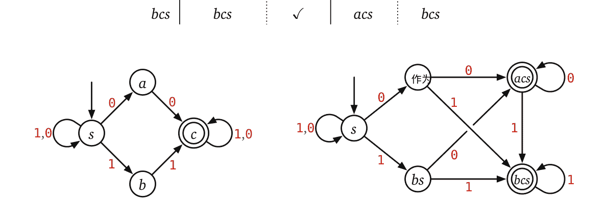

## 4.6 从正则表达式到NFA: 汤普森算法

### 引理4.2. 每个正则语言都被一个非确定有限自动机接受。

证明: 实际上，我们将证明以下更强的命题：每个正则语言都被一个具有恰好一个接受状态的NFA接受，该状态与其起始状态不同。以下构造首次由Ken Thompson在1968年描述。汤普森算法实际上证明了一个更强的命题：对于任何正则语言 L，存在一个接受 L 的NFA，该NFA具有恰好一个接受状态 t，该状态与起始状态 s 不同。

设 R 为任意的正则表达式， Σ 为任意的有限字母表。假设对于 R 的任何子表达式 S，由 S 描述的语言都被一个具有一个与其起始状态不同的接受状态的NFA接受，我们用图形方式表示为 (*)。有六种情况需要考虑——三种基本情况和三种递归情况——与正则表达式的递归定义相对应。

- 如果 R = ∅，则 L(R) = ∅ 被空NFA接受: (→ ○)。
- 如果 R = ε，则 L(R) = {ε} 被NFA接受 (→ ○ →)。
- 如果 R = a 对于某个符号 a ∈ Σ，则 L(R) = {a} 被NFA接受 (→ a → ○)。(当R是长度大于1的单个字符串时，通过连接，它可以简化为单个符号的情况，如下一种情况所述。)
- 假设 R = ST，其中 S 和 T 是正则表达式。归纳假设表明，语言 L(S) 和 L(T) 被NFA接受。

    L(R) = L(ST) = L(S) \bullet L(T) 被NFA接受，组件NFA串联而成。

    （图示：→ ○ S ○ \xrightarrow{\varepsilon} ○ T ○ →，通过连接两个组件NFA串联而成。）

- 假设 R = S + T，其中 S 和 T 是正则表达式。归纳假设表明，语言 L(S) 和 L(T) 被NFA接受。

    L(R) = L(S + T) = L(S) \cup L(T) 被NFA接受，组件NFA并行连接而成，具有新的起始和接受状态。

    （图示：→ ○ \xrightarrow{\varepsilon} ○ S ○ \xrightarrow{\varepsilon} ○ ← 和 → ○ \xrightarrow{\varepsilon} ○ T ○ \xrightarrow{\varepsilon} ○ ←，然后通过连接两个组件NFA并行连接而成。）

- 最后，假设 R = S^{*}，其中 S 是正则表达式。归纳假设表明，语言 L(S) 被NFA接受。

    那么语言 L(R) = L(S^{*}) = L(S)^{*} 被接受，通过NFA构造（图示：一个带有 ε 转移的环路结构）。

在所有情况下，语言 L(R) 被一个具有一个接受状态的NFA接受，该状态与其起始状态不同，正如所述。

例如，给定正则表达式 (0 + 10^{*}1)^{*}，它表示包含偶数个1的字符串，Thompson算法产生了一个包含14个状态的NFA，如下一页所示。正如这个例子所示，Thompson算法倾向于产生具有许多冗余状态的NFA。幸运的是，就像对于DFA一样，存在可以将任何NFA减少到具有最小可能状态数的等价NFA的算法。

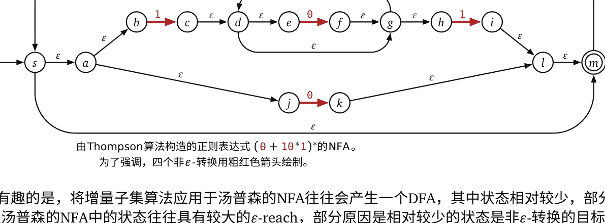

由Thompson算法构造的正则表达式 (0 + 10^{*}1)^{*} 的NFA。为了强调，四个非 ε-转换用粗红色箭头绘制。

有趣的是，将增量子集算法应用于汤普森的NFA往往会产生一个DFA，其中状态相对较少，部分原因是汤普森的NFA中的状态往往具有较大的 ε-reach，部分原因是相对较少的状态是非 ε-转换的目标。例如，从上面显示的NFA开始，增量子集构造会产生一个只有五个状态的DFA，用于表示语言 (0 + 10^{*}1)^{*}。

通过观察三个接受状态都是等价的，以及两个非接受状态也是等价的，可以进一步简化这个DFA为只有两个状态。但是，五个状态已经相当不错了，尤其是与朴素的子集构造产生的 2^{13} = 8192 个状态相比！

| q' | ε-reach(q') | q' ∈ A'? | δ'(q', 0) | δ'(q', 1) |
|---|---|---|---|---|
| s | sab jm | ✓ | k | c |
| k | sab jklm | ✓ | k | c |
| c | cdegh | | f | i |
| f | degh | | f | i |
| i | sab jilm | ✓ | k | c |

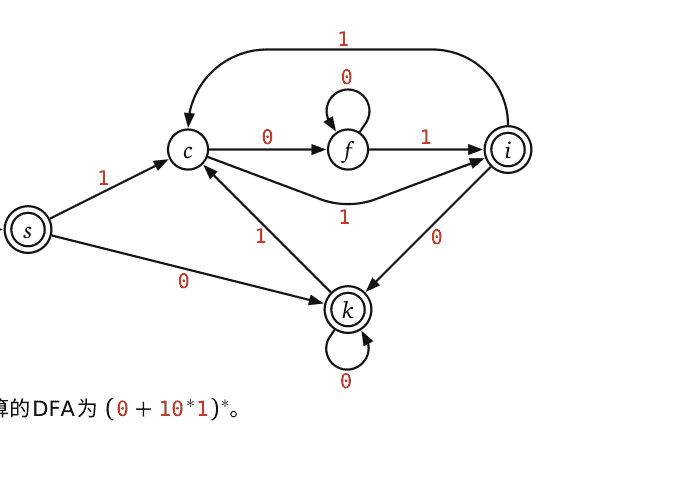

由Thompson的NFA使用增量子集算法计算的DFA为 (0 + 10*1)*。

## 4.7 从正则表达式生成NFA：Glushkov算法

Thompson的算法实际上是一个早期算法的修改版本，该算法由V. I. Glushkov于1961年和Robert McNaughton和Hisao Yamada于1960年独立发现。给定一个包含n个符号的正则表达式（不包括括号、加号和星号），Glushkov的算法生成一个具有n +1个状态的NFA。

Glushkov的算法结合了正则表达式上的六个函数：

- index(R)是通过将R中的符号按照从左到右的顺序替换为1到n的整数而得到的正则表达式。例如，index((0 + 10*1)*) = (1 + 23*4)*。
- 符号(R)表示从 R中删除所有非符号的字符串。例如，符号((0 + 10*1)*) = 0101。
- has-ε(R)是TRUE，如果ε ∈ L(R)并且FALSE否则。
- 第一个(R)是 L(R)中所有字符串的初始符号的集合。
- 最后一个(R)是 L(R)中所有字符串的最终符号的集合。
- 中间(R)是所有 (a, b)对的集合，使得 ab是 L(R)中某个字符串的子字符串。

最后四个函数遵循以下递归关系：

$has-\epsilon(\emptyset) = \emptyset$
$has-\epsilon(w) = \begin{cases} \text{如果} w = \epsilon \\ \text{否则为假} \end{cases}$
$has-\epsilon(S + T) = has-\epsilon(S) \vee has-\epsilon(T)$
$has-\epsilon(ST) = has-\epsilon(S) \wedge has-\epsilon(T)$
$has-\epsilon(S^*) = \text{真}$
$first(\emptyset) = \emptyset$
$first(w) = \begin{cases} \emptyset & \text{if } w = \epsilon \\ \{a\} & \text{if } w = ax \end{cases}$
$first(S + T) = first(S) \cup first(T)$
$first(ST) = \begin{cases} first(S) \cup first(T) & \text{if } has-\epsilon(S) \\ first(T) & \text{否则} \end{cases}$
$first(S^*) = first(S)$
$last(\emptyset) = \emptyset$
$last(w) = \begin{cases} \emptyset & \text{如果 } w = \epsilon \\ \{a\} & \text{if } w = xa \end{cases}$
$last(S + T) = last(S) \cup last(T)$
$last(ST) = \begin{cases} last(S) \cup last(T) & \text{if } has-\epsilon(T) \\ last(T) & \text{否则} \end{cases}$
$last(S^*) = last(S)$

$$
\begin{align*}
\text{middle}(\emptyset) &= \emptyset \\
\text{middle}(w) &= \begin{cases} \emptyset & \text{if } |w| \leq 1 \\ \{(a, b)\} \cup \text{middle}(bx) & \text{if } w = abx \end{cases} \\
\text{middle}(S + T) &= \text{middle}(S) \cup \text{middle}(T) \\
\text{middle}(ST) &= \text{middle}(S) \cup (\text{last}(S) \times \text{first}(T)) \cup \text{middle}(T) \\
\text{middle}(S^*) &= \text{middle}(S) \cup (\text{last}(S) \times \text{first}(S))
\end{align*}
$$

例如，集合 middle((1+23*4)*)可以通过递归计算如下。如果我们手动进行这个过程，我们可以跳过这个推导中的许多步骤，因为我们知道函数 first, middle, last 和 has-ε 的实际含义，但是机械递归计算必须计算每一步。

```
middle((1+23*4)*)
= middle(1+23*4) ∪ ( last(1+23*4) × first(1+23*4) )
= middle(1) ∪ middle(23*4) ∪ ( last(1+23*4) × first(1+23*4) )
= ∅ ∪ middle(23*4) ∪ ( last(1+23*4) × first(1+23*4) )
= middle(2) ∪ ( last(2) × first(3*4) ) ∪ middle(3*4) ∪ ( last(1+23*4) × first(1+23*4) )
= ∅ ∪ ( {2} × first(3*4) ) ∪ middle(3*4) ∪ ( last(1+23*4) × first(1+23*4) )
= ( {2} × (first(3*) ∪ first(4)) ) ∪ middle(3*4) ∪ ( last(1+23*4) × first(1+23*4) )
= ( {2} × (first(3) ∪ first(4)) ) ∪ middle(3*4) ∪ ( last(1+23*4) × first(1+23*4) )
= ( {2} × {3, 4} ) ∪ middle(3*4) ∪ ( last(1+23*4) × first(1+23*4) )
= { (2, 3), (2, 4) } ∪ middle(3*4) ∪ ( last(1+23*4) × first(1+23*4) )
...
= { (1, 1), (1, 2), (2, 3), (2, 4), (3, 3), (3, 4), (4, 1), (4, 2) }
```

最后，对于任何正则表达式 R，Glushkov算法构造了NFA M_R= (Σ, Q, s, A, δ) 它按照以下方式接受语言 L(R):

$$
\begin{align*}
Q &= \{0, 1, \ldots, |\text{symbol} (R)|\} \\
s &= 0 \\
A &= \begin{cases} \{0\} \cup \text{last}(\text{index}(R)) & \text{if } \text{has-}\epsilon(R) \\ \text{last}(\text{index}(R)) & \text{否则} \end{cases} \\
\delta(0, a) &= \{ j \in \text{first}(\text{index}(R)) \mid a = \text{symbol} (R)[j] \} \\
\delta(i, a) &= \{ j \mid (i, j) \in \text{middle}(\text{index}(R)) \text{ and } a = \text{symbols}(R)[j] \}
\end{align*}
$$

有几种自然的思考Glushkov算法的方式，比起定义的墙壁要容易理解一些。一个观点是Glushkov算法首先计算索引正则表达式 index(R) 的 DFA—实际上是一个具有最少状态的DFA，除了一个额外的起始状态—然后用 symbols(R)中的相应符号替换每个索引，以获得原始表达式 R的NFA。另一个有用的观察是Glushkov的NFA与Thompson的相同正则表达式的NFA去除所有 ε-转换的结果相同。

例如，给定正则表达式 \(R = (0 + 10^*1)^*\)，Glushkov算法计算
\(index(R) = (1 + 23^*4)^*\)
\(symbols(R) = 0101\)
\(has-\epsilon(R) = \text{TRUE}\)
\(first(index(R)) = \{1, 2\}\)
\(last(index(R)) = \{1, 4\}\)
\(middle(index(R)) = \{(1, 1), (1, 2), (2, 3), (2, 4), (3, 3), (3, 4), (4, 1), (4, 2)\}\)

然后构建以下五状态的NFA。

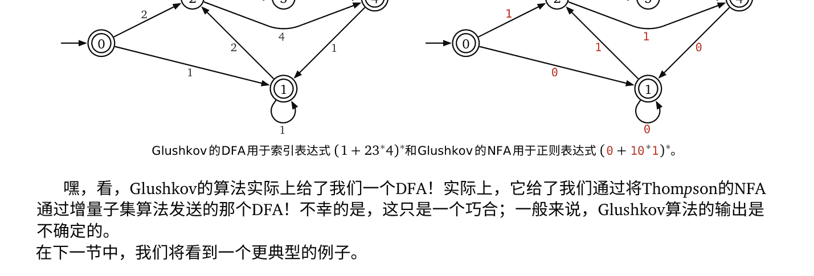

嘿，看，Glushkov的算法实际上给了我们一个DFA！ 实际上，它给了我们通过将Thompson的NFA通过增量子集算法发送的那个DFA！ 不幸的是，这只是一个巧合；一般来说，Glushkov算法的输出是不确定的。

在下一节中，我们将看到一个更典型的例子。

## 4.8 另一个例子

这是我们迄今为止见过的所有算法的另一个例子，从正则表达式\((0+1)^*(00+11)(0+1)^*\)开始，描述了我们的第一个示例NFA接受的语言。 Thompson的算法构建了以下26个状态的怪物：

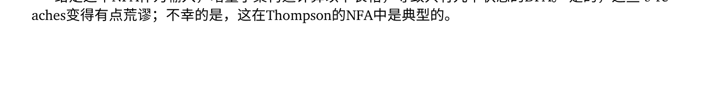

给定这个NFA作为输入，增量子集构造计算以下表格，导致只有九个状态的DFA。 是的，这些 \(\epsilon\)-reaches变得有点荒谬；不幸的是，这在Thompson的NFA中是典型的。

| q' | ε-到达 (q') | q' ∈ A'? | δ'(q', 0) | δ'(q', 1) |
| :--- | :--- | :--- | :--- | :--- |
| s | sabd ghim | | c j | en |
| c j | sabd f ghi jkm | | c j | en |
| en | sabd f ghmno | | c j | enp |
| c jl | sabd f ghi jklmqr tuwz | √ | c j l v | en x |
| enp | sabd f ghmno pqr tuwz | √ | c j v | en p x |
| c j l v | sabd f ghi jklmqr tuv w yz | √ | c j l v | en x |
| en x | sabd f ghmno pqr tuw x yz | √ | c j v | en p x |
| c j v | sabd f ghi jkmr tuv w yz | √ | c j l v | en x |
| en p x | sabd f ghmno pqr tuw x yz | √ | c j v | en p x |

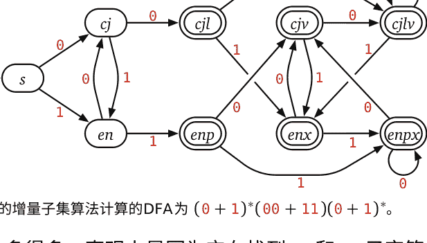

通过Thompson的NFA计算的增量子集算法计算的DFA为 (0 + 1)*(00 + 11)(0 + 1)*。

这个DFA的状态比必要的多得多，直观上是因为它在找到 00和 11子字符串后仍然继续寻找。毕竟，当Thompson的NFA找到一个00和 11子字符串时，它不会杀死所有其他并行线程，因为它不能。与等效的DFA相比，NFA通常具有更少的状态，但这种效率也使它们有点愚蠢。

Glushkov的算法递归计算相同正则表达式的以下值
R = (0 + 1)*(00 + 11)(0 + 1)*：

索引  (R) = (1 + 2)*(34 + 56)(7 + 8)*
符号   (R) = 01001101
有- ε(R) = FALSE
第一(索引(R)) = {1, 2, 3, 5}
最后(索引(R)) = {4, 6, 7, 8}
中间  (索引 (R)) = {(1, 1),(1, 2),(2, 1),(2, 2),(1, 3),(1, 5),(2, 3),(2, 5),(3, 4),
                            (5, 6),(4, 7),(4, 8),(6, 7),(6, 8),(7, 7),(7, 8),(8, 7),(8, 8)}

这些值意味着下一页上显示的九状态NFA。仔细的读者应该确认，在这个NFA上运行增量子集构造将产生与Thompson的NFA完全相同的DFA (具有不同的状态名称)

## *4.9 从NFAs到正则表达式：韩氏和伍德的算法

Kleene定理的唯一组成部分，我们还需要证明的是，由DFA或NFA接受的每个语言都是正则的。通常情况下，实际上更容易证明一个更强的结果。我们考虑一类更一般的有限状态机，称为表达式自动机，由Yo-Sub Han和Derick Wood引入。

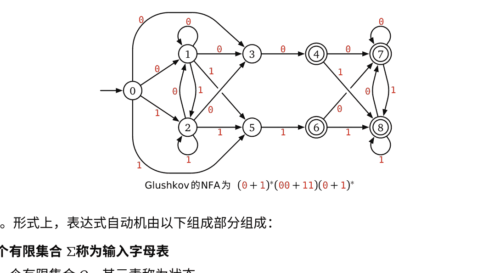

在2005年。形式上，表达式自动机由以下组成部分组成：

- 一个有限集合 Σ 称为输入字母表
- 另一个有限集合 Q，其元素称为状态
- 一个起始状态 s ∈ Q
- 一个单一的终止状态 t ∈ Q \ {s}
- 一个过渡函数 R: (Q \ {t}) × (Q \ {s}) → Reg(Σ)，其中 Reg(Σ) 是正则表达式的集合

不太正式地说，一个表达式自动机是一个包含有向边 p→q 的有向图，标记为正则表达式 R(p→q)，从每个顶点 p 到每个顶点 q（包括 q = p），按照约定，我们要求 R(q→s) = R(t→q) = ∅ 对于每个顶点 q。

我们说字符串 w 与过渡 p→q 匹配，如果 w 与正则表达式 R(p→q) 匹配。特别地，如果 R(p→q) = ∅，则没有字符串与 p→q 匹配。更一般地，w 与状态序列 q₀→q₁→...→qₖ 匹配，如果 w 与正则表达式 R(q₀→q₁)·R(q₁→q₂)·...·R(qₖ₋₁→qₖ) 匹配。等价地，w 与序列 q₀→q₁→...→qₖ 匹配，如果要么

- w = ε 并且序列只有一个状态 (k = 0)，或者
- w = xy 对于某个匹配正则表达式 R(q₀→q₁) 和某个匹配剩余序列 q₁→...→qₖ 的字符串 x。

表达式自动机接受任何从 s 开始并以 t 结束的状态序列的字符串。表达式自动机 E 的语言是 E 接受的所有字符串的集合。

表达式自动机是非确定性的。一个字符串可以匹配多个（甚至无限多个）以 s 开始的状态序列，并且它可以以多种不同的方式匹配每个状态序列。如果一个字符串匹配的状态序列中至少有一个以 t 结束，则该字符串被接受。相反，一个字符串可能不匹配任何状态序列；所有这样的字符串都被拒绝。

表达式自动机的两个特殊情况已经很熟悉。首先，每个正则语言显然都是具有两个状态的表达式自动机的语言。其次，只需进行微小的修改，任何DFA或NFA都可以转换为具有平凡转换表达式的表达式自动机。

汤普森算法可以用于将任何表达式自动机转换为NFA，通过递归地展开任何非平凡转换。为了完成Kleene定理的证明，我们展示了如何通过反复删除顶点将任何表达式自动机转换为正则表达式。

> ²Yo-Sub Han*和Derick Wood。广义自动机的推广：表达式自动机。计算机科学基础国际期刊16(3)：499–510，2005年。

### 引理4.3. 每个表达式自动机都接受一个正则语言。

证明：设 E= (Q, Σ, R, s, t)是一个任意的表达式自动机。假设任何状态少于 E的表达式自动机都接受一个正则语言。有两种情况需要考虑，取决于 Q中的状态数量。

- 如果 Q = {s, t}，则显然，E接受正则语言 R(s→t)。
- 另一方面，假设存在状态 q ∈ Q\{s, a}。我们可以修改表达式自动机，使得状态 q是多余的并且可以被移除。定义一个新的转移函数 R': Q × Q → Reg(Σ)通过设置

```
R'(p→r) := R(p→r) + R(p→q) R(q→q)* R(q→r)。
```

通过这个修改后的转移函数，任何匹配序列 p→q→q→⋯→q→r (对于任意数量的 q) 的字符串 w 也匹配单个转移 p→r。因此，根据归纳法，如果 w匹配一个状态序列，它也匹配通过移除所有 q 的子序列。令 E'为具有状态 Q' = Q \ {q}并使用这个修改后的转移函数 R'的表达式自动机。这个新的自动机接受与原始自动机 E完全相同的字符串。因为 E'比 E有更少的状态，归纳假设暗示 E'接受一个正则语言。

在这两种情况下，我们得出结论，E 接受一个正则语言。

这个证明可以被机械地转化成一个算法，用于将任何NFA (特别是任何DFA) 转化为等价的正则表达式。给定一个具有 n个状态 (包括 s 和 a) 的NFA，该算法迭代地删除 n-2个状态，在每次迭代中更新 O(n^2)个转换表达式。如果连接和Kleene星操作可以在常数时间内执行，那么得到的算法将在 O(n^3)时间内运行。然而，在每次迭代中，转换表达式的长度在最坏情况下大约增长4倍，因此最终表达式的长度为 Θ(4^n)。如果我们坚持将表达式表示为显式字符串，最坏情况下的运行时间实际上是 Θ(4^n)。

下一页的图示展示了这个简单DFA的转换算法的过程。首先，我们通过添加新的起始状态和接受状态以及合并两个转换来将DFA转换为表达式自动机，然后我们移除每个原始状态，在每次迭代中更新任何剩余状态之间的转换表达式。为了清晰起见，图中省略了边 p→q，其中 R(p→q) = ∅。

### *4.10 递归自动机

> ★★★ 移动到单独的星号注释中？

到目前为止，我们所见过的有限状态自动机的所有变种都描述/编码/接受/计算正则语言；这些正是可以通过并集、连接和无限重复来构建的语言。更一般的上下文无关语言可以通过并集、连接和递归来构建。正如上下文无关文法是正则表达式的递归推广一样，我们可以定义一类称为递归自动机的机器，它们是（非确定性的）有限状态自动机的推广。

形式上，一个递归自动机由以下组件组成：

- 一个非空有限集合 Σ，称为 输入字母表
- 另一个与 Σ不相交的非空有限集合 N，其元素称为模块名称
- 一个起始名称 S ∈ N

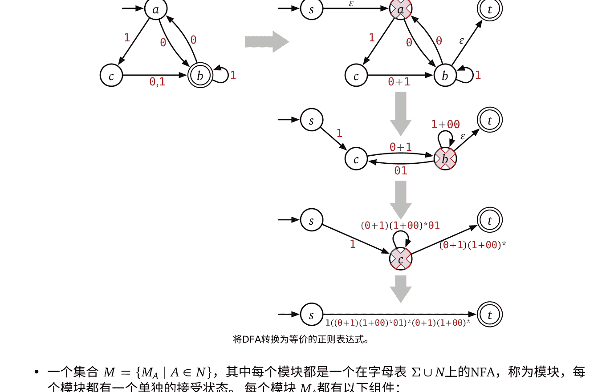

将DFA转换为等价的正则表达式。

- 一个集合 $M = \{M_A \mid A \in N\}$，其中每个模块都是一个在字母表 $\Sigma \cup N$上的NFA，称为模块，每个模块都有一个单独的接受状态。每个模块 $M_A$都有以下组件：
    - 一个有限集合 $Q_A$ of状态, 使得 $Q_A \cap Q_B = \varnothing$对于所有的 $A = B$
    - 一个起始状态 $s_A \in Q_A$
    - 一个终止或接受状态 $t_A \in Q_A$
    - 一个转移函数 $\delta_A: Q_A \times (\Sigma \cup \{\varepsilon\} \cup N) \to 2^{Q_A}$。

等价地，我们有一个单一的全局转换函数 $\delta: Q \times (\Sigma \cup \{\varepsilon\} \cup N) \to 2^Q$，其中 $Q = \bigcup_{A \in N} Q_A$, 对于任何名字 $A$和任何状态 $q \in Q_A$, 我们有 $\delta(q) \subseteq Q_A$。机器 $M_S$被称为主模块。

递归自动机的配置是一个三元组 $(w, q, \sigma)$，其中 $w$是一个字符串在 $\Sigma^*$中被称为输入， $q$是一个状态在 $Q$中被称为本地状态， $\sigma$是一个字符串在 $Q^*$中被称为堆栈。包含本地状态 $q$的模块被称为活动模块。配置可以通过三种类型的转换进行更改。

- 读取转换消耗输入中的第一个符号并更改当前模块中的本地状态，就像标准的NFA一样。
- $\varepsilon$转换更改当前模块中的本地状态，而不消耗任何输入字符，就像标准的NFA一样。
- 一个调用转换选择一个任意的名字A，将当前状态 $q_0$更改为 $\delta(q, A)$中的某个状态，并将相应的起始状态 $s_A$推入栈中（从而更改活动模块为 $M_A$），而不消耗任何输入字符。
- 最后，如果当前状态是某个模块的终止状态且栈不为空，则返回转换将栈顶状态弹出，并将其作为新的局部状态（从而可能更改活动模块），而不消耗任何输入字符。

符号上，我们可以描述这些转换如下：

- **读取：** $(ax, q, \sigma) \longrightarrow (x, q', \sigma)$ 　　　　对于某个 $q' \in \delta(q, a)$
- **$\varepsilon$：** $(w, q, \sigma) \longrightarrow (w, q', \sigma)$ 　　　　对于某个 $q' \in \delta(q, \varepsilon)$
- **调用：** $(w, q, \sigma) \longrightarrow (w, s_A, q' \cdot \sigma)$ 　　对于一些 $A \in N$和 $q' \in \delta(q, A)$
- **返回：** $(w, t_A, q \cdot \sigma) \longrightarrow (w, q, \sigma)$

如果存在一个从起始配置 $(w, s_S, \varepsilon)$到终止配置 $(\varepsilon, t_S, \varepsilon)$的有限转换序列，则递归自动机接受字符串$w$。

例如，以下递归自动机接受语言 $\{0^m 1^n \mid m = n\}$。递归自动机有两个组件机器；一个名为 $S$的起始机器和一个名为 $E$（用于“相等”）的“子程序”，它接受语言 $\{0^n 1^n \mid n \ge 0\}$。白色箭头表示递归转换。

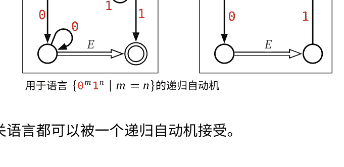

### 引理4.4. 每个上下文无关语言都可以被一个递归自动机接受。

**证明：**

> ★★★ 从上下文无关文法直接构造，每个非终结符对应一个模块。

例如，上下文无关文法

$$\begin{align*}
S &\to 0A \mid B1 \\
A &\to 0A \mid E \\
B &\to B1 \mid E \\
E &\to \varepsilon \mid 0E0
\end{align*}$$

导致以下具有四个模块的递归自动机：

> ★★★ 图1

### 引理4.5. 每个递归自动机都接受一个上下文无关语言。

**证明（概述）：** 设 $R= (\Sigma, N, S, \delta, M)$是一个任意的递归自动机。我们定义一个上下文无关文法 $G$来描述 $R$接受的语言，如下所示。

文法 $G$中的非终结符集合与状态集合 $Q$同构；即，对于每个状态 $q \in Q$，文法中都包含一个相应的非终结符 $[q]$。$[q]$的语言将是字符串 $w$的集合，其中存在一个从起始配置 $(w, q, \varepsilon)$开始并以终止配置 $(\varepsilon, t, \varepsilon)$结束的有限转换序列，其中 $t$是包含 $q$的模块的终止状态。文法有四种类型的产生式规则，对应于四种类型的转换：

- 读取：对于每个符号a和每对状态p和q，使得p∈δ(q,a)，文法中包含产生式[q]→a[p].
- ε：对于任意两个状态p和q，使得p∈δ(q,ε)，文法中包含产生式[q]→[p].
- 调用：对于每个名称A和每对状态p和q，使得p∈δ(q,A)，文法中包含产生式[q]→[s_A][p].
- 返回：对于每个名称A，文法中包含产生式[t_A]→ε.

最后，G的起始非终结符是[s_S]，对应于主模块的起始状态。

我们现在可以归纳地认为文法G和递归自动机R描述了相同的语言。具体来说，递归自动机R中从(w,s_S,ε)到(ε,t_S,ε)的任何转换序列都可以机械地转化为文法G中从非终结符[s_S]推导出w的序列。同样地，文法G中任何字符串w的最左推导都可以机械地转化为递归自动机R中的一系列接受转换。我们省略了显而易见但繁琐的细节。

例如，前一页上的递归自动机给出了以下上下文无关文法。为了使文法更易读，我已经重新命名了与起始和终止状态对应的非终结符：S=[s_S]，T=[t_S]，E=[s_E]=[t_E]：

```
S→EA | 0B
E→ε | 0X
A→1A | 1T
X→EY
B→0B | E T
Y→1Z
T→ε
Z→E
```

我们之前的证明表明，我们可以禁止ε转换，甚至允许正则表达式转换在我们的递归自动机中，而不改变它们接受的语言集。

## 练习

1. 对于以下每个NFA，描述一个等价的DFA。（“描述”不一定意味着“绘制”！）
★★★半打例子。

2. 对于以下每个正则表达式，绘制一个等价的NFA。
★★★半打例子。

3. 对于以下每个正则表达式，描述一个等价的DFA。（“描述”不一定意味着“绘制”！）
★★★半打例子。

4. 设 L ⊆ Σ*是一个任意的正则语言。证明以下语言是正则的。

- (a) ones(L) := {w ∈ 1* |w| = |x|对于某个 x ∈ L
- (b) reverse(L) := {w ∈ Σ*  w^R ∈ L . (回想一下 w^R表示字符串 w 的反转。)
- (c) 前缀 (L) : = {x ∈ Σ* | x y ∈ L对于某个 y ∈ Σ*}
- (d) 后缀 (L) : = {y ∈ Σ* | x y ∈ L对于某个 x ∈ Σ*}
- (e) 子字符串 (L) : = {y ∈ Σ* |x y z ∈ L对于某个 x, z ∈ Σ}
- (f) 循环 (L) : = {x y | x, y ∈ Σ* 且y x ∈ L}
- (g) 前缀最大 (L) : = {x ∈ L | x y ∈ L ⟺ y = ε}.
- (h) 后缀最小 (L) : = {x y ∈ L | y ∈ L ⟺ x = ε}.
- (i) 每隔一个(L) := {每隔一个(w) | w ∈ L}，其中每隔一个(w)是包含每隔一个符号的子序列。
例如，每隔一个(EVERYOTHER) = VROHR。
- (j) rehtoyreve(L) := {w ∈ Σ* | 每隔一个 (w) ∈ L}。
- (k) 子序列(L) := {x ∈ Σ* | x是某个 y ∈ L的子序列}
- (l) 超序列 (L) := {x ∈ Σ* |某个 y ∈ L是 x的子序列}
- (m) 左边(L) := {x ∈ Σ* |x y ∈ L对于某些 y ∈ Σ*其中 |x| = |y|}
- (n) right(L) := {y ∈ Σ* | x y ∈ L对于某些 x ∈ Σ*其中 |x| = |y|}
- (o) middle(L) := {y ∈ Σ* | x y z ∈ L对于某些 x,z ∈ Σ*其中 |x| = |y| = |z|}
- (p) half(L) := {w ∈ Σ* | ww ∈ L}
- (q) third(L) := {w ∈ Σ* | www ∈ L}
- (r) reflect(L) := {w ∈ Σ*  ww^R ∈ L}

5. 设 L ⊆ Σ*是任意的正则语言。证明以下语言是正则的。[提示：对于每个语言，存在一个最多有 q 个状态的接受NFA，其中 q是某个接受 L的DFA中的状态数。]

- (a) repeat(L) := {w ∈ Σ* | wn ∈ L对于一些 n ≥ 0}
- (b) allreps(L) := {w ∈ Σ* | wn ∈ 对于每个n≥0}
- (c) manyreps(L) := {w ∈ Σ* | wn ∈ L对于无限多个n≥0}
- (d) fewreps(L) := {w ∈ Σ* | wn ∈ 对于有限多个n≥0}
- (e) powers(L) := {w ∈ Σ*  w^2n ∈ 对于某个n≥0}★(f) $whatthe_N(L) := \{w \in \Sigma^* \mid w^n \in L \text{ 对于某个 } n \in N\}$，其中 $N$ 是一个任意固定的非负整数集合。
[提示：你只需要证明存在一个接受的NFA；你不需要描述如何构造它。]

6. 对于以下每个表达式自动机，描述一个等价的DFA和一个等价的正则表达式。

- ★★★ 半打例子。

7. 描述接受以下语言的递归自动机。（“描述”不一定意味着“绘制”！）

- ★★★ 半打例子。

> 控制大部队的原则与控制少数人的原则相同：只是将他们的人数分割开来的问题。

——孙子，《孙子兵法》（公元前400年），由李约翰（1910年）翻译

> 我们的生活被细节所消磨……简化，简化。

——亨利·大卫·梭罗，《瓦尔登湖》（1854年）

> 如果你将它分解成小任务，没有什么特别困难的。

——亨利·福特

> 先做困难的工作。简单的工作会自己解决。

——戴尔·卡耐基

## 5 递归

### 5.1 归约

归约是设计算法中最常用的技术。将一个问题 \(X\) 归约到另一个问题 \(Y\) 意味着为 \(X\) 编写一个使用 \(Y\) 算法作为黑盒子或子程序的算法。关键是，得到的算法的正确性不能以任何方式依赖于 \(Y\) 算法的工作方式。我们唯一能假设的是黑盒子能正确解决 \(Y\) 问题。黑盒子的内部工作对我们来说根本不重要；那是别人的问题。最好将黑盒子视为通过魔法运行。

例如，在讲座0中描述的亨廷顿-希尔算法将分配国会的问题归约为支持INSERT和EXTRACTMAX操作的优先级队列的问题。抽象数据类型“优先级队列”是一个黑盒子；分配算法的正确性不依赖于任何具体的优先级队列数据结构。当然，分配算法的运行时间取决于INSERT和EXTRACTMAX算法的运行时间，但这与算法的正确性是一个独立的问题。归约的美妙之处在于，我们可以通过简单地替换新的优先级队列数据结构来创建一个更高效的分配算法。此外，该数据结构的设计者不需要知道或关心它将用于分配国会。

类似地，如果我们想设计一个算法来计算与给定正则表达式等价的最小确定有限状态机，我们不必从头开始。相反，我们可以将问题分解为三个子问题，这些子问题的算法可以在早期的讲座笔记中找到：（1）使用Thompson算法或Glushkov算法从正则表达式构建NFA；（2）使用（增量）子集构造将NFA转换为等价的DFA；（3）使用Moore算法将DFA转换为最小等价的DFA，例如。即使你的课程跳过了自动机笔记，仅仅知道这些组成算法存在（相信我！）就可以将它们组合成更复杂的算法；你不需要知道细节。（但你应该知道，因为它们非常酷。相信我！）同样，将更高效的算法替换为这三个子问题中的任何一个自动地产生一个更高效的整体算法。

当我们设计算法时，我们可能不知道我们使用的基本构建块的确切实现方式，或者我们的算法如何作为构建块来解决更大的问题。
即使你确切地知道你的组件如何工作，假装你不知道也是非常有用的。（相信自己！）

### 5.2 简化和委托

递归是一种特别强大的归约方式，可以粗略地描述如下：
- 如果给定的问题实例足够小或简单，就直接解决它。
- 否则，将问题归约为一个或多个更简单的相同问题的实例。

如果自我引用令人困惑，想象有其他人将解决这些更简单的问题，就像你会假设其他类型的归约一样。我喜欢称这个其他人为递归仙女。你唯一的任务是简化原始问题，或者在归约不必要或不可能时直接解决它；递归仙女会神奇地为你处理所有更简单的子问题，使用你不需要关心的方法。数学上熟练的读者可能会通过更正式的名字识别递归仙女，即归纳假设。

为了使任何递归方法能够正确工作，必须满足一个温和的技术条件：不能有无限的“更简单”子问题的归约序列。
最终，递归归约必须以一个可以通过其他方法解决的基本情况停止；否则，递归算法将永远循环。这个有限性条件几乎总是显而易见的，但我们应该始终对“显而易见”的递归算法保持警惕，因为它们实际上可能会无限递归。（往往，“显而易见”是“错误”的同义词。）

### 5.3 汉诺塔

汉诺塔难题最早由数学家弗朗索瓦·爱德华·安纳托尔·卢卡斯（François Édouard Anatole Lucas）于1883年发表，使用了化名“N. Claus (de Siam)”（是“Lucas d’Amiens”的变位词）。第二年，亨利·德·帕维尔（Henri de Parville）用以下引人注目的故事描述了这个难题：2

> 在贝纳雷斯的大寺庙里，位于世界中心的圆顶下，有一块黄铜板上面固定着三根钻石针，每根针高一肘，粗细如蜜蜂的身体。在创世之初，上帝在其中一根针上放置了六十四块纯金的圆盘，最大的圆盘放在黄铜板上，其他的圆盘逐渐变小，直到最顶上的一个。这就是布拉玛之塔。白天黑夜，祭司们按照布拉玛的固定和不变的法则，不停地将圆盘从一根钻石针转移到另一根针上，值班的祭司每次只能移动一块圆盘，并且必须将这块圆盘放在一根针上，使得它下面没有更小的圆盘。当这六十四块圆盘从上帝创造它们的那根针转移到其他针上时，塔、寺庙和婆罗门都将化为尘土，世界也将随着一声雷鸣而消失。

当然，作为优秀的计算机科学家，我们第一反应是将变量$n$替换为硬编码的常数64。按照标准做法（因为大多数物理实例的拼图是由木头而不是钻石和黄金制成的），我们将把三个可能的位置称为“柱子”而不是“针”。我们如何将一个由$n$个盘子组成的塔从一个柱子移动到另一个柱子，使用第三个柱子作为临时存放，而不会将一个盘子放在较小的盘子上面？

解决这个谜题的关键是递归思考。我们不需要一次性解决整个谜题，而是集中精力只移动最大的盘子。在开始时，我们无法移动最大的盘子，因为其他所有盘子都覆盖在它上面；我们必须先将那些$n-1$个盘子移动到第三个柱子上，然后才能移动第$n$个盘子。然后，在移动第$n$个盘子之后，我们必须将那些$n-1$个盘子再次放在它上面。所以现在我们只需要弄清楚如何...

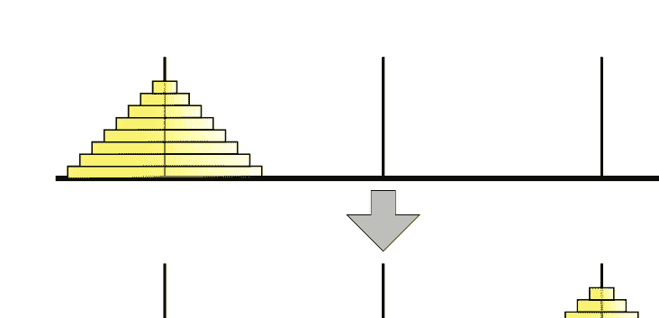

停止！！就是这样！我们成功地将n个盘子的汉诺塔问题归约为两个（n-1）个盘子的汉诺塔问题，我们可以高兴地将其交给递归仙女（或者，进一步延伸原始故事，交给寺庙里的年轻僧侣）。

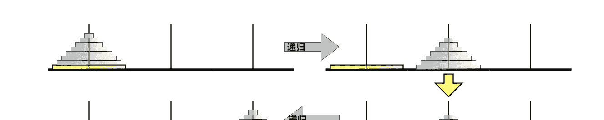

我们的递归归约确实有一个微妙但重要的假设：存在一个最大的盘子。换句话说，我们的递归算法适用于任何 n ≥ 1，但当 n = 0时会出现问题。我们必须直接处理这个基本情况。幸运的是，贝纳勒斯的僧侣们作为好的佛教徒，在瞬间就能将零个盘子从一个柱子移动到另一个柱子。

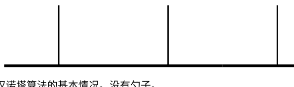

虽然想象所有那些较小的盘子是如何移动的——或者更一般地说，递归展开时会发生什么——是很诱人的，但并不必要。对于稍微复杂一些的算法，展开递归会更加混乱而不是有启发性。我们唯一的任务是将问题归约为一个或多个更简单的实例，或者如果这样的归约不可能，则直接解决问题。当 n = 0时，我们的算法显然是正确的。对于任何 n ≥ 1，递归妖精都能正确地移动（或更正式地说，归纳假设暗示我们的递归算法能正确地移动）前 n-1个盘子，因此（通过归纳）我们的算法必须是正确的。

这是递归汉诺塔算法的更典型的伪代码。这个算法将一个由n个盘子组成的堆栈从源柱（src）移动到目标柱（dst），并使用第三个临时柱（tmp）作为占位符。

```
HANOI(n, src, dst, tmp):
    if n > 0
        HANOI(n - 1, src, tmp, dst)
        将盘子 n 从 src 移动到 dst
        HANOI(n - 1, tmp, dst, src)
```

让 T(n) 表示转移n个盘子所需的移动次数——我们算法的运行时间。
我们的虚无基本情况意味着 T(0) = 0，而更一般的递归算法意味着 T(n) = 2T(n-1) + 1 对于任何 n ≥ 1。湮灭者方法（或通过归纳猜测和检查）迅速给出了我们的封闭形式解 T(n) = 2^{n} - 1。特别地，移动一个由64个盘子组成的塔需要 2^{64} - 1 = 18,446,744,073,709,551,615 个单独的移动。因此，即使以每秒一次的惊人速度，贝纳雷斯的僧侣们也将工作大约5850亿年，直到塔楼、寺庙和婆罗门一起变成尘土，世界也将随着一声雷鸣而消失。

### 5.4 归并排序

归并排序是最早提出的排序算法之一。根据唐纳德·克努斯的说法，它早在1945年就由约翰·冯·诺伊曼提出。

1. 将输入数组分成大致相等大小的两个子数组。
2. 递归地对每个子数组进行归并排序。
3. 将新排序的子数组合并为一个排序好的数组。

输入： S O R T I N G E X A M P L
划分： S O R T I N | G E X A M P L
递归： I N O S R T | A E G L M P X
合并： A E G I L M N O P R S T X

第一步非常简单——我们只需要计算中位数的数组索引——而第二步可以交给递归精灵。真正的工作都在最后一步完成；两个排序好的子数组可以使用一个简单的线性时间算法合并。这是算法的完整描述；为了保持递归结构的清晰，我们将合并步骤单独分离为一个独立的子程序。

```
MERGE SORT(A[1 .. n]):
    如果 n > 1
        m ← ⌊n/2⌋
        MERGE SORT(A[1 .. m])
        MERGE SORT(A[m + 1 .. n])
        MERGE(A[1 .. n], m)
```

```
MERGE(A[1 .. n], m):
    i ← 1; j ← m + 1
    对于 k 从 1 到 n
        如果 j > n
            B[k] ← A[i]; i ← i + 1
        否则如果 i > m
            B[k] ← A[j]; j ← j + 1
        否则如果 A[i] < A[j]
            B[k] ← A[i]; i ← i + 1
        否则
            B[k] ← A[j]; j ← j + 1
    for k ← 1 to n
        A[k] ← B[k]
```

为了证明这个算法的正确性，我们先对MERGE子程序应用我们的老朋友归纳法，然后再对顶层的MERGESORT算法应用归纳法。

我们通过对 $n-k+1$ 的归纳证明MERGE的正确性，这是两个已排序子数组 $A[i..m]$ 和 $A[j..n]$ 在主循环的第 $k$ 次迭代开始时，剩下要合并到 $B[k..n]$ 中的总大小。有五种情况需要考虑。是的，五种情况。

- 如果 $k > n$，算法通过不做任何操作正确地合并两个空子数组。 (这是归纳证明的基本情况。)
- 如果 $i \le m$ 且 $j > n$，则子数组 $A[j..n]$ 为空。因为两个子数组都已排序，所以在两个子数组的并集中，最小的元素是 $A[i]$。所以赋值 $B[k] \leftarrow A[i]$ 是正确的。归纳假设意味着剩余的子数组 $A[i+1..m]$ 和 $A[j..n]$ 被正确地合并到 $B[k+1..n]$ 中。
- 同样地，如果 $i > m$ 且 $j \le n$，则赋值 $B[k] \leftarrow A[j]$ 是正确的，归纳假设意味着MERGE算法正确地合并了剩余的子数组 $A[i..m]$ 和 $A[j+1..n]$ 到 $B[k+1..n]$ 中。
- 如果 $i \le m$ 且 $j \le n$ 且 $A[i] < A[j]$，则剩余元素中最小的是 $A[i]$。所以 $B[k]$ 被正确赋值，并且递归精灵正确地合并了其余的子数组。
- 最后，如果 $i \le m$ 且 $j \le n$ 且 $A[i] \ge A[j]$，则剩余元素中最小的是 $A[j]$。所以 $B[k]$ 被正确赋值，并且递归精灵正确地完成了其余部分。

现在我们通过归纳法证明MERGESORT的正确性；有两种情况需要考虑。是的，两种情况。

- 如果 $n \le 1$，则算法正确地什么都不做。
- 否则，递归精灵正确地排序——抱歉，我是说归纳假设暗示我们的算法正确地排序——两个较小的子数组 $A[1..m]$ 和 $A[m+1..n]$，在此之后它们被正确地合并成一个排序好的数组（通过之前的论证）。

运行时间是多少？由于MERGESORT算法是递归的，它的运行时间将通过递归公式表示。MERGE明显需要线性时间，因为它是一个简单的循环，每次迭代都有恒定的工作量。我们立即得到MERGESORT的以下递归公式：

$$T(n) = T(\lceil n/2 \rceil) + T(\lfloor n/2 \rfloor) + O(n).$$

在大多数分治递归中，我们可以使用域变换安全地去除地板和天花板，从而得到更简单的递归公式。

$$T(n) = 2T(n/2) + O(n).$$

递归树方法中的“所有层级相等”情况立即暗示了闭式解 $T(n) = O(n \log n)$。（递归树和域变换的详细描述在单独的解递归公式的笔记中。）

### 5.5 快速排序

快速排序是另一种递归排序算法，由Tony Hoare于1962年发现。在这个算法中，最困难的部分是将数组分割成子集，以便合并最终结果变得简单。

1. 从数组中选择一个枢轴元素。
2. 将数组分成三个子数组，包含小于枢轴的元素，枢轴元素本身和大于枢轴的元素。
3. 递归地对第一个和最后一个子数组进行快速排序。

| 步骤 | 内容 |
|------|------|
| 输入 | S O R T I N G E X A M P L |
| 选择一个枢轴 | S O R T I N G E X A M P L |
| 分区 | A G E I | L | N R O X S M P T |
| 递归 | A E G I | L | M N O P R S T X |

快速排序示例。

以下是算法的更详细描述。在单独的PARTITION子程序中，输入参数p是未排序数组中枢轴元素的索引；子程序对数组进行分区，并返回枢轴的新索引。

```
QUICKSORT(A[1..n]):
    if (n > 1)
        选择一个枢轴元素 A[p]
        r ← PARTITION(A, p)
        QUICKSORT(A[1..r-1])
        QUICKSORT(A[r+1..n])
```

```
PARTITION(A[1..n], p):
    交换 A[p] ↔ A[n]
    i ← 0
    j ← n
    while (i < j)
        重复 i ← i+1 直到 (i ≥ j 或 A[i] ≥ A[n])
        重复 j ← j-1 直到 (i ≥ j 或 A[j] ≤ A[n])
        如果 (i < j)
            交换 A[i] ↔ A[j]
    交换 A[i] ↔ A[n]
    返回 i
```

就像归并排序一样，证明QUICKSORT的正确性需要两个独立的归纳证明：一个证明PARTITION正确地将数组分割，另一个证明QUICKSORT在假设PARTITION正确的情况下正确地排序。我将把血腥的细节留给读者作为练习。

分析也与归并排序类似。PARTITION在$O(n)$时间内运行：在开始时，$j-i=n$，在结束时，$j-i=0$，每次递增$i$或递减$j$时我们都做了一定量的工作。对于QUICKSORT，我们得到一个依赖于选择的主元素的排名$r$的递归关系：

$T(n) = T(r-1) + T(n-r) + O(n)$

如果我们能够以数组A的中位数作为主元素选择，那么我们将有$r=⌈n/2⌉$，两个子问题的大小将尽可能接近，递归关系将变为

$T(n) = 2T(⌈n/2⌉-1) + T(⌊n/2⌋) + O(n) ≤ 2T(n/2) + O(n),$

而且我们可以通过递归树方法得到 $T(n)=O(n log n)$。

事实上，正如我们很快将看到的，我们可以在一个未排序的数组中以线性时间找到中位数元素。然而，这个算法相当复杂，而且$O(·)$表示法中的隐藏常数足够大，使得得到的排序算法不实用。在实践中，大多数程序员会选择一些简单的方法，比如选择数组的第一个或最后一个元素。在这种情况下，$r$可以取$1$到$n$之间的任何值，所以我们有

$T(n)=\max_{1≤r≤n} (T(r-1)+T(n-r)+O(n)).$

在最坏的情况下，两个子问题完全不平衡——要么$r=1$，要么$r=n$——而递归变成 $T(n) ≤ T(n-1) + O(n)$。解决方案是 $T(n)=O(n^2)$。

另一个常见的启发式算法被称为“三数中值法”——选择数组的三个元素（通常是数组的开头、中间和结尾），并取这三个元素的中值作为枢轴。

虽然这种启发式算法在实践中比仅选择一个元素要更有效，特别是当数组已经（几乎）排序好时，但在最坏情况下仍然可能出现 \( r = 2 \) 或 \( r = n-1 \)。使用中值法启发式算法，递归关系变为 \( T(n) \leq T(1) + T(n-2) + O(n) \)，其解仍然为 \( T(n) = O(n^2) \)。

直观上，枢轴元素‘通常’会落在数组的中间位置，例如在 \( n/10 \) 和 \( 9n/10 \) 之间。这个观察结果表明，平均情况下的运行时间为 \( O(n \log n) \)。虽然这种直觉实际上是正确的（至少在正确的形式假设下），但我们离证明快速排序通常是高效的还有很长的路要走。我们将在以后的讲座中对平均情况行为的这种直觉进行形式化。

### 5.6 模式

1. 将给定问题的实例分成几个独立的较小实例。
2. 将每个较小实例委托给递归精灵。
3. 将较小实例的解合并为给定实例的最终解。

如果任何子问题的大小低于某个常数阈值，递归将停止。希望此时问题是微不足道的，但如果不是，我们将切换到另一个算法。

证明分治算法的正确性几乎总是需要归纳法。分析运行时间需要建立和解决递归关系，通常（但不幸的是并非总是！）可以使用递归树解决，也许在简单的域转换之后。

### 5.7 中位数选择

那么如何在线性时间内找到数组的中位数？以下算法是由Manuel Blum、Bob Floyd、Vaughan Pratt、Ron Rivest和Bob Tarjan在20世纪70年代早期发现的。他们的算法实际上解决了选择数组中第k个最大元素的更一般问题，给定数组和整数g作为输入，使用一种称为‘快速选择’或‘单臂快速排序’的算法的变体。基本的快速选择算法选择一个枢轴元素，使用来自快速排序的PARTITION子程序对数组进行分区，然后递归地仅搜索两个子数组中的一个。

```
快速选择(A[1..n], k):
    如果 n=1, 则返回 A[1], 否则
        选择一个枢轴元素 A[p], r ← PARTITION(A[1..n], p)
        if k < r
            返回 QUICKSELECT(A[1..r-1], k)
        否则如果 k > r
            返回 QUICKSELECT(A[r+1..n], k - r)
        否则
            返回 A[r]
```

QUICKSELECT的最坏情况运行时间遵循类似快速排序的递归关系。我们不知道 r 的值或我们将递归搜索的子数组，所以我们只能假设最坏情况。

$$ T(n) \leq \max_{1\leq r\leq n} (\max\{T(r-1), T(n-r)\} + O(n)) $$

我们可以使用 $\ell$ 来简化递归关系，表示递归子问题的长度：

$$ T(n) \leq \max_{0\leq \ell\leq n-1} T(\ell) + O(n) \leq T(n-1) + O(n) $$

与快速排序一样，当 $\ell = n-1$ 时，我们得到解 $T(n) = O(n^2)$，这发生在选择的枢轴元素是数组的最小元素或最大元素时。

另一方面，如果我们能以某种神奇的方式选择一个好的枢轴，其中 $\ell \leq \alpha n$，其中 $\alpha < 1$，则可以避免这种二次行为。在这种情况下，递归关系将简化为

$$ T(n) \leq T(\alpha n) + O(n) $$

这个递归展开成一个递减的几何级数，它被最大项所主导，所以 $T(n) = O(n)$。

布卢姆-弗洛伊德-普拉特-里维斯特-塔尔詹算法通过递归计算输入数组的一个精心选择的子集的中位数来选择一个好的轴点进行快速排序。

```
MOMSELECT (A[1..n], k):
    如果 n ≤ 25
        使用蛮力法
    否则
        m ← ⌈n/5⌉
        for i ← 1 to m
            M[i] ← MEDIANOFFIVE(A[5i-4..5i]) 〈蛮力法！〉
        mom ← MOMSELECT (M[1..m], ⌈m/2⌉) 〈递归！〉
        r ← PARTITION (A[1..n], mom)
        如果 k < r
            返回 MOMSELECT (A[1..r-1], k) 〈递归！〉
        否则如果 k > r
            返回 MOMSELECT (A[r+1..n], k-r) 〈递归！〉
        否则
            返回 mom
```

算法的递归结构需要稍大的基本情况。在伪代码中，常数25并没有特殊之处；从理论上讲，任何其他常数如42、666或8765309都可以正常工作。

如果输入数组太大，无法通过蛮力处理，我们将其分成⌈n/5⌉个块，每个块包含恰好5个元素，最后一个块可能除外。（如果最后一个块不满，只需加入一些 ∞。）我们通过蛮力找到每个块的中位数，并将这些中位数收集到一个新数组 M[1..⌈n/5⌉] 中。然后我们递归计算这个新数组的中位数。最后，我们使用中位数中的中位数（因此称为‘mom’）作为快速排序的枢轴。

关键的洞察是这两个子数组都不能太大。中位数中的中位数比块中的中位数大于⌈[n/5]/2⌉ - 1 ≈ n /10，而每个中位数都比其块中的其他两个元素大。因此，mom比输入数组中至少3n/10个元素大，而对称地，mom比至少3n/10个输入元素小。因此，在最坏的情况下，最后的递归调用搜索的数组大小为7n/10。

我们可以通过将输入数组绘制为一个 $5 \times \lceil n/5 \rceil$ 网格来可视化算法的行为，其中每个列代表五个连续的元素。 为了说明的目的，想象一下我们从上到下对每一列进行排序，然后按照它们的中间元素对列进行排序。（让我强调一下，算法实际上并不这样做！）在这种排列中，中位数中的中位数是最靠近网格中心的元素。

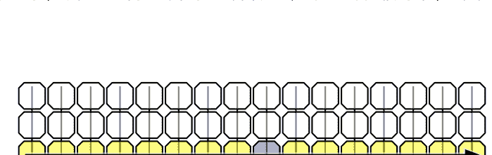

网格的前三行的左半部分包含 $3n/10$ 个元素，每个元素都小于中位数的中位数。如果我们要查找的元素大于中位数的中位数，我们的算法将丢弃比中位数的中位数小的所有元素，包括那 $3n/10$ 个元素，然后进行递归。因此，递归子问题的输入最多包含 $7n/10$ 个元素。

当我们的目标元素小于中位数的中位数时，对称的论证也适用。

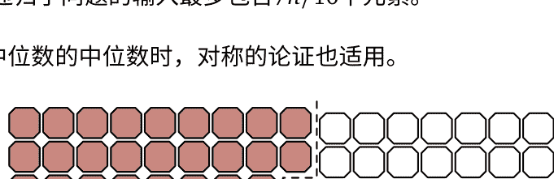

我们得出结论，算法的最坏情况运行时间遵循以下递归关系：

$$T(n) \le O(n) + T(n/5) + T(7n/10).$$

递归树方法暗示了解 $T(n) = O(n)$。

更精细的分析揭示了 $O()$ 隐藏的常数相当大，即使只计算比较次数；对于小输入来说，这不是一个实用的算法。（特别是，当 $n < 4,000,000$ 时，归并排序在最坏情况下使用较少的比较。）选择5个元素的中位数最多需要6次比较，因此我们最多需要 $6n/5$ 次比较来设置递归子问题。在递归调用返回后，我们需要进行另外 $n-1$ 次比较来对数组进行分区。因此，总比较次数的更准确的递归关系是

$$T(n) \le 11n/5 + T(n/5) + T(7n/10).$$

递归树方法意味着上界

$$T(n) \le \frac{11n}{5} \sum_{i \ge 0} \left( \frac{9}{10} \right)^i = \frac{11n}{5} \cdot 10 = 22n.$$

## 5.8 乘法

通过标准的迭代“波动进位”算法，将两个 n位数相加需要 O(n)时间，使用一个查找表进行每一个一位数的相加。 类似地，将一个 n位数乘以一个一位数需要 O(n)时间，基本上使用相同的算法。

那么将两个 n位数相乘呢？ 在世界上大多数地方，小学生（据说）通过将问题分解为 n个一位数的乘法和 n个加法来学习乘法：

```
    31415962
  × 27182818
  —————————
   251327696
   31415962
   251327696
   62831924
   251327696
   31415962
   219911734
   62831924
  —————————
  853974377340916
```

我们可以很容易地将这个算法形式化为一对嵌套的for循环。 该算法的运行时间为 Θ(n²)——总共有 Θ(n²)个部分乘积中的数字，对于每个数字，我们花费恒定的时间。 在第一讲中描述的埃及/俄罗斯农民乘法算法也需要Θ(n²)时间。

也许我们可以通过利用以下等式得到一个更高效的算法：

> $(10^m a + b)(10^m c + d) = 10^{2m}ac + 10^m(bc + ad) + bd$

这是一个分而治之的算法，它根据这个公式计算两个 n位数的数字 x和 y的乘积。 四个子乘积 e、f、g 、h都是通过递归计算得到的。 然而，最后一行不涉及任何乘法；要乘以十的幂，我们只需将数字移位并填充相应数量的零。

| MULTIPLY(x, y, n): |
| --- |
| 如果 n=1 |
|   返回 x·y |
| 否则 |
|   m ← ⌈n/2⌉ |
|   a ← ⌊x/10^m⌋; b ← x mod 10^m |
|   d ← ⌊y/10^m⌋; c ← y mod 10^m |
|   e ← MULTIPLY(a, c, m) |
|   f ← MULTIPLY(b, d, m) |
|   g ← MULTIPLY(b, c, m) |
|   h ← MULTIPLY(a, d, m) |
|   返回 10^{2m}e + 10^m(g + h) + f |

你可以通过归纳法轻松证明这个算法是正确的。 这个算法的运行时间由递归给出。

> $T(n) = 4T(⌈n/2⌉) + Θ(n), \quad T(1) = 1,$

通过递归树方法（经过简单的域变换）解决，得到 T(n) = Θ(n²)。嗯…我猜这并没有帮助。

在1950年代中期，著名的俄罗斯数学家安德烈·科尔莫戈洛夫猜想，在 n 位数的两个数字相乘时，没有 O(n^2) 时间的算法。然而，在1960年，科尔莫戈洛夫在莫斯科大学的一个研讨会上提出了他的猜想后，研讨会的一位学生安纳托利·卡拉茨巴发现了一个了不起的反例。根据卡拉茨巴自己的说法，

> 研讨会结束后，我告诉科尔莫戈洛夫关于这个新算法和对猜想的反证。科尔莫戈洛夫非常激动，因为这与他的非常有道理的猜想相矛盾。在下一次研讨会上，科尔莫戈洛夫亲自告诉与会者我的方法，然后研讨会就结束了。

Karatsuba观察到中间的系数 bc + ad 可以通过其他两个系数 ac 和 bd 仅使用一个递归乘法来计算，使用以下代数恒等式：

$$ac + bd - (a - b)(c - d) = bc + ad$$

这个技巧让我们可以将前一个算法中的最后三行替换为以下内容：

```
FASTMULTIPLY(x, y, n):
    如果 n = 1
        返回 x · y
    否则
        m ← ⌊n/2⌋
        a ← ⌊x/10^m⌋; b ← x mod 10^m
        d ← ⌊y/10^m⌋; c ← y mod 10^m
        e ← FASTMULTIPLY(a, c, m)
        f ← FASTMULTIPLY(b, d, m)
        g ← FASTMULTIPLY(a - b, c - d, m)
        返回 10^{2m}e + 10^m(e + f - g) + f
```

Karatsuba的 FASTMULTIPLY 算法的运行时间由递归给出

$$T(n) \leq 3T(\lceil n/2 \rceil) + O(n), \quad T(1) = 1.$$
经过域变换后，我们可以将其插入递归树中以获得解决方案 $$T(n) = O(n^{\lg 3}) = O(n^{1.585})$$，这比我们之前的二次时间复杂度算法有了显著改进。

Karatsuba算法可以说是算法设计和分析作为一个正式研究领域的开端。

当然，在实践中，所有这些都是用二进制而不是十进制来完成的。

我们甚至可以进一步发展这个想法，将数字分成更多的部分，并以更复杂的方式组合它们，以获得更快的乘法算法。

Andrei Toom和Stephen Cook发现了一族无限的算法，可以将任何整数分成 k 个部分，每个部分有 n/ k 位数，并且只使用 2k - 1 次递归乘法来计算乘积。

对于任何固定的 k，得到的算法运行时间为 $$O(n^{1+1/(\lg k)})$$，其中 O(·) 表示的隐藏常数取决于 k。

最终，这种分治策略导致了高斯（是的，真的）发现了快速傅里叶变换，我们将在下一节详细讨论。

已知的最快乘法算法是由 Martin Fürer 于2007年发表的，基于FFT，运行时间为 $$n \log n \, 2^{O(\log^* n)}$$。这里，$$\log^* n$$ 是缓慢增长的迭代对数，它是在值小于1之前必须取对数的次数：

$$\lg^* n = \begin{cases} 1 & \text{如果 } n \leq 2, \\ 1 + \log^*(\log n) & \text{否则}. \end{cases}$$

## 5.9 指数运算

给定一个数 $a$ 和一个正整数 $n$，假设我们想要计算 $a^n$。标准的朴素方法是一个简单的for循环，通过 $a$ 进行 $n-1$ 次乘法：

```
SLOWPOWER(a, n):
    x ← a
    for i ← 2 到 n
        x ← x · a
    return x
```

这个迭代算法需要 $n$ 次乘法。

注意输入的 $a$ 可以是整数，有理数或浮点数。实际上，它不需要是一个数字，只要是我们知道如何相乘的东西就可以。例如，相同的算法可以用于计算模某个有限数的幂（在密码算法中常用的操作）或计算矩阵的幂（用于求解递归和计算图中的最短路径）。我们真正需要的只是 $a$ 属于一个乘法群。$^5$ 由于我们不知道我们正在相乘的是什么类型的东西，我们无法知道乘法需要多长时间，因此我们被迫根据乘法的次数来分析运行时间。

有一种更快的分治方法，使用以下简单的递归公式：

$$a^n = a^{\lfloor n/2 \rfloor} \cdot a^{\lceil n/2 \rceil}.$$

这种方法更高效的原因是，一旦我们计算出第一个因子 $a^{\lfloor n/2 \rfloor}$，我们可以使用最多一个乘法计算出第二个因子 $a^{\lceil n/2 \rceil}$。

```
FASTPOWER(a, n):
    如果 n = 1
        返回 a
    否则
        x ← FASTPOWER(a, ⌊n/2⌋)
        如果 n 是偶数
            返回 x · x
        否则
            返回 x · x · a
```

总乘法次数满足递归关系 $T(n) \le T(\lfloor n/2 \rfloor) + 2$，基本情况为 $T(1) = 0$。经过域变换后，递归树给出了解 $T(n) = O(\log n)$。

顺便说一下，这个算法在渐进意义下是最优的——计算 $a^n$ 的任何算法都必须至少执行 $\Omega(\log n)$ 次乘法。事实上，当 $n$ 是2的幂时，这个算法是完全最优的。然而，对于其他 $n$ 的值，还有稍微更快的方法。例如，我们的分治算法可以用六次乘法计算出 $a^{15}$ ($a^{15} = a^7 \cdot a^7 \cdot a$; $a^7 = a^3 \cdot a^3 \cdot a$; $a^3 = a \cdot a \cdot a$)，但只需要五次乘法就足够了 ($a \to a^2 \to a^3 \to a^5 \to a^{10} \to a^{15}$)。对于给定指数 $n$，是否能够高效地计算出绝对最小的乘法次数仍然是一个未解之谜。

## 练习

1. 函数是结合的：对于任意元素f,g,h∈G，我们有f⊗(g⊗h) = (f⊗g)⊗h。证明俄罗斯农民乘法算法的运行时间为 Θ(n²)，其中 n是输入数字的总数。

2. (a) 乔治·奥丛林教授有一棵27个节点的二叉树，其中每个节点都标有一个罗马字母或字符 &。树的先序遍历和后序遍历按以下顺序访问节点：
   - 先序遍历：I Q J H L E M V O T S B R G Y Z K C A & F P N U D W X
   - 后序遍历：H E M L J V Q S G Y R Z B T C P U D N F W & X A K O I
   画出乔治的二叉树。
   (b) 证明没有一种算法可以从其先序和后序节点序列重建一棵任意的二叉树。
   (c) 回顾一下，如果每个非叶节点恰好有两个子节点，那么二叉树是满的。描述并分析一种递归算法，根据其先序和后序节点序列作为输入重建一棵任意的满二叉树。
   (d) 描述并分析一个递归算法，根据其先序和中序节点序列作为输入，重建一个任意的二叉树。
   (e) 描述并分析一个递归算法，仅根据其先序节点序列重建一个任意的二叉搜索树。假设所有输入键都是不同的。对于额外的学分，描述一个运行时间为 O(n)的算法。
   在(b)、(c)和(d)部分，假设所有键都是不同的，并且输入与至少一个二叉树一致。

3. 考虑一个2^n × 2^n的棋盘，其中一个（任意选择的）方格被移除。
   (a) 证明任何这样的棋盘都可以通过 L形状的块来填充，没有间隙或重叠，每个块由3个方格组成。
   (b) 描述并分析一个算法，根据缺失方格的行和列的整数 n和两个 n位整数来计算这样的填充。输出是一个 (4^n – 1)/3块的位置和方向的列表。你的算法应该在 O(4^n)时间内运行。

4. 假设你有一堆不同大小的煎饼。你想要将煎饼排序，使得较小的煎饼在较大的煎饼上面。你唯一能够进行的操作是翻转——在顶部的 k个煎饼下面插入一个铲子，其中 k是1到n之间的整数，并将它们全部翻转。

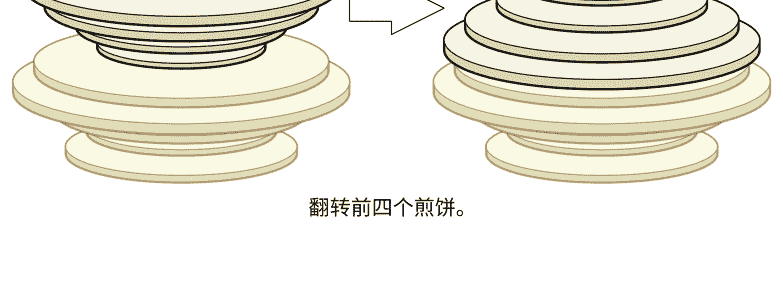

   (a) 描述一个算法，用尽可能少的翻转来排序任意堆叠的n个煎饼。在最坏情况下，你的算法执行了多少次翻转？
   (b) 现在假设每个煎饼的一面被烧焦了。描述一个算法，用尽可能少的翻转来排序任意堆叠的n个煎饼，使得每个煎饼的烧焦一面朝下。在最坏情况下，你的算法执行了多少次翻转？

5. 证明原始递归汉诺塔算法与以下非递归算法完全等价。换句话说，证明这三个算法在移动盘子的顺序上完全相同，从相同的柱子上和到相同的柱子上。柱子标记为0、1和2，我们的问题是将一个由n个盘子组成的堆从柱子0移动到柱子2（如第3页所示）。
   (a) 反复进行唯一满足以下约束条件的合法移动：
      - 不连续移动相同的盘子两次。
      - 如果n是偶数，总是向前移动最小的盘子（...→0→1→2→0→...）。
      - 如果n是奇数，总是向后移动最小的盘子（...→0→2→1→0→...）。
      如果没有满足这三个约束条件的移动，那么谜题就解决了。
   (b) 首先将手指放在针脚0的顶部。然后重复以下步骤：
      i. 如果 n是奇数，将手指移动到下一个针脚（...→0→1→2→0→...）。
      ii. 如果 n是偶数，将手指移动到前一个针脚（...→0→2→1→0→...）。
      iii. 进行唯一不需要抬起手指的合法移动。如果没有这样的移动，谜题就解决了。
   (c) 让 ρ (n) 表示最小的整数 k，使得 n/2^k 不是整数。例如， ρ (42) =2，因为 42/2^1 是整数，但 42/2^2 不是整数。（等价地， ρ (n) 是二进制表示中最低有效位1的位置加1。）由于其行为类似于标尺上的刻度， ρ (n) 有时被称为刻度函数：1, 2, 1, 3, 1, 2, 1, 4, 1, 2, 1, 3, 1, 2, 1, 5, 1, 2, 1, 3, 1, 2, 1, 4, 1, 2, 1, 3, 1, 2, 1, 6, 1, 2, 1, 3, 1, . . .
      这是一个非递归算法的一行代码：在第 i步中，如果 i 与 i 之差是偶数，则将盘 ρ (i) 向前移动，如果 i 与 i 之差是奇数，则向后移动。
      当这个规则要求我们移动盘 i+1 时，谜题就解决了。

6. 汉诺塔历史上一个较为陌生的章节是它在13世纪初从贝纳雷斯迁至比萨的短暂搬迁。这次搬迁是由富有的商人兼数学家列奥纳多·斐波那契组织的，应圣罗马帝国皇帝弗雷德里克二世的请求，他从十字军归来的士兵那里听说了这座寺庙的传闻。比萨的塔楼和随从的僧侣因此而闻名，帮助确立了比萨作为意大利半岛的主要贸易中心。
   不幸的是，寺庙刚刚搬迁后，其中一根钻石针就开始倾斜。为了避免倾斜塔楼因使用过度而倒塌，斐波那契说服神父们采用了一条更宽松的规则：倾斜针上的任意数量的盘可以一次性移动到另一根针上。仍然禁止在较小的盘上放置较大的盘，并且盘必须一次移动一个，放在倾斜针上或者在两根垂直针之间移动。

# 算法

## 讲座5：递归 [Fa '14]

比萨塔。在第五步中，两个盘子被从倾斜的针上取下。

多亏了斐波那契的新规则，祭司们可以比从贝纳雷斯更快地从比萨塔结束宇宙。幸运的是，在新加冕的教皇格里高利九世将弗雷德里克二世逐出教会后，寺庙从比萨塔搬回了贝纳雷斯，使当地的祭司们对接待具有奇怪数学习惯的外国异教徒不再表示同情。不久之后，在寺庙曾经站立的地方建起了一座钟楼；它也几乎立即开始倾斜。

描述一种算法，使用尽可能少的移动次数，将一堆n个盘子从一个垂直的针转移到另一个垂直的针上。你的算法执行了多少次移动？

## 7. 考虑以下受限制的汉诺塔难题变体。在每个问题中，柱子被编号为0、1和2，与问题5中一样，你的任务是将一堆n个盘子从柱子1移动到柱子2。

- (a) 假设你被禁止直接在柱子1和柱子2之间移动任何盘子；每次移动必须涉及柱子0。描述一个算法来尽可能少地解决这个谜题版本。你的算法需要多少步骤？

- (b) 假设你只能从柱子0移动盘子到柱子2，从柱子2移动盘子到柱子1，或者从柱子1移动盘子到柱子0。等效地，假设柱子按顺时针顺序排列，并且你只能逆时针移动盘子。描述一个算法来尽可能少地解决这个谜题版本。你的算法需要多少步骤？

一个逆时针汉诺塔解决方案的前八步的俯视图

- ★(c) 最后，假设你唯一的限制是你不能直接将盘子从柱子1移动到柱子2。描述一个算法来尽可能少地解决这个谜题版本。你的算法需要多少步骤？[提示：这个变体比其他两个要难分析得多。]

## 8. 一位德国数学家开发了一种新的汉诺塔游戏变体，在美国文献中被称为“自由塔”游戏。^6在这个变体中，有一排从1到k编号的k个柱子。在一个回合中，你可以将柱子i上的最小盘子移动到柱子i-1或i+1，对于任何索引i；和往常一样，你不能将较大的盘子放在较小的盘子上。

你的任务是将一堆n个盘子从柱子1移动到柱子k。

- (a) 描述一个递归算法，当k=3时。你的算法需要多少步骤？？（这与上一个问题的(a)部分相同。）
- (b) 描述一个递归算法，对于k=n+1的情况，最多需要O(n^3)次移动。[提示：使用部分(a)。]
- (c) 描述一个递归算法，对于k=n+1的情况，最多需要O(n^2)次移动。[提示：不要使用部分(a)。]
- (d) 描述一个递归算法，对于k=√n的情况，最多需要多项式次数的移动。（多项式是什么？）
- *(e) 描述并分析一个递归算法，适用于任意的n和k。当k（作为n的函数）足够小，以至于移动次数受到n的多项式限制时，k必须多小？

## 9. 大多数图形硬件都包含对低级操作的支持，称为blit，或block传输，它可以快速地将像素图（一个二维像素值数组）的矩形块从一个位置复制到另一个位置。这是标准C库函数memcpy()的二维版本。

假设我们想要将一个n×n像素地图顺时针旋转90°。一种方法是将像素地图分成四个n/2×n/2的块，使用五个blit序列将每个块移动到其正确的位置，然后递归地旋转每个块。（为什么是五个？和汉诺塔问题需要第三个柱子的原因一样。）或者，我们可以先递归地旋转块，然后将它们blit到正确的位置。

- (a) 证明当n是2的幂时，两个版本的算法都是正确的。
- (b) 当n是2的幂时，算法执行了多少次blit操作？

- (c) 描述如何修改算法，使其适用于任意的 $n$，而不仅仅是2的幂次。你修改后的算法执行了多少次位移操作？
- (d) 如果一个 $k \times k$ 位移操作的时间复杂度为 $O(k^2)$，那么你的算法的运行时间是多少？
- (e) 如果一个 $k \times k$ 位移操作的时间复杂度只有 $O(k)$，那么呢？

## 10. 证明使用中值三元素启发式的快速排序在最坏情况下需要 $\Omega(n^2)$ 的时间来对一个大小为 $n$ 的数组进行排序。具体来说，对于任意整数 $n$，描述一个由整数1到 $n$ 组成的排列，使得在每次递归调用中，枢纽元始终是数组中第二小的元素。设计这个排列需要对PARTITION子程序有深入的了解。

- (a) 作为一个热身练习，假设PARTITION子程序是稳定的，意味着它保持了所有小于主元的元素的现有顺序，并保持了所有小于主元的元素的现有顺序。
- (b) 假设PARTITION子程序使用本讲义第6页上列出的特定算法，该算法不稳定。

## 11. (a) 证明以下算法实际上对其输入进行了排序。

```
STOOGE SORT(A[0..n-1]):
如果 n=2 且 A[0] > A[1]，则交换 A[0] 和 A[1]；否则，如果 n > 2，则 m = ⌈ * 2n / 3 ⌉，对 A[0..m-1] 进行 STOOGESORT，对 A[n-m..n-1] 进行 STOOGESORT，对 A[0..m-1] 进行 STOOGESORT。
```

- (b) 如果我们用 $m = \lfloor 2n/3 \rfloor$ 替换 $m = \lceil 2n/3 \rceil$，STOOGESORT是否仍然能正确排序？请解释你的答案。
- (c) 给出执行由STOOGESORT执行的比较次数的递归（包括基本情况）。
- (d) 解决递归，并证明你的解决方案是正确的。[提示：忽略向上取整。]

- (e) 证明STOOGESORT执行的交换次数最多为 (n 2)。

## 12. 考虑以下残酷而不寻常的排序算法。

```
CRUEL (A[1 .. n]):
    如果 n > 1
        CRUEL (A[1 .. n/2])
        CRUEL (A[n/2 + 1 .. n])
        UNUSUAL (A[1 .. n])
```

```
UNUSUAL (A[1 .. n]):
    if n = 2
        if A[1] > A[2]
            交换 A[1] <-> A[2]        ⟨⟨唯一的比较！      ⟩⟩
    否则
        对于 i <- 1 到 n/4              ⟨⟨交换第二和第三个季度 ⟩⟩
            交换 A[i + n/4] <-> A[i + n/2]
        UNUSUAL (A[1 .. n/2])            ⟨⟨在左半部分上递归    ⟩⟩
        UNUSUAL (A[n/2 + 1 .. n])        ⟨⟨在右半部分上递归    ⟩⟩
        UNUSUAL (A[n/4 + 1 .. 3n/4])     ⟨⟨在中间一半上递归    ⟩⟩
```

请注意，算法执行的比较完全不依赖于输入数组中的值；这种排序算法被称为 oblivious。假设对于这个问题，输入大小 n总是2的幂。

- (a) 通过归纳证明CRUEL可以正确地对任何输入数组进行排序。[提示：考虑一个包含 n/4 1s, n/4 2s, n/4 3s和 n/4 4s的数组。为什么这个特殊情况足够？]
- (b) 证明如果我们从UNUSUAL中删除for循环，CRUEL将无法正确排序。
- (c) 证明如果我们交换UNUSUAL的最后两行，CRUEL将无法正确排序。
- (d) UNUSUAL的运行时间是多少？请解释你的答案。
- (e) CRUEL的运行时间是多少？请解释你的答案。

## 13. 你是一个政治大会（或者可能是一个教职员会议）的访客；每个代表都是一个政党的成员。无法确定任何代表属于哪个政党；特别是，如果你问的话，你将被立即驱逐出大会。然而，你可以通过让他们互相认识来确定任何一对代表是否属于同一个政党，同一个政党的成员总是用微笑和友好的握手来问候对方；不同政党的成员总是用愤怒的眼神和侮辱来问候对方。

- (a) 假设超过一半的代表属于同一个政党。描述一个高效的算法，用于识别所有属于这个多数党的成员。
- (b) 现在假设在大会上有恰好 k个政党代表，其中一个政党拥有多数派：该党的代表人数超过其他任何政党。提出一个实际的程序，以尽可能节省的方式选择多数派政党的人员。（请。）

## 14. 数组 A[1..n]中的一个逆序对是一对索引 (i,j)，其中 i < j 且 A[i] > A[j]。一个 n 元素数组中的逆序对数量在 0（如果数组已排序）和 \binom{n}{2}（如果数组以相反顺序排序）之间。描述并分析一个算法，以 O( n log n) 时间复杂度计算一个 n 元素数组中逆序对的数量。[提示：修改归并排序。]

## 15. (a) 假设给定两组 n 个点，一组在直线 y=0 上 {p_1, p_2, ..., p_n}，另一组在直线 y=1 上 {q_1, q_2, ..., q_n}。通过连接每个点 p_i 与相应的点 q_i 创建一组 n 条线段。描述并分析一个分治算法，以 O(n log n) 时间复杂度确定这些线段之间有多少对相交。

- (b) 现在假设你有两组点 {p_1, p_2, ..., p_n} 和 {q_1, q_2, ..., q_n} 在单位圆上。将每个点 p_i 连接到相应的点 q_i。描述并分析一种分治算法，以在 O( n log^2 n) 时间内确定这些线段的交点数。[提示：使用你在(a)部分的解决方案。]
- (c) 在 O(n log n) 时间内解决前一个问题。

十一个在平行线上端点相交的线段对，以及十个在圆上端点相交的线段对。

## 16. 描述一种算法，使用最多6次比较来计算一个由不同数字组成的数组 A[1..5] 的中位数。不使用伪代码，使用一个决策树来描述你的算法：一个二叉树，每个内部节点包含形式为“A[i] ≥ A[j]?”的比较。每个叶子包含一个指向数组的索引。

使用最多3次比较找到一个3元素数组的中位数

## 17. 假设我们有一个集合 S，其中包含 N 个项目，每个项目都有一个值和一个权重。对于任何元素 x ∈ S，我们定义两个子集

- S_{<x} 是 S 中所有值小于 x 值的元素的集合。
- S_{>x} 是 S 中所有值大于 x 值的元素的集合。

对于任何子集 \(R \subseteq S\)，让 \(w(R)\) 表示 \(R\) 中元素的权重之和。加权中位数 \(R\) 是任何元素 \(x\)，使得 \(w(S_{<x}) \le w(S)/2\)，并且 \(w(S_{>x}) \le w(S)/2\)。描述并分析一种算法，以在给定的加权集合中计算加权中位数在 \(O(n)\) 时间内。你的输入包含两个未排序的数组 \(S[1..n]\) 和 \(W[1..n]\)，其中对于每个索引 \(i\)，第 \(i\) 个元素的值为 \(S[i]\) 和权重为 \(W[i]\)。你可以假设所有的值都是不同的，所有的权重都是正数。

## 18. 考虑以下对布卢姆-弗洛伊德-普拉特-里维斯特-塔尔詹 SELECT 算法的一般化，它将输入数组分成大小为 \(b\) 的 \(\lceil n / b \rceil\) 块，而不是大小为 5 的 \(\lceil n/5 \rceil\) 块，但其他方面相同。在下面的伪代码中，必要的修改以红色标示。

```
plaintext
\(MOM_b\)SELECT (\(A[1..n], k\)):
    如果 \(n \le b^2\)
        使用暴力方法
    否则
        \(m \leftarrow \lceil n/b \rceil\)
        对于 \(i\) 从 1 到 \(m\)
            \(M[i] \leftarrow \) MEDIANOFB(\(A[b(i-1)+1..bi]\))
        \(mom_b \leftarrow \) \(MOM_b\)SELECT (\(M[1..m], \lfloor m/2 \rfloor\))
        \(r \leftarrow \) PARTITION (\(A[1..n], mom_b\))
        if \(k < r\)
            返回 \(MOM_b\)SELECT (\(A[1..r-1], k\))
        否则如果 \(k > r\)
            返回 \(MOM_b\)SELECT (\(A[r+1..n], k-r\))
        否则
            返回 \(mom_b\)
```

- (a) 给出 \(MOM_b\)SELECT 运行时间的递归关系，假设 \(b\) 是一个常数（所以子程序 MEDIANOFB 的运行时间是 \(O(1)\)）。特别地，递归子问题的大小如何依赖于常数 \(b\)? 分别考虑偶数 \(b\) 和奇数 \(b\)。
- (b) \(MOM_1\)SELECT 的运行时间是多少？[提示：这是一个诡计问题。]
- (c) \(MOM_2\)SELECT 的运行时间是多少？[提示：这是一个不公平的问题。]
- (d) \(MOM_3\)SELECT 的运行时间是多少？
- (e) \(MOM_4\)SELECT 的运行时间是多少？
- (f) 对于任意常数 \(b \ge 5\)，算法 \(MOM_b\)SELECT 的运行时间为 \(O(n)\)，但不同的 \(b\) 值会导致不同的常数因子。记 \(M(b)\) 为找到 \(b\) 个数字的中位数所需的最小比较次数。只有对于 \(b \le 13\)，才知道 \(M(b)\) 的确切值：

| \(b\) | 1 | 2 | 3 | 4 | 5 | 6 | 7 | 8 | 9 | 10 | 11 | 12 | 13 |
| :--- | :--- | :--- | :--- | :--- | :--- | :--- | :--- | :--- | :--- | :--- | :--- | :--- | :--- |
| \(M(b)\) | 0 | 1 | 3 | 4 | 6 | 8 | 10 | 12 | 14 | 16 | 18 | 20 | 23 |

对于每个在 5 到 13 之间的 \(b\)，找到 \(MOM_b\)SELECT 的运行时间的上界，形式为 \(T(n) \le \alpha_b n\)，其中 \(\alpha_b\) 是一个明确的常数。（例如，在第 8 页上我们证明了 \(\alpha_5 \le 22\)。）

- (g) 哪个值的 \(b\) 产生最小的常数 \(\alpha_b\)？[提示：这是一个诡计问题。]

## 19. 如果存在唯一的索引 i 和 j，使得数组 A[0..n-1] 中的元素是 bitonic 的，则数组 A[0..n-1] 是由 n 个不同的数字组成的。换句话说，一个 bitonic 序列要么由一个递增序列后面跟着一个递减序列组成，要么可以通过循环移位来变成这样。例如，

| 4 | 6 | 9 | 8 | 7 | 5 | 1 | 2 | 3 | 是bitonic的，但是 |
|---|---|---|---|---|---|---|---|---|---|
| 3 | 6 | 9 | 8 | 7 | 5 | 1 | 2 | 4 | 不是bi tonic的。 |

描述并分析一个算法，以在一个包含 n 个元素的 bitonic 数组中找到最小的元素，时间复杂度为 O(log n)。你可以假设输入数组中的数字是不同的。

## 20. 假设我们有一个具有特殊属性的数组 A[1..n]，即 A[1] ≥ A[2] 且 A[n-1] ≤ A[n]。如果一个元素 A[x] 小于或等于其两个邻居，则称其为局部最小值，或者更正式地说，如果 A[x-1] ≥ A[x] 且 A[x] ≤ A[x+1]。例如，在以下数组中有六个局部最小值：

| 9 | 7 | 7 | 2 | 1 | 3 | 7 | 5 | 4 | 7 | 3 | 3 | 4 | 8 | 6 | 9 |

通过扫描数组，我们显然可以在 O(n) 时间内找到一个局部最小值。描述并分析一个在 O(log n) 时间内找到局部最小值的算法。[提示：根据给定的边界条件，数组必须至少有一个局部最小值。为什么？]

## 21. 假设你有一个已经旋转了 k 步的有序数组，其中包含 n 个不同的数字，k 是一个未知的整数，范围在 1 到 n-1 之间。也就是说，你有一个数组 A[1..n]，前缀 A[1..k] 按递增顺序排序，后缀 A[k+1..n] 按递增顺序排序，并且 A[n] < A[1]。

例如，你可能会得到以下 16 个元素的数组（其中 k=10）：

| 9 | 13 | 16 | 18 | 19 | 23 | 28 | 31 | 37 | 42 | -4 | 0 | 2 | 5 | 7 | 8 |

- (a) 描述并分析一个算法来计算未知的整数 k。
- (b) 描述并分析一个算法来确定给定数组是否包含给定的数字 x。

## 22. 你是一个热门游戏节目“击败邻居！”的参赛者。你面前有一个 m×n 的方格网格，每个方格中都有一个唯一的数字。打开一个方格的费用是 100 美元。你的目标是在网格中找到一个数字比它的邻居（上方、下方、左方和右方）都大的方格。如果你花费的钱比任何对手都少，你将赢得一次为期一周的两人拉斯维加斯之旅和一年的 Rice-A-Roni™供应，而你对此上瘾。

- (a) 假设 m=1。描述一个算法，找到一个比其邻居都大的数字。在最坏的情况下，你的算法会打开多少个盒子？
- *(b) 假设 m=n。描述一个算法，找到一个比其任何邻居都大的数字。在最坏的情况下，你的算法会打开多少个盒子？
- *(c) 证明你对部分 (b) 的解决方案在常数因子上是最优的。

## 23. (a) 假设我们有两个已排序的数组 A[1..n]和 B[1..n]以及一个整数 k。描述一个算法，在 Θ(log n) 时间内找到 A和 B的并集中第 k小的元素。例如，如果 k=1，你的算法应该返回 A∪B的最小元素；如果 k=n，你的算法应该返回 A∪B的中位数。）你可以假设数组中没有重复元素。[提示：先解决特殊情况 k = n。]

- (b) 现在假设我们有三个已排序的数组 A[1..n], B[1..n]和 C[1..n]，以及一个整数 k。描述一个算法来在 A∪B∪C中找到第 k小的元素，时间复杂度为 O(log n)。
- (c) 最后，假设我们有一个二维数组 A[1..m][1..n]，其中每一行A[i][]都是已排序的，以及一个整数 k。描述一个算法来尽快地找到 A中第 k小的元素。你的算法的运行时间如何取决于 m？[提示：将线性时间的 SELECT算法作为子程序使用。]

## 24. (a) 描述一个通过调用子程序 SQRT SORT(k)来对输入数组 A[1..n]进行排序的算法，其中子数组 A [k+1..k+√n] 在给定任意整数 k在0和n-√n之间作为输入的情况下，原地排序。（为了简化问题，假设 √n 是一个整数。）你的算法只允许通过调用 SQRTSORT来检查或修改输入数组；特别地，你的算法不能直接比较、移动或复制数组元素。在最坏的情况下，你的算法调用 SQRTSORT多少次？

- (b) 证明你在第（a）部分的算法在常数因子上是最优的。换句话说，如果 f(n)是你的算法调用 SQRTSORT的次数，证明没有算法可以使用 f(n)次调用 SQRTSORT来进行排序。[提示：参考讲座19。]
- (c) 现在假设 SQRTSORT通过调用你在第（a）部分的排序算法来实现递归。例如，在递归的第二层，算法正在对大约大小为 n^4 的数组进行排序。得到的排序算法的最坏情况运行时间是多少？（为了简化分析，假设数组大小 n 具有 2^k 的形式，这样重复的平方根总是整数。）

## 25. 对于这个问题，二叉树的子树指的是任何连接的子图。如果每个内部节点都有两个子节点，并且每个叶子节点的深度完全相同，则二叉树是完全的。描述并分析一个递归算法来计算给定二叉树的最大完全子树。你的算法应该返回这个子树的根节点和深度。

## 26. 假设我们在一个二维盒子内有 np个散布的点。一个 kd树递归地将这些点细分如下。首先，我们用一条垂直线将盒子分成两个较小的盒子，然后我们用水平线分割每个盒子，依此类推，始终在水平和垂直分割之间交替。每次我们分割一个盒子时，分割线将其余的内部点分隔开。通过一个位于盒子内部的中位点，尽可能均匀地分割。如果一个盒子不包含任何点，我们不再分割它；这些最后的空盒子被称为单元格。

(a) 作为 n 的函数，有多少个单元格？证明你的答案是正确的。

(b) 在最坏的情况下，一条水平线可以穿过多少个单元格，作为 n 的函数？证明你的答案是正确的。假设 k 是某个整数，那么 n = 2^k - 1。[提示：存在不止一个函数 f 满足 f(16) = 4。]

假设我们有 n 个点存储在一个 kd 树中。描述并分析一种尽快计算出位于水平线上方的点数的算法（例如图中的虚线）。[提示：使用第 (b) 部分。]

描述并分析一种高效的算法，给定一个存储 n 个点的 kd 树，计算位于具有水平和垂直边的矩形 R 内的点数。[提示：使用第 (c) 部分。]

*27. 鲍勃·拉滕伯，CS 225 的新生，正在尝试编写代码来执行二叉树的前序、中序和后序遍历。鲍勃理解遍历算法的基本思想，但每当他尝试实现它们时，他总是搞混了递归调用。截止时间前五分钟，鲍勃疯狂地提交了以下结构的代码：

```
PREORDER(v):
  如果 v = NULL
    返回
  否则
    打印标签(v)
    ■ORDER(left(v))
    ■ORDER(right(v))
```

```
INORDER(v):
  如果 v = NULL
    返回
  否则
    ■ORDER(left(v))
    打印标签(v)
    ■ORDER(right(v))
```

```
POSTORDER(v):
  如果 v = NULL
    返回
  否则
    ■ORDER(left(v))
    ■ORDER(right(v))
    打印标签(v)
```

每个 ■ 隐藏了前缀 PRE、IN 或 POST。此外，以下每个函数调用在 Bob 提交的代码中只出现一次：

+   PREORDER(left(v)) INORDER(left(v)) POSTORDER(left(v))
PREORDER(right(v)) INORDER(right(v)) POSTORDER(right(v))

因此，Bob 的代码有 36 种可能性。不幸的是，Bob 在提交可执行文件后意外删除了他的源代码，因此你和他都不知道哪些函数在哪里被调用。

现在假设你得到了Bob的遍历算法在某个未知二叉树T上执行的输出。Bob的输出已经被有用解析成了三个数组Pre[1..n]，In[1..n]和Post[1..n]。你可以假设这些遍历序列与唯一的二叉树T一致；特别地，未知树T的顶点标签是不同的，并且每个内部节点在T中恰好有两个子节点。

- (a) 描述一个算法来从给定的遍历序列重构未知树 T。
- (b) 描述一个算法，要么从给定的遍历序列重构Bob的代码，要么正确地报告遍历序列与多个算法集一致。

例如，给定输入
前序[1..n] = [H A E C B I F G D]
中序[1..n] = [A H D C E I F B G]
后序[1..n] = [A E I B F C D G H]

你的第一个算法应该返回以下树：

你的第二个算法应该重构以下代码：

```
PREORDER(v):
如果 v = NULL
    返回
否则
    打印标签(v)
    PREORDER(left(v))
    POSTORDER(right(v))
```

```
INORDER(v):
如果 v = NULL
    返回
否则
    POSTORDER(left(v))
    打印标签(v)
    PREORDER(right(v))
```

```
POSTORDER(v):
如果 v = NULL
    返回
否则
    INORDER(left(v))
    INORDER(right(v))
    打印标签(v)
```

28. 考虑以下经典递归算法来计算非负整数n的阶乘 n!:

```
FACTORIAL(n):
如果 n = 0
    返回1
否则
    返回 n · FACTORIAL(n - 1)
```

(a) 这个算法执行了多少次乘法运算？

(b) 用二进制写出 n! 需要多少位？ 用 Θ(f(n))的形式表达你的答案，其中 f(n)是某个熟悉的函数。[提示: (n/2)^(n/2) < n! < n^n。]

(c) 你对(b)的回答应该让你相信，乘法的次数不是FACTORIAL的实际运行时间的一个好估计。 我们可以使用小学算法（或俄罗斯农民算法）在 O(k·l)时间内乘以任意的k位数和l位数。如果我们将这个乘法算法作为子程序，FACTORIAL的运行时间是多少？

*（d）下面的算法也计算阶乘函数，但使用了不同的乘法分组：

```
FACTORIAL 2(n, m):      ⟨⟨计算    n!/(n - m)!⟩⟩
如果 m = 0
    返回 1
否则，如果 m = 1
    返回 n
否则
    返回 FACTORIAL 2(n, ⌊m/2⌋) · FACTORIAL 2(n - ⌊m/2⌋, ⌈m/2⌉)
```

如果我们使用小学乘法，FACTORIAL2(n, n)的运行时间是多少？[提示：忽略地板和天花板。]

(e) 描述并分析Karastuba算法的一个变体，可以在 O(k·l^(lg 3 - 1)) = O(k·l^0.585)时间内乘以任何k位数和任何l位数，其中 k ≥ l。

*（f）如果我们使用部分修改的Karatsuba乘法，FACTORIAL(n)和FACTORIAL2(n, n)的运行时间是多少？

> > 为了通过仔细枚举解决方案来解决问题，高斯继续说道，只需要一两个小时。显然，这种不优雅的工作对高斯来说没有什么吸引力，尽管他详细概述了如何进行。
>
> — 保罗·坎贝尔，“高斯和八皇后问题：历史错误传播的微观研究”（1977年）

> > 我把晚餐掉在地上，然后跑回实验室。在那里，我兴奋地尝了桌子上每个烧杯和蒸发皿的内容。幸运的是，没有一个含有腐蚀性或有毒液体。
>
> — 康斯坦丁·法尔伯格关于他发现糖精的言论，科学美国人（1886年）

## 7 回溯

在这个讲座中，我想描述另一种递归算法策略，称为回溯。回溯算法尝试逐步构建计算问题的解决方案。每当算法需要在解决方案的下一个组成部分之间做出选择时，它只需递归地尝试所有可能的选项。

### 7.1 n 皇后

典型的回溯问题是经典的八皇后问题，首次由德国国际象棋爱好者马克斯·贝泽尔在1848年（以他的化名“Schachfreund”）提出，用于标准的8 × 8棋盘，并由弗朗索瓦-约瑟夫·尤斯塔什·利奥内在1869年提出更一般的n × n棋盘。问题是在一个n × n棋盘上放置n个皇后，使得任意两个皇后都不能互相攻击。对于不熟悉国际象棋规则的读者来说，这意味着没有两个皇后在同一行、同一列或同一对角线上。显然，在任何一个n皇后问题的解决方案中，每一行都有一个皇后。因此，我们将使用一个数组Q[1..n]来表示我们的可能解决方案，其中Q[i]表示第i行中哪个方格包含一个皇后，如果第i行尚未放置皇后，则为0。为了找到一个解决方案，我们从顶部开始逐行在棋盘上放置皇后。一个部分解决方案是一个数组Q[1..n]，其前r-1个条目为正数，最后n-r+1个条目都为零，其中r是某个整数。

下面的递归算法，基本上是由高斯（他称之为“有条不紊的摸索”）提出的，递归地枚举与给定部分解一致的所有完整的n皇后解决方案。
输入参数 r是第一个空行。因此，要计算没有限制的所有n皇后解决方案，我们将调用RECURSIVENQUEENS(Q[1 .. n], 1)。

```
RECURSIVE NQUEENS (Q[1 .. n], r):
如果 r = n + 1
    打印 Q
否则
    对于 j 从 1 到 n
        合法 ← TRUE
        对于 i 从 1 到 r – 1
            如果 (Q[i] = j) 或 (Q[i] = j + r – i) 或 (Q[i] = j – r + i)
                合法 ← FALSE
        如果 合法
            Q[r] ← j
            RECURSIVE NQUEENS (Q[1 .. n], r + 1)
```

像大多数递归算法一样，回溯算法的执行可以用递归树来说明。递归树的根节点对应于算法的原始调用；树中的边对应于递归调用。从根节点到任何节点的路径显示了解决n皇后问题的部分解的历史，因为皇后被添加到连续的行中。叶子节点对应于无法扩展的部分解，要么是因为每一行已经有一个皇后，要么是因为下一行的每个空位置与现有皇后在同一行、同一列或同一对角线上。回溯算法只是对这棵树进行深度优先遍历。

## 7.2 游戏树

考虑在一个带有边界方格的n×n方格网格上进行的以下简单的双人游戏；让我们称玩家为Horatio Fahlberg-Remsen和Vera Rebaudi。1每个玩家都有n个代币，他们从一边移动到另一边。Horatio的代币从左边界开始，每一行一个，向右移动；对称地，Vera的代币从顶部边界开始，每一列一个，向下移动。玩家轮流进行。在Horatio的每个回合中，他要么将他的一个代币向右移动一步到一个空方格中，要么跳过他的一个代币，跳过Vera的一个代币，跳到一个空方格中，距离右边两步。然而，如果没有合法的移动或跳跃可用，Horatio只需跳过。类似地，Vera在她的每个回合中要么向下移动她的一个代币，要么跳过。除非没有可行的移动或跳跃。第一个将所有代币移出棋盘边缘的玩家获胜。

维拉赢了 3×3游戏。

我们可以使用简单的回溯算法来确定每个玩家在每个回合的最佳移动。游戏的状态包括所有棋子的位置和轮到哪个玩家。我们递归地定义游戏状态为好或坏如下：

+   - 如果所有对手玩家的棋子都到达了目标，游戏状态就是坏的。
- 如果当前玩家可以移动到对手玩家的坏状态，游戏状态就是好的。
- 如果每一步都导致对手玩家的好状态，配置就是坏的。

> 1我不知道这个游戏叫什么，甚至不确定我是否记得规则正确。我从Lenny Pitt那里学到的（或类似的）在餐馆里用甜味剂包玩的建议。
Constantin Fahlberg和Ira Remsen于1878年首次合成了糖精，当时Fahlberg是Remsen实验室的博士后，研究煤焦油衍生物。1900年，Ovidio Rebaudi发表了对ka’a he’的第一次化学分析，这是一种由瓜拉尼人种植了1500多年的药用植物，现在更常被称为Stevia rebaudiana。

这个递归定义立即暗示了一个递归回溯算法，用于确定游戏的给定状态是好还是坏。此外，对于任何好的状态，回溯算法会找到一种导致对手进入坏状态的移动。因此，通过归纳，任何在他们的回合中发现游戏处于好状态的玩家都可以赢得游戏，即使他们的对手完美地玩；另一方面，从一个坏状态开始，只有在对手犯错误时，玩家才能赢得游戏。

所有的电脑游戏玩家最终都基于这个简单的回溯策略。然而，由于大多数游戏有大量的状态，实际上不可能遍历整个游戏树。相反，游戏程序采用其他启发式方法来修剪游戏树，通过忽略明显好或坏的状态（或者至少明显比其他状态更好或更差），或者在某个深度（或回合）截断树，并使用更高效的启发式方法评估叶子节点。

### 7.3 子集和

让我们考虑一个更复杂的问题，称为子集和：给定一个正整数集合 X 和目标整数 T，是否存在 X 中的一些元素的子集，它们的和等于 T？请注意，可能存在多个这样的子集。例如，如果 X = {8,6,7,5,3,10,9} 和 T =15，则答案是TRUE，因为存在子集 {8,7} 或 {7,5,3} 或 {6,9} 或 {5,10} 的和等于 T。另一方面，如果 X = {11,6,5,1,7,13,12} 和 T =15，则答案是FALSE。

有两种特殊情况。如果目标值 T 为零，则我们可以立即返回TRUE，因为空集是 X 的子集，并且空集的元素之和为零。3另一方面，如果 T <0，或者 T =0 但 X 为空集，则我们可以立即返回FALSE。对于一般情况，考虑任意元素 x ∈ X。（我们已经处理了 X 为空集的情况。）如果 X 存在一个子集的和等于 T，则以下陈述之一为真：

+   - 存在一个包含 x 的子集 X，其和为 T。
- 存在一个不包含 x 的子集 X，其和为 T。

在第一种情况下，必须存在一个不包含 x 的子集 X \ {x}，其和为 T − x；在第二种情况下，必须存在一个不包含 x 的子集 X \ {x}，其和为 T。因此，我们可以通过将问题简化为两个更简单的实例来解决 SUBSETSUM(X, T)：SUBSETSUM(X \ {x}, T − x) 和 SUBSETSUM(X \ {x}, T)。如果 X 存储在一个数组中，那么得到的递归算法可能如下所示。

```
SUBSET SUM(X[1..n], T):
如果 T = 0，则
    返回TRUE
否则，如果 T < 0 或者 n = 0，则返回FALSE
否则返回SUBSET SUM(X[1..n-1], T) ∨ SUBSET SUM(X[1..n-1], T - X[n])
```

证明这个算法的正确性是一个简单的归纳练习。如果 T =0，则空子集的元素总和为 T，因此TRUE是正确的输出。否则，如果 T为负数或者集合 X为空，则没有子集的总和为 T，因此FALSE是正确的输出。否则，如果存在一个总和为 T的子集，则它要么包含 X[n]，要么不包含，而递归算法正确地检查了每种可能性。完成。

运行时间 T(n)明显满足递归 T(n) ≤ 2T(n-1) + O(1)，我们可以使用递归树或者湮灭器（或者猜测）来得到上界 T(n) = O(2^n)。在最坏情况下，这个算法的递归树是一棵深度为 n的完全二叉树。这里有一个类似的递归算法，实际上构造了一个和为 T的 X的子集，如果存在的话。这个算法的运行时间也是 O(2^n)。

```
构造子集(X[1..n], T):
如果 T = 0
    返回 ∅
如果 T < 0 或者 n = 0
    返回 NONE
Y ← CONSTRUCT SUBSET (X[1..n-1], T)
如果 Y = NONE
    返回 Y
Y ← CONSTRUCT SUBSET (X[1..n-1], T - X[n])
如果 Y = NONE
    返回 Y ∪ {X[n]}
返回 NONE
```

### 7.4 一般模式

+   * 找到一个能减小问题规模的正确答案。对于每个可能的答案，暂时采用该选择并进行递归。（不要试图聪明地选择要尝试的选择；只需尝试所有的选择。）递归子问题通常比原始目标问题更一般；在每个递归子问题中，我们必须考虑已经做出的选择与之相一致的解决方案。

### 7.5 NFA接受

回想一下，一个非确定有限状态自动机，或者NFA，可以被描述为一个有向图，其边被称为状态，并且其边具有从一个有限集合 Σ中取值的标签。每个NFA都有一个指定的起始状态和一组接受状态。在这个图中的任何路径都有一个标签，该标签是由路径上的边的标签连接而成的字符串。一个字符串 w被一个NFA接受，当且仅当存在一条从起始状态到达其中一个接受状态的路径，其标签为 w。更正式地说（或者至少更符号化地说），一个NFA由一组有限状态 Q，一个起始状态 s ∈ Q，一组接受状态 A ⊆ Q和一个转移函数 δ: Q × Σ → 2^Q组成。我们递归地扩展

通过定义过渡函数到字符串

$$
\delta^*(q, w) = \begin{cases}
\{q\} & \text{if } w = \varepsilon, \\
\bigcup\limits_{r \in \delta(q, a)} \delta^*(r, x) & \text{if } w = ax.
\end{cases}
$$

当且仅当集合 $\delta^*(s, w)$ 中至少包含一个接受状态时， NFA接受字符串 $w$。
我们可以更直接地表达这个接受准则，如下所示。我们定义一个布尔函数Accepts?(q, w)，如果NF A从状态 $q$开始接受字符串 $w$，则为TRUE，否则为FALSE。这个函数有以下递归定义：

$$
Accepts?(q, w) := \begin{cases}
\text{真} & \text{如果 } w = \varepsilon \text{ 且 } q \in A \\
\text{假} & \text{如果 } w = \varepsilon \text{ 且 } q \notin A \\
\bigvee\limits_{r \in \delta(q, a)} Accepts?(r, x) & \text{if } w = ax
\end{cases}
$$

当且仅当 $Accepts?(s, w) = TRUE$ 时， NFA接受 $w$。
在非确定性的神奇世界中，我们可以想象NFA总是在面对多个转换时做出正确的决策，或者为每个可能的选择生成一个独立的并行线程。然而，真实的计算机既不是千里眼，也不是（尽管使用多核心越来越多）无限并行的。为了直接模拟NFA的行为，我们必须明确地递归地探索每个选择的后果。

接受的递归定义？直接转化为以下递归回溯算法。.在这里，转移函数 $\delta$ 和接受状态 $A$ 被表示为全局布尔数组，其中 $\delta[q, a, r] = \text{真}$ 当且仅当 $r \in \delta(q, a)$，而 $A[q] = \text{真}$ 当且仅当 $q \in A$。

```
是否接受？(q, w[1..n]):
  如果 n = 0
    返回 A[q]
  对于所有状态 r
    如果 δ[q, w[1], r] 并且是否接受？(r, w[2..n])
      返回真
  返回假
```

为了确定NFA是否接受字符串 $w$，我们调用是否接受？($\delta$, $A$, $s$, $w$)。
该算法的运行时间满足递归不等式 $T(n) \le O(|Q|) \cdot T(n-1)$，这立即意味着 $T(n) = O(|Q|^n)$。

### 7.6 最长递增子序列

现在假设我们有一个整数序列，并且我们想要找到其中元素按递增顺序排列的最长子序列。更具体地说，输入是一个整数数组 $A[1..n]$，我们想要找到最长的索引序列 $1 \le i_1 < i_2 < \cdots < i_k \le n$，使得对于所有的 $j$，都有 $A[i_j] < A[i_{j+1}]$。为了推导出这个问题的递归算法，我们从递归定义开始，定义我们所使用的对象的类型：序列和子序列。

> 一个整数序列要么为空
要么是一个整数，后面跟着一个整数序列。这个定义暗示了设计递归算法的以下策略。如果输入序列为空，则无需做任何操作。否则，我们只需要弄清楚如何处理输入序列的第一个元素；递归精灵会处理其他一切。我们可以通过给子序列（使用数组表示法表示序列）提供递归定义来形式化这个策略：

空序列的唯一子序列是空序列。
A[1 ..n]的子序列要么是A[2 ..n]的子序列，要么是A[1]后面跟着A[2 ..n]的子序列。

我们不仅仅是寻找任意子序列，而是具有以下属性的最长子序列，即元素按递增顺序排列。所以让我们尝试将这两个条件添加到我们的定义中。（我将省略熟悉的虚无基本情况。）

LIS的 A[1 ..n]要么是 A[2 ..n]的LIS
要么是 A[1]后面的 A[2 ..n]的LIS，其中元素大于A[1]的元素，无论哪个更长。

这个定义是正确的，但它不完全是递归的 - 我们是在用稍微不同的对象'具有大于x的最长递增子序列'来定义对象'最长递增子序列'，我们还没有正确定义这个稍微不同的对象。幸运的是，这个第二个对象有一个非常相似的递归定义。（再次，我省略了虚无的基本情况。）

如果 A[1] ≤ x，则具有大于 x的元素的 A[1 ..n]的LIS是 A[2 ..n]的具有大于 x的元素的LIS。否则，具有大于
x的元素的 A[1 ..n]的LIS要么是 A[2 ..n]的具有大于 x的元素的LIS。
或 A[1]后面跟着 A[2 ..n]中大于 A[1]的最长递增子序列，
以较长的为准。

没有限制的最长递增子序列现在可以重新定义为具有大于 -∞的元素的最长递增子序列。将这个递归定义改写成伪代码，我们得到以下递归算法。

```
LIS(A[1 ..n]):
返回 LIS_BIGGER (-∞, A[1 ..n])
```

```
LISBIGGER (prev, A[1 ..n]):
如果 n = 0
    返回 0
否则
    max ← LISBIGGER (prev, A[2 ..n])
    如果 A[1] > prev
        L ← 1 + LISBIGGER (A[1], A[2 ..n])
        如果 L > max
            max ← L
    返回 max
```

该算法的运行时间满足递归关系 T(n) ≤ 2T(n−1) + O(1)，通常情况下，这意味着 T(n) = O(2ⁿ)。
我们对这个运行时间不应感到惊讶；在最坏的情况下，算法会检查输入数组的2ⁿ个子序列。

以下替代策略避免了使用“大于 x”约束条件定义新对象。我们仍然只需要决定是否包含或排除第一个元素 A[1]。我们以完全相同的方式考虑 A[1]被排除的情况，但是为了考虑 A[1]被包含的情况，在递归之前，我们会移除 A[2..n]中大于 A[1]的任何元素。这个新策略给我们带来了以下算法：

```

FILTER(A[1 .. n], x):
    j ← 1
    对于 i ←1 到 n
        如果 A[i] > x
            B[j] ← A[i]; j ← j + 1
    返回 B[1 .. j]

```

```

LIS(A[1 .. n]):
    如果 n = 0
        返回 0
    否则
        max ← LIS(prev, A[2 .. n])
        L ← 1 + LIS(A[1], FILTER(A[2 .. n], A[1]))
        如果 L > max
            max ← L
    返回 max

```

FILTER子程序明显在 O（n）时间内运行，因此LIS的运行时间满足递归关系T（n）≤ 2T（n－1）+ O（n），通过递推法解得 T（n）≤ O（2ⁿ）。这个上界悲观地假设FILTER实际上从不删除任何元素；事实上，如果输入序列按递增顺序排序，则此假设是正确的。

## 7.7 最优二叉搜索树

> 撤销这个例子吗？它并不是一个坏例子，确切地说——当然，它无限好于Aho、Hopcroft和Ullman的可恶的矩阵链乘法问题——但它并不是树状回溯的最佳第一个例子。凸多边形的最小墨水三角剖分既直观（几何胜利！），又结构等价。CFG解析和正则表达式匹配（实际上只是解析的一种特殊情况）具有类似的递归结构，但稍微复杂一些。

我们的下一个例子将递归回溯与分治策略相结合。回想一下，在二叉搜索树中进行成功搜索的运行时间与目标节点的祖先数量成比例。⁴因此，最坏情况下的搜索时间与树的深度成比例。因此，为了最小化最坏情况下的搜索时间，树的高度应尽可能小；按照这个度量标准，理想的树是完全平衡的。

然而，在许多二叉搜索树的应用中，更重要的是最小化多个搜索的总成本，而不是单个搜索的最坏情况成本。如果 x是一个比 y更受欢迎的搜索目标，我们可以通过构建一棵深度 x小于深度 y的树来节省时间，即使这意味着增加树的总深度。如果某些项比其他项更受欢迎，那么完全平衡的树并不是最佳选择。事实上，一个完全不平衡的深度 Ω(n)的树实际上可能是最佳选择！

这种情况暗示了以下问题。假设我们有一个排序的关键字数组 A[1..n]和一个相应的访问频率数组 f[1..n]。我们的任务是构建二叉搜索树，以最小化总搜索时间，假设每个关键字 A[i]将恰好进行 f[i]次搜索。在我们思考如何解决这个问题之前，我们应该首先得到一个好的递归定义我们要优化的函数！假设我们还有一棵二叉搜索树 T，有个节点。让 v_i表示存储 A[i]的节点，让 r是根节点的索引。忽略

⁴一个节点 v的祖先要么是节点本身，要么是 v的父节点的祖先。一个 v的适当祖先要么是 v的父节点，要么是 v的父节点的适当祖先。

在常数因子的影响下，搜索 A[i] 的成本是从根节点 v_r 到 v_i 的路径上的节点数。因此，执行所有二分搜索的总成本由以下表达式给出：

$$ \text{成本}(T, f[1..n]) = \sum_{i=1}^{n} f[i] \cdot \text{在 } v_r \text{ 和 } v_i \text{ 之间的节点数} $$

每个搜索路径都包括根节点 v_r。如果 i < r，则搜索路径上的其他节点都在左子树中；同样，如果 i > r，则搜索路径上的其他节点都在右子树中。因此，我们可以将成本函数分为三个部分，如下所示：

$$ \begin{aligned} \text{成本}(T, f[1..n]) &= \sum_{i=1}^{r-1} f[i] \cdot \#\text{左边节点}(v_r) \text{ 和 } v_i \text{ 之间的节点数} \\ &+ \sum_{i=1}^{n} f[i] \\ &+ \sum_{i=r+1}^{n} f[i] \cdot \#\text{右边节点}(v_r) \text{ 和 } v_i \text{ 之间的节点数} \end{aligned} $$

现在第一和第三个求和项与我们原来的表达式 (*) 完全相同，用简单的替换得到了我们对 Cost 的递归定义：

$$ \text{Cost}(T, f[1..n]) = \text{Cost}(\text{左边}(T), f[1..r-1]) + \sum_{i=1}^{n} f[i] + \text{Cost}(\text{右边}(T), f[r+1..n]) $$

这个递归的基本情况通常是， n = 0；在空树中不进行任何搜索的成本为零。

现在我们的任务是计算树 T_{\text{opt}}，使得这个代价函数最小。假设我们以某种方式神奇地知道 T_{\text{opt}} 的根节点是 v_r。那么递归定义 Cost(T, f) 立即意味着左子树 left(T_{\text{opt}}) 必须是键 A[1..r-1] 和访问频率 f[1..r-1] 的最优搜索树。同样，右子树 right(T_{\text{opt}}) 必须是键 A[r+1..n] 和访问频率 f[r+1..n] 的最优搜索树。一旦我们选择正确的键存储在根节点上，递归精灵会自动构建其余部分的最优树。更正式地，让 OptCost(f[1..n]) 表示给定频率计数的最优搜索树的总代价。我们立即得到以下递归定义。

$$ \text{OptCost}(f[1..n]) = \min_{1 \leq r \leq n} \left\{ \text{OptCost}(f[1..r-1]) + \sum_{i=1}^{n} f[i] + \text{OptCost}(f[r+1..n]) \right\} $$

再次，基本情况是 OptCost(f[1..0]) = 0；将没有键的最佳方式组织起来，我们计划搜索零次，就是将它们存储在空树中！

这个递归定义可以机械地转化为一个递归算法，其运行时间 T(n) 满足递归关系

$$ T(n) = \Theta(n) + \sum_{k=1}^{n} (T(k-1) + T(n-k)) $$

Θ(n)项来自计算总搜索次数 ∑_{i=1}^{n} f[i].

是的，这是一个丑陋的递归关系，但实际上比看起来容易解决。为了将其转化为一个更熟悉的形式，我们重新分组和收集相同的项，减去 $T(n-1)$的递归关系以消除求和，然后再次重新分组。

$$T(n) = \Theta(n) + 2 \sum_{k=0}^{n-1} T(k)$$
$$T(n-1) = \Theta(n-1) + 2 \sum_{k=0}^{n-2} T(k)$$
$$T(n) - T(n-1) = \Theta(1) + 2T(n-1)$$
$$T(n) = 3T(n-1) + \Theta(1)$$

解 $T(n) = \Theta(3^n)$现在可以通过递推法得出。
请注意，这个递归算法并不检查所有可能的二叉搜索树。
具有 $n$个节点的二叉搜索树的数量满足递推关系

$$N(n) = \sum_{r=1}^{n-1} (N(r-1) \cdot N(n-r)),$$

其中闭式解为 $N(n) = \Theta(4^n / \sqrt{n})$。我们的算法通过独立搜索最佳左子树和右子树来节省大量时间。对二叉搜索树进行完全枚举将考虑所有可能的左右子树配对；因此在$N(n)$的递推公式中有一个乘积。

## 7.8 上下文无关文法分析

我们的最后一个例子是上下文无关语言的分析问题。给定一个字符串 $w$和一个上下文无关文法 $G$， $w$是否属于由 $G$生成的语言？回想一下，上下文无关文法是由字母表 $\Sigma$上的一个有限集合 $\Gamma$（与 $\Sigma$不相交）和形如 $A \rightarrow w$的一组产生式规则组成，其中 $A$是一个非终结符， $w$是 $\Sigma \cup \Gamma$上的一个字符串。

解析的现实应用通常需要比单个位更多的信息。例如，编译器需要输出输入代码的解析树；一些自然语言应用需要给定字符串的不同解析树的数量；其他应用则给产生规则分配概率，然后要求给定字符串的最可能的解析树。然而，这些更一般的问题可以使用以下决策算法的相对简单的推广来解决。

★★★ CYK背景下的回溯递归

## 练习

- 1. (a) 让 $A[1..m]$和 $B[1..n]$是两个任意的数组。$A$和 $B$的一个公共子序列是 $A$和 $B$的子序列。给出函数$lcs(A, B)$的简单递归定义，该函数给出$A$和 $B$的最长公共子序列的长度。
(b) 让 $A[1..m]$和 $B[1..n]$是两个任意的数组。$A$和 $B$的一个公共超序列是另一个包含 $A$和 $B$作为子序列的序列。给出函数 $scs(A, B)$的简单递归定义，该函数给出 $A$和 $B$的最短公共超序列的长度。

(c) 如果对于所有偶数i，X[i] < X[i+1]，并且对于所有奇数i，X[i] > X[i+1]，则称序列X[1..n]为振荡序列。给出一个简单的递归定义函数los(A)，它给出任意整数数组A的最长振荡子序列的长度。

(d) 给出一个简单的递归定义函数sos(A)，它给出任意整数数组A的最短振荡超序列的长度。

(e) 如果对于所有i，2·X[i] < X[i-1] + X[i+1]，则称序列X[1..n]为加速序列。给出一个简单的递归定义函数lxs(A)，它给出任意整数数组A的最长加速子序列的长度。

要了解更多回溯练习，请参阅下面两个讲座笔记！

> 那些不能记住过去的人注定要重蹈覆辙。
——乔治·桑塔亚那，《理性的生活，第一册：引言和常识中的理性》（1905年）

20世纪50年代对数学研究来说并不是好年头。我们在华盛顿有一个非常有趣的绅士，名叫威尔逊。他是国防部长，实际上对‘研究’这个词有一种病态的恐惧和憎恶。我并不是轻率地使用这个术语，我是在准确地使用它。如果有人在他面前使用‘研究’这个词，他的脸会变红，他会变得暴躁。你可以想象他对‘数学’这个词是怎么感觉的。兰德公司受空军雇佣，而空军的老板实际上就是威尔逊。

因此，我觉得我必须做些事情来保护威尔逊和空军，不让他们知道我实际上是在兰德公司内部进行数学研究。我应该选择什么样的头衔，什么样的名字呢？
——理查德·贝尔曼（Richard Bellman），关于他的术语“动态规划”的起源（1984年）

> 如果我们都听从教授的话，我们可能都在寻找教授的工作。
——匹兹堡钢人队主教练比尔·考沃尔（Bill Cowher），回应大卫·罗默（David Romer）对足球战略的动态规划分析（2003年）

## 8 动态规划

### 8.1 斐波那契数列

#### 8.1.1 递归定义是递归算法

斐波那契数列 \(F_n\)，以13世纪在欧洲推广“算法”而闻名的数学家列奥纳多·斐波那契·皮萨诺\(^1\)命名，定义如下： \(F_0 = 0\)， \(F_1 = 1\)，且 \(F_n = F_{n-1} + F_{n-2}\)（对于所有的 \(n \geq 2\)）。斐波那契数列的递归定义立即给出了一个递归算法来计算它们：

```
RECFIBO (N) :
    如果 (N < 2)
        返回 N
    否则
        返回 RECFIBO (N - 1) + RECFIBO (N - 2)
```

这个算法需要多长时间？除了递归调用之外，整个算法只需要一个常数步骤：一个比较和可能的一个加法。如果 \(T (N)\) 表示递归调用 RECFIBO的次数，我们有递归关系
\[ T(0) = 1, \quad T(1) = 1, \quad T(n) = T(n - 1) + T(n - 2) + 1. \]

这看起来非常像斐波那契数列的递归关系！递推法给出了一个渐近界限 \(\Theta (\phi N)\)，其中 \(\phi = \frac{\sqrt{5} + 1}{2} \approx 1.61803398875\)，所谓的黄金比例，是多项式 \(R^2 - R - 1\) 的最大根。但是很容易证明（提示，提示）精确解 \(T (N) = 2F_{N+1} - 1\)。换句话说，使用这个算法计算 \(F_N\) 比只计数到 \(F_N\) 多需要两倍的步骤！

另一种看待这个问题的方式是，RECFIBO正在构建一个由加法组成的大二叉树，在叶子节点上只有0和1。由于最终的输出是 \(F_n\)，我们的算法必须恰好调用 RECRIBO(1)（返回1） \(F_n\)次。一个快速的归纳论证表明，RECFIBO(0)被调用了 \(F_{n-1}\)次。因此，递归树有 \(F_n + F_{n-1} = F_{n+1}\)个叶子节点，因为它是一棵满二叉树，所以它必须有 \(2F_{n+1} - 1\)个节点。

#### 8.1.2 记忆化：记住一切

递归算法速度慢的明显原因是它一遍又一遍地计算相同的斐波那契数。对RECFIBO(n)的单次调用会导致对RECFIBO(n-1)的一个递归调用，对RECFIBO(n-2)的两个递归调用，对RECFIBO(n-3)的三个递归调用，对RECFIBO(n-4)的五个递归调用，以及对REC FIBO(n-k)的F k-1个递归调用，其中0 ≤ k < n。每次调用都会重新计算一些斐波那契数。

我们可以通过记录递归调用的结果并在需要时再次查找它们来大大加快我们的递归算法。这个过程在20世纪60年代末被理查德·米奇称为“记忆化”。

```
MEMFIBO (N):
  如果 (N < 2)
    返回 N
  否则
    如果 F (N) 未定义
      F (N) ← MEMFIBO (N - 1) + MEMFIBO (N - 2)
    返回 F (N)
```

记忆化明显减少了算法的运行时间，但减少了多少？如果我们实际上跟踪MEMFIBO所做的递归调用，我们会发现数组F[ ]从底部开始填充：首先是F[2]，然后是F[3]，依此类推，直到F[N]。这个模式可以通过归纳法验证：每个条目F[I]只有在其前任F[I-1]填充后才填充。如果我们忽略递归调用所花费的时间，每个斐波那契数F[I]的递归公式只需要常数时间来计算。但是根据设计，每个索引I的斐波那契数F[I]的递归公式只计算一次！我们得出结论，MEMFIBO只执行 O(N) 次加法，相对于朴素递归算法有指数级的改进！

#### 8.1.3 动态规划：有意填充

但是一旦我们看到数组 F[ ]是如何填充的，我们可以用一个简单的循环来替代递归，有意地按顺序填充数组，而不是依赖复杂的递归来“偶然”地完成。

```
ITERFIBO(n):
  F[0] ← 0
  F[1] ← 1
  对于 i从2 到 n
    F[i] ← F[i-1] + F[i-2]
  返回 F[n]
```

现在时间分析是显而易见的：ITERFIBO明显使用 O(n)次加法，并存储 O(n)个整数。
这给我们提供了第一个明确的动态规划算法。动态规划范式是由Richard Bellman在1950年代中期在RAND Corporation工作时开发的。Bellman故意选择了“动态规划”这个名字，以隐藏他的工作的数学性质，以免遭到军方上司的敌意，他们对任何类似数学研究的东西都持敌对态度。

在这里，“编程”一词并不是指编写代码，而是指填写表格的旧意义上的计划或安排。例如，体育节目和剧院节目是重要事件的日程安排（带有广告）；电视节目是用节目（和广告）填充每个可用时间段；学位课程是要上的课程的日程安排（带有广告）。空军资助贝尔曼和其他人开发了构建培训和后勤日程的方法，

或者正如他们所称之的 “程序” 。 “动态” 一词意味着表格是随着时间填写的，而不是一次性填写（就像我们将在本学期后面看到的 “线性规划” 一样） 。 ³

#### 8.1.4 并非所有事情都要记住

在许多动态规划算法中，不需要通过整个计算过程保留所有中间结果。 例如，我们可以通过仅保留数组的两个最新元素来显著减少算法ITERFIBO的空间要求：

```
ITERFIBO2(N):
  prev ← 1
  curr ← 0
  for i ← 1 to n
      next ← curr + prev
      prev ← curr
      curr ← next
  return curr
```

(这个算法使用非标准但完全一致的基本情况 \( F_{-1} = 1 \)，以便 \( \text{ITERFIBO2}(0) \) 返回正确的值0。)

#### 8.1.5 更快！更快！

甚至这个算法还可以进一步改进，使用以下奇妙的事实：

$$
\begin{bmatrix} 0 & 1 \\ 1 & 1 \end{bmatrix} \begin{bmatrix} x \\ y \end{bmatrix} = \begin{bmatrix} y \\ x+y \end{bmatrix}
$$

换句话说，将二维向量乘以矩阵 \( \begin{bmatrix} 0 & 1 \\ 1 & 1 \end{bmatrix} \) 与 ITERFIBO2的内部循环的一次迭代完全相同。 这可能使我们相信，通过矩阵乘以n次与迭代循环 n次相同：

$$
\begin{bmatrix} 0 & 1 \\ 1 & 1 \end{bmatrix}^n \begin{bmatrix} 1 \\ 0 \end{bmatrix} = \begin{bmatrix} F_{n-1} \\ F_n \end{bmatrix}
$$

一个快速的归纳论证证明了这个事实。 因此，如果我们想要第n个斐波那契数，我们只需要计算矩阵 \( \begin{bmatrix} 0 & 1 \\ 1 & 1 \end{bmatrix} \) 的第n次幂。 如果我们使用重复平方，计算某个数的n次方只需要 \( O(\log n) \) 次乘法。 在这种情况下，这意味着 \( O(\log n) \) 2×2矩阵乘法，每个乘法都可以简化为一定数量的整数乘法和加法。 因此，我们可以只用 \( O(\log n) \) 个整数运算来计算 \( F_n \)。 这比标准的迭代算法快指数级，而标准的迭代算法已经比我们最初的递归算法快指数级。 对吗？

#### 8.1.6 哇！不要这么快！

嗯，不完全是。 斐波那契数以指数速度增长。 第n个斐波那契数大约有 \( n \log_{10} \phi \approx n/5 \) 位十进制数，或者 \( n \log_2 \phi \approx 2n/3 \) 位二进制数。 所以我们不可能在对数时间内计算出 \( F_n \)——我们至少需要 \( \Omega(n) \) 时间来写下答案！

> 3“我认为动态规划是一个好名字。这是连国会议员都无法反对的东西。所以我把它用作我的活动的伞。”

摆脱这个明显的悖论的方法是观察到，我们无法在常数时间内执行任意精度的算术运算。 让 $M(n)$ 表示两个 $n$ 位数数字相乘所需的时间。 基于矩阵的算法的实际运行时间遵循递归 $T(n) = T(\lfloor n/2 \rfloor) + M(n)$的规律，解得 $T(n) = O(M(n))$。 已知最快的乘法算法的运行时间为$O(n \log n 2^{O(\log^* n)})$，因此这也是已知的计算斐波那契数的最快算法的运行时间。

这个算法比我们最初的“线性时间”迭代算法慢吗？不！加法也不是免费的。 两个 $n$ 位数数字相加需要 $O(n)$时间，因此迭代算法的运行时间为$O(n^2)$。 （你明白为什么吗？） 矩阵平方算法确实比迭代加法算法更快，但不是指数级更快。

在原始的递归算法中，任意精度算术的额外成本被递归调用的巨大数量所压倒。 正确的递推关系是 $T(n) = T(n-1) + T(n-2) + O(n)$，对于这个关系，湮灭法仍然暗示着解 $T(n) = O(\phi^n)$。

## 8.2 最长递增子序列

在之前的讲座中，我们开发了一个递归算法来找到给定数字序列的最长递增子序列的长度。给定一个数组 $A[1..n]$，最长递增子序列的长度通过函数调用$\text{LIS}_{\text{BIGGER}}(-\infty, A[1..n])$来计算，其中$\text{LIS}_{\text{BIGGER}}$是以下递归算法：

```
LISBIGGER (prev, A[1..n]):
    如果 n = 0
        返回 0
    否则
        max ← LISBIGGER (prev, A[2..n])
        如果 A[1] > prev
            L ← 1 + LISBIGGER (A[1], A[2..n])
            如果 L > max
                max ← L
        返回 max
```

我们可以通过两个简单的观察来简化我们的符号。 首先，输入变量 $prev$要么是 $-\infty$，要么是输入数组的一个元素。 其次，$\text{LIS}_{\text{BIGGER}}$的第二个参数总是原始输入数组的一个后缀。 如果我们在输入数组中添加一个新的哨兵值 $A[0] = -\infty$，我们可以用两个数组索引来标识任何递归子问题。

因此，我们可以将递归算法重写如下。 将哨兵值 $A[0] = -\infty$添加进去。 让$LIS(i, j)$表示 $A[j..n]$中最长递增子序列的长度，其中所有元素都大于 $A[i]$。 我们的目标是计算 $LIS(0, 1)$。对于所有 $i < j$，我们有

$$
LIS(i, j) = 
\begin{cases} 
0 & \text{如果 } j > n \\
LIS(i, j+1) & \text{如果 } A[i] \geq A[j] \\
\max\{LIS(i, j+1), 1 + LIS(j, j+1)\} & \text{otherwise}
\end{cases}
$$

因为每个递归子问题可以由两个索引 $i$ 和 $j$ 来标识，我们可以将中间值存储在一个二维数组 $LIS[0..n, 1..n]$中。$^4$由于这个数组中有 $O(n^2)$个条目，

$^4$实际上，我们只需要这个数组的一半，因为我们总是有 $i < j$。 但即使在这门课上我们关心常数因子（我们并不关心），现在也不是担心它们的时候。 首要任务是找到一个实际可行的算法；一旦我们有了这个，我们就可以考虑优化它。

表格，我们的记忆化算法使用 O(n²)空间。一旦我们知道其前任，表格中的每个条目可以在 O(1)时间内计算，因此我们的记忆化算法的运行时间为 O(n²)。
递归算法如何填充表格的其余部分并不明显；从递推公式中我们只能知道每个条目 LIS[i, j]在下一列中的条目 LIS[i, j+1]和 LIS[j, j+1]之后被填充。但仅凭这部分信息就足以给我们一个明确的评估顺序。
如果我们从右到左逐列填写表格，那么每当我们到达表格中的一个条目时，它所依赖的条目已经可用。

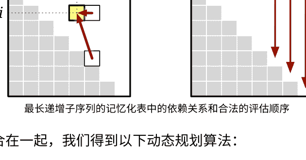

最后，将所有内容整合在一起，我们得到以下动态规划算法：

```
LIS(A[1 .. n]):
    A[0] ← -∞          ⟨添加一个哨兵⟩
    对于 i从0 到 n     ⟨基本情况⟩
        LIS [i, n+1] ← 0
    对于 j从 n递减到1
        对于 i从0 到 j−1
            如果 A[i] ≥ A[j]
                LIS [i, j] ← LIS [i, j+1]
            否则
                LIS [i, j] ← max{LIS [i, j+1], 1 + LIS [j, j+1]}
    返回 LIS [0, 1]
```

正如预期的那样，该算法明显使用 O(n²)的时间和空间. 然而，我们可以通过仅保留表格的最近两列，将空间减少到O(n). LIS[·, j]和 LIS[·, j+1]。
5看吧，我告诉过你现在不用担心常数因子！

这不是我们可以用于高效计算最长递增子序列的唯一递归策略。这是另一个递归公式，它免费给我们提供了 O(n)的空间限制。让 LIS'(i)表示 A[i..n]中以 A[i]开头的最长递增子序列的长度。我们的目标是计算LIS'(0)−1；我们减去1是为了忽略哨兵值 −∞. 为了递归地定义 LIS'(i)，我们只需要指定子序列的第二个元素；递归精灵会完成其余部分。

LIS'(i) = 1 + max {LIS'(j) | j > i 且 A[j] > A[i]

在这里，我假设max∅ =0，所以基本情况是 L'(n) =1自动地从递归中得出。对这个递归进行记忆化只需要 O(n)空间，得到的算法运行时间为O(n²)。 要将这个记忆化递归转化为动态规划算法，我们只需要确保在i < j时， LIS'(j)在 LIS'(i)之前计算。

```
LIS2(A[1..n]):
    A[0] = -∞       ⟨添加一个哨兵 ⟩
    对于 i ← n 递减到0
        LIS'[i] ← 1
        对于 j ← i+1 到 n
            如果 A[j] > A[i] 且 1 + LIS'[j] > LIS'[i]
                LIS'[i] ← 1 + LIS'[j]
    返回 LIS'[0] - 1       ⟨不要计算哨兵⟩
```

## 8.3 模式：智能递归

简而言之，动态规划是无重复的递归。动态规划算法通常将中间子问题的解存储在某种数组或表中，但并不总是如此。许多算法学生犯了一个错误，他们过于关注表格（因为表格容易且熟悉）而忽视了寻找正确递归的更重要（且困难）的任务。只要我们记忆化正确的递归，实际上并不需要显式的表格，但如果递归不正确，什么都不起作用。

> 动态规划不是关于填充表格的。它是关于聪明的递归！

动态规划算法通常分为两个不同的阶段开发。

- 1. 以递归方式表达问题。根据较小子问题的答案，写出整个问题的递归公式或算法。这是困难的部分。通常有助于以递归方式思考你试图构建的对象的定义。完整的递归公式有两个部分：
   - (a) 用连贯的英语描述你想要评估的精确函数。没有这个规范，甚至原则上都无法确定你的解决方案是否正确。
   - (b) 给出该函数的形式化递归定义。
- 2. 从底部向上构建递归的解决方案。编写一个从递归的基本情况开始，并按正确顺序考虑中间子问题的算法，直到得到最终解决方案。这个阶段可以分解为几个较小的、相对机械的步骤：
   - (a) 识别子问题。你的递归算法可以通过哪些不同的方式调用自己，从某个初始输入开始？例如，RECFIBO的参数始终是一个介于0和n之间的整数。
   - (b) 分析空间和运行时间。可能的不同子问题的数量决定了记忆化算法的空间复杂度。要计算时间复杂度，将所有可能子问题的运行时间相加，忽略递归调用。例如，如果我们已经知道 F_{i-1} 和 F_{i-2}，我们可以在 O(1) 时间内计算 F_i，因此计算前n个斐波那契数的时间复杂度为 O(n)。
   - (c) 选择一个数据结构来记忆中间结果。对于大多数问题，每个递归子问题可以由几个整数来标识，因此可以使用多维数组。然而，对于某些问题，需要更复杂的数据结构。
   - (d) 识别子问题之间的依赖关系。除了基本情况外，每个递归子问题都依赖于其他子问题-哪些子问题？ 画出你的数据结构的图形，选择一个通用元素，并从它依赖的每个其他元素画箭头。然后形式化你的图形。
   - (e) 找到一个好的评估顺序。对子问题进行排序，使得每个子问题都在依赖它的子问题之后。通常，这意味着首先考虑基本情况，然后是仅依赖于基本情况的子问题，依此类推。更正式地说，你在上一步中确定的依赖关系定义了子问题上的部分顺序；在这一步中，你需要找到该部分顺序的线性扩展。小心！
   - (f) 写下算法。你知道要考虑子问题的顺序，也知道如何解决每个子问题。 所以就这样做！如果你的数据结构是一个数组，这通常意味着在原始递归周围写几个嵌套的for循环。你不需要在作业或考试中这样做。

当然，你必须证明这些步骤每一步都是正确的。 如果你的递归公式错误，或者如果你尝试以错误的顺序构建答案，你的算法将无法工作！

## 8.4 警告：贪婪是愚蠢的

如果我们非常非常非常幸运，我们可以绕过所有的递归和表格等等，使用贪婪算法来解决问题。 一般的贪婪策略是寻找最佳的第一步，然后继续。 虽然这种方法似乎非常自然，但它几乎从不奏效；可以通过贪婪算法正确解决的优化问题非常罕见。 然而，对于许多应该通过动态规划解决的问题，许多学生的第一直觉是应用贪婪策略。

例如，编辑距离问题的贪婪算法可能会寻找两个字符串的最长公共子串，匹配这些子串（因为这些替换不需要花费），然后递归地寻找字符串的左半部分和右半部分之间的编辑距离。

如果没有共同的子字符串，也就是说，如果两个字符串没有共同的字符，则编辑距离显然是较长字符串的长度。 如果这听起来像一个愚蠢的黑客，那么请为自己鼓掌。 这甚至不接近正确的解决方案。

每个人都应该在手背上纹上以下句子，就在所有关于对数和大O符号的规则下面：

> 贪婪算法永远不起作用！改用动态规划！

什么，从不？不，从不！什么，从不？嗯...几乎从不。6

另一篇讲座笔记描述了证明贪婪算法正确性所需的努力，在它们很少出现的情况下。你将不会因为任何贪婪算法而获得任何学分。

6贪婪方法几乎从不起作用！所以为 Pinafore的小心船长欢呼三声，再加一声欢呼。然后为 Pinafore的船长欢呼三声，再加一声欢呼。

在这门课上没有一个正式的正确性证明的问题。我们将在本学期后期为几个贪婪算法进行正式证明。

## 8.5 编辑距离

两个单词之间的编辑距离—有时也称为Levenshtein距离—是将一个单词转换为另一个单词所需的最小字母插入、字母删除和字母替换的次数。例如，FOOD和MONEY之间的编辑距离最多为四：

```
FOOD → MOOD → MON^D → MONED → MONEY
```

更好的显示这个编辑过程的方法是将单词放在彼此上方，第一个单词每插入一个字母就有一个间隙，第二个单词每删除一个字母就有一个间隙。具有两个不同字符的列对应于替换。因此，编辑步骤的数量就是不包含相同字符两次的列的数量。

```
F O O D
M O N E Y
```

很明显，你不能在三步内从 FOOD到 MONEY，所以它们的编辑距离恰好是四。不幸的是，一般情况下并不那么容易。下面是一个更长的例子，展示了 ALGORITHM和 ALTRUISTIC之间的距离最多为六。这是最优的吗？

```
A L G O R I T H M
A L T R U I S T I C
```

为了开发一个动态规划算法来计算两个字符串之间的编辑距离，我们首先需要建立一个递归定义。我们对编辑序列的间隙表示具有关键的“最优子结构”属性。假设我们已经有了两个字符串的最短编辑序列的间隙表示。如果我们移除最后一列，剩下的列必须表示剩余子字符串的最短编辑序列。我们可以通过反证法轻松证明这一点。如果子字符串有一个更短的编辑序列，我们可以将最后一列粘回去，得到原始字符串的更短编辑序列。一旦我们弄清楚最后一列应该放什么，递归精灵就会神奇地给我们最优间隙表示的其余部分。

因此，让我们递归地定义两个字符串 A[1..m]和 B[1..n]之间的编辑距离，我们用 Edit(A[1..m], B[1..n])表示。如果两个字符串都不为空，则最短编辑序列的最后一列有三种可能性：

- 插入：底行的最后一个条目为空。在这种情况下，编辑距离等于Edit(A[1..m-1], B[1..n]) +1。这里的 +1是最后插入的成本，递归表达式给出了其他列的最小成本。
- 删除：顶行的最后一个条目为空。在这种情况下，编辑距离等于Edit(A[1..m], B[1..n-1]) +1。这里的 +1是最后删除的成本，递归表达式给出了其他列的最小成本。
- 替换：两行都有最后一列的字符。如果字符相同，则替换是免费的，因此编辑距离等于编辑 (A[1..m-1], B[1..n-1])。如果字符不同，则编辑距离等于编辑 (A[1..m-1], B[1..n-1]) + 1。

A和B之间的编辑距离是这三种可能性中最小的：⁷

> $$编辑(A[1 \ldots m], B[1 \ldots n]) = \min \begin{cases} 编辑(A[1 \ldots m-1], B[1 \ldots n]) + 1 & \\ 编辑(A[1 \ldots m], B[1 \ldots n-1]) + 1 & \\ 编辑(A[1 \ldots m-1], B[1 \ldots n-1]) + [A[m]\neq B[n]] & \end{cases}$$

这个递归有两个简单的基本情况。将空字符串转换为一个由n个字符组成的字符串的唯一方法是执行n次插入操作。同样，将一个由m个字符组成的字符串转换为空字符串的唯一方法是执行m次删除操作，因此，如果ε表示空字符串，我们有

> $$Edit(A[1 \ldots m], \epsilon) = m, \quad Edit(\epsilon, B[1 \ldots n]) = n.$$

这两个表达式都暗示了平凡的基本情况 \(Edit(\epsilon, \epsilon) = 0\)。

现在注意到我们递归子问题的参数总是原始字符串A和B的前缀。我们可以通过使用前缀的长度而不是前缀本身作为递归函数的参数来简化我们的表示法。

> 让 \(Edit(i, j)\) 表示前缀 \(A[1 \ldots i]\) 和 \(B[1 \ldots j]\) 之间的编辑距离。

这个函数满足以下递归关系：

> $$编辑(i, j) = \begin{cases} i & \text{if } j = 0 \\ j & \text{if } i = 0 \\ \min \begin{cases} 编辑(i-1, j) + 1, \\ 编辑(i, j-1) + 1, \\ 编辑(i-1, j-1) + [A[i]\neq B[j]] \end{cases} & \text{否则} \end{cases}$$

原始字符串A和B之间的编辑距离只是 \(Edit(m, n)\)。这个递归公式直接转化为一个递归算法；精确的运行时间并不明显，但显然是指数级的m和n。幸运的是，我们不关心递归算法的精确运行时间。递归运行时间不会告诉我们任何关于最终动态规划算法的信息，所以我们不会费心去计算它。⁸

因为每个递归子问题可以通过两个索引i和j来标识，我们可以在一个二维数组 \(Edit[0 \ldots m, 0 \ldots n]\) 中存储中间值。请注意索引范围从零开始以适应基本情况。由于表中有Θ(mn)个条目，我们的记忆化算法使用Θ(mn)空间。由于一旦我们知道其前任，表中的每个条目可以在Θ(1)时间内计算，因此我们的记忆化算法的运行时间为Θ(mn)。

> ⁷再次，我使用Iverson的括号表示法 [P] 来表示逻辑命题P的指示变量，如果P为真，则其值为1，如果P为假，则其值为0。

⁸如果你好奇，未记忆化递归算法的运行时间遵循以下递归关系：
$$T(m, n) = \begin{cases} O(1) & \text{如果 } n=0 \text{ 或 } m=0, \\ T(m, n-1) + T(m-1, n) + T(n-1, m-1) + O(1) & \text{otherwise.} \end{cases}$$
我不知道这个混乱的问题是否有一个一般的闭式解，但我们可以通过定义一个新函数来得到一个上界
$$T'(N) = \max_{n+m=N} T(n, m) = \begin{cases} O(1) & \text{如果 } N=0, \\ 2T(N-1) + T(N-2) + O(1) & \text{otherwise.} \end{cases}$$
湮灭法意味着 \(T'(N) = O((1+\sqrt{2})^N)\)。因此，我们递归编辑距离算法的运行时间最多为 \(T'(n+m) = O((1+\sqrt{2})^{n+m})\)。

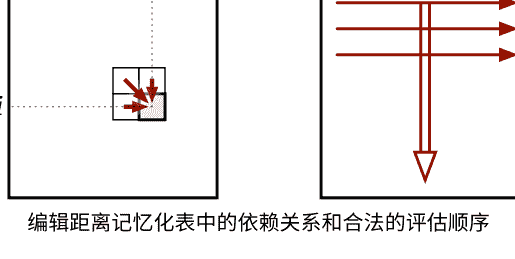

每个条目 Edit[i,j] 仅依赖于其三个相邻条目 Edit[i−1,j]+1, Edit[i,j−1]+1, 和 Edit[i−1,j−1] 。如果我们按照标准的行优先顺序填充表格——从上到下逐行填充，每行从左到右——那么当我们到达表格中的一个条目时，它所依赖的条目已经可用。将所有内容整合在一起，我们得到以下动态规划算法：

```
编辑距离 (A[1..m], B[1..n]):
    对于j←1到n
        编辑[0,j]←j
    对于i←1到m
        编辑[i,0]←i
        对于j←1到n
            如果A[i]=B[j]
                编辑[i,j]←min{编辑[i−1,j]+1, 编辑[i,j−1]+1, 编辑[i−1,j−1]}
            否则
                编辑[i,j]←min{编辑[i−1,j]+1, 编辑[i,j−1]+1, 编辑[i−1,j−1]+1}
    返回编辑[m,n]
```

下一页显示了 ALGORITHM → ALTRUISTIC的结果表。粗体数字表示两个字符串中字符相等的位置。箭头表示实际定义每个条目的前任。每个箭头方向对应不同的编辑操作：水平=删除，垂直=插入，对角线=替换。粗体对角线箭头表示字母自身的“自由”替换。这个表的左上角到右下角的任何箭头路径都表示两个字符串之间的最佳编辑序列。（可能有许多这样的路径。）此外，由于我们可以从表中存储的值在后处理阶段计算这些箭头，我们可以在 O(n + m)额外时间内重构实际的最佳编辑序列。

确实，ALGORITHM和ALTRUISTIC之间的编辑距离是六。在这个表中，有三条从左上到右下的路径，所以有三个最佳编辑序列：

A L G O R I   T H M
A L T R U I S T I C

A L G O R   I   T H M
A L   T R U I S T I C

A L G O R   I   T H M
A L T   R U I S T I C对于 Edit(ALGORITHM, ALGORITHMIC) 的记忆化表

|   | A | L | G | O | R | I | T | H | M |
|---|---|---|---|---|---|---|---|---|---|
| A | 1 | 0→1 | 1→2 | 2→3 | 3→4 | 4→5 | 5→6 | 6→7 | 7→8 |
| L | 2 | 1 | 0→1 | 1→2 | 2→3 | 3→4 | 4→5 | 5→6 | 6→7 |
| T | 3 | 2 | 1 | 1→2 | 2→3 | 3→4 | 4→5 | 5→6 | 6→7 |
| R | 4 | 3 | 2 | 2 | 2→3 | 3→4 | 4→5 | 5→6 | 6→7 |
| U | 5 | 4 | 3 | 3 | 3 | 3→4 | 4→5 | 5→6 | 6→7 |
| I | 6 | 5 | 4 | 4 | 4 | 4→5 | 5→6 | 6→7 | 7→8 |
| S | 7 | 6 | 5 | 5 | 5 | 4 | 4→5 | 5→6 | 6→7 |
| T | 8 | 7 | 6 | 6 | 6 | 5 | 4→5 | 5→6 | 6→7 |
| I | 9 | 8 | 7 | 7 | 7 | 6 | 5 | 5→6 | 6→7 |
| C | 10 | 9 | 8 | 8 | 8 | 7 | 6 | 6 | 6 |

## 8.6 更多例子

在前面关于回溯算法的笔记中，我们看到了另外两个可以通过动态规划显著加速的递归算法的例子。

### 8.6.1 子集和

回想一下，子集和问题是指给定一个正整数集合 $X$ (表示为一个数组 $X[1..n]$) 和一个整数 $T$，是否存在 $X$ 的任意子集的和为 $T$。在那个讲座中，我们开发了一个递归算法，可以重新表述如下。固定原始输入数组 $X[1..n]$ 和原始目标和 $T$，并定义布尔函数

$SS(i, t) = X[i..n] \text{的某个子集和为 } t$。

我们的目标是计算 $S(1, T)$，使用递归公式

$$SS(i, t) = \begin{cases} \text{真} & \text{if } t = 0, \\ \text{假} & \text{如果 } t < 0 \text{ 或 } i > n, \\ SS(i+1, t) \lor SS(i+1, t-X[i]) & \text{otherwise.} \end{cases}$$

只有 $nT$ 个可能的输入参数值会导致这个递归的有趣情况，我们可以将所有这些值存储在一个 $n \times T$ 数组中。如果 $S(i+1, t)$ 和 $S(i+1, t-X[i])$ 已知，我们可以在常数时间内计算 $S(i, t)$，因此存储这个递归可以使我们的算法在 $O(nT)$ 时间内运行。$^9$ 为了将其转化为显式的动态规划算法，我们只需要按正确的顺序考虑子问题 $S(i, t)$:

$^9$ 尽管 SubsetSum 是 NP 完全的，但这个界限并不意味着 P=NP，因为 $T$ 不一定受输入规模的多项式函数限制。

```
SUBSET SUM(X[1..n], T):
  S[n+1, 0] ← TRUE
  对于 t 从 1 到 T
    S[n+1, t] ← FALSE
  对于 i 从 n 递减到 1
    S[i, 0] = TRUE
    对于 t 从 1 到 X[i]-1
      S[i, t] ← S[i+1, t]          《避免 t < 0的情况》
    对于 t 从 X[i] 到 T
      S[i, t] ← S[i+1, t] ∨ S[i+1, t-X[i]]
  返回 S[1, T]
```

这个迭代算法明显总是使用 O(nT) 时间和空间。特别是，如果 T 远大于 2^n，这个算法实际上比我们的朴素递归算法更慢。动态规划并不总是一种改进！

### 8.6.2 NFA接受

我们在之前的讲座笔记中考虑的另一个问题是确定给定的NFA M= (Σ, Q, s, A, δ)是否接受给定的字符串 w ∈ Σ*。 为了使问题具体化，我们可以假设字母表是 Σ = {1, 2, …, |Σ|}，状态集合是 Q = {1, 2, …, |Q|}，起始状态是状态1，我们的输入由三个数组组成：

- 一个布尔数组 A[1 .. |Q|]，其中 A[q] = TRUE 当且仅当 q ∈ A。
- 一个布尔数组 δ[1 .. |Q|, 1 .. |Σ|, 1 .. |Q|]，其中 δ[p, a, q] = TRUE 当且仅当 p ∈ δ(q, a)。
- 一个符号数组 w[1 .. n]，表示输入字符串。

现在考虑布尔函数

```
接受? (q, i) = TRUE 当且仅当 M 接受从状态 q 开始的后缀 w[i .. n],
```

或者等价地，

```
接受? (q, i) = TRUE 当且仅当 δ*(q, w[i .. n]) 中至少包含一个状态 A。
```

我们需要计算接受(1,1)。 字符串转换函数的递归定义 δ* 意味着以下接受的递归关系：

```
接受 (q, i) := 
  真 如果 i > n 且 q ∈ A
  假 如果 i > n 且 q ∉ A
  ⋁_{r ∈ δ(q, a)} Accepts?(r, x)  if w = ax
```

将这个递归关系改写为我们的输入表示形式，得到以下结果:

```
接受 (q, i) := 
  真 如果 i > n 且 A[q] = 真
  假 如果 i > n 且 A[q] = 假
  ⋁_{r=1}^{|Q|} (δ[q, w[i], r] ∧ 接受 (r, i+1)) 否则
```

我们可以将这个函数存储在一个二维数组接受[1..|Q|,1..n+1]中。每个条目接受[q,i]依赖于形式为接受[r,i+1]的一些条目的子集。因此，我们可以通过在外部循环中按递减顺序考虑可能的索引i，并在内部循环中按任意顺序考虑状态q来填充记忆化表。评估每个条目接受[q,i]需要 O(|Q|)时间，使用一个更深层次的循环遍历所有状态r，并且有 O(n|Q|) 个这样的条目。因此，整个动态规划算法需要 O(n|Q|^2)时间。

```
NFA接受? (A[1..|Q|], δ[1..|Q|, 1..|Σ|, 1..|Q|], w[1..n]) :
    对于 q从1 到 |Q|
        接受吗[q, n+1] ← A[q]
    对于 i从n递减到1
        对于 q从1 到 |Q|
            接受吗[q, i] ← FALSE
            对于 r从1 到 |Q|
                [q,i] ← TRUE返回接受吗[1,1
]
```

## 8.7 最优二叉搜索树

在之前的讲座中，我们为最优二叉搜索树问题开发了一个递归算法。给定一个有序数组 A[1..n] 和一个频率计数数组 f[1..n]，其中 f[i] 是对 A[i] 的搜索次数。我们的任务是构建一个二叉搜索树，使得所有搜索的总成本尽可能小。我们为这个问题开发了以下递归公式：

$$OptCost(f[1..n]) = \min_{1 \le r \le n} \left\{ OptCost(f[1..r-1]) + \sum_{i=1}^{n} f[i] + OptCost(f[r+1..n]) \right\}$$

为了将这个递归公式转化为更标准的形式，固定频率数组 f，并让 OptCost(i, j) 表示子数组 A[i..j] 的最优搜索树的总搜索时间。为了简化符号，让 F(i, j) 表示区间 A[i..j] 中所有键的总频率计数：

$$F(i, j) := \sum_{k=i}^{j} f[k]$$

我们现在可以写

$$OptCost(i, j) = \begin{cases} 0 & \text{if } j < i \\ F(i, j) + \min_{i \le r \le j} \left( OptCost(i, r-1) + OptCost(r+1, j) \right) & \text{否则} \end{cases}$$

基本情况可能看起来有点奇怪，但它只是表示搜索空键集的总成本为零。

如果我们预先计算并存储所有可能的 F(i, j) 值，算法会更简单和高效。使用单独的 for 循环计算每个值 F(i, j) 将需要 O(n^3) 时间。更好的方法是将递归转化为以下 O(n^2) 时间的动态规划算法：

$$F(i, j) = \begin{cases} f[i] & \text{如果 } i = j \\ F(i, j-1) + f[j] & \text{otherwise} \end{cases}$$

将其转化为以下 O(n^2) 时间的动态规划算法：

```
初始化F(f[1..n]):
对于 i ← 1 到 n
    F[i,i-1] ← 0
    对于 j ← i 到 n
        F[i,j] ← F[i,j-1] + f[j]
```

这将用作我们最终算法中的初始化子程序。

所以现在让我们从底向上计算最优搜索树成本 $OptCost(1,n)$。我们可以将所有中间结果存储在一个表 $OptCost[1..n, 0..n]$ 中。实际上只有 $OptCost[i, j]$ 中的 $j \ge i-1$ 的条目将被使用。递归的基本情况告诉我们，任何形式为 $OptCost[i, i-1]$ 的条目可以立即设置为 0。对于任何其他条目 $OptCost[i, j]$，我们可以使用以下算法片段，它直接来自于递归：

```
COMPUTE OPTCOST(i, j):
    OptCost[i, j] ← ∞
    for r ← i to j
        tmp ← OptCost[i, r-1] + OptCost[r+1, j]
        if OptCost[i, j] > tmp
            OptCost[i, j] ← tmp
    OptCost[i, j] ← OptCost[i, j] + F[i, j]
```

唯一剩下的问题是以什么顺序填写表格。

每个条目 $OptCost[i, j]$ 都依赖于所有条目 $OptCost[i, r-1]$ 和 $OptCost[r+1, j]$，其中 $i \le k \le j$。换句话说，表格中的每个条目都依赖于其左侧或下方的所有条目。为了高效地填充表格，我们必须选择一种计算所有这些条目之前的顺序 $OptCost[i, j]$。至少有三种满足这个约束条件的顺序。大多数人首先想到的是一次扫描表格的一个对角线，从微不足道的基本情况开始 $OptCost[i, i-1]$。完整的算法如下：

```
最优搜索树 (f[1..n]) :
    初始化函数 (f[1..n])
    对于 i从1到 n
        OptCost[i, i-1] ← 0
    对于 d从0到 n-1
        对于 i从1到 n-d
            计算最优成本 (i, i+d)
    返回 OptCost[1, n]
```

我们还可以从底部向上逐行遍历数组，从左到右遍历每一行，或者从左到右逐列遍历，从底部向上遍历每一列。

```
OPTIMAL SEARCH TREE 2(f[1..n]):
    INIT F(f[1..n])
    for i ← n downto 1
        OptCost[i, i-1] ← 0
        for j ← i to n
            COMPUTE OPTCOST(i, j)
    返回 OptCost[1, n]
```

```
OPTIMAL SEARCH TREE 3(f[1..n]):
    INIT F(f[1..n])
    for j ← 0 to n
        OptCost[j+1, j] ← 0
        for i ← j downto 1
            COMPUTE OPTCOST(i, j)
    返回 OptCost[1, n]
```

无论我们实际使用哪种顺序，得到的算法运行时间为 $\Theta(n^3)$，并且使用空间为 $\Theta(n^2)$。我们可以直接从原始递归中预测这些空间和时间界限。

$$OptCost(i, j) = \begin{cases} 0 & \text{if } j = i - 1 \\ F(i, j) + \min_{i \le r \le j} \left( OptCost(i, r - 1) + OptCost(r + 1, j) \right) & \text{否则} \end{cases}$$

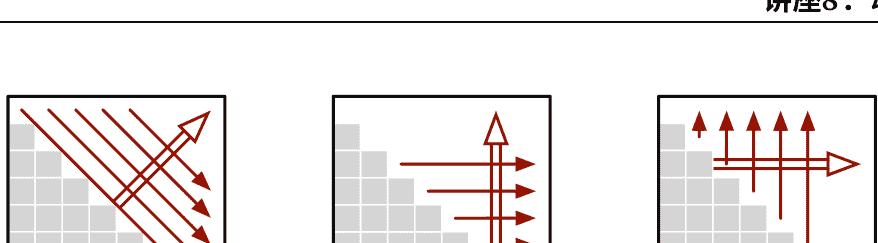

表 OptCost[i, j]有三种不同的评估顺序。

首先，该函数有两个参数，每个参数的值可以在1到 n之间取任意值，所以我们可能需要一个大小为 O (n²)的表。 接下来，递归中有三个变量 (i， j和r) ，每个变量的值可以在1到 n之间取任意值，所以填充表应该需要 O(n³)的时间。

## 8.8 CYK解析算法

在之前的讲座中，我们为解析上下文无关语言开发了一个递归回溯算法。 输入由字符串 w和上下文无关文法 G组成，其中文法处于Chomsky正规形式——意味着每个产生式的形式为 A → a (对于某个符号 a) ，或 A → BC (对于某些非终结符 B和 C) 。 我们的任务是确定 w是否属于 G生成的语言。我们的回溯算法递归地评估布尔函数 Generates? (A， x) 的值为TRUE当且仅当字符串 x可以由非终结符 A派生出来，使用以下递归式：

> 生成?  (A, x) = 
{ 真                     如果 |x|=1且 A → x
  假                     如果 |x|=1且 A → x
  ⋁_{A→BC} ⋁_{y•z=x} 生成?  (B, y) ∧ 生成? (C, z)   otherwise

这个递归在1965年由Tadao Kasami转化为动态规划算法，然后在1967年由Daniel Younger独立转化，再在1970年由John Cocke独立转化，因此最终的算法被称为“Cocke-Younger-Kasami”，或者更常称为CYK算法。

我们可以从之前的递归中推导出CYK算法如下。 像往常一样，对于涉及字符串的递归，我们需要稍微修改函数以便于记忆化。 固定输入字符串 w，然后让生成? (A, i, j) = TRUE当且仅当子字符串 w[i..j ]可以由非终结符 A推导出来。现在我们之前的递归可以重写如下：

> 生成?  (A, i, j) = 
{ 真                     如果 i = j且 A → w[i]
  假                     如果 i = j且 A → w[i]
  ⋁_{A→BC} ⋁_{k=i}^{j-1} 生成? (B, i, k) ∧ 生成? (C, k + 1, j)  otherwise

这个递归可以被记忆化为一个三维布尔数组 Gen[1..|Γ|,1..n,1..n]，其中第一维由输入语法中的非终结符 Γ索引。 这个数组中的每个条目 Gen[A, i, j]依赖于形式为 Gen[·, i, k]的条目，其中 k < j，或形式为 Gen[·, k + 1, j]的条目，其中 k ≥ i。 因此，我们可以通过在外部循环中增加 j，在中间循环中减少 i，并在内部循环中以任意顺序考虑非终结符 A来填充数组。 得到的动态规划算法的运行时间为 O(n³·|Γ|)。

```
CYK(w, G):
    对于 i 从1到 n
        对于所有非终结符 A
            如果 G 包含产生式 A → w[i]
                Gen[A, i, i] ← TRUE
            否则
                Gen[A, i, i] ← FALSE
    对于 j 从1到 n
        对于 i 从 n downto j + 1
            对于所有非终结符 A
                Gen[A, i, j] ← FALSE
            对于所有产生规则 A → BC
                对于 k 从 i 到 j - 1
                    如果 Gen[B, i, k] 和 Gen[C, k + 1, j]
                        Gen[A, i, j] ← TRUE
    返回 Gen[S, 1, n]
```

## 8.9 树上的动态规划

到目前为止，我们所有的动态规划示例都使用多维数组来存储递归子问题的结果。然而，正如下一个示例所示，这并不总是最合适的数据结构。

图中的一个独立集是指没有边相连的顶点的子集。在任意图中找到最大的独立集是非常困难的；事实上，这是另一篇讲座笔记中描述的经典的NP难问题之一。但是对于一些特殊情况的图，我们可以高效地找到最大的独立集。特别是，当输入图是一棵树（一个连通且无环的图），有n个顶点时，我们可以在O(n)的时间内计算出最大的独立集。在递归笔记中，我们看到了一个递归算法来计算任意图中最大独立集的大小：

```
最大独立集大小(G):
    如果 G = ∅
        返回0
    v ← G中的任意节点
    withv ← 1 + Maximum Independent Set Size(G \ N(v))
    withoutv ← Maximum Independent Set Size(G \ {v})
    返回 max {withv, withoutv}.
```

这里，N(v)表示v的邻域：包含v及其所有邻居的集合。正如我们在其他讲座笔记中观察到的，该算法的最坏运行时间为O(2^n poly(n))，其中n是输入图中的顶点数。

现在假设我们要求输入图是一棵树；我们将其称为树T而不是G。我们需要对算法进行轻微修改，使其真正递归。子图T \ {v}和T \ N(v)是森林，可能有多个分量。但是在一个不连通的图中，最大独立集只是其分量中最大独立集的并集，因此我们可以分别考虑这些森林中的每棵树。幸运的是，这样做还有一个额外的好处，即使我们可以选择节点v，使得这些树都比T小得多。下面是修改后的算法：## 最大独立集大小 (T)

如果 T = ∅，返回 0
← T 中的任意节点
令 v ← 1
对于每个树 T' 在 T 中，执行以下操作 \ N(v)
    令 v ← v + 最大独立集大小(T')
令 withoutv ← 0
对于每个树 T' 在 T 中，执行以下操作 \ {v}
    令 withoutv ← withoutv + 最大独立集大小(T')
返回 max {v, withoutv}。

现在让我们尝试对这个算法进行记忆化。每个递归子问题考虑原始树 T 的一个子树（即，一个连接的子图）。不幸的是，一个单独的树 T 可以有指数多个子树，所以我们似乎从一开始就注定要失败！

幸运的是，我们还没有利用的自由度：我们可以选择顶点 v。我们需要一个配方——一个算法！——来选择每个子问题中的 v，以限制算法考虑的不同子问题的数量。为了使这个工作起来，我们对原始输入树施加了一些额外的结构。具体来说，我们声明 T 的一个顶点为根，并将 T 的所有边定向远离该根。然后我们让 v 成为输入树的根；这个选择保证了每个递归子问题都考虑了 T 的一个根子树。T 中的每个顶点都是一个子树的根，所以现在不同子问题的数量正好是 n。我们可以通过只传递一个节点而不是整个子树来进一步简化算法：

```
最大独立集大小(v):
withv ← 1
对于每个孙子 x of v
    withv ← withv + MAXIMUM INDSET SIZE(x)
withoutv ← 0
对于每个子节点 w of v
    withoutv ← withoutv + MAXIMUM INDSET SIZE(w)
返回最大值{withv, withoutv}。
```

我们应该使用什么数据结构来存储中间结果？最自然的选择是树本身！具体来说，对于每个节点 v，我们在一个新的字段 v.MIS 中存储 MAXIMUM INDSET SIZE(v) 的结果。（我们可以使用数组，但是我们仍然需要为每个节点添加一个新的字段，指向相应的数组条目。何必麻烦呢？）

算法的运行时间是多少？与每个节点 v 相关的非递归时间与 v 的子代和孙代的数量成比例；这个数量在不同的顶点之间可能非常不同。但是我们可以从分析的角度来看：每个顶点对其父节点和祖父节点都贡献了一个恒定的时间！由于每个顶点最多只有一个父节点和一个祖父节点，总运行时间为 O(n)。

考虑子问题的顺序应该是什么？与任何节点 v 相关的子问题取决于 v 的子代和孙代的子问题。因此，我们可以以任何顺序访问节点，只要所有子节点在其父节点之前被访问。特别地，我们可以使用直接的后序遍历。

这是得到的动态规划算法。是的，它仍然是递归的。我交换了对带 v 和不带 v 的情况的评估；无论如何我们都需要先访问子节点，所以为什么不先考虑直接依赖于子节点的子问题呢？

```
最大独立集大小(v)：
withoutv ← 0
对于每个子节点 w of v
    withoutv ← withoutv + 最大 INDSET SIZE(w)
withv ← 1
对于每个孙子节点 x of v
    withv ← withv + x.MIS
v.MIS ← 最大值{withv, withoutv}
返回 v.MIS
```

另一种选择是为每个根节点的子树存储两个值：包括根节点的最大独立集的大小和不包括根节点的最大独立集的大小。这给我们一个更简单的算法，具有相同的 O(n) 运行时间。

```
最大独立集大小(v)：
v.MISno ← 0
v.MISyes ← 1
对于每个子节点 w of v
    v.MISno ← v.MISno + w.MISyes
    v.MISyes ← v.MISyes + w.MISno
返回 max{v.MISyes, v.MISno}
```

## 练习

## 序列 /数组

1.  在以前的生活中，你在失落的南极殖民地纳迪拉担任收银员，整天都在给顾客找零。因为纸张在南极洲是非常稀缺和有价值的资源，根据法律规定，收银员在找零时必须使用尽可能少的钞票。由于其创始人的数秘学偏好，纳迪拉的货币称为梦幻美元，有以下面额：1美元，4美元，7美元，13美元，28美元，52美元，91美元，365美元。
    - (a) 贪婪找零算法重复地选择不超过目标金额的最大面额钞票。例如，使用贪婪算法找零122美元，我们首先拿了一张91美元的钞票，然后是一张28美元的钞票，最后是三张1美元的钞票。给出一个例子，说明这个贪婪算法使用的梦幻美元钞票比最小可能数量多。
    - (b) 描述并分析一个递归算法，计算给定整数 k，需要多少张钞票才能凑够 k 梦想美元。（不用担心算法的速度，只需确保正确性。）
    - (c) 描述一个动态规划算法，计算给定整数 k，需要多少张钞票才能凑够 k 梦想美元。（这个算法需要快速执行。）

2.  假设给你一个数组 A[1..n]，其中的数字可以是正数、负数或零，并且不一定是整数。
    - (a) 描述并分析一个算法，找到连续子数组 A[i..j] 中元素之和的最大值。
    - (b) 描述并分析一个算法，找到连续子数组 A[i..j] 中元素的最大乘积。

    例如，给定数组 [-6,12,-7,0,14,-7,5] 作为输入，你的第一个算法应该返回整数19，你的第二个算法应该返回整数504。

    和 =19
    | -6 | 12 | -7 | 0 | 14 | -7 | 5 |
    乘积 =504

    为了分析，假设比较、相加或相乘任意一对数字的时间复杂度为 O(1)。

    > 提示：问题(a)自至少1980年代中期以来一直是计算机科学面试的标准问题。你可以在网上找到很多正确的解决方案；这个问题甚至有自己的维基百科页面！但至少在2013年，我在网上找到的问题(b)的解决方案要么比必要的慢，要么是错误的。

3.  这一系列的练习要求你开发高效的算法来找到最优的子序列的各种类型。子序列是从序列中提取一部分元素而得到的任何东西，但保持它们的顺序；子序列的元素不需要在原始序列中是连续的。例如，字符串 C, DAMN, YAIOAI 和 DYNAMIC PROGRAMMING 都是字符串 DYNAMIC PROGRAMMING 的子序列。
    - (a) 让 A[1..m] 和 B[1..n] 是两个任意的数组。一个 A 和 B 的公共子序列是另一个同时是 A 和 B 的子序列的序列。描述一个高效的算法来计算 A 和 B 的最长公共子序列的长度。
    - (b) 让 A[1..m] 和 B[1..n] 是两个任意的数组。一个 A 和 B 的公共超序列是另一个包含 A 和 B 作为子序列的序列。描述一个高效的算法来计算 A 和 B 的最短公共超序列的长度。
    - (c) 如果存在一个索引 i 满足 1 < i < n，使得前缀 X[1..i] 是递增的，后缀 X[i..n] 是递减的，则称序列 X[1..n] 为 bitonic。描述一个高效的算法来计算任意数组 A 的最长 bitonic 子序列的长度。
    - (d) 如果对于所有的偶数 i，X[i] < X[i+1]，并且对于所有的奇数 i，X[i] > X[i+1]，则称序列 X[1..n] 为振荡序列。描述一种高效的算法来计算任意整数数组 A 的最长振荡子序列的长度。
    - (e) 描述一种高效的算法来计算任意整数数组 A 的最短振荡超序列的长度。
    - (f) 如果对于所有的 i，2·X[i] < X[i-1] + X[i+1]，则称序列 X[1..n] 为凸序列。描述一种高效的算法来计算任意整数数组 A 的最长凸子序列的长度。
    - *(g)* 回想一下，如果对于所有的 i，序列 X[1..n] 的数字满足 X[i] < X[i + 1]，那么它是递增的。描述一种高效的算法来计算两个给定整数数组的最长公共递增子序列的长度。例如，〈1,4,5,6,7,9〉是序列〈3,1,4,1,5,9,2,6,5,3,5,8,9,7,9,3〉和〈1, 4, 1, 4, 2, 1, 3, 5, 6, 2, 3, 7, 3, 0, 9, 5〉的最长公共递增子序列。

4.  描述一个算法来计算给定数组 X[1..k] 在另一个给定数组 Y[1..n] 中作为子序列出现的次数。例如，如果 X 和 Y 中的所有字符都相等，你的算法应该返回 \binom{n}{k}。为了分析的目的，假设添加两个 ℓ 位整数需要 Θ(ℓ) 时间。

5.  你和你八岁的侄子埃尔莫决定玩一个简单的纸牌游戏。游戏开始时，纸牌被面朝上地排列成一行。每张纸牌都有不同的点数。在所有纸牌发完之后，你和埃尔莫轮流从行中移除最左边或最右边的纸牌，直到所有纸牌都被拿走。在每一轮中，你可以决定拿哪张纸牌。游戏结束时，得分最高的玩家获胜。埃尔莫从未上过算法课，他遵循明显的贪婪策略——当轮到他时，埃尔莫总是选择点数更高的卡片。你的任务是找到一种策略，尽可能地击败埃尔莫。（这样对一个小孩进行欺负似乎有点刻薄，但埃尔莫绝对讨厌成年人让他赢。）
    - (a) 证明你不应该使用贪婪策略。也就是说，证明存在一种游戏，只有当你不遵循与埃尔莫相同的贪婪策略时，你才能赢得游戏。
    - (b) 描述并分析一种算法，以确定在对抗埃尔莫时，给定初始卡片序列，你可以收集到的最大点数。
    - (c) 五年后，埃尔莫成为了一个更强大的选手。描述和分析一个算法，以确定在给定初始卡片序列的情况下，对战一个完美的对手，你可以收集的最大点数。

6.  快要展示你炫酷的舞技了！明天是大型舞蹈比赛，这是你一生中训练的重要时刻，除了那个夏天你和叔叔在阿拉斯加捕猎狼。你已经获得了比赛中裁判将按照时间顺序播放的歌曲列表的预览副本。你非常了解所有的歌曲、裁判和自己的舞蹈能力。对于每个整数 k，如果你跳舞到日程表上的第 k 首歌曲，你将获得 Score[k] 分，但之后你将无法跳舞直到接下来的 Wait[k] 首歌曲（也就是说，你不能跳舞到第 k+1 到第 k+Wait[k] 首歌曲）。比赛结束时总分最高的舞者将获胜，所以你希望你的总分尽可能高。描述并分析一个高效的算法来计算你可以达到的最大总分。你甜蜜算法的输入是一对数组 Score[1..n] 和 Wait[1..n]。

7.  你正在沿着一条公路开车，车上坐满了吵闹、兴奋、口渴的学生和一个饮料机。每分钟一个学生在你的车上，这个学生会喝掉一盎司的饮料。你的目标是尽快把学生送下车，以便所有学生消耗的饮料总量尽可能小。你知道每个出口将有多少学生下车。你的车在公路上开始（可能不是在两端），以每小时37.4英里的恒定速度行驶。你必须沿着公路驾驶巴士；然而，你可以前进到一个出口，然后向相反方向后退到一个出口，可以随意切换。（你可以立即停下巴士，让学生下车，并立即转身。）

    描述一个有效的算法，以便尽可能少地给学生们喝苏打。你的输入包括公交车路线（一系列出口，以及相邻出口之间的行驶时间），你将在每个出口下车的学生数量，以及你的公交车当前的位置（可以假设是一个出口）。

8.  回文是任何与其反转完全相同的字符串，例如 I，或 DEED，或 RACECAR，或 AMANAPLANACATACANALPANAMA。
    - (a) 描述并分析一个算法，找到给定字符串的最长回文子序列的长度。例如，字符串 MAHDYNAMICPROGRAMZLETMESHOWYOUTHEM 的最长回文子序列是 MHYMRORMYHM，因此给定该字符串作为输入，你的算法应该输出数字11。
    - (b) 描述并分析一个算法，用于找到给定字符串的最短超序列的长度，该超序列也是一个回文。例如，TWENTYONE 的最短回文超序列是 TWENTOYOTNEWT，因此给定字符串 TWENTYONE 作为输入，你的算法应该输出数字13。
    - (c) 任何字符串都可以分解成一系列回文。例如，字符串 BUBBASEESABANANA ("Bubba sees a banana.") 可以按以下方式 (以及其他方式) 分解成回文：
        - BUB • BASEESAB • ANANA
        - B • U • BB • A • SEES • ABA • NAN • A
        - B • U • BB • A • SEES • A • B • ANANA
        - B • U • B • B • A • S • E • E • S • A • B • A • N • ANA

        描述并分析一种高效的算法，用于找到组成给定输入字符串的最小回文数。例如，给定输入字符串 BUBBASEESABANANA，你的算法将返回整数3。

9.  假设你有一个黑盒子子程序 QUALITY，可以在 O(k) 时间内计算任何给定字符串 A[1..k] in 的‘质量’。例如，如果字符串是魁北克话的脏话，则其质量可能为1，否则为0。

    给定任意输入字符串 T[1..n]，我们希望将其分解为连续的子字符串，使得所有子字符串的总质量尽可能大。例如，字符串 SAINT CIBOIRE DE SACRAMENT DE CRISSE 可以分解为子字符串 SAINT • CIBOIRE • DE • SACRAMENT • DE • CRISSE，其中三个 (或可能四个) 是神圣的。

    描述一个算法，将字符串分解为最大总质量的子字符串，使用 QUALITY 子程序。

10. (a) 假设我们在平面上给定一组 L 线段，其中每个线段在直线 y =0 上有一个端点，在直线 y = 1 上有一个端点，且所有 2n 端点都不同。描述并分析一个算法，计算 L 的最大子集，其中没有一对线段相交。
    (b) 假设我们在平面上给定一组 L 线段，其中每个线段在直线 y =0 上有一个端点，在直线 y =1 上有一个端点，且所有 2n 端点都不同。描述并分析一个算法，计算 L 的最大子集，其中每对线段都相交。
    (c) 假设我们在平面上给定一组 L 线段，其中每个线段的端点都位于单位圆 x^2 + y^2 = 1 上，且所有 2n 端点都不同。描述并分析一个算法，计算 L 的最大子集，其中没有一对线段相交。
    (d) 假设我们在平面上给定了一组线段 L，其中每个线段的端点都位于单位圆 x^2 + y^2 = 1 上，并且所有 2n 个端点都是不同的。描述并分析一个算法，计算 L 的最大子集，其中每对线段都相交。

11. 假设 P 是均匀分布在单位圆上的一组点，S 是一组具有端点在 P 上的 m 条线段。这 m 条线段的端点不一定是不同的；n 可能远小于 2m。
    - (a) 描述一个算法，找到 S 中最大子集的大小，使得每对线段都不相交。如果两条线段甚至在端点处都不相交，则它们是不相交的。
    - (b) 描述一个算法，找到 S 中最大子集的大小，使得每对线段都是内部不相交的。如果两条线段的交集为空或者是两条线段的端点，则它们是内部不相交的。
    - (c) 描述一个算法来找到在 S 中每对都相交的最大子集的大小。
    - (d) 描述一个算法来找到在 S 中每对都交叉的最大子集的大小。如果两个线段相交但不在端点处相交，则它们交叉。

    为了获得全部学分，这四个算法都应该在 O(mn) 时间内运行。

12. 将两个字符串 X 和 Y 的洗牌形成一个新字符串，保持 X 和 Y 的字符顺序不变。例如，字符串 BANANAANANAS 是字符串 BANANA 和 ANANAS 的多种不同方式的洗牌。

    同样，字符串 PRODGYRNAMAMMIINCG 和 DYPRONGARMAMMICING 都是 DYNAMIC 和 PROGRAMMING 的洗牌：

    给定三个字符串 A[1..m], B[1..n], 和 C[1..m+n]，描述和分析一个算法来确定 C 是否是 A 和 B 的洗牌。

13. 描述和分析一个高效的算法，以找到在输入字符串 T[1..n] 中同时出现在前向和后向的最长连续子字符串的长度。前向和后向的子字符串不能重叠。以下是几个例子：
    - 给定输入字符串 ALGORITHM，你的算法应该返回 0。
    - 给定输入字符串 RECURSION，你的算法应该返回1，表示子字符串 R。
    - 给定输入字符串 REDIVIDE，你的算法应该返回3，表示子字符串 EDI。（前向和后向的子字符串不能重叠！）
    - 给定输入字符串 DYNAMICPROGRAMMINGMANYTIMES，你的算法应该返回4，对于子字符串 YNAM。（特别是，它不应该返回6，对于子序列 YNAMIR。）

14. 舞蹈舞蹈革命是一款舞蹈视频游戏，由Konami于1998年首次引入日本。

    玩家站在一个标有四个箭头的平台上，箭头分别指向前方、后方、左方和右方，排列成十字形。在游戏过程中，游戏播放一首歌曲，并滚动一系列的 n 箭头（←, ↑, ↓, 或 →）从屏幕底部滚动到顶部。当每个箭头到达屏幕顶部的时刻，玩家必须踩下舞蹈平台上对应的箭头。（箭头的时间安排得让你能够跟着歌曲的节奏踩下去。）

    你正在玩一个名为“时尚时尚革命”的变种游戏，目标是完美演奏但尽量少移动。当一个箭头到达屏幕顶部时，如果你的一只脚已经踩在正确的箭头上，你将获得一个风格分，以保持你当前的姿势。如果两只脚都没有踩在正确的箭头上，你必须将其中一只脚（仅限一只）从当前位置移动到平台上的正确箭头上。如果你踩错了箭头，或者没有踩对箭头，或者一次移动了超过一只脚，或者在已经站在正确箭头上时移动了任何一只脚，你所有的风格分都会被扣除，你将输掉游戏。

    为了最大化你的风格积分，你应该如何移动你的脚？对于这个问题，假设你总是以左脚开始 ← 并且你的右脚在 → 上，并且你已经记住了整个箭头序列。例如，如果序列是 ↑↑↓↓←→，通过以下方式移动你的脚可以获得5个风格积分：

    - (a) 证明对于任何箭头序列，至少可以获得 n/4 - 1 个风格积分。
    - (b) 描述一种高效的算法，用于找到在给定的VVR例程中可以获得的最大风格积分数。你的算法的输入是一个包含箭头序列的数组 Arrow[1..n]。

15. 考虑以下形式的单人Scrabble游戏。

    我们从一个固定的有限序列中开始；每个方块包含一个字母和一个数值。在游戏开始时，我们从序列中抽取七个方块放入手中。每一轮，我们从手中的方块中组成一个英文单词，将这些方块放在桌子上，并获得这些方块的总值作为得分。如果手中的方块无法组成英文单词，则游戏立即结束。然后，我们重复从序列的开头抽取下一个方块，直到 (a) 我们手中有七个方块，或者 (b) 序列为空。（抱歉，没有双倍/三倍单词/字母得分、bingo、空白方块或放弃。）我们的目标是获得尽可能多的分数。

    例如，假设我们给出了瓷砖序列I₂ N₂ X₈ A₁ N₂ A₁ D₃ U₅ D₃ I₂ D₃ K₈ U₅ B₄ L₂ A₁ K₈ H₅ A₁ N₂.

那么我们可以按如下方式获得68分:

- 我们最初抽取 I₂ N₂ X₈ A₁ N₂ A₁ D₃。
- 打出单词 N₂ A₁ I₂ A₁ D₃ 获得9分，剩下 N₂ X₈ 在我们手中。
- 抽取下面的五个瓷砖 U₅ D₃ I₂ D₃ K₈。
- 打出单词 U₅ N₂ D₃ I₂ D₃ 获得15分，剩下 K₈ X₈ 在我们手中。
- 抽取下面的五个瓷砖 U₅ B₄ L₂ A₁ K₈。
- 打出单词 B₄ U₅ L₂ K₈ 获得19分，剩下 K₈ X₈ A₁ 在我们手中。
- 抽取下面的三个瓷砖 H₅ A₁ N₂，清空列表。
- 打出单词 A₁ N₂ K₈ H₅ 获得16分，剩下 X₈ A₁ 在我们手中。
- 打出单词 A₁ X₈ 获得9分，清空我们的手并结束游戏。

(a) 假设你的输入是两个数组 Letter[1..n]，包含了一个字母序列在 A 和 Z 之间，并且 Value[A..Z]，其中 Value[ℓ] 是字母 ℓ 的值。设计并分析一个高效的算法来计算给定瓷砖序列可以获得的最大分数。

(b) 现在假设具有相同字母的两个瓷砖可以具有不同的值；给定两个数组 Letter[1..n] 和 Value[1..n]。设计并分析一个高效的算法来计算从给定的瓷砖序列中可以获得的最大点数。

在这两个问题中，输出是一个单独的数字：最大可能得分。假设您可以在最多七个瓷砖的任何集合中找到所有可以制作的英文单词，以及这些单词的点数，在 O(1) 时间内。

## 16. 假设您有一个DFA M= ({0,1}, Q, s, A, δ) 和一个二进制字符串 w ∈ {0,1}*。

(a) 描述并分析一个算法，计算 w 的最长子序列，该子序列被 M 接受，或者正确报告 M 不接受 w 的任何子序列。

*(b) 描述并分析一个算法，计算 w 的最短超序列，该超序列被 M 接受，或者正确报告 M 不接受 w 的任何超序列。 [提示：小心！]

根据参数 n = |w| 和 k = |Q| 分析你们两个算法。

## 17. Vankin的Mile是一种在一个 n×n 的方格网格上玩的美国纸牌游戏。玩家首先在网格的任意方格上放置一个标记。然后在每一轮中，玩家将标记移动到右边的方格或下方的方格。当玩家将标记移出棋盘边缘时，游戏结束。网格的每个方格都有一个数值，可以是正数、负数或零。玩家从零分开始；每当标记落在一个方格上时，玩家将其数值加到自己的分数上。游戏的目标是尽可能多地得分。

例如，给定下面的网格，玩家可以通过将初始标记放在第二行的8上，然后向下、向下、向右、向下、向下移动，得到8－6＋7－3＋4＝10分。（这不是这些值的最佳得分。）

| -1 | 7 | -8 | 10 | -5 |
| -4 | -9 | 8 | -6 | 0 |
| 5 | -2 | -6 | -6 | 7 |
| -7 | 4 | 7 | -3 | -3 |
| 7 | 1 | -6 | 4 | -9 |

(a) 描述并分析一种高效的算法，以计算Vankin's Mile游戏的最大可能得分，给定输入的n × n数组值。

(b) 在这个游戏的欧洲版本中，适当地称为Vankin's Kilometer，玩家可以在每个回合中将令牌移动到下一个方格、右边一个方格或左边一个方格。然而，为了防止无限得分，令牌不能落在同一个方格上超过一次。描述并分析一种高效的算法，以计算Vankin's Kilometer游戏的最大可能得分，给定输入的n × n数组值。

## 18. 假设你有一个m × n位图，由一个0和1的数组M[1..m,1..n]表示。在M中，一个实心块是一个形如M[i..i', j..j']的子数组，其中只包含1位。如果一个实心块的行数和列数相同，则它是一个正方形。

(a) 描述一个算法来找到M中一个实心正方形块的最大面积，时间复杂度为O(n^2)。

(b) 描述一个算法来找到M中一个实心块的最大面积，时间复杂度为O(n^3)。

*(c) 描述一个算法来找到M中一个实心块的最大面积，时间复杂度为O(n^2)。

## *19. 描述并分析一个算法来解决旅行商问题，时间复杂度为O(2^n poly(n))。给定一个有权边的无向图G，其中G有n个顶点，你的算法应该返回访问每个顶点恰好一次的最轻的环的权重，如果G没有这样的环，则返回∞。[提示：明显的递归算法需要 O(n!)时间。]

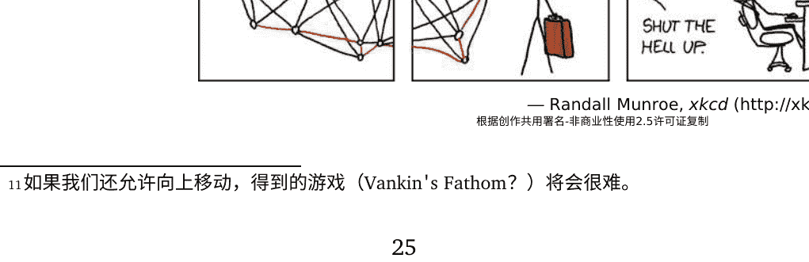

## ★20. 让 $\mathcal{A} = \{A_1, A_2, \dots, A_n\}$ 是一个在某个固定字母表 $\Sigma$ 上的有限字符串集合。对于 $\mathcal{A}$ 的一个编辑中心 $C \in \Sigma^*$，使得从 $C$ 到 $\mathcal{A}$ 中的任何字符串的最大编辑距离尽可能小。对于 $\mathcal{A}$ 的编辑半径是从编辑中心到 $\mathcal{A}$ 中的字符串的最大编辑距离。一组字符串可能有多个编辑中心，但其编辑半径是唯一的。

$\textit{EditRadius}(\mathcal{A}) = \min_{C \in \Sigma^*} \max_{A \in \mathcal{A}} \textit{Edit}(A, C)$

$\textit{EditCenter}(\mathcal{A}) = \arg\min_{C \in \Sigma^*} \max_{A \in \mathcal{A}} \textit{Edit}(A, C)$

(a) 描述并分析一种高效的算法来计算给定三个字符串的编辑半径。

(b) 描述并分析一种高效的算法，以2倍的因子近似计算任意一组字符串的编辑半径。（除非字符串的数量固定，否则计算精确的编辑半径是NP难问题。）

## ★21. 让 $D[1..n]$ 是一个由0到9之间的整数组成的数字数组。数字子序列 of $D$ 是从 $D$ 的不相交子字符串通常方式组成的正整数序列。例如，3,4,5,6,8,9,32,38,46,64,83,279是 $\pi$ 的前几个数字的数字子序列：

```
3, 1, 4, 1, 5, 9, 2, 6, 5, 3, 5, 8, 9, 7, 9, 3, 2, 3, 8, 4, 6, 2, 6, 4, 3, 3, 8, 3, 2, 7, 9
```

数字子序列的长度是它包含的整数的数量，而不是数字的数量；前面的例子长度为12。通常情况下，如果每个数字都比前一个数字大，那么数字子序列就是递增的。

描述并分析一个高效的算法来计算最长递增数字子序列。[提示：要注意你的计算假设。比较两个 $k$ 位数需要多长时间？]

为了获得满分，你的算法应该在 $O(n^4)$ 的时间内运行；更快的算法可以获得额外的学分。我知道的这个问题的最快算法运行时间为 $O(n^{2\log n})$；要达到这个界限，需要在算法和分析中使用一些技巧。

## 22. 每年，作为年度会议的一部分，上格雷斯维尔的南极蜗牛爱好者举行一场圆桌交配比赛。几只高质量的繁殖蜗牛被放置在圆桌的边缘。蜗牛按照从1到n的顺序编号。比赛期间，每只蜗牛在桌子上四处游荡，留下一条粘液痕迹。这些蜗牛经过特殊训练，从不掉下桌子边缘，也不会穿过粘液痕迹，即使是它们自己的痕迹。如果两只蜗牛相遇，它们被宣布为繁殖配对，从桌子上移走，并被带到地下的一个浪漫洞穴中制造小蜗牛。请注意，即使比赛永远进行下去，有些蜗牛可能永远找不到配偶。

对于每对蜗牛，南极洲SLUG比赛组织者已经发布了一笔奖金，如果这对蜗牛在交配比赛中相遇，将支付给蜗牛的所有者。具体来说，在圆桌后面的墙上贴有一个二维数组 $M[1..n,1..n]$，其中 $M[i, j] = M[j, i]$ 表示如果蜗牛 $i$ 和 $j$ 相遇时要支付的奖金。

描述并分析一个算法，以计算给定输入数组 $M$ 时组织者可能被迫支付的最大总奖金。

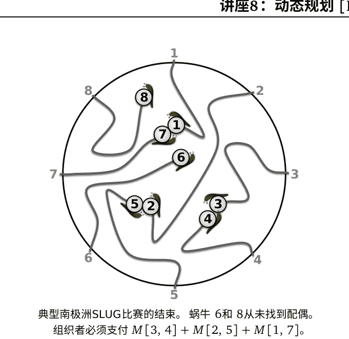

典型南极洲SLUG比赛的结束。蜗牛 6 和 8 从未找到配偶。组织者必须支付 M[3,4] + M[2,5] + M[1,7]。

## 23. 假设你有一串由 + 和 × 符号分隔的整数序列；例如：

```
1+3×2×0+1×6+7
```

你可以通过在不同的位置添加括号来改变这个表达式的值。例如：

```
(1+(3×2))×0+(1×6)+7=13
((1+(3×2×0)+1)×6)+7=19
(1+3)×2×(0+1)×(6+7)=208
```

(a) 描述并分析一个算法，通过添加括号来计算给定表达式可能达到的最大值，假设输入中的所有整数都是正数。[提示：这很简单。]

(b) 描述并分析一个算法，通过添加括号来计算给定表达式可能达到的最大值，假设输入中的所有整数都是非负数。

(c) 描述并分析一个算法，通过添加括号来计算给定表达式可能达到的最大值，对输入没有进一步的限制。

假设任何算术运算都需要 O(1)的时间。

## 24. 假设你有一串由整数组成的序列，用 + 和 - 符号分隔；例如：

```
1+3-2-5+1-6+7
```

你可以通过在不同的位置添加括号来改变这个表达式的值。例如：

```
1+3-2-5+1-6+7=-1
(1+3-(2-5))+(1-6)+7=9
(1+(3-2))-(5+1)-(6+7)=-17
```

描述并分析一种算法，根据由 + 和 - 符号分隔的整数列表，计算表达式可能取得的最大值，通过添加括号。你只能使用括号来分组加法和减法；特别地，你不能像1+3(-2)(-5)+1-6+7=33.

## 25. 一个基本的算术表达式由来自集合 {1,+,×} 和括号的字符组成。几乎每个整数都可以用多个基本算术表达式表示。例如，以下所有的基本算术表达式都表示整数14:

```
1+1+1+1+1+1+1+1+1+1+1+1+1+1
((1+1)×(1+1+1+1+1+1)) + ((1+1)×(1+1))
(1+1)×(1+1+1+1+1+1+1)
(1+1)×(((1+1+1)×(1+1))+1)
```

描述并分析一种算法，根据输入的整数 n，计算一个值为 n 的基本算术表达式中1的最小数量。括号的数量并不重要，只有1的数量重要。例如，当 n=14时，你的算法应该返回8，对应上面的最终表达式。为了获得满分，你的算法的运行时间应该受到 n 的一个小多项式函数的限制。

## 26. 从UIUC毕业后，你决定加入华尔街银行布尔万岁。该银行的董事总经理Eloob Egroeg是一位天才数学家，在离开办公室前每天早上都会崇拜乔治·布尔（布尔逻辑的发明者）。每个新员工的第一天都是一个“解决或死亡”的日子，在24小时内必须解决Eloob提出的一个问题。那些无法解决问题的人将立即被解雇！第一次进入银行时，你注意到员工办公室是直排的，每个办公室的门上都有一个大写字母 T 或 F。此外，在相邻的两个办公室之间，有一个标有符号 ∧, ∨, 或 ⊕ 的板子。

当你询问这些神秘的符号时，Eloob确认 T 和 F 代表布尔值TRUE和FALSE，而黑板上的符号代表标准布尔运算符AND、OR和XOR。他还解释说，这些字母和符号描述了员工之间是否能够成功地共同工作。在任何新项目开始时，Eloob通过在符号序列中添加括号来对员工进行层次聚类，以获得一个明确的布尔表达式。如果这个带括号的布尔表达式的计算结果为 T，那么项目就会成功。

例如，如果银行有三名员工，门上和门之间的符号序列为 T ∧ F ⊕ T，那么只有一种成功的括号方案：(T ∧ (F ⊕ T))。
然而，如果门上的符号列表为 F ∧ T ⊕ F，那么无法通过添加括号使项目成功。

Eloob最终提出了一个解决或死亡问题：描述一个算法，以确定是否可以对给定的符号序列进行括号化，使得结果布尔表达式的计算结果为T。你的算法的输入是一个数组 S[0..2n]，其中 S[i]∈{ T,F}当 i 为偶数时，S[i]∈{∨,∧,⊕}当 i 为奇数时。

## 27. 假设我们想在计算机屏幕上显示一个段落的文本。文本由N个单词组成，其中第 i 个单词的宽度为 P_i 像素。我们想将段落分成几行，每行恰好 P 像素长。根据我们在每行上放置的单词，我们必须在单词之间插入不同数量的空白。段落应该是完全对齐的，意味着每行的第一个单词从最左边的像素开始，除了最后一行外，每行的最后一个字符在其最右边的像素结束。同一行上的任意两个单词之间必须至少有一个像素的空白。例如，你正在阅读的段落的宽度现在正好是6.33英寸或（假设显示分辨率为每英寸600像素）正好3672像素。（有时TEX很奇怪。但由于抗锯齿，分数像素宽度是可以的。）定义段落布局的斜率为每行的额外空白像素数的立方和，不包括每个相邻单词之间所需的一个像素。具体来说，如果一行包含单词 i 到 j，则该行的斜率为 $(P - (j - i + 1) - \sum_{k=i}^{j} p_k)^3$。描述一个动态规划算法来打印具有最小斜率的段落。

## 28. 你从采石场开采了一块大理石板。为简单起见，假设大理石板的尺寸为高度 m 英寸和宽度 n 英寸。你想把大理石板切割成各种尺寸的小矩形，一些用于厨房台面，一些用于大型雕塑项目，其他用于纪念碑墓碑。你有一把可以在任何矩形板上进行水平或垂直切割的大理石锯。随时可以查询任何正整数x和y的 x英寸乘以y英寸大理石矩形的现货价格 P[x, y]。这些价格会随需求变化，因此不要对它们做任何假设；特别是，较大的矩形可能具有较小的现货价格。给定现货价格，描述一个算法来计算如何将一个m × n大理石板细分以最大化利润。

## 29. 一个由括号（和）以及方括号[和]组成的字符串是平衡的如果满足以下条件之一：

- 字符串 w 为空。
- 字符串 w = (字符串 x)，其中字符串 x 是平衡的
- 字符串 w = [字符串 x]，其中字符串 x 是平衡的
- 字符串 w = 字符串 x 字符串 y，其中字符串 x 和字符串 y 都是平衡的。

例如，字符串 w = ((([[()]][](()))) [[(() )(())]]) （()）是平衡的，因为字符串 w = 字符串x字符串y，其中 x = ( [[()] [] () ] ) 和 y = [ () () ] ( ).

(a) 描述并分析一个算法来确定给定的括号和方括号字符串是否平衡。

(b) 描述并分析一个算法来计算给定的括号和方括号字符串的最长平衡子序列的长度。

(c) 描述并分析一个算法来计算给定的括号和方括号字符串的最短平衡超序列的长度。

(d) 描述和分析一个算法，计算从给定的括号和方括号字符串到一个平衡的括号和方括号字符串的最小编辑距离。

对于每个问题，你的输入是一个数组 w[1 .. n]，其中 w[i] ∈ { (, ), [, ] } 对于每个索引 i。

## 30. 恭喜！你的研究团队刚刚获得了一项价值5000万美元的多年项目，由DARPA、谷歌和麦当劳共同资助，旨在开发DWIM：第一个能够读取程序员思维的编译器！你的提案和众多新闻稿都承诺DWIM将自动纠正任何给定代码片段中的错误，同时尽可能少地修改该代码。不幸的是，现在是时候开始真正让这个该死的东西工作了。

作为一个热身练习，你决定解决以下必要的子问题。回想一下，两个字符串之间的编辑距离是将一个字符串转换为另一个字符串所需的最小单字符插入、删除和替换的次数。一个算术表达式是一个字符串 w。

- w 是一个由一个或多个十进制数字组成的字符串,
- w = (x) 对于某个算术表达式 x, 或者
- w = x◇y 对于某个算术表达式 x 和 y 以及某个二元运算符 ◇。

假设给定一个来自字母表 {#,◇,(,)} 的标记字符串，其中 # 表示一个十进制数字，◇ 表示一个二元运算符。描述一个算法来计算给定字符串到算术表达式的最小编辑距离。

## 31. 设 P 是平面上的一组点，处于凸位置。直观地说，如果一个橡皮筋被绕在这些点上，那么每个点都会接触到橡皮筋。更正式地说，对于任意点 p in P，存在一条直线将 p 与 P 中的其他点分开。此外，假设这些点按逆时针顺序编号 P[1], P[2], ..., P[n]，从‘橡皮筋’的最左边的点 P[1]开始。

这个问题要求你解决旅行商问题的一个特殊情况，其中销售员必须访问 P 中的每个点，并且从一个点 p ∈ P 移动到另一个点 q ∈ P 的成本是欧几里得距离 |pq|。

(a) 描述一个简单的算法来计算 P 的最短循环旅行。

(b) 一个简单的旅行是指不会交叉的旅行。证明 P 的最短旅行必须是简单的。

(c) 描述并分析一个高效的算法来计算 P 的最短旅行，该旅行从最左边的点 P[1]开始，以最右边的点 P[r]结束。

(d) 描述并分析一个高效的算法来计算 P 的最短旅行，对端点没有限制。

## 32. (a) 描述并分析一个高效的算法，给定一个字符串 w 和一个正则表达式 R，确定 w ∈ L(R) 是否成立。

(b) 广义正则表达式允许二元运算符 ∩ (交集) 和一元运算符 ¬ (补集)，除了常规的连接运算符 + (或) 和 * (克林闭包)。NFA 构造和 Kleene 定理意味着任何广义的正则表达式 E 表示一个正则语言 L(E)。

描述和分析一种高效的算法，用于确定给定字符串 w 和广义正则表达式 E 是否满足 w ∈ L(E)。

在这两个问题中，假设你实际上已经获得了 (广义) 正则表达式的解析树，而不仅仅是一个字符串。

## 33. 核糖核酸 (RNA) 分子是由数百万个核苷酸或碱基组成的长链，有四种不同的类型：腺嘌呤 (A)、胞嘧啶 (C)、鸟嘌呤 (G) 和尿嘧啶 (U)。RNA 分子的序列是一个字符串 b[1..n]，其中每个字符 b[i]∈{A,C,G,U} 对应一个碱基。

除了序列中相邻碱基之间的化学键外，氢键还可以形成在某些碱基对之间。成对键合的碱基集合被称为RNA分子的二级结构。

实际上，大多数碱基对是不重叠的。重叠的碱基对在二级结构中形成了所谓的伪结，这对于一些RNA功能是必不可少的，但是更难预测。

假设我们想要预测给定RNA序列的最佳可能的二级结构。我们将采用一个极其简化的二级结构模型：

- 每个碱基最多可以与另一个碱基配对。
- 只有A-U对和C-G对可以结合。
- 形式为 \((i, i+1)\) 和 \((i, i+2)\) 的对不能结合。
- 重叠的碱基对不能结合。

最后的限制使我们能够将RNA二级结构视为一种类似于肥胖树的结构。

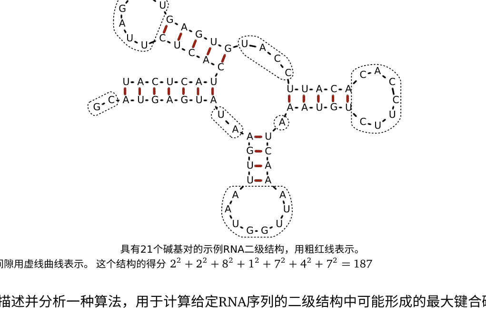

具有21个碱基对的示例RNA二级结构，用粗红线表示。间隙用虚线曲线表示。这个结构的得分 \(2^2 + 2^2 + 8^2 + 1^2 + 7^2 + 4^2 + 7^2 = 187\)

(a) 描述并分析一种算法，用于计算给定RNA序列的二级结构中可能形成的最大键合碱基数。

(b) 描述并分析一种算法，用于计算给定RNA序列的二级结构的最小可能得分。

## 34. 提高搜索树缓存性能的标准方法是将更多的搜索键和子树打包到每个节点中。B树是一棵根节点存储最多B个键和指向最多B+1个子节点的树，每个子节点都是较小的B树的根节点。具体来说，每个节点v存储三个字段：## 10 贪婪算法

对于每个人类问题，总是存在一个简单的解决方案——整洁、合理，但是错误的。

—— H. L. Mencken，“神圣的灵感”，纽约晚邮报（1917年11月16日）

### 10.1 在磁带上存储文件

假设我们有一组要存储在磁带上的文件。将来，用户将希望从磁带上读取这些文件。从磁带上读取文件不像从磁盘上读取文件；首先，我们必须快进到所有其他文件的末尾，这需要相当长的时间。让 \(L[1..n]\) 成为一个列出每个文件长度的数组；具体而言，文件 \(i\) 的长度为 \(L[i]\)。如果文件按照从1到n的顺序存储，则访问第k个文件的成本为

$$
\text{成本}(K) = \sum_{i=1}^{K} L[i].
$$

成本反映了在我们读取文件K之前，我们必须先扫描过磁带上的所有早期文件的事实。

如果我们暂时假设每个文件被访问的可能性相等，那么随机查找文件的预期成本是

$$
E[\text{成本}] = \sum_{k=1}^{N} \frac{\text{成本}(K)}{n} = \sum_{k=1}^{n} \sum_{i=1}^{k} \frac{L[i]}{n}.
$$

如果我们改变磁带上文件的顺序，我们就会改变访问文件的成本；一些文件变得更昂贵，但其他文件变得更便宜。不同的文件顺序可能导致不同的预期成本。具体来说，让 \(\pi(i)\) 表示磁带上位置 \(i\) 处存储的文件的索引。那么排列 \(\pi\) 的预期成本是

$$
E[\text{成本}(\pi)] = \sum_{k=1}^{N} \sum_{i=1}^{k} \frac{L[\pi(i)]}{n}.
$$

如果我们希望期望成本尽可能小，应该使用哪种顺序？答案很直观：我们应该按照文件长度从短到长的顺序存储文件。所以让我们证明这一点。

**引理1。** \(E[\text{成本}(\pi)]\) 在 \(L[\pi(i)] \le L[\pi(i+1)]\) 对于所有 \(i\) 时最小。

**证明：** 假设对于某个 \(i\)，\(L[\pi(i)] > L[\pi(i+1)]\)。为了简化表示，令 \(a = \pi(i)\) 和 \(b = \pi(i+1)\)。如果我们交换文件 \(a\) 和 \(b\)，则访问 \(a\) 的成本增加了 \(L[b]\)，而访问 \(b\) 的成本减少了 \(L[a]\)。总体而言，交换导致期望成本变化为 \((L[b] - L[a])/n\)。但是这个变化是一个改进，因为 \(L[b] < L[a]\)。因此，如果文件顺序不正确，我们可以通过交换一些错位的相邻对来改善期望成本。 \(\square\)

这个例子给了我们第一个贪婪算法。为了最小化总的预期访问成本，我们首先放置最便宜的文件，然后递归地写入其他所有文件；没有回溯，没有动态规划，只是做出最佳的局部选择并盲目地继续前进。如果我们使用高效的排序算法，运行时间显然是 \(O(n \log n)\)，再加上实际写入文件所需的时间。为了证明贪婪算法实际上是正确的，我们只需证明任何其他算法的输出可以通过某种交换来改进。

让我们进一步概括这个想法。假设我们还给出了一个数组 \(F[1..n]\) of访问频率 foreach 文件；文件 \(i\) 在磁带的生命周期内将被访问 \(F[i]\) times。现在，访问磁带上所有文件的总的成本是

\[
\Sigma\text{成本}(\pi) = \sum_{k=1}^n \left( F[\pi(k)] \cdot \sum_{i=1}^k L[\pi(i)] \right) = \sum_{k=1}^n \sum_{i=1}^k (F[\pi(k)] \cdot L[\pi(i)]).
\]

现在，如果我们想要最小化总成本，应该以什么顺序存储文件？

我们已经证明了，如果所有频率相等，那么应该按照增加的大小顺序对文件进行排序。如果频率都不同，但文件长度 \(L[i]\) 都相等，那么直观上，我们应该按照访问频率递减的顺序对文件进行排序，最常访问的文件排在最前面。事实上，通过修改引理1的证明，我们可以很容易地证明这一点。但是 如果大小和频率都不同呢？在这种情况下，我们应该按照比率 \(L/F\)对文件进行排序。

**引理2。** \(\Sigma\text{成本}(\pi)\) 在 \(\dfrac{L[\pi(i)]}{F[\pi(i)]} \leq \dfrac{L[\pi(i+1)]}{F[\pi(i+1)]}\)对于所有 \(i\)。

为了简化表示，让 \(a = \pi(i)\) 和 \(b = \pi(i+1)\)。如果我们交换文件 \(a\) 和 \(b\)，那么访问 \(a\) 的成本增加了 \(L[b]\)，而访问 \(b\) 的成本减少了 \(L[a]\)。总体而言，交换改变了总成本，成本变化为 \(L[b]F[a] - L[a]F[b]\)。但是，这个变化是一个改进，因为

\[
\dfrac{L[a]}{F[a]} > \dfrac{L[b]}{F[b]} \Longrightarrow L[b]F[a] - L[a]F[b] < 0.
\]

因此，如果两个相邻的文件顺序不正确，我们可以通过交换它们来改善总成本。 \(\square\)

### 10.2 课程安排

下一个例子稍微复杂一些。假设你在最后一刻决定退出计算机科学专业，改为应用混沌学专业。应用混沌学系每周都在同一天上课，学生们称之为“清醒日”（但有趣的是，教职员工们不这么称呼）。

每门课都有不同的开始时间和结束时间：AC 101（“卫生纸景观建筑学”）从晚上10:27开始，晚上11:51结束；AC 666（“实现末日”）从下午4:18开始，晚上7:06结束，等等。为了尽快毕业，你想注册尽可能多的课程。（应用混沌学课程不需要实际工作。）大学的注册计算机不允许你注册时间冲突的课程，而系里没有人知道如何覆盖这个“功能”。你应该选修哪些课程？

更正式地说，假设你有两个数组 \(S[1..n]\) 和 \(F[1..n]\)，列出了每个课程的开始和结束时间；具体来说，我们可以假设对于每个 \(i\)，有 \(0 \leq S[i] < F[i] \leq M\) 的某个值 \(M\)（例如，Soberday中的皮秒数）。你的任务是选择可能的最大子集 \(X \in \{1, 2, \dots, n\}\)，使得对于任意一对 \(i, j \in X\)，要么 \(S[i] > F[j]\)，要么 \(S[j] > F[i]\)。我们可以通过绘制每个课程的矩形来说明这个问题，其左右坐标显示开始和结束时间。目标是找到一个最大的不重叠的矩形子集。

这个问题有一个相当简单的递归解法，基于观察结果，要么选择上课1，要么不选择。让 \(B_4\) 表示在课程1开始之前结束的课程集合，让 \(L_8\) 表示在课程1结束之后开始的课程集合：

\[
B_4 = \{ i \mid 2 \le i \le n \text{ and } F[i] < S[1] \} \quad \quad L_8 = \{ i \mid 2 \le i \le n \text{ and } S[i] > F[1] \}
\]

如果课程1在最优安排中，那么 \(B_4\) 和 \(L_8\) 的最优安排也是如此，我们可以递归地找到它们。如果不是，我们可以递归地找到 \(\{2,3,\dots,n\}\) 的最优安排。所以我们应该尝试两种选择，并选择给出更好安排的那个。从底部向上评估这个递归算法，我们得到一个运行时间为 \(O(n^2)\) 的动态规划算法。我不打算详细介绍，因为我们可以做得更好。 ^1

直观上，我们希望第一节课尽早结束，因为这样我们还剩下最多的课程。如果这种贪婪策略有效，那么它暗示了以下非常简单的算法。按照完成时间的顺序扫描课程；每当你遇到一节与你迄今为止最后一节课不冲突的课程时，就选择它！

我们可以将贪婪算法写得更加正式，如下所示。（希望第一行能够理解。）该算法显然在 \(O(n \log n)\) 时间内运行。

```
贪婪日程安排（S[1 .. n], F[1 .. n]）:
  对 F进行排序并重新排列 S以匹配
  count ← 1
  X[count] ← 1
  for i ← 2 to n
    if S[i] > F[X[count]]
      count ← count + 1
      X[count] ← i
  return X[1 .. count]
```

^1 但是你仍然应该自己解决细节。动态规划算法可以用于找到多个不同“最佳”定义的“最佳”日程安排，但是我即将描述的贪婪算法只适用于“最佳”意味着“最大”的情况。此外，你需要练习。

一个正整数 \(v.d \le B\)，一个排序好的数组 \(v.key[1..v.d]\)，和一个数组 \(v.child[0..v.d]\) 的子指针。

特别地，子指针的数量总是比键的数量多一个。

每个指针 \(v.child[i]\) 要么是NULL，要么是指向一个键都比 \(v.key[i]\) 小，比 \(v.key[i+1]\) 大的 \(B\) 树的根的指针。特别地，最左子树中的所有键都小于 \(v.key[1]\)，最右子树中的所有键都大于 \(v.key[v.d]\)。

直观上，你应该心中有以下的图像:

这里 \(T_i\) 是由 \(child[i]\) 指向的子树。

在 \(B\) 树中搜索键 \(x\) 的成本是从根节点到包含 \(x\) 作为其键之一的节点的路径上的节点数。1-树只是一个标准的二叉搜索树。

固定一个任意的正整数 \(B > 0\)。（我建议 \(B=8\)。）假设你有一个已排序的搜索键数组 \(A[1,\dots,n]\) 和一个相应的频率计数数组 \(F[1,\dots,n]\)，其中 \(F[i]\) 是我们将搜索 \(A[i]\) 的次数。你的任务是描述和分析一种高效的算法，找到一个 \(B\) 树，使得搜索给定键和给定频率的总成本最小化。

(a) 描述一个多项式时间算法，用于特殊情况 \(B=2\)。

(b) 描述一个对任意 \(B\) 的算法，其运行时间为 \(O(n^{B+c})\)，其中 \(c\) 是一个固定整数。

(c) 描述一个对任意 \(B\) 的算法，其运行时间为 \(O(n^c)\)，其中 \(c\) 是一个固定整数，不依赖于 \(B\)。

关于 \(B\) 树的一些评论。通常，\(B\) 树需要满足两个额外的约束条件，以保证最坏情况下的搜索成本为 \(O(\log_B n)\)：每个叶子节点必须具有相同的深度，除了根节点可能包含至少 \(B/2\) 个键之外的每个节点。然而，在这个问题中，我们不关心最坏情况下的搜索成本，而是关心一系列搜索的总成本，因此我们不会强加这些额外的约束条件。

在大多数大型数据库系统中，参数 \(B\) 被选择为每个节点恰好适应一个cache行。由于整个cache行都会被加载到缓存中，而加载一个cache行的成本超过了在缓存中搜索的成本，运行时间主要由缓存错误的数量决定。如果数据太大而无法放入RAM中，这种效应会更加明显；此时成本主要由页面错误的数量决定，而 \(B\) 应该大致等于一个页面的大小。在极端情况下，数据甚至太大而无法放入磁盘（或闪存“磁盘”），而是分布在一组磁带盒上，此时成本主要由磁带错误的数量决定。（我邀请任何认为磁带已经过时的人去参观像Blue Waters这样的超级计算中心。）原则上，你的数据可能非常大，以至于搜索的成本实际上由FedEx错误的数量决定。（参见 https://what-if.xkcd.com/31/。）不要担心在你的解决方案中的缓存/磁盘/磁带/FedEx性能；只需像往常一样分析CPU时间。设计具有较少缓存错误或页面错误的算法是一种有趣的消遣；同时优化CPU时间和缓存错误和页面错误和FedEx错误是一个活跃研究的课题。可悲的是，这种设计和分析需要我们在这门课上看不到的工具。

## 树和子树

35. 假设我们需要将一条消息分发给根树中的所有节点。最初，只有根节点知道这条消息。在一轮中，任何知道这条消息的节点最多可以将其转发给一个子节点。设计一个算法来计算将消息传递到给定树中所有节点所需的最小轮数。

一条消息在五轮中通过树进行分发。

36. 哦，不！你被任命为Giggle公司年度强制性假日派对的组织者！Giggle公司的员工组织成一个严格的等级制度，即以公司总裁为根的树形结构。人力资源部的全知预言家为每个员工分配了一个实数，衡量员工的“乐趣”程度。为了保持社交，客人名单上有一个限制：如果一个员工的直接上级也在场，他就不能参加派对。另一方面，公司总裁必须参加派对，即使她的乐趣评分为负数；毕竟这是她的公司。给出一个算法，使派对的客人名单最大化客人的“乐趣”评分之和。

37. 由于去年的假日派对来的人很少，Giggle公司的总裁决定今年给每个员工一个礼物。具体来说，每个员工必须收到三个礼物：（1）一个全包费用的六周度假，可以去世界上任何地方，（2）在Jumping Jack Flash's Flapjack Stack Shack享用两人份的无限量煎饼早餐，或者（3）一个装满狗屎的燃烧纸袋。公司规定，任何员工都不能收到与他/她直接主管相同的礼物。任何员工如果收到比他/她直接主管更好的礼物，几乎肯定会因嫉妒而被解雇。

作为Giggle公司的官方派对负责人，你的工作是决定每个员工收到哪个礼物。描述一个分发礼物的算法，以便最少数量的人被解雇。是的，你可以给总裁寄一个装满狗屎的燃烧纸袋。

一棵标有成本9的树。粗体节点的标签比其父节点小。这不是这棵树的最优标签。

更正式地说，给定一棵表示公司层级的根树 T，您希望为 T 中的每个节点标记为 1、2 或 3，以便每个节点的标签与其父节点不同。标签的成本是具有比其父节点小的标签的节点数。描述并分析计算给定树 T 的任何标签的最小成本的算法。

38. 在去年的火烧狗屎假日事件中失去了这么多员工后，Giggle公司的总裁宣布今年再次举办假日派对。请记住，员工组织成严格的层次结构，即以公司总裁为根的树。总裁要求您邀请恰好 k 名员工，包括总裁本人。

此外，每个受邀者都必须参加。是的，那会很有趣。

人力资源部门的全知预言家为每个员工分配了一个实数，表示邀请该员工及其直接上级的尴尬程度；负值表示员工和他们的上级实际上互相喜欢。你的目标是选择一个子集 k员工来邀请，以使得聚会的总尴尬程度尽可能小。例如，如果宾客名单中不包括员工及其直接上级，总尴尬程度为零。

(a) 描述一个算法，计算出 k员工中最不尴尬子集的总尴尬程度，假设公司的层级关系由一个二叉树描述。也就是说，假设每个员工最多直接监督其他两个员工。

(b) 描述一个算法，计算出 k员工中最不尴尬子集的总尴尬程度，对公司的层级关系没有任何限制。

39. 设 T为一个有根二叉树，具有N个顶点，并且 k ≤N为一个正整数。我们希望在 T中标记 k个顶点，以便每个顶点都有一个附近的标记祖先。更正式地说，我们将任意顶点子集 K的聚类成本定义为

\[
\text{成本}(K) = \max_v \text{成本}(v, K),
\]

其中最大值是在树的所有顶点 v上取得的，且

\[
\text{成本}(v, K) = 
\begin{cases}
0 & \text{if } v \in K \\
\infty & \text{如果 } v \text{ 是 } T \text{ 的根节点且 } v \notin K \\
1 + \text{成本}(\text{父节点}(v), K) & \text{否则}
\end{cases}
\]

描述并分析一个动态规划算法，用于计算 T中任意 k个顶点子集的最小聚类成本。为了获得满分，你的算法应该在 \(O(N^2 k^2)\)时间内运行。

> 接下来的几个问题要求找到树中各种最优子树的算法。为了使问题陈述准确，我们必须区分几种不同类型的树和子树：

- 默认情况下，一棵树只是一个连通的、无环的、无向图。
- 一棵根树有一个特殊的顶点，称为根。没有特殊根顶点的树被称为无根树或自由树。
- 在一个有序树中，每个顶点的邻居有一个明确定义的循环顺序。没有这些顺序的树被称为无序树。
- 二叉树是一棵有根树，其中每个节点都有一个（可能为空的）左子树和一个（可能为空的）右子树。如果两棵二叉树都是空的，或者它们的左子树是同构的，右子树也是同构的，则它们是同构的。
- （有根）树的子树由一个节点及其所有后代组成。（无根）树的子树是任何连通的子图。有序根树的子树本身也是有序树。

40. 这个问题要求你找到计算两个给定根树的最大公共子树的高效算法。一个根子树由一个任意节点和它的所有后代组成。然而，“公共”这个精确定义取决于我们认为是同构的根树。

(a) 描述一个算法来找到两个给定二叉树的最大公共二叉子树。

(b) 一个有序树要么为空，要么是一个带有一系列子节点的节点，这些子节点本身是（可能为空的）有序树的根。如果两个有序树都为空，或者它们的第i个子树对于所有i都是同构的，则它们是同构的。描述一个算法来找到两个有序树T1和T2的最大公共有序子树。

(c) 一个无序树要么为空，要么是一个带有一组子节点的节点，这些子节点本身是（可能为空的）无序树的根。如果两个无序树都为空，或者每个树的子树可以被排序，使得它们的第i个子树对于所有i都是同构的，则它们是同构的。描述一个算法来找到两个无序树T₁和T₂的最大公共无序子树。

41. 这个问题要求你找到计算无根树中最优子树的高效算法。无根树的子树是任何连通子图。

(a) 假设给你一棵带有边权重的无根树T，这些权重可以是正数、负数或零。描述一个算法来找到T中总权重最大的路径。

(b) 假设给你一棵带有顶点权重的无根树T，这些权重可以是正数、负数或零。描述一个算法来找到T中总权重最大的子树。

(c) 让T₁和T₂是有序树，意味着每个节点的邻居有一个明确定义的循环顺序。描述一个算法来找到T₁和T₂的最大公共有序子树。

(d) 让T₁和T₂是无序树。描述一个算法来找到T₁和T₂的最大公共无序子树。

42. 根树的子分支是序列子序列的一种推广。树的子分支是节点的子集S，其中S中的一个节点没有S中的祖先。任何子分支S隐式地定义了一棵树T(S)，其中节点x∈S的父节点是T中离x最近的S中的祖先。

(a) 设T是一个带标记节点的根树。如果对于每个节点x，x的所有子节点都有相同的标记，则我们称T为无聊的；不同节点的子节点可能有不同的标记。如果一个带标记的根树T的子分支S是无聊的，则其关联的树T(S)也是无聊的；T(S)中的节点从T继承其标记。描述一个算法来找到给定带标记根树的最大无聊子分支S。

(b) 假设我们有一棵根树T，其节点用数字标记。描述一个算法来找到T的最大堆有序子分支。也就是说，你的算法应该返回最大的子分支S，使得T(S)中的每个节点的标签都比T(S)中的子节点小。

(c) 假设我们有一棵二叉树T，其节点用数字标记。描述一个算法来找到T的最大二叉搜索有序子分支。也就是说，你的算法应该返回一个子分支S，使得T(S)中的每个节点最多有两个子节点，并且T(S)的中序遍历是T的中序遍历的递增子序列。

(d) 回顾一下，如果每个节点的子节点有明确定义的从左到右的顺序，那么一棵根树是有序的。描述一个算法来找到任意有序树 T 的最大二叉搜索有序子分支 S。同样，T（S）中节点的顺序应与 T 中节点的顺序一致。

(e) 描述一个算法来找到两个有序标记根树的最大公共有序子分支。

(f) 描述一个算法来找到两个无序标记根树的最大公共无序子分支。[提示：在你看到流之后，这个问题会变得更容易。]

> 问题是，女士们先生们，贪婪是好的。贪婪有效，贪婪是正确的。
> 贪婪澄清，穿透，并捕捉到进化精神的本质。
> 贪婪以其各种形式，对于生活、金钱、爱情、知识的贪婪，标志着人类的向上飞跃。而贪婪——记住我的话——不仅会拯救泰达尔纸业，还会拯救另一个故障的公司，叫做美国。
> ——迈克尔·道格拉斯饰演戈登·盖柯，《华尔街》（1987年）

为了证明这个算法实际上给我们一个最大的无冲突日程安排，我们使用了一个交换论证，类似于我们用于磁带排序的论证。我们并不声称贪婪日程安排是唯一的最大日程安排；可能还有其他的。（见前一页的图表。）我们只能声称至少有一个最大的日程安排是贪婪算法产生的那个。

## 引理3

至少有一个最大的无冲突日程安排包括第一个完成的课程。

证明：让 f 是第一个完成的课程。假设我们有一个不包括 f 的最大无冲突日程安排 X。让 g 是 X 中第一个完成的课程。由于 f 在 g 之前完成，f 不会与集合 S \ {g} 中的任何课程冲突。因此，日程安排 X' = X ∪ {f} \ {g} 也是无冲突的。由于 X' 和 X 具有相同的大小，它也是最大的。

为了完成证明，我们请来了我们的老朋友归纳法。

## 定理4

贪婪调度是最优调度。

证明：设 f 是第一个结束的课程，设 L 是在 f 结束后开始的课程的子集。前面的引理说明了一些最优调度包含 f，所以包含 f 的最佳调度是最优调度。包含 f 的最佳调度必须包含与 f 不冲突的课程的最优调度，即 L 的最优调度。贪婪算法选择 f，然后根据归纳假设，计算出 L 中的最优课程调度。

如果我们稍微展开归纳，证明可能更容易理解。

证明：设 ⟨g1,g2,…,gk⟩ 是贪婪算法选择的课程序列。假设我们有一个形式为的最大无冲突调度

⟨g1,g2,…,gj-1,cj,cj+1,…,cm⟩,

其中类 cj 与贪婪算法选择的类 gj 不同。（我们可能有 j=1，这种情况下，该计划以非贪婪选择 c1 开始。）根据构造，第 j 个贪婪选择 gj 与任何早期类 g1,g2,…,gj-1 不冲突。由于我们的计划没有冲突，cj 也不冲突。此外，gj 是所有与早期类不冲突的类中最早完成的；特别地，gj 在 cj 之前完成。这意味着 gj 与之后的类 cj+1,…,cm 都不冲突。因此，该计划

⟨g1,g2,…,gj-1,gj,cj+1,…,cm⟩,

是无冲突的。（这只是引理3的推广，考虑了 j=1 的情况。）通过归纳，现在可以得出一个最优的调度 ⟨g1,g2,…,gk,ck+1,…,cm⟩，其中包括贪婪算法选择的每个课程。但是这是不可能的，除非 k=m；如果存在一个与 gk 不冲突的课程 ck+1，贪婪算法将选择超过 k 个课程。

## 10.3 一般结构

这个正确性证明的基本结构与磁带排序问题完全相同：一个归纳交换论证。

- 假设存在一个与贪婪解不同的最优解。
- 找到两个解之间的“第一个”差异。
- 论证我们可以将最优选择与贪婪选择交换而不降低解。

这个论证通过归纳表明，某个包含整个贪婪解的最优解，因此等于贪婪解。有时，如在调度问题中，需要额外的步骤来证明没有最优解严格优于贪婪解。

## 10.4 哈夫曼编码

二进制编码为字母表中的每个字符分配一串0和1。如果没有任何编码是其他编码的前缀，则二进制编码是前缀自由的。7位ASCII码和Unicode的UTF-8都是前缀自由的二进制编码。摩尔斯码是一种二进制编码，但它不是前缀自由的；例如，字母 S (···) 的编码包括字母 E (·) 作为前缀。任何前缀自由的二进制编码都可以被视为一个二叉树，编码的字符存储在叶子节点上。任何符号的编码字由从根到相应叶子的路径给出；左为0，右为1。符号的编码字长度是相应叶子的深度。

让我强调一下，二进制代码树不是二叉搜索树；我们完全不关心叶子节点上符号的顺序。

假设我们想要用一个包含n个字符的字母表来编码消息，使得编码后的消息尽可能短。具体来说，给定一个频率计数数组 f[1.. n]，我们想要计算一个无前缀的二进制编码，使得消息的总编码长度最小：

$$\sum_{i=1}^{n} f[i] \cdot \text{深度}(i)$$

1951年，作为麻省理工学院的博士生，大卫·赫夫曼开发了以下贪心算法来生成这样一个最优编码：

```
HUFFMAN: 合并两个最不频繁的字母并递归。
```

例如，假设我们想要编码以下由李·萨洛斯发现的有益自描述的句子：

这个句子包含三个a，三个c，两个d，二十六个e，五个f，三个g，八个h，十三个i，两个l，十六个n，九个o，六个r，二十七个s，二十二个t，两个u，五个v，八个w，四个x，五个y，以及只有一个z。

为了简单起见，让我们忘记四十四个空格，十九个撇号，十九个逗号，三个连字符和一个句号，只编码字母。这是频率表：

| A | C | D | E | F | G | H | I | L | N | O | R | S | T | U | V | W | X | Y | Z |
|---|---|---|---|---|---|---|---|---|---|---|---|---|---|---|---|---|---|---|---|
| 3 | 3 | 2 | 26 | 5 | 3 | 8 | 13 | 2 | 16 | 9 | 6 | 27 | 22 | 2 | 5 | 8 | 4 | 5 | 1 |

2这几乎与二叉搜索树的成本完全相同，但优化问题却非常不同：编码树不需要保持任何特定的顺序。

3霍夫曼是罗伯特·法诺教授的信息论课的学生，罗伯特·法诺是克劳德·香农的亲密同事，也是信息论之父。法诺和香农之前曾开发过一种不同的贪婪算法来生成前缀编码——将频率数组均匀分成两个子数组，然后递归地为每个子数组构建编码——但已知这些法诺-香农编码不是最优的。法诺向他的班级提出了（当时未解决的）找到最优编码的问题；霍夫曼作为一个班级项目解决了这个问题，而不是参加期末考试。

4A. K. Dewdney. 计算机再现。科学美国人，1984年10月。道格拉斯·霍夫斯塔德特在1982年1月的科学美国人专栏中发表了一些早期的李·索洛斯自描述句子的例子。

哈夫曼算法选择出现频率最低的两个字母，以任意方式打破平局——在这种情况下，假设为 Z 和 D——并将它们合并为一个新的字符 DZ，频率为3。 这个新字符成为我们正在构建的编码树中的一个内部节点，其子节点为 Z 和 D；哪个子节点是哪个并不重要。 然后，算法递归地为新的频率表构建哈夫曼编码。

| A | C | E | F | G | H | I | L | N | O | R | S | T | U | V | W | X | Y | DZ |
|---|---|---|---|---|---|---|---|---|---|---|---|---|---|---|---|---|---|---|
| 3 | 3 | 26 | 5 | 3 | 8 | 13 | 2 | 16 | 9 | 6 | 27 | 22 | 2 | 5 | 8 | 4 | 5 | 3 |

经过19次合并，所有20个字符都已合并在一起。 合并记录给我们提供了我们的编码树。 算法做出了许多任意选择；因此，实际上有几种不同的哈夫曼编码。 下面展示了其中一种编码。 例如，A的编码是110000， S的编码是00。

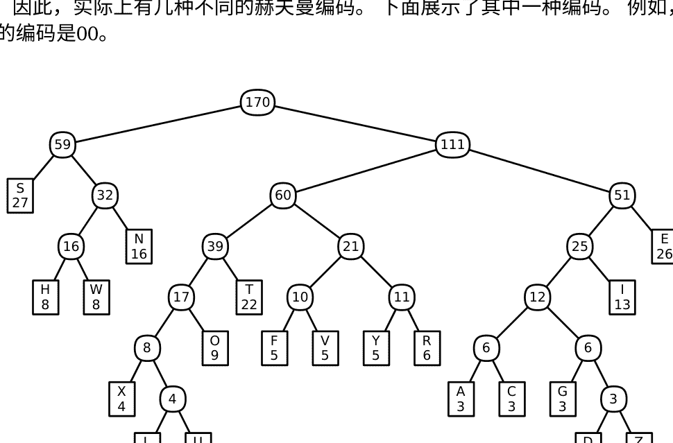

如果我们使用这个编码，编码后的消息会以这样的方式开始：

```
1001 0100 1101 00 00 111 011 1001 111 011 110001 111 110001 10001 011 1001 110000 1101 ...
T   H   I   S S E  N  T   E  N   C     E  C      O   N   T   A      I
```

以下是示例消息中每个字符编码的成本列表，以及该字符对编码消息总长度的贡献：

| 字符 | A | C | D | E | F | G | H | I | L | N | O | R | S | T | U | V | W | X | Y | Z |
|---|---|---|---|---|---|---|---|---|---|---|---|---|---|---|---|---|---|---|---|---|
| 频率 | 3 | 3 | 2 | 26 | 5 | 3 | 8 | 13 | 2 | 16 | 9 | 6 | 27 | 22 | 2 | 5 | 8 | 4 | 5 | 1 |
| 深度 | 6 | 6 | 7 | 3 | 5 | 6 | 4 | 4 | 7 | 3 | 4 | 4 | 2 | 4 | 7 | 5 | 4 | 6 | 5 | 7 |
| 总计 | 18 | 18 | 14 | 78 | 25 | 18 | 32 | 52 | 14 | 48 | 36 | 24 | 54 | 88 | 14 | 25 | 32 | 24 | 25 | 7 |

总共，编码后的消息长度为646位。不同的哈夫曼编码会为不同的字符分配不同的编码，可能长度也不同，但是对于任何哈夫曼编码，编码后的消息总长度都是相同的：646位。

鉴于哈夫曼算法的简单结构，它能产生一个最优的前缀自由二进制编码实在令人惊讶。 使用任何前缀自由编码对李·萨洛斯的句子进行编码至少需要646位！幸运的是，递归结构使得使用交换论证来证明这一点变得容易，类似于我们之前的最优性证明。 我们首先证明算法的第一个选择是正确的。

## 引理5

设 x 和 y 是两个最不频繁的字符（在频率相等的情况下任意选择）。存在一个最优编码树，其中 x 和 y 是兄弟节点。

证明：实际上我将证明一个更强的陈述：存在一个最优编码，其中 x 和 y 是兄弟节点，并且它们是所有叶子节点中深度最大的。

设 T 是一个最优编码树，并假设该树的深度为 d。由于 T 是一棵满二叉树，在深度 d 至少有两个兄弟叶子节点。（通过归纳验证！）假设这两个叶子节点不是 x 和 y，而是其他字符 a 和 b。

设 T' 是通过交换 x 和 a 得到的编码树。x 的深度增加了一定量 Δ，而 a 的深度减少了相同的量。因此，

cost(T') = cost(T) - (f[a] - f[x])Δ.

根据假设，x 是两个最不频繁的字符之一，但 a 不是，这意味着 f[a] ≥ f[x]。因此，交换 x 和 a 不会增加代码的总成本。由于 T 是一个最优代码树，交换 x 和 a 也不会减少成本。因此，T' 也是一个最优代码树（并且顺便说一句，f[a] 实际上等于 f[x]）。

同样地，交换 y 和 b 必须给出另一个最优代码树。在这个最终的最优代码树中，x 和 y 是最大深度的兄弟节点，正如所需。

现在，我们亲爱的递归仙女保证了最优性！基本上，我们依赖于以下对于完全二叉树的递归定义：要么是一个单节点，要么是一个将某个叶子替换为具有两个叶子子节点的内部节点的完全二叉树。

## 定理6

哈夫曼编码是最优的前缀无重复二进制编码。

证明：如果消息只有一个或两个不同的字符，定理是显然的。

否则，让 f[1..n] 是原始输入频率，其中不失一般性，f[1] 和 f[2] 是最小的。为了简单起见，让 f[n+1] = f[1] + f[2]。根据前面的引理，我们知道对于 f[1..n] 的某些最优编码，字符1和2是兄弟。

让 T' 是 f[3..n+1] 的哈夫曼编码树；归纳假设暗示 T' 是较小频率集的最优编码树。为了得到最终的编码树 T，我们用一个内部节点替换标记为 +1 的叶子节点，该内部节点有两个子节点，标记为1和2。我声称 T 对于原始频率数组 f[1..n] 是最优的。

为了证明这个命题，我们可以将 T 的成本表示为 T' 的成本，如下所示。（在这些方程中，depth(i) 表示标记为 i 的叶子在 T 或 T' 中的深度；如果叶子同时出现在 T 和 T' 中，则它在两棵树中的深度相同。）

成本(T) = ∑_{i=1}^{n} f[i]·depth(i)
= ∑_{i=3}^{n+1} f[i]·depth(i) + f[1]·depth(1) + f[2]·depth(2) - f[n+1]·depth(n+1)
= 成本(T') + f[1]·depth(1) + f[2]·depth(2) - f[n+1]·depth(n+1)
= 成本(T') + (f[1] + f[2])·depth(T) - f[n+1]·(depth(T) - 1)
= 成本(T') + f[1] + f[2]

这个方程意味着最小化 T 的成本等同于最小化 T' 的成本；特别是，将标记为1和2的叶子节点附加到标记为 T' 的叶子节点上，可以得到原始频率的最优编码树。

为了高效地实现哈夫曼编码，我们将字符保存在一个最小堆中，其中每个字符的优先级是其频率。我们可以通过维护三个索引数组来构建编码树，分别列出每个节点的左孩子、右孩子和父节点。树的根节点是具有索引2n-1的节点。

```
构建哈夫曼编码 (f[1..n]) :
对于 i 从1到 n
    L[i] ← 0; R[i] ← 0
    插入 (i, f[i])
对于 i ← n 到 2n-1
    x ← 提取MIN()
    y ← 提取MIN()
    f[i] ← f[x] + f[y]
    L[i] ← x; R[i] ← y
    P[x] ← i; P[y] ← i
    插入(i, f[i])
P[2n-1] ← 0
```

该算法执行 O(n)最小堆操作。如果我们使用平衡二叉树作为堆，每个操作需要 O(log n)时间，因此BUILDHUFFMAN的总运行时间为 O(n log n)。

最后，这里有简单的算法来编码和解码消息：

```
HUFFMAN编码(A[1..k]):
m ← 1
对于 i ←1 到 k
    HUFFMAN编码ONE(A[i])

HUFFMAN编码ONE(x):
if x < 2n-1
    HUFFMAN编码ONE(P[x])
    如果 x = L[P[x]]
        B[m] ← 0
    否则
        B[m] ← 1
    m ← m+1
```

```
HUFFMAN DECODE(B[1..m]):
k ← 1
v ← 2n-1
对于 i 从1 到 m
    如果 B[i] = 0
        v ← L[v]
    否则
        v ← R[v]
    if L[v] = 0
        A[k] ← v
        k ← k+1
        v ← 2n-1
```

## 练习

1. 对于以下每个替代的贪婪算法，用数学证明该算法总是构建出最优的日程安排，或者描述一个小的输入示例，该算法不能产生最优的日程安排。 假设所有算法都以任意方式打破平局（即，完全不受您控制的方式）。
    (a) 选择结束时间最晚的课程 x，丢弃与 x冲突的课程，并递归。
    (b) 选择开始时间最早的课程 x，丢弃与 x冲突的所有课程，并递归。
    (c) 选择开始时间最晚的课程 x，丢弃与 x冲突的所有课程，并递归。
    (d) 选择持续时间最短的课程 x，丢弃与 x冲突的所有课程，并递归。
    (e) 选择与其他课程冲突最少的课程 x，丢弃与 x冲突的所有课程，并递归。
    (f) 如果没有课程冲突，则选择所有课程。否则，丢弃持续时间最长的课程，并递归。
    (g) 如果没有课程冲突，则选择所有课程。否则，丢弃与最多其他课程冲突的课程，并递归。
    (h) 让 x 是开始时间最早的课程，让 y 是第二早的课程。
        - 如果 x 和 y 是不相交的，选择 x 并对除了 x 以外的所有内容进行递归。
        - 如果 x 完全包含 y，丢弃 x 并进行递归。
        - 否则，丢弃 y 并进行递归。
    (i) 如果任何课程 x 完全包含另一个课程，丢弃 x 并进行递归。否则，选择最后结束的课程 y，丢弃所有与 y 冲突的课程，并进行递归。
2. 现在考虑课程安排问题的加权版本，其中不同的课程提供不同的学分（与课程讲座的持续时间无关）。你的目标是选择一组不冲突的课程，以获得尽可能多的学分，给定开始时间、结束时间和学分的输入数组。
    (a) 证明笔记中描述的贪婪算法——选择最先结束的课程并递归——不总是返回最优的日程安排。
    (b) 描述一个算法来计算最优的日程安排，时间复杂度为 O(n^2)。
3. 设 X 为实数线上的一组 N 个区间。如果 Y 是 X 的一个子集，并且 Y 中的区间覆盖了 X 中的区间，即 X 中的任何实数值都包含在 Y 的某个区间中。覆盖的大小就是区间的数量。描述并分析一个尽可能快速地计算 X 的最小覆盖路径的算法。假设输入由两个数组 X_L[1..n] 和 X_R[1..n]组成，表示 X 中区间的左右端点。如果使用贪婪算法，必须证明其正确性。
4. 设 X 是实数线上的一组区间。如果每个区间 in X 都至少包含一个点 P，则我们称点集 P 刺穿了 X。描述并分析一个高效的算法来计算刺穿 X 的最小点集。假设你的输入由两个数组 X_L[1..n] 和 X_R[1..n]组成，表示 X 中区间的左右端点。通常情况下，如果你使用贪婪算法，你必须证明它的正确性。
5. 设 X 是实数线上的一组区间。对 X 的一个适当着色将颜色分配给每个区间，以便任何两个重叠的区间被分配不同的颜色。描述并分析一个高效的算法来计算适当着色 X 所需的最小颜色数。假设你的输入由两个数组 L[1..n] 和 R[1..n]组成，其中 L[i] 和 R[i]是第 i 个区间的左右端点。通常情况下，如果你使用贪婪算法，你必须证明它的正确性。
6. 假设你是一个简单的店主，生活在一个有n种不同面值硬币的国家，面值为1 = c[1] < c[2] < ... < c[ n ]。（例如，在美国，n =6，面值为1, 5, 10, 25, 50和100美分。）你心爱的和仁慈的独裁者，埃尔将军，已经下令，每当你给顾客找零时，你必须使用最少的硬币数量，以免磨损每个硬币上由皇家财政部仆人亲切雕刻的埃尔将军形象。
    (a) 在美国，有一个简单的贪婪算法总是得到最少数量的硬币：减去最大的硬币，然后递归地找零剩下的金额。埃尔将军不赞成美国资本主义的贪婪行为。证明存在一组硬币面值，贪婪算法不总是得到最少数量的硬币。
    (b) 现在假设将军决定实施一种货币系统，其中硬币的面额是连续的幂 b^0, b^1, b^2, ..., b^k 是某个大于等于2的整数。证明尽管将军不同意，但在这种货币系统中，部分(a)中描述的贪婪算法确实能够做出最优的找零。
    (c) 描述并分析一种高效的算法，以确定给定目标金额 A和一个有序数组 c[1..n]的硬币面额，需要多少个硬币才能凑够 A美分的零钱。假设 c[1]=1，因此可以为任何金额 A找零。
7. 假设你刚购买了一种新型的混合动力汽车，它的燃料使用非常高效，但是一次只能行驶100英里。汽车的燃料存储在一次性电池中，在最多行驶100英里后必须更换。实际燃料几乎是免费的，但是电池很贵，只能由持有电池更换许可证的技术人员安装。因此，即使你决定提前更换电池，你仍然必须全价支付新电池的安装费用。
此外，由于这些电池需求量很大，没有人能负担得起同时拥有多个电池。
假设你正试图从旧金山到纽约市，通过新的洲际超级高速公路，该公路直线连接这两个城市。沿途有几个加油站；每个加油站安装新电池的费用都不同。在你开始旅行之前，你仔细打印了维基百科页面，列出了ICSH上每个加油站的位置和价格。

根据这些信息，你如何决定最佳的加油站停靠位置？

更正式地说，假设你有两个数组 D[1..n] 和 C[1..n]，其中 D[i] 是从高速公路起点到第 i 个加油站的距离，C[i] 是在第 i 个加油站更换电池的费用。假设你的旅行起点和终点都是加油站（所以 D[1]=0，D[n] 是你旅行的总长度），并且你的汽车起始电池为空（所以你必须在第一个加油站安装新电池）。

- (a) 描述并分析一种贪婪算法，以找到完成旅程所需的最小加油站数量。不要忘记证明你的算法是正确的。
- (b) 但你真正想要最小化的是旅行的总费用。证明你在部分(a)中的贪婪算法在扩展到这种情况时并不产生最优解。
- (c) 描述一种高效的算法，计算出你应该停留的加油站位置，以最小化旅行的总费用。

8. 回想一下，一个由括号 ( 和 ) 组成的字符串 w 如果满足以下条件之一，则是平衡的：

- 字符串 w 为空。
- 字符串 w = (字符串 x)，其中字符串 x 是平衡的。
- 字符串 w = 字符串 x 字符串 y，其中字符串 x 和字符串 y 都是平衡的。

例如，字符串 w = ((((())))(())(()))(((()(())))(()) ) 是平衡的，因为 w = xy，其中 x = (((())))(())(()) 和 y = (()())()。

- (a) 描述并分析一种算法，以确定给定的括号字符串是否平衡。
- (b) 描述并分析一种贪婪算法，计算给定括号字符串的最长平衡子序列的长度。像往常一样，不要忘记证明你的算法是正确的。

对于这两个问题，你的输入是一个数组 w[1..n]，其中对于每个 i，要么 w[i] = ( 或 w[i] = )。你的两个算法都应该在 O(n) 时间内运行。

9. 恭喜！你成功征服了卡梅洛特，将这个曾经充满战争创伤的王国转变成了一个无政府主义者的公社，公民们轮流担任一周的行政官员，但所有决策都在每两周的特别会议上得到批准，对于纯内部事务，以简单多数通过，对于更重大的事务，则需要三分之二多数通过。....

作为最后的象征性举动，你下令将圆桌（出人意料地，是一个真正的圆桌）分成像比萨饼一样的楔形，并分发给卡梅洛特的公民作为奖品。每个公民都提交了一个关于桌子角度的请求，例如：勇敢的罗宾爵士可能请求从17.23°到42°的楔形，而纯洁的兰斯洛特爵士可能请求从359°到1°的2°楔形。只有当每个公民都收到他们请求的楔形时，他们才会感到满意。不幸的是，其中一些范围重叠，因此无法满足所有公民的请求。欢迎来到政治世界。

描述并分析一种算法，以找到可以满足的最大请求数。

> [提示：小心！如果旋转表格，您的算法的输出不能改变。不要假设角度是整数。]

10. 假设你站在一个被几个大气球包围的田地里。你想要使用你全新的Acme品牌Zap-O-Matic™来爆破所有的气球，而不离开你当前的位置。Zap-O-Matic™发射高功率激光束，可以爆破它击中的所有气球。由于每次射击需要足够的能量来为一个小国家供电一年，所以你希望尽可能少的射击。

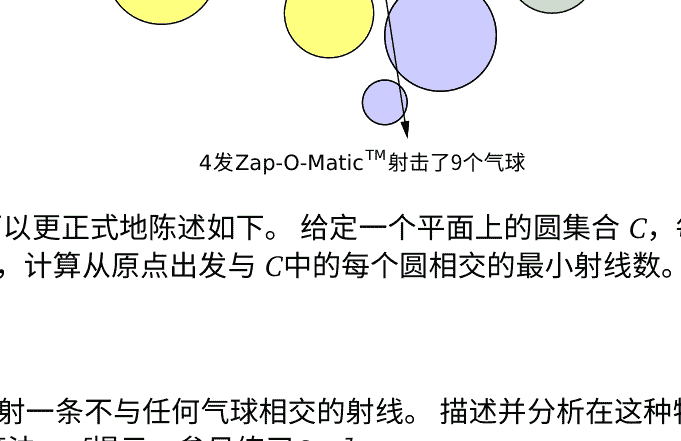

最小Zap问题可以更正式地陈述如下。给定一个平面上的圆集合 C，每个圆由其半径和中心的 (x, y) 坐标指定，计算从原点出发与 C 中的每个圆相交的最小射线数。您的目标是找到解决此问题的高效算法。

- (a) 假设可能发射一条不与任何气球相交的射线。描述并分析在这种特殊情况下解决最小Zap问题的贪婪算法。[提示：参见练习2。]
- (b) 描述并分析一种贪婪算法，其输出在最优解的基础上加减1。也就是说，如果 m 是击中每个气球所需的最小射线数，则您的贪婪算法必须输出 m 或 m + 1。（当然，您必须证明这个事实。）
- (c) 描述一种在 O(n²) 时间内解决最小Zap问题的算法。
- (d) 描述一个在 O(n log n) 时间内解决最小zap问题的算法。

假设你有一个子程序 INTERSECTS(r, c)，它可以确定任意射线 r 是否与任意圆 c 相交，时间复杂度为 O(1)。这个子程序并不难写，但它并不是问题的有趣部分。

Obie看着导盲犬。然后看着那二十七张8乘10的彩色光泽照片，上面有圆圈和箭头，每张照片背面还有一段文字说明。…然后他看着导盲犬。然后看着那二十七张8乘10的彩色光泽照片，上面有圆圈和箭头，每张照片背面还有一段文字说明，然后开始哭泣。

因为Obie意识到这是一个典型的美国盲目正义案件，他对此无能为力，法官也不会看那二十七张8乘10的彩色光泽照片，上面有圆圈和箭头，每张照片背面还有一段文字说明，作为对我们的证据。我们被罚款50美元，还得清理垃圾。在雪地里。

但这不是我要告诉你的事情。

> ——阿洛·古斯里，《爱丽丝的餐馆》（1966年）

> 我读圣经的时候就像采摘苹果一样。
首先，我摇晃整棵树，让最熟的果实掉下来。
然后我爬上树，摇晃每一根树枝，
然后每一根分支，然后每一根细枝，
然后我看看每片叶子下面。

——马丁·路德

## 23个基本图算法

### 23.1定义

图通常被定义为一对集合 (V,E)，其中 V 是一组称为顶点的任意对象的集合¹或者节点。E 是一组顶点对，我们称之为边（或（更少见的）弧）。在无向图中，边是无序对，或者只是两个顶点的集合；我们通常用 uv 代替 {u,v} 表示 u 和 v 之间的无向边。在有向图中，边是顶点的有序对；我们通常用 u→v 代替 (u,v) 表示从 u 到 v 的有向边。

将图定义为一对集合禁止具有环（从一个顶点到自身的边）和/或平行边（具有相同端点的多条边）。没有环和平行边的图通常被称为简单图；非简单图有时被称为多图。尽管存在形式上的定义差距，但大多数简单图算法可以很少或不需要修改地扩展到非简单图。

按照标准（尽管有些令人困惑）的做法，我还使用 V 表示图中的顶点数，E 表示边数。因此，在任何无向图中，我们有 0 ≤ E ≤ (V choose 2)，在任何有向图中，我们有 0 ≤ E ≤ V(V-1)。

对于无向图中的任何边 uv，我们称 u 为 v 的邻居，反之亦然。节点的度是其邻居的数量。在有向图中，我们有两种类型的邻居。对于任何有向边 u→v，我们称 u 为 v 的前驱，v 为 u 的后继。节点的入度是其前驱的数量，与进入节点的边的数量相同。节点的出度是其后继的数量，或者是从节点出去的边的数量。

图 G'=(V',E') 是图 G=(V,E) 的子图如果 V' ⊆ V 且 E' ⊆ E。

在图中的一条路径是一系列边的序列，其中每相邻的两条边共享一个顶点；如果它最多访问每个顶点一次，那么这条路径被称为路径。如果一个无向图是连通的，那么

¹顶点”的单数形式是‘顶点’。‘矩阵’的单数形式是‘矩阵’。除非你说意大利语，否则不存在‘vertice’、‘matrice’、‘indice’、‘app edice’、‘helice’、‘apice’、‘vortice’、‘radice’、‘simplice’、‘codice’、‘directrice’、‘dominatrice’、‘Unice’、‘Kleenice’、‘Asterice’、‘Obelice’、‘Dogmatice’、‘Getafice’、‘Cacofonice’、‘Vitalstatistice’、‘Geriatrice’或‘Jimi Hendrice’这些所谓的词语。使用任何这些词语都会扣分。

### 23.2 抽象表示和示例

最常见的图形可视化表示方法是使用嵌入。图的嵌入将每个顶点映射到平面上的一个点（通常绘制为小圆圈），将每条边映射到连接两个顶点的曲线或直线段。如果图具有没有两条边相交的嵌入，则该图是平面图。同一个图可以有许多不同的嵌入，因此重要的是不要将特定的嵌入与图本身混淆。特别是，平面图可以有非平面嵌入！

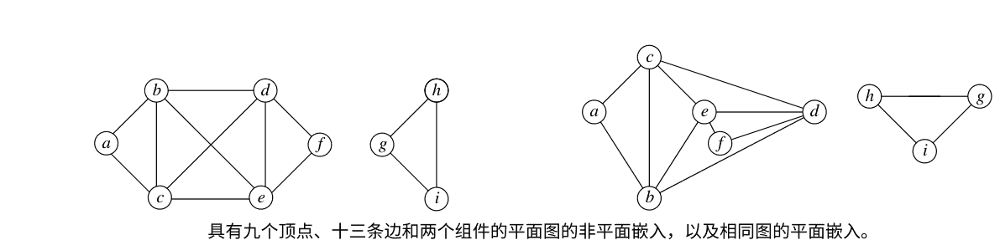

然而，嵌入并不是图的唯一有用的表示方法。例如，一组对象的交集图具有每个对象的节点和每个相交对的边。一个特定的图是否可以表示为交集图取决于你想要用于顶点的对象类型。不同类型的对象——线段、矩形、圆等——定义了不同类别的图。一种特别有用的交集图类型是区间图，其顶点是实线上的区间，任何两个重叠的区间之间都有一条边。

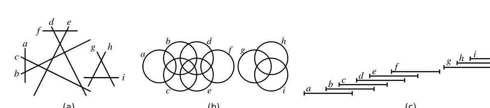

另一个很好的例子是递归算法的依赖图。依赖图是有向无环图。顶点是在特定输入上执行算法时出现的所有不同递归子问题。如果评估一个子问题会导致另一个子问题的出现，则两个子问题之间存在一条边。

第二个子问题需要对第一个进行递归评估。例如，对于斐波那契递归

$$
F_n = \begin{cases} 0 & \text{if } n = 0, \\ 1 & \text{如果 } n = 1, \\ F_{n-1} + F_{n-2} & \text{otherwise}, \end{cases}
$$

依赖图的顶点是整数 0,1,2,...,n，边是对 (i-1)→i 和 (i-2)→i 的配对，其中 i 是介于 2 和 n 之间的整数。作为一个更复杂的例子，考虑以下递归，它解决了一个称为编辑距离的特定序列对齐问题；详见动态规划笔记中的详细信息：

$$
\text{编辑}(i,j) = \begin{cases} i & \text{if } j = 0 \\ j & \text{if } i = 0 \\ \min \begin{cases} \text{编辑}(i-1,j) + 1, \\ \text{编辑}(i,j-1) + 1, \\ \text{编辑}(i-1,j-1) + [A[i] \neq B[j]] \end{cases} & \text{否则} \end{cases}
$$

这个递归的依赖图是一个 m × n 的顶点网格 (i,j) 通过垂直边连接 (i-1,j)→(i,j)，水平边 (i,j-1)→(i,j)，和对角线边 (i-1,j-1)→(i,j)。动态规划对于具有相对较小的依赖图的任何递归都能高效工作；适当的评估顺序确保每个子问题在其前任之后被访问。

另一个有趣的例子是游戏、拼图或机械（如井字棋、跳棋、魔方、汉诺塔或图灵机）的配置图。配置图的顶点是拼图的所有有效配置；如果可以通过简单的移动将一个配置转换为另一个配置，则它们之间存在一条边。（显然，精确的定义取决于允许的移动方式。）即使对于相对简单的机制，配置图也可能非常复杂，而我们通常只能访问有关配置图的局部信息。

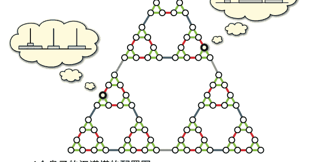

在形式语言理论中使用的有限状态自动机可以建模为带标签的有向图。回顾一下，确定性有限状态自动机的形式定义为一个5元组 M=(Σ,Q,s,A,δ)，其中 Σ 是一个有限集合，称为字母表，Q 是一个有限状态集合，s∈Q 是起始状态，A⊆Q 是接受状态集合，δ:Q×Σ→Q 是一个转移函数。但是，更有用的是将 M 视为一个有向图 G_M，其顶点是状态 Q，边的形式为 q→δ(q,a)，其中每个状态 q∈Q 和符号 a∈Σ。然后，关于 M 接受的语言的基本问题可以表述为关于图 G_M 的问题。例如，如果 M 接受的语言为空，则从起始状态/顶点 q_0 到接受状态/顶点之间在 G_M 中没有路径。

## 算法

## 讲座23：基本图算法 [Fa’14]

关于图 $G_M$ 的问题。例如，如果 $M$ 接受的语言为空，则从起始状态/顶点 $q_0$ 到接受状态/顶点之间在 $G_M$ 中没有路径。

最后，有时一个图可以隐式地表示其他更大的图。一个很好的例子是将NFA转换为DFA时使用的子集构造。子集构造可以推广到任意有向图，方法如下。给定任意有向图 $G= (V, E)$，我们可以定义一个新的有向图 $G'=(2^V, E')$，其顶点是 $V$ 中所有顶点的子集，边 $E'$ 的定义如下：

> $E' := \left\{ A\to B \mid \text{对于某些 } u \in A\text{和}v \in B, \text{存在一条边 } u\to v \in E \right\}$

我们可以将这个定义机械地翻译成一个算法，从 $G$ 构造 $G'$，但严格来说，这个构造是不必要的，因为 $G$ 已经是 $G'$ 的隐式表示。

从这个角度来看，将NFA转换为没有不可达状态的DFA的增量子集构造只是对隐式表示的DFA进行广度优先搜索。

重要的是不要将这些图的示例/表示与实际的形式定义混淆：图是一对集合 ($V$, $E$)，其中 $V$ 是任意非空有限集合，$E$ 是 $V$ 的元素对（有序或无序）的集合。

### 23.3 图数据结构

在实践中，图由两种数据结构表示：邻接矩阵和邻接表。

图 $G$ 的邻接矩阵是一个 $V\times V$ 矩阵，其中每个条目指示一个特定的边是否在图中。

> $A[i, j] := \left[(i, j) \in E\right]$.

对于无向图，邻接矩阵总是对称的：$A[i, j] = A[j, i]$。由于我们不允许从一个顶点到自身的边，对角线元素 $A[i, i]$ 都是零。

给定一个邻接矩阵，我们可以在 $\Theta(1)$ 时间内决定两个顶点是否由一条边连接，只需查看矩阵中的相应位置。我们还可以在 $\Theta(V)$ 时间内列出一个顶点的所有邻居，只需扫描相应的行（或列）。这在最坏情况下是最优的，因为一个顶点最多可以有 $V -1$ 个邻居；然而，如果一个顶点的邻居很少，我们仍然可能需要检查行中的每个条目才能看到它们。类似地，邻接矩阵需要 $\Theta(V^2)$ 空间，无论图实际上有多少边，所以它只对非常稠密的图是空间高效的。

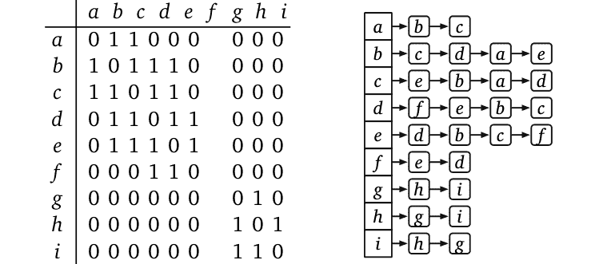

对于稀疏图——边相对较少的图——邻接表通常是更好的选择。邻接表是一个链表数组，每个顶点对应一个链表。每个链表存储了邻居节点对应的顶点。对于无向图，每条边 (u, v) 在 u 的邻居列表和 v 的邻居列表中各存储一次；对于有向图，每条边只存储一次。无论哪种方式，邻接表所需的总空间为 O(V + E)。列出节点 v 的邻居需要 O(1 + deg(v)) 时间；只需扫描邻居列表。同样，我们可以在 O(1 + deg(u)) 时间内通过扫描 u 的邻居列表来确定是否存在边 (u, v)。对于无向图，我们可以通过同时扫描 u 和 v 的邻居列表来改进时间为 O(1 + min{deg(u), deg(v)})，当我们找到边或者到达列表末尾时停止扫描。

邻接表数据结构应立即让你想起了使用链表的哈希表；这两种数据结构是相同的。³就像使用链式哈希表一样，我们可以通过使用其他数据结构而不是链表来存储每个顶点的邻居，从而使邻接表更加高效。例如，如果我们使用具有恒定负载因子的哈希表，那么当我们可以在 O(1) 时间内检测边时，就像邻接矩阵一样。（大多数哈希表只能给出 O(1) 期望时间，但我们可以使用布谷鸟哈希来获得 O(1) 最坏情况时间。）

下表总结了各种标准图数据结构的性能。星号*表示维护动态哈希表的预期摊销时间界限。

| | 邻接矩阵 | 标准邻接表 (链表) | 邻接表 (哈希表) |
| :--- | :--- | :--- | :--- |
| 空间 | Θ(V²) | Θ(V + E) | Θ(V + E) |
| 测试 uv ∈ E 的时间 | O(1) | O(1 + min{deg(u), deg(v)}) = O(V) | O(1) |
| 时间来测试是否 u→v ∈ E | O(1) | O(1 + deg(u)) = O(V) | O(1) |
| 时间来列出 v 的邻居 | O(V) | O(1 + deg(v)) | O(1 + deg(v)) |
| 时间来列出所有边 | Θ(V²) | Θ(V + E) | Θ(V + E) |
| 时间来添加边 uv | O(1) | O(1) | O(1)* |
| 时间来删除边 uv | O(1) | O(deg(u) + deg(v)) = O(V) | O(1)* |

此时，人们可能会合理地想知道为什么有人会使用邻接矩阵；毕竟，带有哈希表的邻接列表在相同的时间内支持相同的操作，使用更少的空间。同样地，为什么有人会在邻接列表结构中使用链表来存储邻居，而不是哈希表？尽管实际上的主要原因几乎肯定是传统——如果它对你祖父的代码足够好，那对你的代码也足够好！——但还有一些更有原则性的论点。

一个原因是标准的邻接表通常已经足够好了；大多数图算法实际上从不询问给定边是否存在或不存在！另一个原因是对于足够密集的图来说，邻接矩阵在实践中更简单、更高效，因为它们避免了追踪指针或计算哈希函数的开销。

但也许最有说服力的原因是许多图通常由邻接矩阵和标准的邻接表隐式表示。例如，交集图通常被表示为底层几何对象的列表。只要我们能够在常数时间内测试两个对象是否相交，我们就可以将任何图算法应用于交集图，假装它是显式存储的邻接矩阵。

同样，由指针连接的记录组成的任何数据结构都可以看作是一个有向图；通过假装图存储在标准的邻接表中，可以将图算法应用于这些数据结构。同样，只要我们能够在常数时间内枚举给定配置的所有可能移动，我们就可以将任何图算法应用于配置图，就好像它是以标准的邻接表形式给出的。在这两种情况下，我们可以在与其度成比例的时间内枚举离开任何顶点的边，但我们不能确定是否在常数时间内确定如果两个顶点相连，则存在一条路径。（这个记录是否有指向那个记录的指针？我们是否可以在一步内从这个配置到达那个配置？）因此，标准的邻接表，邻居存储在链表中，是适当的模型数据结构。

### 23.4 遍历连通图

为了保持简单，我们在本讲座的其余部分只考虑无向图，尽管算法也适用于有向图，只需进行最小的更改。

假设我们想要访问表示为显式或隐式的连通图中的每个节点。也许最简单的图遍历算法是深度优先搜索。这个算法可以递归地或迭代地编写。无论哪种方式，算法都是完全相同的，唯一的区别是在非递归版本中我们可以看到“递归”堆栈。两个版本最初都传入一个源顶点 s。

```

RECURSIVE DFS(v):
    如果 v未标记
        标记 v
        对于每条边 vw
            RECURSIVE DFS(w)

```

```

ITERATIVE DFS(s):
    PUSH(s)
    当栈不为空时
        v ← POP
        如果 v未标记
            标记 v
            对于每条边 vw
                PUSH(w)

```

深度优先搜索只是一种（也许是最常见的）图遍历算法的一种。通用图遍历算法将一组候选边存储在某种数据结构中，我将其称为“袋子”。“袋子”的唯一重要属性是我们可以将东西放入其中，然后再取出来。（在C++术语中，将袋子视为真实数据结构的模板。）栈是一种特殊类型的袋子，但绝对不是唯一的一种。以下是通用遍历算法：

```

T遍历(s):
    将 s 放入袋子中
    当袋子不为空时
        从袋子中取出 v
        如果 v未标记
            标记 v
            对于每条边 vw
                将 w 放入袋子中

```

这种遍历算法明显只标记了图中的每个顶点至多一次。为了证明它至少访问了连通图中的每个节点一次，我们稍微修改了算法；修改部分用红色标出。修改后的算法不再将顶点放入袋子中，而是将顶点对存储起来。这种修改使得我们能够记住，当我们第一次访问一个顶点 v 时，之前访问过的邻居顶点将 v 放入了袋子中。我们称这个之前的顶点为 v 的父节点。

```

T遍历(s):
    将 (∅,s)放入袋子中
    当袋子不为空时
        从袋子中取出 (p,v)        (*)
        如果 v未标记
            标记 v
            父节点(v) ← p        (†)
            对于每条边 vw        (**)
                将 (v,w) 放入袋子中

```## 引理1.
遍历(s)在任何连通图中恰好标记每个顶点，并且由 parent(v)=∅ 定义的顶点对集合 (v, parent(v)) 定义了图的生成树。

证明：该算法标记了 s。设 v 是除了 s 之外的任意顶点，并且设 (s,…,u,v) 是从 s 到 v 的具有最小边数的路径。由于图是连通的，这样的路径总是存在的。（如果 s 和 v 是相邻的，则 u=s，路径只有一条边。）如果算法标记了 u，则它必须将 (u,v) 放入袋子中，因此它必须在后来将 (u,v) 从袋子中取出，此时 v 必须被标记。因此，根据从 s 到顶点 v 的最短路径距离的归纳，算法标记了图中的每个顶点，这意味着对于每个顶点 v，parent(v) 是良定义的。

遍历算法的确切运行时间取决于图的表示方式和作为“包”使用的数据结构，但我们可以做出一些一般性的观察。因为每个顶点最多被标记一次，所以 for 循环 (†) 最多执行 V 次。每条边 uv 被放入包中恰好两次；一次作为对 (u,v)，一次作为对 (v,u)，因此第 (**) 行最多执行 2E 次。最后，我们不能从袋子里拿出比我们放进去的东西更多，所以第 (⋆) 行最多执行 2E + 1 次。

## 23.5 例子
首先，让我们假设图是用标准的邻接表表示的，这样每条边的开销在循环 (†) 中只有常数时间。
- 如果我们使用栈来实现“袋子”，我们就可以恢复我们最初的深度优先搜索算法。每次执行 (⋆) 或 (**) 都需要常数时间，所以算法的运行时间为 O(V+E)。如果图是连通的，我们有 V ≤ E+1，所以我们可以简化运行时间为 O(E)。由父边形成的生成树被称为深度优先生成树。树的确切形状取决于起始顶点和在循环 (†) 中访问邻居的顺序，但一般来说，深度优先生成树是长而瘦的。
- 如果我们使用队列而不是栈，我们得到广度优先搜索。同样，每次执行 (⋆) 或 (**) 都需要恒定的时间，因此对于连通图的整体运行时间仍然是 O(E)。在这种情况下，由父边形成的广度优先生成树包含从起始顶点 S 到其连通分量中的每个其他顶点的最短路径。我们将在以后的讲座中再次看到最短路径。同样，广度优先生成树的确切形状取决于起始顶点和在 for 循环 (†) 中访问邻居的顺序，但通常来说，广度优先生成树矮而且茂密。


现在假设图的边有权重。如果我们使用优先队列来实现'袋子'，总是在第 (*) 行提取最小权重的边，那么得到的算法就可以合理地称为最短优先搜索。在这种情况下，每次执行 (*) 或 (**) 都需要 O(log E) 时间，因此总体运行时间为 O(V + E log E)，如果图是连通的，则简化为 O(E log E)。对于这个算法，父边的集合形成了连接组件的最小生成树。令人惊讶的是，只要所有边的权重都不同，得到的树就不依赖于起始顶点或访问邻居的顺序；在这种情况下，只有一个最小生成树。我们将在下一讲中再次看到最小生成树。

如果图使用邻接矩阵而不是邻接表表示，则在一行中找到每个顶点的所有邻居需要 O(V) 时间。因此，深度优先搜索和广度优先搜索的运行时间均为 O(V^2)，并且“最短优先搜索”运行时间为 O(V^2 + E log E) = O(V^2 log V)。

## 23.6 搜索不连通的图
如果图是不连通的，则 TRAVERSE(s) 只访问起始顶点 s 所在的连通分量中的节点。如果我们想访问每个连通分量中的所有节点，可以在我们的通用遍历算法周围使用以下“包装器”。由于 TRAVERSE 计算一个连通分量的生成树，TRAVERSEALL 计算整个图的生成森林。

| TRAVERSE ALL(s): |
|---------------|
| 对于所有顶点 v |
|     如果 v 未标记 |
|         TRAVERSE(v) |

令人惊讶的是，一些著名的算法教材声称这个包装器只能与深度优先搜索一起使用。他们是错误的。

## 练习
- 1. 证明以下定义是等价的。
   - 树是一个连通的无环图。
   - 树是森林的一个组成部分。
   - 树是一个连通的图，边数最多为 V - 1。
   - 树是一个最小连通图；移除任何边都会使图不连通。
   - 树是一个无环图，边数至少为 V - 1。
   - 树是一个最大无环图；在任意两个顶点之间添加一条边都会形成一个环。
- 2. 证明任何具有 n ≥ 2 个顶点的连通无环图至少有两个度为 1 的顶点。不要使用“树”或“叶子”这些词，也不要使用任何关于树的已知属性；你的证明应完全基于“连通”和“无环”的定义。
- 3. 设 G 为一个连通图，T 为以某个节点 v 为根的深度优先生成树。证明如果 T 也是以 v 为根的广度优先生成树，则 G = T。
- 4. 无论何时，一群鸽子聚集在一起，它们本能地建立了一个争食顺序。对于任意一对鸽子，总有一只鸽子会啄另一只，将其赶离食物或潜在伴侣。即使经过多年的分离，无论周围有什么其他鸽子，同一对鸽子总是选择相同的争食顺序。令人惊讶的是，整体的争食顺序可能包含循环——例如，鸽子 A 啄鸽子 B，鸽子 B 啄鸽子 C，鸽子 C 啄鸽子 A。
   (a) 请证明任何有限的鸽子集合都可以从左到右排列，使得每只鸽子都啄它左边的鸽子。拜托了。
   (b) 假设你有一个有向图，表示一组鸽子之间的啄食关系。该图每个鸽子对应一个顶点，并且仅当鸽子 i 啄食鸽子 j 时，它包含一条从顶点 i 到顶点 j 的边。描述并分析一种算法，用于计算鸽子的啄食顺序，如(a)部分所保证的。
- 5. 图 (V, E) 是二分图，如果顶点 V 可以被划分为两个子集 L 和 R，使得每条边都有一个顶点在 L 中，另一个顶点在 R 中。
   (a) 证明每棵树都是二分图。
   (b) 描述并分析一种高效的算法，用于确定给定的无向图是否是二分图。
- 6. 图 G 的欧拉遍历是一条通过 G 的闭合路径，恰好经过 G 的每条边一次。
   (a) 证明一个连通图 G 有欧拉回路当且仅当每个顶点的度数都是偶数。
   (b) 描述并分析一个在给定图中计算欧拉回路的算法，或者正确地报告不存在这样的图。
- 7. d 维超立方体是以下图的定义。有 2^d 个顶点，每个顶点都标有不同的 d 位字符串。如果两个顶点的标签只在一位上不同，则它们通过一条边相连。
   (a) 图 G 中的哈密顿回路是 G 中的一条边的循环，每个顶点都恰好访问一次。证明对于所有的 d ≥ 2，d 维超立方体都有一个哈密顿回路。
   (b) 哪些超立方体有欧拉回路（一条经过每条边恰好一次的闭合路径）？[提示：这很容易。]
- 8. 蛇和梯子是一款经典的棋盘游戏，起源于至少 16 世纪的印度。棋盘由一个 n × n 的方格网格组成，方格按照从左到右、从下到上的顺序连续编号，编号从 1 到 n^2，从左下角开始，行与行之间交替向左和向右。这个网格中的某些方格，总是在不同的行上，通过“蛇”（向下）或“梯子”（向上）相连。每个方格最多可以是一个蛇或梯子的终点。
   你从左下角的方格 1 开始。每次移动中，你可以向上移动最多 k 个位置，其中 k 是一个固定的常数。如果移动结束时，你的棋子位于一个蛇的顶部，它会滑到该蛇的底部。同样地，如果移动结束时，你的棋子位于一个梯子的底部，它会爬到该梯子的顶部。

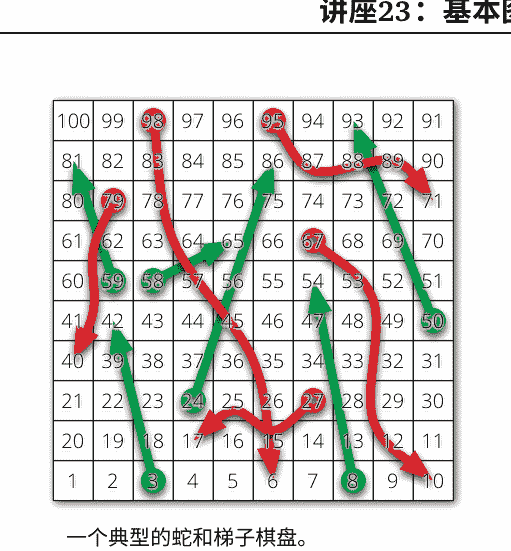

   一个典型的蛇和梯子棋盘。向上的直箭头是梯子；向下的波浪箭头是蛇。
   描述并分析一种算法，计算令令牌到达网格的最后一个方格所需的最小移动次数。
- 9. 这个谜题是由臭名昭著的蒙古谜题战士维德拉拉·伊特基·莱达在1473年发明的。 这个谜题由一个n×n的方格网格和两个令牌组成，一个红色的和一个蓝色的。 这两个令牌总是位于网格的不同方格上。 这两个令牌起始于网格的左上角和右下角；谜题的目标是交换这两个令牌。
   在一次移动中，你可以将任一令牌向上、向右、向下或向左移动，移动的距离由另一个令牌决定。 例如，如果红色令牌位于标有3的方格上，则你可以将蓝色令牌向上、向左、向右或向下移动3步。 然而，你不能将一个令牌移出网格或移动到另一个令牌所在的方格上。

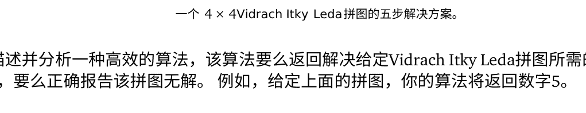

   一个 4 × 4 Vidrach Itky Leda拼图的五步解决方案。
   描述并分析一种高效的算法，该算法要么返回解决给定Vidrach Itky Leda拼图所需的最小移动次数，要么正确报告该拼图无解。 例如，给定上面的拼图，你的算法将返回数字5。
- 10. Racetrack (也称为Graph Racers和Vector Rally) 是一种两人纸笔赛车游戏，杰夫在五年级的公共汽车上玩过。 游戏在一张图纸上画出赛道进行。 玩家交替选择一系列代表汽车在赛道上移动的网格点，受到下面解释的某些约束条件的限制。
   每辆汽车都有一个位置和速度，都具有整数的x和y坐标。 一部分网格方块被标记为起始区域，另一部分被标记为终点区域。

## 算法

## 讲座23：基本图算法 [Fa’14]

   每辆车的初始位置由玩家在起始区域的某个地方选择；每辆车的初始速度始终为 (0,0)。在每一步中，玩家可以选择增加或减少车速的任一或两个坐标；换句话说，速度的每个分量在单个步骤中最多可以改变1个。然后，车辆的新位置由将新速度加到车辆的上一个位置来确定。新位置必须在赛道内；否则，车辆会撞毁，玩家将输掉比赛。当第一辆车到达一个位于终点区域内的位置时，比赛结束。
   假设赛道由一个 n×n 位数组表示，其中每个0位表示赛道内的一个网格点，每个1位表示赛道外的一个网格点，“起始区域”是第一列，“终点区域”是最后一列。
   描述和分析一种算法，以找到将汽车从起跑线移动到给定赛道终点线所需的最小步数。[提示：构建一个图。顶点是什么？边是什么？这是什么问题？]

| 速度 | 位置 |
|------|------|
| (0, 0) | (1, 5) |
| (1, 0) | (2, 5) |
| (2, -1) | (4, 4) |
| (3, 0) | (7, 4) |
| (2, 1) | (9, 5) |
| (1, 2) | (10, 7) |
| (0, 3) | (10, 10) |
| (-1, 4) | (9, 14) |
| (0, 3) | (9, 17) |
| (1, 2) | (10, 19) |
| (2, 2) | (12, 21) |
| (2, 1) | (14, 22) |
| (2, 0) | (16, 22) |
| (1, -1) | (17, 21) |
| (2, -1) | (19, 20) |
| (3, 0) | (22, 20) |
| (3, 1) | (25, 21) |

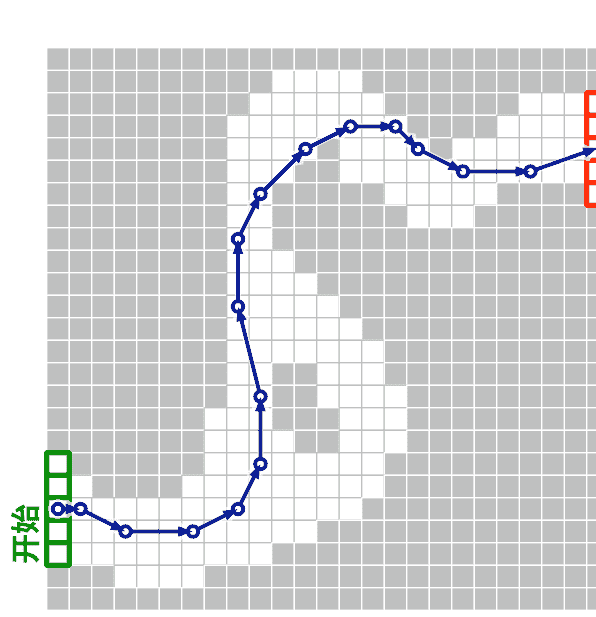

   一次16步的赛道比赛，在一个25×25的赛道上。这不是这个赛道上最短的比赛。
- 11. 滚动骰子迷宫是一个涉及标准六面骰子（每面都有数字）和一个方格网格的谜题。你应该想象方格网格放在桌子上；骰子始终静止在并完全覆盖一个方格上。在一步中，你可以将骰子沿着底边之一旋转90度，将其移动到相邻的方格，向北、南、东或西移动一步。

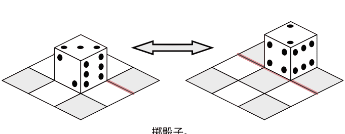

   掷骰子。
   网格中的一些方格可能被阻挡；骰子永远不能停在被阻挡的方格上。其他方格可能被标记为一个数字；当骰子停在被标记的方格上时，骰子顶面的点数必须等于标记的数字。既没有标记也没有标记的方格是自由的。你不能将骰子从网格的边缘滚出去。如果在这些约束条件下，能够将骰子放在左下方格上并将其滚到右上方格，则滚动骰子迷宫是可解的。
   例如，这里有两个滚动骰子迷宫。黑色方格是被阻挡的。左边的迷宫可以通过将骰子放在左下方格上，顶面有1个点，然后向北滚动，再向北滚动，然后向东滚动，再向东滚动来解决。右边的迷宫是不可解的。

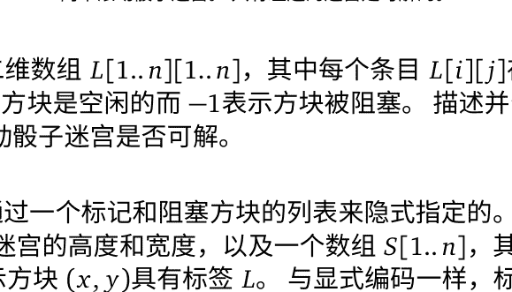

   (a) 假设输入是一个二维数组 L[1..n][1..n]，其中每个条目 L[i][j] 存储第 i 行和第 j 列的方块的标签，其中 0 表示方块是空闲的而 -1 表示方块被阻塞。描述并分析一个多项式时间算法，以确定给定的滚动骰子迷宫是否可解。
   (b) 现在假设迷宫是通过一个标记和阻塞方块的列表来隐式指定的。具体来说，假设输入包括一个整数 M，指定迷宫的高度和宽度，以及一个数组 S[1..n]，其中每个条目 S[i] 是一个三元组 (x,y,L)，表示方块 (x,y) 具有标签 L。与显式编码一样，标签 -1 表示方块被阻塞；自由方块根本不在 S 中列出。描述并分析一种高效的算法来确定给定的滚动骰子迷宫是否可解。为了获得全部学分，你的算法的运行时间应该是输入大小 N 的多项式。
   [提示：在放置初始骰子时，你有一些自由度。有些滚动骰子迷宫只有在选择正确的初始位置时才能解决。]
- 12. 跳棋（也称为西洋跳棋）是一种在一个 m × m 的方格网格上进行的游戏，方格交替着浅色和深色。 (通常在 8×8 或 10×10 的棋盘上进行游戏，但规则可以很容易地推广到任何棋盘大小。) 每个深色方格最多只能有一个游戏棋子（在美国通常称为 checker），它可以是黑色或白色；浅色方格始终为空。
   一名玩家（‘白方’）移动白色棋子；另一名玩家（‘黑方’）移动黑色棋子。
   考虑以下游戏的简化版本，基本上是美国跳棋或英国跳棋，但每个棋子都是国王。棋子可以沿着四个对角线方向之一移动一步或两步。在每个回合中，玩家可以将她的棋子向一个空方格对角线移动一步，或者用她的棋子进行一系列跳跃。在一个单次跳跃中，棋子可以沿着任意对角线方向移动到离其两步远的空方格，但只有

如果中间的方格被对方的棋子占据，那么这个敌方棋子将被捕获并立即从棋盘上移除。在一次回合中，只要是同一棋子进行的，就可以允许多次跳跃。如果对手没有棋子留在棋盘上，玩家就获胜了。
   描述一个算法，正确确定白方是否能够在一次回合中捕获每个黑方棋子，从而赢得比赛。输入包括棋盘的宽度 ($m$)，白方棋子的位置列表和黑方棋子的位置列表。为了获得全部学分，你的算法应该在 $O(n)$ 时间内运行，其中 $n$ 是棋子的总数。[提示：贪婪策略——进行任意跳跃直到无法继续——并不总能找到一个获胜的跳跃序列，即使存在一个。参见问题6. 奇偶性，奇偶性，奇偶性。]

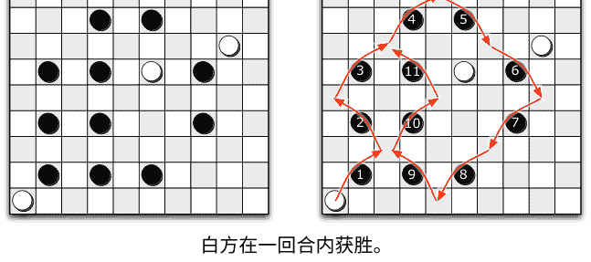

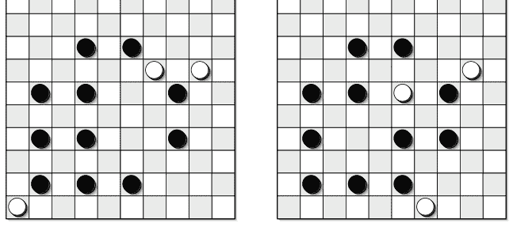

> 推浦一定曾经说过：我要退隐写书。还有一次：我要退隐建造迷宫。每个人都想象着两个作品；没有人想到书和迷宫是同一件事。——豪尔赫·路易斯·博尔赫斯，《分岔的花园》（1942年）唐纳德·A·耶茨翻译（1958年）

> “世界是多么美好，迷宫是多么丑陋！”我松了一口气说。“如果迷宫有一个转弯规则，世界将会多么美好，”我的导师回答道。“世界是多么美好，迷宫是多么丑陋！”我松了一口气说。“如果有一种穿越迷宫的过程，世界会变得多么美好”，我的导师回答道。]——乌贝托·埃科，玫瑰的名字 (1980) 威廉·韦弗 (1983) 英文翻译（The Name of the Rose）

在某个时候，学习停止了，痛苦开始了。——雷奥·科萨拉朱

## 19 深度优先搜索
回顾上一讲中无向图深度优先搜索的递归公式。

```
DFS(v):
  如果 v 未标记
    标记 v
    对于每条边 vw
      DFS(w)
```

我们可以通过检查节点是否标记来稍微加快这个算法（在实践中）。这个修改确保我们对每个顶点 v 只调用一次 DFS(v)。我们可以进一步修改算法，定义父节点指针和其他有用的顶点信息。这个额外的信息是通过两个黑盒子子程序 PREVISIT 和 POSTVISIT 计算出来的，我们现在不详细说明。

```
DFS(v):
  标记 v
  PREVISIT(v)
  对于每条边 vw
    如果 w 未标记
      父节点(w) <- v
      DFS(w)
  POSTVISIT(v)
```

我们可以通过取消所有顶点的标记，然后调用 DFS(s) 来搜索任何连通图，其中 s 是任意的起始顶点。正如我们在上一节课中所讨论的，所有父边 v->parent(v) 的子图定义了图的生成树，我们将其视为以起始顶点 s 为根。

> 引理1. 令 T 为通过调用 DFS(s) 计算出的连通无向图 G 的深度优先生成树。对于任何节点 v，在执行 DFS(v) 期间标记的顶点是 v 在 T 中的合适子节点。

证明： T 也是深度优先搜索的递归树(s).

引理2. 设 T 是一个连通无向图 G 的深度优先生成树。对于图 G 中的每条边 vw，要么 v 是 w 在 T 中的祖先，要么 v 是 w 在 T 中的后代.

证明：不失一般性地假设 v 在 w 之前被标记。那么当 DFS(v) 被调用时， w 是未标记的，但是当 DFS(v) 返回时， w 被标记了，所以前面的引理暗示了 w 是 v 在 T 中的合适后代.

引理2 暗示了任何深度优先生成树 T 将图 G 的边分为两类：树边，出现在 T 中，和回边，连接 T 中的某个节点和它的祖先。

### 19.1 计数和标记组件
对于可能是不连通的图，我们可以通过调用下面的包装函数来计算深度优先生成森林；同样，我们引入一个通用的黑盒子子程序 PREPROCESS 来执行任何必要的预处理，以供 POSTVISIT 和 POSTVISIT 函数使用。

```
DFSALL(G):
    PREPROCESS (G)
    对于所有的顶点v
        标记v
    对于所有的顶点v
        如果v未标记
            DFS(v)
```

通过很少的额外工作，我们可以计算图的组件数；我们只需在包装函数中递增一个计数器。 此外，我们还可以记录图中每个顶点所在的组件，将该计数器传递给 DFS 函数。单行代码 comp(v) ← count 是 PREVISIT 的一个微不足道的例子。（在 for 循环之后没有代码是 POSTVISIT 的一个空例子。）

```
计数和标签（G）：
    计数 ← 0
    对于所有顶点 v
        标记 v
    对于所有顶点 v
        如果 v未标记
            计数 ← 计数 + 1
            标签组件（v,计数）
    返回计数
```

```
标签组件（v,计数）：
    标记 v
    comp(v) ← 计数
    对于每条边 vw
        如果 w未标记
            标签组件（w,计数）
```

需要强调的是，深度优先搜索在这里并不是特别需要的；我们之前的通用遍历算法（“无论什么优先搜索”）的任何其他实例化都可以用于在相同的渐近运行时间内计算组件数。 然而，在本笔记中我们考虑的大多数其他算法都明确要求深度优先搜索。

### 19.2 预序和后序标签化
你应该已经熟悉了根树的前序遍历和后序遍历，这两种遍历可以使用深度优先搜索来计算。 类似的遍历顺序可以通过传递一个计数器来定义任意图。

## 19.2 深度优先搜索

`PREPOSTLABEL(G)`:
对于所有顶点 v
    标记 v
计时器 ← 0
对于所有顶点 v
    如果 v 未标记
        计时器 ← `LABELCOMPONENT(v, 计时器)`

`LABELCOMPONENT(v, 计时器)`:
标记 v
前序(v) ← 计时器
计时器 ← 计时器 + 1
对于每条边 vw
    如果 w 未标记
        计时器 ← `LABELCOMPONENT(w, 计时器)`
后序(v) ← 计时器
计时器 ← 计时器 + 1
返回计时器

或者，如果我们愿意使用（害怕）全局变量，我们可以使用以下子程序 `PREPROCESS`、`PREVISIT` 和 `POSTVISIT` 来使用通用的深度优先搜索算法。

`PREPROCESS(G)`:
计时器 ← 0

`PREVISIT(v)`:
前序(v) ← 计时器
计时器 ← 计时器 + 1

`POSTVISIT(v)`:
后序(v) ← 计时器
计时器 ← 计时器 + 1

考虑两个顶点 u 和 v，其中 u 在 v 之后标记。那么我们必须有 pre(u) < pre(v)。此外，引理1表明，如果 v 是 u 的后代，则 post(u) > post(v)，否则，pre(v) > pre(u)。因此，对于任意两个顶点 u 和 v，区间 [pre(u),post(u)] 和 [pre(v),post(v)] 要么是不相交的，要么是嵌套的；特别地，如果 uv 是一条边，引理2表明这些区间必须是嵌套的。

## 19.3 有向图和可达性

递归算法只需要进行一个小改动就可以处理有向图：

`DFSALL(G)`:
对于所有的顶点 v
    标记 v
对于所有的顶点 v
    如果 v 未标记
        `DFS(v)`

`DFS(v)`:
标记 v
`PREVISIT(v)`
对于每条边 v → w
    如果 w 未标记
        `DFS(w)`
`POSTVISIT(v)`

然而，我们不能再使用这个修改过的算法来计算组件的数量。假设 G 是一条单向路径。根据我们选择访问节点的顺序，在 DFSALL 中我们可能发现从 1 到 n 之间的任意数量的“组件”。我们唯一能保证的是 DFSALL 计算的“组件”编号在遍历路径时不会增加。事实上，真正的问题是“组件”的定义只适用于无向图。

相反，对于有向图，我们依赖于更微妙的可达性概念。我们说在有向图 G 中，一个节点 v 是从另一个节点 u 可达的，或者更简单地说，如果且仅当在 G 中存在一条从 u 到 v 的有向路径。让 Reach(u) 表示从 u 可达的顶点集合（包括 u 本身）。一个简单的归纳论证证明 Reach(u) 恰好是通过调用 DFS(u) 标记的节点子集。

## 19.4 有向无环图

有向无环图或 DAG 是一个没有有向循环的有向图。在 DAG 中，任何没有入度的顶点被称为源点；任何没有出边的顶点被称为汇点。每个 DAG 至少有一个源点和一个汇点（你明白为什么吗？），但可能有多个源点和多个汇点。例如，在没有边的图中，有 n 个顶点，每个顶点都是一个源点，也是一个汇点。

我们可以通过以下方式检查给定的有向图 G 是否为有向无环图（DAG）：首先，为了简化算法，我们添加一个单独的人工源点 s，从 s 到每个其他顶点都有边。让 G + s 表示结果增强的图。因为 s 没有出边，所以 G + s 中没有经过 s 的有向环，这意味着 G + s 是有向无环图当且仅当 G 是有向无环图。然后我们从新的源顶点 s 开始对 G + s 进行深度优先搜索；根据构造，每个其他顶点都可以从 s 到达，因此这个搜索会访问图中的每个节点。

顶点不再仅仅标记或未标记，每个顶点有三种状态之一——NEW，ACTIVE 或 DONE，这取决于我们是否已经开始或完成了递归深度优先搜索在该顶点上。（由于此算法从不使用父指针，我已经删除了“父节点（w） <- v”这一行。）

`IsAcyclic(G)`:
  添加顶点 s
  对于所有顶点 v ≠ s
    添加边 s -> v
    状态(v) ← NEW
  返回 `IsAcyclicDFS(s)`

`IsAcyclicDFS(v)`:
  状态(v) ← ACTIVE
  对于每条边 v -> w
    如果 状态(w) = ACTIVE
      返回 FALSE
    否则，如果 状态(w) = NEW
      如果 `IsAcyclicDFS(w)` = FALSE
        返回 FALSE
  状态(v) ← DONE
  返回 TRUE

假设算法返回 FALSE。然后算法必须发现一条边 v -> w，使得状态(w) = ACTIVE。活跃顶点恰好是当前递归栈上的顶点，它们都是当前顶点 v 的祖先。因此，从 w 到 v 存在一条有向路径，因此图中存在一个有向循环。

另一方面，假设 G 有一个有向循环。让 w 是这个循环中我们访问的第一个顶点，并且让 v -> w 是同一个循环中指向 v 的边。因为从 w 到 v 存在一条有向路径，所以在执行 `IsAcyclicDFS(w)` 期间，我们必须调用 `IsAcyclicDFS(v)`，除非我们先发现其他循环。在执行 `IsAcyclicDFS(v)` 期间，我们考虑边 v -> w，发现状态(w) = ACTIVE。返回值 FALSE 通过所有递归调用传递到顶层。

我们得出结论，如果且仅当 G 是一个有向无环图时，`IsAcyclic(G)` 返回 TRUE。

## 19.5 拓扑排序

有向图 G 的拓扑排序是对顶点的一种全序 ≺，使得对于每一条边 u -> v，都有 u ≺ v。不太正式地说，拓扑排序将顶点沿水平线排列，使得所有的边都从左到右指向。如果图 G 有一个有向环，那么显然无法进行拓扑排序——环的最右边的顶点会有一条指向左边的边！另一方面，每个有向无环图都有一个拓扑排序，可以通过以下算法之一计算。

`拓扑排序(G)`:
  n ← |V|
  对于 i 从 1 到 n
    v ← G 中的任意源点
    S[i] ← v
    删除 v 和离开 v 的所有边
  返回 S[1 .. n]

`拓扑排序(G)`:
  n ← |V|
  对于 i 从 n 到 1 递减
    v ← G 中的任何汇点
    S[i] ← v
    删除 v 和进入 v 的所有边
  返回 S[1 .. n]

这些算法的正确性归纳地遵循以下观察：删除一个顶点不会创建一个循环。

这个简单的算法有两个主要的缺点。首先，这个算法实际上破坏了输入图。可以通过简单地标记“删除”的顶点来避免这种破坏，而不是实际删除它们，并且定义一个顶点是源（汇） 如果它的入（出）边都不来自（通向）一个未标记的顶点。更严重的问题是，在最坏的情况下，找到一个源顶点似乎需要 Θ(V) 时间，这使得这个算法的运行时间为 Θ(V²)。实际上，这个算法的仔细实现在 O(V + E) 时间内计算拓扑排序，而不移除任何边。

但是基于我们之前用于判断有向图是否无环的算法，存在一个更简单的线性时间算法。新算法基于以下观察结果：

> **引理 3.** 对于任何有向无环图 G，被标记为 DONE 的第一个顶点 `ISACYCLIC(G)` 必须是一个汇点。

**证明：** 设 v 是在执行 `ISACYCLIC` 期间第一个被标记为 DONE 的顶点。 为了论证的目的，假设 v 有一条出边 v → w。 当 `ISACYCLICDFS` 首次考虑边 v → w 时，有三种情况需要考虑。

- 如果状态(w) = DONE，则在 v 之前标记了 w，这与 v 的定义相矛盾。
- 如果状态(w) = NEW，则算法调用 `TOPOSORTDFS(w)`，其中（除其他计算外）标记了 w 为 DONE。因此，在 v 之前标记了 w，这与 v 的定义相矛盾。
- 如果状态(w) = ACTIVE，则 G 有一个有向循环，与我们假设 G 无环相矛盾。

在这三种情况下，我们都得到了矛盾，所以 v 必须是一个汇点。 □

因此，要对有向无环图 G 进行拓扑排序，只需按照被标记的反向顺序列出顶点 DONE。 例如，当我们将顶点标记为 DONE 时，我们可以将每个顶点推入堆栈，然后弹出堆栈中的每个顶点。

`拓扑排序(G)`:
    添加顶点 s
    对于所有顶点 v ≠ s
        添加边 s→v
        状态(v) ← NEW
    `拓扑排序DFS(s)`
    对于 i 从 1 到 V
        S[i] ← POP
    返回 S[1..V]

`拓扑排序DFS(v)`:
    状态 (v) ← ACTIVE
    对于每条边 v→w
        如果 状态(w) = NEW
            `TOPOSORTDFS(w)`
        否则如果 状态(w) = ACTIVE
            优雅地失败
    状态 (v) ← DONE
    推(v)
    返回 TRUE

但是维护一个单独的数据结构实际上是过度的。在大多数拓扑排序的应用中，我们实际上并不需要一个明确的顶点排序列表；相反，我们希望在图的每个顶点上执行一些固定的计算，无论是按照拓扑顺序还是按照逆拓扑顺序。在这种情况下，记录拓扑顺序是不必要的。要以逆拓扑顺序处理图，我们只需在其递归深度优先搜索的末尾处理每个顶点。

`PROCESSBACKWARD(G)`:
添加顶点 s
对于所有顶点 v ≠ s
添加边 s→v
状态(v) ← NEW
`PROCESSBACKWARDDFS(s)`

`PROCESSBACKWARDDFS(v)`:
状态 (v) ← ACTIVE
对于每条边 v→w
如果 状态(w) = NEW
`PROCESSBACKWARDDFS(w)`
否则如果 状态(w) = ACTIVE
优雅地失败
状态 (v) ← DONE
PROCESS (v)

如果我们已经知道输入图是无环的，我们可以通过简单地标记顶点而不是将它们标记为 ACTIVE 或 DONE 来简化算法。

`PROCESSDAGBACKWARD(G)`:
为所有顶点 v 添加
顶点 s 为顶点 v ≠ s
添加边 s→ v
取消标记 v
`PROCESSDAGBACKWARDDFS(s)`

`PROCESSDAGBACKWARDDFS(v)`:
标记 v
对于每条边 v→w
如果 w 未标记
`PROCESSDAGBACKWARDDFS(w)`
PROCESS (v)

除了添加人工源顶点 s 以确保访问每个顶点外，这只是标准的深度优先搜索算法，其中 POSTVISIT 被重命名为 PROCESS！以正向拓扑顺序处理 DAG 的最简单方法是构造输入图的反向图，即将每个边 v→w 替换为其反向边 w→v。反转有向环会得到另一个具有相反方向的有向环，因此 DAG 的反转也是另一个 DAG。G 中的每个源在 G 的反转中变为汇，反之亦然；根据归纳法，G 的反转的每个拓扑排序都是 G 的拓扑排序的反转。任何有向图的反转可以在 O(V+E) 时间内计算；这个构造的细节留作简单的练习。

## 19.6 每个动态规划算法？

我们的拓扑排序算法可以说是动态规划算法的一个模型。

回想一下，递归的依赖图中，每个递归子问题都有一个顶点，如果评估第一个子问题需要递归评估第二个子问题，则有一条边从一个子问题指向另一个子问题。依赖图必须是无环的，否则朴素的递归算法将永远不会停止。

使用记忆化技术评估任何递归时，与执行深度优先搜索依赖图完全相同。

特别地，依赖图的顶点如果对应的子问题的值已经计算过，则被标记为已处理，黑盒子子程序 PROCESS 是实际值计算的占位符。

然而，大多数动态规划算法和拓扑排序之间存在一些细微的差异。

- 首先，在大多数动态规划算法中，依赖图是隐式的，节点和边不作为输入的一部分给出。但这个差异实际上是微小的；只要我们能够以常数时间枚举递归子问题，我们就可以像显式存储在邻接表中一样遍历依赖图。
- 更重要的是，大多数动态规划的递推关系具有高度结构化的依赖图。例如，编辑距离的依赖图是一个带有对角线的正规网格，而最优二叉搜索树的依赖图是一个带有可能的上三角网格、向右和向上的边。这种规则结构使我们能够直接将拓扑顺序硬编码到算法中，因此我们不必在运行时计算它。

相反，我们可以使用深度优先搜索来构建具有较少结构化依赖图的动态规划算法。例如，考虑最长路径问题，它要求在有向图 G 中从一个节点 s 到另一个节点 t 的最大总权重路径。最长路径问题在一般的有向图中是 NP 难的，通过一个简单的约化可以从旅行商问题中得到，但是如果输入图 G 是无环的，则可以在线性时间内轻松解决。对于任何节点 s，让 LLP(s,t) 表示从 s 到 t 的最长路径的长度。如果 G 是一个有向无环图，则该函数满足递归关系。

$$ LLP(s, t) = \begin{cases} 0 & \text{如果 } s = t, \\ \max_{s \to v} (\ell(s \to v) + LLP(v, t)) & \text{otherwise,} \end{cases} $$

其中 ℓ(v→w) 是给定的权重（“长度”）边 v→w。特别地，如果 s 是一个汇点但不等于 t，那么 LLP(s, t) = ∞。这个递归的依赖图是输入图 G 本身：子问题 LLP(u, t) 依赖于子问题 LLP(v, t) 当且仅当 u→v 是 G 中的一条边。因此，我们可以通过在 G 中进行深度优先搜索，从 s 开始，在 O(V + E) 时间内评估这个递归函数。

`LongestPath(s, t)`:
    如果 s = t
        返回 0
    如果 LLP(s) 未定义
        则 LLP(s) ← -∞
        对于每条边 s→v
            则 LLP(s) ← max{LLP(s), ℓ(s→v) + LongestPath(v, t)}
    返回 LLP(s)

令人惊讶的是，许多动态规划问题（但并非全部）可以转化为相关依赖图中的最优路径问题。

## 19.7 强连通性

让我们回到有向图中连通性的正确定义。回想一下，在图 G 中，一个顶点 u 可以到达另一个顶点 v，如果 G 中存在一条从 u 到 v 的有向路径，并且 Reach(u) 表示 u 可以到达的所有顶点的集合。如果 u 和 v 是强连通的，则 u 可以到达 v 并且 v 可以到达 u。繁琐的定义追踪表明，对于任何有向图的顶点集合，强连通性是一个等价关系，就像无向图的连通性一样。这个关系的等价类被称为强连通分量（或更简单地称为强分量）。如果 G 有一个单独的强分量，则称其为强连通的。如果 G 是一个有向无环图，则 G 的每个强分量都是一个单个顶点。

计算包含单个顶点 v 的强连通分量是很直观的，时间复杂度为 O(V + E)。首先，我们通过调用 DFS(v) 来计算 Reach(v)。然后，我们通过搜索 G 的逆来计算 Reach^{-1}(v) = {u | v ∈ Reach(u)}。最后，顶点 v 的强连通分量是 Reach(v) ∩ Reach^{-1}(v)。特别地，我们可以在 O(V + E) 的时间内确定整个图是否强连通。我们可以通过将单个强连通分量算法包装在一个包装函数中，在有向图中计算出所有的强连通分量，就像我们在无向图中进行深度优先搜索一样。然而，得到的算法的时间复杂度为 O(VE)；最多有 V 个强连通分量，每个分量的发现需要 O(E) 的时间。当然，我们可以做得更好！毕竟，我们只需要 O(V + E) 的时间来判断每个强连通分量是否只包含一个顶点。

## 19.8 线性时间中的强连通分量

对于任何有向图 G，强连通分量图 scc(G) 是通过将 G 的每个强连通分量收缩为一个单一的（元）顶点并折叠平行边而获得的另一个有向图。强连通分量图有时也被称为元图或 G 的压缩图。证明（提示，提示）scc(G) 始终是一个有向无环图并不难。因此，原则上，可以对 G 的强连通分量进行拓扑排序；也就是说，可以对顶点进行排序，使得每个反向边连接两个属于同一个强连通分量的边。

设 C 是 G 中的任何一个在 scc(G) 中是一个汇的强连通分量；我们称 C 为一个汇组件。在 C 中的每个顶点都可以到达 C 中的其他每个顶点，因此从 C 中的任何一个顶点开始的深度优先搜索会访问 C 中的每个顶点。另一方面，由于 C 是一个汇组件，所以没有从 C 到其他任何强连通分量的边，因此从 C 开始的深度优先搜索只会访问 C 中的顶点。因此，如果我们可以按照以下方式计算所有的强连通分量：

`强连通分量(G)`:
计数 ← 0
当 G 非空时
    计数 ← 计数 + 1
    v ← G 中任意一个汇点分量的顶点
    C ← 一个分量 (v, 计数)
    从 G 中移除 C 和入边

乍一看，快速找到一个汇点分量中的顶点似乎很困难。然而，我们可以使用标准的深度优先搜索快速找到一个源分量中的顶点。源分量是 G 的一个强连通分量，对应于 SCC(G) 中的一个源。具体而言，我们按照以下方式为 G 的顶点计算完成时间（也称为后序标记）。

`DFSALL(G)`:
对于所有顶点 v
    标记 v
计时器 ← 0
对于所有顶点 v
    如果 v 未标记
        计时器 ← DFS(v, 计时器)

`DFS(v, 计时器)`:
标记 v
对于每条边 v→w
    如果 w 未标记
        计时器 ← DFS(w, 计时器)
计时器 ← 计时器 + 1
结束(v) ← 计时器
返回计时器

**引理 4.** 具有最大结束时间的顶点位于 G 的源组件中。

**证明：** 设 v 为具有最大结束时间的顶点。那么 `DFS(v, 计时器)` 必须是包装算法 `DFS_ALL` 所做的最后一次直接调用的。设 C 为包含 v 的强连通分量 G。为了论证，假设存在一条边 x → y 使得 x ∉ C 且 y ∈ C。因为 v 和 y 是强连通的，y 可以到达 v，因此 x 可以到达 v。有两种情况需要考虑。

- 如果 x 在 `DFS(v)` 开始时已经标记，则在 `DFS(x)` 的执行过程中必定标记了 v，因为 x 可以到达 v。但是当 `DFS(v)` 被调用时，v 已经被标记了，这是不可能的。
- 如果 x 在 `DFS(v)` 开始时没有被标记，则在 `DFS(v)` 的执行过程中必定标记了 x，这意味着 v 可以到达 x。由于 x 也可以到达 v，所以我们必须有 x ∈ C，这与 x ∉ C 的定义相矛盾。

我们得出结论， C 是 G 的源组件。 □

## 讲座19：深度优先搜索 [Fa'13]

本质上相同的论证可以推出以下更一般的结果。

引理5。对于 G 中的任意边 v→w，如果 finish(v) < finish(w)，则 v 和 w 在 G 中是强连通的。

证明：设 v→w 是 G 的任意边。有三种情况需要考虑。如果 w 在 DFS(v)开始时未标记，则对 DFS(w)的递归调用会完成 w，这意味着 finish(w) < finish(v)。如果 DFS(v)开始时，w 仍然活跃，则必定存在一条从 w 到 v 的路径，这意味着 v 和 w 是强连通的。最后，如果 w 在 DFS(v)开始时已完成，则显然 finish(w) < finish(v)。 □

这个观察结果与我们之前的拓扑排序算法一致；对于有向无环图中的每条边 v→w，我们有 finish(v) > finish(w)。

很容易检查（提示，提示），任何有向 G 与其反向 rev(G) 具有完全相同的强连通分量；事实上，我们有 rev(scc(G)) = scc(rev(G))。因此，如果我们按照它们在 DFSALL(rev(G)) 中的完成时间对 G 的顶点进行排序，则此顺序中的最后一个顶点位于 G 的汇组件中。因此，如果我们以它们在 DFSALL(rev(G)) 中的完成时间的相反顺序访问顶点运行 DFSALL(G)，则每次调用 DFS 都会访问 G 的一个强连通分量。

将所有内容整合在一起，我们得到了以下算法，用于在 O(V + E) 时间内计算和标记有向图的强连通分量，这个算法最早由 Rao Kosaraju 在 1978 年发现（但从未发表），然后由 Micha Sharir 在 1981 年独立重新发现。Kosaraju-Sharir 算法有两个阶段。第一阶段对 G 的反向进行深度优先搜索，在完成时将每个顶点推入堆栈。在第二阶段中，我们对原始图 G 进行另一次深度优先搜索，按照它们在堆栈上出现的顺序考虑顶点。

```
KOSARAJU SHARIR (G):
<<阶段1: 按完成顺序推入>>
取消标记所有顶点
对于所有顶点 v
    如果 v 未标记
        时钟 ← REVPUSH DFS(v)
<<阶段2: 按堆栈顺序进行DFS>>
取消标记所有顶点
计数 ← 0
当堆栈非空时
    v ← POP
    如果 v 未标记
        计数 ← 计数 + 1
        LABEL ONE DFS(v, 计数)
```

```
REVPUSH DFS(v):
标记 v
对于每条边 v→u 在 rev(G) 中
    如果 u 未标记
        REVPUSH DFS(u)
推(v)
```

```
LABEL ONE DFS(v, 计数 ):
标记 v
标签(v) ← 计数
对于每条边 v→w 在 G 中
    如果 w 未标记
        LABEL ONE DFS(w, 计数)
```

通过进一步的小修改，我们还可以在 O(V+E) 时间内计算强连通分量图 scc(G)。

## 练习

- 0. (a) 描述一个算法来计算有向图的反转 rev(G)，时间复杂度为 O(V + E).
(b) 证明对于任意有向图 G，强连通分量图 scc(G) 是一个有向无环图.
(c) 证明对于任意有向图 G，我们有 scc(rev(G)) = rev(scc(G)).
(d) 假设 S 和 T 是有向图 G 中的两个强连通分量。证明对于所有顶点 u∈S 和 v∈T，有 结束时间(u) < 结束时间(v).

## 算法

## 讲座19：深度优先搜索 [Fa'13]

1.  探索图的最古老的算法之一是由加斯顿·塔里于1895年提出的。Tarry算法的输入是一个包含每条边的两个方向的有向图G；也就是说，对于G中的每条边u→v，其反向边v→u也是G中的一条边。

```
TARRY(G):
    将G的所有顶点标记为未标记状态
    将G的所有边涂为白色
    s ← G中的任意一个顶点
    RECTARRY(s)

RECTARRY(v):
    标记 v
    如果存在一条白色弧v→w
        如果w未标记
            将w→v涂为绿色
            将v→w涂为红色
            RECTARRY (w)
        否则如果有一条绿色的弧 v→w
            将 v→w 涂为红色
            RECTARRY (w)
```

我们非正式地说，Tarry的算法在标记 v时“访问”顶点 v，并在着色该边为红色并递归调用RECTARRY(w)时“遍历”边 v→w。

(a) 描述如何实现Tarry的算法，使其运行时间为 O(V + E)。

(b) 证明 G中没有有向边被遍历超过一次。

(c) 当算法第 k次访问顶点 v时，进入 v的边有多少条是红色的，离开 v的边有多少条是红色的？[提示：将起始顶点 s与其他顶点分开考虑。]

(d) 证明每个顶点 v最多被访问deg(v)次，除了起始顶点 s，它最多被访问deg(s)+1次。这个断言立即意味着TARRY(G)终止。

(e) 证明当 TARRY(G) 终止时，最后访问的顶点是起始顶点 s。

(f) 对于 TARRY(G) 访问的每个顶点 v，证明所有进入 v和离开 v的边都是红色的，当 TARRY(G) 终止时。[提示：按照它们首次标记的顺序考虑顶点，从 s开始，通过归纳法证明该命题。]

(g) 证明 TARRY(G) 访问了 G的每个顶点。这个命题和前一个命题意味着 TARRY(G) 恰好遍历了 G的每条边一次。

2.  考虑以下 Tarry 图遍历算法的变体；该变体在遍历绿色边时不会将其重新着色为红色，并为每个顶点分配两个数值标签：

```
TARRY2(G):
    将G的所有顶点标记为未标记状态
    将G的所有边涂为白色
    s ← G中的任意一个顶点
    RECTARRY2(s, 1)

RECTARRY2(v, clock):
    如果 v未标记
        pre(v) ← clock; clock ← clock + 1
        标记 v
    如果存在一条白色弧 v→w
        如果 w未标记
            将 w标记为 v的绿色
            将 v标记为 w的红色
            RECTARRY2(w, clock)
    否则如果存在一条绿色弧 v→w
        post(v) ← clock; clock ← clock + 1
        RECTARRY2(w, clock)
```

> ¹甚至更早的图遍历算法由Charles Trémaux于1882年、Christian Wiener于1873年以及（隐含地）Leonhard Euler于1736年描述。Wiener的算法等同于在连通无向图中进行深度优先搜索。

证明或证伪以下命题：当TARRY2(G)停机时，绿色边界定义了一棵生成树，并且标签pre(v)和post(v)定义了与G的单一深度优先搜索一致的前序和后序标记。换句话说，证明或证伪TARRY2产生与深度优先搜索相同的输出。

3.  设 \( G= (V,E) \)为给定的有向图。
    (a) 传递闭包\( G^T \)是一个具有与\( G \)相同顶点的有向图，其中包含任何边\( u \to v \)当且仅当在\( G \)中存在从\( u \)到\( v \)的有向路径。描述一个高效的算法来计算\( G \)的传递闭包。
    (b) 传递约简\( G^{TR} \)是具有最少边数的图，其传递闭包为\( G^T \)。(同一个图可能有多个传递约简。)描述一个高效的算法来计算\( G \)的传递约简。

4.  对于有向无环图 \( G \)中的任意两个节点 \( u \)和 \( v \)，区间 \( G[u,v] \)是从 \( u \)到 \( v \)的所有有向路径的并集。等价地，\( G[u,v] \)包含所有顶点 \( x \)，使得\( x \in Reach(u)\)且 \( v \in Reach(x)\)，以及连接这些顶点的所有边。
    假设我们有一个有向无环图 \( G \)，其中每条边都有一个数值权重，可以是正数、负数或零。描述一种高效的算法来找到 \( G \)中的最大权重区间，其中任何区间的权重是其顶点权重的总和。
    [提示：不要试图聪明。]

5.  设 \( G \)是一个有唯一源点 \( s \)和唯一汇点 \( t \)的有向无环图。
    (a) \( G \)中的哈密顿路径是\( G \)中包含每个顶点的有向路径。描述一个算法来确定\( G \)是否有哈密顿路径。
    (b) 假设\( G \)的顶点具有权重。描述一种高效的算法，找到从\( s \)到\( t \)的具有最大总权重的路径。
    (c) 假设我们还给出一个整数 \( \ell \)。描述一种高效的算法，找到从\( s \)到\( t \)的最大权重路径，使得路径最多包含 \( \ell \)个边。(假设至少存在一条这样的路径。)
    (d) 假设\( G \)的顶点具有整数标签，其中 \( label(s) = -\infty \)和 \( label(t) = \infty \)。描述一种算法，找到从\( s \)到\( t \)的具有最大边数的路径，使得顶点标签定义一个递增序列。
    (e) 描述一个算法来计算从 \( s \)到 \( t \)在 \( G \)中的不同路径的数量。(假设你可以在 \( O(1) \)时间内添加任意大的整数。)

6.  让 \( G \)和 \( H \)是有向无环图，其顶点具有来自某个固定字母表的标签，让 \( A[1..\ell] \)是相同字母表上的字符串。在 \( G \)中的任何有向路径都有一个标签，该标签是通过连接其顶点的标签得到的字符串。
    (a) 描述一个算法，要么找到一个在 \( G \)中标签为 \( A \)的路径，要么正确报告没有这样的路径。
    (b) 描述一个算法来找到在 \( G \)中标签为 \( A \)的路径的数量。(假设你可以在 \( O(1) \)时间内添加任意大的整数。)
    (c) 描述一个算法来找到在 G中标签为 A的子序列的最长路径。
    (d) 描述一个算法来找到标签为超序列的最短路径在 G中。
    (e) 描述一个算法来找到标签与 A的最小编辑距离的路径在 G中。
    (f) 描述一个算法来找到既是 G中有向路径的标签，又是 H中有向路径的标签的最长字符串。
    (g) 描述一个算法来找到既是 G中有向路径标签的子序列，又是 H中有向路径标签的子序列的最长字符串。
    (h) 描述一个算法来找到既是 G中有向路径标签的超序列，又是 H中有向路径标签的超序列的最短字符串。
    (i) 描述一个算法来找到标签为回文的最长路径在 G中。
    (j) 描述一个算法来找到既是 G中路径标签的子序列，又是最长回文的最长回文。
    (k) 描述一个算法，找到一个最短的回文串，它是路径标签的超序列在 G中。

7.  假设两个玩家在一个有向无环图 G上进行一种轮流的游戏，其中有一个唯一的源节点 s。图 G的每个顶点 v都带有一个实数标签 ℓ(v)，可以是正数、负数或零。游戏从 s 处开始，有三个令牌。每一轮，当前玩家将其中一个令牌沿着一条有向边从当前节点移动到另一个节点，当前玩家的得分增加 ℓ(u) ⋅ ℓ(v)，其中 u和 v是两个没有移动的令牌的位置。在任何时间，除了 s 之外，任何节点上最多只允许一个令牌。游戏在当前玩家无法移动时结束（例如，当所有三个令牌都位于汇点时）；此时，得分较高的玩家是赢家。
    描述一种有效的算法来确定在给定的标记图上谁赢得了这个游戏，假设两个玩家都以最佳方式进行游戏。

8.  设 x_n 是给定的一个 n 字符字符串，该字符串由某个有限字母表 Σ 组成，设 A 是同一字母表上具有 m 个状态的确定有限状态机。
    (a) 描述并分析一种算法，用于计算被 A 接受的 x 的最长子序列。例如，如果 A 接受语言 (ar)* 并且 x = abracadabra，你的算法应该输出 arar。
    (b) 描述并分析一种算法，用于计算被 A 接受的 x 的最短（不一定连续）超序列。例如，如果 A 接受语言 (abcdr)* 并且 x = abracadabra，你的算法应该输出 abcdrabcdrabcdrabcdrabcdr。

9.  并非每个动态规划算法都可以建模为在有向无环图中寻找最优路径；最明显的反例是最优二叉搜索树问题。
    但是每个动态规划问题都会以逆拓扑顺序遍历一个依赖图，在每个顶点上执行一些额外的计算。
    (a) 假设我们有一个有向无环图 G，其中每个节点存储一个数值搜索键。描述并分析一个算法，找到 G的最大二叉搜索树子图。
    (b) 让 G是一个有向无环图，具有以下特点：
        - G有一个单一源点 s和多个汇点 t_1, t_2, ..., t_k。
        - 每条边 v→w有一个关联的数值 p(v→w)，取值范围在0到1之间。
        - 对于每个非汇点顶点 v，我们有 Σ_w p(v→w) = 1。
        值 p(v→w)在图 G中定义了一个从源点 s到某个汇点 t的随机游走；在到达任何非汇点顶点 v 后，游走会以概率 p(v→w)沿着边v→w继续。描述并分析一个计算该随机游走到达每个汇点 t_i 的概率的算法。（假设任何算术运算都需要 O(1)时间。）

> 先生们，我们必须团结一致，否则我们将无疑地一个个被绞死。
> ——本杰明·富兰克林，在《独立宣言》签署时（1776年7月4日）

> 现在很可悲的是，如今几乎没有什么无用的信息了。
> ——奥斯卡·王尔德

> 港口里的船是安全的，但那不是船的用途。
> ——海军上将格雷斯·默里·霍普

## 25 最小生成树

### 25.1 引言

假设我们有一个连通的、无向的、加权的图。这是一个图 $G=(V,E)$，以及一个函数 $w:E\rightarrow \mathbb{R}$，它给每条边$e$分配一个实数权重 $w(e)$，可以是正数、负数或零。我们的任务是找到图 $G$的最小生成树，即使函数最小化的生成树 $T$。

$$w(T) = \sum_{e \in T} w(e).$$

为了简单起见，我假设所有边的权重都是不同的：$w(e) = w(e')$对于任意一对边 $e$和 $e'$。不同的权重保证了图的最小生成树是唯一的。

如果没有这个条件，可能会有几个不同的最小生成树。例如，如果所有的边的权重都是1，那么每个生成树都是一个权重为 $|V|-1$的最小生成树。

一个加权图及其最小生成树。

如果我们有一个算法，假设边的权重是唯一的，我们仍然可以将其用于具有相同权重的多条边的图，只要我们有一种一致的方法来解决冲突。

一种一致地解决冲突的方法是使用以下算法代替简单的比较。

SHORTEREDGE接受四个整数 $i, j, k, l$作为输入，并决定哪条边 $(i,j)$和 $(k,l)$具有“较小”的权重。

| **SHORTEREDGE($i, j, k, l$)** |
| :--- |
| 如果 $w(i, j) < w(k, l)$ 则返回 $(i, j)$ |
| 如果 $w(i, j) > w(k, l)$ 则返回 $(k, l)$ |
| 如果 $\min(i, j) < \min(k, l)$ 则返回 $(i, j)$ |
| 如果 $\min(i, j) > \min(k, l)$ 则返回 $(k, l)$ |
| 如果 $\max(i, j) < \max(k, l)$ 则返回 $(i, j)$ |
| 如果 $\max(i, j) > \max(k, l)$ 则返回 $(k, l)$ |

### 25.2 唯一的最小生成树算法

有几种不同的方法可以计算最小生成树，但实际上它们都是以下通用算法的实例。情况与前一讲类似，在那一讲中我们看到深度优先搜索和广度优先搜索都是单一通用遍历算法的实例。

通用最小生成树算法维护输入图 G的无环子图 F，我们将其称为中间生成森林。F是 G的最小生成树的子图，F的每个连通分量都是其顶点的最小生成树。最初，F由N个单节点树组成。通用算法通过在它们之间添加特定的边来合并树。当算法停止时，F由一个N节点的单一树组成，这必定是最小生成树。显然，我们必须小心选择要添加到不断演化的森林中的边，因为并不是每条边都在最小生成树中。

中间生成森林 F引发了两种特殊类型的边。如果一条边不是 F的边，但它的两个端点在 F的同一个分量中，则该边是无用的。对于 F的每个分量，我们关联一条安全边——具有恰好一个端点在该分量中的最小权重边。不同的分量可能有不同的安全边，也可能没有。有些边既不是安全边也不是无用边——我们称这些边为未决定的。

所有最小生成树算法都基于两个简单的观察。

引理1。最小生成树包含每条安全边。

证明：实际上，我们证明了更强的陈述：对于 G的任意子集 S，G的最小生成树包含恰好一个端点在 S中的最小权重边。我们使用贪心交换论证来证明这个命题。

设 S是 G的任意顶点子集；设 e是恰好一个端点在 S中的最轻边；设 T是任意不包含 e的生成树。因为 T是连通的，它包含一条从 e的一个端点到另一个端点的路径。因为这条路径起始于 S中的一个顶点并结束于不在 S中的一个顶点，它必然包含至少一条恰好一个端点在 S中的边；设 e'是任意这样的边。因为 T是无环的，从 T中移除 e'得到一个恰好有两个分量的生成森林，其中一个分量包含 e的每个端点。因此，将 e添加到这个森林中得到一个新的生成树 T' = T - e' + e。边 e'的定义意味着 w(e') > w(e)，这意味着 T'的总权重比 T小。我们得出结论 T不是最小生成树，从而完成了证明。

引理2。最小生成树不包含无用边。

证明：将任何无用边添加到 F中会引入一个循环。

我们的通用最小生成树算法会将一个或多个安全边重复添加到不断演化的森林 F中。每当我们向 F 添加新边时，一些未决定的边变为安全边，而其他边则变为无用边。为了指定特定的算法，我们必须决定添加哪些安全边，并且我们必须描述如何在通用模板的每次迭代中识别新的安全边和新的无用边。

### 25.3 Borůvka算法

最古老且可能最简单的最小生成树算法是由Borůvka于1926年发现的，甚至在计算机出现之前，实际上在图论发明之前！该算法在1938年被Choquet重新发现；在1951年又被Florek、Łukaziewicz、Perkal、Steinhaus和Zubrzycki重新发现；在20世纪60年代早期，Sollin再次发现了该算法。由于Sollin是这个列表中唯一的西方计算机科学家，Choquet是一名土木工程师；Florek及其合著者是人类学家，因此在并行计算文献中通常称之为“Sollin算法”。

Borůvka/Choquet/Florek/Łukaziewicz/Perkal/Steinhaus/Zubrzycki/Sollin算法可以用一句话总结：

在示例图上运行Borůvka算法。粗边在 F中。箭头沿着每个组件的安全边指向。虚线（灰色）边是无用的。

我们可以按照以下方式在图中找到所有的安全边，时间复杂度为 O(E)。首先，我们使用任意优先搜索计算 F的组件数，使用标准的包装函数。在计算过程中，我们为每个顶点标记其组件编号；也就是说，第一个遍历的组件中的每个顶点标记为1，第二个组件中的每个顶点标记为2，依此类推。

如果 F只有一个组件，我们就完成了。否则，我们计算一个边数组 S[1..V]，其中 S[i]是具有一个端点在第 i个组件中的最小权重边（或者是一个哨兵值NULL，如果如果 i 的组件数少于 i 个）。为了计算这个数组，我们考虑输入图 G 中的每条边 uv。如果端点 u 和 v 具有相同的标签，那么 uv 是无用的。否则，我们将 uv 的权重与 S[label(u)] 和 S[label(v)] 的权重进行比较，并在必要时更新数组条目。

```
BORŮVKA (V, E):
F = (V, ∅)
计数 ← COUNTANDLABEL(F)
当 计数 > 1
    添加所有安全边(E, F, 计数)
    计数 ← COUNTANDLABEL(F)
返回 F
```

```
添加所有安全边(E, F, 计数):
    对于 i 从 1 到 计数
        S[i] ← NULL      (⟨哨兵： w(NULL) := ∞⟩)
    对于每个边 uv ∈ E
        如果 标签(u) = 标签(v)
            如果 w(uv) < w(S[标签(u)])
                S[标签(u)] ← uv
            如果 w(uv) < w(S[标签(v)])
                S[标签(v)] ← uv
    对于 i 从 1 到 计数
        如果 S[i] = NULL
            将 S[i] 添加到 F
```

每次调用TRAVERSEALL都需要O(V)时间，因为森林 F 最多有 V − 1条边。假设图由邻接表表示，主循环的每次迭代的其余部分都需要O(E)时间，因为我们在每条边上花费恒定的时间。因为图是连通的，我们有 V ≤ E + 1，所以while循环的每次迭代都需要O(E)时间。

每次迭代都将 F 的组件数量至少减少一半，最坏情况是组件成对合并。由于 F 最初有 V 个组件，while循环最多迭代O(log V)次。因此，Borůvka算法的总运行时间为O(E log V)。尽管它的起源相对较为晦涩，早期的算法研究人员对Borůvka算法有所了解，但将其视为“过于复杂”！因此，尽管其简单和高效，Borůvka算法在算法和数据结构教材中很少被提及。另一方面，Borůvka算法在其他经典的最小生成树算法中具有几个明显的优势。

- Borůvka算法的运行时间通常比 O(E log V)的最坏情况运行时间要快。在任意的图中，F 中的组件数量在单次迭代中可以显著下降超过2倍，从而将迭代次数降低到最坏情况下的 ⌈log₂ V⌉ 以下。Borůvka算法的一个轻微改进（实际上更接近Borůvka的原始演示）在广泛的有趣图形类中实际上以 O(E)时间运行，包括可以在平面上绘制而不交叉的图形。相比之下，其他两个算法的时间分析适用于所有图形。
- Borůvka算法允许显著的并行性；在每次迭代中，F 的每个组件可以在一个独立的线程中处理。这种隐式并行性可以在多核或分布式系统上实现更快的性能。相比之下，其他两个经典的MST算法本质上是串行的。
- 这里有几种更近期的最小生成树算法，即使在最坏情况下也比这里描述的经典算法更快。所有这些更快的算法都是Borůvka算法的推广。

简而言之，如果你需要实现一个最小生成树算法，就使用Borůvka算法。另一方面，如果你想有效地证明关于最小生成树的事情，你真的需要了解接下来的两个算法。

## 25.4 Jarník的（“Prim的”）算法

下一个最古老的最小生成树算法是由捷克数学家Vojtěch Jarník在1929年写给Borůvka的一封信中首次描述的； Jarník在随后的一年发表了他的发现。该算法在1956年由Kruskal独立重新发现，在1957年由Prim、Loberman和Weinberger重新发现，并在1958年由Dijkstra重新发现。Prim、Loberman、Weinberger和Dijkstra（最终）都知道并引用了Kruskal的论文，但由于Kruskal在同一篇论文中还描述了另外两种最小生成树算法，所以这个算法通常被称为“Prim的算法”，有时也被称为“Prim/Dijkstra算法”，尽管到1958年，Dijkstra已经有了另一个（不恰当地）以他命名的算法。

在贾尼克的算法中，森林 F只包含一个非平凡的分量 T；所有其他分量都是孤立的顶点。最初， T 由图的任意顶点组成。算法重复执行以下步骤，直到 T覆盖整个图:

贾尼克 重复将 T的安全边添加到 T中。

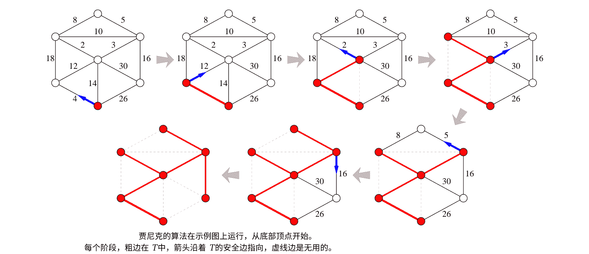

贾尼克的算法在示例图上运行，从底部顶点开始。每个阶段，粗边在 T中，箭头沿着 T的安全边指向，虚线边是无用的。

为了实现贾尼克的算法，我们将与 T相邻的所有边保存在一个优先队列中。当我们从优先队列中取出最小权重的边时，我们首先检查它的两个端点是否都在 T中。如果不是，则将该边添加到 T中，然后将新的相邻边添加到优先队列中。换句话说，贾尼克的算法是我们上次看到的通用图遍历算法的另一个实例，使用优先队列作为“袋子”！如果我们以这种方式实现算法，算法的运行时间为 O(E log E) = O(E log V)。

## 25.5 改进Jarník算法

我们可以使用一种更先进的优先队列数据结构来改进Jarník算法，这种数据结构被称为 Fibonacci堆，由Michael Fredman和Robert Tarjan于1984年首次描述。Fibonacci堆支持标准优先队列操作INSERT，EXTRACTMIN和DECREASEKEY。然而，与需要每个操作 O(log n)时间的标准二叉堆不同，Fibonacci堆支持常数摊销时间的INSERT和DECREASEKEY。EXTRACTMIN的摊销成本仍然是 O(log n)。

为了应用这种更快的数据结构，我们将顶点保留在优先队列中，而不是边，其中每个顶点 $v$ 的键要么是 $v$ 和正在发展的树 $T$ 之间的最小权重边，要么是 $\infty$ 如果没有这样的边。我们可以在算法开始时将所有顶点插入优先队列中；然后，每当我们向 $T$ 添加一条新边时，我们可能需要减小一些相邻顶点的键。

为了使描述更容易，我们将算法分为两个部分。JARNÍK INIT 初始化优先队列；JARNÍK LOOP 是主要算法。输入由图的顶点和边，以及起始顶点 $s$ 组成。对于每个顶点 $v$，我们同时维护其关键字 $key(v)$ 和关联边 $edge(v)$，使得 $w(edge(v)) = key(v)$。

```
JARNÍK (V, E, s):
    JARNÍK INIT (V, E, s)
    JARNÍK LOOP (V, E, s)
```

```
JARNÍK INIT(V, E, s):
    对于每个顶点 $v \in V \setminus \{s\}$
        如果 $(v, s) \in E$
            则边 $(v) \leftarrow (v, s)$
            关键字 $(v) \leftarrow w(v, s)$
        否则
            边 $(v) \leftarrow \text{NULL}$
            关键字 $(v) \leftarrow \infty$
    INSERT $(v)$
```

```
JARNÍK LOOP(V, E, s):
    $T \leftarrow (\{s\}, \emptyset)$
    对于 $i$ 从 $1$ 到 $|V| - 1$
        $v \leftarrow$ EXTRACTMIN
        将 $v$ 和边 $(v)$ 添加到 $T$
        对于每个邻居 $u$ 的 $v$
            如果 $u \notin T$ 且 $key(u) > w(uv)$
                边 $(u) \leftarrow uv$
                DECREASEKEY $(u, w(uv))$
```

操作 INSERT 和 EXTRACTMIN 每个顶点都会被调用 $O(V)$ 次，除了 $s$，而 DECREASEKEY 最多会被调用 $O(E)$ 次，最多两次。因此，如果我们使用斐波那契堆，改进的算法运行时间为 $O(E + V \log V)$，比 Borůvka 算法更快，除非 $E = O(V)$。然而，在实践中，这种改进很少比使用二进制堆的朴素实现更快，除非图非常大且密集。斐波那契堆算法非常复杂，无论是运行时间还是空间中的隐藏常数都是显著的，不过并不是过分的，但肯定比二进制堆操作的 $O(\log n)$ 时间界限中的隐藏常数 1 要大。

## 25.6 克鲁斯卡尔算法

我将讨论的最后一个最小生成树算法是克鲁斯卡尔在1956年首次描述的，他在同一篇论文中重新发现了贾尼克的算法。克鲁斯卡尔受到了 Borůvka 原始论文的“一个打字的翻译（来源不明）”的启发，声称 Borůvka 的算法“过于复杂”。这个算法在1957年也被 Lobeman 和 Weinberger 重新发现，但不知何故没有以他们的名字命名。

```
KRUSKAL: 按照递增的权重顺序扫描所有边；如果一条边是安全的，则将其添加到 $F$ 中。
```

由于我们按照从轻到重的顺序检查边，任何我们检查的边只有在其端点位于森林 $F$ 的不同分量中时才是安全的。为了证明这一点，假设边 $e$ 连接了两个分量 $A$ 和 $B$，但它不是安全的。那么一定存在一条更轻的边 $e'$，它只有一个端点

³公平地说，Borůvka 的原始论文过于复杂，但在他的后续论文中，也于1927年发表，他将算法简化到了现代形式。Kruskal 显然不知道 Borůvka 的第二篇论文。愚蠢的铁幕。

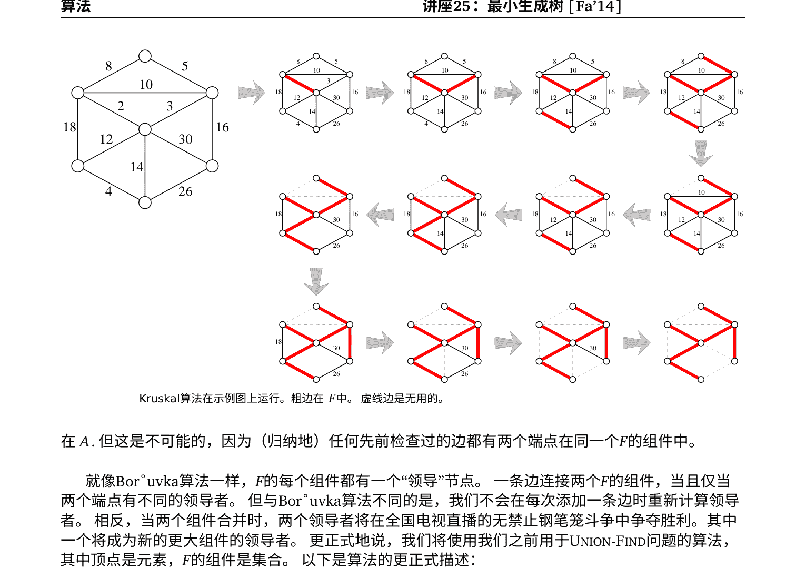

Kruskal算法在示例图上运行。粗边在 $F$ 中。虚线边是无用的。

在 A. 但这是不可能的，因为（归纳地）任何先前检查过的边都有两个端点在同一个F的组件中。

就像Borůvka算法一样，F的每个组件都有一个“领导”节点。一条边连接两个F的组件，当且仅当两个端点有不同的领导者。但与Borůvka算法不同的是，我们不会在每次添加一条边时重新计算领导者。相反，当两个组件合并时，两个领导者将在全国电视直播的无禁止钢笔笼斗争中争夺胜利。其中一个将成为新的更大组件的领导者。更正式地说，我们将使用我们之前用于UNION-FIND问题的算法，其中顶点是元素，F的组件是集合。以下是算法的更正式描述：

```
KRUSKAL(V, E):
    按增加的权重排序 E
    F ← (V, ∅)
    对于每个顶点 v ∈ V
        MAKESET(v)
    对于 i 从 1 到 |E|
        uv ← E 中第 i 轻的边
        如果 FIND(u) ≠ FIND(v)
            UNION(u, v)
            将 uv 添加到 F
    返回 F
```

在我们的情况下，集合是F的组成部分，而 $n = V$。Kruskal算法执行 $O(E)$ FIND操作，每个图中的边执行两次，并且执行 $O(V)$ UNION操作，每个最小生成树的边执行一次。使用按秩合并和路径压缩，我们可以在 $O(\alpha(E, V))$ 时间内执行每个UNION或FIND，其中 $\alpha$ 是不完全常数的反阿克曼函数。因此，忽略排序边的成本，该算法的运行时间为 $O(E \alpha(E, V))$。

我们需要O(E log E)=O(E log V)额外的时间来对边进行排序。由于这比UNION-FIND数据结构的时间更长，Kruskal算法的总运行时间为O(E log V)，与Borůvka算法或Jarník算法（使用普通（非Fibonacci堆）完全相同。

## 练习

- 1. 大多数经典的最小生成树算法使用讲义中描述的“安全”和“无用”边的概念，但也有另一种表述方式。设G为一个带权无向图，其中边的权重各不相同。我们说一条边e是危险的，如果它是G中某个环中最长的边，并且是有用的，如果它不在G的任何环中。
   (a) 证明最小生成树G包含每条有用的边。
   (b) 证明最小生成树G不包含任何危险边。
   (c) 描述并分析一种高效的“反Kruskal”最小生成树算法的实现：按照递减顺序检查G的边；如果一条边是危险的，则从G中删除它。[提示：它不会像Kruskal算法那样快。]

- 2. 设G=(V,E)是一个任意的连通图，具有加权边。
   (a) 证明对于将顶点V划分为两个不相交子集的任何划分，最小生成树G包含一条端点在每个子集中的最小权重边。
   (b) 证明对于G中的任何循环，最小生成树G排除该循环中权重最大的边。
   (c) 证明或证伪：最小生成树G包含G中每个循环中的最小权重边。

- 3. 在本讲座笔记中，我们假设输入图中没有两条边具有相等的权重，这意味着最小生成树是唯一的。事实上，对边的权重有一个较弱的条件意味着最小生成树的唯一性。
   (a) 描述一个具有唯一最小生成树的边权图，即使有两条边具有相等的权重。
   (b) 证明如果边权图G具有唯一最小生成树，则以下条件成立：
       • 对于G的任何顶点划分成两个子集，具有一个端点在每个子集中的最小权重边是唯一的。
       • 在G的任何环中，最大权重的边是唯一的。
   (c) 描述并分析一种算法，用于确定一个图是否具有唯一最小生成树。

- 4. 考虑一个无向加权图G中两个顶点s和t之间的路径。这条路径的瓶颈长度是路径中任意边的最大权重。从s到t的任意路径的最小瓶颈长度是瓶颈距离。（如果从s到t没有路径，则从s到t的瓶颈距离为∞。）
   描述一种算法，用于计算任意无向加权图中每对顶点之间的瓶颈距离。假设没有两条边具有相同的权重。

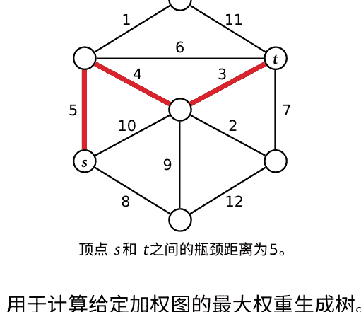

- 5. (a) 描述并分析一种算法，用于计算给定加权图的最大权重生成树。
   (b) 无向图 G的反馈边集 F是一组边的子集，使得G中的每个循环都至少包含 F中的一条边。换句话说，删除 F中的每条边会使图G无环。描述并分析一种快速算法，用于计算给定加权图的最小权重反馈边集。

- 6. 假设我们已经给出了具有加权边的无向图 G和最小生成树 T of G。
   (a) 描述一种算法，在单个边 e的权重减小时更新最小生成树。
   (b) 描述一个算法，当单个边的权重增加时，更新最小生成树。
   在这两种情况下，你的算法的输入是边 e和它的新权重；你的算法应该修改 T，使其仍然是最小生成树。[提示：分别考虑边 e \in T和边 e \notin T的情况。]

- 7. (a) 描述并分析一个算法，找到给定图 G的第二小生成树，即除最小生成树外总权重最小的生成树。
   *(b) 描述并分析一个高效的算法，计算给定加权无向图 G和整数 k，具有最小权重的 k个生成树。

- 8. 我们说图 G=(V,E)是密集的，如果 E = \Theta(V^2)。描述一种修改的Jarník最小生成树算法，当输入图是密集的时候，在 O(V^2)时间内运行（与 E无关），只使用简单的数据结构（特别是不使用斐波那契堆）。

- 9. (a) 证明图的最小生成树也是一棵生成树，其最大权重边是最小的。
   *(b) 描述一个算法来计算一棵生成树，其最大权重边是最小的，时间复杂度为O(V + E)。[提示：从边权重中计算中位数开始。]

- 10. 考虑以下Borůvka算法的变体。为了找到安全边，我们使用标准的不相交集数据结构，而不是计算和标记F的组件。F的每个组件都由一个上树表示；每个顶点v存储一个指向包含v的上树的父节点指针parent(v)。每个领导顶点v¯还维护一条边safe(v¯)，它是（最终）与v¯的F组件中的一个端点相连的最轻的边。
```
BORŮVKA(V, E):
    F = ∅
    对于每个顶点 v ∈ V
        父节点(v) ← v
    当 ¬F
        IND SAFEEDGES(V, E)
        ADDSAFEEDGES(V, E, F)
    返回 F
```
```
FINDSAFEEDGES(V, E):
    对于每个顶点 v ∈ V
        safe(v) ← NULL
    done ← FALSE
    对于每条边 uv ∈ E
        ū ← FIND(u); v̄ ← FIND(v)
        如果 ū ≠ v̄
            如果 w(uv) < w(safe(ū))
                safe(ū) ← uv
            如果 w(uv) < w(safe(v̄))
                safe(v̄) ← uv
        done ← TRUE
    返回 done
```
```
ADDSAFEEDGES(V, E, F):
    对于每个顶点 v ∈ V
        如果 safe(v) ≠ NULL
            则 xy ← safe(v)
                如果 FIND(x) = FIND(y)
                    则UNION(x, y)
                将xy添加到 F
```
证明如果FIND使用路径压缩，则每次调用FINDSAFEEDGES和ADDSAFEEDGES只需要O（V + E）时间。[提示：UNION的实现方式无关紧要！FINDSAFEEDGES结束时，上树的深度是多少？]

- 11. 最小生成树算法通常使用一种称为边收缩的操作来表达。
要收缩边uv，我们插入一个新节点，将与u或v（除了uv）相连的任何边重定向到这个新节点，然后删除u和v。收缩后，新节点与图中其他节点之间可能存在多条平行边；我们保留任意两个节点之间最轻的边，删除其他边。

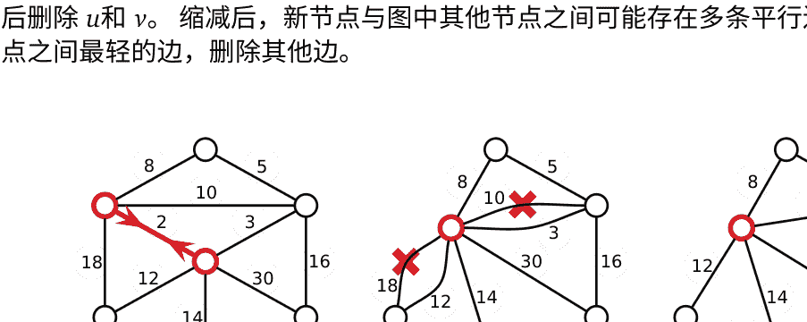

三种经典的最小生成树算法可以用收缩的方式清晰地表示如下。所有三种算法都是从输入图G的干净副本G'开始的

然后在 G'中反复收缩安全边; 最小生成树由收缩边组成。

- BORŮVKA: 标记每个顶点离开的最轻的边, 收缩所有标记的边, 并递归。
- JARNÍK: 反复收缩与某个固定根顶点相邻的最轻的边。
- KRUSKAL: 反复收缩图中最轻的边。

(a) 描述一个执行Borůvka的收缩算法的单次遍历的算法, 时间复杂度为 O(V + E)。 输入图以邻接表的形式表示。

(b) 考虑一个算法, 首先执行 k次Borůvka的收缩算法, 然后在结果收缩图上运行Jarník的算法 (使用Fibonacci堆)。
   i. 这个混合算法的运行时间是多少, 作为 V, E和 k的函数?
   ii. 对于哪个值的 k, 这个运行时间是最小的? 结果的运行时间是多少?

(c) 如果一个图族具有以下特性, 则称其为 nice:
   - 一个具有 n个顶点的好图只有 O(n)条边。
   - 对一个好图进行边缩减会得到另一个好图。
   例如, 可以在平面上绘制而不交叉的图是好图; 欧拉公式暗示了任何具有 n个顶点的平面图最多有3n –6条边。
   证明Borůvka的缩减算法可以在 O(n)时间内计算出任何好图的最小生成树。

> > 好吧，在村庄的消防站左转，然后沿着水库旁边的老邮路走...不，那样不行。
>
> 最好沿着柏油路一直走，直到你到达学校，然后在通往贝内特湖的路上左转，直到……不，那也行不通。
>
> 你说的是东米林诺基特吗？想想看，从这里你是到不了那里的。
>
> ——罗伯特·布莱恩和马歇尔·道奇，《伯特和我以及其他来自东部的故事》（1961年）

> > 农夫！这条路通向哪里？
>
> 我一直住在这里，它还没去过任何地方。农夫！你怎么去小石城？
>
> 听着陌生人，你从这里是到不了那里的。
>
> 农夫！你不太懂吧？
>
> 不，但我没有迷路。
>
> ——米歇尔·肖克，《阿肯色旅行者》（1992年）

## 26 最短路径

### 26.1 引言

假设我们有一个带有两个特殊顶点的加权有向图 $G = (V, E, w)$，我们想要找到从源顶点 $s$ 到目标顶点 $t$ 的最短路径。也就是说，我们想要找到从 $s$ 开始到 $t$ 结束的有向路径 $p$，使得函数的值最小化。

$$w(p) := \sum_{u \to v \in p} w(u \to v).$$

例如，如果我想回答“从我在伊利诺伊州香槟市的旧公寓到我妻子在俄亥俄州哥伦布市的旧公寓的最快方式是什么？”这个问题，我可能会使用一个图，其中顶点是城市，边是道路，权重是驾驶时间，$s$ 是香槟市，$t$ 是哥伦布市。这个图是有向的，因为同一条道路上的驾驶时间在不同方向上可能不同。（曾经，在印第安纳州/俄亥俄州边境以东的 I-70 上有一个超速陷阱，但只对东行交通有效。）也许与直觉相反，我们允许边上的权重为负数。负边使我们的生活变得复杂，因为负循环的存在可能意味着没有最短路径。一般来说，从 $s$ 到 $t$ 存在最短路径当且仅当从 $s$ 到 $t$ 至少存在一条路径，但从 $s$ 到 $t$ 没有经过负循环的路径。如果从 $s$ 可达任何负循环，并且可以到达 $t$，我们总是可以通过再绕一圈负循环来找到更短的路径。

几乎所有已知的解决这个问题的算法实际上解决了（大部分）以下更一般的单源最短路径或 SSSP 问题：在图中找到从源顶点 $s$ 到每个其他顶点的最短路径。通常通过找到以 $s$ 为根的最短路径树来解决这个问题，该树包含所有所需的最短路径。

很容易看出，如果最短路径是唯一的，那么它们形成一棵树，因为最短路径的任何子路径都是最短路径。如果某些顶点存在多条最短路径，我们总是可以选择每个顶点的一条最短路径，使得路径的并集是一棵树。如果存在到两个顶点 $u$ 和 $v$ 的最短路径分叉、相遇、再分叉，我们可以修改其中一条路径而不改变其长度，使得这两条路径只在一个地方分叉。

沿着教堂向西，沿着展望向北，沿着 I-74 向东，沿着 I-465 向南，沿着机场高速公路向东，沿着 I-65 向北，沿着 I-70 向东，沿着 Grandview 向北，沿着第五向东，沿着 Olentangy River 向北，沿着 Dodridge 向东，沿着 High 向北，沿着 Kelso 向西，沿着 Neil 向南。根据交通情况。我们现在都住在厄巴纳。

从 s 到 t 没有最短路径。

如果 s 到 a 到 b 到 c 到 u 和 s 到 a 到 b 到 c 到 d 到 u 是最短路径，那么 s 到 a 到 b 到 c 到 d 到 v 也是最短路径。

虽然它们都是最优生成树，但最短路径树和最小生成树是非常不同的。最短路径树是有根有向的；最小生成树是无根无向的。最短路径树最自然地定义在有向图上；只有无向图才有最小生成树。如果边的权重不同，只有一棵最小生成树，但每个源顶点会产生不同的最短路径树；而且，每个最短路径树可能使用与最小生成树不同的边集。

同一个无向图的最小生成树和最短路径树（以顶部顶点为根）。

### 26.2 警告！

在本讲座中，我们将明确考虑仅有向图。本讲座中描述的所有算法也适用于无向图，只需进行一些小的修改，但只有在禁止负边的情况下。处理无向图中的负边要更加微妙。我们不能简单地用一对有向边替换每条无向边，因为这会将任何负边转换为一个短的负循环。包含负边的无向最短路径的子路径不一定是最短路径；因此，即使最短路径是唯一的，从单个源顶点到所有无向最短路径的集合可能不定义一棵树。

关于带有负边的无向图的完整处理超出了本讲座的范围（如果不是整个课程的范围）。我只会提到，在具有负边的无向图中，可以通过将其转化为最大加权匹配问题，在 O(VE + V² log V) 时间内计算出单个最短路径。

一个无向图，从 s 到其他顶点的最短路径是唯一的，但不构成一棵树。

### 26.3 唯一的 SSSP 算法

就像图遍历和最小生成树一样，有几种不同的 SSSP 算法，但它们都是一个通用算法的特殊情况，最早由莱斯特·福特在 1956 年提出，乔治·丹齐格在 1957 年独立提出。²图中的每个顶点 $v$ 存储两个值，这些值（归纳地）描述了从 $s$ 到 $v$ 的一个暂定最短路径。

- $dist(v)$ 是暂定最短路径的长度，如果不存在这样的路径，则为 $\infty$。
- $pred(v)$ 是暂定最短路径中 $v$ 的前驱，如果不存在这样的顶点，则为 NULL。

实际上，前驱指针自动定义了一个暂定最短路径树；它们在我们的通用图遍历算法中扮演着与父指针完全相同的角色。在算法开始时，我们已经知道 $dist(s) = 0$ 和 $pred(s) = NULL$。对于每个顶点 $v \neq s$，我们最初将 $dist(v) = \infty$ 和 $pred(v) = NULL$ 设置为表示我们不知道从 $s$ 到 $v$ 的任何路径。在算法执行过程中，如果边 $u \rightarrow v$ 是紧张的，即 $dist(u) + w(u \rightarrow v) < dist(v)$，则称之为紧张边。如果 $u \rightarrow v$ 是紧张的，那么暂定最短路径 $s \rightsquigarrow v$ 显然是不正确的，因为路径 $s \rightsquigarrow u \rightarrow v$ 更短。

我们的通用算法重复地在图中找到一条紧张的边，并放松它：

```
RELAX (u→v):
    dist(v) ← dist(u) + w(u→v)
    pred(v) ← u
```

当没有紧张的边时，算法停止，我们得到了我们想要的最短路径树。

Ford 的通用放松算法的正确性可以从以下一系列的断言中得出：

- 1. 对于每个顶点 $v$，距离 $dist(v)$ 要么是 $\infty$ 要么是从 $s$ 到 $v$ 的某条路径的长度。这个断言可以通过对放松次数进行归纳来证明。
- 2. 如果图中没有负环，则 $dist(v)$ 要么是 $\infty$ 要么是从 $s$ 到 $v$ 的某条简单路径的长度。具体来说，如果 $dist(v)$ 是从 $s$ 到 $v$ 的一条包含有向环的路径的长度，那么该环必须有负权重。这个断言意味着如果 $G$ 没有负环，放松算法最终会停止，因为 $G$ 中只有有限数量的简单路径。
- 3. 如果 G 中没有边是紧张的，则对于每个顶点 v，距离 dist(v) 是前驱路径 $s \rightsquigarrow \cdots \to pred(pred(v)) \to pred(v) \to v$ 的长度。具体而言，如果 v 违反了这个条件，但它的前驱 pred(v) 没有违反，那么边 $pred(v) \to v$ 是紧张的。
- 4. 如果 G 中没有边是紧张的，则对于每个顶点 v，路径 $s \rightsquigarrow \cdots \to pred(pred(v)) \to pred(v) \to v$ 是从 s 到 v 的最短路径。具体而言，如果 v 违反了这个条件，但它的前驱 u 在某条最短路径中没有违反，那么边 $u \to v$ 是紧张的。这个论断还意味着，如果 G 有一个负循环，那么总有一条边是紧张的，所以通用算法永远不会停止。

²具体来说，丹齐格表明最短路径问题可以被表述为线性规划问题，然后用原始图的解释来描述他的单纯形法。他的描述与福特的放松策略等效。

到目前为止，我还没有说过我们如何检测哪些边可以被放松，或者以什么顺序放松它们。为了使这更容易，我们稍微改进了放松算法，使其与通用图遍历算法非常相似。我们维护一个“袋子”来存储顶点，最初只包含源顶点 s。每当我们从袋子中取出一个顶点 u 时，我们扫描其所有的出边，寻找可以放松的边。最后，每当我们成功放松一条边 u→v 时，我们将 v 放入袋子中。与通用图遍历算法不同的是，我们在访问顶点时不标记它们；同一个顶点可能被多次访问，同一条边可能被多次放松。

```
INITSSSP(s):
    dist(s) ← 0
    pred(s) ← NULL
    对于所有顶点 v ≠ s
        dist(v) ← ∞
        pred(v) ← NULL
```

```
GENERIC SSSP(s):
    INITSSSP(s)
    将 s 放入袋子中
    当袋子不为空时
        从袋子中取出 u
        对于所有边 u→v
            如果 u→v 是紧张的
                RELAX(u→v)
                将 v 放入袋子中
```

就像图遍历一样，给定不同的“袋子”数据结构会给我们带来不同的算法。有三个明显的选择可以尝试：栈、队列和优先队列。不幸的是，如果我们使用栈，最坏情况下得到的算法执行 $\Theta(2^V)$ 次松弛操作！（证明这一点是一个很好的作业问题。）其他两种可能性要高效得多。

### 26.4 迪杰斯特拉算法

如果我们使用优先队列来实现背包，其中顶点 v 的键是其临时距离 dist(v)，我们得到的算法是 1957 年由美国陆军战斗发展部的 Case Institute of Technology 的研究人员在年度项目报告中“发布”的。同样的算法后来由 Edsger Dijkstra 在 1959 年独立重新发现并公开发表。1958 年，George Dantzig 也描述了几乎相同的算法。

迪杰斯特拉算法，众所周知³，如果图中没有负权边，则表现良好。在这种情况下，很容易通过归纳证明，顶点按照从 s 到其最短路径距离的递增顺序进行扫描。由此可知，每个顶点最多被扫描一次，因此每条边最多被松弛一次。由于堆中每个顶点的键是其与 s 的临时距离，每次松弛边时算法执行一次 DECREASEKEY 操作。因此，算法执行的 DECREASEKEY 操作最多为 E 次。类似地，最多有 V INSERT 和 EXTRACTMIN 操作。因此，如果我们将顶点存储在斐波那契堆中，迪杰斯特拉算法的总运行时间为 O(E + V log V)；如果我们使用常规二叉堆，则运行时间为 O(E log V)。此分析假设没有边具有负权。迪杰斯特拉算法（以我在这里介绍的形式⁴）即使存在负边也仍然正确，但最坏情况下的运行时间可能是指数级的。（证明这个不幸事实是一个很好的家庭作业问题。）另一方面，在实践中，即使对于具有负边的图，迪杰斯特拉算法通常也非常快。

³尽管存在历史上的不准确性，但我将遵循这个常见的约定，部分原因是因为我认为没有人想读关于“Leyzorek-Gray-Johnson-Ladew-Meaker-Petry-Seitz算法”的内容，部分原因是因为实际上没有公开发表的论文是不计入的。

⁴大多数算法教材、维基百科甚至 Dijkstra 的原始论文都提供了 Dijkstra 算法的一个版本，该版本对于具有负边的图给出了错误的结果，因为它从不多次访问同一个顶点。我已经擅自纠正了 Dijkstra 的错误。即使 Dijkstra 也会同意，一个有时候慢但正确的算法（在实践中很少慢）比一个不总是有效的快速算法更好。

Dijkstra 算法在没有负边的图上运行的四个阶段。在每个阶段，阴影顶点在堆中，粗体顶点刚刚被扫描。粗体边描述了不断演化的最短路径树。

### 26.5 A* 启发式

Dijkstra 算法的一个轻微推广，通常称为 A*算法，经常用于从单个源节点 s 到单个目标节点 t 找到最短路径。这个启发式算法首次在 1968 年由 Peter Hart、Nils Nilsson 和 Bertram Raphael 描述。A* 使用一个黑盒函数 GUESSDISTANCE(v, t) 返回从 v 到 t 的距离估计。Dijkstra 算法和 A* 之间唯一的区别是顶点 v 的关键字是 dist(v) + GUESSDISTANCE(v, t)。

如果函数 GUESSDISTANCE 被称为可接受的，那么 GUESSDISTANCE(v, t) 从 v 到 t 的实际最短路径距离永远不会高估。如果 GUESSDISTANCE 是可接受的，并且实际边权重都是非负的，那么 A* 算法至少与 Dijkstra 算法一样快地计算出从 s 到 t 的实际最短路径。在实践中，GUESSDISTANCE(v, t) 越接近从 v 到 t 的实际距离，算法越快。然而，在最坏情况下，运行时间仍然是 O(E + V log V)。

在实际图形未知的情况下，启发式方法尤其有用。例如，A* 可以用于找到许多谜题（15 谜题，Free cell，上海，Sokoban，Atomix，Rush Hour，魔方，赛车场等）和其他路径规划问题的最优解，其中给定了起始和目标配置，但未明确给出所有可能配置及其连接的图形。

### 26.6 Shimbel 算法

如果我们将 Dijkstra 算法中的堆替换为 FIFO 队列，则可以得到一个算法，首次由 Shimbel 于 1954 年概述，由 Moore 于 1957 年更详细地描述，然后由 Woodbury 和 Dantzig 于 1957 年再次发现，再由 Bellman 于 1958 年独立发现。由于 Bellman 明确使用了 Ford 的边松弛公式，因此这个算法几乎普遍被称为“Bellman-Ford”，尽管一些早期资料提到了“Bellman-Shimbel”。Shimbel 算法即使存在负边也是高效的，并且可以快速检测负循环的存在。如果没有负边，迪杰斯特拉算法更快。（实际上，在实践中，即使对于具有负边的图，迪杰斯特拉算法通常也更快。）

分析算法的最简单方法是通过引入一个虚拟的令牌，将执行分解为阶段。甚至在我们开始之前，我们将令牌插入队列中。当前阶段在将令牌从队列中取出时结束；通过重新插入令牌到队列中，我们开始下一个阶段。第 0 阶段完全由扫描源顶点 s 组成。当队列仅包含令牌时，算法结束。一个简单的归纳论证（提示，提示）暗示了以下不变量，对于每个整数 i 和顶点 v:

> 经过 i 个阶段的算法后，dist(v) 至多是从 s 到 v 的最短路径的长度，由至多 i 条边组成。

由于最短路径只能通过每个顶点一次，要么算法在第 V 个阶段之前停止，要么图中包含负循环。在每个阶段中，我们最多扫描每个顶点一次，因此最多松弛每条边一次，因此单个阶段的运行时间为 O(E)。因此，Shimbel 算法的总运行时间为 O(V E)。

Shimbel 算法在具有负边的有向图上运行的四个阶段。节点按照顺序从队列中取出，顺序为 $s \diamond a\ b\ c \diamond d\ f\ b \diamond a\ e\ d \diamond d\ a \diamond \diamond$，其中 $\diamond$ 是阶段结束的标记。阴影顶点在每个阶段结束时都在队列中。粗体边描述了不断演化的最短路径树。

一旦我们了解了 Shimbel 算法的各个阶段的行为，我们可以通过有意产生相同的行为来大大简化算法。在每个阶段中，我们不再对图进行部分广度优先搜索，而是直接扫描邻接表，放松我们在图中找到的每条紧张边。

SHIMBEL：放松所有紧张边并递归。

```
SHIMBEL SSSP(s)
    INIT SSSP(s)
    重复 V 次:
        对于每条边 u→v
            如果 u→v 是紧张的
                RELAX (u→v)
    对于每条边 u→v
        如果 u→v 是紧张的
            返回 "负循环!"
```

这是大多数教科书介绍“贝尔曼-福特”算法的方式。这种算法的运行时间是明显的，但是算法仍然是正确的可能不太清楚。事实上，正确性与之前完全相同的不变量相关：

**经过 i 个阶段的算法后，dist(v) 至多是从 s 到 v 的最短路径的长度，由至多 i 条边组成。**

与之前一样，可以通过归纳法（提示，提示）直接证明这个不变量对于每个整数 i 和顶点 v 都成立。

### 26.7 Shimbel 的动态规划算法

Shimbel 的算法也可以重新构造为动态规划算法。让 $dist_i(v)$ 表示由最多 i 条边组成的从 s 到 v 的最短路径的长度。很容易看出，这个函数满足以下递归关系：

$$dist_i(v) = \begin{cases} 
0 & \text{如果 } i =0 \text{ 并且 } v = s \\
\infty & \text{如果 } i =0 \text{ 并且 } v \neq s \\
\min\begin{cases}
dist_{i-1}(v), \\
\min\limits_{u\to v \in E} (dist_{i-1}(u) + w(u\to v))
\end{cases} & \text{否则}
\end{cases}$$

暂时假设图中没有负循环；我们的目标是计算 $dist_{V-1}(t)$。我们可以明显地将这个双参数函数存储到一个二维数组中。这个递推的直接动态规划计算如下所示：

```
SHIMBEL DP(s)
    dist[0, s] <- 0
    对于每个顶点 v ≠ s
        dist[0, v] <- ∞
    对于 i <- 1 到 V - 1
        对于每条边 u→v
            dist[i, v] <- dist[i - 1, v]
            如果 dist[i, v] > dist[i - 1, u] + weight(u→v)
                dist[i, v] <- dist[i - 1, u] + weight(u→v)
```

现在让我们对这个算法进行两个小改动。首先，我们从最后三行中删除一个缩进级别。这可能会改变我们检查边的顺序，但修改后的算法仍然计算出所有 i 和 v 的距离 $dist_i(v)$。其次，我们将最后两行中的索引从 i-1 更改为 i。这个改动可能会使距离 $dist[i, v]$ 更快地接近真实的最短路径距离但算法仍然是正确的。

```
SHIMBEL DP2(s)
    dist[0, s] <- 0
    对于每个顶点 v ≠ s
        dist[0, v] <- ∞
    对于 i 从 1 到 V - 1
        对于每个顶点 v
            dist[i, v] <- dist[i - 1, v]
        对于每条边 u→v
            如果 dist[i, v] > dist[i, u] + weight(u→v)
                dist[i, v] <- dist[i, u] + weight(u→v)
```

现在注意到迭代索引 i 是完全多余的！我们实际上只需要保留一个一维距离数组，这意味着我们不需要在每次主循环的迭代中扫描顶点。

```
SHIMBEL DP3(s)
    dist[s] <- 0
    对于每个顶点 v ≠ s
        dist[v] <- ∞
    对于 i 从 1 到 V - 1
        对于每条边 u→v
            如果 dist[v] > dist[u] + w(u→v)
                dist[v] <- dist[u] + w(u→v)
```

得到的算法与我们之前的算法 SHIMBELSSSP 几乎相同！前三行初始化最短路径距离，最后两行检查边是否紧张，如果是，则松弛。新算法缺少的唯一特性是显式维护前任，但这很容易添加。

# 练习

- 0. 证明对于每个整数 i 和每个顶点 v，经过 i 次 Shimbel 算法（无论是哪种形式）后，dist(v) 至多为从 s 到 v 的最短路径长度，该路径至多包含 i 条边。

## 27个全对最短路径

在前一讲中，我们看到了在有向图中从源顶点 s 到目标顶点 vertex t 找到最短路径的算法。事实证明，这个问题的最佳算法实际上是通过构建最短路径树来找到从 s 到每个可能的目标（或从每个可能的源到 t）的最短路径。最短路径树为图中的每个节点 v 指定了两个信息：

- dist(v) 是从 s 到 v 的最短路径的长度（如果有的话）；
- pred(v) 是从 s 到 v 的最短路径的倒数第二个顶点（如果有的话）；

在这个讲座中，我们希望进一步推广最短路径问题。在全对最短路径问题中，我们希望找到从每个可能的源点到每个可能的目的地的最短路径。具体来说，对于每一对顶点 u 和 v，我们需要计算以下信息：

- dist(u,v) 是从 u 到 v 的最短路径的长度（如果有的话）；
- pred(u,v) 是从 u 到 v 的最短路径的倒数第二个顶点（如果有的话）；

例如，对于任何顶点 v，我们有 dist(v,v) = 0 和 pred(v,v) = NULL。如果从 u 到 v 的最短路径只有一条边长，则 dist(u,v) = w(u→v) 和 pred(u,v) = u。如果从 u 到 v 没有最短路径——无论是根本没有路径，还是因为存在负环——则 dist(u,v) = ∞ 和 pred(v,v) = NULL。

我们最短路径算法的输出将是一对 V × V 数组，编码了所有 V^2 距离和前导节点。许多地图包括一个距离矩阵 - 要找到从（比如）香槟到（比如）哥伦布的距离，您将查找标有“香槟”的行和标有“哥伦布”的列。在这些笔记中，我将几乎完全专注于计算距离数组。前导节点数组，用于计算实际的最短路径，可以通过对我将描述的算法进行轻微的添加来计算（提示，提示）。

### 27.1 大量的单源

解决全对最短路径问题的明显方法就是运行单源最短路径算法 V 次，每次以可能的源顶点为起点！具体来说，为了填充一维子数组 dist[s, ·]，我们从源顶点 s 开始调用 Dijkstra 算法或 Shimbel 算法。

```
OBVIOUS APSP(V, E, w):
  对于每个顶点 s
    dist[s, ·] ← SSSP(V, E, w, s)
```

该算法的运行时间取决于我们使用的单源最短路径算法。如果我们使用Shimbel算法，总体运行时间为 $\Theta(V^2 E) = O(V^4)$。如果所有边的权重都是非负的，我们可以使用Dijkstra算法，将运行时间降低到 $\Theta(V E + V^2 \log V) = O(V^3)$。对于具有负边权重的图，Dijkstra算法可能需要指数时间，因此我们无法直接获得这种改进。

### 27.2 重新赋权

大多数人会想到的一个想法是将所有边的权重增加相同的量，使得所有权重变为正数，然后应用Dijkstra算法。不幸的是，这个简单的想法行不通。不同的路径变化量不同，这意味着在重新赋权的图中最短路径可能与原始图中的最短路径不同。

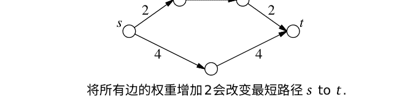

然而，在图中重新赋权边的方法更加复杂。假设每个顶点 v 都有一个相关的成本 c(v)，它可以是正数、负数或零。我们可以定义一个新的权重函数 w' 如下：

> w'(u→v) = c(u) + w(u→v) - c(v)

为了给出一些直观感受，想象一下当我们离开顶点 u 时，我们必须支付一个出口税 c(u)，而当我们进入顶点 v 时，我们得到 c(v) 作为入口礼物。

现在很容易证明，具有新的权重函数 w' 的最短路径与具有原始权重函数 w 的最短路径完全相同。实际上，对于从一个顶点 u 到另一个顶点 v 的任意路径 u ⇝ v，我们有

> w'(u ⇝ v) = c(u) + w(u ⇝ v) - c(v).

我们支付 c(u) 作为出口费用，加上路径的原始权重，减去 c(v) 作为入口礼物。在路径上的每个中间顶点 x，我们得到 c(x) 作为入口礼物，但立即作为出口税支付回去！

### 27.3 约翰逊算法

约翰逊的全对最短路径算法为每个顶点找到一个代价 c(v)，这样当图被重新赋权时，每条边都具有非负权重。

假设图中有一个顶点 s，它与其他每个顶点都有一条路径。约翰逊算法使用Shimbel的算法（不关心边的权重是否为负）计算从 s 到其他每个顶点的最短路径，然后设置 c(v) ← dist(s, v)，这样每条边的新权重就是

> w'(u→v) = dist(s, u) + w(u→v) - dist(s, v).

为什么所有这些新权重都是非负的？因为否则，Shimbel的算法就无法完成！回想一下，如果 dist(s, u) + w(u→v) < dist(s, v)，则边 u→v 被称为紧张的，而且这是单源最短路径算法消除所有紧张的边。唯一的例外是如果图中有一个负循环，但是最短路径就没有定义了，约翰逊算法会直接中止。

但是如果图中没有一个顶点可以到达所有的顶点呢？无论我们从哪里开始，Shimbel算法中，其中一些顶点的代价将是无限的。约翰逊算法通过在图中添加一个新的顶点$s$，从$s$到其他每个顶点都有权重为零的边，但是没有从其他顶点返回$s$的边，来避免这个问题。这个添加不会改变任何其他顶点对之间的最短路径，因为没有路径进入$s$。所以这就是约翰逊算法的全部荣耀。

```
JOHNSON APSP(V, E, w):
    为每个顶点$v$创建一个新的顶点$s$
    $w(s \rightarrow v) \leftarrow 0$
    $w(v \rightarrow s) \leftarrow \infty$
    $dist[s, \cdot] \leftarrow \text{SHIMBEL}(V, E, w, s)$
    如果SHIMBEL发现一个负循环优雅地失败
    对于每条边 $(u,v) \in E$
        $w'(u \rightarrow v) \leftarrow dist[s, u] + w(u \rightarrow v) - dist[s, v]$
    对于每个顶点 $u$
        $dist[u, \cdot] \leftarrow \text{DIJKSTRA}(V, E, w', u)$
        对于每个顶点 $v$
            $dist[u, v] \leftarrow dist[u, v] - dist[s, u] + dist[s, v]$
```

该算法花费 $\Theta(V)$时间添加人工起始顶点 $s$，$\Theta(V E)$时间运行SHIMBEL，$O(E)$时间重新加权图形，然后 $\Theta(V E + V^2 \log V)$运行 $V$次Dijkstra算法。因此，总运行时间为 $\Theta(V E + V^2 \log V)$。

### 27.4 动态规划

对于全对最短路径问题，有一种完全不同的解决方案，它使用动态规划而不是单源算法。对于稠密图，其中 $E = \Omega(V^2)$，动态规划方法最终导致与Johnson算法相同的 $O(V^3)$运行时间，但算法更简单。特别是，新算法避免了Dijkstra算法，该算法的效率来自于斐波那契堆，在实现中很容易出错。在本讲座的其余部分中，我将假设输入图不包含负循环。

像往常一样，对于动态规划算法，我们首先需要提出问题的递归公式。这是一个“显而易见”的递归定义，用于计算 $dist(u, v)$：

$$dist(u, v) = \begin{cases} 0 & \text{if } u = v \\ \min_{x \rightarrow v} \big( dist(u, x) + w(x \rightarrow v) \big) & \text{否则} \end{cases}$$

换句话说，要找到从 $u$到 $v$的最短路径，我们考虑所有可能的最后一条边 $x \rightarrow v$，并且递归计算从 $u$到 $x$的最短路径。不幸的是，这个递归公式不起作用！为了计算 $dist(u, v)$，我们可能需要计算 $dist(u, x)$对于每个其他顶点 $x$。但是为了计算 $dist(u, x)$，我们可能需要计算 $dist(u, v)$。我们陷入了一个无限循环！

为了避免这种循环依赖，我们需要一个额外的参数，在每次递归时递减，最终在基本情况下达到零。一种可能性是将最短路径中的边数作为第三个魔术参数包含在内，就像我们在Shimbel的动态规划公式中所做的那样。

算法。让 \(dist(u, v, k)\)表示从 \(u\)到 \(v\)的最短路径长度，该路径最多使用 \(k\)条边。由于我们知道任意两个顶点之间的最短路径最多有 \(V-1\)个顶点， \(dist(u, v, V-1)\)就是实际的最短路径距离。与单源设置类似，我们有以下递归关系：

$$dist(u, v, k) = \begin{cases} 0 & \text{if } u = v \\ \infty & \text{如果 } k=0 \text{且 } u \neq v \\ \min\limits_{x \to v} (dist(u, x, k-1) + w(x \to v)) & \text{否则} \end{cases}$$

将这个递归关系转化为动态规划算法是直接的。为了让算法变得更简短，假设对于每个顶点 \(v\)， \(w(v \to v)=0\)。假设图以邻接表的形式存储，得到的算法的运行时间为 \(\Theta(V^2E)\)。

```
动态规划APSP (V, E, w) :
对于所有顶点u
  对于所有顶点v
    如果u=v
      则dist[u,v,0]←0
    否则
      则dist[u,v,0]←∞
对于k←1 to V-1
  对于所有顶点u
    对于所有顶点v
      dist[u,v,k]←∞
      对于所有边x→v
        如果dist[u,v,k]>dist[u,x,k-1]+w(x,v)
          则dist[u,v,k]←dist[u,x,k-1]+w(x,v)
```

这个算法最早由Shimbel在1955年提出的；实际上，这个算法只是运行Shimbel的单源算法的不同实例，每个可能的源顶点都有一个。就像Shimbel的单源算法的动态规划开发中一样，我们实际上不需要内部循环遍历顶点 \(v\)，我们只需要一个二维表。在以下算法的主循环的第 \(k\)次迭代之后， \(dist[u, v]\)位于从 \(u\)到 \(v\)的真实最短路径距离和先前算法计算的值\(dist[u, v, k]\)之间。

```
SHIMBEL APSP(V, E, w):
对于所有顶点 u
  对于所有顶点 v
    如果 u = v
      dist[u, v] ← 0
    否则
      dist[u, v] ← ∞
对于 k从1到 V - 1
  对于所有顶点 u
    对于所有边 x → v
      如果距离[u, v] > 距离[u, x] + 权重(x → v)
        距离[u, v] ← 距离[u, x] + 权重(x → v)
```

### 27.5 分治

但是我们可以做出更显著的改进。我们刚刚使用的递归将最短路径分解为稍短的路径和一条边，通过考虑所有前驱节点。相反，让我们将其分解在路径的中间顶点将其分为两条较短的路径。这个想法给我们一个不同的递归公式，用于计算 $dist(u, v, k)$。再次简化问题，假设 $w(v \to v) = 0$。

$$
dist(u, v, k) = \begin{cases}
w(u \to v) & \text{if } k = 1 \\
\min_x \left( dist(u, x, k/2) + dist(x, v, k/2) \right) & \text{否则}
\end{cases}
$$

这个递归只在k是2的幂时有效，因为否则我们可能会尝试找到具有分数边数的最短路径！但这并不是真正的问题，因为 $dist(u, v, 2^{\lceil \log V \rceil})$ 给出了从u到v的整体最短距离。请注意，我们使用基本情况k=1而不是k=0，因为我们不能使用半个边。

再次，动态规划的解决方案很直接。即使在我们写下算法之前，我们就可以知道运行时间是 $\Theta(V^3 \log V)$ ——我们考虑V个可能的u、v和x值，但只考虑$\lceil \log V \rceil$个可能的k值。

```
快速动态规划APSP(V,E,w):
对于所有顶点u，对于所有顶点v， $dist[u, v, 0] \leftarrow w(u, v)$，对于i从1到$\lceil \log V \rceil$ 
    $\langle \langle k = 2^i \rangle \rangle$
        对于所有顶点 u
            对于所有顶点 v
                $dist[u, v, i] \leftarrow \infty$
                对于所有顶点 x
                    如果 $dist[u, v, i] > dist[u, x, i-1] + dist[x, v, i-1]$
                        $dist[u, v, i] \leftarrow dist[u, x, i-1] + dist[x, v, i-1]$
```

这个算法与任何单源算法的V次调用不同；特别是，最内层循环不仅仅是放松紧张的边。然而，我们可以去掉表的最后一个维度，在Shimbel的单源算法中，使用 $dist[u, v]$ 代替 $dist[u, v, i]$，从而将空间从 $O(V^3)$ 减少到 $O(V^2)$。

```
FAST SHIMBEL APSP(V,E,w):
对于所有顶点 u
    对于所有顶点 v
        $dist[u, v] \leftarrow w(u \to v)$
对于 i 从 1 到 $\lceil \lg V \rceil$
    对于所有顶点 u
        对于所有顶点 v
            对于所有顶点 x
                如果 $dist[u, v] > dist[u, x] + dist[x, v]$
                    $dist[u, v] \leftarrow dist[u, x] + dist[x, v]$
```

这个更快的算法是由Leyzorek等人在1957年发现的，在同一篇论文中他们描述了Dijkstra的算法。

## 27.6 附注：“有趣”的矩阵乘法

在计算有向图中的最短路径和计算一个方阵的幂之间存在非常紧密的联系（首先由Shimbel观察到，后来由Bellman独立观察到）。比较下面用于乘法的算法两个$n \times n$矩阵A和B与我们第一个动态规划算法的内部循环。（我稍微改变了第二个算法中的变量名，以使相似性更清晰。）

```
矩阵相乘 (A, B):
对于 i 从 1 到 n
   对于 j 从 1 到 n
       C[i, j] ← 0
       对于 k 从 1 到 n
           C[i, j] ← C[i, j] + A[i, k] · B[k, j]
```

```
APSP内部循环:
对于所有顶点 u
   对于所有顶点 v
       D'[u, v] ← ∞
       对于所有顶点 x
           D'[u, v] ← min{D'[u, v], D[u, x] + w[x, v]}
```

这两个算法之间唯一的区别是我们使用加法而不是乘法和最小化而不是加法。因此，最短路径内部循环通常被称为“有趣”的矩阵乘法。

DYNAMICPROGRAMMINGAPSP是计算权重矩阵 w 的第 (V - 1) 个‘有趣的幂’的标准迭代算法。第一组for循环设置了‘有趣的单位矩阵’，主对角线上为零，其他地方为无穷大。然后，第二个主要for循环的每次迭代计算下一个‘有趣的幂’。FASTDYNAMICPROGRAMMINGAPSP用重复平方的方式替代了这种迭代计算幂的方法，就像我们在学期初看到的那样。快速算法稍微简化了一下，因为除非存在负循环，否则在第 V个之后的每个‘有趣的幂’都是相同的。

有更快的矩阵乘法方法，类似于Karatsuba的分治算法用于整数乘法。（搜索‘Strassen算法’。）不幸的是，这些算法使用减法，而没有‘有趣’的减法等效方法。（min的逆操作是什么？）所以至少对于一般图来说，似乎没有办法加速我们动态规划算法的内部循环。

幸运的是，这不是真的。有一个美丽的随机算法，由Alon、Galil、Margalit和Noar¹发现，可以在无向图中以 O(M(V) log² V)的期望时间计算所有对最短路径，其中 M(V)是计算两个 V × V 整数矩阵的时间。Seidel发现了这个算法的简化版本，用于无权图。²

## 27.7 Floyd-(Roy-Kleene-)Warshall

我们快速的动态规划算法仍然比Johnson的算法慢 O(log V)的因子。1962年，Robert Floyd提出了一个不同的公式，去除了这个对数因子，稍微推广了Stephen Warshall在同一年早些时候发表的算法。（事实上，Warshall的算法在1959年由Bernard Roy独立发现，但底层技术在1951年由Stephen Kleene³使用。）Warshall（和Roy和Kleene）的洞察力是在动态规划递归中使用一个不同的第三个参数。

将顶点从1到 V 任意编号。对于每一对顶点 u 和 v 以及每个整数 r，我们定义路径 π(u, v, r)如下：

π(u, v, r) :=从 u到 v的最短路径，其中每个中间顶点（即除了 u和 v之外的每个顶点）的编号最多为 r.

如果 r =0，则不允许使用任何中间顶点，因此 π(u, v, 0)只是从u到 v的边（如果有的话）. 如果 r > 0，则 π(u, v, r)要么通过编号为 r的顶点，要么不通过. 如果 π(u, v, r)包含顶点 r，则它分为从 u到 r的子路径和从 r到 v的子路径，其中这两个子路径中的每个中间顶点的编号最多为 r − 1. 此外，这些子路径在此限制下尽可能短，因此它们必须是 π(u, r, r − 1)和 π(r, v, r − 1). 另一方面，如果 π(u, v, r)不经过顶点 r，则 π(u, v, r)中的每个中间顶点的编号最多为 r −1；由于π(u, v, r)必须是最短的这样的路径，我们有 π(u, v, r) = π(u, v, r −1).

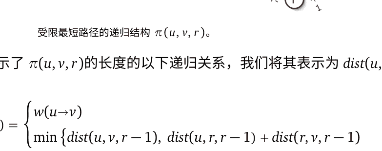

受限最短路径的递归结构 π(u, v, r)。

这个递归结构暗示了 π(u, v, r)的长度的以下递归关系，我们将其表示为 dist(u, v, r):

$$
dist(u, v, r) = \begin{cases} w(u \rightarrow v) & \text{if } r = 0 \\ \min \{dist(u, v, r - 1), \ dist(u, r, r - 1) + dist(r, v, r - 1)\} & \text{否则} \end{cases}
$$

我们需要计算从 u到 v的无限制最短路径距离，即 dist(u, v, V)。
再次，我们应立即看到，动态规划算法将以 Θ(V³)时间实现这个递归。

```
Floyd-Warshall算法(V, E, w):
对于所有顶点 u
    对于所有顶点 v
        dist[u, v, 0] ← w(u→v)
对于 r ←1 到 V
    对于所有顶点 u
        对于所有顶点 v
            如果 dist[u, v, r − 1] < dist[u, r, r − 1] + dist[r, v, r − 1]
                dist[u, v, r] ← dist[u, v, r − 1]
            否则
                dist[u, v, r] ← dist[u, r, r − 1] + dist[r, v, r − 1]
```

就像我们之前的算法一样，我们可以通过删除备忘录表的第三个维度来简化算法。此外，由于顶点编号是任意选择的，在伪代码中没有明确引用的原因。

```
Floyd-Warshall2 (V, E, w) :
对于所有顶点 u
    对于所有顶点 v
        dist[u, v] ← w(u→v)
对于所有顶点 r
    对于所有顶点 u
        对于所有顶点 v
            如果 dist[u， v] > dist[u， r] + dist[r， v]
                dist[u, v] ← dist[u, r] + dist[r, v]
```

现在将这个算法与FASTSHIMBELAPSP进行比较。Floyd-Warshall2只需要一次遍历，但这仅仅是因为它使用了不同的嵌套顺序来进行三个for循环！

弗洛伊德算法是解决涉及图中顶点之间路径问题的更一般方法的特例。 我所知道的最早的例子是1951年Stephen Kleene提出的一种算法，用于将确定有限自动机转换为等价的正则表达式。

回顾一下，确定有限自动机（DFA）正式包括以下组成部分：

- 一个有限集合 Σ，称为字母表，其元素被称为符号。
- 一个有限集合 Q，其元素被称为状态。
- 一个初始状态 s ∈ Q。
- 一个接受状态的子集 A ⊆ Q。
- 一个转移函数 δ: Q × Σ → Q。

扩展转移函数 δ*: Q × Σ* → Q的递归定义如下：

$$
\delta^*(q, w) := \begin{cases} q & \text{if } w = \varepsilon, \\ \delta^*(\delta(q, a), x) & \text{if } w = ax \text{对于某个 } a \in \Sigma \text{ 和 } x \in \Sigma^*. \end{cases}
$$

最后，一个DFA接受一个字符串 w ∈ Σ*当且仅当 δ*(s, w) ∈ A。

等价地，一个DFA是一个有标记边的有向（多重）图，其顶点是状态，这样每个顶点（状态）都有一条出边（转换），其标记是 Σ中的每个符号。 有一个特殊的“开始”顶点 s，并且顶点的一个子集 A被标记为“接受”。 对于任何字符串w ∈ Σ*，从 s开始的唯一路径的边标签序列是 w. 当且仅当这条路径在 A中的一个状态结束时，DFA接受 w.

Kleene描述了以下算法，将DFA转换为等价的正则表达式。 假设我们有一个具有n个状态的DFA M ，其中（不失一般性）每个状态都被标识为1到n之间的整数。 让 L（i，j，r） 表示描述从状态 i到状态 j的所有行走的字符串集合，其中每个中间状态的索引最多为 r。 因此，被 M接受的语言正是

$$
L(M) = \bigcup_{q \in A} L(s, q, n)。
$$

我们通过递归地构造一个表示 L（i，j，r） 的正则表达式 R（i，j，r） 来归纳地证明每个语言 L（i，j，r） 都是正则的。 有两种情况需要考虑。

- 首先，假设 r = 0。 语言 L（i，j，0） 包含从状态 i到状态 j的标签行走，不经过任何中间状态。因此， L（i，j，0） 中的每个字符串的长度最多为1。具体来说，对于任何符号 a ∈ Σ， 当且仅当 δ(i, a) = j时， 我们有 a ∈ L(i, j, 0)， 当且仅当i=j时， 我们 ε ∈ L(i, j, 0)。 因此， L（i，j，0）始终是有限的， 因此是正则的。

例如，下一页上显示的DFA定义了以下正则语言 L(i, j, 0)。

```
R[1, 1, 0] = ε + 0      R[2, 1, 0] = 0      R[3, 1, 0] = ∅
R[1, 2, 0] = 1      R[2, 2, 0] = ε      R[3, 2, 0] = ∅
R[1, 3, 0] = ∅      R[2, 3, 0] = 1      R[3, 3, 0] = ε + 0 + 1
```

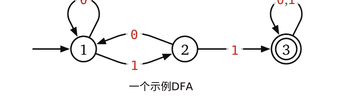

一个示例DFA

- 现在假设 r > 0. 每个字符串 w ∈ L(i,j,r)描述了从状态 i到状态 j的一次行走，其中每个中间状态的索引最多为 r . 如果这次行走没有经过状态 r，则 w ∈ L(i,j,r−1)根据定义. 否则，我们可以将 w分割成在行走经过状态 r的点处的子字符串 w = w₁·w₂·...·w_ℓ这些子字符串具有以下属性:
  - 前缀 w₁描述了从状态 i到状态 r的路径，因此属于 L(i,r,r−1)。
  - 后缀 w_ℓ描述了从状态 r到状态 j的路径，因此属于 L(r,j,r−1)。
  - 对于其他索引 k，子字符串 w_k描述了从状态 r到状态 r的路径，因此属于 L(r,r,r−1)。

我们得出结论

L(i,j,r) = L(i,j,r−1) ∪ L(i,r,r−1) • L(r,r,r−1)* • L(r,j,r−1)。


正则语言 L(i,j,r)的递归结构。

将这些部分组合在一起，我们可以递归地定义一个描述语言 L(i,j,r)的正则表达式 R(i,j,r)。定义如下:

```
R(i,j,r) := 
{
  ε + Σ_{δ(i,a)=j} a          如果 r=0 且 i=j
  Σ_{δ(i,a)=j} a               如果 r=0 且 i=j
  R(i,j,r−1) + R(i,r,r−1) • R(r,r,r−1)* • R(r,j,r−1)  otherwise
}
```

Kleene的算法使用自然动态规划算法从底向上评估这个递归。我们将前一个递归存储在一个三维数组 R [1..n,1..n,0..n]中，我们通过增加外循环中的 r来遍历它，并在内部两个循环中以任意顺序遍历。

```
KLEENE (Σ, n, δ, F):
<<基本情况>>
对于 i 从1到 n
    对于 j 从1到 n
        如果 i = j 那么 R[i, j, 0] ← ε 否则 R[i, j, 0] ← ∅
        对于所有符号 a ∈ Σ
            如果 δ[i, a] = j
                R[i, j, 0] ← R[i, j, 0] + a
<<递归情况>>
对于 r 从1到 n
    对于 i 从1到 n
        对于 j 从1到 n
            R[i, j, r] ← R[i, j, r-1] + R[i, r, r-1] • R[r, r, r-1]* • R[r, j, r-1]
<<组装最终结果>>
R ← ∅
对于 q 从0到 n-1
    如果 q ∈ F
        R ← R + R[1, q, n-1]
返回 R
```

为了分析的目的，假设字母表Σ的大小是恒定的。假设每个交替（+）、连接（•）和Kleene闭包（*）操作都需要恒定的时间，整个算法的运行时间为O(n³)。

然而，对于字母表Σ上的正则表达式通常表示为标准字符串（数组），该字母表Σ ∪ {+, •, *, (, ), ε}，或者作为正则表达式树，其内部节点是+、•和*运算符，叶子节点是符号和ε。在任何一种表示中，Kleene算法中的正则表达式在每次外部循环迭代中的大小大致增加了4倍，至少在最坏的情况下是如此。因此，在最坏的情况下，每个正则表达式R[i, j, r]的大小为O(4^r)，最终输出表达式的大小为O(4^n n)，整个算法的运行时间为O(4^n n²)。

所以我们不应该这样做。毕竟，运行时间是指数级的，指数时间是不好的。对吗？此外，这种指数依赖是不可避免的；Hermann Gruber和Markus Holzer在2008年证明了，对于二进制字母表{0, 1}上的n状态DFA，任何等价的正则表达式的长度都是2^Ω(n)。

嗯，也许情况并不那么糟糕。输出的正则表达式具有指数大小，因为它包含多个相同的子表达式；同样，正则表达式树具有指数大小，因为它包含多个相同的子树。但正是这种指数行为，我们使用动态规划来避免！事实上，修改Kleene算法以计算大小为O(n³)的正则表达式有向无环图，需要O(n³)的时间，（直观地）每个子表达式R[i, j, r]仅出现一次。这个正则表达式有向无环图与Kleene算法的依赖图与其底层递归的递归树具有完全相同的关系。

## 练习

- 1. 如果图中包含负循环，则本讲座中讨论的所有算法都会失败。约翰逊算法在初始化阶段（通过Shimbel算法）检测负循环并中止；动态规划算法只会返回错误的结果。然而，所有这些算法都可以修改以返回正确的最短路径距离，即使存在负循环。

- (a) 描述如何修改约翰逊算法以返回正确的最短路径距离，即使图中存在负循环。

- (b) 描述如何修改弗洛伊德-瓦尔什算法（FLOYD WARSHALL2）以返回正确的最短路径距离，即使图中存在负循环。

- 2. 本笔记中描述的所有最短路径算法也可以修改，以返回某个负循环的明确描述，而不仅仅报告存在负循环。
  (a) 描述如何修改约翰逊算法，以返回最短路径距离矩阵或负循环。
  (b) 描述如何修改弗洛伊德-沃尔什算法（FLOYDWARSHALL2）以返回最短路径距离矩阵或负循环。
  如果图中包含多个负循环，则您的算法可以任意选择一个。

3. 设 $G=(V,E)$ 为具有加权边的有向图；边的权重可以是正数、负数或零。假设 $G$ 的顶点被划分为 $k$ 个不相交的子集 $V_1, V_2, \ldots, V_k$；也就是说，$G$ 的每个顶点都属于且仅属于一个子集 $V_i$。对于每个 $i$ 和 $j$，让 $\delta(i, j)$ 表示 $V_i$ 中的顶点和 $V_j$ 中的顶点之间的最小最短路径距离：

  $$\delta(i, j) = \min\{ dist(u, v) \mid u \in V_i \text{ 和 } v \in V_j \}.$$

  描述一个算法来计算 $\delta(i, j)$ 对于所有的 $i$ 和 $j$ 在时间 $O(V^2 + kE \log E)$。

- 4. 让 $G=(V,E)$ 是一个带有加权边的有向图；边的权重可以是正数、负数或零。
  (a) 我们如何在不改变任何其他顶点对之间的最短路径距离的情况下，从该图中删除任意顶点 $v$？描述一个算法，构建一个带有加权边的有向图 $G'=(V',E')$，其中 $V' = V \setminus \{v\}$，并且在 $H$ 中任意两个节点之间的最短路径距离等于在 $G$ 中相同两个节点之间的最短路径距离，在 $O(V^2)$ 时间内完成。
  (b) 现在假设我们已经计算出了 $G'$ 中的所有最短路径距离。描述一个算法来计算从 $v$ 到每个其他顶点的最短路径距离，并从每个其他顶点到 $v$ 的最短路径距离，在原始图 $G$ 中，在 $O(V^2)$ 时间内。
  (c) 将部分 (a) 和 (b) 结合成另一个全对最短路径算法，其运行时间为 $O(V^3)$。（得到的算法与 Floyd-Warshall 算法不同！）

- 5. 在这个问题中，我们将发现你也可以被华尔街雇佣，并引发一场重大的经济崩溃！套利业务是一种利用货币兑换差异赚钱的计划。特别是，假设1美元可以购买120日元；1日元可以购买0.01欧元；1欧元可以购买1.2美元。然后，一个以1美元开始的交易员可以将他的钱从美元兑换成日元，然后从日元兑换成欧元，最后从欧元兑换回美元，最终得到1.44美元！货币循环 $ \rightarrow \yen \rightarrow \epsilon \rightarrow \$$ 被称为套利循环。当然，在价格被修正之前找到并利用套利循环需要非常快的算法。
  假设有 $n$ 种不同的货币在你的货币市场上交易。给定一个矩阵 $R[1..n,1..n]$ 表示每对货币之间的汇率；对于每个 $i$ 和 $j$，可以用 $R[i, j]$ 单位的货币 $i$ 交换 $R[i, j]$ 单位的货币 $j$。（不要假设 $R[i,j] \cdot R[j,i] = 1$。）
  (a) 描述一个算法，返回一个数组 $V[1..n]$，其中 $V[i]$ 是通过交易从一单位货币1开始可以获得的最大金额，假设没有套利循环。
  (b) 描述一个算法来确定给定的货币汇率矩阵是否创建了套利循环。
  (c) 修改你在部分(b)中的算法，如果存在套利循环，则实际返回一个套利循环。

- 6. 令 G=(V, E)为一个无向、无权、连通的n-顶点图，由邻接矩阵 A[1..n,1..n]表示。 在这个问题中，我们将推导出Seidel的亚立方算法，使用快速矩阵乘法计算出最短路径距离的n×n矩阵 D[1..n,1..n]。
  假设我们有一个子程序MATRIXMULTIPLY，它可以在Θ(n^ω)时间内乘以两个n×n矩阵，其中 ω ≥ 2.5是一个未知的常数。
  (a) 令 G^2表示与 G具有相同顶点的图，如果两个顶点在 G中的路径长度最多为2，则它们由一条边连接。 描述一个算法，使用一次MATRIXMULTIPLY的调用和O(n^2)额外时间来计算 G^2的邻接矩阵。
  (b) 假设我们发现 G^2是一个完全图。 描述一个算法来计算矩阵 D 的最短路径距离在 O(n^2)额外时间内。
  (c) 让 D^2 denote (递归计算的) 最短路径距离矩阵在 G^2中。 证明从节点 i到节点 j的最短路径距离要么是 2·D^2[i, j]要么是 2·D^2[i, j]－1。
  (d) 假设 G^2不是一个完全图。 让 X = D^2·A，并且让deg(i)表示原始图 G中顶点 i的度。 证明从节点 i到节点 j的最短路径距离是 2·D^2[i, j]当且仅当 X[i, j] ≥ D^2[i, j]·deg(i)。
  (e) 描述一个算法来计算 G中的最短路径距离矩阵，时间复杂度为 O(n^ω log n)。
  你已经知道的矩阵乘法算法的运行时间为 Θ(n³)，但这不是已知的最快算法。
  目前的记录是 ω ≈ 2.3727，由Virginia Vassilevska Williams创造。 确定 ω的最小可能值是一个长期存在的未解决题；许多人相信存在一个未发现的 O(n²)时间复杂度的矩阵乘法算法。

读者请注意：这是本讲座笔记的第零（草稿）版。特别是，一些主题仍然需要编写。请将错误报告和建议发送至jeffe@illinois.edu。

> 全球思考，地方行动。
——归功于Patrick Geddes（约1915年），以及其他许多人。

> 我们只能看到前方的短距离，
但我们可以看到那里需要做很多事情。
——艾伦·图灵，“计算机与智能”（1950年）

> 只要机器能够按照预期工作，就不要担心理论。
——罗伯特·安森·海因莱因，《瓦尔多与魔法公司》（1950年）

## 36 图灵机

1936年，在他24岁生日前几个月，艾伦·图灵将计算机科学作为现代知识学科推出。 在一篇非凡的论文中，图灵提供了以下结果：

- 一个简单的机械计算形式模型，现在被称为图灵机。
- 一个描述单一的通用机器，可以用来计算任何一个图灵机可计算的函数。
- 一个证明，没有图灵机能够解决停机问题——给定一个任意图灵机 M的形式描述， M是否停机或永远运行？
- 一个证明，没有图灵机能够确定一个任意给定命题是否可以从一阶逻辑公理中证明。 这是希尔伯特和阿克曼著名的决策问题（“decision problem”）
- 令人信服的论据1表明他的机器可以执行任意“有限手段的计算”。

图灵的论文并不是第一个证明Entscheidungsproblem没有算法解决方案的论文。阿隆佐·邱奇在几个月前发表了第一个证明，使用了一个非常不同的计算模型，现在称为无类型 λ-演算。图灵和邱奇独立地发展了他们的结果；事实上，图灵在收到邱奇的论文副本后立即提交了自己的论文，只停下来证明任何可以通过 λ-演算计算的函数也可以通过图灵机计算，反之亦然。邱奇是图灵论文的审稿人；在论文提交和接受之间，图灵被普林斯顿大学录取，并成为邱奇的博士生。两年后，他完成了博士学位。

非正式地说，图灵描述了一种具有有限数量的内部状态并且可以访问以磁带形式存在的内存的设备。磁带由一个半无限的单元序列组成，每个单元包含来自某个任意有限字母表的一个符号。图灵机只能通过其头部访问磁带，该头部位于一个单元上。最初，磁带包含一个任意的有限输入字符串，后面是一个无限的空白序列，并且头部位于磁带上的第一个单元上。在一个迭代中，机器读取该单元中的符号，可能在该单元中写入一个新的符号，可能改变其内部状态，可能将头移动到相邻的单元格，可能停止。
机器在每次迭代时的精确行为完全由其内部状态和所读取的符号决定。当机器停止时，它会指示它是否接受或拒绝原始输入字符串。


### 36.1 为什么要费心？

习惯于将计算以随机存储器访问、函数调用和递归等高级操作的学生可能会想知道为什么我们要考虑像图灵机这样简单且受限的模型。诚然，图灵机对于思考快速计算是一个糟糕的模型；在标准随机访问模型中，需要常数时间的简单操作在图灵机上可能需要任意多的步骤。更糟糕的是，对于“图灵机”这个精确定义的微小变化可能会对问题复杂性产生重大影响。作为一个简单的例子（稍后会更有意义），我们可以使用双带图灵机在 O(n) 时间内反转一个长度为n的比特串，但是同样的任务在单带机上被证明需要 Ω(n²) 时间。

但是在这里，我们对于寻找快速算法或者寻找任何算法都不感兴趣，而是更关注证明一些问题无法通过任何计算手段解决。这样大胆的说法需要一个简单而又强大的“计算”正式定义，能够支持形式化论证，同时又足够强大以描述任意算法。图灵机非常适合这个目的。特别是，图灵机足够强大以模拟其他图灵机，同时又足够简单以让我们从头开始构建这种自我模拟，不像标准随机访问机器那样复杂但高效。

（可以说，在教堂的 λ-演算中，或者在Schönfinkel和Curry的组合演算中，自我模拟甚至更简单，这也是为什么这些模型在设计和中更常见的原因之一。）

### 36.2 正式定义

从形式上讲，图灵机由以下组件组成。（稍等一下；这是一个很长的列表。）

- 一个任意的有限集合 Γ 至少有两个元素，称为磁带字母表。
- 一个任意的符号 □ ∈ Γ，称为空白符号或者只是空白。
- 一个任意的非空子集 Σ ⊆ (Γ \ {□})，称为输入字母表。
- 另一个任意的有限集合 Q 其元素被称为状态。
- 三个不同的特殊状态 开始,接受,拒绝 ∈ Q.
- 一个转换函数 δ: (Q \ {接受,拒绝}) × Γ → Q × Γ × {-1, +1}.

图灵机的一个配置或全局状态由一个三元组表示 (q, x, i) ∈ Q × Γ* × ℕ, 表示机器的内部状态是 q，磁带上包含字符串 x，后面是无限个空白，头部位于位置 i。磁带字符串中的尾部空白被忽略；三元组 (q, x, i)和 (q, x□, i)完全描述了相同的配置。

过渡函数 δ描述了机器的演化。例如，δ(q, a) = (p, b, -1)意味着当机器在状态 q中读取符号 a时，它会将其内部状态更改为 p，在当前位置上写入符号 b（替换 a），然后将其位置减少 1（或更直观地说，向左移动一步）。如果头部的位置变为负数，则无法进行进一步的转换，机器会崩溃。

我们写作 (p, x, i) ⇒_M (q, y, j)来表示图灵机 M在一步中从第一个配置过渡到第二个配置。（符号 ⇒经常发音为“产生”；如果机器在上下文中是清楚的，我会省略下标 M。）例如，δ(p, a) = (q, b, ±1)意味着

```
(p, x a y, i) ⇒ (q, x b y, i ± 1)
```

对于任何非负整数 i，任何长度为 i的字符串 x和任何字符串 y。任何图灵机的演化都是确定性的；每个配置 C产生一个唯一的配置 C′。我们写作 C ⇒* C′来表示从配置 C到配置 C′的一系列转换（可能为空）。（符号 ⇒*可以发音为“最终产生”。）

初始配置为 (w, start, 0)，其中 w ∈ Σ*是任意的（可能为空的）输入字符串。如果 M最终达到接受状态——更正式地说，如果存在字符串 x ∈ Γ*和整数 i 使得 (w, start, 0) ⇒* (x, accept, i)，我们 说 M接受原始输入字符串 w。类似地，如果 M最终达到拒绝状态，我们说 M拒绝 w。我们必须强调“拒绝”和“不接受”不是同义词；如果 M崩溃或永远运行，那么 M既不接受也不拒绝 w。

我们区分图灵机“接受”语言的两种不同意义。设 M为一个输入字母表为 Σ的图灵机，L为 Σ*上的任意语言。

- 如果 M接受 L中的每个字符串但不接受其他字符串，则称 M识别或接受 L。如果某个图灵机能够识别某个语言，则该语言被称为可识别的（或半可计算的或递归可枚举的）。
- 如果 M接受 L中的每个字符串并拒绝 Σ* \ L中的每个字符串，则称 M决定 L。如果 M识别 L并且对所有输入都能够停机（不崩溃），则称 M决定 L。如果某个图灵机能够决定某个语言，则该语言被称为可决定的（或可计算的或递归的）。

显然，每个可判定的语言都是可识别的，但是（正如我们后面将看到的），并不是每个可识别的语言都是可判定的。

### 36.3 第一个例子

考虑语言 L = {0^n 1^n 0^n | n ≥ 0}。这个语言既不是正则的，也不是上下文无关的，但是它可以由下面的六状态图灵机决定。机器的字母表和状态如下所定义：

- Γ = {0, 1, $, x, □}
- Σ = {0, 1}
- Q = {开始, 寻找1, 寻找0, 重置, 验证, 接受, 拒绝}

转移函数在下表中描述；所有未指定的转移都导致拒绝状态。我们还给出了相同机器的图形表示，它类似于DFA的绘图，但是在每条边上指定了输出符号和动作。例如，我们通过在从状态p到状态q的箭头旁边写 0/1, +1来表示转移δ( p, 0) = (q, 1, +1)。

| δ( p , a) = ( q , b, Δ) | 解释 |
| :--- | :--- |
| δ( 开始 , 0) = ( 寻找1 , $, +1) | 标记第一个 0并向右扫描 |
| δ( 开始 , x) = ( 验证 , $, +1) | 看起来我们完成了，但让我们确保一下 |
| δ(寻找1, 0) = ( 寻找1 , 0 , +1) | 向右扫描 1 |
| δ(寻找1, x) = ( 寻找1 , x , +1) | |
| δ(寻找1, 1) = ( 寻找0 , x , +1) | 标记 1并继续向右 |
| δ(寻找0, 1) = ( 寻找0 , 1 , +1) | 向右扫描 0 |
| δ(寻找0, x) = ( 寻找0 , x , +1) | |
| δ(寻找0, 0) = ( 重置 , x, +1) | 标记 0并向左扫描 |
| δ( 重置 , 0) = ( 重置 , 0, -1) | 向左扫描 $ |
| δ( 重置 , 1) = ( 重置 , 1, -1) | |
| δ(重置, x) = (重置, x, -1) | |
| δ( 重置 , $) = ( 开始 , $, +1) | 向右移动并重新开始 |
| δ(验证, x) = (验证, $, +1) | 向右扫描任何未标记的符号 |
| δ(验证 , □) = ( 接受 , □, -1) | 成功! |

图灵机的转换函数，用于决定语言 {0^n 1^n 0^n | n ≥ 0}。


最后，我们追踪这台机器在两个输入字符串上的执行： 001100 ∈ L 和 00100 ∈ L。在每个配置中，我们使用一个小三角形来表示头的位置，而不是明确列出位置。请注意，我们会根据需要自动向磁带字符串添加空格。证明这台机器实际上决定了 L- 特别是，它永远不会崩溃或无限循环 - 是一项直接但繁琐的归纳练习。

```
(开始, 001100) ⇒ (寻找1, $01100) ⇒ (寻找1, $01100) ⇒ (寻找0, $0x100) ⇒ (寻找0, $0x100)
⇒ (重置 , $0x1x0) ⇒ (重置 , $0x1x0) ⇒ (重置 , $0x1x0) ⇒ (重置 , $0x1x0)
⇒ (开始 , $0x1x0)
⇒ (寻找1, $x1x0) ⇒ (寻找1, $x1x0) ⇒ (寻找0, $xx x0) ⇒ (寻找0, $xxx 0)
⇒ (重置, $xx xx) ⇒ (重置, $x xxx) ⇒ (重置, $ xxxx) ⇒ (重置, $$xxxx)
⇒ (验证, $ xxxx) ⇒ (验证, $$ xxx) ⇒ (验证, $$ xx)
⇒ (验证, $$$ x) ⇒ (验证, $$$ □) ⇒ (接受, $$$ $) ⇒ 接受!
```

示例图灵机在输入字符串 001100 ∈ L上的演化

```
(开始, 00100) ⇒ (寻找1, $0100) ⇒ (寻找1, $0100) ⇒ (寻找0, $0x00)
⇒ (重置 , $0xx0) ⇒ (重置 , $0xx0) ⇒ (重置 , $0xx0)
⇒ (开始 , $0xx0)
⇒ (寻找1, $xx0) ⇒ (寻找1, $xx0) ⇒ (寻找1, $xx0) ⇒ 拒绝!
```

在输入字符串 00100 ∈ L上的示例图灵机的演化

### 36.4 变体

实际上，有几个正式模型都属于“图灵机”这个名称，每个模型在我们给出的定义上都有一些小的变化。虽然我们确实需要明确指出对于任何特定问题我们想要使用哪个变体，但是这些变体之间的差异相对不重要。
对于在一个模型中定义的任何机器，都存在在其他模型中的等价机器；特别地，所有这些变体都能识别相同的语言并决定相同的语言。例如：

- 停机条件。一些模型允许多个接受和拒绝状态，这取决于具体的模型，当机器进入该状态时，触发接受或拒绝，或者当机器没有有效的转换出该状态时触发接受或拒绝。 其他模型只包括显式接受状态，并将崩溃与拒绝等同，或者根本不定义拒绝机制。还有一些模型将停机作为机器的可能操作之一，除了向左或向右移动；在这些模型中，只有当机器在接受/非接受状态下停机时，它才接受/拒绝其输入。
- 动作。一些图灵机模型允许转换不移动头部，或者在一步中移动头部超过一个单元。 其他人坚持认为机器的一步要么在磁带上写入一个新符号，要么将头部移动一步。 最后，如上所述，一些模型将停机作为可用操作之一。
- 转换函数。一些图灵机模型，包括图灵的原始定义，允许转换函数在某些状态-符号对上未定义。在这个表述中，转换函数由一个集合 δ ⊂ Q × Γ × Q × Γ × {+1,-1}给出，对于每个状态 q 和符号 a，最多只有一个转换 (q, a, ·, ·, ·) ∈ δ。如果机器进入一个没有转换的配置，它将停机并且（根据具体模型）要么崩溃要么拒绝。其他人将转换函数定义为 δ: Q × Γ → Q × (Γ ∪ {-1,+1})，允许机器在每一步中要么在磁带上写入一个符号，要么移动头部。
- 磁带的开始。一些模型禁止头部移动到磁带的开始，要么通过在磁带上放置一个不可覆盖的特殊符号来强制向右移动，要么声明在位置 0进行向左移动时头部停留在位置 0，甚至通过纯粹的规定来声明在位置0进行向左移动的任何机器都是无效的。

为了证明这些变种的图灵机中的任意两个是等价的，我们必须展示如何将一种类型的机器转换为另一种类型的机器，使其接受和拒绝相同的字符串。例如，设 M=(Γ,□,Σ,Q,s,accept,reject,δ)是一个具有明确接受和拒绝状态的图灵机。我们可以定义一个等价的图灵机 M′，只有在从位置 0向左移动时才停机，并且只有在停机时处于接受状态时才接受，定义如下。我们定义 M′的接受状态集合为 A={accept}，并定义一个新的转移函数

```
δ′(q, a) := \begin{cases} (接受, 一个, -1) & \text{如果 } q = \text{接受} \\ (拒绝, 一个, -1) & \text{如果 } q = \text{拒绝} \\ δ(q, 一个) & \text{否则} \end{cases}
```

同样，假设有人给了我们一个图灵机 M= (Γ,□,Σ,Q,s,接受,拒绝,δ)其转移函数 δ: Q × Γ → Q × Γ × {-1, 0,+1}允许机器在不移动头部的情况下进行转移。我们可以通过定义 Q′ := Q × {0, 1}来构建一个等价的图灵机 M′=(Γ,□,Σ,Q′,s,接受,拒绝,δ′)使其在每次转移时移动头部。

```
δ′((p, 0), a) := \begin{cases} ((q, 1), b, +1) & \text{if } δ(p, a) = (q, b, 0), \\ ((q, 0), b, Δ) & \text{if } δ(p, a) = (q, b, Δ) \text{ and } Δ = 0, \end{cases} 
δ′((p, 1), a) := ((p, 0), a, -1).
```

### 36.5 计算函数

图灵机还可以用来计算从字符串到字符串的函数，而不仅仅是接受或拒绝字符串。由于我们不关心接受或拒绝，我们用一个单独的停机状态替换明确的接受和拒绝状态，并且在机器停机时，我们定义图灵机的输出为去除无限空格序列后的纸带内容。更正式地说，对于任何图灵机 M，任何字符串 w ∈ Σ*，以及任何不以空格结尾的字符串 x ∈ Γ*，我们写作 M(w) = x当且仅当 (w, s, 0) ⇒_M^* (x, halt, i)对于某个整数 i。如果 M在输入 w上不停机，则我们写作 M(w) ↗，可以读作“M在 w上发散”或“M(w) 未定义”。我们说 M计算函数 f: Σ* → Σ*当且仅当对于每个字符串 w，有 M(w) = f(w)。

#### 36.5.1 移位

在许多图灵机结构中使用的一种基本操作是将输入字符串向右或向左移动固定数量的步骤。例如，对于任何输入字符串 w∈{0,1}*，我们可以

---
1正如图灵所说，“所有可以给出的论证都必然是对直觉的呼吁，因此在数学上不太令人满意。”现在被称为图灵机的计算模型可以计算任何可计算的问题，这被称为图灵-丘奇论题。

使用带有字母表 Γ = {0, 1, □}，状态集 Q = {0, 1, halt}，起始状态 0和以下转移函数的图灵机来计算字符串 0w：

```
δ(p, a) = ( q, b, Δ )
δ(0, 0) = ( 0, 0, +1)
δ(0, 1) = ( 1, 0, +1)
δ(0, □) = ( halt, 0, +1)
δ(1, 0) = ( 0, 1, +1)
δ(1, 1) = ( 1, 1, +1)
δ(1, □) = ( halt, 1, +1)
```

通过增加状态的数量，我们可以构建一个图灵机，将输入字符串向任意固定的方向移动任意数量的步骤。例如，一个将输入向左移动五个步骤的机器可能会从右到左读取字符串，并将最近读取的五个符号存储在其内部状态中。这样的机器的典型转移可能是 δ(12345, 0) = (01234, 5, −1)。

### 36.5.2 二进制加法

通过使用更复杂的图灵机，我们可以实现二进制加法。输入是一个形如 w+x 的字符串，其中 w, x∈{0, 1}ⁿ，表示两个二进制数；输出是 w + x 的二进制表示。为了简化我们的演示，我们假设 |w| = |x| > 0；然而，通过添加几个额外的状态，这些限制可以被移除。下图一览显示了整个图灵机。该机器使用的带字母表 Γ = {□, 0, 1, +, 0, 1}；起始状态为 shift0。所有缺失的转换都进入一个 fail 状态，表示输入格式错误。

该图灵机的执行分为几个阶段，每个阶段都有自己的状态子集，如图所示。初始化阶段扫描整个输入，将其向右移动以为输出字符串腾出空间，标记 w 的最右位，并读取和擦除 x 的最后一位。

```
δ( p, a ) = ( q, b, Δ )
δ(shift0, 0) = ( shift0, 0, +1)
δ(shift0, 1) = ( shift1, 0, +1)
δ(shift0, +) = ( shift+, 0, +1)
δ(shift0, □) = ( add0, □, −1)
δ(shift1, 0) = ( shift0, 1, +1)
δ(shift1, 1) = ( shift1, 1, +1)
δ(shift1, +) = ( shift+, 1, +1)
δ(shift1, □) = ( add1, □, −1)
δ(shift+, 0) = ( shift0, +, +1)
δ(shift+, 1) = ( shift1, +, +1)
```

主循环的第一部分从右到左扫描到 w 的标记位，加上刚刚被擦除的 x 的位以及上一次迭代的进位位，并在机器的内部状态中记录下一次迭代的进位位。

```
δ( p, a ) = ( q, b, Δ )
δ(add0, 0) = ( add0, 0, −1)
δ(add0, 1) = ( add0, 0, −1)
δ(add0, +) = ( add0, 0, −1)
δ(add0, 0) = ( back0, 0, −1)
δ(add0, 1) = ( back0, 1, −1)
δ( p, a ) = ( q, b, Δ )
δ(add1, 0) = ( add1, 0, −1)
δ(add1, 1) = ( add1, 0, −1)
δ(add1, +) = ( add1, 0, −1)
δ(add1, 0) = ( back0, 1, −1)
δ(add1, 1) = ( back1, 0, −1)
δ( p, a ) = ( q, b, Δ )
δ(add2, 0) = ( add2, 0, −1)
δ(add2, 1) = ( add2, 0, −1)
δ(add2, +) = ( add2, 0, −1)
δ(add2, 0) = ( back1, 0, −1)
δ(add2, 1) = ( back1, 1, −1)
```

主循环的第二部分标记了 w 的前一个位，向右扫描到 x 的末尾，然后读取并擦除 x 的最后一位，同时保持进位位。

```
δ(p, a) = (q, b, Δ)
δ(back0, 0) = (next0, 0, +1)
δ(back0, 1) = (next0, 1, +1)
δ(next0, 0) = (next0, 0, +1)
δ(next0, 1) = (next0, 1, +1)
δ(next0, +) = (next0, +, +1)
δ(next0, □) = (fetch0, □, +1)
δ(fetch0, 0) = (add0, □, +1)
δ(fetch0, 1) = (add1, □, +1)
δ(fetch0, +) = (last0, □, +1)
δ(p, a) = (q, b, Δ)
δ(back1, 0) = (next1, 0, +1)
δ(back1, 1) = (next1, 1, +1)
δ(next1, 0) = (next1, 0, +1)
δ(next1, 1) = (next1, 1, +1)
δ(next1, +) = (next1, +, +1)
δ(next1, □) = (fetch1, □, +1)
δ(fetch1, 0) = (add1, □, +1)
δ(fetch1, 1) = (add2, □, +1)
δ(fetch1, +) = (last1, □, +1)
```

最后，在主循环的最后一次迭代中擦除 + 后，终止阶段将最后一个进位位添加到最左边的输出位并停止。

```
δ(p, a) = (q, b, Δ)
δ(last0, 0) = (last0, 0, -1)
δ(last0, 1) = (last0, 0, -1)
δ(last0, □) = (halt, 0, )
δ(last1, 0) = (last1, 0, -1)
δ(last1, 1) = (last1, 0, -1)
δ(last1, □) = (halt, 1, )
```

## 36.6 轨道、磁头和磁带的变化

### 多个轨道

有时候，给图灵机的磁带上配备多个轨道，每个轨道都有自己的磁带字母表，并允许机器同时从所有轨道上的同一位置读取和写入。

例如，要定义一个有三个轨道的图灵机，我们需要三个磁带字母表 Γ₁, Γ₂ 和 Γ₃，每个字母表都有自己的空白符号，其中（假设）Γ₁ 包含输入字母表 Σ 作为子集；我们还需要一个形式为的转换函数

```
δ: Q × Γ₁ × Γ₂ × Γ₃ → Q × Γ₁ × Γ₂ × Γ₃ × {−1, +1}
```

描述这台机器的配置需要一个五元组 (q, x₁, x₂, x₃, i)，表示每个轨道 i 包含字符串 x_i 后面跟着无限个空格。初始配置是 (start, w, ε, ε, 0)，输入字符串写在第一个轨道上，其他两个轨道完全为空白。

但是任何这样的机器与一个（如果不是完全相同）带有（仍然是无限的！）带字母 Γ := Γ₁ × Γ₂ × Γ₃ 的单轨图灵机等价。我们不再将磁带看作三个无限序列的符号，而是将其看作一个包含三个符号的“记录”的单个无限序列。此外，在这个构造中，数字 3 并没有什么特别之处；具有任何常数轨道数的图灵机等价于单轨机器。

### 双向无限带

有时候，允许带子在两个方向上都是无限的也是很方便的，例如，为了避免边界条件。有几种方法可以在只有半无限带的机器上模拟双向无限带。也许最简单的方法是使用一个有两个轨道的半无限带，一个轨道包含正索引的单元，另一个轨道以相反的顺序包含负索引的单元，在位置零处有一个特殊的标记符号来指示过渡。

| 0 | +1 | +2 | +3 | +4 | ... |
|---|----|----|----|----|-----|
| ▶ | -1 | -2 | -3 | -4 | ... |

另一种方法是将正索引和负索引的单元混合到一个轨道上，并添加额外的状态以允许图灵机在一次转换中移动两步。同样，我们需要一个在带子左端指示过渡的特殊符号：

| ▶ | 0 | -1 | +1 | -2 | +2 | -3 | +3 | ... |

第三种方法是在带子上维护两个哨兵符号 ▶，它们包围着带子上的所有其他非空白符号。每当机器读取右哨兵时，我们写入一个空白符号，向右移动，写入，向左移动，然后继续，就好像我们刚刚读取了一个空白符号。另一方面，当机器读取左哨兵 ▶ 时，我们将整个带子的内容（包括右哨兵）向右移动一步，然后向左哨兵移动，向右移动，写入一个空白符号，最后继续，就好像我们刚刚读取了一个空白符号。由于图灵机实际上无法访问头部的位置作为整数，将头部和带子内容向右移动一步对其未来的演变没有影响。

| ▶ | -3 | -2 | -1 | 0 | +1 | +2 | +3 | +4 | +5 | ... | ... |

使用前两种方法之一，我们可以模拟任意图灵机的 t 步骤，只需在标准图灵机上执行 O(t) 步骤即可使用双重无限带。不幸的是，第三种方法在最坏情况下需要 Θ(t²) 步骤。

### 插入和删除

除了简单地覆盖现有符号外，我们还可以允许图灵机在带上插入和删除单元格。我们已经看到如何插入一个新单元格：在带上留下一个特殊标记（也许在第二轨道上），将该标记右侧的所有内容向右移动一个单元格，从标记处向左扫描，擦除标记，最后将正确的字符写入新单元格。删除类似：标记要删除的单元格，将标记右侧的所有内容向左移动一步，从标记处向左扫描，擦除标记。我们还可能需要在某个单元格中保持一个标记，指示右侧的所有非空符号，以便我们知道何时停止向左或向右移动。

### 多个头

另一个方便的扩展是允许机器同时访问磁带上的多个位置。例如，要定义一个具有三个头的图灵机，我们需要一个形式为的转换函数

```
δ: Q × Γ³ → Q × Γ³ × {−1, +1}³.
```

描述这样一台机器的配置需要一个五元组 (q, x, i, j, k)，表示机器处于状态 q，磁带包含字符串 x，并且三个头位于位置 i, j, k。转换函数告诉我们，在给定 q 和三个符号 x[i], x[j], x[k] 的情况下，在磁带上写入哪三个符号，并移动每个头的方向。

我们可以通过在磁带上添加额外的轨道来模拟这种行为，记录每个头的位置。要模拟具有三个头的机器 M，我们使用具有四个轨道的磁带：轨道 0 是实际的工作磁带；其余的轨道上有一个非空符号记录一个头的位置。我们还在磁带的左端插入了一个特殊的标记符号。

| ▶ | M | Y | W | O | R | K | T | A | P | E | ... |
|---|---|---|---|---|---|---|---|---|---|---|---|
| ▶ |   |   |   |   |   |   |   |   | ▲ |   | ... |
| ▶ |   | ▲ |   |   |   |   |   |   |   |   | ... |
| ▶ |   |   |   |   | ▲ |   |   |   |   |   | ... |

我们可以模拟 M 的任何单个转换，从我们的单个头开始在磁带的左端，如下所示。在模拟过程中，我们将 M 的内部状态作为我们当前状态的一个组成部分保持不变。首先，对于每个 i，我们按照以下方式读取 M 的第 i 个头下的符号：

向右扫描以找到磁道 i 上的标记，从磁道 0 中读取相应的符号到我们的内部状态，然后返回到磁带的左端。

此时，我们的内部状态记录了 M 的当前内部状态和 M 的三个头下的符号。经过一次转换后（使用 M 的转换函数），我们的内部状态记录了 M 的下一个状态，每个头要写入的符号以及每个头要移动的方向。然后，对于每个 i，我们按照以下方式写入并移动 M 的第 i 个头：

向右扫描以找到轨道上的标记 i，将正确的符号写在轨道上 0，将轨道上的标记 i 向左或向右移动一步，然后返回到磁带的左端。

同样，这里的数字 3 没有什么特别之处；我们可以模拟具有任意固定头数的机器。

对这种技术的仔细分析意味着，对于任何整数 k，我们可以在具有只有一个头的标准图灵机上以 Θ(t²) 的时间模拟具有 k 个独立头的任意图灵机的 t 步。不幸的是，这种二次增长是不可避免的。相对容易识别该语言。

使用具有两个头的图灵机可以在 O(n) 的时间内识别标记回文语言 {w • wᴿ | w ∈ {0,1}*}，但是在具有只有一个头的标准机器上，识别该语言需要 Ω(n²) 的时间。另一方面，使用更复杂的技术，可以在具有只有两个头的图灵机上以 O(t log t) 的步数模拟具有 k 个头的图灵机的 t 步。

### 多个磁带

我们还可以允许具有多个独立磁带的机器，每个磁带都有自己的头。为了模拟具有单个磁带的这样一台机器，我们只需将每个磁带作为一个独立的轨道，并具有自己的头。等价地，我们可以使用具有 2k 个轨道的单个磁带来模拟具有 k 个磁带的机器，其中一半存储 k 个磁带的内容，另一半存储 k 个头的位置。

| 磁带 | 列1 | 列2 | 列3 | 列4 | 列5 | 列6 | ... |
|------|-----|-----|-----|-----|-----|-----|------|
| 磁带#1 |     |     |     |     | ▲   |     | ... |
| 磁带#2 |     | ▲   |     |     |     |     | ... |
| 磁带#3 | ... |     | ▲   |     |     |     |     |

就像对于多个轨道一样，对于任意常数 k，我们可以在标准图灵机上模拟具有 k 个独立磁带的任意图灵机的 t 步骤，需要 Θ(t²) 步骤，这种二次增长是不可避免的。此外，使用更复杂的技术，我们可以在两个磁带的图灵机上仅使用 O(t log t) 步骤来模拟 k-磁带图灵机的 t 步骤。（相比于同一磁带上的多个头，这种更快的模拟更容易实现在多个独立磁带上。）通过结合这些技巧，我们可以模拟具有任意固定数量的磁带的图灵机，每个磁带在一个或两个方向上都可以是无限的，每个磁带都有任意固定数量的头和任意固定数量的轨道，运行时间最多增加二次。

## 36.7 模拟真实计算机

### 36.7.1 子程序和递归

使用第二个磁带/轨道作为“调用栈”。添加保存和恢复操作。在最简单的形式中，子程序没有局部内存。要调用子程序，将当前状态保存到调用栈上并跳转到子程序的第一个状态。要返回，从调用栈中恢复（并删除）返回状态。我们可以在多磁带标准图灵机上模拟任何递归图灵机的 t 步骤，或者在标准图灵机上模拟 (t²) 步骤。这种模拟的更复杂版本可以适应。

### 36.7.2 随机访问内存

在单独的“内存”磁带上保留【地址•数据】对。将地址写入“地址”磁带；从“数据”磁带读取数据或写入数据。在内存磁带的末尾添加新的或更改的【地址•数据】对。（从未写入的地址读取的语义？）假设所有内存访问最多需要 ℓ 地址和数据位。然后，我们可以在多磁带图灵机上模拟第 k 个内存访问，或者在单带机器上模拟 k²ℓ 步骤。因此，具有 ℓ 位字的随机访问机器上模拟 t 内存访问需要在多磁带图灵机上花费 t²ℓ 时间，或者在单带机器上花费 t³ℓ² 时间。

## 36.8 通用图灵机

有了所有这些工具，我们现在可以描述图灵机构造的顶峰：通用图灵机。对于现代计算机科学家来说，将通用图灵机视为“用图灵机编写的图灵机解释器”是很有用的。就像 Python 解释器的输入是一串 Python 源代码字符串一样，我们通用图灵机 U 的输入是一个字符串 ⟨M, w⟩，它同时编码了一个任意的图灵机 M 和一个属于 M 的输入字母表的字符串 w。给定这些编码，U 模拟 M 在输入 w 上的执行；特别地，

- U 接受 ⟨M, w⟩ 当且仅当 M 接受 w。
- U 拒绝 ⟨M, w⟩ 当且仅当 M 拒绝 w。

在接下来的几页中，我将概述一个使用输入字母表 {0, 1, [, ], •, |} 和稍大一些的纸带字母表（通过额外轨道上的标记）的通用图灵机 U。然而，我并不要求 U 模拟的图灵机具有类似的小字母表，因此我们首先需要一种编码任意输入和纸带字母表的方法。

### 编码

设 M = (Γ, □, Σ, Q, start, accept, reject, δ) 是一个任意的图灵机，具有一个半无限的纸带和一个读写头。（我将一致地用斜体绿色表示 M 的状态和纸带符号，以区别于直立红色的 U 的状态和纸带符号。）我们将每个符号 a ∈ Γ 编码为一个唯一的字符串 |a|，长度为 ⌈lg(|Γ|)⌉ 位。因此，如果 Γ = {0, 1, $, x, □}，我们可以使用以下编码：

```
⟨0⟩ = 001, ⟨1⟩ = 010, ⟨$⟩ = 011, ⟨x⟩ = 100, ⟨□⟩ = 000.
```

输入字符串 w 通过其符号编码序列进行编码，每对符号之间用分隔符 • 分隔，并用方括号 [ 和 ] 括起整个字符串。例如，使用这种编码，输入字符串 001100 将被编码为输入磁带上的

```
⟨001100⟩ = [001•001•010•010•001•001]
```

同样，我们将每个状态 q ∈ Q 编码为一个不同的字符串 ⟨q⟩，其长度为 ⌈lg|Q|⌉ 位。不失一般性地，我们将起始状态编码为全 1，拒绝状态编码为全 0。例如，如果 Q = {start, seek1, seek0, reset, verify, accept, reject}，我们可以使用以下编码：

```
⟨start⟩ = 111, ⟨seek1⟩ = 010, ⟨seek0⟩ = 011, ⟨reset⟩ = 100, ⟨verify⟩ = 101, ⟨accept⟩ = 110, ⟨reject⟩ = 000
```

我们将机器 M 本身编码为字符串 ⟨M⟩ = [⟨reject⟩•⟨□⟩]⟨δ⟩，其中 ⟨δ⟩ 是子字符串的连接 [⟨p⟩•⟨a⟩|⟨q⟩•⟨b⟩•⟨Δ⟩] 编码每个转换 δ(p, a) = (q, b, Δ) 使得 q ≠ reject。我们通过定义 Δ = ±1 来编码动作 ⟨-1⟩ := 0 和 ⟨+1⟩ := 1。方便地，每个转换字符串都有相同的长度。例如，使用上述符号和状态编码，转换 δ(reset, $) = (start, $, +1) 将被编码为

```
[100•011|111•011•1].
```

我们第一个用于识别 {0ⁿ 1ⁿ 0ⁿ | n ≥ 0} 的图灵机将由以下字符串表示（为了可读性，此处分为多行）：

```
[000•000][[001•001|010•011•1][001•100|101•011•1]
[010•001|010•001•1][010•100|010•100•1]
[010•010|011•100•1][011•010|011•010•1]
[011•100|011•100•1][011•001|100•100•1]
[100•001|100•001•0][100•010|100•010•0]
[100•100|100•100•0][100•011|001•011•1]
[101•100|101•011•1][101•000|110•000•0]]
```

最后，我们通过在状态编码和纸带符号编码之间交替来编码 U 的工作纸带上的任何配置 of M。因此，每个纸带单元由字符串 [⟨q⟩•⟨a⟩] 表示，表示（1）该单元包含符号 a；（2）如果 q = reject，则 M 的头部位于该单元，且 M 处于状态 q；（3）如果 q ≠ reject，则 M 的头部位于其他位置。方便地，每个单元编码使用完全相同的位数。我们还用括号 [ 和 ] 括起整个纸带编码。

例如，使用上述描述的编码，初始配置 (start, 001100, 0) 对于我们的第一个示例图灵机来说，将被编码为 U 的磁带如下所示。

```
⟨start, 001100, 0⟩ = [[111•001][000•001][000•010][000•010][000•001][000•001]]
开始 0 拒绝 0 拒绝 1 拒绝 1 拒绝 0 拒绝 0
```

类似地，中间配置 (reset, $0x1x0, 3) 将被编码如下：

```
⟨reset, $0x1x0, 3⟩ = [[000•011][000•011][000•100][010•010][000•100][000•001]]
拒绝 $ 拒绝 0 拒绝 x 重置 1 拒绝 x 拒绝 0
```

### 输入和执行

不失一般性，我们假设通用图灵机 U 的输入在一个单独的只读输入磁带上给出，作为任意图灵机 M 的编码，后跟其输入字符串 x 的编码。注意子字符串 [ 和 ] 每个只出现一次在输入磁带上，紧接在编码的转换表之前和之后。U 还有一个读写工作磁带，最初为空白。

我们首先通过将工作带初始化为初始配置的编码 ⟨start, X, 0⟩ 来开始 M 的输入为 X。首先，我们写下 [[⟨start⟩•。然后，我们将编码的输入字符串 ⟨X⟩ 复制到工作带上，但是我们要按照以下方式更改标点符号：

- 不再复制左括号 [，而是写下 [[⟨start⟩•。
- 不再复制每个分隔符 •，而是写下 ][⟨reject⟩•
- 不再复制右括号 ]，而是写下两个右括号 ]]。

状态编码 ⟨start⟩ 和 ⟨reject⟩ 可以直接从 ⟨M⟩ 的开头复制（将 0 替换为 1 表示 ⟨start⟩）。最后，我们将头移回到 U 的磁带的开始位置。

在模拟的每个步骤开始时，U 的头部位于工作带的起始位置。我们扫描工作带到唯一的编码单元 [⟨p⟩•⟨a⟩] 使得 p = reject。然后我们扫描编码的转换函数 ⟨δ⟩ 以找到唯一的编码元组 [⟨p⟩•⟨a⟩|⟨q⟩•⟨b⟩•⟨Δ⟩] 其左半部分与我们编码的带单元匹配。如果没有这样的元组，则 U 立即停止并拒绝。否则，我们将元组的右半部分 ⟨q⟩•⟨b⟩ 复制到工作带上。现在如果 q = accept，则U立即停止并接受。（我们不需要编码拒绝转换，所以我们知道q = 拒绝。）否则，我们将状态编码转移到下一个或前一个编码单元，如M的转换函数所示，然后继续模拟的下一步。在最后的状态复制阶段，我们读到两个右括号 ]]，表示我们已经到达了编码的右端，我们将第二个右括号替换为【(拒绝)•(□)】（大部分是从机器编码的开头复制过来的〈M〉），然后向左括号扫描我们刚刚写的。这个技巧使得我们的通用机器可以假装它的磁带包含一个无限序列的编码空白【(拒绝)•(□)】而不是实际空白 □。

## 例子

作为一个说明性的例子，假设U正在模拟我们的第一个例子图灵机M在输入字符串001100上的情况。M在输入w上的执行最终达到配置(seek1, $x)。在U的模拟的相应步骤开始时，U处于以下配置：

```
[[000•011][000•011][000•100][010•010][000•100][000•001]]
```

首先，U扫描第一个编码的磁带单元，其状态不是拒绝。也就是说，U反复比较工作磁带上每个编码状态单元的前半部分与机器编码M在输入磁带上的前缀〈reject〉•进行匹配。U在第四个编码单元中找到了匹配。

```
[[000•011][000•011][000•100][010•010][000•100][000•001]]
```

接下来，U扫描机器编码〈M〉，寻找子字符串[010。•010匹配当前编码的单元。U最终在编码转换的左侧找到一个匹配 [010•010|011•100•1]。U将右半部分的状态-符号对 011•100从这个编码转换复制到当前的编码单元中。（下划线表示哪些符号发生了变化。）

```
[[000•011][000•011][000•100][011•100][000•100][000•001]]
```

编码转换指示 U将当前状态编码向右移动一个单元。（下划线表示哪些符号发生了变化。）

```
[[000•011][000•011][000•100][000•100][011•100][000•001]]
```

最后，U向左扫描，直到读取到两个左括号 [[；这将使头部返回到工作带的左端，以开始模拟的下一步。U的带子现在保存了 M的配置的编码（seek0, $xxx0, 4），符合要求。

```
[[000•011][000•011][000•100][000•100][011•100][000•001]]
```

## 练习

-   1. 描述决定以下语言的图灵机：
    (a) 在字母表 {0,1}上的回文
    (b) {ww | w ∈ {0,1}*}
    (c) {0^a 1^b 0^ab | a, b ∈ ℕ}

## 2. 让 ⟨n⟩₂ 表示非负整数 n 的二进制表示。 例如，⟨17⟩₂ = 10001 和 ⟨42⟩₂ = 101010。 描述图灵机，计算从 {0,1}* 到 {0,1}* 的以下函数：

-   (a) $w \rightarrow www$
(b) $1^n01^m \rightarrow 1^{mn}$
(c) $1^n \rightarrow 1^{2^n}$
(d) $1^n \rightarrow \langle n \rangle_2$
(e) $0^*\langle n \rangle_2 \rightarrow 1^n$
(f) $\langle n \rangle_2 \rightarrow \langle n^2 \rangle_2$

## 3. 描述图灵机，将以下无限位流写入它们的纸带。具体来说，对于每个整数 $n$，必须在有限时间后，纸带上的前 $n$ 个符号总是与目标流中的前 $n$ 个符号匹配。

-   (a) 一个无限流的 1 的序列

-   (b) 0101101110111101111101111110...，其中第$n$块的长度为 $n$ 个 1的长度。

-   (c) 位流，其中第 $n$ 个位是 1当且仅当 $n$是素数。

(d) **Thue-Morse序列** $T_0 \bullet T_1 \bullet T_2 \bullet T_3\cdots$，其中
$$T_n := \begin{cases} 0 & \text{if } n = 0 \\ 1 & \text{if } n = 1 \\ T_{n-1} \bullet \overline{T_{n-1}} & \text{otherwise} \end{cases}$$
其中 $\overline{w}$ 表示从 $w$中翻转每个位得到的二进制字符串。等价地，Thue Morse序列的第$n$个位是 0如果$n$的二进制表示中 1的个数是偶数，否则是 1。

(e) **Fibonacci序列** $F_0 \bullet F_1 \bullet F_2 \bullet F_3\cdots$，其中
$$F_n := \begin{cases} 0 & \text{if } n = 0 \\ 1 & \text{如果 } n = 1 \\ F_{n-2} \bullet F_{n-1} & \text{otherwise} \end{cases}$$

## 4. 一个双栈机器是一台带有以下限制行为的图灵机。

在任何时候，每个磁带上，头部右侧的每个单元都是空白的，头部所在位置或左侧的每个单元都是非空白的。因此，头部只能通过将非空白符号写入空白单元来向右移动；对称地，头部只能通过擦除最右边的非空白单元来向左移动。因此，每个磁带的行为类似于一个栈。为了避免下溢，每个磁带的开头都有一个不能被覆盖的特殊符号。最初，一个磁带包含输入字符串，头部位于其最后一个符号处，另一个磁带为空（除了磁带开头的符号）。

正式证明任何标准图灵机都可以被双栈机器模拟。也就是说，给定任何标准的图灵机 $M$，描述一个双栈机器 $M'$，它接受和拒绝与 $M$完全相同的输入字符串。

### ## 计数机。

配置由 k个有理数和一个内部状态（来自某个有限集合 Q）组成。转移函数 δ: Q× {= 0, > 0}^k → Q× {-1, 0, +1}^k 以内部状态和计数器的符号作为输入，并产生新的内部状态和计数器的变化作为输出。

-   - 证明任何图灵机都可以被三计数器机器模拟。一个计数器保存头部之后的磁带的二进制表示；另一个计数器保存头部之前的磁带的反向二进制表示。通过使用第三个计数器进行折半、加倍和奇偶校验来实现转移，用于临时计算。
- 证明两个计数器可以模拟三个计数器。将 2^a 3^b 5^c 存储在一个计数器中，使用另一个计数器进行临时计算。
- 证明一个三计数器机器可以计算任何可计算函数：给定输入 (n, 0, 0), 我们可以计算 (f(n), 0, 0) 对于任何可计算函数 f。首先使用三个计数器将 (n, 0, 0) 转换为 (2^n, 0, 0), 然后运行两个（或三个）计数器TM模拟以获得 (2^{f(n)}, 0, 0); 最后使用三个计数器将 (2^{f(n)}, 0, 0) 转换为 (f(n), 0, 0)。
- 难题：证明一个两计数器机器无法将 (n, 0) 转换为 (2^n, 0)。[Barzdin' 1963, Yao 1971, Schröpel 1972, Ibarra+Tr n 1993]

### ## FRACTRAN [康威1987]:

一个只有一个计数器的机器，其“程序”是一系列有理数。计数器最初为 1。在每次迭代中，将计数器乘以第一个能得到整数的有理数；如果没有这样的数，则停止。

-   - 证明对于任何可计算函数 f: N → N, 存在一个FRACTRAN程序将 2^{n+1} 转换为 3^{f(n)+1}, 对于所有自然数 n。
- 证明每个FRACTRAN程序，给定整数 1作为输入，要么输出 1，要么无限循环。由此可知，不存在用于增量函数 n → n + 1的FRACTRAN程序。

5. 标签-图灵机有两个头：一个只能读取，另一个只能写入。最初，读头位于磁带的左端，写头位于输入字符串之后的第一个空白处。在每次转换中，读头可以向右移动一个单元格或保持不动，但写头必须向当前单元格写入一个符号并向右移动一个单元格。两个头都不能向左移动。

证明任何标准图灵机都可以被一个标签图灵机模拟。也就是说，给定任何标准图灵机 M，描述一个标签图灵机 M'，它接受和拒绝与 M相同的输入字符串。

6. ? (a) 证明任何标准图灵机都可以被一个只有三个状态的图灵机模拟。[提示：使用磁带存储模拟机器状态的编码。]★ (b) 证明任何标准图灵机都可以被一个只有两个状态的图灵机模拟。

7. 一个二维图灵机使用一个无限的二维格子作为磁带；在每次转换中，头可以从当前格子移动到网格上的任何一个邻居格子。这样的机器的转换函数具有形式 δ: Q × Γ → Q × Γ × {↑, ←, ↓, →}, 箭头表示头应该移动的方向。

(a) 证明任何二维图灵机都可以通过标准图灵机进行模拟。

(b) 假设我们给我们的二维图灵机增加以下额外操作，除了移动头部：

-   - 插入行：将头部所在行及以上的所有符号向上移动一行，将头部所在行留空。
- 插入列：将头部所在列及右侧的所有符号向右移动一列，将头部所在列留空。
- 删除行：将头部所在行以上的所有符号向下移动一行，删除头部所在行的符号。
- 删除列：将头部所在列右侧的所有符号向右移动一列，删除头部所在列的符号。

证明任何可以添加和删除行的二维图灵机都可以通过标准图灵机进行模拟。

8. 二叉树图灵机使用无限二叉树作为其带子；也就是说，带子中的每个单元都有一个左孩子和一个右孩子。在每一步中，头部从当前单元移动到其父节点、左孩子或右孩子。因此，这样的机器的转移函数具有以下形式：δ: Q × Γ → Q × Γ× { P, L, R}。输入字符串最初沿着带子的左侧脊柱给出。

证明任何二叉树图灵机都可以被标准图灵机模拟。

9. 堆栈带图灵机使用一个半无限的带子，其中每个单元实际上是一个独立堆栈的顶部。机器在每次迭代时的行为由其内部状态和当前单元格堆栈顶部的符号控制。在每次转换时，头部可以选择将新符号推入堆栈，或者从堆栈中弹出顶部符号。（如果堆栈为空，则其“顶部符号”为空白，弹出没有效果。）

证明任何堆栈带图灵机都可以被标准图灵机模拟。
（与问题4进行比较！）

10. 带子堆栈图灵机有两个修改其工作带子的操作，除了简单地写入单个单元格：它可以通过将其推入堆栈来保存整个带子，并且可以通过从堆栈中弹出来恢复整个带子。恢复带子将每个单元格的内容返回到保存带子时的内容。保存和恢复带子不会改变机器的状态或其头部的位置。如果机器在堆栈为空时尝试“恢复”带子，则机器会崩溃。

证明任何带栈图灵机都可以被标准图灵机模拟。

```
带字母表 = ℕ。
- 读取：零或正数。写入： +1, -1
- 读取：偶数或奇数。写入： +1, -1, ×2, ÷2
- 读取：正数、负数或零。写入： x + y (合并), x - y (合并), 1, 0
- 不会连续三次朝同一方向移动
- 打孔图灵机：带字母表 {□, ■}，只允许 □ → ■ 转换。
```

## 37 不可判定性

图灵在他1936年的杰出论文中，也许最重要的结果是他解决了希尔伯特的判定问题，该问题要求一个通用的自动过程来确定给定的一阶逻辑陈述是否可证明。图灵证明了不存在这样的过程；没有一种系统性的方法可以区分那些原则上无法证明和那些我们尚未找到证明的陈述。

### 37.1 可接受与可判定

回想一下，图灵机 \(M\) 在任何特定输入字符串 \(w\) 上运行时有三种可能的结果：接受、拒绝和发散。每个图灵机 \(M\) 立即定义了四种不同的语言（在输入字母表 \(\Sigma\) 上的语言）：

-   - 接受语言 \(\text{Accept}(M) := \{w \in \Sigma^* \mid M \text{接受} \; w\}\)
- 拒绝语言 \(\text{Reject}(M) := \{w \in \Sigma^* \mid M \text{拒绝} \; w\}\)
- 停机语言 \(\text{Halt}(M) := \text{Accept}(M) \cup \text{Reject}(M)\)
- 发散语言 \(\text{Diverge}(M) := \Sigma^* \setminus \text{Halt}(M)\)

对于任何语言 \(L\)，句子“\(M\) 接受 \(L\)”意味着 \(\text{Accept}(M) = L\)，而句子“\(M\) 决定 \(L\)”意味着 \(\text{Accept}(M) = L\) 并且 \(\text{Diverge}(M) = \varnothing\)。

> 我匆忙地说，所有人都是说谎者。
—— 诗篇116:11 (英王詹姆斯版)

在引文之前，它会产生错误的结果。
—— 威廉•V•奎因，“悖论”，《科学美国人》（1962）

有些问题非常复杂，以至于你必须非常聪明和了解才能对它们持不确定态度。
—— 劳伦斯•约翰斯顿•彼得，《彼得的年鉴》（1982年9月24日）

“证明或证伪一个公式——一旦你将公式加密为数字，那就只是对该数字进行计算。”所以这意味着问题的答案是，不！有些公式无法通过任何机械过程来证明或证伪！所以我猜还是做人有点意义！“艾伦听到劳伦斯说这最后一句话时，脸上的喜悦消失了。“现在你又在做出不合理的假设。”—— 尼尔•斯蒂芬森，《密码宝典》（1999）

> 无论 \(P\) 如何表现， \(Q\) 都会揭穿它：
Q使用 \(P\) 的输出来让 \(P\) 看起来愚蠢。
无论 \(P\) 说什么，它都无法预测 \(Q\)：
当\(P\)错时，它是对的，当\(P\)对时，它是错的！
—— Geoffrey S. Pullum, “Scooping the Loop Sniffer” (2000年)

> 这座城堡的状况是不可接受的！不可接受！！
—— 柠檬糖伯爵 [贾斯汀•波兰德]，“太年轻”冒险时间（2011年8月8日）

Caveat lector:这是本讲义的第零版（草稿）。请将错误报告和建议发送至jeffe@illinois.edu。

现在让 L是任意的语言。我们说 L是可接受的（或半可计算的，或半可决定的，或可识别的，或可列举的，或递归可枚举的），如果某个图灵机接受 L，并且不可接受的则相反。同样地，如果某个图灵机决定 L，则 L是可决定的（或可计算的，或递归的），否则是不可决定的。

### 37.2 啊，我已经成为死亡，派的窃取者

在“可接受”和“可决定”的定义中有一个细微之处，许多初学者会忽略：即使我们无法展示一个具体的图灵机来决定它，一个语言仍然可以是可决定的。作为一个典型的例子，考虑语言 Π = {w | 1^{|w|}出现在π的二进制展开中}。尽管表面上看，这个语言是可决定的！只有两种情况需要考虑：

-   - 假设存在一个整数 N，使得 π的二进制展开包含子字符串 1^N 但不包含子字符串 1^{N+1}。令 M_N 为图灵机，具有 N + 3个状态 {0, 1, ..., N, 接受, 拒绝}，起始状态为0，并具有以下转移函数：
  δ(q,a) = {
      接受 if a = □
      拒绝 如果 a = □ 且 q = n
      (q + 1, a, +1) 否则
  }
  该机器正确判断 Π。
- 假设 π的二进制展开包含任意长的 1子字符串。那么任何接受所有输入的图灵机都能正确判断 Π。

我们不知道这些机器中哪一个能正确判断 Π，但其中一个能就足够了!

### 37.3 有用的引理

本小节包含了一些引理，这些引理对于证明语言的（不）可判定性或（不）可接受性非常有用。对于几乎所有这些引理，证明都是直接的；强烈鼓励读者在阅读之前尝试证明每个引理。

人们可能会合理地问为什么我们不定义“可拒绝”和“可停机”语言。下面的引理，其证明是一个简单的练习（提示，提示），意味着这两者都与可接受的语言相同。

-   引理1。让 M是任意的图灵机。
(a) 存在一个图灵机 M^R 使得 Accept(M^R) = Reject(M) 且 Reject(M^R) = Accept(M)。
(b) 存在一个图灵机 M^A 使得 Accept(M^A) = Accept(M) 且 Reject(M^A) = ∅。
(c) 存在一个图灵机 M^H，使得 Accept(M^H) = Halt(M)并且 Reject(M^H) = ∅。

可判定语言具有几个相当明显的有用属性。

引理2。如果 L和 L'是可判定的，则 L ∪ L', L ∩ L', L \ L'和 L' \ L 也是可判定的。

证明：让 M和 M'分别是决定 L和 L'的图灵机。我们可以构建一个图灵机 M_∪来决定 L ∪ L'，如下所示。首先， M_∪将其输入字符串 w复制到第二个带子上。然后， M_∪在输入 w上运行 M（在第一个带子上），然后在输入 w上运行 M'（在第二个带子上）。如果 M和 M'都不接受，则 M_∪接受；如果 M和 M'都拒绝，则 M_∪拒绝。
其他三种语言相似。

### 推论3. 以下对所有语言 L 和 L' 成立。

-   (a) 如果 L ∩ L' 是不可判定的且 L' 是可判定的，则 L 是不可判定的。
(b) 如果 L ∪ L' 是不可判定的且 L' 是可判定的，则 L 是不可判定的。
(c) 如果 L \ L' 是不可判定的且 L' 是可判定的，则 L 是不可判定的。
(d) 如果 L' \ L 是不可判定的且 L' 是可判定的，则 L 是不可判定的。

接受和拒绝之间的不对称性意味着仅仅可接受的语言不像可判定的语言那样良好行为。

### 引理4. 对于所有可接受的语言 L 和 L'，语言 L ∪ L' 和 L ∩ L' 也是可接受的。

证明：设 M 和 M' 是决定 L 和 L' 的图灵机。我们可以构建一个图灵机 M∩ 来决定 L ∩ L' 如下所示。首先， M∩ 将其输入字符串 w 复制到第二个磁带上。然后， M∩ 在第一个磁带上运行 M，并在第二个磁带上运行 M'。如果 M 和 M' 都接受，则 M∩ 接受；如果 M 或 M' 拒绝，则 M∩ 拒绝；如果 M 或 M' 发散，则 M∩ 发散（自动）。

构建 L ∪ L' 更加微妙；我们必须并行运行 M 和 M'，而不是串行运行它们。像 M∩ 一样，新机器 M∪ 首先将其输入字符串 w 复制到第二个磁带上。然后， M∪ 同时运行 M 和 M'； M∪ 的每一步都模拟 M 在第一个磁带上和 M' 在第二个磁带上的一步。忽略初始化所需的状态和转换， M∪ 的状态集是 M 和 M' 的状态集的乘积，转换函数是

$$
\delta_\cup(q,a,q',a') = 
\begin{cases} 
\text{接受}_\cup & \text{如果 } q = \text{接受} \text{ 或 } q' = \text{接受}' \\ 
\text{拒绝}_\cup & \text{如果 } q = \text{拒绝} \text{ 且 } q' = \text{拒绝}' \\ 
(\delta(q,a), \delta'(q',a')) & \text{otherwise}
\end{cases}
$$

因此，只要 M∪ 接受，就接受，只有在 M 或 M' 拒绝后才拒绝。

### 引理5. 一个可接受的语言 L 是可判定的，当且仅当 Σ* \ L 也是可接受的。

证明：让 M 和 M' 是分别接受 L 和 Σ* \ L 的图灵机。根据前面的证明，我们构造一个新的图灵机 M*，它将输入复制到第二个带子上，然后在两个带子上并行模拟 M 和 M'。如果 M 接受，那么 M* 接受；如果 M 拒绝，那么 M* 拒绝。由于每个字符串都被 M 或 M' 接受，我们得出结论 M* 决定 L。从引理1立即得出另一个方向。

### 37.4 自我厌恶者会自我厌恶

让 U 是一个任意固定的通用图灵机。任何图灵机 M 都可以被编码为一个字符串 ⟨M⟩ 来自 U 的输入字母表的符号，以便 U 可以模拟 M 在任何适当编码的输入字符串上的执行。不同的通用图灵机需要不同的编码。

图灵机编码只是一个字符串，任何字符串（正确的字母表上）都可以用作图灵机的输入。因此，我们可以使用任何图灵机 M 的编码 ⟨M⟩ 作为另一个图灵机的输入。我们已经在我们的通用图灵机中看到了这种能力的一个例子

1事实上，这些不可判定性证明实际上从未使用通用图灵机；我们真正需要的只是一个编码函数，它将每个图灵机M与一个唯一的字符串 ⟨M⟩ 相关联。然而，我们确实需要编码与第37.7节中的通用图灵机兼容。

## 37.4 自我毁灭

机器 $U$，但更重要的是，我们可以使用 $\langle M \rangle$ 作为输入到相同的图灵机 $M$。因此，以下每种语言都是明确定义的：

- 自接受 $:= \{\langle M\rangle \mid M \text{ 接受 } \langle M\rangle\}$
- 自拒绝 $:= \{\langle M\rangle \mid M \text{ 拒绝 } \langle M\rangle\}$
- 自停机 $:= \{\langle M\rangle \mid M \text{ 在 } \langle M\rangle \text{ 上停机}\}$
- 自发散 $:= \{\langle M\rangle \mid M \text{ 在 } \langle M\rangle \text{ 上发散}\}$

图灵的一个关键观察是，SelfReject 是不可判定的；图灵通过反证法证明了这个定理：
假设相反，存在一个图灵机 $SR$ 使得 $Accept(SR) = SELFREJECT$ 且 $DIVERGE(SR) = \varnothing$。更明确地说，对于任意的图灵机 $M$，

- $SR$ 接受 $\langle M\rangle \iff M$ 拒绝 $\langle M\rangle$，并且
- $SR$ 拒绝 $\langle M\rangle \iff M$ 不拒绝 $\langle M\rangle$。

特别地，当 $M$ 等于 $SR$ 时，这些等价关系必须成立。因此，

- $SR$ 接受 $\langle SR\rangle \iff SR$ 拒绝 $\langle SR\rangle$，并且
- $SR$ 拒绝 $\langle SR\rangle \iff SR$ 不拒绝 $\langle SR\rangle$。

简而言之，只有当 $SR$ 拒绝 $\langle SR\rangle$ 时， $SR$ 才接受 $\langle SR\rangle$，这是不可能的！唯一的逻辑结论是图灵机 $SR$ 不存在！

## 37.5 旁注：不可数的理发师

图灵的反证法与1891年由Georg Cantor发表的著名对角线论证几乎相同。事实上，SelfReject有时被称为“对角线语言”。回想一下，一个函数 $f: A \rightarrow B$ 是一个满射$^2$，如果 $f(A) = \{f(a) \mid a \in A\} = B$。

**Cantor定理。** 让 $f: X \rightarrow 2^X$ 是从任意集合 $X$ 到其幂集的任意函数。这个函数 $f$ 不是一个满射。

证明: 固定一个任意的函数 $f: X \rightarrow 2^X$。如果一个元素 $x \in X$ 是快乐的，那么它属于 $f(x)$；如果一个元素 $x \in X$ 是悲伤的，那么它不属于 $f(x)$。令 $Y$ 为 $X$ 中所有悲伤元素的集合；也就是说，对于 $X$ 中的每个元素
$$x \in Y \iff x \notin f(x).$$
为了论证，假设 $f$ 是一个满射。那么（根据满射的定义），必须存在一个元素 $y \in X$ 使得 $f(y) = Y$。那么对于 $X$ 中的每个元素 $x$，我们有
$$x \in f(y) \iff x \notin f(x).$$
特别地，当 $x = y$ 时，前面的等价式必须成立：
$$y \in f(y) \iff y \notin f(y).$$
我们得到了矛盾！我们得出结论， $f$ 实际上不是一个满射。 $\square$

更常见的是，违反了所有合理的英语语法标准，“an onto function” 指的就是满射。

$f(w) := \begin{cases} \text{如果 } w = \langle M \rangle \text{ 表示某个图灵机} M \text{的编码，则接受 } \langle M \rangle \\ \emptyset \quad \text{如果 } w \text{不是图灵机的编码} \end{cases}$

康托尔定理立即暗示并非所有语言都可接受。 或者，让 $X$ 为所有在所有输入上停机的图灵机的集合。对于任何图灵机 $M \in X$，让 $f(M)$ 为所有图灵机 $N \in X$ 的集合，使得 $M$ 接受编码 $\langle N \rangle$。那么一个图灵机 $M$ 如果拒绝自己的编码 $\langle M \rangle$，则是悲伤的；因此，$Y$ 本质上是集合 SelfReject。康托尔的论证立即暗示没有图灵机能决定语言 SelfReject。康托尔对角线论证的核心也出现在伯特兰·罗素在1910年代广为流传的“理发师悖论”中。在某个小镇上，每个居民在理发日理发。有些居民自己理发，其他居民由同镇的其他居民理发。为了获得官方理发师执照，居民必须给所有不自己理发的居民理发，而且不能给其他人理发。根据这些假设，我们可以立即得出结论：没有持有理发师执照的人。 毕竟，谁会给理发师理发呢？ 为了将罗素的理发师悖论映射回康托尔的定理，让 $X$ 成为居民的集合，让 $f(x)$ 成为由 $x$ 给他们理发的居民的集合；那么一个居民如果不给自己理发就是伤心的。为了证明 SelfReject 是不可判定的，将“居民”替换为“在所有输入上停机的图灵机”，将“A 给 B 理发”替换为“A 接受 $\langle B \rangle$”。

## 37.6 我我不知道该怎么办

类似的对角线论证表明其他三种语言 SelfAccept、SelfHalt 和 Self-Diverge 也是不可判定的。对于这三种语言，证明并不像 SelfReject 的证明那样直接；每个虚构的决策机需要进行一些小的修改才能产生矛盾。

### 定理6. 自接受是不可判定的。

证明：为了论证，假设存在一个图灵机 SA，使得接受(SA) = 自接受且发散(SA) = ∅。令 $SA^R$ 为通过交换 SA 的接受和拒绝状态得到的图灵机（与引理1的证明类似）。那么拒绝($SA^R$) = 自接受且发散($SA^R$) = ∅。由此可知，如果且仅如果 $SA^R$ 拒绝 $\langle SA^R \rangle$，那么 $SA^R$ 接受 $\langle SA^R \rangle$，这是不可能的。

### 定理7. 自停机是不可判定的。

证明：假设相反，存在一个图灵机 SH，使得接受(SH) = 自停机且发散(SH) = ∅。令 $SH^X$ 为通过将每个转移重定向到一个新的悬挂状态 hang，并将每个转移重定向到接受的图灵机（与引理1的证明类似）。那么接受($SH^X$) = Σ* \ 自停机且拒绝($SH^X$) = ∅。由此可知，如果且仅如果 $SH^X$ 接受 $\langle SH^X \rangle$，那么 $SH^X$ 在 $\langle SH^X \rangle$ 上不会停机，这与前提矛盾。

### 定理8. SelfDiverge是不可接受的，因此不可判定的。

证明：假设相反，存在一个图灵机 SD 使得 $Accept(M) = SELF DIVERGE$。令 $SD^A$ 是通过将每个转换重定向到一个新的挂起状态 hang 的图灵机 $M$ 获得的。对于每个符号 $a$，有 $\delta(hang, a) = (hang, a, +1)$。那么 $Accept(SD^A) = SELF DIVERGE$ 并且 $Reject(SD^A) = \varnothing$。由此可知，如果且仅当 $SD^A$ 在 $\langle SD^A \rangle$ 上不停机时，$SD^A$ 接受 $\langle SD^A \rangle$，这是不可能的。

## *37.7 然而，可接受的

我们对SelfDiverge的不可判定性论证实际上暗示了更强的结果，即SelfDiverge是不可接受的；我们从未假设假设的接受机器 SD 在所有输入上停机。然而，我们可以使用或修改我们的通用图灵机来接受其他三种语言。

### 定理9. SELFACCEPT是可接受的。

证明：我们描述一个图灵机 SA，它接受语言SelfAccept。给定任何字符串 w作为输入， SA首先验证 w是否是图灵机的编码。如果 w不是图灵机的编码，则 SA发散。否则， $w = \langle M \rangle$表示某个图灵机 M；在这种情况下， SA将字符串 $ww = \langle M \rangle\langle M \rangle$写入其带子，并将控制权传递给通用图灵机 U。然后， U模拟 M（由其输入的前半部分编码的机器）对字符串 $\langle M \rangle$（其输入的后半部分）进行计算。³特别地， U接受 $\langle M, M \rangle$当且仅当 M接受 $\langle M \rangle$。我们得出结论，如果且仅如果M接受 $\langle M \rangle$， SA接受 $\langle M \rangle$。

### 定理10. SELFREJECT是可以接受的。

证明：让 $U^R$成为通过将我们的通用机器 U中的 accept和 reject状态交换而获得的图灵机。我们描述一个图灵机 SR，它按照以下方式接受语言 SelfReject。SR首先验证其输入字符串 w是否是图灵机的编码，如果不是则发散。否则， SR将字符串 $ww = \langle M, M \rangle$写入其带子并将控制权传递给反向通用图灵机 $U^R$。然后，只有当M拒绝 $\langle M \rangle$时， $U^R$才接受 $\langle M, M \rangle$。我们得出结论，只有当M拒绝 $\langle M \rangle$时， SR才接受 $\langle M \rangle$。

最后，因为SelfHalt是两个可接受语言的并集，所以SelfHalt也是可接受的。

## 37.8 通过归约解决停机问题

考虑以下相关语言：⁴

- 接受 := {⟨M, w⟩ | M 接受 w}
- 拒绝 := {⟨M, w⟩ | M 拒绝 w}
- 停机 := {⟨M, w⟩ | M 在 w上停机}
- 发散 := {⟨M, w⟩ | M 在 w上发散}

决定语言Halt通常指的是停机问题：给定一个程序 M和一个输入 w，该程序是否会停机？这个问题可能看起来很简单；为什么不只是运行程序并查看结果？更正式地说，为什么不只是将输入字符串 $\langle M, x \rangle$传递给我们的通用图灵机 U？如果我们只想接受Halt，那么这种策略完全有效，但实际上我们想要决定Halt；如果 M不会在 w上停机，我们仍然希望在有限的时间内得到答案。可悲的是，我们不能总是得到我们想要的。

³为了简化演示，我在这里默认假设 $\langle M \rangle = \text{⌜}\langle M \rangle\text{⌝}$。如果没有这个假设，我们需要一个图灵机将任意字符串 $w \in \Sigma^*_M$转换为它的编码 $\langle w \rangle$用于 U；构建这样一个图灵机是很简单的。
⁴Sipser使用更短的名字 $A_{TM}$代替Accept，但使用 $HALT_{TM}$代替Halt。我不知道他为什么认为四个字母的名字可以，但六个字母的名字不可以。他的下标TM只是提醒这些是图灵机编码的语言，而不是DFA或其他机器模型的编码。

## 定理11. HALT是不可判定的。

证明: 假设相反，存在一个图灵机 H可以判定Halt。然后我们可以使用 H来构建另一个图灵机 SH来判定语言SelfHalt。给定任意字符串 w，机器 SH首先验证 $w = \langle M \rangle$对于某个图灵机 M（如果不是，则拒绝），然后将字符串 $ww = \langle M, M \rangle$写入磁带，并最后将控制权交给 H。但是SelfHalt是不可判定的，所以不存在这样的机器 SH。我们得出结论 H也不存在。

几乎相同的论点表明，语言Accept、Reject和Diverge是不可判定的。这里我们有我们的第一个不可判定性证明的例子，通过规约。具体来说，我们将语言SelfHalt规约到语言Halt。更一般地，为了将一个语言 X规约到另一个语言 Y，我们假设（为了论证的目的）存在一个程序 P_Y来判定 Y，并且我们编写另一个程序来判定 X，使用 P_Y作为一个黑盒子子程序。如果后来我们发现 Y是可判定的，我们可以立即得出结论 X是可判定的。同样地，如果我们后来发现 X是不可判定的，我们可以立即得出结论 Y是不可判定的。

> 为了证明一个语言 L是不可判定的，将一个已知的不可判定语言规约到 L。

规约论证中最令人困惑的一个方面是，我们想要证明不可判定的语言几乎总是涉及图灵机的编码，而与此同时，我们用来证明它们不可判定的程序也是图灵机。我们证明Halt是不可判定的涉及到三台不同的机器：

- 假设的图灵机 H决定停机。
- 新的图灵机 SH使用 H作为子程序来决定自停机。
- 图灵机 M的编码是输入给 H的。

在证明中，很容易混淆哪些机器在扮演什么角色。因此，在规约证明中，给每个机器一个独特且易记的名称是非常重要的，然后始终通过名称引用每个机器。永远不要写、说，甚至思考“那台机器”或“它”。你可能会发现，将我们试图构建的工作程序（在这个证明中是H和 SH）视为与我们希望这些程序分析的任意源代码（在这个证明中是⟨M⟩）写在不同的语言中是有用的。

## 37.9 百万年地牢！

作为更复杂的示例集合，考虑以下语言：

```
NEVERACCEPT := { ⟨M⟩ | ACCEPT(M) = ∅ }
NEVERREJECT := { ⟨M⟩ | REJECT(M) = ∅ }
NEVERHALT := { ⟨M⟩ | HALT(M) = ∅ }
NEVERDIVERGE := { ⟨M⟩ | DIVERGE(M) = ∅ }
```

### 定理12. NEVERACCEPT是不可判定的。

证明：假设相反，存在一个图灵机NA可以判定NeverAccept。然后通过交换accept和reject状态，我们得到一个图灵机$NA^R$可以判定补集语言 $\Sigma^* \setminus \text{NeverAccept}$。

为了得出矛盾，我们构建一个图灵机A，其决定接受的方式如下。给定一个任意机器M和一个任意字符串w的编码<M,w>作为输入，A写下一个新的图灵机$M_w$，它忽略输入，将w写到带子上，然后将控制权交给M。最后，A将新的编码<$M_w$>作为输入传递给$NA^R$。下面的漫画试图说明整体构造过程。


从ACCEPT到NEVERACCEPT的归约，证明了NEVERACCEPT不可判定。

在进一步之前，列出出现在这个构造中的各种图灵机可能会有所帮助。

- 假设的图灵机NA，它决定NeverAccept。
- 图灵机$NA^R$决定$\Sigma^* \setminus \text{NeverAccept}$，我们通过修改NA构建的。
- 我们正在构建的图灵机A使用$NA^R$作为黑盒子子程序来决定接受。
- 图灵机M，其编码是输入的一部分A。
- 图灵机$M_w$其编码A从<M,w>构造，然后传递给$NA^R$作为输入。

现在假设M是任意的图灵机，w是任意的字符串，并且假设我们在编码<M,w>上运行我们的新图灵机A。为了完成证明，我们需要考虑两种情况：要么M接受w，要么M不接受w。

- 首先，假设M接受w。
    - 那么对于所有的字符串x，机器$M_w$接受x。
    - 所以接受($M_w$) = Σ*, 根据接受($M_w$)的定义。
    - 所以<$M_w$> ∉ NEVERACCEPT, 根据NEVERACCEPT的定义。
    - 所以NA拒绝<$M_w$>, 因为NA决定NEVERACCEPT。
    - 所以$NA^R$接受<$M_w$>, 根据$NA^R$的构造。
    - 我们得出结论，A接受<M,w>, 根据A的构造。

- 另一方面，假设 M 不接受 w，要么拒绝要么发散。
    - 那么对于所有的字符串 x，机器 $M_w$ 不接受 x。
    - 所以接受($M_w$) = $\varnothing$，根据接受($M_w$)的定义。
    - 所以 $\langle M_w \rangle \in \text{NEVERACCEPT}$，根据 NEVERACCEPT 的定义。
    - 所以 NA 接受 $\langle M_w \rangle$，因为 NA 决定 NEVERACCEPT。
    - 所以 $NA^R$ 拒绝 $\langle M_w \rangle$，根据 $NA^R$ 的构造。
    - 我们得出结论，A 拒绝 $\langle M, w \rangle$，根据 A 的构造。

简而言之，A 决定了不可能的语言 Accept。我们得出结论，NA 不存在。 $\square$

同样的论证表明，NeverReject、NeverHalt 和 NeverDiverge 这些语言是不可判定的。在每种情况下，论证的核心是描述如何将输入的机器和输入编码 $\langle M, w \rangle$ 转换为一个适当的新图灵机的编码 $\langle M_w \rangle$。

现在我们知道 NeverAccept 及其相关的问题是不可判定的，我们可以将它们作为进一步约简证明的基础。这里是一个典型的例子：

### 定理13。语言 DivergeSame := {$\langle M_1 \rangle \langle M_2 \rangle$ | DIVERGE($M_1$) = DIVERGE($M_2$)} 是不可判定的。

证明：假设为了论证而存在一个图灵机 DS 来判定 DivergeSame。然后我们可以构建一个图灵机 ND 来判定 NeverDiverge，方法如下。固定一个图灵机 Y 来接受 $\Sigma^*$（例如，通过定义 $\delta(start, a) = (accept, \cdot, \cdot)$ 对于所有的 $a \in \Gamma$）。给定一个任意的图灵机编码 $\langle M \rangle$ 作为输入，ND 将字符串 $\langle M \rangle \langle Y \rangle$ 写入磁带，然后将控制权传递给 DS。有两种情况需要考虑：

- 如果 DS 接受 $\langle M \rangle\langle Y \rangle$，则发散(M) = 发散(Y) = $\varnothing$，所以 $\langle M \rangle \in$ 永不发散。
- 如果 DS 拒绝 $\langle M \rangle\langle Y \rangle$，则发散(M)= 发散(Y) = $\varnothing$，所以 $\langle M \rangle \notin$ 永不发散。

简而言之，只有当 $\langle M \rangle \in$ 永不发散时，ND 才接受 $\langle M \rangle$，这是不可能的。我们得出结论 DS 不存在。 $\square$

## 37.10 Rice定理

1953年，亨利·赖斯证明了以下极其强大的定理，基本上它表明关于图灵机接受的语言的任何有趣问题都是不可判定的。

### Rice定理。让 $\mathscr{L}$ 是满足以下条件的语言集合：

- 存在图灵机 Y 使得 Accept(Y) $\in \mathscr{L}$。
- 存在图灵机 N 使得 Accept(N) $\notin \mathscr{L}$。

语言 $\text{AcceptIN}(\mathscr{L})$ 的定义如下：$\{\langle M \rangle \mid \text{ACCEPT}(M) \in \mathscr{L}\}$ 是不可判定的。

证明：不失一般性，假设 $\varnothing \in \mathscr{L}$。（对称的论证可以证明在相反的情况下 $\varnothing \notin \mathscr{L}$。）固定一个任意的图灵机 Y 使得 $\text{Accept}(Y) \in \mathscr{L}$。

假设相反，存在一个图灵机 $A_{\mathscr{L}}$ 可以决定 $\text{AcceptIn}(\mathscr{L})$。为了推导出一个矛盾，我们描述一个图灵机 H，使用 $A_{\mathscr{L}}$ 作为一个黑盒子子程序来决定停机语言 Halt。给定一个任意图灵机 M 和一个任意字符串 w 的编码 $\langle M,w \rangle$ 作为输入，H 写下一个新的图灵机 WTF 的编码 $\langle \text{什么鬼} \rangle$，该图灵机执行以下算法：

```
什么鬼(制表符)：
在输入 w 上运行 M (并丢弃结果)
在输入 x 上运行 Y
```

然后将新编码 $\langle \text{什么鬼} \rangle$ 传递给 $A_{\mathscr{L}}$。

现在假设 $M$ 是任意的图灵机，$w$ 是任意的字符串，并且假设我们在新的图灵机 $H$ 上运行编码 $\langle M,w \rangle$。有两种情况需要考虑。

- 假设 $M$ 在输入 $w$ 上停机。
    - 那么对于所有的字符串 $x$，当且仅当机器什么鬼接受 $x$时，机器 $Y$ 接受 $x$。
    - 所以 $\text{ACCEPT}(\text{什么鬼}) = \text{ACCEPT}(Y)$，根据 $\text{Accept}(\cdot)$ 的定义。
    - 所以 $\text{ACCEPT}(\text{什么鬼}) \in \mathscr{L}$，根据 $Y$ 的定义。
    - 所以 $A_{\mathscr{L}}$ 接受 $\langle \text{什么鬼} \rangle$，因为 $A_{\mathscr{L}}$ 决定 $\text{AcceptIN}(\mathscr{L})$。
    - 所以 $H$ 接受 $\langle M,w \rangle$，根据 $H$ 的定义。

- 假设 $M$ 在输入 $w$ 上不停机。
    - 那么对于所有的字符串 $x$，机器 $WTF$ 在输入 $x$ 上不停机，因此不接受 $x$。
    - 所以 $\text{ACCEPT}(WTF) = \varnothing$，根据 $\text{ACCEPT}(WTF)$ 的定义。
    - 所以 $\text{ACCEPT}(WTF) \in \mathscr{L}$，根据我们假设 $\varnothing \in \mathscr{L}$。
    - 所以 $A_{\mathscr{L}}$ 拒绝 $\langle WTF \rangle$，因为 $A_{\mathscr{L}}$ 决定了 $\text{AcceptIN}(\mathscr{L})$。
    - 所以 $H$ 拒绝 $\langle M,w \rangle$，根据 $H$ 的定义。

简而言之，$H$ 决定了语言 $\text{Halt}$，这是不可能的。我们得出结论，$A_{\mathscr{L}}$ 不存在。$\square$

在 $\text{Rice}$ 定理的陈述中，集合 $\mathscr{L}$ 通常被称为语言的属性，而不是一个集合，以避免关于集合的混淆。我们还可以将 $\mathscr{L}$ 视为关于语言的决策问题，其中语言由接受或决定它们的图灵机表示。

$\text{Rice}$ 定理指出，可判定的语言属性只有平凡的属性“这个图灵机是否接受一个可接受的语言？”（答案：是，根据定义。）和“这个图灵机是否接受 $\text{Discover}$？”（答案：不，因为 $\text{Discover}$ 是一张信用卡，不是一个语言。）$\text{Rice}$ 定理使得证明语言属性不可判定变得非常容易；我们只需要展示一个具有该属性的可接受语言和另一个不具有该属性的可接受语言。实际上，大多数使用 $\text{Rice}$ 定理的证明可以使用以下至少一个图灵机：

- $M_{\text{ACCEPT}}$ 通过定义 $\delta(\text{start}, a) = \text{accept}$ 对于每个纸带符号 $a$，接受每个字符串。
- $M_{\text{REJECT}}$ 通过定义 $\delta(\text{开始}, a) = \text{拒绝}$ 对于每个纸带符号 $a$ 来拒绝每个字符串。
- $M_{\text{DIVERGE}}$ 通过定义 $\delta(\text{开始}, a) = (\text{开始}, a, +1)$ 来发散于每个字符串。

### 推论14. 以下每个语言都是不可判定的。

- (a) $\{\langle M \rangle \mid M$ 在初始纸带为空的情况下接受 $\}$
- (b) $\{\langle M \rangle \mid M$ 接受字符串 $\text{UIUC}\}$
- (c) $\{\langle M \rangle \mid M \text{恰好接受三个字符串}\}$
- (d) $\{\langle M \rangle \mid M \text{接受所有回文}\}$
- (e) $\{\langle M \rangle \mid \text{接受 } (M) \text{ 是正则的}\}$
- (f) $\{\langle M \rangle \mid \text{接受 } (M) \text{ 不是正则的 }\}$
- (g) $\{\langle M \rangle \mid \text{接受 } (M) \text{ 是不可判定的}\}$
- (h) $\{\langle M \rangle \mid \text{接受}(M) = \text{接受}(N)\}$, 对于某个任意固定的图灵机 $N$。

证明：在所有情况下，不可判定性都遵循 $\text{Rice}$ 定理。

(a) 令 $\mathscr{L}$ 为包含空字符串的所有语言的集合。那么 $\text{AcceptIN}(\mathscr{L}) = \{\langle M \rangle \mid M \text{接受一个空初始带}\}$。

## 定理15. 语言 L := { ⟨M, w⟩ | M对于每个整数 k ≥ 0 都接受 w } 是不可判定的。

证明: 固定一个任意的字符串 w，并且令 ℒ 为包含所有 k 的 w k 的语言集合。然后 ACCEPT(M_ACCEPT) = Σ* ∈ ℒ 并且 ACCEPT(M_REJECT) = ∅ ∈ ℒ。因此，即使字符串 w 提前固定，也没有图灵机能够判定 L。

几乎相同的约简论证可以推导出Rice定理的以下变体。（这些定理的名称不是标准的。）

## Rice的拒绝定理。
让 ℒ 是满足以下条件的任意语言集合：

- 存在一个图灵机 Y 使得 REJECT(Y) ∈ ℒ
- 存在一个图灵机 N 使得 REJECT(N) ∈ ℒ。

拒绝输入(ℒ) := {⟨M⟩ | REJECT(M) ∈ ℒ} 是不可判定的。

## Rice的停机定理。
让 ℒ 是满足以下条件的任意语言集合：

- 存在一个图灵机 Y 使得 HALT(Y) ∈ ℒ
- 存在一个图灵机 N 使得 HALT(N) ∈ ℒ。

停机输入(ℒ) := {⟨M⟩ | HALT(M) ∈ ℒ} 是不可判定的。

## Rice的发散定理。
让 ℒ 是满足以下条件的任意语言集合：

- 存在一个图灵机 Y 使得 DIVERGE(Y) ∈ ℒ
- 存在一个图灵机 N 使得 DIVERGE(N) ∈ ℒ。

语言 DivergeIn(ℒ) := {⟨M⟩ | DIVERGE(M) ∈ ℒ} 是不可判定的。

## Rice的决策定理。
让 ℒ 是满足以下条件的任意语言集合：

- 存在一个图灵机 Y 使得在 ℒ 中决定一个语言。
- 存在一个图灵机 N 使得在 ℒ 中决定一个不在 ℒ 中的语言。

语言 DecideIn(ℒ) := {⟨M⟩ | M 决定的语言在 ℒ 中} 是不可判定的。

作为最后的健全性检查，始终要小心区分以下对象：

- 字符串 ε
- 语言 ∅
- 语言 {ε}
- 语言属性 ∅
- 语言属性 {∅}
- 语言属性 {{ε}}
- 图灵机 M 拒绝每个字符串，因此决定语言 ∅。
- 图灵机 M 在每个字符串上发散，因此接受语言 ∅。

## 37.11 Rice-McNaughton-Myhill-Shapiro 定理

Rice定理的以下微妙推广准确地描述了可接受语言的哪些属性是可接受的。这个结果在1953年由Henry Rice部分证明，在同一篇论文中证明了Rice定理；Robert McNaughton，John Myhill和Norman Shapiro几年后分别完成了证明。

**Rice-McNaughton-Myhill-Shapiro定理。** 设 ℒ 为任意可接受的语言集合。语言 AcceptIn(ℒ) := {⟨M⟩ | ACCEPT(M) ∈ ℒ} 是可接受的，当且仅当 ℒ 满足以下条件：

- (a) ℒ是单调的：对于任意 L ∈ ℒ，L的任何超集也在 ℒ中。
- (b) ℒ是紧致的：ℒ中的每个语言都有一个有限子集也在 ℒ中。
- (c) ℒ是有限可接受的：该语言 {⟨L⟩ | L ∈ ℒ 且 L 是有限的} 是可接受的。

我不会给出这个定理的完整证明（部分原因是因为它需要我还没有介绍的技术），但以下引理可以说是最有趣的组成部分:

**引理16.** 让 ℒ 是一组可接受的语言。如果 ℒ 不是单调的，则 AcceptIn(ℒ) 是不可接受的。

> 6 McNaughton从未发表过他的证明（尽管他宣布了结果）；因此，这个定理有时被称为“Rice-Myhill-Shapiro定理”。更令人困惑的是，Myhill两次发表了他的证明，一次与John Shepherdson合著的论文中，另一次与Jacob Dekker合著的后来的论文中。所以也许它应该被称为Rice-Dekker-Myhill-McNaughton-Myhill-Shepherdson-Shapiro定理。

> 7 这里的编码 ⟨L⟩ 是一个有限语言 L ⊆ Σ*的确切字符串，你可以写下来明确描述 L。形式上，⟨L⟩是字母表 Σ∪ {, , }, } 上的字符串，它包含按字典顺序排列的字符串 L，用逗号 , 分隔，并用大括号 {} 括起来，其中 ε 表示空字符串。例如，{ε, 0, 01, 0110, 01101001} = {ε, 0, 01, 0110, 01101001}。

证明：假设相反，存在一个图灵机 AI_ℒ 接受 AcceptIn(ℒ)。使用这个图灵机作为黑盒，我们描述一个图灵机 SD 接受不可接受的语言 SelfDiverge。修复两个图灵机 Y 和 N，使得

ACCEPT(Y) ∈ ℒ,
ACCEPT(N) ∈ ℒ,

并且 ACCEPT(Y) ⊆ ACCEPT(N)。

让 w 是输入给 SD 的。在验证 w = ⟨M⟩ 为某个图灵机 M（否则拒绝），SD 写入编码 ⟨WTF⟩ 或一个新的图灵机 WTF，实现以下算法：

```
WTF(输入 x):
将 x 写入第二个磁带
将 ⟨M⟩ 写入第三个磁带
并行执行：
    在第一个磁带上运行 Y
    在第二个磁带上运行 N
    在第三个磁带上运行 M
如果 Y 接受 x
    接受
如果 N 接受 x 并且 M 在 ⟨M⟩ 上停机
    接受
```

最后，SD 将新编码 ⟨WTF⟩ 传递给 AI_ℒ。有两种情况需要考虑：

- 如果 M 在 ⟨M⟩ 上停机，则 ACCEPT(WTF) = ACCEPT(N) ∈ ℒ，因此 AI_ℒ 不接受 ⟨WTF⟩。
- 如果 M 在 ⟨M⟩ 上不停机，则 ACCEPT(WTF) = ACCEPT(Y) ∈ ℒ，因此 AI_ℒ 接受 ⟨WTF⟩。

简而言之，SD 接受 SelfDiverge，这是不可能的。我们得出结论，SD 不存在。□

**推论 17。** 以下每种语言都是不可接受的。

- (a) { ⟨M⟩ | ACCEPT(M) 是有限的 }
- (b) { ⟨M⟩ | ACCEPT(M) 是无限的 }
- (c) { ⟨M⟩ | ACCEPT(M) 是正则的 }
- (d) { ⟨M⟩ | ACCEPT(M) 不是正则的 }
- (e) { ⟨M⟩ | ACCEPT(M) 是可判定的 }
- (f) { ⟨M⟩ | ACCEPT(M) 是不可判定的 }
- (g) { ⟨M⟩ | M 至少接受一个 SelfDiverge 字符串 }
- (h) { ⟨M⟩ | ACCEPT(M) = ACCEPT(N) }，对于某个任意固定的图灵机 N。

证明：
- (a) 有限语言集合不是单调的：∅ 是有限的；Σ* 不是有限的；∅ 和 Σ* 都是可接受的（实际上是可判定的）；且 ∅ ⊂ Σ*。
- (b) 无限可接受语言集合不是紧致的：没有无限可接受语言 Σ* 的有限子集是无限的！
- (c) 正则语言集合不是单调的：考虑语言 ∅ 和 {0^n1^n | n ≥ 0}。
- (d) 非正则可接受语言集合不是单调的：考虑语言 {0^n1^n | n ≥ 0} 和 Σ*。
- (e) 可决定语言的集合不是单调的：考虑语言 ∅ 和 SELFREJECT。
- (f) 不可决定可接受语言的集合不是单调的：考虑语言 SelfReject 和 Σ*。
- (g) 集合 L = { L | L ∩ SELFREJECT = ∅ } 不是有限可接受的。对于任意字符串 w，决定 {w} ∈ L 是否成立等价于决定 w ∈ SelfDiverge，这是不可能的。
- (h) 如果 ACCEPT(N) = Σ*，那么集合 {ACCEPT(N)} 不是单调的。另一方面，如果 ACCEPT(N) = Σ*，那么集合 {ACCEPT(N)} 不是紧凑的：没有 Σ* 的有限子集等于 Σ*！ □

## 37.12 图灵机行为：复杂

**定理18。** 语言 NeverLeft := {⟨M, w⟩ | 给定输入 w，M 永远不会向左移动} 是可判定的。
证明：给定编码 ⟨M, w⟩，我们使用我们的通用图灵机 U 模拟输入 w 的 M，但是使用以下终止条件。如果 M 将头部向左移动，则我们拒绝。如果 M 停止而不向左移动头部，则我们接受。最后，如果 M 读取超过 |Q| 个空白符，其中 Q 是 M 的状态集，则我们接受。如果前两种情况不适用，则 M 只能向右移动；而且，在读取整个输入字符串后，M 只能读取空白符。因此，在读取 |Q| 个空白符后，它必须重复某个状态，从而永远循环而不向左移动。这三种情况是穷尽的。 □

**定理19。** 语言 LeftThree := {⟨M, w⟩ | 给定 w 作为输入，M 最终连续向左移动三次} 是不可判定的。
证明：给定 ⟨M⟩，我们构建一个新的图灵机 M'，它接受与 M 相同的语言，并且连续向左移动三次，当且仅当它接受，如下所示。对于每个非接受状态 p of M，新的机器 M' 有三个状态 p1, p2, p3，具有以下转换：
δ'(p1, a) = (q2, b, Δ)，其中 (q, b, Δ) = δ(p, a) 且 q = 接受状态
δ'(p2, a) = (p3, a, +1)
δ'(p3, a) = (p1, a, -1)
换句话说，在每个非接受转换之后，M' 向右移动一次，然后向左移动一次。
对于每个转换到接受的情况，M' 有一个由七个转换组成的序列：先向右移动三步，然后向左移动三步，最后接受，而且不修改磁带。（向右移动三步确保 M 不会掉落到磁带的左端。）
最后，当且仅当 M 接受 w 时，M' 连续向左移动三次。因此，如果我们能够确定 LeftThree，我们也可以确定 Accept，但这是不可能的。 □

没有像Rice定理那样的硬性规定来区分可判定行为和不可判定行为，但我可以提供两个经验法则。

- 如果可以在避免目标行为的情况下模拟任意图灵机，则该行为不可判定。例如：没有算法可以确定给定的图灵机是否重新进入其 start 状态，或者是否重新访问磁带的左端，或者是否写入空白。
- 如果一个图灵机的目标行为被限制在有限数量的配置上，或者保证在有限数量的转换后强制进入无限循环，那么这个行为很可能是可判定的。例如，有算法可以确定一个给定的图灵机是否永远不离开起始状态，或者是否读取完整的输入字符串，或者在空白上写入非空白符号。

## 练习

1. 设 M 是任意的图灵机。
   - (a) 描述一个图灵机 M^R，使得 ACCEPT(M^R) = REJECT(M) 且 REJECT(M^R) = ACCEPT(M)。
   - (b) 描述一个图灵机 M^A，使得 ACCEPT(M^A) = ACCEPT(M) 且 REJECT(M^A) = ∅。
   - (c) 描述一个图灵机 M^H，使得 ACCEPT(M^H) = HALT(M) 且 REJECT(M^H) = ∅。
2. - (a) 证明接受是不可判定的。
   - (b) 证明拒绝是不可判定的。
   - (c) 证明发散是不可判定的。
3. - (a) 证明永不拒绝是不可判定的。
   - (b) 证明永不停机是不可判定的。
   - (c) 证明永不发散是不可判定的。
4. 证明以下每个语言都是不可判定的。
   - (a) 总是接受 := {⟨M⟩ | ACCEPT(M) = Σ*}
   - (b) 总是拒绝 := {⟨M⟩ | REJECT(M) = Σ*}
   - (c) 总是停机 := {⟨M⟩ | HALT(M) = Σ*}
   - (d) ALWAYS DIVERGE := {⟨M⟩ | DIVERGE(M) = Σ*}
5. 设 ℒ 是可接受语言集合的非空真子集。证明以下语言是不可判定的：
   - (a) REJECTIN(ℒ) := {⟨M⟩ | REJECT(M) ∈ ℒ}
   - (b) HALTIN(ℒ) := {⟨M⟩ | HALT(M) ∈ ℒ}
   - (c) DIVERGEIN(ℒ) := {⟨M⟩ | DIVERGE(M) ∈ ℒ}
6. 对于以下每个决策问题，要么草图一个算法，要么证明该问题是不可判定的。回想一下，w^R 表示字符串 w 的反转。对于每个问题，输入是图灵机 M 的编码 ⟨M⟩。
   - (a) M 是否接受 ⟨M⟩^R?
   - (b) M 是否拒绝任何回文?
   - (c) M 是否接受所有回文?
   - (d) M 是否仅在回文上发散？
   - (e) 是否存在一个输入字符串使 M 向左移动？
   - (f) 是否存在一个输入字符串使 M 连续向左移动三次？
   - (g) M 是否接受任何图灵机 N 的编码，使得 ACCEPT(N) = SelfDiverge？
7. 对于以下每个决策问题，要么草图一个算法，要么证明该问题是不可判定的。回想一下，w^R 表示字符串 w 的反转。对于每个问题，输入是图灵机 M 和其输入字符串 w 的编码 ⟨M, w⟩。
   - (a) M 是否接受字符串 ww^R？
   - (b) M 是否接受 w 或 w^R？
   - (c) M 是否接受 w 或拒绝 w^R？
   - (d) M 是否接受字符串 w^k，其中 k 是某个整数？
   - (e) M 是否在最多 2^{|w|} 步骤中接受 w？
   - (f) 如果我们在输入 w 上运行 M，M 是否会改变其磁带上的符号？
   - (g) 如果我们在输入 w 上运行 M，M 是否会向右移动？
   - (h) 如果我们在输入 w 上运行 M，M 是否会连续两次向右移动？
   - (i) 如果我们在输入 w 上运行 M，M 是否会将其头部向右移动超过 2^{|w|} 次（不一定连续）？
   - (j) 如果我们用输入 w 运行 M，M 是否会将磁带上的某个符号 ⊔ 更改为其他符号？
   - (k) 如果我们用输入 w 运行 M，M 是否会在磁带上将一个 ⊔ 更改为 1？
   - (l) 如果我们用输入 w 运行 M，M 是否会写入一个 ⊔？
   - (m) 如果我们用输入 w 运行 M，M 是否会离开其开始状态？
   - (n) 如果我们用输入 w 运行 M，M 是否会重新进入其开始状态？
   - (o) 如果我们用输入 w 运行 M，M 是否会重新进入先前离开的状态？也就是说，是否存在状态 p ≠ q，使得 M 从状态 p 移动到状态 q，然后再次返回到状态 p？
8. 设 M 为图灵机， w 为任意输入字符串， s 和 t 为正整数。我们说如果 M 在访问最多前 t 个单元的磁带后接受 w，则 M 在空间 s 中接受 w；如果 M 在最多 t 个转换后接受 w，则 M 在时间 t 中接受 w。
   - (a) 证明以下语言是可判定的：
        i. {⟨M, w⟩ | M 在时间 |w|^2 内接受 w}
        ii. {⟨M, w⟩ | M 在空间 |w|^2 内接受 w}
   - (b) 证明以下语言是不可判定的：
        i. {⟨M⟩ | M 在时间 |w|^2 内至少接受一个字符串 w}
        ii. {⟨M⟩ | M 在空间 |w|^2 内至少接受一个字符串 w}## 9. 设 \(L_0\) 是任意语言。对于任意整数 \(i > 0\)，定义语言 \(L_i := \{\langle M\rangle \mid M \text{ 判定 } L_{i-1}\}\)。对于哪些整数 \(i > 0\)，\(L_i\) 是可判定的？显然答案取决于初始语言 \(L_0\)；给出所有可能情况的完整描述。证明你的答案是正确的。[提示：这个问题比看起来的要简单很多！]

## 10. 论证以下关于你最喜欢的编程语言中程序的决策问题是不可判定的。
- (a) 这个程序是否正确计算斐波那契数？
- (b) 这个程序是否会陷入无限循环？
- (c) 这个变量的值是否会改变？
- (d) 这个程序是否会尝试解引用一个空指针？
- (e) 这个程序是否会释放动态分配的每个内存块？
- (f) 这个程序中是否有任何不可达的语句？
- (g) 这两个程序是否计算相同的函数？

## ★11. 如果图灵机不会覆盖其输入字符串，则称其为保守的。更正式地说，如果对于每个转换 \(\delta(p, a) = (q, b, \Delta)\) 其中 \(a \in \Sigma\)，我们有 \(b = a\)；并且对于每个转换 \(\delta(p, a) = (q, b, \Delta)\) 其中 \(a \in \Sigma\)，我们有 \(b = \Sigma\)。
- (a) 证明如果 \(M\) 是一个保守的图灵机，那么 \(Accept(M)\) 是一个正则语言。
- (b) 证明语言 \(\{\langle M\rangle \mid M \text{ 是保守的且 } M \text{ 接受 } \varepsilon\}\) 是不可判定的。

这两个结果表明每个保守的图灵机接受相同的语言作为某个DFA，但是无法确定哪个DFA。

## ★12.
- (a) 证明给定的C++程序是否语法正确是不可判定的。[提示：使用模板！]
- (b) 证明给定的ANSI C程序是否语法正确是不可判定的。[提示：使用预处理器！]
- (c) 证明给定的Perl程序是否语法正确是不可判定的。[提示：斜杠字符 / 是用来界定正则表达式还是表示除法？]

> 读者请注意：这是本讲座笔记的第零（草稿）版。特别是，一些主题仍然需要编写。请将错误报告和建议发送至jeffe@illinois.edu。

> 如果一开始你没有成功，那就再试试
如果你再次没有成功，就继续尝试
——马克·布利茨坦，“无用之歌”，《三便士歌剧》(1954)改编自贝托尔德·布莱希特，“人类奋斗之歌”《三便士歌剧》(1928)

孩子们需要鼓励
如果一个孩子答对了，告诉他那是个幸运的猜测
这样他会培养出一种好的、幸运的感觉
——杰克·汉迪，“深思熟虑”，《周六夜现场》(1992年3月21日)

# 38 非确定性图灵机

## 38.1 定义

在他的开创性的1936年论文中，图灵还定义了他称之为“选择机”的“自动机”扩展，现在更常被称为“非确定性图灵机”。非确定性图灵机的执行不完全由其输入和转换函数决定；相反，在执行的每一步，机器可以从一组可能的转换中进行选择。确定性和非确定性图灵机之间的区别与确定性和非确定性有限状态自动机之间的区别完全相同。

从形式上讲，一个非确定性图灵机具有标准确定性图灵机的所有组成部分——一个包含输入字母表 Σ和空白符号 ␣的有限磁带字母表 Γ；一个具有特殊开始、接受和拒绝状态的有限内部状态集合 Q；以及一个转移函数 δ。

然而，转移函数现在具有以下签名
$$δ: Q × Γ → 2^{Q×Γ×{-1,+1}}.$$
也就是说，对于每个状态 p和磁带符号 a，转移函数的输出 δ(p,a)是一个三元组的集合，形式为 (q, b, Δ) ∈ Q × Γ × {-1, +1}。每当机器处于状态 p读取符号 a时，机器会选择一个任意的三元组 (q, b, Δ) ∈ δ(p,a)，然后将其状态更改为 q，将 b写入磁带，并将头部移动 Δ。如果集合 δ(p,a)为空，机器将转移到拒绝状态并停止。

对于给定输入字符串 w的非确定性图灵机 N的所有可能转换序列的集合定义了一棵根树，称为计算树。初始配置 (开始, w, 0)是计算树的根，任何配置 (q, x, i)的子节点是可以通过一次转换从 (q, x, i)到达的配置。特别地，任何状态为接受或拒绝的配置都是叶子节点。对于确定性图灵机，这棵计算树只是一条路径，因为每个配置最多只有一次有效的转换。

## 38.2 接受和拒绝

与确定性图灵机不同，非确定性图灵机的接受和拒绝条件之间存在根本的不对称性。设 N为任意非确定性图灵机，设 w为任意字符串。
- N接受w当且仅当存在至少一个从初始配置（开始，w，0）导致接受状态的有效转换序列。等价地，N接受w如果计算树中至少存在一个接受叶子节点。
- N拒绝w当且仅当从初始配置（开始，w，0）的每个有效转换序列都导致拒绝状态。等价地，N拒绝w如果计算树中的每条路径都以拒绝叶子节点结束。

特别地，N可以接受w，即使存在允许机器无限运行的选择，但是拒绝要求N在有限次转换后停止，无论它在途中做出什么选择。与确定性图灵机一样，可能存在N既不接受也不拒绝w。对于确定性机器，接受和拒绝语言的定义与之相同。非确定性图灵机N接受语言L⊆Σ*如果M接受L中的所有字符串且不接受其他字符串；N拒绝L如果M拒绝L中的每个字符串且不拒绝其他字符串；最后，N决定L如果M接受L且拒绝Σ*\L。

## 38.3 时间和空间复杂度
- 定义“时间”和“空间”。
- TIME(f(n))是由确定性多带图灵机在O(f(n))时间内可以决定的语言类。
- NTIME(f(n))是由非确定性多带图灵机在O(f(n))时间内可以决定的语言类。
- SPACE(f(n))是由确定性多带图灵机在O(f(n))空间内可以决定的语言类。
- NSPACE(f(n))是由非确定性多带图灵机在O(f(n))空间内可以决定的语言类。
- 为什么使用多带图灵机？因为在任何k带图灵机上的t步骤可以在两带机上以O(t log t)步骤模拟[Hennie和Stearns 1966，基本上使用惰性计数器和摊销]，以及在单带机上以O(t²)步骤模拟[Hartmanis和Stearns 1965；在每个模拟步骤上重新对齐多个轨道]。此外，后一种二次界限是紧的[Hennie 1965（通过通信复杂性的回文）]。

## 38.4 确定性模拟

定理1. 对于任何非确定性图灵机N，存在一个确定性图灵机M，它接受与N相同的字符串并拒绝与N相同的字符串。此外，如果N在输入x上的每个计算路径在最多t步之后停机，那么M在输入x上在最多O(t²r²ᵗ)步之后停机，其中r是N中任何转换集的最大大小。

证明：我将描述一个确定性机器M，它对N的计算树进行广度优先搜索。（标准递归回溯算法执行的深度优先搜索在这里不起作用。如果N的计算树包含一个无限路径，深度优先搜索将陷入该路径而不探索树的其余部分。）

```
□□…□••y₁q₁z₁• y₂q₂z₂•…•y_kq_kz_k••
```

其中每个子字符串y_iq_i z_i编码了N的某个计算路径的配置(q_i, y_i z_i, |y_i|)，而•是一个不在N的磁带字母中的新符号。机器M将这个编码的配置序列解释为一个队列，新的配置插入到右边，旧的配置从左边移除。双分隔符 •• 唯一标识这个队列的开始和结束；在这个队列之外，磁带完全为空白。

具体来说，在每一轮中，首先 M 附加所有配置的编码，然后 N 可以通过一次转换从第一个编码的配置到达然后 M 删除第一个编码的配置。


假设每个转换集 δ_N(q, a)的大小最多为 r。然后，在模拟 t 步骤后 N 的带字符串中，M 编码的 O(r^t) 个不同配置，因此长度为 L = O(t r^t)（不计算初始空白）。如果 M 在每个模拟阶段都将初始配置从开头移动到带字符串的末尾，这需要 O(t^2 r^t) 时间，其余模拟阶段的时间可以忽略不计。总而言之，模拟 N 的第 t 步的所有 r^t 种可能性需要 O(t^2 r^{2t}) 时间。我们得出结论，M 可以在 O(t^2 r^{2t}) 时间内模拟 N 的每条计算路径的前 t 步，如所述。

这个模拟的运行时间主要由从磁带的一端读取和写入到另一端的时间所决定。通过使用两个磁带（一个在时间 t 处包含 N 个配置的“读磁带”，一个在时间 t+1 处包含 N 个配置的“写磁带”）或者在同一磁带上使用两个独立的头（一个在队列的每一端）可以相对容易地将运行时间减少到 O(t r^t)。

## 38.5 非确定性作为建议

任何非确定性图灵机 N 也可以通过具有两个输入的确定性机器 M 来模拟：用户输入字符串 w ∈ Σ* 和所谓的建议字符串 x ∈ Ω*, 其中 Ω 是另一个有限字母表。实际上，只有第一个输入字符串 w 是由用户给出的。至少目前为止，我们假设建议字符串 x 是在一个单独的只读磁带上给出的。

确定性机器 M 逐步模拟 N，但是每当 N 有选择如何过渡时，M 从建议字符串中读取一个新的符号，并且该符号决定了选择。事实上，不失一般性，我们可以假设 M 从建议字符串中读取一个新的符号，并且在每次过渡时将建议带的头向右移动。因此，M 的过渡函数具有以下形式 δ_M: Q × Γ × Ω → Q × Γ × {-1, +1}, 并且我们要求

```
δ_N(q, a) = {δ_M(q, a, ω) | ω ∈ Ω}
```

例如，如果 N 有一个二进制选择

```
δ_N(branch, ?) = {(left, L, -1), (right, R, +1),
```

那么 M 可以通过定义来确定这个选择

```
δ_M(分支 , ?, 0) = (左 , L, -1) 和 δ_M(分支 , ?, 1) = (右 , R, +1)
```

更一般地，如果每个集合 δ_N(p, a)的大小为 r，则我们定义 Ω = {1, 2, . . . . . . . . , r}并定义 δ_M(q, a, i)为 δ_N(q, a)中的第 i 个元素，按照某种规定的顺序。

现在观察到，当且仅当 N 接受字符串 w 时，M 接受对 (w, x)的一对，其中 x ∈ Ω*, 并且当且仅当 N 拒绝字符串 w 时，M 拒绝对 (w, x)的所有字符串 x ∈ Ω*。

“建议”形式的非确定性允许标准确定性图灵机的一种不同的模拟策略，这通常被称为交错。按照长度递增的顺序考虑所有可能的建议字符串 x；列出这些建议字符串等同于重复递增一个基数计数器。对于每个建议字符串 x，在输入 (w, x)上模拟 M，需要 |x|个转换。

```
交错执行_M(w):
对于 t从 1到 ∞的
    所有字符串 x ∈ Ω^t
        如果 M在最多 t步骤内接受 (w, x)
            接受
        如果 M在最多 t步骤内不停机
            done ← FALSE
如果 done
    拒绝
```

这个算法最直接的图灵机实现需要三个带子：一个只读输入带子包含 w，一个包含 x的建议带子（也用作模拟的计时器），以及工作带子。这个模拟需要 O(tr^t)的时间来模拟原始非确定性机器 N的所有可能性，其中 t是步骤数。

如果我们坚持使用一个标准的图灵机，只有一个带子和一个头，模拟会变得稍微复杂一些，但是（不像我们之前的基于队列的策略）不会慢很多。这个标准机器 S维护着一个形式为 •w•x•z的字符串，其中 z是当前工作带的字符串（或者等价地，是 N的字符串），通过标记（在第二轨道上）指示 M的工作带和 M的建议带的当前位置。现在模拟 M的单个转换需要 O(|x|)步骤，因为 S需要在这两个标记之间来回移动它的单个头。因此， S需要 O(t^2 r^t)时间来模拟原始非确定性机器 N的 t步骤的所有可能性。这比基于队列的模拟要快得多，因为我们不记录（因此也不需要反复扫描）中间的配置；从头开始重新计算实际上更便宜！

## 38.6 库克-莱文定理

> > 定义 SAT和 CIRCUITSAT。非确定性在本质上与其他图灵机扩展不同，因为它似乎为某些问题提供了指数级加速，就像NFAs可以使用指数级较少的状态来表示相同的语言一样。

**库克-莱文定理。如果 SAT ∈ P，则 P=NP。**

证明：令 L ⊆ Σ*为 NP中的任意语言，其中 Σ为固定字母表。必须存在一个整数 k和图灵机 M，满足以下条件：
- 对于所有字符串 w ∈ L，至少存在一个字符串 x ∈ Σ*，使得 M接受字符串 w□x。
- 对于所有字符串 w ∈ L和 x ∈ Σ*， M拒绝字符串 w□x。
- 对于所有字符串 w, x ∈ Σ*,在最多 max{1, |w|}^k步骤后， M在输入 w□x后停机。

现在假设我们有一个字符串 w ∈ Σ*。我们通过跟随 M在输入 w□x上的执行来构造一个可满足的布尔公式 Φ_w，当且仅当 w ∈ L时。其中 x是一个未知的建议字符串。不失一般性，我们可以假设 |x| = N - n - 1 (因为我们可以用空白字符扩展任何较短的字符串 x)。我们的公式 Φ_w使用以下布尔变量对于所有符号 a ∈ Γ，所有状态 q ∈ Q，以及所有整数 0 ≤ t ≤ N和 0 ≤ i ≤ N + 1。
- Q_{t,i,q} — M在状态 q，头部在位置 i经过 t次转换。
- T_{t,i,a}— M的工作带的第 k个单元格在 t次转换后包含 a。

公式Φ_w是以下约束条件的合取:
- 边界：为了简化后续的约束条件，我们在带的两端都加入了人工边界变量:
  \[ Q_{t,i,q} = Q_{t,N+1,q} = \text{FALSE} \quad \text{对于所有的 } 0 \leq t \leq N \text{ 和 } q \in Q \]
  \[ T_{t,0,a} = T_{t,N+1,a} = \text{FALSE} \quad \text{对于所有的 } 0 \leq t \leq N \text{ 和 } a \in \Gamma \]
- 初始化：对于变量 t = 0，我们有以下数值:
  \[ Q_{0,1,\text{开始}} = \text{真} \]
  \[ Q_{0,1,q} = \text{假} \quad \text{对于所有 } q = \text{开始} \]
  \[ H_{0,i,q} = \text{假} \quad \text{对于所有 } i = 1 \text{ 且 } q \in Q \]
  \[ T_{0,i,w_i} = \text{真} \quad \text{对于所有 } 1 \leq i \leq n \]
  \[ T_{0,i,a} = \text{假} \quad \text{对于所有 } 1 \leq i \leq n \text{ 且 } a = w_i \]
  \[ T_{0,n+1,\square} = \text{真} \]
  \[ T_{0,i,a} = \text{假} \quad \text{对于所有 } a = \square \]
- 唯一性：变量 T_{0,i,a} 与 N+2 ≤ i ≤ N 表示未知的建议字符串 x；这些是 Φ_w 的“输入”。我们需要一些额外的约束条件，以确保对于每个 i，只有一个这些变量为真:
  \[ \left( \bigvee_{a \in \Gamma} T_{0,j,a} \right) \land \bigwedge_{a=b} \left( \overline{T_{0,j,a}} \lor \overline{T_{0,j,b}} \right) \]
- 转换：对于所有的 1 ≤ t ≤ N 和 1 ≤ i ≤ N，以下约束条件模拟了从时间 t-1 到时间 t 的转换。
  \[ Q_{t,i,q} = \bigvee_{\delta(p,a)=(q,*,+1)} (Q_{t-1,i-1,p} \land T_{t,i-1,a}) \lor \bigvee_{\delta(p,a)=(q,*,-1)} (Q_{t-1,i+1,p} \land T_{t,i+1,a}) \]
  \[ T_{t,i,b} = \bigvee_{\delta(p,a)=(*,b,*)} (Q_{t-1,i,p} \land T_{t-1,i,a}) \lor \left( \bigwedge_{q \in Q} \overline{Q_{t-1,i,q}} \land T_{t-1,i,b} \right) \]
- 输出：我们有一个最终的约束条件，表示接受。
  \[ z = \bigvee_{t=0}^{N} \bigvee_{i=1}^{N} Q_{t,i,\text{接受}} \]

一个直接的归纳论证表明，在没有接受约束的情况下，满足唯一性约束的未知变量 T_{0,i,a} 的任何赋值都确定了 Φ_w 中其他变量的唯一值，这些值一致地描述了 M 的执行。因此，Φ_w 是可满足的，当且仅当存在一些输入值 T_{0,i,a}，其中包括接受。换句话说，Φ_w 是可满足的，当且仅当存在一个字符串 \(x \in \Gamma^*\)，使得 \(M\) 接受输入 \(w \square x\)。我们得出结论，当且仅当 \(w \in L\) 时，\(\Phi_w\) 是可满足的。
对于任意长度为 \(N\) 的字符串 \(w\)，公式 \(\Phi_w\) 具有 \(O(N^2)\) 个变量和 \(O(N^2)\) 个约束（其中隐藏的常数取决于机器 \(M\)）。除接受外的每个约束都具有恒定的长度，因此总体上，\(\Phi_w\) 的长度为 \(O(N^2)\)。此外，我们可以在 \(O(N^2) = O(n^{2k})\) 时间内构建 \(\Phi_w\)。
总之，如果我们能够在时间复杂度为 \(O(n^c)\) 的情况下决定大小为 \(n\) 的公式的SAT问题，那么我们就能够在时间复杂度为 \(O(n^{2kc})\) 的情况下决定 \(L\) 的成员资格，这意味着 \(L \in P\)。 □

# # 练习
- 1. 证明以下问题是NP难的，而不使用Cook-Levin定理。给定一个编码了非确定性图灵机 \(M\) 和一个字符串 \(w\) 的字符串 \(\langle M, w \rangle\)， \(M\) 是否在最多 \(|w|\) 个转换中接受 \(w\)？

更多练习！


在他短暂而不完整的论文中，他提供了一个永恒的例子——不是法律，甚至不是方法，因为除了非常聪明之外没有方法，而是智能本身迅速地对感觉进行分析，达到原则和定义的程度。

—— T. S. Eliot对亚里士多德的评价，“完美的评论家”，神圣的树木 (1921)

标准的好处是你有很多可以选择的；而且，如果你不喜欢其中任何一个，你可以等待明年的新款。

—— Andrew S. Tannenbaum, 计算机网络 (1981)
也被归功于Grace Murray Hopper和其他人

如果一个问题没有解决方案，那可能不是一个问题，而是一个事实 — 不是要解决，而是要随着时间的推移应对。

—— Shimon Peres, 引用自David Rumsfeld, Rumsfeld的规则 (2001)

## 40个NP难问题

### 40.1 一个你无法赢得的游戏

一个穿着红色西装、看起来可疑地像汤姆·韦茨的推销员给你一个黑色钢盒，前面有n个二进制开关，顶部有一个灯泡。推销员告诉你，灯的状态由一个复杂的布尔电路控制 —— 由And、Or和Not门组成的集合，通过导线连接，每个开关都有一个输入导线，灯泡有一个单独的输出导线。然后他问你以下问题：有没有办法设置开关，使灯泡亮起来？如果你能正确回答这个问题，他会给你盒子和一百万亿美元；如果你回答错误，或者在没有回答的情况下死去，他会夺走你的灵魂。


据你所知，对手根本没有将开关连接到灯泡上，所以无论你如何设置开关，灯泡都会保持关闭。如果你声明可以打开灯，对手将打开盒子并揭示根本没有电路。但是，如果你声明无法打开灯，在测试所有2^n个设置之前，对手将在盒子内魔法般地创建一个电路，只有在你尚未测试的设置中开关处于其中之一时，才会打开灯，并将开关翻转到该设置，打开灯。（你无法检测到对手的作弊，因为直到最后你才能看到盒子里面。）唯一能够证明的方法是回答对手的问题的正确方法是尝试所有 $2^n$ possible settings。你很快意识到这将花费比你预期的时间要长得多，所以你优雅地拒绝了对手的提议。 对手微笑着说：“啊，是的，当然，你没有理由相信我。但也许我可以让你放心。”他递给你一卷大卷轴——你希望它是用绵羊皮制成的——上面画着一个电路图（或者可能是刺青）。“这是盒子里电路的完整计划。随意在盒子里探索，确保计划是正确的。”或者根据这些计划自己建造电路。 或者编写一个计算机程序来模拟电路。任何你喜欢的。 如果你发现计划与盒子内实际电路不符，你将赢得一万亿美元。”几次抽查让你相信计划没有明显的缺陷；似乎不可能进行微妙的作弊。

但是你应该拒绝对手的慷慨提议。 对手提出的问题被称为电路可满足性或CircuitSat：给定一个布尔电路，是否存在一组输入使得电路输出True，或者反过来，电路是否总是输出False。 对于任何特定的输入设置，我们可以使用深度优先搜索在多项式（实际上是线性）时间内计算电路的输出。 但是没有人知道如何比尝试电路的所有$2^n$个可能输入更快地解决CircuitSat问题，但这需要指数时间。 另一方面，没有人实际证明这是我们能做到的最好的方法；也许有一个聪明的算法只是还没有被发现！

### 40.2 P与NP

算法被认为“高效”的最低要求是其运行时间是多项式的：$O(n^c)$，其中$c$是常数，$n$是输入的大小。 研究人员早就认识到并非所有问题都可以这么快速地解决，但是很难确定哪些问题可以，哪些问题不行。 有几个所谓的$NP$-hard问题，大多数人认为无法在多项式时间内解决，尽管没有人能证明超多项式的下界。

决策问题是一个输出为布尔值（是或否）的问题。 让我定义三个决策问题的类别：

- $P$是可以在多项式时间内解决的决策问题的集合。直观地说，P是可以快速解决的问题的集合。
- $NP$是具有以下特性的决策问题的集合：如果答案是是，则存在一个可以在多项式时间内验证的证明。直观地说，NP是一组决策问题，如果我们面前有解决方案，我们可以快速验证答案是是。
- $co-NP$基本上是$NP$的相反。如果一个问题在$co-NP$中的答案是否，则存在一个可以在多项式时间内验证的证明。

例如，电路可满足性问题属于$NP$。如果答案是是，则任何产生$True$输出的一组 $m$输入值都是这个事实的证明；我们可以通过在多项式时间内评估电路来验证证明。 普遍认为电路可满足性问题既不属于$P$也不属于$co-NP$，但实际上没有人知道。

$P$中的每个决策问题也属于$NP$。 如果一个问题属于$P$，我们可以在多项式时间内验证$Yes$答案，重新计算答案！同样，$P$中的每个问题也属于$co-NP$。

> 1这个效率概念是由Alan Cobham（函数的内在计算困难性。逻辑、方法论和科学哲学（国际大会论文集），24-30，1965年）、Jack Edmonds（路径、树和花。加拿大大数学杂志，17:449-467，1965年）和Michael Rabin（自动机的数学理论。第19届ACM应用数学研讨会，153-175，1966年）独立形式化的，尽管类似的概念在十多年前由Kurt Gödel和John von Neumann考虑过。

也许在理论计算机科学中，如果不是整个计算机科学，那么最重要的未解决问题就是复杂性类P和NP是否实际上是不同的。 直观上，对大多数人来说，P = NP似乎是显而易见的；这门课程和其他课程的作业和考试（我希望）已经让你相信，问题可能非常难以解决，即使解决方案事后看来是显而易见的。 这是完全显而易见的；当然，从头开始解决问题比仅仅检查解决方案是否正确更难。 但是没有人知道如何证明它！ 克莱数学研究所将P与NP列为七个千禧年大奖问题之一，为其解决方案提供100万美元的奖励。 事实上，有几个人在尝试解决这个问题时失去了他们的灵魂。

一个更微妙但仍然未解决的问题是复杂性类NP和co-NP是否不同。
即使我们可以快速验证每个肯定答案，也没有理由相信我们也可以快速验证否定答案。 例如，据我们所知，没有一个简短的证明证明一个布尔电路是不可满足的。 普遍认为NP = co-NP，但没有人知道如何证明它。


### 40.3 NP难，NP易和NP完全

如果一个多项式时间算法可以解决问题 Π，那么它将意味着NP中的每个问题都有一个多项式时间算法。 换句话说：

> 如果Π可以在多项式时间内解决，那么P=NP

直观地说，如果我们可以快速解决一个特定的NP难问题，那么我们可以使用那个特殊问题的解作为子程序，快速解决任何易于理解的问题。 NP难问题至少和NP中的任何问题一样难。

将一个问题称为NP难问题就像说‘如果我拥有一只狗，那么它会说流利的英语。’你可能不知道我是否拥有一只狗，但我敢打赌你非常确定我没有一只会说话的狗。没有数学证明狗不能说英语——没有人听过狗说英语的事实是证据，以及对缺乏正确口型和脑力的狗进行的数百次检查，但仅仅是证据并不是数学证明。 然而，如果我说我拥有一只会说流利英语的狗，没有一个理智的人会相信我。因此，这个陈述‘如果我拥有一只狗，那么它会说流利的英语’有一个自然的推论：没有一个理智的人应该相信我拥有一只狗！ 同样，如果一个问题是NP难问题，没有一个理智的人应该相信它可以在多项式时间内解决。

最后，如果一个问题既是NP-hard又是NP的元素（或者‘NP-easy’），那么它就是NP-complete问题。 NP-complete问题是NP中最难的问题。 如果有人找到了一个多项式时间算法来解决一个NP-complete问题，那么这就意味着存在一个多项式时间算法来解决每一个NP-complete问题。 实际上，已经证明了成千上万个问题是NP-complete，所以找到一个（因此所有）的多项式时间算法似乎是非常不可能的。

并不立即清楚是否有任何决策问题是NP-hard或NP-complete。 NP-hardness已经对一个问题要求很高；坚持要求该问题还有一个非确定性多项式时间算法似乎几乎是不合理的。 以下是一个非凡的定理


该定理最早由Steve Cook于1971年发表，Leonid Levin于1973年独立发表。[2]我甚至不会概述证明，因为我对定义故意含糊不清。

库克-莱文定理。电路可满足性是*NP*完全的。

### 40.4 正式定义 (HC SVNT DRACONES)

从形式上讲，复杂度类P、NP和co-NP是根据语言和图灵机来定义的。语言只是某个有限字母表 Σ上的字符串集合；不失一般性，我们可以假设 Σ = {0, 1}。*P*是可以由确定性多带图灵机在多项式时间内决定的语言集合。类似地，*NP*是可以由非确定性图灵机在多项式时间内决定的所有语言的集合；*NP*是非确定性多项式时间的缩写。多项式时间是一个足够粗糙的要求，图灵机的具体形式（头数、轨道数等）并不重要。事实上，对Lecture36中的论证进行仔细分析可以得出结论：在随机访问机[3]上运行的任何算法都可以在运行时间为 O( T(n)^3)的单带、单轨、单头图灵机上模拟。这个模拟结果使我们能够以标准的高级编程构造（如for循环和递归）来形式化地讨论计算复杂性，而不是直接用图灵机来描述一切。

如果且仅当对于每个语言 Π' ∈ NP，存在一个多项式时间的图灵规约从 Π'到 Π，那么问题 Π是形式上的NP难问题。图灵规约指的是可以在图灵机上执行的规约；也就是说，可以使用另一个图灵机 M'来解决问题 Π'，其中问题 Π作为一个黑盒子子程序。图灵规约也被称为预言机规约；多项式时间的图灵规约也被称为Cook规约。

复杂性理论的研究者更喜欢用多项式时间的一对一规约来定义NP难度，也被称为Karp规约。从一个语言 L' ⊆ Σ*到另一个语言 L ⊆ Σ*的一对一规约是一个函数 f: Σ* → Σ*，满足当且仅当 x ∈ L'时 f(x) ∈ L。然后我们可以定义一个语言 L为NP难问题，如果且仅当对于任何语言 L' ∈ NP，存在一个多项式时间的一对一规约从 L'到 L可以在多项式时间内计算。

每个Karp规约“是”Cook规约，但反之不成立。具体来说，从一个决策问题 Π到另一个决策问题 Π'的任何Karp规约都等价于将输入转换为 Π'的形式

[2] Levin在1971年的莫斯科研讨会上首次报告了他的研究成果，当时他还是博士研究生。Cook的研究成果直到1973年至少才传到苏联，而Levin在他的研究成果发表之后才宣布了他的研究成果；根据斯蒂格勒定律，这个结果通常被称为“Cook的定理”。Levin因政治原因被莫斯科大学拒绝授予博士学位；他于1978年移民到美国，并于一年后在MIT获得博士学位。Cook在1970年被伯克利拒绝终身职位，就在他发表重要论文的前一年；他（但不包括Levin）后来因他的证明而获得了图灵奖。

[3] 随机访问机是一种更真实地模拟物理计算机的计算模型。随机访问机具有无限的随机访问内存，模拟为一个数组 M[0..∞]，其中每个地址 M[i]保存一个单一 w位整数，对于某个固定的整数 w，可以在常数时间内读取或写入任何内存地址。RAM算法以类似汇编语言的形式进行正式编写，使用诸如ADD i, j, k（表示“M[i] ← M[j] + M[k]”）、INDIR i, j（表示“M[i] ← M[M[j]]”）和IFZGOTO i, ℓ（表示“如果 M[i] = 0，则跳转到行 ℓ”）。在实践中，只要我们对算术精度小心谨慎，RAM算法可以用更高级的伪代码准确地描述。

输入为 $\Pi'$，调用一个预言机（即子程序）来计算 $\Pi'$，并原样返回答案。
然而，据我们所知，并非每个Cook归约都可以通过Karp归约来模拟。
复杂性理论家更喜欢Karp归约，主要是因为NP在Karp归约下是封闭的，但在Cook归约下不是封闭的（除非NP=co-NP，这被认为是不太可能的）。存在一些自然问题，它们对于Cook归约是NP难的，但只有在P=NP的情况下对于Karp归约是NP难的。一个简单的例子是UnSat问题：给定一个布尔公式，它是否总是为假？另一方面，一对一归约仅适用于决策问题（或更正式地说，语言）；正式地说，Karp-NP难问题中没有优化或构造问题。为了使事情更加混乱，Cook和Karp最初是根据对数空间归约来定义NP难度的。每个对数空间归约都是多项式时间归约，但据我们所知，反之则不成立。目前尚不清楚将允许的（Cook或Karp）归约从对数空间放宽到多项式时间是否会改变NP难问题的集合。

### 40.5 规约和SAT

为了证明除了电路可满足性之外的任何问题都是NP难的，我们使用了一个规约论证。
将问题A规约到另一个问题B意味着描述一个解决问题A的算法，假设问题B的算法已经存在。你已经习惯了进行规约，只是你可能称其为其他名称，比如编写子程序或实用函数，或模块化编程。

为了证明某个问题是NP难的，我们描述了问题之间的类似转换，但不是大多数人期望的方向。

你应该将以下规则纹在手背上，就在你妈妈的生日和《大富翁》的实际规则旁边。⁴

> **为了证明问题 $A$是NP难的，需要将一个已知的NP难问题简化为 $A$。**

换句话说，为了证明你的问题很难，你需要描述一个算法来解决一个已知很难的不同问题，使用一个神秘的算法作为你的问题的子程序。基本逻辑是通过反证法证明。你的简化表明，如果你的问题很容易，那么另一个问题也很容易。换句话说，既然你知道另一个问题很难，那么你的问题也必须很难。

例如，考虑公式可满足性问题，通常简称为SAT。SAT的输入是一个布尔公式，如
$(a \lor b \lor c \lor \bar{d}) \Leftrightarrow ((b \land c) \lor (\bar{a} \Rightarrow d) \lor (c = a \land b))$,
问题是否可能为变量 $a, b, c$等分配布尔值。以使得公式求值为True。

⁴ 如果落在一个可用的地产上并拒绝（或无法）购买它，则该地产立即拍卖给出价最高的竞标人；最初拒绝该地产的玩家可以竞标，竞标可以任意高或低于标价。监狱中的玩家仍然可以购买和出售财产，购买和出售房屋和酒店，并收取租金。游戏中有32个房屋和12个酒店；一旦它们用完，就没有了。特别是，如果所有的房屋已经在棋盘上，你不能将一个酒店降级为四个房屋；你必须出售该组中的所有三个酒店。玩家可以出售/交换未开发的财产，但不能出售建筑物或现金。落在免费停车场的玩家不会赢得任何东西。落在起点的玩家得到200美元，没有更多了。
铁路不是魔法运输工具。最后，杰夫总是开车。

为了证明SAT是NP难问题，我们需要从一个已知的NP难问题进行归约。到目前为止，我们唯一知道的NP难问题是电路可满足性问题，所以让我们从那里开始。给定一个布尔电路，我们可以通过为每个门创建新的输出变量，然后只需按And运算符分隔的门列表写下来，将其转换为布尔公式。例如，我们可以将示例电路转换为以下公式：


$(y_1 = x_1 \land x_4) \land (y_2 = \overline{x_4}) \land (y_3 = x_3 \land y_2) \land (y_4 = y_1 \lor x_2) \land (y_5 = \overline{x_2}) \land (y_6 = \overline{x_5}) \land (y_7 = y_3 \lor y_5) \land (z = y_4 \land y_7 \land y_6) \land z$

现在，原始电路仅当结果公式可满足时才可满足。给定电路的一个满足输入，我们可以通过计算每个门的输出来获得公式的一个满足赋值。给定公式的一个满足赋值，我们可以通过忽略内部门变量 $y_i$ 和输出变量 $z$ 来获得电路的一个满足输入。

我们可以使用深度优先搜索将任何布尔电路转换为线性时间的公式，并且生成的公式的大小仅比电路的大小大一个常数因子。因此，我们有一个从电路可满足性到SAT的多项式时间归约：

> 重新绘制归约卡通，使盒子代表算法，而不是箭头。


$T_{\text{CSAT}}(n) \leq O(n) + T_{\text{SAT}}(O(n)) \implies T_{\text{SAT}}(n) \geq T_{\text{CSAT}}(\Omega(n)) - O(n)$

这个归约意味着，如果我们有一个多项式时间算法来解决SAT问题，那么我们将有一个多项式时间算法来解决电路可满足性问题，这将意味着P=NP。因此，SAT是NP难问题。为了证明一个布尔公式是可满足的，我们只需要指定一个使公式为真的变量赋值。我们可以通过从左到右读取公式并在计算过程中进行评估来在线性时间内检查证明。因此，SAT也属于NP，并且实际上是NP完全问题。

### 40.6 3SAT (来自SAT)

SAT的一个特殊情况是 $3SAT$，它在证明NP难度结果时特别有用。

如果一个布尔公式是合取范式（CNF），那么它是几个子句（用“与”连接）的合取，每个子句是几个文字（用“或”连接）的析取，每个文字要么是一个变量，要么是它的否定。

例如：

```
$$
\substack{\text{子句} \ (a \lor b \lor c \lor d) \land (b \lor \dots \lor \bar{d}) \land (\bar{a} \lor c \lor d) \land (a \lor \bar{b})}
$$
```

一个 $3CNF$公式是一个每个子句恰好有三个文字的CNF公式；前面的例子不是一个$3CNF$公式，因为它的第一个子句有四个文字，而最后一个子句只有两个。$3SAT$就是限制在$3CNF$公式上的SAT问题：给定一个$3CNF$公式，是否存在一种变量赋值使得公式的值为真？

我们可以通过从更一般的SAT问题进行约简来证明$3SAT$是NP难的，但从一个布尔电路重新开始更容易。我们将在几个阶段进行约简。

1. 确保每个与门和或门只有两个输入。如果任何门的 $k > 2$个输入，将其替换为一个具有 $k - 1$个两输入门的二叉树。
2. 将电路写成一个公式，每个门对应一个子句。这只是之前的简化。
3. 将每个门子句转换为一个CNF公式。只有三种类型的子句，每种类型对应一个门：

    $$a = b \land c \quad \longrightarrow \quad (a \lor \bar{b} \lor \bar{c}) \land (\bar{a} \lor b) \land (\bar{a} \lor c)$$
    $$a = b \lor c \quad \longrightarrow \quad (\bar{a} \lor b \lor c) \land (a \lor \bar{b}) \land (a \lor \bar{c})$$
    $$a = \bar{b} \quad \longrightarrow \quad (a \lor b) \land (\bar{a} \lor \bar{b})$$

4. 确保每个子句恰好有三个文字。. 在每个一文字和两文字子句中引入新变量，并将其扩展为两个子句，如下所示：

    $$a \quad \longrightarrow \quad (a \lor x \lor y) \land (a \lor \bar{x} \lor y) \land (a \lor x \lor \bar{y}) \land (a \lor \bar{x} \lor \bar{y})$$
    $$a \lor b \quad \longrightarrow \quad (a \lor b \lor x) \land (a \lor b \lor \bar{x})$$

例如，如果我们使用之前的示例电路，我们得到以下$3CNF$公式。尽管乍一看，这可能比原始电路更丑陋和复杂，但实际上它只是一个常数因子更大——原始电路中的每个二进制门都被转换成最多五个子句。即使公式大小是电路大小的一个大多数项式函数（如 $n^{573}$），我们仍然有一个有效的简化。

```
$$
\begin{aligned}
&(y_1 \lor \bar{x}_1 \lor \bar{x}_4) \land (\bar{y}_1 \lor x_1 \lor z_1) \land (\bar{y}_1 \lor x_1 \lor \bar{z}_1) \land (\bar{y}_1 \lor x_4 \lor z_2) \land (\bar{y}_1 \lor x_4 \lor \bar{z}_2) \\
&\land (y_2 \lor x_4 \lor z_3) \land (y_2 \lor x_4 \lor \bar{z}_3) \land (\bar{y}_2 \lor x_4 \lor z_4) \land (\bar{y}_2 \lor x_4 \lor \bar{z}_4) \\
&\land (y_3 \lor \bar{x}_3 \lor \bar{y}_2) \land (\bar{y}_3 \lor x_3 \lor z_5) \land (\bar{y}_3 \lor x_3 \lor \bar{z}_5) \land (\bar{y}_3 \lor y_2 \lor z_6) \land (\bar{y}_3 \lor y_2 \lor \bar{z}_6) \\
&\land (y_4 \lor y_1 \lor x_2) \land (y_4 \lor \bar{x}_2 \lor z_7) \land (y_4 \lor \bar{x}_2 \lor \bar{z}_7) \land (y_4 \lor \bar{y}_1 \lor z_8) \land (y_4 \lor \bar{y}_1 \lor \bar{z}_8) \\
&\land (y_5 \lor x_2 \lor z_9) \land (y_5 \lor x_2 \lor \bar{z}_9) \land (\bar{y}_5 \lor \bar{x}_2 \lor z_{10}) \land (\bar{y}_5 \lor \bar{x}_2 \lor \bar{z}_{10}) \\
&\land (y_6 \lor x_5 \lor z_{11}) \land (y_6 \lor x_5 \lor \bar{z}_{11}) \land (\bar{y}_6 \lor \bar{x}_5 \lor z_{12}) \land (\bar{y}_6 \lor \bar{x}_5 \lor \bar{z}_{12}) \\
&\land (y_7 \lor y_3 \lor y_5) \land (\bar{y}_7 \lor \bar{y}_3 \lor z_{13}) \land (\bar{y}_7 \lor \bar{y}_3 \lor \bar{z}_{13}) \land (\bar{y}_7 \lor \bar{y}_5 \lor z_{14}) \land (\bar{y}_7 \lor \bar{y}_5 \lor \bar{z}_{14}) \\
&\land (y_8 \lor \bar{y}_4 \lor \bar{y}_7) \land (\bar{y}_8 \lor y_4 \lor z_{15}) \land (\bar{y}_8 \lor y_4 \lor \bar{z}_{15}) \land (\bar{y}_8 \lor y_7 \lor z_{16}) \land (\bar{y}_8 \lor y_7 \lor \bar{z}_{16}) \\
&\land (y_9 \lor \bar{y}_8 \lor \bar{y}_6) \land (\bar{y}_9 \lor y_8 \lor z_{17}) \land (\bar{y}_9 \lor y_8 \lor \bar{z}_{17}) \land (\bar{y}_9 \lor y_6 \lor z_{18}) \land (\bar{y}_9 \lor y_6 \lor \bar{z}_{18}) \\
&\land (y_9 \lor z_{19} \lor z_{20}) \land (y_9 \lor \bar{z}_{19} \lor z_{20}) \land (y_9 \lor z_{19} \lor \bar{z}_{20}) \land (y_9 \lor \bar{z}_{19} \lor \bar{z}_{20})
\end{aligned}
$$
```

这个过程将电路转化为一个等价的$3CNF$公式；当且仅当输入电路可满足时，输出公式可满足。与更一般的SAT问题一样，公式只是一个常数因子大于原电路的任何合理描述，并且缩减可以在多项式时间内进行。因此，我们有一个从电路可满足性到3SAT的多项式时间缩减：


```
T_{CSAT}(n) \le O(n) + T_{3SAT}(O(n)) \quad \Longrightarrow \quad T_{3SAT}(n) \ge T_{CSAT}(\Omega(n)) - O(n)
```

我们得出结论3SAT是NP难的。而且因为3SAT是SAT的特例，它也在NP中。因此，3SAT是NP完全的。

## 40.7 最大独立集 (来自3SAT)

在接下来的几个问题中，我们考虑的输入是一个简单的、无权重的图，问题要求的是满足某种结构性质的最大或最小子图的大小。

设 G 是一个任意的图。在 G 中的一个独立集是 G 的顶点的一个子集，其中没有边相连。最大独立集问题，或者简称为 MaxIndSet，要求给定图中最大独立集的大小。

我将证明MaxIndSet是NP难的（但不是NP完全的，因为它不是一个决策问题），使用从3SAT的归约。我将描述一个从3CNF公式到图的归约，如果且仅如果该公式可满足，图中存在一个特定大小的独立集。该图每个文字实例都有一个节点。如果两个节点对应于同一个子句中的文字，或者它们对应于一个变量及其否定，则它们之间有一条边。例如，公式 $(a \vee b \vee c) \wedge (b \vee \bar{c} \vee \bar{d}) \wedge (\bar{a} \vee c \vee d) \wedge (a \vee \bar{b} \vee \bar{d})$ 被转化为以下图形。


现在假设原始公式有 $k$ 个子句。然后我声称，如果图形具有大小为 $k$ 的独立集合，则公式是可满足的，当且仅当图形具有大小为k的独立集合。

- 1. 独立集合 $\Longrightarrow$ 满足的赋值：如果图形具有 $k$ 个顶点的独立集合，则每个顶点必须来自不同的子句。为了获得满足的赋值，我们将独立集合中的每个文字赋值为True。由于矛盾的文字通过边连接，这个赋值是一致的。可能有一些变量在独立集合中没有文字；我们可以将这些变量设置为任何我们喜欢的值。得到的赋值满足原始的3CNF公式。

- 2. 满足的赋值 ⟹ 独立集合：如果我们有一个满足的赋值，那么我们可以选择每个子句中为真的文字。这些文字在图中形成一个独立集合。

因此，这个约简是正确的。由于从3CNF公式到图的约简需要多项式时间，我们得出结论MaxIndSet是NP难的。这是一个约简的图示：


T<sub>3SAT</sub>(n) ≤ O(n) + T<sub>MAXINDSET</sub>(O(n))  ⟹  T<sub>MAXINDSET</sub>(n) ≥ T<sub>3SAT</sub>(Ω(n)) – O(n)

## 40.8 团（来自独立集）

团是完全图的另一个名称，即每对顶点都连接着一条边的图。最大团大小问题，或者简称为MaxClique，是计算给定图的最大完全子图中的节点数目。


有一个简单的证明表明MaxClique是NP-hard的，使用了从MaxIndSet的约简。任何图 G都有一个与之相同的顶点，但具有完全相反的边集的边补图 G—(u, v)是 G中的边，当且仅当它不是 G中的边。在 G中，如果一个顶点集是独立的，那么相同的顶点在 G中定义一个团。因此，我们可以通过计算图的补图中的最大团来计算图中最大独立集。


## 40.9 顶点覆盖（来自独立集）

图的顶点覆盖是一组触及图中每条边的顶点。MinVertexCover问题是在给定图中找到最小的顶点覆盖。

再次，NP难度的证明很简单，只依赖于一个事实：如果 I 是一个独立集合在一个图 G=(V, E)中，那么 V \ I 是一个顶点覆盖。因此，要找到最大的独立集合，我们只需要找到不在同一个图的最小顶点覆盖中的顶点。


## 40.10 图着色（来自3SAT）

图的 $k$-着色是一个映射 $C: V \rightarrow \{1, 2, \dots, k\}$，它将每个顶点分配给 $k$ 个‘颜色’，以便每条边的两个端点有两种不同的颜色。图着色问题是找到合法着色中可能的最小颜色数。要证明这个问题是NP难的，只需要考虑特殊情况3-可着色：给定一个图，它是否有一个 3-着色？

为了证明3可着色是NP难的，我们使用了从3SAT的约简。给定一个3CNF公式 $\Phi$，我们按照以下方式生成一个图 $G_{\Phi}$。该图由一个真值装置、一个变量装置和一个子句装置组成，分别对应公式中的每个变量和子句。

- 真值装置只是一个三角形，有三个顶点 $T$、$F$ 和 $X$，直观地代表真、假和其他。由于这些顶点都相连，它们在任何3-着色中必须有不同的颜色。为了方便起见，我们将这些颜色命名为真、假和其他。因此，当我们说一个节点被着色为真时，我们只是指它必须与节点 $T$ 着相同的颜色。

- 对于变量 $\alpha$ 的变量装置，它也是一个三角形，连接着标有 $\alpha$ 和 $\bar{\alpha}$ 的两个新节点到真值装置中的节点 $X$。节点 $\alpha$ 必须被着色为真或假，因此节点 $\alpha$ 必须被着色为假或真。


- 最后，每个子句器件使用五个新的未标记节点和十条边将三个文字节点连接到真值器件中的节点 $T$；请参见下图。直接的情况分析表明，如果子句器件中的所有三个文字节点都被着色为False，则器件中必定存在一条单色边。由于变量器件要求每个文字节点被着色为True或False，因此在任何有效的3-着色中，至少有一个文字节点被着色为True。另一方面，对于任何至少有一个文字节点被着色为True的文字节点着色方案，都存在一个有效的3-着色方案。


最终图 $G_{\Phi}$ 中恰好包含一个节点 $T$，一个节点 $F$，以及每个变量的两个节点 $\alpha$ 和 $\bar{\alpha}$。例如，我用来说明最大团问题规约的公式 $(a \lor b \lor c) \land (b \lor \bar{c} \lor \bar{d}) \land (\bar{a} \lor c \lor d) \land (a \lor \bar{b} \lor \bar{d})$ 将被转换为下一页上显示的图形。3-着色是与满足赋值 $a = c = \text{TRUE}$, $b = d =\text{False}$ 相对应的多个着色方案之一。

现在正确性的证明只是暴力的情况分析。如果图是3可着色的，那么我们可以从任何3着色中提取一个满足的赋值 - 每个子句中的三个文字节点中至少有一个被着色为真。反之，如果公式是可满足的，那么我们可以根据任何满足的赋值对图进行着色。


## 从可满足的3CNF公式派生的3可着色图

```
(a ∨ b ∨ c) ∧ (b ∨ c̄ ∨ d̄) ∧ (ā ∨ c ∨ d) ∧ (a ∨ b̄ ∨ d̄)
```


我们可以在在线性时间内轻松验证图是否被正确地3着色：只需比较每条边的端点。因此，3着色问题属于NP问题，因此是NP完全的。此外，由于3着色问题是更一般的图着色问题 - 需要的最少颜色数是多少？ - 更一般的特例，所以更一般的问题也是NP难的，但不是NP完全的，因为它不是一个决策问题。

## 40.11 哈密顿回路（来自顶点覆盖）

在图中，哈密顿回路是一个恰好访问每个顶点一次的回路。这与欧拉回路非常不同，欧拉回路实际上是一条恰好经过每条边一次的闭合路径。使用深度优先搜索的变体，可以很容易地在线性时间内找到并构造欧拉回路。

为了证明在有向图中找到哈密顿回路是NP难的，我们从顶点覆盖问题描述了一个约简。给定一个无向图 G 和一个整数 k，我们需要将其转换为另一个图 H，使得 H具有哈密顿回路当且仅当 G具有大小为 k的顶点覆盖。像往常一样，我们的转换使用了几个小工具。

- 对于图 G中的每条无向边 uv，有向图 H包含一个由四个顶点 (u, v, in),(u, v, out),(v, u, in),(v, u, out)和六条有向边组成的边工具。

```
(u, v, in)→(u, v, out)   (u, v, in)→(v, u, in)   (v, u, in)→(u, v, in)
(v, u, in)→(v, u, out)   (u, v, out)→(v, u, out)   (v, u, out)→(u, v, out)
```

如下一页所示。每个“in”顶点都有一个额外的入边，每个“out”顶点都有一个额外的出边。哈密顿回路必须通过一个边缘装置以三种方式之一通过-要么直接通过两侧，要么从一侧绕道而行另一个和回来。最终，这些选项将对应于 $u$ 和 $v$，只有 $u$，或只有 $v$ 属于某个顶点覆盖。

一个用于你你 的边缘小工具及其与哈密顿回路的唯一可能交叉点。

- 对于图 $G$中的每个顶点你，所有与你你相邻的边缘小工具都连接在 $H$中形成一个单一的有向路径，我们称之为顶点链。具体而言，假设顶点你有 $d$个邻居$v_1$，$v_2$，$\dots$，$v_{d}$。然后 $H$还有 $d-1$个额外的边 $(你,你_i,外) \to (你,你_{i+1},内)$对于每个 $i$。
- 最后，$H$还包含 $k$个覆盖顶点，简单地编号为 $1$到 $k$。每个覆盖顶点都有一条指向每个顶点链中的第一个顶点的有向边，以及一条从每个顶点链中的最后一个顶点出发的有向边。

我们的完整转换示例如下所示。

原始图 $G$和转换后的图 $H$，其中 $k = 2$。

现在假设 $C = \{u_1, u_2, \dots, u_k\}$是 $G$的一个顶点覆盖。然后 $H$包含一个哈密顿回路，构造如下。从覆盖顶点 $1$开始，通过遍历顶点链 $vu_1$，然后访问覆盖顶点 $2$，然后遍历顶点链 $vu_2$，以此类推，最终返回到覆盖顶点 $1$。当我们遍历任何顶点 $u_i$的顶点链时，当到达任何节点 $(u_i, v, \text{in})$时，我们有选择如何继续。

- 如果 $v \in C$，则跟随边 $(u_i, v, \text{in}) \to (u_i, v, \text{out})$。
- 如果 $v \in C$，则通过路径 $(u_i, v, \text{in}) \to (v, u_i, \text{in}) \to (v, u_i, \text{out}) \to (u_i, v, \text{out})$绕行。

因此，对于图 $G$的每条边 $uv$，哈密顿回路在作为$u$的顶点链的一部分时访问 $(u, v, \text{in})$和 $(u, v, \text{out})$，如果 $u \in C$，则作为 $v$的顶点链的一部分访问。


现在假设 H包含一个哈密顿回路 C。这个回路必须包含从每个覆盖顶点到某个顶点链的起点的边。我们对边图进行的案例分析归纳地暗示，在C进入某个顶点 u的顶点链之后，它必须遍历整个顶点链。具体来说，在每个顶点 (u, v, in)处，回路必须包含单条边 (u, v, in)→(u, v, out)或绕行路径 (u, v, in)→(v, u, in)→(v, u, out)→(u, v, out)，然后是到下一个边图中 u的顶点链或最后一个这样的边图中的覆盖顶点的边。特别地，如果 C包含绕行边(u, v, in)→(v, u, in)，则它不包含任何覆盖顶点与 v的顶点链之间的边。由此可知， C遍历了恰好 k个顶点链。此外，这些顶点链描述了原始图 G的一个顶点覆盖，因为 C对于图 G中的每条边 uv都访问顶点 (u, v, in)。

我们得出结论，如果 G包含大小为 k的顶点覆盖，则 H也包含哈密顿回路。从 G到 H的转换最多需要 O(n^2)时间；我们得出哈密顿回路问题是NP难的结论。此外，由于我们可以在线性时间内轻松验证哈密顿回路，所以哈密顿回路问题属于NP，并且是NP完全的。


与哈密顿回路密切相关的问题是著名的旅行商问题——给定一个加权图 G，找到访问每个顶点的最短循环。找到最短循环显然比确定是否存在循环更困难，因此旅行商问题也是NP难的。最后，我们可以通过简单地将无向图中相同问题的规约来证明在有向图中找到哈密顿回路也是NP难的。我将把这个规约的细节留作一个有趣的练习。

## 40.12 子集和（来自顶点覆盖）

我们证明NP难的下一个是子集和问题，在第一节课中讨论了非递归情况：给定一个正整数集合 X 和一个整数 t，确定 X是否有一个子集的元素之和等于 t。

为了证明这个问题是NP难的，我们再次从顶点覆盖进行约简。给定一个图 G和一个整数 k，我们计算一个整数集合 X和一个整数 t，当且仅当 G有一个大小为 k的顶点覆盖时， X有一个子集的元素之和等于 t。我们的转换只使用了两个‘小工具’，它们是表示 G中的顶点和边的整数。

将 G的边任意编号为 0到 m-1。我们的集合 X包含整数 b_i := 4^i对于每个边 i，以及整数

```
a_v := 4^m + \sum_{i \in \Delta(v)} 4^i
```

对于每个顶点 v，其中 Δ(v)是具有 v作为端点的边的集合。或者，我们可以将 X中的每个整数看作是以基数 4写成的 (m+1)位数。第 m位是 1，如果整数表示一个顶点，否则为 0；对于每个 i < m，第 i位是 1，如果整数表示边 i或其端点之一，否则为 0。最后，我们设置目标和

```
t := k \cdot 4^m + \sum_{i=0}^{m-1} 2 \cdot 4^i.
```

现在让我们证明这个约简是正确的。首先，假设原始图 G中存在一个大小为 k的顶点覆盖。考虑包括每个顶点覆盖中的顶点和每个只有一个顶点在覆盖中的边的子集 X_C ⊆ X。这些整数的和，用基数为4表示，在前 m个数字中都有一个 2；在最高位，我们正好求和 k个 1。因此， X_C的元素之和正好是 t。

另一方面，假设存在一个子集 X' ⊆ X，其和为 t。具体来说，我们必须有

```
\sum_{v \in V'} a_v + \sum_{i \in E'} b_i = t
```

对于一些子集 V' ⊆ V和 E' ⊆ E。同样，如果我们将这些基数为4的数字相加，在前 m个数字中没有进位，因为对于每个 i， X中只有三个数字的 i位是 1。每个边的编号 b_i只对和的 i位贡献一个 1，但和的 i位是 2。因此，对于 G中的每条边，其端点中至少有一个在 V'中。换句话说， V是一个顶点覆盖。另一方面，只有大于 4^m的顶点编号，而 ⌊ t/4^m ⌋= k，所以 V'最多有 k个元素。（实际上，很容易看出 V'有 k个元素。）

例如，给定上一页用于说明归约到哈密顿循环的四顶点图，我们的集合 X可能包含以下基数为4的整数：

```
a_u := 111000_4 = 1344        b_{uv} := 010000_4 = 256
a_v := 110110_4 = 1300        b_{uw} := 001000_4 = 64
a_w := 101101_4 = 1105        b_{vw} := 000100_4 = 16
a_x := 100011_4 = 1029        b_{vx} := 000010_4 = 4
b_{wx} := 000001_4 = 1
```

如果我们要寻找大小为 2的顶点覆盖，我们的目标和将是 t := 222222_4 = 2730。确实，顶点覆盖 {v,w}对应于子集 {a_v, a_w, b_{uv}, b_{uw}, b_{vx}, b_{wx} }，其和为 1300 + 1105 + 256 + 64 + 4 + 1 = 2730。

归约显然可以在多项式时间内完成。由于顶点覆盖是NP难问题，因此可以得出SubsetSum也是NP难问题。

这里有一个需要强调的微妙之处。在学期初，我们开发了一个动态规划算法来在时间 O(nt)内解决SubsetSum问题。这不是一个多项式时间算法吗？我们难道不是刚刚证明了P=NP吗？嘿，我们的百万美元在哪里？唉，生活并不那么简单。是的，运行时间是多项式关于n和t的，但为了被称为真正的多项式时间算法，运行时间必须是输入规模的多项式函数。X的元素值和目标和t的值可能比输入位数指数级更大。事实上，我们刚刚描述的规约产生的t的值比原始输入图的大小指数级更大，这将导致我们的动态规划算法运行时间为指数级。

像这样的算法被称为伪多项式时间算法，具有这样算法的任何NP难问题被称为弱NP难问题。等价地，弱NP难问题是指当所有输入数字以一元表示（作为1的和）时可以在多项式时间内解决，但当所有输入数字以二进制表示时变为NP难问题。如果一个问题即使在所有输入数字以一元表示时仍然是NP难的，我们称该问题为强NP难问题。

## 40.13 一个轻浮的例子

跳棋是一类已经玩了几千年的棋盘游戏。大多数美国人都熟悉称为西洋跳棋或英式跳棋的版本，但全球最常见的变种，称为国际跳棋或波兰跳棋，起源于16世纪的荷兰。

要了解完整的规则，读者应该参考维基百科；这里列举一些与英美游戏的重要区别：

- 飞行的国王：与西洋跳棋类似，一枚棋子如果在最靠近对手的行结束移动，就会成为国王并获得向后移动的能力。然而，与西洋跳棋不同的是，国际跳棋中的国王可以在一次转弯中沿对角线移动任意距离，只要中间的方格为空或者只包含一枚对手的棋子（被吃掉）。
- 强制最大吃子：每一轮中，移动的玩家必须尽可能多地吃掉对手的棋子。这与西洋跳棋中的强制吃子规则不同，后者只要求每个玩家在可能的情况下吃子，并且只有在移动的棋子无法再吃子时，吃子的移动才结束。换句话说，西洋跳棋要求在每一轮中吃掉一组最大的对手棋子；而国际跳棋要求最多吃子。
- 捕捉细微差别：就像在跳棋中，被捕获的棋子只在回合结束时从棋盘上移除。任何棋子最多只能被捕获一次。因此，当对方的棋子被跳过时，该棋子仍然留在棋盘上，但在回合结束之前不能再次被跳过。

例如，在下面显示的第一个位置中，每个圆圈代表一个棋子，双倍圆圈代表国王。黑方必须进行指示的移动，捕获五个白棋子，因为无法捕获超过五个棋子，并且没有其他可以捕获五个棋子的移动。黑方无法向东北方进一步扩展他的捕获，因为被捕获的白棋子仍然在棋盘上。

实际的游戏在一个 10 × 10 的棋盘上进行，每种颜色有20个棋子，计算上是微不足道的；我们可以预先计算出每种可能的棋盘配置下双方的最佳移动，并将结果硬编码到一个大小恒定的查找表中。当然，这是一个大常数，但它仍然只是一个常数！

但是考虑国际跳棋到一个 n × n 棋盘的自然推广。在这种情况下，找到一个合法的移动实际上是NP难问题！这个汉密尔顿回路问题在有向图中的下面归约是由鲍勃·赫恩在2010年发现的。在大多数双人游戏中，找到最佳移动是NP难问题（或更糟）；这是我所知道的唯一一个遵循规则就是一个棘手的问题的例子！

给定一个有 n 个顶点的图 G，我们构造一个国际跳棋的棋盘配置，使得白方只有在 G 有一个汉密尔顿回路时才能在一次移动中捕获一定数量的黑子。我们将 G 视为一个有向图，用两个弧 u→v 和 v→u 代替每个无向边 uv。将顶点任意编号为 1 到 n。最终的跳棋配置有几个小工具。

- G的顶点由兔子形状的顶点小工具表示，它们均匀分布在一条水平线上。每个弧 i→j 由从顶点小工具 i 的“右耳”到顶点小工具 j 的“左耳”的两个对角线线段组成。弧 i→ j 的路径位于顶点小工具上方，如果 i <j，则位于顶点小工具下方，如果 i> j，则位于顶点小工具下方。


- 每个顶点小工具的主体是一个称为“保险库”的菱形区域。保险库的墙壁由两层黑色块组成，这些块无法被捕获；这些块在图中以灰色圆圈表示。每个保险库内有 N 个可捕获的黑色块，其中 N 是稍后确定的一个大整数。白色国王可以通过“右耳”进入保险库，捕获每个内部块，然后通过“左耳”离开。两个耳朵都是走廊，同样有两层墙壁，弧路径结束的地方有间隙，以允许白色国王进入和离开。“耳朵”的长度可以轻松调整以与其他小工具对齐。

- 对于每个弧 i→j，我们有一个角落小工具，它允许一个离开顶点小工具 i 的白色国王被重定向到顶点小工具 j。

- 最后，无论两个弧路径在哪里交叉，我们都有一个交叉小工具；这些小工具允许白色国王穿越任何一个弧路径，但禁止从一个弧路径切换到另一个弧路径。

一个单独的白色国王从一个保险库的底角开始。在任何合法的移动中，这个国王必须在穿越整个弧路径和清空保险库之间交替。国王可以穿越各种


左：一个顶点小工具。右：一个白色国王清空保险库。灰色圆圈是无法被捕获的黑色棋子。


一个角装置和一个交叉装置。

反向装置，通过出口进入每个保险库，反之亦然。但是在 G 中，一个哈密顿回路的反转是另一个哈密顿回路，所以向后走是可以的。

如果 G 中存在一个哈密顿回路，白方国王可以通过访问其他保险库并返回起始保险库来捕获至少 N 个黑方棋子。另一方面，如果 G 中没有哈密顿回路，白方国王最多只能捕获起始保险库中一半的棋子，因此总共最多只能捕获 (n−1/2)N + O(n^3) 敌方棋子。这个 O(n^3) 项考虑了角装置和交叉装置；每条边通过一个角装置和至多 2 个交叉装置。

为了完成归约，我们设置 N = n^4。总结一下，我们得到一个 O(n^5) × O(n^5) 的棋盘配置，有 O(n^5) 个黑子和一个白王。我们可以清楚地在多项式时间内构造这个棋盘配置。构造的完整示例出现在下一页上。

目前还不清楚以下相关问题是否是NP难的：给定一个 n × n 的国际跳棋棋盘配置，白方是否能在一次行动中捕获所有黑子？

## 40.14 其他有用的NP难问题

已经证明了成千上万个不同的问题是NP难的。我想通过列举一些在推导归约中有用的NP难问题来结束这个注记。我不会详细描述这些问题的NP难性证明，但你可以在Garey和Johnson的经典著作 ScaryBlack Book of NP-Completeness 中找到大部分证明。

- PLANARCIRCUITSAT: 给定一个可以嵌入平面的布尔电路，使得没有两条线交叉，是否存在一个输入使得电路输出TRUE？这个问题可以被证明

> > 6迈克尔·加里和大卫·约翰逊。计算机与难解性：NP完全理论指南。W.H. Freeman和Co.，1979年。


示例图的最终棋局配置。（绿色箭头不是

通过将每个交叉点替换为一系列小门，通过从一般电路可满足性问题进行归约，可以证明这个问题是NP难的。

- NotAllEqual3SAT: 给定一个3CNF公式，是否存在对变量的值的分配，使得每个子句至少包含一个True文字和至少一个False文字？这个问题可以通过从通常的3SAT进行归约来证明是NP难的。

- Planar3SAT: 给定一个3CNF布尔公式，考虑一个二分图，其顶点是子句和变量，其中一条边表示一个变量（或其否定）出现在一个子句中。如果这个图是可平面的，那么3CNF公式也被称为可平面的。Planar3SAT问题是这样问的，给定一个可平面的3CNF公式，是否存在一个满足的赋值。这个问题可以通过从PlanarCircuitSAT进行归约来证明是NP难的。7

7令人惊讶的是，PlanarNotAllEqual3SAT可以在多项式时间内解决！

## 算法 讲座40: NP难问题[Fa'14]

- **EXACT3DIMENSIONALMATCHING或X3M**: 给定一个集合 $S$ 和一个由 $S$ 的三元子集组成的集合，称为 triples，是否存在一个不相交的子集的子集，恰好覆盖 $S$？这个问题可以通过从3SAT进行归约来证明是NP难的。

- **PARTITION**: 给定一个整数集合 $S$，是否存在子集 $A$ 和 $B$，使得 $A \cup B = S$，$A \cap B = \varnothing$，并且
$$\sum_{a \in A} a = \sum_{b \in B} b?$$
这个问题可以通过从SubsetSum进行简单的归约来证明是NP-hard的。像SubsetSum一样，Partition问题只是弱NP-hard。

- **3PARTITION**: 给定一个集合 $S$ 的 3个整数，它能被划分为N个不相交的三元子集，每个子集的和都相等吗？尽管名字相似，但这个问题与PARTITION非常不同；抱歉，我没有编造这些名字。这个问题可以通过从X3M进行归约来证明是NP-hard的。与PARTITION不同，3PARTITION问题是强NP-HARD的，也就是说，即使输入的数字小于某个多项式的值，它仍然是NP-HARD的。

- **SETCOVER**: 给定一个集合 $S = \{S_1, S_2, \ldots, S_m\}$，找到包含所有元素的最小子集合 $S_i$。
$$\bigcup_{i} S_i.$$
这个问题是顶点覆盖和X3M的一个推广。

- **HITTINGSET**: 给定一个集合的集合 $\mathcal{S} = \{S_1, S_2, \ldots, S_m\}$，找到最小的元素数量 of $\bigcup_{i} S_i$，它们能够覆盖集合 $\mathcal{S}$ 中的每个元素。这个问题也是顶点覆盖的一个推广。

- **HAMILTONIANPATH**: 给定一个图 $G$，是否存在一条路径在 $G$ 中恰好访问每个顶点一次？这个问题可以通过修改从3-SAT或顶点覆盖到HamiltonianCycle的归约，或者通过直接从HamiltonianCycle进行归约来证明是NP难的。

- **LONGESTPATH**: 给定一个非负权重的图 $G$ 和两个顶点 $u$ 和 $v$，在图中从 $u$ 到 $v$ 的最长简单路径是什么？如果路径每个顶点最多只访问一次，则该路径是简单的。这个问题是HamiltonianPath问题的一个推广。当然，相应的最短路径问题是在P中的。

- **STEINER树**: 给定一个带有一些标记顶点的加权无向图 $G$，最小权重的子树是什么包含每个标记顶点的 $G$？如果每个顶点都被标记了，最小STEINER树就是最小生成树；如果恰好有两个顶点被标记了，最小STEINER树就是它们之间的最短路径。这个问题可以通过从VERTEXCOVER进行归约来证明是NP难的。

除了这些干燥但有用的问题外，大多数有趣的拼图和纸牌游戏都被证明是NP难的，或者有NP难的推广。（可以说，如果一个游戏或拼图不至少是NP难的，那就不是有趣的！）一些熟悉的例子包括：

- 扫雷 (通过从 Circuit SAT进行归简) ⁸
- 俄罗斯方块 (通过从 3PARTITION进行归简) ⁹
- 数独（通过从3SAT的复杂归简）$^{10}$
- Klondike，又名“纸牌游戏”（通过从3SAT的简化）$^{11}$
- Flood-It（通过从最短公共超序列的简化）$^{12}$
- 吃豆人（通过从HamiltonianCycle的简化）$^{13}$
- 超级马里奥兄弟（通过从3SAT的简化）$^{14}$
- 糖果传奇（通过从3SAT的变体的简化）$^{15}$

截至2014年11月，没有人发表过一个证明，证明了Threes/2048或Cookie Clicker的推广是NP难的，但我相信这只是时间问题。$^{16}$

## *40.15 超越斑马*

P和NP只是复杂性类层次结构中的前两个步骤。为了结束这些笔记，让我描述一些其他有趣的类别。

多项式空间。PSPACE是可以使用多项式空间解决的决策问题的集合。NP中的每个问题（因此也在P中）也在PSPACE中。人们普遍认为NP = PSPACE，但没有人能够证明P = PSPACE。如果对于任何可以使用多项式空间解决的问题Π'，都存在一个多项式时间的一对一归约从Π'到Π，则问题Π是PSPACE-hard的。如果一个问题既是PSPACE-hard又在PSPACE中，则它是PSPACE-complete的。如果任何PSPACE-hard问题在NP中，则PSPACE=NP；类似地，如果任何PSPACE-hard问题在P中，则PSPACE=P。典型的PSPACE-complete问题是量化布尔公式问题，或QBF：给定一个可能包含任意数量的全称或存在量词但没有自由变量的布尔公式Φ，Φ是否等于True？例如，以下表达式是QBF的有效输入：

```
∃a: ∀b: ∃c: (∀d: a ∨ b ∨ c ∨ d̅) ⇔ ((b ∧ c̅) ∨ (∃e: (a̅ ⇒ e) ∨ (c = a ∧ e))).
```

SAT可以证明与QBF的特殊情况等价，其中输入公式只包含存在量词。即使输入公式必须在开头具有所有量词，并且量词严格交替使用∃和∀，并且量化命题在合取范式中，每个子句中恰好有三个文字，QBF仍然是PSPACE难题，例如：

```
∃a: ∀b: ∃c: ∀d: ((a ∨ b ∨ c) ∧ (b ∨ c̅ ∨ d̅) ∧ (a̅ ∨ c ∨ d) ∧ (a ∨ b̅ ∨ d̅))
```

> 10 Takayuki Yato和Takahiro Seta。寻找另一个解的复杂性和完整性及其在谜题中的应用。IEICE Transactions on Fundamentals of Electronics, Communications and Computer SciencesE86-A(5):1052-1060, 2003. http://www-imai.is.s.u-tokyo.ac.jp/~yato/data2/MasterThesis.pdf.
11 Luc Longpré和Pierre McKenzie。纸牌游戏的复杂性。计算机科学基础, 182-193, 2007年。
12 Raphaël Clifford, Markus Jalsenius, Ashley Montanaro和Benjamin Sach。泛洪填充游戏的复杂性。第五届国际算法乐趣会议(FUN'10), 307-318, 2010年。http://arxiv.org/abs/1001.4420。
13 Giovanni Viglietta。游戏是一项艰巨的工作，但有人必须做！计算机系统理论, 54(4): 595-621, 2014年。http://giovanniviglietta.com/papers/gaming2.pdf
14 Greg Aloupis, Erik D. Demaine, Alan Guo和Giovanni Viglietta。经典任天堂游戏是（计算上）困难的。第七届国际算法趣味会议论文集(FUN'14), 2014. http://arxiv.org/abs/1203.1895。
15 Luciano Gualà, Stefano Leucci, Emanuele Natale。Bejeweled, Candy Crush和其他三消游戏是（NP-）难题。预印本, 2014年3月。http://arxiv.org/abs/1403.5830。
16 普林斯顿大学新生Rahul Mehta实际上声称证明了2048的某种推广是PSPACE-hard的，但他的证明似乎有缺陷。[Rahul Mehta. 2048是（PSPACE）难题，但有时很容易。电子计算复杂性学术讨论会, 报告编号116, 2014年。http://eccc.hpi-web.de/report/2014/116/.] 另一方面，Christopher Chen证明了2048的另一种（！）推广属于NP，但未解决难度问题。[Christopher Chen. 2048属于NP。开放结局, 2014年3月27日。http://blog.openendings.net/2014/03/2048-is-in-np.html.]

这个受限版本的QBF也可以被表述为一个双人策略问题。假设有两个玩家，爱丽丝和鲍勃，他们被给予一个带有自由变量 $x_1, x_2, \ldots, x_n$ 的3CNF谓词。玩家们按照索引的顺序交替为变量分配值——爱丽丝为 $x_1$ 分配一个值，鲍勃为 $x_2$ 分配一个值，依此类推。爱丽丝最终为每个奇数索引的变量分配一个值，鲍勃最终为每个偶数索引的变量分配一个值。爱丽丝想使表达式为True，鲍勃想使其为False。假设爱丽丝和鲍勃都玩得完美，谁会赢得这场游戏？

毫不奇怪，大多数类似井字棋、黑白棋、跳棋、围棋、国际象棋和曼卡拉等两人游戏——或者更准确地说，将这些常规大小的游戏推广到任意棋盘大小的适当泛化——都是PSPACE难问题。

另一个经典的PSPACE难问题是NFA totality：给定一个非确定有限状态自动机 M 在某个字母表 Σ 上，是否 M 接受 Σ* 中的每个字符串？与之密切相关的问题 NFAequivalence（两个给定的NFA是否接受相同的语言？）和NFA minimization（找到最小的NFA接受与给定NFA相同的语言）也是PSPACE难问题，正则表达式的相应问题也是如此。（关于确定性有限状态自动机的相应问题都可以在多项式时间内解决。）

指数时间。下一个显著更大的复杂性类别，EXP（也称为EXPTIME），是可以在指数时间内解决的决策问题的集合，即，对于某个常数 c > 0，最多使用 $2^{n^c}$ 步。PSPACE中的每个问题（因此也包括在NP中（因此也包括在P中））也包括在EXP中。普遍认为PSPACE（EXP，但没有人能够证明NP =EXP。问题 Π 如果对于任何可以在指数时间内解决的问题 Π'，都存在一个多项式时间的一对一归约从 Π' 到 Π，那么问题Π是 EXP-hard的。如果一个问题既是EXP-hard又在EXP中，则该问题是EXP-complete的。如果任何EXP-hard问题都在PSPACE中，则EXP=PSPACE；类似地，如果任何EXP-hard问题都在NP中，则EXP=NP。我们知道P =EXP；特别地，没有任何EXP-hard问题在P中。

许多有趣的双人游戏的自然推广——如跳棋、国际象棋、曼卡拉和围棋——实际上是EXP难的。PSPACE完全游戏和EXP难游戏之间的边界相当微妙。例如，在国际象棋（标准的 8 × 8 游戏）中，有三种方式可以平局：僵局（轮到移动的玩家没有被将军，但没有合法的移动），重复相同的棋盘位置三次，或者移动五十次而没有吃掉对方的棋子。国际象棋的 n × n 推广要么在PSPACE中，要么在EXP难中，这取决于我们如何推广这些规则。如果我们在（比如说） $n^3$ 个没有吃子的移动后宣布平局，那么每个游戏都必须在多项式次数的移动后结束，因此我们可以使用多项式空间从任何给定的位置模拟所有可能的游戏。另一方面，如果我们完全忽略没有吃子的移动规则，结果游戏可能会持续指数次数的移动，因此没有明显的方法只使用多项式空间来检测重复的位置；实际上，这个版本的 n × n 国际象棋是EXP难的。

胜利！自然地，即使指数时间也不是故事的终点。NEXP是可以在非确定性指数时间内解决的决策问题的类别；等价地，如果对于每个是实例，都存在一个可以在指数时间内检查这个事实的证明，则决策问题在NEXP中。EXPSPACE是可以使用指数空间解决的决策问题的集合。即使这些更大的复杂性类别也有困难和完全问题；例如，如果我们在正则表达式的语法中添加交集运算符 ∩，决定两个这样的表达式是否描述相同的语言是EXPSPACE难的。超过EXPSPACE的是具有双指数复杂性的复杂性类别。

资源界限 (EEXP, NEEXP和EEXPSPACE), 然后三次指数资源界限 (EEEXP, NEEEEXP和EEEEXPSPACE), 以此类推无穷。所有这些复杂性类可以按包含关系排序如下:

P ⊆ NP ⊆ PSPACE ⊆ EXP ⊆ NEXP ⊆ EXPSPACE ⊆ EEXP ⊆ NEEXP ⊆ EEXPSPACE ⊆ EEEXP ⊆ ...

大多数复杂性理论家坚信这个序列中的每个包含关系都是严格的；也就是说，这些复杂性类之间没有两个是相等的。然而，已经证明的最强结果是，这个序列中的每个类都严格包含在序列中后面三个步骤的类中。例如，我们已经证明了P=EXP和PSPACE=EXPSPACE，但不知道P=PSPACE或NP=EXP。这个趋于无穷指数复杂性类的极限是ELEMENTARY类的决策问题，可以使用时间或空间界限为某个形式的函数 2↑k

```
2 ↑^k n := \begin{cases} n & \text{if } k = 0, \\ 2^{2↑^{k-1} n} & \text{否则。} \end{cases}
```

你可能会倾向于猜测每个自然数可判定问题都可以在基本时间内解决，但是你会错的。考虑通过串联（可能为空的）某个有限字母表上的字符串(xy)，并集(x+y)，Kleene闭包(x*)，以及否定(x)来递归定义的扩展正则表达式。例如，扩展正则表达式(0+1)*00(0+1)*表示了{0,1}*中不包含两个连续的0的字符串集合。可以通过递归地将每个表达式转换为等价的NFA，将每个NFA转换为DFA，然后将DFA最小化来算法地确定两个扩展正则表达式是否描述相同的语言。然而，不幸的是，这个问题不能仅在基本时间内解决，直观地因为每一层递归否定都会指数级增加最终DFA中的状态数。

## 练习

- 1. (a) 描述并分析一个解决Partition问题的算法，其时间复杂度为O(nM)，其中n是输入集合的大小，M是其元素的绝对值之和。
    (b) 为什么这个算法并不意味着P=NP?

- 2. 考虑以下问题，称为BoxDepth：给定平面上一组n个轴对齐的矩形，这些矩形中包含一个公共点的最大子集有多大？
    (a) 描述一个将BoxDepth问题多项式时间归约到MaxClique问题的方法。
    (b) 描述并分析一个解决BoxDepth问题的多项式时间算法。[提示：O(n^3)的时间复杂度很容易，但O(n log n)的时间复杂度也是可能的。]
    (c) 为什么这两个结果并不意味着P=NP?

- 3. 如果一个布尔公式处于析取范式(DNF)形式，那么它由一个或多个项组成，每个项都是一个或多个文字的合取(And)。例如，公式
    (x̄ ∧ y ∧ z̄) ∨ (y ∧ z) ∨ (x ∧ ȳ ∧ z̄)
    在析取范式中。DNF-SAT问题是指，给定一个布尔公式在析取范式中，判断该公式是否可满足。

## 3.
- (a) 描述一个多项式时间算法来解决DNF-SAT问题。
- (b) 下面的论证中有什么错误，即 P=NP？
假设我们有一个合取范式的布尔公式，每个子句最多有三个文字，我们想知道它是否可满足。我们可以使用分配律来构造一个等价的析取范式公式。例如，
$(x \vee y \vee \overline{z}) \wedge (\overline{x} \vee \overline{y}) \Leftrightarrow (x \wedge \overline{y}) \vee (y \wedge \overline{x}) \vee (\overline{z} \wedge \overline{x}) \vee (\overline{z} \wedge \overline{y})$
现在我们可以使用部分(a)中的算法，在多项式时间内确定结果的DNF公式是否可满足。我们刚刚在多项式时间内解决了3SAT问题。由于3SAT问题是NP难问题，我们必须得出P=NP的结论！

## 4.
- (a) 描述一个从Partition到SubsetSum的多项式时间归约。
- (b) 描述一个从SubsetSum到Partition的多项式时间归约。

## 5.
- (a) 描述一个多项式时间约简从无向哈密顿回路到有向哈密顿回路。
- (b) 描述一个多项式时间约简从有向哈密顿回路到无向哈密顿回路。

## 6.
- (a) 描述一个多项式时间约简从哈密顿路径到哈密顿回路。
- (b) 描述一个多项式时间约简从哈密顿回路到哈密顿路径。[提示：多项式时间约简可能会多次调用黑盒子子程序。]

## 7.
- (a) 证明PlanarCircuitSat是NP难的。[提示：构造一个交叉线的装置。]
- (b) 证明NotAllEqual3SAT是NP难的。
- (c) 证明以下3SAT的变种是NP难的：给定一个布尔公式 Φ在合取范式中，每个子句最多包含3个文字，每个变量最多出现在最多3个子句中，Φ是否有一个满足的赋值？

## 8.
- (a) 使用下面的小工具证明判断给定的平面图是否可3着色是NP难的。[提示：展示该小工具可以3着色，然后将平面嵌入中的任何交叉点替换为适当的小工具。]
- (b) 使用(a)部分和下面的中间小工具证明判断最大度为4的平面图是否可3着色是NP难的。[提示：将度大于4的任何顶点替换为一组连接的小工具，使得没有顶点的度大于四。]


## 9. 证明以下是NP难的。
- (a) 给定两个无向图 G和 H， G是否同构于 H的子图？
- (b) 给定一个无向图 G， G是否有一个每个节点的度不超过17的生成树？
- (c) 给定一个无向图 G， 是否 G有一个最多有42个叶子的生成树？

## 10. 数字 3有一些特殊之处。
- (a) 描述并分析一个多项式时间算法来解决2Partition问题。 给定一个由 S中的正整数组成的集合，你的算法将在多项式时间内确定 S的元素是否可以被分成 2个不相交的对，其和都相等。
- (b) 描述并分析一个多项式时间算法来解决2Color问题。 给定一个无向图 G，你的算法将在多项式时间内确定 G是否有一个只使用两种颜色的合适着色方案。
- (c) 描述并分析一个多项式时间算法来解决2SAT问题。 给定一个布尔公式 Φ，其为合取范式，每个子句恰好有两个文字，你的算法将在多项式时间内确定 Φ是否有一个满足的赋值。

## 11. 数字 3没有什么特殊之处。
- (a) 问题12Partition的定义如下：给定一组 S的 12个正整数，确定 S的元素是否可以分成 12个元素的子集，每个子集的和都相等。证明12Partition是NP难问题。[提示：从3Partition进行约简。首先考虑多重集可能更容易。]
- (b) 问题12Color的定义如下：给定一个无向图 G，确定我们是否可以用十二种颜色之一为每个顶点着色，使得每条边都连接两种不同的颜色。证明12Color是NP难问题。[提示：从3Color进行约简。]
- (c) 问题12SAT的定义如下：给定一个布尔公式 Φ，其为合取范式，每个子句正好有十二个文字，确定 Φ是否有一个满足的赋值。证明 12Sat是NP难问题。[提示：从3SAT简化。]

## 12. 描述一个直接的多项式时间从4color到3color的简化。（这比相反的方向要难得多。）

## 13. 这个练习要求你证明从VertexCover到SteinerTree的某种简化是正确的。 假设我们想在给定的无向图 G= (V,E)中找到最小的顶点覆盖。
我们按照以下方式构建一个新的图 H= (V',E')：
- V' = V ∪ E ∪ {z}
- E' = {ve | v ∈ V是 e ∈ W的一个端点} ∪ {vz | v ∈ V}.

等价地，我们通过在 G中的每条边上插入一个新的顶点来构造 H，然后将 G的所有原始顶点连接到一个新的 apex顶点 z。
证明如果 G有一个大小为 k的顶点覆盖，那么 H中存在一个包含 k + |E| + 1个顶点的子树，其中包含 E∪ {z}中的每个顶点。

## 14. 设 $G=(V,E)$ 是一个图。在 $G$ 中，一个支配集 $S$ 是指一个顶点的子集，使得 $G$ 中的每个顶点要么在 $S$ 中，要么与 $S$ 中的一个顶点相邻。支配集问题是指给定一个图 $G$ 和一个整数 $k$ 作为输入，判断 $G$ 是否包含一个大小为 $k$ 的支配集。证明这个问题是NP难的。


## 15. 在一个无向图 $G$ 中，如果一个顶点的子集 $S$ 满足对于 $S$ 中的每个三元组顶点 $u, v, w \in S$，至少有一条边 $uv, uw, vw$ 不在 $G$ 中，则称 $S$ 为无三角形子集。证明在给定的无向图中，找到最大无三角形子集的大小是NP难的。


## 16. *Pebbling* 是在一个无向图 $G$ 上玩的一个单人游戏，每个顶点都有零个或多个鹅卵石。一个单一的鹅卵石移动包括从一个顶点 $v$ 移除两个鹅卵石，并在 $v$ 的一个任意邻居处添加一个鹅卵石。（显然，顶点 $v$ 在移动之前必须至少有两个鹅卵石。）*PebbleDestruction* 问题询问，给定一个图 $G=(V, E)$ 和每个顶点 $v$ 的鹅卵石计数 $p(v)$，是否存在一系列的鹅卵石移动，除了一个鹅卵石外都移除。证明 *PebbleDestruction* 是NP难的。

## 17. 回想一下，图 $G$ 的 5-着色是一个将 $G$ 的每个顶点分配一个来自集合 $\{0, 1, 2, 3, 4\}$ 的‘颜色’的函数，使得对于任何边 $uv$，顶点 $u$ 和 $v$ 被分配不同的‘颜色’。如果相邻顶点分配的颜色不仅不同，而且相差超过 1（模 5），则称为 5-着色是谨慎的。证明决定给定图是否具有谨慎的 5-着色是 NP 难题。[提示：从标准的 5Color 问题进行约简。]


## 18. 矩形铺砖问题的定义如下：给定一个大矩形和若干个小矩形，确定是否可以将小矩形放入大矩形中，且没有间隙或重叠。证明矩形铺砖问题是NP难题。


## 19. 对于下面的每个问题，要么描述一个多项式时间算法，要么证明该问题是NP难题。
- (a) 在无向图 G 中，双欧拉回路是一条闭合路径，恰好经过 G 中的每条边两次。给定一个图 G，是否 G 有一个双欧拉回路？
- (b) 在无向图 G 中，一个双哈密顿回路是一个闭合路径，恰好访问每个顶点在 G 中两次。给定一个图 G，是否 G 有一个双哈密顿回路？

## 20.
- (a) 在图 G 中，一个汤尼安路径是一个至少经过一半顶点的路径。证明判断一个图是否有汤尼安路径是NP难的。
- (b) 在图 G 中，一个汤尼安循环是一个至少经过一半顶点的循环。证明判断一个图是否有汤尼安循环是NP难的。[提示：使用部分(a)]

## 21. 设 G 是一个带有加权边的无向图。一个重型哈密顿循环是一个循环 C，恰好通过 G 的每个顶点一次，使得 C 中边的总权重至少为 G 中所有边的总权重的一半。证明判断一个图是否有重型哈密顿循环是NP难的。


## 22. 一个布尔公式在异或合取范式（XCNF）中是几个子句的合取（And），每个子句是几个文字的异或；也就是说，如果一个子句包含奇数个真文字，则它为真。XCNF-SAT问题是询问给定的XCNF公式是否可满足。要么描述一个多项式时间的XCNF-SAT算法，要么证明它是NP-hard的。

## 23. 考虑以下纸牌游戏。 这个谜题由一个 $n \times m$的方格网格组成，每个方格可以是空的，被红色石头占据，或者被蓝色石头占据。 这个谜题的目标是移除一些给定的石头，使得剩下的石头满足两个条件：(1) 每一行至少包含一个石头， (2) 没有一列同时包含两种颜色的石头。 对于一些初始的石头配置，达到这个目标是不可能的。


证明对于给定的红色和蓝色石头的初始配置，确定谜题是否可解是NP难问题。

## 24. 你负责为当地社区剧院编排一部音乐剧，现在是时候确定大结局时的最后姿势了。（“有轨电车！”）你决定在歌曲结束时，演员们将站成一排，双臂伸展，展示他们最好的精神手指。
导演宣布，在最后的华彩中，每个演员必须将双臂都指向上方或都指向下方；你的任务是确定谁指向上方，谁指向下方。此外，导演还给了你一份会破坏他精致艺术气质的安列表。每个禁止的安排都是演员与手臂位置的子集；例如：“玛吉不能将她的手臂指向上方，而内德、阿普和史密瑟斯将他们的手臂指向下方。”证明找到一个可接受的手臂位置安排是NP难问题。

## 25. 下次你参加派对时，其中一位客人会建议大家玩一轮三方Mumbledypeg，这是一款需要三个团队和一把刀的技巧和灵巧游戏。《三方Mumbledypeg官方规则》（在1625年的神圣罗马三方Mumbledypeg理事会上修订）要求：(1) 每个团队必须至少有一个人， (2) 同一个团队的任意两个人必须认识对方， (3) 观看比赛的每个人必须是三个团队中的一员。当然，这将是一个非常有趣的派对；没有人会想离开。派对上会有几对不认识彼此的人。派对的主人听说了你在算法方面的出色表现，会把一张派对参与者之间互相认识的名单交给你，然后请你选择团队，而他则会磨刀。
要么描述和分析一个多项式时间算法来确定聚会者是否可以分成三个合法的三方Mumbledypeg团队，要么证明该问题是NP难的。

## 26. 杰夫试图让他的学生们快乐。在课堂开始时，他发放一份问卷，列出了他在灵活性方面可能的课程政策。要求每个学生对每个可能的课程政策做出“强烈支持”，“基本中立”或“强烈反对”的回应。每个学生最多可以对五个问题做出“强烈支持”或“强烈反对”的回应。因为杰夫的学生们非常理解，每个学生只要在他或她的强烈政策偏好中获胜就会感到快乐。要么描述一个多项式时间算法用于制定课程政策，以最大化快乐学生的数量，或者证明该问题是NP难的。

## 27. 你参加的派对很棒，但现在是时候排队参加算法行进（アルゴリズムこうしん）了！这个舞蹈最初是由日本喜剧二人组Itsumo Kokokara（いつもここから）为儿童电视节目PythagoraSwitch（ピタゴラスイッチ）开发的。算法行进是由一排人表演的；排在前面的人比排在后面的人晚一个拍子开始特定的动作序列。
因此，这个行进就像是音乐回旋或卡农一样，例如“Row Row Row Your Boat”。
适当的礼仪规定每个行进者必须认识他们前面的人，以免在行进过程中发生小错误而导致陌生人之间的尴尬。假设你得到了一个完整的名单，上面列出了你派对上每个人互相认识的情况。证明确定能够参加算法行进的最大派对人数是NP难问题。你可以假设在你的派对上没有忍者，不失一般性。

## 28.
- (a) 假设你有一个可以在多项式时间内确定任意加权图 G 中最短哈密顿回路长度的魔法黑盒。描述并分析一个多项式时间算法，使用这个魔法黑盒作为子程序，计算任意加权图 G 中的最短哈密顿回路。
- (b) 假设你有一个可以在多项式时间内确定任意图 G 中最大完全子图的顶点数的魔法黑盒。描述并分析一个多项式时间算法，使用这个魔法黑盒作为子程序，计算任意图 G 的最大完全子图。
- (c) 假设你有一个可以在多项式时间内确定任意图 G 是否可 3着色的魔法黑盒。描述并分析一个多项式时间算法，使用这个魔法黑盒作为子程序，要么计算给定图的一个合适的 3着色，要么正确报告不存在这样的着色。[提示：魔法黑盒的输入是一个图。只是一个图。顶点和边。没有其他东西。]
- (d) 假设你有一个可以在多项式时间内确定任意布尔公式 φ 是否可满足的魔法黑盒。描述并分析一个多项式时间算法，使用魔法黑盒作为子程序，计算给定布尔公式的一个可满足赋值或正确报告不存在这样的赋值。
- (e) 假设你有一个可以在多项式时间内确定任意正整数集合 X 是否可以分割成两个集合 A 和 B 的魔法黑盒，$\sum A = \sum B$。描述并分析一个多项式时间算法，使用魔法黑盒作为子程序，计算给定正整数集合的一个相等分割或正确报告不存在这样的分割。

## My Hobby: EMBEDDING NP-COMPLETE PROBLEMS IN RESTAURANT ORDERS

### CHOTCHKIES RESTAURANT

| 菜品 | 价格 |
| :--- | :--- |
| **APPETIZERS** | |
| MIXED FRUIT | 2.15 |
| FRENCH FRIES | 2.75 |
| SIDE SALAD | 3.35 |
| HOT WINGS | 3.55 |
| MOZZARELLA STICKS | 4.20 |
| SAMPLER PLATE | 5.80 |
| **SANDWICHES** | |
| BARBECUE | 6.55 |

> **CUSTOMER:** WE'D LIKE EXACTLY $15.05 WORTH OF APPETIZERS, PLEASE.

**WAITER:** ... EXACTLY? UHH...

**CUSTOMER:** HERE, THESE PAPERS ON THE KNAPSACK PROBLEM MIGHT HELP YOU OUT.

**WAITER:** LISTEN, I HAVE SIX OTHER TABLES TO GET TO -

**CUSTOMER:** - AS FAST AS POSSIBLE, OF COURSE. WANT SOMETHING ON TRAVING SALESMAN?

> — Randall Munroe, *xkcd* (http://xkcd.com/287/) 根据创作共用署名-非商业性使用2.5许可证复制

> 变化是确定的。和平之后是动荡；邪恶之人的离去之后是他们的回归。这样的循环不应该成为悲伤的场合，而应该成为意识的现实，以便在其中快乐。

——易经[《易经》]（公元前1100年左右）

> 要忍受循环的想法，需要：摆脱道德束缚；对抗痛苦的事实的新方法（将痛苦看作工具，将其视为快乐之父；没有累积的不快意识）；享受各种不确定性，实验主义，作为对这种极端宿命论的平衡；废除必然性的概念；废除“意志”；废除“知识本身”的概念。

——弗里德里希·尼采《权力意志》（1884）[沃尔特·考夫曼翻译]

> 威尔·惠顿：拥抱黑暗面！
谢尔顿：那甚至不是你的系列作品！
—— “The Wheaton Recurrence”, Bing Bang Theory, 2010年4月12日

## 解决递归

### 1 引言

递归是对函数的递归描述，或者换句话说，是对函数的描述。与所有递归结构一样，递归包含一个或多个基本情况和一个或多个递归情况。这些情况中的每一个都是一个方程或不等式，在左侧有一些函数值 f(n)。基本情况为n的可能值中的一个（通常是有限的、通常是小的）子集提供了明确的值。递归情况将函数值 f(n)与一个或多个整数 k < n的函数值 f(k)相关联；通常，每个递归情况适用于无限多个可能的n值。例如，以下递归（以两种不同但标准的方式编写）描述了恒等函数 f(n) = n：

```
$$f(n) = \begin{cases} 0 & \text{如果 } n = 0 \\ f(n-1) + 1 & \text{否则} \end{cases}$$

$$f(0) = 0$$
$$f(n) = f(n-1) + 1 \text{ 对于所有 } n > 0$$
```

在这两种表达中，第一行是唯一的基本情况，第二行是唯一的递归情况。
同一个函数可以满足许多不同的递归关系；例如，以下两个递归关系也描述了恒等函数：

```
$$f(n) = \begin{cases} 0 & \text{if } n = 0 \\ 1 & \text{如果 } n = 1 \\ f(\lfloor n/2 \rfloor) + f(\lceil n/2 \rceil) & \text{otherwise} \end{cases}$$

$$f(n) = \begin{cases} 0 & \text{if } n = 0 \\ 2 \cdot f(n/2) & \text{如果 } n\text{是偶数且 } n > 0 \\ f(n-1) + 1 & \text{如果 } n\text{是奇数} \end{cases}$$
```

我们说一个特定的函数满足一个递归关系，或者是一个递归关系的解，如果递归关系中的每个语句都是真的。大多数递归关系——至少在这门课程中遇到的递归关系——都有解；而且，如果递归关系的每个情况都是一个等式，那么解是唯一的。具体来说，如果我们将递归公式转化为递归算法，那么递归关系的解就是由该算法计算得出的函数！

递归在算法分析中自然而然地出现，尤其是递归算法。在许多情况下，我们可以将算法的运行时间表示为递归，其中递归情况与算法的递归情况完全对应。

递归也是解决计数问题的有用工具——有多少个特定类型的对象存在？单独看，递归不能满足对算法运行时间或部件数量的令人满意的描述。

相反，我们需要对递归进行闭式解；这是满足递归的非递归函数的描述。对于递归方程，我们有时倾向于精确的闭式解，但这样的解可能不存在，或者过于复杂而无用。因此，对于大多数递归，尤其是在算法分析中出现的递归，我们满足于形式为Θ(g(n))的渐近解，其中g(n)是一个明确的（非递归）函数。

对于递归不等式，我们更喜欢紧密的解决方案；这是一个函数，如果将所有不等式替换为相应的方程，仍然满足递归。再次，确切的紧密解可能不存在，或者可能过于复杂而无法使用，在这种情况下，我们要么寻求一个更宽松的界限，要么寻求形式为O(g(n))或Ω(g(n))的渐近解。

## 2 最终方法: 猜测和确认

最终，只有一种绝对可靠的方法来解决任何递归：

**猜测答案，然后通过归纳证明它的正确性。**

这些笔记的后面部分描述了一些生成保证正确的猜测的技术，前提是你正确使用它们。但是，如果你面对一个似乎不符合这些方法的递归，或者如果你忘记了这些技术的工作原理，不要绝望！如果你猜测一个闭合形式的解，并尝试归纳验证你的猜测，通常要么证明成功，这样你就完成了，要么证明失败，这样你的失败将帮助你改进你的猜测。你从哪里得到你的初始猜测完全无关紧要¹——可以是来自同学、来自教科书、来自网络、来自不同问题的答案、在Siebel的洗手间墙上涂写的、来自你妈妈的关怀包裹中、由机器精灵口述等等。如果你能证明答案是正确的，那么它就是正确的！

### 2.1 汉诺塔

经典的汉诺塔问题给出了递归 $T(n) = 2T(n - 1) + 1$，其中基本情况为$T(0) = 0$。仅仅通过观察递归，我们可以猜测 $T(n)$大约是 $2^n$。如果我们列出$T(n)$的前几个值，我们会发现它们都比2的幂少一个。

$T(0) = 0, \quad T(1) = 1, \quad T(2) = 3, \quad T(3) = 7, \quad T(4) = 15, \quad T(5) = 31, \quad T(6) = 63, \quad \dots,$

看起来 $T(n) = 2^n - 1$ 可能是正确的答案。让我们检查一下。

$$T(0) = 0 = 2^0 - 1 \quad \checkmark$$
$$\begin{aligned}
T(n) &= 2T(n-1) + 1 \\
&= 2(2^{n-1} - 1) + 1 \quad\text{[归纳假设]} \\
&= 2^n - 1 \quad \checkmark \quad\text{[代数]}
\end{aligned}$$

我们是对的！万岁，我们完成了！

我们猜测解决方案的另一种方法是通过展开递归，将其代入自身：

```
T(n) = 2T(n-1) + 1
    = 2(2T(n-2) + 1) + 1
    = 4T(n-2) + 3
    = 4(2T(n-3) + 1) + 3
    = 8T(n-3) + 7
    = ...
```

看起来展开初始的汉诺塔递归 k 次，对于任何非负整数 k，将给我们新的递归 $T(n)=2^k T(n-k)+(2^k -1)$。让我们通过归纳法证明这一点：

$T(n)=2T(n-1)+1 \quad \checkmark$

```
T(n) = 2^{k-1}T(n-(k-1)) + (2^{k-1} - 1) [通过定义，k=0]
    = 2^{k-1}(2T(n-k) + 1) + (2^{k-1} - 1) [归纳假设]
    = 2^k T(n-k) + (2^k - 1) \checkmark [初始递归公式 T(n-(k-1))]
                                       [代数]
```

我们的猜测是正确的！特别地，展开递归 n 次给出了递归公式 $T(n) = 2^n T(0) + (2^n - 1)$。将基本情况 $T(0)=0$代入得到闭式解 $T(n)=2^n -1$。

### 2.2 斐波那契数

让我们尝试一个不那么琐碎的例子：斐波那契数 $F_n = F_{n-1} + F_{n-2}$，其中基本情况为 $F_0 = 0$和$F_1 = 1$。在前几个值中没有明显的模式（除了递归本身），但我们可以合理地猜测 $F_n$在 n上是指数级的。让我们试着归纳地证明 $F_n \leq \alpha \cdot c^n$对于一些常数 $\alpha >0$ 和 $c >1$，并看看我们能走多远。

```
F_n = F_{n-1} + F_{n-2}
    \leq \alpha \cdot c^{n-1} + \alpha \cdot c^{n-2}  [“归纳假设”]
    \leq \alpha \cdot c^n ???
```

如果 $c^n \geq c^{n-1} + c^{n-2}$，那么最后一个不等式成立，或者更简单地说，如果 $c^2 - c - 1 \geq 0$。使得 $c$起作用的最小值是 $\varphi=(1+ \sqrt{5})/2 \approx 1.618034$；二次方程的另一个根的绝对值更小，所以我们可以忽略它。

所以我们有一个归纳证明的大部分内容，即 $F_n \leq \alpha \cdot \varphi^n$，其中 $\alpha$是某个常数。我们唯一缺少的是基本情况，我们可以轻松猜测它们必须确定系数 $\alpha$的值。我们快速计算

$F_0/\varphi^0 = 0 \leq 1 = 0$ 和 $F_1/\varphi^1 = 1/\varphi \approx 0.618034 > 0,$

所以，只要 $\alpha \geq 1/\varphi$，归纳证明的基本情况就是正确的。由此可得，对于所有的 $n \geq 0$，有 $F_n \leq \varphi^{n-1}$。

那么匹配的下界呢？基本上相同的归纳证明表明，对于某个常数 $\beta$，有 $F_n \geq \beta \cdot \varphi^n$，但是对于所有的 n，唯一满足的 $\beta$值是平凡的 $\beta = 0$！我们可以尝试找到一些低阶项，使得基本情况变得非平凡，但是更简单的方法是回忆起渐近Ω( )界只需要对于足够大的 n起作用。所以，让我们忽略平凡的基本情况 $F_0 = 0$，并假设 $F_2 = 1$是一个基本情况。一些更简单的计算给出了我们 $F_2$

$\varphi^2 \leq 1/\varphi^2 \approx 0.381966 < 1/\varphi.$

因此，只要 $\beta \leq 1/\varphi^2$，我们归纳证明的新基本情况就是正确的，这意味着对于所有的 $n \geq 1$，都有 $F_n \geq \varphi^{n-2}$。将上界和下界结合起来，我们得到紧密的渐近界 $F_n = \Theta(\varphi^n)$。通过推测性地细化和符合我们当前的界限，可以得到更精确的解决方案，但这并不容易。幸运的是，如果我们真的需要，我们可以使用湮灭器方法得到一个精确的解决方案，在这些笔记中我们将会看到。

### 2.3 归并排序

归并排序是一种经典的递归分治算法，用于对数组进行排序。该算法将数组分成两半，递归地对两个子数组进行排序，然后将两个排序好的子数组合并成最终排序好的数组。

- MERGE SORT(A[1 .. n]):
    如果 (n > 1)
        m ← ⌊n/2⌋
        MERGE SORT(A[1 .. m])
        MERGE SORT(A[m + 1 .. n])
        MERGE(A[1 .. n], m)

- MERGE(A[1 .. n], m):
    i ← 1; j ← m + 1
    对于 k 从1到 n
        如果 j > n
            B[k] ← A[i]; i ← i + 1
        否则如果 i > m
            B[k] ← A[j]; j ← j + 1
        否则如果 A[i] < A[j]
            B[k] ← A[i]; i ← i + 1
        否则
            B[k] ← A[j]; j ← j + 1
    for k ← 1 to n
        A[k] ← B[k]

令 $T(n)$表示当输入数组大小为 n 时，MERGESORT的最坏情况运行时间。显然，MERGE子程序的运行时间为 $\Theta(n)$，因此函数 $T(n)$满足以下递归关系：

$T(n) = \begin{cases} \Theta(1) & \text{如果 } n = 1, \\ T(\lceil n/2 \rceil) + T(\lfloor n/2 \rfloor) + \Theta(n) & \text{otherwise}. \end{cases}$

现在，让我们考虑 n是2的幂的特殊情况；这个假设允许我们将向下取整和向上取整从递归中去除。（我们将在后面看到如何处理向下取整和向上取整；简而言之，它们并不重要。）

因为递归本身只是渐近地给出，用Θ()表达式，我们不能指望得到除了渐近解之外的任何东西。因此，我们可以安全地进一步简化递归，通过去掉 Θ；任何对简化递归的渐近解也将满足原始递归。（这种简化实际上还有另一个重要原因；如果我们保留渐近表达式，我们可能会错误地简化它们。）我们简化后的递归现在看起来像这样：

$T(n) = \begin{cases} 1 & \text{if } n = 1, \\ 2T(n/2) + n & \text{otherwise}. \end{cases}$

为了猜测一个解，让我们尝试展开递归。

```
T(n) = 2T(n/2) + n
    \quad = 2(2T(n/4) + n/2) + n
    \quad = 4T(n/4) + 2n
    \quad = 8T(n/8) + 3n = \cdots
```

看起来 $T(n)$满足递归 $T(n) = 2^k T(n/2^k) + kn$对于任何正整数 $k$。让我们通过归纳来验证这一点。

```
T(n) = 2T(n/2) + n = 2^1 T(n/2^1) + 1·n   \checkmark        [k = 1, 给定递归    ]
T(n) = 2^{k-1} T(n/2^{k-1}) + (k - 1)n                    [归纳假设]
        = 2^{k-1} (2T(n/2^k) + n/2^{k-1}) + (k - 1)n      [替换     ]
        = 2^k T(n/2^k) + kn   \checkmark                           [代数     ]
```

我们的猜测是正确的! 当 $n/2^k = 1$时，递归变得微不足道, 或者等效地, 当 $k = \log_2 n$时:

```
T(n) = n T(1) + n \log_2 n = n \log_2 n + n.
```

最后，我们必须将我们剥离的 $\Theta$放回去；我们最终的闭式解是 $T(n) = \Theta(n \log n)$。

### 2.4 一个更复杂的分治示例

考虑分治递归 $T(n) = \sqrt{n} \cdot T(\sqrt{n}) + n$。这不符合主定理所需的形式 (我们将在下面看到) , 但它仍然有点类似于归并排序的递归式——递归的第一层子问题的总大小为 n——所以让我们猜测$T(n) = O(n \log n)$, 然后尝试证明我们的猜测是正确的。 (我们也可以通过展开来解决这个递归式, 但让我们看看仅仅猜测能带给我们多远。)

让我们从尝试证明一个上界开始 $T(n) \leq a n \lg n$对于足够大的 n和某个常数 a待确定:

```
T(n) = \sqrt{n} \cdot T(\sqrt{n}) + n
        \leq \sqrt{n} \cdot a \sqrt{n} \lg \sqrt{n} + n          [归纳假设]
        = (a/2) n \lg n + n             [代数   ]
        \leq a n \lg n \checkmark                   [代数   ]
```

最后一个不等式仅假设 $1 \leq (a/2) \log n$, 或者等价地, $n \geq 2^{2/a}$。换句话说, 如果 n足够大, 归纳证明是正确的。 所以我们是对的!

但在你庆祝之前, 乘法常数 a怎么样? 这个证明对于任何常数 a都有效, 无论多小。 这强烈暗示我们的上界 $T(n) = O(n \log n)$不是紧密的。 事实上, 如果我们尝试证明一个匹配的下界 $T(n) \geq b n \log n$对于足够大的 n, 我们会遇到麻烦。

```
T(n) = \sqrt{n} \cdot T(\sqrt{n}) + n
        \geq \sqrt{n} \cdot b \sqrt{n} \log \sqrt{n} + n          [归纳假设]
        = (b/2) n \log n + n
        \geq b n \log n
```

只有当 $1 > (b/2) \log n$时, 最后一个不等式才正确, 但是对于大的n值, 无论我们选择哪个常数 b, 这个不等式都是错误的。

好的, 所以 $\Theta(n \log n)$太大了。 那 $\Theta(n)$呢? 下界很容易直接证明:

$T(n) = \sqrt{n} \cdot T(\sqrt{n}) + n \geq n \quad \checkmark$

但是对上界的归纳证明失败了。

```
T(n) = \sqrt{n} \cdot T(\sqrt{n}) + n
      \leq \sqrt{n} \cdot a \sqrt{n} + n      [归纳假设]
      = (a + 1)n           [代数]
      \leq an
```

嗯。那么比 n大但比 n lg n小的数有哪些？ $n \sqrt{\lg n}$怎么样？

```
T(n) = \sqrt{n} \cdot T(\sqrt{n}) + n \leq \sqrt{n} \cdot a \sqrt{n} \sqrt{\lg \sqrt{n}} + n      [归纳假设]
      = (a / \sqrt{2}) n \sqrt{\lg n} + n      [代数]
      \leq a n \sqrt{\lg n} \quad \text{对于足够大的 n，如果 } \lg n \text{ 成立} \checkmark
```

好的，上限检查通过；那下限呢？

```
T(n) = \sqrt{n} \cdot T(\sqrt{n}) + n \geq \sqrt{n} \cdot b \sqrt{n} \sqrt{\lg \sqrt{n}} + n      [归纳假设]
      = (b / \sqrt{2}) n \sqrt{\lg n} + n      [代数]
      \geq b n \sqrt{\lg n}
```

不，最后一步不起作用。所以 $\Theta(n \sqrt{\lg n})$ 不起作用。
好的……在 n和 n lg n之间还有什么？ $n \lg \lg n$怎么样？

```
T(n) = \sqrt{n} \cdot T(\sqrt{n}) + n \leq \sqrt{n} \cdot a \sqrt{n} \lg \lg \sqrt{n} + n      [归纳假设]
      = a n \lg \lg n - a n + n      [代数]
      \leq a n \lg \lg n   \text{ if } a \geq 1 \checkmark
```

嘿，看那个！这一次，我们的上界证明需要对隐藏常数 a加以限制。 这是一个很好的指示，我们找到了正确的答案。 让我们尝试下界：

```
T(n) = \sqrt{n} \cdot T(\sqrt{n}) + n \geq \sqrt{n} \cdot b \sqrt{n} \lg \lg \sqrt{n} + n      [归纳假设]
      = b n \lg \lg n - b n + n      [代数]
      \geq b n \lg \lg n   \text{ if } b \leq 1 \checkmark
```

嘿，它起作用了！我们有大部分归纳证明，对于任何 $a \geq 1$， $T(n) \leq a n \lg \lg n$，并且大部分归纳证明，对于任何 $b \leq 1$， $T(n) \geq b n \lg \lg n$。 从技术上讲，我们在两个证明中仍然缺少基本情况，但是在这一点上，我们可以相当有信心地说 $T(n) = \Theta(n \log \log n)$。

## 3 分治递归 (递归树)

许多分治算法给出了形式为的运行时间递归

$T(n) = a T(n/b) + f(n)      (1)$

其中 a 和 b 是常数， $f(n)$ 是另一个函数。 有一种简单而通用的技术，可以解决这种和类似形式的许多递归，使用递归树。 递归的根

树是一个包含值 $f(n)$ 的盒子；根节点有 $a$ 个子节点，每个子节点都是函数 $T(n/b)$ 的递归树的根。

等价地，递归树是一棵完全的 $a$ 叉树，每个深度为 $i$ 的节点包含值 $f(n/b^i)$。当我们达到递归的基本情况时，递归停止。因为我们只关注渐近界限，所以确切的基本情况并不重要；我们可以安全地假设 $T(1) = \Theta(1)$，甚至假设对于所有 $n \leq 10^{100}$， $T(n) = \Theta(1)$。为了简单起见，我还假设 $n$ 是 $b$ 的整数幂；我们将在后面看到如何避免这个假设（但总结一下：这并不重要）。

现在 $T(n)$ 只是递归树中存储的所有值的总和。对于每个 $i$，树的第 $i$ 层包含 $a^i$ 个节点，每个节点的值为 $f(n/b^i)$。因此，

\[ T(n) = \sum_{i=0}^{L} a^{i} f(n/b^{i}) \] $ (\Sigma)$

其中 $L$ 是递归树的深度。我们很容易看出 $L = \log_b n$，因为 $n/b^L = 1$。基本情况 $f(1) = \Theta(1)$ 意味着求和中的最后一个非零项为 $\Theta(a^L) = \Theta(a^{\log_b n}) = \Theta(n^{\log_b a})$。

对于大多数分治递归，逐层求和 $(\Sigma)$ 是一个几何级数，每一项都比前一项大或小一个常数因子。在这种情况下，只有几何级数中最大的项才重要；其他所有项都被 $\Theta(\cdot)$ 符号吞噬。


以下是递归树技术的几个例子：

- **归并排序（简化）：** $T(n) = 2T(n/2) + n$
在第 $i$ 层有 $2^i$ 个节点，每个节点的值为 $n/2^i$，因此级别之间的求和 $(\Sigma)$ 是相同的：
$T(n) = \sum_{i=0}^{L} n.$
递归树有 $L = \log_2 n$ 层，所以 $T(n) = \Theta(n \log n)$。

- **随机选择：** $T(n) = T(3n/4) + n$
递归树是一条单一路径。深度为 $i$ 的节点的值为 $(3/4)^i n$，因此逐层求和 $(\Sigma)$ 是一个递减的几何级数：
$T(n) = \sum_{i=0}^{L} (3/4)^i n.$
这个几何级数由其初始项 $n$ 主导，因此 $T(n) = \Theta(n)$。递归树的层数为 $L = \log_{4/3} n$，但这又有什么关系呢？

- **卡拉茨巴乘法算法：** $T(n) = 3T(n/2) + n$
深度为 $i$ 的节点有3个，每个节点的值为 $n/2^i$，因此逐层求和 $(\Sigma)$ 是一个递增的几何级数：
$T(n) = \sum_{i=0}^{L} (3/2)^i n.$
这个几何级数由其最后一项 $(3/2)^L n$ 主导。每个叶子节点对这一项贡献1；因此，最后一项等于树中叶子节点的数量！递归树的层数为 $L = \log_2 n$，因此 $3^{\log_2 n} = n^{\log_2 3}$ 个叶子节点，因此 $T(n) = \Theta(n^{\log_2 3})$。

- $T(n) = 2T(n/2) + n/ \lg n$
第 $i$ 层所有节点的和是 $n/(\lg n - i)$。这意味着树的深度最多为 $\lg n - 1$。级别的总和既不是常数也不是等比数列，所以我们只需要直接计算总和。
回想一下（或者如果你是第一次看到这个：瞧！）第 $n$ 个调和数 $H_n$ 是前 $n$ 个正整数的倒数之和：
$H_n := \sum_{i=1}^{n} \frac{1}{i}$
很容易证明 $H_n = \Theta(\log n)$；事实上，我们有更强的不等式 $\ln(n+1) \leq H_n \leq \ln n + 1$。
$T(n) = \sum_{i=0}^{\lg n - 1} \frac{n}{\lg n - i} = \sum_{j=1}^{\lg n} \frac{n}{j} = n H_{\lg n} = \Theta(n \lg \lg n)$

- $T(n) = 4T(n/2) + n \lg n$
每个级别 $i$ 上有4个节点，每个节点的值为 $(n/2^i) \lg(n/2^i) = (n/2^i)(\lg n - i)$；同样地，树的深度最多为 $\lg n - 1$。我们有以下求和：
$T(n) = \sum_{i=0}^{\lg n - 1} n 2^i (\lg n - i)$
我们可以通过替换简化这个求和 $j = \lg n - i$：
$T(n) = \sum_{j=1}^{\lg n} n 2^{\lg n - j} j = \sum_{j=1}^{\lg n} \frac{n^2}{2^j} j = n^2 \sum_{j=1}^{\lg n} \frac{j}{2^j} = \Theta(n^2)$
最后一步使用了这个事实 $\sum$ 虽然这不完全是一个几何级数，但它仍然由最大项主导。

## 主定理。递归 $T(n) = aT(n/b) + f(n)$ 可以按照以下方式解决。

- 如果 $af(n/b) = \kappa f(n)$ 对于某个常数 $\kappa < 1$，那么 $T(n) = \Theta(f(n))$。
- 如果 $af(n/b) = Kf(n)$ 对于某个常数 $K > 1$，那么 $T(n) = \Theta(n^{\log_b a})$。
- 如果 $af(n/b) = f(n)$，那么 $T(n) = \Theta(f(n)\log_b n)$。
- 如果这三种情况都不适用，那就靠你自己了。

证明：如果 $f(n)$ 是一个比 $af(b/n)$ 大的常数因子，那么根据归纳法，这个和是一个递减的几何级数。任何几何级数的和都是一个常数乘以它的最大项。 在这种情况下，最大项是第一项 $f(n)$。

如果 $f(n)$ 是一个比 $af(b/n)$ 小的常数因子，那么根据归纳法，这个和是一个递增的几何级数。任何几何级数的和都是一个常数乘以它的最大项。在这种情况下，这是最后一项，根据我们之前的论证，它是 $\Theta(n^{\log_b a})$。

最后，如果一个函数 (除以另一个函数) = 一个函数，那么根据归纳法，和式中的每个 $L + 1$ 项都等于一个函数。 $\square$

## *4 核弹

最后，让我描述一下没有证明的递归树方法的一个强大的推广，首次由黎巴嫩研究人员 Mohamad Akra 和 Louay Bazzi 在 1998 年发表。 考虑一个一般的分治递归形式

```
$$T(n) = \sum_{i=1}^{k} a_i T(除以一个_i) + 一个函数,$$
```

其中 $k$ 是一个常数，一个$_i > 0$ 和一个$_i > 1$ 是所有 $i$ 的常数，一个函数 $= \Omega(一个^c)$ 和一个函数 $= O(一个^d)$ 对于一些常数 $0 <$ 一个 $c \leq$ 一个 $d$。（如常，我们假设标准的基本情况 $T(\Theta(1)) = \Theta(1)$。）Akra 和 Bazzi 证明了这个递归式具有闭式渐近解

```
$$T(n) = \Theta\left(n^\rho\left(1 + \int_1^n \frac{f(u)}{u^{\rho+1}} du\right)\right),$$
```

其中 $\rho$ 是方程的唯一实数解

```
$$\sum_{i=1}^{k} a_i/b_i^\rho = 1.$$
```

特别地，Akra-Bazzi 定理立即得出了主定理的以下形式：

```
$$T(n) = aT(n/b) + n^c \implies T(n) = \begin{cases} \Theta(n^{\log_b a}) & \text{if } c < \log_b a - \varepsilon \ \Theta(n^c \log n) & \text{if } c = \log_b a \ \Theta(n^c) & \text{if } c > \log_b a + \varepsilon \end{cases}$$
```

Akra-Bazzi定理不要求参数 $a_i$ 和 $b_i$ 是整数，甚至是有理数；另一方面，即使所有参数都是整数，特征方程 $\sum_i a_i / b_i^\rho = 1$ 可能没有解析解。

以下是一些难以（或不可能）使用递归树求解但可以使用Akra-Bazzi定理轻松求解的递归的例子。

- **随机快速排序：** $T(n) = T(3n/4) + T(n/4) + n$
  方程 $(3/4)^\rho + (1/4)^\rho = 1$ 有唯一解 $\rho = 1$，因此
  $$T(n) = \Theta\left(n\left(1 + \int_1^n \frac{1}{u} du\right)\right) = O(n \log n).$$

- **确定性选择：** $T(n) = T(n/5) + T(7n/10) + n$
  方程 $(1/5)^\rho + (7/10)^\rho = 1$ 没有解析解。然而，我们很容易观察到 $(1/5)^x + (7/10)^x$ 是 $x$ 的递减函数，因此 $0 < \rho < 1$。因此，我们有
  $$\int_1^n \frac{f(u)}{u^{\rho+1}} du = \int_1^n u^{-\rho} du = \frac{u^{1-\rho}}{1-\rho} \Big|_{u=1}^n = \frac{n^{1-\rho}-1}{1-\rho} = \Theta(n^{1-\rho}),$$
  因此
  $$T(n) = \Theta(n^\rho \cdot (1 + \Theta(n^{1-\rho}))) = \Theta(n).$$
  （一点数值计算给出近似值 $\rho \approx 0.83978$，但为什么要麻烦呢？）

- **随机搜索树：** $T(n) = \frac{1}{4}T(n/4) + \frac{3}{4}T(3n/4) + 1$
  方程 $\frac{1}{4}(\frac{1}{4})^\rho + \frac{3}{4}(\frac{3}{4})^\rho = 1$ 有唯一解 $\rho = 0$，因此
  $$T(n) = \Theta\left(1 + \int_1^n \frac{1}{u} du\right) = \Theta(\log n).$$

- **火腿三明治树：** $T(n) = T(n/2) + T(n/4) + 1$. 回想一下，我们只能用递归树证明非常弱的界限 $\sqrt{n} \ll T(n) \ll n$。方程 $(1/2)^\rho + (1/4)^\rho = 1$ 有唯一解 $\rho = \log_2((1 + \sqrt{5})/2) \approx 0.69424$，可以通过设置 $x = 2^\rho$ 并解出 $x$ 获得。因此，我们有
  $$\int_1^n \frac{1}{u^{\rho+1}} du = \frac{u^{-\rho}}{-\rho} \Big|_{u=1}^n = \frac{1-n^{-\rho}}{\rho} = \Theta(1)$$
  因此
  $$T(n) = \Theta\left(n^\rho (1 + \Theta(1))\right) = \Theta(n^{\lg \phi}).$$

阿克拉-巴齐方法可以用几行计算解决几乎任何分治递归。（有一些讨厌的例外，比如 $T(n) = \sqrt{n} T(\sqrt{n}) + n$，我们必须退回到递归树。）另一方面，这些步骤似乎是神奇的，这使得这种方法很难记住，并且对于大多数实际中出现的分治递归，有更简单的解决技巧。

## *5 线性递归 (湮灭器)

另一种常见的递归类别，称为线性递归，在递归回溯算法和计数问题的背景下出现。这些递归表达式将每个函数值 f(n) 表示为附近少量数值 f(n-1), f(n-2), f(n-3), 等等的线性组合。斐波那契递归是一个典型的例子：

```
$$F(n) = \begin{cases} 0 & \text{if } n=0 \\ 1 & \text{if } n=1 \\ F(n-1) + F(n-2) & \text{否则} \end{cases}$$
```

事实证明，任何线性递归的解都是多项式和指数函数在 n 中的简单组合。例如，我们可以通过归纳验证线性递归

```
$$T(n) = \begin{cases} 1 & \text{if } n=0 \\ 0 & \text{如果 } n=1 \text{ 或 } n=2 \\ 3T(n-1) - 8T(n-2) + 4T(n-3) & \text{否则} \end{cases}$$
```

具有闭式解的 $T(n) = (n - 3)2^{n} + 4$。首先我们检查基本情况：

```
$$T(0) = (0 - 3)2^{0} + 4 = 1 \\ T(1) = (1 - 3)2^{1} + 4 = 0 \\ T(2) = (2 - 3)2^{2} + 4 = 0$$
```

现在是递归情况：

```
$$\begin{align*} T(n) &= 3T(n - 1) - 8T(n - 2) + 4T(n - 3) \\ &= 3((n - 4)2^{n-1} + 4) - 8((n - 5)2^{n-2} + 4) + 4((n - 6)2^{n-3} + 4) \\ &= \left( \frac{3}{2} - \frac{8}{4} + \frac{4}{8} \right) n \cdot 2^{n} - \left( \frac{12}{2} - \frac{40}{4} + \frac{24}{8} \right) 2^{n} + (2 - 8 + 4) \cdot 4 \\ &= (n - 3) \cdot 2^{n} + 4 \quad \checkmark \end{align*}$$
```

但是我们怎么可能想出那个解决方案呢？在本节中，我将描述一种比归纳证明更容易的解决线性递归的一般方法！

### 5.1 运算符

我们解决线性递归的技术依赖于运算符的理论。运算符是高阶函数，它们接受一个或多个函数作为输入，并产生不同的函数作为输出。例如，你的前两个学期的微积分几乎完全集中在微分和积分运算符上。

$\frac{d}{dx}$ 和 $\int dx$。我们需要的所有运算符都是由三个基本构建块组合而成的：

- 求和: $(f+g)(n) := f(n) + g(n)$
- 比例: $(\alpha \cdot f)(n) := \alpha \cdot (f(n))$
- 移位: $(Ef)(n) := f(n+1)$

移位和比例运算符是线性的，这意味着它们可以在求和上进行分配；例如，对于任何函数 f, g 和 h, 我们有 \(E(f-3(g-h)) = Ef + (-3)Eg + 3Eh\).

我们可以组合这些构建块来获得更复杂的复合运算符。例如，复合运算符 \(E-2\) 是通过设置 \((E-2)f := Ef + (-2)f\) 来定义的，对于任何函数 f。我们还可以两次应用移位运算符：\((E(E f))(n) = f(n+2)\)；我们通常将 \(E^2 f\) 写作 \(E(E f)\) 的同义词。更一般地，对于任何正整数 k，运算符 \(E^k\) 将其参数 k 次移位：\(E^k f(n) = f(n+k)\)。同样地，\((E-2)^2\) 是对运算符 \((E-2)(E-2)\) 的简写，它将 \((E-2)\) 应用两次。

例如，将不同的运算符应用于函数 \(f(n) = 2^n\) 的结果如下：

```
2f(n) = 2·2^n = 2^{n+1}
3f(n) = 3·2^n
Ef(n) = 2^{n+1}
E^2f(n) = 2^{n+2}
(E-2)f(n) = Ef(n) - 2f(n) = 2^{n+1} - 2^{n+1} = 0
(E^2 - 1)f(n) = E^2f(n) - f(n) = 2^{n+2} - 2^n = 3·2^n
```

这些复合运算符可以像多项式一样精确地进行操作，其中的“变量” E。特别地，我们可以将复合运算符“分解”为更简单的运算符“乘积”，而因子的顺序并不重要。例如，复合运算符 \(E^2 - 3E + 2\) 和 \((E-1)(E-2)\) 是等价的：

```
设 g(n) := (E-2)f(n) = f(n+1) - 2f(n).
那么 (E-1)(E-2)f(n) = (E-1)g(n)
    = g(n+1) - g(n)
    = (f(n+2) - 2f(n+1)) - (f(n+1) - 2f(n))
    = f(n+2) - 3f(n+1) + 2f(n)
    = (E^2 - 3E + 2)f(n). \quad \checkmark
```

很容易证明，\(E^2 - 3E + 2\) 也等同于运算符 \((E-2)(E-1)\)。

下表总结了我们需要记住的运算符的一切。

| 运算符 | 定义 |
| :--- | :--- |
| 加法 | \((f + g)(n) := f(n) + g(n)\) |
| 减法 | \((f - g)(n) := f(n) - g(n)\) |
| 乘法 | \((\alpha \cdot f)(n) := \alpha \cdot (f(n))\) |
| 移位 | \(Ef(n) := f(n+1)\) |
| k次移位 | \(E^k f(n) := f(n+k)\) |
| 组合 | \((X + Y)f := Xf + Yf\)<br>\((X - Y)f := Xf - Yf\)<br>\(XY f := X(Yf) = Y(Xf)\) |
| 分配 | \(X(f + g) = Xf + Xg\) |

### 5.2 消元元素

函数 f 的消元元素是任何将 f 转化为零函数的非平凡运算符。（我们可以通过将函数乘以零来平凡地消除任何函数，因此从技术上讲，我们不考虑我们认为零运算符是一个湮灭者。)我们考虑的每个复合运算符都会湮灭一类函数；反过来，由多项式和指数函数组成的每个函数都有一个唯一的（最小的）湮灭者。

我们已经看到运算符 (E - 2) 湮灭函数2^n。很容易看出运算符 (E - c) 湮灭函数 a·c^n，对于任何常数 c 和 α。更一般地，如果且仅当 c = a 时，运算符 (E - c) 湮灭函数 a^n:

$$ (E - c)a^n = Ea^n - c \cdot a^n = a^{n+1} - c \cdot a^n = (a - c)a^n. $$

因此，(E - 2) 基本上是函数2^n的唯一湮灭者。

那么2^n + 3^n这个函数呢？运算符 (E - 2) 湮灭函数2^n，但保持函数3^n不变。类似地，(E - 3) 湮灭函数3^n，同时对函数2^n取反。但是如果我们应用这两个运算符，我们会湮灭两个项：

$$ (E - 2)(2^n + 3^n) = E(2^n + 3^n) - 2(2^n + 3^n) $$
$$ = (2^{n+1} + 3^{n+1}) - (2^{n+1} + 2 \cdot 3^n) = 3^n $$

$$ \implies (E - 3)(E - 2)(2^n + 3^n) = (E - 3)3^n = 0 $$

一般来说，对于任何整数 a = b，运算符 (E - a)(E - b) = (E - b)(E - a) = (E^2 - (a + b)E + ab) 会使形如 αa^n + βb^n 的函数归零，但其他函数不会。

那么运算符 (E - a)(E - a) = (E - a)^2 呢？事实证明，这个运算符会使所有形如 (αn + β)a^n 的函数归零：

$$ (E - a)((αn + β)a^n) = (α(n+1) + β)a^{n+1} - a(αn + β)a^n $$
$$ = αa^{n+1} $$

$$ \implies (E - a)^2((αn + β)a^n) = (E - a)(αa^{n+1}) = 0 $$

更一般地，运算符 (E - a)^d 会使所有形如 p(n)·a^n 的函数归零，其中 p(n) 是一个最高次数为 d 的多项式。例如，(E - 1)^3 会使最高次数为2的多项式归零。

下表总结了我们需要记住的关于湮灭算子的一切。

| 运算符 | 函数湮灭 |
|--------|----------|
| E - 1 | α |
| E - a | αa^n |
| (E - a)(E - b) | αa^n + βb^n [if a = b] |
| (E - a0)(E - a1)...(E - ak) | Σ_{i=0}^k α_i a_i^n [如果一个不同] |
| (E - 1)^2 | αn + β |
| (E - a)^2 | (αn + β)a^n |
| (E - a)^2(E - b) | (αn + β)a^n + γb^n [if a = b] |
| (E - a)^d | (Σ_{i=0}^{d-1} α_i n^i) a^n |
| 如果 X 湮灭 f，那么 X 也湮灭 Ef。 |  |
| 如果 X 同时湮灭 f 和 g，那么 X 也湮灭 f ± g。 |  |
| 如果 X 湮灭 f，那么 X 也湮灭 αf，其中 α 是任意常数。 |  |
| 如果 X 湮灭 f 和 Y 湮灭 g，那么 XY 湮灭 f ± g。 |  |

## 5.3 湮灭递推关系

给定一个函数的线性递推关系，提取该函数的湮灭算子很容易。对于许多递推关系，我们只需要将递推关系改写为算子表示法。一旦我们有了一个湮灭算子，我们可以将其分解为形如 $(E-c)$ 的算子；然后，前一页的表格给出了一个带有一些未知系数的通解。如果我们给出了明确的初始条件，我们可以通过检查几个小的情况来确定系数；一般情况下，这涉及求解一个小型线性方程组。如果没有指定初始条件，通解几乎总是给出一个渐近解。以下是该技术的逐步步骤：

1. 将递归写成运算符形式
2. 为递归提取一个湮灭算子
3. 将湮灭算子进行因式分解（如果需要的话）
4. 从湮灭算子中提取出通解
5. 使用基本情况求解系数（如果已知的话）

以下是该技术的几个示例：

- $r(n) = 5r(n - 1)$，其中 $r(0) = 3$。

1. 我们可以将递归写成运算符形式如下：

$r(n) = 5r(n - 1) \implies r(n + 1) - 5r(n) = 0 \implies (E - 5)r(n) = 0.$

2. 我们立即看到 $(E - 5)$ 湮灭了函数 $r(n)$。
3. 湮灭算子 $(E - 5)$ 已经被因式分解。
4. 在前一页的湮灭算子表中查找，我们找到通解 $r(n) = \alpha 5^n$，其中 $\alpha$ 是某个常数。
5. 基本情况 $r(0) = 3$ 意味着 $\alpha = 3$。

我们得出结论 $r(n) = 3 \cdot 5^n$。我们可以通过归纳法轻松验证这个闭式解：

$r(0) = 3 \cdot 5^0 = 3 \quad \checkmark$ \quad\quad [定义]
$r(n) = 5r(n - 1)$ \quad\quad [定义]
$= 5 \cdot (3 \cdot 5^{n-1})$ \quad\quad [归纳假设]
$= 5^n \cdot 3 \quad \checkmark$ \quad\quad [代数]

- 斐波那契数列：$F(n) = F(n - 1) + F(n - 2)$，其中 $F(0) = 0$ 和 $F(1) = 1$。

1. 我们可以将递推式重写为 $(E^2 - E - 1)F(n) = 0$。
2. 运算符 $E^2 - E - 1$ 显然使 $F(n)$ 为零。
3. 二次方程式意味着湮灭算符 $E^2 - E - 1$ 可以分解为 $(E - \phi)(E - \hat{\phi})$，其中 $\phi = (1 + \sqrt{5})/2 \approx 1.618034$ 是黄金比例和 $\hat{\phi} = (1 - \sqrt{5})/2 = 1 - \phi = -1/\phi \approx -0.618034$。
4. 湮灭算符意味着 $F(n) = \alpha \phi^n + \hat{\alpha} \hat{\phi}^n$ 对于一些未知常数 $\alpha$ 和 $\hat{\alpha}$。
5. 基本情况给我们两个方程中的两个未知数：
$F(0) = 0 = \alpha + \hat{\alpha}$
$F(1) = 1 = \alpha\phi + \hat{\alpha}\hat{\phi}$
解这个方程组给出 $\alpha = 1/(2\phi - 1) = 1/\sqrt{5}$ 和 $\hat{\alpha} = -1/\sqrt{5}$。
我们得出以下关于第 $n$ 个斐波那契数的精确闭合形式：
$F(n) = \frac{\phi^n - \hat{\phi}^n}{\sqrt{5}} = \frac{1}{\sqrt{5}} \left( \frac{1 + \sqrt{5}}{2} \right)^n - \frac{1}{\sqrt{5}} \left( \frac{1 - \sqrt{5}}{2} \right)^n$
在这个公式中有这么多平方根，斐波那契数是整数真是令人惊讶。
然而，如果我们所有的数学都计算正确，当 $i$ 是整数时，所有的平方根都会抵消掉。（实际上，使用二项式定理证明这一点相当容易。）

- 汉诺塔问题：$T(n) = 2T(n-1) + 1$，其中 $T(0) =0$。这是我们第一个非齐次递归的例子，这意味着递归有一个或多个非递归项。

1. 我们可以将递归重写为 $(E - 2) T(n) = 1$。
2. 运算符 $(E - 2)$ 并不能完全抵消函数；它会留下一个残余项为1。但是我们可以通过应用运算符 $(E - 1)$ 来抵消残余。因此，复合运算符 $(E - 1)(E - 2)$ 会抵消函数。
3. 湮灭者已经被因式分解了。
4. 湮灭者表给出了通解 $T(n) = \alpha 2^n + \beta$，其中 $\alpha$ 和 $\beta$ 是一些未知常数。
5. 基本情况给出了 $T(0) = 0 = \alpha 2^0 + \beta$ 和 $T(1) = 1$ 通过解这个方程组，我们发现 $\alpha=1$, $\beta=-1$。
我们得出结论 $T(n) = 2^n - 1$。

对于剩下的例子，我不会明确列举解决步骤。

- 平衡树：$H(n) = H(n-1) + H(n-2) + 1$，其中 $H(-1) = 0, H(0) = 1$。 （是的，我们从 $-1$ 开始，而不是从 $0$ 开始。那又怎样？）

我们可以将递归重写为 $(E^2 - E - 1)H = 1$。剩余1被 $(E - 1)$ 消除，所以复合算子 $(E - 1)(E^2 - E - 1)$ 消除了递归。这个算子可以分解为 $(E - 1)(E - \phi)(E - \hat{\phi})$，其中 $\phi = (1 + \sqrt{5})/2$，而 $\hat{\phi} = (1 - \sqrt{5})/2$。因此，我们得到了通解 $H(n) = \alpha \cdot \phi^n + \beta + \gamma \cdot \hat{\phi}^n$，其中 $\alpha$、$\beta$、$\gamma$ 是满足以下方程组的未知常数：
$H(-1) = 0 = \alpha\phi^{-1} + \beta + \gamma\hat{\phi}^{-1} = \alpha/\phi + \beta - \gamma/\hat{\phi}$
$H(0) = 1 = \alpha\phi^{0} + \beta + \gamma\hat{\phi}^{0} = \alpha + \beta + \gamma$
$H(1) = 2 = \alpha\phi^{1} + \beta + \gamma\hat{\phi}^{1} = \alpha\phi + \beta + \gamma\hat{\phi}$
通过解这个系统（使用克莱默法则或高斯消元法），我们发现 $\alpha = (\sqrt{5} + 2)/\sqrt{5}$, $\beta = -1$, 和 $\gamma = (\sqrt{5} - 2)/\sqrt{5}$。我们得出结论
$H(n) = \frac{\sqrt{5} + 2}{\sqrt{5}} \left( \frac{1 + \sqrt{5}}{2} \right)^n - 1 + \frac{\sqrt{5} - 2}{\sqrt{5}} \left( \frac{1 - \sqrt{5}}{2} \right)^n$。

- 这是我们最初的线性递归示例。

我们可以将递归重写为 $(E^3 - 3E^2 + 8E - 4)T = 0$，因此我们立即得到一个湮灭算子 $E^3 - 3E^2 + 8E - 4$。使用高中代数，我们可以将湮灭算子分解为 $(E - 2)^2(E - 1)$，这意味着通解 $T(n) = \alpha n2^n + \beta2^n + \gamma$。常数 $\alpha, \beta, 和 \gamma$ 由初始条件确定：

$T(0) = 1 = \alpha \cdot 0 \cdot 2^0 + \beta2^0 + \gamma = \beta + \gamma$
$T(1) = 0 = \alpha \cdot 1 \cdot 2^1 + \beta2^1 + \gamma = 2\alpha + 2\beta + \gamma$
$T(2) = 0 = \alpha \cdot 2 \cdot 2^2 + \beta2^2 + \gamma = 8\alpha + 4\beta + \gamma$

通过解这个方程组，我们发现 $\alpha = 1$，$\beta = -3$，以及 $\gamma = 4$，所以 $T(n) = (n - 3)2^n + 4$。

- $T(n) = T(n - 1) + 2T(n - 2) + 2^n - n^2$

我们可以将递归式重写为 $(E^2 - E - 2)T(n) = E^2(2^n - n^2)$。请注意，当我们以这种形式表达时，我们必须将递归部分向上移位。算子 $(E - 2)(E - 1)^3$ 将残差 $2^n - n^2$ 消除。因此，它也将消除移位后的残差 $E^2(2^n + n^2)$。因此，算子 $(E - 2)(E - 1)^3(E^2 - E - 2)$ 湮灭整个递归。我们可以将二次因子分解为 $(E - 2)(E + 1)$，所以湮灭因子分解为 $(E - 2)^2(E - 1)^3(E + 1)$。系数 $\alpha, \beta, \gamma, \delta, \epsilon, \eta$ 满足由前六个函数值 $T(0)$ 到 $T(5)$ 确定的六个方程组。对于几乎每组基本情况，我们有 $\alpha = 0$，这意味着 $T(N) = \Theta(N2^N)$。

有关湮灭方法的更详细解释，请参阅 George Lueker 的论文 《Some techniques for solving recurrences, ACM Computing Surveys 12(4):419-436, 1980》。

## 6个变换

有时候我们会遇到不适合递归树或湮灭方法所需结构的递归式。在许多这种情况下，我们可以通过定义一个新函数来将递归式转化为更熟悉的形式，该新函数与我们想要解决的函数相关。有许多不同类型的变换，但这三种可能是最有用的：

- 域变换：通过定义一个简单函数 $f$，将新函数 $S(n) = T(f(n))$ 与一个更简单的递归式相关联。
- 值域变换：通过定义一个简单函数 $f$，将新函数 $S(n) = f(T(n))$ 与一个更简单的递归式相关联。
- 差分变换：通过考虑差分函数 $\Delta T(n) = T(n) - T(n - 1)$ 来简化递归 $T(n)$ 的表达式。

以下是这些变换的一些示例。

- 未简化的归并排序: $T(n) = T(\lceil n/2 \rceil) + T(\lfloor n/2 \rfloor) + \Theta(n)$

递归是不正确的。当 $n$ 是奇数时，递归要求我们对一部分元素进行排序！更糟糕的是，如果 $n$ 不是2的幂，我们将永远无法达到基本情况 $T(1)=1$。

所以我们真的需要解决原始递归。即使我们忽略递归中的 $\Theta(\)$，我们也无法得到一个精确的解；地板和天花板最终会让我们失败。但是，我们可以通过域转换得到一个紧密的渐近解——我们可以将函数 $T(n)$ 重写为一个嵌套函数 $S(f(n))$，其中 $f(n)$ 是一个简单的函数，函数 $S(\)$ 具有一个更简单的递归。

首先，让我们通过假设两个子问题的大小相等来高估时间复杂度，然后再消除天花板：

$T(n) \leq 2T(\lceil n/2 \rceil) + n \leq 2T(n/2 + 1) + n.$

现在我们定义一个新的函数 $S(n)=T(n+\alpha)$，其中 $\alpha$ 是一个未知常数，选择使得 $S(n)$ 满足主定理准备的递归 $S(n) \leq 2S(n/2)+O(n)$。为了找出 $\alpha$ 的正确值，我们比较函数 $T(n+\alpha)$ 的两个递归版本：

$\begin{align*}
S(n) \leq 2S(n/2) + O(n) &\implies T(n+\alpha) \leq 2T(n/2+\alpha) + O(n) \\
T(n) \leq 2T(n/2+1) + n &\implies T(n+\alpha) \leq 2T((n+\alpha)/2+1) + n + \alpha
\end{align*}$

为了使这两个递归相等，我们需要 $n/2 + \alpha = (n+\alpha)/2 + 1$，这意味着 $\alpha = 2$。主定理现在告诉我们 $S(n)=O(n \log n)$，所以

$T(n) = S(n-2) = O((n-2) \log(n-2)) = O(n \log n).$

类似的论证意味着匹配的下界 $T(n) = \Omega(n \log n)$。所以 $T(n) = \Theta(n \log n)$，毕竟，就好像我们从一开始就忽略了地板和天花板！域变换对于从任何看起来应该适合主定理或递归树方法的递归的参数中去除地板、天花板和低阶项非常有用。但是现在我们知道这一点，我们就不需要费心去处理实际的细节了！

- **火腿三明治树：** $T(n) = T(n/2) + T(n/4) + 1$

正如我们之前所看到的，递归树方法只给出了对于这个递归的无用的宽松界限 $\sqrt{n} \ll T(n) \ll n$，并且这个递归对于湮灭算子来说形式错误。发现火腿三明治树的作者（是的，这是一个真实的数据结构！）通过猜测解并给出了一个复杂的归纳证明来解决这个递归。我们使用Akra-Bazzi方法得到了一个紧密的解，但是谁能记得住呢？

事实上，一个简单的域变换使我们能够仅用几行代码解决这个递归。我们定义一个新函数 $t(k) = T(2^k)$，它满足更简单的线性递归 $t(k) = t(k-1) + t(k-2) + 1$。这个递归应该立即让你想起斐波那契数。果然，湮灭算子方法暗示了解 $t(k)=\Theta(\phi^k)$，其中 $\phi = (1 + \sqrt{5})/2$ 是黄金比例。我们得出结论

$T(n) = t(\lg n) = \Theta(\phi^{\lg n}) = \Theta(n^{\lg \phi}) \approx \Theta(n^{0.69424}).$

这是我们之前使用Akra-Bazzi定理得到的相同解决方案。

许多其他分治递归问题可以类似地转化为线性递归问题然后用湮灭器解决。再次考虑简化的归并排序递归问题

函数 $t(k)=T( 2^k )$ 满足递归关系 $t(k)=2t(k-1) +2^k$。
湮灭器方法给出了通用解 $t(k) = \Theta(k\cdot 2^k)$，这意味着 $T(n) =$
$t(\lg n) = \Theta(n\log n)$，正如我们所预期的那样。

另一方面，对于一些递归式，如 $T(n)=T(n/3)+T(2n/3)+n$，递归树方法提供了一个简单的解决方案，但没有办法将递归式转化为可以直接应用湮灭法的形式。

- 随机二叉搜索树: $T(n) = \frac{1}{4}T(n/4) + \frac{3}{4}T(3n/4) + 1$
这看起来像是一个分治递归，所以我们可能会想要应用递归树，但什么是四分之一的孩子呢？如果我们对加权递归树（或Akra-Bazzi定理）不太熟悉，我们可以使用以下范围变换代替。
函数 $U(n)=n\cdot T(n)$ 满足更可接受的递归式 $U(n)=U(n/4)+U(3n/4)+n$。
正如我们已经看到的，递归树意味着 $U(n)=\Theta(n\log n)$，这立即意味着
$T(n)=\Theta(\log n)$。

- 随机化快速排序: $T(n)=\frac{2}{n}\sum_{k=0}^{n-1}T(k)+n$
这是我们的第一个完整历史递归的例子；每个函数值 $T(n)$ 都是在之前所有函数值 $T(k)$（其中 $k<n$）的基础上定义的。在应用任何现有的技术之前，我们需要通过移动和减去公共项将这个递归转化为等价的有限历史形式。为了使这一步稍微容易一些，我们首先将递归的两边都乘以 $n$ 以消除分数。

$n\cdot T(n)=2\sum_{k=0}^{n-1}T(j)+n^2$ \quad [将递归的两边都乘以 $n$]
$(n-1)\cdot T(n-1)=2\sum_{k=0}^{n-2}T(j)+(n-1)^2$ \quad [移动]
$nT(n)-(n-1)T(n-1)=2T(n-1)+2n-1$ \quad [减去]
$T(n)=\frac{n+1}{n}T(n-1)+2-\frac{1}{n}$ \quad [简化]

我们可以使用另一种函数变换来解决这个有限历史递归问题。我们定义一个新函数 $t(n)=T(n)/(n+1)$，它满足更简单的递归关系
$t(n)=t(n-1)+\frac{2}{n+1}-\frac{1}{n(n+1)}$,
我们可以将其展开成一个求和式。如果我们只需要一个渐近解，我们可以将最终递归简化为 $t(n)=t(n-1)+\Theta(1/n)$，它展开成一个非常熟悉的求和式：
$t(n)=\sum_{i=1}^{n}\Theta(1/i)=\Theta(H_n)=\Theta(\log n)$。

然而，我们仍然可以通过函数变换得到解决方案，如下所示。函数 $t(k)=T((3/2)^k)$ 满足递归关系 $t(n)=t(n-1)+t(n-\lambda)+(3/2)^k$，其中 $\lambda=\log_{3/2} 3=2.709511...$ 这个递归的特征函数是 $(r^\lambda-r^{\lambda-1}-1)(r-3/2)$，在 $r=3/2$ 处有一个双重根，其他地方没有。因此，$t(k)=\Theta(k(3/2)^k)$，这意味着 $T(n)=t(\log_{3/2} n)=\Theta(n\log n)$。这种推理思路是Akra-Bazzi方法的核心。

最后，将 $T(n) = (n + 1)t(n)$ 代入得到原递归的解：$T(n) = \Theta(n \log n)$。

## 练习

1. 对于以下每个递归式，首先猜测一个精确的闭式解，然后证明你的猜测是正确的。你可以使用任何方法来猜测，比如展开递归式，写出前几个值，归纳证明模板，递归树，湮灭算子，变换，“它看起来像另一个”等等，但请描述你的方法。所有函数的定义域是非负整数，值域是实数。如果简化你的解答，请用斐波那契数 $F_n$，调和数 $H_n$，二项式系数 $\binom{n}{k}$，以及/或者向下取整和向上取整函数 $\lfloor x \rfloor$ 和 $\lceil x \rceil$。

- (a) $A(n) = A(n-1) + 1$，其中 $A(0) = 0$。

- (b) $B(n) = \begin{cases} 0 & \text{if } n < 5 \\ B(n-5) + 2 & \text{否则} \end{cases}$

- (c) $C(n) = C(n-1) + 2n - 1$，其中 $C(0) = 0$。

- (d) $D(n) = D(n-1) + \binom{n}{2}$，其中 $D(0) = 0$。

- (e) $E(n) = E(n-1) + 2^n$，其中 $E(0) = 0$。

- (f) $F(n) = 3 \cdot F(n-1)$，其中 $F(0)=1$。

- (g) $G(n) = \frac{G(n-1)}{G(n-2)}$，其中 $G(0)=1$，且 $G(1)=2$。[提示：这比看起来容易。]

- (h) $H(n) = H(n-1) + 1/n$，其中 $H(0)=0$。

- (i) $I(n) = I(n-2) + 3/n$，其中 $I(0)=I(1)=0$。[提示：分别考虑偶数和奇数 $n$。]

- (j) $J(n) = J(n-1)^2$，其中 $J(0)=2$。

- (k) $K(n) = K(\lfloor n/2 \rfloor) + 1$，其中 $K(0)=0$。

- (l) $L(n) = L(n-1) + L(n-2)$，其中 $L(0)=2$ 和 $L(1)=1$。[提示：用斐波那契数列写出解答。]

- (m) $M(n) = M(n-1) \cdot M(n-2)$，其中 $M(0)=2$，$M(1)=1$。[提示：用斐波那契数列的形式写出解答。]

- (n) $N(n) = 1 + \sum_{k=1}^{n} (N(k-1) + N(n-k))$，其中 $N(0)=1$。

- (p) $P(n) = \sum_{k=0}^{n-1} (k \cdot P(k-1))$，其中 $P(0)=1$。

- (q) $Q(n) = \frac{1}{2 - Q(n-1)}$，其中 $Q(0)=0$。

- (r) $R(n) = \max_{1 \leq k \leq n} \{R(k-1) + R(n-k) + n\}$

- (s) $S(n) = \max_{1 \leq k \leq n} \{S(k-1) + S(n-k) + 1\}$

- (t) $T(n) = \min_{1 \leq k \leq n} \{T(k-1) + T(n-k) + n\}$

- (u) $U(n) = \min_{1 \leq k \leq n} \{U(k-1) + U(n-k) + 1\}$

- (v) $V(n) = \max_{n/3 \leq k \leq 2n/3} \{V(k-1) + V(n-k) + n\}$

## 2. 使用递归树或Akra-Bazzi定理解决以下递归关系。

- (a) A(n) = 2A(n/4) + \sqrt{n}

- (b) B(n) = 2B(n/4) + n

- (c) C(n) = 2C(n/4) + n^2

- (d) D(n) = 3D(n/3) + \sqrt{n}

- (e) E(n) = 3E(n/3) + n

- (f) F(n) = 3F(n/3) + n^2

- (g) G(n) = 4G(n/2) + \sqrt{n}

- (h) H(n) = 4H(n/2) + n

- (i) I(n) = 4I(n/2) + n^2

- (j) J(n) = J(n/2) + J(n/3) + J(n/6) + n

- (k) K(n) = K(n/2) + K(n/3) + K(n/6) + n^2

- (l) L(n) = L(n/15) + L(n/10) + 2L(n/6) + \sqrt{n}

- (m) M(n) = 2M(n/3) + 2M(2n/3) + n

- (n) N(n) = \sqrt{2n} N(\sqrt{2n}) + \sqrt{n}

- (p) P(n) = \sqrt{2n} P(\sqrt{2n}) + n

- (q) Q(n) = \sqrt{2n} Q(\sqrt{2n}) + n^2

- (r) R(n) = R(n-3) + 8^n — 不要使用湮灭算子!

- (s) S(n) = 2S(n-2) + 4^n — 不要使用湮灭算子!

- (t) T(n) = 4T(n-1) + 2^n — 不要使用湮灭算符!

## 3. 编写一系列线性递归，然后使用湮灭算符解决它们。

## 4. 使用任何你掌握的技巧解决以下递归问题。

$$T(n) = \sum_{i=1}^{\lg n} T(n/2^i) + n$$ [提示：假设 n 是 2 的幂。]

更多内容即将推出...