# 006：流水线式关系查询语言

在本节课中，我们将要学习 PRQL（Pipeline Relational Query Language，流水线式关系查询语言）。这是一种旨在改进 SQL 语法和开发体验的新型查询语言。我们将探讨其设计理念、核心特性以及它如何解决 SQL 在可读性、可组合性和可测试性方面的痛点。

欢迎回到我们的“SQL 或死亡？”系列研讨会。本周 Andy 因病缺席，由我 Sam 代为主持。今天我们邀请到了 PRQL 的贡献者 Tobias Brandt。Tobias 是一位从理论物理转向金融数据领域的专家，拥有二十多年使用 SQL、Python 乃至 Excel 处理市场数据的经验。他对数据转换的简洁性和优雅性充满热情。Tobias 目前在南非，现在是当地晚上 10:30，非常感谢他能在这个时间加入我们。有请 Tobias。

谢谢 Sam 的介绍，也感谢 Andy 的邀请。我非常兴奋能向大家介绍我们正在开发的 PRQL。作为一个同样遵循“数据库导向生活方式”的人，我很认同开场音乐的氛围。那么，让我们开始吧。

## 为什么需要另一种查询语言？

这一切始于 2022 年 1 月，我们的核心维护者之一 Max 在 Hacker News 上发布了一篇题为“Better SQL”的帖子。这篇帖子迅速登上了 Hacker News 的首页，并引发了大量有趣的讨论。我当时看到了这篇帖子，并在几个月后参与其中，一直工作至今。

从数据科学家和数据工程师的视角来看，PRQL 主要针对复杂的 OLAP 类型查询，适用于交互式工作和探索性数据分析。因此，语言的**人体工程学**（易用性）、**可读性**（我相信代码被阅读的次数远多于被编写的次数）以及**可组合性、可扩展性和可测试性**都至关重要。

## SQL：鲨鱼还是恐龙？

SQL 已有 50 年历史，并且经久不衰。我们想问的是：它是一只已达到进化顶峰、无需进一步演化的鲨鱼，还是一只臃肿不堪、濒临灭绝的恐龙？

首先，让我们看看 SQL 作为“鲨鱼”的一面。SQL 无处不在，从关系型数据库管理系统，到 Pandas 或 Polars 等 DataFrame API，再到数据湖仓引擎。在 PRQL，我们认为 SQL 的成功基于两个关键方面：**关系模型**和**声明式特性**。

首先，关系模型。数据本质上是表格形式的。一张来自 5000 年前记录早期贸易的泥板图片说明，数据以表格形式存在至少已有五千年历史。因此，关系模型在过去 50 年里一直存在，并且很可能在未来 50 年继续存在。

其次，SQL 是声明式的。这为查询优化器提供了大量优化查询的机会，例如**谓词下推**。这意味着计算被带到数据附近进行，尤其是在现代云数据仓库的背景下，这与需要将所有数据拉取到本地内存中处理的 DataFrame 方法形成对比。

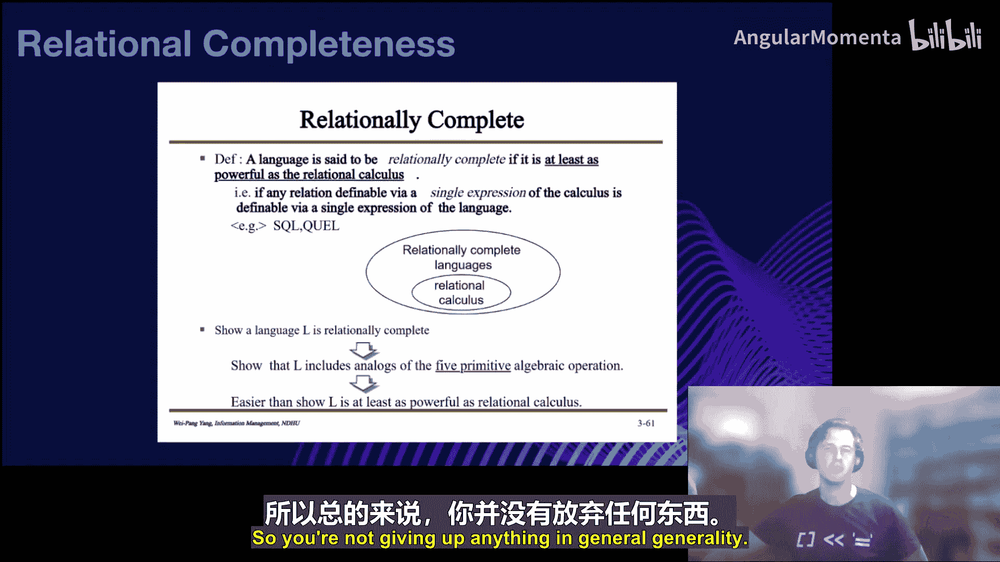

## SQL 作为“恐龙”的问题

现在，让我们看看 SQL 作为“恐龙”的问题。在本系列研讨会的早期，Victor Lh 和 Thomas Neumann 做了一个关于“Towards Sanity in Query Languages”的精彩演讲，我强烈推荐大家观看。我基本同意他们的观点，并从一个实践者的角度复述其中一些关键点。

其中一个问题是 **SQL 基于关系演算**。这导致查询具有全局作用域，各种子句（如 JOIN）将数据引入这个作用域，然后在 SELECT 子句中暴露。对于阅读查询的人类来说，这很不理想，因为当你在 SELECT 部分时，必须追溯每个列的来源，这使得分析和维护此类查询变得困难。

接下来，我想简要探讨一下**关系代数与关系演算**的区别。网上常有人说关系演算是声明式的，而关系代数是命令式的。但 Thomas 也指出，关系代数看起来是命令式的，实际上并非如此。从数学定义上讲，代数关乎函数的组合，因此它本质上是**函数式**的，而非过程式或命令式，因为没有不通过函数传递的外部状态。所以，关系代数仍然是声明式的。通过坚持关系代数而非关系演算，我们并没有放弃任何东西。Codd 定理证明两者是等价的，PRQL 具有关系完备性，因此没有丧失通用性。

SQL 的另一个问题是其**语法零散且重载**，尤其是在 SELECT 子句中。例如，SUM 在窗口函数和 GROUP BY 聚合中的行为不同，但使用相同的语法。这看起来非常过时。

更实质性的问题是 SQL **缺乏可组合性**。有人可能会用嵌套 FROM 子句来反驳，但 SQL 无法像其他语言那样构建良好的抽象。一条推文说得很好：“SQL 查询是代码世界中的一次性塑料。”在实践中，人们经常复制粘贴查询并尝试修改，没有可重用的 SQL 代码库或函数，也缺乏可靠的测试。

此外，SQL **语法不规则**，难以学习。Julia Evans 在 2023 年 Strangeloop 的演讲中描述了同事学习 SQL 的困难。对于初学者，必须记住子句的顺序，WHERE 和 HAVING 都进行过滤但使用不同关键字，窗口函数更加复杂。这给初学者带来了很大障碍。

另一个问题是 **SQL 方言众多**。如今，数据工程师和科学家经常需要从多个数据源提取数据，不同方言之间的差异成为了实际工作中的障碍。

最后是 **反语义**问题，Victor 在他的演讲中详细讨论过。不同数据库系统之间存在许多不一致的行为，这呼吁一种**通用的中间表示**。PRQL 可以作为一种人类可读的前端查询语言，序列化成这种表示，再发送给查询执行引擎。

## 替代性查询语言

现在让我们看看一些替代性查询语言。Thomas 介绍了 SanQL，如果你只看代码片段，它和 PRQL 非常相似。我将他的示例用 PRQL 重写，编译后得到的 SQL 也很直接。

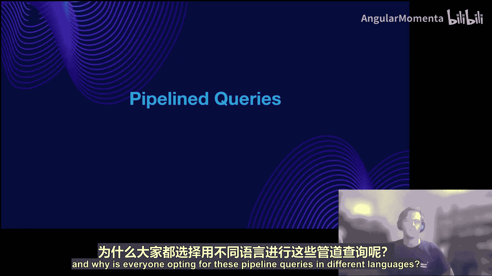

但 PRQL 并非第一个。在此之前，已经有许多遵循**流式 API** 或**管道流**的替代方案。它们通常从记录集或表开始，逐步构建查询。但这些查询构建器通常被困在它们所构建的特定语言生态中（如 Python、R、C#）。PRQL 的目标是创建一种**通用语言**，可以在所有这些环境中使用，并以通用方式序列化到数据库。

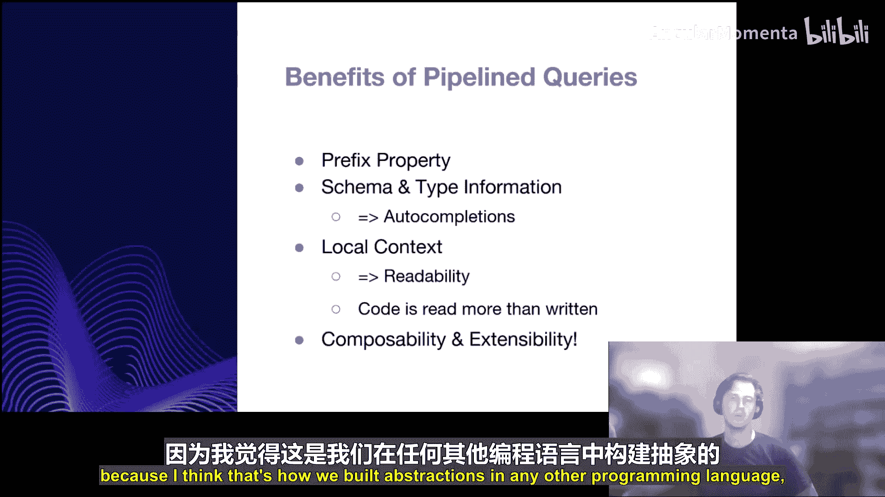

例如，Ibis 项目采用了 Pandas API，并通过不同后端进行序列化，这与 PRQL 利用 SQLGlot 库的方式类似。它的一个缺点是仍然绑定在 Python 生态中。F# 中的计算表达式（本质上是 Monad 的巧妙说法）也提供了类似的管道体验。

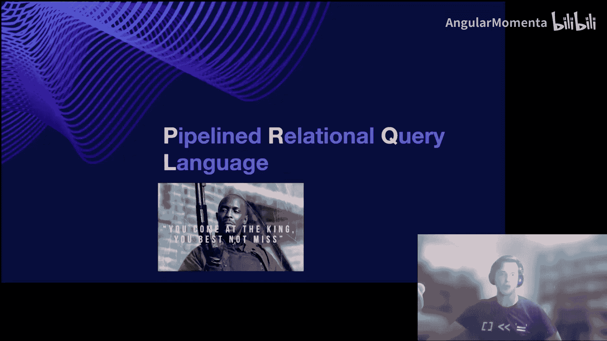

## 为什么选择管道式查询？

为什么大家都在选择管道式查询？我认为有几个关键特性：
1.  **前缀属性**：从查询开头开始的任何子查询本身都是有效的查询。
2.  **模式前置**：一开始就指定表，便于 IDE 自动补全和类型检查。
3.  **局部上下文**：管道中的每一步只转换到该点为止的数据，阅读时只需跟踪当前上下文，可读性更高。
4.  **可组合性与可扩展性**：这是我们在数据世界中构建抽象所缺失的。

## PRQL 是什么？

带着以上铺垫，现在让我们看看 PRQL 做了什么。正如 Omar 所说，“你来挑战王者，最好别失手。”我们很清楚 SQL 历史悠久，但迄今为止 PRQL 获得了不错的反响和采用，这鼓励我们继续前进。

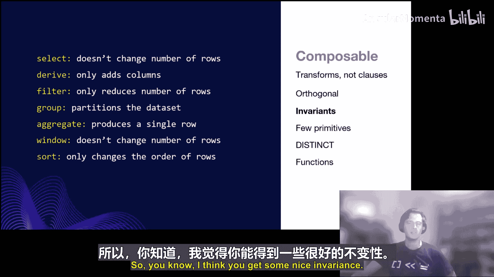

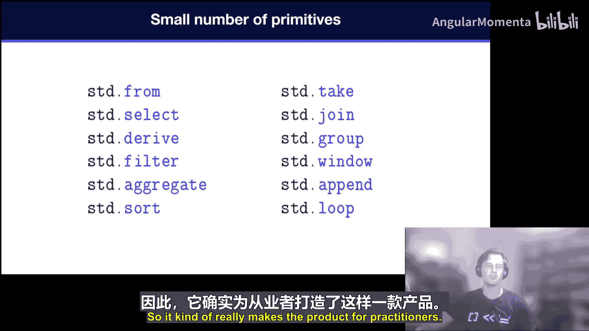

## PRQL 核心特性

PRQL 中的 “P” 代表 **Pipeline（管道）**。主要特性是管道，有两种构建方式：
*   使用 Unix 管道符号 `|` 写成一行的形式：`from table_a | filter condition | select columns`
*   大多数情况下，我们使用换行符作为管道符号，这样查询看起来是自上而下的，更易于人类阅读。

大多数内容都很直观，我重点指出几个关键方面：
*   **转换（函数）**：语言是规则的。例如，`filter` 可以在 `group` 之前或之后使用，没有 WHERE 和 HAVING 的区别。只要列兼容，你可以移动、注释掉代码行，这对实践工作非常灵活。
*   **正交的原语操作符**：以 `group` 为例，它对数据集进行分区，并接受另一个管道作为第二个参数。你可以进行传统的 SQL GROUP BY 聚合（使用 `aggregate`，这是一种归约操作），也可以在组内进行其他转换，实现数据分析中常见的“拆分-应用-合并”模式。
*   由于正交性，我们得到了一些很好的**不变性**：`select`（类似于映射操作）从不改变行数，只添加列；`filter` 减少行数；`aggregate` 是归约操作，总是减少到单行。
*   **极少的原语**：PRQL 只有大约 12 个原始操作符，其余语言特性都基于此构建。这使得学习、记忆和使用变得容易，无需频繁查阅文档。

*   **可组合性**：PRQL 没有 `DISTINCT` 关键字。那么如何实现去重呢？逻辑上，去重就是按某些字段分组，然后每组取一个。在 PRQL 中，你可以这样写：`group [columns] (take 1)`，这就会产生 DISTINCT 效果。
*   **高阶函数**：PRQL 采用函数式风格语法。例如，你可以定义一个 `take_smallest` 函数，它接受数量、排序列以及最后的关系作为参数。我们将输入关系作为最后一个参数，以支持柯里化和部分应用。然后，你可以在全局使用这个函数，也可以轻松地将其放入 `group` 子句中，实现“每张专辑中时长最短的三首曲目”这类查询。用 SQL 实现同样的功能并不简单。

*   **Loop 构造**：用于递归 CTE。PRQL 编译为 SQL，因此不能做 SQL 做不到的事情。但递归 CTE 在实践中常常难以理解，而且它们实际上更像是迭代或循环。因此 PRQL 选择了 `loop` 这个名称。通过简化语法，它使更多人能够使用这个功能。
*   **人体工程学改进**：
    *   日期字面量专用语法。
    *   字符串插值（类似 F-string）。
    *   空值合并运算符（来自 TypeScript）。
    *   易于注释代码行。
    *   数字中可使用下划线分组（例如 `1_000_000`），防止误读。
    这些是从过去 40-50 年编程语言发展中汲取的微特性，要一致地添加到所有 SQL 方言中是不可行的。
*   **可测试性**：因为可以在 PRQL 中定义转换函数，所以可以轻松地用字面量数据测试这些函数。而在 SQL 中，你需要搭建一个包含正确表的测试数据库，这使得测试在实践中非常困难。
*   **解决方言问题**：PRQL 编译为不同的 SQL 方言。虽然我们无法解决底层语义的差异，但这确实让生活变得更轻松。当然，你仍然需要检查生成的 SQL 是否符合预期行为。

## PRQL 示例

现在让我们看一些例子，这也能突出一些特性。

首先，我们的在线演练场有一个文档完善的示例，你可以在大约 5 到 10 分钟内自学 PRQL。在 Python 或 Jupyter Notebook 中使用 PRQL 也很容易，只需安装 `py-prql` 包即可。

以下是一些准备好的例子：

1.  **百分比排名和累积和**：
    这个例子定义了两个函数：`percent_range`（使用 MIN 和 MAX 聚合计算在范围内的排名）和 `add_cum_sum`（为现有关系添加累积和列）。在查询中，`percent_range` 应用于全局作用域，而 `add_cum_sum` 在 `group` 内部应用，因此累积和是按客户 ID 进行的。这展示了如何轻松构建抽象来完成实际工作。

2.  **会话化函数**：
    在数据分析中，对用户事件进行会话化是常见操作。利用高阶函数，我们可以定义一个 `sessionize` 函数，指定按哪个客户 ID 分组以及会话的最大间隔时间。这提供了与其他编程语言相同的抽象能力，可以一次编写，多处复用。

3.  **JSON 函数示例**：
    PRQL 目前没有内置的 JOIN 支持，但我们有一个称为 **S-strings**（SQL 字符串）的转义机制。你可以轻松定义函数来包装目标 SQL 方言支持的 JSON 函数，然后在 PRQL 中调用它们。

## 正在进行和未来的工作

现在我想谈谈一些正在进行和未来的工作。

回到之前提到的 Peterson 论文，关于 DataFrame API，我们从用户反馈中注意到，用户期望有序表。DataFrame 通常在内存数据集上工作，具有隐式顺序，用户经常利用这一点。但 SQL 处理的是无序数据集。我们有一些关于此的未解决问题。最近有一篇关于“Order-Sensitive Query”的论文提出了在不同 SQL 方言中一致实现排序语义的解决方案，这是我们正在尝试解决的问题。

以下是一些正在开发或计划中的功能：
*   **类型系统和 LSP 支持**：为了快速启动，我们最初没有考虑目标模式。但因此我们错过了 LSP 补全和类型检查。这是我们想要添加的。
*   **模块和包系统**：目前有一个初具雏形的模块系统，但还需要完善的打包和分发系统。
*   **物化注解**：由于函数式流程，像 DBT 或 Airflow 这样的工具会构建数据转换的 DAG。目前 PRQL 编译时会内联所有函数，生成一个大型查询。我们希望能够添加物化注解，在某个点设置内联边界，将中间结果物化为视图。
*   **Option 类型**：左连接经常带来问题。如果两个表都有非空字段，左连接后右侧的字段可能为空。如果能有像 Rust 那样的 Option 类型来跟踪可空性，编译器就可以提醒你处理可能为空的字段。
*   **更多后端支持**：目前我们编译到 SQL，但这个想法可以更通用。可以编译到 DataFrame、M 语言（Power Query）等。
*   **通用性**：像 PRQL 或 SanQL 这样的管道语言可以更加通用，作为处理对象集合的 DSL（领域特定语言）使用。无论是持久化在数据库中的数据，还是内存中的对象，我们处理的都是记录的集合。如果有一个 DSL 能高效地处理这些集合，那将非常理想。

## 现在何处可以使用 PRQL？

PRQL 已经获得了一定的采用：
*   **在线演练场**：可以直接在浏览器中试用，查看编译后的 SQL。
*   **数据库集成**：越来越多的数据库开始支持 PRQL，如 ClickHouse、DuckDB，PostgreSQL 也有扩展。
*   **编辑器支持**：有 VS Code 扩展。
*   **语言绑定**：有多种语言绑定。
*   **CLI 工具**：可以在命令行中使用，并管道传输到 `psql` 或其他工具。

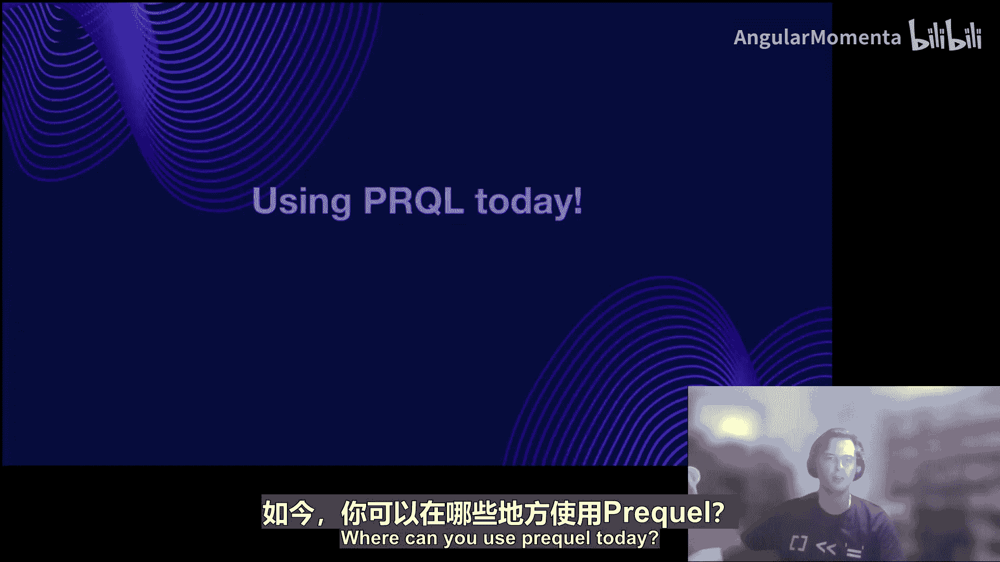

## 关于项目

最后简单介绍一下项目。这是一个完全开源（Apache 2 许可证）、由志愿者驱动的项目，没有人因此获得报酬。我们非常认真地对待社区，不进行货币化。我们在 GitHub 上有超过 1 万颗星，74 位贡献者，维护者全球分布。我们有一个包含更多功能的路线图，并且正在寻找更多的贡献者，特别是编译器开发者，但也欢迎任何形式的贡献。

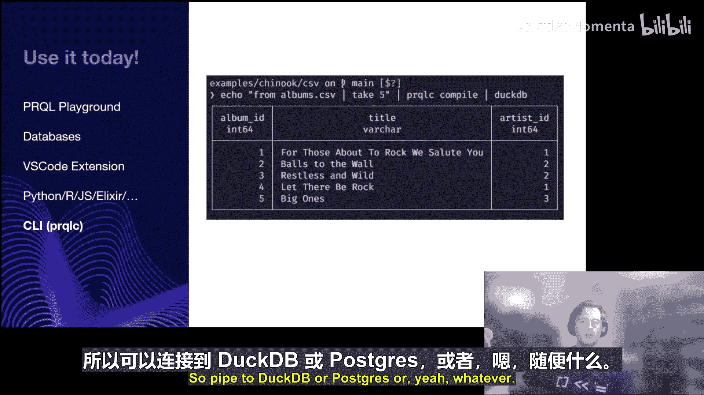

## 问答环节

**问：PRQL 在转译为 SQL 时，是否总是简单的一对一翻译？是否存在多种翻译方式，如何选择？**
答：我们总是以一种方式翻译，大量使用 CTE。但我们的编译器实现并非终极方案。我更希望看到像 Sane IR 或 Substrate 这样的通用中间表示。一个有趣的问题是反向翻译（从 SQL 到 PRQL），目前我们没有很好的解决方案。最好的现有工具可能是 Ibis 的 SQLGlot，它可以翻译 20 多种方言。我们曾尝试将 PRQL 连接到他们的 IR，以实现双向转换，但目前还没有。

**问：为什么没有支持 ANSI SQL？**
答：实际上支持。如果不指定方言，默认就是 ANSI SQL。

**问：是否计划支持 Spark SQL？**
答：目前没有专门研究。这真的取决于用户贡献。如果 Databricks 联系我们那就太好了，否则目前维护者们的待办清单已经很长了。欢迎提交 PR。

**问：是否考虑过支持 PostGIS 等地理空间数据库及其几何谓词和函数？**
答：目前没有。但通过 S-strings 功能，可以轻松包装现有系统（如 PostGIS）中的函数并暴露出来。

**问：PRQL 与 Google 的 PiSQL 相比如何？**
答：PiSQL 很棒，Jeff 强烈主张扩展现有 SQL。我认为 PRQL 在一些语法细节和人体工程学上略有优势。但 PiSQL 可能更局限于 Google 生态系统。最终，拥有像 Sane IR 这样的中间表示可能是方向，然后你可以选择不同的前端（PiSQL、SanQL 或 PRQL）。

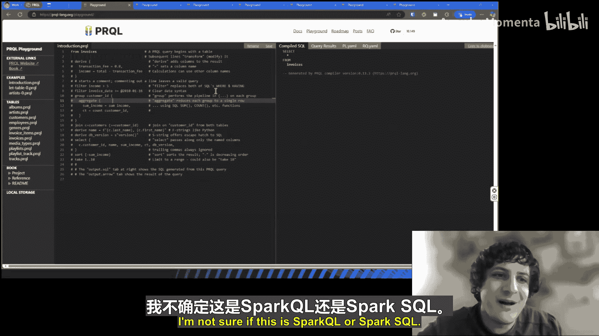

**问：未来预计会增加哪些变化？PRQL 看起来已经相当成熟了。**
答：模块系统、类型系统、实现更多后端以测试想法的可移植性、修复错误和回归问题等。还有很多工作要做。如果有人想赞助或有 VC 对此感兴趣，我有很多想法愿意交流。

**问：PRQL 是否适用于流处理系统（如 Flink）？**
答：我认为流处理系统会是很好的应用场景。例如微软的 Kusto 在语义上就非常接近这种管道流。

## 演示

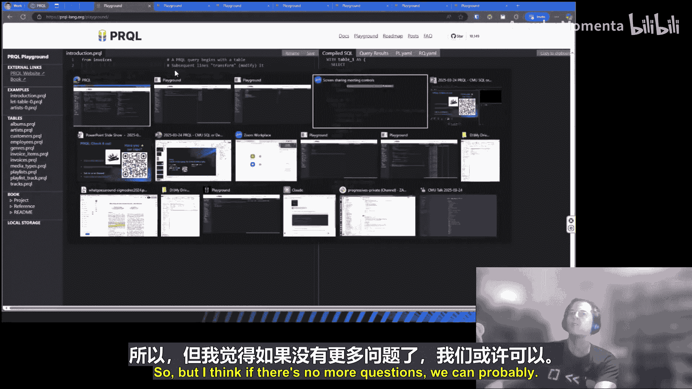

最后，我快速演示一下在线演练场。它展示了管道流和前缀属性。我有一个复杂的查询，大部分被注释掉了。当我逐行取消注释时，右侧的 SQL 会随之实时变换。这非常适用于交互式工作，你可以轻松地启用或禁用某些行，重新排序，探索数据。

## 总结

本节课中，我们一起学习了 PRQL（流水线式关系查询语言）。我们从 SQL 的优势与不足谈起，探讨了为什么需要一种新的查询语言。接着，我们深入了解了 PRQL 的核心设计理念：基于关系代数的函数式、管道式语法。我们看到了 PRQL 如何通过极少的正交原语、高阶函数、局部上下文和强大的可组合性，来提升查询的可读性、可维护性和可测试性。此外，PRQL 还引入了现代语言的人体工程学改进，并致力于通过编译到不同 SQL 方言来解决碎片化问题。最后，我们了解了 PRQL 的现状、未来发展方向以及如何开始使用它。PRQL 的目标不是取代 SQL，而是为数据工作者提供一个更友好、更强大的工具，用于构建和理解复杂的数据转换逻辑。

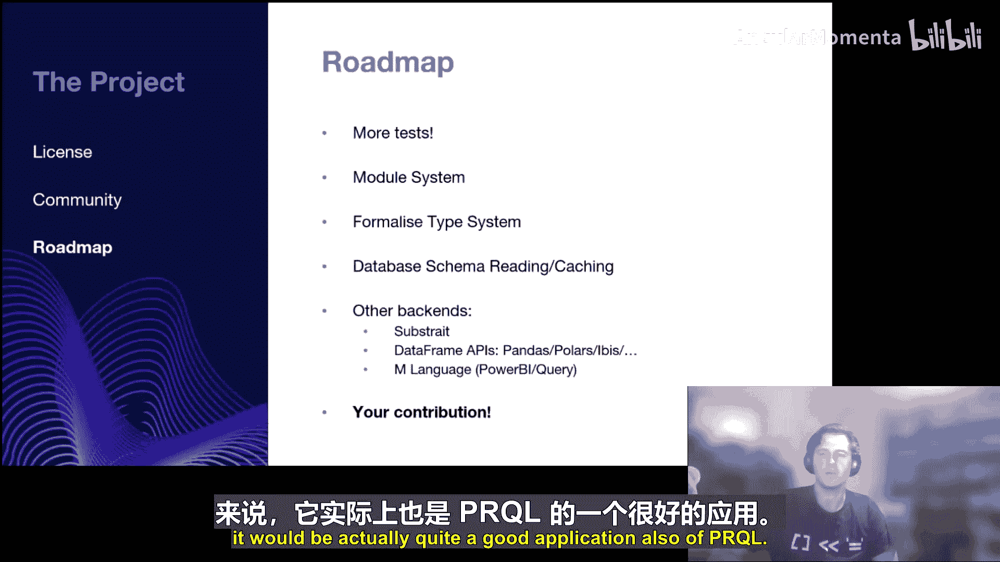

