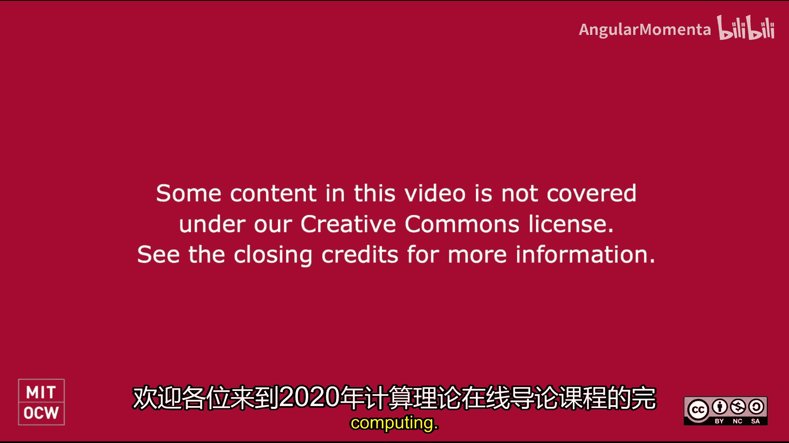
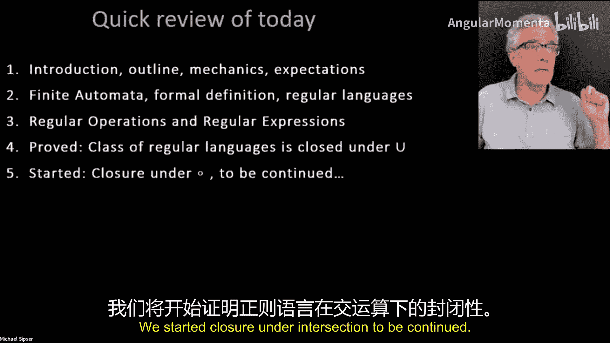
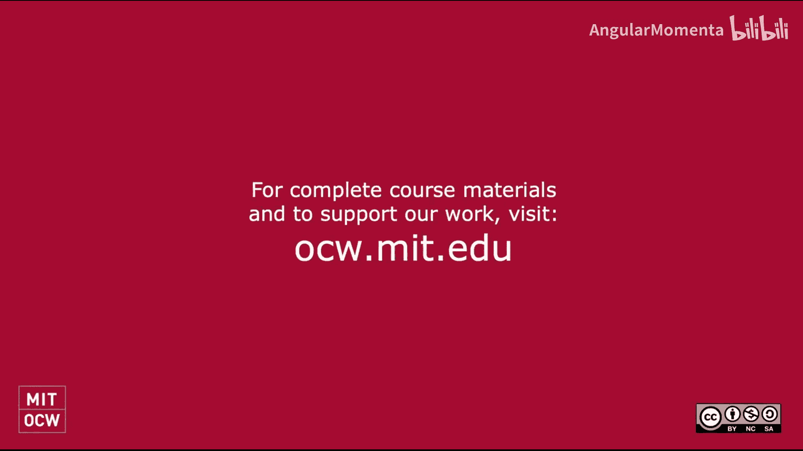

# 001：课程介绍与有限自动机

## 概述

在本节课中，我们将学习计算理论的基础知识，特别是有限自动机（Finite Automata）和正则表达式（Regular Expressions）。我们将探讨计算机算法的能力和局限性，并介绍用于描述计算过程的抽象模型。

## 课程介绍

欢迎来到2020年秋季学期的计算理论导论课程。我是Mike Sipser，本学期将担任你们的讲师。

这门课程主要分为两部分。第一部分是**可计算性理论**，它研究在原则上算法能计算什么。这是20世纪早期的一个活跃研究领域，如今已基本成为一个封闭的研究课题，因为其主要问题都已得到解答。第二部分是**复杂性理论**，它关注在实际中，在合理时间内可以计算什么。这部分将讨论计算的时间和空间复杂度，并涉及著名的P与NP问题。

学习本课程需要一定的数学基础，特别是关于数学定理和证明的经验。课程作业和考试将要求你能够构建证明。

理论计算机科学在计算机科学领域中扮演着重要角色。尽管计算机科学已经成熟，但在理解计算的本质方面，我们仍处于非常初级的阶段。例如，我们尚不清楚如何快速分解大数，也不完全理解大脑如何进行创造性计算。本课程涵盖的理论优雅且实用，是理解计算的良好起点。

## 有限自动机

上一节我们介绍了课程的整体框架，本节中我们来看看第一个计算模型：**有限自动机**。这是一种非常简单的模型，可以看作是具有少量有限内存的计算机。

### 有限自动机示例

我们通过一个称为**状态图**的图表来展示有限自动机。下图展示了一个名为 **M1** 的有限自动机。

图表中的圆圈称为**状态**。在本例中，有三个状态：q1, q2, q3。连接状态的箭头称为**转移**，它们指示了设备如何进行计算。有一个特别指定的**起始状态**，带有一个从外部指向它的箭头。还有特别指定的**接受状态**，用双圆圈表示。

### 如何计算

计算过程很简单。输入是一个由0和1组成的有限字符串（对于其他自动机，可能允许其他符号）。计算步骤如下：
1.  将指针放在起始状态（即带有从外部指向箭头的状态）。
2.  开始逐个读取输入符号。
3.  根据当前状态和读取的符号，沿着对应的转移箭头移动到下一个状态。
4.  重复步骤2和3，直到读完所有输入符号。
5.  如果最终状态是接受状态，则**接受**该输入字符串；否则**拒绝**。

**示例1**：输入字符串 `01101`
*   从 q1 开始。
*   读 `0`：保持在 q1。
*   读 `1`：转移到 q2。
*   读 `1`：转移到 q3。
*   读 `0`：保持在 q3。
*   读 `1`：保持在 q3。
*   结束于接受状态 q3，因此该字符串被**接受**。

**示例2**：输入字符串 `00101`
*   从 q1 开始。
*   读 `0`：保持在 q1。
*   读 `0`：保持在 q1。
*   读 `1`：转移到 q2。
*   读 `0`：转移到 q1。
*   读 `1`：转移到 q2。
*   结束于非接受状态 q2，因此该字符串被**拒绝**。

通过分析可以发现，该自动机 **M1** 接受的字符串是那些**包含连续两个1（即子串“11”）**的字符串。我们称这个字符串集合为该自动机的**语言**。

### 形式化定义

为了使讨论更精确，我们需要有限自动机的形式化数学定义。一个**有限自动机**是一个五元组 **(Q, Σ, δ, q₀, F)**，其中：

*   **Q** 是一个有限的状态集合。
*   **Σ** 是一个有限的输入字母表。
*   **δ** 是转移函数，它接收一个状态和一个输入符号，并返回下一个状态。形式为：**δ: Q × Σ → Q**。
*   **q₀ ∈ Q** 是起始状态。
*   **F ⊆ Q** 是接受状态集合。

以自动机 **M1** 为例，其形式化描述如下：
*   **Q = {q1, q2, q3}**
*   **Σ = {0, 1}**
*   **δ** 用下表描述：

| 状态 | 输入 0 | 输入 1 |
| :--- | :----- | :----- |
| q1   | q1     | q2     |
| q2   | q1     | q3     |
| q3   | q3     | q3     |

*   **q₀ = q1**
*   **F = {q3}**

### 字符串与语言

*   **字符串** 是字母表中符号的有限序列。空字符串（长度为0）记为 **ε**。
*   **语言** 是字符串的集合。例如，自动机 **M1** 的语言是 **A = { w | w 包含子串 “11” }**。

我们说一个自动机 **M** **识别**（或**接受**）一个语言 **A**，如果 **A** 恰好是 **M** 接受的所有字符串的集合。记作 **A = L(M)**。

如果一个语言可以被某个有限自动机识别，则称该语言为**正则语言**。

**示例**：
*   语言 **B = { w | w 中 1 的个数为偶数 }** 是正则语言。可以用一个只有两个状态的自动机来识别，分别记录当前看到奇数个1还是偶数个1。
*   语言 **C = { w | w 中 0 和 1 的个数相等 }** **不是**正则语言。我们将在后续证明，有限自动机无法识别这个语言。

## 正则表达式

上一节我们介绍了用有限自动机描述语言，本节中我们来看看另一种描述方式：**正则表达式**。它通过一系列操作来构建描述语言的表达式。

### 正则运算

以下是三种基本的正则运算，它们对语言进行操作：

1.  **并集 (Union)**：**A ∪ B = { w | w ∈ A 或 w ∈ B }**
2.  **连接 (Concatenation)**：**A ∘ B = { xy | x ∈ A 且 y ∈ B }**（通常简写为 **AB**）
3.  **星号 (Kleene Star)**：**A\* = { w₁w₂...wₖ | k ≥ 0 且每个 wᵢ ∈ A }**。注意，**k=0** 时对应空字符串 **ε**，因此 **ε ∈ A\*** 总是成立。

**示例**：
设 **A = {good, bad}**, **B = {boy, girl}**
*   **A ∪ B = {good, bad, boy, girl}**
*   **A ∘ B = {goodboy, goodgirl, badboy, badgirl}**
*   **A\* = { ε, good, bad, goodgood, goodbad, badgood, badbad, goodgoodgood, ... }**（一个无限集合）

### 正则表达式

正则表达式使用正则运算和基本元素（如字母表符号、空字符串 **ε**、空集 **∅**）来构建。

**示例**：
*   **Σ = {0, 1}**
*   **Σ\*** 表示所有由0和1组成的字符串的集合。
*   **Σ\*1** 表示所有以1结尾的字符串。
*   **Σ\*11Σ\*** 表示所有包含子串“11”的字符串。这正是我们之前自动机 **M1** 的语言。

一个关键结论是：**正则表达式描述的语言类与有限自动机识别的语言类（即正则语言）是完全相同的**。我们将在后续证明这种等价性。

## 正则语言的封闭性

现在我们来探讨正则语言的一个重要性质：**封闭性**。如果一个运算应用于某个语言类中的语言，产生的结果仍然属于该类，则称该类语言在该运算下是**封闭**的。

### 定理：正则语言在并运算下封闭

**定理**：如果 **A₁** 和 **A₂** 是正则语言，那么 **A₁ ∪ A₂** 也是正则语言。

**证明思路**：
1.  因为 **A₁** 和 **A₂** 是正则的，所以存在有限自动机 **M₁** 和 **M₂** 分别识别它们。
2.  我们的目标是构造一个新的有限自动机 **M** 来识别 **A₁ ∪ A₂**。
3.  **M** 应该接受输入字符串 **w**，当且仅当 **M₁** 接受 **w** **或** **M₂** 接受 **w**。
4.  直接先运行 **M₁** 再运行 **M₂** 不可行，因为自动机不能“倒带”输入。
5.  解决方案是**并行模拟** **M₁** 和 **M₂**。即，**M** 同时跟踪 **M₁** 和 **M₂** 的状态。
6.  因此，**M** 的状态是**状态对** **(r₁, r₂)**，其中 **r₁** 是 **M₁** 的当前状态，**r₂** 是 **M₂** 的当前状态。
7.  **M** 的起始状态是 **(q₁, q₂)**，其中 **q₁** 和 **q₂** 分别是 **M₁** 和 **M₂** 的起始状态。
8.  **M** 的转移函数定义为：**δ((r₁, r₂), a) = (δ₁(r₁, a), δ₂(r₂, a))**。
9.  **M** 的接受状态集合是 **{ (r₁, r₂) | r₁ ∈ F₁ 或 r₂ ∈ F₂ }**，即只要状态对中有一个分量是原自动机的接受状态即可。
10. 这样构造的 **M** 恰好识别 **A₁ ∪ A₂**。

如果 **M₁** 有 **k₁** 个状态，**M₂** 有 **k₂** 个状态，那么 **M** 有 **k₁ × k₂** 个状态。

### 关于连接运算封闭性的初步讨论

正则语言在连接运算下也是封闭的，但证明更为复杂。直观想法是：给定识别 **A₁** 和 **A₂** 的自动机 **M₁** 和 **M₂**，要构造识别 **A₁ ∘ A₂** 的自动机 **M**。

**M** 的任务是：接受字符串 **w**，当且仅当存在一种方式将 **w** 切分为 **w = xy**，使得 **M₁** 接受 **x** 且 **M₂** 接受 **y**。

一个天真的（但有缺陷的）想法是：将 **M₁** 的每个接受状态都连接到 **M₂** 的起始状态。这样，当 **M₁** 在读取 **w** 的某个前缀后进入接受状态时，就“猜测”这是切分点，并跳转到 **M₂** 继续处理剩余部分。

这个方法行不通，因为对于同一个输入 **w**，可能存在多个可能的切分点。自动机在第一次到达 **M₁** 的接受状态时，无法确定这是否是正确的切分点。如果此时跳转到 **M₂** 但剩余部分不被 **M₂** 接受，自动机就会错误地拒绝，即使存在更靠后的正确切分点。我们将在下节课介绍更强大的工具（非确定性有限自动机）来正确证明这个封闭性。

## 总结

本节课中我们一起学习了计算理论的入门知识。我们首先了解了课程的两大主题：可计算性理论和复杂性理论。然后，我们深入探讨了第一个计算模型——**有限自动机**，学习了它的图形表示和形式化定义，并理解了它识别的语言称为**正则语言**。接着，我们介绍了描述正则语言的另一种等价方式——**正则表达式**及其运算。最后，我们证明了正则语言在**并运算**下是封闭的，并开始探讨在**连接运算**下封闭性的证明思路，这为我们下一节课的内容做好了铺垫。

