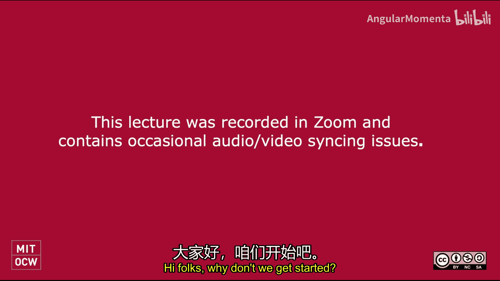
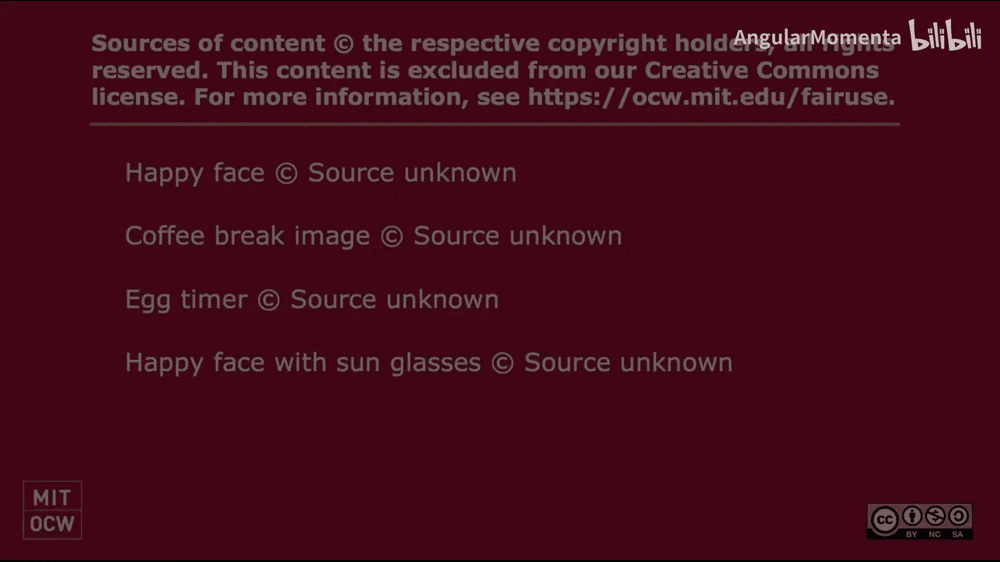

# 002：非确定性、闭包属性与正则表达式到NFA的转换



在本节课中，我们将学习计算理论中的一个核心概念：**非确定性**。我们将介绍非确定性有限自动机（NFA），并利用它来证明正则语言在连接和星号运算下的闭包性质。最后，我们将展示如何将任何正则表达式转换为等价的NFA，从而证明正则表达式描述的语言都是正则语言。

---

## 回顾与目标

上一节我们介绍了有限自动机（DFA）和正则语言，并讨论了正则运算。我们的目标是证明两种描述语言的方式——有限自动机和正则表达式——是等价的。为了向这个目标迈进，我们首先需要证明正则语言类在正则运算（并、连接、星号）下是封闭的。我们已经证明了并集运算下的封闭性，本节课我们将利用新引入的**非确定性**概念来完成连接和星号运算下的封闭性证明。

---

## 非确定性有限自动机（NFA）

为了克服在证明连接运算封闭性时遇到的困难（即DFA需要“预知未来”才能确定分割点），我们引入一种新的计算模型：**非确定性有限自动机（NFA）**。

### NFA的核心特性

NFA与DFA外观相似，但有三个关键区别：
1.  **多值转移**：对于一个状态和一个输入符号，可以有零个、一个或多个可能的下一个状态。
2.  **空转移（ε-转移）**：允许不消耗任何输入符号就从一个状态转移到另一个状态。
3.  **接受规则**：只要存在**至少一条**计算路径在读完整个输入后到达接受状态，NFA就接受该输入。只有当**所有**可能的路径都拒绝时，NFA才拒绝输入。

### NFA形式化定义

一个NFA是一个五元组 $(Q, \Sigma, \delta, q_0, F)$：
*   $Q$：有限状态集。
*   $\Sigma$：有限字母表。
*   $\delta$：转移函数，形式为 $\delta: Q \times (\Sigma \cup \{\epsilon\}) \to \mathcal{P}(Q)$。这里 $\mathcal{P}(Q)$ 是 $Q$ 的幂集（所有子集的集合）。这意味着对于每个状态和输入符号（或空串），函数给出一个可能的下一个状态**集合**。
*   $q_0 \in Q$：起始状态。
*   $F \subseteq Q$：接受状态集。

### 理解非确定性的方式

理解NFA的计算方式有多种直观角度：
*   **并行计算**：每当面临非确定性选择时，机器“分裂”出多个并行线程，每个线程独立处理剩余的输入。只要任一线程接受，整体就接受。
*   **计算树**：将整个计算过程视为一棵树。根节点是起始状态，每次非确定性选择产生新的分支。如果树中**至少有一条**从根到叶的路径以接受状态结束，则输入被接受。
*   **“幸运猜测”**：想象机器在每次面临选择时，都能“幸运地”猜中那条最终能导向接受状态的路径（如果这样的路径存在的话）。

---

## NFA与DFA的等价性

尽管NFA看起来更强大，但事实上，NFA和DFA识别的语言类是相同的，即**正则语言**。我们可以通过一个构造性证明将任何NFA转换为一个识别相同语言的DFA。

### 子集构造法

给定一个NFA $M = (Q, \Sigma, \delta, q_0, F)$，我们构造一个等价的DFA $M' = (Q', \Sigma, \delta', q_0', F')$。

**构造思路**：DFA $M'$ 的状态用于记录NFA $M$ 在读取输入前缀后**所有可能处于的状态集合**。

以下是具体构造步骤：
1.  **状态集**：$Q' = \mathcal{P}(Q)$。DFA的每个状态对应NFA状态的一个子集。
2.  **字母表**：与NFA相同，为 $\Sigma$。
3.  **转移函数**：对于 $R \in Q'$（即 $R \subseteq Q$）和 $a \in \Sigma$，定义 $\delta'(R, a) = \bigcup_{r \in R} E(\delta(r, a))$。这里 $E(S)$ 表示从集合 $S$ 中的状态出发，经过任意条（包括零条）ε-转移所能到达的所有状态的集合（即ε-闭包）。简单说，就是先看NFA中 $R$ 里每个状态读 $a$ 能到哪些状态，再考虑从这些状态能通过ε-转移自由到达哪些状态，所有这些状态的并集就是DFA的新状态。
4.  **起始状态**：$q_0' = E(\{q_0\})$，即从NFA起始状态通过ε-转移能到达的所有状态的集合。
5.  **接受状态集**：$F' = \{ R \in Q' \mid R \cap F \neq \emptyset \}$。只要DFA的当前状态集合中包含**至少一个**NFA的接受状态，DFA就处于接受状态。

**复杂度**：如果NFA有 $n$ 个状态，那么通过子集构造法得到的DFA最多可能有 $2^n$ 个状态。这表明非确定性可以指数级地节省状态数，但也意味着模拟NFA的DFA可能非常庞大。

---

## 利用NFA证明闭包性质

拥有了NFA这个工具后，我们可以优雅地证明正则语言在连接和星号运算下的封闭性。

### 闭包性质：连接

**定理**：如果 $A_1$ 和 $A_2$ 是正则语言，那么它们的连接 $A_1 \circ A_2 = \{ xy \mid x \in A_1, y \in A_2 \}$ 也是正则语言。

**证明思路（使用NFA）**：
假设有DFA $M_1$ 识别 $A_1$，$M_2$ 识别 $A_2$。我们构造一个NFA $M$ 来识别 $A_1 \circ A_2$。
1.  将 $M_1$ 和 $M_2$ 的状态合并。
2.  $M$ 的起始状态是 $M_1$ 的起始状态。
3.  对于 $M_1$ 中的每一个**接受状态**，添加一个**ε-转移**，使其指向 $M_2$ 的起始状态。
4.  $M_1$ 中原有的接受状态在 $M$ 中变为**非接受状态**。$M$ 的接受状态集是 $M_2$ 的接受状态集。

**工作原理**：NFA $M$ 在 $M_1$ 中运行。每当 $M_1$ 到达一个接受状态（意味着找到了一个可能的前缀 $x \in A_1$），$M$ 就面临一个非确定性选择：可以继续在 $M_1$ 中读取更多输入，也可以（通过ε-转移）“猜测”这里就是正确的分割点，并跳转到 $M_2$ 开始处理剩余部分 $y$。如果存在一种分割方式使得 $x \in A_1$ 且 $y \in A_2$，那么至少有一条计算路径（即做出了正确“猜测”的路径）会最终到达 $M_2$ 的接受状态，从而使 $M$ 接受整个字符串。

### 闭包性质：星号

**定理**：如果 $A$ 是正则语言，那么它的星号闭包 $A^* = \{ x_1 x_2 ... x_k \mid k \geq 0 \text{ 且每个 } x_i \in A \}$ 也是正则语言。

**证明思路（使用NFA）**：
假设有DFA $M_1$ 识别 $A$。我们构造一个NFA $M$ 来识别 $A^*$。
1.  保留 $M_1$ 的所有状态和转移。
2.  添加一个**新的起始状态** $q_{start}$，它也是一个**接受状态**（以确保空串 $\epsilon \in A^*$ 被接受）。
3.  从新的起始状态 $q_{start}$ 添加一个**ε-转移**到 $M_1$ 的原始起始状态。
4.  对于 $M_1$ 中的每一个**接受状态**，添加一个**ε-转移**，使其指回 $M_1$ 的原始起始状态。

**工作原理**：从 $q_{start}$ 开始，NFA $M$ 可以自由跳转到 $M_1$ 开始运行。每当 $M_1$ 到达一个接受状态（意味着识别出了一个“片段” $x_i \in A$），$M$ 就面临非确定性选择：可以结束计算（如果当前已是输入末尾），或者通过ε-转移跳回 $M_1$ 的起始状态，开始尝试识别下一个片段。通过这种方式，$M$ 非确定性地“猜测”如何将输入字符串分割成多个属于 $A$ 的片段。

---

## 从正则表达式到NFA的转换

现在，我们可以利用闭包性质来证明：**任何正则表达式描述的语言都是正则语言**。证明方法是给出一个将正则表达式 $R$ 转换为等价NFA $N$ 的算法。

### 转换算法（归纳构造）

正则表达式是通过基础表达式应用并、连接、星号运算递归定义的。我们的转换算法也遵循这个递归结构。

**基础情况（原子表达式）**：
*   **表达式 `a` （$a \in \Sigma$）**：构造一个NFA，它只接受单个字符串 `a`。
    ```
    NFA: (start) --a--> ((accept))
    ```
*   **表达式 `ε`**：构造一个NFA，它只接受空串。
    ```
    NFA: ((start/accept))
    ```
*   **表达式 `∅`**：构造一个没有接受状态的NFA（即不接受任何字符串）。
    ```
    NFA: (start)
    ```

**归纳步骤（复合表达式）**：
假设我们已经为子表达式 $R_1$ 和 $R_2$ 构造了等价的NFA $N_1$ 和 $N_2$。
*   **表达式 $R_1 \cup R_2$**：应用**并集闭包构造**，将 $N_1$ 和 $N_2$ 组合成一个新的NFA。
*   **表达式 $R_1 \circ R_2$**：应用**连接闭包构造**，将 $N_1$ 和 $N_2$ 组合成一个新的NFA。
*   **表达式 $R_1^*$**：应用**星号闭包构造**，将 $N_1$ 转换成一个新的NFA。

通过递归地应用这些构造，我们可以为任何复杂的正则表达式构建出一个等价的NFA。由于NFA等价于DFA，这就证明了正则表达式定义的语言属于正则语言类。

### 转换示例

考虑正则表达式 `(a ∪ ab)*`。
1.  为原子表达式 `a` 和 `b` 构建NFA。
2.  为表达式 `ab` 应用**连接构造**，组合 `a` 和 `b` 的NFA。
3.  为表达式 `(a ∪ ab)` 应用**并集构造**，组合 `a` 和 `ab` 的NFA。
4.  最后，为整个表达式 `(a ∪ ab)*` 应用**星号构造**，处理上一步得到的NFA。

最终得到的NFA可能不是最简的，但它确实正确地识别了语言 `(a ∪ ab)*`。

---

## 总结





本节课我们一起学习了计算理论中一个极其重要的概念——**非确定性**。我们介绍了非确定性有限自动机（NFA），并证明了它与确定性有限自动机（DFA）在识别语言的能力上是等价的。利用NFA，我们轻松证明了正则语言在**连接**和**星号**运算下的闭包性质。最后，我们展示了一个递归算法，可以将任何**正则表达式**转换为等价的NFA，从而完成了“正则表达式描述的语言都是正则语言”这一方向的证明。在下一讲中，我们将完成等价性证明的另一半：如何将有限自动机转换为正则表达式。