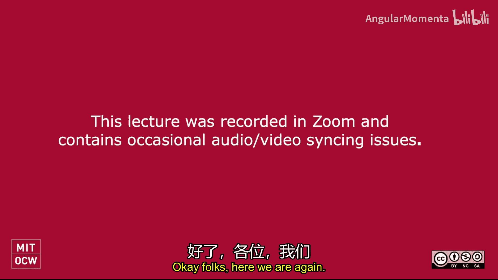
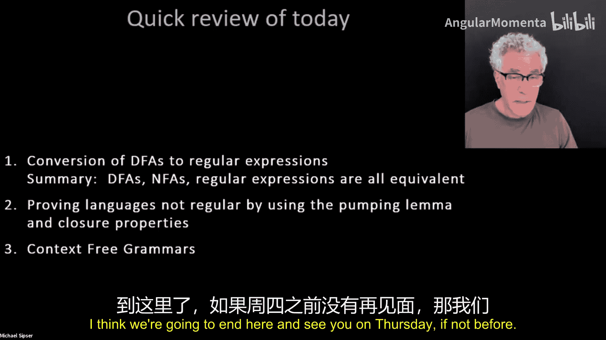
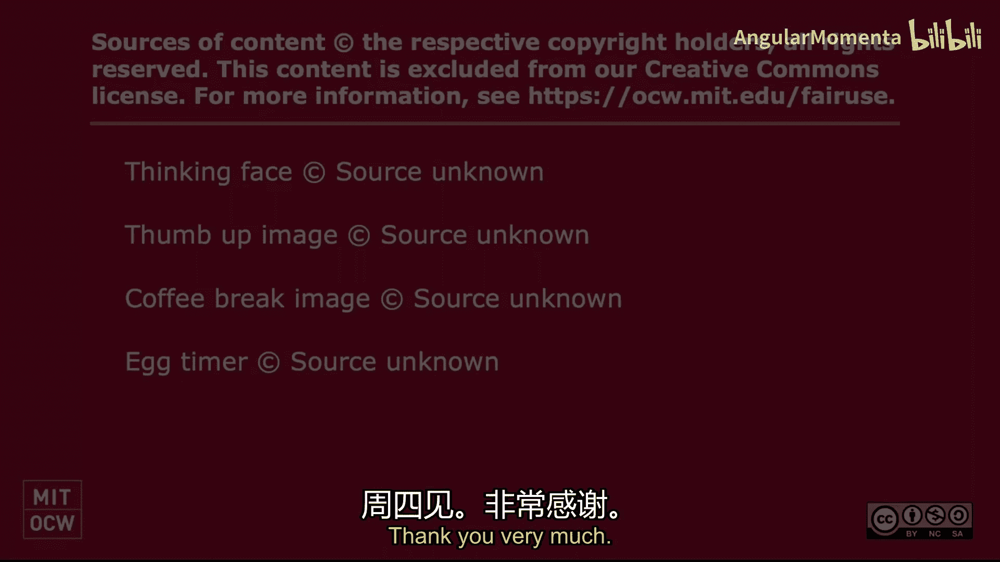

# 003：正则泵引理，FA到正则表达式的转换



在本节课中，我们将要学习如何将有限自动机（FA）转换为等价的正则表达式，从而完成两者等价性的证明。我们还将学习一个强大的工具——泵引理，用于证明某些语言不是正则语言。最后，我们将初步接触一种更强大的计算模型——上下文无关文法。

## 回顾与目标

上一节我们介绍了如何将正则表达式转换为有限自动机。本节中，我们来看看如何反向操作，将有限自动机转换为正则表达式。这两部分构造共同证明了正则表达式和有限自动机在描述语言的能力上是等价的。

## 从FA到正则表达式

为了完成从有限自动机到正则表达式的转换，我们需要引入一个中间模型——广义非确定性有限自动机。

### 广义非确定性有限自动机

GNFA与NFA类似，但其转移边上的标签可以是**完整的正则表达式**，而不仅仅是单个符号或空串。

**工作原理**：当GNFA处理输入字符串时，它可以从当前状态沿着一条转移边“读取”一个**子串**，只要该子串属于该转移边标签所描述的正则表达式语言。它在一个步骤中读取整个子串，然后移动到目标状态。接受条件与非确定性有限自动机相同：如果存在一条路径，使得在消耗完整个输入字符串后到达接受状态，则该字符串被接受。

为了简化后续的转换构造，我们假设GNFA具有以下特殊形式：
1.  只有一个接受状态，且该状态不是起始状态。
2.  除了起始状态（只有出边）和接受状态（只有入边）外，其他任意两个状态之间（包括自循环）都存在转移边。缺失的边可以用空语言 `∅` 作为标签来添加，这不会改变机器识别的语言。

可以证明，任何GNFA都可以被修改为满足这种特殊形式。

### 转换构造：归纳法

我们将通过归纳法（或递归过程）证明：**每个GNFA都有一个等价的正则表达式**。

**归纳基础**：考虑一个只有两个状态的GNFA（根据特殊形式，这是最小的可能）。它必须有一个起始状态 `q_start` 和一个接受状态 `q_accept`，且仅有一条从 `q_start` 到 `q_accept` 的转移边，其标签为正则表达式 `R`。显然，这个GNFA等价于正则表达式 `R`。

**归纳步骤**：假设我们知道如何将任何具有 `k-1` 个状态的GNFA转换为正则表达式。现在，我们需要转换一个具有 `k` 个状态的GNFA `G`。

1.  **移除一个状态**：从 `G` 中任意选择一个既非起始也非接受的状态，记为 `q_rip`，将其移除。
2.  **修复损伤**：移除 `q_rip` 会破坏所有经过它的路径。对于原始GNFA中的每一对状态 `q_i` 和 `q_j`（`q_i` 可以是 `q_rip` 的前驱，`q_j` 可以是 `q_rip` 的后继），我们需要确保新机器中从 `q_i` 到 `q_j` 的转移能够补偿所有曾经通过 `q_rip` 的路径。
    *   设从 `q_i` 到 `q_rip` 的转移标签为 `R1`。
    *   设从 `q_rip` 到自身的转移标签为 `R2`。
    *   设从 `q_rip` 到 `q_j` 的转移标签为 `R3`。
    *   设从 `q_i` 直接到 `q_j` 的转移标签为 `R4`。
    *   那么，在新GNFA中，从 `q_i` 到 `q_j` 的新转移标签应更新为：`R4 ∪ (R1)(R2)*(R3)`。这个新标签涵盖了直接从 `q_i` 到 `q_j` 的路径（`R4`）以及所有从 `q_i` 经过 `q_rip`（可循环任意次）再到 `q_j` 的路径 `(R1)(R2)*(R3)`。
3.  对每一对 `(q_i, q_j)` 执行上述操作后，我们得到了一个具有 `k-1` 个状态的GNFA `G‘`，并且 `L(G’) = L(G)`。
4.  根据归纳假设，我们可以将 `G‘` 转换为等价的正则表达式。

通过不断移除状态，我们最终会得到一个2状态的GNFA，然后直接得到最终的正则表达式。

由于DFA是GNFA的一种特例（其转移标签是单符号的正则表达式），因此上述构造也完成了从DFA到正则表达式的转换。至此，我们证明了正则表达式、DFA、NFA和GNFA在描述语言的能力上是等价的。

## 证明语言非正则：泵引理

现在我们已经了解了正则语言能做什么。接下来，我们看看如何证明某些语言超出了有限自动机的能力范围。核心工具是**泵引理**。

### 泵引理陈述


**泵引理**：若 `A` 是一个正则语言，则存在一个数 `p`（泵长度），使得对于 `A` 中任何长度不小于 `p` 的字符串 `s`，都可以将其分为三段 `s = xyz`，满足以下条件：
1.  对于每个 `i ≥ 0`，字符串 `xy^iz ∈ A`（即 `y` 可以被“泵”送，重复任意次，包括零次）。
2.  `|y| > 0`（`y` 非空）。
3.  `|xy| ≤ p`（前两段 `x` 和 `y` 的总长度不超过 `p`）。

**直观理解**：任何足够长的正则语言字符串，都包含一个非空的、靠近开头的子串 `y`，这个子串可以重复任意多次，生成的新字符串仍然属于该语言。

### 泵引理证明思路

设 `M` 是识别正则语言 `A` 的一个DFA，其状态数为 `p`。考虑 `A` 中一个长度至少为 `p` 的字符串 `s`。当 `M` 处理 `s` 时，它需要经过 `p+1` 个步骤（`p+1` 个状态，包括起始状态）。根据鸽巢原理，在 `p+1` 个步骤中访问 `p` 个状态，必然有某个状态被重复访问。设第一次到达该重复状态时的字符串前缀为 `x`，两次访问之间读取的字符串为 `y`（`y` 非空，因为状态重复意味着有循环），剩余部分为 `z`。显然，`M` 也能接受 `xy^iz`（`i≥0`），因为可以沿着循环走 `i` 圈。并且，由于第一次重复发生在 `p` 步之内，所以 `|xy| ≤ p`。

### 应用泵引理证明非正则性

泵引理给出了**所有正则语言都必须满足的必要条件**。因此，要证明一个语言 `B` 不是正则的，我们可以：
1.  假设 `B` 是正则的，则泵引理成立，存在泵长度 `p`。
2.  精心选择一个长度至少为 `p` 的、属于 `B` 的字符串 `s`。
3.  证明对于 `s` **任何**满足泵引理条件（`s=xyz`， `|y|>0`， `|xy|≤p`）的划分，都存在某个 `i`（通常是 `i=0` 或 `i=2`）使得 `xy^iz` **不属于** `B`。
4.  这与泵引理矛盾，故假设错误，`B` 不是正则语言。

以下是应用示例：

**例1：证明语言 `D = {0^k 1^k | k ≥ 0}` 不是正则的。**
1.  假设 `D` 正则，泵长度为 `p`。
2.  选择字符串 `s = 0^p 1^p ∈ D`，其长度 `2p ≥ p`。
3.  根据泵引理条件3，`|xy| ≤ p`，且 `y` 非空，因此 `y` 必然全部由 `0` 组成。
4.  考虑 `i=2`，则 `xy^2z` 中 `0` 的数量将大于 `p`，而 `1` 的数量仍为 `p`，故 `xy^2z ∉ D`。
5.  矛盾。因此 `D` 不是正则语言。

**例2：证明语言 `F = {ww | w ∈ {0,1}*}` 不是正则的。**
1.  假设 `F` 正则，泵长度为 `p`。
2.  选择字符串 `s = 0^p1 0^p1 ∈ F`（它是 `w=0^p1` 重复两次）。
3.  根据条件3，`|xy| ≤ p`，所以 `y` 全部由 `0` 组成。
4.  考虑 `i=2`，则 `xy^2z` 将具有 `0...0[更多0]...0 1 0^p 1` 的形式，这不再是两个相同字符串的连接，故 `xy^2z ∉ F`。
5.  矛盾。因此 `F` 不是正则语言。

有时，结合正则语言的**闭包性质**和已知的非正则语言，可以更简洁地证明一个语言非正则。

**例3：证明语言 `B = {w | w中0和1的数量相等}` 不是正则的。**
1.  假设 `B` 正则。
2.  正则语言在交集下封闭。`0*1*` 是正则语言（正则表达式描述）。
3.  如果 `B` 正则，则 `B ∩ 0*1*` 也正则。
4.  但 `B ∩ 0*1* = {0^k 1^k | k ≥ 0} = D`，我们已证 `D` 非正则。
5.  矛盾。因此 `B` 不是正则语言。

## 引入上下文无关文法

有限自动机无法识别像 `{0^n1^n}` 这样的语言。本节最后，我们简要介绍一种更强大的模型——**上下文无关文法**，它可以描述这类语言。

一个CFG `G` 由四部分组成：
1.  **变元**（非终结符）：出现在规则左侧的符号，表示可被替换的语法范畴。
2.  **终结符**：构成最终字符串的基本符号，不出现在规则左侧。
3.  **规则**（产生式）：形式为 `变元 -> 字符串`，其中字符串由变元和终结符组成。
4.  **起始变元**：推导开始的变元。

**字符串生成过程**：从起始变元开始，反复将当前字符串中的某个变元替换为其某个规则的右侧字符串，直到字符串中不再包含任何变元（即全部是终结符）。此时得到的终结符串就是由该文法生成的语言中的一个字符串。

**示例**：考虑文法 `G1`:
```
S -> 0S1 | R
R -> ε
```
变元：`S`, `R`。终结符：`0`, `1`。起始变元：`S`。
它可以生成字符串 `0011`，推导过程如下（也可用派生树表示）：
`S => 0S1 => 00S11 => 00R11 => 0011`。
实际上，`L(G1) = {0^n1^n | n ≥ 0}`，这正是我们之前用泵引理证明为非正则的语言。这表明CFG比有限自动机更强大。

## 总结

本节课中我们一起学习了：
1.  **FA与正则表达式的等价性完成**：通过引入广义非确定性有限自动机（GNFA）并使用归纳构造，证明了可以从有限自动机构造出等价的正则表达式。结合上节课的内容，正则表达式、DFA、NFA、GNFA在描述语言的能力上完全等价。
2.  **泵引理**：学习了用于证明语言不是正则语言的核心工具——泵引理。我们理解了其原理（基于DFA状态数的鸽巢原理），并掌握了如何使用反证法应用它来证明特定语言的非正则性。
3.  **上下文无关文法初探**：为了突破正则语言的限制，我们引入了上下文无关文法（CFG）的基本概念，包括其组成部分（变元、终结符、规则、起始变元）和字符串的生成过程，并通过例子看到CFG可以描述某些非正则语言。






下节课我们将更深入地研究上下文无关文法及其对应的自动机模型。