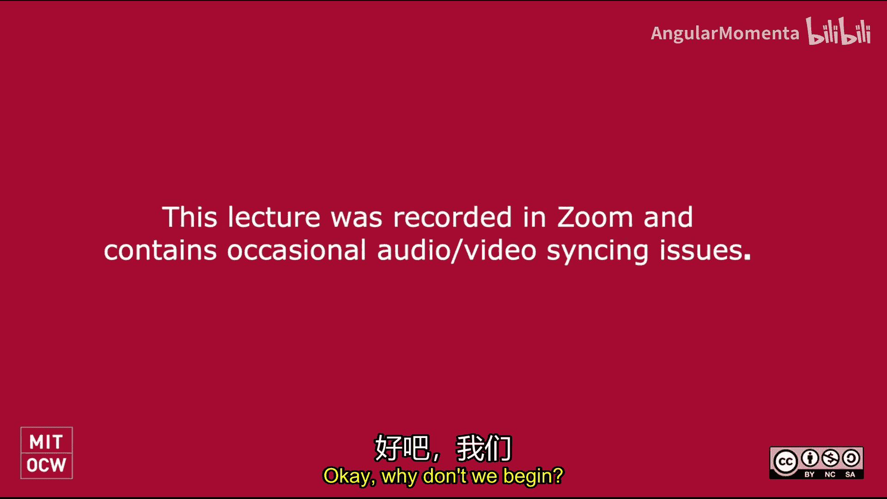
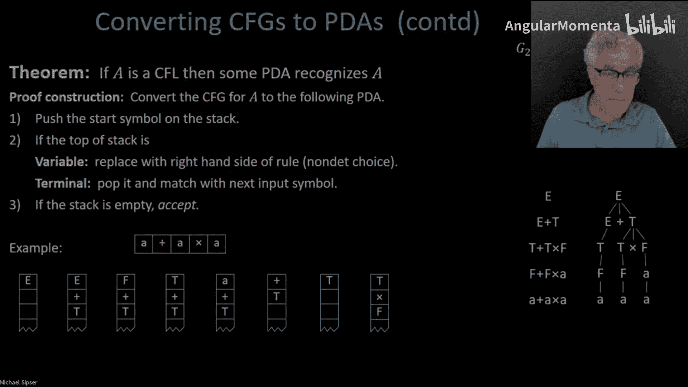

# 004：下推自动机，CFG到PDA的转换和反向转换 🧠



在本节课中，我们将继续探索上下文无关文法，并学习其对应的自动机模型——下推自动机。我们将看到这两种模型在表达能力上是等价的，并学习如何将上下文无关文法转换为下推自动机。

## 上下文无关文法回顾

上一节我们介绍了正则语言及其模型。本节中，我们来看看更强大的模型——上下文无关文法。

一个上下文无关文法由四个部分组成：
*   **变量**：出现在规则左侧的符号。
*   **终结符**：构成生成字符串的符号。
*   **规则**：形式为 `变量 -> 变量和终结符组成的字符串`。
*   **起始变量**：推导过程的起点。

文法的语言是所有可以从起始变量推导出的、仅由终结符组成的字符串的集合，称为**上下文无关语言**。

以下是使用文法生成字符串 `0011` 的例子：
```
S -> 0S1 | R
R -> ε
```
推导过程为：`S` => `0S1` => `00S11` => `00R11` => `0011`。

## 下推自动机介绍

有限自动机的内存有限。为了增强其能力，我们引入**下推自动机**。它在有限自动机的基础上增加了一个**栈**作为辅助存储。

栈是一种后进先出的存储结构。操作包括：
*   **压入**：向栈顶写入一个新符号。
*   **弹出**：从栈顶读取并移除一个符号。

下推自动机可以非确定性地运行，并且能够利用栈来记忆信息，从而识别一些有限自动机无法识别的语言，例如语言 `{0^k 1^k | k ≥ 0}`。

## 形式化定义与示例

下推自动机是一个六元组 `(Q, Σ, Γ, δ, q0, F)`：
*   `Q`：状态集合
*   `Σ`：输入字母表
*   `Γ`：栈字母表
*   `δ`：转移函数 `Q × (Σ∪{ε}) × (Γ∪{ε}) → P(Q × (Γ∪{ε}))`
*   `q0`：起始状态
*   `F`：接受状态集合

转移函数决定了在特定状态、读取特定输入符号（或ε）和栈顶符号（或ε）时，机器可以进入的新状态以及在栈顶写入的新符号（或ε）。

考虑语言 `{ww^R | w ∈ {0,1}*}`，即一个字符串后接其反转。识别它的下推自动机策略如下：
1.  非确定性地猜测字符串的中点。
2.  中点之前：读取输入符号并将其压入栈中。
3.  中点之后：读取输入符号，并与从栈中弹出的符号进行比较。
4.  如果所有符号都匹配且栈最终为空，则接受。

非确定性在这里至关重要，因为机器在读取时无法预先知道中点位置。

## 从CFG到PDA的转换

上下文无关文法和下推自动机在表达能力上是等价的。我们现在学习如何将上下文无关文法转换为等价的下推自动机。

核心思想是：让PDA模拟文法的**最左推导**。PDA将使用栈来存储当前的派生字符串（即一系列变量和终结符）。

转换规则如下：
1.  将文法的起始符号压入栈。
2.  重复以下步骤：
    *   如果栈顶是一个**变量**，则非确定性地选择该变量的一条规则，用其右侧的字符串替换栈顶的变量。
    *   如果栈顶是一个**终结符**，则从输入中读取下一个符号。如果两者匹配，则弹出栈顶的终结符；否则，该计算路径拒绝。
    *   如果栈顶是**ε**，则直接弹出它。
3.  当输入被完全读取，且栈为空时，接受。

这种策略确保了PDA总是在栈顶进行替换操作，符合栈的访问特性。

## 总结与关系

本节课中我们一起学习了：
1.  回顾了上下文无关文法的形式化定义。
2.  引入了下推自动机，这是一种拥有栈内存的、更强大的自动机模型。
3.  学习了如何将上下文无关文法转换为等价的下推自动机，通过让PDA模拟文法的推导过程。

我们目前了解的模型及其关系可以总结如下：
*   **正则语言**：由有限自动机识别，由正则表达式描述。
*   **上下文无关语言**：由下推自动机识别，由上下文无关文法描述。
*   正则语言是上下文无关语言的一个**真子集**。这意味着所有正则语言都是上下文无关的，但存在是上下文无关而非正则的语言（例如 `{0^k 1^k}`）。




在接下来的课程中，我们将介绍更强大的图灵机模型。