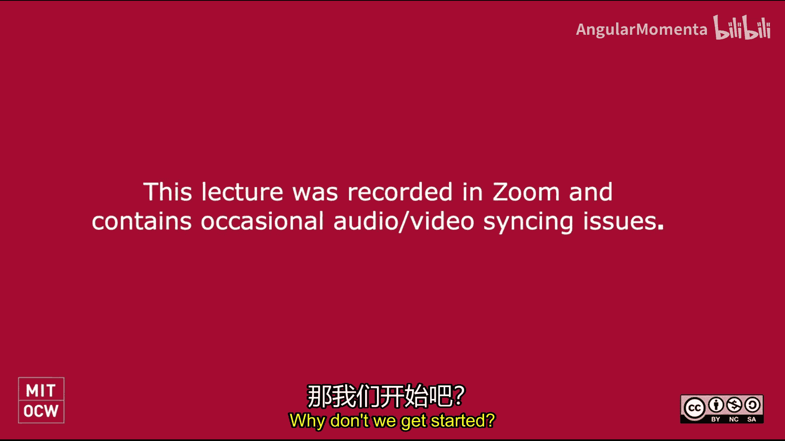
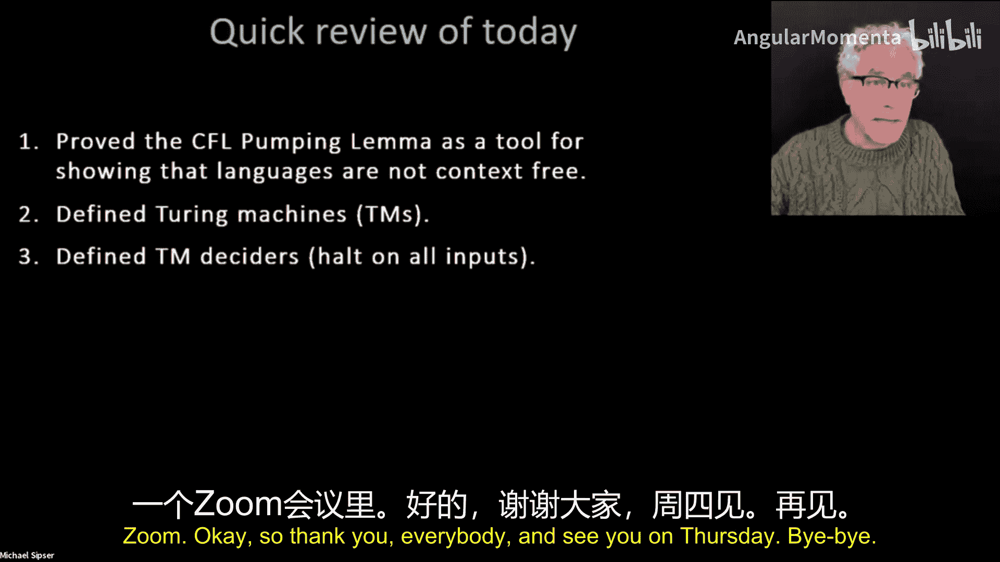

# 005：上下文无关泵引理与图灵机

在本节课中，我们将学习如何证明某些语言不是上下文无关的，并正式引入图灵机这一核心计算模型。我们将从回顾上下文无关语言开始，然后介绍上下文无关泵引理，最后详细定义图灵机及其相关概念。

## 回顾：上下文无关语言

上一节我们介绍了上下文无关文法与下推自动机，它们是描述上下文无关语言的两种等价方式。上下文无关语言比正则语言（有限自动机描述的语言）能力更强，因为下推自动机增加了栈这一存储结构。

上下文无关语言在正则运算（并、连接、星号）下是封闭的。然而，它们**不**在交运算下封闭。一个重要的推论是：**上下文无关语言与正则语言的交集仍是上下文无关的**。这是因为下推自动机可以在其有限控制中模拟一个有限自动机。但两个上下文无关语言的交集则不一定，因为单个栈难以同时模拟两个栈的行为。

## 上下文无关泵引理

为了证明某些语言不是上下文无关的，我们需要一个类似于正则语言泵引理的工具。这就是上下文无关泵引理。

**上下文无关泵引理**：若语言 *A* 是上下文无关的，则存在一个泵长度 *p*，使得 *A* 中任何长度不小于 *p* 的字符串 *s* 都可以被划分为五部分：*s = uvxyz*，并满足以下三个条件：
1.  对于每一个 *i ≥ 0*，有 *uvⁱxyⁱz ∈ A*。
2.  *|vy| > 0*（即 *v* 和 *y* 不同时为空串）。
3.  *|vxy| ≤ p*。

这个引理的核心思想是：在上下文无关文法生成的长字符串的语法分析树中，必然存在一条从根节点到叶子的长路径。由于文法中变量数量有限，这条路径上必然有某个变量重复出现。利用这个重复出现的变量，我们可以对字符串进行“切割与粘贴”，从而得到可泵的性质。

### 应用泵引理证明语言非上下文无关

证明思路与正则泵引理类似，采用反证法：
1.  假设语言 *L* 是上下文无关的，则泵引理成立，存在泵长度 *p*。
2.  精心选择一个属于 *L* 且长度 ≥ *p* 的字符串 *s*。
3.  根据泵引理，*s* 可被划分为 *uvxyz* 并满足三个条件。
4.  证明无论怎样划分，只要满足条件2和3，总存在某个 *i*（通常是 *i=0* 或 *i=2*）使得 *uvⁱxyⁱz* **不**属于 *L*，从而产生矛盾。
5.  因此，最初的假设错误，*L* 不是上下文无关语言。

**示例1：证明 B = {0ⁿ1ⁿ2ⁿ | n ≥ 0} 不是上下文无关语言。**
假设 *B* 是上下文无关的，泵长度为 *p*。选择字符串 *s = 0ᵖ1ᵖ2ᵖ*。根据泵引理条件3，子串 *vxy* 的长度不超过 *p*，因此它不可能同时包含0、1和2三种符号。
*   如果 *vxy* 只包含0和1，那么当我们将 *v* 和 *y* 泵入（例如令 *i=2*），字符串中0或1的数量会增加，但2的数量不变，导致三者数量不等，新字符串不在 *B* 中。
*   如果 *vxy* 只包含1和2，情况类似，泵操作会破坏1和2的数量相等性。
*   如果 *vxy* 只包含单一符号，泵操作同样会破坏数量相等关系。
因此，无论如何划分，泵操作都会使新字符串脱离语言 *B*，产生矛盾。故 *B* 不是上下文无关语言。

**示例2：证明 F = {ww | w ∈ {0,1}*} 不是上下文无关语言。**
假设 *F* 是上下文无关的，泵长度为 *p*。一个**错误**的选择是 *s = 0ᵖ10ᵖ1*，因为它可能被划分为 *vxy* 仅包含中间区域，泵操作后仍能保持 *ww* 的形式。正确的选择是 *s = 0ᵖ1ᵖ0ᵖ1ᵖ*。由于 *|vxy| ≤ p*，它无法横跨两个0的区块或两个1的区块。
*   如果 *vxy* 完全位于前半段（如0的区块中），泵操作会使前半段0的数量变化，而后半段不变，破坏 *ww* 形式。
*   如果 *vxy* 横跨前半段0区块和1区块，泵操作会使符号顺序混乱（如出现0101），同样破坏 *ww* 形式。
对于其他划分情况，分析类似，总能找到泵操作后不在 *F* 中的情况。因此 *F* 不是上下文无关语言。

## 引入图灵机

上下文无关语言和下推自动机的能力仍然有限，无法完成许多我们认为是计算机常规任务的操作（如判断 `0ⁿ1ⁿ2ⁿ`）。现在，我们引入**图灵机**作为本课程后续的核心计算模型，它更接近我们对通用计算机的直观理解。

### 图灵机直观描述

图灵机由以下几个部分组成：
*   **无限长的磁带**：被划分为方格，每个方格可存放一个符号。磁带右端无限延伸，初始时输入字符串存放在磁带左端，其余部分为空白符号（记为 `␣`）。
*   **读写头**：可以读取当前所指方格内的符号，也可以写入新符号来替换旧符号，并且可以根据指令向左或向右移动一格。
*   **有限状态控制器**：包含有限的状态集合，以及一个控制机器运行的规则（转移函数）。

图灵机的运行：从起始状态和读写头指向输入最左端开始，根据当前状态和读写头读到的符号，查找转移函数，决定：1) 下一个状态；2) 写入当前方格的符号；3) 将读写头向左(`L`)或向右(`R`)移动一格。这一过程不断重复。

图灵机通过进入特定的**接受状态**或**拒绝状态**来停机，并相应地表征对输入的“接受”或“拒绝”。如果机器永远无法进入这两个状态，则称它**不停机**或**循环**。

### 图灵机形式化定义

一个图灵机 *M* 是一个七元组：*(Q, Σ, Γ, δ, q₀, q_accept, q_reject)*
*   *Q*：有限状态集。
*   *Σ*：输入字母表，不包括空白符号 `␣`。
*   *Γ*：磁带字母表，满足 *Σ ⊆ Γ* 且 `␣ ∈ Γ`。它包含所有可以出现在磁带上的符号。
*   *δ*：转移函数，*δ: Q × Γ → Q × Γ × {L, R}*。例如，*δ(q, a) = (r, b, R)* 表示在当前状态 *q* 读到符号 *a* 时，转移到状态 *r*，在当前方格写入符号 *b*，然后将读写头右移一格。
*   *q₀ ∈ Q*：起始状态。
*   *q_accept ∈ Q*：接受状态。
*   *q_reject ∈ Q*：拒绝状态，且 *q_accept ≠ q_reject*。

### 图灵机示例：识别 B = {aⁿbⁿcⁿ | n ≥ 0}

以下是该图灵机的一种非最优但直观的工作流程描述：
1.  从左向右扫描，检查输入格式是否为 `a*b*c*`（即所有a在前，接着是所有b，最后是所有c）。若发现符号顺序错误，则进入拒绝状态。
2.  将读写头移回最左端。
3.  执行一次“扫描-标记”循环：
    a. 向右扫描，找到第一个未被标记的 `a`，将其标记（如改写为 `X`）。
    b. 继续向右扫描，找到第一个未被标记的 `b`，将其标记。
    c. 继续向右扫描，找到第一个未被标记的 `c`，将其标记。
    d. 将读写头移回最左端。
4.  检查标记情况：
    *   如果在上一次循环中，恰好标记了最后一个 `a`、最后一个 `b` 和最后一个 `c`，则说明最初数量相等，进入接受状态。
    *   如果还有未被标记的 `a`、`b` 或 `c`，则返回步骤3继续循环。
    *   如果某种符号已被标记完，但其他符号还有剩余（例如，找不到未被标记的 `a`，但还有未标记的 `b`），则说明最初数量不等，进入拒绝状态。

这个例子展示了图灵机如何利用读写能力和双向移动来执行比下推自动机更复杂的计数和匹配任务。

### 图灵可识别语言与图灵可判定语言

*   **图灵可识别语言**：如果存在一台图灵机 *M*，使得对于语言 *L* 中的每个字符串，*M* 都接受；对于不在 *L* 中的字符串，*M* 要么拒绝（停机拒绝），要么永不停机。则称 *M* **识别** *L*，*L* 是图灵可识别的。
*   **图灵可判定语言**：如果存在一台图灵机 *M*，它对于**任何**输入字符串都会在有限步内停机（即进入接受或拒绝状态），并且它接受的语言恰好是 *L*。则称 *M* **判定** *L*，*L* 是图灵可判定的。

显然，每台判定器也是一台识别器，因此**所有图灵可判定语言都是图灵可识别的**。反之则不然，存在一些语言可以被图灵机识别，但没有任何图灵机可以判定它（即对某些输入，识别它的图灵机可能永不停机）。我们将在后续课程中看到这样的例子。

至此，我们得到了计算模型的语言层次结构：**正则语言 ⊆ 上下文无关语言 ⊆ 图灵可判定语言 ⊆ 图灵可识别语言**。

## 总结

本节课我们一起学习了两个主要内容。首先，我们介绍了**上下文无关泵引理**，这是一个用于证明特定语言不属于上下文无关语言类的有力工具，其证明基于对长字符串语法分析树中变量重复出现的“切割与粘贴”论证。其次，我们正式引入了**图灵机**模型，定义了其基本组件和工作原理，并区分了**图灵可识别语言**与**图灵可判定语言**。图灵机以其无限的存储能力和灵活的读写访问，成为了我们研究计算理论的基础模型。在接下来的课程中，我们将深入探索图灵机的能力与极限。