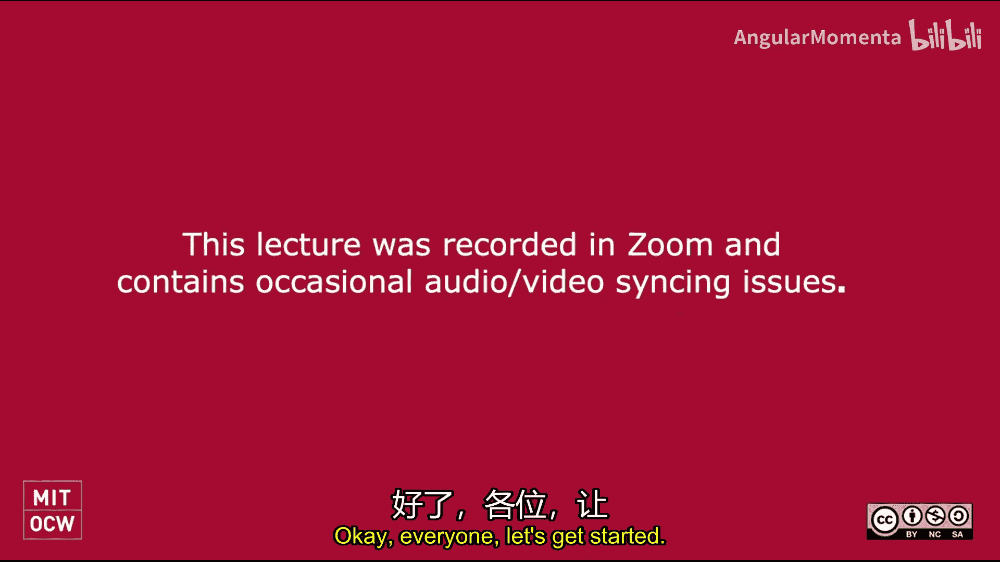
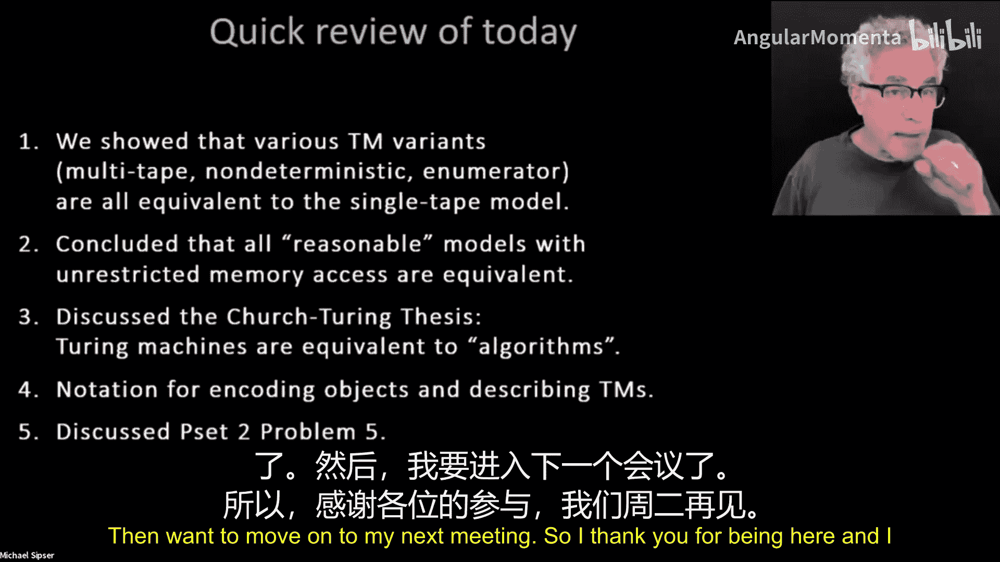
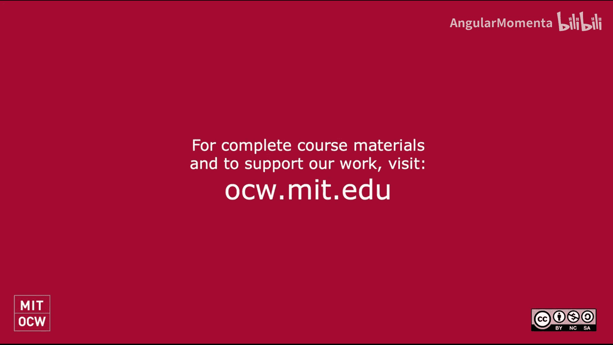

# 006：TM变体，丘奇-图灵论题 🧠

在本节课中，我们将深入学习图灵机模型。我们将探讨图灵机的几种变体，并证明它们在计算能力上是等价的。这一等价性将引导我们理解**丘奇-图灵论题**——一个关于算法本质的核心思想。我们还将介绍如何将复杂对象编码为字符串，以便作为图灵机的输入。

## 图灵机回顾 🔄

上一节我们介绍了图灵机模型。图灵机由一个有限状态控制器、一个无限长的纸带和一个读写头组成。对于任意输入，图灵机有三种可能的结果：**接受**、**拒绝**或**循环**（永不停止）。

*   **图灵可识别语言**：如果存在一个图灵机接受该语言中的所有字符串，则该语言是图灵可识别的。记作 **T-recognizable**。
*   **图灵可判定语言**：如果存在一个图灵机（称为判定器）在**所有**输入上都停机（接受或拒绝），则该语言是图灵可判定的。记作 **T-decidable**。

图灵机将成为我们通用计算的标准模型。本课将论证，所有“合理”的计算模型在能力上都是等价的，因此选择图灵机作为基础模型是合理的。

## 图灵机变体及其等价性 ⚖️

现在，我们来看看图灵机的几种变体，并证明它们与基本单带图灵机是等价的。

### 多带图灵机

多带图灵机拥有多条纸带，每条纸带都有自己的读写头。输入通常呈现在一条专门的输入带上，其他工作带初始为空白。在每一步，机器可以读取所有带头下的符号，根据当前状态和这些符号决定如何写入新符号并移动每个头。

**定理**：一个语言是（单带）图灵可识别的，**当且仅当**它被某个多带图灵机识别。

**证明思路**：
*   **正向**：单带图灵机本身就是只拥有一条带的多带图灵机，因此显然成立。
*   **反向**：我们需要将多带图灵机 `M` 模拟为单带图灵机 `S`。
    *   `S` 在其单条纸带上为 `M` 的每一条带分配一个“块”。
    *   每个块存储对应纸带的内容。
    *   为了记录 `M` 每个读写头的位置，`S` 使用带点的符号（例如 `Ȧ`）来标记头的位置。
    *   为了分隔不同的块，`S` 使用特殊的分隔符（如 `#`）。
    *   `S` 通过扩大其带字母表来包含这些新符号（带点符号和分隔符）。
    *   模拟 `M` 的一步时，`S` 需要扫描整个纸带来收集所有带头下的信息，然后更新状态和各块内容，并移动“点”来模拟头的移动。
    *   如果某个块的空间不足，`S` 会执行“移位”操作来腾出空间。
    *   如果 `S` 模拟到 `M` 进入接受或拒绝状态，则 `S` 也做同样操作。

通过这种构造，单带机 `S` 可以完全模拟多带机 `M` 的行为。

### 非确定性图灵机

非确定性图灵机的转移函数允许多种可能的下一个步骤。它接受一个输入，只要**存在**一条计算路径最终进入接受状态。

**定理**：一个语言是图灵可识别的，**当且仅当**它被某个非确定性图灵机识别。

**证明思路**：
*   **正向**：确定性图灵机是非确定性图灵机的一种特例（从不分支），因此成立。
*   **反向**：我们需要将非确定性图灵机 `N` 模拟为确定性图灵机 `D`。
    *   将 `N` 的非确定性计算想象成一棵树。
    *   `D` 的任务是系统地搜索这棵树，寻找接受路径。
    *   `D` 使用其纸带来存储和管理 `N` 的不同计算“线程”。
    *   它将纸带划分为多个块，每个块代表一个线程在某个时刻的完整快照：纸带内容、带头位置（用点符号标记）以及**当前状态**（通过扩大字母表，用特殊符号写在块上）。
    *   `D` 以广度优先的方式模拟所有线程。当一个线程非确定性地分支时，`D` 复制对应的块以创建新的线程。
    *   `D` 逐步执行所有活跃的线程。如果任何线程进入接受状态，`D` 就接受输入。
    *   如果所有可能的线程都拒绝或永不停止，`D` 可能永远运行（拒绝循环）。

### 枚举器

枚举器是一种特殊的图灵机变体，它没有输入带，而是连接了一个“打印机”。它从完全空白的纸带开始运行，并在程序控制下周期性地打印字符串。枚举器**生成**的语言就是它打印出的所有字符串的集合。

**定理**：一个语言是图灵可识别的，**当且仅当**它是某个枚举器的语言。

**证明思路**：
*   **从枚举器 `E` 到识别器 `M`**：
    *   `M` 以输入字符串 `w` 启动。
    *   `M` 模拟 `E` 的运行。
    *   每当 `E` 打印出一个字符串 `x` 时，`M` 就检查 `x` 是否等于 `w`。
    *   如果相等，`M` 接受。
    *   如果 `E` 停止且从未打印 `w`，则 `M` 拒绝。
    *   如果 `E` 永不停止且从未打印 `w`，则 `M` 也永不停止（拒绝循环）。
*   **从识别器 `M` 到枚举器 `E`**：
    *   `E` 需要打印出所有被 `M` 接受的字符串。
    *   关键是不能简单地让 `E` 按顺序对每个字符串 `w_i` 运行 `M` 直到完成，因为 `M` 可能在某个 `w_i` 上循环，导致 `E` 卡住。
    *   正确的做法是采用“分时”技术：`E` 系统地模拟 `M` 在所有可能字符串 `w_1, w_2, w_3, ...` 上的运行，但以交错的方式进行（例如，第 `i` 轮模拟所有字符串的前 `i` 步）。
    *   每当 `E` 发现 `M` 在某个字符串 `w` 上进入接受状态，它就打印出 `w`。
    *   注意：这样生成的字符串顺序**不一定**是字符串的自然顺序（短字符串在前），因为接受得快的字符串可能先被打印出来。对于可判定语言，可以构造出按顺序打印的枚举器。

## 丘奇-图灵论题 📜

上一节我们证明了多种图灵机变体的等价性。历史上，在20世纪30年代，图灵、丘奇等人提出了多种形式化“算法”或“有效过程”的数学模型（如图灵机、λ演算、递归函数等）。一个重大的发现是，所有这些看似不同的模型都被证明在计算能力上是等价的。

这一现象促使**丘奇-图灵论题**的提出：
> **任何直观上“可计算”的函数（或可判定的问题），都可以被图灵机计算。**

这是一个**论题**，而非可被数学证明的定理，因为它连接了形式化的数学概念（图灵机）和直观的、哲学性的概念（算法）。然而，由于所有已知的合理计算模型都与图灵机等价，该论题被广泛接受，并成为计算理论的基石。

**意义**：丘奇-图灵论题使得我们可以用图灵机来精确地讨论“什么问题是可计算的”。例如，希尔伯特第十问题（寻找整数解的多项式方程）在有了图灵机模型后，才得以被证明是**不可判定**的（即不存在解决该问题的通用算法）。

## 编码与高级描述 🖥️

既然图灵机只接受字符串输入，当我们需要处理更复杂的对象（如自动机、图、多项式等）时，必须先将它们**编码**为字符串。

**编码表示**：我们用 `<O>` 表示对象 `O` 的字符串编码。多个对象可以编码为 `<O1, O2>`。

**字符串对编码**：简单地将两个字符串拼接 (`xy`) 不是好的编码方式，因为无法唯一地解码。需要引入分隔符或其他机制。

**图灵机的高级描述**：得益于丘奇-图灵论题，在描述算法时，我们不再需要写出图灵机详细的状态和转移函数。我们可以使用**高级的、非形式的英文描述**，只要描述清楚、每一步是有限的操作、并且显然可以在图灵机上实现即可。

例如，识别语言 `{a^k b^k c^k | k ≥ 0}` 的图灵机可以描述为：
1.  检查输入格式是否为 `a*b*c*`，否则拒绝。
2.  从左到右扫描，依次将每个 `a`、`b`、`c` 标记为已读（或删除）。
3.  如果所有 `a`、`b`、`c` 的数量都匹配，则接受；否则拒绝。

## 总结 🎯

本节课我们一起学习了：
1.  **图灵机变体的等价性**：证明了多带图灵机、非确定性图灵机、枚举器都与基本的单带确定性图灵机在语言识别能力上等价。
2.  **丘奇-图灵论题**：基于各种模型的等价性，理解了这一核心论题——图灵机抓住了“算法”或“有效计算”的本质。
3.  **编码与描述**：学习了如何将复杂对象编码为字符串输入，并开始使用高级描述来指定图灵机（算法），这将在后续课程中成为我们主要的讨论方式。

这些概念奠定了我们研究计算理论的基础：现在我们有了一个坚实、统一且强大的模型（图灵机）来探讨计算的极限。