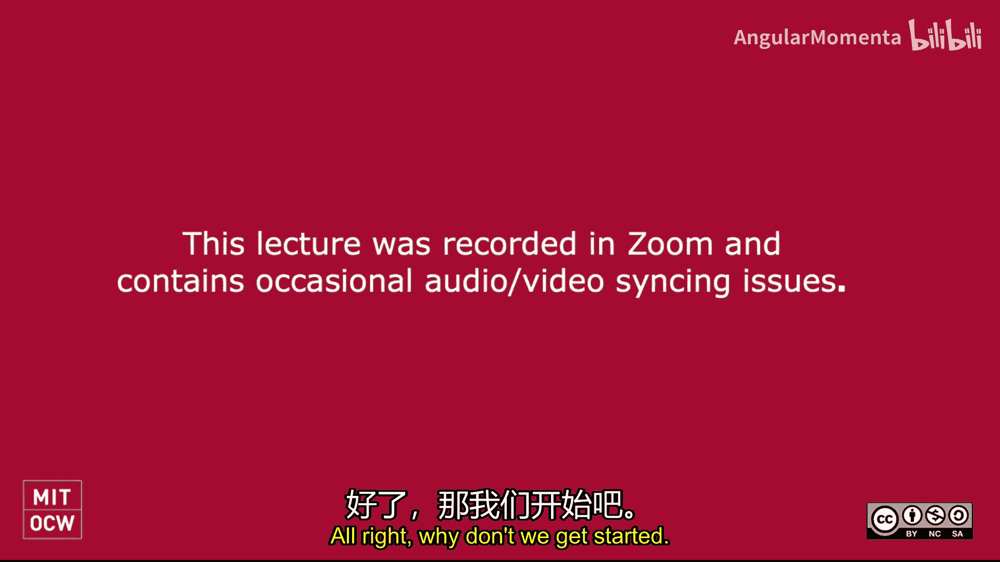
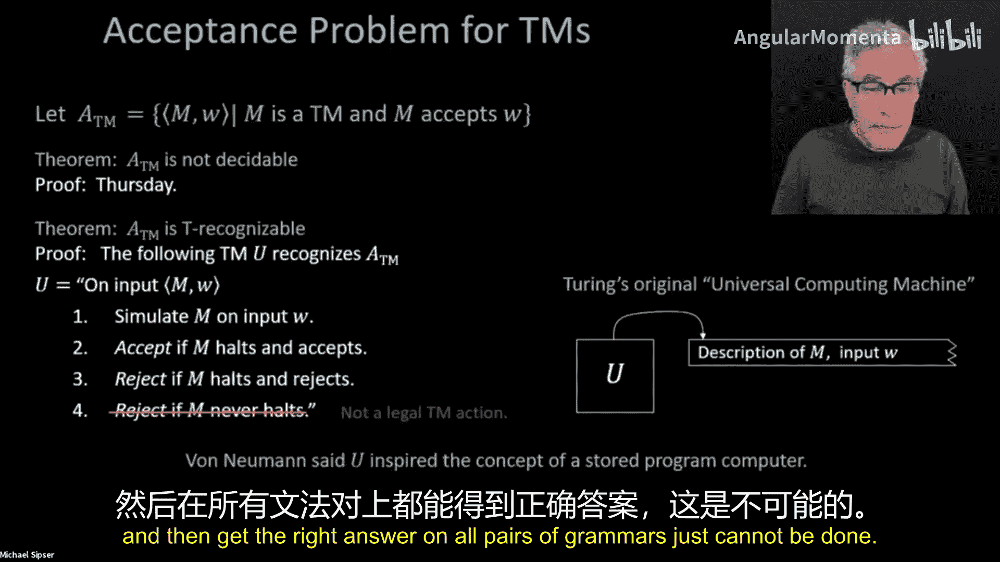
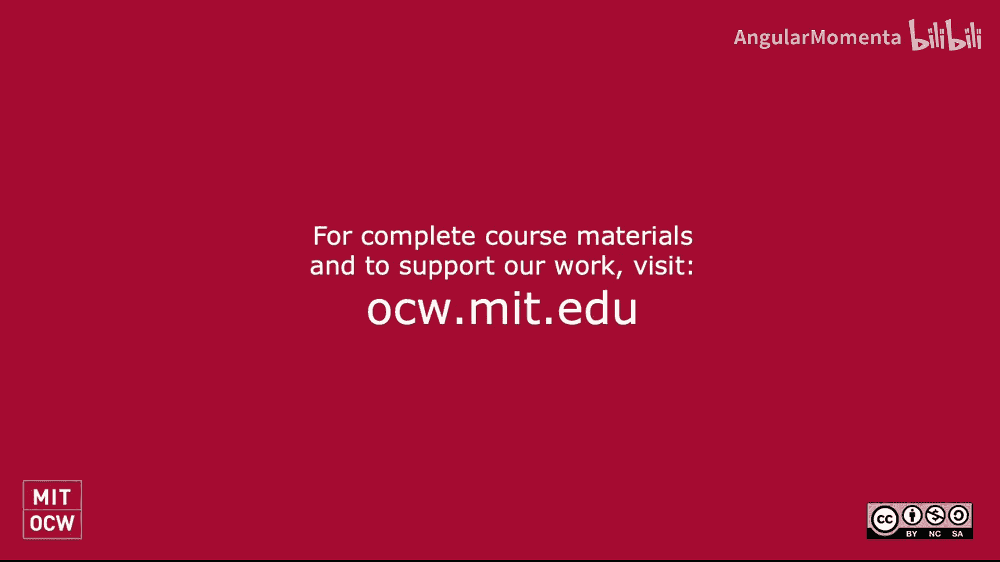

# 007：自动机和语法的决策问题 🧠

在本节课中，我们将学习如何为各种自动机和语法相关的决策问题设计图灵机算法。我们将从简单的确定性有限自动机（DFA）问题开始，逐步深入到更复杂的上下文无关文法（CFG）问题，并最终触及图灵机本身的问题。我们将看到，许多关于正则语言和上下文无关语言的问题是可判定的，但某些问题（如文法的等价性）则不是。

---

## 回顾：图灵机与可判定性

上一节我们介绍了图灵机作为通用计算模型。本节中，我们来看看如何利用图灵机解决具体的决策问题。

图灵机在输入字符串 `W` 上运行时，有三种可能结果：
*   接受 `W`（停机并接受）。
*   拒绝 `W`（停机并拒绝）。
*   在 `W` 上永远运行（通过循环拒绝）。

如果一台图灵机在**所有**输入上都保证停机，我们称它为**判定器**，它所识别的语言是**可判定的**。

为了将复杂对象（如自动机、文法）作为图灵机的输入，我们使用编码。我们用尖括号 `<...>` 表示一个对象的字符串编码。例如，`<B, w>` 表示将 DFA `B` 和字符串 `w` 编码成一个字符串。

---

## DFA 的接受问题 ✅

我们首先看一个简单的问题：给定一个 DFA `B` 和一个字符串 `w`，`B` 是否接受 `w`？我们将此问题表述为语言 **`A_DFA`**。

**`A_DFA` = { `<B, w>` | `B` 是一个 DFA，且 `B` 接受 `w` }**

我们可以构造一个图灵机 **`D_DFA`** 来判定 `A_DFA`。以下是 `D_DFA` 的描述：

1.  **输入检查**：检查输入字符串 `S` 是否为 `<B, w>` 的有效编码形式。如果不是，则拒绝。
2.  **模拟计算**：在输入 `w` 上模拟 DFA `B` 的计算。
3.  **输出结果**：
    *   如果模拟结束时 `B` 处于接受状态，则**接受**。
    *   如果模拟结束时 `B` 处于非接受状态，则**拒绝**。

由于 DFA 对任何输入都会在恰好 `|w|` 步后停止，因此 `D_DFA` 总是会停机，它是一个判定器。

---

## NFA 的接受问题 🔄

现在考虑 NFA 的接受问题：给定一个 NFA `B` 和一个字符串 `w`，`B` 是否接受 `w`？语言 **`A_NFA`** 定义类似。

**`A_NFA` = { `<B, w>` | `B` 是一个 NFA，且 `B` 接受 `w` }**

我们可以构造判定器 **`D_NFA`**。这里的关键是，我们可以利用已知的等价性转换，而不是直接模拟可能带有 ε 转移的 NFA。

`D_NFA` 的算法如下：

1.  **输入检查**：检查输入是否为 `<B, w>` 的有效编码，其中 `B` 是 NFA。
2.  **转换**：使用子程序（或构造）将 NFA `B` 转换为等价的 DFA `B'`。
3.  **调用判定器**：在输入 `<B', w>` 上运行我们已有的 DFA 判定器 `D_DFA`。
4.  **输出结果**：`D_DFA` 接受则接受，`D_DFA` 拒绝则拒绝。

这个例子展示了“归约”的思想：将一个未知问题（`A_NFA`）转化为一个已解决问题（`A_DFA`）。

---

## DFA 的空性问题 🚫

接下来，我们考虑一个关于 DFA 本身性质的问题：给定一个 DFA `B`，它的语言是否为空集？即，`L(B) = ∅` 吗？

**`E_DFA` = { `<B>` | `B` 是一个 DFA，且 `L(B) = ∅` }**

判定器 **`D_E_DFA`** 可以通过检查从起始状态是否能到达任何接受状态来判断。

算法描述（标记法）：

1.  **标记起始状态**：标记 DFA `B` 的起始状态。
2.  **迭代标记**：重复以下步骤，直到没有新状态被标记：
    *   对于每一个**已标记**的状态，标记所有从该状态通过一条边能到达的**未标记**状态。
3.  **检查结果**：
    *   如果**没有**接受状态被标记，则**接受**（语言为空）。
    *   如果**有**接受状态被标记，则**拒绝**（语言非空）。

这个算法本质上是图搜索（如广度优先搜索），它总是会终止。

---

## DFA 的等价性问题 ⚖️

更复杂一些：给定两个 DFA `A` 和 `B`，它们是否识别相同的语言？

**`EQ_DFA` = { `<A, B>` | `A` 和 `B` 都是 DFA，且 `L(A) = L(B)` }**

我们可以巧妙地利用对称差和空性测试来解决。思路是：构造一个新的 DFA `C`，使其语言恰好是 `L(A)` 和 `L(B)` 的对称差（即在 `A` 中但不在 `B` 中，或在 `B` 中但不在 `A` 中的字符串集合）。如果这个对称差是空的，那么两个语言就相等。

判定器 **`D_EQ_DFA`** 的算法：

1.  **输入**：`<A, B>`。
2.  **构造 DFA `C`**：利用 DFA 对补集、交集和并集的封闭性，构造 DFA `C`，使得 `L(C) = (L(A) ∩ L(B)的补集) ∪ (L(B) ∩ L(A)的补集)`。
3.  **测试空性**：在输入 `<C>` 上运行 DFA 空性判定器 `D_E_DFA`。
4.  **输出结果**：
    *   如果 `D_E_DFA` 接受（即 `L(C)` 为空），则**接受**（`L(A) = L(B)`）。
    *   如果 `D_E_DFA` 拒绝（即 `L(C)` 非空），则**拒绝**（`L(A) ≠ L(B)`）。

---

## 正则表达式的等价性问题 ➡️

基于 DFA 等价性可判定的结论，我们可以立即推断出正则表达式的等价性也是可判定的。

**`EQ_REX` = { `<R1, R2>` | `R1` 和 `R2` 是正则表达式，且 `L(R1) = L(R2)` }**

判定算法非常简单：
1.  使用已知算法将正则表达式 `R1` 和 `R2` 分别转换为等价的 DFA `A1` 和 `A2`。
2.  在 `<A1, A2>` 上运行 DFA 等价性判定器 `D_EQ_DFA`。

这展示了模型等价性的力量：一旦我们在一个模型（如 DFA）中解决了问题，通过可计算的转换，该解决方案就自动适用于所有等价模型（如 NFA、正则表达式）。

---

## CFG 的接受问题 📝

现在我们将注意力转向上下文无关文法（CFG）。第一个问题是：给定一个 CFG `G` 和一个字符串 `w`，`G` 是否能生成 `w`？

**`A_CFG` = { `<G, w>` | `G` 是一个 CFG，且 `w ∈ L(G)` }**

直接尝试所有推导是不可行的，因为可能有无穷多推导。解决的关键是**乔姆斯基范式（CNF）**。任何 CFG 都可以转化为 CNF，在 CNF 中，所有规则只有两种形式：
*   `A -> BC` （变量生成两个变量）
*   `A -> a` （变量生成一个终结符）

CNF 的一个重要性质是：任何长度为 `n` 的字符串 `w`，如果它能被生成，那么存在一个恰好使用 `2n - 1` 步的推导。

基于此，判定器 **`D_A_CFG`** 的算法如下：
1.  **转换**：将输入文法 `G` 转换为等价的 CNF 文法 `G'`。
2.  **有限搜索**：系统地枚举 `G'` 中所有长度不超过 `2|w| - 1` 步的推导。
3.  **检查**：如果任何一个推导生成了 `w`，则**接受**；如果所有可能的推导都检查完毕仍未生成 `w`，则**拒绝**。

由于搜索空间是有限的（步数有上限），该算法总会停机。

**推论**：每个上下文无关语言都是可判定的。因为对于任意 CFL `L`，存在生成它的文法 `G`。我们可以构造一个图灵机，将 `G` 硬编码到机器中，对于输入 `w`，它只需运行 `D_A_CFG` 在 `<G, w>` 上即可。虽然我们可能不知道具体的 `G`，但它的存在性保证了判定器的存在性。

---

## CFG 的空性问题 🚫

给定一个 CFG `G`，它的语言是否为空？

**`E_CFG` = { `<G>` | `G` 是一个 CFG，且 `L(G) = ∅` }**

我们可以使用一种从终结符反向标记的算法。

判定器算法（标记法）：
1.  **标记终结符**：标记文法中所有出现的终结符。
2.  **迭代标记变量**：重复以下步骤，直到没有新变量被标记：
    *   对于每条规则 `A -> X1 X2 ... Xk`，如果右侧的**每一个**符号 `X1, X2, ..., Xk` 都已经被标记（即每个符号都能推导出纯终结符串），则标记变量 `A`。
3.  **检查起始变量**：
    *   如果起始变量 `S` 被标记了，则**拒绝**（语言非空）。
    *   如果起始变量 `S` 未被标记，则**接受**（语言为空）。

---

## CFG 的等价性与歧义性 ⚠️

现在，我们遇到两个不可判定的问题。

1.  **CFG 等价性问题**：
    **`EQ_CFG` = { `<G, H>` | `G` 和 `H` 是 CFG，且 `L(G) = L(H)` }**
    这个问题是**不可判定的**。我们不能像处理 DFA 那样使用对称差构造，因为上下文无关语言对补运算和交集不封闭。

2.  **CFG 歧义性问题**：
    **`AMB_CFG` = { `<G>` | `G` 是一个歧义的 CFG }**
    这个问题也是**不可判定的**。不存在一个算法能判定任意给定的 CFG 是否是歧义的。

---

## 图灵机的接受问题 🤖

最后，我们来到图灵机本身的核心问题：给定一个图灵机 `M` 和一个输入字符串 `w`，`M` 会接受 `w` 吗？

**`A_TM` = { `<M, w>` | `M` 是一个图灵机，且 `M` 接受 `w` }**

我们将证明（在下节课）`A_TM` 是**不可判定的**。这是计算理论中第一个，也是最重要的一个不可判定性问题。

然而，`A_TM` 是**图灵可识别的**。我们可以构造一个识别器 **`U`**，称为**通用图灵机**。

`U` 的算法非常直接：
1.  **输入**：`<M, w>`。
2.  **模拟**：在输入 `w` 上模拟图灵机 `M` 的运行。
3.  **输出**：
    *   如果在模拟过程中观察到 `M` 进入了接受状态，则 `U` **接受**。
    *   如果在模拟过程中观察到 `M` 进入了拒绝状态，则 `U` **拒绝**。
    *   如果 `M` 永不停机（在 `w` 上循环），那么 `U` 也将永不停机。

注意，`U` 无法主动检测 `M` 是否“永不”停机并据此拒绝。它只能通过模拟来观察 `M` 的行为。因此，`U` 是一个识别器，而不是判定器。

通用图灵机 `U` 在历史上意义重大，它体现了“存储程序”的概念，即数据和指令以相同形式存储和处理，这为现代计算机的冯·诺依曼架构奠定了基础。

---

## 总结 📚

本节课中我们一起学习了多种关于自动机和文法的决策问题，并为其设计了图灵机算法：

*   **可判定的问题**：
    *   DFA/NFA 的接受问题 (`A_DFA`, `A_NFA`)
    *   DFA 的空性问题 (`E_DFA`)
    *   DFA 的等价性问题 (`EQ_DFA`)
    *   正则表达式的等价性问题 (`EQ_REX`)
    *   CFG 的接受问题 (`A_CFG`)
    *   CFG 的空性问题 (`E_CFG`)
    *   （推论）所有上下文无关语言都是可判定的。

*   **不可判定的问题**（我们了解到其结论，证明将在后续课程进行）：
    *   CFG 的等价性问题 (`EQ_CFG`)
    *   CFG 的歧义性问题 (`AMB_CFG`)
    *   图灵机的接受问题 (`A_TM`) —— 它是图灵可识别的，但不可判定。

我们还学习了重要的解题技巧，如模型转换（NFA 转 DFA）、利用封闭性构造新自动机、归约到已解决问题，以及使用乔姆斯基范式来限定搜索空间。这些方法是我们分析计算问题可判定性的基础工具。