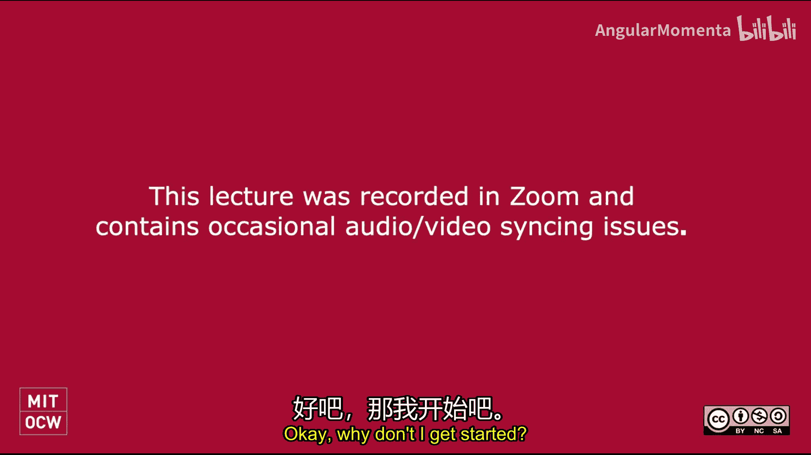
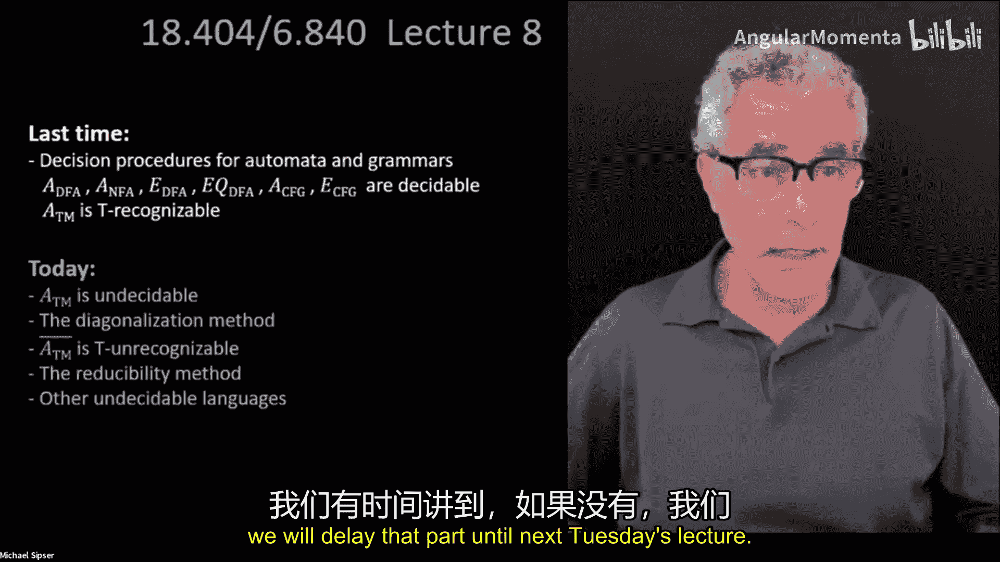
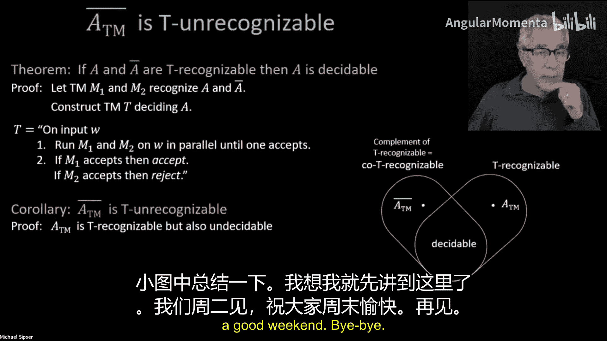

# 008：不可判定性

在本节课中，我们将学习不可判定性的概念。我们将首先回顾之前讨论过的自动机和文法的性质测试过程，然后介绍对角线法，并利用它证明图灵机接受问题（ATM）是不可判定的。接着，我们将探讨ATM的补集是不可识别的，并引入归约法来证明其他问题（如停机问题）的不可判定性。

---

## 对角线法与集合大小比较

上一节我们介绍了测试各种自动机和文法性质的过程。本节中，我们来看看一种证明问题不可判定的核心方法——对角线法。为了引入这个方法，我们需要先了解如何比较无限集合的大小。

对于有限集合，我们可以通过计数来比较大小。但对于无限集合，我们需要一个更一般的概念。数学家格奥尔格·康托尔提出了一个想法：如果存在一个函数能将一个集合A的元素**一一对应**地映射到另一个集合B的所有元素上，那么这两个集合就被认为是**大小相同**的。这里的“一一对应”意味着函数是**单射**（没有两个不同的A元素映射到同一个B元素）和**满射**（B中的每个元素都被映射到）。

另一种理解方式是，如果两个集合的元素可以完美地配对起来，那么它们大小相同。

### 可数集

如果一个无限集合可以与自然数集N建立一一对应关系，则称该集合为**可数集**。这意味着我们可以将集合中的元素列成一个列表（第一个、第二个、第三个……）。

以下是一些可数集的例子：
*   **整数集Z**：可以通过序列 0, -1, 1, -2, 2, -3, 3, ... 与自然数建立一一对应。
*   **正有理数集Q+**：可以通过一种“对角线”遍历的方式，将所有正有理数排列成一个无限网格，然后按特定顺序（如螺旋形）列出，跳过重复值，从而与自然数建立一一对应。

你可能会认为所有无限集都是可数的，但事实并非如此。

### 实数集是不可数的

**定理**：实数集R是不可数的。

**证明**：（反证法）假设R是可数的。那么存在一个从自然数到实数的一一对应函数f。我们可以据此列出一个包含所有实数的列表：f(1), f(2), f(3), ...

现在，我们构造一个新的实数x，其小数表示如下：
*   x的第1位小数不同于f(1)的第1位小数。
*   x的第2位小数不同于f(2)的第2位小数。
*   x的第3位小数不同于f(3)的第3位小数。
*   … 以此类推。

按照这个规则构造的实数x，不可能出现在我们假设的列表中，因为它与列表中的第n个数至少在**第n位小数**上不同。这与“列表包含所有实数”的假设矛盾。因此，这样的列表（一一对应）不可能存在，R是不可数的。

这种方法被称为**对角线法**，因为我们沿着列表的对角线进行构造。

---

## 图灵机与语言的基数

从实数不可数可以推导出一些重要结论。

首先，考虑所有语言的集合（即字母表Σ上所有子集的集合）。每个语言可以对应一个介于0和1之间的二进制实数（用1表示字符串在语言中，0表示不在）。因此，所有语言的集合与实数集存在一一对应，是**不可数**的。

其次，所有图灵机的集合是**可数**的。因为每台图灵机都有一个有限的描述（一个字符串），而所有有限字符串的集合是可数的。

由此得出一个关键推论：**存在某些语言，没有任何图灵机能够识别（或判定）它们**。因为语言有不可数多个，而图灵机只有可数多个。

---

## ATM是不可判定的

现在，我们运用对角线法来证明一个具体的、非常重要的问题是不可判定的：图灵机接受问题（ATM）。

**ATM定义**：
`ATM = { <M, w> | M是一台图灵机，且M接受输入w }`

我们已经知道ATM是图灵可识别的（通用图灵机可以识别它）。现在证明它是**不可判定**的。

**证明**：（反证法）假设存在一台图灵机H能够判定ATM。即，对于任意输入<M, w>，H总是停机，并且：
*   若M接受w，则H接受。
*   若M不接受w（拒绝或循环），则H拒绝。

现在，我们利用H来构造一台新的图灵机D，其行为如下：
> 输入：一台图灵机M的描述<M>。
> 1.  在输入<M, <M>>上运行判定器H（即询问H：M是否接受它自己的描述？）。
> 2.  输出与H相反的结果：
>     *   如果H拒绝，则D接受。
>     *   如果H接受，则D拒绝。

换句话说，**D接受<M>当且仅当M不接受<M>**。

现在，考虑当我们将D自己的描述<D>作为输入喂给D时会发生什么：
*   根据D的定义，D接受<D>当且仅当D不接受<D>。

这是一个逻辑矛盾。因此，我们最初的假设（判定器H存在）是错误的。所以，**ATM是不可判定的**。

**与对角线法的联系**：可以想象一个表格，行是所有图灵机M1, M2, ...（包括D），列是所有图灵机的描述。表格第i行第j列的条目表示“Mi是否接受<Mj>？”。我们构造的机器D，其行为被设计成与表格对角线上的条目相反。当D遇到自己的描述时，就要求D在对角线上的值与其自身相反，从而产生矛盾。

---

## ATM的补集是不可识别的

我们已经知道ATM是图灵可识别但不可判定的。现在考察其补集：
`ATM补 = { <M, w> | M是一台图灵机，且M不接受输入w }`

**定理**：ATM的补集不是图灵可识别的。

这个结论基于一个更一般的定理：
**定理**：如果一个语言A及其补集A补都是图灵可识别的，那么A是图灵可判定的。

**证明**：设M1是A的识别器，M2是A补的识别器。我们可以构造A的判定器T如下：
> 输入：w
> 1.  并行地运行M1(w)和M2(w)。
> 2.  由于w要么属于A，要么属于A补，因此M1和M2中必有一个最终会接受。
> 3.  如果M1接受，则T接受。如果M2接受，则T拒绝。

因为M1和M2中总有一个会接受，T总能停机并给出正确答案，所以T是A的判定器。

现在回到ATM。我们知道ATM是图灵可识别的。如果ATM的补集也是图灵可识别的，那么根据上述定理，ATM就应该是图灵可判定的。但我们刚刚证明了ATM是不可判定的。因此，**ATM的补集不可能是图灵可识别的**。

这揭示了图灵可识别语言类的一个性质：**它对补运算不封闭**。ATM是可识别的，但其补集不可识别。

---

## 归约法证明不可判定性

对角线法是证明不可判定性的根本方法。一旦我们有了一个“种子”不可判定问题（如ATM），就可以通过**归约法**来证明其他问题的不可判定性，而无需每次都进行复杂的对角线构造。

**归约法的思想**：如果问题A可以“归约”到问题B，意味着我们可以利用解决B的方法来解决问题A。那么，如果A是不可判定的，B也一定是不可判定的（因为如果B可判定，A也就可判定了，矛盾）。

### 示例：停机问题（HALTTM）

**HALTTM定义**：
`HALTTM = { <M, w> | M是一台图灵机，且M在输入w上停机 }`

我们将通过归约ATM到HALTTM来证明HALTTM是不可判定的。

**证明**：（反证法）假设存在判定器R可以判定HALTTM。我们将利用R来构造一个ATM的判定器S，从而与“ATM不可判定”的事实矛盾。

构造S如下：
> 输入：<M, w>
> 1.  在输入<M, w>上运行判定器R（即询问R：M在w上是否停机？）。
> 2.  如果R拒绝（即M在w上永不停机），那么M肯定不接受w。因此S拒绝。
> 3.  如果R接受（即M在w上停机），那么S可以安全地模拟M在w上的运行直到其停机（因为R保证了它会停）。
>     *   如果模拟中M接受，则S接受。
>     *   如果模拟中M拒绝，则S拒绝。

这样，S就正确地判定了ATM。但我们已经知道ATM是不可判定的，这样的S不可能存在。因此，我们最初的假设（判定器R存在）是错误的。所以，**HALTTM是不可判定的**。

---

## 总结

本节课中我们一起学习了：
1.  **对角线法**：通过比较无限集合的大小（可数与不可数），并利用对角线构造法证明实数集是不可数的。
2.  **ATM的不可判定性**：运用对角线法，我们证明了图灵机接受问题（ATM）是图灵不可判定的。这是计算理论中一个里程碑式的结论。
3.  **不可识别语言**：基于一个连接可识别性与可判定性的定理，我们推导出ATM的补集甚至不是图灵可识别的。
4.  **归约法**：我们引入了归约法作为证明其他问题不可判定性的强大工具，并以停机问题（HALTTM）为例，展示了如何将ATM归约到HALTTM来证明后者的不可判定性。

这些概念构成了理解计算极限的基础，并为我们后续研究更复杂的不可判定问题做好了准备。