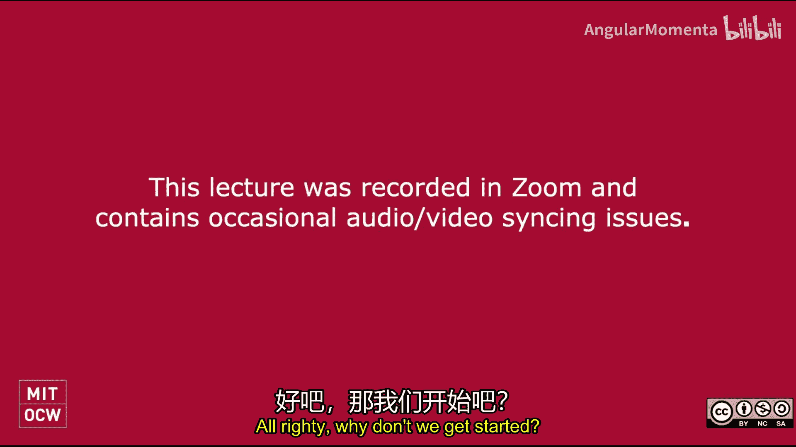
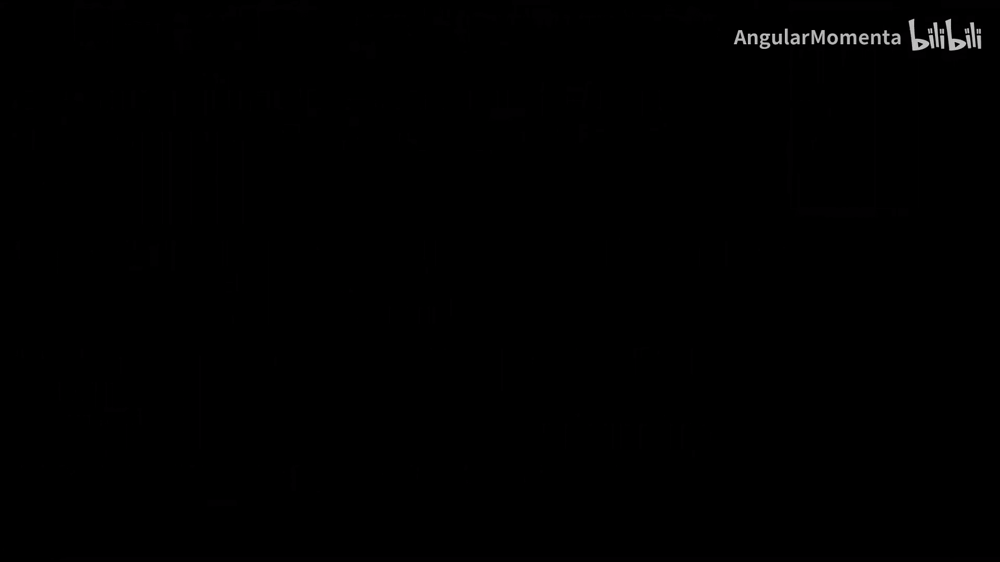

# 009：可还原性

在本节课中，我们将学习如何使用可还原性方法来证明问题是不可判定的或非图灵可识别的。我们将介绍可还原性的一般概念，并重点讨论一种特定的可还原性——映射可还原性。通过这种方法，我们可以利用已知的不可判定问题来证明其他问题的不可判定性。

## 概述与回顾

上一节我们介绍了图灵机的局限性，并证明了语言 **ATM**（图灵机接受性问题）是不可判定的。我们使用了**对角化方法**来证明这一点。

本节中，我们来看看一种新的证明方法——**可还原性方法**。这是证明其他问题不可判定的典型方式。我们将继续讨论不可判定性，并引入可还原性的一般概念。

## 可还原性方法简介

可还原性的核心思想是：如果问题 **A** 可以**归约**到问题 **B**，那么意味着我们可以利用 **B** 的解决方案来解决 **A**。

换句话说，如果 **A** 可还原到 **B**，那么解决 **B** 就为解决 **A** 提供了一条途径。

以下是理解可还原性的几个简单例子：

*   **测量面积**：测量矩形面积的问题，可以归约到测量其长和宽的问题。我们通过测量长和宽来计算面积，而不是直接测量整个区域。
*   **NFA接受性问题**：非确定性有限自动机的接受性问题 **ANFA**，可以归约到确定性有限自动机的接受性问题 **ADFA**。我们通过将NFA转换为等价的DFA，然后利用DFA的解决方案来解决NFA的问题。
*   **下推自动机“压栈”问题**：判断一个下推自动机是否会对任何输入进行压栈操作的问题，可以归约到上下文无关文法的空性问题 **ECFG**（等价于PDA的空性问题）。

从这些例子中，我们可以得出两个关键推论：

1.  如果 **A** 可还原到 **B**，且 **B** 是“简单”（例如可判定）的，那么 **A** 也一定是简单的。
2.  如果 **A** 可还原到 **B**，且 **A** 是“困难”（例如不可判定）的，那么 **B** 也一定是困难的。因为如果 **B** 是简单的，根据推论1，**A** 也会是简单的，这与已知矛盾。

在本课程中，由于我们关注计算的局限性，我们将更多地使用第二个推论来证明问题的困难性。

## 示例：证明 **Halt_TM** 不可判定

首先，我们通过一个例子来演示如何使用可还原性。回顾一下，**Halt_TM** 问题是判断一个给定的图灵机在给定输入上是否会停机（无论接受还是拒绝）。

我们已经知道 **ATM** 是不可判定的。现在，我们通过将 **ATM** 归约到 **Halt_TM** 来证明 **Halt_TM** 也是不可判定的。

**证明思路（反证法）**：
1.  假设 **Halt_TM** 是可判定的，即存在一个判定器 **R** 可以解决它。
2.  利用 **R**，我们可以构造一个判定 **ATM** 的图灵机 **S**。这将与 **ATM** 不可判定的事实矛盾。
3.  因此，假设不成立，**Halt_TM** 不可判定。

**图灵机 S 的设计**：
*   **输入**： `<M, w>`，其中 M 是一个图灵机，w 是一个字符串。
*   **操作**：
    1.  在输入 `<M, w>` 上运行判定器 **R**，判断 M 在 w 上是否停机。
    2.  如果 **R** 输出“否”（即 M 在 w 上不停机），则 **S** 直接拒绝（因为永不停机的机器不可能接受 w）。
    3.  如果 **R** 输出“是”（即 M 在 w 上停机），则 **S** 可以安全地模拟运行 M 在 w 上直到结束。
    4.  根据模拟结果：若 M 接受 w，则 **S** 接受；若 M 拒绝 w，则 **S** 拒绝。

这样，我们就用假设的 **Halt_TM** 判定器 **R** 构造出了一个 **ATM** 的判定器 **S**。由于 **ATM** 已知不可判定，所以最初的假设（**Halt_TM** 可判定）是错误的。因此，**Halt_TM** 是不可判定的。

这个证明展示了如何将一个已知的不可判定问题（**ATM**）归约到目标问题（**Halt_TM**），从而证明目标问题也是不可判定的。

## 映射可还原性

现在，我们介绍一种更具体、更有用的可还原性形式——**映射可还原性**。它基于**可计算函数**的概念。

一个**可计算函数**是一个可以由算法（如图灵机）计算的函数，它接收一个字符串输入，并总是停机且输出另一个字符串结果。

我们定义：如果存在一个可计算函数 **f**，使得对于所有字符串 **w**，满足：
> **w ∈ A ⇔ f(w) ∈ B**

那么称语言 **A** 是**映射可还原**到语言 **B** 的，记作 **A ≤ₘ B**。

直观理解是，函数 **f** 像一个“问题转换器”，它将关于 **A** 的成员资格问题，转换成关于 **B** 的成员资格问题，并且保持了成员关系（在A中的映射到在B中的，不在A中的映射到不在B中的）。

### 映射可还原性的性质

映射可还原性具有几个重要性质，使其非常有用：

1.  **可判定性的保持**：如果 **A ≤ₘ B** 且 **B** 是可判定的，那么 **A** 也是可判定的。
    *   **证明**：要判定 `w ∈ A?`，只需计算 `f(w)`，然后用 **B** 的判定器判定 `f(w) ∈ B?`，输出相同答案即可。

2.  **可识别性的保持**：如果 **A ≤ₘ B** 且 **B** 是图灵可识别的，那么 **A** 也是图灵可识别的。
    *   **证明**：与上述类似，用 **B** 的识别器即可。

由此可以导出我们更常用的推论：

*   **推论1（用于证明不可判定）**：如果 **A ≤ₘ B** 且 **A** 是不可判定的，那么 **B** 也是不可判定的。
*   **推论2（用于证明不可识别）**：如果 **A ≤ₘ B** 且 **A** 不是图灵可识别的，那么 **B** 也不是图灵可识别的。

### 示例：**ATM** 到 **ETM** 补集的映射归约

回顾 **ETM** 是图灵机的空性问题：`{ <M> | L(M) = ∅ }`。我们之前用一般归约证明了它不可判定。现在，我们可以展示一个从 **ATM** 到 **ETM** 补集（即非空语言问题）的映射归约。

我们定义可计算函数 **f** 如下：
*   **输入**： `<M, w>`
*   **输出**： 一个图灵机 **M_w** 的描述。**M_w** 的行为是：
    *   对于输入 **x**，首先检查 `x == w`。
    *   如果 `x != w`，则立即拒绝。
    *   如果 `x == w`，则模拟原始图灵机 **M** 在输入 **w** 上的运行，并输出相同结果。

**关键点**：语言 `L(M_w)` 要么是空集（如果 M 拒绝 w），要么是单元素集合 `{w}`（如果 M 接受 w）。因此：
> **<M, w> ∈ ATM ⇔ M 接受 w ⇔ L(M_w) 非空 ⇔ <M_w> ∈ ETM的补集**

这就构成了一个从 **ATM** 到 **ETM补集** 的映射归约（**ATM ≤ₘ ETM补集**）。由于 **ATM** 不可判定，根据推论1，**ETM** 的补集也不可判定，从而 **ETM** 本身也不可判定。

## 映射可还原性与一般可还原性的对比

*   **一般可还原性**：更宽泛的概念。只要求能使用 **B** 的求解器作为子程序来构造 **A** 的求解器。我们证明 **Halt_TM** 不可判定的方法就是一般归约。
*   **映射可还原性**：更严格、更结构化的概念。要求存在一个可计算函数 **f** 来转换问题实例。它是**一般可还原性**的一个特例。

一个重要区别在于处理补集时：
*   在一般归约下，语言 **A** 总是可以归约到其补集 **A̅**（只需将求解器的答案取反）。但 **A** 可能无法映射归约到 **A̅**。
*   例如，**ATM的补集** 可以用一般归约到 **ATM**，但**不能**映射归约到 **ATM**。因为如果存在这样的映射归约，由于 **ATM** 是可识别的，将导致 **ATM的补集** 也是可识别的，这与事实矛盾。

## 证明不可识别性

映射可还原性特别适合用于证明语言是**非图灵可识别**的。

**证明模板**：要证明语言 **B** 不是图灵可识别的，可以找到一个已知的非图灵可识别语言 **A**（例如 **ATM的补集**），并展示一个从 **A** 到 **B** 的映射归约（**A ≤ₘ B**）。根据推论2，**B** 就不是图灵可识别的。

### 示例：证明 **ETM** 不可识别

我们已经知道 **ATM的补集** 不是图灵可识别的。我们可以使用之前相同的归约函数 **f**（将 `<M, w>` 映射到 **M_w**），但这次关注成员关系：
> **<M, w> ∈ ATM的补集 ⇔ M 拒绝 w ⇔ L(M_w) 为空 ⇔ <M_w> ∈ ETM**

这构成了一个从 **ATM的补集** 到 **ETM** 的映射归约（**ATM的补集 ≤ₘ ETM**）。由于 **ATM的补集** 不可识别，因此 **ETM** 也不可识别。

### 示例：证明 **EQ_TM** 及其补集都不可识别

**EQ_TM** 问题是判断两个图灵机是否等价（识别相同语言）：`{ <M1, M2> | L(M1) = L(M2) }`。这是一个更强的结论：**EQ_TM** 和它的补集都不是图灵可识别的。

**证明思路**：
我们需要构造两个映射归约。

1.  **证明 EQ_TM 不可识别**：将 **ATM的补集** 映射归约到 **EQ_TM**。
    *   定义函数 **f1**，输入 `<M, w>`，输出一对图灵机 `<T_w, T_reject>`。
        *   **T_w**：是一个忽略自身输入，总是模拟 **M** 在 **w** 上运行的图灵机。因此，如果 M 接受 w，则 `L(T_w) = Σ*`（接受所有字符串）；如果 M 拒绝 w，则 `L(T_w) = ∅`（拒绝所有字符串）。
        *   **T_reject**：是一个拒绝所有输入的图灵机（`L(T_reject) = ∅`）。
    *   分析：
        *   若 M 拒绝 w（即 `<M, w>` 在 **ATM的补集** 中），则 `L(T_w) = ∅ = L(T_reject)`，因此 `<T_w, T_reject>` 在 **EQ_TM** 中。
        *   若 M 接受 w，则 `L(T_w) = Σ*`，与 `L(T_reject) = ∅` 不同，因此不在 **EQ_TM** 中。
    *   这实现了 **ATM的补集 ≤ₘ EQ_TM**，故 **EQ_TM** 不可识别。

2.  **证明 EQ_TM 的补集不可识别**：将 **ATM的补集** 映射归约到 **EQ_TM的补集**。
    *   定义函数 **f2**，输入 `<M, w>`，输出一对图灵机 `<T_w, T_accept>`。
        *   **T_w**：同上。
        *   **T_accept**：是一个接受所有输入的图灵机（`L(T_accept) = Σ*`）。
    *   分析：
        *   若 M 拒绝 w（即 `<M, w>` 在 **ATM的补集** 中），则 `L(T_w) = ∅`，与 `L(T_accept) = Σ*` 不同，因此 `<T_w, T_accept>` 在 **EQ_TM的补集** 中。
        *   若 M 接受 w，则 `L(T_w) = Σ* = L(T_accept)`，因此不在 **EQ_TM的补集** 中。
    *   这实现了 **ATM的补集 ≤ₘ EQ_TM的补集**，故 **EQ_TM的补集** 也不可识别。

## 总结

本节课中我们一起学习了：

1.  **可还原性方法**：一种通过将已知的困难问题（如 **ATM**）归约到目标问题，来证明目标问题同样困难（不可判定或不可识别）的强大技术。
2.  **映射可还原性**：一种特定形式的可还原性，基于可计算函数。它不仅能用于证明不可判定性，还能有效地证明非图灵可识别性。
3.  **关键性质**：
    *   若 **A ≤ₘ B** 且 **B** 可判定/可识别，则 **A** 也可判定/可识别。
    *   若 **A ≤ₘ B** 且 **A** 不可判定/不可识别，则 **B** 也不可判定/不可识别。
4.  **应用示例**：我们使用这些方法证明了：
    *   **Halt_TM** 是不可判定的（通过一般归约）。
    *   **ETM** 不仅是不可判定的，而且是不可识别的（通过映射归约）。
    *   **EQ_TM** 及其补集都是不可识别的（通过两个映射归约）。

可还原性是计算理论中的一个核心概念，它帮助我们理解不同计算问题之间的相对难度，并划定了可计算性的边界。在接下来的课程中，我们还将看到可还原性在计算复杂性理论中的重要作用。