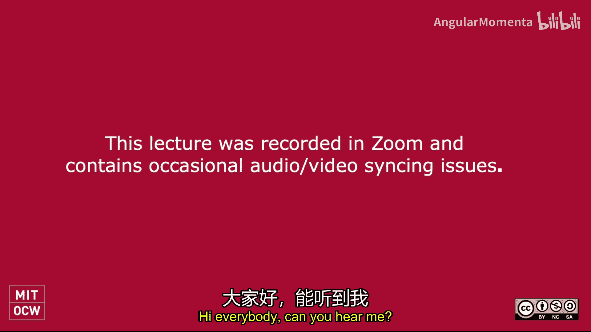
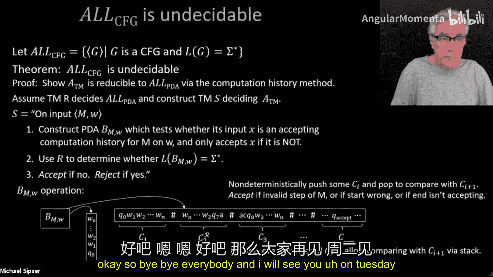
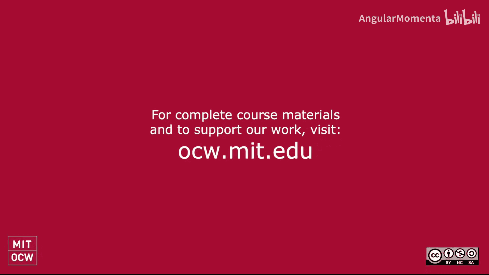

# 010：计算历史方法

在本节课中，我们将学习一种更复杂的、用于证明问题不可判定的方法——计算历史方法。我们将通过几个例子来理解这种方法，包括证明波斯特对应问题和某些上下文无关文法问题的不可判定性。

## 概述

上一节我们介绍了归约和映射归约，用于证明各种问题是不可判定的。本节中，我们将引入一种更复杂的方法，即计算历史方法。这是一种广泛使用的、用于证明问题不可判定的技术，尤其在证明更复杂的问题时非常有效。

## 核心概念回顾

要证明一个语言是不可判定的，通常需要展示一个已知的不可判定语言（如 ATM）可以归约到目标语言 B。公式化表示为：若 **ATM ≤ₘ B**，则 B 不可判定。

## 波斯特对应问题

首先，我们来看一个称为波斯特对应问题的组合问题。以下是该问题的定义：

*   **输入**：一组“多米诺骨牌”，每张牌是一个字符串对 (Tᵢ, Bᵢ)，其中 Tᵢ 是顶部字符串，Bᵢ 是底部字符串。
*   **问题**：是否存在一个序列（允许重复使用骨牌），使得将所有顶部字符串按顺序连接起来的结果，与将所有底部字符串连接起来的结果完全相同？这样的序列称为一个“匹配”。

例如，给定骨牌集合：
1.  (AB, ABA)
2.  (AA, ABA)
3.  (BA, AA)
4.  (ABA, A)

一个可能的匹配序列是：骨牌1, 骨牌2, 骨牌3, 骨牌2, 骨牌4。验证如下：
*   顶部连接：`AB` + `AA` + `BA` + `AA` + `ABA` = `AB AAB AAA BA`
*   底部连接：`ABA` + `ABA` + `AA` + `ABA` + `A` = `AB AAB AAA BA`
*   两者相等。

我们将证明，判断给定的 PCP 实例是否存在匹配的问题是**不可判定的**。

## 计算历史方法基础

为了证明 PCP 不可判定，我们将使用计算历史方法。首先需要理解几个基础概念。

### 图灵机格局

图灵机的一个**格局**是其在计算过程中某一时刻的快照，它包含了确定后续计算所需的所有信息：
*   当前状态
*   读写头位置
*   磁带内容

为了方便，我们通常将格局编码为一个字符串。编码方式为：将磁带内容分为读写头左侧部分（T1）和读写头及其右侧部分（T2），并将当前状态符号插入到 T1 和 T2 之间。例如，若状态为 q，读写头正指向符号 a，格局可表示为 `T1 q a T2`。

### 接受计算历史

图灵机 M 在输入 W 上的一个**接受计算历史**，是 M 从起始格局开始，经过一系列步骤，最终到达接受格局的完整格局序列。

我们可以将整个计算历史编码为一个字符串：将每个格局的字符串编码用分隔符（如 `#`）连接起来。例如：
`# C1 # C2 # C3 # ... # Ck #`
其中 C1 是起始格局，Ck 是包含接受状态的格局。

## 线性有界自动机与可判定性

在深入 PCP 证明前，我们先通过一个更简单的例子——线性有界自动机来体会计算历史方法。

### 线性有界自动机

LBA 是一种特殊的图灵机，其磁带长度仅与输入长度成线性关系，不能超出初始输入占用的区域。

### LBA 的接受问题

对于 LBA，判断“给定 LBA B 和输入 W，B 是否接受 W？”这个问题是**可判定的**。原因是 LBA 的格局总数是有限的（状态数 × 头位置数 × 磁带内容可能性），因此模拟其运行一定步数后，若未接受则必然进入循环，可以安全拒绝。

### LBA 的空语言问题

然而，判断“给定 LBA B，其语言 L(B) 是否为空集？”这个问题是**不可判定的**。我们将通过计算历史方法来证明这一点。

**证明思路（归约 ATM ≤ₘ ELBA）：**
1.  假设存在判定 ELBA 的判定器 R。
2.  要判定 ATM（即输入 `<M, w>`），我们构造一个与 M 和 w 相关的 LBA，记为 B_{M,w}。
3.  设计 B_{M,w}，使其**专门检查输入字符串是否为 M 在 w 上的一个接受计算历史**。如果是，则接受；否则拒绝。
4.  将 B_{M,w} 输入给判定器 R。
5.  分析：
    *   如果 R 说 `L(B_{M,w})` 非空，意味着存在至少一个被 B_{M,w} 接受的字符串。根据设计，这个字符串只能是 M 在 w 上的一个接受计算历史。因此，M 接受 w。
    *   如果 R 说 `L(B_{M,w})` 为空，意味着不存在这样的接受计算历史。因此，M 不接受 w。
6.  这样，我们就利用 R 判定了 ATM，与 ATM 不可判定矛盾。故 ELBA 不可判定。

**关键**：构造 B_{M,w} 是可行的，因为它可以利用内置的 M 和 w 信息，在有限的磁带空间内，通过前后移动来验证输入字符串的格式是否正确（以起始格局开始、以接受格局结束），以及每个格局是否根据 M 的规则合法地转移到下一个格局。

## 证明 PCP 不可判定

现在，我们运用计算历史方法来证明波斯特对应问题是不可判定的。思路是进行归约：`ATM ≤ₘ PCP`。

**证明概述**：
1.  假设存在判定 PCP 的判定器 R。
2.  要判定 ATM（输入 `<M, w>`），我们构造一个与 M 和 w 相关的 PCP 实例 P_{M,w}（一组特定的多米诺骨牌）。
3.  设计 P_{M,w}，使得**该实例存在匹配，当且仅当 M 接受 w**。匹配将“编码”一个 M 在 w 上的接受计算历史。
4.  用 R 判断 P_{M,w} 是否有匹配。若有，则 M 接受 w；若无，则 M 不接受 w。
5.  这构成了对 ATM 的判定，矛盾。故 PCP 不可判定。

**构造 P_{M,w} 的骨牌（简化版）**：
为了使匹配强制模拟计算历史，我们精心设计骨牌。以下是核心骨牌类型（假设匹配必须从第一张特定骨牌开始）：

1.  **起始骨牌**：`(#, #q₀w₁w₂...wₙ#)`。这迫使匹配底部以起始格局开始。
2.  **转移骨牌（向右移动）**：对于 M 的每条转移规则 `δ(q, a) = (r, b, R)`，创建骨牌 `(q a, b r)`。这用于在匹配中模拟读写头处的状态和符号更新。
3.  **复制骨牌**：对于每个磁带符号 a，创建骨牌 `(a, a)`。这用于复制计算历史中不被读写头改变的部分。
4.  **分隔符骨牌**：`(#, #)`。用于在匹配中分隔连续的格局。
5.  **“收尾”骨牌**：当计算历史到达接受状态后，需要额外的骨牌让顶部字符串“追上”底部字符串。例如，创建形如 `(a q_accept, q_accept)` 和 `(q_accept a, q_accept)` 的骨牌，让接受状态“吞噬”其旁边的磁带符号，最终得到骨牌 `(q_accept #, #)` 来完成匹配。

通过这种构造，任何成功的匹配都必须严格按照 M 在 w 上的接受计算历史来排列骨牌，反之，一个接受计算历史也能指导我们生成一个匹配。这就建立了等价关系。

## 应用于上下文无关文法

计算历史方法还可用于证明其他问题的不可判定性。例如，对于上下文无关文法：

*   **空性问题（ECFG）**：判断 CFG G 的语言是否为空。这是**可判定的**。
*   **全性问题（AllCFG）**：判断 CFG G 的语言是否包含所有字符串（即 L(G) = Σ*）。这是**不可判定的**。

我们可以通过归约 `ATM ≤ₘ AllCFG` 来证明后者。思路是：
1.  给定 `<M, w>`，构造一个 PDA P_{M,w}（等价于 CFG）。
2.  设计 P_{M,w}，使其**接受所有“不是” M 在 w 上接受计算历史的字符串**。它利用栈和非确定性，来猜测输入字符串在何处违反了计算历史的规则（例如，起始格局错误、相邻格局转移非法、未以接受格局结束等）。
3.  那么，`L(P_{M,w}) = Σ*` 当且仅当**不存在** M 在 w 上的接受计算历史（即 M 不接受 w）。
4.  利用假设的 AllCFG 判定器来判断 `L(P_{M,w})` 是否为 Σ*，从而判定 ATM。

这里的关键区别在于，PDA 很难**验证**一个字符串是合法的计算历史（这需要检查所有部分），但可以很容易地**证伪**它（只需找到一个错误点）。因此我们构造的 PDA 接受“坏”的字符串，而唯一的“好”字符串（接受计算历史）会被拒绝。所以，当且仅当没有“好”字符串时，PDA 才接受所有字符串。

## 总结

本节课我们一起学习了计算历史方法。这种方法的核心是利用图灵机的计算历史作为“桥梁”，将不可判定的 ATM 问题归约到目标问题。我们看到了它在三个不同场景下的应用：
1.  证明线性有界自动机的空语言问题（ELBA）不可判定。
2.  证明波斯特对应问题（PCP）不可判定。
3.  证明上下文无关文法的全性问题（AllCFG）不可判定。

这种方法通常适用于那些涉及“是否存在某种结构或对象”的判定问题。通过精心构造，使得目标问题中“存在解”等价于图灵机“存在接受计算历史”，从而建立起归约关系，证明目标问题的不可判定性。