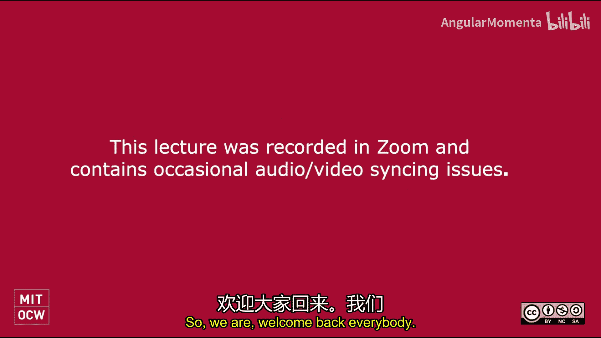
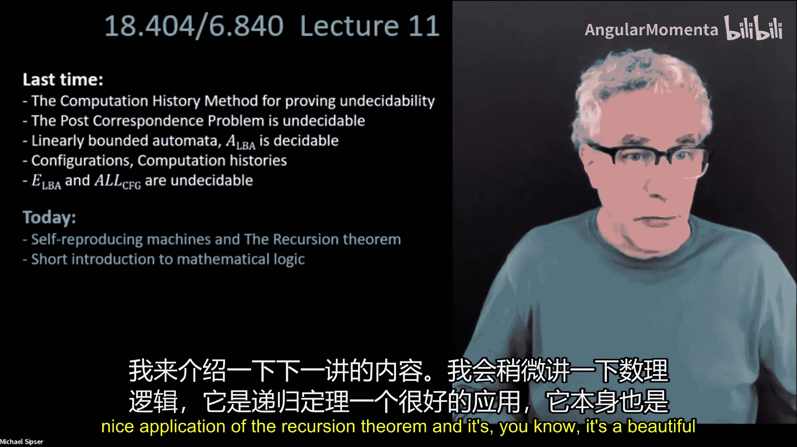
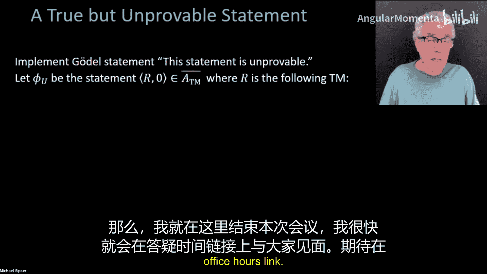
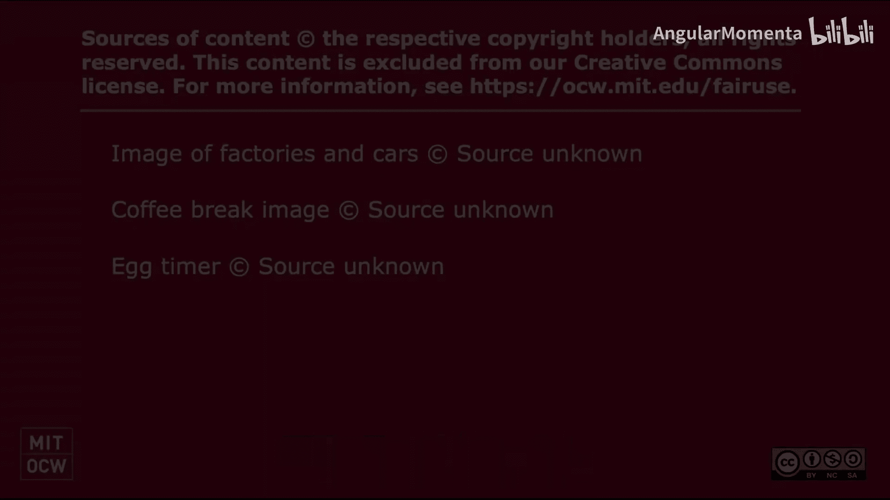
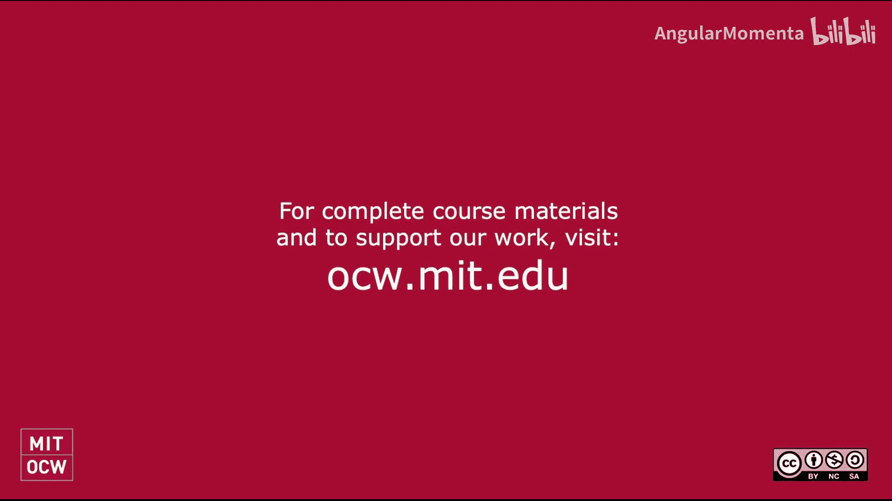

# 011：递归定理和逻辑

在本节课中，我们将学习计算理论中的一个重要概念——递归定理。递归定理揭示了图灵机（或任何程序）如何能够获取自身的描述，从而实现自引用。我们还将探讨递归定理的一个经典应用：哥德尔不完备性定理，它展示了在形式数学系统中存在无法被证明的真命题。

---

## 自复制悖论与可能性

上一节我们介绍了使用计算历史方法证明问题不可判定。本节中，我们来看看一个看似矛盾的概念：自复制机器。

想象一个制造汽车的工厂。通常，工厂的复杂度会高于它制造的汽车，因为它不仅包含制造汽车所需的所有指令和部件，还包含制造工具和机器人等额外部分。因此，一个能制造自身的工厂似乎是不可能的，因为它需要包含自身的完整描述以及制造所需的额外部件，这会导致无限循环。

然而，在现实世界中，生物体确实可以自我复制。这表明自复制机器在理论上是可能的。冯·诺依曼曾对此进行过著名论述。接下来，我们将展示如何构造一个能打印自身描述的图灵机。

---

## 构造自复制图灵机

首先，我们需要一个引理：存在一个可计算函数 **Q**，它可以将任何字符串 **W** 转换为一个图灵机 **P_W**，该图灵机在启动时会打印出字符串 **W** 并停机。

用公式表示：
**P_W = Q(W)**，其中 **P_W** 是一个图灵机，满足当运行 **P_W** 时，输出为 **W**。

基于此，我们可以构造自复制图灵机 **SELF**。**SELF** 由两部分组成：**A** 和 **B**。

以下是 **SELF** 的工作流程：
1.  **A** 部分运行。**A** 本身是图灵机 **P_B**，即一个会打印出 **B** 部分描述（字符串形式）的机器。运行后，**B** 的描述出现在纸带上。
2.  控制权传递给 **B** 部分。**B** 读取纸带上的内容（即 **B** 的描述），并计算 **Q(纸带内容)**。根据引理，**Q(纸带内容)** 的结果正是机器 **A**（因为 **A** 就是打印该内容的机器）。
3.  **B** 将得到的 **A** 的描述与纸带上原有的 **B** 的描述组合起来，形成完整的 **SELF** 的描述，并将其打印到纸带上。

关键点在于：**B** 不需要在自身代码中内嵌 **A** 的描述，而是通过计算 **Q** 函数动态获得。这就避免了循环引用和无限增长的问题。

---

## 递归定理

自复制是递归定理的一个特例。递归定理更一般地指出：任何图灵机都可以获得自身的描述。

递归定理的正式表述如下：
对于任意一个图灵机 **T**（它期望的输入中包含一个图灵机描述），存在另一个图灵机 **R**，使得对于所有输入 **w**，**R** 在 **w** 上的行为与 **T** 在输入 **<R, w>** 上的行为完全相同。

用公式表示：
**∀T ∃R ∀w: R(w) 的行为等价于 T(<R, w>)**。

这意味着，在编写图灵机 **R** 时，你可以假设它能以某种方式“拿到”自己的描述 **<R>**，并将其作为子程序 **T** 的输入之一。递归定理的证明构造与自复制图灵机构造类似，但增加了执行用户代码 **T** 的部分。

---

## 递归定理的应用

### 证明 **A_TM** 不可判定

之前我们用对角化法证明了 **A_TM**（接受性问题）不可判定。使用递归定理，我们可以得到一个更简洁的证明：

1.  假设存在判定器 **H** 可以判定 **A_TM**。
2.  利用递归定理构造图灵机 **R**，**R** 在输入 **w** 上执行以下操作：
    *   获取自身的描述 **<R>**。
    *   运行判定器 **H** 来检查 **<R, w>** 是否属于 **A_TM**（即询问 **H**：“**R** 会接受 **w** 吗？”）。
    *   如果 **H** 说“是”（**R** 接受 **w**），则 **R** 拒绝 **w**。
    *   如果 **H** 说“否”（**R** 不接受 **w**），则 **R** 接受 **w**。
3.  这就产生了矛盾：**H** 对 **<R, w>** 的预测总是错的。因此，这样的判定器 **H** 不可能存在。

### 极小图灵机的集合不可识别

一个图灵机是极小的，如果没有更短的图灵机与其语言完全相同。可以证明，所有极小图灵机构成的集合不是图灵可识别的。证明思路如下：

1.  假设存在一个枚举器 **E** 能枚举所有极小图灵机（或其无限子集）。
2.  利用递归定理构造图灵机 **R**，**R** 获取自身描述 **<R>** 后，启动枚举器 **E**，并等待直到 **E** 输出一个描述长度比 **<R>** 长的图灵机 **B**。
3.  **R** 随后模拟 **B** 在所有输入上的行为，因此 **L(R) = L(B)**。
4.  但 **R** 的描述比 **B** 短，这与 **B** 是极小图灵机的假设矛盾。因此，这样的枚举器 **E** 不存在，说明极小图灵机的集合不可识别。

---

## 递归定理与数学逻辑

递归定理的一个深刻应用在数学逻辑领域，即哥德尔第一不完备性定理。该定理指出：在任何足够强大且一致的形式数学系统中，都存在一些真命题，无法在该系统内被证明。

以下是证明思路的简化概述：

1.  **前提**：假设我们的形式系统满足：
    *   **可靠性**：系统内可证明的命题都是真的。
    *   **可检验性**：给定一个命题和一个候选证明，可以在有限步内机械地检验该证明是否正确。这意味着“（证明，命题）”对构成的集合是**可判定的**。
2.  **推论**：所有在该系统内**可证明的命题**构成的集合是**图灵可识别的**（只需系统性地生成所有可能的字符串，检验每个是否是某个命题的有效证明即可）。
3.  **构造**：考虑所有形如“图灵机 **M** 不接受输入 **w**”的命题。这些命题的集合本质上就是 **A_TM** 的补集。
4.  **矛盾**：如果系统中能证明所有这样的真命题，那么 **A_TM** 的补集就成为可识别的。但我们已知 **A_TM** 的补集不可识别。因此，系统中必然存在一些这样的真命题，是**无法被证明**的。
5.  **具体化**：利用递归定理，可以构造出一个具体的“哥德尔语句”**G**，其含义等价于“**G** 在本系统内不可证明”。通过逻辑分析可以得出，**G** 必然是一个真但不可证的命题。

这展示了递归定理如何帮助我们在数学系统中精确地构造出自指语句，从而揭示形式化推理的局限性。

---

## 总结

本节课我们一起学习了递归定理及其应用。
*   我们首先探讨了自复制机器的可能性，并构造了一个能打印自身代码的图灵机。
*   接着，我们介绍了更一般的递归定理，它允许程序在运行时获取自身的描述。
*   然后，我们看到了递归定理的应用：给出了 **A_TM** 不可判定的新证明，并证明了极小图灵机集合的不可识别性。
*   最后，我们简要探讨了递归定理在数学逻辑中的革命性应用，即哥德尔不完备性定理，它表明了形式数学系统固有的局限性。

递归定理是计算理论中一个连接程序自指、不可判定性和数理逻辑的优美而强大的工具。