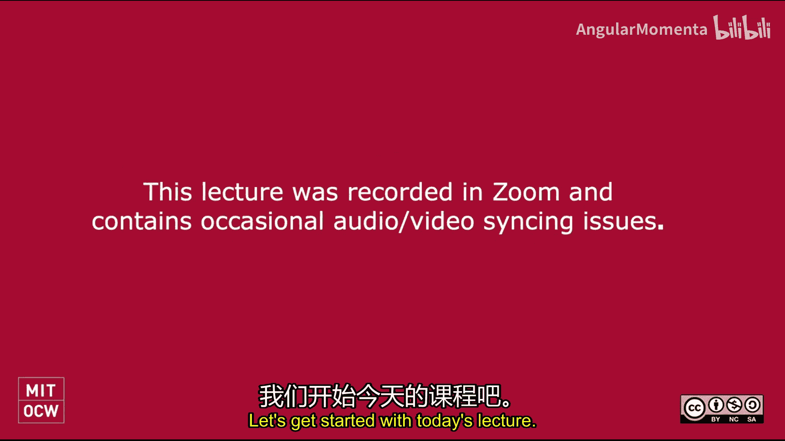
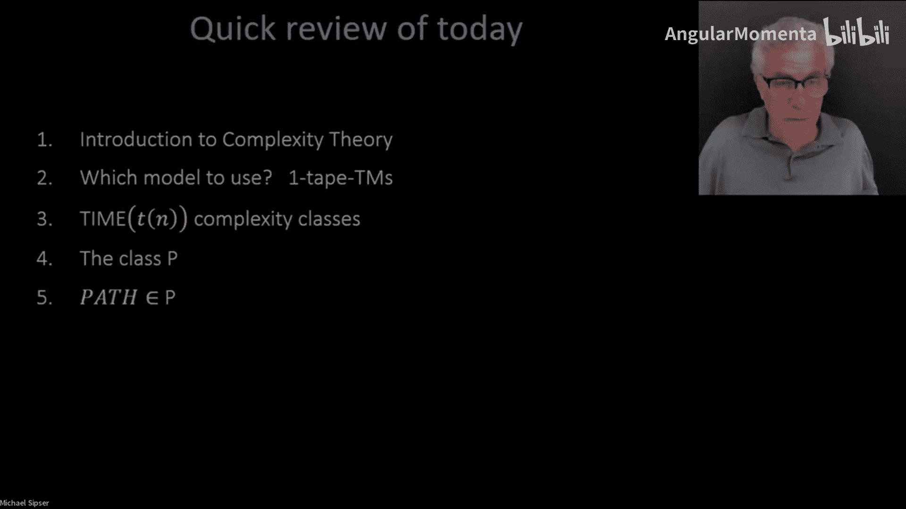
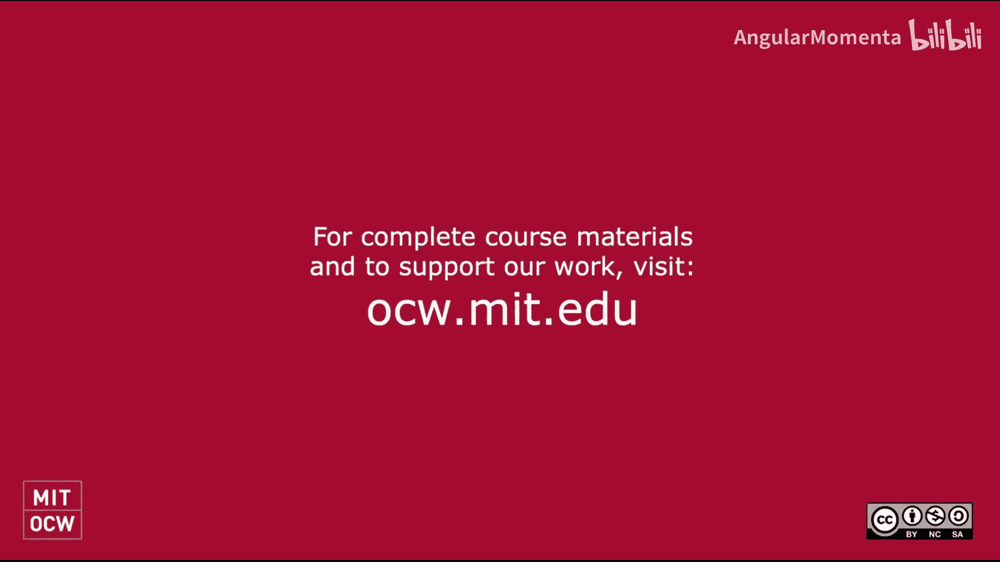

# 012：时间复杂度 🕒

在本节课中，我们将要学习计算复杂性理论的基础，特别是时间复杂度的概念。我们将从可计算性理论转向复杂性理论，探讨如何衡量算法所需的资源（如时间），并定义重要的复杂性类，如P类。

---

## 课程概述

在上一节中，我们介绍了递归定理及其应用。本节中，我们将完全转变方向，开始学习计算复杂性理论。复杂性理论关注的是**可判定语言**，但核心问题是“需要多少资源（如时间）来判定一个语言”。这与可计算性理论中“是否可判定”的问题形成了对比。

我们将首先通过一个例子来建立直觉，然后正式定义时间复杂度类，并介绍一个核心概念：**P类**，即多项式时间内可判定的语言集合。

---

## 从例子出发：分析一个语言的时间需求

考虑语言 **A = {a^k b^k | k ≥ 0}**。这是一个可判定语言。现在，我们关心的是：判定这个语言需要多少时间？

分析时间复杂度时，我们通常关注**最坏情况复杂度**。即，对于每个输入长度 `n`，我们考虑解决该长度下**所有可能输入**所需的最大步骤数。我们使用 **大O记号** 来描述运行时间的上界，忽略常数因子。

**大O记号定义**：
对于函数 `f(n)` 和 `g(n)`，我们说 `f(n) = O(g(n))`，如果存在正常数 `c` 和 `n0`，使得对所有 `n ≥ n0`，都有 `f(n) ≤ c * g(n)`。

### 单带图灵机上的算法

首先，我们证明一个定理：在单带图灵机上，语言A可以在 **O(n²)** 时间内判定。

**算法描述**：
1.  扫描整个输入，检查其形式是否为 `a*b*`。如果不是，则立即拒绝。
2.  进入一个循环，在每次循环中：
    *   扫描整个磁带，划掉一个 `a` 和一个 `b`。
    *   如果在划掉过程中，一种符号先用尽而另一种还有剩余，则拒绝。
3.  如果所有 `a` 和 `b` 都被成对划掉，则接受。

**时间复杂度分析**：
*   第一阶段扫描需要 O(n) 步。
*   循环需要 O(n) 次迭代（因为每次划掉一对符号）。
*   每次迭代需要扫描整个磁带，即 O(n) 步。
*   总时间为 O(n) + O(n) * O(n) = **O(n²)**。

这个算法直观但并非最优。一个自然的问题是：我们能否做得比 O(n²) 更好？

---

## 改进算法与模型依赖性

以下是针对语言A的改进算法，它展示了模型选择如何影响时间复杂度。

### 更优的单带图灵机算法

我们可以设计一个在单带图灵机上以 **O(n log n)** 时间运行的新算法。

**算法核心思想**：
不再每次划掉一个 `a` 和一个 `b`，而是每次扫描时，划掉**每隔一个**的 `a` 和 `b`。同时，在有限状态控制中跟踪剩余 `a` 和 `b` 数量的**奇偶性**。如果任何一次扫描中，`a` 和 `b` 的奇偶性不匹配，则拒绝。如果所有符号都被划掉且奇偶性始终匹配，则接受。

**时间复杂度分析**：
*   初始检查：O(n)。
*   循环次数：O(log n)（因为每次划掉一半的符号）。
*   每次扫描：O(n)。
*   总时间：O(n log n)。

可以证明，对于单带图灵机，O(n log n) 是解决此问题的最佳可能时间。任何运行时间低于 **o(n log n)** 的算法，其判定的语言都将是正则语言，而A不是正则语言。

### 多带图灵机带来的优势

如果我们使用**多带图灵机**，可以显著提高效率。

**算法描述（双带图灵机）**：
1.  将输入带上的所有 `a` 复制到第二个工作带上。
2.  输入带头部继续读取 `b`，同时工作带头部回到起始位置。
3.  每读一个 `b`，就在工作带上匹配划掉一个 `a`。
4.  如果 `a` 和 `b` 同时匹配完毕，则接受；否则拒绝。

**时间复杂度分析**：
此算法只需对输入进行常数次扫描，总时间为 **O(n)**。

这个例子揭示了复杂性理论中的一个关键点：**模型依赖性**。在可计算性理论中，图灵机、RAM等模型在“可判定性”上是等价的。但在复杂性理论中，不同模型所需的**时间资源**可能不同（例如，从 O(n log n) 到 O(n)）。

---

## 定义时间复杂度类

为了建立独立于具体模型的稳健理论，我们做出以下观察：所有“合理的”确定性计算模型（如单带/多带图灵机、RAM模型）在多项式时间内是相互可模拟的。即，一个模型上时间为 `T(n)` 的算法，在另一个模型上模拟最多需要 `T(n)^k` 的时间（`k` 为某个常数）。

这意味着，如果我们只关心**多项式时间**与**指数时间**这样的本质区别，而忽略 `n²` 与 `n³` 之间的差异，那么模型的选择就不再是关键。这使我们能够专注于一类重要的问题。

我们选择**单带图灵机**作为定义时间复杂度的基础模型。

**时间可构造函数定义**：
如果函数 `T: N → N` 满足 `T(n) ≥ n` 且存在一台图灵机能在 `O(T(n))` 时间内计算出 `1^n → 1^{T(n)}` 的映射，则 `T(n)` 是一个时间可构造函数。常见的 `n`、`n log n`、`n²`、`2^n` 都是。

**时间复杂度类 TIME 定义**：
设 `T(n)` 是一个时间可构造函数。`TIME(T(n))` 是所有能被一台**确定性单带图灵机**在 `O(T(n))` 时间内判定的语言的集合。

这些复杂度类形成一个层次结构：`TIME(n)` ⊆ `TIME(n log n)` ⊆ `TIME(n²)` ⊆ ...

---

## 多项式时间与 P 类 🏁

基于时间层次，我们定义理论计算机科学中最重要的复杂性类之一：**P 类**。

**P 类定义**：
`P = ∪_{k} TIME(n^k)`
即，P 是所有能在多项式时间内被**确定性单带图灵机**判定的语言的集合。

**为什么 P 类如此重要？**
1.  **模型无关性**：由于所有合理模型都是多项式相关的，使用多带图灵机、RAM等模型定义的 P 类与单带图灵机定义的 P 类是**相同的**。这恢复了我们在可计算性理论中享有的模型独立性。
2.  **实践相关性**：尽管 `n¹⁰⁰` 这样的多项式时间在实际中可能也很慢，但 P 类在理论上通常被视为“高效可解”问题的标志。它排除了需要指数级搜索的暴力算法，是密码学、算法设计等领域的一个关键分界线。

---

## 示例：PATH 问题属于 P

让我们看一个属于 P 的具体问题。

**PATH 问题定义**：
给定一个有向图 `G` 以及两个节点 `s` 和 `t`，判断 `G` 中是否存在一条从 `s` 到 `t` 的路径。

**证明 PATH ∈ P**：
我们可以使用广度优先搜索（BFS）算法。
1.  标记起点 `s`。
2.  重复以下步骤直到没有新节点被标记：将所有从**已标记节点**通过一条边直接到达的**未标记节点**进行标记。
3.  检查终点 `t` 是否被标记。若是，则接受；否则拒绝。

**（高级别）时间复杂度分析**：
*   最多有 `n` 个节点需要标记，所以外层循环最多 `n` 次迭代。
*   每次迭代需要检查所有边，最多有 `n²` 条边。
*   在单带图灵机上实现这些操作，每一步都可以在多项式时间内完成。
*   因此，总运行时间是输入规模 `n` 的某个多项式。故 **PATH ∈ P**。

在分析属于 P 类的问题时，我们通常只需说明算法的每个阶段都是多项式时间，且阶段数是多项式，而无需给出精确的多项式次数。

---

## 一个未知的领域：HAMPATH 问题

现在考虑一个与 PATH 类似但更难的问题。

**HAMPATH 问题定义**：
给定一个有向图 `G` 以及两个节点 `s` 和 `t`，判断 `G` 中是否存在一条从 `s` 到 `t` 的**哈密顿路径**，即一条经过 `G` 中**每个节点恰好一次**的路径。

**一个指数时间算法**：
一个简单的算法是枚举所有可能的节点排列（共 `m!` 种，`m` 为节点数），检查每个排列是否构成一条从 `s` 到 `t` 的有效路径。这需要 `Ω(m!)` 时间，是超多项式（指数级）的。

**核心问题**：**HAMPATH ∈ P 吗？**
目前没有人知道这个问题的答案。寻找 HAMPATH 的多项式时间算法，或者证明这样的算法不存在，是计算机科学中最著名的开放问题之一——**P 与 NP 问题**的核心。我们将在后续课程中深入探讨这个问题。

---

## 课程总结

本节课中，我们一起学习了计算复杂性理论的入门知识：
1.  我们引入了**时间复杂度**的概念，使用**最坏情况分析**和**大O记号**。
2.  通过语言 `{a^k b^k}` 的例子，我们看到了算法分析以及**计算模型的选择**（单带 vs 多带图灵机）如何影响时间复杂度。
3.  我们定义了**时间复杂度类** `TIME(T(n))`，并基于单带图灵机模型定义了核心的 **P 类**（多项式时间可判定语言）。
4.  我们理解了 P 类的重要性在于其**模型无关性**和**实践意义**。
5.  我们分析了 **PATH 问题属于 P**，并对比了看似相似但复杂度未知的 **HAMPATH 问题**，引出了 P 与 NP 这个未解之谜。

从下一讲开始，我们将以 P 类为基石，进一步探索更广阔的复杂性世界。