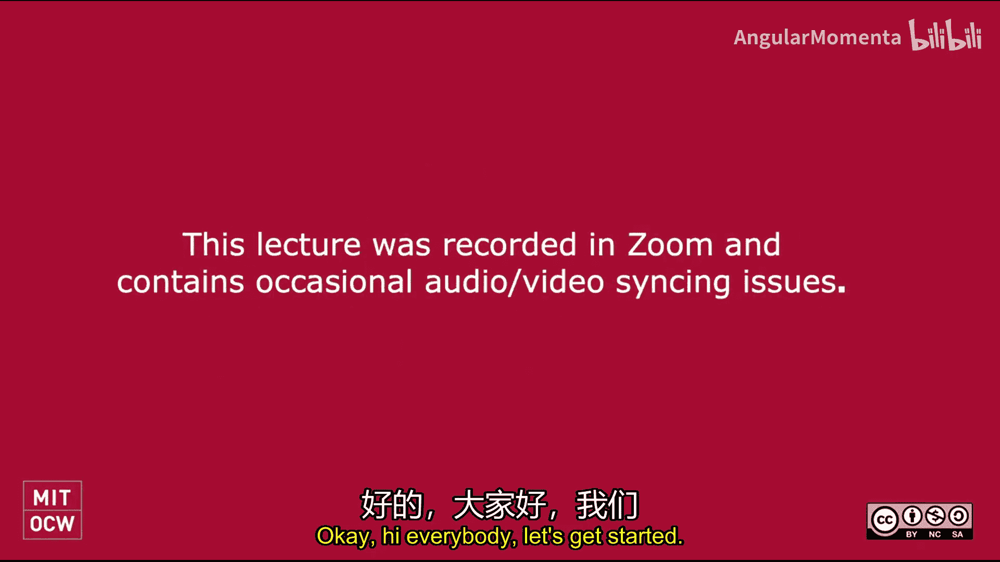
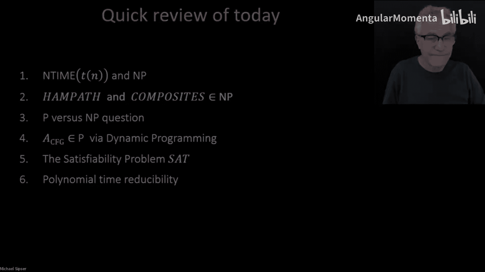

# 013：P和NP，SAT，多项式时间可归约性

## 概述
在本节课中，我们将学习计算复杂性理论的核心概念。我们将回顾确定性多项式时间类P，并引入非确定性多项式时间类NP。我们将探讨P与NP的关系这一著名未解问题，并通过哈密顿路径问题和合数问题等例子来理解NP类。我们还将介绍动态规划这一基本多项式时间算法，并开始接触多项式时间归约的概念，为理解NP完全性打下基础。

## 回顾：P类与时间复杂性
上一节我们介绍了时间复杂性类。时间复杂性类是在特定时间界限内可解决的语言集合。例如，TIME(n²)包含所有能在n²时间内解决的问题。我们将问题等同于语言。

类P是所有能在多项式时间内解决的问题的集合。它是所有多项式时间界限（如n², n³, n⁵等）对应语言集合的并集。我们证明了P类在合理的确定性模型选择下是不变的，这论证了其自然性。

我们以PATH问题为例，给出了一个多项式时间算法。接着，我们引入了哈密顿路径问题（HAMPATH）。

## 哈密顿路径问题（HAMPATH）
哈密顿路径问题是指：给定一个图以及起点s和终点t，是否存在一条从s到t的简单路径，该路径恰好访问图中每个节点一次。

目前尚不清楚HAMPATH问题是否在P类中。我们可以通过尝试所有可能的路径来得到一个指数时间的正确算法，但这无法给出多项式时间算法。这是一个尚未解决的难题。

有趣的是，如果能找到HAMPATH的多项式时间算法，将产生惊人的后果。例如，它将立即为分解大整数等许多其他我们尚不知如何多项式求解的问题提供多项式时间解法。尽管分解问题与哈密顿路径问题看似无关，但我们将在后续课程中建立这种联系。

## 非确定性时间复杂性
现在，我们开始讨论非确定性复杂性，作为确定性复杂性的一个变体。

首先，在本课程这部分，所有机器都是判定器，所有语言都是可判定的。非确定性机器作为判定器，意味着在每一个输入上，它的所有计算分支都必须在有限步内停机。

非确定性机器所用时间的定义是：我们单独查看每个分支。一台非确定性图灵机在T(n)时间内运行，如果它的所有分支都在T(n)步内停机。这是获得有用概念的正确方式。

## 定义：NTIME与NP类
我们定义非确定性时间复杂性类NTIME。NTIME(T(n))是所有能被一台在O(T(n))时间内运行的非确定性图灵机判定的语言集合。

可以将其与确定性时间类TIME（或DTIME）类比。NTIME中的计算可以想象为一棵计算树，所有分支都必须在T(n)步内停机。

类比P类，我们定义NP类为所有能在非确定性多项式时间内解决的语言集合。它是所有多项式时间界限对应的NTIME类的并集。

NP类同样不依赖于合理的非确定性模型选择，因此从数学角度看是一个非常自然的类。从实践角度看，它捕捉了那些成员资格可以快速验证的问题。

## NP类与可验证性
NP类中的问题有一个关键特征：当你有一个属于该语言的实例时，存在一种方法可以快速验证这一点。这种验证方法通常被称为一个**证书**或**简短证明**。

*   对于HAMPATH问题，证书就是那条哈密顿路径本身。
*   对于合数问题（COMPOSITES），证书就是一个非平凡因子。

相比之下，证明一个数是素数（没有非平凡因子）则不那么显然。能够快速验证成员资格是理解NP类的核心直觉。

## P与NP的关系
P类显然是NP的子集，因为确定性机器是非确定性机器的特例。从可验证性角度看，如果你能快速测试成员资格（P），那么你当然也能快速验证它（NP），此时证书甚至无关紧要。

核心问题是：**P类是否等于NP类？** 即，能够快速验证成员资格（使用证书）是否意味着你也能在不依赖证书的情况下，自己快速测试成员资格？

对于像HAMPATH这样的问题，我们是否需要确定性地搜索答案，还是能找到某种不需要搜索的直接多项式解法？大多数人相信P ≠ NP，但至今无人能证明。证明某个问题（如HAMPATH）没有多项式时间算法非常困难，因为多项式时间算法构成的类别非常丰富和强大。

## 动态规划：一个关键的多项式时间算法
为了展示多项式时间算法的能力，我们介绍**动态规划**。这是一种通过记住已解决的子问题来避免重复计算，从而将可能是指数级的递归算法转化为多项式时间算法的技术。

我们以上下文无关文法成员资格问题（ACFG）为例。给定一个上下文无关文法G和一个字符串w，判断w是否在L(G)中。

一个简单的递归思路是：对于文法中的每个变量A和w的每个子串，检查A是否能推导出该子串。但朴素的递归会导致指数级重复计算。

关键观察是：不同的子问题数量是有限的。子串的数量是O(n²)，变量的数量也是有限的。因此，总的不同子问题数量是多项式级别的。

动态规划算法（带记忆化的递归）会维护一个表格，记录已解决的子问题及其答案。在每次递归调用前，先检查表格。这样，总计算量就被限制在多项式范围内，从而得到一个多项式时间算法。

动态规划还有另一种“自底向上”的视角：先解决所有最小的子问题（如长度为1的子串），然后利用它们的结果逐步构建更大子问题的解。这两种视角是等价的。

## 布尔可满足性问题（SAT）
现在，我们转向理解P和NP的另一个核心：**布尔可满足性问题（SAT）**。

布尔公式由布尔变量（取真/假值）通过逻辑运算符与（∧）、或（∨）、非（¬）连接而成。一个布尔公式是**可满足的**，如果存在对其变量的某种真值赋值，使得整个公式计算结果为真。

例如，公式 φ = (x ∨ y) ∧ (¬x ∨ ¬y) 是可满足的。赋值 x=真, y=假 可使公式为真。

SAT语言就是所有可满足的布尔公式的集合。判断一个公式是否属于SAT，即判断它是否可满足。

SAT问题在NP类中，因为如果公式可满足，一个满足赋值就是其成员资格的简短证书。

## 库克-列文定理与多项式时间归约
有一个非凡的定理（由Cook和Levin独立发现）将SAT问题与整个NP类联系起来：**如果SAT ∈ P，那么 NP = P**。

证明这一点的关键工具是**多项式时间归约**。它类似于我们之前学过的映射归约，但要求归约函数本身必须在多项式时间内计算。

多项式时间归约的意义在于：如果问题A可以多项式时间归约到问题B（记作 A ≤ₚ B），并且B ∈ P，那么A ∈ P。

库克-列文定理的惊人之处在于，它证明了 **NP中的每一个问题都可以多项式时间归约到SAT问题**。因此，如果你能把SAT“拉进”P类（即证明SAT ∈ P），那么通过归约，NP中的所有问题都会被一起拉进P类，从而证明P = NP。

这类似于可计算性理论中，我们证明了所有图灵可识别语言都可以映射归约到A_TM。这里存在许多类比。

## 总结
本节课我们一起学习了计算复杂性理论的基础。我们回顾了P类，正式定义了NP类和非确定性时间复杂性。我们通过哈密顿路径、合数等例子理解了NP类对应“容易验证”的问题。我们探讨了P与NP关系这一核心未解问题。接着，我们介绍了动态规划这一强大的多项式时间算法设计技术，并以ACFG问题为例展示了其应用。最后，我们引入了布尔可满足性问题（SAT）和多项式时间归约的概念，并概述了库克-列文定理的核心思想：SAT在NP中具有特殊地位，所有NP问题都可归约到它。这为下一讲深入探讨NP完全性奠定了基础。