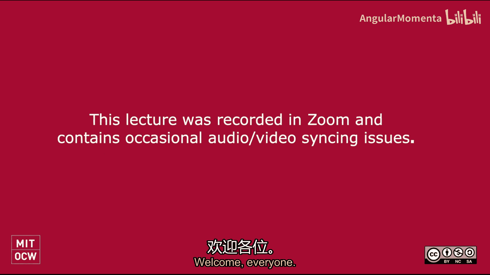

# 014：NP-完全性

在本节课中，我们将学习NP-完全性这一核心概念。我们将回顾多项式时间归约，并介绍两个重要问题：3SAT和团问题。我们将展示如何将3SAT问题多项式时间归约到团问题，从而理解NP-完全问题的“难度”是如何传递的。最后，我们将正式定义NP-完全性，并探讨其重要性。

## 多项式时间归约与NP问题回顾

上一节我们介绍了多项式时间归约的概念。本节中，我们来看看这个概念如何帮助我们理解问题的计算难度。

多项式时间归约遵循我们之前讨论的归约模式：如果问题A可归约到问题B，且问题B是容易解决的，那么问题A也变得容易解决。具体来说，我们关注的是映射归约，但要求归约函数本身可以在多项式时间内计算。

我们有一个关键结论：如果A可多项式时间归约到B，且B属于P类，那么A也属于P类。这个结论对于后续的整个讨论至关重要。

关于P和NP的直观理解是：P类问题是那些可以快速判定成员资格的问题，而NP类问题是那些可以快速验证成员资格的问题。验证通常需要一个“证书”来证明输入属于该语言。

该领域的核心未解问题是P是否等于NP，即P与NP问题。我们尚不知道答案。如果P等于NP，意味着所有涉及搜索的NP问题都可以在不进行穷举搜索的情况下快速解决；如果P不等于NP，则存在一些本质上需要搜索的问题。

为了探索这个问题及其影响，我们引入了可满足性问题。我们提到（将在下一讲证明）一个非常卓越的定理：如果可满足性问题可以在多项式时间内解决，那么所有NP问题都可以在多项式时间内解决。也就是说，如果SAT属于P，则P等于NP。从这个意义上说，SAT是NP问题中最“难”的问题，所有NP问题的难度都蕴含在SAT之中。

证明这个定理的关键工具就是多项式时间归约。我们将展示NP中的每一个问题都可以多项式时间归约到SAT。为了建立这种归约的直觉，我们今天将看一些具体的多项式时间归约例子，首先介绍两个新问题：3SAT和团问题。

## 引入3SAT与团问题

以下是两个我们将要讨论的问题。

### 3SAT问题

首先，我们考虑一种特殊形式的布尔公式，称为合取范式。

合取范式公式按特定方式组织：它包含由“与”操作连接起来的组，这些组称为子句；在每个子句内部，元素由“或”操作连接。这些元素要么是变量，要么是变量的否定（即文字）。

*   **文字**：一个变量或其否定。
*   **子句**：多个文字的“或”运算。
*   **合取范式公式**：多个子句的“与”运算。

一个**3CNF公式**是每个子句恰好包含三个文字的CNF公式。例如，公式 `(x1 ∨ ¬x2 ∨ x3) ∧ (¬x1 ∨ x4 ∨ ¬x5) ∧ (x2 ∨ x5 ∨ x6)` 就是一个3CNF公式。

**3SAT问题**就是可满足性问题限制在3CNF公式上。它是所有可满足的3CNF公式的集合。你可能会认为这个特例比一般的SAT问题更容易，但事实证明并非如此，解决这个特例与解决一般情况同样困难。

### 团问题

现在，我们转向第二个问题：团问题。这涉及到图论。我们考虑由点和连接线组成的图。

*   **团**：图中一个节点子集，其中每对节点之间都有边直接相连。
*   **K-团**：一个包含K个节点的团。

**团问题**是：给定一个图和一个目标大小K，判断图中是否存在一个大小为K的团。显然，团问题是可判定的，你可以尝试所有可能的K个节点的子集，检查它是否构成一个团。但这通常是指数级算法。同时，团问题也属于NP，因为如果你有一个团作为证书，可以很容易地验证一个图是否包含一个K-团。

我们将要展示的是，3SAT问题和团问题是相关的，你可以将3SAT多项式时间归约到团问题。这看起来有些令人惊讶，因为这两个问题表面上非常不同。但我们将给出这个归约，这意味着如果你能找到快速解决团问题的方法，那么你也能快速解决3SAT问题。这正是本节的核心要点。

## 从3SAT到团问题的归约

我们将展示如何将3SAT问题多项式时间归约到团问题。这是你需要理解的一种典型归约，因为你可能会在作业或考试中遇到类似题目。

从高层次看，我们正在展示如何将布尔公式的可满足性问题重新编码为测试图是否包含团的问题。

根据定义，我们需要给出一种方法，将公式φ转换为一个图G和一个数K，使得公式φ是可满足的，当且仅当图G有一个K-团。

我们通过一个例子来演示。首先，我们需要理解像φ这样的公式可满足意味着什么，因为这有助于进行归约。由于公式是合取范式，使其为真对应于使每个子句为真。而要使一个子句为真，必须使其中的至少一个文字为真。因此，满足赋值就是在每个子句中至少使一个文字为真。这是进行归约的基础。

现在，我们进行归约。我们将这个公式转换为一个图和一个数K。我将分两步进行：首先说明图的节点是什么，然后说明边是什么，最后说明数K是什么。我们还需要确保构建这个图的程序可以在多项式时间内完成，这一点在完成后会很明显。

**第一步：定义节点**
图G的节点对应于公式中的每一个文字。每个文字都成为图中的一个节点，并用该文字的名称标记。因此，对于公式中的每个文字，我们都有一个对应的标记节点。

**第二步：定义边**
我将通过首先说明哪些边是“禁止”的来定义边，然后包含所有其他边。

禁止的边有两种类型：
1.  来自同一子句的节点之间的边。即，子句内部没有边。
2.  连接具有不一致标签的节点之间的边。例如，连接 `a` 和 `¬a` 的边是被禁止的。

在列出所有禁止边之后，我们将在所有未被禁止的节点对之间添加边。也就是说，如果两个节点既不在同一个子句中，标签也不矛盾，那么它们之间就有一条边。

**第三步：定义K**
K等于公式中子句的数量。这就是我们要在图G中寻找的团的大小。

我声称，这样构造出来的图G将有一个K-团，当且仅当φ是可满足的。这很巧妙：如果φ可满足，那么图中会有一个K-团；如果φ不可满足，则没有。

接下来，我们需要论证为什么这个构造是有效的。这是一个“当且仅当”的证明，需要从两个方向进行。

**证明方向一：如果φ可满足，则G有K-团**
假设φ可满足，则存在一个满足赋值。在一个CNF公式的满足赋值中，每个子句至少有一个文字为真。从每个子句中任意选取一个为真的文字。现在，查看G中对应的节点。我们声称这些节点一起构成了一个K-团。
*   节点数量：因为我们从每个子句选一个节点，而K是子句数，所以我们恰好有K个节点。
*   连通性：我们需要证明这些节点之间两两相连。根据构造，只要两个节点之间没有禁止边，它们就有边相连。我们选取的节点之间会有禁止边吗？
    *   它们不可能来自同一个子句，因为我们每个子句只选了一个节点。
    *   它们不可能具有不一致的标签，因为它们都来自同一个赋值，都是为真的文字。不可能在一个子句中a为真，而在另一个子句中¬a为真，因为如果a为真，那么¬a必然为假，不可能成为那个子句中的真文字。
因此，我们选取的节点对之间都没有禁止边，所以它们之间都有边相连。这就构成了一个K-团。

**证明方向二：如果G有K-团，则φ可满足**
假设G有一个K-团。首先，观察这个团中每个子句恰好有一个节点。
*   它不可能在一个子句中有两个节点，因为根据构造，同一子句中的节点之间没有边，所以它们不能同时出现在一个团中（团要求所有节点对之间都有边）。
*   它也不可能缺少某个子句的节点。因为总共有K个子句，而团有K个节点。如果某个子句没有节点，那么必然有另一个子句有两个节点，这已经排除了。
因此，这个K-团在每个子句中恰好有一个节点。

现在，我们从这个团得到一个满足赋值：取团中每个节点对应的文字，将这些文字设置为真（如果文字是¬a，则将变量a设置为假）。这样，我们在每个子句中设置了一个文字为真，因此得到了一个满足赋值。需要仔细检查的是，我们不会试图同时将a和¬a都设为真。但根据构造，a和¬a之间没有边，所以它们不可能同时出现在同一个团中。因此，赋值是一致的。

最后，这个归约可以在多项式时间内完成，因为从公式构造图的过程是直接的：为每个文字创建节点，根据简单规则添加边，并计算子句数量。

这个证明表明，如果我能快速解决团问题，那么我就能快速解决3SAT问题。因为我刚刚展示了如何将这些公式转换为图。

## NP-完全性的定义与重要性

现在，让我们来讨论NP-完全性。我们虽然还不会证明SAT是NP-完全的，但至少可以给出定义。

一个语言B被称为**NP-完全的**，如果它满足两个性质：
1.  B属于NP。
2.  NP中的每一个语言都可以多项式时间归约到B。

简单来说，它既是NP的成员，又是NP中最“难”的问题（所有NP问题都可以归约到它）。这就是我们声称SAT所具有的神奇性质：SAT显然在NP中，而Cook-Levin定理将表明NP中的所有问题都可以归约到SAT。因此，SAT将是我们的第一个NP-完全问题。

由此我们得到一个重要推论：如果SAT（或任何其他NP-完全问题）被证明可以在多项式时间内解决，那么**每一个**NP问题都可以在多项式时间内解决。这是直接的，因为所有问题都可以多项式时间归约到这个NP-完全问题，如果你能轻松解决它，通过归约就能轻松解决一切。

Cook-Levin定理指出SAT是NP-完全的。我们将在下一讲证明它。但为了本讲后续的讨论，我们假设我们知道它是真的。

基于SAT是NP-完全的假设，并且我们展示了3SAT可以多项式时间归约到团问题，再加上SAT本身可以归约到3SAT（我们稍后会看到），那么通过归约的传递性，3SAT和团问题也都是NP-完全的。因为任何NP问题都可以先归约到SAT，再归约到3SAT，再归约到团问题。

一般来说，要证明某个语言是NP-完全的，一个典型方法是证明某个已知的NP-完全问题（如3SAT）可以多项式时间归约到它。

**为什么NP-完全性这个概念重要？** 有两个主要原因：
1.  **实践指导**：如果你在研究一个新的计算问题（例如机器人运动规划），并试图为其寻找多项式时间算法，但随后证明该问题是NP-完全的，这提供了强有力的证据表明该问题可能**不**在P中。因为如果它在P中，将意味着P=NP，这将是一个惊天动地的发现。因此，NP-完全性证明通常被视为放弃寻找精确多项式时间算法、转而寻求近似算法或启发式方法的理由。
2.  **理论意义**：对于试图证明P≠NP的理论学家来说，NP-完全性保证了你不会“选错问题”。如果你选择研究一个NP-完全问题，并成功证明它不在P中，那么你就直接证明了P≠NP。反之，如果你选择了一个实际上是P的问题（比如质数判定，在多年前曾被认为是NP的候选），那么你的努力可能会白费。NP-完全问题则没有这个风险：如果P≠NP，那么NP-完全问题肯定不在P中。

## 总结

本节课中，我们一起学习了NP-完全性的核心概念。我们回顾了多项式时间归约，并介绍了3SAT和团问题。我们详细演示了如何将3SAT问题多项式时间归约到团问题，理解了这种归约如何将计算难度从一个问题传递到另一个问题。最后，我们正式定义了NP-完全性，并讨论了它在理论计算机科学和实际问题中的重要性。这为我们后续深入理解Cook-Levin定理以及更多NP-完全问题奠定了基础。