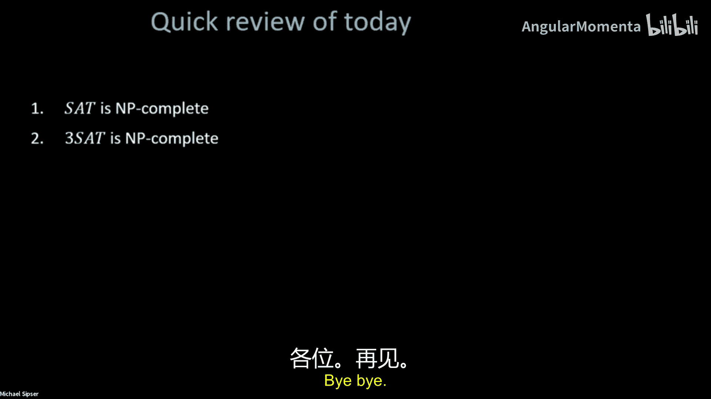
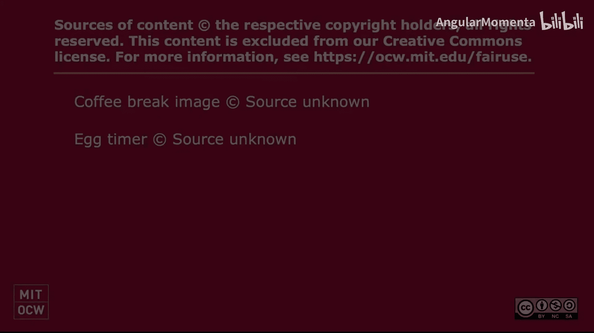

# 015：库克-莱文定理

在本节课中，我们将学习NP完全性理论的核心定理——库克-莱文定理。我们将证明布尔可满足性问题（SAT）是NP完全的，并介绍如何将SAT归约到3-SAT。理解这些证明是掌握NP完全性概念的关键。

## 概述

我们首先回顾NP完全性的定义。一个语言是NP完全的，如果它属于NP类，并且NP类中的**每一个**其他问题都可以在多项式时间内归约到它。如果任何一个NP完全问题被证明存在多项式时间算法，那么P就等于NP。反之，如果P不等于NP，那么所有NP完全问题都是难解的。

上一节我们介绍了NP完全性的概念，本节中我们将深入证明库克-莱文定理，即SAT是NP完全的。

## 证明SAT是NP完全的

证明分为两部分：
1.  SAT属于NP类。
2.  NP中的**任何**语言A都可以在多项式时间内归约到SAT。

第一部分很简单：对于一个布尔公式，其可满足性的“证据”就是一个令其值为真的变量赋值。我们可以在多项式时间内验证这个赋值。

第二部分是证明的核心。我们需要为任意一个NP语言A构造一个归约。设A由某个非确定性图灵机M在`n^k`时间内判定。我们的目标是，给定输入字符串w，在多项式时间内构造一个布尔公式`φ_M,w`，使得`w ∈ A`当且仅当`φ_M,w`是可满足的。

这个公式的核心思想是**模拟**图灵机M在输入w上的计算。如果M接受w，那么存在一条接受的计算分支。我们将这条分支的计算历史编码成一个表格，称为**格局表**。然后，我们构造一个布尔公式来描述一个合法的、接受的计算格局表的存在性。

### 构造格局表

格局表是一个`n^k`行 `n^k`列的表格。
*   每一行代表计算历史中的一个**格局**（即机器在某个时刻的完整快照）。
*   第一行是**起始格局**。
*   最后一行包含**接受状态**。
*   表格的尺寸`n^k × n^k`确保了即使机器在`n^k`步内尽可能向右移动，其读写头也不会超出表格范围。

如果M接受w，则存在至少一个这样的合法格局表。如果M不接受w，则不存在任何合法的格局表。

### 编码为布尔变量

为了用布尔公式描述这个表格，我们为表格中的每一个单元格`(i, j)`和每一个可能的符号`σ`（属于机器的带字母表Γ或状态集Q）创建一个布尔变量`x_{i,j,σ}`。
*   如果`x_{i,j,σ} = TRUE`，则表示单元格`(i, j)`中包含符号`σ`。
*   这可以看作是一种“独热编码”：每个单元格中，有且仅有一个对应的变量为真。

### 构造布尔公式 φ_M,w

整个公式`φ_M,w`由四个子公式合取而成，分别确保格局表的四个关键属性：

**1. φ_cell：每个单元格有且仅有一个符号**
这个子公式确保每个单元格的变量设置是合理的。对于每个单元格`(i, j)`，它包含两部分：
*   **至少有一个符号**：`⋁_{σ ∈ Γ ∪ Q} x_{i,j,σ}`
*   **至多有一个符号**：对于所有不同的符号对`σ, τ`，`¬(x_{i,j,σ} ∧ x_{i,j,τ})`
然后将这两个条件对所有的`i, j`进行合取。

**2. φ_start：第一行是起始格局**
这个子公式硬性规定表格第一行的内容必须与输入w的起始格局完全一致。例如：
*   `x_{1,1,q0} = TRUE` （起始状态在第一个单元格）
*   `x_{1,2,w1} = TRUE` （输入的第一个符号）
*   ... 以此类推，直到`x_{1,n+1,w_n}`，后面的单元格则规定为空白符。

**3. φ_accept：最后一行包含接受状态**
这个子公式要求在接受格局（最后一行）中，至少有一个单元格包含接受状态`q_accept`：
`⋁_{1 ≤ j ≤ n^k} x_{n^k, j, q_accept}`

**4. φ_move：相邻行之间的转移是合法的**
这是最复杂的部分，它确保表格中每一行都是根据M的转移函数从前一行合法得到的。我们利用图灵机操作的**局部性**：一个格子下一时刻的内容，只取决于当前时刻它自身及其左右邻居格子的内容。

我们检查所有`2×3`的“窗口”（覆盖两行、三列）。一个窗口是**合法**的，如果它的内容不违反M的转移规则（例如，读写头的移动、符号的改写都符合规则）。非法窗口的例子包括：符号无端变化、状态凭空出现或消失、同一行出现两个状态等。

`φ_move`子公式断言：**表格中每一个`2×3`窗口都是合法的**。对于每个窗口位置，我们列出所有可能的合法窗口配置（这是一个只依赖于M的固定集合），然后断言当前窗口的变量设置必须匹配其中一种合法配置。这通过一个析取式来实现，然后对所有可能的窗口位置进行合取。

**关键引理**：如果表格的每一个`2×3`窗口都合法，并且`φ_start`和`φ_cell`成立，那么整个表格就构成一个从起始格局到接受格局的合法计算历史。

### 归约的正确性与多项式时间

*   **正确性**：如果`w ∈ A`，则存在一条接受计算分支，我们可以根据它填充格局表，并设置相应的变量为真，这将满足整个公式`φ_M,w`。反之，如果`φ_M,w`可满足，则满足的变量赋值定义了一个所有窗口合法、起始正确、结束于接受的格局表，这正好对应了M接受w的一个计算历史。
*   **多项式时间**：公式`φ_M,w`的大小是多项式级别的。变量总数约为`O((n^k)^2) = O(n^{2k})`。每个子公式（`φ_cell`, `φ_start`, `φ_accept`, `φ_move`）的构造都可以在关于`n`的多项式时间内完成。因此，从w到`φ_M,w`的映射是一个多项式时间归约。

至此，我们完成了库克-莱文定理的证明：SAT是NP完全的。

## 从SAT归约到3-SAT

上一节我们证明了SAT是NP完全的，本节中我们来看看如何将一般的布尔公式可满足性问题（SAT）归约到其特殊形式——3合取范式可满足性问题（3-SAT）。这巩固了3-SAT的NP完全性。

我们需要一个多项式时间算法，将任意布尔公式`φ`转换为一个3-CNF公式`φ‘`，并保持可满足性等价（注意，不是逻辑等价，因为会引入新变量）。

### 归约思路

1.  将公式`φ`解析成一个二叉树结构，其中内部节点是逻辑操作（`∧`, `∨`），叶节点是变量或其否定。
2.  为树中每一个内部节点（代表一个子表达式）引入一个新的辅助变量（例如`z_i`）。
3.  对于每个内部节点，例如`z_i = A ∧ B`，构造一组子句来**强制**`z_i`与`A ∧ B`的值一致。这利用了逻辑等价关系，如`(A ∧ B) → z_i`等价于子句`(¬A ∨ ¬B ∨ z_i)`。
4.  类似地，对于`z_j = A ∨ B`，也可以构造一组强制其值的子句。
5.  最后，添加一个子句确保根节点对应的变量（代表整个公式的输出）为真。

### 示例与复杂度

假设原公式`φ`有`k`个逻辑运算符。通过上述过程：
*   我们会引入大约`k`个新变量。
*   每个运算符（如`∧`或`∨`）会产生**固定数量**（例如4个）的3元子句来约束其对应的新变量。
*   最后再加一个子句要求输出为真。
因此，最终产生的3-CNF公式`φ‘`的子句数量是`O(k)`，构造过程是多项式时间的。

**关键点**：`φ‘`包含了原变量和新变量。`φ`是可满足的，当且仅当`φ‘`是可满足的。如果`φ`可满足，我们可以先得到原变量的赋值，然后根据运算结果依次确定每个新变量`z_i`的赋值，从而满足`φ‘`。如果`φ‘`可满足，则将其赋值中原变量的部分提取出来，必然满足`φ`。

## 总结

本节课中我们一起学习了计算理论的两个核心证明：
1.  **库克-莱文定理**：我们通过模拟非确定性图灵机的计算，构造了从任意NP语言到布尔可满足性问题（SAT）的多项式时间归约，从而证明了SAT是NP完全的。
2.  **SAT到3-SAT的归约**：我们通过为公式的每个子表达式引入辅助变量，并构造约束子句，展示了如何在多项式时间内将任何布尔公式转换为一个可满足性等价的3-CNF公式，从而证明了3-SAT也是NP完全的。

这些定理为NP完全性理论奠定了基础，使我们能够通过归约技术，证明成千上万的实际问题是NP完全的，从而理解它们的内在计算难度。