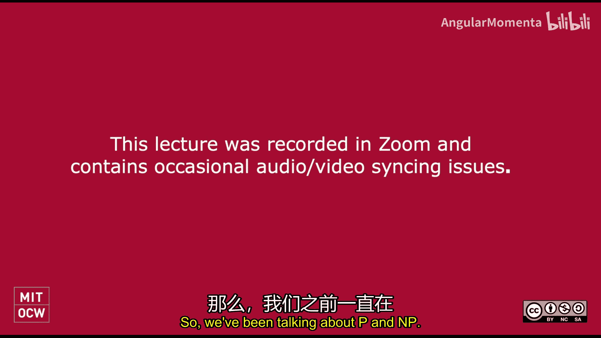
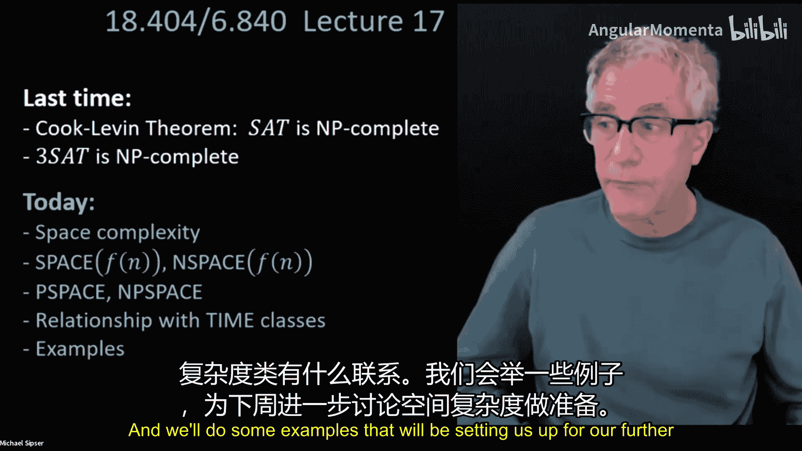
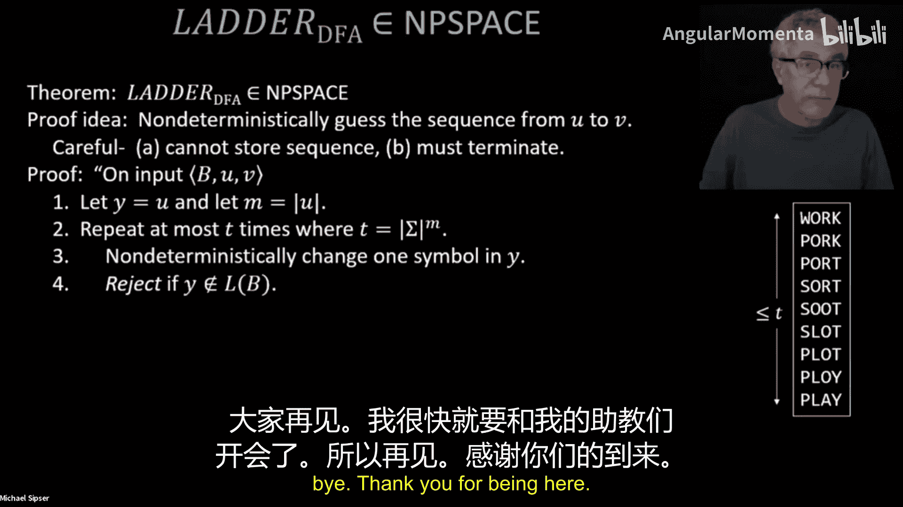

# 016：空间复杂度，PSPACE，萨维奇定理

在本节课中，我们将要学习计算复杂度的另一个基本度量：空间复杂度。我们将定义空间复杂度类，探讨多项式空间（PSPACE）和非确定性多项式空间（NPSPACE），并了解它们与之前学过的时间复杂度类（如P和NP）之间的关系。我们还将通过两个重要例子——真量化布尔公式（TQBF）问题和词梯（Ladder）问题——来加深理解。

---

## 空间复杂度定义

上一节我们介绍了时间复杂度，本节中我们来看看空间复杂度。空间复杂度衡量的是图灵机在计算过程中所使用的存储空间（即磁带单元）数量。

对于一个确定性图灵机，如果它在所有长度为 `n` 的输入上都能停机，并且扫描的磁带单元数不超过 `f(n)`，我们就说它在空间 `f(n)` 内运行。对于非确定性图灵机，要求其**每一个**计算分支所使用的空间都不超过 `f(n)`。

基于此，我们可以定义空间复杂度类：
*   **SPACE(f(n))**：所有能被确定性单带图灵机在 `O(f(n))` 空间内判定的语言集合。
*   **NSPACE(f(n))**：所有能被非确定性单带图灵机在 `O(f(n))` 空间内判定的语言集合。

多项式空间类则是这些类的并集：
*   **PSPACE** = ∪k SPACE(nk)
*   **NPSPACE** = ∪k NSPACE(nk)

关于多带图灵机，一个重要的结论是：将其转换为单带图灵机模拟时，空间开销仅是线性的。因此，基于多带图灵机定义的PSPACE类与基于单带图灵机定义的PSPACE类是相同的。

---

## 时间与空间复杂度的关系

理解了空间复杂度的定义后，我们来看看它与时间复杂度的基本关系。

首先，时间可以“转换”为空间。如果一个图灵机在 `T(n)` 时间内运行，那么它最多只能访问 `T(n)` 个不同的磁带单元。因此，我们有：
**TIME(T(n)) ⊆ SPACE(T(n))**
一个直接的推论是：**P ⊆ PSPACE**，以及 **NP ⊆ NPSPACE**。

其次，空间可以“转换”为时间，但代价可能很高。如果一个图灵机只使用 `S(n)` 空间，那么它可能运行的最大时间受限于其可能的不同配置总数。一个配置由磁带内容、读写头位置和状态组成。在 `S(n)` 空间内，可能的磁带内容数最多为 `|Γ|^{S(n)}`（Γ为磁带字母表），加上有限的状态和读写头位置，总配置数最多为 `c^{S(n)}`（c为常数）。由于作为判定器的图灵机不能重复配置（否则会无限循环），其运行时间最多为配置总数。因此，我们有：
**SPACE(S(n)) ⊆ TIME(c^{S(n)})**
这意味着，多项式空间可能对应指数时间。

---

## PSPACE 包含 NP 与 coNP

基于上述关系，我们已知 P ⊆ PSPACE。但一个更强的结论是：**NP ⊆ PSPACE**。

以下是证明思路：
1.  SAT（布尔可满足性问题）是NP完全问题。
2.  我们可以设计一个**确定性**算法在**多项式空间**内判定SAT：尝试所有可能的变量赋值（像里程表一样逐个生成），对每个赋值检查公式是否可满足。每次只存储一个赋值，空间复杂度为 `O(n)`。因此，**SAT ∈ PSPACE**。
3.  由于SAT是NP完全的，任何NP中的语言 `A` 都可以在多项式时间内归约到SAT。
4.  多项式时间归约也可以在多项式空间内完成（因为时间限制隐含了空间限制）。
5.  因此，任何NP语言 `A` 都可以先归约到SAT，再用PSPACE算法解决，整个过程仍在多项式空间内。故 **NP ⊆ PSPACE**。

此外，由于PSPACE类对补运算封闭（只需将判定机的接受与拒绝状态互换），我们同样有 **coNP ⊆ PSPACE**。

目前我们了解的复杂度类关系可以总结为：**P ⊆ NP ⊆ PSPACE** 且 **P ⊆ coNP ⊆ PSPACE**。P是否等于NP，以及NP是否等于PSPACE，都是未解之谜。

---

## 例子一：真量化布尔公式（TQBF）

为了更具体地理解PSPACE，我们来看一个属于PSPACE的典型问题：真量化布尔公式问题。

量化布尔公式是在普通布尔公式（变量、与、或、非）前加上存在量词（∃）和全称量词（∀）构成的公式，且每个变量都必须被量词绑定。例如：
*   P1 = ∀x ∃y (x ∨ y) ∧ (¬x ∨ ¬y)
*   P2 = ∃y ∀x (x ∨ y) ∧ (¬x ∨ ¬y)
TQBF问题就是判定一个给定的量化布尔公式是否为真。

**为什么TQBF在PSPACE中？**
我们可以给出一个递归的确定性算法：
1.  如果公式没有量词（也就没有变量），直接计算其布尔值。
2.  如果公式形如 **∃x φ**，则递归计算 φ(x=真) 和 φ(x=假)。如果任一结果为真，则接受。
3.  如果公式形如 **∀x φ**，则递归计算 φ(x=真) 和 φ(x=假)。如果两者结果都为真，则接受。

关键在于，在递归调用后，我们可以**重用空间**来计算另一个分支。递归深度最多为变量数 `n`，每层只需常数空间记录当前变量赋值，因此总空间复杂度为 `O(n)`。所以 **TQBF ∈ PSPACE**。值得注意的是，该算法的时间复杂度是指数级的。

---

## 例子二：词梯（Ladder）问题

接下来，我们通过一个更生动的问题来探讨非确定性空间计算。

词梯问题定义如下：给定一个确定性有限自动机（DFA）`B`（其定义的语言视为“合法单词”集合），以及两个合法字符串 `u` 和 `v`。问是否存在一个从 `u` 到 `v` 的“梯子”？梯子是一个字符串序列，其中相邻字符串仅在一个符号上不同，且序列中所有字符串都必须被 `B` 接受（即都是合法单词）。

**为什么词梯问题在NPSPACE中？**
我们可以设计一个非确定性多项式空间算法：
1.  设当前字符串 `y` 为起始串 `u`。
2.  重复以下步骤最多 `T` 次（`T` 是长度为 `m` 的字符串总数上界，即 `|Σ|^m`）：
    *   非确定性地将 `y` 修改一个符号，得到新字符串 `y‘`。
    *   检查 `y‘` 是否被 `B` 接受。如果不是，则拒绝此分支。
    *   如果 `y‘` 等于目标串 `v`，则接受。
    *   否则，令 `y = y‘` 继续。
3.  如果循环 `T` 次仍未到达 `v`，则拒绝。

该算法只需存储当前字符串 `y` 和计数器，空间复杂度为 `O(m)`。因此，词梯问题属于 **NSPACE(n)**（这里 `n` 与输入规模相关）。

一个更惊人的结论是萨维奇定理的体现：**词梯问题实际上也可以在确定性多项式空间（具体是平方级空间）内解决**。这暗示了非确定性空间和确定性空间之间可能存在更紧密的联系，我们将在下节课深入探讨。

---

## 总结

本节课中我们一起学习了空间复杂度的基本概念。我们定义了SPACE和NSPACE复杂度类，以及PSPACE和NPSPACE。我们分析了时间与空间复杂度的基本包含关系，并证明了NP和coNP都是PSPACE的子集。最后，我们通过TQBF和词梯两个具体问题，加深了对多项式空间算法及其特点的理解。关键要点在于，空间可以被重用，这使得一些在时间上代价高昂（指数级）的问题，在空间上可能变得可行（多项式级）。下一节，我们将进一步探讨萨维奇定理及其揭示的非确定性与确定性空间复杂度之间的深刻关系。