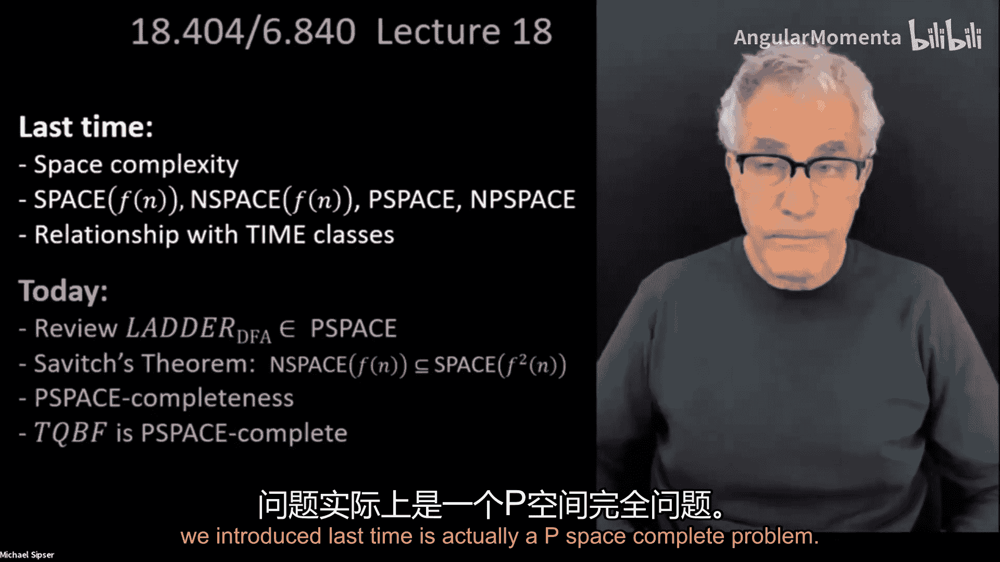
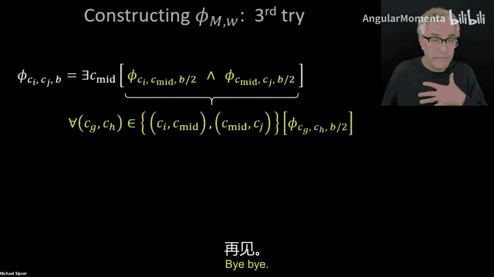

# 017：PSPACE完全性

在本节课中，我们将学习空间复杂度、萨维奇定理以及PSPACE完全问题。我们将重点分析一个具体问题——阶梯问题，并以此为基础，理解如何将非确定性空间计算转换为确定性空间计算，以及如何证明一个问题是PSPACE完全的。

## 空间复杂度回顾

上一节我们介绍了空间复杂度的基本概念。空间复杂度衡量算法或问题所需的内存大小。我们定义了空间复杂度类 `SPACE(f(n))` 和非确定性空间复杂度类 `NSPACE(f(n))`，以及多项式空间类 `PSPACE` 和非确定性多项式空间类 `NPSPACE`。

我们相信这些类之间存在包含关系，但许多问题尚未解决。例如，`P`、`NP`、`coNP` 与 `PSPACE` 的确切关系仍是开放性问题。

## 阶梯问题：一个关键示例

本节中，我们来看一个关键示例——有界阶梯问题。这个问题将帮助我们理解后续更抽象的定理。

**阶梯** 是指一个字符串序列，其中相邻字符串仅有一个符号不同。**有界阶梯问题** 是：给定一个确定有限自动机（DFA）、两个字符串 `u` 和 `v`，以及一个步数界限 `B`，判断是否存在一个长度不超过 `B` 的阶梯，从 `u` 连接到 `v`，且阶梯上的每个字符串都被该DFA接受。

我们用符号 `u →_B v` 表示在最多 `B` 步内可以从 `u` 到达 `v`。

### 解决有界阶梯问题的算法

我们设计一个递归算法 `BL` 来解决此问题。算法的输入是 `(M, u, v, B)`，其中 `M` 是DFA。

以下是算法的核心步骤：

1.  **基础情况（B = 1）**：检查 `u` 和 `v` 是否都被 `M` 接受，并且它们是否恰好在一个符号位置上不同。如果是，则接受；否则，拒绝。
2.  **递归情况（B > 1）**：尝试所有可能的中间字符串 `w`。对于每个 `w`，递归地检查：
    *   能否在 `B/2` 步内从 `u` 到达 `w`（即调用 `BL(M, u, w, B/2)`）。
    *   能否在 `B/2` 步内从 `w` 到达 `v`（即调用 `BL(M, w, v, B/2)`）。
    *   如果对某个 `w`，两次递归调用都返回接受，则算法接受。
    *   如果尝试了所有 `w` 后仍未找到成功的路径，则算法拒绝。

要解决原始的**无界阶梯问题**，只需将界限 `B` 设置为可能的最大阶梯长度 `T`，即所有长度为 `m`（`u` 和 `v` 的长度）的字符串总数 `|Σ|^m`，然后调用 `BL(M, u, v, T)`。

### 空间复杂度分析

理解该算法的空间使用至关重要。

*   每次递归调用需要存储一个候选中间字符串 `w`，其长度与输入字符串相同，因此需要 `O(m)` 空间。
*   递归深度是多少？初始界限 `T = |Σ|^m` 是指数级的。每次递归我们将步数界限 `B` 减半，因此递归深度为 `O(log T) = O(m)`。
*   关键点在于，当从一层递归返回时，其使用的空间（用于存储 `w`）可以被后续递归调用重用。

因此，总空间复杂度是 `O(m) * O(m) = O(m^2)`，即 `O(n^2)`，其中 `n` 是输入的总大小。

这个算法展示了如何通过递归和空间重用来解决一个看似需要指数空间的问题，而只使用了多项式空间。

## 萨维奇定理：NPSPACE = PSPACE

上一节我们通过阶梯问题看到了空间重用的威力。本节中，我们来看看萨维奇定理，它指出非确定性多项式空间和确定性多项式空间是等价的。

萨维奇定理表明，任何在 `f(n)` 空间内运行的非确定性图灵机（NTM），都可以被一台在 `f(n)^2` 空间内运行的确定性图灵机（DTM）模拟。特别地，这意味着 `PSPACE = NPSPACE`。

### 定理证明思路

证明方法与解决阶梯问题的算法高度相似，但更抽象。我们不再考虑字符串和DFA，而是考虑图灵机的**配置**（即瞬时描述，包含状态、带内容和读写头位置）。

我们定义一个新问题：给定NTM `N` 的两个配置 `C1` 和 `C2`，以及一个步数界限 `B`，判断 `N` 能否在 `B` 步内从 `C1` 到达 `C2`。记作 `C1 →_B C2`。

我们构造一个确定性图灵机 `M` 来解决这个问题，算法同样是递归的：

1.  **基础情况（B = 1）**：`M` 直接检查根据 `N` 的转移函数，能否在一步内从 `C1` 变为 `C2`。
2.  **递归情况（B > 1）**：`M` 枚举所有可能的中间配置 `C_mid`。对于每个 `C_mid`，递归地检查：
    *   `C1 →_{B/2} C_mid` 是否成立。
    *   `C_mid →_{B/2} C2` 是否成立。
    *   如果对某个 `C_mid` 两者都成立，则接受。
    *   如果所有 `C_mid` 都不满足，则拒绝。

### 空间复杂度分析

*   存储一个配置需要 `O(f(n))` 空间，因为 `N` 最多使用 `f(n)` 个带单元。
*   递归深度：初始界限 `B` 是 `N` 在 `f(n)` 空间内可能的不同配置总数上限，即 `T = (状态数) * f(n) * (|Γ|^{f(n)})`，其中 `Γ` 是带字母表。`T` 是指数级 `O(c^{f(n)})`。递归深度为 `O(log T) = O(f(n))`。
*   空间在递归调用间被重用。

因此，模拟 `N` 的确定性机器 `M` 的总空间复杂度为 `O(f(n)) * O(f(n)) = O(f(n)^2)`。

阶梯问题的解法本质上是萨维奇定理在该具体问题上的应用。

## PSPACE完全性

在学习了空间复杂度和萨维奇定理之后，我们现在转向PSPACE完全性的概念，这与NP完全性类似。

一个问题是 **PSPACE完全的**，如果：
1.  它属于 `PSPACE`。
2.  `PSPACE` 中的**每一个**问题都可以在多项式时间内归约到它。

我们选择**多项式时间归约**而非多项式空间归约，是因为归约本身应该比所讨论的复杂性类（`PSPACE`）“更容易”。如果归约能力太强（如多项式空间归约），那么 `PSPACE` 内的任何两个问题都可以相互归约，导致所有 `PSPACE` 问题都是完全的，从而失去分类的意义。

如果某个PSPACE完全问题被发现属于 `P`，那么将导致 `P = PSPACE`。如果它属于 `NP`，则将导致 `NP = PSPACE = coNP`。

## TQBF是PSPACE完全的

本节我们将证明，**真量化布尔公式问题** 是PSPACE完全的。TQBF是指所有为真的量化布尔公式的集合。

例如，公式 `∃x ∀y [(x ∨ y) ∧ (¬x ∨ ¬y)]` 为真，而 `∀x ∃y [(x ∨ y) ∧ (¬x ∨ ¬y)]` 为假。

### 证明思路：构造归约

我们需要证明，对于任意语言 `A ∈ PSPACE`，存在多项式时间归约 `f`，将 `A` 的实例 `w` 映射为一个量化布尔公式 `φ`，使得 `w ∈ A` 当且仅当 `φ ∈ TQBF`（即 `φ` 为真）。

设 `M` 是判定 `A` 的确定性多项式空间图灵机。归约 `f` 将构造一个公式 `φ`，其含义是“`M` 接受输入 `w`”。

#### 尝试一：直接模拟（失败）

我们可以模仿证明SAT是NP完全的库克-列文定理，为 `M` 在 `w` 上的计算构造一个**计算表格**。表格的宽度是 `M` 的空间界限 `n^k`，高度是其最大运行步数，这可能是 `O(c^{n^k})`（指数级）。直接为每个表格单元创建变量并描述其正确性，得到的公式大小与表格相同，即指数级大，无法在多项式时间内构造出来。

#### 尝试二：递归构造（仍需改进）

我们采用与萨维奇定理和阶梯问题相似的递归思想。定义公式 `φ_{C_i, C_j, B}`，表示“`M` 能从配置 `C_i` 在 `B` 步内到达配置 `C_j`”。

对于 `B > 1`，我们尝试写成：
`φ_{C_i, C_j, B} = ∃C_mid [φ_{C_i, C_mid, B/2} ∧ φ_{C_mid, C_j, B/2}]`
这表示：存在一个中间配置 `C_mid`，使得从 `C_i` 到 `C_mid` 和从 `C_mid` 到 `C_j` 都能在 `B/2` 步内完成。

**问题**：这种递归会导致公式大小爆炸。因为每一层递归，一个公式会变成两个子公式的合取，子公式数量呈指数增长（`1 -> 2 -> 4 -> 8 ...`）。递归深度是 `O(log(初始B)) = O(n^k)`，最终公式大小是指数级的。

#### 解决方案：缩写技巧

关键改进在于利用全称量词 `∀` 来“压缩”合取 `∧`。我们可以等价地重写上面的公式：

`φ_{C_i, C_j, B} = ∃C_mid ∀(C_g, C_h) ∈ {(C_i, C_mid), (C_mid, C_j)} [φ_{C_g, C_h, B/2}]`

这个公式的意思是：存在一个中间配置 `C_mid`，使得**对于**有序对 `(C_g, C_h)` 取值为 `(C_i, C_mid)` 或 `(C_mid, C_j)` 的**两种情况**，公式 `φ_{C_g, C_h, B/2}` 都成立。

这里，`∀(C_g, C_h) ∈ S [P(C_g, C_h)]` 可以通过 `∀C_g ∀C_h [ ( (C_g = C_i ∧ C_h = C_mid) ∨ (C_g = C_mid ∧ C_h = C_j) ) ⇒ P(C_g, C_h) ]` 来实现，而蕴含关系 `⇒` 可以用 `∧` 和 `∨` 表达。

**优势**：现在，每一层递归，我们只是在现有公式前添加一些量词和布尔连接词（描述 `C_g, C_h` 的取值条件），而**不是**将公式复制成两份。添加的内容大小是 `O(n^k)`。

*   **递归基础（B = 1）**：此时可以直接构造一个大小固定的公式来描述一步转移是否合法（类似于库克-列文定理中对局部窗口的约束）。
*   **递归过程**：从 `B = T`（最大运行时间）开始，应用上述规则不断递归，直到 `B = 1`。
*   **最终公式**：`φ_{start, accept, T}` 即为我们所需的 `φ`，它表达了“`M` 从起始配置能在 `T` 步内到达接受配置”。

### 公式大小分析

*   递归深度：`O(log T) = O(n^k)`。
*   每层递归添加 `O(n^k)` 大小的量词和连接词。
*   因此，最终公式 `φ` 的总大小为 `O(n^k) * O(n^k) = O(n^{2k})`，即多项式大小。归约函数 `f` 可以在多项式时间内构造出这个公式。

这就证明了从任意 `PSPACE` 问题到 TQBF 的多项式时间归约的存在性。由于 TQBF 本身显然在 `PSPACE` 内（可以用类似本证明的递归算法在多项式空间内求值），因此 TQBF 是 PSPACE 完全的。

## 总结

本节课中我们一起学习了：
1.  **空间复杂度** 的基本概念和类别（`PSPACE`, `NPSPACE`）。
2.  通过**有界阶梯问题**，我们看到了一个利用递归和空间重用，在平方空间内解决复杂问题的具体算法。
3.  **萨维奇定理** 指出 `NPSPACE = PSPACE`，其证明思想与阶梯问题算法一脉相承，展示了如何将非确定性空间计算平方后转换为确定性计算。
4.  **PSPACE完全性** 的定义及其意义。
5.  证明了 **TQBF（真量化布尔公式）问题是PSPACE完全的**。证明的关键在于巧妙地使用递归构造量化布尔公式，并利用全称量词避免公式大小的指数爆炸，最终在多项式时间内完成归约。

这些内容揭示了空间复杂度理论与完全性理论之间的深刻联系，并为理解更高级的复杂性类别奠定了基础。