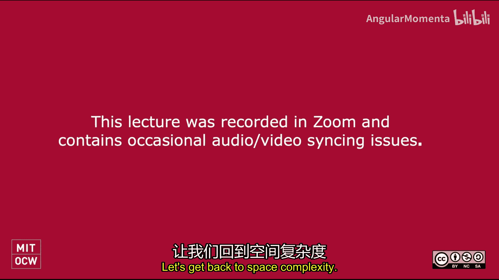
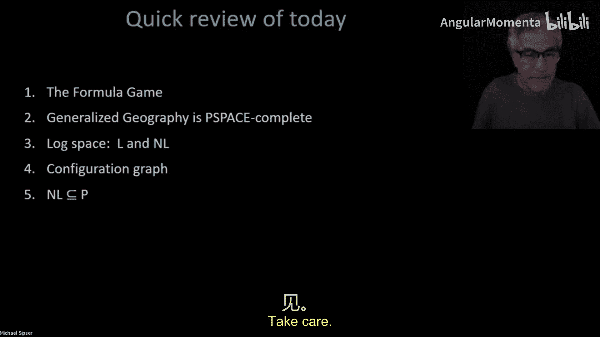

# 018：游戏与广义地理学 🎮



在本节课中，我们将学习空间复杂度的相关内容，特别是如何将量化布尔公式（TQBF）问题与一种称为“广义地理学”的游戏联系起来，并证明后者是PSPACE完全问题。我们还将初步探讨对数空间复杂度类L和NL。

## 回顾与概述 📝

上一讲我们介绍了几个定理，它们的证明思路基本相同。其中一个涉及“梯子问题”，即判断能否通过每次改变一个符号，从一个字符串变换到另一个字符串，且所有中间字符串都符合某个有限自动机的语言或特定规则。基于这个思想，我们证明了萨维奇定理：任何非确定性图灵机都可以用确定性图灵机模拟，所需空间仅需平方。最后，我们证明了TQBF（判断量化布尔公式是否为真）问题是PSPACE完全的。

本节我们将以此为基础，讨论另一个PSPACE完全问题，并展示PSPACE与某些游戏中判断哪一方必胜之间的联系。课程后半部分，我们将深入探讨空间复杂度，特别是研究对数空间复杂度类。

## 广义地理学游戏 🗺️

首先，我们介绍一个名为“地理学”的游戏。游戏规则如下：两名玩家轮流说出地名，每个新地名必须以上一地名的最后一个字母开头，且地名不能重复。无法说出新地名的玩家判负。

我们将这个游戏抽象化，得到“广义地理学”游戏。游戏在一个有向图上进行，指定一个起始节点。两名玩家轮流沿着图中的边移动，访问过的节点不能再次访问，从而共同构建一条简单路径。首先无法移动的玩家判负。

我们定义问题GG：给定一个有向图和一个起始节点，判断在双方都采取最优策略的情况下，先手玩家（玩家一）是否拥有必胜策略（即“强制获胜”）。

**核心概念**：判断图G和起始节点s是否属于语言GG，即玩家一是否有强制获胜策略。

## 游戏与必胜策略 🏆

理解“强制获胜”或“必胜策略”的概念至关重要。它意味着，无论对手如何应对，拥有该策略的玩家总有一系列应对方法，能确保自己最终获胜。对于广义地理学这类游戏，双方中必有一方拥有必胜策略。

让我们通过一个简单例子来理解。考虑下图，起始节点为a，玩家一先手。

```
a -> b
a -> c
b -> d
c -> e
d -> f
e -> f
```

玩家一从a开始。如果玩家二选择走到b，则玩家一只能走到d，然后玩家二无路可走，玩家一获胜。然而，如果玩家二选择走到c，则玩家一走到e，玩家二可以走到f，此时玩家一无路可走，玩家二获胜。因此，玩家二拥有必胜策略（选择走到c）。所以，对于这个图实例，`(G, a)` 不属于语言GG。

## 公式游戏与TQBF 🔢

为了建立游戏与复杂度的联系，我们引入“公式游戏”。游戏基于一个量化布尔公式，例如：`∃x1 ∀x2 ∃x3 ... ψ(x1, x2, x3, ...)`。

游戏有两名玩家：`玩家∃` 和 `玩家∀`。玩家按量词顺序轮流为变量赋值：`玩家∃` 为存在量词（∃）变量赋值，`玩家∀` 为全称量词（∀）变量赋值。所有变量赋值完成后，计算公式中无量词部分ψ的真值。若ψ为真，则`玩家∃`获胜；否则`玩家∀`获胜。

**核心洞察**：`玩家∃`在公式游戏中拥有必胜策略，**当且仅当**原量化布尔公式为真。这是因为“存在必胜策略”的语义恰好对应了量词的逻辑含义：存在一种对x1的赋值，使得对于x2的所有赋值，都存在对x3的赋值……最终使ψ为真。

因此，判断公式游戏中哪一方必胜的问题，等价于TQBF问题。

## 从TQBF归约到广义地理学 ⛓️

我们的目标是证明广义地理学（GG）是PSPACE完全的。已知TQBF是PSPACE完全的，因此我们只需将TQBF多项式时间归约到GG。

给定一个TQBF公式（假设已转化为合取范式CNF），我们构造一个广义地理学游戏图，使得在该图上的游戏模拟原公式游戏。构造的核心思想是：图中的路径选择对应变量的赋值，并最终通过子句结构来判定公式ψ是否被满足。

**构造简述**：
1.  **变量赋值部分**：为每个变量xi创建一个菱形结构。玩家在菱形中走左侧或右侧，分别对应将xi赋值为真或假。通过精心设计节点和边的连接，可以确保`玩家∃`（对应玩家一）和`玩家∀`（对应玩家二）在各自变量上做出选择。
2.  **子句验证部分**：在所有变量赋值完成后，路径进入子句验证模块。这里包含代表每个子句的节点，以及代表子句中每个文字的节点。文字节点连接回变量赋值部分对应的真值分支。
3.  **游戏流程**：在赋值阶段，双方通过在图中的移动完成对公式变量的赋值。进入验证阶段后，`玩家∀`可以选择一个声称未被满足的子句节点。然后`玩家∃`必须从该子句中选一个文字节点。如果该文字在之前的赋值中为真，则`玩家∀`将无路可走（因为对应的图节点已被访问），`玩家∃`获胜。如果该文字为假，则`玩家∀`可以移动到该文字节点，导致`玩家∃`无路可走，`玩家∀`获胜。

通过这种构造，`玩家∃`在广义地理学游戏中获胜，当且仅当其在原公式游戏中有必胜策略，即原TQBF公式为真。这就完成了从TQBF到GG的归约，证明了GG是PSPACE完全的。

## 对数空间复杂度初探 💾

现在，我们转换话题，探讨空间复杂度的另一个重要领域：对数空间。

由于标准单带图灵机在读取长度为n的输入时就会使用n的空间，为了定义亚线性空间（如对数空间）复杂度类，我们需要新的模型。

**只读输入图灵机模型**：
*   机器有一条**只读输入带**，存放输入，其空间不计入复杂度。
*   机器有一条可读写的**工作带**，其使用的空间才计入空间复杂度。
*   空间复杂度`S(n)`定义为工作带上使用的格子数。

我们定义：
*   **L** = `SPACE(log n)`：确定性对数空间可判定的语言类。
*   **NL** = `NSPACE(log n)`：非确定性对数空间可判定的语言类。

对数空间仅够存储固定数量的指针或索引，功能相对较弱。

**例子**：
*   **回文语言**（形如ww^R）属于**L**。我们可以用工作带存储两个指针，分别从输入首尾向中间移动比较字符。
*   **有向图路径问题**（PATH）属于**NL**。非确定性算法可以猜测路径，但只在工作带上存储当前节点位置，并配合一个计数器防止循环。

## 对数空间的基本性质 📊

关于L和NL，有以下基本事实：

1.  **L ⊆ NL**：确定性类自然包含于非确定性类。
2.  **L ⊆ P**，**NL ⊆ NP**：任何对数空间（无论确定性与否）算法，其运行时间都是多项式级的。原因在于，对于固定输入，机器的**格局**（状态、工作带内容、读写头位置）总数是多项式级的（因为工作带内容有`c^(log n) = n^k`种可能）。机器不可能运行超过多项式步而不进入循环，因此它必然在多项式时间内停机。
3.  **萨维奇定理对对数空间成立**：`NSPACE(log n) ⊆ SPACE(log^2 n)`。即任何非确定性对数空间算法，都可以用确定性`log^2 n`空间来模拟。

**一个重要构造：格局图**
对于非确定性图灵机M和输入w，可以构造其**格局图**。图的节点是M在w上的所有可能格局。如果格局Cj可以在M的一步内从格局Ci到达，则存在从Ci到Cj的边。那么，M接受w当且仅当在格局图中，从起始格局存在一条路径到达某个接受格局。

由于格局数是多项式级的，构造此图并检查路径存在性（例如使用图可达性算法）可以在多项式时间内完成。这给出了`NL ⊆ P`的另一种证明。

## 总结 🎯

本节课我们一起学习了以下内容：
1.  我们介绍了**广义地理学**游戏，并将其形式化为一个计算问题GG。
2.  我们探讨了**公式游戏**，并建立了其必胜策略问题与**TQBF**问题的等价性。
3.  通过精巧的图构造，我们展示了如何将TQBF问题归约到广义地理学问题，从而证明**GG是PSPACE完全问题**。这建立了PSPACE与特定游戏必胜策略判定之间的深刻联系。
4.  课程后半部分，我们转向了**对数空间复杂度**，介绍了只读输入图灵机模型，并定义了复杂度类**L**和**NL**。
5.  我们了解了L和NL的基本性质，包括它们与P和NP的包含关系，以及萨维奇定理在对数空间下的应用。我们还介绍了**格局图**的概念，它是分析空间有界计算的有力工具。




下节课我们将更深入地探索对数空间复杂度，特别是NL完全问题以及相关的复杂性类关系。