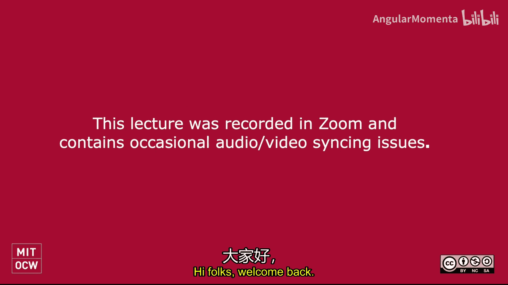
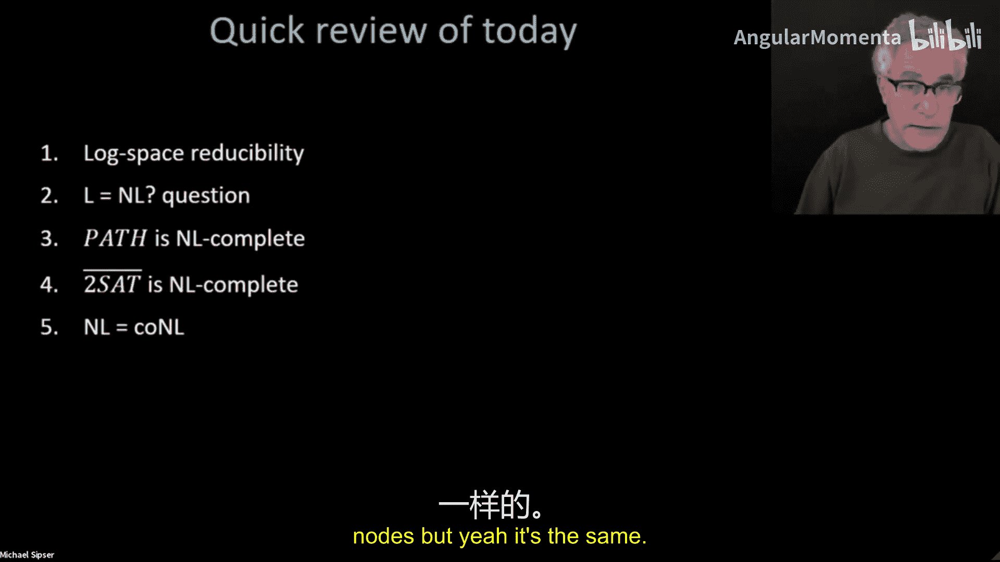

# 019：L和NL，NL = coNL

在本节课中，我们将继续讨论空间复杂度，特别是对数空间复杂度类L和NL。我们将回顾L和NL的定义与示例，介绍对数空间归约和NL完全问题的概念，并最终证明一个重要的定理：NL类在补集运算下是封闭的，即NL = coNL。

## 回顾：L和NL类

上一节我们介绍了时间复杂度的概念，并转向了空间复杂度。我们首先讨论了多项式空间（PSPACE），并证明了存在PSPACE完全问题，如TQBF语言和广义地理游戏。随后，我们将注意力转向更小的空间复杂度类：对数空间。

为了讨论小于线性空间（n）的复杂度类，我们引入了一个新的计算模型：双带图灵机。该模型包含一个**只读输入带**（存储可能非常大的输入）和一个**读写工作带**（作为本地内存）。在讨论对数空间时，我们限定工作带最多使用 **O(log n)** 个存储单元，这足以存储指向输入位置的指针或计数器。

我们定义了以下两个重要的复杂度类：
*   **L**：由确定性图灵机在对数空间内判定的语言集合。
*   **NL**：由非确定性图灵机在对数空间内判定的语言集合。

以下是两个示例语言：
1.  **语言 A = {ww^R | w ∈ {0,1}*}**（回文串）。这个语言属于 **L**。一个对数空间的确定性图灵机可以通过使用工作带上的指针（记录当前比较的字符位置）来检查输入是否为这种形式。
2.  **PATH语言**：给定一个有向图G和起点s、终点t，判断是否存在从s到t的路径。这个语言属于 **NL**。一个非确定性对数空间图灵机可以猜测一条从s到t的路径，并在工作带上记录当前所在的节点。

L与NL的关系类似于P与NP的关系，是一个尚未解决的开放性问题。然而，与NP和coNP的关系不同，我们将证明NL等于coNL。

## L、NL与P的关系

上一节我们快速提到了L和NL与P类的关系，本节我们来详细看看。

首先，任何在L中的语言也一定在P中。证明的关键在于理解对数空间图灵机的**格局**。

一个机器在输入w上的**格局**包含了其动态部分：状态、两个读写头的位置以及工作带的内容。输入带的内容是固定的，因此不计入格局。

对于一个运行在O(log n)空间上的机器，其可能的格局总数是**多项式级别**的。因为工作带内容有 `c^(O(log n)) = n^(O(1))` 种可能（c是带字母表大小），状态数和读写头位置数也是多项式级别。

因此，一台总是停机的对数空间机器，其运行步数不可能超过其格局总数（否则会进入循环）。所以，它的运行时间是**多项式**的。这直接证明了 **L ⊆ P**。

类似地，萨维奇定理在对数空间层级也成立。它表明，任何非确定性对数空间（NL）机器都可以被一台确定性机器在**对数平方空间**（O(log² n)）内模拟。证明思路与之前相同：构造计算表，并递归地检查是否存在接受路径，递归深度为多项式，每层需要O(log n)空间存储一个格局。

更重要的是，我们可以证明 **NL ⊆ P**。我们通过构造一个确定性多项式时间算法来模拟非确定性对数空间机器M。

核心思想是构建M在输入w上的**格局图** `G_{M,w}`。
*   **节点**：M在w上所有可能的格局。
*   **边**：如果格局C_i可以在M的一步非确定性转移中变为格局C_j，则存在一条从C_i到C_j的边。

由于M是对数空间的，其格局总数是多项式级别的，因此这个格局图的大小也是多项式的。

M接受输入w，当且仅当在格局图 `G_{M,w}` 中，存在一条从**起始格局** `C_start` 到**唯一接受格局** `C_accept` 的路径（我们约定接受前机器会清空工作带并归位读写头，从而保证接受格局唯一）。

因此，我们的多项式时间模拟算法如下：
1.  在输入w上，构造格局图 `G_{M,w}`。
2.  使用图搜索算法（如BFS或DFS）检查图中是否存在从 `C_start` 到 `C_accept` 的路径。
3.  如果存在路径，则接受；否则拒绝。

这就证明了NL ⊆ P。结合L ⊆ NL，我们得到包含关系：**L ⊆ NL ⊆ P**。

## 对数空间归约与NL完全性

类似于NP完全性，为了研究L与NL的关系，我们需要定义NL完全问题。但这里不能使用多项式时间归约，因为NL ⊆ P，任何两个P中的语言都可以多项式时间相互归约，这会使归约概念失去意义。我们需要一个更弱的归约概念：**对数空间归约**。

为了定义可对数空间计算的函数，我们引入**对数空间转换器**模型。这是一个三带确定性图灵机：
1.  **只读输入带**：存放输入w。
2.  **读写工作带**：最多使用O(log |w|)空间。
3.  **只写输出带**：用于输出结果f(w)，机器只能向右移动并写入，不能回读。

我们说一个函数f是**对数空间可计算**的，如果存在一个对数空间转换器，对于任何输入w，它停机时输出带上正好是f(w)。

现在我们可以定义归约：语言A **对数空间可归约**到语言B（记作 `A ≤_L B`），如果存在一个对数空间可计算的函数f，使得对于所有输入w，有 `w ∈ A ⇔ f(w) ∈ B`。

这里有一个技术细节需要注意。假设 `A ≤_L B` 且 `B ∈ L`，我们想证明 `A ∈ L`。自然的想法是：对于输入w，先计算 `f(w)`，然后用B的对数空间判定器判断 `f(w)` 是否属于B。但问题在于，`f(w)` 的长度可能是多项式的，我们无法将其整个存储在对数空间的工作带上。

解决方案是：B的判定器在运行时，一次只需要查看 `f(w)` 的一个符号。因此，我们不需要预先计算并存储整个 `f(w)`，而是**在B的判定器需要某个符号时，临时启动转换器重新计算该符号**。每次需要新符号时，我们都从头运行转换器，并忽略直到目标位置之前的所有输出。这个过程虽然耗时（多项式时间），但只使用了对数空间的工作内存。这就证明了如果 `A ≤_L B` 且 `B ∈ L`，则 `A ∈ L`。

现在我们定义NL完全性：一个语言B是**NL完全的**，如果：
1.  `B ∈ NL`。
2.  对于NL中的每一个语言A，都有 `A ≤_L B`。

## PATH问题是NL完全的

我们将证明之前提到的**PATH**问题是NL完全的。

首先，`PATH ∈ NL` 我们已经知道。现在需要证明，对于任意语言 `A ∈ NL`，都有 `A ≤_L PATH`。

设非确定性图灵机M在O(log n)空间内判定语言A。我们构造一个对数空间归约函数f，将输入w映射为PATH问题的一个实例 `(G, s, t)`。

这个归约的核心思想与我们证明NL ⊆ P时类似：令 `G` 为M在输入w上的**格局图** `G_{M,w}`。令 `s` 为起始格局 `C_start`，`t` 为唯一接受格局 `C_accept`。

那么，`w ∈ A`（即M接受w）当且仅当在格局图G中存在从s到t的路径。因此，`f(w) = (G, s, t)` 就是一个正确的归约。

现在需要证明函数f是对数空间可计算的。我们的对数空间转换器需要输出图G（边列表）以及起点s和终点t。由于格局总数是多项式N，我们可以通过枚举所有可能的格局对 `(C_i, C_j)` 来生成边列表：
1.  在工作带上，依次生成所有可能的格局对（每个格局大小为O(log n)，因此一对格局可在O(log n)空间内表示）。
2.  对于每一对 `(C_i, C_j)`，根据M的转移函数，判断 `C_i` 能否在一步内转移到 `C_j`。如果可以，则将这条边 `(C_i, C_j)` 输出到输出带。
3.  最后，输出起始格局 `C_start` 和接受格局 `C_accept` 作为s和t。

整个过程只需要在工作带上存储至多两个格局，因此空间复杂度为O(log n)。这就证明了PATH是NL完全的。

如果PATH能在确定性对数空间（L）内解决，那么所有NL问题都能在L内解决，即L = NL。这正是该问题重要性的体现。

## NL = coNL 的证明

本节我们将证明一个令人惊讶的定理：**NL类在补集运算下封闭**，即 `NL = coNL`。这与我们对NP的认知（相信NP ≠ coNP）形成对比。

证明思路是：由于PATH是NL完全的，那么PATH的补集（`¬PATH`，即判断图中是否**不存在**从s到t的路径）就是coNL完全的。如果我们能证明 `¬PATH ∈ NL`，那么任何coNL中的语言都可以通过对数空间归约到 `¬PATH`，从而也在NL中，这就证明了 `coNL ⊆ NL`。反过来，`NL ⊆ coNL` 是显然的（交换接受和拒绝状态），因此两者相等。

所以，核心任务是构造一个**非确定性**对数空间图灵机N，使其能够判定 `¬PATH`。即，当图G中**没有**从s到t的路径时，N的某些计算分支接受；当存在路径时，N的所有分支都拒绝。

直接“反转”PATH的非确定性算法是行不通的，因为非确定性接受要求至少有一条路径接受，而反转后需要确保**所有**路径都不存在，这很难用非确定性直接验证。

我们需要一个更巧妙的方法。首先引入一个概念：**非确定性对数空间计算函数**。我们允许非确定性图灵机的某些分支输出一个函数值，其他分支可以“拒绝”（不输出）。要求是：至少有一个分支输出值，并且所有输出值的分支必须输出相同的正确结果。

假设我们有一个非确定性对数空间机器可以计算以下函数：给定图G和起点s，输出从s可到达的节点数量 `c = |R|`，其中R是从s出发可达的节点集合。

如果我们能计算这个计数函数，那么我们就可以用它来判定 `¬PATH`。思路如下：
设已知从s可达的节点数为c。非确定性地，我们尝试“猜出”所有c个可达节点。
1.  我们依次考虑图中的每个节点u。
2.  对于每个u，我们非确定性地猜测它是否可达（P）或不可达（N）。
3.  如果猜测u可达（P），那么我们同时非确定性地猜测一条从s到u的路径来验证。如果找不到这样的路径，当前分支“拒绝”（失败）。
4.  在验证过程中，如果发现当前正在检查的节点t（我们想知道s到t是否有路径）被验证为可达，那么我们就知道存在s到t的路径，当前分支可以输出“是”（对于PATH问题）或在此处“拒绝”（对于 `¬PATH` 问题，因为此时不应接受）。
5.  我们统计所有被成功验证为可达的节点数量k。
6.  在检查完所有节点后，如果统计的数量k等于已知的计数c，并且节点t**不在**这k个已验证的可达节点之中，那么我们就可以确信t是不可达的。此时，对于 `¬PATH` 问题，我们可以接受（输出“否”）。

关键在于，至少会有一个非确定性分支正确地猜出了所有c个可达节点及其验证路径。如果t不可达，这个分支最终会发现k=c且t不在列表中，从而接受。如果t可达，那么任何正确的分支在验证过程中都会提前遇到t，并根据算法设计不会到达最终的接受步骤。

因此，问题的核心就转化为：**如何非确定性地在对数空间内计算从s出发的可达节点数c？**

计算c的过程运用了类似的“逐步逼近”技巧，其本身就是一个巧妙的迭代算法（称为“自我归约”）。由于时间关系，其具体细节将在下节课展开。但基本思想是：从计数0开始，通过多次利用“验证可达节点集合”的子程序，逐步确定可达节点的数量。这个算法可以非确定性地在对数空间内完成。

综上所述，我们能够非确定性地在对数空间内判定 `¬PATH`，从而证明了 `coNL ⊆ NL`，结合 `NL ⊆ coNL`，得到 **NL = coNL**。

## 总结

本节课我们一起深入探讨了对数空间复杂度类L和NL。
*   我们回顾了L和NL的定义，以及它们与P类的关系（L ⊆ NL ⊆ P）。
*   我们引入了**对数空间归约**和**NL完全性**的概念，并证明了**PATH问题是NL完全的**。
*   最后，我们证明了一个关键定理：**NL类在补集运算下是封闭的**，即 **NL = coNL**。这个证明通过展示如何非确定性地在对数空间内计算图中从某点出发的可达节点数，并利用该计数来判定PATH的补集问题。这个结果揭示了非确定性对数空间的一个深刻性质，与NP类形成了有趣的对