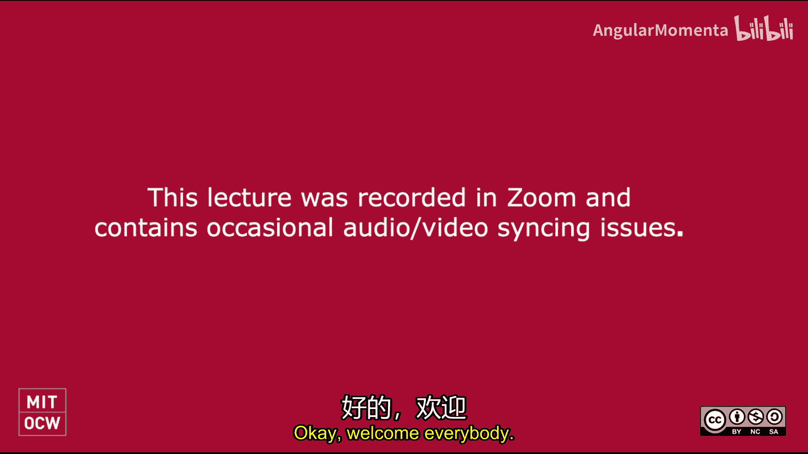
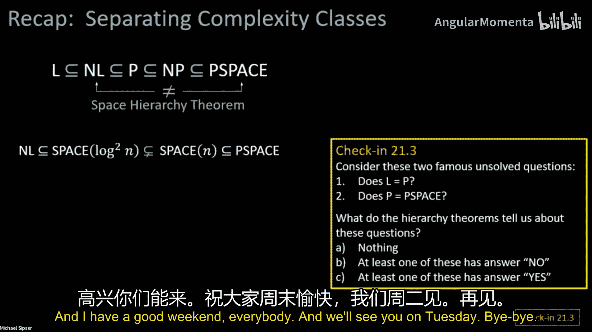

# 020：层次定理 👨‍🏫

在本节课中，我们将要学习两个核心主题：首先，我们将完成关于 **NL = coNL** 的证明，这是一个令人惊讶的结果，表明非确定性对数空间类在补集运算下是封闭的。其次，我们将探讨**层次定理**，该定理表明，为图灵机提供更多的资源（时间或空间）确实能让它解决更多的问题。

---

## 回顾：NL = coNL 的证明思路

上一节我们介绍了 **Immerman–Szelepcsényi 定理**，即 **NL = coNL**。为了证明这一点，我们只需要证明 **PATH** 问题的补集（即判断图中从起点 `s` 到终点 `t` **不存在**路径的问题）可以在 **NL** 中解决。

我们采取的策略是：构造一个非确定性对数空间图灵机来计算一个特殊的 **`PATH` 函数**。这个函数对于输入 `(G, s, t)`，当存在从 `s` 到 `t` 的路径时输出“是”，否则输出“否”。如果我们能非确定性地计算这个函数，那么通过接受所有输出“否”的分支，我们就能在 **NL** 内解决 **PATH** 的补集问题。

### 核心概念：可到达节点计数

证明的关键在于引入一个中间量：从起点 `s` 可到达的节点数量。我们定义：
*   **`R`**: 从 `s` 出发可到达的节点集合。
*   **`c`**: 集合 `R` 的大小，即 `c = |R|`。

我们将证明，如果我们能非确定性地计算出 `c`，那么我们就能利用它来测试任意节点 `t` 是否可达，从而计算出 `PATH` 函数。

---

## 从计数到路径判定 🔄

以下是证明的核心步骤，展示了如何利用可到达节点计数 `c` 来判定路径是否存在。

**步骤一：已知 `PATH` 函数，计算计数 `c`**
如果我们有一个非确定性图灵机 `M` 可以计算 `PATH` 函数（即对每个节点 `u` 判定 `s -> u` 是否可达），那么计算 `c` 是简单的。算法如下：
1.  初始化计数器 `count = 0`。
2.  遍历图中的每一个节点 `u`。
3.  在节点 `u` 上运行机器 `M` 来判定 `s -> u` 是否可达。
4.  如果 `M` 的输出是“是”，则将 `count` 加 1。
5.  遍历完所有节点后，输出 `count` 作为 `c`。

由于 `M` 在 `NL` 中，且我们只需额外存储一个计数器（对数空间），因此整个计算过程也在 `NL` 中。

**步骤二：已知计数 `c`，判定 `PATH` 函数（核心算法）**
这是证明中最巧妙的部分。假设我们神奇地知道了从 `s` 出发恰好有 `c` 个节点可达。我们可以利用这个信息来判定任意目标节点 `t` 是否可达。

算法思路：非确定性地“猜测”出所有 `c` 个可达节点。如果我们的猜测正确（即恰好找到了所有可达节点），并且 `t` 不在其中，那么我们就知道 `t` 是不可达的。

以下是算法的非确定性过程：
1.  初始化 `k = 0`，用于记录已发现的可达节点数。
2.  遍历图中的每一个节点 `u`：
    *   **非确定性选择**：猜测 `u` 是否可达。
    *   **如果猜测“可达”**：
        *   非确定性地猜测一条从 `s` 到 `u` 的长度不超过 `n`（节点总数）的路径。
        *   如果未能找到这样一条路径（即猜测错误），则**拒绝**（此分支失败）。
        *   如果成功找到路径，则：
            *   如果 `u == t`，则**接受**（因为找到了到 `t` 的路径）。
            *   否则，`k = k + 1`。
    *   **如果猜测“不可达”**：继续处理下一个节点。
3.  遍历完所有节点后，检查 `k == c`。
    *   如果 `k != c`，说明我们的猜测集合没有包含所有可达节点，此分支**拒绝**。
    *   如果 `k == c`，说明我们正确找到了所有 `c` 个可达节点。既然在步骤2中未因找到 `t` 而接受，那么 `t` 肯定不在此集合中，因此输出“否”（即 `t` 不可达）。

这个算法只需要存储当前节点 `u`、计数器 `k` 和已知的常数 `c`，所有这些都是对数空间，因此它在 **NL** 中。

**步骤三：计算计数 `c` 本身**
现在的问题是如何获得那个关键的计数 `c`。我们通过一个递推过程来计算它。定义：
*   **`R_d`**: 从 `s` 出发，在 **`d`** 步内（路径长度 ≤ `d`）可到达的节点集合。
*   **`c_d`**: 集合 `R_d` 的大小，即 `c_d = |R_d|`。

显然，`c_n = c`（其中 `n` 是节点总数）。我们可以从 `c_0 = 1`（只有 `s` 自身在0步内可达）开始计算。
如果我们已知 `c_d`，我们可以利用与**步骤二**类似的算法（但将路径长度限制为 `d`）来判定“在 `d` 步内是否可达”这个问题。一旦我们能判定每个节点在 `d` 步内是否可达，我们就可以像**步骤一**那样数出它们的数量，从而得到 `c_{d+1}`。

通过这种递推，我们可以从 `c_0` 开始，逐步计算出 `c_1, c_2, ..., c_n = c`。每一步都只需要对数空间。最终，我们得到了计算 `PATH` 函数所需的关键值 `c`。

结合以上三个步骤，我们构造出了一个在 **NL** 中计算 `PATH` 函数的非确定性图灵机。因此，**PATH** 的补集也在 **NL** 中，从而证明了 **NL = coNL**。

---

## 空间与时间层次定理 🏔️

上一节我们证明了复杂性类之间有趣的相等关系。现在，我们来看看它们之间的**不等关系**。层次定理告诉我们，提供更多的计算资源确实能解决更多的问题。

### 空间层次定理

**定理**：对于空间可构造函数 `f(n)`（例如 `f(n) = n^2`, `n^3` 等），存在一个语言 `A`，使得：
1.  `A ∈ SPACE(f(n))` （`A` 可以在 `O(f(n))` 空间内判定）。
2.  `A ∉ SPACE(o(f(n)))` （`A` 不能在 `o(f(n))` 空间内判定）。

其中 `o(f(n))` 表示比 `f(n)` 增长**严格更慢**的函数集合。

**通俗解释**：对于任意一个“足够好”的空间界限 `f(n)`，总存在一些问题，恰好需要大约 `f(n)` 的空间才能解决，用更少的空间是无法解决的。这意味着空间复杂性类形成了一个真包含的无穷层次结构：
`SPACE(n) ⊂ SPACE(n^2) ⊂ SPACE(n^3) ⊂ ...`

**证明思路（对角化法）**：
我们通过构造一个图灵机 `D` 来定义语言 `A`（即 `A = L(D)`）。`D` 的设计确保它自己的语言 `A` 无法被任何运行在 `o(f(n))` 空间内的图灵机所识别。

1.  **`D` 在 `O(f(n))` 空间内运行**：`D` 在输入 `w`（长度为 `n`）上启动时，首先在磁带上标记出 `f(n)` 个单元格。如果计算过程中需要超过这个空间，`D` 就拒绝。
2.  **`D` 试图与所有“小空间”机器不同**：`D` 将输入 `w` 解释为另一个图灵机 `M_w` 的编码（如果 `w` 编码非法，则直接拒绝）。然后，`D` 尝试在分配的空间限制内模拟 `M_w` 在输入 `w` 上的运行。
    *   如果模拟成功完成，且 `M_w` 接受 `w`，则 `D` 拒绝 `w`。
    *   如果模拟成功完成，且 `M_w` 拒绝 `w`，则 `D` 接受 `w`。
    *   如果模拟因空间不足或超过时间限制（为避免无限循环，需设置一个步数上限）而无法完成，`D` 也拒绝 `w`。

**为什么这行得通？** 对于任何运行在 `o(f(n))` 空间内的图灵机 `M`，当输入 `w` 足够长（且 `w` 是 `M` 的编码加上足够多的填充字符）时，`D` 将拥有足够的空间来成功模拟 `M` 在 `w` 上的运行。根据构造，`D` 在 `w` 上的行为与 `M` 相反，因此 `L(D) ≠ L(M)`。这就证明了 `L(D)`（即 `A`）不在 `SPACE(o(f(n)))` 中。

### 时间层次定理

时间层次定理与空间层次定理类似，但有一个技术性的对数因子差距。

**定理**：对于时间可构造函数 `f(n)`（例如 `f(n) = n^2`, `n^3` 等），存在一个语言 `A`，使得：
1.  `A ∈ TIME(f(n))`。
2.  `A ∉ TIME(o(f(n) / log f(n)))`。

**通俗解释**：给予更多的计算时间，也能解决更多的问题。但是，证明要求的时间差距比空间定理稍大一点（多了一个 `log f(n)` 因子），这主要源于模拟开销。

**证明思路**：与空间层次定理的证明非常相似，也是通过对角化法构造一个图灵机 `D`。主要区别在于：
*   `D` 使用 `f(n)` 作为**步数计数器**（时钟），以防止模拟无限循环。
*   在模拟另一个机器 `M` 时，为了高效查找 `M` 的转移函数，`D` 需要将 `M` 的描述随身携带在磁头上。管理这个步数计数器会引入额外的 `log f(n)` 因子开销，因此 `D` 只能与运行时间比 `f(n)/log f(n)` 更短的机器区分开来。

---

## 层次定理的推论与应用 💡

层次定理为我们提供了第一批确定的、严格的复杂性类包含关系。

*   **已知的分离结果**：根据空间层次定理，我们知道 `SPACE(n) ⊂ SPACE(n^2)`。由于 `NL ⊆ SPACE(log^2 n)`，且 `PSPACE` 包含所有多项式空间，因此我们可以得出 **`NL ⊂ PSPACE`**。这是一个被严格证明的不相等关系。
*   **对未解问题的启示**：虽然我们不知道 `P` 是否等于 `NP`，也不知道 `L` 是否等于 `P`，但层次定理告诉我们，**`L ≠ PSPACE`**。因此，`L = P` 和 `P = PSPACE` 这两个等式中**至少有一个不成立**（事实上，普遍认为两者都不成立）。

---

## 总结 🎯

本节课中我们一起学习了：
1.  **NL = coNL 的证明**：通过巧妙地非确定性地计算从起点可达的节点数量，并将其用于判定任意节点是否可达，我们证明了非确定性对数空间类在补集运算下封闭。这是一个深刻且起初令人意外的结果。
2.  **空间与时间层次定理**：通过对角化方法，我们证明了为图灵机提供更多的空间或时间资源，确实能够扩大其所能解决问题的范围。这确立了复杂性类之间严格的无穷层次结构，并为我们提供了一些像 `NL ⊂ PSPACE` 这样的确定分离关系。

这些定理勾勒出了计算复杂性理论的基本格局：既有像 `NL = coNL` 这样的优美对称性，也有像层次定理所揭示的、资源增加必然带来能力提升的严格层次性。