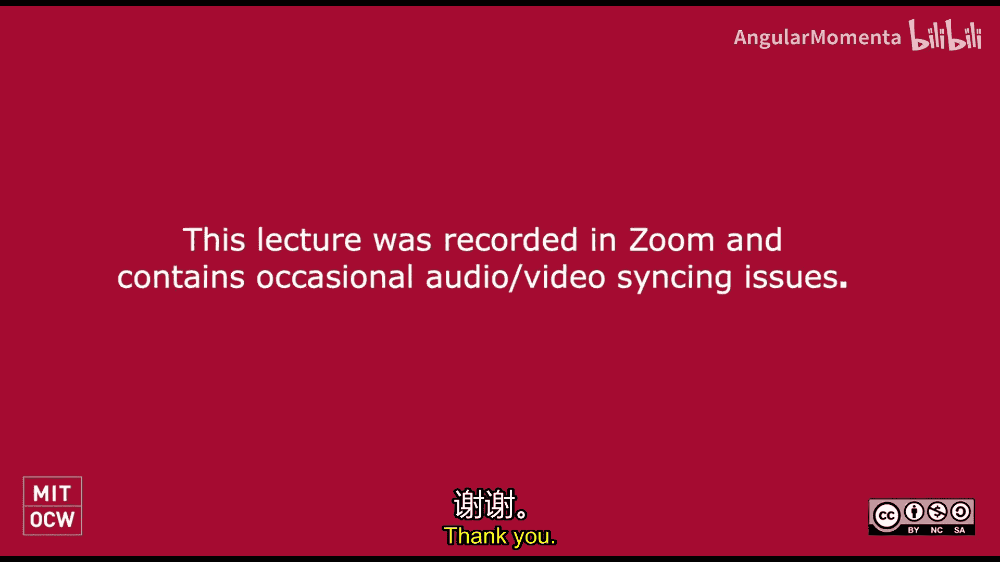
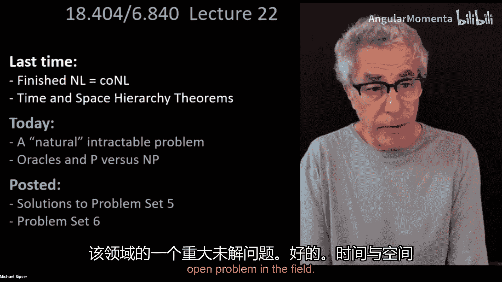
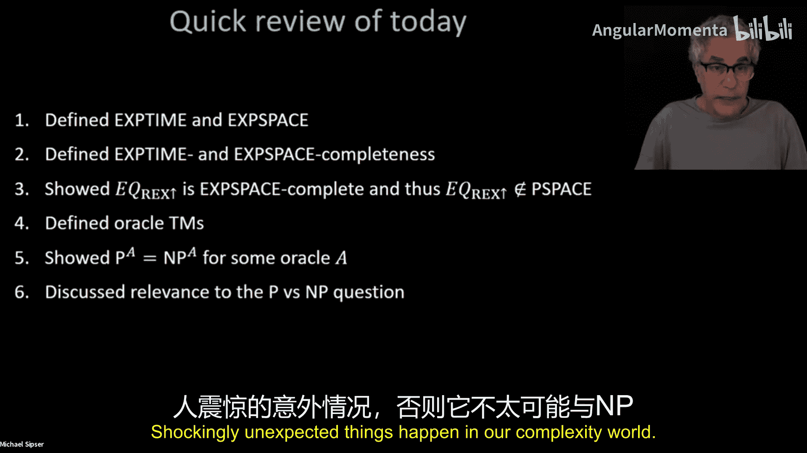

# 021：可证明的棘手问题与神谕

在本节课中，我们将学习如何证明一个问题是“天然”棘手的，即它无法在多项式时间内解决。我们将通过证明一个具体问题是“指数空间完全”的来展示这一点。此外，我们还将探讨“神谕”的概念，并了解它为何能揭示解决P与NP问题的方法局限性。

## 回顾：时间与空间层次定理

上一节我们介绍了时间与空间层次定理。简单来说，这些定理表明，如果允许计算模型使用稍多一些的资源（时间或空间），那么它就能解决更多的问题。证明的核心思想是**对角化**。

这些定理意味着，复杂度类形成了一个层次结构。例如，随着空间界限从 `n^2` 增加到 `n^3`、`n^4`，我们能解决的问题类会变得越来越大。对于时间复杂性也是如此。

一个重要的推论是：**NL**（非确定性对数空间）是 **PSPACE**（多项式空间）的真子集。这意味着存在一些问题在PSPACE中，但不在NL中。我们之前学过的 **TQBF**（全量词化布尔公式可满足性）问题就是一个例子，它是PSPACE完全的，因此肯定不在NL中。

## 引入指数复杂度类

为了找到天然棘手的问题，我们首先需要引入两个新的复杂度类：
*   **EXPTIME**：能在 `2^(n^k)` 时间内解决的问题集合。
*   **EXPSPACE**：能在 `2^(n^k)` 空间内解决的问题集合。

这些类比多项式时间（P）和多项式空间（PSPACE）要大得多。根据层次定理，我们可以证明一些分离关系：
*   P ≠ EXPTIME
*   PSPACE ≠ EXPSPACE

接下来，我们定义这两个新类的“完全问题”：
*   一个问题是 **EXPTIME完全的**，如果它属于EXPTIME，并且EXPTIME中的**每一个**问题都能在多项式时间内归约到它。
*   一个问题是 **EXPSPACE完全的**，如果它属于EXPSPACE，并且EXPSPACE中的**每一个**问题都能在多项式时间内归约到它。

**关键点**：如果一个问题是EXPTIME完全的，那么它**不可能**在P中。因为如果它在P中，通过归约，整个EXPTIME类都会坍缩到P，这与P ≠ EXPTIME矛盾。同理，一个EXPSPACE完全的问题不可能在PSPACE或P中。

因此，我们的策略是：找到一个**天然的**、易于描述的问题，并证明它是EXPSPACE完全的。这样我们就证明了一个天然问题是棘手的。

## 一个天然棘手的问题：带乘方的正则表达式等价性

我们即将展示的问题是：**带乘方的正则表达式等价性问题**。

首先，回顾一下普通的正则表达式等价性问题（判断两个正则表达式是否描述相同的语言）。这个问题实际上在PSPACE中，并不棘手。

现在，我们增强正则表达式的语法，允许**乘方**操作。例如，`R^k` 表示将正则表达式 `R` 重复连接 `k` 次。如果 `k` 以二进制书写，这个操作可以极大地压缩表达式的长度。

**带乘方的正则表达式等价性问题**就是：给定两个允许使用乘方操作的正则表达式，判断它们是否等价。

**定理**：带乘方的正则表达式等价性问题是 **EXPSPACE完全的**。

由于EXPSPACE完全问题不在P中，这便是一个被证明的、天然的棘手问题。

### 证明概述（第一部分：属于EXPSPACE）

证明分为两部分。首先，需要证明该问题属于EXPSPACE。
1.  给定两个带乘方的正则表达式，首先通过展开所有乘方操作，将它们转换为普通的（但可能指数级大的）正则表达式。
2.  然后，对这两个展开后的巨型表达式运行已知的PSPACE等价性测试算法。
3.  由于输入（展开后的表达式）大小是指数级的，而算法是PSPACE的，因此总空间消耗是原始输入大小的指数级，即该问题在EXPSPACE中。

### 证明概述（第二部分：EXPSPACE难度，即归约）

第二部分更有趣：证明EXPSPACE中的**任何**问题都能归约到这个问题上。这意味着它是EXPSPACE中最难的问题之一。

设语言 `A ∈ EXPSPACE`，由一台在 `2^(n^k)` 空间内运行的图灵机 `M` 判定。对于任意输入 `w`，我们需要构造两个带乘方的正则表达式 `R1` 和 `R2`，使得：
*   `R1` 等价于 `R2` 当且仅当 `M` 接受 `w`。

**构造思路**：
*   令 `R2` 为生成所有字符串的正则表达式（即 `Σ*`）。
*   构造 `R1`，使其生成**除了** `M` 在 `w` 上的**拒绝计算历史**之外的所有字符串。

**什么是拒绝计算历史？** 它是 `M` 在输入 `w` 上，从起始格局开始，一步步运行，直到到达拒绝格局的整个格局序列。由于 `M` 是判定器，对于不接受 `w` 的情况，必然存在这样一个唯一的拒绝历史。

**关键观察**：
*   如果 `M` 接受 `w`，则**不存在**拒绝计算历史。此时 `R1` 将生成所有字符串（因为要避开一个不存在的字符串），所以 `R1 ≡ R2`。
*   如果 `M` 拒绝 `w`，则存在一个唯一的拒绝计算历史。此时 `R1` 会生成除这个特定字符串外的所有字符串，所以 `R1` 不等于 `R2`。

因此，测试 `R1` 与 `R2` 的等价性，就等价于测试 `M` 是否接受 `w`。

**如何构造 R1？**
`R1` 被构造为所有“坏”字符串的并集，即那些**不是**合法拒绝计算历史的字符串。它分为三部分：
1.  **坏起始**：描述所有不以正确的起始格局开始的字符串。
2.  **坏转移**：描述所有在某个相邻格局间违反 `M` 转移规则的字符串（通过检查非法的2x3邻域）。
3.  **坏拒绝**：描述所有不包含拒绝状态的字符串（即没有正确结束的字符串）。

如果字符串是那个唯一的拒绝计算历史，它必须同时满足：起始正确、每一步转移正确、最终以拒绝结束。因此，它不会被 `R1` 的任何一部分描述。而任何其他字符串，至少会违反其中一条，从而被 `R1` 捕获。

在构造中，我们巧妙地使用了**乘方操作**和**填充**（使所有格局长度相同）来在多项式时间内写出 `R1`，尽管它要描述的“坏字符串”集合和那个唯一的“好字符串”（拒绝历史）本身是双指数级长度的。这是整个归约的核心技巧。

通过这个归约，我们证明了任何EXPSPACE问题都能转化为带乘方的正则表达式等价性问题，因此后者是EXPSPACE完全的。

## 神谕计算

现在，我们转向一个不同但相关的话题：**神谕**。

**什么是神谕？** 神谕是一个“黑盒子”，图灵机可以免费地询问某个特定语言 `A` 的成员资格问题。拥有神谕 `A` 的图灵机记作 `M^A`。

例如，如果拥有一个SAT（布尔可满足性问题）的神谕，那么就能瞬间解决SAT，也能通过归约快速解决任何NP问题。

我们可以定义相对于神谕的复杂度类，例如：
*   **P^A**：拥有神谕 `A` 时，多项式时间内可判定的语言集合。
*   **NP^A**：拥有神谕 `A` 时，非确定性多项式时间内可判定的语言集合。

**一个有趣的发现**：存在神谕 `A`，使得 **P^A = NP^A**。一个具体的例子就是 `A = TQBF`（PSPACE完全问题）。
*   **证明思路**：`NP^TQBF` 中的任何计算，其非确定性分支都可以询问TQBF神谕。由于TQBF是PSPACE完全的，我们可以用一台**非确定性多项式空间**机器来模拟这个过程：用自身的空间来计算TQBF问题的答案，而不是询问神谕。根据萨维奇定理，`NPSPACE = PSPACE`。而 `P^TQBF` 显然包含 `PSPACE`（因为可以解TQBF，从而解所有PSPACE问题）。因此 `NP^TQBF ⊆ PSPACE ⊆ P^TQBF`，两者相等。

## 神谕与P vs NP问题的启示

这个关于神谕的现象对解决 **P vs NP** 问题有深刻的启示。

我们刚刚证明“带乘方的正则表达式等价性”是棘手的方法，本质依赖于**层次定理的证明**，而后者是一种**对角化**方法。对角化证明有一个特点：如果证明过程仅依赖于“模拟”其他图灵机，那么当给所有机器都加上同一个神谕时，模拟依然成立。

这意味着：**如果一个证明仅使用对角化方法证明了 P ≠ NP，那么同样的证明将能证明对于所有神谕 A，都有 P^A ≠ NP^A**。

然而，我们刚刚找到了一个神谕 `A = TQBF`，使得 **P^A = NP^A**。

因此，我们得出一个关键结论：**纯粹的、相对化的对角化方法不足以解决 P vs NP 问题**。任何声称证明 P ≠ NP 的方法，如果其核心论证在引入神谕后依然成立（即“可相对化”），那么该方法必定有误，因为它会与 `P^TQBF = NP^TQBF` 这一事实矛盾。

这告诉我们，解决P vs NP可能需要更复杂、非相对化的新技巧。

## 总结

本节课我们一起学习了：
1.  **如何证明天然棘手问题**：通过证明“带乘方的正则表达式等价性”问题是 **EXPSPACE完全的**，我们展示了一个易于描述但被证明无法在多项式时间内解决的问题。
2.  **神谕的概念**：神谕是提供免费信息查询的黑盒子，允许我们定义相对化的复杂度类。
3.  **神谕的深刻含义**：我们发现了存在神谕 `A` 使得 `P^A = NP^A`。这一事实表明，任何纯粹基于对角化（即可相对化）的证明方法，都无法用来证明 `P ≠ NP`。这为这个著名开放问题的解决指明了某种技术上的障碍和所需新方法的方向。