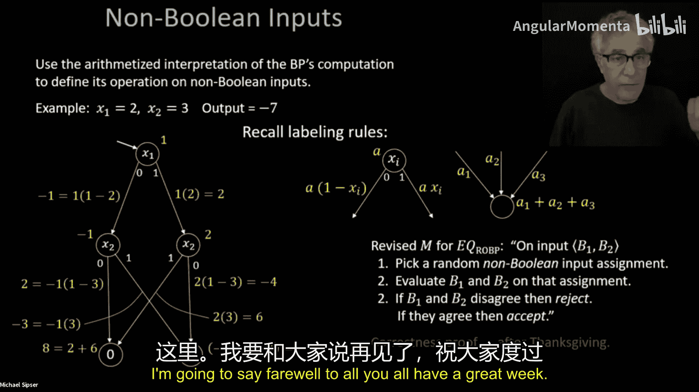

# 022：概率计算，BPP

在本节课中，我们将学习概率计算模型，并定义相关的复杂度类 BPP。我们将通过一个关于“只读一次分支程序”等价性判定的具体例子，来理解 BPP 算法的设计思路。

## 概率图灵机

上一节我们介绍了时间与空间层次定理，并讨论了证明 P 与 NP 问题可能面临的困难。本节中，我们来看看一种新的计算模型：概率图灵机。

概率图灵机与非确定性图灵机类似，其计算过程可以产生多个分支。关键区别在于，我们将为每个分支赋予一个概率。为了简化，我们规定每次选择只有两个可能的分支，并且每个分支被选中的概率均为 50%。这可以理解为机器在每次需要选择时“抛一枚硬币”。

计算树中某个特定分支出现的概率，等于 1 除以 2 的“该分支上抛硬币次数”次方。机器接受输入的概率，就是所有到达接受状态的分支的概率之和。机器拒绝的概率则是 1 减去接受的概率。

## 错误概率与 BPP 类

对于概率图灵机试图判定的语言，其某些分支可能会给出错误答案。我们定义机器的错误概率 ε：对于语言中的任何字符串，机器拒绝的概率至多为 ε；对于不在语言中的任何字符串，机器接受的概率至多为 ε。

现在，我们可以定义复杂度类 BPP。BPP 是所有能被多项式时间概率图灵机判定的语言的集合，且该机器的错误概率至多为 1/3。这意味着：
*   对于语言中的字符串，机器至少以 2/3 的概率接受。
*   对于不在语言中的字符串，机器至少以 2/3 的概率拒绝。

定义中使用常数 1/3 看似随意，但实际上，通过“放大引理”，我们可以将任何小于 1/2 的错误概率降低到任意小的程度。方法很简单：将原始机器独立运行多次，然后根据多数结果输出答案。通过足够多次的运行，可以将正确率提升到极高。

## BPP 与 NP 的对比

理解 BPP 的一种方式是与 NP 对比：
*   在 **NP** 中，对于语言中的字符串，只需**存在至少一条**接受路径；对于不在语言中的字符串，则**所有**路径都必须拒绝。
*   在 **BPP** 中，对于语言中的字符串，**绝大多数**路径必须接受；对于不在语言中的字符串，**绝大多数**路径必须拒绝。BPP 要求计算结果有明显的倾向性（远离 50%），这样才能通过多次运行进行放大。

## 分支程序与等价性问题

为了具体说明 BPP 算法，我们引入“分支程序”这一计算模型。分支程序是一个有向无环图，包含两种节点：
*   **查询节点**：标有变量名（如 x1），有两个出边，分别标记为 0 和 1。
*   **输出节点**：标有输出值 0 或 1。
其中一个节点被指定为**起始节点**。

给定一组对变量的赋值（输入），从起始节点开始，根据当前查询节点的变量值选择相应的出边，直至到达某个输出节点，该节点的值即为计算结果。

两个分支程序是**等价的**，当且仅当它们对所有可能的输入赋值都给出相同的输出。分支程序的等价性判定问题是 **co-NP 完全**的，因此不太可能存在于 BPP 中（否则将导致 NP ⊆ BPP，这是一个未被相信的结论）。

## 只读一次分支程序

我们考虑一个受限版本：“只读一次”分支程序。在这种程序中，任何计算路径上，每个变量最多被查询一次。虽然任何布尔函数都可以用（可能很大的）只读一次分支程序表示，但将通用分支程序转化为等价的只读一次形式可能需要指数级增长。

有趣的是，**只读一次分支程序的等价性判定问题**是可以在 BPP 内解决的。我们接下来概述这个算法背后的核心思想。

## 算法思路与算术化

一个朴素的想法是：随机生成许多输入赋值，运行两个分支程序，看输出是否总是一致。如果不一致，则可立即断定它们不等价。但如果它们几乎处处相等，仅在一个输入上不同，那么随机采样发现这个差异的概率极低，需要指数次尝试。

我们需要一个更聪明的方法。核心思想是“算术化”：将分支程序的布尔逻辑计算，转化为在更大域（如实数或某个有限域）上的多项式计算。

首先，我们为分支程序的每个节点和边关联一个“执行值”：如果计算路径经过它，则值为1；否则为0。可以归纳地定义这些值：
*   起始节点的执行值为 1。
*   从执行值为 `a` 的查询节点（变量为 `xi`）出发，其标记为 `1` 的出边的执行值为 **a ∧ xi**，标记为 `0` 的出边的执行值为 **a ∧ ¬xi**。
*   一个节点的执行值是其所有入边执行值的 **或**。

由于分支程序是无环的，任何节点最多只有一个入边的执行值可能为 1，因此“或”操作可以简单地替换为“加和”。

现在进行算术化：用算术运算模拟布尔运算。
*   **与** 操作 `a ∧ b` 模拟为乘法：`a * b`。
*   **非** 操作 `¬a` 模拟为：`1 - a`。
*   **或** 操作 `a ∨ b` 在一般情况下可模拟为：`a + b - a*b`。但在我们的分支程序场景中，由于至多一个入边为 1，“或”可直接模拟为加法：`a + b`。

应用这些规则，我们可以为任何分支程序定义一个多项式 `P(x1, x2, ..., xn)`。关键性质是：当变量 `xi` 被赋予布尔值（0 或 1）时，多项式 `P` 的值与原始分支程序的输出完全相同。

## 扩展到非布尔赋值

算术化的强大之处在于，我们现在可以将**非布尔值**（如实数）代入变量 `xi`，并计算多项式 `P` 的值。对于两个只读一次分支程序，它们分别对应多项式 `P1` 和 `P2`。

算法思路如下：
1.  随机选择变量 `x1, ..., xn` 的一组**非布尔**赋值（例如，从某个足够大的有限域中随机选取）。
2.  分别计算 `P1` 和 `P2` 在这组赋值下的值。
3.  如果 `P1 ≠ P2`，则两个分支程序一定不等价（因为如果等价，则对所有布尔赋值结果相同，从而推导出它们的多项式在形式上完全一致，对任何赋值结果都相同）。
4.  如果 `P1 = P2`，则我们推测两个分支程序是等价的。

这个算法的正确性依赖于一个关键事实：如果两个不同的多项式（来自只读一次分支程序）在随机选取的点上取值相等的概率非常低（由 Schwartz-Zippel 引理保证）。因此，如果它们等价，算法总是接受；如果它们不等价，算法以极低的概率错误接受。通过多次独立运行，可以将错误概率降至任意小。

本节课中我们一起学习了概率计算模型和 BPP 类的定义，并通过只读一次分支程序等价性判定问题，初步了解了设计 BPP 算法的核心技巧——算术化。下一节，我们将完成这个算法的正确性证明。