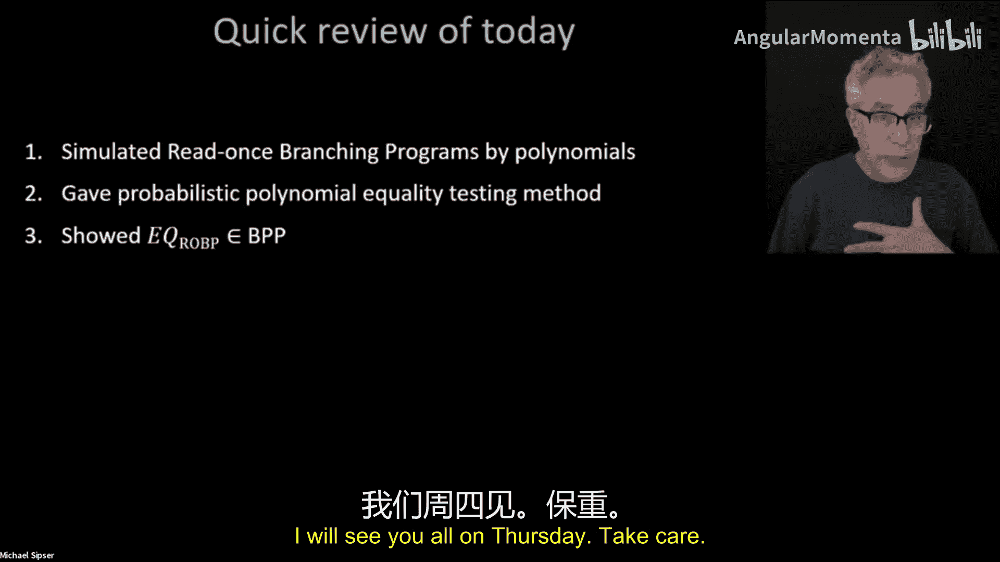

# 023：概率计算（续）🎲

在本节课中，我们将继续学习概率计算，并完成关于“一次读取分支程序等价性判定”的BPP算法证明。我们将回顾算术化的方法，并利用多项式根的性质来分析算法的正确性。

---

## 回顾：概率图灵机与BPP类

上一节我们介绍了概率图灵机和BPP类的定义。本节中，我们来看看如何利用这些概念解决一个具体问题。

概率图灵机在计算步骤中可以“抛硬币”进行随机选择。机器接受输入的概率是所有接受分支的概率之和。BPP类包含那些存在多项式时间概率图灵机可以判定的语言，且该机器的错误概率被**有界地远离1/2**（例如，错误概率 ≤ 1/3）。

一个关键引理是**错误概率放大引理**：通过多次独立运行算法并取多数结果，可以将错误概率降至任意小。

---

## 问题：一次读取分支程序的等价性判定

我们关注的问题是：给定两个**一次读取分支程序**，判断它们是否计算相同的布尔函数。对于一般的分支程序，此问题是coNP完全的。但对于一次读取分支程序，我们可以在BPP类内解决它。

以下是核心思路：
1.  如果只是随机选取布尔赋值（0/1）来测试，若两个程序仅在一个输入上不同，则发现差异的概率极低。
2.  因此，我们扩展输入域，使用**算术化**方法让分支程序在非布尔值（如整数）上运行。
3.  我们将证明，如果两个程序不等价，那么它们在绝大多数非布尔赋值上也会输出不同的值。通过随机选取一个非布尔赋值进行测试，我们就能以高概率得到正确答案。

---

## 算术化方法

为了在非布尔值上运行分支程序，我们需要一种将布尔逻辑运算（AND, OR, NOT）用算术运算（+, ×）模拟的方法。

定义以下转换，其中真值`1`对应布尔`True`，`0`对应`False`：
*   **逻辑与 (AND)** 模拟为乘法：`A AND B` → `A × B`
*   **逻辑非 (NOT)** 模拟为：`NOT A` → `1 - A`
*   **逻辑或 (OR)** 模拟为：`A OR B` → `A + B - A×B`

对于一次读取分支程序，由于其无环且每个变量在每条路径上最多被查询一次，从节点汇聚的“或”运算可以简化为**求和**，因为至多有一条入边可能被激活。

---

## 从路径执行到代数标记

考虑一个分支程序。传统执行方式是沿着输入赋值决定的路径走。另一种等价的视角是**标记**：
*   将路径上的所有节点和边标记为`1`。
*   将不在路径上的所有节点和边标记为`0`。
*   输出节点的标记值就是输出。

我们可以用递归规则定义这个标记，而无需显式追踪路径：
1.  **边标记规则**：从标记为 `a` 的查询节点（查询变量 `x_i`）出发：
    *   标记为 `1` 的边：`a × x_i`
    *   标记为 `0` 的边：`a × (1 - x_i)`
2.  **节点标记规则**：节点的标记是其所有入边标记的**和**。

在布尔赋值下，这个标记系统与路径执行完全一致。其优势在于，标记规则中的运算（`+`, `×`, `-`）在非布尔值上也有定义，从而自然地将计算扩展到了更广的域上。

---

## 核心代数事实：多项式根的数量限制

算法的分析依赖于关于多项式的两个基本事实。

**事实一：单变量多项式**
一个非零的 `d` 次单变量多项式，在其系数所属的域中，最多有 `d` 个根。

**推论：多项式的一致性**
如果两个不同的 `d` 次多项式 `P1` 和 `P2` 在域中超过 `d` 个点上取值相同，那么它们的差 `P1 - P2` 就是一个有超过 `d` 个根的非零 `d` 次多项式，这与事实一矛盾。因此，两个不同的 `d` 次多项式在域中最多在 `d` 个点上取值相同。

**事实二：多变量多项式（Schwartz-Zippel引理）**
设 `P(x1, ..., xm)` 是一个 `m` 元非零多项式，每个变量 `xi` 的次数最多为 `d`。如果从大小为 `q` 的有限域中随机均匀地选取赋值 `(a1, ..., am)`，那么 `P(a1, ..., am) = 0` 的概率最多为 `(m * d) / q`。

---

## 分支程序的输出多项式

当我们对一次读取分支程序进行算术化，并将输入变量视为符号时，程序的输出可以表示为一个多项式 `P(x1, ..., xm)`。

这个多项式具有特殊形式：它是许多**项**的和，每一项是某些 `xi` 和 `(1 - xi)` 的乘积。由于程序是“一次读取”的，每个变量在每个项中至多出现一次（要么是 `xi`，要么是 `(1 - xi)`），因此每个变量在每个项中的次数最多为1。

**关键观察**：在布尔赋值（`xi ∈ {0, 1}`）下，这样的一个项只有在所有因子都为1时才等于1，这对应一个使原布尔函数输出1的特定赋值。因此，整个多项式 `P` 在布尔域上的取值，正好列出了使原分支程序输出1的所有输入赋值。也就是说，多项式 `P` **编码了分支程序所计算的布尔函数的真值表**。

---

## 等价性判定算法与分析

基于以上准备，我们给出判定两个一次读取分支程序 `B1` 和 `B2` 是否等价的BPP算法：

1.  **参数设置**：设变量个数为 `m`。选取一个素数 `q > 3m`。所有运算将在模 `q` 的有限域 `F_q` 上进行。
2.  **随机赋值**：从域 `F_q` 中均匀随机地选取赋值 `(a1, ..., am)` 给变量 `(x1, ..., xm)`。
3.  **算术化求值**：使用算术化规则，分别在赋值 `(a1, ..., am)` 上计算 `B1` 和 `B2` 的输出值 `v1` 和 `v2`。
4.  **判断**：若 `v1 = v2`，则接受（判定为等价）；否则拒绝（判定为不等价）。

现在分析该算法的正确性：

*   **情况一：`B1` 与 `B2` 等价。**
    由于它们计算相同的布尔函数，它们的输出多项式 `P1` 和 `P2` 在所有的布尔赋值上取值相同。而 `P1` 和 `P2` 都是前述特殊形式的多项式。可以论证，在这种情况下 `P1` 和 `P2` 是**完全相同的多项式**。因此，对于**任何**赋值（包括我们随机选取的非布尔赋值），`P1` 和 `P2` 的输出都必然相等。算法总是接受，错误概率为0。

*   **情况二：`B1` 与 `B2` 不等价。**
    则 `P1` 和 `P2` 是不同的多项式。每个变量在 `P1` 和 `P2` 中的次数最多为1。根据Schwartz-Zippel引理，对于随机赋值，`P1` 与 `P2` 输出值相等的概率最多为：
    `(变量个数 m * 次数上界 1) / 域大小 q < m / (3m) = 1/3`
    因此，算法以至少 `2/3` 的概率拒绝（得到正确答案）。

综上所述，该算法以大于 `2/3` 的正确概率判定一次读取分支程序的等价性，属于BPP类。

---

## 总结

本节课中，我们一起学习了：
1.  **回顾了BPP类**和概率计算的基本概念。
2.  **引入了算术化技术**，将逻辑运算转化为算术运算，从而将分支程序的计算扩展到非布尔域。
3.  **利用了多项式根的性质**（Schwartz-Zippel引理），分析了随机测试在扩展域上的有效性。
4.  **完成了一个巧妙的证明**：展示了一次读取分支程序等价性判定问题属于BPP类。该证明的核心在于，通过算术化，将程序等价性问题转化为多项式恒等性问题，并利用随机采样来检测多项式是否相同。

这个结果不仅本身有趣，其使用的**算术化**方法也是后续学习交互式证明系统等高级主题的重要基础。